# SETCOMMIT: COORDINATED TOKEN COMMITMENTS FOR FEW-STEP DIFFUSION LANGUAGE MODEL DECODING

Yuannuo Feng1 Yubing Ye2 Wenshuai Yao3 Yizhe Chen1 Ngai Wong2 Wenyong Zhou2 Wang Kang1

1Beihang University 2The University of Hong Kong 3Peking University {ynfeng, yizhechen, wang.kang}@buaa.edu.cn {taliayeyb, wenyongz}@connect.hku.hk nwong@eee.hku.hk 2200012654@stu.pku.edu.cn

## ABSTRACT

Diffusion language models generate multiple token positions in parallel, but fewstep decoding makes parallel commitment difficult: tokens that appear reliable individually may be jointly inconsistent, while premature commitments can prevent later context-dependent refinement. In this paper, we introduce SETCOMMIT, a training-free method for coordinated parallel token commitment. Instead of selecting tokens independently by confidence, SETCOMMIT selects a commitment set that balances token reliability against local joint commitment risk, preserving conditioning opportunities for subsequent denoising steps. It further performs budgetneutral local exchanges, replacing vulnerable earlier commitments when newly revealed context supports more reliable alternatives. SETCOMMIT requires no retraining or architectural modification and is compatible with existing diffusion decoding strategies. Experiments with LLaDA-8B and Dream-7B on GSM8K, MATH-500, MBPP, and HumanEval show accuracy/pass@1 gains of up to 7.4 percentage points over native decoding at 32 model evaluations. At common quality targets, geometric-mean incremental speedups range from 1.44 to 1.74×. Code is available at https://github.com/Kissmetothemoon/SetCommit.

## 1 INTRODUCTION

Diffusion language models (DLMs) generate text by iteratively denoising multiple token positions in parallel, offering a promising alternative to autoregressive generation (Austin et al., 2021a; Sahoo et al., 2024; Nie et al., 2025; Ye et al., 2025). This parallelism can substantially reduce generation latency (Deschenaux & Gulcehre, 2025), but it also introduces a decoding decision absent from left-to-right generation: at each denoising step, which token predictions should be committed, and which positions should remain revisable until additional context becomes available?

This decision is particularly consequential in few-step decoding (Liu et al., 2025; Xu et al., 2025). Existing decoders commonly commit multiple positions according to independent confidence esti mates or related token-level scores (Nie et al., 2025; Wu et al., 2026; Ben-Hamu et al., 2025). However, individually reliable predictions need not be reliable when committed together: simultaneous commitments may be mutually inconsistent, and prematurely fixing nearby uncertain positions can prevent them from benefiting from context revealed in later denoising steps (Liu et al., 2025; Israel et al., 2025). With only a limited number of updates, such unfavorable commitments leave few opportunities for recovery. Effective few-step decoding therefore requires coordinating sets of parallel commitments, rather than merely selecting the most confident tokens independently.

Existing acceleration methods address complementary bottlenecks. System-side methods reduce forward-pass cost through sparse or cached computation (Ma et al., 2025; Liu et al., 2026; Song et al., 2026; Wu et al., 2026), while schedule-side methods reduce or adaptively allocate denoising updates (Deschenaux & Gulcehre, 2025; Ben-Hamu et al., 2025; Wei et al., 2026; Wu et al., 2026). Figure 1 locates commitment coordination at their shared interface: model predictions must be converted into committed positions before the decoder state is updated. Improving which positions are committed can therefore complement these accelerators while retaining the host’s computation mode and scheduling rule.

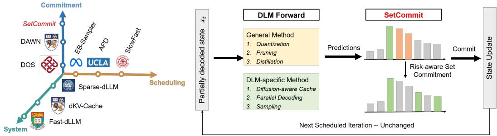  
Figure 1: SETCOMMIT complements system- and schedule-side diffusion decoding accelerators. Left: it coordinates parallel token commitments, orthogonally to reducing forward-pass computation or denoising updates. Right: predictions enter SETCOMMIT; the lower row’s selected positions (green) feed State Update under the host’s net quota. The return arrow follows the host scheduling rule.

We introduce SETCOMMIT, a training-free commitment coordinator inserted between the DLM forward pass and state update. It balances token reliability with local joint risk to preserve future conditioning opportunities, then uses budget-neutral exchanges to reopen vulnerable earlier commitments. The module preserves the host’s computation mode and net commitment quota and composes with native (Nie et al., 2025; Ye et al., 2025), cached, scheduled (Ben-Hamu et al., 2025), and combined decoders (Wu et al., 2026). Our contributions are threefold:

• We identify commitment coordination as an orthogonal acceleration axis for few-step DLM decoding, improving parallel commitment decisions at the interface between model prediction and decoder state update.

• We propose SETCOMMIT, a training-free and plug-and-play commitment coordinator. SETCOMMIT selects commitment sets by jointly considering token-level reliability and local joint commitment risk, and introduces budget-neutral local exchange to revise vulnerable earlier commitments as generation context evolves.

• Experiments with LLaDA-8B and Dream-7B on GSM8K, MATH-500, MBPP, and HumanEval show 4.9–7.4 percentage-point quality gains over native decoding at 32 evaluations. Across native, fixed/adaptive Fast-dLLM, and EB-Sampler hosts, SETCOMMIT achieves 1.44–1.74× geometric-mean incremental speedups at common quality targets.

## 2 RELATED WORK

Efficient DLM Decoding. Existing work improves DLM inference efficiency along two largely complementary directions. Compute-side methods reduce the cost of repeated bidirectional forward passes through delayed or approximate KV caching, cache reuse, dynamic eviction, or sparse attention (Ma et al., 2025; Wu et al., 2026; Liu et al., 2026; Song et al., 2026). Schedule-side methods instead reduce the number of denoising updates, or adaptively allocate update budgets according to confidence, entropy, or other uncertainty signals (Deschenaux & Gulcehre, 2025; Wei et al., 2026; Ben-Hamu et al., 2025; Li et al., 2026). Confidence-aware parallel decoding further uses token-level scores to determine how many or which predictions to reveal at an update (Nie et al., 2025; Wu et al., 2026). These methods primarily optimize the cost of each forward pass or the allocation of denoising steps; when selecting multiple tokens, they typically rely on token-wise criteria. In contrast, SETCOMMIT addresses the orthogonal question of which positions should be committed together. Operating between the DLM forward pass and decoder state update, it can therefore be combined with native, cached, scheduled, and jointly accelerated host decoders.

Commitment Revision and Self-correcting Decoding. Another related line of work mitigates errors caused by premature predictions in masked diffusion decoding. Such approaches may remask previously revealed tokens at inference time, train models to recover from their own errors, or modify transition and sampling procedures to permit revision of visible tokens (Wang et al., 2025; von Rütte et al., 2025; Zhao et al., 2025). These methods focus on recovering after an unfavorable tokenlevel commitment has been made, often by explicitly revisiting token values or altering the decoding process. SETCOMMIT couples preventive set selection with explicit remasking of vulnerable earlier commitments. It balances reliability and local co-commitment risk, then offsets each accepted withdrawal with an additional fresh commitment to preserve the host-selected net quota. This joint selection-and-revision interface composes with host computation and scheduling mechanisms; it does not require model retraining.

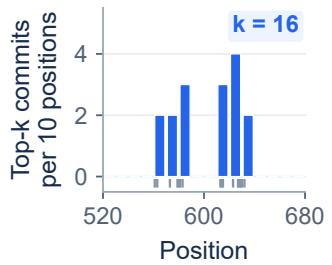

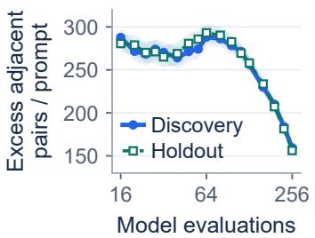

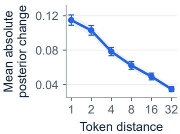  
Figure 2: Local clustering and context sensitivity on GSM8K. Left: counts of 16 top-k commitments per 10-position bin in one state. Center: cumulative excess adjacent pairs per prompt in the Discovery/Holdout subsets (240 prompts each). Right: mean absolute predicted-token posterior change after revealing a nearby prediction. Bands/bars are mean ±1.96 SE; aggregation units and metrics are detailed in Appendix A.

## 3 SETCOMMIT: COORDINATED COMMITMENT FOR PARALLEL DECODING

## 3.1 PROBLEM SETUP AND COORDINATED COMMITMENT

Let $x ^ { ( t ) }$ denote the partially decoded sequence at iteration t. Within the host-editable block of length L, let $M _ { t }$ and $C _ { t }$ denote masked and visible positions, respectively; positions retain their sequence indices. The host supplies current distributions $p _ { i } ^ { ( t ) }$ and a net-commitment quota $q _ { t }$ . The module uses top-1 proposals $\hat { y } _ { i } ^ { ( t ) } = \arg \operatorname* { m a x } _ { v } p _ { i } ^ { ( t ) } ( v )$ and posteriors $c _ { i } ^ { ( t ) } = p _ { i } ^ { ( t ) } ( \hat { y } _ { i } ^ { ( t ) } )$ . The quota specifies the net decrease in masked positions, allowing some earlier commitments to be remasked while additional positions are revealed. Below we describe the Native/Fast policy; the separate EB configuration is specified in Appendix C.2.

Standard parallel decoding ranks positions independently by their confidence $c _ { i } ^ { ( t ) }$ and commits the top $q _ { t }$ . Its baseline set is

$$
B _ { t } = \mathrm { T o p K } _ { i \in M _ { t } } \left( c _ { i } ^ { ( t ) } , q _ { t } \right) .\tag{1}
$$

This rule is locally myopic: it evaluates each position in isolation and does not consider whether several predictions should be committed simultaneously. Consequently, independently selected positions may concentrate in a short span even when their predictions remain strongly dependent on nearby unresolved context.

Figure 2 shows clustered top-k positions and similar excess-adjacency profiles in both subsets. Cumulative excess adjacency varies nonmonotonically over 16–64 evaluations and declines toward 256. The posterior response falls from 0.115 at distance 1 to 0.035 at distance 32, indicating stronger sensitivity to nearby revealed context. Together, these observations motivate coordinating simultaneous commitments so that context-sensitive positions can use information revealed later.

SetCommit balances token reliability with the local structure of the commitment set. Its base selection preserves the host-selected quota; a separate remask exchange reopens vulnerable earlier commitments while maintaining the same net progress.

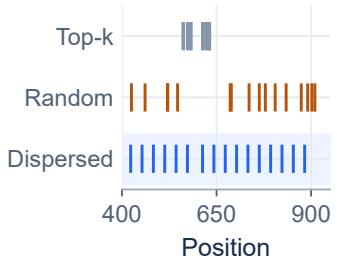

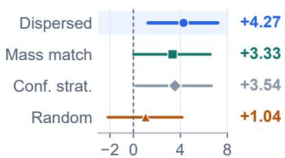  
Gain (pp)

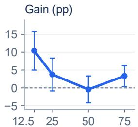  
Source progress (%)  
Figure 3: Commitment structure and continuation accuracy. Left: 16 selected positions per rule in a shared state. Center: paired GSM8K accuracy differences from clustered top-k (pp), averaged over four source-progress anchors at 32 evaluations. Right: dispersed-minus-clustered gain versus source progress. Intervals are 95% paired bootstrap CIs over 240 prompts (Appendix A).

## 3.2 RELIABILITY-AWARE SET SELECTION

To test the effect of commitment structure on generation quality, we compare alternative commitment sets constructed from the same decoding state under the same commit count. Starting from an identical partially decoded sequence, each branch reveals a different position set chosen by one selection rule, and decoding then proceeds to completion under a shared continuation policy. All branches share the source state’s token proposals, the continuation policy, and the remaining eval uation budget, isolating the choice of positions revealed at the intervention as the only degree of freedom. Because proposals, visible context, and remaining compute are held fixed across branches, systematic differences in final task accuracy can be attributed to the composition of the commitment set rather than to sampling stochasticity, budget allocation, or continuation randomness.

Figure 3 holds the source state and commit count fixed. Dispersed, posterior-mass-matched, and confidence-stratified rules gain 4.27, 3.33, and 3.54 pp over clustered top-k; random selection gains 1.04 pp with a CI spanning zero. The dispersed effect is largest at 12.5% progress (10.42 pp), falls to −0.42 pp at 50%, and recovers to 3.33 pp at 75%. The progress-dependent effects motivate balancing token reliability with local joint risk; the figure reports the uncertainty at each anchor.

For masked position i, the selector measures reliability by the logit margin

$$
m _ { i } ^ { ( t ) } = z _ { i , ( 1 ) } ^ { ( t ) } - z _ { i , ( 2 ) } ^ { ( t ) } ,\tag{2}
$$

where (1), (2) denote the two largest vocabulary logits. Min–max normalization over $M _ { t }$ gives reliability $\bar { m } _ { i } ^ { ( t ) } \in [ 0 , 1 ]$ ; posterior $c _ { i } ^ { ( t ) }$ defines the baseline $B _ { t }$ in Equation 1. Vocabulary-wide uncertainty is measured by normalized entropy:

$$
u _ { i } ^ { ( t ) } = - \frac { 1 } { \log | \mathcal { V } | } \sum _ { v \in \mathcal { V } } p _ { i } ^ { ( t ) } ( v ) \log p _ { i } ^ { ( t ) } ( v ) .\tag{3}
$$

With mask density $d _ { t } = | M _ { t } | / L$ , the local co-commitment risk is

$$
a _ { i j } ^ { ( t ) } = d _ { t } \exp ( - | i - j | / \tau _ { t } ) u _ { i } ^ { ( t ) } u _ { j } ^ { ( t ) } \quad ( i \neq j ) , \qquad a _ { i i } ^ { ( t ) } = 0 .\tag{4}
$$

This entropy-weighted locality proxy assigns larger risk to jointly uncertain nearby predictions. The distance scale $\tau _ { t }$ determines how far the coordination penalty extends within the editable block.

The candidate pool contains up to $\lceil \kappa q _ { t } \rceil$ margin-ranked masked positions, augmented with $B _ { t }$ where $\kappa \geq 1$ controls shortlist size. Starting from an empty set, the selector greedily adds candidates with score

$$
g _ { t } ( i \mid S ) = { \bar { m } } _ { i } ^ { ( t ) } - \operatorname* { m i n } \left\{ \lambda _ { t } \sum _ { j \in S } a _ { i j } ^ { ( t ) } , \beta \right\} .\tag{5}
$$

The penalty cap $\beta \geq 0$ limits how strongly risk can outweigh reliability. For a retention ratio $\rho \in [ 0 , 1 ]$ , the selector reserves enough remaining slots for baseline positions to satisfy

$$
| S _ { t } | = q _ { t } , \qquad | S _ { t } \cap B _ { t } | \geq \lceil \rho q _ { t } \rceil .\tag{6}
$$

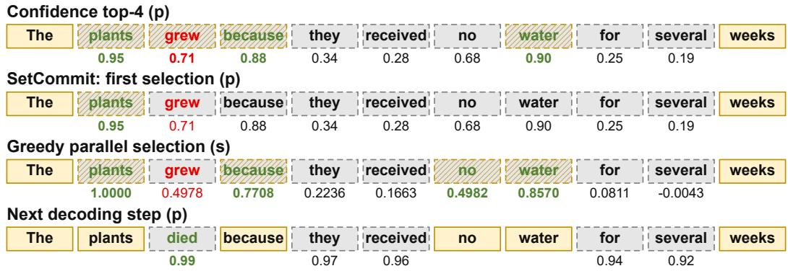  
Figure 4: Coordinated selection postpones a context-sensitive commitment. Conceptual wordlevel example with $q _ { t } = 4$ and three baseline positions retained. $p$ denotes posterior confidence and s the greedy score $g _ { t }$ . The first three rows share one forward pass; the last shows the next pass.

Baseline retention and the capped risk penalty limit departures from reliable host decisions. Risk strength and bandwidth decrease with progress; normalization, schedules, and default settings appear in Appendices C and D. In Figure 4, both sets select four positions and share plants, because, and water, satisfying the retention constraint. Selecting no leaves grew deferred; the next forward then predicts died at that still-masked position. The exchange operation below extends revision to previously visible tokens.

## 3.3 BOUNDED REMASKING AND HOST INTEGRATION

New context can change the model’s support for an earlier token. Exchange withdraws vulnerable visible commitments and adds equally many fresh commitments. For visible position $i \in C _ { t }$ , let $o _ { i } ^ { ( t ) } = p _ { i } ^ { ( t ) } ( x _ { i } ^ { ( t ) } )$ be the current-token posterior. An old position is eligible only if its token is outside the current top-K predictions and $c _ { i } ^ { ( t ) } > o _ { i } ^ { ( t ) } + \epsilon _ { 1 }$ , where K is the protection rank and $\epsilon _ { 1 } > 0$ is a posterior-gain margin. Exchange is active only when normalized host progress $s _ { t }$ lies in $[ s _ { \mathrm { m i n } } , s _ { \mathrm { m a x } } ] \subseteq [ 0 , 1 ]$ , with count capped by

$$
k _ { t } = \operatorname* { m i n } \{ | M _ { t } | - q _ { t } , \lfloor \alpha q _ { t } \rfloor \} .\tag{7}
$$

Here $\alpha \in [ 0 , 1 ]$ limits withdrawals relative to the net quota. Eligible old positions with low currenttoken posteriors form $R _ { t } ;$ extra commitments $E _ { t } \ \subseteq { M } _ { t } \ \backslash \ S _ { t }$ use the same selection rule, with $| E _ { t } | = | R _ { t } | \leq k _ { t }$ . Each extra-token posterior must exceed its paired withdrawn-token posterior by more than $\epsilon _ { 1 }$ . With set risk $\begin{array} { r } { H _ { t } ( U ) = \sum _ { i < j , i , j \in U } a _ { i j } ^ { ( t ) } } \end{array}$ , acceptance also requires

$$
H _ { t } \big ( ( C _ { t } \setminus R _ { t } ) \cup S _ { t } \cup E _ { t } \big ) \leq H _ { t } ( C _ { t } \cup S _ { t } ) + \epsilon _ { 2 } .\tag{8}
$$

Here $\epsilon _ { 2 } \geq 0$ is a numerical tolerance; defaults are specified in Appendix C. The implementation tries feasible exchange sizes from the cap down to one and accepts the first passing size. Outside the progress window, or if no candidate passes, $R _ { t } = E _ { t } = \emptyset$

The host remasks $R _ { t }$ and writes current top-1 proposals at $A _ { t } = S _ { t } \cup E _ { t }$ . Withdrawn positions remain masked until a subsequent evaluation. Thus,

$$
\begin{array} { c } { { M _ { t + 1 } = ( M _ { t } \setminus A _ { t } ) \cup R _ { t } , } } \\ { { \ } } \\ { { | M _ { t } | - | M _ { t + 1 } | = | S _ { t } | + | E _ { t } | - | R _ { t } | = q _ { t } . } } \end{array}\tag{9}
$$

This reopens earlier decisions while preserving the host-selected net quota exactly; Appendix B gives the accounting argument.

Selection and exchange reuse current forward-pass signals. Fixed-budget hosts retain their quota schedule; adaptive hosts apply their acceptance rule to the updated state, allowing subsequent quotas and realized NFE to change. Cached hosts refresh affected positions through their backend, with this work included in latency. The module leaves model weights and the host stopping rule unchanged. Model-specific proposal and evaluation protocols are specified in Appendix E.

Table 1: Multi-benchmark quality–cost comparison. $Q \colon$ accuracy/pass@1 (%); NFE: mean evaluations. Total uses the matched-quality native host; mean extra averages paired-host speedups geometrically across tasks (3-point margin). Shading marks SetCommit; blue NFE marks paired reductions. Bold Total values are column-best within each model.
<table><tr><td>Method</td><td colspan="3">GSM8K</td><td colspan="3">MATH-500</td><td colspan="3">MBPP</td><td colspan="3">HumanEval</td><td rowspan="2">Mean extra</td></tr><tr><td></td><td>Q↑</td><td>NFE↓</td><td>Total</td><td>Q 个</td><td>NFE↓</td><td>Total</td><td>Q↑</td><td>NFE↓</td><td>Total</td><td>Q 个</td><td>NFE↓</td><td>Total</td></tr><tr><td>LLaDA-8B Quality targets: 73.0/32.4/44.5/37.2%</td><td></td><td></td><td></td><td></td><td></td><td></td><td></td><td></td><td></td><td></td><td></td><td></td></tr><tr><td>Native</td><td>73.1</td><td>64</td><td>1.00</td><td>34.2</td><td>96</td><td>1.0046.6</td><td></td><td>96</td><td>1.0039.0</td><td>96</td><td>1.00</td><td></td></tr><tr><td>+ SetCommit</td><td>74.2</td><td>48</td><td>1.27</td><td>33.8</td><td>48</td><td>1.90 46.1</td><td></td><td>48</td><td>1.94 39.0</td><td>48</td><td>1.89</td><td>1.72</td></tr><tr><td>Fast fixed</td><td>73.1</td><td>64</td><td>2.01</td><td>34.0</td><td>96</td><td>1.96</td><td>44.7</td><td>64</td><td>2.93 39.6</td><td>96</td><td>1.91</td><td></td></tr><tr><td>+ SetCommit</td><td>74.6</td><td>48</td><td>2.38</td><td>34.6</td><td>48</td><td>3.72</td><td>46.8</td><td>48</td><td>3.47 38.4</td><td></td><td>48 3.36</td><td>1.47</td></tr><tr><td>Fast adaptive</td><td>73.6</td><td>62.2</td><td>2.05</td><td>32.4</td><td>64.8</td><td>2.99</td><td>44.7</td><td>58.3</td><td>3.22 39.0</td><td>93.4</td><td>1.99</td><td></td></tr><tr><td>+ SetCommit</td><td>73.1</td><td>32.3</td><td>3.49</td><td>33.4</td><td>48</td><td>3.87</td><td>45.4</td><td>44.9</td><td>3.76 38.4</td><td>44.8</td><td>3.64</td><td>1.47</td></tr><tr><td>EB-Sampler</td><td>73.6</td><td>58.5</td><td>1.09</td><td>32.4</td><td>62.9</td><td>1.53</td><td>45.2</td><td>63.5</td><td>1.50 39.6</td><td>92.6</td><td>1.01</td><td></td></tr><tr><td>+ SetCommit</td><td>75.7</td><td>47.7</td><td>1.33</td><td>33.6</td><td>44.6</td><td>2.12</td><td>45.9</td><td>45.8</td><td>1.97 39.0</td><td>46.4</td><td>1.95</td><td>1.44</td></tr><tr><td>DAWN</td><td>74.0</td><td>60.1</td><td>1.04</td><td>33.2</td><td>64.7</td><td>1.39</td><td>45.2</td><td>60.5</td><td>1.53 38.4</td><td>60.9</td><td>1.44</td><td>一</td></tr><tr><td>DOS</td><td>73.5</td><td>59.9</td><td>1.05</td><td>32.4</td><td>63</td><td>1.45</td><td>45.4</td><td>62.7</td><td>1.50 39.6</td><td>97.4</td><td>0.96</td><td></td></tr><tr><td>Dream-7B</td><td>Quality targets:</td><td></td><td></td><td>77.3/40.6/56.7/51.9%</td><td></td><td></td><td></td><td></td><td></td><td></td><td></td><td></td></tr><tr><td>Native</td><td>78.9</td><td>96</td><td>1.0042.6</td><td></td><td>96</td><td>1.0057.4</td><td></td><td>64</td><td>1.0054.3</td><td>96</td><td>1.00</td><td></td></tr><tr><td>+ SetCommit</td><td>78.6</td><td>48</td><td>1.96</td><td>41.2</td><td>48</td><td>1.92</td><td>58.3</td><td>48</td><td>1.25 53.7</td><td>48</td><td>1.93</td><td>1.74</td></tr><tr><td>Fast fixed</td><td>77.4</td><td>64</td><td>2.89</td><td>42.8</td><td>96</td><td>2.01</td><td>57.6</td><td>64</td><td>1.92 52.4</td><td>64</td><td>2.83</td><td></td></tr><tr><td>+ SetCommit</td><td>78.0</td><td>48</td><td>3.56</td><td>42.8</td><td>48</td><td>3.77</td><td>57.6</td><td>32</td><td>3.39 53.7</td><td>48</td><td>3.35</td><td>1.48</td></tr><tr><td>Fast adaptive</td><td>77.9</td><td>65.3</td><td>2.97</td><td>42.4</td><td>92.2</td><td>2.09</td><td>57.6</td><td>59.3</td><td>2.15 54.3</td><td>93.5</td><td>2.11</td><td></td></tr><tr><td>+ SetCommit</td><td>77.6</td><td>31.2</td><td>5.47</td><td>41.8</td><td>46.7</td><td>3.96</td><td>59.0</td><td>43.9</td><td>2.59 53.7</td><td>45.6</td><td>3.58</td><td>1.63</td></tr><tr><td>EB-Sampler</td><td>78.2</td><td>61.9</td><td>1.52</td><td>41.0</td><td>64.1</td><td>1.52</td><td>58.1</td><td>60.5</td><td>1.07 53.0</td><td>63.2</td><td>1.49</td><td></td></tr><tr><td>+ SetCommit</td><td>77.7</td><td>31.6</td><td>2.89</td><td>42.0</td><td>44.8</td><td>2.10</td><td>57.4</td><td>32.4</td><td>1.83 52.4</td><td>58.6</td><td>1.56</td><td>1.47</td></tr><tr><td>DAWN</td><td>78.2</td><td>60.7</td><td>1.52</td><td>41.0</td><td>64.8</td><td>1.44</td><td>58.3</td><td>62.7</td><td>0.99 52.4</td><td>61.1</td><td>1.48</td><td></td></tr><tr><td>DOS</td><td>78.2</td><td>61.8</td><td>1.48</td><td>41.0</td><td>62.7</td><td>1.50</td><td>57.8</td><td>60.7</td><td>1.03</td><td>52.4 63.2</td><td>1.44</td><td></td></tr></table>

## 4 EXPERIMENTS

## 4.1 EXPERIMENTAL SETUP

Models and benchmarks. We evaluate LLaDA-8B and Dream-7B (Nie et al., 2025; Ye et al., 2025) on GSM8K (Cobbe et al., 2021), MATH-500 (Hendrycks et al., 2021; Lightman et al., 2024), MBPP (Austin et al., 2021b), and HumanEval (Chen et al., 2021). We report accuracy for mathematics and functional pass@1 for code; LLaDA2.1/2.2 provide transfer targets.

Baselines and paired hosts. Baselines are native sampling, Fast-dLLM fixed/adaptive (Wu et al., 2026), EB-Sampler (Ben-Hamu et al., 2025), DAWN (Luo et al., 2026), and DOS (Zhou et al., 2026). The first four hosts are also evaluated with SetCommit, sharing models, inputs, and scorers. For Dream, module proposals change native sampling to deterministic top-1 predictions, so its comparisons evaluate complete decoding pipelines (Appendix E). EB uses our reimplementation and a separate module policy (Appendix C.2).

Quality and cost. Each model–task pair uses a common target $q _ { \star } = Q _ { \mathrm { r e f } } - \delta$ , where $Q _ { \mathrm { r e f } }$ is native-128 quality and $\delta \ : = \ : 3$ percentage points. We select the lowest-latency budget/threshold setting meeting the unrounded target; development and confirmation protocols appear in Appendix E. NFE counts actual forwards. At this target, incremental and total speedups are $S _ { \mathrm { i n c } } ~ { = }$ $L _ { B } / L _ { B + S e t C o m m i t }$ and $S _ { \mathrm { t o t a l } } = L _ { \mathrm { n a t i v e } } / L _ { B + S e t C o m m i t }$ for host B. All metrics use the same configuration. Paired timing on matched L20 hardware includes selection, remasking, and cache refresh (Appendix F). Matched-quality comparisons measure the cost of reaching a shared quality requirement. Fixed-NFE ablations complement this view by measuring the quality delivered by each decoding pipeline at the same number of model evaluations.

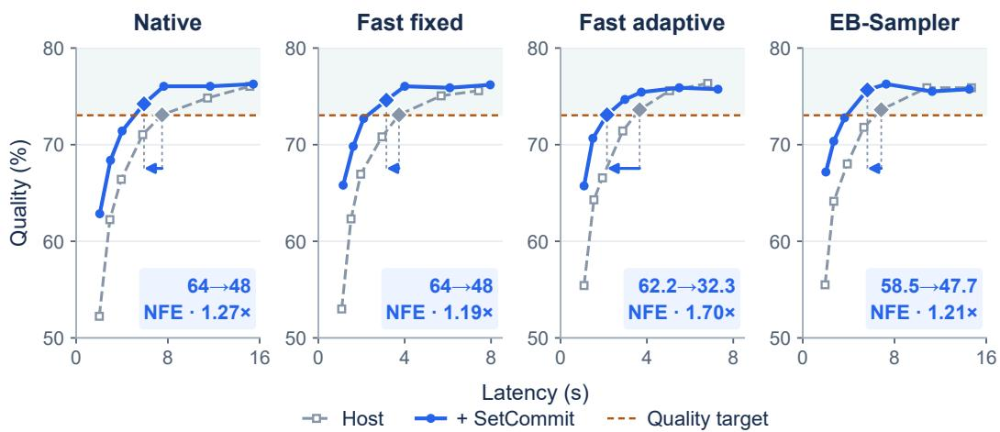  
Figure 5: Paired quality–latency curves. LLaDA-8B/GSM8K on four hosts. Diamonds mark selected points; dashed lines mark the quality target. Arrows show latency savings; badges give paired NFE and incremental speedup, using the same records as Table 1.

## 4.2 MAIN RESULTS

Fewer evaluations at a common quality target. In Table 1, Native+SetCommit reaches all eight model–task targets at 48 evaluations, compared with 64–96 for native decoding. The resulting geometric-mean incremental speedups are 1.72× for LLaDA and 1.74× for Dream. Thus the quality improvements translate into a smaller evaluation budget across both mathematical reasoning and code generation, even after charging the added coordination cost. For LLaDA/HumanEval, both variants reach 39.0% pass@1, while SetCommit reduces NFE from 96 to 48 and achieves 1.89× speedup. This illustrates the benefit at unchanged measured quality.

Complementarity with accelerated hosts. Every paired entry in Table 1 reduces NFE, including hosts that already use caching or adaptive scheduling. Their geometric-mean incremental speedups range from 1.44 to 1.63×, supporting commitment coordination as a useful addition to these optimizations. The best composition remains task-dependent: on Dream/GSM8K, Fast adaptive improves from 2.97 to 5.47× total speedup, while on Dream/MBPP, Fast fixed+SetCommit is faster than Fast adaptive+SetCommit (3.39 versus 2.59× total).

Where the latency savings arise. Figure 5 shows the largest separation in the low-latency region, with paired curves approaching similar quality at larger budgets. This pattern is consistent with coordination recovering quality when few updates are available. At the common LLaDA/GSM8K target, the adaptive Fast host reduces NFE from 62.2 to 32.3 and gains 1.70× in latency; the fixed Fast host reduces NFE from 64 to 48 and gains 1.19×. Adaptive scheduling can turn improved intermediate predictions into different later quotas, whereas a fixed host must select another point on its budget grid.

## 4.3 ABLATION STUDIES

Selection, exchange, and controls. Table 2 crosses selection s and remasking r at 32 NFE, with quality denoted by $Q _ { s r }$ . Selection alone outperforms confidence-plus-spacing, stratified random, and shuffled-risk controls in all four settings. These controls support combining reliability with position-specific risk beyond geometric spacing or random perturbation. The shuffled-risk control specifically tests the assignment of risk to positions. Holding NFE fixed measures how effectively each variant uses the same number of model evaluations. Full SetCommit gives the highest quality in each setting, adding 4.9–6.7 pp over the host at the same NFE for 2.4% mean latency overhead.

Selection and remask contributions. Figure 6 extends the component analysis to all four tasks on both primary models. Selection contributes 3.5–5.4 pp over the host, and remasking adds anothe

Table 2: Component and control ablations. Native hosts at 32 NFE. Quality is accuracy/pass@1 (%); bold marks column-best quality. ∆ gives gains over the host; overhead averages the latency change across the four settings.
<table><tr><td colspan="2"></td><td colspan="2">LLaDA-8B</td><td colspan="2">Dream-7B Overhead</td></tr><tr><td>Variant</td><td>GSM8K</td><td>HumanEval</td><td>GSM8K</td><td>HumanEval</td><td>(%)</td></tr><tr><td>Host baseline</td><td>66.4</td><td>30.5</td><td>70.2</td><td>45.7</td><td>+0.0</td></tr><tr><td>Selection only</td><td>70.2</td><td>35.4</td><td>74.5</td><td>49.4</td><td>+1.7</td></tr><tr><td>Remask only</td><td>67.8</td><td>32.3</td><td>71.4</td><td>47.6</td><td>+1.3</td></tr><tr><td>Full SetCommit</td><td>71.4</td><td>37.2</td><td>76.0</td><td>50.6</td><td>+2.4</td></tr><tr><td>∆ vs. host (pp)</td><td>+5.0</td><td>+6.7</td><td>+5.8</td><td>+4.9</td><td>一</td></tr><tr><td>Confidence + spacing</td><td>67.3</td><td>32.9</td><td>72.4</td><td>47.0</td><td>+1.2</td></tr><tr><td>Stratified random</td><td>67.4</td><td>31.7</td><td>70.2</td><td>46.3</td><td>+1.2</td></tr><tr><td>Shuffled risk</td><td>67.1</td><td>31.1</td><td>70.4</td><td>45.7</td><td>+1.7</td></tr></table>

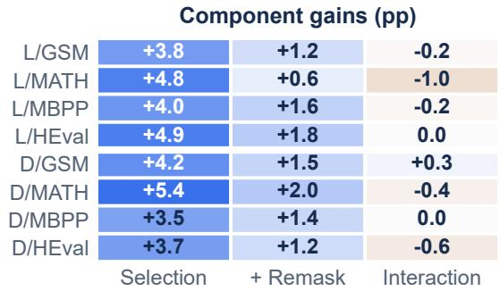

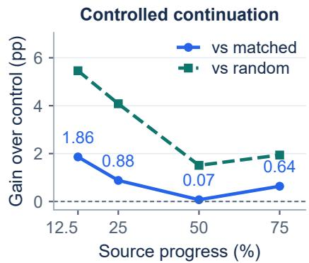  
Figure 6: Component contributions and controlled continuation. Left: native hosts at 32 NFE; columns show $Q _ { 1 0 } - Q _ { 0 0 } , Q _ { 1 1 } - Q _ { 1 0 }$ , and $Q _ { 1 1 } - Q _ { 1 0 } - Q _ { 0 1 } + Q _ { 0 0 }$ (pp). L/D denote LLaDA-8B/Dream-7B; blue/amber indicate positive/negative values. Right: LLaDA-8B/GSM8K same-state selector gains over confidence-matched and stratified-random controls. Labels show differences from the matched control. All entries are point estimates.

0.6–2.0 pp beyond selection-only. Selection therefore accounts for most of the improvement, while revision remains useful after preventive coordination. The interaction $Q _ { 1 1 } - Q _ { 1 0 } - Q _ { 0 1 } + Q _ { 0 0 }$ ranges from −1.0 to +0.3 pp, indicating partly overlapping contributions from preventive selection and subsequent revision. The same-state continuation analysis isolates the choice of a base commitment set: source state, proposals, commit count, continuation policy, and remaining budget are shared. Relative to the confidence-matched control, the coordinated selector adds 1.86/0.88/0.07/0.64 pp at 12.5/25/50/75% progress. The largest observed advantage occurs early, when much context remains unresolved. This pattern is consistent with preserving conditioning opportunities during the most uncertain part of decoding.

Frozen configurations and deployment cost. Figure 7 shows 4.9–7.4 pp gains with frozen settings at 32 NFE, while retuning adds 0–1.06 pp (mean 0.39 pp). Most of the reported improvement therefore survives without target-specific retuning, supporting configuration reuse across the evaluated models and tasks. On MATH-500, retuning adds zero in all four model columns, while the frozen gains remain 5.4–7.4 pp. This provides a concrete example of strong improvements from reusing the selected configuration. Transfer uses model-specific decoding routes; selection boundaries are detailed in Appendix E. At the same NFE, added latency is 1.39–2.90% on native hosts and 4.75–9.28% on cached hosts. Caching reduces the host time against which coordination is charged and introduces refresh work, making the relative overhead larger. At the common quality targets in Table 1, fewer evaluations offset this coordination cost and reduce end-to-end latency.

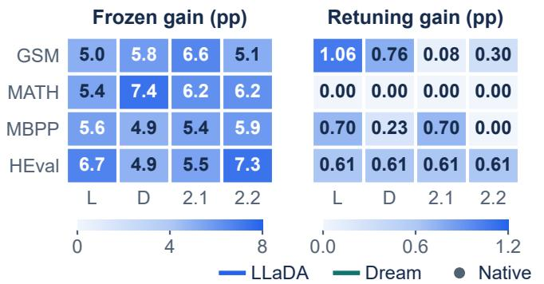

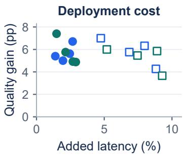  
Figure 7: Frozen configurations and deployment cost at 32 NFE. Left: frozen quality gains over the corresponding host (pp). Center: retuned minus frozen quality (pp); row order matches the left matrix. L/D denote LLaDA-8B/Dream-7B; 2.1/2.2 denote additional LLaDA targets. Color scales are separate and zero-anchored. Right: each point pairs quality gain and added latency for one primary model, task, and native/cached host; there are 16 points. Colors identify models and markers identify hosts in this panel.

Sensitivity and additional checks. Additional analyses in Appendix F show that matched-budget gains are largest at low NFE and diminish as the budget grows. Risk strength and remask-cap effects characterize a nonmonotonic tradeoff between coordination and token reliability. Incremental speedups also persist under stricter quality margins: at a one-point margin, geometric-mean speedups are 1.68× for Native+SetCommit and 1.54× for Fast fixed+SetCommit across both primary models and all four tasks. The same appendix provides parameter sweeps, memory measurements, runtime breakdowns, and the reporting protocol for these point estimates.

## 5 DISCUSSION

The experiments connect commitment structure to practical decoding efficiency. The same-state comparisons show that changing which positions are revealed can improve continuation quality, with the largest observed advantage early in decoding. The component analysis further shows that bounded remasking adds gains after coordinated selection. Together, these results support preserving conditioning opportunities while retaining a limited path to revise earlier commitments. Baseline retention and the capped risk penalty keep this intervention focused: most high-confidence host choices remain in the set, while the entropy-weighted distance term delays uncertain neighboring predictions. This design balances immediate progress with the context available in later updates.

The host interface makes this decision complementary to caching and scheduling. SetCommit uses signals from the current forward pass and preserves the net quota, while the improved quality allows fewer evaluations at a common target. The resulting latency gains include selection, exchange, and cache maintenance. This links the benefit of coordinated commitment to end-to-end efficiency across the evaluated hosts, with the strongest quality gains in the few-step regime.

## 6 CONCLUSION

We introduced SetCommit, a training-free coordinator for parallel token commitment in diffusion language models. It combines reliability-aware set selection, which balances token reliability against local co-commitment risk, with bounded remasking, which revises vulnerable earlier commitments as context evolves, while preserving the host’s per-step net commitment quota. On mathematical reasoning and code generation with LLaDA-8B and Dream-7B, it improves quality by 4.9–7.4 percentage points at 32 evaluations and achieves geometric-mean incremental speedups of 1.44–1.74× at common quality targets across the evaluated model–host pairs. These results support coordinated commitment as a complementary component of efficient few-step decoding.

## AI USE STATEMENT

In preparing this work, we used generative AI tools for language editing and manuscript revision, and for feedback on methodological descriptions, experimental reporting, and interpretation of results. This assistance included consistency checks across the manuscript and the available reproducibility documentation. AI-generated suggestions were assessed against the manuscript, cited sources, and available artifacts. The authors take full responsibility for the final text, claims, and accompanying artifacts.

## REPRODUCIBILITY STATEMENT

Code and reproduction instructions are available in our public repository at https://github. com/Kissmetothemoon/SetCommit. The repository provides the method implementation, policy configurations, environment requirements, LLaDA/Fast-dLLM paired runners, and validation scripts. Section 3 describes the method, while Appendices C and D provide implementation details and policy settings. Appendix E describes the model and evaluation protocols, and Appendix B states the assumptions and proof for net-progress preservation.

## REFERENCES

Jacob Austin, Daniel D. Johnson, Jonathan Ho, Daniel Tarlow, and Rianne van den Berg. Structured denoising diffusion models in discrete state-spaces. In Marc’Aurelio Ranzato, Alina Beygelzimer, Yann N. Dauphin, Percy Liang, and Jennifer Wortman Vaughan (eds.), Advances in Neural Information Processing Systems 34: Annual Conference on Neural Information Processing Systems 2021, NeurIPS 2021, December 6-14, 2021, virtual, pp. 17981– 17993, 2021a. URL https://proceedings.neurips.cc/paper/2021/hash/ 958c530554f78bcd8e97125b70e6973d-Abstract.html.

Jacob Austin, Augustus Odena, Maxwell I. Nye, Maarten Bosma, Henryk Michalewski, David Dohan, Ellen Jiang, Carrie J. Cai, Michael Terry, Quoc V. Le, and Charles Sutton. Program synthesis with large language models. CoRR, abs/2108.07732, 2021b. URL https: //arxiv.org/abs/2108.07732.

Heli Ben-Hamu, Itai Gat, Daniel Severo, Niklas Nolte, and Brian Karrer. Accelerated sampling from masked diffusion models via entropy bounded unmasking. In Danielle Belgrave, Cheng Zhang, Laura N. Montoya, Hsuan-Tien Lin, Razvan Pascanu, Piotr Koniusz, Marzyeh Ghassemi, Nancy Chen, Iván Vladimir Meza Ruíz, and Arturo Loaiza-Bonilla (eds.), Advances in Neural Information Processing Systems 38: Annual Conference on Neural Information Processing Systems 2025, NeurIPS 2025, San Diego, CA, USA, December 2-7, 2025 / Mexico City, Mexico, November 30 - December 5, 2025, 2025. URL http://papers.nips.cc/paper\_files/paper/2025/hash/ 510e22f4a2da5212a64f1591736e2eaf-Abstract-Conference.html.

Mark Chen, Jerry Tworek, Heewoo Jun, Qiming Yuan, Henrique Pondé de Oliveira Pinto, Jared Kaplan, Harri Edwards, Yuri Burda, Nicholas Joseph, Greg Brockman, Alex Ray, Raul Puri, Gretchen Krueger, Michael Petrov, Heidy Khlaaf, Girish Sastry, Pamela Mishkin, Brooke Chan, Scott Gray, Nick Ryder, Mikhail Pavlov, Alethea Power, Lukasz Kaiser, Mohammad Bavarian, Clemens Winter, Philippe Tillet, Felipe Petroski Such, Dave Cummings, Matthias Plappert, Fotios Chantzis, Elizabeth Barnes, Ariel Herbert-Voss, William Hebgen Guss, Alex Nichol, Alex Paino, Nikolas Tezak, Jie Tang, Igor Babuschkin, Suchir Balaji, Shantanu Jain, William Saunders, Christopher Hesse, Andrew N. Carr, Jan Leike, Joshua Achiam, Vedant Misra, Evan Morikawa, Alec Radford, Matthew Knight, Miles Brundage, Mira Murati, Katie Mayer, Peter Welinder, Bob McGrew, Dario Amodei, Sam McCandlish, Ilya Sutskever, and Wojciech Zaremba. Evaluating large language models trained on code. CoRR, abs/2107.03374, 2021. URL https://arxiv.org/abs/2107.03374.

Karl Cobbe, Vineet Kosaraju, Mohammad Bavarian, Mark Chen, Heewoo Jun, Lukasz Kaiser, Matthias Plappert, Jerry Tworek, Jacob Hilton, Reiichiro Nakano, Christopher Hesse, and John Schulman. Training verifiers to solve math word problems. CoRR, abs/2110.14168, 2021. URL https://arxiv.org/abs/2110.14168.

Justin Deschenaux and Caglar Gulcehre. Beyond autoregression: Fast llms via self-distillation through time. In The Thirteenth International Conference on Learning Representations, ICLR 2025, Singapore, April 24-28, 2025. OpenReview.net, 2025. URL https://openreview. net/forum?id=uZ5K4HeNwd.

Dan Hendrycks, Collin Burns, Saurav Kadavath, Akul Arora, Steven Basart, Eric Tang, Dawn Song, and Jacob Steinhardt. Measuring mathematical problem solving with the MATH dataset. In Joaquin Vanschoren and Sai-Kit Yeung (eds.), Proceedings of the Neural Information Processing Systems Track on Datasets and Benchmarks 1, NeurIPS Datasets and Benchmarks 2021, December 2021, virtual, 2021. URL https://datasets-benchmarks-proceedings.neurips.cc/paper/2021/ hash/be83ab3ecd0db773eb2dc1b0a17836a1-Abstract-round2.html.

Daniel Israel, Guy Van den Broeck, and Aditya Grover. Accelerating diffusion llms via adaptive parallel decoding. In Danielle Belgrave, Cheng Zhang, Laura N. Montoya, Hsuan-Tien Lin, Razvan Pascanu, Piotr Koniusz, Marzyeh Ghassemi, Nancy Chen, Iván Vladimir Meza Ruíz, and Arturo Loaiza-Bonilla (eds.), Advances in Neural Information Processing Systems 38: Annual Conference on Neural Information Processing Systems 2025, NeurIPS 2025, San Diego, CA, USA, December 2-7, 2025 / Mexico City, Mexico, November 30 - December 5, 2025, 2025. URL http://papers.nips.cc/paper\_files/paper/2025/hash/ 4c7d31b2da05a17f15101db5b37a1e24-Abstract-Conference.html.

Pengxiang Li, Yefan Zhou, Dilxat Muhtar, Lu Yin, Shilin Yan, Li Shen, Yi Liang, Soroush Vosoughi, and Shiwei Liu. Diffusion language model knows the answer before it decodes. In The Fourteenth International Conference on Learning Representations, 2026. URL https://openreview. net/forum?id=g88nt4ieTG.

Hunter Lightman, Vineet Kosaraju, Yuri Burda, Harrison Edwards, Bowen Baker, Teddy Lee, Jan Leike, John Schulman, Ilya Sutskever, and Karl Cobbe. Let’s verify step by step. In The Twelfth International Conference on Learning Representations, ICLR 2024, Vienna, Austria, May 7-11, 2024. OpenReview.net, 2024. URL https://openreview.net/forum?id= v8L0pN6EOi.

Anji Liu, Oliver Broadrick, Mathias Niepert, and Guy Van den Broeck. Discrete copula diffusion. In The Thirteenth International Conference on Learning Representations, ICLR 2025, Singapore, April 24-28, 2025. OpenReview.net, 2025. URL https://openreview.net/forum?id= FXw0okNcOb.

Zhiyuan Liu, Yicun Yang, Yaojie Zhang, Junjie Chen, Chang Zou, Qingyan Wei, Shaobo Wang, Yichen Zhu, and Linfeng Zhang. dLLM-cache: Accelerating diffusion large language models with adaptive caching. In Forty-third International Conference on Machine Learning, 2026. URL https://openreview.net/forum?id=guLrgDb2jB.

Lizhuo Luo, Zhuoran Shi, Jiajun Luo, Zhi Wang, Shen Ren, Wenya Wang, and Tianwei Zhang. DAWN: dependency-aware fast inference for diffusion llms. CoRR, abs/2602.06953, 2026. doi: 10.48550/ARXIV.2602.06953. URL https://doi.org/10.48550/arXiv.2602. 06953.

Xinyin Ma, Runpeng Yu, Gongfan Fang, and Xinchao Wang. dkv-cache: The cache for diffusion language models. In Danielle Belgrave, Cheng Zhang, Laura N. Montoya, Hsuan-Tien Lin, Razvan Pascanu, Piotr Koniusz, Marzyeh Ghassemi, Nancy Chen, Iván Vladimir Meza Ruíz, and Arturo Loaiza-Bonilla (eds.), Advances in Neural Information Processing Systems 38: Annual Conference on Neural Information Processing Systems 2025, NeurIPS 2025, San Diego, CA, USA, December 2-7, 2025 / Mexico City, Mexico, November 30 - December 5, 2025, 2025. URL http://papers.nips.cc/paper\_files/paper/2025/hash/ db0ee27cb50dd9087b133f6e7d28a90e-Abstract-Conference.html.

Shen Nie, Fengqi Zhu, Zebin You, Xiaolu Zhang, Jingyang Ou, Jun Hu, Jun Zhou, Yankai Lin, Ji-Rong Wen, and Chongxuan Li. Large language diffusion models. In Danielle Belgrave, Cheng Zhang, Laura N. Montoya, Hsuan-Tien Lin, Razvan Pascanu, Piotr Koniusz, Marzyeh Ghassemi, Nancy Chen, Iván Vladimir Meza Ruíz, and Arturo Loaiza-Bonilla (eds.), Advances in Neural Information Processing Systems 38: Annual

Conference on Neural Information Processing Systems 2025, NeurIPS 2025, San Diego, CA, USA, December 2-7, 2025 / Mexico City, Mexico, November 30 - December 5, 2025, 2025. URL http://papers.nips.cc/paper\_files/paper/2025/hash/ 48b383b24230e0e6e649d9c98dae4d8c-Abstract-Conference.html.

Subham S. Sahoo, Marianne Arriola, Yair Schiff, Aaron Gokaslan, Edgar Marroquin, Justin T. Chiu, Alexander M. Rush, and Volodymyr Kuleshov. Simple and effective masked diffusion language models. In Amir Globersons, Lester Mackey, Danielle Belgrave, Angela Fan, Ulrich Paquet, Jakub M. Tomczak, and Cheng Zhang (eds.), Advances in Neural Information Processing Systems 37: Annual Conference on Neural Information Processing Systems 2024, NeurIPS 2024, Vancouver, BC, Canada, December 10 - 15, 2024, 2024. URL http://papers.nips.cc/paper\_files/paper/2024/hash/ eb0b13cc515724ab8015bc978fdde0ad-Abstract-Conference.html.

Yuerong Song, Xiaoran Liu, Ruixiao Li, Zhigeng Liu, Zengfeng Huang, Qipeng Guo, Ziwei He, and Xipeng Qiu. Sparse-dllm: Accelerating diffusion llms with dynamic cache eviction. In Sven Koenig, Chad Jenkins, and Matthew E. Taylor (eds.), Fortieth AAAI Conference on Artificial Intelligence, Thirty-Eighth Conference on Innovative Applications of Artificial Intelligence, Sixteenth Symposium on Educational Advances in Artificial Intelligence, AAAI 2026, Singapore, January 20-27, 2026, pp. 33038–33046. AAAI Press, 2026. doi: 10.1609/AAAI.V40I39.40586. URL https://doi.org/10.1609/aaai.v40i39.40586.

Dimitri von Rütte, Janis Fluri, Yuhui Ding, Antonio Orvieto, Bernhard Schölkopf, and Thomas Hofmann. Generalized interpolating discrete diffusion. In Aarti Singh, Maryam Fazel, Daniel Hsu, Simon Lacoste-Julien, Felix Berkenkamp, Tegan Maharaj, Kiri Wagstaff, and Jerry Zhu (eds.), Forty-second International Conference on Machine Learning, ICML 2025, Vancouver, BC, Canada, July 13-19, 2025, volume 267 of Proceedings of Machine Learning Research. PMLR / OpenReview.net, 2025. URL https://proceedings.mlr.press/ v267/von-rutte25a.html.

Guanghan Wang, Yair Schiff, Subham S. Sahoo, and Volodymyr Kuleshov. Remasking discrete diffusion models with inference-time scaling. In Danielle Belgrave, Cheng Zhang, Laura N. Montoya, Hsuan-Tien Lin, Razvan Pascanu, Piotr Koniusz, Marzyeh Ghassemi, Nancy Chen, Iván Vladimir Meza Ruíz, and Arturo Loaiza-Bonilla (eds.), Advances in Neural Information Processing Systems 38: Annual Conference on Neural Information Processing Systems 2025, NeurIPS 2025, San Diego, CA, USA, December 2-7, 2025 /Mexico City, Mexico, November 30 - December 5, 2025, 2025. URL http://papers.nips.cc/paper\_files/paper/2025/hash/ d877ea0dd78bdbe54830670618c1de09-Abstract-Conference.html.

Qingyan Wei, Yaojie Zhang, Zhiyuan Liu, Puyu Zeng, Yuxuan Wang, Biqing Qi, Dongrui Liu, and Linfeng Zhang. Accelerating diffusion large language models with slowfast sampling: The three golden principles. In Carl Vondrick, Bharath Hariharan, Colin Raffel, Lerrel Pinto, Diyi Yang, and Aleksandra Faust (eds.), The Fourteenth International Conference on Learning Representations, ICLR 2026, Rio de Janeiro, Brazil, April 23-27, 2026. proceedings.iclr.cc, 2026. URL https://proceedings.iclr.cc/paper\_files/paper/2026/hash/ 08487598819cba9feca884ef0d442950-Abstract-Conference.html.

Chengyue Wu, Hao Zhang, Shuchen Xue, Zhijian Liu, Shizhe Diao, Ligeng Zhu, Ping Luo, Song Han, and Enze Xie. Fast-dLLM: Training-free acceleration of diffusion LLM by enabling KV cache and parallel decoding. In The Fourteenth International Conference on Learning Representations, 2026. URL https://openreview.net/forum?id=3Z3Is6hnOT.

Minkai Xu, Tomas Geffner, Karsten Kreis, Weili Nie, Yilun Xu, Jure Leskovec, Stefano Ermon, and Arash Vahdat. Energy-based diffusion language models for text generation. In The Thirteenth International Conference on Learning Representations, ICLR 2025, Singapore, April 24-28, 2025. OpenReview.net, 2025. URL https://openreview.net/forum?id=sL2F9YCMXf.

Jiacheng Ye, Zhihui Xie, Lin Zheng, Jiahui Gao, Zirui Wu, Xin Jiang, Zhenguo Li, and Lingpeng Kong. Dream 7b: Diffusion large language models. CoRR, abs/2508.15487, 2025. doi: 10.48550/ ARXIV.2508.15487. URL https://doi.org/10.48550/arXiv.2508.15487.

Yixiu Zhao, Jiaxin Shi, Feng Chen, Shaul Druckmann, Lester Mackey, and Scott W. Linderman. Informed correctors for discrete diffusion models. In Danielle Belgrave, Cheng Zhang, Laura N. Montoya, Hsuan-Tien Lin, Razvan Pascanu, Piotr Koniusz, Marzyeh Ghassemi, Nancy Chen, Iván Vladimir Meza Ruíz, and Arturo Loaiza-Bonilla (eds.), Advances in Neural Information Processing Systems 38: Annual Conference on Neural Information Processing Systems 2025, NeurIPS 2025, San Diego, CA, USA, December 2-7, 2025 / Mexico City, Mexico, November 30 - December 5, 2025, 2025. URL http://papers.nips.cc/paper\_files/paper/2025/hash/ b67d9d07faf071532c420ed5b140756b-Abstract-Conference.html.

Xueyu Zhou, Yangrong Hu, and Jian Huang. DOS: dependency-oriented sampler for masked diffusion language models. In Maria Liakata, Viviane P. Moreira, Jiajun Zhang, and David Jurgens (eds.), Findings ofthe Associationfor Computational Linguistics, ACL 2026, San Diego, California, United States, July 2-7, 2026, pp. 17404–17419. Association for Computational Linguistics, 2026. doi: 10.18653/V1/2026.FINDINGS-ACL.861. URL https://doi.org/10.18653/ v1/2026.findings-acl.861.

## A PRELIMINARY COMMITMENT ANALYSES

Figures 2 and 3 present the main preliminary evidence; Figure 8 provides the accompanying distribution and prompt-outcome diagnostics.

## A.1 SOURCE STATES AND LOCAL-RESPONSE PROBES

Figure 2 (left) uses the top-k positions from the same source state as Figure 3 (left). The 16 selected positions lie in 561–583 and 613–632; the histogram uses 10-position bins and retains every selection in the 520–680 view. Its vertical axis reports commitment counts, not posterior probabilities, which are absent from the compact source data.

The local-response probe freezes a source state and reveals a predicted token at a signed distance in {±1, ±2, ±4, ±8, ±16, ±32}. Figure 2 (right) averages the absolute change in the masked target’s predicted-token posterior, pooling probes by absolute distance. The response is in probability units, not accuracy points or Jensen–Shannon divergence. Distances 1/2/4/8/16/32 contain 3380/3071/2881/2486/2037/1977 probe observations, respectively. The displayed SE is the sample standard deviation divided by the square root of the probe count. Its mean ±1.96 SE band is a probe-level normal approximation, not a prompt-clustered confidence interval.

## A.2 PAIRED CONTINUATION DESIGN

The paired GSM8K analysis uses 32 steps and 240 prompts. Source progress is the fraction of the source denoising trajectory reached before the intervention, not the fraction of tokens selected by the alternative. The anchors 0.125, 0.25, 0.5, and 0.75 yield 960 matched states per rule. Branches share the source state, commit count, token proposals, continuation policy, and remaining evaluation budget. The center panel averages each prompt’s paired accuracy differences over anchors before averaging over prompts; its 95% bootstrap intervals cluster all anchors of a prompt together. The right panel uses 10,000 paired prompt bootstrap resamples separately at each anchor and reports the 2.5th/97.5th percentiles. These are pointwise intervals, not a simultaneous band across progress.

Adjacent­pair rate

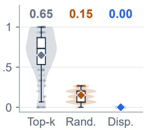

Context exposure  
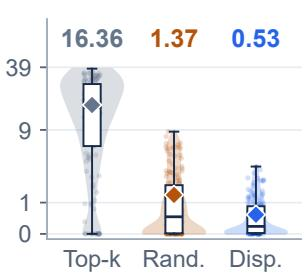

Outcomes (%)
<table><tr><td rowspan=1 colspan=1></td><td rowspan=1 colspan=1>Win</td><td rowspan=1 colspan=2>Tie   Loss</td></tr><tr><td rowspan=1 colspan=1>Disp.2</td><td rowspan=1 colspan=1>4.2</td><td rowspan=1 colspan=2>67.5     8.3</td></tr><tr><td rowspan=1 colspan=1>Mass</td><td rowspan=1 colspan=1>25.4</td><td rowspan=1 colspan=2>63.3    11.3</td></tr><tr><td rowspan=1 colspan=1>Conf.2</td><td rowspan=1 colspan=1>5.0</td><td rowspan=1 colspan=1>63.8    11</td><td rowspan=1 colspan=1>.3</td></tr><tr><td rowspan=1 colspan=1>Rand.</td><td rowspan=1 colspan=1>16.3</td><td rowspan=1 colspan=2>73.8   10.0</td></tr></table>

Figure 8: Commitment distributions and paired outcome balance. Left and center: adjacent-pair rate and mutual-context exposure across 960 matched states per rule. Diamonds and values denote means; exposure uses $\log _ { 1 0 } ( 1 + x )$ spacing with raw-unit ticks. Right: win/tie/loss shares for 240 GSM8K prompts after averaging each prompt’s paired score differences across progress anchors. Rows follow Figure 3 (center).

Commitment structure across matched states. Confidence top-k, random, and dispersed selection produce mean adjacent-pair rates of 0.65, 0.15, and approximately zero, respectively (Figure 8 (left)). Their mean local context-exposure diagnostics are 16.36, 1.37, and 0.53 (Figure 8 (center)). Dispersed selection reduces exposure by 97% relative to top-k, consistent with leaving intervening positions available to condition on the newly revealed context.

## A.3 METRICS AND AGGREGATION

The compact reproduction bundle supplies the selected positions for Figure 2 (left) and the points and standard errors for Figure 2 (center and right), 960 matched-state observations per rule for Fig ure 8 (left and center), and the effect estimates, intervals, and prompt-outcome shares for Figures 3 (center and right) and 8 (right). For Figure 2 (center), let $e _ { p , t }$ be the recorded excess-adjacent-pair rate and $b _ { p , t }$ the commitment batch size for prompt p at step t. The plotted quantity is

$$
E = { \frac { 1 } { n } } \sum _ { p = 1 } ^ { n } E _ { p } , \qquad E _ { p } = \sum _ { t } e _ { p , t } ( b _ { p , t } - 1 ) , \qquad { \mathrm { S E } } ( E ) = { \frac { { \mathrm { S D } } ( E _ { 1 } , \dots , E _ { n } ) } { \sqrt { n } } } .
$$

Each Discovery/Holdout summary has $n = 2 4 0$ prompts. Shading shows $E \pm 1 . 9 6 \mathrm { S E } ( E )$ with prompts as the aggregation unit. The compact summaries do not retain the state-level construction of the excess-rate reference; this panel is therefore a descriptive clustering diagnostic, with the controlled continuation comparison reported separately in Figure 3. The exposure panel uses $\log _ { 1 0 } ( 1 + x )$ for display, with raw-unit tick labels; its mean marker is placed at the transform of the raw mean. In Figure 8 (left and center), boxes show the interquartile range and median, with whiskers extending to observations within 1.5 interquartile ranges; diamonds and printed values de note arithmetic means. Distributions use all 960 states per rule, while dots show a deterministic subset with fixed jitter for readability. Figure 3 (left) zooms to positions 400–950 and retains all 16 commitments per rule from the original example. All displayed intervals are retained from the supplied summaries.

For the outcome shares, let $d _ { p , a }$ be the paired score difference for prompt p at source-progress anchor a. The script averages these differences within each prompt and classifies the sign of $\bar { d } _ { p }$ as win, tie, or loss. Consequently, Figure 8 (right) summarizes the frequency of positive and negative promptlevel effects, while Figure 3 (center) reports their mean magnitude. The outcome panel presents all twelve shares as 100% stacked horizontal bars. Segment widths retain full precision, with percentage labels rounded to one decimal place above each bar. Its rows follow Figure 3 (center): dispersed, posterior-mass-matched, confidence-stratified, and random controls.

## A.4 EFFECT ESTIMATES AND INTERPRETATION

The preliminary interventions make commitment organization visible through dispersed, posteriormass-matched, confidence-stratified, and random controls. The dispersed effect is 4.27 percentage points (95% CI: [1.25, 7.19]). Posterior-mass matching controls selected confidence mass, while confidence stratification controls the confidence profile; their effects are 3.33 pp ([0.00, 6.56]) and 3.54 pp ([0.21, 6.67]). Unrestricted random selection yields 1.04 pp ([−2.19, 4.17]). For dispersed selection at 12.5/25/50/75% progress, the effects are 10.42/3.75/−0.42/3.33 pp, with intervals [5.00, 15.83], [−0.83, 8.33], [−4.17, 3.33], and [0.42, 6.25]. The largest point estimate occurs early; the mid-trajectory intervals include zero, and the late improvement makes the trend nonmonotonic. Comparing these pointwise intervals does not establish a significant difference between progress anchors. The full-module experiments in Section 4.3 extend this analysis to the finalized coordinated selector and its combination with exchange.

## B NET-PROGRESS ACCOUNTING

For the remask exchange in Section 3.3, let $A _ { t }$ denote fresh commitments and $R _ { t }$ previously resolved positions remasked at step t. The mask update and net-quota contract are

$$
M _ { t + 1 } = \left( M _ { t } \setminus A _ { t } \right) \cup R _ { t } , \qquad | M _ { t } | - | M _ { t + 1 } | = | A _ { t } | - | R _ { t } | .\tag{10}
$$

$$
\left| A _ { t } \right| - \left| R _ { t } \right| = q _ { t } ,\tag{11}
$$

Proposition 1 (Net-progress preservation). Suppose the host and module satisfy Equations (10)– (11) at every executed step. Then, after s steps,

$$
\vert M _ { s } \vert = \vert M _ { 0 } \vert - \sum _ { t = 0 } ^ { s - 1 } q _ { t } .
$$

In particular, a feasible schedule with $\textstyle \sum _ { t = 0 } ^ { T - 1 } q _ { t } \ = \left| M _ { 0 } \right|$ resolves the initial mask set in $T$ steps, assuming no earlier task stopping and no additional positions introduced.

Proof. Let $A _ { t } = S _ { t } \cup E _ { t } \subseteq M _ { t }$ contain fresh commitments and $R _ { t } \ \subseteq \ M _ { t } ^ { c }$ contain previously resolved positions remasked by the accepted update, with $S _ { t } \cap E _ { t } = \emptyset , | S _ { t } | = q _ { t }$ , and $| \dot { E } _ { t } | = | R _ { t } |$ The sets $M _ { t } \setminus A _ { t }$ and $R _ { t }$ are disjoint, giving

$$
| M _ { t + 1 } | = | M _ { t } | - | A _ { t } | + | R _ { t } | .
$$

Under the fixed-budget contract $| A _ { t } | - | R _ { t } | = q _ { t }$ , this becomes $| M _ { t + 1 } | = | M _ { t } | - q _ { t }$ . Telescoping over the executed steps proves Proposition 1. Overwrites leave mask status unchanged and do not appear in this identity. □

The conditions are local and directly testable. A trace records fresh reveals, remasks, posterior gains, active block, quota, and remaining masks. An admissible exchange must respect edit eligibility and the fresh positions available to satisfy the quota. Early task stopping is recorded separately from completion of a fixed-length mask schedule. For blockwise generation, an explicit ledger records positions entering each active block.

## C IMPLEMENTATION DETAILS

The Native/Fast implementation uses policy dacs\_v5\_exchange\_020. Its details follow before the separate EB adapter in Appendix C.2. Sets are restricted to the current host-editable block; positions retain their sequence indices.

## C.1 NATIVE AND FAST POLICIES

Hyperparameters and tolerances. For the Native/Fast configuration, the shortlist multiplier is $\kappa = 4 ,$ baseline retention is $\rho = 0 . 7 5$ , and the penalty cap is $\beta \stackrel { - } { = } 0 . 1 0$ . Exchange uses protection rank $K = 2 ,$ ratio $\alpha = 0 . 2 0$ , and progress window $[ s _ { \mathrm { m i n } } , s _ { \mathrm { m a x } } ] = [ 0 , 0 . 8 ]$ . The posterior-gain margin $\epsilon _ { 1 } = 0 . 0 0 2$ applies to both withdrawal eligibility and each paired replacement, matching mi $\mathtt { n \_ p o s t e r i o r \_ g a i n }$ . The risk-comparison tolerance is $\epsilon _ { 2 } = 1 0 ^ { - 7 }$ ; it accommodates floatingpoint roundoff. Appendix D lists the corresponding configuration fields and the distinct EB settings.

Signals and candidate construction. At a single forward pass, compute $y _ { i } = \arg \operatorname* { m a x } _ { v } z _ { i } ( v )$ ， $c _ { i } = p _ { i } ( y _ { i } ) , o _ { i } = p _ { i } ( x _ { i } )$ , and margin $m _ { i } = z _ { i , ( 1 ) } - z _ { i , ( 2 ) }$ . Normalized entropy is

$$
u _ { i } = - \frac { \sum _ { v \in \mathcal { V } } p _ { i } ( v ) \log p _ { i } ( v ) } { \log | \mathcal { V } | } .
$$

Margins are normalized over the masked candidates:

$$
\bar { m } _ { i } = \frac { m _ { i } - \operatorname* { m i n } _ { j \in M _ { t } } m _ { j } } { \operatorname* { m a x } _ { j \in M _ { t } } m _ { j } - \operatorname* { m i n } _ { j \in M _ { t } } m _ { j } } .
$$

If the denominator is below $1 0 ^ { - 8 }$ , all finite candidates receive score one. The posterior baseline $B _ { t }$ is top-qt by $c _ { i } .$ , with ineligible positions masked out and the underlying top-k tie behavior retained. Margin ordering uses position index to break ties. The first $\operatorname* { m i n } ( | \mathbf { \dot { M } } _ { t } | , \lceil 4 q _ { t } \rceil ,$ ) margin-ranked positions form a shortlist, augmented with all of $B _ { t }$ . During greedy construction, remaining slots are reserved for baseline positions whenever necessary to meet $| S _ { t } \cap B _ { t } | \geq \lceil 0 . 7 5 q _ { t } \rceil$ . Soft filtering is relaxed if needed to fill the quota. Invalid host quotas are recorded as failed runs.

Progress and set risk. Let $s _ { t } = ( t + 1 ) / T$ denote progress supplied by the host’s decoding loop, using its configured progress scale T. For adaptive hosts this scale is distinct from the realized NFE reported after generation. The schedules are $\lambda _ { t } = 0 . 0 3 - 0 . 0 2 s _ { t }$ and $\tau _ { t } = 1 6 - 1 2 s _ { t }$ . For this recorded policy, $d _ { t } = | M _ { t } | / L$ is the mask density and the implementation-specific risk kernel is

$$
a _ { i j } ^ { ( t ) } = d _ { t } \exp ( - | i - j | / \tau _ { t } ) u _ { i } ^ { ( t ) } u _ { j } ^ { ( t ) } \quad ( i \neq j ) , \qquad a _ { i i } ^ { ( t ) } = 0 .\tag{12}
$$

The capped greedy selection score is

$$
g _ { t } ( i \mid S ) = { \bar { m } } _ { i } ^ { ( t ) } - \operatorname* { m i n } \left\{ \lambda _ { t } \sum _ { j \in S } a _ { i j } ^ { ( t ) } , 0 . 1 0 \right\} .\tag{13}
$$

With the mask density and current entropy held fixed, set risk is

$$
H _ { t } ( U ) = \frac { 1 } { 2 } \sum _ { i , j \in U } a _ { i j } ^ { ( t ) } .\tag{14}
$$

The kernel is a locality-based proxy, not a joint-dependency estimator. Selection uses the capped incremental penalty in Equation (13); there is no hard selection-risk budget.

Exchange acceptance. Let $C _ { t }$ be the visible positions in the editable block. Eligible withdrawals satisfy $x _ { i } \neq y _ { i } , x _ { i } \notin \mathrm { T o p 2 } ( z _ { i } )$ , and $c _ { i } > o _ { i } + 0 . 0 0 2$ ; they are ordered by increasing $o _ { i }$ . The routine tries exchange sizes from the cap down to one, constructs $E _ { t }$ within ${ M } _ { t } \backslash \dot { S } _ { t }$ using a posterior baseline and the same greedy selection rule, and pairs sorted extra-token posteriors with sorted withdrawntoken posteriors. Every pair must exceed the 0.002 gain threshold, and

$$
H _ { t } \big ( ( C _ { t } \setminus R _ { t } ) \cup S _ { t } \cup E _ { t } \big ) \le H _ { t } ( C _ { t } \cup S _ { t } ) + 1 0 ^ { - 7 } .
$$

The first passing size is accepted; otherwise $R _ { t } = E _ { t } = \emptyset$ . All probabilities are evaluated under the current forward, including predictions at still-visible old positions. These are local screening conditions; final answer quality is assessed by the task scorer.

Native and Fast integration. The uncached LLaDA fixed-budget path operates on 32-token blocks with uniformly assigned quotas. Fast-dLLM v1 uses the corresponding LLaDA/Dream dualcache paths. In threshold mode, confidence at least 0.9, together with forced acceptance of a highestconfidence position, determines $q _ { t } .$ . The module preserves this count; reordered positions need not individually satisfy the host’s original confidence threshold. Future counts and total NFE can change as the trajectory changes. The first forward establishes the cache; subsequent forwards refresh the active block through the host’s replacement-position mask. Fast-Dream retains its native first-token prefill action before later block updates enter the selector. Fixed-budget runs do not terminate early on EOS; adaptive blocks terminate when no masks remain. Validation checks disjointness, quota preservation, exchange gain, set risk, and final mask completion. Violations are recorded as failed or rejected runs.

## C.2 EB-SAMPLER INTEGRATION

Implementation and scope. Our EB reimplementation follows Ben-Hamu et al. (2025), arXiv v1, and the archived author source. The release manifest records source checksums and revisions. The audited LLaDA adapter uses GSAI-ML/LLaDA-8B-Instruct, BF16, batch size one, and a 512-position generation block. The documented E5 runs cover GSM8K-COT and MBPP. Dream results use a separate runner for Dream-org/Dream-v0-Instruct-7B with 256 generated positions. The adapter validation described here covers the LLaDA route.

Entropy-based quota. Let $h _ { i }$ denote the entropy computed by the EB scoring path and let π order the remaining masked positions by increasing error proxy. LLaDA uses one minus confidence; the separate Dream policies use entropy. EB chooses the longest prefix satisfying

$$
q _ { t } = \operatorname* { m a x } \left\{ k \in \{ 1 , \ldots , | M _ { t } | \} : \sum _ { j = 1 } ^ { k } h _ { \pi _ { j } } - \operatorname* { m a x } _ { 1 \leq j \leq k } h _ { \pi _ { j } } \leq \gamma \right\} , \qquad B _ { t } ^ { \mathrm { E B } } = \{ \pi _ { 1 } , \ldots , \pi _ { q _ { t } } \} .\tag{15}
$$

For the nonnegative thresholds used here, the single-position prefix is always admissible. $\mathbf { A } \mathbf { t } \gamma = 0$ this often yields one commitment, but zero-entropy candidates can permit more. The scan pairs EB and EB+SetCommit at four recorded $\gamma$ settings. In the LLaDA adapter, token proposals are the raw-logit argmax; EOS suppression affects only the confidence/entropy scoring path, not the generated-token argmax.

Module contract and policy. After the forward, EB computes $q _ { t }$ and $B _ { t } ^ { \mathrm { E B } }$ ; the module uses this prefix as its baseline, selects $q _ { t }$ base positions, and applies remask-and-recommit exchange. The runtime enforces $| A _ { t } | - | R _ { t } | = q _ { t }$ . No additional model forward is introduced, but the changed trajectory can change later quotas and total NFE. The coordinated set can exceed the entropy bound in Equation (15); the integration preserves EB’s quota. Both the original and coordinated-set entropy bounds are logged. The documented EB runs use $\mathrm { d a c s \_ v 5 \_ q u a l i t y \_ g u a r d }$ , with posterior reliability, 90% baseline retention, a $2 q _ { t }$ shortlist, and structural protection (Table 3). Exchange is capped at $\lfloor 0 . 1 0 q _ { t } \rfloor$ , subject to fresh-position availability, progress in $[ 0 . 1 0 , 0 . 6 0 ]$ ], changed predictions, top-2 exclusion, posterior gain above 0.005, and nonincreasing set risk. Native EB disables exchange. A nonzero configured ratio is not an observed exchange rate; at $q _ { t } = 1$ the cap is zero.

Stopping, cost, and validation. LLaDA EB continues until the full generation region is unmasked. Task stop strings are applied afterward: actual NFE counts all forwards to completion, whereas effective NFE identifies the trace point at which the stop condition and its preceding tokens have been resolved. The nominal steps=512 field accounts for generation length, not a fixed EB step budget. Effective NFE must not be substituted for actual computation or measured latency. The separate Dream runner extends its nominal step allowance when masks remain. Both routes recompute the full sequence without a model KV cache, so remasked positions are naturally refreshed at the next regular forward. A step-local selector cache only avoids repeated set construction. The LLaDA audit checks valid commit sets, per-step and total net progress, risk nonincrease, trace lengths, NFE records, and final mask completion; invalid outputs are recorded as rejected runs.

## D EXPERIMENTAL POLICY CONFIGURATION

Table 3 compares the Native/Fast and EB module settings. EB evaluates the shared interface with a host-specific configuration.

Table 3: Native/Fast and documented EB module configurations. Exchange ratios bound attempts, not observed edit frequencies.
<table><tr><td>Parameter</td><td>Native/Fast</td><td>EB</td></tr><tr><td>Set selection</td><td></td><td></td></tr><tr><td>reliability</td><td>margin</td><td>posterior</td></tr><tr><td>use_dependency_risk</td><td>true</td><td>true</td></tr><tr><td>lambda_start/end</td><td>0.03/0.01</td><td>0.03/0.01</td></tr><tr><td>tau_start/end</td><td>16/4</td><td>16/4</td></tr><tr><td>shortlist_multiplier</td><td>4.0</td><td>2.0</td></tr><tr><td>min_topk_overlap</td><td>0.75</td><td>0.90</td></tr><tr><td>max_penalty_fraction</td><td>0.10</td><td>0.10</td></tr><tr><td>risk_budget_scale</td><td>null</td><td>null</td></tr><tr><td>structure_protection</td><td>false</td><td>true</td></tr><tr><td>structure_penalty</td><td>0.02 (inactive)</td><td>0.10</td></tr><tr><td>Remask exchange</td><td></td><td></td></tr><tr><td>exchange</td><td>true</td><td>true</td></tr><tr><td>exchange_ratio</td><td>0.20</td><td>0.10</td></tr><tr><td>min_posterior_gain</td><td>0.002</td><td>0.005</td></tr><tr><td>exchange_window</td><td>[0.0, 0.8]</td><td>[0.10,0.60]</td></tr><tr><td>exchange_top_k</td><td>2</td><td>2</td></tr></table>

The public repository provides the Native/Fast and EB policy files, LLaDA/Fast-dLLM generation entry points, and a release manifest. The Native/Fast confidence floor is zero. Main comparisons and separately executed sensitivity runs retain their own configuration IDs.

## E MODEL AND EVALUATION PROTOCOL

The model roles and decoding routes are summarized below. Configuration and execution details for the released LLaDA/Fast-dLLM runner are documented in REPRODUCE.md; its checkpoint revision and release file hashes are recorded in RELEASE\_MANIFEST.json.

Table 4: Model roles and evaluation routes. Transfer settings use model-specific decoding; Fast adapter coverage is stated for the two primary models. EB integration is documented separately.
<table><tr><td>Model</td><td>Role</td><td>Decoding route</td></tr><tr><td>LLaDA-8B</td><td>Primary</td><td>Uncached fixed; Fast fixed/adaptive; audited EB</td></tr><tr><td>Dream-7B-Instruct</td><td>Primary</td><td>Native entropy; Fast fixed/adaptive; separate EB runner</td></tr><tr><td>LLaDA2.1</td><td>Transfer</td><td>Model-specific decoding</td></tr><tr><td>LLaDA2.2</td><td>Transfer</td><td>Model-specific decoding</td></tr></table>

## E.1 GENERATION AND SCORING

Prompt and generation settings. Each model uses the template and generation rule appropriate to its checkpoint and base/instruct variant. The registry includes BOS handling, few-shot examples, generation length, block size, temperature, token sampling, EOS, and task stop rules. For LLaDA, the official block-32 native reference and uncached fixed-NFE sweeps are distinct evaluation routes. Dream’s native reference uses its chat template, entropy sampler, temperature 0.1, and top-p = 0.9. Its unmodified hook leaves native sampling intact, whereas the module uses deterministic top-1 proposals from the same logits. Consequently, these Dream native/Fast comparisons measure the complete decoding change, including proposal generation, rather than a selector-only intervention. EB follows its separate proposal and stopping protocol (Appendix C.2). Transfer models use their own routes without assuming universal cache compatibility. Paired inputs and task scorers are shared. Before scoring, outputs undergo token-level EOS truncation, task stop-string truncation, and removal of special tokens, in that order.

Task scoring. GSM8K uses a versioned answer extractor; MATH-500 uses a versioned mathematical equivalence procedure. MBPP and HumanEval use the specified functional test suite and split. Formatting validity is defined per task and reported separately. Failed, truncated, and unparseable generations remain in the primary denominator under the declared scoring policy.

## E.2 QUALITY REFERENCE AND OPERATING-POINT SELECTION

Common native-128 quality reference. Tables 1, 6, and 7 use one shared native-128 observation per model–task pair. The reference has 128 actual model evaluations, no cache, and SetCommit disabled. LLaDA uses the uncached fixed-NFE route; this is distinct from the separate official block 32 reference route. Dream uses its unchanged native entropy sampler, chat template, temperature 0.1, and $\mathrm { t o p } { \cdot } p = 0 . 9$ . Task inputs, output processing, and scorers follow the protocol above. We retain the reference realization used by Table 7 and do not mix in alternative-seed reference scores. This choice is shared across all compared hosts and all quality margins.

Table 5 specifies each reference as native, module off, NFE 128, on the named model and task. It lists the scored counts and both the quality anchor and the main target to six decimals; operatingpoint selection uses the full precision of ${ 1 0 0 c / n - 3 }$ not the rounded display. The reference registry and selected configuration identifiers accompany the source, so the same anchors can be used to regenerate the tables.

Table 5: Shared native-128 quality references and three-point targets. Selection uses unrounded task scores.
<table><tr><td>Model</td><td>Task</td><td>Correct / total</td><td> $Q _ { \mathrm { r e f } } \ ( \% )$ </td><td>q* (%)</td></tr><tr><td>LLaDA-8B</td><td>GSM8K</td><td>1003/1319</td><td>76.042456</td><td>73.042456</td></tr><tr><td>LLaDA-8B</td><td>MATH-500</td><td>177/500</td><td>35.400000</td><td>32.400000</td></tr><tr><td>LLaDA-8B</td><td>MBPP</td><td>203/427</td><td>47.540984</td><td>44.540984</td></tr><tr><td>LLaDA-8B</td><td>HumanEval</td><td>66/164</td><td>40.243902</td><td>37.243902</td></tr><tr><td>Dream-7B</td><td>GSM8K</td><td>1059/1319</td><td>80.288097</td><td>77.288097</td></tr><tr><td>Dream-7B</td><td>MATH-500</td><td>218/500</td><td>43.600000</td><td>40.600000</td></tr><tr><td>Dream-7B</td><td>MBPP</td><td>255/427</td><td>59.718970</td><td>56.718970</td></tr><tr><td>Dream-7B</td><td>HumanEval</td><td>90/164</td><td>54.878049</td><td>51.878049</td></tr></table>

For example, the LLaDA/HumanEval target is 37.243902%, whereas the 32-NFE candidate scores 37.195122%. Both display as 37.2% at one decimal, but that candidate is ineligible. Native cost denominators in Table 1 are the fastest native points meeting the target; they are distinct from the 128-NFE quality reference.

Quality–cost objective. For method m and evaluated configurations $\mathcal { H } _ { m }$ , the matched-quality cost is

$$
C _ { m } ( q _ { \star } ) = \operatorname* { m i n } _ { \substack { h \in \mathcal { H } _ { m } : Q _ { m } ( h ) \geq q _ { \star } } } L _ { m } ( h ) .\tag{16}
$$

The quality anchor and tolerance are fixed per model–task pair. We report evaluation compression $N _ { B } / N _ { B + S e t C o m m i t }$ separately from the reduction fraction $\dot { 1 } - N _ { B + S e t C o m m i t } / N _ { B }$ and measured latency. Requested steps, actual model evaluations, and partial recomputation are recorded separately.

Configuration selection. Fixed-budget sweeps cover supported 16/32/64/128 settings and valid intermediate points; adaptive hosts receive threshold sweeps. Configurations are selected on development data and confirmed at the common target on held-out data. The main quality margin is three percentage points, with one- and two-point sensitivity results in Appendix F. The development registry records all examples and checkpoints used for parameter selection or method design. The

10% development pilot is part of the selection data. Reports on complete official test sets retain this selection provenance and distinguish development examples from held-out confirmation. Quality margins and candidate grids are fixed before final confirmation.

## E.3 RANDOMNESS AND UNCERTAINTY

Sampling units. Stochastic decoding uses paired seeds and records the realized sampling scheme. For deterministic argmax decoding, the sampling unit is the prompt; seed labels do not create additional observations. Bootstrap resampling clusters by prompt and retains joint seed and method records. Main-text results report point estimates; Table 8 supplements the main table with 95% confidence intervals for quality, NFE, and speedup. These intervals quantify prompt-level and timingrepeat uncertainty, distinct from seed variation.

## F INTERVENTIONS, ABLATIONS, AND RUNTIME

## F.1 CONTROLLED INTERVENTIONS AND ABLATIONS

Source states and interventions. The reported same-state aggregate comparison covers LLaDA-8B/GSM8K at 32 NFE and progress fractions 0.125, 0.25, 0.5, 0.75. Figure 6 subtracts the confidence-matched and stratified-random continuation gains from the coordinated-selector gain at each source progress. The underlying host-relative values are preserved in Figure 10. Broader source-policy and budget coverage requires corresponding state-level continuation records.

For a position i revealed using its current prediction, the conditional response at j is

$$
\begin{array} { r } { \Delta _ { j  i } = \mathrm { J S } \Big ( p _ { j } ( \cdot \mid x ^ { ( t ) } ) , p _ { j } ( \cdot \mid x ^ { ( t ) } , i  \hat { x } _ { i } ^ { ( t ) } ) \Big ) . } \end{array}
$$

This measures a model-distribution response; continuation experiments separately measure final success. It is a distribution-level extension of the absolute posterior-change probe in Figure 2 (right), with its metric reported separately. Vocabulary truncation includes the residual probability mass. Commitment-set branches share the source state, quota, current proposals, continuation policy, and remaining budget. Matching diagnostics summarize confidence, distance, and progress. Offline probe evaluations are recorded separately from generation cost.

Ablation grid. The selection-by-remasking design is followed by spacing, stratified-random, and shuffled-risk controls. Remasking withdraws visible positions and supplies equally many additional fresh commitments; it does not mean swapping two candidates within the current masked set. Structural protection is disabled in the main Native/Fast policy. An overlap value of one fixes the base position set to the posterior baseline but does not disable remasking. Figure 6 computes component contrasts from the same 32-NFE quality records as Table 2, extended to MATH-500 and MBPP. Its interaction term compares the remask increment with versus without coordinated selection.

Frozen configurations and cost points. The matrices in Figure 7 retain all 16 frozen/retuned model–task pairs. Frozen gains are measured against their corresponding hosts; retuning gains are direct quality differences within each pair. The mean retuning increment averages all 16 primary and transfer model–task cells. Development and held-out roles follow the selection protocol in Appendix E. The 16 deployment points use the full-policy and host-baseline 32-NFE ablation records for two primary models, four tasks, and Native/Fast-fixed hosts. Their coordinates are $1 0 0 ( L _ { 1 1 } / L _ { 0 0 } - \mathrm { \bar { 1 } } )$ and $Q _ { 1 1 } \mathrm { ~ - ~ } Q _ { 0 0 } ;$ the latency includes signal handling, selection, remask exchange, and applicable cache refresh. The Dream proposal-generation qualification in Appendix E applies to these pipeline comparisons.

## F.2 TIMING AND RESOURCE USE

Timing. Comparisons use warm-up, synchronized device timing, and interleaved repeats on a dedicated L20 or fixed device group. Every operating point retains generated outputs, actual evaluations, effective length, latency, and peak memory. A representative prompt set supports repeated timing, with complete-set confirmation for key configurations. Signal handling, selection, edits, and refresh have non-overlapping instrumentation boundaries. Partial-backbone recomputation is recorded as work and time.

Cross-server consistency. Both servers retain code, model, protocol, configuration, and sample IDs. A complete paired comparison uses one matched environment. The second server’s EB scan supplies candidate configurations. Inclusion in the common latency table requires paired reruns on the main timing device. Repeated validation records retain their original sample identities.

Additional experimental results. Figure 9 (top left) separates model time, module time, and other overhead at the matched-quality operating points. Total latency decreases from 7.49 to 5.92 s on the native host (21.0%) and from 3.73 to 3.15 s on the cached host (15.6%). Fewer model evaluations offset the added coordination cost. The top-right bars are cumulative gains over each host: selection yields 3.8/4.2 pp on full/cached forwards, and selection plus exchange yields 5.0/5.8 pp. Thus exchange adds 1.2/1.6 pp beyond selection.

At fixed 32 NFE, increasing generation length from 256 to 2048 raises relative overhead from 1.8% to 2.2% on full forwards and from 5.9% to 8.2% under caching (bottom left). Caching reduces the host latency denominator and adds refresh work, explaining the larger relative cost. At length 1024, memory increases by 0.28/0.36 GiB for LLaDA native/cached and 0.20/0.19 GiB for Dream native/cached (bottom right).

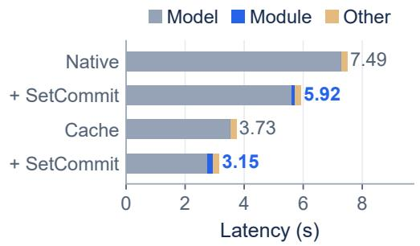

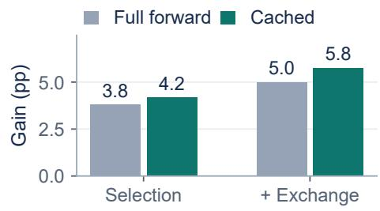

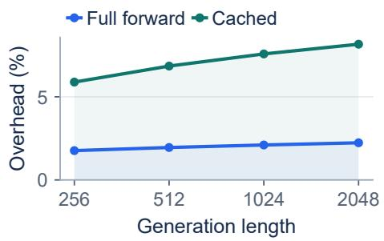

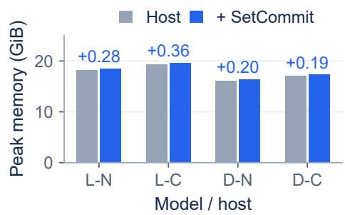  
Figure 9: Systems and robustness analyses. Top left: matched-quality LLaDA-8B/GSM8K runtime; module time includes signal handling, selection, exchange, and cache refresh. Top right: cumulative gains over each host for selection alone and selection plus exchange, on LLaDA-8B/GSM8K at 32 NFE. Bottom left: $1 0 0 ( L _ { + \mathrm { S C } } / L _ { \mathrm { h o s t } } - 1 )$ across generation lengths on the same model/task at 32 NFE. Bottom right: peak memory at length 1024: L/D denote LLaDA-8B/Dream-7B and N/C denote native/cached hosts. Labels above memory bars give added GiB.

## F.3 QUALITY MARGINS AND FIXED-BUDGET RETENTION

Table 6 repeats operating-point selection at three quality margins using the same sweeps. Table 7 reports fixed-64 quality retention relative to the shared native-128 reference.

Table 6: Quality-margin sensitivity. Geometric-mean incremental speedup across two primary models and four tasks. Each target is reference quality minus the stated margin; operating points are reselected from the same sweep. Shading marks the main-table margin; entries are speedup factors.
<table><tr><td>Margin (pp)</td><td></td><td>Native + SetCommit</td><td>Fast fixed + SetCommit</td></tr><tr><td>1</td><td></td><td>1.68</td><td></td></tr><tr><td>2</td><td></td><td>1.85</td><td>1.71</td></tr><tr><td>3</td><td></td><td>1.73</td><td>1.48</td></tr></table>

Table 7: Quality retention at exactly 64 evaluations. $Q$ is accuracy/pass@1 (%). The reference is native sampling at 128 NFE on the same model and task. Relative loss is $1 0 0 ( Q _ { 1 2 8 } - Q _ { 6 4 } ) / Q _ { 1 2 8 }$ distinct from the 3-point selection margin in Table 1. Teal losses are within 5%; bold $Q _ { 6 4 }$ values equal or exceed the reference. This same $Q _ { 1 2 8 }$ defines $Q _ { \mathrm { r e f } }$ in Table 1; losses use unrounded scores.
<table><tr><td rowspan="2">Benchmark</td><td rowspan="2">Native  $Q _ { 1 2 8 }$ </td><td colspan="2">Native + SetCommit</td><td colspan="2">Fast fixed + SetCommit</td></tr><tr><td> $Q _ { 6 4 } \uparrow$ </td><td>Loss (%)↓</td><td> $Q _ { 6 4 } \uparrow$ </td><td>Loss  $( \% ) \downarrow$ </td></tr><tr><td colspan="6">LLaDA-8B</td></tr><tr><td>GSM8K</td><td>76.0</td><td>76.0</td><td>0.00</td><td>76.0</td><td>0.00</td></tr><tr><td>MATH-500</td><td>35.4</td><td>34.6</td><td>2.26</td><td>35.2</td><td>0.56</td></tr><tr><td>MBPP</td><td>47.5</td><td>47.5</td><td>0.00</td><td>47.5</td><td>0.00</td></tr><tr><td>HumanEval</td><td>40.2</td><td>39.6</td><td>1.52</td><td>39.6</td><td>1.52</td></tr><tr><td colspan="6">Dream-7B</td></tr><tr><td>GSM8K</td><td>80.3</td><td>80.1</td><td>0.28</td><td>78.8</td><td>1.89</td></tr><tr><td>MATH-500</td><td>43.6</td><td>42.6</td><td>2.29</td><td>43.2</td><td>0.92</td></tr><tr><td>MBPP</td><td>59.7</td><td>58.8</td><td>1.57</td><td>59.0</td><td>1.18</td></tr><tr><td>HumanEval</td><td>54.9</td><td>54.9</td><td>0.00</td><td>54.3</td><td>1.11</td></tr></table>

## F.4 BUDGET AND PARAMETER SENSITIVITY

Figure 10 (top left) shows GSM8K gains over native decoding at matched NFE. Gains are largest at 16 evaluations (10.6 pp for LLaDA and 13.0 pp for Dream), fall to 5.0/5.8 pp at 32, and approach zero at 128. This concentrates the observed benefit in the few-step regime.

The top-right panel reports host-relative continuation gains: SetCommit gives 5.99/4.12/1.63/1.84 pp at 12.5/25/50/75% progress. Subtracting the matched control leaves 1.86/0.88/0.07/0.64 pp (Figure 6), isolating the gain over that control.

The risk-weight scan uses 0/0.5/1/1.5/2 times the nominal risk strength; the remask-ratio scan uses 0/0.05/0.10/0.20/0.30. These sensitivity runs are executed separately from the main-policy evaluation. The ratio bounds attempted withdrawals relative to the net quota; eligibility, progress, posterior-gain, and set-risk checks determine realized remasking. The frozen Native/Fast ratio is 0.20 (Table 3). Risk weights 0/0.5/1/1.5/2 yield 67.78/71.19/71.42/70.96/70.36% quality, showing a nonmonotonic tradeoff. Remask caps 0/0.05/0.10/0.20/0.30 yield 70.20/71.11/71.42/71.11/70.96%; the 0.10 peak exceeds 0.20 by only 0.30 pp before rounding. These independent results are point estimates. The cap bounds attempted withdrawals; the acceptance checks determine the realized remasking rate.

Matched-budget quality

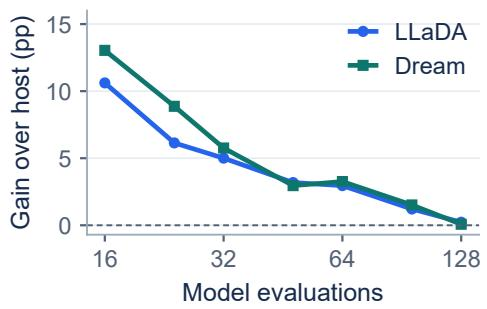  
Same-state continuation

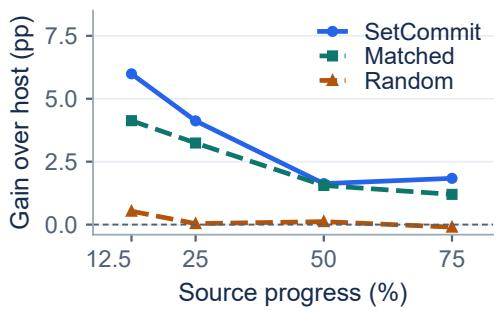

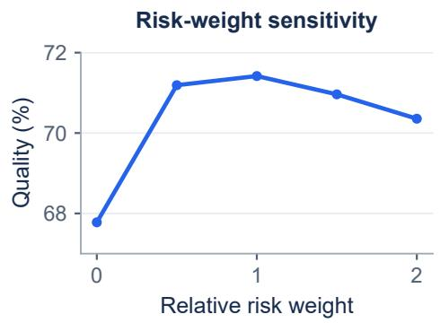

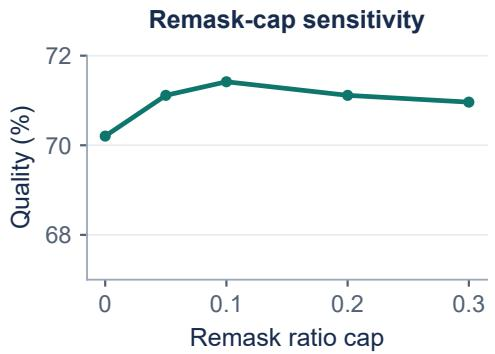  
Figure 10: Budget, continuation, and parameter analyses. Top left: GSM8K quality gains over native hosts at matched NFE. Top right: LLaDA-8B/GSM8K same-state continuation gains relative to the host at 32 NFE, before forming the control differences in Figure 6. Bottom: independent relative risk-weight and remask-ratio-cap sweeps on LLaDA-8B/GSM8K at 32 NFE; all evaluated settings are shown with a common quality scale. These curves do not mark a selected default.

## G MAIN-TABLE UNCERTAINTY SUPPLEMENT

CIs use 10,000 prompt-cluster bootstrap replicates for quality and mean NFE, retaining paired method/seed records. Seed variation requires separate reporting; deterministic reruns add no quality samples. Timing CIs resample matched rounds on a fixed prompt set, recomputing ratios and four-task geometric means. Intervals condition on the selected settings and reference, without configuration reselection or a quality-equivalence claim.

Table 8: Uncertainty supplement to Table 1. Entries: estimate [95% CI]; points are copied or derived from Table 1. Timing design: 3 warm-up and 10 paired measured rounds per setting. Timing CIs cover repeat variation only. Fixed-budget NFE and native self-ratios have degenerate intervals.
<table><tr><td colspan="4">A. LLaDA-8B: all main-table configurations</td></tr><tr><td>Decoder</td><td>Q(%)</td><td>Mean NFE</td><td>Total speedup (×)</td></tr><tr><td colspan="4">GSM8K (n = 1319)</td></tr><tr><td>Native</td><td>73.1 [70.7, 75.4]</td><td>64.0 [64.0, 64.0]</td><td>1.00 [1.00, 1.00]</td></tr><tr><td>+ SetCommit</td><td>74.2 [71.8, 76.6]</td><td>48.0 [48.0, 48.0]</td><td>1.27 [1.25, 1.29]</td></tr><tr><td>Fast fixed</td><td>73.1 [70.7, 75.4]</td><td>64.0 [64.0, 64.0]</td><td>2.01 [1.96, 2.06]</td></tr><tr><td>+ SetCommit</td><td>74.6 [72.3, 77.0]</td><td>48.0 [48.0, 48.0]</td><td>2.38 [2.31, 2.45]</td></tr><tr><td>Fast adaptive</td><td>73.6 [71.2, 75.9]</td><td>62.2 [61.7,62.7]</td><td>2.05 [1.98, 2.12]</td></tr><tr><td>+ SetCommit</td><td>73.1 [70.7, 75.4]</td><td>32.3 [32.0, 32.6]</td><td>3.49 [3.34, 3.65]</td></tr><tr><td>EB-Sampler</td><td>73.6 [71.2, 76.0]</td><td>58.5 [57.9, 59.1]</td><td>1.09 [1.05, 1.13]</td></tr><tr><td>+ SetĊommit</td><td>75.7 [73.3, 77.9]</td><td>47.7 [47.2, 48.2]</td><td>1.33 [1.29, 1.37]</td></tr><tr><td>DAWN</td><td>74.0 [71.6, 76.3]</td><td>60.1 [59.4, 60.8]</td><td>1.04 [1.01, 1.07]</td></tr><tr><td>DOS</td><td>73.5 [71.0, 75.9]</td><td>59.9 [59.2, 60.6]</td><td>1.05 [1.03, 1.07]</td></tr><tr><td colspan="4">MATH-500 (n = 500)</td></tr><tr><td>Native</td><td>34.2 [30.0, 38.4]</td><td>96.0 [96.0, 96.0]</td><td>1.00 [1.00, 1.00]</td></tr><tr><td>+ SetCommit</td><td>33.8 [29.6, 38.0]</td><td>48.0 [48.0, 48.0]</td><td>1.90 [1.86, 1.93]</td></tr><tr><td>Fast fixed</td><td>34.0 [29.8, 38.2]</td><td>96.0 [96.0, 96.0]</td><td>1.96 [1.92, 2.01]</td></tr><tr><td>+ SetCommit</td><td>34.6 [30.4, 38.8]</td><td>48.0 [48.0, 48.0]</td><td>3.72 [3.63, 3.81]</td></tr><tr><td>Fast adaptive</td><td>32.4 [28.2, 36.6]</td><td>64.8 [63.8, 65.8]</td><td>2.99 [2.92, 3.06]</td></tr><tr><td>+ SetCommit</td><td>33.4 [29.4, 37.6]</td><td>48.0 [47.2, 48.8]</td><td>3.87 [3.78,3.97]</td></tr><tr><td>EB-Sampler</td><td>32.4 [28.4, 36.6]</td><td>62.9 [61.8, 64.1]</td><td>1.53 [1.50, 1.56]</td></tr><tr><td>+ SetCommit</td><td>33.6 [29.4, 37.6]</td><td>44.6 [43.8, 45.5]</td><td>2.12 [2.06, 2.19]</td></tr><tr><td>DAWN</td><td>33.2 [29.0, 37.4]</td><td>64.7 [63.4, 66.0]</td><td>1.39 [1.35, 1.42]</td></tr><tr><td>DOS</td><td>32.4 [28.2, 36.4]</td><td>63.0 [61.7,64.3]</td><td>1.45 [1.42, 1.49]</td></tr><tr><td colspan="4">MBPP (n = 427)</td></tr><tr><td>Native</td><td>46.6 [41.9,51.3]</td><td>96.0 [96.0, 96.0]</td><td>1.00 [1.00, 1.00]</td></tr><tr><td>+ SetCommit</td><td>46.1 [41.5,50.8]</td><td>48.0 [48.0, 48.0]</td><td>1.94 [1.89, 1.99]</td></tr><tr><td>Fast fixed</td><td>44.7 [40.0, 49.4]</td><td>64.0 [64.0, 64.0]</td><td>2.93 [2.80, 3.06]</td></tr><tr><td>+ SetCommit</td><td>46.8 [42.2, 51.5]</td><td>48.0 [48.0, 48.0]</td><td>3.47 [3.35, 3.59]</td></tr><tr><td>Fast adaptive</td><td>44.7 [40.0, 49.4]</td><td>58.3 [57.4, 59.2]</td><td>3.22 [3.12, 3.34]</td></tr><tr><td>+ SetCommit</td><td>45.4 [40.7, 50.1]</td><td>44.9 [44.0, 45.8]</td><td>3.76 [3.66, 3.86]</td></tr><tr><td>EB-Sampler</td><td>45.2 [40.5, 50.1]</td><td>63.5 [62.2, 64.8]</td><td>1.50 [1.44, 1.57]</td></tr><tr><td>+ SetCommit</td><td>45.9 [41.5, 50.8]</td><td>45.8 [44.9, 46.7]</td><td>1.97 [1.91, 2.03]</td></tr><tr><td>DAWN</td><td>45.2 [40.5, 49.9]</td><td>60.5 [59.3,61.7]</td><td>1.53 [1.48, 1.59]</td></tr><tr><td>DOS</td><td>45.4 [40.7, 50.1]</td><td>62.7 [61.2, 64.2]</td><td>1.50 [1.45, 1.56]</td></tr><tr><td colspan="4">HumanEval (n = 164)</td></tr><tr><td>Native</td><td>39.0 [31.7,46.3]</td><td>96.0 [96.0, 96.0]</td><td>1.00 [1.00, 1.00]</td></tr><tr><td>+ SetCommit</td><td>39.0 [31.7,46.3]</td><td>48.0 [48.0, 48.0]</td><td>1.89 [1.87, 1.93]</td></tr><tr><td>Fast fixed</td><td>39.6 [32.3, 47.6]</td><td>96.0 [96.0, 96.0]</td><td>1.91 [1.86, 1.97]</td></tr><tr><td>+ SetCommit</td><td>38.4 [31.1, 45.7]</td><td>48.0 [48.0, 48.0]</td><td>3.36 [3.26, 3.46]</td></tr><tr><td>Fast adaptive</td><td>39.0 [31.7, 46.3]</td><td>93.4 [90.9, 96.0]</td><td>1.99 [1.95, 2.02]</td></tr><tr><td>+ SetCommit</td><td>38.4 [31.1, 45.7]</td><td>44.8 [43.5, 46.1]</td><td>3.64 [3.42, 3.87]</td></tr><tr><td>EB-Sampler</td><td>39.6 [32.3, 47.0]</td><td>92.6 [89.6, 95.5]</td><td>1.01 [0.99, 1.03]</td></tr><tr><td>+ SetĊommit</td><td>39.0 [31.7, 46.4]</td><td>46.4 [44.8, 48.0]</td><td>1.95 [1.88, 2.03]</td></tr><tr><td>DAWN</td><td>38.4 [31.1, 45.7]</td><td>60.9 [58.7, 63.1]</td><td>1.44 [1.39, 1.49]</td></tr><tr><td>DOS</td><td>39.6 [32.3, 47.0]</td><td>97.4 [94.0, 100.9]</td><td>0.96 [0.94, 0.99]</td></tr><tr><td colspan="4">B. Dream-7B: all main-table configurations</td></tr><tr><td>Decoder</td><td>Q (%)</td><td>Mean NFE</td><td>Total speedup (×)</td></tr><tr><td colspan="4">GSM8K (n = 1319)</td></tr><tr><td>Native</td><td>78.9 [76.6, 81.0]</td><td>96.0 [96.0, 96.0]</td><td>1.00 [1.00, 1.00]</td></tr><tr><td>+ SetCommit</td><td>78.6 [76.4, 80.8]</td><td>48.0 [48.0, 48.0]</td><td>1.96 [1.93, 1.99]</td></tr><tr><td>Fast fixed</td><td>77.4 [75.1, 79.7]</td><td>64.0 [64.0, 64.0]</td><td>2.89 [2.83, 2.94]</td></tr><tr><td>+ SetCommit</td><td>78.0 [75.7, 80.2]</td><td>48.0 [48.0, 48.0]</td><td>3.56 [3.48,3.64]</td></tr><tr><td>Fast adaptive</td><td>77.9 [75.7, 80.1]</td><td>65.3 [64.8, 65.8]</td><td>2.97 [2.90, 3.04]</td></tr><tr><td>+ SetCommit</td><td>77.6 [75.4, 79.9]</td><td>31.2 [30.9, 31.5]</td><td>5.47 [5.32, 5.63]</td></tr><tr><td>EB-Sampler</td><td>78.2 [75.9, 80.4]</td><td>61.9 [61.3, 62.5]</td><td>1.52 [1.47, 1.57]</td></tr><tr><td>+ SetĊommit</td><td>77.7 [75.4, 79.9]</td><td>31.6 [31.3, 31.9]</td><td>2.89 [2.77, 3.01]</td></tr><tr><td>DAWN</td><td>78.2 [75.9, 80.4]</td><td>60.7 [60.0, 61.3]</td><td>1.52 [1.49, 1.55]</td></tr><tr><td>DOS</td><td>78.2 [75.9, 80.4]</td><td>61.8 [61.0, 62.6]</td><td>1.48 [1.45, 1.52]</td></tr><tr><td colspan="4">MATH-500 (n = 500)</td></tr><tr><td>Native</td><td>42.6 [38.4, 47.0]</td><td>96.0 [96.0, 96.0]</td><td>1.00 [1.00, 1.00]</td></tr><tr><td>+ SetCommit</td><td>41.2 [37.0, 45.6]</td><td>48.0 [48.0, 48.0]</td><td>1.92 [1.89, 1.96]</td></tr><tr><td>Fast fixed</td><td>42.8 [38.4, 47.2]</td><td>96.0 [96.0, 96.0]</td><td>2.01 [1.97, 2.05]</td></tr><tr><td>+ SetCommit</td><td>42.8 [38.4, 47.0]</td><td>48.0 [48.0, 48.0]</td><td>3.77 [3.66, 3.87]</td></tr><tr><td>Fast adaptive</td><td>42.4 [38.2, 46.6]</td><td>92.2 [91.0, 93.4]</td><td>2.09 [2.03, 2.15]</td></tr><tr><td>+ SetCommit</td><td>41.8 [37.6, 46.0]</td><td>46.7 [45.9, 47.5]</td><td>3.96 [3.83, 4.09]</td></tr><tr><td>EB-Sampler</td><td>41.0 [36.8, 45.2]</td><td>64.1 [63.0, 65.3]</td><td>1.52 [1.49, 1.54]</td></tr><tr><td>+ SetCommit</td><td>42.0 [37.6, 46.2]</td><td>44.8 [43.9, 45.7]</td><td>2.10 [2.04, 2.16]</td></tr><tr><td>DAWN</td><td>41.0 [36.8, 45.4]</td><td>64.8 [63.7,65.9]</td><td>1.44 [1.41, 1.47]</td></tr><tr><td>DOS</td><td>41.0 [36.8, 45.4]</td><td>62.7 [61.3, 64.1]</td><td>1.50 [1.46, 1.55]</td></tr><tr><td colspan="4">MBPP (n = 427)</td></tr><tr><td>Native</td><td>57.4 [52.7, 62.1]</td><td>64.0 [64.0, 64.0]</td><td>1.00 [1.00, 1.00]</td></tr><tr><td>+ SetCommit</td><td>58.3 [53.6, 63.0]</td><td>48.0 [48.0, 48.0]</td><td>1.25 [1.22, 1.28]</td></tr><tr><td>Fast fixed</td><td>57.6 [52.9, 62.3]</td><td>64.0 [64.0, 64.0]</td><td>1.92 [1.86, 1.98]</td></tr><tr><td>+ SetCommit</td><td>57.6 [52.9, 62.3]</td><td>32.0 [32.0, 32.0]</td><td>3.39 [3.28, 3.51]</td></tr><tr><td>Fast adaptive</td><td>57.6 [52.9, 62.3]</td><td>59.3 [58.4, 60.2]</td><td>2.15 [2.09, 2.22]</td></tr><tr><td>+ SetCommit</td><td>59.0 [54.3, 63.7]</td><td>43.9 [43.0, 44.8]</td><td>2.59 [2.46, 2.72]</td></tr><tr><td>EB-Sampler</td><td>58.1 [53.4, 62.8]</td><td>60.5 [59.2, 61.8]</td><td>1.07 [1.04, 1.10]</td></tr><tr><td>+ SetĊommit</td><td>57.4 [52.7,62.1]</td><td>32.4 [31.7, 33.1]</td><td>1.83 [1.76, 1.90]</td></tr><tr><td>DAWN</td><td>58.3 [53.6, 63.0]</td><td>62.7 [61.5, 63.9]</td><td>0.99 [0.98, 1.01]</td></tr><tr><td>DOS</td><td>57.8 [53.2, 62.5]</td><td>60.7 [59.1, 62.3]</td><td>1.03 [0.98, 1.07]</td></tr><tr><td colspan="4">HumanEval (n = 164)</td></tr><tr><td>Native</td><td>54.3 [47.0, 62.2]</td><td>96.0 [96.0, 96.0]</td><td>1.00 [1.00, 1.00]</td></tr><tr><td>+ SetCommit</td><td>53.7 [46.3, 61.0]</td><td>48.0 [48.0, 48.0]</td><td>1.93 [1.89, 1.96]</td></tr><tr><td>Fast fixed</td><td>52.4 [45.1, 59.8]</td><td>64.0 [64.0, 64.0]</td><td>2.83 [2.76, 2.89]</td></tr><tr><td>+ SetCommit</td><td>53.7 [46.3, 61.0]</td><td>48.0 [48.0, 48.0]</td><td>3.35 [3.27, 3.43]</td></tr><tr><td>Fast adaptive</td><td>54.3 [47.0, 61.6]</td><td>93.5 [90.4, 96.7]</td><td>2.11 [2.06, 2.17]</td></tr><tr><td>+ SetCommit</td><td>53.7 [45.7, 61.0]</td><td>45.6 [44.1, 47.1]</td><td>3.58 [3.44, 3.71]</td></tr><tr><td>EB-Sampler</td><td>53.0 [45.7, 61.0]</td><td>63.2 [61.1,65.4]</td><td>1.49 [1.44, 1.54]</td></tr><tr><td>+ SetCommit</td><td>52.4 [44.5, 59.8]</td><td>58.6 [56.6, 60.6]</td><td>1.56 [1.48, 1.63]</td></tr><tr><td>DAWN</td><td>52.4 [44.5, 59.8]</td><td>61.1 [58.7, 63.5]</td><td>1.48 [1.43, 1.53]</td></tr><tr><td>DOS</td><td>52.4 [45.1, 60.4]</td><td>63.2 [60.6, 65.9]</td><td>1.44 [1.40, 1.50]</td></tr></table>

Continued on next page.

Table 8: Uncertainty supplement to Table 1 (continued). Entries: estimate [95% CI].
<table><tr><td colspan="5">C. Paired contrasts at the selected operating points</td></tr><tr><td>Host B</td><td>∆Q (pp)</td><td></td><td> $S _ { \mathrm { { i n c } } } \left( \times \right)$ </td><td>Timing rounds</td></tr><tr><td colspan="5">LLaDA-8B /GSM8K</td></tr><tr><td>Native</td><td></td><td>+1.1 [−0.5, +2.8]</td><td>1.27 [1.25, 1.29]</td><td>10</td></tr><tr><td>Fast fixed</td><td></td><td>+1.5 [−0.2, +3.2]</td><td>1.18 [1.15, 1.22]</td><td>10</td></tr><tr><td>Fast adaptive</td><td></td><td>−0.5 [−2.4, +1.4]</td><td>1.70 [1.64, 1.76]</td><td>10</td></tr><tr><td>EB-Sampler</td><td>+2.0 [+0.1, +3.9]</td><td></td><td>1.22 [1.19, 1.25]</td><td>10</td></tr><tr><td colspan="5">LLaDA-8B /MATH-500</td></tr><tr><td>Native</td><td></td><td>−0.4 [−3.2, +2.4]</td><td>1.90 [1.86, 1.93]</td><td>10</td></tr><tr><td>Fast fixed</td><td></td><td>+0.6 [−2.4, +3.6]</td><td>1.90 [1.84, 1.96]</td><td>10</td></tr><tr><td>Fast adaptive</td><td></td><td>+1.0 [−2.2, +4.2]</td><td>1.29 [1.25, 1.34]</td><td>10</td></tr><tr><td>EB-Sampler</td><td>+1.2 [−2.2, +4.4]</td><td></td><td>1.39 [1.34, 1.43]</td><td>10</td></tr><tr><td colspan="5">LLaDA-8B/MBPP</td></tr><tr><td>Native</td><td></td><td>−0.5 [−3.5, +2.6]</td><td>1.94 [1.89, 1.99]</td><td>10</td></tr><tr><td>Fast fixed</td><td></td><td>+2.1 [−1.2, +5.6]</td><td>1.18 [1.15, 1.22]</td><td>10</td></tr><tr><td>Fast adaptive</td><td></td><td>+0.7 [−3.0, +4.2]</td><td>1.17 [1.13, 1.21]</td><td></td></tr><tr><td>EB-Sampler</td><td></td><td>+0.7 [−2.8, +4.0]</td><td>1.31 [1.27, 1.36]</td><td>10</td></tr><tr><td colspan="5">LLaDA-8B / HumanEval</td></tr><tr><td>Native</td><td></td><td>+0.0 [−5.5, +5.5]</td><td>1.89 [1.87, 1.93]</td><td>10</td></tr><tr><td>Fast fixed</td><td></td><td>−1.2 [−6.7, +4.3]</td><td>1.76 [1.69, 1.82]</td><td>10</td></tr><tr><td>Fast adaptive</td><td></td><td>−0.6 [−6.7, +5.5]</td><td>1.83 [1.73, 1.94]</td><td>10</td></tr><tr><td>EB-Sampler</td><td></td><td>−0.6 [−6.7, +5.5]</td><td>1.93 [1.85, 2.04]</td><td>10</td></tr><tr><td colspan="5">Dream-7B / GSM8K</td></tr><tr><td>Native</td><td></td><td>−0.3 [−1.9, +1.3]</td><td>1.96 [1.93, 1.99]</td><td>10</td></tr><tr><td>Fast fixed</td><td></td><td>+0.6 [−1.2, +2.4]</td><td>1.23 [1.20, 1.27]</td><td>10</td></tr><tr><td>Fast adaptive</td><td></td><td>−0.3 [−2.3, +1.7]</td><td>1.84 [1.77, 1.91]</td><td>10 10</td></tr><tr><td>EB-Sampler</td><td></td><td>−0.5 [−2.4, +1.4]</td><td>1.90 [1.82, 1.97]</td><td></td></tr><tr><td colspan="5">Dream-7B /MATH-500 Native</td></tr><tr><td></td><td></td><td>−1.4 [−4.0, +1.2]</td><td>1.92 [1.89, 1.96]</td><td>10 10</td></tr><tr><td>Fast fixed Fast adaptive</td><td>+0.0 [−3.2, +3.2]</td><td></td><td>1.88 [1.83, 1.92] 1.89 [1.81, 1.97]</td><td>10</td></tr><tr><td>EB-Sampler</td><td>−0.6 [−4.0, +2.6]</td><td></td><td>1.38 [1.35, 1.42]</td><td>10</td></tr><tr><td></td><td>+1.0 [−2.2, +4.2]</td><td></td><td></td><td></td></tr><tr><td colspan="5">Dream-7B /MBPP</td></tr><tr><td>Native</td><td>+0.9 [−2.3, +4.4]</td><td></td><td>1.25 [1.22, 1.28]</td><td>10</td></tr><tr><td>Fast fixed</td><td>+0.0 [−3.5, +3.3]</td><td></td><td>1.77 [1.71, 1.84]</td><td>10</td></tr><tr><td>Fast adaptive EB-Sampler</td><td>+1.4 [−2.1, +4.9]</td><td></td><td>1.20 [1.14, 1.28]</td><td>10</td></tr><tr><td></td><td></td><td>−0.7 [−4.5, +3.3]</td><td>1.71 [1.64, 1.78]</td><td></td></tr><tr><td colspan="5">Dream-7B / HumanEval</td></tr><tr><td>Native</td><td></td><td>−0.6 [−6.1, +4.9]</td><td>1.93 [1.89, 1.96] 1.18 [1.15, 1.22]</td><td>10 10</td></tr><tr><td>Fast fixed Fast adaptive</td><td>+1.2 [−4.3, +6.7]</td><td></td><td>1.70 [1.62, 1.78]</td><td>10</td></tr><tr><td>EB-Sampler</td><td></td><td>−0.6 [−6.7, +4.9]</td><td>1.05 [1.00, 1.10]</td><td>10</td></tr><tr><td></td><td>−0.6 [−6.7, +5.5]</td><td></td><td></td><td></td></tr><tr><td colspan="5">D. Four-task geometric-mean incremental speedup (Mean extra)</td></tr><tr><td>Host B</td><td>LLaDA-8B (×)</td><td></td><td>Dream-7B (×)</td><td>Rounds/task</td></tr><tr><td>Native</td><td>1.72 [1.71, 1.74]</td><td></td><td>1.74 [1.72, 1.75]</td><td>10</td></tr><tr><td>Fast fixed</td><td></td><td>1.47 [1.45, 1.49]</td><td>1.48 [1.46, 1.50]</td><td>10</td></tr><tr><td>Fast adaptive</td><td>1.47 [1.45, 1.50]</td><td></td><td>1.63 [1.59, 1.68]</td><td>10 10</td></tr><tr><td>EB-Sampler</td><td></td><td>1.44 [1.41, 1.47]</td><td>1.47 [1.45, 1.50]</td><td></td></tr></table>

In panel C, $\Delta Q = Q _ { B + S e t C o m m i t } - Q _ { B }$ and $S _ { \mathrm { i n c } } = L _ { B } / L _ { B + S e t C o m m i t }$ . Quality differences use task-score counts consistent with the displayed percentages; differences of rounded cells may vary by 0.1 pp. These are matched-target comparisons, not fixed-NFE ablations.