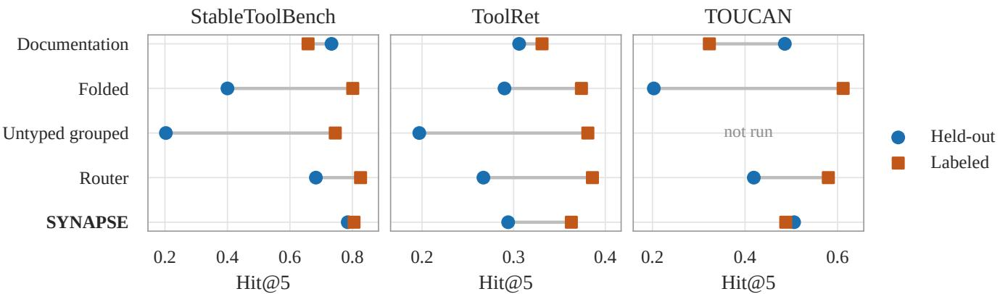
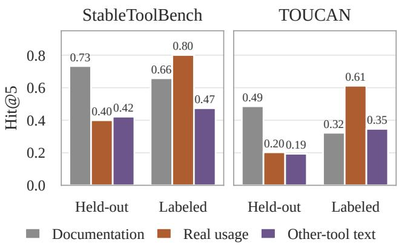
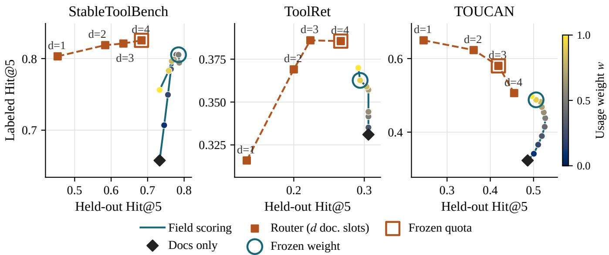
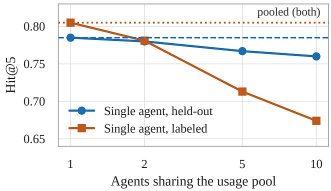
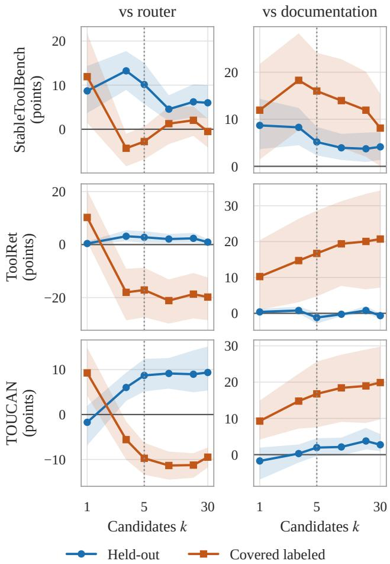

# Separate Field Scoring Protects Unused Tools When Agents Pool Tool-Use Experience

Abhijit Chakraborty

Arizona State University

## Abstract

Agents that call tools from a shared catalog can pool what they learn about which tool serves which request. We measure what pooled usage examples do to tool retrieval, reporting separately the held-out tools, for which no agent has usage, and all other tools. Adding usage examples to the index as extra entries for used tools raises Hit@5 (whether a gold tool is in the top five) for those tools and lowers it for held out tools, by a large margin on two of three catalogs and with both embedders we tested. Giving used tools the same number of equally long entries filled with other tools’ text lowers held-out Hit@5 about as much, but gives little or none of the gain. We call our method of scoring usage as its own field SYNAPSE. On StableToolBench, the held-out gold tool appears in its top five more often than with a router that reserves slots for usage (0.785 against 0.683), and this held-out lead holds on all three catalogs with both embedders. This protection persisted when we replaced each tool’s usage with other tools’ text, and a constant score offset for tools with usage gives similar held-out Hit@5 in most settings. The gain for tools with usage, in contrast, needs usage about the right tool. The router keeps more of the gain on labeled queries on TOUCAN with both embedders and on ToolRet with one, so the better choice depends on the workload. Splitting the usage among ten simulated agents shows that pooling helps exactly as much as giving one agent the same records.

## Introduction

A user asks an agent to fetch every product from a Shopify store and return the full record of one item. The right tool, shopify store scraper, is in the catalog with its documentation, but no agent has used it yet. Suppose the agents that share this catalog pool their past usage and add each example to the retrieval index as an extra entry for its tool; we call this folding. A usage example is a past request labeled with the tool that served it. In our StableToolBench runs, the retriever’s five candidates for this request then no longer contain the scraper (query 10277, seed 42). With documentation alone, they do. We selected this query to show the failure, not to estimate how often it happens.

Tool-retrieval benchmarks do not report tools that have shared usage separately from tools that have none (Qin et al. 2024; Shi et al. 2025). Shared usage moves two groups of tools in opposite directions, and one average hides both moves. We fix a held-out set of tools for which no agent contributes usage (the unused tools of our title); their documentation stays in the catalog, and held-out says nothing about what the embedding model saw in pretraining. We call every other tool labeled; whether a labeled tool has usage depends on the seed and the catalog (for 88%, 21% and 97% of labeled queries on our three catalogs, every gold tool has usage). Our metric is Hit@5: whether a gold tool is among the five candidates passed to the agent. It measures retrieval only, not whether the agent then completes the task.

We compare three ways to combine usage with documentation. In folding, each usage entry is serialized together with its tool’s metadata, and a tool is scored by its best entry, documentation or usage. A two-index router reserves some of the five slots for a separate usage index. SYNAPSE keeps usage as its own field. Each tool gets one score for its documentation and one for its best-matching usage example. Both scores are z-normalized across tools for the query, and one weight chosen on development data mixes them. A tool without usage keeps its documentation score.

We ask three questions. RQ1: who gains and who loses when usage is folded into the index? On StableToolBench and TOUCAN, folding lowers held-out Hit@5 by about 30 points and raises labeled Hit@5. On ToolRet both changes are small. Length-matched text from other tools causes a similar held-out loss on the two catalogs where we ran this control. RQ2: how should usage be combined? SYNAPSE keeps more held-out Hit@5 than the router on all three catalogs. The router retrieves more labeled tools on TOUCAN with both embedders and on ToolRet with one, so neither method dominates. RQ3: does pooling across agents pay? Pooling the usage of ten simulated agents raises Hit@5 over the average single agent, mostly for labeled tools, and matches one agent holding all the records. On the workshop’s question of when a collective merely adds cost: when usage is folded into the index, the cost falls on tools nobody has used yet, and the combination rule decides how large it is.

## Setup

Catalogs and held-out tools. On StableToolBench (Guo et al. 2024), the held-out set is the 172 gold tools of the G1-tool and G1-category groups. We first remove exact and near-duplicate (Jina cosine $\geq ~ 0 . 9 5 )$ copies of test queries from the usage pool. We then drop every record that labels a held-out tool or mentions its name, which leaves 90,704 records. Tools are hashed into development and test buckets. A held-out query has every gold tool in the held-out set, and a labeled query has none, so a held-out hit always means a held-out tool was retrieved. We exclude the 80 queries with gold tools in both sets and the 85 whose gold tools span development and test buckets, which leaves 161 held-out-test and 149 labeled-test queries. Three seeds supply three different client usage pools, each covering about 2,430 tools. We filter ToolRet (Shi et al. 2025) to exclude its ToolBench, ToolBench-SAM, APIGen and ToolLens sources. It then has 26,423 tools, 255 held-out-test and 728 labeled-test queries, and at most eight usage entries per tool. On ToolRet and on the TOUCAN-derived catalog (Xu et al. 2025) (2,159 tools; 769 held-out-test and 2,595 labeled-test queries), there are no benchmark groups to hold out, so a salted SHA-256 hash of the tool identifier sends 30% of tools to the held-out set (7,905 and 627 tools) and a second hash assigns development and test. Queries whose gold tools disagree on either assignment are excluded, as on StableToolBench. Pooled over seeds, every gold tool has usage for 88% of labeledtest queries on StableToolBench, 21% on ToolRet and 97% on TOUCAN (Appendix A).

  
Figure 1: Folding usage into the index lowers held-out Hit@5 on StableToolBench and TOUCAN, while SYNAPSE stays near documentation-only. Each row shows one arm’s held-out-test (circle) and labeled-test (square) Hit@5 with Jina embeddings, three seeds, frozen settings; note the different x-axis ranges. The untyped grouped arm was not run on TOUCAN.

Retrieval and inference. All arms use Jina-v2 embeddings (Gunther et al. 2023) and return five distinct tools;¨ we repeat the main comparisons with Nomic Embed v1.5 (Nussbaum et al. 2024) (Appendix G). For query q and tool $t ,$ let $a _ { t }$ be the cosine with t’s documentation and $u _ { t }$ the highest cosine with any of t’s usage entries. SYNAPSE scores

$$
s _ { t } = { \left\{ \begin{array} { l l } { ( 1 - w ) z ( a _ { t } ) + w z ( u _ { t } ) } & { { \mathrm { i f ~ } } t { \mathrm { ~ h a s ~ u s a g e } } , } \\ { z ( a _ { t } ) } & { { \mathrm { o t h e r w i s e } } , } \end{array} \right. }
$$

where $z ( a _ { t } )$ standardizes over the whole catalog and $z ( u _ { t } )$ over the tools that have usage in that seed. SYNAPSE’s weight w and the router’s number of documentation slots d were selected on development tools and frozen before test scoring: w=0.5, d=4 on StableToolBench; w=0.9, d=4 on

ToolRet; $w { = } 0 . 9 , d { = } 3$ on TOUCAN. The untyped grouped arm is folding with raw usage text, without the tool metadata. Intervals are paired 95% percentile bootstrap intervals with 10,000 draws, clustered by the first gold tool and keeping all three seeds of a cluster together. An interval that includes zero is reported as no difference detected, not as equivalence.

## Results

RQ1: Folding usage into the index lowers held-out Hit@5. Figure 1 shows the pattern on each catalog. Folding raises labeled-test Hit@5 by 14 points on StableTool-Bench and 29 on TOUCAN, and lowers held-out Hit@5 from 0.733 to 0.400 and from 0.486 to 0.203. On ToolRet both moves are small (held-out 0.306 to 0.290), so the size of the effect depends on the catalog. Under best-entry scoring, extra entries for used tools can only lower held-out ranks, so what we measure is the size of the loss. With Nomic embeddings, folding again lowers held-out Hit@5, by 16.15 points on StableToolBench, 1.83 on ToolRet and 22.63 on TOU-CAN, each with an interval below zero. Putting documentation and usage in one index without separate field scores (untyped grouped) loses even more held-out Hit@5.

To test whether the loss depends on what the usage says, we keep every tool’s identifier, documentation and number of usage entries, and replace each entry with text from other tools of exactly the same tokenizer length (Figure 2). Held-out Hit@5 stays within about two points of the realusage value on both catalogs, and both intervals include zero. Labeled-test Hit@5 falls by 33 and 27 points. With Nomic on StableToolBench, the pattern repeats: held-out Hit@5 with other tools’ text is 1.86 points above real usage ([−1.24, 5.10]), and labeled Hit@5 is 12.75 points below it. The labeled gain needs text about the right tool. The held-out loss does not, since other tools’ text of the same length is about as harmful. The control keeps both the number of entries per tool and their length, so it cannot tell whether the loss comes from extra entries (more chances for a used tool to score high) or from longer text. Limiting folding to one usage entry per used tool shrinks the heldout loss but does not remove it: held-out Hit@5 stays below documentation-only on every catalog with both embedders, for example 0.553 against 0.733 on StableToolBench with Jina (Appendix I). Used tools then still have two entries and other tools one. The control does not separate length from generic query-like style or from competition within one index, and it does not show the two conditions are equivalent. A few donor entries share a gold label with their target; Appendix E reports and keeps them.

  
Figure 2: Other tools’ text of the same length gives about the same held-out Hit@5 as real usage and much lower labeled Hit@5. Usage entries are replaced by length-matched text from other tools; Hit@5, three seeds. Paired differences and intervals are in the text.

RQ2: Field-wise scoring keeps more held-out Hit@5 than the router. Against documentation alone, SYNAPSE changes held-out Hit@5 by +5.18 points on StableTool-Bench ([2.31, 8.39]), −1.18 on ToolRet ([−2.85, 0.24]) and +1.95 on TOUCAN ([−0.39, 4.52]). It raises labeled-test Hit@5 by 14.77 ([5.51, 22.55]), 3.16 ([0.60, 6.18]) and 16.49 ([7.49, 25.31]) points. Against the router, SYNAPSE is higher on held-out queries on all three catalogs: +10.14 ([5.68, 15.05]), +2.75 ([0.67, 5.06]) and +8.71 ([5.15, 12.39]). The router is higher on labeled-test queries on Tool-Ret, by 2.29 points ([0.04, 4.85]), and on TOUCAN, by 9.24 points ([5.85, 12.78]). On ToolRet the gap grows to 17.15 points ([8.73, 27.45]) on queries whose every gold tool has usage. On StableToolBench the router is 2.01 points higher, with an interval that includes zero ([−1.46, 5.81]). Folding also gets higher labeled-test Hit@5 than SYNAPSE on ToolRet (.374 against .363) and TOUCAN (.612 against .488), and untyped grouping does on ToolRet (.381); these are point estimates without paired intervals. On StableTool-Bench, folding and SYNAPSE are close on labeled queries (.801 and .805). In Figure 3, no weight of SYNAPSE reaches the router’s points on any catalog, and no router quota reaches SYNAPSE’s curve. Some settings are dominated: on ToolRet the d=1 quota is below documentation-only on both axes. Among the remaining points the curves suggest a trade-off, although they are descriptive and carry no simultaneous guarantee. Appendix C repeats the comparison with

10 and 30 candidates.

A second embedder keeps the held-out result and weakens one labeled result. We reran every arm with Nomic Embed v1.5 and reselected w and d on development tools with the same grids (StableToolBench w=0.5, d=4; Tool-Ret w=1.0, d=4; TOUCAN w=0.7, d=3). SYNAPSE again beats the router on held-out queries on all three catalogs: by 7.66 points ([2.63, 13.14]), 3.14 ([1.25, 5.34]) and 11.05 ([7.55, 14.56]). The router again beats SYNAPSE on TOU-CAN labeled queries, by 14.63 points ([11.72, 17.54]). On ToolRet the labeled difference is 0.92 points with an interval that includes zero ([−0.79, 2.70]), so the Jina result there does not replicate; on fully covered ToolRet queries the router still leads by 10.47 points ([3.43, 18.48]). With Nomic, SYNAPSE’s labeled gain over documentation on TOUCAN is small (1.28 points, [−4.63, 6.86]), while folding gains 23.73 there. Our criterion, set before the run, required the held-out lead on all three catalogs and the router’s labeled lead on ToolRet and TOUCAN; because the ToolRet labeled interval includes zero, the replication is not established by that criterion.

Held-out protection persists without the right content; the labeled gain does not. Two controls separate how SYNAPSE scores usage from what the usage says (Appendix I). First, we add one constant, tuned on development data, to the documentation score of every tool with usage. This offset gives held-out Hit@5 with no detected difference from SYNAPSE in five of six encoder and catalog settings, but it is 10 to 20 points lower on labeled queries on StableToolBench with both embedders and on TOUCAN with Jina. Second, we pass other tools’ usage text through SYNAPSE at its frozen weight. Held-out Hit@5 stays equal or rises in all six settings, while labeled Hit@5 falls by 6.2 to 54.6 points. In these tests held-out protection did not need the right usage content and the labeled gain did; the controls do not isolate which part of the scoring rule protects.

The choice depends on the workload. On StableTool-Bench, the only catalog where we computed it, the data favor SYNAPSE when fewer than about 59% of queries go to labeled tools and do not decide above that share (Appendix H).

RQ3: Pooling helps as much as giving one agent all the records. We split StableToolBench’s fixed usage pool among 1, 2, 5 or 10 simulated agents by hashing each source query, and score with the frozen SYNAPSE weight (Figure 4). At ten agents, pooling beats the average single agent by 2.48 held-out points ([0.64, 4.51]) and 13.18 labeled points ([6.04, 18.70]). One agent holding the same records returns identical lists, as it must by construction. The gain therefore measures what each agent lacks on its own. The experiment tests no benefit specific to federation. One possible reason held-out Hit@5 also gains is that more usage pushes unrelated labeled tools down; Appendix H reports a diagnostic consistent with this, which the experiment does not isolate.

  
Figure 3: On all three catalogs, no SYNAPSE weight reaches the router’s points and no router quota reaches SYNAPSE’s curve. Held-out-test against labeled-test Hit@5 with Jina embeddings on StableToolBench, ToolRet and TOUCAN (left to right). The field-scoring curve runs from documentation only (w=0, diamond) to w=1, where tools with usage are scored by usage alone and the rest by documentation; dots are shaded by w; squares are router quotas with d documentation slots. The circle and the open square mark the settings frozen on development data. All other points are descriptive, plotted after test exposure; nothing was reselected from them.

  
Figure 4: A single agent’s Hit@5 drops as the fixed usage pool is split among more agents, most on labeled queries; pooling recovers it (dashed and dotted lines). StableTool-Bench, Hit@5 averaged over agents and three seeds. The pooled list equals that of one agent holding the same records.

## Related Work

Tool retrievers select from documentation (Qin et al. 2024), and off-the-shelf retrievers find tool retrieval hard (Shi et al. 2025). Expanding documents with predicted queries helps the documents that receive the expansion (Nogueira et al. 2019). Tool2Vec represents each tool by the average embedding of the queries that used it (Moon et al. 2024), and Tool-Embed is trained on LLM-expanded tool documentation (Lu et al. 2026). Re-Invoke expands every tool with generated queries (Chen et al. 2024). These works measure what expansion does to the tools that receive it; Lu et al. (2026) also find that example-usage fields help least and longer documents lower similarity. We study the tools left without expansion when they compete with expanded ones: our folding arm expands used tools only, and our length control suggests that the cost falls on the tools left out. Scoring fields separately is an old idea in retrieval (Robertson, Zaragoza, and Taylor 2004; Li et al. 2025). We use a simple form of it and measure which tools it protects. Federated agent learning shares free-text knowledge or in-context examples across clients (Wu et al. 2024; Wang et al. 2025) or federates router parameters (Askin et al. 2026).

## Limitations

All results are retrieval Hit@5 with two embedders; our audit of Nomic’s training data is incomplete, so we make no contamination-free claim for it. We have not tested task success, a tool-trained retriever such as Tool-Embed, or Re-Invoke, and make no claim about them. Agents are simulated partitions of one usage pool, and no privacy mechanism is applied. The length control ran on two catalogs and does not separate token length from query-like style or index competition, and our entry-budget control still gives used tools one more entry than other tools. On ToolRet, SYNAPSE does not improve held-out Hit@5 over documentation alone.

## Conclusion

Shared usage helps the tools it describes and, when folded into one index, can push tools nobody has used out of the candidate list. When a large share of requests goes to such

tools, score usage as its own field. When nearly all requests go to labeled tools, the router retrieved more of them on TOUCAN with both embedders and on ToolRet with Jina.

## References

Askin, B.; Patel, S.; Nayak, A.; Vigano, A.; Woo, J.; Joshi, G.; and Joe-Wong, C. 2026. Federate the Router: Learning Language Model Routers with Sparse and Decentralized Evaluations. arXiv:2601.22318.

Chen, Y.; Yoon, J.; Sachan, D. S.; Wang, Q.; Cohen-Addad, V.; Bateni, M.; Lee, C.-Y.; and Pfister, T. 2024. Re-Invoke: Tool Invocation Rewriting for Zero-Shot Tool Retrieval. In Findings of the Association for Computational Linguistics: EMNLP 2024, 4705–4726. Miami, Florida, USA.

Gunther, M.; Ong, J.; Mohr, I.; Abdessalem, A.; Abel, T.;¨ Akram, M. K.; Guzman, S.; Mastrapas, G.; et al. 2023. Jina Embeddings 2: 8192-Token General-Purpose Text Embeddings for Long Documents. arXiv:2310.19923.

Guo, Z.; Cheng, S.; Wang, H.; Liang, S.; Qin, Y.; Li, P.; Liu, Z.; Sun, M.; and Liu, Y. 2024. StableToolBench: Towards Stable Large-Scale Benchmarking on Tool Learning of Large Language Models. In Findings of the Association for Computational Linguistics: ACL 2024, 11143–11156. Bangkok, Thailand.

Li, M.; Chen, T.; Van Durme, B.; and Xia, P. 2025. Multi-Field Adaptive Retrieval. In International Conference on Learning Representations (ICLR).

Lu, X.; Huang, H.; Meng, R.; Jin, Y.; Zeng, W.; and Shen, X. 2026. Tools are Under-Documented: Simple Document Expansion Boosts Tool Retrieval. In International Conference on Learning Representations (ICLR).

Moon, S.; Jha, S.; Erdogan, L. E.; Kim, S.; Lim, W.; Keutzer, K.; and Gholami, A. 2024. Efficient and Scalable Estimation of Tool Representations in Vector Space. arXiv:2409.02141.

Nogueira, R.; Yang, W.; Lin, J.; and Cho, K. 2019. Document Expansion by Query Prediction. arXiv:1904.08375.

Nussbaum, Z.; Morris, J. X.; Duderstadt, B.; and Mulyar, A. 2024. Nomic Embed: Training a Reproducible Long Context Text Embedder. arXiv:2402.01613.

Qin, Y.; Liang, S.; Ye, Y.; Zhu, K.; Yan, L.; Lu, Y.; Lin, Y.; Cong, X.; et al. 2024. ToolLLM: Facilitating Large Language Models to Master 16000+ Real-world APIs. In International Conference on Learning Representations (ICLR).

Robertson, S. E.; Zaragoza, H.; and Taylor, M. J. 2004. Simple BM25 Extension to Multiple Weighted Fields. In Proceedings of the 2004 ACM CIKM International Conference on Information and Knowledge Management, 42–49. Washington, DC, USA: ACM.

Shi, Z.; Wang, Y.; Yan, L.; Ren, P.; Wang, S.; Yin, D.; and Ren, Z. 2025. Retrieval Models Aren’t Tool-Savvy: Benchmarking Tool Retrieval for Large Language Models. In Findings of the Association for Computational Linguistics: ACL 2025, 24497–24524. Vienna, Austria: Association for Computational Linguistics.

Wang, R.; Wang, Z.; Huang, C.; Wang, R.; Yu, T.; Yao, L.; Lui, J. C.; and Zhou, D. 2025. Federated In-Context

Learning: Iterative Refinement for Improved Answer Quality. In Proceedings of the 42nd International Conference on Machine Learning, volume 267 of Proceedings of Machine Learning Research, 64628–64654. PMLR.

Wu, P.; Li, K.; Nan, J.; and Wang, F. 2024. Federated In-Context LLM Agent Learning. arXiv:2412.08054.

Xu, Z.; Soria, A. M.; Tan, S.; Roy, A.; Agrawal, A. S.; Poovendran, R.; and Panda, R. 2025. TOUCAN: Synthesizing 1.5M Tool-Agentic Data from Real-World MCP Environments. Also presented at the ICLR 2026 Workshop on Scaling Post-training for LLMs (SPOT), arXiv:2510.01179.

## Appendix A: Splits and query accounting

StableToolBench. The held-out set is the union of normalized gold tools in the G1-tool (95 tools) and G1-category (77 tools) groups. The usage pool excludes any record that labels a held-out tool or mentions its name; the mention check covers the query, gold tool names and attached tool, API and category fields after lowercasing and mapping underscores and hyphens to spaces. A tool goes to the development or test bucket by the parity of the first eight hexadecimal digits of SHA-256 of its identifier (prefixed with labeled: for tools outside the held-out set). Table 1 accounts for all 729 queries. The three seeds change which usage records are present (they cover 2,430, 2,436 and 2,422 tools), not the held-out set or the bucket of any tool.

Table 1: StableToolBench queries left out of the test results, counted once per query.
<table><tr><td>Population</td><td>Queries</td></tr><tr><td rowspan="5">Held-out, development (tuning only) Labeled, development (tuning only) Held-out, gold tools span buckets Labeled, gold tools span buckets</td><td>135</td></tr><tr><td>119</td></tr><tr><td>13</td></tr><tr><td>72</td></tr><tr><td>80</td></tr><tr><td>Total left out Test queries (161 held-out, 149 labeled)</td><td>419 310</td></tr></table>

ToolRet and TOUCAN. A tool is held out when the integer value of SHA-256 of salt:H:tool id modulo 10 is below 3 (salts synapse-general-v2 for ToolRet and synapse-general-v3 for TOUCAN), giving 7,905 of 26,423 and 627 of 2,159 tools; development tools have an even SHA-256 of salt:dev:tool id. After source exclusions and exact-document alias merging, ToolRet has 26,423 tools from 31 source configurations. A query audit against the ToolBench instruction pool found no exact matches and removed 4 queries at Jina cosine ≥ 0.95; this does not rule out every semantic overlap. ToolRet keeps at most eight usage entries per tool, while the StableToolBench pools have no extra cap (at most 380, 445 and 343 entries per tool across seeds).

Usage coverage of labeled queries. Table 2 gives the seed-query rows of the labeled test set and the rows whose every gold tool has usage in that seed. ToolRet’s coveredonly comparisons therefore rest on about a fifth of its labeled rows.

Table 2: Labeled-test rows pooled over three seeds, and rows whose every gold tool has usage.
<table><tr><td>Catalog</td><td>Labeled All gold covered</td><td></td><td>Share</td></tr><tr><td>StableToolBench</td><td>447</td><td>394</td><td>88%</td></tr><tr><td>ToolRet</td><td>2,184</td><td>449</td><td>21%</td></tr><tr><td>TOUCAN</td><td>7,785</td><td>7,533</td><td>97%</td></tr></table>

## Appendix B: Metric and inference

Hit@5 gives credit when any gold tool is among five distinct candidates; on single-gold queries it equals Recall@5. Multi-gold queries are rare among held-out queries (4 of 161 on StableToolBench, 4 of 255 on ToolRet) and more common among labeled ones (62 of 149 and 95 of 728). Folded and untyped arms rank index entries and walk down the list until five distinct tools appear, up to 200 entries; no list in any reported cell fell short. Intervals resample first-gold-tool clusters with all seeds and queries of a cluster kept together. Multi-gold queries can share non-first tools across clusters, so this convention does not capture every dependence. Intervals are conditional on the frozen settings and do not include selection uncertainty.

## Appendix C: Retrieval budget

Figure 5 repeats the main comparisons with 10 and 30 candidates. The router keeps its k=5 share of usage slots: one in five on StableToolBench and ToolRet (6 of 30 at k=30) and two in five on TOUCAN (12 of 30). The held-out lead over the router shrinks on StableToolBench and ToolRet and stays near 9 points on TOUCAN; part of it comes from the router’s growing usage quota. The router’s lead on fully covered queries persists on ToolRet and TOUCAN at 5, 10 and 30 candidates, and on StableToolBench no difference is detected at 10 and 30. SYNAPSE’s gain over documentation on covered queries stays positive at 5, 10 and 30 candidates, with the StableToolBench interval at 30 touching zero.

## Appendix D: Tool renaming

Tool names could let usage text match a query through a shared literal name. On StableToolBench we mapped every tool identifier to an opaque name and masked literal name mentions in documentation, usage and queries (3,220 documentation mentions, six query mentions and 610 to 723 usage mentions per seed), keeping all settings frozen. Bare alphabetic or numeric names are masked only in explicit naming contexts, so unquoted brand names can remain. SYNAPSE still beats the router on held-out queries by 10.97 points ([6.67, 15.57]), and the labeled difference stays uncertain (−1.79, [−6.84, 3.94]).

## Appendix E: Length-control construction

Each usage entry keeps its tool, documentation, field labels and entry count, and its text is replaced by text from other tools in the same pool with exactly the same untruncated Jina-tokenizer length. All 113,110 StableToolBench entries (the usage entries of the three seed pools, 37,414, 38,008 and 37,688, each drawn from the 90,704 filtered source records) and all 6,617 TOUCAN entries pass this check. On StableToolBench, 704 entries (0.62%) have a donor whose gold labels include the target and 411 (0.36%) keep identical text; on TOUCAN the counts are 408 (6.17%) and 391 (5.91%). Three TOUCAN entries per seed exceed the encoder’s 8,192-token limit and are truncated the same way in the real and control conditions.

  
Figure 5: SYNAPSE’s held-out lead over the router narrows with more candidates on StableToolBench and ToolRet but not on TOUCAN, and its covered-query gain over documentation holds at 5, 10 and 30 candidates. Paired differences in Hit@k points with tool-clustered 95% intervals (bands); covered labeled means every gold tool has usage. The router keeps its k=5 share of slots for usage (one in five on Stable-ToolBench and ToolRet, two in five on TOUCAN), rounded to whole slots, so at k=1 it equals documentation-only. Settings frozen at k=5 (dotted line); budget-sweep logs, three seeds.

## Appendix F: Exact values behind the figures

Tables 3, 4, 5 and 6 give the values plotted in Figures 1, 2, 4 and 5.

Table 3: Values for Figure 1: Hit@5 on held-out-test (H) and labeled-test (L) queries, three seeds, frozen settings.
<table><tr><td></td><td colspan="2">StableToolBench</td><td colspan="2">ToolRet</td><td colspan="2">TOUCAN</td></tr><tr><td>Arm</td><td>H</td><td>L</td><td>H</td><td>L</td><td>H</td><td>L</td></tr><tr><td>Documentation</td><td>.733</td><td>.658</td><td>.306</td><td>.331</td><td>.486</td><td>.323</td></tr><tr><td>Folded</td><td>.400</td><td>.801</td><td>.290</td><td>.374</td><td>.203</td><td>.612</td></tr><tr><td>Untyped grouped</td><td>1.203</td><td>.745</td><td>.197</td><td>.381</td><td></td><td></td></tr><tr><td>Router</td><td>.683</td><td>.826</td><td>.267</td><td>.386</td><td>.419</td><td>.580</td></tr><tr><td>SYNAPSE</td><td>.785</td><td>.805</td><td>.294</td><td>.363</td><td>.506</td><td>.488</td></tr></table>

Table 4: Values for Figure 2 (StableTB: StableToolBench). Last column: other-tool minus real usage, in points, with paired tool-clustered 95% interval.
<table><tr><td>Catalog</td><td>Docs Real Other</td><td>Difference</td></tr><tr><td>StableTB H.733 .400</td><td>.422</td><td>+2.28 [-0.20, 5.29]</td></tr><tr><td></td><td>L .658.801 .474</td><td>-32.66 [-40.04, -24.93]</td></tr><tr><td></td><td>TOUCAN H.486 .203 .194</td><td>-0.87 [–2.06, 0.24]</td></tr><tr><td></td><td></td><td>L .323 .612 .347 -26.51 [-30.76, -22.43]</td></tr></table>

Table 5: Values for Figure 4: StableToolBench Hit@5; local averages every agent per query.
<table><tr><td>Agents</td><td>Local H</td><td>Local L</td><td>Pooled H</td><td>Pooled L</td></tr><tr><td>1</td><td>.785</td><td>.805</td><td>.785</td><td>.805</td></tr><tr><td>2</td><td>.780</td><td>.781</td><td>.785</td><td>.805</td></tr><tr><td>5</td><td>.767</td><td>.713</td><td>.785</td><td>.805</td></tr><tr><td>10</td><td>.760</td><td>.674</td><td>.785</td><td>.805</td></tr></table>

## Appendix G: Second embedder (Nomic Embed v1.5)

Table 7 gives Hit@5 with Nomic Embed v1.5 (136.7M parameters, 8,192-token context) at the settings selected on development tools for this embedder. Selection used the same 11 weights and four quotas, with the objective of mean heldout and labeled development Hit@5 over three seeds; development and test gold tools are disjoint. On StableToolBench the selected settings equal Jina’s. Carrying Jina’s settings over unchanged gives the same router results and SYNAPSE results within 1.3 points of these. The Nomic length control matches lengths with Nomic’s own tokenizer, over the full serialized input including its task prefix; all 113,110 entries match and none is truncated. The audit of Nomic’s public training data for exposure to these benchmarks is not complete.

Table 6: Values for Figure 5 at $k \in \{ 5 , 1 0 , 3 0 \}$ : SYNAPSE minus the router and minus documentation-only, in Hit@k points with paired tool-clustered 95% intervals. H: held-out-test; C: labeled-test queries whose every gold tool has usage.
<table><tr><td>Catalog</td><td>k</td><td>vs router, H</td><td>vs router, C</td><td>vs docs, H</td><td>vs docs, C</td></tr><tr><td rowspan="2">StableToolBench</td><td>5</td><td>+10.14 [5.68, 15.05]</td><td>-2.79[-6.82, 0.66]</td><td>+5.18 [2.31, 8.39]</td><td>+15.99 [5.75, 24.12]</td></tr><tr><td>10</td><td>+4.55 [1.83, 7.71]</td><td>+1.27 [-3.37, 5.07]</td><td>+3.93 [1.35, 6.90]</td><td>+13.96 [3.93, 22.77]</td></tr><tr><td rowspan="4">ToolRet</td><td>30</td><td>+6.00 [2.48, 10.04]</td><td>-0.51 [-4.14, 2.40]</td><td>+4.14 [1.36, 7.26]</td><td>+8.12 [0.00, 15.40]</td></tr><tr><td>5</td><td>+2.75 [0.67, 5.06]</td><td>-17.15[-27.45, -8.73]</td><td>-1.18 [-2.85, 0.24]</td><td>+16.70 [4.72, 28.64]</td></tr><tr><td>10</td><td>+2.09 [0.52, 4.02]</td><td>-21.16 [-29.82, -13.15]</td><td>-0.26 [-0.82, 0.00]</td><td>+19.38 [7.64, 31.27]</td></tr><tr><td>30</td><td>+0.92 [0.13, 2.05]</td><td>-19.82 [-28.57, -12.41]</td><td>-0.65[-1.52, 0.00]</td><td>+20.71 [7.18, 34.23]</td></tr><tr><td rowspan="3">TOUCAN</td><td>5</td><td>+8.71 [5.15, 12.39]</td><td>-9.74[-13.40, -6.28]</td><td>+1.95 [-0.39, 4.52]</td><td>+16.77 [7.53, 25.68]</td></tr><tr><td>10</td><td>+9.15 [5.76, 12.58]</td><td>-11.35[-14.50, -8.25]</td><td>+2.12 [-0.26, 4.70]</td><td>+18.43 [9.04, 27.58]</td></tr><tr><td>30</td><td>+9.36 [5.35, 15.12]</td><td>-9.49 [-11.78, -7.34]</td><td>+2.73 [0.99, 5.70]</td><td>+19.89 [9.73, 29.80]</td></tr></table>

Table 7: Nomic Embed v1.5, Hit@5 on held-out-test (H), labeled-test (L) and fully covered labeled (C) queries, three seeds, settings reselected on development tools. Other-tool text is the length control, run on StableToolBench only.
<table><tr><td>Catalog</td><td>Arm</td><td>H</td><td>L</td><td>C</td></tr><tr><td>StableTB</td><td>Documentation Folded Router SYNAPSE</td><td>.783 .621 .745 .822</td><td>.819 .902 .895 .879</td><td>.812 .916 .901 .873</td></tr><tr><td>ToolRet</td><td>Untyped grouped Other-tool text Documentation Folded Router SYNAPSE</td><td>.437 .640 .388 .370 .353 .384.414</td><td>.841 .774.774 .387.189 .434 .423</td><td>.881 .434 .403</td></tr><tr><td>TOUCAN</td><td>Untyped grouped .346 Documentation Folded Router SYNAPSE Untyped grouped .324 .703</td><td>.679 .453 .603 .714</td><td>.428 .490 .727 .649 .503</td><td>.298 .474 .480 .727 .646 .493 .704</td></tr></table>

## Appendix H: Workload break-even and a mechanism diagnostic

Break-even share. On StableToolBench, SYNAPSE gains 4.30 points of Hit@5 ([1.29, 7.45]) at the observed mix of 161 held-out and 149 labeled test queries (48.1% labeled). SYNAPSE is better when fewer than 83.4% of queries go to labeled tools (interval [59.2%, 100%]). If a labeled query must have usage for every gold tool, the cutoff is 78.4% ([55.3%, 100%]). An upper endpoint of 100% includes bootstrap draws with no crossing, so above about 59% the data do not decide. These cutoffs assume that each stratum’s Hit@5 carries over to the target workload, and we did not compute them for ToolRet or TOUCAN.

Usage separates relevant from irrelevant labeled tools. Over 340 labeled StableToolBench queries, development queries included, the usage-minus-documentation score separates gold tools from distractor labeled tools at the same documentation rank with an AUC of 0.817 ([0.780, 0.850]). This is consistent with usage pushing unrelated labeled tools down, but it is a pooled diagnostic, not a test-only result.

## Appendix I: Entry-budget, offset and other-tool controls

All three controls reuse the cached embeddings, splits and three seeds, and reproduce every baseline candidate list exactly before scoring. The fixed entry budget keeps exactly one usage entry per used tool, chosen by a queryindependent content hash, plus one documentation entry per tool; tools without usage keep only documentation. The offset control adds a constant $\beta$ to the standardized documentation score of every tool with usage, with $\beta \ \in$ $\{ 0 , \pm 0 . 2 5 , \pm 0 . 5 , . . . , \pm 2 , \pm 2 . 5 , \pm 3 \}$ selected on development data (selected values: StableToolBench −0.25 with Jina and −0.5 with Nomic; ToolRet +0.5 with both; TOU-CAN −0.25 with Jina and +0.5 with Nomic). The other-tool control permutes the complete set of usage texts and vectors across tools so that no tool keeps its own; entry counts and the global length distribution are kept, but per-entry length is not matched. We report it at each setting’s frozen SYNAPSE weight. All results are descriptive on test sets seen in earlier work.

Against documentation-only, the one-entry folded arm lowers held-out Hit@5 by 18.01 ([12.80, 23.33]), 1.57 ([0.38, 3.19]) and 19.98 ([10.93, 28.82]) points with Jina on StableToolBench, ToolRet and TOUCAN, and by 9.52 ([4.60, 15.40]), 1.70 ([0.39, 3.40]) and 13.78 ([7.94, 19.75]) points with Nomic. The offset minus SYNAPSE on held-out queries is −1.45 ([−4.25, 1.34]), −1.18 ([−2.96, 0.40]) and +0.35 ([−1.49, 2.01]) with Jina, and +0.41 ([−1.70, 2.69]), 0.00 ([−1.33, 1.33]) and −13.18 ([−21.68, −6.28]) with Nomic. On labeled queries it is −17.90 ([−26.67, −8.19]), −2.06 ([−4.94, 0.44]) and −20.21 ([−28.89, −11.34]) with Jina, and −10.29 ([−16.04, −2.89]), −0.78 ([−3.65, 1.61]) and +4.96 ([−1.88, 12.32]) with Nomic.

Table 8: Hit@5 on held-out-test (H) and labeled-test (L) queries for the three controls, three seeds. Folded (1 entry): one usage entry per used tool. Offset: documentation score plus a development-tuned constant for tools with usage. Other-tool SYNAPSE: SYNAPSE at its frozen weight with every tool’s usage replaced by another tool’s.
<table><tr><td></td><td></td><td colspan="2">Documentation</td><td colspan="2">Folded</td><td colspan="2">Folded (1 entry)</td><td colspan="2">SYNAPSE</td><td colspan="2">Offset</td></tr><tr><td>Encoder</td><td>Catalog</td><td>H</td><td>L</td><td>H</td><td>L</td><td>H</td><td>L</td><td>H</td><td>L</td><td>H</td><td>L</td></tr><tr><td>Jina</td><td>StableToolBench</td><td>.733</td><td>.658</td><td>.400</td><td>.801</td><td>.553</td><td>.682</td><td>.785</td><td>.805</td><td>.770</td><td>.626</td></tr><tr><td></td><td>ToolRet</td><td>.306</td><td>.331</td><td>.290</td><td>.374</td><td>.290</td><td>.360</td><td>.294</td><td>.363</td><td>.282</td><td>.342</td></tr><tr><td></td><td>TOUCAN</td><td>.486</td><td>.323</td><td>.203</td><td>.612</td><td>.287</td><td>.503</td><td>.506</td><td>.488</td><td>.509</td><td>.286</td></tr><tr><td>Nomic</td><td>StableToolBench</td><td>.783</td><td>.819</td><td>.621</td><td>.902</td><td>.687</td><td>.839</td><td>.822</td><td>.879</td><td>.826</td><td>.776</td></tr><tr><td></td><td>ToolRet</td><td>.388</td><td>.387</td><td>.370</td><td>.434</td><td>.371</td><td>.422</td><td>.384</td><td>.414</td><td>.384</td><td>.406</td></tr><tr><td></td><td>TOUCAN</td><td>.679</td><td>.490</td><td>.453</td><td>.727</td><td>.541</td><td>.616</td><td>.714</td><td>.503</td><td>.582</td><td>.552</td></tr></table>

Table 9: Other-tool SYNAPSE minus SYNAPSE at the frozen weight, in Hit@5 points with paired tool-clustered 95% intervals.
<table><tr><td>Enc.</td><td>Catalog</td><td>H</td><td>L</td></tr><tr><td>Jina</td><td>StableTB</td><td>+5.38 [2.31, 9.05]</td><td>-54.59[-61.07, -46.88]</td></tr><tr><td rowspan="4"></td><td>ToolRet</td><td>+0.92 [0.14, 1.87]</td><td>-6.18[-9.33, -3.55]</td></tr><tr><td>TOUCAN</td><td>+1.56 [0.54, 2.68]</td><td>-46.65[-54.49, -39.29]</td></tr><tr><td>Nomic StableTB</td><td>+5.80 [2.12, 10.10]</td><td>一 -49.89[-56.13, -41.95]</td></tr><tr><td>ToolRet</td><td>+0.00 [0.00, 0.00]</td><td>-6.68[-9.58, -4.23]</td></tr><tr><td></td><td>TOUCAN</td><td>+1.39 [0.47, 2.65]</td><td>-45.87[-55.16, -37.32]</td></tr></table>