# Solving Flood-It Puzzles: A Comparison of Tailored $\mathrm { A } ^ { * }$ Search with Declarative Solver Approaches

Philipp von Manteufel # philipp.von.manteuffel@komail.eu

Benjamin Blankertz # benjamin.blankertz@tu-berlin.de

Chair for Neurotechnology Technische Universität Berlin

October 23, 2026

## Abstract

We present an optimized approach for finding minimal move sequences to solve Flood-It puzzles using A\* search and compare it with approaches using SAT, Integer Programming, and Constraint Programming solvers. The performance of $\mathrm { A } ^ { * }$ search is considerably improved by using an appropriate heuristic and sophisticated equivalences of game states to limit the search space. Each aspect is systematically evaluated, providing insights that generalize to other problems. By comparing the best variant of each approach, the $\mathrm { A ^ { * } }$ search is the fastest in finding a minimal solution in about 75% of the Flood-It instances tested. This result is in line with our expectation since A\* specifically looks for a minimum solution. In contrast, the SAT-based approach is designed to solve the decision problem of whether a solution with a given length exists. An iterative search is required to determine a minimum solution length using a SAT-based approach. However, with increasing complexity, quantified by the minimum solution length, the SAT-based approach outperforms A\*. We also compared the diferent approaches to the decision problem, where $\mathrm { A ^ { * } }$ again performed best for the largest number of puzzles. Here, again, SAT supersedes A\* for higher complexities, albeit with a lower crossing point.

## 1 Introduction

Flood-It is a combinatorial puzzle game played on an undirected colored graph $G = ( V , E )$ . Given a pivot element $p \in V$ , the goal of the game is to turn the graph monochromatic with the smallest possible number of moves. A move consists of choosing a color and recoloring the monochromatic component of � that contains � with the chosen color. ${ \mathrm { S o } } ,$ the game can be thought of as a series of flood-filling operations, where the monochromatic component that contains $p$ is considered to be the set of flooded vertices. The game is often played on a square $n \times n$ board where the top left cell is the pivot element, and the player is asked to solve it within a given number of moves, see Fig. 1.

  
Figure 1: A 3 × 3 Flood-It board on which a sequence of 4 moves is played that solves the board.

Finding some solution to a Flood-It instance is trivial: Choosing any ’playable’ color, that is, a color of a cell that is adjacent to the flooded region, increases the number of flooded cells. Playing an arbitrary sequence of playable colors will result in a completely flooded graph in a number of moves that is less than the number of vertices of the graph.

In this paper, we consider the following two problems:

• Decision Problem: Given a Flood-It instance and an integer �, decide whether there is a solution in at most � moves (and provide such a solution).

• Minimization Problem: Given a Flood-It instance, determine the minimum number of moves required to solve it (and provide such a solution).

Finding a shortest solution is trivial for instances with just two colors. In this case, there is only one playable move at each step. But already for three colors, the Flood-It decision problem is in general NP-complete and the minimization problem is NP-hard in the size of the graph, see [Lagoutte et al., 2014] which also discusses certain edge cases that are not NP-hard.

## 1.1 Literature Review on Flood-It Solving Approaches

A solving approach based on SAT encoding for the decision problem was suggested in [van Stiphout et al., 2020b]. For the minimization problem, an approach based on integer programming has been investigated in [da Silva et al., 2020]. To our knowledge, there are no publications that systematically compare diferent variants and approaches for either the decision or the minimization problem. Moreover, we are not aware of any scientific publication discussing the use of $\mathrm { A } ^ { * }$ search for Flood-It. While there is an implementation available on Github, [Puchert and Puchert, 2022], an evaluation of its performance and comparison to other solving approaches is missing. That implementation does not exploit equivalences of game states for pruning, but uses a heuristic that was found to be eficient in our analysis.

## 1.2 Structure of the Paper

Sec. 2 models the Flood-It game formally to derive properties that are important for the proposed optimizations of $\mathrm { A ^ { * } }$ search in Sec. 3. The two sections are interconnected in the following way: A classification of the vertices in Sec. 2.3 is introduced to derive an equivalence of game states in Sec. 2.4. This equivalence is used for pruning in $\mathrm { A ^ { * } }$ search, see Sec. 3.3. The virtue of our equivalence is that it even allows identifying some game states that difer in the sequence of moves that lead to minimal solutions. Identifying large equivalence classes of game states results in stronger pruning and therefore more eficient performance in $\mathrm { A } ^ { * }$ search.

Two diferent lower bounds on the minimum solution length are discussed in Sec. 2.5 to be subsequently used as heuristics in $\mathrm { A } ^ { * }$ search, see Sec. 3.2.

Completely diferent approaches are presented in Sec. 4 based on declarative solvers, specifically using Boolean Satisfiability (SAT), Integer Linear Programming (ILP) and Constraint Programming (CP). For these formulations of Flood-It, the formalization of Sec. 2 is not required.

The generation of puzzle instances and some details on the implementation of the solving approaches are presented in Sec. 5, followed by the results in Sec. 6.

Sec. 7 and 8 provide a discussion and conclusion.

## 2 Properties of Game States

We formalize the game Flood-It and derive properties of its game states, in particular an equivalence relation and lower bounds on the minimum solution. These findings will be exploited in Sec. 3 to tailor $\mathrm { A ^ { * } }$ search for finding minimal Flood-It solutions more eficiently.

## 2.1 Notation and Definitions

For a graph $G = ( V , E )$ we call a mapping (coloring) $c _ { G } : V \to \{ 0 , \dots , C - 1 \}$ , where � is the number of colors, a proper coloring if it assigns diferent colors to adjacent vertices. For every graph � with coloring $c _ { G }$ that has adjacent vertices with the same color, an equivalent subgraph $G ^ { \prime }$ with a proper coloring $c _ { G ^ { \prime } }$ can be constructed such that every sequence of moves that solves � also solves $G ^ { \prime }$ and vice versa [Vu and Meeks, 2019]. Therefore, we will from here on assume all colorings to be proper to ease the theoretical handling.

For a graph $G = ( V , E )$ and a set � of vertices, we define

• the vertex set of � as $V ( G ) : = V .$

• the edge set of � as $E ( G ) : = E$

• the closed neighborhood of � as $N _ { G } [ A ] = \{ v \in V \mid \exists w \in A \ \{ v , w \} \in E \}$ , and

• the open neighborhood of � as $N _ { G } ( A ) = N _ { G } [ A ] \backslash A$

A path in a graph � is a sequence of distinct vertices $( v _ { 1 } , . . . . , v _ { n } )$ such that $\forall i \in \{ 1 , . . . , n -$ $1 \} ( \{ v _ { i } , v _ { i + 1 } \} \in E ( G ) )$ . The length of a path is $n - 1$ . We say uv-path for a path whose endpoints are two distinct vertices � and �.

## 2.2 Modeling of the Flood-It Game

If gameplay was modeled by recoloring the monochromatic component of the pivot element, it is possible that two diferent series of moves result in a coloring that difers only in the color of the monochromatic component. While the resulting configurations are not equal, they are equivalent with respect to the number of moves required to solve them. We define a diferent representation of the game so that two such series of moves will result in the same game state, which helps to reduce the search space.

Rather than modeling the moves of the game by changing the coloring of the graph, we keep that fixed and keep track of the set of flooded vertices $F _ { G }$ of the graph �. In the initial state, this set consists just of the pivot vertex $F _ { G } = \{ p \}$ , and the game is solved as soon as it encompasses all vertices, i.e., $F _ { G } = V$

Definition 2.1 (Game State and Moves). A Flood-It game state for a connected undirected graph � is a tuple $S = ( G , c _ { G } , F _ { G } )$ where $c _ { G }$ is a proper coloring and $F _ { G } \subseteq V ( G )$ is the set of flooded vertices. We may write $F _ { G } ^ { 0 } \ i f$ we explicitly refer to the initial flooding and $F _ { G } ^ { i }$ for the flooding after the �’th move. A move � with color � from a state $S _ { i - 1 }$ to $S _ { i }$ is a transition $( G , c _ { G } , F _ { G } ^ { i - 1 } )  ^ { m _ { i } } ( G , c _ { G } , F _ { G } ^ { i } )$ such that $F _ { G } ^ { i } = F _ { G } ^ { i - 1 } \cup \{ v \in N _ { G } ( F _ { G } ^ { i - 1 } ) : c _ { G } ( v ) = c \}$ . A game state � is solved if and only if $F _ { G } = V ( G )$ . We say a series of moves $( G , c _ { G } , F _ { G } ^ { 0 } )  ^ { m _ { 1 } } . . .  ^ { m _ { i } } ( G , c _ { G } , F _ { G } ^ { i } )$ solves the initial game state if and only $i f \left( G , c _ { G } , F _ { G } ^ { i } \right)$ is solved. We refer to a color as solved if all vertices of that color are flooded.

Definition 2.2. Let S be a game state. The minimum number of moves required to solve S is denoted by:

$$
m i n _ { S }
$$

## 2.3 Classification of Vertices

Based on the definition of a game state and its underlying graph, this section defines and discusses subsets of its vertices that may have properties that are of interest for pruning algorithms and further allow a stronger statement about equivalence between game states with respect to shortest sequences of moves that solve them.

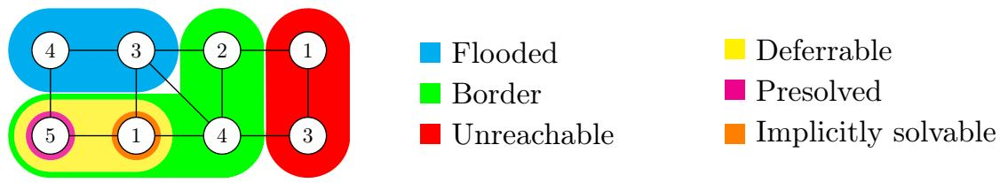  
Figure 2: A visualization of how the vertices of a game state can be classified. The upper left vertex is the pivot element. The numbers of the vertices represent the colors of the Flood-It game. The background colors indicate to which class each vertex belongs. Vertices in the border constitute the next possible moves. Unreachable vertices cannot be flooded within one move. Deferrable vertices could be flooded in the next move, but a shortest solution cannot be missed by not flooding them right away. The color of a presolved vertex is completely solved by one move. That color can be played at any time without changing the solution length. For implicitly solvable vertices, it is beneficial to wait playing them, as that provides the opportunity to flood more vertices of that color at the same move.

Definition 2.3 (flooded). For a game state $S = ( G , c _ { G } , F _ { G } )$ we write $F _ { S }$ to denote the set of flooded vertices:

$$
F _ { S } : = F _ { G }
$$

Definition 2.4 (border). For a game state $S = ( G , c _ { G } , F _ { G } )$ the border is the set of vertices adjacent to the set of flooded vertices. Colors occurring in the border are candidates for the next move. Formally:

$$
B _ { S } : = N _ { G } ( F _ { S } )
$$

Definition 2.5 (unreachable). For a game state $S = ( G , c _ { G } , F _ { G } )$ , we call a vertex unreachable if it takes more than one move to flood it. The set of unreachable vertices contains all non-flooded vertices of �, that are not part of the border:

$$
U _ { S } : = V ( G ) \setminus ( F _ { S } \cup B _ { S } )
$$

Definition 2.6 (deferrable). For a game state $S = ( G , c _ { G } , F _ { G } )$ , a vertex is deferrable if it can be flooded by making one move and is not adjacent to an unreachable vertex. Flooding these vertices does not open any new possibilities and can therefore safely be deferred to a later move. Formally

$$
D _ { S } : = B _ { S } \ \backslash \ N _ { G } ( U _ { S } )
$$

The set of deferrable vertices can further be divided into two disjoint sets of vertices:

Definition 2.7 (presolved). For a game state $S = ( G , c _ { G } , F _ { G } )$ , a deferrable vertex $v \in D _ { S }$ is called presolved if there is no vertex left in the closed neighborhood of the set of unreachable vertices that has the same color.

$$
P _ { S } : = \{ v \in D _ { S } : \neg \exists w \in N [ U _ { S } ] c _ { G } ( v ) = c _ { G } ( w ) \}
$$

The time point of when to flood a presolved vertex is not relevant:

Corollary 2.8. The color of a presolved vertex can (and must) be solved by doing exactly one move that does not have any side efects because it has no neighbor that is not already in the border (i.e., adjacent to the set of flooded vertices). Thus, such a move can be played anytime without compromising the minimality of the solution.

Definition 2.9 (implicitly solvable). For a game state $S = ( G , c _ { G } , F _ { G } )$ we call a vertex implicitly solvable, if it is deferrable and not presolved. These vertices can be ignored, as they will eventually be flooded together with other vertices, see Corollary 2.10. The set of implicitly solvable vertices is defined as:

$$
I _ { S } = D _ { S } \setminus P _ { S } = \{ v \in D _ { S } : \exists w \in N _ { G } [ U _ { S } ] \ c _ { G } ( v ) = c _ { G } ( w ) \}
$$

Any sequence of moves that floods the closed neighborhood of the unreachable vertices will also flood all implicitly solvable vertices. There are two cases:

• An implicitly solvable vertex is flooded by a move that at the same time floods additional vertices of the same color that are not implicitly solvable.

• An implicitly solvable vertex turns presolved before it gets solved.

Accordingly, implicitly solvable vertices do not require attention. Playing their color leads to inferior solutions unless there is a non-deferrable vertex of the same color.

In combination with Corollary 2.8 we can conclude the following strategy for deferrable vertices:

Corollary 2.10. Deferrable vertices do not have to be considered for minimal move sequences. Their color should only be played if it also occurs in the closed neighborhood of the unreachable vertices or if there are only deferrable vertices left. The latter case applies if all deferrable vertices are presolved $( D _ { S } = P _ { S } )$ .

## 2.4 Equivalent Game States

Identifying ‘equivalent’ game states can help to make $\mathrm { A ^ { * } }$ search more eficient. If it is known that several game states have optimal solutions of the same length, only one of them needs to be investigated further, while the others can be pruned from searching. However, in general, it is not possible to infer that two game states have the same minimum solution length without performing a deep search on both, which is precisely what one wants to avoid. Often it is possible to derive conditions under which two game states have a common optimal solution and use these for equivalence. For Flood-It, we managed to derive an equivalence that is a bit more general, as it allows identifying game states having the same minimum solution length, although they do not share a minimum move sequence.

For illustration, an example is shown in Fig. 3: Two diferent series of moves result in diferent game states for which the union of the set of flooded and deferrable vertices is the same. Even if they do not share a common shortest solution, these states can be solved with the same number of moves if the count of distinct colors in their respective sets of presolved vertices is the same. We prove that this holds true for any two states with these properties in Theorem 2.11.

This insight on equivalent game states can be applied to narrow the search space, as will be discussed in Sec. 3.3 on $\mathrm { A } ^ { * }$

Theorem 2.11. For two game states $S _ { 1 } = ( G , c _ { G } , F _ { S _ { 1 } } )$ and $S _ { 2 } = ( G , c _ { G } , F _ { S _ { 2 } } )$ with corresponding sets of presolved vertices $P _ { S _ { 1 } }$ and $P _ { S _ { 2 } }$ , the minimum number of moves required to solve these states is equal $i f { \mathrm { : } }$

$$
\begin{array} { r } { F _ { S _ { 1 } } \cup D _ { S _ { 1 } } = F _ { S _ { 2 } } \cup D _ { S _ { 2 } } } \\ { | c _ { G } ( P _ { S _ { 1 } } ) | = | c _ { G } ( P _ { S _ { 2 } } ) | } \end{array}
$$

Proof. We write � ∪· � to indicate the union is formed by disjoint sets � and �. For any game state $S = ( G , c _ { G } , F _ { S } )$ , we get by definition of the border and unreachable vertices that $( F _ { S } \cup B _ { S } ) \cup U _ { S } = V ( G )$ . Further $N _ { G } ( U _ { S } ) \cup D _ { S } = B _ { S }$ thus $( F _ { S } \cup D _ { S } ) \cup N _ { G } [ U _ { S } ] = V ( G )$

Now, let $S _ { 1 }$ and $S _ { 2 }$ be given as in the statement of the theorem. Then $N _ { G } [ U _ { S _ { 1 } } ] = N _ { G } [ U _ { S _ { 2 } } ] { } $ and because both game states have the same graph and coloring, a shortest sequence of moves � that floods $N _ { G } [ U _ { S _ { 1 } } ]$ is also minimal for $N _ { G } [ U _ { S _ { 2 } } ]$ and vice versa. Such a sequence will also flood all respective implicitly solvable vertices of $S _ { 1 }$ and $S _ { 2 }$ . Because it holds true that $D _ { S } = I _ { S }$ ∪· $P _ { S }$ for any game state $S ,$ only their respective presolved vertices will not be flooded after playing � on $S _ { 1 }$ and $S _ { 2 }$ . Because the presolved vertices can be flooded by playing each of their colors once, and these moves can be played anytime without side efects, see Corollary 2.8, we get that $m i n _ { S _ { 1 } } = | m | + | c _ { G } ( P _ { S _ { 1 } } ) | = | m | + | c _ { G } ( P _ { S _ { 2 } } ) | = m i n _ { S _ { 2 } }$ □

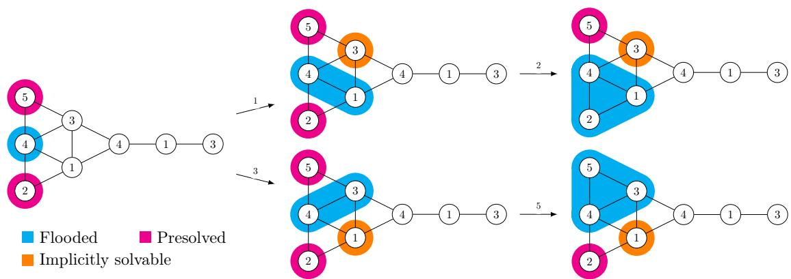  
Figure 3: Two diferent series of moves (here (1, 2) and (3, 5)) can result in diferent game states (on the right) that may or may not have a common shortest sequence of moves that solves them, while the minimum number of required moves to solve both states is the same. After the first move, both resulting game states share a shortest sequence of moves that solves them (4, 1, 3, 2, 5). After the second move the two resulting states do not share such a sequence, but still only 4 moves are required to solve them. They can both be solved by playing (4, 1, 3) followed by the color of the remaining presolved vertex.

## 2.5 Lower Bounds

In this section, we will obtain two lower bounds for the number of moves required to solve a game state. To determine a lower bound, we relax the rules of the game by allowing more powerful moves and use the number of moves required in the relaxed game as a lower bound for the actual game. Lower bounds can be used as heuristics in $\mathrm { A ^ { * } }$ search, see Sec. 3.

Note that a simple lower bound can be defined by the number of unsolved colors (��� for Lower Bound by unsolved Colors). Anticipating that this leaves much room for improvement, we will present two more sophisticated bounds and use LBC as the punchline.

Our first bound will be based on a level structure of a game state’s graph, which we will define first. As of [Díaz et al., 2002] a level structure of a (general) graph is a partition $L _ { 0 } , . . . , L _ { s }$ of its vertex set such that the endpoints of every edge in the graph are either in the same level $L _ { i }$ or in two consecutive levels $L _ { i }$ and $L _ { i + 1 }$ . We will define the level structure for a Flood-It game state accordingly.

Definition 2.12 (Level Structure of a Game State). Let $S = ( G , c _ { G } , F _ { G } )$ be a game state on a graph � with proper coloring. The corresponding level structure is defined such that:

$$
\begin{array} { l } { L _ { 0 } = F _ { S } } \\ { L _ { i } = N _ { G } ( L _ { i - 1 } ) \setminus ( \bigcup _ { 0 \leq j < i } L _ { j } ) } \end{array}
$$

When referring to a level structure $L _ { 1 } , . . . , L _ { s }$ , we will (unless stated otherwise) assume $L _ { s }$ to be the maximum level such that $L _ { s } \neq \emptyset$ and $L _ { s + 1 } = \emptyset$

Note that when interpreting $\textstyle \bigcup _ { 0 \leq j \leq i } L _ { j }$ as the set of flooded vertices, $L _ { i + 1 }$ is the border. The first lower bound we propose can be interpreted as a series of ‘combined’ moves in which each move plays all colors of each level at once up to a specific level, followed by playing each color of the next level (border) separately.

Definition 2.13. Lower Bound by Level Structure (LBL) Let $S = ( G , c _ { G } , F _ { G } )$ be a game state on a graph �. We define the lower bound $L B L ( S )$ based on the level structure $L _ { 0 } , \ldots , L _ { s }$ of �:

$$
L B L ( S ) : = \operatorname* { m a x } _ { i \in \{ 1 , . . . , s \} } i + | c _ { G } ( L _ { i } ) | - 1
$$

Lemma 2.14. The function ���(�) is indeed a lower bound for the minimum number of moves to solve game state $S = ( G , c _ { G } , F _ { G } )$ :

$$
L B L ( S ) \leq \operatorname* { m i n } { s }
$$

Proof. Let $L _ { 0 } , \ldots , L _ { s }$ be the level structure of � and $0 < i \leq s$ . By construction of the level structure, it holds true that for every vertex $v \in L _ { i }$ there exists a vertex $u \in L _ { 0 }$ so that a shortest ��-path has length �. Because $c _ { G }$ is a proper coloring, no two adjacent vertices of that path have the same color. Thus, it takes at least � moves to flood �. Now let $m _ { 1 } , . . . , m _ { i }$ be a series of moves that floods �. A move $m _ { j }$ with $j < i$ can only flood vertices in layers $L _ { 1 } , . . . , L _ { j } .$ . Therefore, these moves cannot flood any vertex in $L _ { i }$ . Playing $m _ { i }$ reduces the number of unflooded colors in $L _ { i }$ by one such that there are $k = | c _ { G } ( L _ { i } ) | - 1$ unflooded colors left in $L _ { i }$ . Thus, it would take additional � moves to flood all vertices in $L _ { i } .$ And thus �� $\iota _ { S } \geq \operatorname* { m a x } _ { i \in \{ 1 , . . . , s \} } i + | c _ { G } ( L _ { i } ) | - 1$ □

A weakness of this lower bound ��� is that it does not take into consideration that there might be colors which get solved by a combined move. Such colors could be played and counted as separate moves instead of being merged into a combined move, which leads to a higher and therefore tighter lower bound. An algorithm which takes such moves into consideration was implemented by Puchert [Puchert and Puchert, 2022]. The pseudocode of Algorithm 1 reflects the idea behind their implementation, which we call $L B \bar { P }$ (for Lower Bound Puchert in the sequel).

Algorithm 1 LBP(�)   
1: $l b \gets 0$   
2: while � not solved do   
3: $A  \{ u \in B _ { S } : \neg \exists v \in U _ { S } ( c _ { G } ( u ) = c _ { G } ( v ) ) \}$ ◁ vertices of safe moves   
4: if $A \neq \emptyset$ then   
5: $l b \gets l b + | c _ { G } ( A ) |$ ◁ add one for each safe move   
6: $F _ { S } \gets F _ { S } \cup A$ ◁ add safe moves to flooded vertices   
7: else   
8: $l b \gets l b + 1$ ◁ add one for the combined move   
9: $F _ { S }  F _ { S } \cup B _ { S }$ ◁ flood the whole border   
10: end if   
11: end while   
12: return ��

Fig. 4 shows a graph on which this algorithm returns a lower bound of 4 which is tighter than the lower bound of 3 that ��� (Lemma 2.14) provides.

Before we can show that it indeed returns a lower bound, we will first introduce safe moves, which Puchert refers to as optimal in his code [Puchert and Puchert, 2022].

Definition 2.15 (Safe Move). We call a move safe if it solves the color that is played by this move.

Note, that playing the color of a presolved vertex is a safe move, but in general, the reverse is not correct. There can be safe moves that bring previously unreachable vertices into the border. Accordingly, the played vertex was not deferrable and, in particular, not presolved.

Lemma 2.16. Let � be a game state with safe move $m _ { 1 }$ and let $S _ { 1 }$ be the resulting game state after playing $m _ { 1 }$ on � then:

$$
m i n _ { S _ { 1 } } = m i n _ { S } - 1
$$

Consequently, if there are several possible safe moves $\boldsymbol { m } _ { 1 } , . . . . , \boldsymbol { m } _ { i }$ which could be played on �, then after playing these moves $S \to ^ { m _ { 1 } } \dots \to ^ { m _ { i } } S _ { i }$ we obtain:

$$
m i n _ { S _ { i } } = m i n _ { S } - i
$$

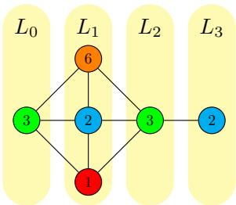  
Figure 4: On this graph, the lower bound $L B L ,$ , see Definition 2.13 equals 3 (yielded by $i = 1$ as well as by $i = 3 )$ while the lower bound $L B P$ obtained by Algorithm 1 equals 4. The latter can be seen in the following way. Play safe moves 6, 1. Then the border consists of the 2 in the middle and the 3 to its right. These are played as a combined move and finally playing 2 as the fourth (pseudo) move.

Proof. Let $m _ { 2 } , \ldots , m _ { n }$ be a shortest move sequence to solve $S _ { 1 }$ . Then move sequence $m _ { 1 } , m _ { 2 } , \ldots , m _ { n }$ solves $S _ { \mathrm { { ; } } }$ thus min $\leq$ min $s _ { 1 } + 1$ . Conversely, let $p _ { 1 } , \ldots , p _ { k }$ be a shortest sequence solving �. There must be exactly one move $p _ { j }$ in the sequence that plays the color of the safe move $m _ { 1 }$ by the definition of a safe move, i.e., $p _ { j } = m _ { 1 }$ . Since $m _ { 1 }$ is a safe move of state $S ,$ it can as well be played first. $\mathrm { S o } , m _ { 1 } , p _ { 1 } , \dotsc , p _ { j - 1 } , p _ { j + 1 } , \dotsc , p _ { k }$ also solves $S ,$ , entailing that $p _ { 1 } , \dotsc , p _ { j - 1 } , p _ { j + 1 } , \dotsc , p _ { k }$ solves $S _ { 1 }$ , proving min $\tau _ { S _ { 1 } } \leq \operatorname* { m i n } _ { S } - 1$ □

For completeness, we show the following obvious property of monotonicity.

Lemma 2.17. If $S ^ { \prime } = ( G , c _ { G } , F _ { G } ^ { \prime } )$ and $S = ( G , c _ { G } , F _ { G } )$ are two game states of the same underlying colored graph $( G , c _ { G } )$ with the flooded vertices of $S ^ { \prime }$ being a subset of the flooded vertices of � $( F _ { G } ^ { \prime } \subseteq F _ { G } )$ , it holds true that

$$
\operatorname* { m i n } _ { S } \leq \operatorname* { m i n } _ { S ^ { \prime } }
$$

Proof. Note that, for a state sequence $S _ { 1 } ^ { \prime } , \ldots , S _ { n } ^ { \prime }$ resulting from playing moves � $\mathbf { \Delta } _ { \cdot 1 } , \dots , m _ { n }$ on $S ^ { \prime }$ the flooded vertices $F _ { S _ { i } ^ { \prime } }$ will be a subset of the flooded vertices $F _ { S _ { i } }$ with $S _ { 1 } , \ldots , S _ { n }$ being the states resulting from playing the same move sequence on $S$

For proving the claim, we consider an optimal move sequence $m _ { 1 } , \ldots , m _ { n }$ for solving $S ^ { \prime }$ . We obtain $V ( G ) = F _ { S _ { n } ^ { \prime } } \subseteq F _ { S _ { n } } , \operatorname { s o } F _ { S _ { n } } = V ( G )$ , showing that the same move sequence solves �.

We can now introduce Algorithm 1 and show that it returns a proper lower bound. It initializes the lower bound with 0 and iteratively repeats these two steps until all vertices are flooded.

(1) If one or more safe moves are possible: Flood all the vertices that could be flooded by playing all safe moves. Then add the number of solved colors to the lower bound.

(2) Otherwise: Flood the whole border and add one to the lower bound.

When � is solved, the lower bound is returned.

Now, we can show that the function $L B P ( )$ is indeed a lower bound for the minimum number of moves:

Lemma 2.18. For any game state $S = ( G , c _ { G } , F _ { G } )$ , it holds that

$$
L B P ( S ) \le \operatorname* { m i n } { s }
$$

Proof. Let $S _ { 1 }$ be the game state at the beginning of an iteration, and let $S _ { 2 }$ be the game state after an iteration. For considering case (1), let � be the number of solved colors, which is added to the lower bound. Lemma 2.16 yields in this situation $m i n _ { S _ { 1 } } = i + m i n _ { S _ { 2 } }$ . In case (2) the whole border is flooded and 1 is added to the lower bound. The move in a shortest sequence for state $S _ { 1 }$ can only flood a subset of the border. Call the resulting game state $S _ { 2 } ^ { \prime }$ we have $F _ { S _ { \mathrm { 2 } } ^ { \prime } } \subseteq F _ { S _ { 2 } }$ . Using Lemma 2.17 we obtain min $\mathfrak { l } _ { S _ { 1 } } = 1 + \mathrm { m i n } _ { S _ { 2 } ^ { \prime } } \geq 1 + m i n _ { S _ { 2 } }$ . And thus, by induction $L { \ ' { B } } P ( S ) \leq$ min� is a lower bound. □

## 3 A\*

$\mathrm { A ^ { * } }$ is a graph path search algorithm between a start and a target node1 that has been published by Hart et al. [Hart et al., 1968] in 1968. It performs a guided search that makes use of a heuristic to estimate the cost of a path from each discovered node to the goal. By doing so, the search space can be explored more target-oriented, which is done by selecting the most promising node to examine next in each iteration. A drawback to this approach is its space complexity because information about discovered nodes has to be stored in memory.

In the standard terminology that is used when talking about $\mathrm { A } ^ { * } , g ( n )$ represents the cost of the best known path from start node � to node � (backward costs). The function $h ( n )$ estimates the cost of a path from � to the target node � (forward costs or heuristic). To guide the search, the main loop of $\mathrm { A ^ { * } }$ examines the node � that has the lowest �-value, which is determined by:

$$
f ( n ) = g ( n ) + h ( n )
$$

Typical implementations use some sort of priority queue to keep track of the set of nodes that are queued for expansion (open list). The node with the lowest �-value has the highest priority. Information about already expanded nodes may be stored in a closed list, often implemented as a hash table, to avoid revisiting nodes that have already been visited.

When using $\mathrm { A ^ { * } }$ search to find the shortest solution in a game, the nodes of the graph represent game states. Each node is connected by directed edges to nodes that correspond to game states reachable by performing one move from the parent. A (shortest) path from the root (initial game state) to a leaf node, i.e., a solved game state, represents a (shortest) solution of the game.

When a node is visited in $\mathrm { A ^ { * } }$ search, it is expanded by generating child nodes for each possible move. In general, pruning strategies should be considered to improve search eficiency. In the Flood-It game, certain moves can be ignored without endangering missing a shortest solution. The next section discusses pruning strategies based on this idea.

## 3.1 Pruning Strategies

There might be moves, which can be omitted from consideration when expanding a node. For any game state �, at most the colors of the border $B _ { S }$ must be considered as moves because a move that plays a diferent color would not flood any vertices and thus cannot result in an optimal solution.

As we have shown in Lemma 2.16, safe moves (Definition 2.15) can be played at any time without leading to an inferior solution.

Additionally, as of Corollary 2.10 the colors of the deferrable vertices $D _ { S }$ do not have to be considered as moves unless such a color also occurs in the closed neighborhood of the unreachable vertices or there are only deferrable vertices left. In the latter case $D _ { S } = P _ { S }$

Thus, we can derive strategies to prune the search space and propose to use the following three rules to decide which moves should be considered for a game state $S = ( G , c _ { G } , F _ { G } )$ .

1. Op (Optional) If safe moves can be played on �, one of these moves is played, while no alternative move is considered at this game state. The choice, if there is more than one safe move, is not relevant.

2. Mc (Must check) If there are no safe moves remaining or rule (1) is not applied, we branch into each non-deferrable color of the border $c \in c _ { G } ( B _ { S } \setminus D _ { S } )$ , and ignore all other possible moves. Deferrable colors do not have to be checked.

3. Ps (Presolved) If $B _ { S } \setminus D _ { S } = \emptyset$ there are only presolved vertices left. In that case, the order in which their colors are played is not relevant, and therefore only one color $c \in c _ { G } ( B _ { S } )$ needs to be considered for branching.

Because playing the color of a presolved vertex is by definition a safe move, these rules efectively result in two pruning strategies: $[ \mathrm { O p } , \mathrm { M c } ]$ and [Mc, Ps]. We would expect these to be more eficient compared to branching into all remaining colors of the unflooded vertices or border.

## 3.2 Lower Bounds as Heuristics

The heuristic function $h ( n )$ plays a key role for $\mathrm { A ^ { * } }$ search. It must be admissible to guarantee that an optimal solution is found, which means that $h ( n ) \leq m i n _ { S }$ holds for any node � representing game state $S .$ This is the case for the two lower bounds $L B L$ and $L B P$ presented in Sec. 2.5 according to Lemma 2.14 and 2.18, thus they can be used as heuristic for $\mathrm { A ^ { * } }$

In view of eficiency, it is desirable that heuristics are consistent. A simple example shows that lower bound ��� of Definition 2.13 is not consistent, see Sec. A.9 in the appendix. The second lower bound, ���, gave consistent estimates across all checked Flood-It instances, while we do not know whether its consistency holds in general. Anyway, both lower bounds may be used as heuristic to determine optimal solutions with $\mathrm { A ^ { * } }$ due to their admissibility. Lacking consistency, the search procedure is, in general, not greedy, which means that the same nodes might require multiple visits, which can hamper eficiency.

## 3.3 Equivalent Game States

In a straightforward implementation of $\mathrm { A } ^ { * } .$ , each node of the search space represents a game state. And each of these nodes might potentially be expanded. If we, however, have the guarantee, that two diferent game states of the search space can be solved with the same minimum number of moves, only one of them would need to be expanded. If they have the same �-value any of them could be chosen, otherwise only the one with the lower �-value must be expanded as it is guaranteed to lead to a shorter overall solution. So we can, based on the equivalence introduced in Theorem 2.11, treat nodes of the search space as equivalence classes such that each class contains the game states for which we can give this guarantee. And at any time, the game state with the currently lowest known �-value will be used as the representative element for its corresponding equivalence class, while all other game states of the class may be discarded. This should result in a smaller or, in the worst case, equal-sized search space, open and closed lists compared to a default implementation, and thus lead to a potentially better performance if implemented eficiently.

## 3.4 Tie Breaking Strategies

The �-values are integers corresponding to estimated solution lengths. These are comparably small compared to the number of game states in the search queue (open list). Therefore, there will typically be many nodes that have the same �-value in the open list, which gives a choice when $\mathrm { A ^ { * } }$ selects the next node for exploration based on the minimum �-value. According to Hart et al. [Hart et al., 1968] such ties can be resolved arbitrarily. But according to Asai and Fukunaga [Asai and Fukunaga, 2017] it has become standard practice to break ties in favor of nodes with lower ℎ-value for a better performance. They did experiments on multi level tie-breaking, which also resolves ties between nodes that have the same �- and ℎ-value. These experiments were not specific to Flood-It and showed that, for their set of problems, a $\mathrm { l i f o ^ { 2 } }$ policy [�, ℎ, lifo] outperforms a [�, ℎ, fifo] policy and interestingly [�, lifo] performed nearly as well as [�, ℎ, fifo].

## 4 Finding Solutions with General Solvers

Formulating puzzle rules as declarative constraints and utilizing general-purpose solvers, such as Boolean Satisfiability (SAT), Integer Linear Programming (ILP), or Constraint Programming (CP), is an established method for combinatorial problems. However, while state-based puzzles can often be modeled by defining a single valid goal configuration, process-based puzzles like Flood-It present a distinct challenge. Because the solution is a sequence of state transitions, the temporal dimension must be explicitly encoded.

To model the progression of Flood-It, we employ a time-unrolling approach. The variables representing the game state and the executed moves are duplicated across a discrete time horizon, parameterized by an estimated or bounded number of moves, �. Consequently, the size of the variable space and the number of required constraints scale with $T .$ . Modeling processes over time inherently introduces redundancies within the search space, as solvers may explore functionally equivalent sequences or delay mandatory state changes. This can be addressed by adding symmetrybreaking constraints to the base rules of the game. These optional constraints are designed to restrict the solver to canonical evaluation paths, for instance, formally ensuring that a vertex remains flooded in all subsequent time steps once captured, or requiring that all eligible neighboring components are flooded simultaneously. Symmetry-breaking constraints may, or may not improve the eficiency of the solving process.

In the following subsections, we define a unified set of constraints for the Flood-It problem and detail their specific adaptations into the respective domains of CP, ILP, and SAT.

## 4.1 A Unified Model for Flood-It

To formulate Flood-It for declarative solvers, we define a core set of constraints modeling graph dynamics over a discrete time horizon �. Let � be the number of vertices, � the number of colors, and � the bounded number of moves. We define $a d j [ v ]$ as the set of adjacent vertices to $v ,$ and �����[�] as the color of vertex �. Vertex 0 is designated as the pivot (from which flooding originates).

The game dynamics are modeled using the following variables:

$\operatorname { f l d } ( t , \upsilon )$ : Indicates whether vertex $v < V$ is flooded at time step $t \leq T$

$\mathtt { m o v e } ( t , c )$ : Indicates whether color $c < C$ is selected at time step $t < T$ (one-hot encoding).

Any valid solution must satisfy the base constraints for initial and final states (1) to (3), and the constraints for move selection and dynamics (4) to (6):

$$
\mathrm { { H d } } ( 0 , 0 ) = 1\tag{1}
$$

$$
\forall _ { 0 < v < V } \operatorname { f l d } ( 0 , v ) = 0\tag{2}
$$

$$
\forall _ { v < V } \quad \operatorname { f d } ( T , v ) = 1\tag{3}
$$

$$
\forall _ { t < T } \sum _ { c < C } \operatorname { m o v e } ( t , c ) = 1\tag{4}
$$

$$
\forall _ { t < T } \forall _ { v < V } \quad \mathrm { f l d } ( t + 1 , v ) \leq \mathrm { f l d } ( t , v ) + \mathrm { m o v e } ( t , c o l o r [ v ] )\tag{5}
$$

$$
\forall _ { t < T } \forall _ { v < V } \quad \mathrm { f l d } ( t + 1 , v ) \leq \mathrm { f l d } ( t , v ) + \sum _ { u \in a d j [ v ] } \mathrm { f l d } ( t , u )\tag{6}
$$

Any assignment of the variables move satisfying those constraints is a valid solution of the given Flood-It instance. Note that, however, the variable fld does not necessarily correspond to the respective flooding state, as the flooding operation is not fully described by the constraints. It might, for example, happen that a vertex that was flooded already becomes unflooded at a later time step, as long as it will get flooded again eventually. Similarly, a vertex that should get flooded according to the flooding rules might not be marked as flooded as long as it will get flooded later. Our constraints so far ensure only that nothing more is flooded than it should be, according to the rules. Considering eficiency, we consider the following optional symmetry-breaking constraints:

$$
\begin{array} { r } { \forall _ { t < T } \forall _ { v < V } \quad \mathbf { f } \mathbf { l } \mathsf { d } ( t , v ) \le \mathbf { f } \mathbf { l } \mathsf { d } ( t + 1 , v ) } \end{array}\tag{P}
$$

$$
\begin{array} { r l } { \forall _ { t < T } \forall _ { v < V } \forall u \in a d j [ v ] } & { { } \mathbf { f } \mathbf { l } \mathtt { d } ( t , v ) + \mathtt { m o v e } ( t , c o l o r [ u ] ) \le \mathbf { f } \mathbf { l } \mathtt { d } ( t + 1 , u ) + 1 } \end{array}\tag{E}
$$

## 4.2 Paradigm-Specific Adaptations

• Integer Linear Programming (ILP): Uses linear inequalities over binary variables to represent logical implications as shown in the formulation above.

• Constraint Programming (CP): Uses native integer domains for move(�) ranging from 0 to $C - 1$ , replacing the one-hot binary array. Boolean operations and logical implications can be expressed directly without the transformation into linear inequalities. For example, constraints (E) are modeled as $( \mathbf { f 1 d } ( t , v ) \land \mathtt { m o v e } ( t ) = c o l o r [ u ] ) \Rightarrow \mathbf { f 1 d } ( t + 1 , u )$

• Boolean Satisfiability (SAT): Converts all inequalities and implications into Conjunctive Normal Form (CNF) clauses using standard clausal expansions.

## 4.2.1 Minimization Problem with CP and ILP

Using CP and ILP also provides the opportunity to add a minimization to determine a solution with the minimum number of moves. However, since the size of the variable arrays fld and move depends on the number of moves to be modeled, we still need an estimate of an upper bound for the number of moves, which we denote by �. Below, we will add a constraint that forces only the first moves to be used whenever a solution exists that has less than $T$ moves. For the actual minimal number of moves, we introduce an integer variable $ \mathrm { T } _ { \mathrm { m i n } }$ . Furthermore, we enlarge the domain of the variables move to include the value −1, which indicates that no flooding is performed.

The new CP constraint, which makes sure that only the first $ \mathrm { T } _ { \mathrm { m i n } }$ moves are used, while later moves are void (non-flooding) moves is:

$$
\forall _ { t < T } \quad \mathtt { m o v e } ( t ) \geq 0 \Rightarrow \mathtt { T } _ { \operatorname* { m i n } } \geq t\tag{M}
$$

When the CP solver is set to minimize $ \mathrm { T } _ { \mathrm { m i n } }$ , a shortest solution will be returned.

For ILP, the corresponding constraint is

$$
\forall _ { t < T } \forall _ { c < C } \quad \mathtt { m o v e } ( t , c ) \ast t \leq \mathtt { T } _ { \operatorname* { m i n } }\tag{M}
$$

with the integer variable $ \mathrm { T } _ { \mathrm { m i n } }$ that is set to be minimized.

In case the bound $T$ was selected too small, the solver will fail to find a solution. In that case, the process can be restarted with an enlarged bound. Having a good estimate for the number of moves will be even more important when using the SAT approach (Sec. 4.2.2).

## 4.2.2 Minimization with the SAT Approach

With a SAT solver, we can only get a solution for the decision problem, i.e., given a number of moves �. In order to determine a minimum length solution, the decision solver needs to be called repeatedly until we find a value $T$ such that a solution with $T$ moves exists, but not so for $T - 1$ moves. To keep the number of iterations for this search low, a tight estimate of the minimum solution length is helpful. We will determine such an estimate as a regression of the solution length from the board size and the number of colors from Flood-It training instances, see Sec. 4.3.

There may be more eficient strategies than using a fixed step size of 1 for the iterative search. However, our results suggest that for random puzzle instances with the board sizes and number of colors investigated here, there might not be much to gain. Anticipating later results, Fig. 6 shows there is not too much spread in the minimum solution lengths for a fixed combination of size and colors. Moreover, Sec. A.7 in the appendix indicates that solving times are typically relatively low in the decision solver, when the given solution length is of from the minimum by more than 2 or 3, be it too low or too high.

## 4.3 Estimating the Time Horizon

To use a SAT solver to determine a minimum solution, repeated calls to the decision solver are required while probing diferent solution lengths for feasibility. When a number � is found such that a Flood-It solution with � moves exists, but not so for $k - 1$ , the minimum number of moves is determined as �. For this search process, an accurate prediction of the minimum solution length is beneficial to minimize solver iterations.

Similarly, the CP and ILP approaches using minimization require an estimate of the solution length. The formulations involve a coding of the flooding operations where the number of required variables scales with the bounded time horizon �.

Stiphout [van Stiphout et al., 2020a] observed that the shortest solution length for a Flood-It board with $n \times n$ tiles and � colors falls between $n + k - 5$ and $n + k$ . This observation was based on randomly generated boards with $n \in \{ 2 , \ldots , 9 \}$ and $k \in \{ 3 , \ldots , 6 \}$ . To extend this to larger values of � and �, we analyzed the distribution of minimum solution lengths for randomly generated puzzle instances.

For puzzles of a fixed size and a fixed number of colors, the distribution of minimum solution lengths typically falls into a window of width 4 to 6, see Fig. 6. The dependency of the solution length on size and colors is approximated with a linear function, see Fig. 23 and 24 in the appendix.

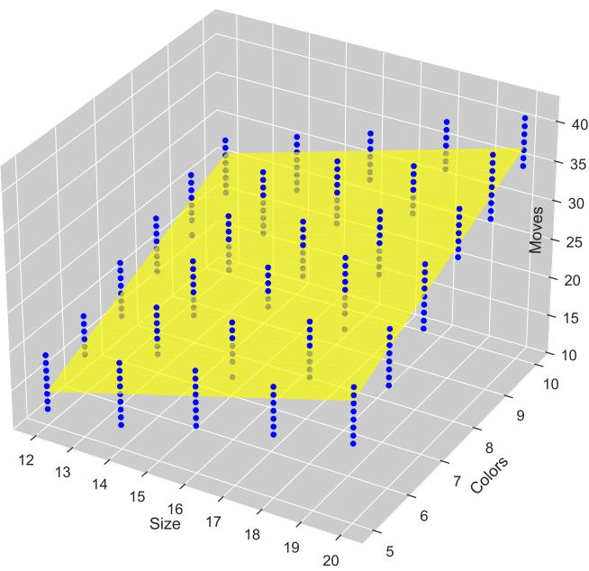  
Figure 5: Regression of solution length from size and colors. The points indicate the diferent solutions lengths that occurred in randomly generated puzzle instances for the given size and number of colors. The plane is a regression of the solution length (moves) from size and colors. Note, that this visualization does not indicate the distributions of moves. Those can be seen in the projections, Appendix A, Fig. 24 and 23.

We propose a linear regression from the parameters size (side length of a quadratic board) and colors to predict the minimum number of moves required. The regression parameters were estimated using 100 randomly generated puzzle instances per size (12, 14, 16, 18, 20) and colors (5, 6, 7, 8, 9, 10). The ordinary least squares (OLS) regression on this training data is given by (rounded to one decimal place):

$$
\mathrm { p r e d i c t e d \ s o l u t i o n \ l e n g t h } = 2 . 4 \cdot c o l o r s + 1 . 4 \cdot s i z e - 1 4 . 3\tag{7}
$$

see also Fig. 5 and Tab. 1. We take the rounded value of Eq. 7 as the initial guess for � in the SAT iterative search, and as the bounded time horizon for the CP and ILP variable arrays.
<table><tr><td>size</td><td>12</td><td>14</td><td></td><td>16</td><td>18</td><td>20</td></tr><tr><td rowspan="4">o0or#</td><td>5</td><td>14.3</td><td>17.0</td><td>19.8</td><td>22.6</td><td>25.3</td></tr><tr><td>6</td><td>16.7</td><td>19.4</td><td>22.2</td><td>25.0</td><td>27.7</td></tr><tr><td>7</td><td>19.1</td><td>21.8</td><td>24.6</td><td>27.3</td><td>30.1</td></tr><tr><td>8</td><td>21.5</td><td>24.2</td><td>27.0</td><td>29.7</td><td>32.5</td></tr><tr><td></td><td>9</td><td>23.9</td><td>26.6</td><td>29.4</td><td>32.1</td><td>34.9</td></tr><tr><td>10</td><td></td><td>26.3</td><td>29.0</td><td>31.8</td><td>34.5</td><td>37.3</td></tr></table>

(a) Values predicted by regression (7).

<table><tr><td>size</td><td>12</td><td>14</td><td>16</td><td>18</td><td>20</td></tr><tr><td rowspan="5">o#</td><td>5</td><td>15.5</td><td>17.0 19.5</td><td>21.0</td><td>23.5</td></tr><tr><td>6</td><td>17.5</td><td>21.0 22.0</td><td>24.5</td><td>26.5</td></tr><tr><td>7</td><td>19.5</td><td>22.5</td><td>25.5 28.0</td><td>30.0</td></tr><tr><td>8</td><td>21.5</td><td>24.5</td><td>26.5 30.0</td><td>34.0</td></tr><tr><td>9</td><td>23.5</td><td>26.0 30.0</td><td>33.0</td><td>36.0</td></tr><tr><td></td><td>10</td><td>24.5</td><td>27.5</td><td>31.0 35.0</td><td>38.0</td></tr></table>

(b) Actual minimum solution lengths.  
Table 1: Prediction of the minimum solution length. (a) The minimum solution length for Flood-It puzzles, predicted by OLS regression from the size (side length of a quadratic grid) and number of colors. In (b) the median across 100 puzzle instances was calculated per size and color. Note, that this is the same data as the OLS was trained on.

## 5 Experiments

## 5.1 Generation of Flood-It instances

We generated Flood-It instances on square grids of diferent sizes (side lengths 12, 14, 16, 18, 20) and diferent numbers of colors (5 to 10). For each cell of the grid, the color was independently determined by Python’s (pseudo) random generator random.randint(). We verified that all possible colors were actually used. One hundred instances were generated for each combination of size and number of colors. Fig. 6 shows the distribution of the minimum solution lengths among the generated puzzles.

Training and test set To obtain a representative dataset for the final evaluation of the solving algorithms (‘test set’), we picked the first instance of each size/color combination that had a minimal solution length not encountered before. This process resulted in a test set containing 233 Flood-It instances, one from each bin in Fig. 6. For tuning each approach, we used a diferent dataset of 99 puzzle instances (‘training set’), which was created earlier in a similar way.

## 5.2 Implementation of Solver Approaches

The A\* approach was implemented in C++, whereas we used Python interfaces to diferent solvers to implement the approaches introduced in Sec. 4. For SAT solvers, we used the freely available PySAT toolkit [Ignatiev et al., 2018] which provides an interface to a number of dedicated SAT solvers. As an alternative, we implemented the SAT constraints in the much more general Z3 Satisfiability Modulo Theories (SMT) solver developed by Microsoft [de Moura and Bjørner, 2008] as well as using the open-source optimization suite OR-Tools [Perron and Furnon, 2024] developed by Google. For ILP, we again used Z3, OR-Tools, and additionally Gurobi [Gurobi Optimization, LLC, 2024] and CPLEX [IBM Corporation, 2023, Bixby, 2002], which are both free for academic use. For Constraint Programming, we used CPLEX, OR-Tools and the Z3 solver. Experiments were run on a MacBook Pro with an M2 Max chip and 96 GB memory.

## 6 Results

We first discuss individual results for the decision problem. As a high number of variations have been investigated in this study, we show just the most important results in the main text, while more detailed comparisons and results of less successful variants are either included in the appendix or are just shortly mentioned.

Since it turned out that the SAT Solvers showed a much better performance compared to ILP and CP, we present the results in more detail for them.

We evaluated the diferent SAT solvers provided in the PySAT toolkit for the Flood-It decision problem, see Sec. A.2 in the appendix. Based on the results, we selected Glucose 4.2.1 (g42) as the best performing one for subsequent simulations.

## 6.1 Comparison of Enhancements for A\*

In this section, we evaluate the possible optimizations for A\* that were introduced in Sec. 3 using the 99 instances of the training set. Fig. 7 shows an overview of adding one-by-one the best option for each enhancement (heuristics, game state equivalence, pruning). The solving times for each solver configuration are displayed as survival plot [Brain et al., 2017]. There is a marked improvement with each enhancement, except for the pruning strategy. In this overview and the individual look at each enhancement in the subsequent paragraphs, the strategy [�, ℎ, lifo] was used for tie-breaking, as it is recommended generally. In the last paragraph of this section, diferent strategies for breaking ties are compared.

Lower Bounds as Heuristics We validated the two lower bounds introduced in Sec. 3.2 and included as a baseline in the comparison the heuristic which uses the number of unsolved colors as simple lower bound (LBC), see Fig. 8a. Both more sophisticated lower bounds (���, ���)

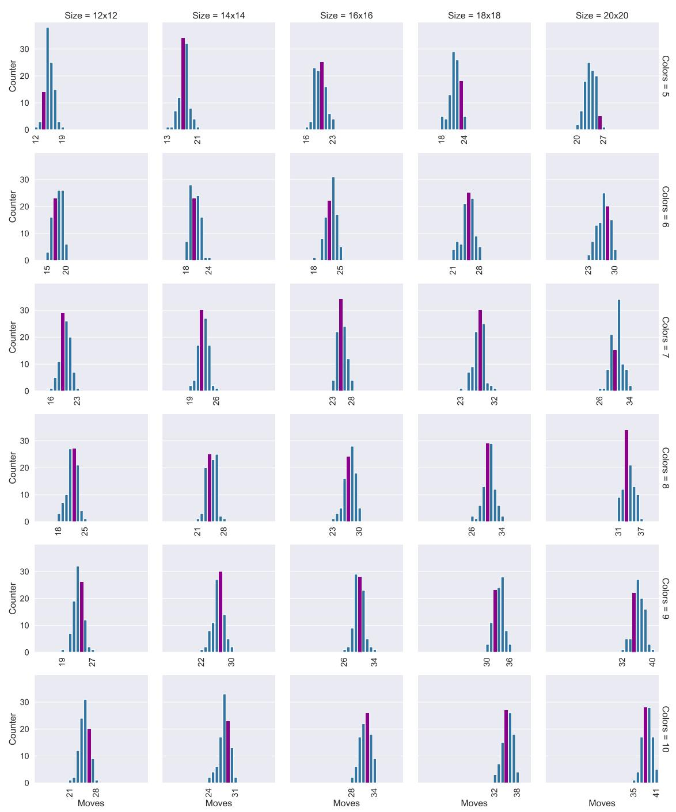  
Figure 6: For each size and number of colors, 100 Flood-It instances were randomly created. The bar plots show the distribution of the minimum solution lengths for each pair of size and colors. The bar corresponding to the predicted minimum solution length based on a regression from size and color, see Sec. 4.3, is shown in dark magenta.

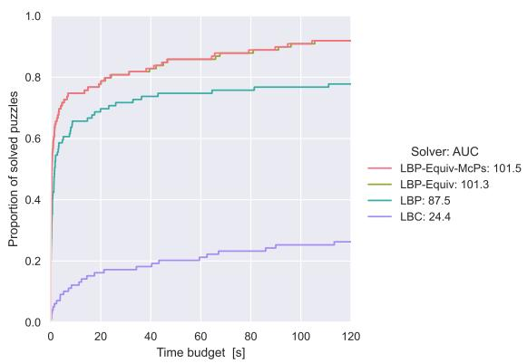  
Figure 7: $\mathbf { A } ^ { * }$ Enhancements. Comparison of the solution times for diferent $\mathrm { A ^ { * } }$ configurations in the minimization problem as survival plot. For each time budget on the �-axis up to the timeout limit of ${ \mathrm { 1 2 0 ~ s } } ,$ the curves represent the ratio of puzzles solved within that time limit. The values in the legend specify the area under the curve (AUC) as an overall measure of performance. ��� uses simply the number of unsolved colors as lower bound, and $L B P$ uses Algorithm 1. LBP-Equiv exploits additionally the equivalence of game states. LBP-Equiv-McPs furthermore uses the “must check – presolved” strategy for pruning. For tie-breaking $[ f , h ,$ lifo] was used in all variants. Data: 99 instances of the training set, see Sec. 5.1.

increase the eficiency of $\mathrm { A ^ { * } }$ substantially compared to using a simple lower bound. The competition between the better two is shown in Fig. 8b as a scatter plot. The lower bound ��� (Algorithm 1), which takes safe moves into account additionally to the level structure, results in a speedup of up to factor 100 and is faster compared to the lower bound ��� (Definition 2.13) in all the cases that were solved by either method. For further evaluations, we employed the lower bound ��� as heuristic.

Using Game State Equivalences Making use of the equivalence introduced in Theorem 2.11 is discussed in Sec. 3.3 for pruning the search space. This results in more solved test instances and a faster solving time in 94.9% of the cases with a speedup factor of up to 10, see Fig. 9a. The advantage gets more prominent with the increasing ‘complexity’ of the puzzle. For further evaluations, we made use of the equivalence.

Pruning Strategies In our simulations, the benefit of the pruning strategies of Sec. 3.1 vanished when the other optimizations (equivalent game states and ���) are employed. We used McPs in the final evaluation, as it gave the best results on the training data by a small margin (Fig. 7).

Tie Breaking Finally, we take a look at the diferent options for tie-breaking. Selecting game states with the lowest ℎ-value among those having the same �-value was found to be beneficial over a ‘lifo’ selection. Comparing the strategies that both use the ℎ-value to break ties on the second level, [�, ℎ, lifo] performs slightly better than [�, ℎ, fifo], see Fig. 9b.

The direct comparison between [�, ℎ, lifo] and [�, lifo] shows a clear benefit of breaking ties based on ℎ-value on the second level with [�, ℎ, lifo] being faster on 86.9% of the test instances with a speedup factor of up to 10.

## 6.2 Comparison of Diferent SAT Formulations

The optional constraint (E) increased solving times in most cases. Also, it led to a substantial increase in variance in solving times, see Sec. A.4 in the appendix. Therefore, this option is not further discussed here. Moreover, an alternative formulation proposed in [van Stiphout et al., 2020a] (Sec. A.1 in the appendix), which introduces an additional variable for the concept of vertices ‘touching the flood’ was found to be less eficient in our setting (Sec. A.3).

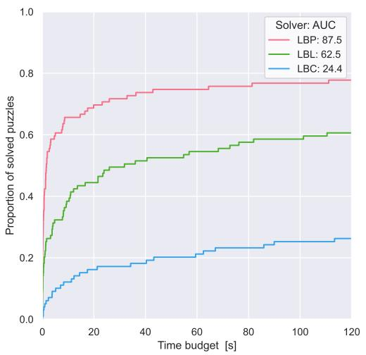  
(a) Survival plot for ���, ���, ���

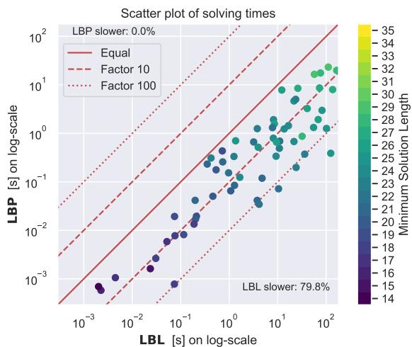  
(b) Scatter plot for �� � vs. ���

Figure 8: Comparison of diferent lower bounds for A\*. (a) For each time budget on the �-axis up to the timeout limit of 120 s, the curves represent the ratio of puzzles solved within that time limit. The more sophisticated lower bounds ��� and ��� introduced in Sec. 3.2 are compared to the simple lower bound of the number of unsolved colors (���). (b) The better two heuristics are compared in a scatter plot. For points below the diagonal, ��� is slower. The minimum solution length of each puzzle instance is color-coded. Note that 20.2% of the instances were not solved by either method. Data: 99 instances of the training set, see Sec. 5.1.

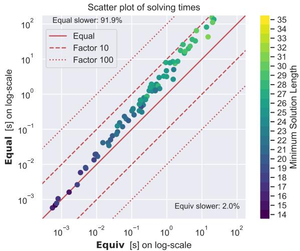  
(a) Scatter plot for equivalence

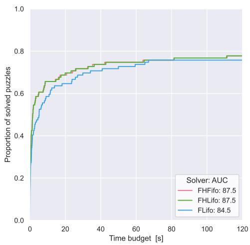  
(b) Survival plot for tie-breaking

Figure 9: (a) Efect of exploiting equivalence of game states. In ‘Equal’ only exactly equal game states are identified, while in ‘Equiv’ the equivalence of game states is used for pruning the search of $\mathrm { A ^ { * } }$ , see Sec. 3.3. For points above the diagonal, ‘Equal’ is slower. The minimum solution length of each puzzle instance is color coded. (b) Comparison of tie-breaking strategies. Ties of game states with the same �-value are resolved either by a ‘lifo’ selection (FLifo), or choosing the lowest ℎ value and on the third level either a ‘lifo’ (FHLifo) or a $\mathrm { \Omega } ^ { \mathrm { \Omega } } \mathrm { f o } ^ { \mathrm { \Omega } } ,$ (FHFifo) selection, see Sec. 3.4. Data: 99 instances of the training set, see Sec. 5.1.

Within the SAT solver available in the PySAT toolkit we selected Glucose 4.2.1 (g42) based on the results shown in Sec. A.2. We compared that with the SAT formulations within the more general Z3-Solver and OR-Tools. The solving times for the diferent constraint variants are displayed in Fig. 10 similar to a survival plot [Brain et al., 2017] but without accumulation of times on the �-axis. In all three solvers, using the optional constraint (P) with or without constraint (C) is beneficial. The comparison between the solvers bears OR-Tools as the winner, closely followed

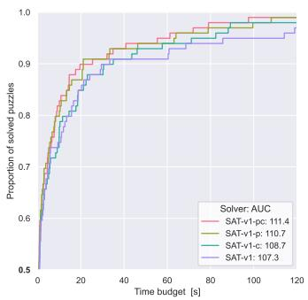  
(a) Glucose 4.2.1 SAT solver.

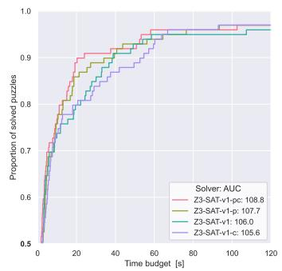

(b) SAT formulation in Z3-Solver. (c) SAT formulation in OR-Tools.  
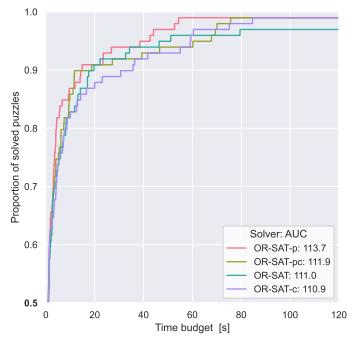

Figure 10: Diferent solver engines for SAT. Comparison of the solution times when using the SAT formulation with diferent solver engines and constraint variants in the decision problem as survival plot. For each time budget on the �-axis up to the timeout limit of 120 s, the curves represent the ratio of puzzles solved within that time limit. The values in the legend specify the area under the curve (AUC) as an overall measure of performance. Data: 99 instances of the training set, see Sec. 5.1.

by the Glucose solver of PySAT and finally Z3. This order is replicated on the test set, see next section.

## 6.3 Comparison of Solvers for the Decision Problem

Based on the investigation of the 99 instances of the training set presented in Sec. 6.2, we selected the best variant for each solver using SAT formulations. Furthermore, we included the best A\* configuration in the final comparison for the decision problem. The results using the instances of the test set are shown as survival plot in Fig. 11.

In the view with linear scaling in Fig. 11a, the SAT solvers dominate A\* search. Within the SAT solvers, the same order as on the training set is found, compare Fig. 10. Due to the wide range of the time budget from 0 to 120 seconds, and the solving times for the majority of instances falling into the subsecond range, the plot with a linear scaling on the �-axis gives an impression that is mainly driven by the less frequent hard instances. The plot with logarithmic scaling on the �-axis in Fig. 11b reveals that A\* search performs best for the majority of puzzle instances that are solved within the first few seconds. However, as the allotted time budget increases, which correlates with higher puzzle complexity, the performance curves cross. For time budgets exceeding roughly 3 seconds, the SAT approaches (specifically g42 and OR-Tools) surpass A\*.

Results for ILP and CP approaches in the decision problem are shown in the appendix Sec. A.5. With OR-Tools, the results were very similar, but slightly inferior to the SAT formulation in OR-Tools. With the other solvers (Z3, CPLEX, Gurobi), the ILP and CP formulations were considerably less eficient.

## 6.4 Comparison of Solvers on the Minimization Problem

Here, we compare approaches concerning their performance in the minimization problem. In this case, the minimum number of moves to solve a puzzle is not known to the algorithm. While A\* search finds a minimum length solution by design, the other algorithms need some modification. In Linear and Constraint Programming, the objective of minimizing a variable can be declared.

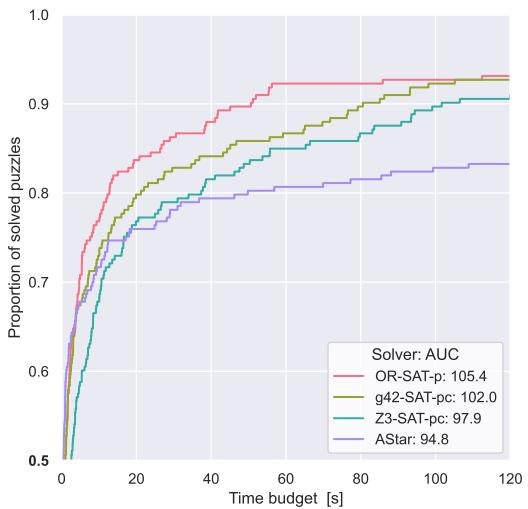  
(a) Survival plot with linear scaling.

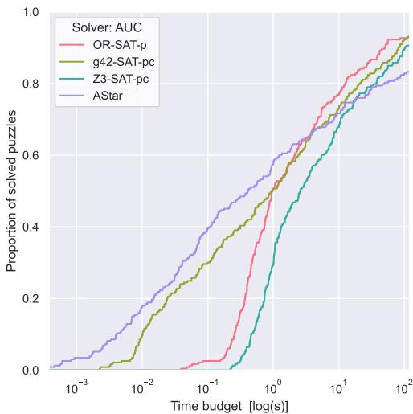  
(b) Survival plot with logarithmic scaling.  
Figure 11: Flood-It decision problem. Comparison of the solution times for the solvers in the decision problem as survival plot. For each time budget on the �-axis up to the timeout limit of 120 s, the curves represent the ratio of puzzles solved within that time limit. The scaling on the �-axis is linear in (a) and logarithmic in (b). Note, that the �-axis starts at 0.5 in the left subplot. Data: 233 instances of the test set, see Sec. 5.1.

Therefore, it is in principle enough to add such a variable and a constraint stating that after that many moves, no more flooding operations are performed, see Sec. 4.2.1 for the details. Solving the minimization problem with a SAT-Solver requires repeated calls to the SAT-Solver of the decision problem, narrowing down the number of moves, see Sec. 4.2.2. In the same way as above, Fig. 12 displays the comparison as a survival plot. The ILP and CP approach performance is, in general, worse. Otherwise, $\mathrm { A } ^ { * }$ search is more successful on ‘less complex’ instances, while the SAT-Solver can solve more puzzles for time budgets larger than about 60 s. Diferent from the decision problem, within the SAT solvers, g42 performs better than OR-Tools, which is quite surprising as the minimization for both SAT solvers is realized by the same repeated calls of the decision solver. The reason for this surprising change is the diferent eficiency when the decision is not called with the actual minimal solutions length, but with a lower value, as required in the iterative search. In this setting, OR-Tools performs inferior to g42, see Sec. A.7.

For a more detailed comparison of $\mathrm { A ^ { * } }$ and SAT on a puzzle basis, Fig. 13 shows a scatter plot. Color coding the minimum solution length of each instance reveals that the solution time of $\mathrm { A ^ { * } }$ search is highly correlated with this parameter, while this dependency is weaker for the SAT solver.

## 7 Discussion

Flood-It puzzles designed for human solvers to find minimum solutions typically have sizes up to 12x12 and use not more than six colors. Puzzle instances in this complexity range are rapidly solved by any of the investigated approaches and implementations. To challenge algorithmic development, we investigated randomly generated Flood-It instances of sizes up to 20x20 using up to 10 colors. To be computationally feasible, this higher level of complexity requires domain-specific optimization in $\mathrm { A ^ { * } }$ search and, for general-purpose solvers, the appropriate choice of solving engines.

The main contribution of this paper is to present an approach using $\mathrm { A ^ { * } }$ search to solve Flood-It puzzle instances. Our approach is endowed with tailored ingredients that are crucial for eficiency. First, we derive an equivalence of game states that allows substantial pruning. Second, we employ a heuristic based on safe and combined moves. Third, we introduce pruning strategies based on strategic considerations. Finally, a good tie breaking strategy is selected.

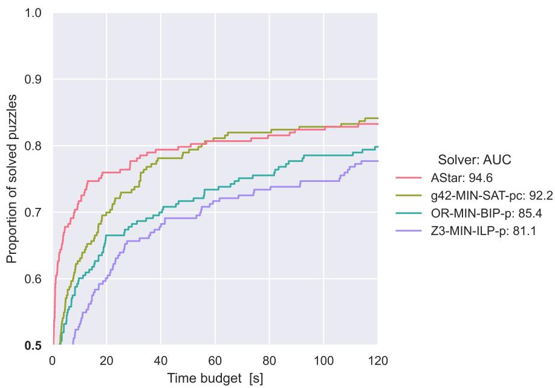  
Figure 12: Flood-It minimization problem. Comparison of the solution times for the solvers in the minimization problem as survival plot. For each time budget on the �-axis up to the timeout limit of 120 s, the curves represent the ratio of puzzles solved within that time limit. Data: 233 instances of the test set, see Sec. 5.1.

Additionally, approaches with general solvers (SAT, Integer and Constraint Programming) have been systematically explored. All considered approaches have been evaluated for the decision and for the minimization problem (existence of a solution of given length and finding a shortest solution) of Flood-It.

In the following, we first discuss our validation strategy, then the outcome of optimizing each approach and subsequently the comparison across the diferent approaches.

## 7.1 Validation of the Solving Approaches

This work features a systematic and clean performance validation. The best performing variant of each approach was chosen based on a training set of 99 randomly generated puzzles. The final comparison was done on an independently generated test set of 233 puzzles. These puzzles were spanning sizes of side lengths from 12 to 20 and numbers of colors from 5 to 10. For each combination of those, 100 puzzles have been generated and each puzzle featuring a solution length that was not encountered before was collected for the test set.

## 7.2 A\* search for Flood-It

Tie-Breaking The employed strategies for breaking ties (selecting a game state among all with the lowest �-value) were not specific to Flood-It. In accordance with the literature [Asai and Fukunaga, 2017] we found tie-breaking in favor of small ℎ values eficient and the efect of third-level tie-breaking (fifo vs. lifo) negligible, see Fig. 9b. Diferent from [Asai and Fukunaga, 2017], we found [�, ℎ, fifo] clearly superior to [�, lifo], see Sec. 6.1. Since their result is based on an evaluation on datasets from 35 diferent domains, it has more general significance. Note, that we did not implement the more sophisticated diversification strategy proposed in [Asai and Fukunaga, 2017].

Equivalence vs. Equality. The implementation that treated equivalent game states, see Theorem 2.11, as one node of the search space clearly outperformed the implementation that treated each discovered game state as a separate node, see Fig. 9a. There has been only one low complexity instance on which the latter had a shorter running time. The figure indicates that the efectiveness of equivalence compared to equality generally increases for the test instances that are harder to solve. We thus conclude that the additional computation costs for the equivalence are compensated for by the reduced size of the search space, so its implementation can be an essential optimization in using $\mathrm { A } ^ { * }$ to solve Flood-It instances.

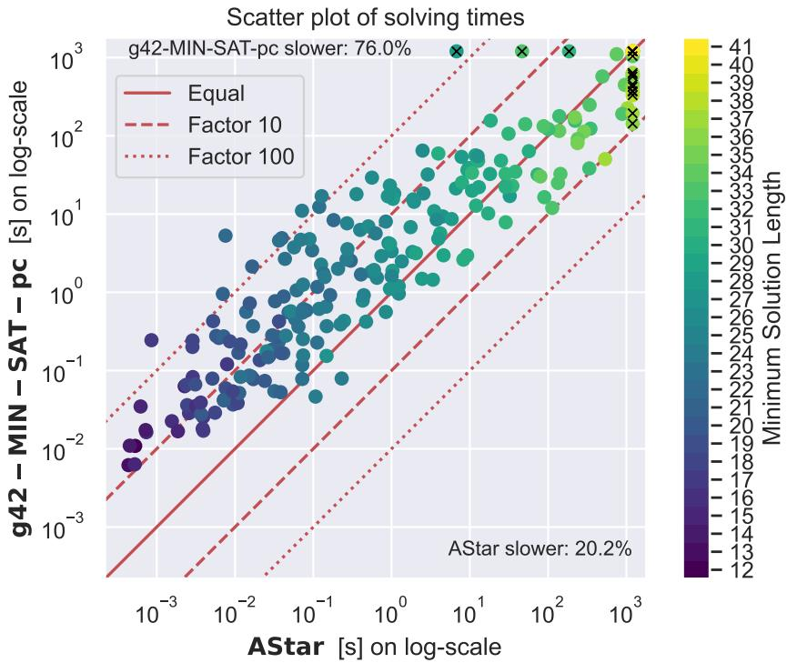  
Figure 13: Scatter plot of solution times for the minimization problem using the $\mathrm { A ^ { * } }$ and the SAT-Solver. Each puzzle instance is one data point, and their solution times for $\mathrm { A ^ { * } }$ are on the �- and for SAT on the �-axis. For points above the diagonal line, $\mathrm { A ^ { * } }$ finds the solution faster, while points below correspond to puzzles that were solved faster with SAT. Puzzle instances are color-coded by the minimum solution length. Dots that are crossed out were not within the time limit of 1200 s by at least one of the solvers. (Note that the survival plot in Fig. 12 has a diferent time limit of 120 s.) Data: 233 instances of the test set, see Sec. 5.1.

Heuristics. The heuristic based on the lower bound ��� (Algorithm 1) proved more eficient than relying solely on the level structure (���, Definition 2.13), which in turn outperformed the baseline of using the number of unsolved colors, see Fig. 8. We conclude that the increased computational overhead of calculating the tighter bounds is more than compensated for by the resulting reduction in the number of expanded nodes.

Pruning. While pruning schemes derived from domain-specific Flood-It strategies show a benefit in basic $\mathrm { A ^ { * } }$ search, the advantage vanishes when other optimizations (exploiting equivalent game states and the eficient ��� heuristic) are used.

Heaps. The solving times with $\mathrm { A } ^ { * }$ increased substantially more than with the SAT approach in the puzzles of the highest complexity. We tested $\mathrm { A } ^ { * }$ also with priority queue implementations using Pairing and Fibonacci heaps, which have a better asymptotic running time than the standard binary heaps and can therefore be better suited for applications with large queues. However, in our experiments, the diferences of using diferent heap implementations were negligible.

## 7.3 Solving Flood-It with SAT Solvers

Diferent formulations and optional constraints for the SAT approach have been evaluated. The more complicated formulation proposed in [van Stiphout et al., 2020b] performed inferior to the direct formulation in our experiments, Fig. 16. Additional constraints for symmetry breaking (P) and (C) improved performance in general, see Fig. 10, while additional constraint (E) was detrimental in most cases. Also, it made solvers resort to randomization, leading to a high variance of running time in repeated runs, see Fig. 15, and on average to higher running times, see Fig. 17.

With respect to the choice of the SAT solver engine, some of the dedicated SAT solvers from PySAT, in particular g42 (Glucose 4.2.1), performed overall the best. For the decision problem with the correct minimum solution length given, OR-Tools performed better, see Fig. 11. However, when the decision solver was called with one less than the minimum solution length, it took considerably more time to find out the infeasibility than g42, see Fig. 22. This is even more true for the Z3 solver, see Fig. 22c. Since this probe is required when approaching the minimization problem with a SAT solver, g42 emerged as the winner.

## 7.4 Solving Flood-It with Integer and Constraint Programming

Solving Flood-It with integer programming was implemented using the Gurobi, CPLEX, Z3 and OR-Tools solver. Constraint programming was implemented in CPLEX, Z3 and OR-Tools. Overall, these approaches were not competitive with the SAT formulations and provided no additional performance benefits (results not shown): With OR-Tools, all three approaches yielded essentially the same running time. In Z3, the ILP and CP formulations were substantially inferior to SAT in Z3, with ILP being slightly better than CP. The results obtained with Gurobi and CPLEX were far behind, with Gurobi being superior to CPLEX, and within CPLEX CP being more eficient than ILP.

It is however possible that the default configuration of CPLEX and Gurobi, which we used, is not an appropriate choice for our formulations of Flood-It, and thus they might perform better with diferent configurations.

## 7.5 Comparison of all Approaches

Concerning the relative performance of $\mathrm { A ^ { * } }$ search, SAT-, and ILP/CP-based solving, we had three hypotheses: (1) $\mathrm { A } ^ { * }$ is better suited for the minimization problem, while SAT solvers are better for the decision problem. (2) The SAT, ILP, and CP formulations perform similarly on the decision problem. (3) ILP and CP are better suited for the minimization problem than SAT due to their intrinsic optimization capability.

Hypothesis (1) was confirmed for the majority of instances. $\mathrm { A ^ { * } }$ solved 75% of the puzzle instances in the minimization problem faster than the SAT-based approach. While $\mathrm { A } ^ { * }$ eficiently traverses the search space for lower complexities due to the ��� heuristic and game state equivalences, its performance degrades on complex instances because of the exponential growth of the search space. Conversely, the SAT-based approach scales more favorably with complexity, overtaking $\mathrm { A ^ { * } }$ as the minimum solution length increases.

Concerning (2), the SAT, ILP, and CP formulations performed on par in their implementations with OR-Tools. Within Z3 and CPLEX, the diferences were more pronounced, but the most significant variance was found between the diferent solving engines. PySAT and OR-Tools achieved the best performance, outperforming Z3, while Gurobi—and to an even greater extent CPLEX, showed lower performance.

Hypothesis (3) was not supported by the data. Even within the same solving engine (e.g., OR-Tools), an iterative approach using the SAT formulation was more eficient than using the native minimization within the ILP or CP formulations. A potential reason for this outcome is that the minimization formulation requires a larger variable array that encompasses the maximum assumed solution length. Using our solution length prediction, this overhead is restricted to about five moves. However, searching for a solution that has 30 moves in a variable space prepared for 35 moves implies a large amount of suboptimal combinations among which the shortest must be found.

## 7.6 Prediction of the Solution Length

While a good prediction of the minimum solution length was obtained by a linear regression from size and colors, there is also evidence that the actual relationship is nonlinear, cf. Fig. 6. For the complexity range used in this study, the small inaccuracy involved with a linear regression was accepted. In applications that would involve a larger range of complexities, exploring nonlinear predictions seems advisable.

## 8 Conclusion

For the eficiency of $\mathrm { A ^ { * } } { } _ { ; }$ , several domain-specific optimizations have been essential, such as game state equivalences, and lower bounds, while pruning by move strategies only yielded marginal gains. With the integration of those, $\mathrm { A } ^ { * }$ was overall the fastest solver not only for the minimization but also for the decision problem. Since $\mathrm { A ^ { * } }$ is a guided search towards the optimal solution, its superiority in the minimization problem came as no surprise. But $\mathrm { A ^ { * } }$ does not scale well with large search spaces, which is reflected here by the finding that the SAT approach dominates with increasing complexity, see Fig. 12 and 13. For the decision problem, this turning point is found at a much lower complexity, see Fig. 11a.

The SAT, ILP and CP formulations are logically equivalent. This was reflected by the fact that their implementations in OR-Tools all had essentially the same running time. With diferent solvers, however, the performance was found to be largely diferent. Apart from OR-Tools, using a dedicated SAT solver yielded the best performance and was clearly superior to implementations using Z3, Gurobi and CPLEX. While OR-Tools had an edge by a narrow margin over the dedicated SAT solver in the decision problem, interestingly, this did not extend to the minimization problem, in which g42 was superior. Moreover, there was a surprise in the results for the minimization problem. In the decision problem, the performance of the SAT, ILP and CP formulations were on par in their OR-Tools implementation. Therefore, we hypothesized that ILP and CP would win in the minimization problem, as they allow to canonically integrate the minimization, while a SAT formulation requires iterative search. However, the opposite was the case, see Fig. 12. A potential reason for this outcome is that the minimization formulation requires a larger variable array that encompasses the largest assumed solution length. Using our solution length prediction, this overhead is restricted to about five moves. However, searching for a solution that has 30 moves in variables prepared to represent 35 moves implies a large number of suboptimal solutions, among which a shortest has to be found.

## Acknowledgement

Python code was written in PyCharm by JetBrains. In particular, the scripts for generating the figures and tables of the results were aided by JetBrains AI using the LLM gemini-pro-1.5 and openai-gpt-4o. This paper was written using LATEX in Overleaf.

## References

[Asai and Fukunaga, 2017] Asai, M. and Fukunaga, A. (2017). Tie-Breaking Strategies for Cost-Optimal Best First Search. Journal of Artificial Intelligence Research, 58:67–121.

[Audemard and Simon, 2018] Audemard, G. and Simon, L. (2018). On the Glucose SAT Solver. International Journal on Artificial Intelligence Tools, 27(01):1840001.

[Biere, 2017] Biere, A. (2017). CaDiCaL, Lingeling, Plingeling, Treengeling and YalSAT Entering the SAT Competition 2018. In Proceedings of SAT Competition, volume 14, pages 316–336.

[Bixby, 2002] Bixby, R. E. (2002). Solving real-world linear programs: A decade and more of progress. Operations Research, 50(1):3–15.

[Brain et al., 2017] Brain, M., Davenport, J. H., and Griggio, A. (2017). Benchmarking solvers, sat-style. In England, M. and Ganesh, V., editors, Proceedings of the 2nd International Workshop on Satisfiability Checking and Symbolic Computation co-located with the 42nd International Symposium on Symbolic and Algebraic Computation (ISSAC 2017), Kaiserslautern, Germany, July 29, 2017, volume 1974 of CEUR Workshop Proceedings. CEUR-WS.org.

[da Silva et al., 2020] da Silva, A. R. V., Ochi, L. S., Barros, B. J. d. S., and Pinheiro, R. G. S. (2020). Eficient approaches for the Flooding Problem on graphs. Annals of Operations Research, 286(1-2):33–54.

[de Moura and Bjørner, 2008] de Moura, L. and Bjørner, N. (2008). Z3: An eficient SMT solver. In Proceedings of the 14th International Conference on Tools and Algorithms for the Construction and Analysis of Systems (TACAS), volume 4963 of Lecture Notes in Computer Science, pages 337–340. Springer.

[Díaz et al., 2002] Díaz, J., Petit, J., and Serna, M. (2002). A survey of graph layout problems. ACM Computing Surveys, 34(3):313–356.

[Eén and Sörensson, 2003] Eén, N. and Sörensson, N. (2003). An extensible SAT-solver. In International conference on theory and applications of satisfiability testing, pages 502–518. Springer.

[Gurobi Optimization, LLC, 2024] Gurobi Optimization, LLC (2024). Gurobi Optimizer Reference Manual. Available at https://docs.gurobi.com/projects/optimizer.

[Hart et al., 1968] Hart, P., Nilsson, N., and Raphael, B. (1968). A Formal Basis for the Heuristic Determination of Minimum Cost Paths. IEEE Transactions on Systems Science and Cybernetics, 4(2):100–107.

[IBM Corporation, 2023] IBM Corporation (2023). IBM ILOG CPLEX Optimization Studio. Available at https://www.ibm.com/products/ilog-cplex-optimization-studio.

[Ignatiev et al., 2025] Ignatiev, A., Marques-Silva, J., and Morgado, A. (2025). PySAT Documentation - Release 1.8.dev14. Available at https://pysathq.github.io/docs/pysat.pdf.

[Ignatiev et al., 2018] Ignatiev, A., Morgado, A., and Marques-Silva, J. (2018). PySAT: A Python Toolkit for Propositional Satisfiability. Journal of Artificial Intelligence Research, 63:905–909.

[Lagoutte et al., 2014] Lagoutte, A., Noual, M., and Thierry, E. (2014). Flooding games on graphs. Discret. Appl. Math., 164:532–538.

[Liang et al., 2016] Liang, J. H., Ganesh, V., Poupart, P., and Czarnecki, K. (2016). Learning Rate Based Branching Heuristic for SAT Solvers. In Theory and Applications of Satisfiability Testing–SAT 2016: 19th International Conference, Bordeaux, France, July 5-8, 2016, Proceedings 19, pages 123–140. Springer.

[Perron and Furnon, 2024] Perron, L. and Furnon, V. (2024). OR-Tools. Google. https:// developers.google.com/optimization/.

[Puchert and Puchert, 2022] Puchert, A. and Puchert, S. (2022). Flood It - Solver. Available at https://github.com/aaronpuchert/floodit.

[Soos, 2016] Soos, M. (2016). The CryptoMiniSat 5 set of solvers at SAT Competition 2016. In Proceedings of SAT Competition, volume 28.

[van Stiphout et al., 2020a] van Stiphout, M., Kop, C. L. M., and Zantema, H. (2020a). Flood-It as a SAT Problem. Bachelor Thesis, Faculty of Science, Radboud University, Nijmegen, Nijmegen, The Netherlands.

[van Stiphout et al., 2020b] van Stiphout, M., Osama, M., and Wijs, A. (2020b). SAT Encodings for Flood-It Puzzle. In Balyo, T., Froleyks, N., Heule, M. J. H., Iser, M., Järvisalo, M., and Suda, M., editors, Proceedings of SAT Competition 2020, page 87.

[Vu and Meeks, 2019] Vu, D. K. and Meeks, K. (2019). Extremal properties of flood-filling games. Discrete Mathematics & Theoretical Computer Science, 21. Publisher: Episciences. org.

## A Appendix

## A.1 Alternative SAT Formulation

While the SAT formulation presented in Sec. 4.2 is a straightforward translation of the rules of the game, we also consider an alternative approach proposed in [van Stiphout et al., 2020a]. There an additional variable touch $( t , v )$ is introduced for all time instances � and all vertices � which is true, if � is adjacent to a vertex that is flooded at time � (‘touching the flood’). Equations in gray are the same as in the variant in Sec. 4. Again, conditions with letters as equation number are optional.

$$
\mathtt { f l d } ( 0 , 0 )\tag{1}
$$

$$
\begin{array} { r l } { \forall _ { 0 < v < V } } & { { } \neg \pounds 1 \mathrm { d } ( 0 , f ) } \end{array}\tag{2}
$$

$$
\forall _ { v < V } \quad \mathtt { f l d } ( T , v )\tag{3}
$$

$$
\forall _ { t < T } \forall _ { c < C - 1 } \forall _ { c < d < C } \quad \neg \underline { { \mathrm { m o v e } } } ( t , c ) \vee \neg \underline { { \mathrm { m o v e } } } ( t , d )\tag{4}
$$

$$
\begin{array} { r l } { \forall _ { t < T } \forall _ { v < V } } & { \neg \Sigma \exists { \mathsf { d } } ( t + 1 , v ) \lor \Sigma \exists { \mathsf { d } } ( t , v ) \lor \Sigma { \mathsf { m o v e } } ( t , c o l o r [ v ] ) } \end{array}\tag{5}
$$

$$
\begin{array} { r l } { \forall _ { t < T } \forall _ { v < V } } & { { } \lnot \mathbf { 1 } \mathrm { d } ( t + 1 , v ) \lor \mathbf { f } \mathbf { 1 } \mathrm { d } ( t , v ) \lor \mathbf { t o u c h } ( t , v ) } \end{array}\tag{6}
$$

$$
\forall _ { t < T } \forall _ { v < V } \quad \neg \mathrm { t o u c h } ( t , v ) \vee \bigvee _ { u \in a d j [ v ] } \mathtt { f l d } ( t , u )\tag{7}
$$

$$
\begin{array} { r l } { \forall _ { t < T } \forall _ { v < V } \forall _ { u \in a d j [ v ] } } & { { } \neg \mathbf { f } \lor \mathbf { d } ( t , u ) \lor \mathbf { t o u c h } ( t , v ) } \end{array}\tag{8}
$$

$$
\forall _ { t < T } \big \cdot \bigvee _ { c < C } \operatorname { m o v e } ( t , c )\tag{C}
$$

$$
\begin{array} { r l } { \forall _ { t < T } \forall _ { v < V } } & { { } \lnot \pounds 1 \mathrm { d } ( t , v ) \lor \pounds 1 \mathrm { d } ( t + 1 , v ) } \end{array}\tag{P}
$$

$$
\begin{array} { r l } { \forall _ { t < T } \forall _ { v < V } } & { { } \neg \mathtt { m o v e } ( t , c o l o r [ v ] ) \lor \neg \mathtt { t o u c h } ( t , v ) \lor \mathtt { f l d } ( t + 1 , v ) } \end{array}\tag{E}
$$

## A.2 Comparison of Diferent SAT Solvers

The PySAT toolkit [Ignatiev et al., 2018] includes a number of SAT solvers. Fig. 14 compares the performance of seven SAT solvers3 using the SAT formulation of Sec. 4 with constraints (P) and (C). Comparing the running time on a number of tasks with a high variance in complexity is not straightforward. Most ways of displaying would be completely dominated by the complex tasks. We plot the proportion of puzzles (on the �-axis) that a method can solve within a time budget (on the �-axis), see Fig. 14. As the curve of the Glucose 4.2.1 Solver (g42) is on top for most of the time, we use this solver for all subsequent investigations, unless stated otherwise.

In the same way as for diferent formulations of the SAT problem in Fig. 18, we investigated variability across the diferent SAT solvers that were introduced in Fig. 14. We restricted this analysis to the SAT formulation ‘pc’, which showed the best performance in Sec. 6.2. The variability across repeated runs can be quantified as the coeficient of variation (CV), which is the standard deviation divided by the mean. This quantity is independent of scale and can therefore be used across problems of diferent complexity.

We conducted 10 runs for each solver and each puzzle of the training set, and calculated the CV across the 10 runs. Fig. 15 shows the result as boxplot with an overlay of the individual data points. Above each distribution, the CV averaged across all puzzles is shown. The individual CVs are large and spread for cd19 and mcm. The values have much less scatter for the other solver, but mgh has one and g42 has five outliers. Also, the median CV for g42 is higher than for gc4, mgh and cms, but lower than for cd19 and mcm.

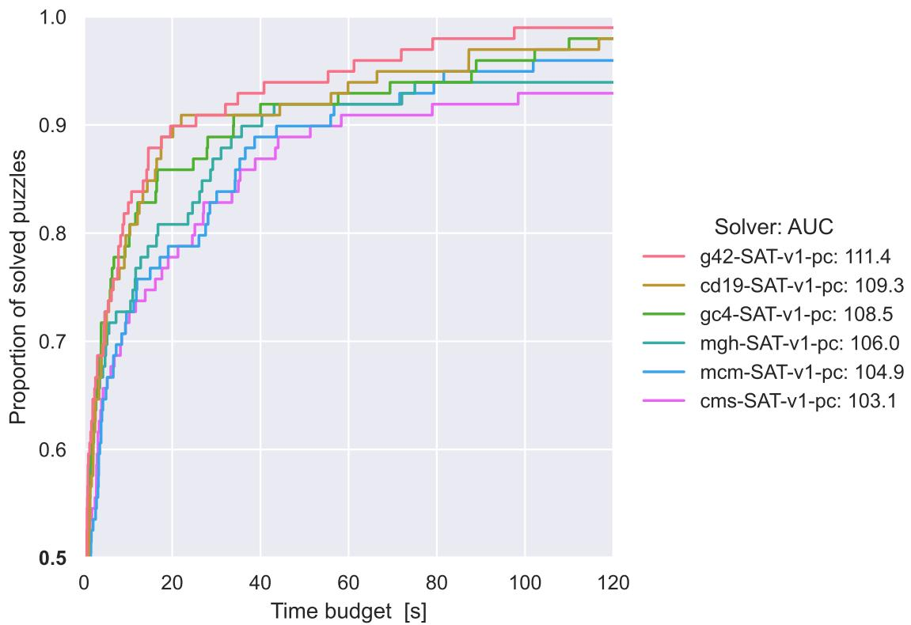  
Figure 14: The graph compares the overall performance of the diferent SAT solvers available in PySAT on 99 Flood-It instances as a survival plot. For the time budget on the �-axis up to two minutes, the curves show the proportion of the puzzles solved. As an overall performance measure, we use the area under the curve (AUC). The values for each solver are given in the legend. For better display, only the range 0.5 to 1 is shown on the �-axis. The abbreviations for the solver are: g42: Glucose 4.2.1, cd19: CaDiCaL 1.9.5, gc4: Gluecard 4.1, mgh: MinisatGH, mcm: MapleCM, cms: CryptoMinisat; see the main text for references. Moreover, ‘v1’ refers to the first SAT formulation given in Sec. 4 and ‘pc’ indicates that the optional constraints (P) and (C) have been used.

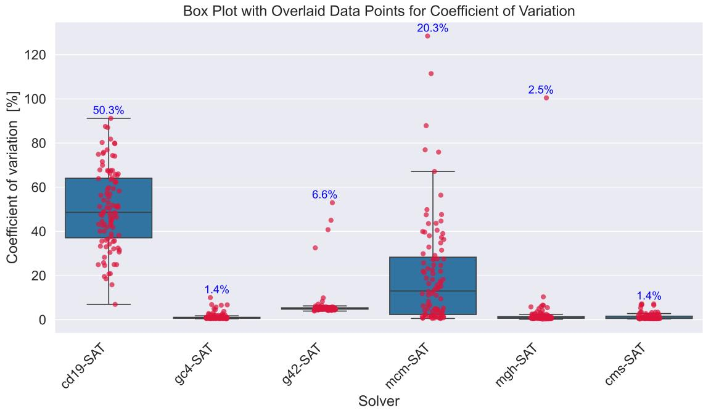  
Figure 15: The coeficient of variation (CV) was calculated across 10 runs for each solver and each puzzle of the training set. The results for six diferent SAT solvers are shown as box plots with an overlay of individual data points.

## A.3 Comparison of the SAT Formulations

Fig. 16 shows the results for the alternative formulation of the SAT problem proposed in [van Stiphout et al., 2020a], see Sec. A.1. All variants are slightly slower compared to the first formulation, which is described in Sec. 4, see Fig. 10.

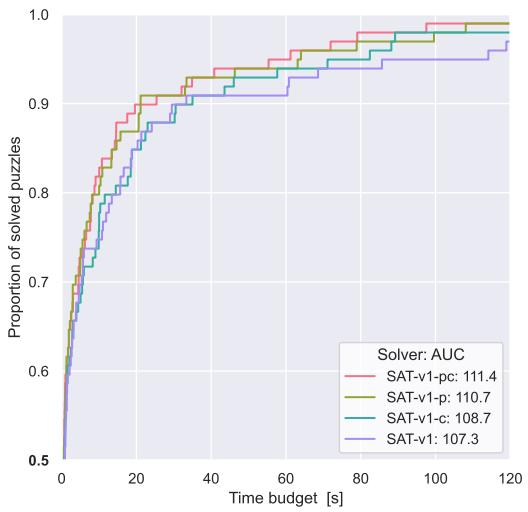  
(a) First SAT formulation

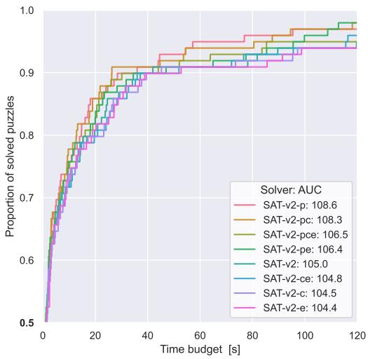  
(b) Second SAT formulation  
Figure 16: This graph shows the performance of the two SAT formulations for the decision problem side-by-side. The first formulation is described in Sec. 4 and the second in Sec. A.1.

## A.4 Variation in Solving Time

The time it takes to solve a Flood-It instance varies for diferent reasons. On one hand, the complexity varies, and on the other hand, some approaches use randomization.

While A\* search is deterministic, some SAT, ILP and CP Solver may resort to randomized search in certain situations. Fig. 17 shows solution times for five selected puzzle instances in ten repeated runs. The puzzles were solved with all eight variants of the SAT formulation using the g42 solver. The variation is high whenever constraint (E) is used.

Coefficient of Variation  
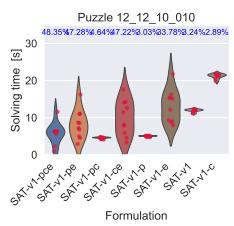

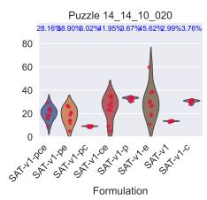

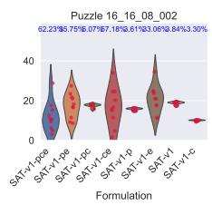

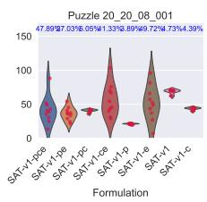

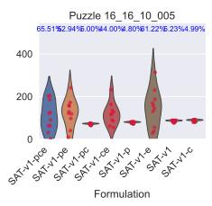  
Figure 17: Distribution of solving times. Five selected instances have been solved repeatedly in ten runs using the eight diferent SAT formulations. The distribution of the ten solving times is shown as violinplot for each solver and instance. The numbers on top are the coeficients of variation.

While Fig. 17 shows the CV for the distributions of five selected instances printed above each violin, Fig. 18 shows the distribution of CVs to visualize the overall variability in the whole database. This confirms that constraint (E) introduces a high variability in the solving times.

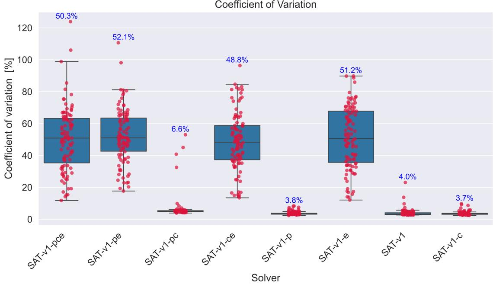  
Figure 18: Coeficient of variation (CV) across repeated runs. The same puzzle instances have been solved using diferent formulations in the SAT solver to calculate CVs. The boxplot of CVs is shown with an overlay of the individual CVs for each instance. A number above a box shows the median CV. Data: 99 Flood-It instances of the training set.

Variability in solving time of the diferent SAT solvers is shown in Sec. A.2, Fig. 15.

While the grid size and the number of colors have a substantial impact on the time required for solving, there is still quite a variability across puzzles, when those parameters are kept fixed, see Sec. A.6, Fig. 20.

## A.5 Comparison of Integer and Constraint Programming Solvers

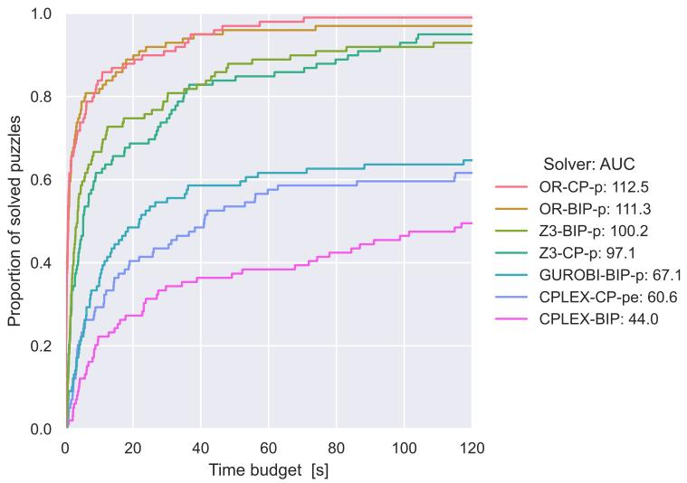  
Figure 19: Comparison of the best constraint (CP) and binary integer programming (BIP) version of each solver $( \mathrm { Z 3 } ,$ , Gurobi, CPLEX) for the decision problem as survival plot. For each time budget on the �-axis up to the timeout limit of 120 ${ \mathrm { s } } ,$ the curves represent the ratio of puzzles solved within that time limit. The values in the legend specify the area under the curve (AUC) as an overall measure of performance. The appendix $ { ^ \circ } -  { \mathrm { p } } ^ { \prime }$ refers to the inclusion of the optional constraint (P), see Sec. 4.

## A.6 Variation in Solving Time for Fixed Size and Colors

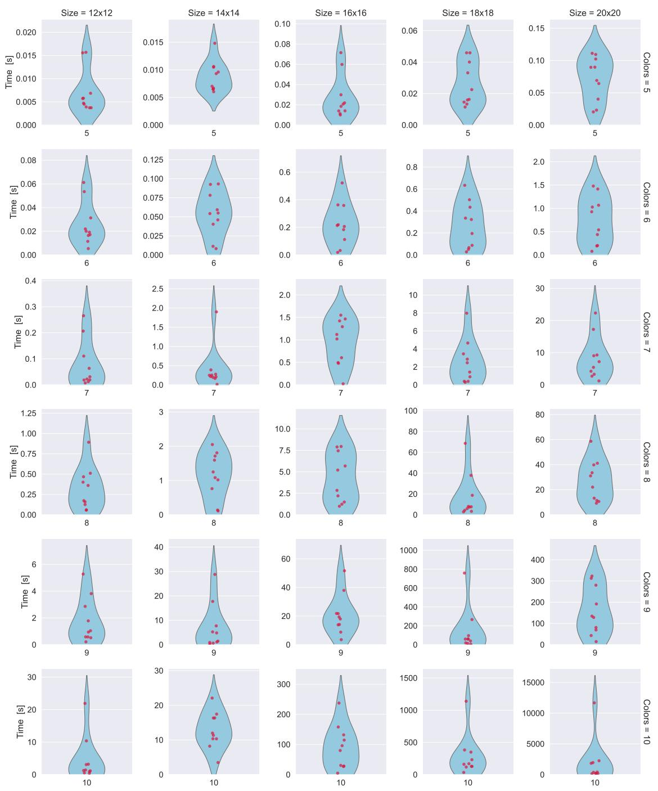  
Figure 20: Variation in solving time for fixed ‘complexity’. Each plot shows data for a fixed combination of puzzle size and number of colors, which can be seen as a measure of (potential) complexity of the puzzle. The violin plots show the distribution of the solution times for the decision problem.

## A.7 Solving Time for SAT Decision Solvers with Inaccurate Bound

Adapting the SAT approach for the minimization problem requires an iterative search, which includes calling the SAT decision solver for values of $T$ that do not match the minimum solution length. For the design of a search strategy it is important to know how the solving times of the SAT decision solver varies, when the given number of moves $T$ is either too low (leading to a failure) or too high (allowing non-optimal solutions). We investigated this dependency exemplarily for ten Flood-It instances using the $\mathtt { g 4 2 }$ solver, see Fig. 21. Denoting the minimum solution length by $\mathrm { T } _ { \mathrm { m i n } } .$ we observe that the peak solving duration is in all these examples within the interval $[ \mathrm { T } _ { \mathrm { m i n } } - 1 , \mathrm { T } _ { \mathrm { m i n } } + 1 ]$ . Solving times for values of $T$ outside this interval are mostly lower than for $T =  { \mathrm { T } _ { \mathrm { m i n } } }$ . Solving times are typically falling of quickly further outside that interval. Fig. 22a shows the average solving times across the selected 10 puzzle instances.

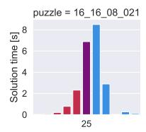

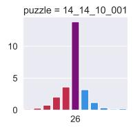

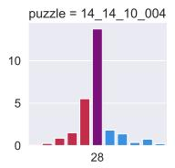

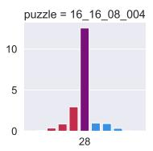

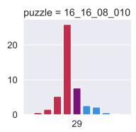

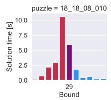

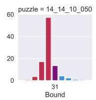

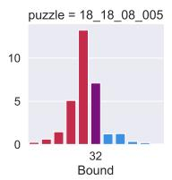

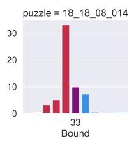

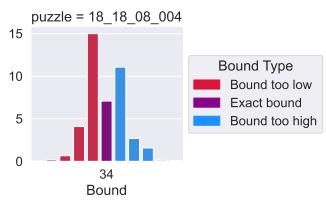  
Figure 21: Solving time when using diferent values for solution length �. For ten Flood-It instances, the solution time with the SAT decision solver was measured for solution lengths $T = \mathrm { T } _ { \mathrm { m i n } } - 5 , \ldots , \mathrm { T } _ { \mathrm { m i n } } + 5 \quad$ where $ \mathrm { T } _ { \mathrm { m i n } }$ is the minimum solution length. (Just to clarify: The solvers return ‘unsolvable’ for $T <  { \mathrm { T } _ { \mathrm { m i n } } }$ and might return a suboptimal solution when $T > \mathrm { T } _ { \mathrm { m i n } } . )$

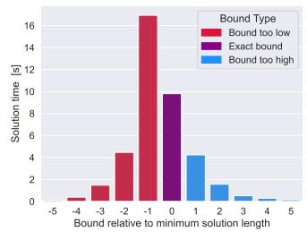  
(a) Results using g42.

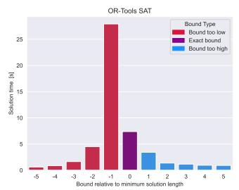

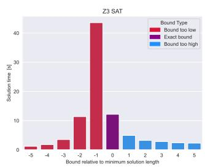  
(b) Results using OR-Tools.  
(c) Results using Z3.  
Figure 22: Average solving time when using diferent values for solution length �. The graph shows the solving times of Fig. 21 averaged across the 10 puzzle instances. Note the diferent scaling in the subfigures.

Interestingly, the situation is crucially diferent when using OR-Tools as solver. While this solver is faster than g42 when the exact bound is given, it is considerably slower when the bound is one below to return the infeasibility of the problem. As this value needs to be probed in the minimization problem, see Sec. 6.4, OR-Tools loses in that problem.

Colors: 5  
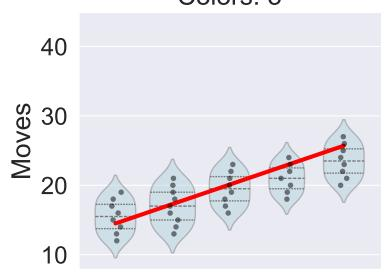

Colors: 6  
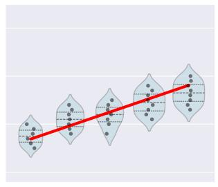

Colors: 7  
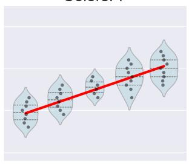

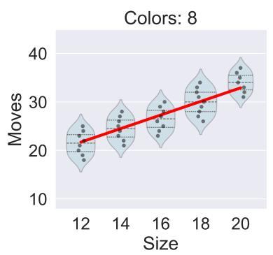

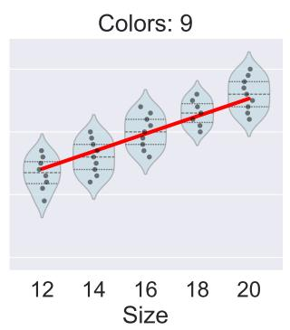

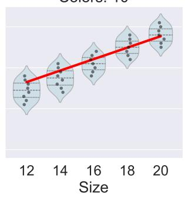  
Figure 23: Regression of solution length projected to colors. The plots are projections of the data from Fig. 5 to the diferent numbers of colors. Each plot shows the distribution of the solution length for the indicated puzzle size as violin plots with an overlay of individual data points. Horizontal lines are shown at quartiles and median. The red line is a projection of the regression plane, see Fig. 5.

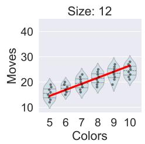

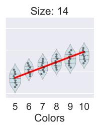

  
Figure 24: Regression of solution length projected to size. The plots are projections of the data from Fig. 5 to the diferent puzzle sizes. Each plot shows the distribution of the solution length for the indicated number of colors as violin plots with an overlay of individual data points. Horizontal lines are shown at quartiles and median. The red line is a projection of the regression plane, see Fig. 5.

## A.9 Lower Bound LBL is not a Consistent Heuristic

As the example in Fig. 25 shows, the lower bound ���(�) defined in Definition 2.13 does not give rise to a consistent heuristic. Since $L B L ( S )$ is admissible by Lemma 2.14, it can be used in $\mathrm { A ^ { * } }$ to find optimal solutions. However, due to the missing consistency, the search procedure is, in general, not greedy, which means that the same nodes may be visited multiple times, which can hamper eficiency.

  
Figure 25: ��� as heuristic is not consistent: The graph depicted on the left side has lower bound ��� of 5 (determined by level � = 2). After one move of playing color 2 (blue), the lower bound ��� of the resulting game state goes down to 3 (determined by both, level $i = 1$ and � = 2). The value of a consistent heuristic may only decrease by 1 after performing one move.