# Speculative Acceptance Does Not Decay with Position: A Full-Length Diagnostic on Long Chain-of-Thought with Independent Drafts

Zhiming Meng

mengzmemail@163.com

## Abstract

The claim that speculative-decoding acceptance rate decays as a chain-of-thought (CoT) grows longer has become a de facto industry narrative, motivating draft-model co-design and positionaware training schemes. Nearly all direct evidence comes from trained drafters whose offline training length is far shorter than inference, and the length-extrapolation account is the explanation that this literature itself gives; a purely positional law has therefore never been isolated. We present the first systematic, full-length measurement of acceptance rate as a function of generation position on MATH-500 (all 500 problems), under two decoding modes (greedy and Leviathan sampling), with two independent drafts—neither trained on target-model outputs— a same-family draft (DeepSeek-R1-Distill-Qwen-1.5B) and a cross-family draft (Qwen2.5-1.5B-Instruct) against DeepSeek-R1-Distill-Qwen-7B, yielding ≈1.78M verification rounds. Using within-problem paired tests to remove compositional confounds, we find that after isolating a greedy-decoding repetition pathology, acceptance rate does not decay with position in any of the four configurations within the supported ranges (greedy 0–8K, sampling 0–12K); on the contrary, the second half of each trajectory is slightly but significantly higher than the first half, and the cross-family configuration shows a larger effect. A controlled temperature sweep further shows that the apparent sampling-mode degradation of high-entropy reflection tokens is a visibility artifact of argmax agreement, not a true drop of the expected acceptance probability. Rejections concentrate with high precision on reflection trigger tokens (e.g. wait, however, check), an entropy-selective failure that a lightweight three-arm LoRA trajectory-alignment intervention (uniform, reflectionmarked, entropy-weighted) fails to improve in mean accepted length (MAL). Taken together, we supply the positional baseline that independent draft–target pairs were missing—not a new mechanism, since the length-extrapolation account is already the stated explanation in the trained-drafter literature— and we localize the residual failure to decision-point entropy rather than to position, redirecting draft alignment toward objectives that directly optimize the acceptance criterion.

## 1 Introduction

Speculative decoding (SD) accelerates large-model inference by having a small draft model propose multiple tokens that the target model verifies in parallel [Leviathan et al., 2023, Chen et al., 2023], without changing the output distribution. Its speedup is governed by the mean accepted length (MAL). With reasoning models such as DeepSeek-R1 [DeepSeek-AI, 2025] routinely producing chains-of-thought of thousands to tens of thousands of tokens, an emerging deployment narrative holds that acceptance rate decays as the chain grows longer. The most direct empirical support is Test-Time Speculation, which reports that trained drafters (EAGLE-3, DFlash, PARD) degrade monotonically with output length, approaching AL ≈ 1 (no speedup) after ∼20K tokens [Kumar et al., 2026]. Recent draft designs likewise presuppose the decay: DSpark addresses intrablock suffix decay with semi-autoregressive drafting [Cheng et al., 2026], and SharpDraft attributes long-context decay to attention-mass dilution [Park et al., 2026].

Crucially, all of the above evidence comes from trained drafters whose offline training sequences are far shorter than inference. Test-Time Speculation states this account explicitly: acceptance declines because speculators are trained offline on short sequences but are forced to match the target on much longer outputs [Kumar et al., 2026]. We therefore do not present that explanation as our contribution. What is missing is the controlled baseline that makes it testable: the trajectory of an independent draft–target pair, which carries no training-length mismatch, over a long CoT. No study has measured that object. The only related short-range evidence comes from tree-based SD on 64-token generations [Abdellatif, 2026], which does not cover long CoT or use within-problem pairing. We supply that baseline, and use it to localize where acceptance actually fails.

## Contributions.

• A positional baseline for independent drafts—the primary contribution (Secs. 3–4). The decay reported for trained drafters admits a length-extrapolation account that its own paper states [Kumar et al., 2026]; testing that account requires a draft–target pair with no training-length mismatch, which has not been measured. We provide it: MATH-500 in full, two decoding modes, two independent draft families, ≈1.78M verification rounds with per-round position, draft tokens, target predictions, and (in sampling mode) the full draft/target probability at each position.

• The baseline does not decay (Sec. 4). After isolating a greedy-decoding repetition pathology that inflates long-position acceptance (Sec. 5, quantified under both problem-weighted and round-weighted estimators), within-problem paired tests show that acceptance rate does not decay with position within the well-supported range;

the second half is slightly but significantly higher in all four configurations, with the cross-family configuration showing a larger effect. Combined with contribution 1, this is the controlled comparison that the existing evidence lacks—not a competing explanation of the trained-drafter result.

• Entropy, not position, is the failure axis (Sec. 6)—the novel diagnostic content of this paper. We establish a dissociation between two acceptance statistics: the visible one (argmax agreement, def2) degrades under sampling, while the true expected acceptance probability α does not. Rejections concentrate with high precision on reflection trigger tokens rather than on late positions. A controlled temperature sweep separates the two statistics directly.

• Intervention falsification (Sec. 7). A three-arm LoRA trajectory-alignment intervention (uniform / reflectionmarked / entropy-weighted) yields no MAL gain over the untrained control at 500 problems, pointing the effective objective away from trajectory fitting and toward directly optimizing the acceptance criterion [Xia et al., 2026, Lei et al., 2026].

## 2 Related Work

Speculative decoding. SD was introduced by Leviathan et al. [2023] and Chen et al. [2023]; the acceptance rule is min $\mathbb { \Lambda } ( 1 , p ( x ) / q ( x ) )$ with a residual resampling correction, and output is distribution-exact. For a survey see Xia et al. [2024]. Draft sources include independent small models, Medusa-style heads [Cai et al., 2024], feature-level drafters (EAGLE-3) [Li et al., 2025], and parallel drafters (PARD) [An et al., 2025].

Acceptance over long sequences. Abdellatif [2026] characterize how acceptance varies with task domain and tree depth for short tree-based generations, and their reported position ordering (tokens 33–64 above 1–32) agrees in sign with our rise; we measure position dependence over 16K-token CoT with within-problem pairing and artifact removal. Kumar et al. [2026] report decay for trained drafters and attribute it to a training–inference length mismatch; Cheng et al. [2026] and Park et al. [2026] address the decay with semi-autoregressive drafting and query scaling, respectively. Our contribution relative to this line is a measurement, not a mechanism: we supply the independent-draft baseline that isolates the mismatch account, and we show where acceptance does fail once position is ruled out.

Draft alignment and entropy. SVIP relates draft entropy to draft–target divergence [Zhang et al., 2025]; EASD proposes entropy-aware rejection resampling [Su et al., 2025]. Training side, SCoT performs thought-level drafting with thinkingbehavior alignment [Wang et al., 2025], D-PACE reweights the per-position training loss toward acceptance-limiting positions [Wu et al., 2026], and acceptance-aware training directly optimizes expected acceptance length [Xia et al., 2026]; Draft-OPD replays verification-exposed errors [Lei et al., 2026]. Our intervention arm (entropy-weighted) is orthogonal, and its negative result supports the acceptance-criterion-aware direction.

## 3 Measurement Setup

Models. Target: DeepSeek-R1-Distill-Qwen-7B. Drafts: DeepSeek-R1-Distill-Qwen-1.5B (same family) and Qwen2.5- 1.5B-Instruct (cross family) [DeepSeek-AI, 2025, Qwen Team, 2024]. The prompt is built with the target’s tokenizer/chat template; the cross-family draft runs only on the shared token sequence, mirroring the real deployment shape of cross-family SD.

Speculative decoding. $\gamma \ = \ 5$ Greedy: draft proposes argmax; target verifies by exact prefix match, emitting its own argmax at the first mismatch. Sampling (R1 official serving parameters, $T { = } 0 . 6 , \mathrm { t o p } { - } p { = } 0 . 9 5 )$ : draft samples with temperature+nucleus; target applies Leviathan sampling verification with acceptance probability min $( 1 , p ( x ) / q ( x ) )$ and residual resampling norm $( \operatorname* { m a x } ( 0 , p - q ) )$ at the first rejection. p and q use the same temperature/nucleus truncation. When the draft vocabulary (151,936) is smaller than the target’s (152,064), q is zero-padded, which is mathematically equivalent on the residual. $\begin{array} { r } { \mathbf { M A L } = ( \sum _ { i } \mathrm { a c c e p t e d } _ { i } + \# \mathrm { r o u n d s } ) / \# } \end{array}$ rounds, i.e., including the bonus token, consistent with vLLM/EAGLE-3.

Two acceptance statistics. We distinguish two quantities throughout. def2 is the visible argmax agreement: the rate at which the draft’s proposed token equals the target’s argmax at that position. It is computable in both modes but is not an expectation under the sampling law. α is the true expected acceptance probability, $\alpha = \mathbb { E } [ \operatorname* { m i n } ( 1 , p / q ) ]$ , evaluated per position over the draft and target distributions $p , q .$ . Because this requires the full distributions, we record α only in sampling mode, where every round stores the draft and target probability at each draft position. Under greedy decoding verification is a deterministic argmax prefix match, no position-level $p , q$ is recorded, and α is therefore not defined there; greedy results are reported in terms of def2 only.

Why the two statistics dissociate. They are not two estimators of one quantity. Since $\begin{array} { r } { \alpha \ = \ \sum _ { x } \operatorname* { m i n } ( p _ { x } , q _ { x } ) \ = } \end{array}$ $1 - \mathrm { T V } ( p , q )$ , α is a mass statistic; def2 is a ranking statistic. Let $a = \arg \operatorname* { m a x } _ { x } p _ { x }$ . With unique argmaxes, def2 = $q ( a ) \mathbf { 1 } \{ \arg \operatorname* { m a x } _ { x } q _ { x } \ = \ a \}$ , so whenever the two argmaxes agree,

$$
\operatorname* { m a x } \{ 0 , \ p ( a ) - ( 1 - \alpha ) \} \ \leq \ \mathrm { d e f 2 } \ \leq \ p ( a ) + ( 1 - \alpha ) ,
$$

and def2 is zero otherwise. The bound fixes def2 only up to an interval of width $2 ( 1 - \alpha )$ around the target’s top-1 mass $p ( a )$ α constrains def2 but does not determine it. The dissociation is largest near ties. For $\begin{array} { r } { p = ( \frac { 1 } { 2 } + \delta , \frac { 1 } { 2 } - \delta ) } \end{array}$ and q with the two entries swapped, $\alpha = 1 - 2 \delta$ while def2 = 0 for every $\delta > 0 - \mathrm { a n }$ arbitrarily small ranking perturbation destroys def2 at essentially no cost in expected acceptance.

This reading is what our measurements show. def2 lies below α in all eight configuration×token-type cells (Figs. 3 and 7), the direction expected when the draft’s top-1 mass sits below the target’s. The temperature sweep moves def2 by 0.081 (0.917 → 0.836) while α moves by 0.012 (0.927 → 0.915): temperature perturbs rankings, not overlap. And at 500 problems the α − def2 gap at reflection tokens is 0.163 (same-family) and 0.074 (cross-family), against 0.006–0.057 at number, operator and text tokens—largest where near-ties are commonest. A diagnostic built on def2 can therefore report a large “degradation” with no change in expected accepted length, which is exactly the pattern we observe.

Data and instrumentation. MATH-500 [Hendrycks et al., 2021, Lightman et al., 2024], all 500 problems, seed 42, and a budget of 16,384 new tokens per problem. Per round we record position, the 5 draft tokens, the 6 target predictions, and accepted count; in sampling mode we additionally record the draft/target probability at each draft position. We report four configurations, abbreviated same (same-family) and xfam (cross-family): same/greedy, same/sample, xfam/greedy, xfam/sample (394,572 / 382,556 / 499,428 / 502,976 rounds).

Statistics. All before–after comparisons are within-problem paired: for each problem, sort rounds by position, split at the median, compute the second-half minus first-half acceptance difference. Group-level significance uses an exact two-sided binomial sign test (problems with zero difference excluded) and problem-level bootstrap (10,000 resamples) 95% CIs. We exclude “loop” problems—generations that exhaust the 16,384- token budget—before the paired tests. Operationally the flag is a length-only rule (total generated length $\geq 1 6 { , } 0 0 0$ tokens); the exclusion rule uses length only, never correctness (all such generations happen to have wrong final answers; Sec. 5), and the conclusions are insensitive to whether the flag is set at 16,000 or at the full cap.

Correctness checks. We verified the implementation against the original algorithm (App. A): per-round $\mathbb { E } [ \operatorname* { m i n } ( 1 , p / q ) ]$ matches observed acceptance to $4 \times 1 0 ^ { - 4 } ;$ a syntheticdistribution unit test shows the output distribution is distribution-exact; the tokenizer alignment across families is verified (0 id conflicts on 151,658 shared tokens); and the four core data files are bit-identical between local and remote.

## 4 Acceptance Does Not Decay (and Rises Slightly)

Fig. 1 shows the main result. Two observations. First, neither mode shows decay within the well-supported range (greedy 0–8K, sampling 0–12K): after loop removal, greedy def2 fluctuates in 0.91–0.94 and sampling def2 in 0.856–0.882, with no downward trend. Second, the greedy full curve’s “rise + right-tail saturation” (0.78 → 0.95+) is largely an artifact of loop problems; after removal it reduces to a mild but significant within-problem rise.

Table 1: Within-problem paired half-difference (second − first) after loop removal. $\begin{array} { r } { \mathrm { \ d e f 1 ~ = ~ \mathbb { E } [ a c c e p t e d ] / \gamma ; ~ } \alpha ~ = ~ } \end{array}$ $\mathbb { E } [ \operatorname* { m i n } ( 1 , p / q ) ]$ ] is the true expected acceptance probability; it is reported only for sampling configurations because greedy decoding does not record position-level $p , q$ (Sec. 3). 95% CIs are problem-level bootstrap (10,000 resamples); “Up/Down” counts problems whose second-half acceptance exceeds / falls below the first half (zero differences excluded); p is the exact two-sided sign test. def2 (argmax-match rate) curves appear in Fig. 1 and are excluded from paired tests because def2 is not an expectation over the sampling law (Sec. 6).
<table><tr><td>Config</td><td>Metric</td><td>Diff</td><td>95% CI</td><td>Up/Down</td><td>p</td></tr><tr><td>same/greedy</td><td>def1</td><td>+0.031</td><td>[+0.026, +0.036]</td><td>327/126</td><td> $1 . 2 \times { { 1 0 } ^ { - 2 1 } }$ </td></tr><tr><td>same/sample</td><td>def1</td><td>+0.028</td><td>[+0.023, +0.033]</td><td>354/130</td><td> $5 . 2 \times { 1 0 } ^ { - 2 5 }$ </td></tr><tr><td>xfam/greedy</td><td>def1</td><td>+0.069</td><td>[+0.063, +0.076]</td><td>393/61</td><td> $1 . 8 \times { { 1 0 } ^ { - 6 0 } }$ </td></tr><tr><td>xfam/sample</td><td>def1</td><td>+0.059</td><td>[+0.053, +0.065]</td><td>407/78</td><td> $9 . 6 \times 1 0 ^ { - 5 5 }$ </td></tr><tr><td>same/sample</td><td>α</td><td>+0.010</td><td>[+0.008, +0.013]</td><td>333/151</td><td> $8 . 3 { \times } 1 0 ^ { - 1 7 }$ </td></tr><tr><td>xfam/sample</td><td>α</td><td>+0.030</td><td>[+0.027, +0.034]</td><td>365/120</td><td> $8 . 7 \times 1 0 ^ { - 3 0 }$ </td></tr></table>

Table 1 gives the paired tests. Allfour configurations show a small but significant rise, with the cross-family configuration roughly doubling the effect $( + 0 . 0 6 9 / + 0 . 0 5 9 )$ . Crucially, the sampling-mode α (a distribution-level quantity) also rises, ruling out the confound that def2 rises merely because the target distribution becomes sharper with position. The same pattern holds when each trajectory is split into within-problem position quintiles instead of halves (Fig. 5): acceptance is flat to slightly rising from Q1 to Q5 in both modes. The sign of the effect is independently corroborated at short range: Abdellatif [2026] report higher acceptance at tokens 33–64 than at 1–32 in a tree-based 64-token setting, and our curves extend that ordering from 64 tokens to the 8–12K range.

Scope. We do not claim decay is impossible. We claim that unconditional, positional decay is absent on MATH-500 CoT for these model pairs, within greedy 0–8K and sampling 0–12K effective support. This does not contradict trained-drafter decay [Kumar et al., 2026]: that literature attributes it to a training– inference length mismatch, and a non-decaying independentdraft curve is exactly what the mismatch account predicts once the mismatch is removed. Our contribution on this axis is the baseline that makes the prediction testable, not the explanation itself; Sec. 6 supplies the part of the diagnosis that is not already implied by that account.

## 5 A Repetition Artifact Inflates Greedy Tail Acceptance

Greedy R1-Distill has a known pathology: a minority of problems fall into an “infinite self-reverification spiral” that exhausts the 16,384-token budget. We flag loop problems by a lengthonly rule—total generated length $\geq 1 6 { , } 0 0 0$ tokens. Greedy has 46 such problems (9.2%), sampling 16 (3.2%), with 8 overlapping; flagging instead at the full 16,384-token cap leaves the greedy count unchanged at 46 and reduces the sampling count to 15. Every flagged generation happens to have a wrong final answer, but correctness is never used as a criterion, so the exclusion cannot condition on the outcome. The rule is also not sensitive to the threshold: varying it from 8K to 16K tokens changes the four paired differences of Table 1 by less than 0.001, and moving from 16,000 to the 16,384-token cap changes them by less than 10−4.

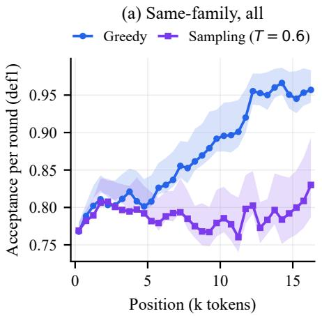

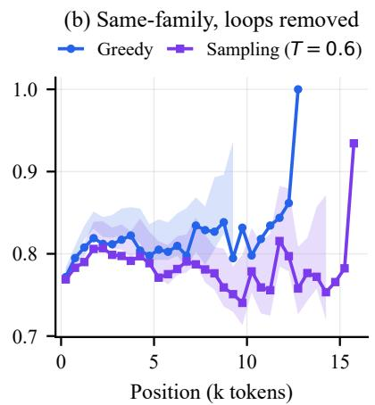

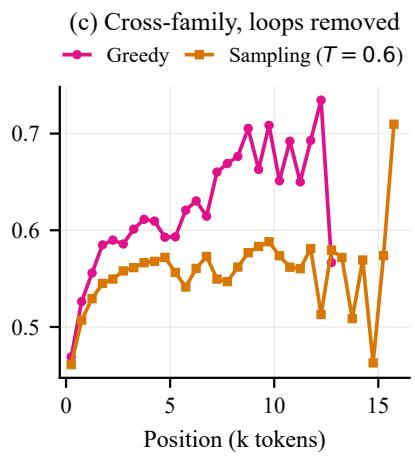  
Figure 1: Acceptance rate vs. generation position. (a) Same-family, all problems: the greedy curve rises and saturates after 12K—almost entirely driven by loop problems. (b) Same-family after removing them: no downward trend, and if anything a slight rise (greedy 0.91–0.94, sampling 0.856–0.882). (c) Cross-family (loops removed) shows the same shape at a lower level. Effective support: greedy 0–8K, sampling 0–12K; beyond these ranges few problems remain and the curves become noisy (Sec. 8), so we do not draw conclusions there.

Table 2: Aggregate half-difference before/after loop removal. Unlike Table 1, rounds are pooled across problems and split at the global median position, so loop problems (which contribute most long-position rounds) dominate the pre-removal column; the paired column of Table 1 weights every problem equally and is the primary statistic.
<table><tr><td>Config</td><td>Full</td><td>Loop removed</td></tr><tr><td>same/greedy</td><td>+0.064</td><td>+0.025</td></tr><tr><td>same/sample</td><td>+0.006</td><td>+0.009</td></tr><tr><td>xfam/greedy</td><td>+0.172</td><td>+0.090</td></tr><tr><td>xfam/sample</td><td>+0.060</td><td>+0.056</td></tr></table>

These problems contribute most of the samples above 12K and behave programmatically—40-char-overlap shingle checks show sentence-level self-reverification rather than verbatim loops (verbatim repeat rate ≈ 0; 5/46 greedy problems have tail verbatim repeat 0.43–0.50). Their anomalous near-0.99 acceptance pollutes long-position statistics. The two estimators bracket the artifact (Fig. 2, Table 2): the round-weighted pooled half-difference drops by ∼60% after loop removal in the samefamily greedy configuration (∼50% cross-family), whereas the problem-weighted paired difference drops only from +0.040 to +0.031—loop problems are 46 of 500, so once every problem counts equally their influence is bounded, and the artifact is primarily a round-weighting effect on long-position statistics. A mild significant rise remains in the paired estimator (Table 1), which App. C decomposes.

## 6 Rejections Concentrate on Reflection Tokens

Classifying draft tokens into number / operator / text / reflection trigger (wait, however, check, verify, . . . ) shows that failure is entropy-selective (Fig. 3): number/operator tokens are accepted $\mathrm { a t \geq 0 . 9 3 }$ in all configurations, while reflection tokens are the clear failure point. Under greedy, non-loop reflection def2 is 0.747, and cross-family misalignment compresses it to 0.367. In sampling mode the same bucket has $\alpha = 0 . 7 8 8 .$ which falls to 0.444 under cross-family misalignment (def2 0.625 → 0.369). Fig. 4 locates these rejections inside the draft block, showing the offset at which the first rejection occurs.

Sampling changes visibility, not acceptance. Sampling makes the high-entropy failure visible: reflection def2 drops $0 . 7 4 7  0 . 6 2 5$ on the full 500-problem non-loop sample (the 100-problem temperature-sweep subset of Table 3 gives 0.636; the two numbers differ only in sample size), but the true expected acceptance probability α does not drop $( 0 . 7 8 8 \geq 0 . 7 4 7 )$ consistent with the overall MAL cost of sampling being only 3.4%. The intuition is that argmax agreement is a poor proxy at high entropy: even a perfectly aligned draft would rarely hit the target’s argmax once the distribution flattens, while the min $( 1 , p / q )$ rule rejects at the true distribution level. The bound of Sec. 3 makes this quantitative: def2 is pinned to the target’s top-1 mass only within 1 − α of mass overlap, so a spread-out draft loses ranking agreement without losing acceptance mass.

Composition shift. Long CoTs drift toward more procedural content (numbers, operators) in the second half, which mechanically raises acceptance. An Oaxaca–Blinder decomposition [Oaxaca, 1973, Blinder, 1973] attributes 30–45% of the residual rise to this composition shift (App. C); the rest is a genuine within-problem effect.

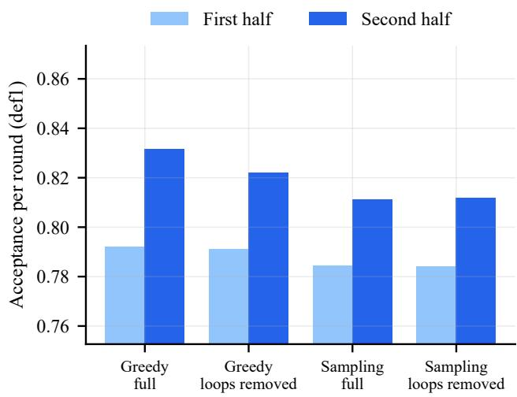  
Figure 2: First-half vs. second-half acceptance (def1), before and after loop removal. Bars use the problem-weighted paired estimator of Table 1: each problem contributes one half-pair, so the 46 loop problems have bounded influence and the greedy excess shrinks only modestly after removal $( + 0 . 0 4 0  + 0 . 0 3 1$ sampling $+ 0 . 0 2 7  + 0 . 0 2 8 )$ . The dominant loop effect is a round-weighting phenomenon: in the pooled statistics (Table 2: $+ 0 . 0 6 4  + 0 . 0 2 5 )$ loop rounds dominate long positions, and the position curves flatten accordingly (Fig. 1(a) vs. (b)).

Table 3: Temperature sweep (same-family sampling, first 100 problems, loop removed). def2 falls sharply with $T ,$ but the true expected acceptance probability α barely moves—the apparent degradation of reflection tokens is a visibility artifact.
<table><tr><td> $T$ </td><td>MAL</td><td>def2</td><td>α</td><td>reflection def2</td><td>reflection α</td></tr><tr><td>0.3</td><td>4.986</td><td>0.917</td><td>0.927</td><td>0.707</td><td>0.785</td></tr><tr><td>0.6</td><td>4.967</td><td>0.886</td><td>0.922</td><td>0.636</td><td>0.802</td></tr><tr><td>0.9</td><td>4.884</td><td>0.836</td><td>0.915</td><td>0.520</td><td>0.809</td></tr></table>

Temperature sweep. We sweep $T \in \{ 0 . 3 , 0 . 6 , 0 . 9 \}$ (Table 3). def2 falls sharply with $T \ ( 0 . 9 1 7 \  \ 0 . 8 3 6 )$ , and reflection def2 collapses $( 0 . 7 0 7  0 . 5 2 0 )$ , yet α barely moves $( 0 . 9 2 7 \ \to \ 0 . 9 1 5 )$ and reflection α slightly rises $( 0 . 7 8 5 \  $ 0.809). This confirms that the sampling-mode “degradation” of reflection tokens is a visibility artifact of argmax agreement, not a true drop of the acceptance probability.

## 7 Entropy-Targeted Draft Training Does Not Help

The diagnosis—failure concentrated at high-entropy reflection decision points, entropy-selective, amplified by family misalignment—naturally suggests that trajectory-alignment training targeted at high-entropy positions should repair it. We test the most direct form with a three-arm LoRA (r=32) intervention: uniform (all positions), reflection-marked (weighted toward reflection triggers), entropy-weighted (weighted by position entropy). Training data: 15,000 MATH training-set trajectories (disjoint from MATH-500), correctness-filtered to 10,279, with per-position entropy annotation from both roles (1.82M tokens).

Table 4: Intervention results at 500 problems (same-family, both decoding modes). MAL is reported with standard errors. $\Delta$ columns are problem-paired differences against the uniform arm—the proper control, since it undergoes identical training on the same trajectories with flat weighting—computed from unrounded per-problem MAL, so a $\Delta$ need not equal the difference of the two rounded column entries; 95% CIs are from paired t-tests. No arm improves over the uniform control; answer accuracy is identical across arms (McNemar $\chi ^ { 2 } { \approx } 0 )$
<table><tr><td>Arm</td><td> $\mathbf { M A L _ { s a m p } }$ </td><td> $\mathbf { M A L } _ { \mathrm { g r e e d y } }$ </td><td> $\overline { { \Delta _ { \mathrm { s a m p } } \ [ 9 5 \% \mathbf { C } \mathrm { I } ] } }$ </td><td></td><td> $\Delta _ { \mathrm { g r e e d y } } [ 9 5 \% \mathrm { C I } ]$ </td></tr><tr><td>base (no training)</td><td> $4 . 9 9 0 { \pm } . 0 1 2 $ </td><td> $5 . 0 6 0 { \pm } . 0 1 3$ </td><td>一</td><td></td><td></td></tr><tr><td>uniform</td><td> $4 . 9 6 1 { \pm } . 0 1 3$ </td><td>5.077±.013</td><td></td><td></td><td></td></tr><tr><td>reflection-marked</td><td> $4 . 9 4 7 { \pm } . 0 1 3$ </td><td>5.058±.013</td><td></td><td> $- 0 . 0 1 3 8 \left[ - 0 . 0 3 2 , + 0 . 0 0 5 \right]$ </td><td> $- 0 . 0 1 9 2 \left[ - 0 . 0 4 2 , + 0 . 0 0 3 \right]$ </td></tr><tr><td>entropy-weighted</td><td> $4 . 9 5 4 { \pm } . 0 1 3$ </td><td>5.072±.013</td><td></td><td> $- 0 . 0 0 7 2 \stackrel { ! } { [ } - 0 . 0 2 6 , + 0 . 0 1 2 ]$ </td><td>-0.0055 [−0.008, −0.003]</td></tr></table>

No arm improves MAL over the uniform training control (Table 4). Fig. 6 shows the four arms in both modes; every interval overlaps the uniform control, and the sampling and greedy orderings are not even consistent with each other. All paired differences are at most 0.02 tokens per round $( < 0 . 4 \% )$ and every confidence interval includes or borderline-includes zero; the single nominally significant cell (greedy, entropy − unif $\mathrm { o r m } = - 0 . 0 0 5 5 , t = - 4 . 1 4 )$ corresponds to five and a half thousandths of a token with effect size $d z = - 0 . 1 9$ , and its sign is negative—the trained arm is, if anything, marginally worse. Scaling from the 100-problem pilot to all 500 problems sharpens rather than weakens the null: per-arm standard errors fall from ≈0.032 to ≈0.013 (a factor of 2.4, matching $\sqrt { 5 0 0 / 1 0 0 } )$ while the between-arm differences fall in step, so this is a confirmed null effect, not an underpowered one.1 Accuracy is identical across arms (McNemar $\chi ^ { 2 } { \approx } 0 )$ , ruling out a trainingdamage account of the null. Meanwhile, on the 100-problem diagnostic subset, argmax agreement at reflection tokens rises by 6.4 percentage points over the untrained draft in the uniform arm (0.645 → 0.709) and by 6.3 in the entropy-weighted arm, while the reflection-marked arm lowers it to 0.551 (Fig. 8)— yet even the largest of these visible alignment gains does not convert into MAL, mirroring the def2/α dissociation of Sec. 6.

Why does the marker-weighted arm move away from the target on exactly the tokens it upweights? The reweighting is narrow: markers occupy 0.85% of response positions (measured on the same-family sampling traces), and after the per-trajectory mean-1 normalization they carry ≈ 4× the weight of an ordinary position while all other positions are scaled by 0.97. The marked set is a closed list of eight single-token strings, so the extra gradient repeats over a small, highly context-dependent set of positions—the regime in which a rank-32 adapter trained for two epochs fits context-specific marker choices instead of generalizing. Two checks argue against a broken run: agreement on text and number tokens stays within 0.0002 of the uniform arm (0.8436 vs. 0.8438; 0.9506 for both), which a corrupted adapter would not leave intact; and the effective sample size of the reweighted objective, $( 1 + 3 p ) ^ { 2 } / ( 1 + 1 5 p ) \approx 0 . 9 3$ at $\scriptstyle p = 0 . 0 0 8 5 .$ , is only $7 \%$ below the uniform arm’s, so a collapse of effective sample size is ruled out. What remains is a shift in the draft’s marker marginal—it proposes markers in contexts where the target does not. We therefore read this arm as a diagnostic of concentrated reweighting rather than as evidence about whether trajectory fitting can help: the causal contrast is uniform vs. entropy, which share trajectories, schedule, and step count and differ only in weight dispersion.

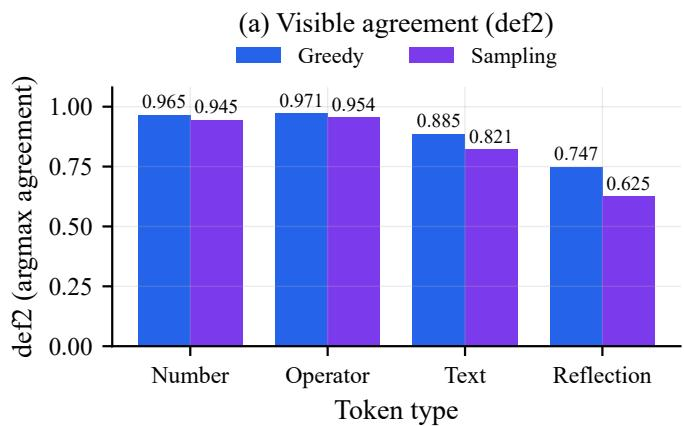

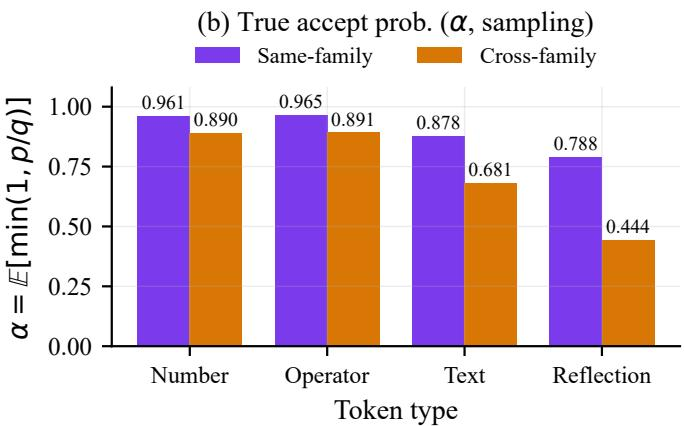  
Figure 3: def2 (visible argmax agreement, both modes) and α (true expected acceptance probability, sampling only—greedy records no position-level $p , q )$ by token type, non-loop. Failure is entropy-selective: number/operator are near-perfect, reflection tokens are the clear failure point, and cross-family misalignment amplifies it.

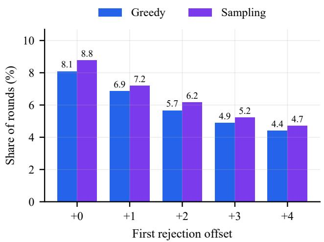  
Figure 4: Mismatch structure at reflection triggers.

The negative result is informative in a narrower sense than a mechanism claim: a draft that is explicitly trained to match the target on these very trajectories still does not improve MAL, so the residual rejection at reflection points is not a draft knowledge deficit that SFT-style trajectory fitting can repair. A natural reading is that these decision points are intrinsically highvariance for the target, but what the experiment establishes is the negative constraint—trajectory fitting does not help— not the positive mechanism. Effective draft alignment must therefore move from “fit the target trajectory” to “optimize the acceptance criterion” (e.g. E[min(1, p/q)] or a proxy), as in acceptance-aware training [Xia et al., 2026] and Draft-OPD [Lei et al., 2026]; our diagnostic protocol and negative evidence provide a quantitative basis for this turn.

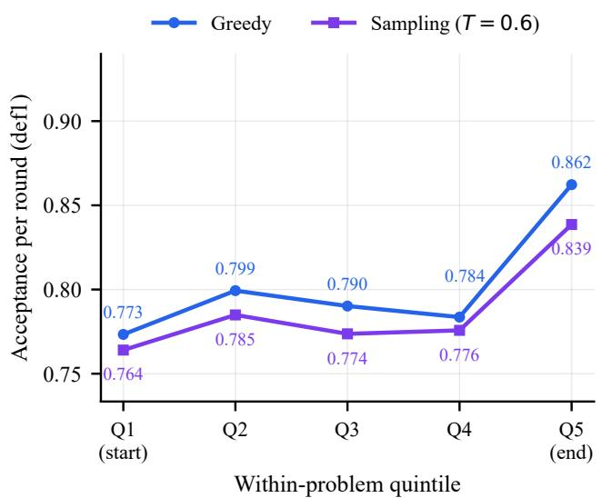  
Figure 5: Within-problem position quintiles: acceptance is flat to-rising after loop removal.

## 8 Discussion and Limitations

Cross-family as a diagnostic amplifier. The cross-family draft is a “misalignment amplifier”: it stretches the same-family repair headroom from +0.3% to a theoretical MAL gain of +25%. However, its γ=5 throughput (24.3 tok/s) is already below the target’s pure autoregressive throughput (46.3 tok/s), so its value is diagnostic, not deployable. All cross-arm throughput and wall-clock numbers reported here were collected on a single physical GPU; App. B documents the multi-GPU audit and the paired hardware-control run.

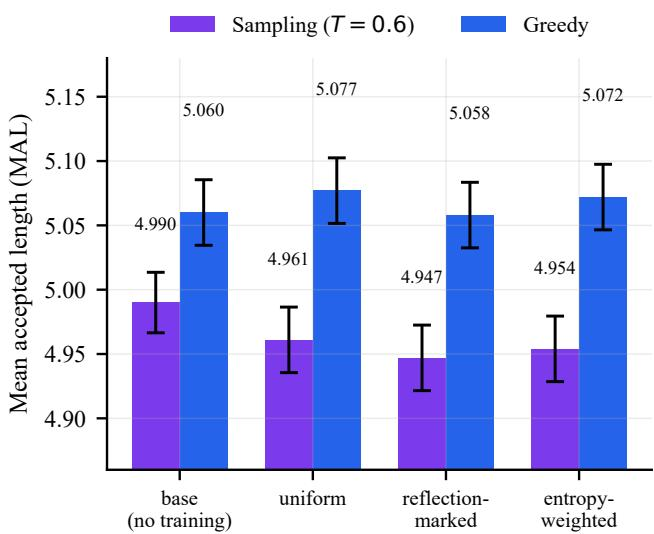  
Figure 6: MAL at 500 problems under the three intervention arms and the untrained base draft (same-family; error bars: standard error). No arm improves over the uniform training control in either decoding mode.

Limitations. (i) Support is limited at long positions: after loop removal, greedy has 15 problems at 8K and 4 at 9K; sampling has 33 at 8K and 11 at 12K—we restrict strong claims to those ranges. (ii) The reflection bucket is small (1.6–2K tokens) in the temperature sweep, so the α rise there is suggestive, not definitive. (iii) A single target family, a single seed, and a fixed γ=5 bound external validity; a Qwen3-8B/1.7B replication with paired cross-family acceptance logging, multi-seed runs, and a γ sweep are future work. (iv) We do not train a lengthextrapolating drafter, so what we report is the independent-draft baseline rather than a direct test of the training–inference mismatch account. Running a trained drafter (EAGLE-3, PARD, or DFlash) under the same full-length protocol is the experiment that would close that loop, and it is the single most important extension of this work. The bound of Sec. 3 makes that extension a sharp test: a drafter trained on target outputs should over-concentrate on the target’s top token, which pushes def2 toward α and can push it above, whereas the flat α profile we measure implies that any decay such a drafter shows must come from mass (TV) rather than from ranking. Logging the target top-1 mass p(a) alongside p, q would adjudicate the two readings directly. (v) MATH-500 is a single domain; extending to other long-form domains is future work.

## 9 Conclusion

We provide the first full-length, controlled measurement of speculative acceptance over position for independent draft–target pairs on long CoT—the baseline against which trained-drafter decay should be read, not a competing explanation of it. After isolating a greedy-decoding repetition artifact and using within-problem pairing, acceptance does not decay with position in any configuration within the supported ranges (greedy 0–8K, sampling 0–12K); if anything it rises slightly. With position thus ruled out as an axis of degradation, we localize the failure on the axis that does matter: rejections concentrate on high-entropy reflection decision points, where the visible (argmax) and true (α) acceptance statistics dissociate. Trajectory alignment cannot repair this, which points the objective of draft alignment at the acceptance criterion itself rather than at trajectory fitting. We hope the protocol and the negative result redirect a growing line of draft-alignment work toward acceptance-aware objectives.

## References

Seifeldin Abdellatif. Acceptance dynamics across cognitive domains in speculative decoding. arXiv preprint arXiv:2604.14682, 2026.

Zihao An, Huajun Bai, Ziqiong Liu, Dong Li, and Emad Barsoum. PARD: Accelerating LLM inference with lowcost PARallel draft model adaptation. arXiv preprint arXiv:2504.18583, 2025.

Alan S. Blinder. Wage discrimination: Reduced form and structural estimates. Journal of Human Resources, 8(4): 436–455, 1973.

Tianle Cai, Yuhong Li, Zhengyang Geng, Hongwu Peng, Jason D. Lee, Deming Chen, and Tri Dao. Medusa: Simple LLM inference acceleration framework with multiple decoding heads. In International Conference on Machine Learning (ICML), 2024. arXiv:2401.10774.

Charlie Chen, Sebastian Borgeaud, Geoffrey Irving, Jean-Baptiste Lespiau, Laurent Sifre, and John Jumper. Accelerating large language model decoding with speculative sampling. arXiv preprint arXiv:2302.01318, 2023.

Xin Cheng, Xingkai Yu, Chenze Shao, Jiashi Li, Yunfan Xiong, Yi Qian, Jiaqi Zhu, Shirong Ma, Xiaokang Zhang, Jiasheng Ye, Qinyu Chen, Chengqi Deng, Jiping Yu, Damai Dai, Zhengyan Zhang, Yixuan Wei, Yixuan Tan, Wenkai Yang, Runxin Xu, Yu Wu, Zhean Xu, Xuanyu Wang, Muyang Chen, Rui Tian, Xiao Bi, Zhewen Hao, Shaoyuan Chen, Huanqi Cao, Wentao Zhang, Anyi Xu, Huishuai Zhang, Dongyan Zhao, and Wenfeng Liang. DSpark: Confidence-scheduled speculative decoding with semi-autoregressive generation. arXiv preprint arXiv:2607.05147, 2026.

DeepSeek-AI. DeepSeek-R1: Incentivizing reasoning capability in LLMs via reinforcement learning. Nature, 645: 633–638, 2025. doi: 10.1038/s41586-025-09422-z.

Dan Hendrycks, Collin Burns, Saurav Kadavath, Akul Arora, Steven Basart, Eric Tang, Dawn Song, and Jacob Steinhardt. Measuring mathematical problem solving with the MATH dataset. In Advances in Neural Information Processing Systems, Datasets and Benchmarks Track (NeurIPS D&B), 2021. arXiv:2103.03874.

Avinash Kumar, Sujay Sanghavi, and Poulami Das. Test-time speculation. arXiv preprint arXiv:2605.09329, 2026.

Haodi Lei, Yafu Li, Haoran Zhang, Shunkai Zhang, Qianjia Cheng, Xiaoye Qu, Ganqu Cui, Bowen Zhou, Ning Ding, Yun Luo, and Yu Cheng. Draft-OPD: On-policy distillation for speculative draft models. arXiv preprint arXiv:2605.29343, 2026.

Yaniv Leviathan, Matan Kalman, and Yossi Matias. Fast inference from transformers via speculative decoding. In International Conference on Machine Learning (ICML), 2023. arXiv:2211.17192.

Yuhui Li, Fangyun Wei, Chao Zhang, and Hongyang Zhang. EAGLE-3: Scaling up inference acceleration of large language models via training-time test. In Advances in Neural Information Processing Systems (NeurIPS), 2025. arXiv:2503.01840.

Hunter Lightman, Vineet Kosaraju, Yura Burda, Harri Edwards, Bowen Baker, Teddy Lee, Jan Leike, John Schulman, Ilya Sutskever, and Karl Cobbe. Let’s verify step by step. In International Conference on Learning Representations (ICLR), 2024. arXiv:2305.20050; source of the MATH-500 subset.

Ronald L. Oaxaca. Male-female wage differentials in urban labor markets. International Economic Review, 14(3):693– 709, 1973.

Jeonghoon Park, Seongwoon Jo, Jongwon Lee, and Taesik Gong. SharpDraft: Accelerating long-context speculative decoding with cardinality-aware query scaling. arXiv preprint arXiv:2610.05106, 2026.

Qwen Team. Qwen2.5 technical report. arXiv preprint arXiv:2412.15115, 2024.

Tiancheng Su, Meicong Zhang, and Guoxiu He. Entropy-aware token rejection for improving speculative decoding. arXiv preprint arXiv:2512.23765, 2025.

Jikai Wang, Juntao Li, Jianye Hou, Bowen Yan, Lijun Wu, and Min Zhang. Efficient reasoning for LLMs through speculative chain-of-thought. arXiv preprint arXiv:2504.19095, 2025.

Tianyu Wu, Yu Yao, Zhenting Qi, Han Zheng, Zhuohan Wang, Haoran Ma, Lawrence Liao, Himabindu Lakkaraju, Ju Li, and Yilun Du. D-PACE: Dynamic position-aware crossentropy for parallel speculative drafting. arXiv preprint arXiv:2605.18810, 2026.

Heming Xia, Zhe Yang, Qingxiu Dong, Peiyi Wang, Yongqi Li, Tao Ge, Tianyu Liu, Wenjie Li, and Zhifang Sui. Unlocking efficiency in large language model inference: A comprehensive survey of speculative decoding. In Findings ofthe Associationfor Computational Linguistics: ACL 2024, 2024. arXiv:2401.07851.

Tianhua Xia, Mugilan Ganesan, Yifei Feng, Haiyu Wang, Maximilian Egger, and Sai Qian Zhang. Acceptance-aware draft model training for speculative decoding. arXiv preprint arXiv:2609.24150, 2026.

Ziyin Zhang, Jiahao Xu, Tian Liang, Xingyu Chen, Zhiwei He, Rui Wang, and Zhaopeng Tu. Draft model knows when to stop: Self-verification speculative decoding for long-form generation. In Conference on Empirical Methods in Natural Language Processing (EMNLP), pages 16685–16697, 2025. arXiv:2411.18462.

## A Reproducibility and Correctness of the Measurement

Position conclusions are meaningful only if the measurement pipeline is correct. We therefore validate it in two layers.

Algorithmic fidelity. We align the implementation step-by-step against the original Algorithm 1 of Leviathan et al. [2023], cross-checked against Chen et al. [2023] and the vLLM EAGLE-3 implementation; all steps match. Four measurement conventions differ from a literal reading of the algorithm and are quantified: (i) temperature+top-p truncation makes exactness hold for the truncated target distribution $\tilde { p }$ (the same convention as standard inference frameworks; our autoregressive baseline uses the same T/top-p); (ii) the recorded position is the round-start confirmed length, a constant +1 offset that does not change any binning or half-split conclusion (recomputing with true positions changes the four paired differences $\mathrm { b y } < 0 . 0 0 2 )$ ; (iii) EOS inside the accepted prefix truncates the output text but still counts the round, affecting 0.06% of tokens; (iv) a pending bonus round runs one extra draft forward (throughput only, not distribution).

Data integrity and internal consistency. (a) The measurement, configuration, and analysis code, and all eight core data files, are bit-identical between the local workstation and the remote server (verified by cryptographic hash). (b) All four datasets parse cleanly (2,000 problems, 1,779,532 rounds), with zero malformed lines, zero duplicate keys, and zero violations of the structural invariants (round continuity, γ=5, accepted-count range, and the MAL identity). (c) The per-round $\mathbb { E } [ \operatorname* { m i n } ( 1 , p / q ) ]$ computed from the recorded p, q matches observed acceptance to $4 \times 1 0 ^ { - 4 }$ (expected vs. observed accepted per round: same-family 3.9447 vs. 3.9441; cross-family 2.6694 vs. 2.6703; per-position survival max deviation $4 \times 1 0 ^ { - 4 } )$ . (d) A synthetic distribution unit test shows the speculative sampler is distribution-exact (total variation 0.00375 vs. direct sampling 0.00346; max deviation 0.00079, below the sampling noise floor 0.00158). (e) Tokenizer alignment across families is verified (0 id conflicts on 151,658 shared tokens; the cross-family draft adds only 7 tokens). All checks were re-run at a second, independent time point with identical results.

## B Hardware and Throughput Measurement Policy

Every throughput (tok/s) and wall-clock comparison reported in this paper was collected on a single physical GPU per comparison This policy matters because the two devices in our pool—an RTX 4090 and an RTX 3090 Ti—differ by 5–15% on batch-1 decoding, enough to masquerade as a method effect. Two properties make the paper’s conclusions immune even where a configuration was split across devices. First, MAL is computed from the recorded acceptance path and, with a fixed seed and prompts, is a deterministic function of the model pair; device speed cannot enter it. Second, answer-match is a property of the generated text alone. Consequently, every number in Tables 1–4 is either a MAL-type or an accuracy-type quantity, and no throughput number from a multi-device configuration is used anywhere in this paper.

An audit of the intervention runs found one early configuration that violated the single-device policy: the three arms had been scheduled as reflection-marked on the 4090 and uniform/entropy-weighted on the 3090 Ti. The resulting apparent throughput advantage of the reflection-marked arm (+5.0% sampling, +3.6% greedy) is fully consistent with that split and is therefore withdrawn; it is not reported as a method effect and does not appear in any table. The MAL null result is unaffected, both because MAL is device-invariant by construction and because the sign of the MAL differences is opposite to the throughput ordering, which excludes a hardware explanation of the null.

As a determinism check, the uniform checkpoint was re-run under the pilot protocol (100 problems, seed 42, T=0.6, topp=0.95; 81,347 rounds) and reproduced the pilot’s MAL to four decimals $( 4 . 9 2 8 4 \pm 0 . 0 3 0 2 )$ , confirming that the acceptance path is reproducible across runs. A paired two-device run of the same checkpoint is the direct way to quantify the residual hardware offset; because no cross-device throughput claim is made in this paper, it does not affect any reported number.

## C Oaxaca–Blinder Decomposition of the Residual Rise

We decompose the within-problem second-half − first-half acceptance difference into a composition component (change in token-type mix) and a rate component (change in per-type acceptance), using the Oaxaca–Blinder decomposition [Oaxaca, 1973, Blinder, 1973]. Across the four configurations, 30–45% of the residual rise is attributed to composition shift (long CoTs become more procedural in the second half), leaving a genuine within-problem rate effect. Full per-configuration tables are in the code release. Fig. 7 gives the cross-family counterparts of Figs. 3 and 5.

## D Additional Figures

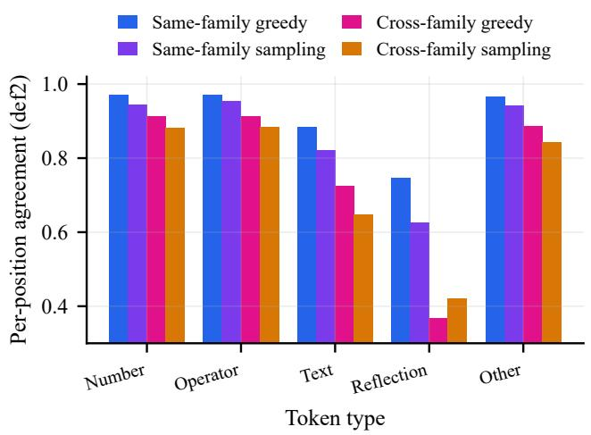

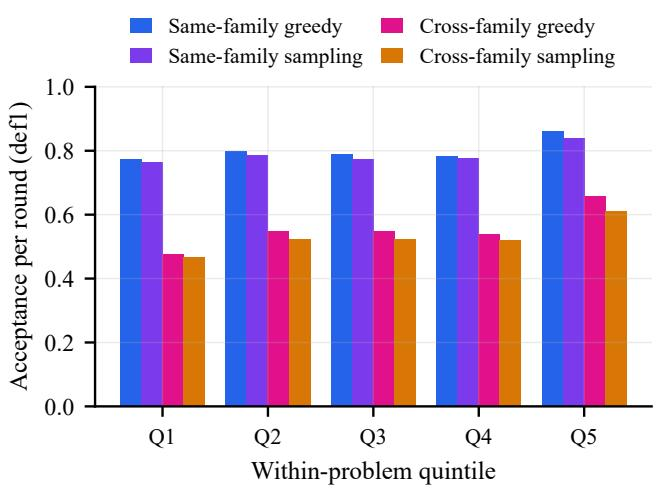  
Figure 7: Cross-family counterparts of Figs. 3 and 5: (left) token-type breakdown and (right) within-problem position quintiles.

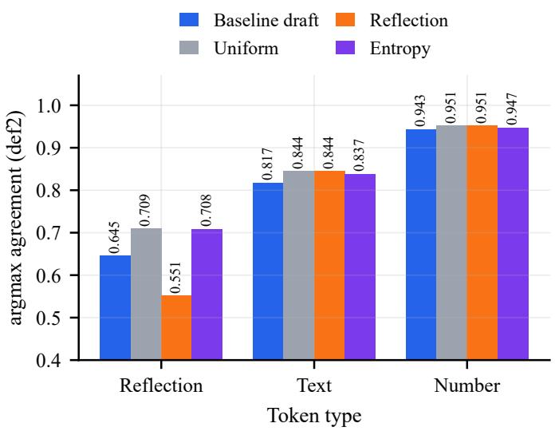  
Figure 8: Token-type breakdown for the intervention experiment (100-problem diagnostic subset).