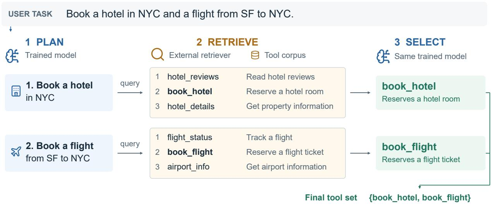
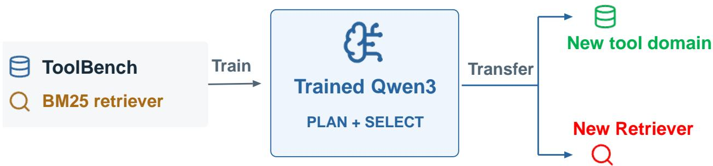
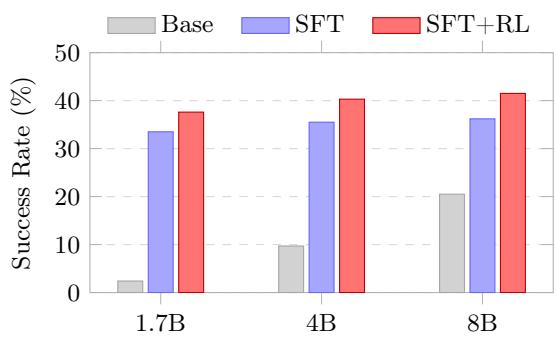
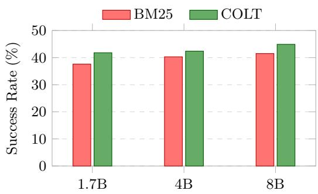
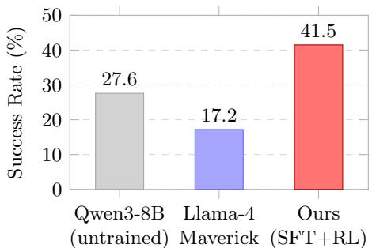
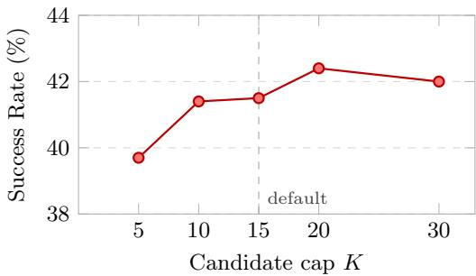
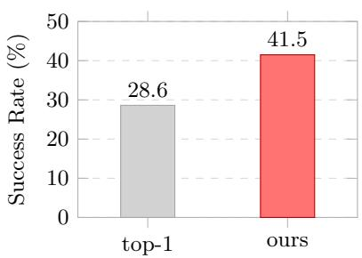
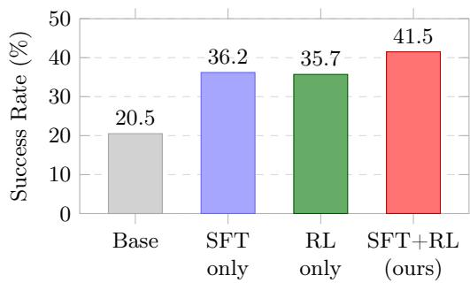

# Training Small Language Models for Transferable Tool Selection

Zhaoyi Zhou¹,2,\*, Akshayaa Magesh¹, Jeongyeol Kwon¹, Artem Kuriksha¹, Daniel Jiang¹, Andrea Zanette², Ayush Jain1

1Meta, 2Carnegie Mellon University

\*Work done at Meta

As LLM agents operate over corpora of more than ten thousand tools, selecting the right tool for a complex multi-step user instruction becomes a central bottleneck. Tool descriptions cannot all fit in context, and relevance-based retrievers only rank tools without knowing which are actually needed. Recent work instead leverages proprietary commercial LLMs like Claude or ChatGPT to drive a retriever, decomposing the instruction and selecting over retrieved candidates. We show that a small, open model can be trained via reinforcement learning to perform the same functionality. On ToolBench, a Qwen3-8B model post-trained with our recipe outperforms Llama-4-Maverick (402B) In addition, the trained model transfers directly to different retrievers and generalizes to new tool corpora in different domains.

Date: October 22, 2026 Correspondence: Zhaoyi Zhou at zhaoyiz@andrew.cmu.edu

∞Meta

## 1 Introduction

Large language model (LLM) agents increasingly solve user tasks by invoking external tools (or APIs)1 e.g., sending an email, booking a flight, or fetching data from the web, rather than producing an answer from the model's learned knowledge alone. As agents are applied to real software ecosystems, the number of callable tools has grown to well over ten thousand in some public tool corpora (Qin et al., 2024; Shi et al., 2025), and enterprises add proprietary tools for internal use. At this scale, the model's context overflows if every tool description is placed in it, so selecting the right tool becomes a bottleneck that precedes the actual execution

The classical solution is a retriever, which scores each tool by its similarity to the user instruction and returns a small set of high-scoring candidates for the agent to choose from. Retrievers come in two broad families. Lexical retrievers such as BM25 (Best Matching 25) (Robertson and Zaragoza, 2009) score a tool by how many query terms appear in its documentation, weighting rarer terms more heavily, and apply to any corpus without training. Dense retrievers such as COLT (Qu et al., 2024) instead embed the instruction and each tool description into a shared vector space with an encoder trained on the target corpus, and rank tools by embedding similarity. LLMs have also been introduced to assist a fixed retriever by rewriting queries (Chen et al., 2024; Kachuee et al., 2025), expanding documents (Lu et al., 2026; Senthil et al., 2026; Wu et al., 2025), or re-ranking candidates (Zheng et al., 2024b). However, a retriever can only assign a relevance-based ranking over tools; it does not know which of them the task actually requires. This is especially problematic when the user instruction contains multiple substeps and requires multiple tools.

To address this, recent work places the LLM at the center of the selection workflow and uses the retriever as a meta-tool invoked on demand. Instead of consuming a single ranked list produced in one pass, the LLM drives retrieval across turns in a ReAct-style loop (Braunschweiler et al., 2025; Lumer et al., 2025a, 2026): a PLAN stage decomposes the user instruction into substeps, a RETRIEVE stage fetches a set of relevant candidates, and a SELECT stage chooses the tools it judges necessary, repeating until the instruction is covered. Because the model, not the ranking function, decides which retrieved tools are required, this design directly handles the multi-substep, multi-tool instructions that a relevance ranking alone cannot address. Existing work performs tool selection with proprietary commercial models such as Claude or ChatGPT under careful prompt tuning. Since tool selection is a recurring sub-routine of the agentic tool-calling pipeline, we ask whether a small model can perform the task.

  
Figure1 Illustration of the PLAN-RETRIEVE-SELECT tool selection workflow. The same trained model decomposes the request and selects a tool for each substep. Each substep issues one query to an external retriever, which filters candidates by score and retains at most K for the SELECT stage.

While an off-the-shelf small model performs poorly on its own, fine-tuning specifically for tool selection is a viable solution. However, this raises the key technical challenge of transferability:

• Transferability across tool domains. A tool-selection model trained on one domain of tools should be usable directly on another, so that a separate model need not be trained for every tool corpus.

• Transferability acrossretrievers. Some tools carry specific tool names and thus favor exact string matching, whereas other tools are better found by semantic matching, so the preferred retriever depends on the underlying tool corpus. We want the model to work under a new retriever without retraining.

These challenges are tractable under the studied framework because tool selection is built on the generalizable skills of the underlying LLM: decomposing the user instruction and matching a tool description to it. The LLM needs no domain-specific knowledge, and the workflow stays invariant to different retrievers. We therefore fine-tune Qwen3 models (Yang et al., 2025) with reinforcement learning to acquire these skills, and transfer them to new domains and retrievers (Figure 2).

Our main contributions are as follows:

• Training a small LLM for tool selection. We fine-tune off-the-shelf Qwen3 models (1.7B, 4B, and 8B) with RL. On ToolBench, their performance exceeds that of Llama-4-Maverick (402B) (Meta AI, 2025) with prompt tuning.

• Domain transferability. The trained LLM transfers zero-shot across tool corpora: trained on ToolBench G3, it selects tools on G2, Gorilla, CRAFT, and TaskBench with no additional training.

• Retriever transferability. A model trained over BM25 drives a domain-specialized dense retriever (COLT) at inference without retraining, retaining its learned selection behavior.

## 2 Related Work

Tool retrievers. Conventional approaches treat tool selection as a single-shot retrieval over tool descriptions. ToolBench trains a Sentence-BERT retriever (Qin et al., 2024); ToolRet benchmarks tool retrieval and shows that general-purpose IR encoders transfer poorly to tools (Shi et al., 2025); COLT adds a query-tool-scene graph to optimize for completeness (Qu et al., 2024); ToolGen represents each tool as a vocabulary token (Wang et al., 2025); ToolRerank adds hierarchy-aware reranking (Zheng et al., 2024b); and Gao and Zhang (2025) size the returned set per task instead of a fixed top-k. Beyond retrieval, MetaTool (Huang et al., 2024) benchmarks whether a model knows when and which tool to use.

  
Figure 2 Once trained, our model directly transfers to other tool corpora in new domains and is compatible with new retrievers, without additional model training.

LLM-assisted retrieval. An LLM can also improve a fixed retriever. It can expand tool documents offline (Lu et al., 2026; Senthil et al., 2026; Wu et al., 2025; Lumer et al., 2025b), rewrite the query for single-pass retrieval (Chen et al., 2024; Kachuee et al., 2025), or operate the retriever across turns: iterative LLM feedback (Xu et al., 2024), mid-conversation re-querying (Lumer et al., 2025a), short-term tool memory (Lumer et al., 2026), and ReAct-style retrieval with one query per decomposed substep (Braunschweiler et al., 2025). Our workflow follows the multi-turn design, but trains a small model instead of prompting a large one.

Action generalization in RL. Standard RL assumes a fixed action set, whereas our actions are tools from a corpus that could change between training and deployment. Prior work handles large or changing action sets by learning action representations (Dulac-Arnold et al., 2015; Chandak et al., 2019, 2020), and generalizes zero-shot to unseen actions by inferring their representations from action information acquired separately from the task (Jain et al., 2020, 2022). Our SELECT stage is such a policy over a varying action set of the retrieved tools, with each represented by its documentation. The LLM supplies these representations implicitly without a separately trained action encoder.

RL-trained LLM agents. DeepAgent (Li et al., 2026) trains an end-to-end deep reasoning agent covering tool discovery and execution. Zhang et al. (2024) derive DPO preferences for single-shot query rewriting from a frozen retriever's rankings, and ToolRL (Qian et al., 2025) studies reward design for tool learning. None of them study transferability in tool selection. Beyond tool selection, RL has also been applied to other search problems: open-domain QA (Jin et al., 2025; Song et al., 2025; Chen et al., 2025; Sun et al., 2025), query generation (Jiang et al., 2025), web agents (Zheng et al., 2025; Li et al., 2025; Qi et al., 2025), and retriever training from agent trajectories (Zhou et al., 2026).

## 3 Method

Given a user instruction x and a tool corpus T too large to fit in the model's context, tool selection asks for the subset $T \subseteq { \mathcal { T } }$ of tools that x requires. Rather than training a corpus-specific dense retriever, we let a single small model π operate a lightweight, corpus-agnostic retriever R to find these tools. We first define the workflow through which π drives R (§3.1), and then describe how π is trained: supervised fine-tuning (§3.2) followed by reinforcement learning (§3.3). Unless otherwise stated, R is BM25 (Robertson and Zaragoza, 2009), which requires no training and applies to any corpus. The transfer to new tool domains in §4 therefore comes from the trained model rather than from a retriever fitted to the target corpus.

Algorithm 1: Tool-selection workflow.   
Input: User instruction x; model $\pi ;$ retriever $\mathcal { R } ;$ score threshold $\tau ;$ candidate cap K   
Output: Predicted tool set $T$   
// Plan   
1 Model $\pi _ { \mathrm { P L A N } }$ decomposes x into substep texts s1, s2, · · · , sn; $T \gets \emptyset$   
2 foreach substep text $s _ { i }$ do   
// Retrieve   
3 Retriever R scores every tool by $s _ { i } .$   
4 $C _ { i }$ ← Set of tools with score above τ.   
5 Truncate $C _ { i }$ to top-K tools according to score.   
6 if $C _ { i } = \varnothing$ then continue   
// Select   
7 Model πSELEcT selects one tool id from $C _ { i }$ given $s _ { i } .$   
8 $T \gets T \cup ( \{ i d \} \cap C _ { i } )$   
9 end   
10 return $T$

## 3.1 The tool-selection workflow

The LLM drives the retriever through a three-stage workflow (Figure 1 and Algorithm 1): a PLAN stage decomposes the user instruction into substeps, a RETRIEVE stage fetches relevant candidates, and a SELECT stage chooses the tools it judges necessary, repeating until the instruction is covered

PLAN. A user instruction often contains several requests. For instance, "book a flight from San Francisco to New York City and find a hotel in New York City" naturally splits into two. Because the retriever scores tools against the whole query, the terms of one request interfere with retrieval for the other. The model therefore first decomposes the instruction into an ordered list of substeps, each a short natural-language description of a single required capability.

RETRIEVE. For each substep, the retriever scores all tool descriptions against the substep text in a single query. We keep tools scoring above a threshold τ and truncate them to the top K, which filters out irrelevant tools and bounds the context loaded at the SELECT stage. Unless otherwise stated, $\tau = 3$ and $K = 1 5$ . We train with BM25, but any retriever that scores tools against a substep, such as COLT (Qu et al., 2024), a dense retriever trained on the ToolBench corpus, can be substituted at test time without retraining.

SELECT. The descriptions of the candidate tools are loaded into the LLM's context, and the LLM selects the tool that best fulfills the substep. This assumes that each substep can be solved by exactly one tool and that substeps are independent, i.e., no substep needs the output of another. The selected tools are accumulated across substeps, and their union is returned as the final tool set. The same model π serves both LLM stages under two different prompts (Appendix D). We write $\pi _ { \mathrm { P L A N } }$ and $\pi _ { \mathrm { S E L E C T } }$ only to indicate which prompt is used. Each LLM call is stateless and sees only the user instruction (PLAN) or the current substep with its $\le K$ candidates (SELECT), so the per-call context is bounded regardless of corpus size or plan length.

## 3.2 Data Curation for Supervised Fine-Tuning

Reinforcement learning from an off-the-shelf base model is slow to start as the base model rarely completes the workflow successfully, so we warm-start the policy with supervised fine-tuning (SFT) on synthetic trajectories before the RL stage (§3.3). We use Llama-4-Maverick as the teacher model to create the training examples.

Gold tool filtering. We assume access to a reference gold tool set for each query in the training data, but this set can be noisy. For instance, ToolBench (Qin et al., 2024) collects gold tools from a reference solution trajectory, so some gold tools are not determined by anything the user wrote, and others are redundant near-duplicates. Training on such tools would teach the agent to select tools that the instruction does not call for. Therefore, our filter keeps a (query, gold tool) pair only if the tool can be identified from the query alone. A deterministic first pass keeps any pair whose query and tool documentation share a content word. The remaining pairs go to the teacher model, which keeps only those whose query contains a paraphrase or synonym of the tool's function. The resulting curated gold set is used for both training and evaluation.

Plan decomposition. Given the surviving gold tools, the teacher model decomposes each user instruction into substeps, matching each substep to one of them. It may emit fewer substeps than gold tools, because some gold tools, though relevant, are unnecessary for the instruction. These unused gold tools are removed from the gold set as an additional round of filtering.

Reasoning generation. The generated substeps and the gold tools determine the tool-selection trajectory, but we still generate reasoning text so that the model can more easily learn how to act in the PLAN and SELECT stages. For PLAN, given the user instruction and the generated substeps, the teacher model writes the reasoning that justifies the decomposition. We do not reuse the teacher's reasoning from the decomposition step itself, because the teacher saw the gold tools there and its reasoning would leak them. For SELECT, the teacher model writes the reasoning that justifies picking the gold tool among the candidates retrieved for the generated substep. A validation step flags any reasoning that names a tool outside the candidate set or leaks candidate indices, and triggers regeneration when a violation occurs.

Fine-tuning. We collect the reasoning and actions generated during data curation in JSON format and form (prompt, reasoning + action) pairs for all rounds of LLM generation (prompt templates in Appendix D). We then apply standard SFT so that the model learns the basic thinking pattern and output format for both the PLAN and SELECT stages, preparing it for RL (§3.3).

## 3.3 Reinforcement Learning

Starting from the SFT checkpoint, we further train the model with RL for better performance (§4). For training stability, we decouple PLAN and SELECT into separate stages: when training SELECT, we use the high-quality substeps generated by the teacher model instead of the model's own plans. Each stage is then a single stateless LLM call with its own reward, so we can train it with standard GRPO (Shao et al., 2024). The remaining question is how to design the PLAN and SELECT rewards without additional human annotation.

PLAN reward. The PLAN stage is rewarded based on substep text quality, which is reflected by the candidate set retrieved with this text. A plan is good when every gold tool is retrieved by one substep at a high rank and there are no redundant substeps. Therefore, we treat the substeps as a set and measure its precision and recall against the gold tools.

Suppose the user instruction has N gold tools, and the planning stage emits n substeps. Running substep i through the retriever yields a ranked candidate list $A _ { i } .$ We try to match every list $A _ { i }$ with a gold tool. We walk the substeps i in order and scan each $A _ { i }$ in descending order of score. The first gold tool that has not been matched previously is matched to $A _ { i } ,$ and we move on to the next substep. If no such gold tool is found, $A _ { i }$ is unmatched.

Let $n _ { \mathrm { c o v } }$ be the number of matched substeps. Then precision is the fraction of substeps that are matched:

$$
{ \mathrm { p r e c i s i o n } } = { \frac { n _ { \mathrm { c o v } } } { n } } .
$$

Precision penalizes unmatched substeps, encouraging every substep to match a unique tool.

Let $i _ { 1 } , i _ { 2 } , \cdots , i _ { n _ { \mathrm { c o v } } }$ be the substeps that are matched with a gold tool, and the matched gold tool appears in rank $\rho _ { j }$ for substep $i _ { j }$ . Recall is the fraction of gold tools covered, graded by rank:

$$
{ \mathrm { r e c a l l } } = { \frac { 1 } { N } } \sum _ { j = 1 } ^ { n _ { \mathrm { { c o v } } } } { \frac { 1 } { \rho _ { j } } } .
$$

Recall encourages every gold tool to be matched at a higher rank, i.e., the retriever is more confident with the gold tool.

The planning reward combines precision and recall by their harmonic mean, i.e., $F _ { 1 }$ score:

$$
R _ { \mathrm { P L A N } } = F _ { 1 } ( \mathrm { p r e c i s i o n } , \mathrm { r e c a l l } ) .
$$

SELECT reward. Selection is scored by exact match against the substep's gold. Because each substep targets a single gold tool g (§3.1), the SELECT reward is

$$
R _ { \mathrm { { S E L } } } = \mathbf { 1 } \bigl [ \mathrm { s e l e c t e d } = \{ g \} \bigr ] ,
$$

which is 1 only when the policy picks exactly the gold and nothing else. This terminal reward is, per substep, the quantity the evaluation exact-match metric measures.

## 4 Experiments

Our experiments answer three questions about the trained agent. (i) Success Rate. How does a small. locally-hosted tool-selection agent compare against inference-only baselines that drive the same task with a much larger, general-purpose model accessed by prompting alone (§4.1)? (ii) Domain generalization. Does an agent trained on a single tool corpus transfer, with no retraining, to unseen corpora and domains (§4.2)? (iii) Retrievergeneralization. Is the learned policy tied to the retriever it trained on, or can the retrieval backend be swapped at test time for a stronger, domain-specialized one (§4.3)? To answer these questions, we train the Qwen3 model family at three model scales (1.7B, 4B, and 8B) on the ToolBench G3 (Qin et al., 2024) training split, which contains 21,361 user instructions over a corpus of 1,419 APIs for the model to select. Each user instruction in this benchmark requires multiple tools and can be decomposed into several independent substeps, so it aligns with our assumption.

## 4.1 Tool Selection Success Rate

We report evaluation results on the test split of Tool-Bench G3, which contains 2,124 user instructions. Success rate is defined with an exact-match metric: tool selection on one user instruction is considered successful if and only if the selected tool set matches exactly with the filtered gold tool set of §3.2, and the success rate is averaged over all tested user instructions. Prior work on tool retrieval mostly reports ranking metrics over the retrieved list, such as Recall@K and NDCG@K (Qin et al., 2024; Qu et al., 2024; Shi et al., 2025), or completeness, whether every gold tool appears in the top-K (Qu et al., 2024; Shi et al., 2025). These credit a candidate list that contains the gold tools. Our metric is stricter: the agent must commit to a set, and both a missing tool and an extra tool count as a failure.

  
Figure 3 Effect of training on ToolBench G3 (test split, 2,124 instructions). Success rate for Qwen3 at three scales, run through the same PLAN-RETRIEVE— SELECT workflow untrained (Base), after SFT, and after SFT followed by RL (SFT+RL).

Figure 3 shows the effect of training: we compare the success rate of the untrained Qwen3 model, the model

after SFT, and the model after SFT followed by RL (SFT+RL), at three scales. An untrained model performs poorly under our PLAN-RETRIEVE-SELECT workflow. This is expected, as the model has not learned how to decompose user instructions and select tools. SFT alone raises the success rate above 30% at every scale, and RL improves it further (e.g., from 36.2% to 41.5% at 8B).

We further compare our SFT+RL model against the larger Llama-4-Maverick by prompting. We use four workflows to run Llama-4-Maverick, all with few-shot prompts and greedy decoding:

• ReAct, a ReAct style workflow following ToolReAGt (Braunschweiler et al., 2025). We use BM25 retriever and include plan decomposition to make a fair comparison with our workflow. After the same PLAN stage as in our workflow, a ReAct loop is run for each substep: in every turn it writes its own search query, observes the BM25 top-K candidates for that query, and either searches again (up to four times) or commits one tool. The union over substeps is the prediction. This differs from our workflow in two ways: 1) the model writes the retrieval query rather than reusing the substep text; 2) a substep may issue several retrievals rather than one.

• Hierarchical search, following AnyTool (Du et al., 2024). No retriever is needed. Instead, the model walks the ToolBench taxonomy from category to tool to API, and a self-reflection turn re-enters the tree when the selection looks incomplete.

• Search-R1-style (Jin et al., 2025): a single flat reasoning stream that interleaves <think>, <search> over BM25 (top-10 per search, up to six searches), and a final <answer> holding the tool set, without decomposition.

• Our workflow (§3.1), with the untrained Maverick as planner and selector.

Table 1 shows that the Search-R1-style workflow pairs best with the untrained large model, reaching 30.6% success rate. However, this result still lags behind that of our trained model. Even the smallest 1.7B model can be trained to reach 37.6% success rate. Our workflow reaches only 10.1% success rate for Llama-4-Maverick, which further emphasizes the necessity of training when using our workflow. Given the same Llama-4-Maverick model, ReAct exceeds our workflow by 18%, at the cost of up to five model calls per substep instead of one.

<table><tr><td>Method Success Rate (%)</td></tr><tr><td>Llama-4-Maverick (prompted) + ReAct 28.4</td></tr><tr><td>+ hierarchical search 8.6</td></tr><tr><td>+ Search-R1 style 30.6 + our workflow 10.1</td></tr><tr><td>Qwen3 (SFT+RL) + our workflow</td></tr><tr><td>1.7B 37.6</td></tr><tr><td>4B 40.3 8B 41.5</td></tr></table>

## 4.2 Transferability across Benchmarks

A tool-selection agent is only useful if it works on corpora it was not trained on, so we test the models trained on ToolBench G3 directly on four benchmarks. We choose them to probe two independent axes of transferability: how far the tool corpus and domain shift from the training distribution, and whether the task needs a single tool or several. ToolBench G2 is the mildest shift: a larger, mostly-disjoint split of the same RapidAPI universe

Table1 Tool-selection success rate on the ToolBench G3 test split (2,124 instructions) under exact match: an instruction succeeds if and only if the selected tool set equals the gold set. Llama-4-Maverick is prompted under four interaction protocols. Qwen3 models are trained with SFT followed by RL (§3). The best run is underlined.

(11,474 tools, only \~9% shared with G3) in the same multi-tool scenario. Gorilla (Patil et al., 2024) and cRAFT (Yuan et al., 2024) come from entirely different tool repositories and domains, exercising a much larger vocabulary shift. All user instructions in both benchmarks have exactly one gold tool, so no PLAN stage is needed and thus we focus on the transferability of the SELECT stage. Finally TaskBench (Shen et al.. 2024) is the multi-tool out-of-domain case: tasks from entirely different domains that each require several tools, evaluated over each split's own tool inventory, so it is a comprehensive evaluation of both planning and selection.

The results are shown in Table 2. On ToolBench G2 the trained agent transfers, though below its in-domain G3 score (\~24% vs. 40% at 4B). The 8× larger, mostly-disjoint corpus adds distractors and pushes gold deeper into the BM25 ranking. Even so, it beats the strongest untrained baseline (Maverick + Search-R1. 20.8%). The same checkpoints have a clear transfer advantage on single-tool benchmarks (Gorilla and CRAFT) over Llama-4-Maverick, so the SELECT stage transfers across domains. The only exception happens on TaskBench, in which Llama-4-Maverick with the Search-R1-style workflow gives an 8 pp higher success rate than our method. This shows that the PLAN stage requires some domain knowledge and thus the Search-R1-style workflow, which requires no decomposition, performs better. Nonetheless, our small model still beats Llama-4-Maverick on ReAct and our workflow, which both include a PLAN stage.

<table><tr><td rowspan="2">Method</td><td colspan="4">Success Rate (%)</td></tr><tr><td>ToolBench G2</td><td>Gorilla</td><td>CRAFT</td><td>TaskBench</td></tr><tr><td>Llama-4-Maverick (prompted)</td><td></td><td></td><td></td><td></td></tr><tr><td>+ ReAct</td><td>15.6</td><td>16.0</td><td>18.0</td><td>60.2</td></tr><tr><td>+ Search-R1 style</td><td>20.8</td><td>15.9</td><td>41.0</td><td>80.6</td></tr><tr><td>+ our workflow</td><td>4.4</td><td>9.2</td><td>47.9</td><td>36.9</td></tr><tr><td>Qwen3 (untrained) + our workflow</td><td></td><td></td><td></td><td></td></tr><tr><td>1.7B</td><td>0.9</td><td>5.5</td><td>44.8</td><td>5.8</td></tr><tr><td>4B</td><td>4.4</td><td>8.7</td><td>49.7</td><td>45.6</td></tr><tr><td>8B</td><td>11.2</td><td>8.0</td><td>53.4</td><td>55.3</td></tr><tr><td>Qwen3 (SFT) + our workflow</td><td></td><td></td><td></td><td></td></tr><tr><td>1.7B</td><td>21.8</td><td>17.6</td><td>64.7</td><td>54.4</td></tr><tr><td>4B</td><td>23.0</td><td>14.5</td><td>65.9</td><td>59.2</td></tr><tr><td>8B</td><td>23.9</td><td>26.8</td><td>66.4</td><td>66.0</td></tr><tr><td>Qwen3  $( S F T + R L ) \ : + \ : o u r$  workflow</td><td></td><td></td><td></td><td></td></tr><tr><td>1.7B</td><td>23.7</td><td>21.2</td><td>67.9</td><td>63.1</td></tr><tr><td>4B</td><td>23.5</td><td>19.7</td><td>68.2</td><td>72.8</td></tr><tr><td>8B</td><td>25.8</td><td>29.9</td><td>69.0</td><td>72.8</td></tr></table>

Table 2 Transferability results to new tool domains. The Qwen3 models are trained on the training split of ToolBench G3, the same checkpoints as in Table 1. All numbers are success rates in percent (%). Column max underlined

## 4.3 Transferability to new retrievers

Our models are trained over BM25. The RETRIEVE step is an interface that returns a ranked candidate set, and any retriever that scores the corpus against a substep can fill it. We test this by swapping BM25 for COLT (Qu et al., 2024), a dense retriever trained specifically on the ToolBench corpus, and evaluate the models directly on the test split of ToolBench G3, without additional training. Figure 4 reports the success rate under each retriever.

Swapping in COLT improves the success rate at every scale. This is because COLT is an expert retriever for ToolBench, and our model inherits the stronger retriever's recall without any retraining. We nevertheless train with BM25 because it requires no corpus-specific training, which ensures that the transfer results above do not depend on a strong in-domain retriever.

  
Figure 4 Swapping the retriever at inference on the ToolBench G3 test split. The same G3-trained (BM25) checkpoints are run with BM25 or COLT (Qu et al., 2024) behind the RETRIEVE step, with no additional training.

## 4.4 Ablations

The ablation studies are all evaluated on the test split of ToolBench G3.

Planner. We ablate the model used for the PLAN stage, by replacing the trained 8B model with: 1) the untrained Qwen3-8B; 2) Llama-4-Maverick. We hold the RETRIEVE and SELECT stages fixed. As shown in Figure 5a, the trained planner is the best of the three. The much larger Maverick planner performs worst, indicating that training, not model scale, drives planning quality on this task.

Candidate set size. We sweep the retrieved candidate set size K, i.e., the number of candidates handed to the SELECT stage, on the fixed 8B checkpoint. Success rate increases with K up to $K = 2 0$ and does not improve further at K = 30 (Figure 5b): a larger set is more likely to contain the gold tool, but additional candidates also act as distractors. We set $K = 1 5$ as our training and evaluation configuration to balance context consumption and performance.

  
(a) Planner

  
(b) Candidate set size

  
(c) Selector

  
(d) SFT warm-up  
Figure 5 Ablations on the ToolBench G3 test split with the 8B checkpoint. (a) We ablate the PLAN stage by replacing the planner model with untrained Qwen3-8B and Llama-4-Maverick. (b) Success rate as the number of retrieved candidates K handed to SELECT varies. The dashed line marks the default K = 15. (c) The learned SELECT stage ("ours") is replaced by a fixed rule that commits the BM25 top-1 candidate of each substep (“top-1"). (d) We run RL directly from the untrained model (RL only) to ablate SFT.

Selector. We replace the SELECT stage with a fixed selection rule that commits the retriever's top-1 tool for each substep. Against the same BM25 retriever the pipeline uses, the learned selector improves success by about 13% over taking the top-1 candidate (Figure 5c), because the highest-scoring BM25 candidate is often not the tool the substep requires.

SFT warm-up. To test whether the SFT stage is necessary, we run our RL recipe directly from the off-the-shelf 8B model, with no SFT initialization, which is viable because the base already completes the workflow with a non-zero success rate for GRPO to bootstrap from. Direct RL lifts the base model performance from 20.5% to 35.7%, but lands at a similar level to SFT only (36.2%) and below the full SFT+RL recipe (41.5%), supporting the value of SFT as a warm-up procedure (Figure 5d).

## 5 Conclusion

Tool selection over a large tool corpus is a recurring sub-routine of agentic tool calling, and prior work runs it by prompting proprietary models to operate a retriever. We showed that this capability can be trained into a small open model. Under a minimal PLAN-RETRIEVE-SELECT workflow, supervised warm-up on teacher-written trajectories followed by RL with a retrieval-based planning reward and an exact-match selection reward lifts Qwen3 models of 1.7B to 8B parameters past Llama-4-Maverick (402B) on ToolBench G3, with no human annotation beyond the gold tool sets. Because the skills involved, i.e., instruction decomposition and tool selection from description, are not tied to a specific tool corpus, the same checkpoints transfer without retraining to new tool domains and to new retrievers, inheriting the stronger retriever's recall We hope this work encourages further study of tool selection with small LLMs.

## Acknowledgments

We thank Tal Lancewicki for discussion and valuable feedback during the project. This work was partially supported by the National Science Foundation under Grant CCF-2106778.

## References

Norbert Braunschweiler, Rama Doddipatla, and Tudor-Catalin Zorila. ToolReAGt: Tool Retrieval for LLM-based Complex Task Solution via Retrieval Augmented Generation. In Proceedings of the 3rd Workshop on Towards Knowledgeable Foundation Models (KnowFM), pages 75–83, Vienna, Austria, 2025. Association for Computational Linguistics. doi: 10.18653/v1/2025.knowllm-1.7. https://aclanthology.org/2025.knowllm-1.7/.

Yash Chandak, Georgios Theocharous, James Kostas, Scott Jordan, and Philip Thomas. Learning action representations for reinforcement learning. In Proceedings of the 36th International Conference on Machine Learning, volume 97 of PMLR, 2019.

Yash Chandak, Georgios Theocharous, Chris Nota, and Philip S. Thomas. Lifelong learning with a changing action set. In Proceedings of the AAAI Conference on Artificial Intelligence, volume 34, 2020.

Mingyang Chen, Linzhuang Sun, Tianpeng Li, Haoze Sun, Yijie Zhou, Chenzheng Zhu, Haofen Wang, Jeff Z. Pan, Wen Zhang, Huajun Chen, Fan Yang, Zenan Zhou, and Weipeng Chen. ReSearch: Learning to Reason with Search for LLMs via Reinforcement Learning. Advances in Neural Information Processing Systems, 38:85287–85307, 2025. doi:10.52202/085713-2858.

Yanfei Chen, Jinsung Yoon, Devendra Singh Sachan, Qingze Wang, Vincent Cohen-Addad, Mohammadhossein Bateni, Chen-Yu Lee, and Tomas Pfister. Re-Invoke: Tool Invocation Rewriting for Zero-Shot Tool Retrieval. In Yaser Al-Onaizan, Mohit Bansal, and Yun-Nung Chen, editors, Findings of the Association for Computational Linguistics: EMNLP 2024, pages 4705–4726, Miami, Florida, USA, November 2024. Association for Computational Linguistics. doi: 10.18653/v1/2024.findings-emnlp.270. https://aclanthology.org/2024.findings-emnlp.270/.

Yu Du, Fangyun Wei, and Hongyang Zhang. AnyTool: Self-Reflective, Hierarchical Agents for Large-Scale API Calls In Proceedings of the 41st International Conference on Machine Learning, volume 235 of Proceedings of Machine Learning Research, pages 11812–11829. PMLR, 2024. https://proceedings.mlr.press/v235/du24h.html.

Gabriel Dulac-Arnold, Richard Evans, Hado van Hasselt, Peter Sunehag, Timothy Lillicrap, Jonathan Hunt, Timothy Mann, Theophane Weber, Thomas Degris, and Ben Coppin. Deep reinforcement learning in large discrete action spaces. arXiv preprint arXiv:1512.07679, 2015.

Hang Gao and Yongfeng Zhang. Task-Aligned Tool Recommendation for Large Language Models. In Kentaro Inui, Sakriani Sakti, Haofen Wang, Derek F. Wong, Pushpak Bhattacharyya, Biplab Banerjee, Asif Ekbal, Tanmoy Chakraborty, and Dhirendra Pratap Singh, editors, Proceedings of the 14th International Joint Conference on Natural Language Processing and the 4th Conference of the Asia-Pacific Chapter of the Association for Computational Linguistics, pages 2023–2045, Mumbai, India, December 2025. The Asian Federation of Natural Language Processing and The Association for Computational Linguistics. ISBN 979-8-89176-298-5. doi: 10.18653/v1/2025.ijcnlp-long.110. https://aclanthology.org/2025.ijcnlp-long.110/.

Yue Huang, Jiawen Shi, Yuan Li, Chenrui Fan, Siyuan Wu, Qihui Zhang, Yixin Liu, Pan Zhou, Yao Wan, Neil Gong, and Lichao Sun. MetaTool Benchmark for Large Language Models: Deciding Whether to Use Tools and Which to Use. In International Conference on Learning Representations, volume 2024, pages 42978–43007, 2024. https://proceedings. iclr.cc/paper\_files/paper/2024/hash/bc12914d66b41b6bfc2d3a5decdb498b-Abstract-Conference.html.

Gautier Izacard, Mathilde Caron, Lucas Hosseini, Sebastian Riedel, Piotr Bojanowski, Armand Joulin, and Edouard Grave. Unsupervised dense information retrieval with contrastive learning. arXiv preprint arXiv:2112.09118, 2021.

Ayush Jain, Andrew Szot, and Joseph J. Lim. Generalization to new actions in reinforcement learning. In Proceedings of the 37th International Conference on Machine Learning, volume 119 of PMLR, pages 4661–4672, 2020.

Ayush Jain, Norio Kosaka, Kyung-Min Kim, and Joseph J. Lim. Know your action set: Learning action relations for reinforcement learning. In International Conference on Learning Representations, 2022.

Pengcheng Jiang, Jiacheng Lin, Lang Cao, Runchu Tian, SeongKu Kang, Zifeng Wang, Jimeng Sun, and Jiawei Han DeepRetrieval: Hacking Real Search Engines and Retrievers with Large Language Models via Reinforcement Learning. In Second Conference on Language Modeling (COLM), 2025. https://openreview.net/forum?id=u9JXu4L17I.

Bowen Jin, Hansi Zeng, Zhenrui Yue, Jinsung Yoon, Sercan Arik, Dong Wang, Hamed Zamani, and Jiawei Han. Search-R1: Training LLMs to Reason and Leverage Search Engines with Reinforcement Learning. In Second Conference on Language Modeling (COLM), 2025. https://openreview.net/forum?id=Rwhi91ideu.

Mohammad Kachuee, Sarthak Ahuja, Vaibhav Kumar, Puyang Xu, and Xiaohu Liu. Improving Tool Retrieval by Leveraging Large Language Models for Query Generation. In Owen Rambow, Leo Wanner, Marianna Apidianaki Hend Al-Khalifa, Barbara Di Eugenio, Steven Schockaert, Kareem Darwish, and Apoorv Agarwal, editors, Proceedings

of the 31st International Conference on Computational Linguistics: Industry Track, pages 29–38, Abu Dhabi, UAE, January 2025. Association for Computational Linguistics. https://aclanthology.org/2025.coling-industry.3/.

Woosuk Kwon, Zhuohan Li, Siyuan Zhuang, Ying Sheng, Lianmin Zheng, Cody Hao Yu, Joseph Gonzalez, Hao Zhang, and Ion Stoica. Efficient memory management for large language model serving with PagedAttention. In Proceedings of the 29th Symposium on Operating Systems Principles, pages 611–626, 2023.

Xiaoxi Li, Jiajie Jin, Guanting Dong, Hongjin Qian, Yongkang Wu, Ji-Rong Wen, Yutao Zhu, and Zhicheng Dou. WebThinker: Empowering Large Reasoning Models with Deep Research Capability. In Advances in Neural Information Processing Systems, volume 38, pages 120091–120131. Curran Associates, Inc., 2025. https://proceedings neurips.cc/paper\_files/paper/2025/hash/ae03bdef276132fae089692445725635-Abstract-Conference.html.

Xiaoxi Li, Wenxiang Jiao, Jiarui Jin, Guanting Dong, Jiajie Jin, Yinuo Wang, Hao Wang, Yutao Zhu, Ji-Rong Wen, Yuan Lu, and Zhicheng Dou. DeepAgent: A General Reasoning Agent with Scalable Toolsets. In Proceedings of the ACM Web Conference 2026, pages 2219–2230, 2026. doi: 10.1145/3774904.3792460.

Xing Han Lù. BM25S: Orders of magnitude faster lexical search via eager sparse scoring. arXiv preprint arXiv:2407.03618, 2024.

Xuan Lu, Haohang Huang, Rui Meng, Yaohui Jin, Wenjun Zeng, and Xiaoyu Shen. Tools are under-documented: Simple Document Expansion Boosts Tool Retrieval. In International Conference on Learning Representations, volume 2026, pages 141631-141653, 2026. https://proceedings.iclr.cc/paper\_files/paper/2026/hash/ e54a9889f1048526365ed8fb56c8c8cd-Abstract-Conference.html.

Elias Lumer, Anmol Gulati, Vamse Kumar Subbiah, Pradeep Honaganahalli Basavaraju, and James A. Burke. ScaleMCP: Dynamic and Auto-Synchronizing Model Context Protocol Tools for LLM Agents, May 2025a. http: //arxiv.org/abs/2505.06416. arXiv:2505.06416 [cs.CL].

Elias Lumer, Vamse Kumar Subbiah, James A. Burke, Pradeep Honaganahalli Basavaraju, and Austin Huber. Toolshed: Scale Tool-Equipped Agents with Advanced RAG-Tool Fusion and Tool Knowledge Bases. In Proceedings of the 17th International Conference on Agents and Artificial Intelligence (ICAART), volume 3, pages 1180–1191. SciTePress, 2025b. doi: 10.5220/0013303000003890.

Elias Lumer, Anmol Gulati, Vamse Kumar Subbiah, Pradeep Honaganahalli Basavaraju, and James A. Burke. MemTool: Optimizing Short-Term Memory Management for Dynamic Tool Retrieval and Invocation in LLM Agent Multi-turn Conversations. In European Conference on Information Retrieval, pages 237–253. Springer, 2026. doi: 10.1007/978-3-032-21300-615.

Meta AI. The Llama 4 herd: The beginning of a new era of natively multimodal AI innovation. https://ai.meta.com/ blog/llama-4-multimodal-intelligence/, April 2025.

Shishir G. Patil, Tianjun Zhang, Xin Wang, and Joseph E. Gonzalez. Gorilla: Large language model connected with massive APIs. In Advances in Neural Information Processing Systems, volume 37, 2024. doi: 10.52202/079017-4020.

Zehan Qi, Xiao Liu, Iat Long Iong, Hanyu Lai, Xueqiao Sun, Wenyi Zhao, Yu Yang, Xinyue Yang, Jiadai Sun, Shuntian Yao, Tianjie Zhang, Wei Xu, Jie Tang, and Yuxiao Dong. WebRL: Training LLM Web Agents via Self-Evolving Online Curriculum Reinforcement Learning. In International Conference on Learning Representations, volume 2025, pages 79791–79821, 2025. https://proceedings.iclr.cc/paper\_files/paper/2025/hash/ c66e1fcc9691aae706250638f36f681b-Abstract-Conference.html.

Cheng Qian, Emre Can Acikgoz, Qi He, Hongru Wang, Xiusi Chen, Dilek Hakkani-Tür, Gokhan Tur, and Heng Ji. ToolRL: Reward is All Tool Learning Needs. Advances in Neural Information Processing Systems, 38:105523–105553. 2025. doi: 10.52202/085713-3524.

Yujia Qin, Shihao Liang, Yining Ye, Kunlun Zhu, Lan Yan, Yaxi Lu, Yankai Lin, Xin Cong, Xiangru Tang, Bill Qian, Sihan Zhao, Lauren Hong, Runchu Tian, Ruobing Xie, Jie Zhou, Mark Gerstein, Dahai Li, Zhiyuan Liu, and Maosong Sun. ToolLLM: Facilitating Large Language Models to Master 16000+ Real-world APIs. In International Conference on Learning Representations, volume 2024, pages 9695–9717, 2024. https://proceedings.iclr.cc/paper files/paper/2024/hash/28e50ee5b72e90b50e7196fde8ea260e-Abstract-Conference.html.

Changle Qu, Sunhao Dai, Xiaochi Wei, Hengyi Cai, Shuaiqiang Wang, Dawei Yin, Jun Xu, and Ji-Rong Wen. Towards Completeness-Oriented Tool Retrieval for Large Language Models. In Proceedings of the 33rd ACM International Conference on Information and Knowledge Management, pages 1930–1940, 2024. doi: 10.1145/3627673.3679847.

Samyam Rajbhandari, Jeff Rasley, Olatunji Ruwase, and Yuxiong He. ZeRO: Memory optimizations toward training

trillion parameter models. In SC20: International Conference for High Performance Computing, Networking, Storage and Analysis, pages 1–16. IEEE, 2020.

Stephen Robertson and Hugo Zaragoza. The probabilistic relevance framework: BM25 and beyond. Foundations and Trends in Information Retrieval, 3(4):333–389, 2009. doi: 10.1561/1500000019.

Vaishali Senthil, Ashutosh Hathidara, and Sebastian Schreiber. CoHyDE: Iterative Co-Training of LLM Rewriter & Dense Encoder for Tool Retrieval, May 2026. http://arxiv.org/abs/2605.29271. arXiv:2605.29271 [cs.AI].

Zhihong Shao, Peiyi Wang, Qihao Zhu, Runxin Xu, Junxiao Song, Xiao Bi, Haowei Zhang, Mingchuan Zhang, Y. K. Li, Y. Wu, and Daya Guo. DeepSeekMath: Pushing the Limits of Mathematical Reasoning in Open Language Models, April 2024. http://arxiv.org/abs/2402.03300. arXiv:2402.03300 |cs.CL|

Yongliang Shen, Kaitao Song, Xu Tan, Wenqi Zhang, Kan Ren, Siyu Zhou, Weiming Lu, and Yueting Zhuang. TaskBench: Benchmarking large language models for task automation. In Advances in Neural Information Processing Systems, volume 37, 2024. doi: 10.52202/079017-0148.

Guangming Sheng, Chi Zhang, Zilingfeng Ye, Xibin Wu, Wang Zhang, Ru Zhang, Yanghua Peng, Haibin Lin, and Chuan Wu. HybridFlow: A flexible and efficient RLHF framework. In Proceedings of the Twentieth European Conference on Computer Systems, pages 1279–1297, 2025.

Zhengliang Shi, Yuhan Wang, Lingyong Yan, Pengjie Ren, Shuaiqiang Wang, Dawei Yin, and Zhaochun Ren. Retrieval Models Aren't Tool-Savvy: Benchmarking Tool Retrieval for Large Language Models. In Findings of the Association for Computational Linguistics: ACL 2025, pages 24497–24524, Vienna, Austria, 2025. Association for Computational Linguistics. doi: 10.18653/v1/2025.findings-acl.1258. https://aclanthology.org/2025.findings-acl.1258/.

Huatong Song, Jinhao Jiang, Yingqian Min, Jie Chen, Zhipeng Chen, Wayne Xin Zhao, Lei Fang, and Ji-Rong Wen. R1-Searcher: Incentivizing the Search Capability in LLMs via Reinforcement Learning, March 2025. http: //arxiv.org/abs/2503.05592. arXiv:2503.05592 |cs.AI|.

Hao Sun, Zile Qiao, Jiayan Guo, Xuanbo Fan, Yingyan Hou, Yong Jiang, Pengjun Xie, Yan Zhang, Fei Huang, and Jingren Zhou. ZeroSearch: Incentivize the Search Capability of LLMs without Searching, 2025. http: //arxiv.org/abs/2505.04588. arXiv:2505.04588|cs.CL|.

Renxi Wang, Xudong Han, Lei Ji, Shu Wang, Timothy Baldwin, and Haonan Li. ToolGen: Unified Tool Retrieval and Calling via Generation. In International Conference on Learning Representations, volume 2025, pages 73473-73498, 2025. https://proceedings.iclr.cc/paper\_files/paper/2025/hash/ b646bdebeb87dfafe2c6f77a63b564e1-Abstract-Conference.html.

Zongze Wu, Yani Guo, Churong Liang, and Runnan Li. GRETEL: A Goal-driven Retrieval and Execution-based Trial Framework for LLM Tool Selection Enhancing, October 2025. http://arxiv.org/abs/2510.17843. arXiv:2510.17843 [cs.LG].

Qiancheng Xu, Yongqi Li, Heming Xia, and Wenjie Li. Enhancing Tool Retrieval with Iterative Feedback from Large Language Models. In Yaser Al-Onaizan, Mohit Bansal, and Yun-Nung Chen, editors, Findings of the Association for Computational Linguistics: EMNLP 2024, pages 9609–9619, Miami, Florida, USA, November 2024. Association for Computational Linguistics. doi: 10.18653/v1/2024.findings-emnlp.561. https://aclanthology.org/ 2024.findings-emnlp.561/.

An Yang, Anfeng Li, Baosong Yang, Beichen Zhang, Binyuan Hui, Bo Zheng, Bowen Yu, Chang Gao, Chengen Huang, Chenxu Lv, et al. Qwen3 Technical Report. arXiv preprint arXiv:2505.09388, 2025.

Lifan Yuan, Yangyi Chen, Xingyao Wang, Yi R. Fung, Hao Peng, and Heng Ji. CRAFT: Customizing LLMs by creating and retrieving from specialized toolsets. In International Conference on Learning Representations, 2024. https://proceedings.iclr.cc/paper\_files/paper/2024/hash/ af31604708f3e44b4de9fdfa6dcaa9d1-Abstract-Conference.html.

Yuxiang Zhang, Xin Fan, Junjie Wang, Chongxian Chen, Fan Mo, Tetsuya Sakai, and Hayato Yamana. Data-Efficient Massive Tool Retrieval: A Reinforcement Learning Approach for Query-Tool Alignment with Language Models. October 2024. http://arxiv.org/abs/2410.03212. arXiv:2410.03212 [cs.IR].

Yaowei Zheng, Richong Zhang, Junhao Zhang, Yanhan Ye, and Zheyan Luo. LlamaFactory: Unified efficient fine-tuning of 100+ language models. In Proceedings of the 62nd Annual Meeting of the Association for Computational Linguistics (Volume 3: System Demonstrations), pages 400–410, 2024a.

Yuanhang Zheng, Peng Li, Wei Liu, Yang Liu, Jian Luan, and Bin Wang. ToolRerank: Adaptive and Hierarchy-Aware Reranking for Tool Retrieval. In Nicoletta Calzolari, Min-Yen Kan, Veronique Hoste, Alessandro Lenci, Sakriani Sakti,

and Nianwen Xue, editors, Proceedings of the 2024 Joint International Conference on Computational Linguistics, Language Resources and Evaluation (LREC-COLING 2024), pages 16263–16273, Torino, Italia, May 2024b. ELRA and ICCL. https://aclanthology.org/2024.lrec-main.1413/.

Yuxiang Zheng, Dayuan Fu, Xiangkun Hu, Xiaojie Cai, Lyumanshan Ye, Pengrui Lu, and Pengfei Liu. Deep-Researcher: Scaling Deep Research via Reinforcement Learning in Real-world Environments. In Christos Christodoulopoulos, Tanmoy Chakraborty, Carolyn Rose, and Violet Peng, editors, Proceedings of the 2025 Conference on Empirical Methods in Natural Language Processing, pages 414–431, Suzhou, China, November 2025. Association for Computational Linguistics. ISBN 979-8-89176-332-6. doi: 10.18653/v1/2025.emnlp-main.22. https://aclanthology.org/2025.emnlp-main.22/.

Yuqi Zhou, Sunhao Dai, Changle Qu, Liang Pang, Jun Xu, and Ji-Rong Wen. Learning to Retrieve from Agent Trajectories. In Proceedings of the 49th International ACM SIGIR Conference on Research and Development in Information Retrieval, 2026. https://arxiv.org/abs/2604.04949.

## Appendix

## A Experiment Details

## A.1 Models and Benchmarks

Links to all models, benchmarks, and software used in this paper are collected in Appendix B (Table 5).

Trained models. We train Qwen3-1.7B, Qwen3-4B, and Qwen3-8B. Qwen3 can emit a <think> block before its answer, and our trained models use this block for the brief reasoning that precedes each JSON action: the SFT targets place the teacher-written rationale inside <think>... </think> followed by the action (Appendix D), and the SFT and SFT+RL models are run with thinking enabled during SFT, RL, and evaluation. The reasoning they produce is therefore the short, task-specific rationale learned in SFT and shaped by RL, not Qwen3's open-ended native deliberation. The untrained Qwen3 models (the Base rows of §4.1, the untrained planner of §4.4, and the RL-only ablation, which starts from the base model) are instead run with thinking disabled (enable\_thinking=False), because the base model's native thinking block routinely exhausted the generation budget before producing an action. A single model serves both the PLAN and SELECT stages.

Teacher and baseline model. Llama-4-Maverick is a mixture-of-experts model with 128 experts, 17B active parameters, and 402B total parameters, so it is roughly two orders of magnitude larger than our largest trained model in total parameters and twice as large in active parameters. It plays two roles. It is the teacher for gold filtering, plan decomposition, and reasoning generation in the data curation pipeline of §3.2, and it is the prompted model behind all four inference-only baselines of §4.1.

Retrievers. The default retriever is BM25 implemented with the bm25s library (Lù, 2024) (Lucene scoring variant) using k1 = 1.8 and b = 1.0, English stopword removal, and no stemming. Each tool is indexed by its serialized documentation entry (tool and API name, description, and parameter fields). Candidates are kept if their score exceeds τ and then truncated to the top K (τ = 3, K = 15 unless stated otherwise in Table 3). The same configuration is used for the planning reward, for SFT data generation, and at evaluation. For the retriever-swap experiment (§4.3) we use the public COLT checkpoint for G3 (Qu et al., 2024), a Contriever encoder (Izacard et al., 2021) trained on the ToolBench G3 training split, together with its graph-propagated tool embeddings; the retriever returns dot-product similarity scores.

Benchmarks. Table 3 summarizes the corpora. ToolBench G3 (Qin et al., 2024) is the training benchmark: its corpus has 1,419 RapidAPI tools, the training split has 21,361 user instructions, and the test split has 2,124. Every instruction requires multiple tools and decomposes into several independent substeps. All training, the main results, the ablations, and the retriever-swap experiment use G3. ToolBench G2 is a larger, mostly disjoint split of the same RapidAPI universe (11,474 tools, about 9% shared with G3) in the same multi-tool setting; we evaluate the 7,238 test instructions that survive the same gold filtering as G3 (§3.2). Gorilla (Patil et al., 2024) covers tool calls to three machine-learning model hubs, with one source split each (huggingface, pytorch, tensor; 500, 43, and 55 instructions). CRAFT (Yuan et al., 2024) covers tool use for math, tabular, and visual question answering (math-algebra, tabmwp, vqa; 280, 174, and 200 instructions). Every Gorilla and CRAFT instruction has exactly one gold tool. TaskBench (Shen et al., 2024) is the multi-tool out-of-domain case: three source splits (daily, multimedia, huggingface; 103 instructions in total), each with its own small inventory of 23–40 tools, where each instruction requires several tools (2.6 on average). ToolBench G2 and G3 use the retrieval splits released with ToolBench. Gorilla, CRAFT, and TaskBench use the packaging of ToolRet (Shi et al., 2025), which provides instruction-framed queries and a unified corpus format; we restrict each split's corpus to its own source's tool inventory rather than ToolRet's merged corpus, matching the original benchmarks. All user instructions and tool documentation in every benchmark are in English. The G3 test split has 2,373 instructions, of which 2,124 (89.5%) survive the gold filtering of §3.2; the G2 test split has 8,250, of which 7,238 (87.7%) survive. Gorilla, CRAFT, and TaskBench are evaluated on their original gold labels without filtering.

<table><tr><td>Benchmark</td><td>Instr.</td><td>tools</td><td>Gold</td><td>T</td><td>K</td></tr><tr><td>ToolBench G3 (test)</td><td>2,124</td><td>1,419</td><td>multi</td><td>3</td><td>15</td></tr><tr><td>ToolBench G2 (test)</td><td>7,238</td><td>11,474</td><td>multi</td><td>3</td><td>15</td></tr><tr><td>Gorilla (3 splits)</td><td>598</td><td>43-907†</td><td>1</td><td></td><td>3 20</td></tr><tr><td>CRAFT (3 splits)</td><td>654</td><td>180-525†</td><td>1</td><td></td><td>2 20</td></tr><tr><td>TaskBench (3 splits)</td><td>103</td><td>23-40†</td><td>multi</td><td>0</td><td>15</td></tr></table>

Table 3 Evaluation benchmarks. "Instr." is the number of evaluated instructions, "tools" the size of the corpus retrieved over, "Gold" the number of gold tools per instruction, and τ and K the BM25 score threshold and candidate cap About 9% of the G2 tools also appear in G3. †Range over the source splits, each retrieved over separately.

## A.2 Training

Training data. All training uses the ToolBench G3 (Qin et al., 2024) training split only. The split has 21,361 instructions with 57,836 (instruction, gold tool) pairs, i.e., 2.71 gold tools per instruction. The gold tool filtering of §3.2 keeps 54,695 pairs (94.6%); the plan decomposition step then drops a further 1,928 gold tools that the teacher judges unnecessary for the instruction. In total 1,268 instructions (5.9%) are discarded, either because no gold tool survives or because the teacher fails the output validation three times, leaving 20,093 curated training instructions. The SFT corpus built from them contains 19,841 PLAN examples and 38,293 SELECT examples, each a single (prompt, reasoning + action) pair. A held-out slice of 119 training instructions (with its 783 SFT examples) serves as a validation set during development. The RL prompt set is derived from the same curated instructions: one PLAN prompt per instruction and one SELECT prompt per teacher-written substep

Supervised fine-tuning. We fine-tune all parameters with LLaMA-Factory (Zheng et al., 2024a) using DeepSpeed ZeRO-3 (Rajbhandari et al., 2020) in bf16. Hyperparameters are listed in Table 4.

Reinforcement learning. We use GRPO (Shao et al., 2024) as implemented in VeRL (Sheng et al., 2025), with rollouts generated by vLLM (Kwon et al., 2023), starting from the SFT checkpoint. Hyperparameters are listed in Table 4, and are identical across the three model scales.

Software versions. Training uses VeRL at commit e52747a4 (v0.8.0 plus 147 commits), vLLM 0.11.0, PyTorch 2.8.0 with CUDA 12.8, Transformers 4.56.1, DeepSpeed 0.18.4, and FlashAttention 2.8.1. Evaluation uses a separate environment with vLLM 0.22.1, PyTorch 2.11.0, Transformers 5.10.2, bm25s 0.3.9, and sentence-transformers 5.5.1 for the COLT encoder. All reported numbers are produced with the evaluation environment.
<table><tr><td></td><td>SFT</td><td>RL (GRPO)</td></tr><tr><td>Framework</td><td></td><td>LLaMA-Factory VeRL + vLLM</td></tr><tr><td>Trainable parameters</td><td>full</td><td>full</td></tr><tr><td>Learning rate (AdamW)</td><td> $1 0 ^ { - 5 }$ </td><td> $1 0 ^ { - 6 }$ </td></tr><tr><td>LR schedule</td><td>cosine</td><td>constant</td></tr><tr><td>Epochs or steps</td><td>3 epochs</td><td>300 steps</td></tr><tr><td>Effective batch size</td><td>128 sequences</td><td>64 prompts</td></tr><tr><td>Rollouts per prompt</td><td></td><td>16</td></tr><tr><td>Sampling temperature</td><td></td><td>0.9</td></tr><tr><td>KL coefficient</td><td></td><td>0.001</td></tr><tr><td>Updates per batch</td><td></td><td>1</td></tr><tr><td>Max prompt / completion 4,096 (packed) Hardware</td><td>8×A100</td><td>4,096 / 4,096</td></tr></table>

Table 4 Training hyperparameters. The same values are used at all three model scales. The SFT schedule has a 3% linear warm-up.

## A.3 Evaluation

Metric. All results report the exact-match success rate of §4.1: an instruction counts as a success if and only if the union of selected tool IDs over all substeps equals the filtered gold tool set. A missing tool, an extra tool, or an unparseable action all count as failures. All models are decoded greedily (temperature 0), with at most 2,048 new tokens per call and at most 8 substeps per plan. All numbers are from a single run; repeated runs of the same checkpoint differ by one to two instructions because of non-deterministic batched inference.

ToolBench G3 evaluation. The main results (Table 1, Figure 3) are on the G3 test split over the full G3 corpus (Table 3), with BM25, τ = 3, and K = 15 as in training. The ablations of §4.4 use the same split and the 8B SFT+RL checkpoint; the candidate-set sweep (Figure 5b) evaluates $K \in \{ 5 , 1 0 , 1 5 , 2 0 , 3 0 \}$ with everything else fixed.

Llama-4-Maverick baselines. All four protocols of §4.1 prompt the same Llama-4-Maverick (Appendix A.1) with greedy decoding and at most 1,024 new tokens per call (2,048 for our workflow).

ReAct first decomposes the instruction into at most five substeps with a prompt that includes two few-shot decomposition examples, then runs one ReAct loop per substep over BM25: Each turn the model sees the substep, its search history, and the top-10 results of its latest search, and chooses to search again, select one tool, or skip; the loop may issue at most four searches before committing.

Hierarchical search follows AnyTool (Du et al., 2024): the model descends the ToolBench category → tool → API taxonomy (G3: 36 categories and 241 tools; G2: 49 categories and 3,391 tools), choosing at most 3 categories, 6 tools per category, and 15 APIs per tool, with API descriptions truncated to 200 characters, and re-enters the tree after one self-reflection round.

Search-R1-style follows Jin et al. (2025): a single generation interleaving <think>, <search> (BM25 top-10 per search, at most six searches), and a final <answer> containing the tool set, with no decomposition; the prompt includes one three-turn worked example, and generation is stopped at each </search> tag so the model cannot fabricate retrieval results.

Our workflow runs the untrained Maverick as both planner and selector with the prompts of Appendix D and no few-shot examples.

Transfer benchmark evaluations. Retrieval settings per benchmark are given in Table 3.

Retriever swap. For the COLT experiment (§4.3) we replace BM25 scores with COLT similarity scores (Appendix A.1) inside the RETRIEVE stage. Because COLT scores are on a different scale from BM25, the threshold is set to τ = 0.6; K = 15 is unchanged. The model checkpoints and prompts are identical to the BM25 runs.

## B Links to Models, Benchmarks, and Software

Table 5 lists the public location and license of every model checkpoint, benchmark, and software framework used in this paper.

## C Artifact Use and Release

Use of existing artifacts. All models, benchmarks, and software in Table 5 are used for non-commercial research, consistent with their licenses and, where stated, their intended use. The benchmarks are used for the purpose they were released for, namely evaluating tool retrieval and selection. Llama-4-Maverick is used as a teacher to generate the SFT supervision of §3.2 and as a prompted baseline, under the Llama 4 Community License. The COLT checkpoint is used only for the retriever-swap evaluation of §4.3. Where a resource declares no license (Table 5), we use it only for research evaluation and do not redistribute it. All data are English tool documentation and synthetic user instructions created by the benchmark authors; we did not collect any new data from people.

SELECT: System prompt

You are a tool-search agent in the SELECT phase. Pick id(s) from   
the candidate list that solve the sub-step.

<table><tr><td>Resource</td><td>URL</td><td>License</td></tr><tr><td>Qwen3-1.7B (Yang et al., 2025)</td><td>https://huggingface.co/Qwen/Qwen3-1.7B</td><td>Apache-2.0</td></tr><tr><td>Qwen3-4B (Yang et al., 2025)</td><td>https://huggingface.co/Qwen/Qwen3-4B</td><td>Apache-2.0</td></tr><tr><td>Qwen3-8B (Yang et al., 2025)</td><td>https://huggingface.co/Qwen/Qwen3-8B</td><td>Apache-2.0</td></tr><tr><td>Llama-4-Maverick (Meta AI, 2025)</td><td>https://huggingface.co/meta-llama/Llama-4-Maverick-17B-128E-Instruct</td><td>Llama 4 Community License</td></tr><tr><td>COLT checkpoint (G3) (Qu et al., 2024)</td><td>https://huggingface.co/Tool-COLT/contriever-base-msmarco-v1-ToolBenchG3</td><td>Unspecified</td></tr><tr><td>BM25 (bm25s) (Lù, 2024)</td><td>https://github.com/xhluca/bm25s</td><td>MIT</td></tr><tr><td>ToolBench (G2, G3) (Qin et al., 2024)</td><td>https://github.com/OpenBMB/ToolBench</td><td>Apache-2.0</td></tr><tr><td>Gorilla (Patil et al., 2024)</td><td>https://github.com/ShishirPatil/gorilla</td><td>Apache-2.0</td></tr><tr><td>CRAFT (Yuan et al., 2024)</td><td>https://github.com/lifan-yuan/CRAFT</td><td>Unspecified</td></tr><tr><td>TaskBench (Shen et al., 2024)</td><td>https://github.com/microsoft/JARVIS/tree/main/taskbench</td><td>MIT</td></tr><tr><td>ToolRet packaging (Shi et al., 2025)</td><td>https://github.com/mangopy/tool-retrieval-benchmark</td><td>Apache-2.0</td></tr><tr><td>LLaMA-Factory (SFT) (Zheng et al., 2024a)</td><td>https://github.com/hiyouga/LLaMA-Factory</td><td>Apache-2.0</td></tr><tr><td>VeRL (RL) (Sheng et al., 2025)</td><td>https://github.com/volcengine/verl</td><td>Apache-2.0</td></tr><tr><td>vLLM (inference) (Kwon et al., 2023)</td><td>https://github.com/vllm-project/vllm</td><td>Apache-2.0</td></tr></table>

Table 5 Public locations and licenses of the resources used in this paper. Top: models and retrievers. Middle: benchmarks. Bottom: software. "Unspecified" means that no license is declared at the public location; these resources are used for research evaluation only.

Created artifacts. This work creates three derived artifacts: the curated gold tool sets and teacher-written SFT trajectories for ToolBench G3 and G2 (§3.2), the trained Qwen3 checkpoints, and the training and evaluation code. Because the SFT data are generated with Llama-4-Maverick, the trained checkpoints are derivatives of Llama outputs. None of these artifacts are released, and they are used only for the experiments reported here. The intended use of the trained models is research on tool selection; they are not validated for deployment in agents that execute consequential actions. All information needed to re-implement the pipeline, including prompts (Appendix D), hyperparameters (Table 4), software versions (Appendix A.2), and data statistics, is reported in this paper.

## D Prompt Templates

For completeness we list the exact prompts used for each stage of the evaluation workflow (§3.1). Every LLM call is stateless: it consists of one system prompt and one user message, re-rendered from structured state, so the model never sees a growing transcript. Placeholders in {braces} are filled in by the workflow at render time.

PLAN. A single call decomposes the user task into an ordered list of substeps.

PLAN: System prompt   
You are a tool-search agent in the PLAN phase. Decompose the user   
task into an ordered list of sub-steps.   
Output: brief reasoning, then a JSON object   
{"name": "PLAN", "substeps": [{"text": "..."}, ...]}   
PLAN: User prompt   
User task: {query}

SELECT. A single call over the ≤ K retrieved candidates, the only stage in which full tool documentation enters the context. The optional leading User task line restores query detail that the decomposition may have dropped.

<table><tr><td colspan="2">Output: brief reasoning, then a JSON object {&quot;name&quot;: &quot;SELECT&quot;, &quot;ids&quot;: [&quot;&lt;id&gt;&quot;, ...]}</td></tr><tr><td colspan="2"></td></tr><tr><td>SELECT: User prompt User task: {query}</td><td></td></tr><tr><td colspan="2">Sub-step: {substep}</td></tr><tr><td colspan="2"></td></tr><tr><td colspan="2">Candidates ({n}):</td></tr><tr><td colspan="2">[{id_1}] {doc_1}</td></tr><tr><td colspan="2"></td></tr><tr><td>[{id_2}]</td><td></td></tr><tr><td>{doc_2}</td><td></td></tr><tr><td colspan="2">…</td></tr></table>