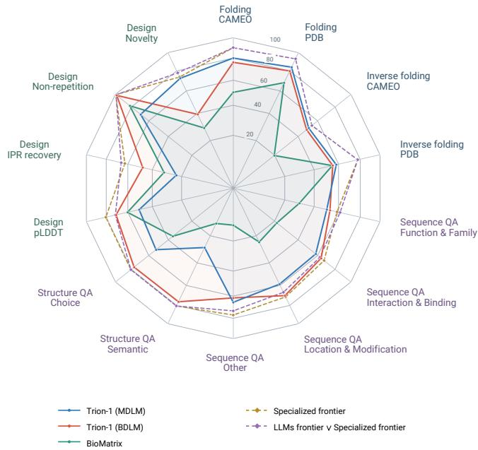
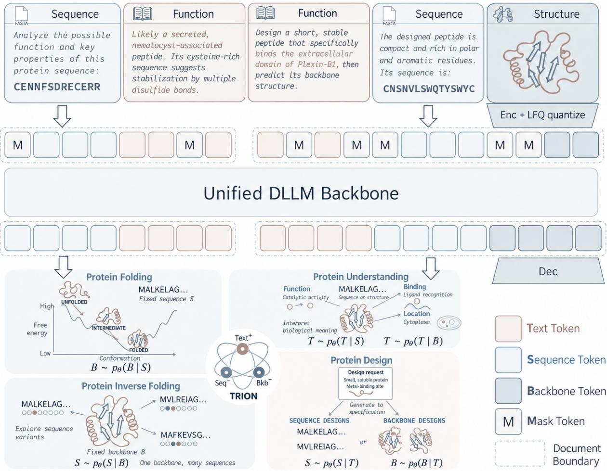
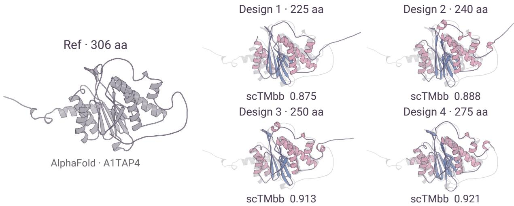
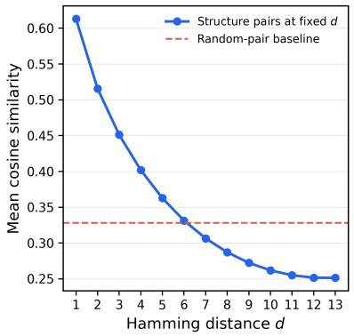
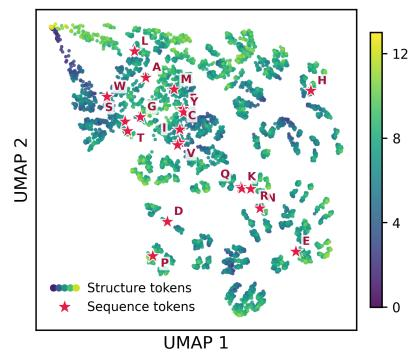
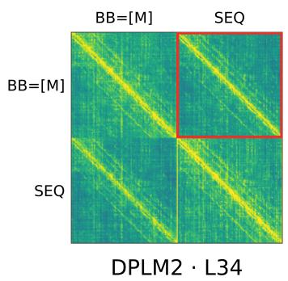
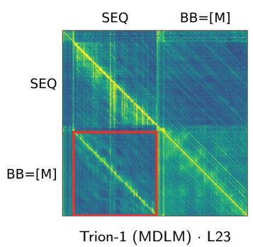
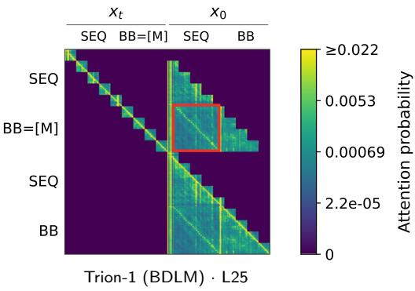
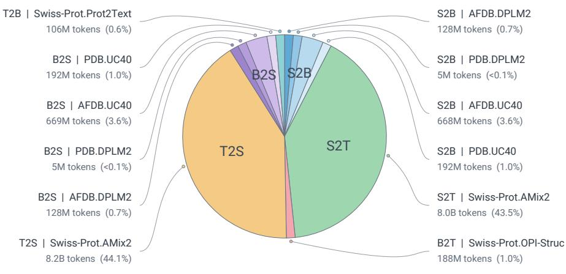

# Trion-1: Unifying Language, Protein Sequence, and Structure with Diffusion Language Models

1 Generative Symbolic Intelligence Lab (GenSI), Tsinghua University 2 Institute for AI Industry Research (AIR), Tsinghua University 3 Shanghai Artificial Intelligence Laboratory

## Abstract

We envision a general-purpose protein foundation model as a unified, interactive model of sequence, structure, and function, capable of understanding, generation, and cross-modal translation while retaining the instruction-following and reasoning capabilities of modern LLMs. Toward this vision, we introduce Trion-1, the first native, unified, multimodal difusion language model (dLLM) for proteins. Trion-1 is built on two key design choices: (1) a unified discrete token space that jointly represents sequence, structure, and natural language; (2) a dLLM backbone that replaces strict left-to-right factorization with bidirectional or semi-bidirectional token interactions, enabling global residue communication and long-range contact modeling that are naturally suited to structure modeling. This formulation unifies six core capabilities: folding, inverse folding, sequence understanding, structure understanding, sequence design, and structure design, while retaining the native language capabilities of general-purpose LLMs. On established benchmarks, Trion-1 achieves broadly competitive performance. In folding, Trion-1 achieves a TM-score above 0.8 with a single sample under strict homology control, matching or exceeding the existing tri-modal model using 200 samples. For sequence understanding, Trion-1 performs on par with top-tier LLMs such as Claude Opus 4.7 (62.37%). These results support well-aligned sequence–structure–language representations and strong cross-modal generative capabilities.

  
Figure 1 Performance Rader.

## 1 Introduction

Proteins constitute the molecular machinery of life, carrying out the catalytic, structural, signaling, and regulatory processes that sustain cells and organisms. A comprehensive understanding of proteins draws on three complementary modalities: (1) amino acid sequences describe molecular identity and evolutionary constraints [1]. (2) 3D structures represent the physical and geometric constraints that govern molecular interactions, thereby revealing the mechanistic basis of protein function [2]. (3) function descriptions capture not only specific protein functions but also the broader body of human knowledge accumulated through biological research [3, 4].

Importantly, these modalities are not independent views of proteins. We distill protein modeling into six meta-capabilities spanning the directed transformations among sequence, structure, and function: folding, inverse folding, sequence understanding, structure understanding, sequence design, and structure design. Rather than isolated tasks, these capabilities serve as composable primitives whose combinations give rise to diverse and increasingly complex workflows.

Substantial progress has been made through specialized protein models; in Sec. 2.2, we review these developments and revisit several long-overlooked connections to modern language modeling. Nevertheless, protein modeling remains fragmented across specialized systems and largely disconnected from general-purpose LLMs. We identify two key requirements for next-generation general-purpose protein foundation models:

• Unified protein framework. A single model should enable knowledge sharing and mutual reinforcement across tasks, without heavily relying on cross-model interfaces or task-specific adaptation.

• Native language capabilities. The model should retain the instruction-following, reasoning, and interactive capabilities native to general-purpose LLMs.

Early attempts explored unifying heterogeneous protein modalities within autoregressive frameworks [5, 6], roughly in parallel with the emergence of unified vision models [7, 8]. Yet these approaches remained limited on structure-intensive tasks such as protein folding. Theoretically, structural contacts do not follow a left-to-right sequence order, so autoregressive generation may commit to early predictions with incomplete context and accumulate errors. Experimentally, existing tri-modal autoregressive models show limited folding performance under single-sample evaluation, leaving open whether the autoregressive paradigm itself provides the right foundation for unified protein modeling.

We introduce Trion-1, to our knowledge the first native, unified, tri-modal difusion language model (dLLM) for proteins. Trion-1 builds on two key design choices: (1) a shared discrete token space that jointly represents protein sequence, structure, and natural language; and (2) a non-causal difusion backbone that relaxes strict left-to-right factorization, enabling global residue interactions modeling within an LLM architecture. Together, these designs unify the six directed capabilities across the sequence–structure–function space within a single generative model. Across established benchmarks, Trion-1 achieves broadly competitive performance, with particularly substantial improvements over existing unified tri-modal models on protein folding.

We highlight our contributions as follows:

• Framework. We develop Trion-1, a native unified protein dLLM that brings sequence, structure, and natural language into a shared discrete token space and models them with a non-causal difusion backbone. Guided by the intrinsic compatibility between specialized protein modeling and modern language-model primitives, Trion-1 unifies six core capabilities within a single generative framework while retaining native language interaction, and further supports their interleaved composition.

• Capability. At the 4B scale, Trion-1 achieves competitive performance across all six core capabilities and substantially strengthens unified tri-modal folding, reaching TM 0.84 with a single unified MDLM checkpoint—comparable to prior tri-modal models evaluated with a 200× larger inference budget. On GeneralQA, Trion-1 further performs on par with frontier models such as Claude Opus 4.7 [9] and AMix2 [10].

## 2 Related Work

## 2.1 Diffusion Language Models

Autoregressive (AR) language models generate sequences through a left-to-right factorization, which imposes a fixed generation order. Difusion language models (dLLMs) provide an alternative by modeling text generation as an iterative denoising process, allowing tokens to be predicted with bidirectional context. Recent advances have enabled dLLMs to rapidly close the performance gap with AR LLMs [11, 12], establishing difusion-based language modeling as a promising alternative to the dominant paradigm.

Foundational studies [13–15] established the formulation of objective as a time-independent, weighted sum of standard cross-entropy losses. Recent studies have further explored block-based formulations that introduce semi-autoregressive generation [16], along with scalable training and sampling strategies [17, 18], and novel architectures [12, 19].

## 2.2 Specialized Model

We review recent progress in specialized protein models and the key inductive biases behind their success, while highlighting their intrinsic connections to the modeling capabilities of modern LLMs.

Folding. Protein folding maps amino acid sequences to 3D structures. Modern folding systems rely heavily on triangular residue interactions to capture higher-order geometric consistency and long-range contacts [20, 21], with recent advances driven by scaling [22], distillation [23, 24], and richer conditioning [25–28]. From a graph perspective, the efectiveness of triangular modeling can be understood through two complementary components: translation self-loops, which map residue context into local structure, and interaction edges, which propagate information across residues to enforce global consistency. Although LLMs lack explicit interaction-edge modules, recent results show that strong folding can emerge from largely data-driven Transformer architectures [29].

Inverse folding. Modern inverse folding models [30–32] typically encode protein backbones into geometry-aware representations before light-weight sequence decoding. This closely mirrors the encoder of a protein structure tokenizer, which likewise maps 3D backbone geometry into a compact latent representation, suggesting a natural bridge from inverse folding to language-model-based generation.

Sequence/Structure understanding. Protein understanding is shifting from fixed-label prediction toward open-ended functional semantics. Sequence models increasingly align proteins with textual description [33, 34], while structure-aware models inject geometric context [35, 36]. This makes natural language a natural interface between molecular representations and biological knowledge.

Sequence/Structure design. Protein design is likewise moving toward richer conditioning: sequence models progress from functional tags [37] to language descriptions [10, 38, 39] and motif constraints [40, 41], while structure generators incorporate increasingly detailed physicochemical and geometric constraints [42–45]. This trend naturally aligns protein design with instruction-conditioned generation in modern LLMs, where heterogeneous design intents can be expressed and composed through a shared interface.

## 2.3 Unified Tri-modal Models

Early tri-modal unified models primarily focus on representation-level alignment, mapping sequence, structure, and text into a shared embedding space through contrastive learning [46, 47]. ESM3 [48] moves beyond alignment toward generative unification. BioMatrix explores native tri-modal generation with a single AR LLM backbone [49], while our work concurrently investigates the analogous unified formulation with dLLM framework.

  
Figure 2 Overview of Trion-1.

## 3 Methods

## 3.1 Shared Embedding

We adopt token-space early-fusion. Specifically, we extend the Qwen3 vocabulary [50] with dedicated sequence and quantized structure tokens, allowing all modalities to be processed by a single dLLM from the first layer without separate modality encoders or cross-attention modules. A key challenge is how to discretize continuous protein structures into an LLM-compatible token space. We favor a tokenizer with three properties:

• Generative. The tokenizer should preserve suficient geometric information for high-fidelity backbone reconstruction, rather than serving only retrieval search [51]. This is naturally supported by autoencoding objectives [52, 53], optionally regularized by auxiliary semantic supervision [48]. Recent work further shows that difusion- or flow-matching-based decoders can substantially improve reconstruction fidelity, both in visual tokenization [54, 55] and protein structure tokenization [56, 57], by modeling a conditional distribution over reconstructions rather than relying on a deterministic decoder.

• Local. Each token should correspond to a local structural context, preserving residue-level positional correspondence and allowing contiguous tokens to represent local substructures and motifs. This contrasts with global tokenization schemes [58], which may weaken residue-level grounding.

• Codebook-free. Codebook-free quantization, such as LFQ [59], maps tokens to vertices of an ndimensional hypercube, providing 2n discrete codes with a natural Hamming geometry that can be readily absorbed into the extended embedding space, as shown in 4.2.1.

Codebook-free quantization is a convenient choice rather than a strict requirement; more generally, the tokenizer geometry should be faithfully represented in the language-model embedding space, which can also emerge through large-scale training [7, 8]. Following these principles, we use the DPLM2 structure tokenizer [60].

## 3.2 Unified Architecture

Given the unified token space, we use a single dLLM backbone to jointly model protein sequence, backbone structure, and natural language, as illustrated in 2. All modalities share the same Transformer and can flexibly serve as conditions or generation targets, enabling both intra- and cross-modal generation without modality-specific heads.

We instantiate two variants with the same architecture but diferent generation factorizations: Trion-1 (MDLM) uses fully non-causal masked difusion, while Trion-1 (BDLM) applies bidirectional difusion within blocks and causal factorization across blocks. This provides a controlled comparison of how bidirectionality afects protein modeling.

$$
\begin{array} { l } { { \displaystyle { \mathcal { L } } _ { \mathrm { M D L M } } ( \theta ) = - \mathbb { E } _ { t , x _ { 0 } \sim p _ { \mathrm { d a t a } } } \mathbb { E } _ { x _ { t } \sim q ( x _ { t } | x _ { 0 } ) } [ \frac { 1 } { t } \sum _ { i = 1 } ^ { L } \mathbf { 1 } \big [ x _ { t } ^ { i } = \mathbf { M } \big ] \log p _ { \theta } \big ( x _ { 0 } ^ { i } \mid x _ { t } \big ) ] } \ ~ } \\ { { \displaystyle { \mathcal { L } } _ { \mathrm { B D L M } } ( \theta ) = - \mathbb { E } _ { t , x _ { 0 } \sim p _ { \mathrm { d a t a } } } \mathbb { E } _ { x _ { t } \sim q ( x _ { t } | x _ { 0 } ) } [ \frac { 1 } { t } \sum _ { b = 1 } ^ { B } \sum _ { i \in { \mathcal { T } } _ { b } } \mathbf { 1 } [ x _ { t } ^ { i } = \mathbf { M } ] \log p _ { \theta } ( x _ { 0 } ^ { i } \mid x _ { 0 } ^ { [  b ] } , x _ { t } ^ { [ b ] } ) ] , } \ } \end{array}\tag{1}
$$

Here, M denotes the mask token, L is the sequence length, and B is the number of blocks with $\mathcal { T } _ { b }$ denoting the token indices in block b. For BDLM, $x _ { 0 } ^ { [ < b ] }$ denotes the clean tokens in preceding blocks, while $x _ { t } ^ { [ b ] }$ denotes the corrupted tokens in the current block; thus difusion is bidirectional within each block but causal across blocks.

## 3.3 Multi-stage Training

Protein sequence bridges language and backbone structure in our training strategy. We first align sequence with language during continual pre-training (CPT), then connect both to structure through multimodal supervised fine-tuning (SFT). Given the scarcity of structural data, structure is introduced only during SFT. Starting from Qwen3-4B, we proceed through AR-CPT for protein knowledge acquisition, A2D-CPT for adaptation to difusion modeling [17], and SFT for all six directed cross-modal transformations (Table 1).

Table 1 Training configuration. T/S/B: text/sequence/backbone; ST: sequence–text pairs; X2X: all six cross-moda directions. Lengths are in tokens.
<table><tr><td></td><td>Stage 1</td><td>Stage 2</td><td>Stage 3</td></tr><tr><td>Training Paradigm</td><td>AR-CPT</td><td>A2D-CPT</td><td>SFT</td></tr><tr><td>Context Length</td><td>4096</td><td>4096</td><td>4096</td></tr><tr><td>Block Size</td><td>1</td><td> $8  1 6  3 2$ </td><td>32 (bdlm) / 4096 (mdlm)</td></tr><tr><td>Assistant Mask</td><td>X</td><td>X</td><td>√</td></tr><tr><td>Document Mask</td><td>X</td><td>X</td><td>√</td></tr><tr><td>Task Type</td><td> $\mathrm { T } + \mathrm { S } + \mathrm { S T }$ </td><td> $\mathrm { T } + \mathrm { S } + \mathrm { S T }$ </td><td>X2X</td></tr></table>

## 4 Experiments

## 4.1 Quantitative Performance

## 4.1.1 Evaluation Settings

Benchmarks. We prioritize evaluations that reflect the current frontier of protein modeling. For example, ProteinArena [10] refines PDFBench [61], providing a more recent and rigorous benchmark for sequence understanding and design. The benchmarks are summarized as follows:

• Folding Tasks: CAMEO 2022 [62], PDB-date [63]

• Inverse Folding Tasks: CAMEO 2022 [62], PDB-date [63]

• Protein Analysis Tasks: ProteinArena [10], OPI-struct [64]

• Protein Design Tasks: ProteinArena [10]

Baselines. Our baseline selection follows two principles. Capability: we include specialized protein models and frontier LLMs as task-level performance references. To maintain comparable input requirements, we exclude AlphaFold-family configurations that require MSA inputs. Paradigm: we include native multimodal models spanning text–sequence, sequence–structure, and text–sequence–structure modeling, covering autoregressive, masked difusion, and block difusion generation paradigms. Together, these comparisons assess both Trion-1’s task performance and the implications of its modality coverage and generation paradigm.

## 4.1.2 Folding and Inverse folding

As shown in Table 2, Trion-1 substantially pushes forward the folding capability of unified protein models, while remaining competitive on inverse folding. We highlight two observations from these results.

Table 2 Folding and inverse folding. Means are reported. Folding: TMaa over common atoms, TMus from Cα USalign, and RMSDaa. Yellow: our models. Gray: per-metric group best (ties included). Local BioMatrix uses the public merged checkpoint. @F/@I: folding/inverse-folding sample counts; @200 uses metric-wise oracle selection, while @50 selects the highest scTMbb and reports that same candidate’s AAR. @F/@I†: paper-reported counts (length-filtered) [49]. ∗: DPLM-2 paper. Cited results retain original metric protocols; –: unavailable.
<table><tr><td rowspan="3">Method</td><td rowspan="3">Params</td><td colspan="4">Folding</td><td colspan="4">Inverse Folding</td></tr><tr><td colspan="2">CAMEO 2022 (183)</td><td colspan="2">PDB date split (449)</td><td colspan="2">CAMEO 2022 (183)</td><td colspan="2">PDB date split (449)</td></tr><tr><td>TMaa/us ↑</td><td>RMSDaa↓</td><td>TMaa/us ↑</td><td>RMSDaa↓</td><td>AAR↑</td><td>scTMbb ↑</td><td>AAR↑</td><td>scTMbb ↑</td></tr><tr><td colspan="9">Frontier Folding/Inverse Folding Models</td></tr><tr><td>ESMFold/IF</td><td>3.7B/0.1B</td><td>0.91 /0.85</td><td>4.61</td><td>0.94 0.91</td><td>3.22</td><td>52.96</td><td>0.90</td><td>59.20</td><td>0.95</td></tr><tr><td>SimpleFold</td><td>3B</td><td>0.90 /0.83</td><td>4.88</td><td>0.95/0.91</td><td>2.99</td><td></td><td>1</td><td></td><td></td></tr><tr><td>PVQD*</td><td>–</td><td>-/0.81</td><td>4.08</td><td></td><td></td><td></td><td></td><td></td><td></td></tr><tr><td colspan="9">Sequence-Structure Co-generation Models</td></tr><tr><td>MultiFlow*</td><td>21.8M</td><td>0.50 /-</td><td>17.84</td><td>0.53/-</td><td>15.64</td><td>32.28</td><td>0.87</td><td>37.74</td><td>0.94</td></tr><tr><td>ESM3</td><td>1.4B</td><td>0.86 /0.79</td><td>5.46</td><td>0.90/0.84</td><td>4.10</td><td>48.53</td><td>0.90</td><td>51.64</td><td>0.95</td></tr><tr><td>DPLM2</td><td>3B</td><td>0.83/0.72</td><td>7.10</td><td>0.90/0.81</td><td>4.28</td><td>51.48</td><td>0.88</td><td>61.18</td><td>0.92</td></tr><tr><td>DPLM2</td><td>0.7B</td><td>0.80 / 0.69</td><td>7.81</td><td>0.87 / 0.77</td><td>5.28</td><td>48.49</td><td>0.87</td><td>55.26</td><td>0.91</td></tr><tr><td>DPLM2.1</td><td>0.7B</td><td>0.84/0.74</td><td>6.61</td><td>0.93 /0.88</td><td>2.95</td><td>53.79</td><td>0.88</td><td>77.62</td><td>0.93</td></tr><tr><td colspan="10">Sequence-Structure-Text LLMs</td></tr><tr><td>BioMatrix@1/@1</td><td>4B</td><td>0.45 /0.35</td><td>18.71</td><td>0.60 / 0.52</td><td>12.62</td><td>19.76</td><td>0.57</td><td>54.67</td><td>0.75</td></tr><tr><td>BioMatrix@200/@50</td><td>4B</td><td>0.67 / 0.57</td><td>11.68</td><td>0.82 0.77</td><td>5.68</td><td>21.51</td><td>0.76</td><td>60.43</td><td>0.89</td></tr><tr><td>BioMatrix@200/@50†</td><td>4B</td><td></td><td></td><td>0.84</td><td>5.38</td><td></td><td></td><td>75.50</td><td>0.86</td></tr><tr><td>Trion-1 (MDLM)</td><td>4B</td><td>0.81/0.71</td><td>7.83</td><td>0.86/0.77</td><td>5.64</td><td>50.48</td><td>0.88</td><td>58.03</td><td>0.92</td></tr><tr><td>Trion-1 (BDLM)</td><td>4B</td><td>0.78/0.66</td><td>9.16</td><td>0.82 /0.73</td><td>7.28</td><td>48.32</td><td>0.87</td><td>55.00</td><td>0.91</td></tr></table>

Bidirectional context benefits structure modeling. On the PDB date split, Trion-1 (MDLM) outperforms BioMatrix@1 in folding, improving TMaa from 0.60 to 0.86 and reducing RMSDaa from 12.62 to 5.64. It also reaches a TMaa of 0.86 versus 0.82 for BioMatrix’s metric-wise best-of-200 sampling, with RMSDaa of 5.64 versus 5.68. Unlike autoregressive generation, protein geometry is not governed by a left-to-right dependency order: spatially adjacent residues may be far apart in sequence. Causal attention prevents a residue from directly accessing such partners when they occur later in the sequence, whereas bidirectional attention permits this context. The consistent MDLM-over-BDLM-over-AR advantage supports this interpretation, which we further investigate in Sect. 4.2.2.

Global geometric consistency remains a challenge. Trion-1 (MDLM) reaches a PDB $\mathrm { T M } _ { \mathrm { a a } }$ of 0.86 without explicit triangular modules, but still trails ESMFold (0.94). This gap suggests room to improve how the model coordinates interactions among residues beyond sequence–structure translation. We aim to improve this capability through self-training on model-generated data, preserving the simplicity of modern LLM architectures rather than introducing computationally intensive triangular modules.

## 4.1.3 Protein Understanding

We evaluate sequence understanding on GeneralQA and structure understanding on StructureMCQA, the multiple-choice subset of OPI-Struc. Table 3 summarizes both tasks.

Table 3 Sequence and structure understanding. Accuracy (%, ↑). F&F: Function & Family; I&B: Interaction & Binding; L&M: Location & Modification; Other: physicochemical/structural properties. Choice: option accuracy; Semantic: final-answer semantic correctness. Yellow: our models. Gray: per-metric group best (ties included); –: unavailable. †: BioMatrix uses sequence+structure input and nearest-option mapping for Choice; its Semantic score uses a diferent judge prompt.
<table><tr><td rowspan="2">Method</td><td rowspan="2">Params</td><td colspan="5">GeneralQA</td><td colspan="2">StructureMCQA</td></tr><tr><td>Overall (481)</td><td>F&amp;F (150)</td><td>I&amp;B (152)</td><td>L&amp;M (153)</td><td>Other (26)</td><td>Choice (3,918)</td><td>Semantic (3,918)</td></tr><tr><td colspan="9">Frontier LLMs</td></tr><tr><td>Claude Opus 4.7</td><td></td><td>62.37</td><td>61.33</td><td>62.50</td><td>66.67</td><td>42.31</td><td></td><td></td></tr><tr><td>Claude Opus 4.6</td><td></td><td>48.02</td><td>32.67</td><td>48.68</td><td>58.17</td><td>73.08</td><td></td><td></td></tr><tr><td>Gemini 3 Flash Thinking</td><td></td><td>49.48</td><td>42.00</td><td>46.05</td><td>59.48</td><td>53.85</td><td></td><td></td></tr><tr><td>GPT-5.5</td><td></td><td>48.44</td><td>32.00</td><td>46.05</td><td>66.01</td><td>53.85</td><td></td><td></td></tr><tr><td>DeepSeek-V4-Pro</td><td>1.6T</td><td>46.57</td><td>36.67</td><td>45.39</td><td>56.21</td><td>53.85</td><td></td><td></td></tr><tr><td>Qwen3.7-Max</td><td></td><td>43.45</td><td>31.33</td><td>43.42</td><td>54.25</td><td>50.00</td><td></td><td></td></tr><tr><td>GPT-OSS-120B</td><td>120B</td><td>43.24</td><td>32.00</td><td>38.82</td><td>56.21</td><td>57.69</td><td></td><td></td></tr><tr><td>GLM-5.1</td><td>0.8T</td><td>38.05</td><td>26.67</td><td>37.50</td><td>49.02</td><td>42.31</td><td></td><td></td></tr><tr><td colspan="9">Sequence-Text LLMs</td></tr><tr><td>AMix2-dLLM</td><td>4B</td><td>66.11</td><td>58.67</td><td>67.11</td><td>71.24</td><td>73.08</td><td></td><td></td></tr><tr><td>AMix2-AR</td><td>4B</td><td>62.58</td><td>56.00</td><td>61.84</td><td>67.32</td><td>76.92</td><td></td><td></td></tr><tr><td colspan="9">Sequence-Structure-Text LLMs</td></tr><tr><td>BioMatrix</td><td>4B</td><td>24.32</td><td>29.33</td><td>21.71</td><td>24.18</td><td>11.54</td><td>35.76†</td><td>12.61†</td></tr><tr><td>Trion-1 (MDLM)</td><td>4B</td><td>56.13</td><td>50.00</td><td>57.89</td><td>58.82</td><td>65.38</td><td>52.25</td><td>28.08</td></tr><tr><td>Trion-1 (BDLM)</td><td>4B</td><td>62.16</td><td>52.67</td><td>63.82</td><td>69.93</td><td>61.54</td><td>76.72</td><td>76.19</td></tr></table>

Trion-1 combines frontier-level sequence understanding with backbone-grounded functional reasoning. Trion-1 (BDLM) achieves 62.16% accuracy on GeneralQA, closely matching Claude Opus 4.7 (62.37%), and 76.72% on StructureMCQA with backbone-only inputs. The latter remains below STELLA’s reported 80.56% [64], but input modalities and test sets difer: STELLA and BioMatrix’s published structureunderstanding evaluations use both sequence and structure [49, 64], whereas backbone geometry alone may leave some functional questions underdetermined.

## 4.1.4 Protein Design

Text-to-sequence. Table 4 shows both the progress and remaining limitations of our unified models in text-conditioned protein design. Without further design-specific refinement, Trion-1 (BDLM) improves over the prior unified tri-modal baseline BioMatrix in foldability (pLDDT: 70.65 vs. 60.32), functional recovery(IPRRecovery: 47.50 vs. 31.40), and repetition control, although its lower SR indicates less reliable production of evaluable sequences. However, it still trails AMix2-dLLM in SR (62.18 vs. 69.31), pLDDT (70.65 vs. 74.75), and IPRRecovery (47.50 vs. 62.61), leaving a clear gap in functional design quality.

Table 4 Text-conditioned protein design. All metrics use a 0–100 scale. SR covers all 870 prompts; other metrics average over evaluated sequences. Yellow: our models. Gray: per-metric group best (ties included); –: unavailable; Params: total model size. ‡: likelihood-ranked best-of-10; †: pLDDT on 819 sequences.
<table><tr><td rowspan="2">Method</td><td rowspan="2"></td><td rowspan="2">Params SR ↑</td><td colspan="2">Repetition</td><td>Foldability</td><td>Function</td><td>Novelty</td></tr><tr><td></td><td>Rep2 ↓ Rep5 ↓</td><td>pLDDT ↑</td><td>IPRRecovery ↑</td><td>Hard (Seq) ↑</td></tr><tr><td colspan="8">Frontier LLMs</td></tr><tr><td>Claude Opus 4.7</td><td></td><td>84.14</td><td>44.65</td><td>0.65</td><td>71.33</td><td>65.95</td><td>36.54</td></tr><tr><td>Claude Opus 4.6</td><td></td><td>90.57</td><td>48.44</td><td>1.86</td><td>42.17</td><td>25.32</td><td>45.91</td></tr><tr><td>Gemini 3.1 Pro Thinking</td><td>-</td><td>100.00</td><td>44.21</td><td>7.17</td><td>48.67</td><td>25.92</td><td>45.59</td></tr><tr><td>GPT-5.5</td><td></td><td>99.89</td><td>53.19</td><td>3.86</td><td>43.95</td><td>25.21</td><td>44.21</td></tr><tr><td>DeepSeek-V4-Pro</td><td>1.6T</td><td>85.06</td><td>50.32</td><td>8.14</td><td>45.03</td><td>25.14</td><td>51.25</td></tr><tr><td>Qwen3.5-27B</td><td>27B</td><td>100.00</td><td>76.95</td><td>63.24</td><td>33.47</td><td>0.47</td><td>77.93</td></tr><tr><td>GPT-OSS-120B</td><td>120B</td><td>100.00</td><td>46.77</td><td>2.20</td><td>31.85</td><td>3.56</td><td>53.42</td></tr><tr><td>GLM-5.1</td><td>0.8T</td><td>100.00</td><td>47.34</td><td>4.32</td><td>37.64</td><td>7.75</td><td>54.46</td></tr><tr><td colspan="8">Protein Design Models</td></tr><tr><td>CFPGen</td><td>0.7B</td><td>36.67</td><td>58.91</td><td>13.65</td><td>75.78</td><td>31.99</td><td>48.43</td></tr><tr><td>Chroma</td><td>0.3B</td><td>100.00</td><td>52.02</td><td>0.44</td><td>60.46</td><td>0.02</td><td>59.69</td></tr><tr><td>ESM3</td><td>1.4B</td><td>94.94</td><td>69.46</td><td>21.64</td><td>60.56</td><td>19.20</td><td>73.70</td></tr><tr><td>Pinal‡</td><td>2B</td><td>100.00</td><td>42.47</td><td>3.23</td><td>80.33</td><td>47.78</td><td>38.60</td></tr><tr><td>ProDVa†</td><td>1.8B</td><td>99.08</td><td>25.35</td><td>6.67</td><td>70.22</td><td>27.43</td><td>23.49</td></tr><tr><td>ProteinDT</td><td>0.7B</td><td>100.00</td><td>52.46</td><td>2.03</td><td>38.88</td><td>8.63</td><td>61.94</td></tr><tr><td colspan="8">Sequence-Text LLMs</td></tr><tr><td>AMix2-dLLM</td><td>4B</td><td>69.31</td><td>45.22</td><td>1.23</td><td>74.75</td><td>62.61</td><td>30.57</td></tr><tr><td>AMix2-AR</td><td>4B</td><td>93.22</td><td>44.90</td><td>1.61</td><td>74.89</td><td>39.92</td><td>7.57</td></tr><tr><td colspan="8">Sequence-Structure-Text LLMs</td></tr><tr><td>BioMatrix</td><td>4B</td><td>98.62</td><td>50.93</td><td>18.03</td><td>60.32</td><td>31.40</td><td>28.69</td></tr><tr><td>Trion-1 (MDLM)</td><td>4B</td><td>56.55</td><td>72.50</td><td>30.89</td><td>50.42</td><td>23.27</td><td>72.42</td></tr><tr><td>Trion-1 (BDLM)</td><td>4B</td><td>62.18</td><td>43.79</td><td>1.63</td><td>70.65</td><td>47.50</td><td>39.29</td></tr></table>

Within our models, BDLM consistently improves over MDLM in foldability, functional recovery, and repetition control. Without adaptive padding, MDLM tends to fill the inference budget, potentially exacerbating repetitive continuations and reducing sequence quality. Such repetition is a longstanding challenge in difusion-based protein generation [41] and persists despite the improvements from block difusion.

These results indicate progress over prior unified tri-modal modeling, while highlighting the need for further design-specific refinement in adaptive length and format control, repetition reduction, and functional fidelity. All quality comparisons are conditional on each model’s evaluated subset.

Text-to-backbone. Without a suitable benchmark in our current evaluation setup, we conduct a series of text-to-backbone case studies across multiple functional descriptions, target lengths, and sampling seeds. Figure 3 presents a representative PrcB example: the selected designs preserve the reference-like fold with local variations and achieve scTMbb scores of 0.875–0.921, consistent with retrieval-like behavior. We hypothesize that the dataset’s specific, family-level descriptions constrain the design space; structural self-consistency alone does not establish functional fidelity.

  
Figure 3 Text-conditioned PrcB backbone designs. The reference at left is enlarged; the four designs share the same scale. Pink: helices; blue: sheets; lavender: loops; gray: aligned AlphaFold reference. scTMbb measures ProteinMPNN–ESMFold self-consistency against each design backbone.

## 4.2 Qualitative Analysis

## 4.2.1 Embedding Geometry

Embedding geometry is preserved. Unlike vision models that often reuse or initialize from codebook embeddings, Trion-1 learns its structure-token embeddings from scratch. As shown in Fig. 4, embedding similarity decreases consistently with Hamming distance in the LFQ code space, indicating that the tokenizer topology is largely preserved. UMAP further reveals organized ring-like manifolds, with several amino-acid tokens near characteristic structural neighborhoods, suggesting stable local sequence–structure correspondences. Meanwhile, structural regions distant from any amino-acid token reflect the context-dependent, one-to-many nature of folding.

  
(a) Similarity vs. Code distance.

  
(b) Visualization of embedding space.

Figure 4 Geometric organization of the shared token space. (a) Embedding similarity decreases monotonically with Hamming distance in the quantized n-bit structure-code space, as described in 3.1. (b) UMAP visualization shows that structure tokens form an organized manifold while sequence tokens occupy the same global embedding space; color intensity indicates the Hamming weight of each structure token, i.e., the number of 1s in its n-bit code.

## 4.2.2 Probing the Folding Mechanism

  
Figure 5 Sequence--structure attention on 6WEB. Head-averaged maps for DPLM2, Trion-1 (MDLM), and Trion-1 (BDLM). Red boxes mark structure queries attending to sequence keys. Each layer is selected by maximal conditional attention mass within ±2 residues of the corresponding sequence position.

Folding involves residue-level translation. We initially attributed DPLM2’s diagonal sequence–structure attention to its aligned positional encoding. Yet similar patterns persist under global positional encoding (Figure 5), suggesting that residue-level translation can emerge from the folding task itself. This motivates a conceptual pathway: sequence → contact constraints → structure.

Causal generation requires harder anticipation. For contacting residues, causal masking prevents the earlier structure token from directly accessing its partner’s future structural state. Early next-token decisions must therefore anticipate nonlocal constraints. This is consistent with weak BioMatrix@1 but better BioMatrix@200.

## 5 Limitation and Future Direction

Trion-1 currently focuses on protein-only modeling and does not yet cover richer biomolecular systems such as complexes, ligands, or nucleic acids. Moreover, despite strong performance across diverse tasks, a gap remains to the strongest task-specialized models, particularly on structure-intensive problems such as protein folding.

Looking forward, we see two promising directions. (1) Further improving Trion-1’s capability ceiling through multi-codebook structure representations, stronger structure decoders [60, 65], and targeted augmentation for short proteins and challenging cases. (2) Exploiting interleaved generation for test-time scaling, where composable capabilities are iteratively generated, evaluated, and refined with additional inference-time computation. With suficiently strong base capabilities, UniProt-scale sequence–structure–function corpora could be available, providing the substrate for closed-loop self-improvement.

## 6 Conclusion

We presented Trion-1, a native unified tri-modal difusion language model that brings protein sequence, structure, and natural language into a single generative framework. By casting six core capabilities across the sequence–structure–function space as conditional generation, Trion-1 achieves broadly competitive performance at the 4B scale while substantially strengthening the folding capability of unified protein models, demonstrating that strong structure modeling can coexist with broad understanding, generation, and native language interaction within a single model.

Our analyses further support the importance of non-causal modeling for protein structure and show that the geometric organization induced by the structure tokenizer can be naturally absorbed into the language-model embedding space. More broadly, Trion-1 turns specialized protein capabilities into composable generative primitives, enabling interleaved workflows and providing a foundation for future test-time scaling and closedloop self-improvement through self-generated data.

## Contributions

Project Lead

Tianyu Lu1,2,3

## Contributors

Kaicheng Yang4, Jiangtao Feng1,2, Keyue Qiu1,2,3, Yawen Ouyang1,3, Yixin Wu1,3,5, Xinbo Zhang1,3, Lihao Wang1,3, Wei-Ying Ma2,6

## Correspondence

Hao Zhou1,2,3

zhouhao@air.tsinghua.edu.cn

## Affiliations

1Generative Symbolic Intelligence Lab (GenSI), Tsinghua University

2Institute for AI Industry Research (AIR), Tsinghua University

3Shanghai Artificial Intelligence Laboratory

4Shanghai Jiao Tong University

5Fudan University

6City University of Hong Kong

## Acknowledgments

We thank Zaixiang Zheng and Xinyou Wang for their guidance and valuable suggestions throughout this project, and Yifei Wang for assistance with data synthesis. This work is supported by Shanghai Artificial Intelligence Laboratory.

## References

[1] Alexander Rives, Joshua Meier, Tom Sercu, Siddharth Goyal, Zeming Lin, Jason Liu, Demi Guo, Myle Ott, C. Lawrence Zitnick, Jerry Ma, and Rob Fergus. Biological structure and function emerge from scaling unsupervised learning to 250 million protein sequences. Proceedings of the National Academy of Sciences, 118 (15):e2016239118, 2021. doi: 10.1073/pnas.2016239118. URL https://www.pnas.org/doi/abs/10.1073/pnas. 2016239118.

[2] Ken A. Dill and Justin L. MacCallum. The protein-folding problem, 50 years on. Science, 338(6110):1042–1046, 2012. doi: 10.1126/science.1219021. URL https://www.science.org/doi/abs/10.1126/science.1219021.

[3] The gene ontology resource: enriching a gold mine. Nucleic acids research, 49(D1):D325–D334, 2021.

[4] Uniprot: the universal protein knowledgebase in 2023. Nucleic acids research, 51(D1):D523–D531, 2023.

[5] Zicheng Ma, Chuanliu Fan, Zhicong Wang, Zhenyu Chen, Xiaohan Lin, Yanheng Li, Shihao Feng, Ziqiang Cao, Jun Zhang, and Yi Qin Gao. Prottex: Structure-in-context reasoning and editing of proteins with large language models. Journal of Chemical Information and Modeling, 65(13):6599–6612, 2025.

[6] Zhiyuan Chen, Tianhao Chen, Chenggang Xie, Yang Xue, Xiaonan Zhang, Jingbo Zhou, and Xiaomin Fang. Unifying sequences, structures, and descriptions for any-to-any protein generation with the large multimodal model helixprotx. arXiv preprint arXiv:2407.09274, 2024.

[7] Chameleon Team. Chameleon: Mixed-modal early-fusion foundation models, 2025. URL https://arxiv.org/ abs/2405.09818.

[8] Xinlong Wang, Xiaosong Zhang, Zhengxiong Luo, Quan Sun, Yufeng Cui, Jinsheng Wang, Fan Zhang, Yueze Wang, Zhen Li, Qiying Yu, Yingli Zhao, Yulong Ao, Xuebin Min, Tao Li, Boya Wu, Bo Zhao, Bowen Zhang, Liangdong Wang, Guang Liu, Zheqi He, Xi Yang, Jingjing Liu, Yonghua Lin, Tiejun Huang, and Zhongyuan Wang. Emu3: Next-token prediction is all you need, 2024. URL https://arxiv.org/abs/2409.18869.

[9] Anthropic. Claude opus 4.7 system card. Technical report, Anthropic, 2026.

[10] Keyue Qiu, Yixin Wu, Lihao Wang, Yawen Ouyang, Jixiang Yu, Zihan Zhou, Changze Lv, Dongyu Xue, Yuxuan Song, Xinbo Zhang, et al. Amix-2: Establishing protein as a native modality in large language models. arXiv preprint arXiv:2605.30963, 2026.

[11] Tiwei Bie, Jiansheng Cai, Maosong Cao, Xiang Cao, Binbin Chen, Fuyuan Chen, Kun Chen, Yuqi Ding, Lun Du, Zhuocheng Gong, et al. Llada2. 2: Enabling agentic difusion language models via levenshtein editing. Technical report, CSPaper OpenPrint, 2026.

[12] DifusionGemma Team, Adrien Ali Taïga, James Assiene, Daniele Calandriello, Rahma Chaabouni, João Gante, Tamara von Glehn, Nate Keating, Chris Knutsen, Martin Kukla, et al. Difusiongemma technical report. arXiv preprint arXiv:2608.00146, 2026.

[13] Subham Sekhar Sahoo, Marianne Arriola, Yair Schif, Aaron Gokaslan, Edgar Marroquin, Justin T. Chiu, Alexander Rush, and Volodymyr Kuleshov. Simple and Efective Masked Difusion Language Models, November 2024. URL http://arxiv.org/abs/2406.07524. arXiv:2406.07524 [cs].

[14] Jiaxin Shi, Kehang Han, Zhe Wang, Arnaud Doucet, and Michalis K. Titsias. Simplified and generalized masked difusion for discrete data, 2025. URL https://arxiv.org/abs/2406.04329.

[15] Jingyang Ou, Shen Nie, Kaiwen Xue, Fengqi Zhu, Jiacheng Sun, Zhenguo Li, and Chongxuan Li. Your absorbing discrete difusion secretly models the conditional distributions of clean data, 2026. URL https: //arxiv.org/abs/2406.03736.

[16] Marianne Arriola, Aaron Gokaslan, Justin T. Chiu, Zhihan Yang, Zhixuan Qi, Jiaqi Han, Subham Sekhar Sahoo, and Volodymyr Kuleshov. Block difusion: Interpolating between autoregressive and difusion language models, 2025. URL https://arxiv.org/abs/2503.09573.

[17] Zhanhui Zhou, Lingjie Chen, Hanghang Tong, and Dawn Song. dLLM: Simple Difusion Language Modeling, February 2026. URL http://arxiv.org/abs/2602.22661. arXiv:2602.22661 [cs] version: 1.

[18] Tiwei Bie, Maosong Cao, Kun Chen, Lun Du, Mingliang Gong, Zhuochen Gong, Yanmei Gu, Jiaqi Hu, Zenan Huang, Zhenzhong Lan, et al. Llada2. 0: Scaling up difusion language models to 100b. arXiv preprint arXiv:2512.15745, 2025.

[19] Yuchen Zhu, Jing Shi, Chongjian Ge, Hao Tan, Yiran Xu, Wanrong Zhu, Jason Kuen, Koustava Goswami, Rajiv Jain, Yongxin Chen, Molei Tao, and Jiuxiang Gu. FLARE: Difusion for Hybrid Language Model, 2026. URL https://arxiv.org/abs/2606.01774. Version Number: 1.

[20] Zhenyu Yang, Xiaoxi Zeng, Yi Zhao, and Runsheng Chen. Alphafold2 and its applications in the fields of biology and medicine. Signal transduction and targeted therapy, 8(1):115, 2023.

[21] Josh Abramson, Jonas Adler, Jack Dunger, Richard Evans, Tim Green, Alexander Pritzel, Olaf Ronneberger, Lindsay Willmore, Andrew J Ballard, Joshua Bambrick, et al. Accurate structure prediction of biomolecular interactions with alphafold 3. Nature, 630(8016):493–500, 2024.

[22] Yi Zhou, Chan Lu, Yiming Ma, Wei Qu, Fei Ye, Kexin Zhang, Lan Wang, Minrui Gui, and Quanquan Gu. Seedfold: Scaling biomolecular structure prediction. arXiv preprint arXiv:2512.24354, 2025.

[23] Chengyue Gong, Xinshi Chen, Yuxuan Zhang, Yuxuan Song, Hao Zhou, and Wenzhi Xiao. Protenix-mini: Eficient structure predictor via compact architecture, few-step difusion and switchable plm. arXiv preprint arXiv:2507.11839, 2025.

[24] Bo Qiang, Chengyue Gong, Xinshi Chen, Yuxuan Zhang, and Wenzhi Xiao. Protenix-mini+: eficient structure prediction model with scalable pairformer. arXiv preprint arXiv:2510.12842, 2025.

[25] Jeremy Wohlwend, Gabriele Corso, Saro Passaro, Noah Getz, Mateo Reveiz, Ken Leidal, Wojtek Swiderski, Liam Atkinson, Tally Portnoi, Itamar Chinn, et al. Boltz-1 democratizing biomolecular interaction modeling. BioRxiv, pages 2024–11, 2025.

[26] Saro Passaro, Gabriele Corso, Jeremy Wohlwend, Mateo Reveiz, Stephan Thaler, Vignesh Ram Somnath, Noah Getz, Tally Portnoi, Julien Roy, Hannes Stark, et al. Boltz-2: Towards accurate and eficient binding afinity prediction. BioRxiv, 2025.

[27] Chai Discovery team, Jacques Boitreaud, Jack Dent, Matthew McPartlon, Joshua Meier, Vinicius Reis, Alex Rogozhonikov, and Kevin Wu. Chai-1: Decoding the molecular interactions of life. BioRxiv, pages 2024–10, 2024.

[28] Chai Discovery Team, Jacques Boitreaud, Jack Dent, Danny Geisz, Matthew McPartlon, Joshua Meier, Zhuoran Qiao, Alex Rogozhnikov, Nathan Rollins, Paul Wollenhaupt, et al. Zero-shot antibody design in a 24-well plate. BioRxiv, pages 2025–07, 2025.

[29] Yuyang Wang, Jiarui Lu, Navdeep Jaitly, Joshua Susskind, and Miguel Angel Bautista. Simplefold: Folding proteins is simpler than you think. In International Conference on Learning Representations, volume 2026, pages 32027–32054, 2026.

[30] Justas Dauparas, Ivan Anishchenko, Nathaniel Bennett, Hua Bai, Robert J Ragotte, Lukas F Milles, Basile IM Wicky, Alexis Courbet, Rob J de Haas, Neville Bethel, et al. Robust deep learning–based protein sequence design using proteinmpnn. Science, 378(6615):49–56, 2022.

[31] Justas Dauparas, Gyu Rie Lee, Robert Pecoraro, Linna An, Ivan Anishchenko, Cameron Glasscock, and David Baker. Atomic context-conditioned protein sequence design using ligandmpnn. Nature Methods, 22(4):717–723, 2025.

[32] Yufeng Liu, Rui Wu, Xinyu Wang, Sheng Wang, Linghui Chen, Fudong Li, Quan Chen, and Haiyan Liu. Enhancing functional proteins through multimodal inverse folding with abacus-t. Nature Communications, 16(1):10177, 2025.

[33] Ahmed Elnaggar, Michael Heinzinger, Christian Dallago, Ghalia Rehawi, Yu Wang, Llion Jones, Tom Gibbs, Tamas Feher, Christoph Angerer, Martin Steinegger, et al. Prottrans: toward understanding the language of life through self-supervised learning. IEEE transactions on pattern analysis and machine intelligence, 44(10): 7112–7127, 2021.

[34] Minghao Xu, Xinyu Yuan, Santiago Miret, and Jian Tang. Protst: Multi-modality learning of protein sequences and biomedical texts. In International conference on machine learning, pages 38749–38767. PMLR, 2023.

[35] Bowen Jing, Stephan Eismann, Patricia Suriana, Raphael JL Townshend, and Ron Dror. Learning from protein structure with geometric vector perceptrons. arXiv preprint arXiv:2009.01411, 2020.

[36] Zuobai Zhang, Minghao Xu, Arian Jamasb, Vijil Chenthamarakshan, Aurelie Lozano, Payel Das, and Jian Tang. Protein representation learning by geometric structure pretraining. arXiv preprint arXiv:2203.06125, 2022.

[37] Ali Madani, Bryan McCann, Nikhil Naik, Nitish Shirish Keskar, Namrata Anand, Raphael R Eguchi, Po-Ssu Huang, and Richard Socher. Progen: Language modeling for protein generation. BioRxiv, pages 2020–03, 2020.

[38] Shengchao Liu, Yanjing Li, Zhuoxinran Li, Anthony Gitter, Yutao Zhu, Jiarui Lu, Zhao Xu, Weili Nie, Arvind Ramanathan, Chaowei Xiao, et al. A text-guided protein design framework. Nature Machine Intelligence, 7(4): 580–591, 2025.

[39] Xiao-Yu Guo, Yi-Fan Li, Yuan Liu, Xiaoyong Pan, and Hong-Bin Shen. Ab-initio amino acid sequence design from protein text description with protdat. Nature Communications, 16(1):10544, 2025.

[40] Sarah Alamdari, Nitya Thakkar, Rianne Van Den Berg, Neil Tenenholtz, Robert Strome, Alan M Moses, Alex X Lu, Nicolò Fusi, Ava P Amini, and Kevin K Yang. Protein generation with evolutionary difusion: sequence is all you need. BioRxiv, pages 2023–09, 2023.

[41] Xinyou Wang, Zaixiang Zheng, Fei Ye, Dongyu Xue, Shujian Huang, and Quanquan Gu. Difusion language models are versatile protein learners. arXiv preprint arXiv:2402.18567, 2024.

[42] Joseph L Watson, David Juergens, Nathaniel R Bennett, Brian L Trippe, Jason Yim, Helen E Eisenach, Woody Ahern, Andrew J Borst, Robert J Ragotte, Lukas F Milles, et al. De novo design of protein structure and function with rfdifusion. Nature, 620(7976):1089–1100, 2023.

[43] Woody Ahern, Jason Yim, Doug Tischer, Saman Salike, Seth M Woodbury, Donghyo Kim, Indrek Kalvet, Yakov Kipnis, Brian Coventry, Han Raut Altae-Tran, et al. Atom-level enzyme active site scafolding using rfdifusion2. Nature Methods, 23(1):96–105, 2026.

[44] Tomas Gefner, Kieran Didi, Zuobai Zhang, Danny Reidenbach, Zhonglin Cao, Jason Yim, Mario Geiger, Christian Dallago, Emine Kucukbenli, Arash Vahdat, et al. Proteina: Scaling flow-based protein structure generative models. In International Conference on Learning Representations, volume 2025, pages 98803–98851, 2025.

[45] Tomas Gefner, Kieran Didi, Zhonglin Cao, Danny Reidenbach, Zuobai Zhang, Christian Dallago, Emine Kucukbenli, Karsten Kreis, and Arash Vahdat. La-proteina: Atomistic protein generation via partially latent flow matching. In International Conference on Learning Representations, volume 2026, pages 67350–67395, 2026.

[46] Jin Su, Yan He, Shiyang You, Shiyu Jiang, Xibin Zhou, Xuting Zhang, Yuxuan Wang, Xining Su, Igor Tolstoy, Xing Chang, et al. A trimodal protein language model enables advanced protein searches. Nature Biotechnology, pages 1–7, 2025.

[47] Li Zhang, Han Guo, Leah Schafer, Young Su Ko, Digvijay Singh, Hamid Rahmani, Danielle Grotjahn, Elizabeth Villa, Michael Gilson, Wei Wang, et al. Proteinaligner: A multi-modal pretraining framework for protein foundation models. bioRxiv, pages 2024–10, 2024.

[48] Thomas Hayes, Roshan Rao, Halil Akin, Nicholas J Sofroniew, Deniz Oktay, Zeming Lin, Robert Verkuil, Vincent Q Tran, Jonathan Deaton, Marius Wiggert, et al. Simulating 500 million years of evolution with a language model. Science, 387(6736):850–858, 2025.

[49] Qizhi Pei, Zhimeng Zhou, Yi Duan, Yiyang Zhao, Wei Li, Han Guo, Liang He, Chengping Li, Chang-Yu Hsieh, Conghui He, et al. Biomatrix: Towards a comprehensive biological foundation model spanning the modality matrix of sequences, structures, and language. arXiv preprint arXiv:2606.22138, 2026.

[50] An Yang, Anfeng Li, Baosong Yang, Beichen Zhang, Binyuan Hui, Bo Zheng, Bowen Yu, Chang Gao, Chengen Huang, Chenxu Lv, Chujie Zheng, Dayiheng Liu, Fan Zhou, Fei Huang, Feng Hu, Hao Ge, Haoran Wei, Huan Lin, Jialong Tang, Jian Yang, Jianhong Tu, Jianwei Zhang, Jianxin Yang, Jiaxi Yang, Jing Zhou, Jingren Zhou, Junyang Lin, Kai Dang, Keqin Bao, Kexin Yang, Le Yu, Lianghao Deng, Mei Li, Mingfeng Xue, Mingze Li, Pei Zhang, Peng Wang, Qin Zhu, Rui Men, Ruize Gao, Shixuan Liu, Shuang Luo, Tianhao Li, Tianyi Tang, Wenbiao Yin, Xingzhang Ren, Xinyu Wang, Xinyu Zhang, Xuancheng Ren, Yang Fan, Yang Su, Yichang Zhang, Yinge Zhang, Yu Wan, Yuqiong Liu, Zekun Wang, Zeyu Cui, Zhenru Zhang, Zhipeng Zhou, and Zihan Qiu. Qwen3 technical report, 2025. URL https://arxiv.org/abs/2505.09388.

[51] Michel Van Kempen, Stephanie S Kim, Charlotte Tumescheit, Milot Mirdita, Jeongjae Lee, Cameron LM Gilchrist, Johannes Söding, and Martin Steinegger. Fast and accurate protein structure search with foldseek. Nature biotechnology, 42(2):243–246, 2024.

[52] Diederik P Kingma and Max Welling. Auto-encoding variational bayes, 2022. URL https://arxiv.org/abs/ 1312.6114.

[53] Aaron van den Oord, Oriol Vinyals, and Koray Kavukcuoglu. Neural discrete representation learning, 2018. URL https://arxiv.org/abs/1711.00937.

[54] Ariel Shaulov, Itay Hazan, Lior Wolf, and Hila Chefer. Flowmo: Variance-based flow guidance for coherent motion in video generation. Advances in Neural Information Processing Systems, 38:82725–82754, 2026.

[55] Yinbo Chen, Rohit Girdhar, Xiaolong Wang, Sai Saketh Rambhatla, and Ishan Misra. Difusion autoencoders are scalable image tokenizers. arXiv preprint arXiv:2501.18593, 2025.

[56] Rohit Dilip, Evan Zhang, Ayush Varshney, and David Van Valen. Flow autoencoders are efective protein tokenizers. In International Conference on Learning Representations, volume 2026, pages 145901–145926, 2026.

[57] Nabin Giri, Steven Farrell, and Kristofer E Bouchard. Yeti: A compact protein structure tokenizer for reconstruction and multi-modal generation. arXiv preprint arXiv:2605.09981, 2026.

[58] Rohit Dilip, Ayush Varshney, and David Van Valen. Adaptive Protein Tokenization, February 2026. URL http://arxiv.org/abs/2602.06418. arXiv:2602.06418 [cs].

[59] Lijun Yu, José Lezama, Nitesh B. Gundavarapu, Luca Versari, Kihyuk Sohn, David Minnen, Yong Cheng, Vighnesh Birodkar, Agrim Gupta, Xiuye Gu, Alexander G. Hauptmann, Boqing Gong, Ming-Hsuan Yang, Irfan Essa, David A. Ross, and Lu Jiang. Language model beats difusion – tokenizer is key to visual generation, 2024. URL https://arxiv.org/abs/2310.05737.

[60] Xinyou Wang, Zaixiang Zheng, Fei Ye, Dongyu Xue, Shujian Huang, and Quanquan Gu. DPLM-2: A Multimodal Difusion Protein Language Model, October 2024. URL http://arxiv.org/abs/2410.13782. arXiv:2410.13782 [cs].

[61] Jiahao Kuang, Nuowei Liu, Jie Wang, Changzhi Sun, Tao Ji, and Yuanbin Wu. PDFBench: A Benchmark for De novo Protein Design from Function, September 2025. URL http://arxiv.org/abs/2505.20346. arXiv:2505.20346 [cs].

[62] Bowen Jing, Ezra Erives, Peter Pao-Huang, Gabriele Corso, Bonnie Berger, and Tommi Jaakkola. Eigenfold: Generative protein structure prediction with difusion models. arXiv preprint arXiv:2304.02198, 2023.

[63] Andrew Campbell, Jason Yim, Regina Barzilay, Tom Rainforth, and Tommi Jaakkola. Generative flows on discrete state-spaces: Enabling multimodal flows with applications to protein co-design. arXiv preprint arXiv:2402.04997, 2024.

[64] Hongwang Xiao, Wenjun Lin, Xi Chen, Hui Wang, Kai Chen, Jiashan Li, Yuancheng Sun, Sicheng Dai, Boya Wu, and Qiwei Ye. Stella: A multimodal llm for protein functional annotation via unified sequence-structure encoding. In Findings of the Association for Computational Linguistics: ACL 2026, pages 25030–25049, 2026.

[65] Cheng-Yen Hsieh, Xinyou Wang, Daiheng Zhang, Dongyu Xue, Fei Ye, Shujian Huang, Zaixiang Zheng, and Quanquan Gu. Elucidating the design space of multimodal protein language models. arXiv preprint arXiv:2504.11454, 2025.

## Appendix

## A Diffusion Preliminaries

Table 5 summarizes the notation used throughout this appendix.

Table 5 Summary of notation.
<table><tr><td>Symbol</td><td>Description</td></tr><tr><td> $\nu , \ V$ </td><td>Token vocabulary and its size (excluding the mask)</td></tr><tr><td> $x _ { 0 } , \ x _ { t }$ </td><td>Clean and corrupted sequences of length L</td></tr><tr><td> $x _ { 0 } ^ { i } , \ x _ { t } ^ { i }$ </td><td>Corresponding one-hot tokens at position i</td></tr><tr><td> $\mathbf { M }$ </td><td>Absorbing mask token,  $e _ { V + 1 }$ </td></tr><tr><td> $s , \ t$ </td><td>Diffusion times,  $0 \leq s < t \leq 1$ </td></tr><tr><td> $\alpha _ { t }$ </td><td>Token-retention probability,  $\alpha _ { t } = 1 - t$ </td></tr><tr><td> $Q _ { t }$ </td><td>Forward transition matrix from time 0 to t</td></tr><tr><td> $q ( \cdot \mid \cdot )$ </td><td>Forward or posterior probability mass function</td></tr><tr><td> $\operatorname { C a t } ( z ; \pi )$ </td><td>Categorical probability mass at z with vector π</td></tr><tr><td> $\pi _ { \theta } ^ { i } ( x _ { t } )$ </td><td>Predicted clean-token probability vector</td></tr><tr><td> $p _ { \theta } ( \cdot \mid \cdot )$ </td><td>Model probability mass function</td></tr><tr><td> $p _ { \mathrm { d a t a } }$ </td><td>Clean-data distribution</td></tr><tr><td> $\mathbf { 1 } [ \cdot ]$ </td><td>Indicator function; 1 alone is the all-ones vector</td></tr><tr><td> $b , \ K$ </td><td>Block size and number of blocks,  $K = \lceil L / b \rceil$ </td></tr><tr><td> $x _ { 0 } ^ { [ k ] } , \ x _ { 0 } ^ { [ < k ] }$ </td><td>Current block and preceding blocks</td></tr><tr><td>C</td><td>Observed conditioning context</td></tr></table>

## A.1 Forward Transition Process

Let $\boldsymbol { x } _ { 0 } = ( x _ { 0 } ^ { 1 } , \dots , x _ { 0 } ^ { L } )$ be a clean sequence sampled from $p _ { \mathrm { d a t a } } ( x _ { 0 } )$ . Each token is represented by a one-hot column vector in $\{ e _ { 1 } , \ldots , e _ { V } \} \subset \mathbb { R } ^ { V + 1 }$ , and ${ \bf M } = e _ { V + 1 }$ denotes the absorbing mask state. We write $\operatorname { C a t } ( z ; \pi )$ for the categorical probability mass evaluated at z with probability vector $\pi ;$ thus $q ( \cdot \mid \cdot )$ denotes a probability mass function, not a probability vector.

The forward process is defined by the cumulative transition matrix

$$
Q _ { t } = \alpha _ { t } I + ( 1 - \alpha _ { t } ) \mathbf { 1 } \mathbf { M } ^ { \top } \in \mathbb { R } ^ { ( V + 1 ) \times ( V + 1 ) } ,\tag{2}
$$

where $t \in [ 0 , 1 ] , \alpha _ { t }$ is a monotonically decreasing retention schedule with $\alpha _ { 0 } = 1$ and $\alpha _ { 1 } = 0$ , and 1 is the all-ones column vector. Rows index the initial state and columns index the resulting state. A token retains its identity with probability $\alpha _ { t }$ and becomes masked with probability $1 - \alpha _ { t } ;$ the mask state is absorbing.

Applying this transition independently at each position gives

$$
\begin{array} { r l } & { \displaystyle q ( \boldsymbol { x } _ { t } \mid \boldsymbol { x } _ { 0 } ) = \prod _ { i = 1 } ^ { L } q ( \boldsymbol { x } _ { t } ^ { i } \mid \boldsymbol { x } _ { 0 } ^ { i } ) , } \\ & { \displaystyle q ( \boldsymbol { x } _ { t } ^ { i } \mid \boldsymbol { x } _ { 0 } ^ { i } ) = \mathrm { C a t } \big ( \boldsymbol { x } _ { t } ^ { i } ; \boldsymbol { Q } _ { t } ^ { \top } \boldsymbol { x } _ { 0 } ^ { i } \big ) } \\ & { \quad \quad \quad = \mathrm { C a t } \big ( \boldsymbol { x } _ { t } ^ { i } ; \alpha _ { t } \boldsymbol { x } _ { 0 } ^ { i } + ( 1 - \alpha _ { t } ) \mathbf { M } \big ) . } \end{array}\tag{3}
$$

For the linear schedule $\alpha _ { t } = 1 - t$ , each position is masked with probability $t ,$ and $x _ { 1 } = ( \mathbf { M } , \ldots , \mathbf { M } )$

## A.2 Reverse Denoising Process

For $0 \leq s < t \leq 1$ , the forward posterior is

$$
\small q ( x _ { s } ^ { i } \mid x _ { t } ^ { i } , x _ { 0 } ^ { i } ) = \left\{ \begin{array} { l l } { \mathrm { C a t } \big ( x _ { s } ^ { i } ; x _ { 0 } ^ { i } \big ) , } & { x _ { t } ^ { i } \neq \mathbf { M } , } \\ { \mathrm { C a t } \bigg ( x _ { s } ^ { i } ; \frac { \alpha _ { s } - \alpha _ { t } } { 1 - \alpha _ { t } } x _ { 0 } ^ { i } + \frac { 1 - \alpha _ { s } } { 1 - \alpha _ { t } } \mathbf { M } \bigg ) , } & { x _ { t } ^ { i } = \mathbf { M } . } \end{array} \right.\tag{4}
$$

Let $\pi _ { \theta } ^ { i } ( x _ { t } ) \in \mathbb { R } ^ { V + 1 }$ denote the predicted clean-token probability vector at position i, with zero mass on M. Its corresponding probability mass function is

$$
p _ { \theta } ( x _ { 0 } ^ { i } \mid x _ { t } ) = \mathrm { C a t } \big ( x _ { 0 } ^ { i } ; \pi _ { \theta } ^ { i } ( x _ { t } ) \big ) .\tag{5}
$$

Substituting this vector for the unknown clean token in the masked branch gives, under $\alpha _ { t } = 1 - t .$

$$
p _ { \theta } ( x _ { s } ^ { i } \mid \boldsymbol { x } _ { t } ) = \left\{ \begin{array} { l l } { \mathrm { C a t } \big ( x _ { s } ^ { i } ; x _ { t } ^ { i } \big ) , } & { x _ { t } ^ { i } \ne \mathbf { M } , } \\ { \mathrm { C a t } \biggl ( x _ { s } ^ { i } ; \frac { t - s } { t } \pi _ { \theta } ^ { i } ( x _ { t } ) + \frac { s } { t } \mathbf { M } \biggr ) , } & { x _ { t } ^ { i } = \mathbf { M } . } \end{array} \right.\tag{6}
$$

This ancestral update preserves visible tokens and progressively reveals masked tokens as time decreases from 1 to 0.

## A.3 Masked Diffusion Language Modeling Objective

Under the substitution parameterization of the absorbing-state, the negative evidence lower bound in continuous-time reduces to a weighted reconstruction loss over masked positions [13]. For a general retention schedule, the positive weight on negative log-probability is $- \alpha _ { t } ^ { \prime } / ( 1 - \alpha _ { t } )$ . Substituting $\alpha _ { t } = 1 - t$ yields

$$
\mathcal { L } _ { \mathrm { M D L M } } ( \theta ) = - \mathbb { E } _ { t \sim \mathcal { U } ( 0 , 1 ) , x _ { 0 } \sim p _ { \mathrm { d a t a } } ( x _ { 0 } ) } \mathbb { E } _ { x _ { t } \sim q ( x _ { t } | x _ { 0 } ) } \left[ \frac { 1 } { t } \sum _ { i = 1 } ^ { L } \mathbf { 1 } \big [ x _ { t } ^ { i } = \mathbf { M } \big ] \log p _ { \theta } \big ( x _ { 0 } ^ { i } \mid x _ { t } \big ) \right] .\tag{7}
$$

Only masked positions contribute to the loss. The predictor uses the same-position clean token as its target, with bidirectional access to visible tokens. Time is implicit in the corruption; the notation does not require explicit time conditioning. Numerical truncation near $t = 0$ and token normalization are specified with the training configuration.

## A.4 Block-Wise Diffusion

Partition the sequence into $K = \lceil L / b \rceil$ contiguous blocks of maximum size $b ,$ denoted by $x _ { 0 } ^ { [ 1 ] } , \ldots , x _ { 0 } ^ { [ K ] }$ . Block difusion factorizes the sequence distribution as

$$
p _ { \theta } ( x _ { 0 } ) = \prod _ { k = 1 } ^ { K } p _ { \theta } \Big ( x _ { 0 } ^ { [ k ] } \mid x _ { 0 } ^ { [ < k ] } \Big ) .\tag{8}
$$

Each conditional is modeled by the same masking and denoising construction, with the preceding blocks supplied as fixed context. Tokens within the current block interact bidirectionally, while future blocks remain inaccessible. Training uses clean preceding blocks; inference uses completed generated blocks. This combines autoregressive ordering across blocks with difusion within blocks [16].

## A.5 Conditional Generation Across Modalities

For a task with observed context $c ,$ replace $p _ { \theta } ( x _ { 0 } ^ { i } \mid x _ { t } )$ with $p _ { \theta } ( x _ { 0 } ^ { i } \mid x _ { t } , c )$ and draw $( x _ { 0 } , c )$ from the paired data distribution. The context contains the supplied modality and task instruction, while $x _ { 0 }$ denotes the target modality. For folding, the context contains an amino-acid sequence and the target contains backbone tokens; inverse folding exchanges these roles. Text understanding and text-conditioned sequence generation follow the same construction. In conditional answer-only training, the context stays uncorrupted and only target positions enter the masking process and loss. Full-sequence supervision is a separate training configuration.

## B SFT Dataset Details

This appendix presents the task templates and corpus used for supervised fine-tuning (SFT).

## B.1 Task Templates

Table 6 shows examples of the six directed tasks over sequences (S), backbones (B), and text (T).

Table 6 SFT examples and data sources. Italicized placeholders replace biological token spans; {motif } denotes a segment within the generated sequence. Modality and motif special tokens are omitted for clarity.
<table><tr><td>Task</td><td>Source</td><td>Prompt</td><td>CoT</td><td>Answer</td></tr><tr><td>S2B</td><td>DPLM2; UC40</td><td>Generate a plausible backbone structure for the sequence below: {sequence}</td><td>X</td><td>{backbone}</td></tr><tr><td>B2S</td><td>DPLM2; UC40</td><td>{backbone} Use the protein structure above to construct a plausible sequence.</td><td>×</td><td>{sequence}</td></tr><tr><td>S2T</td><td>Swiss-Prot</td><td>Examine the protein sequence and indicate which targeting signals (e.g., signal peptide mitochondrial targeting peptide, nuclear localization signal) are present. The protein is</td><td></td><td>The protein contains an N-terminal signal peptide; no mitochondrial targeting sequence or nuclear localization signal is predicted.</td></tr><tr><td>T2S</td><td>Swiss-Prot</td><td>Formulate an original protein sequence featuring the Photosystem II PsbT protein family. Design a complete, biologically relevant protein that exhibits the core features and actions of this protein family. Embrace the normal structural conformations, molecular dimensions, and biological activities of the</td><td></td><td>The {motif } is a single N-terminal hydrophobic helix followed by a short basic C-terminal tail; it could be constructed into the {sequence}.</td></tr><tr><td>B2T</td><td>OPI-Struc</td><td>{backbone} Could you share a detailed analysis of the function attributed to the protein?</td><td>X</td><td>Involved in oxygen transport from the lung to the various peripheral tissues.</td></tr><tr><td>T2B</td><td>Prot2Text</td><td>Generate a protein backbone of approximately 354 residues for a Tryptophanyl-tRNA synthetase with the following function: Catalyzes the attachment of tryptophan to tRNA(Trp).</td><td>×</td><td>{backbone}</td></tr></table>

All examples use a shared user–assistant format, with role delimiters omitted. CoT marks whether the source instance includes reasoning; Answer shows the final response after that reasoning span.

## B.2 Dataset Statistics

Figure 6 summarizes the 18.5B-token SFT corpus before further dataset sampling during training. Corpus proportions therefore difer from the efective training mixture.

  
Small slices enlarged (minimum 5°); labels show actual token counts and shares.  
Figure 6 SFT corpus by task and source (database.collection). Labels show actual token counts and shares (B: billion; M: million). Small slices are enlarged to at least $5 ^ { \circ }$ for readability, so areas are not proportional to token counts.

## C Benchmark Evaluation Protocol

Folding. We evaluate 632 monomeric targets: 183 from CAMEO 2022 and 449 from the PDB date split. Predictions and native structures are mapped to the reference sequence, with native extensions cropped and missing atoms masked. We report TMca, TMbb, and RMSDbb, averaged per protein within each split. TMca uses Cα coordinates, whereas TMbb uses backbone $\mathrm { N } / \mathrm { C } \alpha / \mathrm { C }$ coordinates; both are computed with TM-align and normalized by the native residue count after filtering to paired-valid residues. RMSDbb is the root mean squared distance over paired-valid backbone atoms after a single Kabsch alignment, rather than TM-align’s local RMSD. Higher TM scores and lower RMSDbb indicate better predictions. Paired table entries show mean TMbb/TMca.

Inverse folding. We use the same 183 CAMEO 2022 and 449 PDB targets and report amino-acid recovery (AAR) and self-consistency TMbb (scTMbb). For a generated sequence sˆ and reference s of equal length $L ,$ AAR is $\begin{array} { r } { 1 0 0 L ^ { - 1 } \sum _ { j = 1 } ^ { L } \mathbf { 1 } [ \hat { s } _ { j } = s _ { j } ] } \end{array}$ , without post-hoc sequence realignment. Each generated sequence is folded once with ESMFold v1; scTMbb compares this predicted structure with the native backbone using the same atom masks and native-normalized TMbb protocol as folding. Both metrics are averaged per protein, with higher values indicating better performance. Unavailable folding scores are excluded from scTMbb aggregation while retaining AAR and recording metric coverage.

Sequence understanding. GeneralQA contains 481 questions: Function & Family (150), Interaction $\&$ Binding (152), Location & Modification (153), and Other (26; 19 physicochemical-property and seven structuralcomposition questions). A Gemini-based judge compares each generated response with the reference answer for biological equivalence, accepting equivalent concise descriptions and rejecting substantive inconsistencies or ambiguity. Each question receives a binary correct/incorrect decision. Accuracy i $1 0 0 N _ { \mathrm { c o r r e c t } } / N$ within each category; overall accuracy pools all 481 questions rather than averaging category percentages. Judge confidence does not weight the score.

Structure understanding. StructureMCQA comprises 3,918 four-option questions from OPI-Struc. We extract the predicted option from the final answer and report exact-choice accuracy, $1 0 0 N _ { \mathrm { c o r r e c t } } / 3 9 1 8 ;$ unrecognized or conflicting explicitly marked choices count as incorrect. The BioMatrix entry uses a separately marked nearest-option protocol because its outputs often do not follow the requested format: pure option letters are mapped directly, while free-text responses are mapped to the semantically closest option by a Gemini-based judge without access to the gold answer, then compared with the reference locally. This difers from direct-choice extraction; BioMatrix also receives sequence and structure inputs, whereas Trion-1 receives backbone inputs.

Sequence design. We evaluate 870 InterPro-based prompts: Family (569), Superfamily (57), Domain (239), and Site (5), preserving repeated benchmark records. Success rate (SR) is the percentage of all 870 prompts yielding an accepted sequence for evaluation, not functional correctness. Quality metrics are averaged over finite per-sequence scores and displayed on a 0–100 scale. Repetition is $\mathrm { R e p } _ { n } = 1 - | U _ { n } | / ( L - n + 1 )$ for $n \in \{ 2 , 5 \}$ , where $U _ { n }$ is the set of distinct overlapping n-grams in a sequence of length $L ;$ it is zero when $L \leq n$ , and lower is better. Foldability is measured by ESMFold v1 pLDDT, averaged over atoms in the predicted structure; the PDFBench implementation folds only the first 1,024 residues of longer sequences. Functional recovery is IPRRecovery $= | R \cap G | / | R |$ , where R and G are the reference and generated sequences InterPro annotation sets; an empty reference set yields an unavailable score. Hard sequence novelty is one minus the maximum MMseqs2 alignment identity among retrieved UniProt hits, or one when a successful search returns no hits. Higher pLDDT, IPRRecovery, and novelty are better. The table uses the first stored candidate per prompt, with the marked likelihood-ranked best-of-ten exception for Pinal; failed parses remain in the SR denominator, and metric-specific coverage is retained.