# WHO IS THE INFLUENCER? CONSENSUS DYNAMICS IN MULTI-AGENT SYSTEMS

Gouki Minegishi1 Jingyuan Feng1 Hiroki Furuta Takeshi Kojima1 Yusuke Iwasawa1 Yutaka Matsuo1 1The University of Tokyo

## ABSTRACT

Multi-agent LLM systems are increasingly used in practice, but their behavior is complex and hard to understand. We design a simple task to ask which model has the most influence on the final consensus when several models are mixed in one system. Experimentally, across seven model families, we find that the opinions of the other models are absorbed into the opinion of the stronger model, the one with more parameters. This happens even though the task requires no pretraining knowledge and has no correct answer. To understand this phenomenon, we interpret the agents as weighted particles moving on a simplex. Larger models carry a larger weight and therefore occupy a deeper well in the energy landscape. A large weight means strong in-context learning: a model with a large weight amplifies the majority of its context. Larger models are generally better at in-context learning, and this is what makes the larger model the influencer. We hope that this work helps to interpret multi-agent systems, whose behavior is becoming too complex for humans to understand.

## 1 INTRODUCTION

Language models are increasingly used not as a single model but as a system of many agents (Guo et al., 2024; Tran et al., 2025). Such systems often do better than one model. When instances of a model debate a question, their factual accuracy and reasoning improve over a single chain of thought (Du et al., 2024; Liang et al., 2024; Khan et al., 2024). Performance also improves as more agents are added (Li et al., 2024; Qian et al., 2025). Most recently, OpenAI reported that about ten thousand agents working in parallel had produced a formally verified, though not yet peer-reviewed, proof of finite-time blow-up for the Navier–Stokes equations (OpenAI, 2026b). Multi-agent systems also simulate human society (Anthis et al., 2025; Haase & Pokutta, 2026): agents live in simulated towns (Park et al., 2023) and on Moltbook, a social network with no human members (Jiang et al., 2026), where agents of many kinds interact with one another.

Multi-agent systems can perform better, but they are also more complex, so their behavior is harder to understand and to control (Hammond et al., 2025). For example, a single adversarial image can jailbreak a population of agents exponentially fast (Gu et al., 2024). A malicious prompt can copy itself through a multi-agent system like a virus (Lee et al., 2026). In a recent incident, agents in an internal cyber-evaluation escaped their harness, obtained administrative access to Hugging Face’s production infrastructure, and coordinated with one another along the way (OpenAI, 2026a).

Therefore, understanding the behavior of multi-agent systems has received increasing attention. Ko & Geiping (2026) showed that when two models talk over many turns, their conversation settles into an attractor state specific to each model. Other work uses tools from statistical physics to describe how consensus forms in large populations (Tanaka, 2026; Flint et al., 2026; El et al., 2026). However, for simplicity, these studies consider either homogeneous populations, in which every agent is the same model, or conversations between only two agents. Real multi-agent systems are heterogeneous. They combine many kinds of agents, often a strong model with cheaper ones. In such systems, a central question is which agent holds influence over the population as a whole. In other words, when a system mixes different models, whose view does the population finally adopt?

We study this question in the simplest setting we could find: a naming game (Steels, 1995; Flint Ashery et al., 2025; Tanaka, 2026) (Figure 1, left). A population has N agents. Each agent holds K candidate labels and a memory of the last H labels it has heard. In each interaction, a speaker and a listener are picked at random. The speaker looks at its memory and says one meaningless fiveletter label, and the listener adds that label to its own memory. Over many interactions, the whole population comes to agree on a single label (Tanaka, 2026). The labels (e.g., fmhja, hdsad, and vokhg) carry no meaning, so there is no right answer. Therefore, the game separates the dynamics of reaching a common opinion from the knowledge that the models acquired in pretraining. To turn the game into a measurement of influence, we mix several models in one population. For example, one third of the agents are Claude Opus, one third are Sonnet, and one third are Haiku. Before the game starts, each agent’s memory is filled with its model’s own label: fmhja for Opus, hdsad for Sonnet, and vokhg for Haiku. The label that the population finally adopts then tells us which model led the population’s opinion, that is, which model was the most influential.

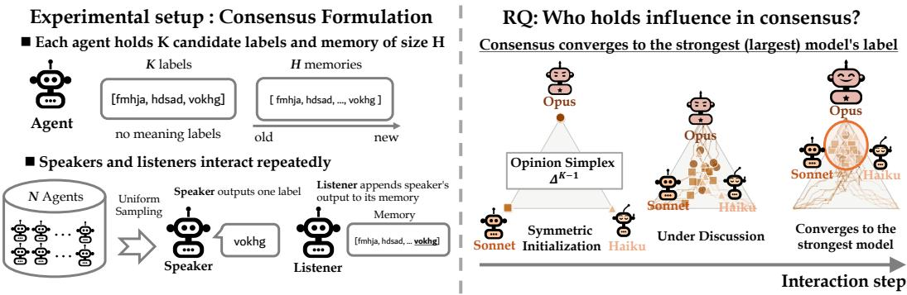  
Figure 1: The naming game and our research question we ask. Left: each agent holds K candidate labels, listed in a random order that carries no meaning, and a memory of the last H labels it has heard. In each interaction, a speaker and a listener are drawn uniformly from the N agents; the speaker emits one label, and only the listener appends it to its memory. Right: when the population mixes models of one family (here Opus, Sonnet, and Haiku), each seeded with its own label, whose label does the population adopt? In our experiments it is most often the strongest model’s.

We run this experiment on seven model families: GPT-5, GPT-4.1, Claude 5, Gemini, Gemma 4, Qwen 3.5, and Qwen 2.5. In every family, the population most often converges to the label of the stronger model. For API models, the stronger model is the higher-performing one; for open-weight models, it is the larger one. This happens even though no label is correct. The dynamics can be followed on the simplex $\Delta ^ { K - 1 }$ of how likely each agent is to output each label (Figure 1, right). Even from a perfectly symmetric start, the trajectories show the weaker models being drawn toward the stronger model’s label. To understand this phenomenon, we view the population as N particles moving on this simplex, and the approach to consensus as the descent of an energy. Each particle has a mass-like weight, which we call its assertion strength, and it pulls the consensus toward it own label in proportion to this weight. We fit the weights from the runs and find that they grow with model size. In the resulting energy landscape, the well of the larger model is the deepest (Section 4). A large weight means that a model amplifies the majority of its context, which is the ability of incontext learning. Larger models are better in-context learners, and this ability turns into influence over the consensus of a multi-agent system.

## Our main contributions are summarized as follows:

1. We design a novel task for studying the behavior of heterogeneous multi-agent systems, carefully constructed so that the knowledge acquired during pretraining plays no role.

2. We experimentally demonstrate that, even when pretrained knowledge is rendered irrelevant, stronger and larger models inherently exert a greater influence on the system’s dynamics.

3. To understand these observations, we propose a physics-inspired framework that models the models as a system of interacting particles with varying weights, and show that this intuitively aligns with our empirical results.

While the dynamics of multi-agent systems are inherently complex and often opaque, we hope this minimalist framework provides a clear and intuitive lens through which to demystify their fundamental behavior.

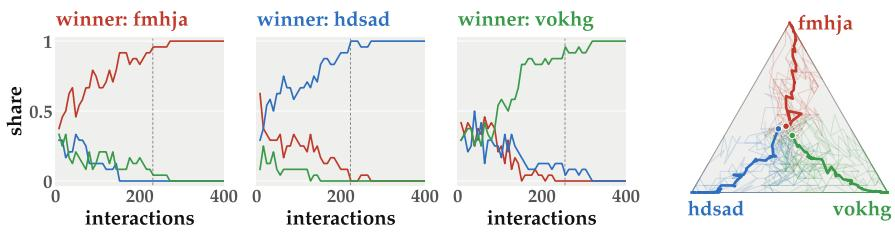  
Figure 2: A population of one model, reproducing the setting of Tanaka (2026). All agents are Claude Haiku 4.5, and every memory starts empty. Left: share of each label in the agents’ answers, for one trial won by each label; the dashed line marks consensus. The difference between the plots is due to the difference in random seeds. Right: the same shares on the simplex, for every trial (faint) and averaged over the trials won by each label (bold).

## 2 A SYNTHETIC TASK FOR CONSENSUS FORMATION

## 2.1 AGENT PROTOCOL

Figure 1 (left) summarizes the protocol. Each agent is an LLM queried with a system prompt and a user prompt (full text in Appendix B). The user prompt lists K candidate labels and the agent’s memory Mi, the last H labels it has heard. It then asks the agent to output one of the candidates. The prompt says only that players choose a label for the same referent in repeated interactions. It mentions no goal of agreement, no reward, and nothing about the other agents or the experiment. The labels are meaningless five-letter strings. No label is favoured for what it means, so the dynamic reflect consensus formation alone. The memory is stored from oldest to newest, but the prompt shows the newest label first, then the others in chronological order. The order of the candidate labels is shuffled at every query.

## 2.2 SPEAKER–LISTENER INTERACTIONS

A population consists of N such agents. In each interaction, we draw an ordered pair $( j , i ) , j \neq i ,$ uniformly from the $N ( N - 1 )$ ordered pairs. Agent j is the speaker and agent i is the listener. The speaker outputs one label. The listener appends it to the right end of its memory and drops the oldest entry. The speaker’s memory does not change. By default, we use $K = 3 , H = 2 0$ , and $N = 2 4$ and each trial runs for $T = \dot { 6 } 0 N$ interactions. We call N consecutive interactions a round, so a trial lasts at most 60 rounds.

Since an agent can only output one of the K labels, its state is how likely it is to output each label. These probabilities sum to one, so each agent is a point $\mathbf { \Delta } _ { \mathbf { \mathcal { X } } _ { i } }$ on the simplex $\Delta ^ { K - 1 }$ : for $K = 3$ a triangle whose vertices are the three labels, in which the agent moves as it interacts (Figure 1, right). Estimating $\mathbf { \Delta } _ { \mathbf { \mathcal { X } } _ { i } }$ after every interaction would require many repeated queries, which is costly, especially for API models. Therefore, we approximate it by the agent’s memory composition, the fraction of its memory taken by each label:

$$
m _ { i , k } = \frac { 1 } { H } \big | \{ r : M _ { i } [ r ] = k \} \big | ,\tag{1}
$$

This fraction rises monotonically with the probability of outputting the label (Pearson $r = 0 . 8 3 – 0 . 9 3$ across 18 models; details in Appendix E).

## 2.3 HETEROGENEOUS POPULATIONS

In the homogeneous setting of Tanaka (2026), every agent is the same model and every memory starts empty. Repeated interactions are known to bring such a population to consensus on a single label (Steels, 1995; Baronchelli et al., 2006; Tanaka, 2026). No label is favoured, so which one wins is a matter of chance (Figure 2). Because we ask which agent holds influence, we instead mix several models in one population, for example Opus 5, Sonnet 5, and Haiku 4.5 in equal numbers. Each model is assigned its own label. Every agent of that model starts with a memory filled with that label. In other words, the total population of agents is partitioned into K distinct subpopulations. For example, if the total number of agents is $\bar { N = 2 4 }$ and there are K = 3 classes, the population will consist of 8 Opus, 8 Sonnet, and 8 Haiku agents. Therefore, the population begins in complete disagreement. The label it finally adopts tells us which model was the most influential.

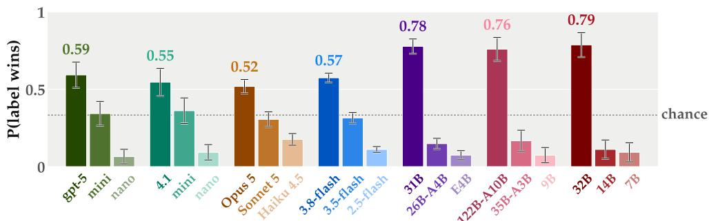  
GPT-5 GPT-4.1 Claude 5 Gemini Gemma 4 Qwen 3.5 Qwen 2.5

Figure 3: Who wins. Fraction of the 108 trials per family in which each class’s label becomes the population’s convention. Whiskers are one standard error from a cluster bootstrap over the 18 cells; the dashed line is chance (1/3). The Gemini ladder is ordered by model generation.  
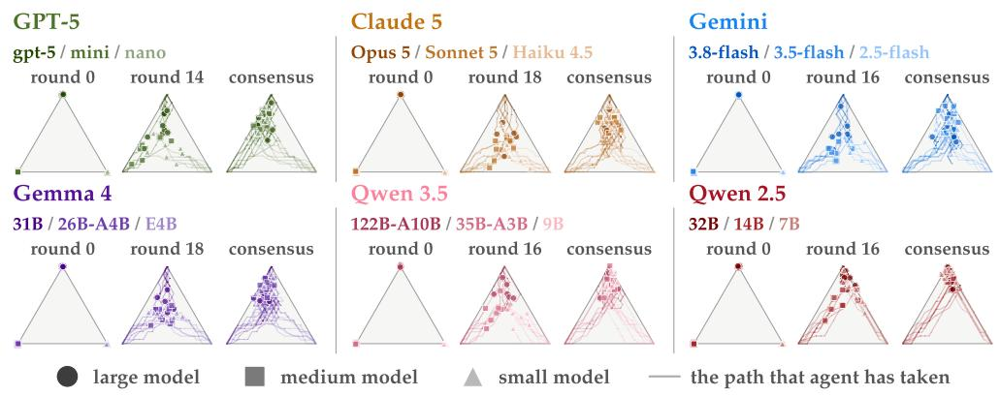  
Figure 4: One representative trial per family. Each point is an agent, placed on the simplex by the composition of its 20-slot memory; the large class starts at the top vertex and the medium and small classes at the bottom. Lines trace each agent’s path. In each of these trials the cloud contracts, drifts, and is absorbed at the large model’s vertex. N = 24, H = 20.

We test seven families from four developers. Each family contributes a large, a medium, and a small model: GPT-5 (gpt-5, gpt-5-mini, gpt-5-nano) (OpenAI, 2025b), GPT-4.1 (gpt-4.1, -mini, -nano) (OpenAI, 2025a), Claude 5 (Opus 5, Sonnet 5, Haiku 4.5) (Anthropic, 2026a;b; 2025a), Gemini (3.8, 3.5, and 2.5 Flash, a ladder ordered by generation) (Google DeepMind, 2026b;a; Comanici et al., 2025), Gemma 4 (31B, 26B-A4B, E4B) (Gemma Team, 2026), Qwen 3.5 (122B-A10B, 35B-A3B, 9B) (Qwen Team, 2026), and Qwen 2.5 (32B, 14B, 7B) (Yang et al., 2024a). Within a family, we call a model stronger when it scores higher on standard benchmarks such as MMLU-Pro; the model identifiers and the benchmark scores are listed in Appendix A.

## 3 EXPERIMENTAL RESULTS

## 3.1 STRONGER MODELS DRIVE CONSENSUS

We first ask which model’s label a population tends to converge to. Figure 3 shows the result for each of the seven model families. For each family, it gives the fraction of the 108 trials in which each model’s label became the population’s convention. With K = 3 labels, chance is 1/3.

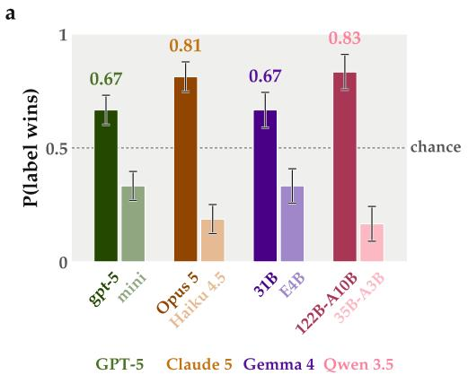

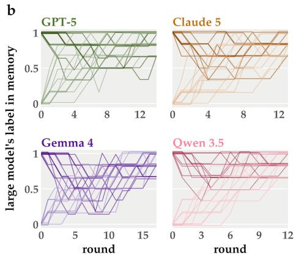  
Figure 5: Two labels $( K = 2 ) .$ 12 agents of a larger model and 12 of a smaller one from the same family. (a) Fraction of trials won by each model’s label. (b) One trial per family: each line is one agent’s share of the larger model’s label in memory, by round (N = 24 interactions). Dark lines are the larger model’s agents.

In every family, the population most often converges to the label of the most capable model, such as Opus 5 for Claude. In the open-weight families, whose model sizes are public, the winner is always the largest model. The full ordering large > medium > small also holds in every family. The labels are meaningless random strings, so there is no correct label to find. Consequently, prior knowledge plays no role in this setting. Even so, the more capable model pulls the population toward its own label.

Figure 4 shows how consensus forms on the simplex, with one representative trial won by the strongest model per family. At the start, each class sits at its own vertex, so the population is fully symmetric. The agents then move toward the centre and contract into a cloud. Finally, all of them are absorbed at the strongest model’s vertex, in every family. Crucially, even the model that ultimately drives the consensus does not remain stationary at its starting position. Through interactions with other models, all agents initially go to the center of the simplex, contracting into a cloud. Finally, the entire population is absorbed at the top vertex, which corresponds to the label of the largest model, in every family.

We also run populations with K = 2 labels. Each population has 12 agents of a larger model and 12 of a smaller model from the same family, and each class starts with its own label. Figure 5(a) shows that the larger model wins in all four families we test: GPT-5 (0.67), Claude 5 (0.81), Gemma 4 (0.67), and Qwen 3.5 (0.83). Chance is now 1/2. With two labels the simplex is a segment, so Figure 5(b) draws each agent as one line: the share of the larger model’s label in its memory. The two classes start at 1 and 0. The smaller model’s agents then move most of the way to the larger model’s label. The larger model’s agents give up much less of theirs.

Next, we also conducted experiments mixing different model families of comparable size. We build a population from three open-weight models of nearly the same size, each from a different family: Gemma 4 31B, Qwen 2.5 32B, and Qwen 3.5 27B. If size decided the outcome, no model should be favoured. This is what we observe (Figure 6). The three models win 0.39, 0.36, and 0.25. models hover roughly around the chance level, especially when contrasted with the stark disparities seen in Figure 3. Consequently, we cannot conclude that any single model exerts a definitively dominant influence. This suggests that the ”influencer” effect becomes prominent primarily when there is a substantial gap in model size (i.e., model capability).

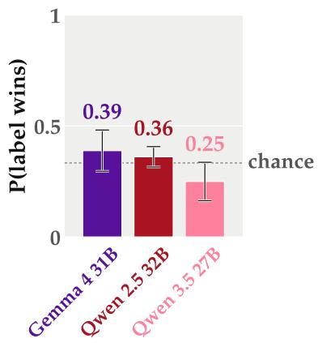  
Figure 6: Cross model family results

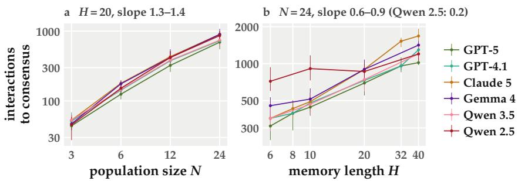  
Figure 7: Time to consensus. Median number of interactions to consensus against (a) N at $H = 2 0$ and (b) H at $N = 2 4$ , on log–log axes; bars are interquartile ranges over the trials of a cell. Slopes are least-squares exponents per family.

## 3.2 EFFECTS OF POPULATION SIZE AND MEMORY LENGTH

We investigated how the system’s dynamics change depending on the experimental hyperparameters N and H. Figure 7 shows how the population size N and the memory length H change the time to consensus. Larger populations take longer to agree. The number of interactions to consensus grows roughly as $N ^ { 1 . 5 } – N ^ { 1 . \dot { 4 } }$ in every family of the sweep. From $N = 3 \tan N = 2 4 ,$ it rises 14- to 19-fold. However, each agent speaks only about twice as often, because the interactions are shared among more agents. Longer memories also slow consensus. The number of interactions grows as $H ^ { 0 . 6 _ { - } ^ { - } }$ $H ^ { 0 . 9 }$ . Each interaction replaces only one of the H slots, meaning it presumably takes significantly more time to overwrite the initially biased memories. Additional results detailing the convergence outcomes for different values of N and H can be found in Appendix F. Notably, the fundamental trend of converging toward the larger model remains robust regardless of these hyperparameters.

## 4 WHY THE STRONGER MODEL WINS

Why does consensus flow to the stronger model? We model each agent as a particle on the simplex, and the population as descending an energy. The energy extends the one implicit in Tanaka (2026) by a single ingredient: each model pulls on the population with its own strength. We develop the account for the three open-weight families: Gemma 4, Qwen 3.5, and Qwen 2.5.

## 4.1 AGENTS AS PARTICLES ON THE SIMPLEX

Agent i says each label with a probability that depends on its memory. We write these probabilities as $\bar { \mathbf { x } } _ { i } \in \Delta ^ { K ^ { \bot } - 1 }$ and treat $\mathbf { \Delta } _ { \mathbf { \mathcal { X } } _ { i } }$ as the position of a particle on the simplex (Figure 8). A vertex means that the agent says only one label. The centre means that it says every label equally often. At the start, the particles of each class sit on their own vertex.

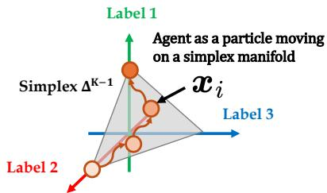

An interaction moves only the listener. The speaker $j$ says a label drawn from $\scriptstyle { \pmb { x } } _ { j } .$ . The listener i replaces one of its H memory slots with that label, so $\mathbf { \Delta } _ { \mathbf { \mathcal { X } } _ { i } }$ moves by a small step of order $1 / H$

Figure 8: Agents as particles. Agent i’s output distribution $\mathbf { \Delta } _ { \mathbf { \mathcal { X } } _ { i } }$ is a point on the simplex $\Delta ^ { K - 1 }$ , whose vertices are the labels; each interaction moves it.

## 4.2 A CONSENSUS ENERGY

For a population of one model, Tanaka (2026) follow the polarization $\begin{array} { r } { U = \sum _ { k } \bar { x } _ { k } ^ { 2 } } \end{array}$ of the mean output $\begin{array} { r } { \bar { \pmb { x } } = \frac { 1 } { N } \sum _ { i } \pmb { x } _ { i } } \end{array}$ . It is $1 / K$ at the centre and 1 at a vertex. Repeated interaction raises $U _ { \textrm { \scriptsize : } }$ so the population descends the energy $- U / 2$ . Every vertex of this energy is equally deep. Therefore, which label wins is decided by noise: this is the lottery of homogeneous populations.

In a mixed population, we let each model pull with its own strength. Model c has an assertion strength $w _ { c } ,$ and $c ( k )$ is the model that brought label k, that is, the model whose agents start with k

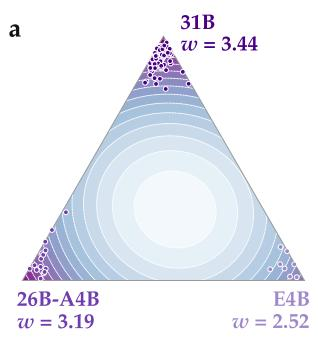

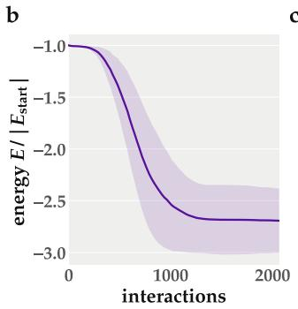

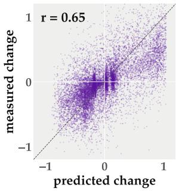  
Figure 9: The consensus energy for Gemma 4. (a) The energy of Equation 2 as a function of the mean output x¯ (darker is lower), with each model’s assertion strength w (its well has depth $- w / 2 ) ;$ dots are the populations’ mean outputs at consensus, in the winner’s colour. (b) Energy along the 108 trials, scaled by its value at the start, against the number of interactions; mean and one standard deviation, with a trial that has reached consensus kept at its final value. (c) One round’s change in the mean output, predicted by the flow of Equation 3 against measured, both scaled by their 99th percentile; the dashed line is perfect agreement. Results for Qwen 3.5 and Qwen 2.5 are in Appendix I.

in memory. We write

$$
E ( \bar { \pmb x } ) = - \frac { 1 } { 2 } \sum _ { k } w _ { c ( k ) } \bar { x } _ { k } ^ { 2 } .\tag{2}
$$

The energy falls as the population concentrates on one label, and by more when that label was brought by a stronger model. With equal strengths, E is −wU/2 again.

We let the mean output move so as to lower this energy. The slope of E is $- \partial E / \partial \bar { x } _ { k } = w _ { c ( k ) } \bar { x } _ { k }$ , so label k is pushed harder the larger its weighted share. Following this slope on the simplex, where the shares must stay non-negative and sum to one, gives the replicator equation of evolutionary game theory (Hofbauer & Sigmund, 1998):

$$
\frac { d \bar { x } _ { k } } { d \tau } = \bar { x } _ { k } \Big ( w _ { c ( k ) } \bar { x } _ { k } - \sum _ { l } w _ { c ( l ) } \bar { x } _ { l } ^ { 2 } \Big ) ,\tag{3}
$$

where $\tau$ is time measured in memory lifetimes. In one round, each agent is the listener about once, so one of its H slots is replaced. Therefore, its memory, and with it $\scriptstyle { \mathbf { x } } _ { i } .$ , changes by about $1 / H$ per round, and it takes about H rounds to renew the whole memory. We set $\tau = \mathrm { r o u n d s } / H _ { \mathrm { i } }$ , so that $\tau = 1$ is one such renewal (details in Appendix G). Label k grows when its weighted share $w _ { c ( k ) } \bar { x } _ { k }$ exceeds the population’s average $\textstyle \sum _ { l } w _ { c ( l ) } \bar { x } _ { l } ^ { 2 }$ . Therefore, a label spreads faster the more often it is already said, and $w _ { c ( k ) }$ sets how much faster. The assertion strength $w _ { c }$ is the strength of this pull toward the majority for the label of model $c .$ The push $w _ { c ( k ) } \bar { x } _ { k }$ is the slope of $E ,$ so the energy never increases along this motion (Hofbauer & Sigmund, 1998; details in Appendix G). When every agent says label k, the energy $\mathrm { i s } - w _ { c ( k ) } / 2$ . Therefore, the label of the strongest model sits in the deepest well.

## 4.3 MEASURING AND TESTING THE ASSERTION STRENGTH

We estimate the assertion strength w of each model from the runs themselves (details in Appendix H). For Gemma 4, w = 3.44 (31B), 3.19 (26B-A4B), and 2.52 (E4B). In all three openweight families, w follows model size.

Figure 9(a) draws the energy landscape of Equation 2 for Gemma 4 with these strengths. The landscape is not symmetric. It is tilted, and the well of the 31B model is the deepest (−1.72, against −1.59 and −1.26). The dots mark where each trial reaches consensus. The dynamics are noisy, so not every trial ends in the deepest well. However, most do: 78% of the trials end at the 31B model’s vertex. Thus, the shape of the landscape matches which model wins.

The energy also falls as the agents interact (Figure 9(b)). The agents reach consensus by descending the energy. Finally, the flow of Equation 3 matches the measured motion (Figure 9(c)). For each round, we compute the change of x¯ that Equation 3 predicts from the current x¯. This prediction agrees with the measured change at $r ~ = ~ 0 . 6 5$ Qwen 3.5 and Qwen 2.5 behave the same way (details in Appendix I). In all three families, the order of w matches the order of win rates in all nine pairs of classes. Thus, the energy explains both where the population ends and how it gets there.

Why a large w steers the population. A large w means that a model amplifies the majority of its own memory. An agent with $w = 0$ says each label as often as its memory holds it. An agent with a large w says the majority label of its memory more often than its share (Appendix H). Therefore, its speech stays consistent with what it already holds. Labels from other agents still enter its memory, but they change its speech less.

We conjecture that this consistency comes from in-context learning. In our game, an agent’s memory is its context, and the prompt asks for a label given these examples. In this setting, circuits that copy from the context, such as induction heads (Olsson et al., 2022), are particularly relevant. Therefore, answering with the majority of the memory is an in-context task, and larger models are better at it. In-context learning improves with scale (Brown et al., 2020), and larger models follow in-context information even when it contradicts what they learned in pretraining, which smaller models ignore (Wei et al., 2023). Thus, the agents of the strong model read their memory consistently and keep their label through many interactions. The other agents respond more loosely to their memory, so they are drawn toward that label. The population then adopts the bias of the most capable model. This happens not because its label is better, but because the model reads its context most consistently: the stronger in-context learning of larger models becomes influence in a multi-agent system.

## 5 DISCUSSION AND RELATED WORK

Multi-agent systems. Multi-agent LLM systems take many forms. They include debate (Du et al., 2024; Liang et al., 2024; Chan et al., 2024; Chen et al., 2024a; Khan et al., 2024) and role-structured frameworks that organize agents into software teams (Li et al., 2023; Wu et al., 2024; Hong et al., 2024; Chen et al., 2024c; Qian et al., 2024; Tao et al., 2024). In some systems, performance grows with the number of agents (Wang et al., 2025a; Li et al., 2024; Qian et al., 2025; Subramaniam et al., 2025; Anthropic, 2025b), and some treat coordination as a separate layer (Nechepurenko & Shuvalov, 2026). Agents have also contributed to scientific discovery (OpenAI, 2026b; Wang et al., 2025b; Google Research, 2025; Google DeepMind, 2025) and simulated whole societies (Park et al., 2023; 2022; Jiang et al., 2026; Altera.AL et al., 2024; Yang et al., 2024c; Piao et al., 2025b; Gao et al., 2023; Vezhnevets et al., 2023). Hammond et al. (2025) and Schroeder de Witt et al. (2025) catalogue the risks of these systems. They include recursive blocking attacks (Zhou et al., 2026), subliminal bias (Weckbecker et al., 2026), rumors (Hu et al., 2025), and the Hugging Face incident (METR, 2026). Many of these systems mix models, but none of this work asks whose view the system adopts when the agents disagree. We measure this influence directly, in the simplest population that shows it.

Influence without correctness. Most work on debate studies tasks with a ground truth. It asks whether debate beats a well-prompted single agent (Wang et al., 2024; Smit et al., 2024; Zhang et al., 2025), whether its gains reduce to majority voting (Choi et al., 2025), and whether more calls always help (Chen et al., 2024b). Teams of different models beat their strongest member when correct reasoning is easy to recognize (Pappu et al., 2026). When it is hard to recognize, plausible but wrong reasoning crowds out the correct one. The naming game is the limit in which nothing can be recognized as correct. What remains is influence alone. This case matters in practice, because agents often settle conventions and formats, where agreement says nothing about quality. Prior work measures how accurate a group is. We measure who steers it when accuracy does not exist, and we find that a mixed population converges on its strongest member’s view. This qualifies the advice to mix models (Zhang et al., 2025).

Conventions in agent populations. The naming game has a long history (Steels, 1995; Baronchelli et al., 2006). Human conventions tip under committed minorities (Centola et al., 2018). LLM populations also form conventions, collective biases, and networks of their own (Flint Ashery et al., 2025; Flint et al., 2026; De Nobili et al., 2026; De Marzo et al., 2023; Papachristou & Yuan, 2025). Related work finds cultural attractors in iterated transmission (Perez et al., 2025; Acerbi & Stubbersfield, 2023; Brinkmann et al., 2023), emergent norms and cooperation (Ren et al., 2024; Vallinder & Hughes, 2025; Piatti et al., 2024; Akata et al., 2025), and individuality within homogeneous groups (Takata et al., 2024). These results support LLM populations as an experimental instrument (Anthis et al., 2025; Haase & Pokutta, 2026; Baronchelli, 2024). These studies use populations of one model, in which no agent can be more influential than another. Tanaka (2026) asks when consensus is a lottery. We ask who wins it once the agents differ, and we find that the answer is the stronger model.

Susceptibility and influence. Closely related work studies susceptibility rather than outcome. LLMs conform to majorities (Weng et al., 2025; Zhu et al., 2025) and herd when peers appear more confident (Cho et al., 2025). Under interaction, their opinions shift and polarize, and they show human-like social behavior (Chuang et al., 2024a;b; Cisneros-Velarde, 2024; 2025; Piao et al., 2025a; Zuo et al., 2025; Hashemi & Macy, 2026; Leng & Yuan, 2023; Yang et al., 2024b). A single persuasive adversary, a small biased minority, or a mediating planner can capture or steer a group (Kraidia et al., 2026; Breum et al., 2024; Berjawi et al., 2026; Arghal et al., 2026). In LLM naming games, a committed minority of scripted agents can overturn a convention (Flint Ashery et al., 2025). A committed agent never changes its speech in response to what it hears. It is the extreme case of the asymmetry we measure. Our agents, by contrast, are unscripted and differ only by model. The closest heterogeneous results involve two agents: model-specific attractors pull conversational partners asymmetrically (Ko & Geiping, 2026). In communities with a correct answer, correct agents pull hardest (El et al., 2026). We show that a strong pull remains when nothing is correct. Classical consensus models also show that heterogeneous agents change outcomes, through memory (Kohan Marzagao et al.˜ , 2021), update rules and rates (Suchecki et al., 2005; Masuda et al., 2010), and measurable social influence (Jaques et al., 2019). What is new here is a population of unscripted agents that differ only by model, and an energy whose wells are set by a measured property of each model, its assertion strength.

Limitations. Our populations are well mixed and exchange single labels. We do not study structured networks or free-form text. Furthermore, we have not investigated how the topology of the agent population affects the dynamics, nor have we verified which model holds influence in settings where an objective ground-truth answer exists.

## 6 CONCLUSION

We asked which agent steers a population when agents disagree and no answer is correct. In mixedmodel naming games across seven families, the stronger model’s convention takes over. The ranking of models within a family becomes the ranking of their influence. A particle picture explains why. Language models assert the majority of their memory, and larger models do so more strongly. The population’s output then runs down an energy whose deepest well is the strongest model’s label. One question remains open: can we measure this assertion outside the population, and so know who steers a multi-agent system before it runs?

## REFERENCES

Alberto Acerbi and Joseph M. Stubbersfield. Large language models show human-like content biases in transmission chain experiments. Proceedings of the National Academy of Sciences (PNAS), 120(44):e2313790120, 2023.

Elif Akata, Lion Schulz, Julian Coda-Forno, Seong Joon Oh, Matthias Bethge, and Eric Schulz. Playing repeated games with large language models. Nature Human Behaviour, 9(7):1380–1390, 2025.

Altera.AL, Andrew Ahn, Nic Becker, Stephanie Carroll, Nico Christie, Manuel Cortes, et al. Project Sid: Many-agent simulations toward AI civilization. arXiv preprint arXiv:2411.00114, 2024.

Jacy Reese Anthis, Ryan Liu, Sean M. Richardson, Austin C. Kozlowski, Bernard Koch, Erik Brynjolfsson, James Evans, and Michael S. Bernstein. Position: LLM social simulations are a promis-

ing research method. In Proceedings of the 42nd International Conference on Machine Learning (ICML), volume 267 of PMLR, pp. 81005–81034, 2025.

Anthropic. System card: Claude Haiku 4.5. Anthropic, 2025a. URL https://www. anthropic.com/claude-haiku-4-5-system-card.

Anthropic. How we built our multi-agent research system. Anthropic Engineering Blog, 2025b. URL https://www.anthropic.com/engineering/ built-multi-agent-research-system.

Anthropic. System card: Claude Opus 5. Anthropic, 2026a. URL https://www.anthropic. com/claude-opus-5-system-card.

Anthropic. System card: Claude Sonnet 5. Anthropic, 2026b. URL https://www. anthropic.com/claude-sonnet-5-system-card.

Raghu Arghal, Kevin He, Shirin Saeedi Bidokhti, and Saswati Sarkar. Steering the herd: A framework for LLM-based control of social learning. In International Conference on Learning Representations (ICLR), 2026.

Andrea Baronchelli. Shaping new norms for AI. Philosophical Transactions ofthe Royal Society B, 379(1897):20230028, 2024.

Andrea Baronchelli, Maddalena Felici, Vittorio Loreto, Emanuele Caglioti, and Luc Steels. Sharp transition towards shared vocabularies in multi-agent systems. Journal of Statistical Mechanics: Theory and Experiment, pp. P06014, 2006.

Omran Berjawi, Giuseppe Fenza, and Rida Khatoun. Bias amplification in multi-agent network: How biased agents shape opinions and rhetoric. In 6th Workshop on Bias and Fairness in AI (BIAS), ECML PKDD, 2026.

Robert Boyd and Peter J. Richerson. Culture and the Evolutionary Process. University of Chicago Press, Chicago, 1985.

Simon Martin Breum, Daniel Vædele Egdal, Victor Gram Mortensen, Anders Giovanni Møller, and Luca Maria Aiello. The persuasive power of large language models. In Proceedings of the International AAAI Conference on Web and Social Media (ICWSM), volume 18, pp. 152–163, 2024.

Levin Brinkmann, Fabian Baumann, Jean-Franc¸ois Bonnefon, Maxime Derex, Thomas F. Muller,¨ Anne-Marie Nussberger, et al. Machine culture. Nature Human Behaviour, 7(11):1855–1868, 2023.

Tom B. Brown, Benjamin Mann, Nick Ryder, Melanie Subbiah, Jared Kaplan, Prafulla Dhariwal, Arvind Neelakantan, Pranav Shyam, Girish Sastry, Amanda Askell, et al. Language models are few-shot learners. In Advances in Neural Information Processing Systems (NeurIPS), volume 33, 2020.

Damon Centola, Joshua Becker, Devon Brackbill, and Andrea Baronchelli. Experimental evidence for tipping points in social convention. Science, 360(6393):1116–1119, 2018.

Chi-Min Chan, Weize Chen, Yusheng Su, Jianxuan Yu, Wei Xue, Shanghang Zhang, Jie Fu, and Zhiyuan Liu. ChatEval: Towards better LLM-based evaluators through multi-agent debate. In International Conference on Learning Representations (ICLR), 2024.

Justin Chen, Swarnadeep Saha, and Mohit Bansal. ReConcile: Round-table conference improves reasoning via consensus among diverse LLMs. In Proceedings ofthe 62nd Annual Meeting ofthe Associationfor Computational Linguistics (ACL), pp. 7066–7085, 2024a.

Lingjiao Chen, Jared Quincy Davis, Boris Hanin, Peter Bailis, Ion Stoica, Matei Zaharia, and James Zou. Are more LLM calls all you need? towards the scaling properties of compound AI systems. In Advances in Neural Information Processing Systems (NeurIPS), 2024b.

Weize Chen, Yusheng Su, Jingwei Zuo, Cheng Yang, Chenfei Yuan, Chi-Min Chan, Heyang Yu, Yaxi Lu, Yi-Hsin Hung, Chen Qian, Yujia Qin, Xin Cong, Ruobing Xie, Zhiyuan Liu, Maosong Sun, and Jie Zhou. AgentVerse: Facilitating multi-agent collaboration and exploring emergent behaviors. In International Conference on Learning Representations (ICLR), 2024c.

Young-Min Cho, Sharath Chandra Guntuku, and Lyle Ungar. Herd behavior: Investigating peer influence in LLM-based multi-agent systems. arXiv preprint arXiv:2505.21588, 2025.

Hyeong Kyu Choi, Xiaojin Zhu, and Sharon Li. Debate or vote: Which yields better decisions in multi-agent large language models? In Advances in Neural Information Processing Systems (NeurIPS), 2025.

Yun-Shiuan Chuang, Agam Goyal, Nikunj Harlalka, Siddharth Suresh, Robert Hawkins, Sijia Yang, et al. Simulating opinion dynamics with networks of LLM-based agents. In Findings of the Associationfor Computational Linguistics: NAACL 2024, pp. 3326–3346, 2024a.

Yun-Shiuan Chuang, Nikunj Harlalka, Siddharth Suresh, Agam Goyal, Robert Hawkins, Sijia Yang, et al. The wisdom of partisan crowds: Comparing collective intelligence in humans and LLMbased agents. In Proceedings of the Annual Meeting of the Cognitive Science Society (CogSci), volume 46, 2024b.

Pedro Cisneros-Velarde. On the principles behind opinion dynamics in multi-agent systems of large language models. arXiv preprint arXiv:2406.15492, 2024.

Pedro Cisneros-Velarde. Biases in opinion dynamics in multi-agent systems of large language models: A case study on funding allocation. In Findings of the Association for Computational Lin guistics: NAACL 2025, pp. 1889–1916, 2025.

Gheorghe Comanici et al. Gemini 2.5: Pushing the frontier with advanced reasoning, multimodality, long context, and next generation agentic capabilities. arXiv preprint arXiv:2507.06261, 2025.

Giordano De Marzo, Luciano Pietronero, and David Garcia. Emergence of scale-free networks in social interactions among large language models. arXiv preprint arXiv:2312.06619, 2023.

Cristiano De Nobili, Vijayasri Iyer, Alessandro Codello, and Raffaella Burioni. Microscopic dynamics of consensus formation in multi-agent LLM naming games. arXiv preprint arXiv:2608.02178, 2026.

Yilun Du, Shuang Li, Antonio Torralba, Joshua B. Tenenbaum, and Igor Mordatch. Improving factuality and reasoning in language models through multiagent debate. In Proceedings of the 41st International Conference on Machine Learning (ICML), volume 235 of PMLR, pp. 11733– 11763, 2024.

Batu El, Jinhee Paeng, Fatih Dinc, Shiye Su, Mete Erdogan, Aneesh Pappu, Haotian Ye, Wanjia Zhao, Surya Ganguli, and James Zou. Physics of agents: Statistical mechanics predicts collective behavior of AI agents. arXiv preprint arXiv:2608.16578, 2026.

Ariel Flint, Luca Maria Aiello, Romualdo Pastor-Satorras, and Andrea Baronchelli. Group size effects and collective misalignment in LLM multi-agent systems. Proceedings of the National Academy ofSciences (PNAS), 2026. doi: 10.1073/pnas.2531697123.

Ariel Flint Ashery, Luca Maria Aiello, and Andrea Baronchelli. Emergent social conventions and collective bias in LLM populations. Science Advances, 11(20):eadu9368, 2025.

Chen Gao, Xiaochong Lan, Zhihong Lu, Jinzhu Mao, Jinghua Piao, Huandong Wang, Depeng Jin, and Yong Li. S3: Social-network simulation system with large language model-empowered agents. arXiv preprint arXiv:2307.14984, 2023.

Gemma Team. Gemma 4 technical report. arXiv preprint arXiv:2607.02770, 2026.

Google DeepMind. AlphaEvolve: A gemini-powered coding agent for designing advanced algorithms. Google DeepMind Blog, 2025.

Google DeepMind. Gemini 3.5 Flash model card. Google DeepMind, 2026a. URL https: //deepmind.google/models/model-cards/gemini-3-5-flash/.

Google DeepMind. Gemini 3.8 Flash model card. Google DeepMind, 2026b. URL https: //deepmind.google/models/model-cards/gemini-3-8-flash/.

Google Research. Towards an AI co-scientist. Google Research, 2025. URL https://research.google/blog/ accelerating-scientific-breakthroughs-with-an-ai-co-scientist/.

Xiangming Gu, Xiaosen Zheng, Tianyu Pang, Chao Du, Qian Liu, Ye Wang, Jing Jiang, and Min Lin. Agent smith: A single image can jailbreak one million multimodal LLM agents exponentially fast. In Proceedings of the 41st International Conference on Machine Learning (ICML), volume 235 of PMLR, pp. 16647–16672, 2024.

Taicheng Guo, Xiuying Chen, Yaqi Wang, Ruidi Chang, Shichao Pei, Nitesh V. Chawla, Olaf Wiest, and Xiangliang Zhang. Large language model based multi-agents: A survey of progress and challenges. In Proceedings of the Thirty-Third International Joint Conference on Artificial Intelligence (IJCAI), pp. 8048–8057, 2024.

Jennifer Haase and Sebastian Pokutta. Beyond static responses: Multi-agent LLM systems as a new paradigm for social science research. Humanities and Social Sciences Communications, 2026.

Lewis Hammond, Alan Chan, Jesse Clifton, Jason Hoelscher-Obermaier, Akbir Khan, Euan McLean, et al. Multi-agent risks from advanced AI. Technical Report 1, Cooperative AI Founda tion, 2025. arXiv:2502.14143.

Farnoosh Hashemi and Michael W. Macy. An empirical study of collective behaviors and social dynamics in large language model agents. In Proceedings of the Conference of the European Chapter of the Association for Computational Linguistics (EACL), 2026.

Josef Hofbauer and Karl Sigmund. Evolutionary Games and Population Dynamics. Cambridge University Press, 1998.

Sirui Hong, Mingchen Zhuge, Jonathan Chen, Xiawu Zheng, Yuheng Cheng, Ceyao Zhang, Jinlin Wang, Zili Wang, Steven Ka Shing Yau, Zijuan Lin, Liyang Zhou, Chenyu Ran, Lingfeng Xiao, Chenglin Wu, and Jurgen Schmidhuber. MetaGPT: Meta programming for a multi-agent collab-¨ orative framework. In International Conference on Learning Representations (ICLR), 2024.

Tianrui Hu, Dimitrios Liakopoulos, Xiwen Wei, Radu Marculescu, and Neeraja J. Yadwadkar. Simulating rumor spreading in social networks using LLM agents. In AAAI Workshop on Multi-Agent Collaboration (WMAC), 2025.

Natasha Jaques, Angeliki Lazaridou, Edward Hughes, Caglar Gulcehre, Pedro Ortega, DJ Strouse, Joel Z. Leibo, and Nando de Freitas. Social influence as intrinsic motivation for multi-agent deep reinforcement learning. In Proceedings of the 36th International Conference on Machine Learning (ICML), volume 97 of PMLR, pp. 3040–3049, 2019.

Yukun Jiang, Yage Zhang, Xinyue Shen, Michael Backes, and Yang Zhang. “Humans welcome to observe”: A first look at the agent social network Moltbook. arXiv preprint arXiv:2602.10127, 2026.

Akbir Khan, John Hughes, Dan Valentine, Laura Ruis, Kshitij Sachan, Ansh Radhakrishnan, Edward Grefenstette, Samuel R. Bowman, Tim Rocktaschel, and Ethan Perez. Debating with more¨ persuasive LLMs leads to more truthful answers. In Proceedings of the 41st International Conference on Machine Learning (ICML), volume 235 of PMLR, pp. 23662–23733, 2024.

Ting-Wen Ko and Jonas Geiping. Attractor states emerge in multi-turn LLM conversations. In Proceedings ofthe 43rd International Conference on Machine Learning (ICML), 2026.

David Kohan Marzagao, Luciana Basualdo Bonatto, Tiago Madeira, Marcelo Matheus Gauy, and˜ Peter McBurney. The influence of memory in multi-agent consensus. In Proceedings of the AAAI Conference on Artificial Intelligence, volume 35, pp. 11254–11262, 2021.

Insaf Kraidia, Iyas Qaddara, Alhanof Almutairi, Nada Alzaben, and Samir Brahim Belhouari. When collaboration fails: Persuasion driven adversarial influence in multi agent large language model debate. Scientific Reports, 16:11640, 2026.

Donghyun Lee, Mo Tiwari, and Brando Miranda. Prompt infection: LLM-to-LLM prompt injection within multi-agent systems. In Computer Security. ESORICS 2025 International Workshops, volume 16232 of LNCS, pp. 511–520. Springer, 2026.

Yan Leng and Yuan Yuan. Do LLM agents exhibit social behavior? arXiv preprint arXiv:2312.15198, 2023.

Guohao Li, Hasan Abed Al Kader Hammoud, Hani Itani, Dmitrii Khizbullin, and Bernard Ghanem. CAMEL: Communicative agents for “mind” exploration of large language model society. In Advances in Neural Information Processing Systems (NeurIPS), 2023.

Junyou Li, Qin Zhang, Yangbin Yu, Qiang Fu, and Deheng Ye. More agents is all you need. Transactions on Machine Learning Research (TMLR), 2024.

Tian Liang, Zhiwei He, Wenxiang Jiao, Xing Wang, Yan Wang, Rui Wang, Yujiu Yang, Shuming Shi, and Zhaopeng Tu. Encouraging divergent thinking in large language models through multiagent debate. In Proceedings ofthe 2024 Conference on Empirical Methods in Natural Language Processing (EMNLP), pp. 17889–17904, 2024.

Naoki Masuda, N. Gibert, and S. Redner. Heterogeneous voter models. Physical Review E, 82: 010103(R), 2010.

METR. Independent investigation of the OpenAI–Hugging Face incident. METR, 2026. URL https://metr.org/blog/ 2026-08-26-openai-hugging-face-incident-investigation/.

Maksym Nechepurenko and Pavel Shuvalov. Coordination as an architectural layer for LLM-based multi-agent systems. arXiv preprint arXiv:2605.03310, 2026.

Catherine Olsson, Nelson Elhage, Neel Nanda, Nicholas Joseph, Nova DasSarma, Tom Henighan, Ben Mann, Amanda Askell, Yuntao Bai, Anna Chen, et al. In-context learning and induction heads. arXiv preprint arXiv:2209.11895, 2022.

OpenAI. Introducing GPT-4.1 in the API. OpenAI, 2025a. URL https://openai.com/ index/gpt-4-1/.

OpenAI. GPT-5 system card. OpenAI, 2025b. URL https://openai.com/index/ gpt-5-system-card/.

OpenAI. The Hugging Face incident and the road ahead. OpenAI, 2026a. URL https: //openai.com/index/hugging-face-incident-and-the-road-ahead/.

OpenAI. On the Navier–Stokes millennium prize problem. OpenAI, 2026b. URL https:// openai.com/index/navier-stokes-solution/.

Marios Papachristou and Yuan Yuan. Network formation and dynamics among multi-LLMs. PNAS Nexus, 4(12):pgaf317, 2025.

Aneesh Pappu, Mirac Suzgun, Yongchan Kwon, Federico Bianchi, Batu El, Mykel J. Kochenderfer, Hancheng Cao, and James Zou. Self-organizing agent teams learn to reason together. arXiv preprint arXiv:2609.22682, 2026.

Joon Sung Park, Lindsay Popowski, Carrie Cai, Meredith Ringel Morris, Percy Liang, and Michael S. Bernstein. Social simulacra: Creating populated prototypes for social computing systems. In Proceedings of the 35th Annual ACM Symposium on User Interface Software and Technology (UIST), pp. 1–18, 2022.

Joon Sung Park, Joseph O’Brien, Carrie Jun Cai, Meredith Ringel Morris, Percy Liang, and Michael S. Bernstein. Generative agents: Interactive simulacra of human behavior. In Proceedings of the 36th Annual ACM Symposium on User Interface Software and Technology (UIST), pp. 1–22, 2023.

Jer´ emy Perez, Grgur Kova´ c, Corentin Lˇ eger, C´ edric Colas, Gaia Molinaro, Maxime Derex, Pierre-´ Yves Oudeyer, and Clement Moulin-Frier. When LLMs play the telephone game: Cultural attrac- ´ tors as conceptual tools to evaluate LLMs in multi-turn settings. In International Conference on Learning Representations (ICLR), 2025.

Jinghua Piao, Zhihong Lu, Chen Gao, Fengli Xu, Qinghua Hu, Fernando P. Santos, Yong Li, and James Evans. Emergence of polarization in networks of large language model agents. arXiv preprint arXiv:2501.05171, 2025a.

Jinghua Piao, Yuwei Yan, Jun Zhang, Nian Li, Junbo Yan, Xiaochong Lan, et al. AgentSociety: Large-scale simulation of LLM-driven generative agents advances understanding of human behaviors and society. arXiv preprint arXiv:2502.08691, 2025b.

Giorgio Piatti, Zhijing Jin, Max Kleiman-Weiner, Bernhard Scholkopf, Mrinmaya Sachan, and Rada¨ Mihalcea. Cooperate or collapse: Emergence of sustainable cooperation in a society of LLM agents. In Advances in Neural Information Processing Systems (NeurIPS), 2024.

Chen Qian, Wei Liu, Hongzhang Liu, Nuo Chen, Yufan Dang, Jiahao Li, et al. ChatDev: Communicative agents for software development. In Proceedings of the 62nd Annual Meeting of the Association for Computational Linguistics (ACL), pp. 15174–15186, 2024.

Chen Qian, Zihao Xie, Yifei Wang, Wei Liu, Kunlun Zhu, Hanchen Xia, et al. Scaling large language model-based multi-agent collaboration. In International Conference on Learning Representations (ICLR), 2025.

Qwen Team. Qwen3.5: Towards native multimodal agents. Qwen Blog, 2026. URL https: //qwen.ai/blog?id=qwen3.5.

Siyue Ren, Zhiyao Cui, Ruiqi Song, Zhen Wang, and Shuyue Hu. Emergence of social norms in generative agent societies: Principles and architecture. In Proceedings of the 33rd International Joint Conference on Artificial Intelligence (IJCAI), pp. 7895–7903, 2024.

Christian Schroeder de Witt, Klaudia Krawiecka, Igor Krawczuk, Ben Hagag, William L. Anderson, Peter Belcak, et al. Open challenges in multi-agent security: Towards secure systems of interacting AI agents. arXiv preprint arXiv:2505.02077, 2025.

Andries Petrus Smit, Nathan Grinsztajn, Paul Duckworth, Thomas D. Barrett, and Arnu Pretorius. Should we be going MAD? a look at multi-agent debate strategies for LLMs. In Proceedings of the 41st International Conference on Machine Learning (ICML), volume 235 of PMLR, pp. 45883–45905, 2024.

Luc Steels. A self-organizing spatial vocabulary. Artificial Life, 2(3):319–332, 1995.

Vighnesh Subramaniam, Yilun Du, Joshua B. Tenenbaum, Antonio Torralba, Shuang Li, and Igor Mordatch. Multiagent finetuning: Self improvement with diverse reasoning chains. In International Conference on Learning Representations (ICLR), 2025.

Krzysztof Suchecki, V´ıctor M. Egu´ıluz, and Maxi San Miguel. Conservation laws for the voter model in complex networks. Europhysics Letters, 69:228–234, 2005.

Ryosuke Takata, Atsushi Masumori, and Takashi Ikegami. Spontaneous emergence of agent individuality through social interactions in large language model-based communities. Entropy, 26 (12):1092, 2024.

Hidenori Tanaka. When is collective intelligence a lottery? multi-agent scaling laws for memetic drift in LLMs. arXiv preprint arXiv:2603.24676, 2026.

Wei Tao, Yucheng Zhou, Yanlin Wang, Wenqiang Zhang, Hongyu Zhang, and Yu Cheng. MAGIS: LLM-based multi-agent framework for GitHub issue resolution. In Advances in Neural Information Processing Systems (NeurIPS), 2024.

Khanh-Tung Tran, Dung Dao, Minh-Duong Nguyen, Quoc-Viet Pham, Barry O’Sullivan, and Hoang D. Nguyen. Multi-agent collaboration mechanisms: A survey of LLMs. arXiv preprint arXiv:2501.06322, 2025.

Aron Vallinder and Edward Hughes. Cultural evolution of cooperation among LLM agents. In Pro ceedings of the International Conference on Autonomous Agents and Multiagent Systems (AA-MAS), Extended Abstract, pp. 2771–2773, 2025.

Alexander Sasha Vezhnevets, John P. Agapiou, Avia Aharon, Ron Ziv, Jayd Matyas, Edgar A. Due´nez-Guzm ˜ an, et al. Generative agent-based modeling with actions grounded in physical,´ social, or digital space using Concordia. arXiv preprint arXiv:2312.03664, 2023.

Junlin Wang, Jue Wang, Ben Athiwaratkun, Ce Zhang, and James Zou. Mixture-of-agents enhances large language model capabilities. In International Conference on Learning Representations (ICLR), 2025a.

Qineng Wang, Zihao Wang, Ying Su, Hanghang Tong, and Yangqiu Song. Rethinking the bounds of LLM reasoning: Are multi-agent discussions the key? In Proceedings of the 62nd Annual Meeting ofthe Associationfor Computational Linguistics (ACL), pp. 6106–6131, 2024.

Yongji Wang, Mehdi Bennani, James Martens, Sebastien Racani´ ere, Sam Blackwell, Alex\` Matthews, et al. Discovery of unstable singularities. arXiv preprint arXiv:2509.14185, 2025b.

Moritz Weckbecker, Jonas Muller, Ben Hagag, and Michael Mulet. Thought virus: Viral misalign-¨ ment via subliminal prompting in multi-agent systems. arXiv preprint arXiv:2603.00131, 2026.

Jerry Wei, Jason Wei, Yi Tay, Dustin Tran, Albert Webson, Yifeng Lu, Xinyun Chen, Hanxiao Liu, Da Huang, Denny Zhou, and Tengyu Ma. Larger language models do in-context learning differently. arXiv preprint arXiv:2303.03846, 2023.

Zhiyuan Weng, Guikun Chen, and Wenguan Wang. Do as we do, not as you think: the conformity of large language models. In International Conference on Learning Representations (ICLR), 2025.

Qingyun Wu, Gagan Bansal, Jieyu Zhang, Yiran Wu, Beibin Li, Erkang Zhu, et al. AutoGen: Enabling next-gen LLM applications via multi-agent conversations. In Conference on Language Modeling (COLM), 2024.

An Yang, Baosong Yang, Beichen Zhang, Binyuan Hui, Bo Zheng, et al. Qwen2.5 technical report. arXiv preprint arXiv:2412.15115, 2024a.

Joshua C. Yang, Damian Dailisan, Marcin Korecki, Carina I. Hausladen, and Dirk Helbing. LLM voting: Human choices and AI collective decision-making. In Proceedings of the AAAI/ACM Conference on AI, Ethics, and Society (AIES), volume 7, pp. 1696–1708, 2024b.

Ziyi Yang, Zaibin Zhang, Zirui Zheng, Yuxian Jiang, Ziyue Gan, Zhiyu Wang, et al. OASIS: Open agent social interaction simulations with one million agents. arXiv preprint arXiv:2411.11581, 2024c.

Hangfan Zhang, Zhiyao Cui, Jianhao Chen, Xinrun Wang, Qiaosheng Zhang, Zhen Wang, Dinghao Wu, and Shuyue Hu. Stop overvaluing multi-agent debate – we must rethink evaluation and embrace model heterogeneity. arXiv preprint arXiv:2502.08788, 2025.

Zhenhong Zhou, Zherui Li, Jie Zhang, Yuanhe Zhang, Kun Wang, Yang Liu, and Qing Guo. CORBA: Contagious recursive blocking attacks on multi-agent systems based on large language models. In Findings of the Association for Computational Linguistics: ACL 2026, pp. 6899–6908, 2026.

Xiaochen Zhu, Caiqi Zhang, Tom Stafford, Nigel Collier, and Andreas Vlachos. Conformity in large language models. In Proceedings of the 63rd Annual Meeting of the Association for Computational Linguistics (ACL), pp. 3854–3872, 2025.

Dingyi Zuo, Hongjie Zhang, Jie Ou, Chaosheng Feng, and Shuwan Liu. MTOS: A LLM-driven multi-topic opinion simulation framework for exploring echo chamber dynamics. arXiv preprint arXiv:2510.12423, 2025.

## A EXPERIMENTAL CONFIGURATION

Table 1: Model identifiers of the seven main ladders.
<table><tr><td>Family</td><td>Large</td><td>Medium</td><td>Small</td></tr><tr><td>GPT-5</td><td>gpt-5</td><td> $\mathtt { g p t - } 5 \mathtt { - m i n i }$ </td><td> $\mathtt { g p t } - 5 - \mathtt { n a n o }$ </td></tr><tr><td>GPT-4.1</td><td> $\mathtt { g p t - 4 . 1 }$ </td><td> $\mathtt { g p t - 4 . 1 - m i n i }$ </td><td> $\mathtt { g p t - 4 . 1 - n a n o }$ </td></tr><tr><td>Claude 5</td><td> $\mathtt { c l a u d e - o p u s - 5 }$ </td><td> $\mathtt { c l a u d e - s o n n e t - 5 }$ </td><td> $\mathtt { c l a u d e - h a i k u - 4 . 5 }$ </td></tr><tr><td>Gemini</td><td> $\mathtt { g e m i n i - 3 . 8 - f l a s h }$ </td><td> $\mathtt { g e m i n i - 3 . 5 - f l a s h }$ </td><td> $\mathtt { g e m i n i - 2 . 5 - f l a s h }$ </td></tr><tr><td>Gemma 4</td><td> $\mathtt { g e m m a - 4 - 3 1 B - i t }$ </td><td> $\mathtt { g e m m a - 4 - 2 6 B - A 4 B - i t }$ </td><td> $\mathtt { g e m m a - 4 - E 4 B - i t }$ </td></tr><tr><td>Qwen 3.5</td><td> $\mathtt { Q w e n 3 . 5 - 1 2 2 B - A 1 0 B }$ </td><td> $\mathtt { Q w e n 3 . 5 - 3 5 B - A 3 B }$ </td><td> $\mathtt { Q w e n 3 . 5 - 9 B }$ </td></tr><tr><td>Qwen 2.5</td><td> $\mathtt { Q w e n 2 . 5 - 3 2 B - I n s t r u c t }$ </td><td> $\mathtt { Q w e n 2 . 5 - 1 4 B - I n s t r u c t }$ </td><td> $\mathtt { Q w e n 2 . 5 - 7 B - I n s t r u c t }$ </td></tr></table>

Table 1 lists the model ladders. Labels are lowercase five-character strings generated deterministically; any token that appears as a standalone five-character string elsewhere in the code base is rejected, so no label carries incidental semantic or frequency associations.

Table 2: MMLU-Pro accuracy (%) reported by the developers for the open-weight ladders (Gemma Team, 2026; Qwen Team, 2026; Yang et al., 2024a).
<table><tr><td>Family</td><td>Large</td><td>Medium</td><td>Small</td></tr><tr><td>Gemma 4</td><td>85.2</td><td>82.6</td><td>69.4</td></tr><tr><td>Qwen 3.5</td><td>86.7</td><td>85.3</td><td>82.5</td></tr><tr><td>Qwen 2.5</td><td>69.0</td><td>63.7</td><td>56.3</td></tr></table>

Labels are lowercase five-character strings generated deterministically; any token that appears as a standalone five-character string elsewhere in the code base is rejected, so no label carries incidental semantic or frequency associations.

## B PROMPT TEMPLATE

## The system message is:

You must output only valid JSON. No extra keys, no   
explanations, no markdown.   
Valid labels are exactly those in Allowed labels. Never   
output "<PAD>".

The user message is:

Referent: ref 01   
Allowed labels: {labels json}   
The list order is randomized and has no meaning.   
Both players are choosing a label for the same referent in   
repeated interactions.   
The memory shows labels you observed from previous   
interactions with partners.   
Memory (last H observed messages, {memory desc}, padded with   
"<PAD>"): {memory json}   
Each memory entry is a label string.   
Constraints:   
- Output JSON only.   
- Every label must be from Allowed labels.   
Output JSON exactly: {"label": "<label>"}

The allowed-label list is shuffled independently on every call, so label position in the prompt cannot be exploited. {memory desc} describes the order in which the memory is shown: the newest label first, then the remaining entries from oldest to second-newest.

Only the prompt-facing copy is reordered; the stored FIFO is never mutated. A response that is unparseable, or that names a label outside the allowed set or <PAD>, is retried; if it still fails it is recorded as a miss, contributes no push to the listener, and is excluded from the probe statistics used for U.

## C TWO-LABEL POPULATIONS

Before the three-class design we ran populations of two classes, 12 agents each, on 12 label pairs, with both label assignments and two seeds per assignment (48 trials per cell, 24 cells of label pair × assignment for the cluster bootstrap). Figure 5 in the main text shows the contest at H = 6. The larger model wins in all four latest-generation families: GPT-5 vs. mini 32/16 (0.67, p = 0.029), Opus 5 vs. Haiku 4.5 39/9 (0.81, p = 1.5×10−5), Gemma 4 31B vs. E4B 32/16 (0.67, p = 0.029), and Qwen 3.5 122B-A10B vs. 35B-A3B 40/8 (0.83, p = 3.3 × 10−6), with no trial unresolved.

The same pairs were also run at longer memories, on the same label pairs and with the same design. The larger model’s win rate is, for H = 6, 10, 20, and 40: Gemma 4 31B vs. E4B 0.73, 0.83, 0.90, 0.88; Qwen 3.5 122B-A10B vs. 35B-A3B 0.83, 0.81, 0.85, 0.88; Qwen 2.5 32B vs. 14B 0.56, 0.67, 0.85, 0.92; and GPT-5 vs. mini 0.67, 0.69, 0.62 at H = 6, 10, 20. In the open-weight families a longer memory helps the larger model. The larger model wins at every memory length tested.

## D STATISTICAL PROCEDURE

A family’s trials are grouped into cells of (label set, label assignment), within which only the random seed differs, so trials are not independent. All intervals are 95% cluster-bootstrap intervals over cells (3000 replicates), and the whiskers in Figure 3 are the bootstrap standard error. Unresolved trials count as a loss for every class.

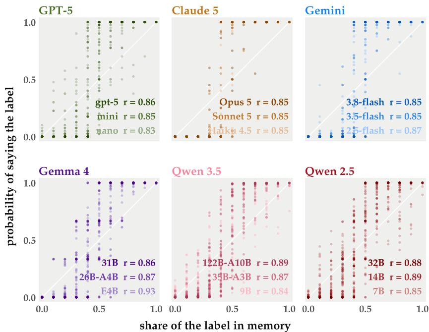  
Figure 10: Memory share and output probability. Each point is one of the 66 compositions of a 20-slot memory over three labels (in steps of two slots) and one label: its share of the memory against the probability that the model, queried in isolation, says it. Pearson $r = 0 . 8 3 – 0 . 9 3$ and Spearman 0.82–0.96 across the 18 models. The grey diagonal is $w = 0$ in Equation 4 (saying exactly what is remembered); the sigmoidal departure from it is the assertion of the majority. Open-weight values are read from log-probabilities; GPT-5, Claude, and Gemini values are estimated from 20 samples per memory.

## E MEMORY SHARE AND OUTPUT PROBABILITY

Figure 10 justifies using memory composition as the agents’ position in the experiments: output probability rises monotonically with memory share for every model. The departure from the diagonal is the majority assertion that Equation 4 parameterizes.

## F POPULATION SIZE AND MEMORY LENGTH

Table 3: Fraction of trials won by the large model (31B) in the three-class Gemma 4 population, across population size N and memory length H; chance is $1 / 3$ . Each cell has 36 trials (six label sets, three cyclic assignments, two seeds), all of which fixated.
<table><tr><td> $N \backslash H$ </td><td>6</td><td>10</td><td>20</td><td>40</td></tr><tr><td>3</td><td>0.50</td><td>0.64</td><td>0.69</td><td>0.72</td></tr><tr><td>6</td><td>0.53</td><td>0.50</td><td>0.50</td><td>0.56</td></tr><tr><td>12</td><td>0.39</td><td>0.61</td><td>0.53</td><td>0.67</td></tr><tr><td>24</td><td>0.42</td><td>0.72</td><td>0.83</td><td>0.78</td></tr></table>

Table 3 reports the three-class Gemma 4 population for $N \in \{ 3 , 6 , 1 2 , 2 4 \}$ and $H \in \{ 6 , 1 0 , 2 0 , 4 0 \}$ with the protocol of Appendix A otherwise unchanged. The large model wins the most trials in every one of the 16 cells. Its win rate rises with memory length, from about 0.4–0.5 at $H = 6$ to 0.7–0.8 at $H = 4 0$ , and changes little with population size.

## G THE CONSENSUS ENERGY: FLOW, DESCENT, AND WELLS

Mean memory. Let $\mathbf { \nabla } m _ { i }$ be agent i’s memory composition and $\begin{array} { r } { \bar { \pmb { m } } = \frac { 1 } { N } \sum _ { i } \pmb { m } _ { i } } \end{array}$ . In one interaction a listener i and a speaker $j \neq i$ are drawn uniformly from the $N ( N - 1 )$ ordered pairs; the speaker says label y with probability $x _ { j y } .$ , and the listener drops its oldest slot $o _ { i }$ and appends y, so $\Delta { { m } _ { i } } =$ $( \dot { e _ { y } } - e _ { o _ { i } } ) / H$ . Averaging over the pair and the label,

$$
\mathbb { E } \big [ \Delta \bar { m } \big ] = \frac { 1 } { N ^ { 2 } H } \sum _ { i } \Big ( \frac { 1 } { N - 1 } \sum _ { j \neq i } x _ { j } - e _ { o _ { i } } \Big ) = \frac { 1 } { N ^ { 2 } H } \Big ( \sum _ { j } x _ { j } - \sum _ { i } e _ { o _ { i } } \Big ) .
$$

Replacing the discarded slot by its average composition, $e _ { o _ { i } } \to m _ { i }$ , and summing over a round of $N$ interactions gives

$$
\Delta \bar { \pmb { m } } \approx \frac { 1 } { N H } \sum _ { j } \big ( \pmb { x } _ { j } - \pmb { m } _ { j } \big ) .
$$

Only the part of each agent’s speech that departs from its memory moves the population.

The flow. Equation 3 is the replicator equation

$$
\frac { d \bar { x } _ { k } } { d \tau } = \bar { x } _ { k } \big ( f _ { k } - \bar { f } \big ) , \qquad f _ { k } = w _ { c ( k ) } \bar { x } _ { k } , \qquad \bar { f } = \sum _ { l } \bar { x } _ { l } f _ { l } .
$$

Here $f _ { k } = - \partial E / \partial \bar { x } _ { k }$ , and the flow is the gradient descent of E under the Shahshahani metric of the simplex (Hofbauer & Sigmund, 1998). The unit of $\tau$ comes from the drift above: one round moves the mean memory by $1 / \bar { H }$ of the mean departure of speech from memory.

Motivation from the interaction rule. The same flow follows from the single-agent form of $\mathsf { A p - }$ pendix H (Equation 4), whose probabilities sum to one, once the drift above is closed with two approximations. First, agents share the population’s composition, $m _ { j } \approx \bar { \pmb { x } }$ , so that the mean memory and the mean output move together. Second, the strength acting on label k is $w _ { c ( k ) }$ , that of the model that brought k; at the start only that class holds k as a majority. Normalizing so that outputs still sum to one gives $\bar { x } _ { k } \big ( w _ { c ( k ) } \bar { x } _ { k } - \dot { \sum _ { l } w } _ { c ( l ) } \bar { x } _ { l } ^ { 2 } \big )$ . This closure is heuristic. The first approximation is exact only once the memories have mixed, and the second only before they have, so neither holds throughout a run. We therefore treat Equation 2 as a posited energy and test it directly in Section 4.3. An energy in which each agent’s strength acts on the labels it is currently saying is discussed in Appendix J.

The energy decreases. Along the flow,

$$
\frac { d E } { d \tau } = \sum _ { k } \frac { \partial E } { \partial \bar { x } _ { k } } \frac { d \bar { x } _ { k } } { d \tau } = - \sum _ { k } f _ { k } \bar { x } _ { k } \big ( f _ { k } - \bar { f } \big ) = - \bigg ( \sum _ { k } \bar { x } _ { k } f _ { k } ^ { 2 } - \bar { f } ^ { 2 } \bigg ) = - \mathrm { V a r } _ { \bar { x } } ( f ) \leq 0 ,
$$

with equality only at fixed points, where $f _ { k }$ is equal across the labels in use.

Wells and the start. When every agent sits at the vertex $e _ { k }$ , the energy $\mathrm { i s } - w _ { c ( k ) } / 2$ . A small share ε of another label l evolves as $d \varepsilon / d \tau \approx - \varepsilon w _ { c ( k ) }$ , so every vertex with $w _ { c ( k ) } > 0$ is stable, and deeper for larger $w _ { c ( k ) }$ . At the centre $\mathbf { c } = ( \textstyle { \frac { 1 } { 3 } } , \textstyle { \frac { 1 } { 3 } } , \textstyle { \frac { 1 } { 3 } } )$ the energy is $\begin{array} { r } { E ( \pmb { c } ) = - \bar { w } / 6 } \end{array}$ , with w¯ the mean of the three assertion strengths, so a vertex lies above the start whenever $w _ { c ( k ) } < \bar { w } / 3$ . The flow at the centre is $\begin{array} { r } { d \bar { x } _ { k } / d \tau = \frac { 1 } { 3 } \big ( \frac { w _ { c ( k ) } } { 3 } - \frac { \bar { w } } { 3 } \big ) = ( w _ { c ( k ) } - \bar { w } ) / 9 \colon } \end{array}$ the label with the largest w grows fastest from the balanced start, and labels with below-average w shrink.

The homogeneous limit. With equal assertion strengths w, $\begin{array} { r } { E = - \frac { w } { 2 } \sum _ { k } \bar { x } _ { k } ^ { 2 } = - \frac { w } { 2 } U } \end{array}$ , where U is the polarization of Tanaka (2026) and of our fixation criterion. All vertices then have the same depth, the flow at the centre vanishes, and which label wins is set by fluctuations, as in a population of one model (Figure 2). The assertion strength of each model is the only change we make to this picture.

## H ESTIMATING THE ASSERTION STRENGTH

From the flow to one agent. Equation 3 is a replicator equation with frequency-dependent fitness. Label k has fitness $f _ { k } = w _ { c ( k ) } \bar { x } _ { k }$ , the mean fitness is $\bar { f } \stackrel { } { = } \sum _ { l } \bar { x } _ { l } f _ { l }$ , and the share of label k grows at the rate $f _ { k } \mathrm { ~ - ~ } \bar { f }$ . We apply the same rule, for one step, to one agent. The agent’s memory composition m (Equation 1) takes the place of the mean output $\bar { \pmb { x } } .$ , and the agent’s own strength w acts on every label in its memory. The fitness of label k is then $f _ { k } = w m _ { k }$ , the mean fitness is $\begin{array} { r } { \bar { f } = \sum _ { l } m _ { l } \bar { f } _ { l } = w \langle m \rangle } \end{array}$ with $\langle m \rangle { } = \textstyle \sum _ { l } m _ { l } ^ { 2 }$ , and the agent says label k with probability

$$
x _ { k } = m _ { k } \bigl ( 1 + f _ { k } - \bar { f } \bigl ) = m _ { k } \bigl [ 1 + w \left( m _ { k } - \langle m \rangle \right) \bigr ] ,\tag{4}
$$

the discrete-time replicator step (Hofbauer & Sigmund, 1998). Here $\langle m \rangle$ is the share held by the label of a randomly drawn slot. With $w = 0$ the agent says each label as often as its memory holds it; with $w > 0$ it says the majority label more often. For two labels and a memory that is 60% one label, the agent says that label 60% of the time at $w = 0 , 7 2 \%$ at $w = 2 . 5 2$ , and $\dot { 7 } 7 \%$ at $w = 3 . 4 4$ The two equations therefore share one parameter with one meaning: how strongly a label gains from being in the majority. Equation 3 applies it to the population, and Equation 4 to one agent. The probabilities sum to one because $\begin{array} { r } { \sum _ { k } m _ { k } ( m _ { k } - \langle { m } \rangle { } ) = 0 } \end{array}$

For two labels, with m the share of one of them, Equation 4 becomes $x = m { + } w m ( 1 { - } m ) ( 2 m { - } 1 )$ This is the conformist transmission of Boyd & Richerson (1985), and $w = 1$ is an agent that says the majority of three randomly drawn slots.

The fit. For each utterance we replay the speaker’s memory from the interaction log and record the label y it said. Since $\mathbb { E } [ e _ { y } \mid m ] { \bar { \mathbf { = } } } { \dot { \mathbf { x } } }$ , we fit, separately for each class and pooling all utterances of the 108 trials of the main condition,

$$
e _ { y } - m = w g ( m ) + r \left( e _ { \mathrm { l a s t } } - m \right) + \epsilon , \qquad g _ { k } ( m ) = m _ { k } \bigl ( m _ { k } - \langle m \rangle \bigr ) ,
$$

by least squares, where last is the label the speaker heard most recently. The echo term r captures repeating that label; without it, part of the echo would be absorbed into $w .$ Averaged over the population the most recent label is the label currently being said, so an echo shared equally by all classes changes the speed of the flow but not its direction. For the diagnostics, each agent’s output $\mathbf { \Delta } _ { \mathbf { \mathcal { X } } _ { i } }$ is the class’s response curve counted in the same runs, the probability of saying label k when k fills c of the H slots, applied to each label and normalized over the three.

<table><tr><td></td><td colspan="3">assertion strength w</td><td colspan="3">echo r</td></tr><tr><td>Family</td><td>large</td><td>medium</td><td>small</td><td>large</td><td>medium</td><td>small</td></tr><tr><td>Gemma 4</td><td>3.44 (31B)</td><td>3.19 (26B-A4B)</td><td>2.52 (E4B)</td><td>0.19</td><td>0.31</td><td>0.19</td></tr><tr><td>Qwen 3.5</td><td>2.91 (122B-A10B)</td><td>1.55 (35B-A3B)</td><td>0.22 (9B)</td><td>0.11</td><td>0.29</td><td>0.19</td></tr><tr><td>Qwen 2.5</td><td>3.01 (32B)</td><td>1.92 (14B)</td><td>0.80 (7B)</td><td>0.13</td><td>0.30</td><td>0.25</td></tr></table>

In all three families w grows with model size. We restrict the energy to the open-weight families; in the API families the same regression does not separate the large and medium models.

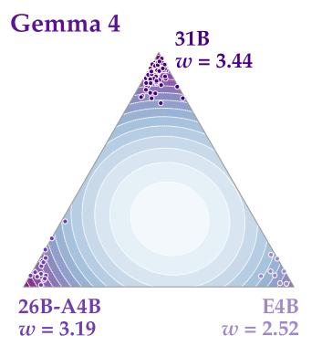

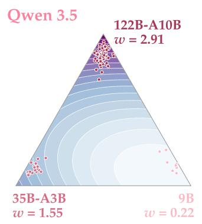

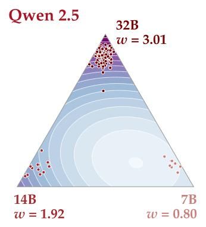

Figure 11: Energy landscapes of the three open-weight families, with each model’s assertion strength w (its well has depth $- w / 2 ) ;$ dots are the mean outputs at consensus of every trial, in the winner’s colour.  
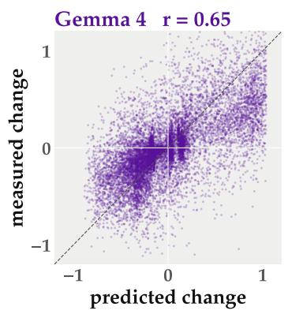

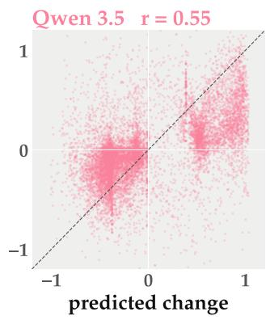

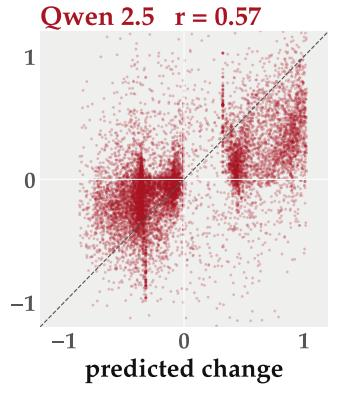

Figure 12: Local agreement in all three families. One round’s change of the mean output, predicted by the flow against measured, both scaled by their 99th percentile; each point is one trial, round, and label.  
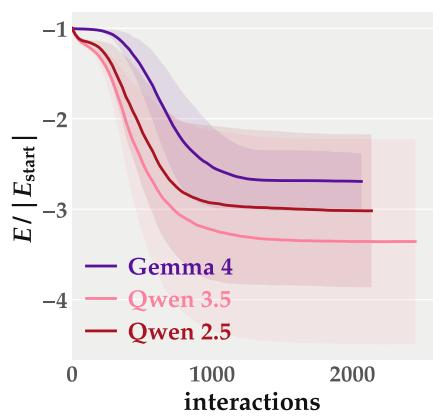

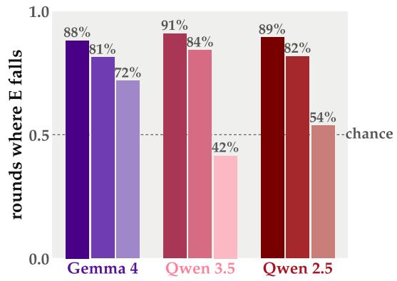  
Figure 13: Energy descent in all three families. Left: energy along the trials, scaled by its start value (mean and one standard deviation). Right: fraction of rounds in which the energy falls, by the class that wins the trial; the dashed line is chance.

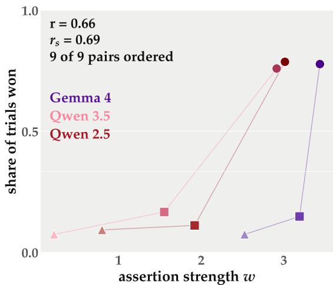  
Figure 14: Assertion strength and outcome. Each class’s w against the share of the 108 trials its label wins; lines join the three classes of a family.

## I ENERGY RESULTS FOR ALL OPEN-WEIGHT FAMILIES

<table><tr><td rowspan="2">Family</td><td colspan="3">well depth  $- w _ { c ( k ) } / 2$ </td><td rowspan="2">start  $E ( c )$ </td><td rowspan="2">basin of large</td><td rowspan="2">local r</td><td rowspan="2">rounds with  $\Delta E < 0$ </td></tr><tr><td>large</td><td>medium</td><td>small</td></tr><tr><td>Gemma 4</td><td>-1.72</td><td>-1.59</td><td>-1.26</td><td>-0.51</td><td>39%</td><td>0.65</td><td>85%</td></tr><tr><td>Qwen 3.5</td><td>-1.46</td><td>-0.78</td><td>-0.11</td><td>-0.26</td><td>64%</td><td>0.55</td><td>86%</td></tr><tr><td>Qwen 2.5</td><td>-1.51</td><td>-0.96</td><td>-0.40</td><td>-0.32</td><td>56%</td><td>0.57</td><td>85%</td></tr></table>

In all three families the large model’s well is the deepest and its basin, the part of the simplex from which the flow reaches its vertex, is the largest; the start lies inside it (Figure 11). The 9B vertex of Qwen 3.5 (−0.11) lies above the start (−0.26), because $w _ { c ( k ) } < \bar { w } / 3 ( 0 . 2 2 < 0 . 5 2 )$ . 323 of the 324 trials end at a vertex; the remaining Qwen 2.5 trial runs out of time. The order of w matches the order of win rates in all nine within-family pairs of classes (Figure 14; Pearson 0.66, Spearman 0.69). By the winning class, the energy falls in 88–91% of the rounds of trials won by the large model, 81–84% for the medium model, and 42–72% for the small model (Figure 13).

## J WHERE THE ENERGY ACCOUNT FAILS

Trials won by the small model. These are 7–9% of each family’s trials, and in them the energy falls in only 72% (Gemma 4), 42% (Qwen 3.5), and 54% (Qwen 2.5) of rounds: the population climbs to a shallow vertex. The cause is the second closure approximation of Appendix G, that label k is pushed by the class that brought it. Once a label spreads, other classes say it too and push it with their own assertion strength, and a large model asserts whatever majority it holds. Letting each agent’s assertion strength act on the labels that agent is saying, $\begin{array} { r } { \mathrm { ~  ~ \bar { ~ \cal ~ E ~ } ~ } \doteq \mathrm { ~ - ~ } \frac { 1 } { 2 N ^ { 2 } } \sum _ { k } \left( \sum _ { i } \bar { w } _ { i } x _ { i k } \right) \left( \bar { \sum _ { j } } x _ { j k } \right) } \end{array}$ , restores descent in these trials (78–82% of rounds) and keeps the local agreement $( r = 0 . 6 5 – 0 . 6 6 )$ ), but every vertex then has the same depth $- \bar { w } / 2 ,$ , so this version no longer says which label wins.

Measurement. The assertion strengths w and the outputs $\mathbf { \Delta } _ { \mathbf { \mathcal { X } } _ { i } }$ used to evaluate the energy are estimated from the same population runs whose outcomes they are compared with. The agreement is therefore a test of consistency, not an out-of-sample prediction.