# What Makes a Good Unmasking Policy? A Controlled Study of Learned Unmasking in Diffusion Language Models

Jinya Sakurai1 2 Xun Xu2 3 Jaehong Yoon1†

1NTU Singapore

2Institute for Advanced Intelligence and Computing (IAIC), A\*STAR 3Centre for Frontier AI Research (CFAR), A\*STAR

## Abstract

Masked diffusion language models generate tokens in parallel, but their efficiency depends on which predictions are committed. Learned unmasking policies improve the speed–accuracy trade-off, yet differ in supervision, inputs, and capacity, obscuring which choices matter. We view supervised policies as distilling a decoding procedure through a teacher and examine independently what the teacher labels as committable, on which states the policy imitates it, what the policy observes, and how much the number of function evaluations (NFE) must decrease to offset policy overhead. We find that labeling predictions matching the final output is overly permissive at low NFE, and hidden states are weak alone but can complement confidence. About a 10% NFE reduction suffices to offset policy overhead for policies up to 7.5M parameters across tested settings. We therefore train a policy on trajectory-contraction targets, which accept only commitments staying on a reference trajectory, using confidence and hidden states. On LLaDA-8B-Instruct, the resulting 856K-parameter policy achieves the best accuracy–NFE frontier and highest throughput on GSM8K, is competitive at moderate targets on MATH-500 and HumanEval, and largely transfers to Dream-7B-Instruct.

## § Code

## 1 Introduction

Building on discrete diffusion models (Hoogeboom et al., 2021; Austin et al., 2021a; Campbell et al., 2022; Lou et al., 2024), masked diffusion language models (dLLMs) (Sahoo et al., 2024; Shi et al., 2024; Nie et al., 2025; Ye et al., 2025; Sakurai et al., 2026) provide an alternative to the left-toright generation of autoregressive models (Brown et al., 2020; Grattafiori et al., 2024; Qwen et al.,

2025) by iteratively refining partially masked sequences and committing multiple tokens in parallel. Their efficiency, however, depends strongly on the unmasking policy, which decides which positions to commit at each step. Conservative policies require many denoising evaluations, whereas unmasking many tokens at once can produce mutually inconsistent tokens, as they are predicted independently given the same state. Such errors persist, since committed tokens are not revised later (Wu et al., 2026; Jazbec et al., 2026; Bao et al., 2026; Xu et al., 2026). Recent work therefore adapts the number of committed tokens to the decoding state. Training-free methods do so using confidence (Wu et al., 2026) or entropy-based dependence control (Ben-Hamu et al., 2025), while learned policies are trained from data (Jazbec et al., 2026; Bao et al., 2026; Xu et al., 2026; Sun et al., 2026).

Despite this progress, learned unmasking policies differ in several design choices at once: which positions are labeled as safe to commit, which decoding states are used for training, and what information the policy observes, often together with policy capacity. For example, whether backbone hidden states help cannot be judged, since the policies that use them also differ in size or supervision. Prior work reports the number of function evaluations (NFE) and throughput, but the NFE reduction needed to offset policy overhead across policy sizes, caching, and prompt lengths remains unclear.

We therefore revisit learned unmasking policies from a distillation perspective. Existing supervised policies (Bao et al., 2026; Sun et al., 2026) can be viewed as distilling a fixed decoding procedure: the procedure is run on training prompts to obtain reference trajectories, a teacher derived from them labels which positions may be committed, and the policy imitates this teacher. This view separates what the teacher labels, on which states the policy imitates it, and what the policy observes; we vary one at a time, comparing choices from prior work with new candidates. First, existing teachers label a prediction as committable whenever it matches the final output. A correct token, however, is not necessarily safe to commit early, since its commitment changes the input to subsequent steps. We therefore introduce trajectory contraction, which labels a commitment as valid only when it directly reaches a later state of the reference trajectory, and compare it jointly with the choice of training states: reference trajectories or those induced by the labels. Second, as policy inputs, we compare confidence, probability margins, hidden representations, and confidence combined with hidden representations. Third, we measure both NFE and end-to-end throughput in tokens per second (TPS), and profile the policy overhead.

Our study shows that matching the final output is an overly permissive label in the low-NFE regime, with 28.7% of such positives leaving the reference trajectory when committed early, and that hidden representations are weak alone but can complement confidence. It also shows that, across the tested settings, a policy of up to 7.5M parameters pays off in throughput once it reduces NFE by more than about 10%. Based on these findings, we train a policy with trajectory-contraction targets on reference trajectories, taking confidence and hidden representations as input; it has only 856K parameters, about 0.01% of the backbone.

On LLaDA-8B-Instruct (Nie et al., 2025), our policy achieves the best accuracy–NFE frontier on GSM8K (Cobbe et al., 2021), where it also attains the highest TPS at every accuracy target. On MATH-500 (Hendrycks et al., 2021; Lightman et al., 2024) and HumanEval (Chen et al., 2021), it reaches moderate accuracy targets with the fewest NFE and the highest TPS, whereas training-free methods are more efficient at the highest targets, and on MBPP (Austin et al., 2021b) it performs comparably to the strongest baselines. Its advantage largely carries over to Dream-7B-Instruct (Ye et al., 2025) and, on mathematical reasoning, to unseen generation lengths.

Our contributions are:

• We show that matching the final output is an overly permissive commitment label in the low-NFE regime, and introduce trajectory contraction, which improves the accuracy–NFE frontier, with a further out-of-domain gain from supervision on reference trajectories.

• We show that backbone hidden states alone are a weak input, but can improve the frontier at high accuracy targets when combined with token confidence, and build on this an 856Kparameter policy.

• By profiling per-step latency, we show that policies of up to 7.5M parameters pay off in throughput once they reduce NFE by more than about 10% in the tested settings, and evaluate our policy across tasks, backbones, and generation lengths.

## 2 Related Work

Efficient unmasking. The efficiency and quality of dLLMs depend strongly on the order and degree of parallelism used for unmasking (Kim et al., 2025; Chen et al., 2026). Training-free approaches exploit predictive uncertainty, decoding dynamics, or dependencies among candidate positions to determine which tokens can be committed in parallel (Ben-Hamu et al., 2025; Wei et al., 2026; Luxembourg et al., 2026; Lee et al., 2026; Kim et al., 2026). Fast-dLLM is particularly relevant to our setting: it uses confidence-thresholded parallel decoding to reduce denoising steps while keeping the underlying dLLM frozen (Wu et al., 2026). Despite substantial progress, these methods prescribe the commitment rule at inference time rather than learning it from decoding experience.

Learning unmasking policies. Recent work instead learns where or when to commit tokens, using reinforcement learning, supervised oracle signals, ranking objectives, or learned dependency models (Hong et al., 2026; Xu et al., 2026; Asano et al., 2026; Ringel et al., 2026). LUP learns a lightweight Transformer policy from confidence-based features using reinforcement learning (Jazbec et al., 2026). More directly related to our supervision setting, Learn2PD trains a lightweight filter from oracle token-correctness signals, whereas TraceLock derives commitment labels retrospectively from completed decoding traces and exploits richer hiddenstate representations (Bao et al., 2026; Sun et al., 2026). We study how to construct supervised commitment targets directly from Fast-dLLM trajectories and how to incorporate richer token-level information without sacrificing the efficiency of lightweight confidence-based policies.

<table><tr><td>Method</td><td>#Params</td><td>Policy input</td><td>Commitment target</td><td>Training states</td></tr><tr><td>Learn2PD (Bao et al., 2026)</td><td>2.1K</td><td>confidence</td><td>terminal agreement</td><td>teacher-induced</td></tr><tr><td>TraceLock (Sun et al., 2026)</td><td>7.5M†</td><td>hidden states</td><td>terminal agreement</td><td>reference</td></tr><tr><td>LUP-conf (Jazbec et al., 2026)</td><td>300K</td><td>confidence</td><td>reinforcement learning</td><td>on-policy rollouts</td></tr><tr><td>LUP-hidden (Jazbec et al., 2026)</td><td>300M</td><td>hidden states</td><td>reinforcement learning</td><td>on-policy rollouts</td></tr><tr><td>Candidates studied</td><td>331K-856K</td><td> $c , h , [ c , m ] , [ c , h ] ^ { * }$ </td><td>terminal agreement, contraction*</td><td>reference, teacher-induced</td></tr></table>

Table 1: Design choices of existing learned unmasking policies and the candidates compared in our study. Existing methods differ simultaneously in their policy inputs, policy capacity, commitment targets, and training states. ∗Candidates introduced in this work. †Estimated from the released configuration; not reported in the original paper.

## 3 Revisiting Unmasking Policy Learning

## 3.1 Problem Formulation

A masked dLLM generates a sequence $x \quad =$ $( x _ { 1 } , \dots , x _ { L } )$ through partially masked states $\tau =$ $( s _ { 0 } , \ldots , s _ { T } )$ . At each step t, the model produces token distributions $p _ { \theta } ( \cdot \mid s _ { t } )$ for the masked positions $\mathcal { M } ( s _ { t } )$ , and an unmasking policy selects the positions to commit, $A _ { t } = \pi _ { \phi } ( z _ { t } ) \subseteq { \mathcal { M } } ( s _ { t } )$ , where zt is the information available to the policy. The decoder then transitions to $s _ { t + 1 } = \mathscr { C } ( s _ { t } , A _ { t } )$ , where fills the selected positions with their greedy predictions, so the trajectory is deterministic given the policy decisions. Committing more positions per step reduces NFE, but premature commitments may degrade generation quality; a good policy achieves a favorable trade-off between the two.

## 3.2 Design Space and Protocol

We study supervised policies trained offline on a frozen backbone, such as Learn2PD (Bao et al., 2026) and TraceLock (Sun et al., 2026). These policies distill a fixed decoding procedure: the procedure is run on training prompts to obtain reference trajectories, from which each masked position at each state is labeled with a binary commitment target indicating whether it may be committed, and the policy is trained to predict these targets. Building such a policy requires deciding what counts as a correct commitment (the target), on which states the policy learns it (the training states; Section 3.3), and what the policy observes (the input; Section 3.4). Moreover, the policy is evaluated at every step, so its cost may offset the reduction in NFE (Section 3.5).

Existing methods vary simultaneously across multiple design axes, making it difficult to isolate the effect of individual design choices from their reported results. For example, LUP-hidden underperforms LUP-conf despite roughly 1000 more parameters (Jazbec et al., 2026) (Table 1). We therefore compare existing and newly introduced candidates for each design axis while holding the others fixed. We evaluate the commitment target and training states jointly in $\mathbf { a \ 2 \times 2 }$ design to account for their interaction during teacher rollouts. Setup. We use LLaDA-8B-Instruct (Nie et al., 2025) as the frozen backbone. Following Jazbec et al. (2026), all policies are trained on a mixture of the GSM8K (Cobbe et al., 2021) and MATH (Hendrycks et al., 2021) training sets, with reference trajectories generated by Fast-dLLM (Wu et al., 2026) at confidence threshold 0.9. Unless otherwise specified, we use generation length $L =$ 256 and block length 32, and evaluate zero-shot. We take the accuracy of one-by-one confidencebased decoding (Nie et al., 2025) as the reference and define target accuracy levels at 98%, 95%, and 90% of it. For each method, we sweep its commitment threshold over a fixed grid (Section C.4) and compare the resulting accuracy–NFE trade-off against these targets. In this section, we evaluate on GSM8K (in-domain) and MBPP (out-of-domain) (Austin et al., 2021b), and all candidates share the same architecture, optimizer, and training schedule (Sections B.1 and C.3).

## 3.3 How Should Supervision Be Constructed?

Commitment targets. We consider two oracle criteria for defining supervision targets (Figure 1, panel (a)). Each oracle specifies which masked positions should be committed at a given state. The first, terminal agreement, is used by both Learn2PD (Bao et al., 2026) and TraceLock (Sun et al., 2026). It commits a position when its current prediction $\widehat { x } _ { t , i }$ matches the terminal token $x _ { i } ^ { \star }$ of the reference trajectory: $y _ { t , i } ^ { \mathrm { t o k } } = \mathbb { I } \left[ \hat { x } _ { t , i } = x _ { i } ^ { \star } \right]$ (Section B.2). However, matching the terminal output does not guarantee that early commitment is safe: committing a token changes the input to subsequent evaluations and may alter predictions at other masked positions. We therefore introduce trajectory contraction (TC), which permits a commitment only if it directly reaches a state visited later in the reference trajectory. Let $A _ { t  u } = \mathcal { M } ( s _ { t } ) \backslash \mathcal { M } ( s _ { u } )$ denote the positions committed between s and a future state $s _ { u }$ of the reference trajectory. We consider the commitment of this set valid if

(a) Commitment criterion: terminal agreement vs. trajectory contraction  
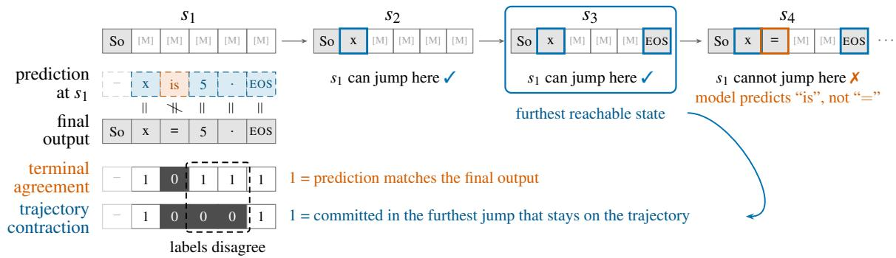

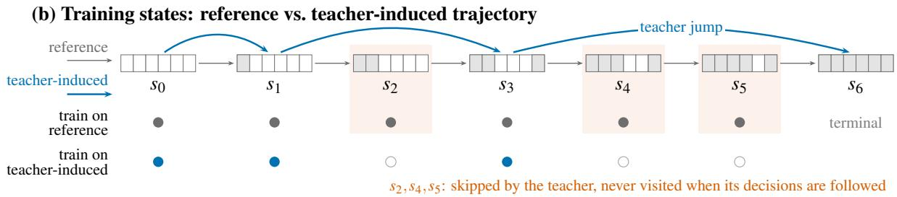  
Figure 1: Design choices in supervising unmasking policies. (a) Terminal agreement labels every prediction matching the final output, whereas trajectory contraction labels only positions in the furthest jump that stays on the reference trajectory; they disagree when a correct token is committed before a mispredicted one. (b) Following the teacher skips $s _ { 2 } , s _ { 4 } .$ and $s _ { 5 } ,$ , which reference-trajectory supervision includes but teacher-induced supervision omits.

$$
\begin{array} { r } { \mathscr { C } ( s _ { t } , A _ { t  u } ) = s _ { u } . } \end{array}\tag{1}
$$

This condition allows the intermediate states to be skipped while preserving the future reference state. We define $\boldsymbol { u } _ { t } ^ { \star }$ as the largest u > t satisfying Equation (1), and set the target $y _ { t , i } ^ { \mathrm { t c } } = \mathbb { 1 } [ i \in A _ { t  u _ { t } ^ { \star } } ]$

Training states. In addition to the commitment criterion, we consider two ways of constructing the states used for supervision (Figure 1, panel (b)). With reference trajectories, we collect training states from the fixed decoding procedure and apply the oracle at each state, including those the oracle would otherwise skip. With teacher-induced trajectories, we instead generate training states by repeatedly applying the oracle’s commitment decisions, so that supervision is provided only at the states it visits. TraceLock uses reference trajectories, whereas Learn2PD uses teacher-induced trajectories, referring to its oracle as the teacher.

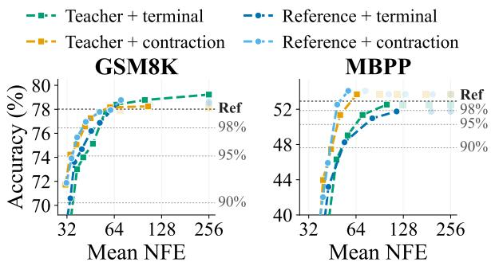  
Figure 2: Accuracy–NFE frontiers for the $2 \times 2$ supervision designs. Faded markers denote dominated operating points.

Comparison. We compare the four combinations of two commitment targets (terminal agreement and trajectory contraction) and two training-state constructions (reference and teacher-induced trajectories), with the policy input fixed (Section B.1). As shown in Figure 2, replacing terminal agreement with trajectory contraction improves the frontier under both training-state constructions. On GSM8K, this change accounts for most of the gain, and both constructions perform comparably under contraction. On the out-of-domain MBPP, reference trajectories yield a further improvement, reaching the 98% target with 48.6 NFE versus 64.8 for teacherinduced trajectories. The gain from contraction is concentrated at low NFE; at the highest targets, terminal agreement can be more accurate (Section B.6).

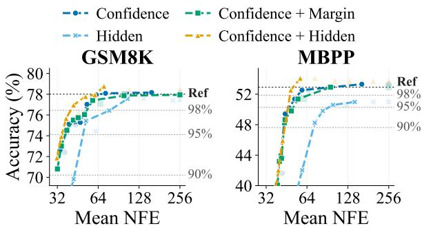  
Figure 3: Accuracy–NFE frontiers for different inputs.

Two observations help interpret these results. First, terminal agreement is more permissive: 28.7% of its positive labels fall outside the contraction set (Section B.2). These are correct predictions that follow a misprediction in the reference commitment order, so committing them early leads to a state the reference trajectory never visits. Second, teacher-induced trajectories retain only 34% (contraction) and 25% (terminal agreement) of the reference states (Section B.3). This reduced coverage may explain why reference trajectories transfer better to MBPP, although it has little effect on GSM8K.

Finding 1. Trajectory contraction yields a better accuracy–NFE frontier than terminal agreement, mainly in the low-NFE regime; training on reference trajectories gives a further gain out of domain.

## 3.4 What Information Should the Policy Use?

Input Candidates. Existing policies use token confidence (Learn2PD, LUP-conf) or backbone hidden representations (TraceLock, LUP-hidden). Beyond confidence, uncertainty statistics such as the top-two probability margin (Kim et al., 2025) and entropy (Xu et al., 2026) are also used to decide which tokens to unmask. For each masked position i at step t, we consider the token confidence $c _ { t , i } = \operatorname* { m a x } _ { v } p _ { \theta } ( x _ { i } = v \mid s _ { t } )$ , the top-two probability margin $\Delta _ { t , i }$ defined as the difference between the largest and second-largest token probabilities, and the backbone hidden representation $h _ { t , i }$ . We compare four input configurations:

$$
z _ { t , i } \in \{ c _ { t , i } , \ h _ { t , i } , \ [ c _ { t , i } , \Delta _ { t , i } ] , \ [ c _ { t , i } , h _ { t , i } ] \} .\tag{2}
$$

Each input is projected to a fixed hidden dimension and processed by the policy network $f _ { \phi }$ , which predicts a commitment score for each masked position. To isolate the effect of the input from policy capacity (Section 3.2), we keep the policy architecture fixed across configurations, varying only the input projection.

Comparison. As shown in Figure 3, confidence provides a strong low-dimensional signal, whereas hidden states alone require substantially more NFEs to reach the same accuracy on both tasks. Adding the margin yields no consistent gain. Combining confidence with hidden states reaches the 98% and 95% targets with the fewest NFE on both tasks, e.g., 42.1 versus 52.9 NFE for confidence alone at the 98% target on GSM8K. At the 90% target, however, confidence alone is comparable on GSM8K and slightly more efficient on MBPP. On MATH-500 and HumanEval, the benefit is less consistent, and adding the margin is competitive or better at the highest targets (Section B.6). These results suggest that hidden states can complement confidence; we hypothesize that their high dimensionality makes it difficult for a lightweight policy to exploit them alone. This gain comes at a cost: projecting the 4096-dimensional hidden state increases the policy from 331K to 856K parameters.

Finding 2. Hidden representations underperform confidence when used alone but can complement it, mainly reducing the NFE needed to reach high accuracy targets; the gain varies across tasks.

## 3.5 Do NFE Gains Translate to Speedups?

The comparisons above measure decoding efficiency by NFE. While NFE captures the number of backbone evaluations, it does not account for the computational overhead of the policy itself. This trade-off depends on policy size (Table 1), including the 331K-to-856K increase from $[ c , h ]$ , and on backbone latency, which varies with prompt length and caching (Wu et al., 2026). We therefore profile per-step latency across these settings to determine how much NFE reduction is needed to improve throughput (Table 2; details in Section B.5). Besides our 331K and 856K policies, we include randomly initialized policies of 7.5M and 300M parameters, approximately matching TraceLock and LUP-hidden.

The key result is that the break-even NFE reduction remains small for lightweight policies. Up to 7.5M parameters, the policy adds a nearly constant cost of about 1.5 ms per step, at most 10% across all settings. Thus, reducing NFE by about 10% is sufficient to offset the policy overhead, regardless of prompt length or caching. Even a 300M policy, with up to 39% overhead, requires only about 28% fewer NFEs to break even. Although prefix caching reduces backbone latency by 73% at 2048 prompt tokens but only 5% at 128 tokens, the breakeven threshold for policies up to 7.5M parameters remains around 10%. We evaluate the resulting throughput gains end to end in Sections 5.2 and 5.3.

<table><tr><td rowspan="2">Prompt Cache</td><td rowspan="2"></td><td rowspan="2">No policy (ms/step)</td><td colspan="4">Policy overhead</td></tr><tr><td>331K</td><td>856K</td><td>7.5M</td><td>300M</td></tr><tr><td rowspan="2">128</td><td>None</td><td>16.9</td><td>+10%</td><td>+8%</td><td>+9%</td><td>+38%</td></tr><tr><td>Prefix</td><td>16.0</td><td>+8%</td><td>+8%</td><td>+9%</td><td>+39%</td></tr><tr><td rowspan="2">512</td><td>None</td><td>28.0</td><td>+5%</td><td>+6%</td><td>+6%</td><td>+23%</td></tr><tr><td>Prefix</td><td>16.5</td><td>+7%</td><td>+10%</td><td>+8%</td><td>+37%</td></tr><tr><td rowspan="2">1024</td><td>None</td><td>45.6</td><td>+3%</td><td>+3%</td><td>+4%</td><td>+15%</td></tr><tr><td>Prefix</td><td>18.6</td><td>+8%</td><td>+7%</td><td>+8%</td><td>+34%</td></tr><tr><td rowspan="2">2048</td><td>None</td><td>85.1</td><td>+2%</td><td>+2%</td><td>+2%</td><td>+8%</td></tr><tr><td>Prefix</td><td>23.4</td><td>+6%</td><td>+6%</td><td>+6%</td><td>+27%</td></tr></table>

Table 2: Per-step latency on LLaDA-8B-Instruct without a policy, and the relative overhead of policies of different sizes. Absolute latencies are reported in Table 8.

Finding 3. Policies with up to 7.5M parameters can improve throughput with a 10% NFE reduction across prompt lengths and caching.

## 4 Putting the Findings Together

We combine the findings into a single policy, which we call OnTrack: Finding 1 determines its supervision (Section 4.2), Finding 2 its input (Section 4.1), and Finding 3 keeps its overhead small.

## 4.1 Policy Architecture

Following Jazbec et al. (2026), we use a DiT-style policy network for unmasking decisions. For each masked position i in the decoding step t, the confidence $c _ { t , i }$ and hidden representation $h _ { t , i }$ are projected onto a shared d-dimensional space and additively combined:

$$
z _ { t , i } = W _ { c } c _ { t , i } + W _ { h } h _ { t , i } .\tag{3}
$$

Let $\boldsymbol { z } _ { t } = ( z _ { t , 1 } , \dots , z _ { t , L } )$ denote the resulting sequence. Conditioned on the mask state $m _ { t }$ and decoding step t, the policy produces a sequence of commitment logits

$$
\ell _ { t } = f _ { \phi } ( z _ { t } ; m _ { t } , t ) , \qquad q _ { t , i } = \sigma ( \ell _ { t , i } ) .\tag{4}
$$

Both projections and $f _ { \phi }$ are trained jointly. With $d = 1 2 8 .$ , the policy has 856K parameters, about 0.01% of the backbone (Architecture details are in Section A.1). At each step, the policy commits

$$
A _ { t } = \left\{ i \in \mathcal { E } _ { t } : q _ { t , i } > \gamma \right\} ,\tag{5}
$$

where $\mathcal { E } _ { t }$ is the set of masked positions in the current block and $\gamma$ is an inference-time commitment threshold (Section A.3).

## 4.2 Policy Training

We generate reference trajectories as described in Section 3.2 and retain those whose final answer is correct. For each reference state $s _ { t } ,$ , the target is the trajectory-contraction label $y _ { t , i } = y _ { t , i } ^ { \mathrm { t c } }$ (Section 3.3), which marks the positions in the furthest valid contraction $A _ { t  u _ { t } ^ { \star } }$ . We optimize binary crossentropy over eligible positions,

$$
\mathcal { L } = - \sum _ { t , \ i \in \mathcal { E } _ { t } } \left[ y _ { t , i } \log q _ { t , i } + ( 1 - y _ { t , i } ) \log ( 1 - q _ { t , i } ) \right] .
$$

The complete target-construction procedure is provided in Section A.2.

## 5 Experiments

## 5.1 Experimental Setup

Benchmarks and backbones. We follow the setup of Section 3.2 and extend the evaluation to MATH-500 (Hendrycks et al., 2021; Lightman et al., 2024) and HumanEval (Chen et al., 2021), so that GSM8K and MATH-500 evaluate in-domain generalization and HumanEval and MBPP evaluate out-of-domain generalization to code. We additionally evaluate on Dream-7B-Instruct (Ye et al., 2025) (Section 5.4); implementation details are provided in Section C.

Baselines. We compare against two training-free methods, Fast-dLLM (Wu et al., 2026), which commits positions whose confidence exceeds a threshold, and EB-Sampler (Ben-Hamu et al., 2025), which commits positions within an entropy budget, and against Learn2PD (Bao et al., 2026), a learned policy for which we use the official checkpoint. We do not include LUP (Jazbec et al., 2026) or Trace-Lock (Sun et al., 2026), as no trained checkpoints are publicly available for either method.

Evaluation protocol. We report accuracy on GSM8K and MATH-500 and Pass@1 on HumanEval and MBPP, together with NFE and TPS, with all throughput measured on the same hardware and configuration (Section C.5).

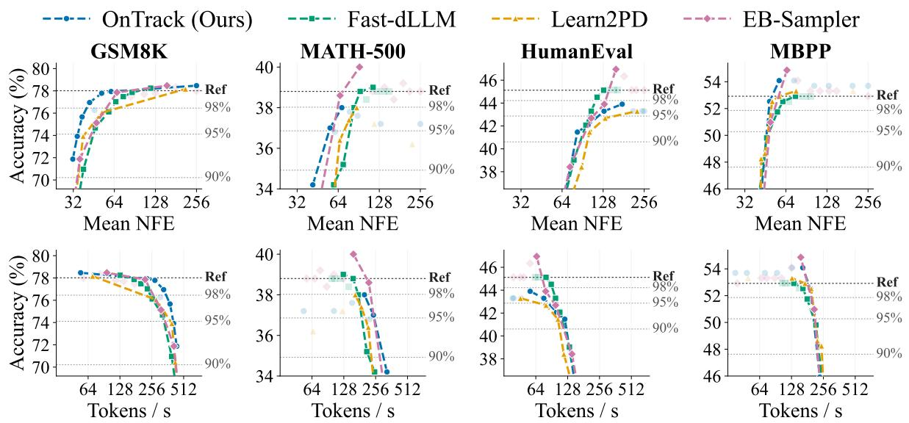  
Figure 4: Accuracy versus NFE (top) and TPS (bottom) on LLaDA-8B-Instruct. Dotted lines mark the reference accuracy and the 98%, 95%, and 90% targets. Numerical results are provided in Tables 17 and 18

<table><tr><td rowspan="2"></td><td colspan="3">Zero-shot</td><td colspan="3">Four-shot</td></tr><tr><td>98%</td><td></td><td>95%</td><td>98%</td><td></td><td>95%</td></tr><tr><td>Method</td><td>No Pre.</td><td>No</td><td>Pre.</td><td>No</td><td>Pre.</td><td>No Pre.</td></tr><tr><td>OnTrack (Ours)</td><td>331 249</td><td>381</td><td>423</td><td>121</td><td>225</td><td>149 241</td></tr><tr><td>Fast-dLLM</td><td>232 276</td><td>323</td><td>349</td><td>98</td><td>193 122</td><td>234</td></tr><tr><td>Learn2PD</td><td>242 253</td><td>282</td><td>299</td><td>92</td><td>183 110</td><td>247</td></tr><tr><td>EB-Sampler</td><td>221 234</td><td>313</td><td>329</td><td>120</td><td>171 120</td><td>231</td></tr></table>

Table 3: Highest measured TPS (tokens/s) on GSM8K reaching 98% and 95% of the uncached reference accuracy, without (No) and with (Pre.) prefix caching. Bold marks the best method in each column.

## 5.2 Main Results on LLaDA

In-domain reasoning. On GSM8K, our policy yields the best frontier and reaches 98% of the reference accuracy with the fewest NFE (Figure 4, top). On MATH-500, it reaches the 95% target with the fewest NFE, but its accuracy saturates just below the 98% target, whereas EB-Sampler and Fast-dLLM exceed the reference at larger NFE.

Out-of-domain code generation. Although the policy is trained only on mathematical reasoning, it transfers to code. On HumanEval, it reaches 90% of the reference accuracy with the fewest NFE, but Fast-dLLM is more efficient at the 95% target, and only Fast-dLLM and EB-Sampler reach the 98% target. On MBPP, our policy reaches the 95% and 98% targets with the fewest NFE, whereas Learn2PD and Fast-dLLM are more efficient at the 90% target. Paired-bootstrap confidence intervals (Table 27) show that the NFE gains on GSM8K exceed evaluation noise against all baselines except

EB-Sampler at the 98% target.

Throughput. The NFE reductions carry over to throughput (Figure 4, bottom): at matched accuracy, our policy achieves the highest TPS on GSM8K across targets and on MATH-500 and HumanEval at moderate targets. On MBPP, it is close to the fastest baseline at the 95% and 98% targets but slower at the 90% target. Consistent with Finding 3, the 856K-parameter policy’s NFE advantage outweighs the overhead of evaluating it per step.

## 5.3 Compatibility with Prefix Caching

We evaluate our policy and baselines with prefix caching (Wu et al., 2026) on GSM8K using zeroshot and four-shot prompts, following the latency analysis in Section 3.5. To ensure consistent accuracy targets across cached and uncached decoding, we use the uncached one-by-one baseline under the same prompting as the reference (78.0% zero-shot and 79.9% four-shot).

Fewer NFE still means faster decoding. The reduction in NFE carries over to caching (Table 3): with four-shot prompts, our policy remains the fastest at 98% of the reference accuracy. Despite the reduced backbone latency and increased relative policy overhead, its NFE advantage translates into higher throughput.

Accuracy sensitivity. Caching reduces our policy’s accuracy by up to about two percentage points, while the baselines are less affected (Figure 10). With zero-shot prompts, Fast-dLLM overtakes our policy at the 98% accuracy target, although ours remains the fastest at 95% (Table 3; see Section 7).

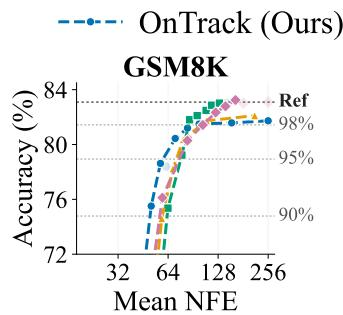

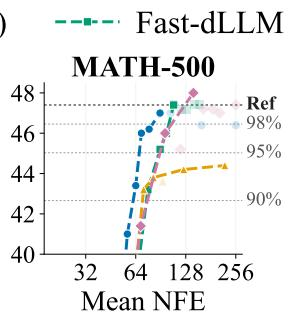

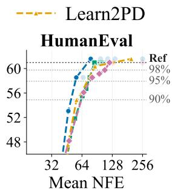

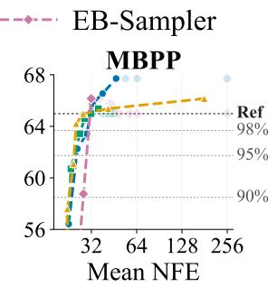  
Figure 5: Accuracy versus NFE on Dream-7B-Instruct. Dotted lines mark the reference accuracy and 98%, 95%, and 90% targets. Faded markers denote dominated operating points. Numerical results are in Tables 21 and 22.

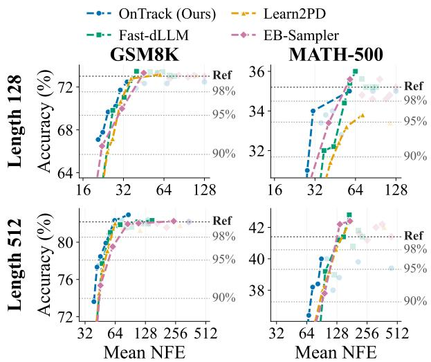  
Figure 6: Accuracy-NFE trade-off at $L = 1 2 8$ (top) and $L = 5 1 2$ (bottom), using a policy trained at $L =$ 256. Results on HumanEval and MBPP are provided in Section C.6; numerical results in Tables 23 and 25.

## 5.4 Generalization Across Backbones

We next examine whether our design transfers to a different dLLM. We apply the same procedure to Dream-7B-Instruct, training a separate policy with the same training data, trajectory-contraction supervision, and policy-training procedure. Since Dream has a hidden dimension of 3584, the policy has 790K parameters.

Figure 5 shows that the advantage of our policy is largely preserved. It yields the best frontier on HumanEval, where it exceeds the reference accuracy with the fewest NFE, and reaches 98% of the reference accuracy on MATH-500 with the fewest NFE. On GSM8K, it reaches 95% of the reference accuracy with the fewest NFE but saturates slightly below the reference, where Fast-dLLM and EB-Sampler are more accurate at larger NFE. On MBPP, all methods reach the targets within a narrow NFE range and perform comparably.

## 5.5 Generalization Across Sequence Lengths

We finally examine whether the learned policy generalizes across generation lengths without retraining. Following the length-transfer setting of Jazbec et al. (2026), we train the policy with $L \ : = \ : 2 5 6$ and evaluate the same checkpoint at $L = 1 2 8$ and $L = 5 1 2$ on GSM8K and MATH-500, keeping the block length fixed at 32.

As shown in Figure 6, the policy largely retains its advantage under both length shifts: it yields the best or comparable frontier up to 95% of the reference accuracy at both lengths, and at $L = 1 2 8$ it reaches 98% on MATH-500 with the fewest NFE. At $L = 5 1 2 .$ , it saturates below 98% on MATH-500, where Fast-dLLM and EB-Sampler exceed the reference at larger NFE. When the length shift is combined with the domain shift to code, however, the policy falls behind Fast-dLLM and EB-Sampler on HumanEval and MBPP (Section C.6), indicating that it tolerates either shift alone but not both.

## 6 Conclusion

We revisited learned unmasking policies for dLLMs through a controlled study of supervision, inputs, and overhead. Trajectory-contraction targets improve the accuracy–NFE frontier mainly at low NFE, with a further out-of-domain gain from reference trajectories. Hidden representations are weak alone but can complement confidence at high accuracy targets. Policies of up to 7.5M parameters pay off in throughput once they reduce NFE by more than about 10% in the tested settings. Building on these findings, our 856K-parameter policy reaches moderate accuracy targets with the best or comparable efficiency across two backbones, transfers from mathematical reasoning to code, and converts its NFE reductions into throughput gains.

## 7 Limitations

Training and evaluation scope. Our policy is trained only on mathematical reasoning data at a single generation length (L = 256) with a fixed block length. It transfers to code at the training length and to other lengths on mathematical tasks, but its advantage does not persist when both shifts occur together (Section 5.5). Training on multiple domains and generation lengths is a natural remedy that we leave to future work.

High-accuracy regime. On some tasks (MATH-500 on LLaDA and GSM8K on Dream), the accuracy of our policy saturates slightly below the reference, even with conservative thresholds, whereas training-free methods reach the reference at larger NFE. Our policy is therefore most beneficial at moderate accuracy targets, and closing this gap may require supervision that covers more conservative commitment behavior.

Sensitivity to backbone features. Approximate inference such as prefix caching reduces the accuracy of our policy by up to about two points, whereas confidence-based baselines are essentially unaffected (Section 5.3). The drop persists even when the policy unmasks one token per step, so it concerns which tokens are committed rather than how many. A plausible cause is that the policy consumes backbone hidden representations, which caching perturbs; making learned unmasking policies robust to approximate inference is left to future work.

## 8 Ethical Considerations

Environmental impact. This work aims to reduce the computational cost of inference with diffusion language models, potentially lowering energy consumption. However, the overall environmental impact depends on deployment scale, as improved efficiency may encourage greater model usage.

Potential risks. Faster inference may facilitate large-scale generation of misleading or harmful content. Our method does not modify backbone parameters and only determines when to commit the backbone’s predictions. It therefore inherits the capabilities, biases, and failure modes of the underlying models. Changes in decoding may also affect output safety, which we do not explicitly evaluate.

Artifacts and licensing. All datasets (GSM8K (Cobbe et al., 2021), MATH (Hendrycks et al., 2021; Lightman et al., 2024), HumanEval (Chen et al., 2021), and MBPP (Austin et al., 2021b)) and models (LLaDA-8B-Instruct (Nie et al., 2025) and Dream-7B-Instruct (Ye et al., 2025)) are publicly available and used in accordance with their licenses. Our implementation builds on the publicly released codebase of Learning Unmasking Policies for Diffusion Language Models (Jazbec et al., 2026), with modifications for our proposed policy training and decoding methods. We collect no new data involving human subjects.

Use of AI assistants. We used AI assistants to support code development, figure preparation, and language polishing of the manuscript. All AI-assisted outputs were reviewed and verified by the authors, who take full responsibility for the code, figures, and scientific content.

## References

Hikaru Asano, Tadashi Kozuno, Kuniaki Saito, and Yukino Baba. 2026. Where-to-unmask: Groundtruth-guided unmasking order learning for masked diffusion language models.

Jacob Austin, Daniel D. Johnson, Jonathan Ho, Daniel Tarlow, and Rianne van den Berg. 2021a. Structured denoising diffusion models in discrete state-spaces. In Advances in Neural Information Processing Systems.

Jacob Austin, Augustus Odena, Maxwell Nye, Maarten Bosma, Henryk Michalewski, David Dohan, Ellen Jiang, Carrie Cai, Michael Terry, Quoc Le, and Charles Sutton. 2021b. Program synthesis with large language models.

Wenrui Bao, Zhiben Chen, Dan Xu, and Yuzhang Shang. 2026. Learning to parallel: Accelerating diffusion large language models via learnable parallel decoding. In The Fourteenth International Conference on Learning Representations.

Heli Ben-Hamu, Itai Gat, Daniel Severo, Niklas Nolte, and Brian Karrer. 2025. Accelerated sampling from masked diffusion models via entropy bounded unmasking. In The Thirty-ninth Annual Conference on Neural Information Processing Systems.

Tom Brown, Benjamin Mann, Nick Ryder, Melanie Subbiah, Jared D Kaplan, Prafulla Dhariwal, Arvind Neelakantan, Pranav Shyam, Girish Sastry, Amanda Askell, Sandhini Agarwal, Ariel Herbert-Voss, Gretchen Krueger, Tom Henighan, Rewon Child, Aditya Ramesh, Daniel Ziegler, Jeffrey Wu, Clemens Winter, and 12 others. 2020. Language models are few-shot learners. In Advances in Neural Information Processing Systems.

Andrew Campbell, Joe Benton, Valentin De Bortoli, Tom Rainforth, George Deligiannidis, and Arnaud Doucet. 2022. A continuous time framework for discrete denoising models. In Advances in Neural Information Processing Systems.

Mark Chen, Jerry Tworek, Heewoo Jun, Qiming Yuan, Henrique Ponde de Oliveira Pinto, Jared Kaplan, Harri Edwards, Yuri Burda, Nicholas Joseph, Greg Brockman, Alex Ray, Raul Puri, Gretchen Krueger, Michael Petrov, Heidy Khlaaf, Girish Sastry, Pamela Mishkin, Brooke Chan, Scott Gray, and 39 others. 2021. Evaluating large language models trained on code.

Sitan Chen, Kevin Cong, and Jerry Li. 2026. Optimal inference schedules for masked diffusion models. In Proceedings ofThirty Ninth Conference on Learning Theory.

Karl Cobbe, Vineet Kosaraju, Mohammad Bavarian, Mark Chen, Heewoo Jun, Lukasz Kaiser, Matthias Plappert, Jerry Tworek, Jacob Hilton, Reiichiro Nakano, Christopher Hesse, and John Schulman. 2021. Training verifiers to solve math word problems.

Tri Dao. 2024. Flashattention-2: Faster attention with better parallelism and work partitioning. In The Twelfth International Conference on Learning Representations.

Aaron Grattafiori, Abhimanyu Dubey, Abhinav Jauhri, Abhinav Pandey, Abhishek Kadian, Ahmad Al-Dahle, Aiesha Letman, Akhil Mathur, Alan Schelten, Alex Vaughan, Amy Yang, Angela Fan, Anirudh Goyal, Anthony Hartshorn, Aobo Yang, Archi Mitra, Archie Sravankumar, Artem Korenev, Arthur Hinsvark, and 542 others. 2024. The llama 3 herd of models. Preprint, arXiv:2407.21783.

Dan Hendrycks, Collin Burns, Saurav Kadavath, Akul Arora, Steven Basart, Eric Tang, Dawn Song, and Jacob Steinhardt. 2021. Measuring mathematical problem solving with the MATH dataset. In Thirtyfifth Conference on Neural Information Processing Systems Datasets and Benchmarks Track (Round 2).

Chunsan Hong, Seonho An, Min-Soo Kim, and Jong Chul Ye. 2026. Improving discrete diffusion unmasking policies beyond explicit reference policies. In The Fourteenth International Conference on Learning Representations.

Emiel Hoogeboom, Didrik Nielsen, Priyank Jaini, Patrick Forré, and Max Welling. 2021. Argmax flows and multinomial diffusion: Learning categorical distributions. In Advances in Neural Information Processing Systems.

Metod Jazbec, Theo X. Olausson, Louis Béthune, Pierre Ablin, Michael Kirchhof, Joao Monteiro, Victor Guilherme Turrisi da Costa, Jason Ramapuram, and marco cuturi. 2026. Learning unmasking policies for diffusion language models. In Forty-third International Conference on Machine Learning.

BumJun Kim, Dongjae Jeon, Moongyu Jeon, and Albert No. 2026. DAPD: Dependency-aware parallel decoding via attention for diffusion LLMs. In Forty-third International Conference on Machine Learning.

Jaeyeon Kim, Kulin Shah, Vasilis Kontonis, Sham M. Kakade, and Sitan Chen. 2025. Train for the worst, plan for the best: Understanding token ordering in masked diffusions. In Forty-second International Conference on Machine Learning.

Sanghyun Lee, Seungryong Kim, Jongho Park, and Dongmin Park. 2026. Lookahead unmasking elicits accurate decoding in diffusion language models. In Forty-third International Conference on Machine Learning.

Hunter Lightman, Vineet Kosaraju, Yuri Burda, Harrison Edwards, Bowen Baker, Teddy Lee, Jan Leike, John Schulman, Ilya Sutskever, and Karl Cobbe. 2024. Let’s verify step by step. In The Twelfth International Conference on Learning Representations.

Aaron Lou, Chenlin Meng, and Stefano Ermon. 2024. Discrete diffusion modeling by estimating the ratios of the data distribution. In Forty-first International Conference on Machine Learning.

Omer Luxembourg, Haim H. Permuter, and Eliya Nachmani. 2026. Plan for speed: Dilated scheduling for masked diffusion language models. In Forty-third International Conference on Machine Learning.

Shen Nie, Fengqi Zhu, Zebin You, Xiaolu Zhang, Jingyang Ou, Jun Hu, JUN ZHOU, Yankai Lin, Ji-Rong Wen, and Chongxuan Li. 2025. Large language diffusion models. In The Thirty-ninth Annual Conference on Neural Information Processing Systems.

Qwen, :, An Yang, Baosong Yang, Beichen Zhang, Binyuan Hui, Bo Zheng, Bowen Yu, Chengyuan Li, Dayiheng Liu, Fei Huang, Haoran Wei, Huan Lin, Jian Yang, Jianhong Tu, Jianwei Zhang, Jianxin Yang, Jiaxi Yang, Jingren Zhou, and 25 others. 2025. Qwen2.5 technical report. Preprint, arXiv:2412.15115.

Liran Ringel, Ameen Ali, and Yaniv Romano. 2026. Dependency-guided parallel decoding in discrete diffusion language models.

Subham Sekhar Sahoo, Marianne Arriola, Aaron Gokaslan, Edgar Mariano Marroquin, Alexander M Rush, Yair Schiff, Justin T Chiu, and Volodymyr Kuleshov. 2024. Simple and effective masked diffusion language models. In The Thirty-eighth Annual Conference on Neural Information Processing Systems.

Jinya Sakurai, Patrick Pynadath, Satoshi Hayakawa, Jaehong Yoon, Xulei Yang, Nancy F. Chen, and Xun Xu. 2026. Simplex relaxation for discrete diffusion. arXiv preprint arXiv:2608.10615.

Jiaxin Shi, Kehang Han, Zhe Wang, Arnaud Doucet, and Michalis Titsias. 2024. Simplified and generalized masked diffusion for discrete data. In The Thirtyeighth Annual Conference on Neural Information Processing Systems.

Jianlin Su, Murtadha Ahmed, Yu Lu, Shengfeng Pan, Wen Bo, and Yunfeng Liu. 2024. Roformer: Enhanced transformer with rotary position embedding. Neurocomputing.

Bohang Sun, Max Zhu, Francesco Caso, Jindong Gu, Junchi Yu, Philip Torr, Pietro Liò, and Jialin Yu. 2026. The path matters: Learning a token-commitment policy for diffusion language models.

Qingyan Wei, Yaojie Zhang, Zhiyuan Liu, Puyu Zeng, Yuxuan Wang, Biqing Qi, Dongrui Liu, and Linfeng Zhang. 2026. Accelerating diffusion large language models with slowfast sampling: The three golden principles. In The Fourteenth International Conference on Learning Representations.

Chengyue Wu, Hao Zhang, Shuchen Xue, Zhijian Liu, Shizhe Diao, Ligeng Zhu, Ping Luo, Song Han, and Enze Xie. 2026. Fast-dLLM: Training-free acceleration of diffusion LLM by enabling KV cache and parallel decoding. In The Fourteenth International Conference on Learning Representations.

Jiawei Xu, Minghui Liu, Aakriti Agrawal, Yifan Chen, and Furong Huang. 2026. Scheduling thoughts: Learning the order of thought in diffusion language models. In Forty-third International Conference on Machine Learning.

Jiacheng Ye, Zhihui Xie, Lin Zheng, Jiahui Gao, Zirui Wu, Xin Jiang, Zhenguo Li, and Lingpeng Kong. 2025. Dream 7b: Diffusion large language models.

# What Makes a Good Unmasking Policy? A Controlled Study of Learned Unmasking in Diffusion Language Models

Supplementary Material

## A Method Details

## A.1 Policy Architecture

Our policy follows the DiT-style architecture of Jazbec et al. (2026). We use the token confidence $c _ { t , i }$ and hidden representation $h _ { t , i }$ defined in Section 3.4. The two signals are independently projected to a shared d-dimensional representation:

$$
z _ { t , i } ^ { \mathrm { c o n f } } = W _ { c } c _ { t , i } + b _ { c } ,\tag{6}
$$

$$
z _ { t , i } ^ { \mathrm { h i d } } = W _ { h } h _ { t , i } + b _ { h } ,\tag{7}
$$

where $W _ { c } \in \mathbb { R } ^ { d \times 1 }$ and $W _ { h } \in \mathbb { R } ^ { d \times d _ { h } }$ . The hiddenstate stream is added to the confidence representation:

$$
z _ { t , i } = z _ { t , i } ^ { \mathrm { c o n f } } + z _ { t , i } ^ { \mathrm { h i d } } .\tag{8}
$$

Let $\boldsymbol { z } _ { t } = ( z _ { t , 1 } , \dots , z _ { t , L } )$ denote the resulting sequence and $m _ { t } = ( m _ { t , 1 } , \dots , m _ { t , L } )$ the corresponding mask state. The policy produces commitment logits

$$
\ell _ { t } = f _ { \phi } ( z _ { t } ; m _ { t } , t ) , \qquad q _ { t , i } = \sigma ( \ell _ { t , i } ) .\tag{9}
$$

Following Jazbec et al. (2026), we use a single DiT-style transformer block. Token positions are encoded through RoPE (Su et al., 2024) in selfattention.

The confidence projection, hidden-state projection, and policy network $f _ { \phi }$ are optimized jointly, while the dLLM backbone remains frozen throughout training. The policy produces logits for all sequence positions, while commitment is restricted to masked positions in the current block, as described in Section A.3.

<table><tr><td>Component</td><td>LLaDA</td><td>Dream</td></tr><tr><td>Policy width d</td><td>128</td><td>128</td></tr><tr><td>DiT depth</td><td>1</td><td>1</td></tr><tr><td>Attention heads</td><td>2</td><td>2</td></tr><tr><td>Confidence pathway + DiT</td><td>331,297</td><td>331,297</td></tr><tr><td>Hidden projection</td><td>524,416</td><td>458,880</td></tr><tr><td>Total policy parameters</td><td>855,713</td><td>790,177</td></tr></table>

Table 4: Configuration of the unmasking policy for each backbone. The hidden projection maps the 4096- dimensional (LLaDA) or 3584-dimensional (Dream) hidden state to d dimensions.

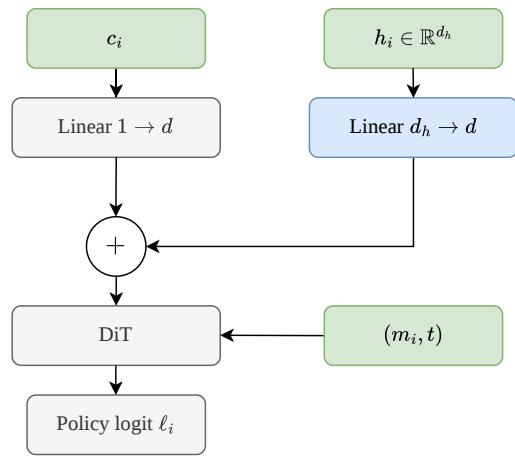  
Figure 7: Architecture of our unmasking policy. Following Jazbec et al. (2026), confidence is projected into the policy representation space and processed by a DiTstyle transformer. Our policy adds a projected backbone hidden representation to the confidence representation.

## A.2 Trajectory-Contraction Teacher

We construct training targets from a reference trajectory

$$
\tau ^ { \mathrm { r e f } } = ( s _ { 0 } , \ldots , s _ { T } ) .\tag{10}
$$

For each state $s _ { t }$ and future state $s _ { u } , u > t ,$ , we define

$$
A _ { t  u } = \mathcal { M } ( s _ { t } ) \backslash \mathcal { M } ( s _ { u } ) ,\tag{11}
$$

as the set of positions committed between the two states. Following Section 3.3, the segment from $s _ { t }$ to $s _ { u }$ can be contracted into a single decoding step when

$$
\begin{array} { r } { \mathscr { C } ( s _ { t } , A _ { t  u } ) = s _ { u } . } \end{array}\tag{12}
$$

For each reference state, we select the furthest future state satisfying this criterion,

$$
u _ { t } ^ { \star } = \operatorname* { m a x } \{ u > t : \mathcal { C } ( s _ { t } , A _ { t  u } ) = s _ { u } \} ,\tag{13}
$$

and use the corresponding commitment set

$$
A _ { t } ^ { \star } = A _ { t  u _ { t } ^ { \star } }\tag{14}
$$

to define the binary teacher targets

$$
y _ { t , i } = \mathbb { 1 } [ i \in A _ { t } ^ { \star } ] .\tag{15}
$$

Algorithm 1 Trajectory-contraction target con  
struction   
Require: Reference trajectory $( s _ { 0 } , \ldots , s _ { T } )$   
Ensure: Teacher targets $\{ A _ { t } ^ { \star } \} _ { t = 0 } ^ { T - 1 }$   
1: for $t = 0 , \ldots , T - 1$ do   
2: for $u = T , \ldots , t -$ + 1 do   
3: $A _ { t \right. u } \left. \mathcal { M } ( s _ { t } ) \backslash \mathcal { M } ( s _ { u } )$   
4: if $\mathcal { C } ( s _ { t } , A _ { t  u } ) = s _ { u }$ then   
5: $A _ { t } ^ { \star } \gets A _ { t - }$ →u   
6: break   
7: end $\mathbf { i f }$   
8: end for   
9: end for   
10: return $\{ A _ { t } ^ { \star } \} _ { t = 0 } ^ { T - 1 }$

Validity is monotone in u: since $A _ { t  u ^ { \prime } } \subseteq A _ { t } .$ →u for $u ^ { \prime } < u ,$ if Equation (12) holds for $u ,$ it also holds for every $t < u ^ { \prime } < u$ . Targets therefore require no backbone evaluations beyond those of the reference trajectory.

We construct these targets independently for every $s _ { t } \in \tau ^ { \mathrm { r e f } }$ and retain all states of the reference trajectory for policy training. Algorithm 1 summarizes the procedure.

## A.3 Decoding

Block diffusion partitions the generated sequence into fixed blocks $B _ { 1 } , \ldots , B _ { K }$ and allows tokens to be committed only within the current block $B _ { k }$ At each decoding step, the eligible positions are $\mathcal { E } _ { t } = \mathcal { M } ( s _ { t } ) \cap B _ { k }$ , and the policy commits

$$
A _ { t } = \left\{ i \in \mathcal { E } _ { t } : q _ { t , i } > \gamma \right\} ,\tag{16}
$$

where $\gamma$ is the commitment threshold. If no eligible position exceeds $\gamma _ { : }$ , we commit the eligible position with the highest policy score. The selected positions are filled with the corresponding top-1 predictions of the frozen backbone.

## B Controlled Study Details

## B.1 Experimental Setup

Controlled experiments follow the training and decoding configuration in Sections C.2 and C.3 and are evaluated on GSM8K (Cobbe et al., 2021), MATH-500 (Hendrycks et al., 2021; Lightman et al., 2024), HumanEval (Chen et al., 2021), and MBPP (Austin et al., 2021b). The reference accuracy is that of one-by-one confidence-based decoding (78.0% on GSM8K, 38.8% on MATH-500, 45.1% on HumanEval, and 52.9% on MBPP), and the accuracy targets are 98%, 95%, and 90% of it. For each policy, we sweep the commitment threshold $\gamma$ over the grid in Table 12 and report the frontier of non-dominated operating points. Each comparison varies a single factor while keeping the others fixed, as summarized in Table 5.

<table><tr><td>Section</td><td>Varied</td><td>Fixed</td></tr><tr><td>Section 3.3</td><td>label, training states</td><td>input  $[ c , h ]$ </td></tr><tr><td>Section 3.4</td><td>policy input</td><td>contraction, reference</td></tr></table>

Table 5: Factors varied and fixed in the controlled comparisons. All other settings follow Section C.3.

## B.2 Commitment Target Construction

Trajectory-contraction targets are constructed as described in Section $_ { \mathrm { A } . 2 } ^ { \mathrm { ~ A ~ } . 2 } .$

Terminal agreement. We use the final token of the reference trajectory, generated by Fast-dLLM with threshold 0.9, as the terminal target $x _ { i } ^ { \star }$ . This corresponds to the labeling rule shared by Learn2PD (Bao et al., 2026) and TraceLock (Sun et al., 2026), which label a prediction by its agreement with the terminal output of a fixed decoding procedure. For teacher-induced trajectories, the same $x _ { i } ^ { \star }$ is used even after the trajectory departs from the reference. Agreement–contraction mismatch. Since a valid contraction commits only tokens that match the reference trajectory, contraction positives are always a subset of terminal-agreement positives. Over all reference trajectories, 28.7% of terminalagreement positives violate trajectory contraction, i.e., they are correct tokens whose commitment at $s _ { t }$ would leave the reference trajectory, and 56.0% of reference states contain at least one such violation. The fraction is consistent across datasets (28.5% on GSM8K and 29.1% on MATH).

## B.3 Training-Trajectory Construction

Reference trajectories. Targets are computed on every state of the reference trajectory, and the policy is trained on all of these states.

Teacher-induced trajectories. Starting from $s _ { 0 } ,$ we repeatedly apply the teacher, committing every positively labeled position, and train on the resulting states. Under trajectory contraction, the teacher jumps from $s _ { t }$ to $s _ { u _ { t } ^ { \star } }$ , so the induced trajectory is a subsequence of the reference trajectory and its targets are inherited from it. Under terminal agreement, the induced states generally leave the reference trajectory; we therefore run the backbone on each induced state to obtain new predictions and recompute targets. Table 6 reports the number of training states under each configuration. Teacherinduced trajectories retain only a fraction of the reference states: 34.0% under trajectory contraction and 25.4% under terminal agreement.

<table><tr><td>Training states</td><td>#States</td><td>Ratio</td></tr><tr><td>Reference</td><td>686,052</td><td>100%</td></tr><tr><td>Induced (contraction)</td><td>233,309</td><td>34.0%</td></tr><tr><td>Induced (terminal)</td><td>174,390</td><td>25.4%</td></tr></table>

Table 6: Number of training states for each trainingstate configuration, over all 9,169 reference trajectories (74.8 states per trajectory on average).

## B.4 Policy-Input Study

Inputs. The confidence $c _ { t , i }$ and margin $\Delta _ { t , i }$ are computed from the backbone’s predictive distribution at each masked position. The hidden representation $h _ { t , i } \in \mathbb { R } ^ { 4 0 9 6 }$ is taken from the final layer of the backbone. Each input is linearly projected to d = 128 dimensions before entering the shared policy network $f _ { \phi } .$

Parameter counts. Table 7 lists the parameter count of each policy. All policies share the same network $f _ { \phi } ;$ the differences arise only from the input projections.

<table><tr><td>Input</td><td>#Params</td></tr><tr><td> $c _ { t , i }$ </td><td>331,297</td></tr><tr><td> $h _ { t , i }$ </td><td>855,457</td></tr><tr><td> $[ c _ { t , i } , \Delta _ { t , i } ]$ </td><td>331,425</td></tr><tr><td> $[ c _ { t , i } , h _ { t , i } ]$ </td><td>855,713</td></tr></table>

Table 7: Parameter counts of the policies in Section 3.4. The DiT block accounts for 297,376 parameters and the timestep embedding for 33,024; the hidden-state projection adds 524,416.

## B.5 Per-Step Latency Profiling

Table 8 reports the absolute per-step latencies underlying Table 2. They are obtained by profiling LLaDA-8B-Instruct on a single H200 GPU with batch size 1, generation length $L = 2 5 6 .$ , block length 32, and commitment threshold 0.9, using synthetic prompts of 128 to 2048 tokens. Each entry is the median over three decoding runs of the steady-state per-step latency, which comprises the backbone forward pass, the policy forward pass, and per-step bookkeeping. Without caching, the backbone forward pass processes the full sequence;

<table><tr><td rowspan="2"></td><td colspan="2">No policy</td><td colspan="3">With policy (ms/step)</td></tr><tr><td>Prompt Cache</td><td>(ms/step)</td><td>331K</td><td>856K 7.5M</td><td>300M</td></tr><tr><td rowspan="2">128</td><td>None</td><td>16.9</td><td>18.5</td><td>18.3 18.4</td><td>23.3</td></tr><tr><td>Prefix</td><td>16.0</td><td>17.2</td><td>17.3 17.4</td><td>22.2</td></tr><tr><td rowspan="2">512</td><td>None</td><td>28.0</td><td>29.4</td><td>29.6</td><td>29.6 34.5</td></tr><tr><td>Prefix</td><td>16.5</td><td>17.7</td><td>18.1 17.9</td><td>22.7</td></tr><tr><td rowspan="2">1024</td><td>None</td><td>45.6</td><td>47.1</td><td>47.1</td><td>47.3 52.3</td></tr><tr><td>Prefix</td><td>18.6</td><td>20.0</td><td>19.9 20.0</td><td>24.8</td></tr><tr><td rowspan="2">2048</td><td>None</td><td>85.1</td><td>86.7</td><td>86.8</td><td>86.9 92.2</td></tr><tr><td>Prefix</td><td>23.4</td><td>24.8</td><td>24.7 24.7</td><td>29.6</td></tr></table>

Table 8: Per-step latency (ms) on LLaDA-8B-Instruct with policies of different sizes (H200, generation length 256, block length 32, batch size 1). Each step is the backbone forward plus the policy forward and per-step bookkeeping; the 7.5M and 300M policies are randomly initialized.

with prefix caching, it reuses cached states, and the full forward pass that opens each block is excluded. Within each row, the backbone latency is the median over all policy configurations, so differences across columns reflect only the policy and bookkeeping.

Policy sizes. The 331K and 856K columns are the trained Conf. and Conf.+Hidden policies used in our experiments. To see how the overhead grows with policy size, we add two larger policies whose parameter counts roughly match those of policies in prior work: the 7.5M policy is about the size of the TraceLock (Sun et al., 2026) network, and the 300M policy is about the size of the LUP-hidden (Jazbec et al., 2026) network. These two policies do not reproduce the architectures of those methods. Both are scaled-up versions of our Conf.+Hidden policy, with widths chosen to approximately match the target parameter counts. The 7.5M policy uses hidden width 512, feed-forward width 2400, and 8 attention heads, with one block in each of the confidence and hidden streams (7.52M parameters). The 300M policy uses hidden width 2048, feed-forward width 7296, and 16 heads, with four blocks in each stream (300.3M parameters). Both policies are randomly initialized and are used only for latency measurement. This does not bias the measurement, because the cost of a policy forward pass depends on its architecture and input shape, not on its weights, and the per-step latency is measured independently of the decisions the policy makes.

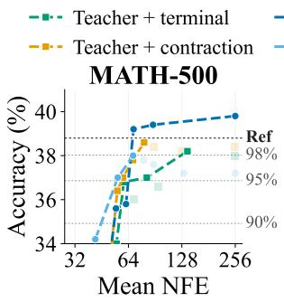

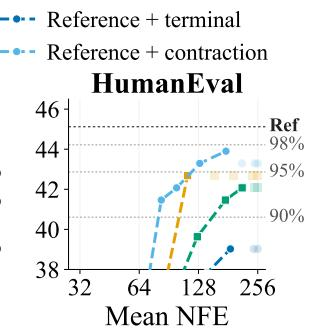  
Figure 8: Accuracy–NFE frontiers for the $2 \times 2$ supervision designs on MATH-500 and HumanEval. Faded markers denote dominated operating points.

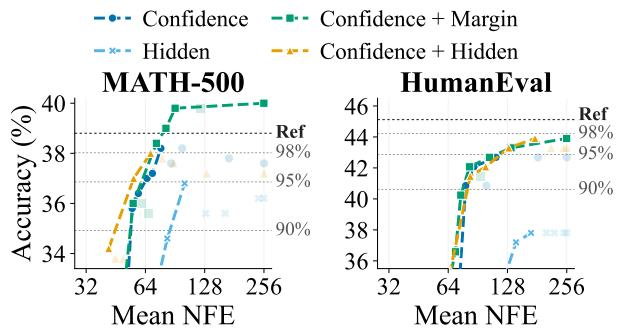  
Figure 9: Accuracy–NFE frontiers for different policy inputs on MATH-500 and HumanEval. Faded markers denote dominated operating points.

## B.6 Results on MATH-500 and HumanEval

Figures 8 and 9 repeat the comparisons of Sections 3.3 and 3.4 on MATH-500 and HumanEval, with the same configurations (Table 5).

Supervision. On HumanEval, combining trajectory contraction with reference trajectories yields the best frontier throughout, reaches the 90% target with the fewest NFE, and is the only configuration to reach the 95% target, whereas terminal agreement on reference trajectories remains below 90% at all operating points. On MATH-500, the same combination yields the best frontier up to the 95% target but saturates just below 98%, whereas the other configurations reach 98% at larger NFE, with terminal agreement on reference trajectories exceeding the reference accuracy. Trajectory contraction thus mainly improves the low-NFE regime, consistent with Finding 1.

Policy input. Hidden states alone remain below 95% of the reference accuracy on MATH-500 and below 90% on HumanEval. On MATH-500, combining confidence with hidden states yields the best frontier up to the 95% target but saturates just below 98%, whereas adding the margin reaches

<table><tr><td>Dataset</td><td>Training</td><td>Evaluation</td></tr><tr><td>GSM8K</td><td>7,473</td><td>1,319</td></tr><tr><td>MATH</td><td>7,485</td><td></td></tr><tr><td>MATH-500</td><td>一</td><td>500</td></tr><tr><td>HumanEval</td><td>一</td><td>164</td></tr><tr><td>MBPP</td><td>一</td><td>257</td></tr><tr><td>Total</td><td>14,958</td><td>2,240</td></tr></table>

Table 9: Training and evaluation dataset sizes.

98% with the fewest NFE and the highest accuracy, exceeding the reference. On HumanEval, all confidence-based inputs perform comparably up to the 90% target, but only the margin and hiddenstate combinations reach 95%, and none reaches 98%.

## C Experimental Details

## C.1 Datasets and Prompt Templates

Datasets. We train on the GSM8K training split (openai/gsm8k) and the MATH training split (ankner/math-500). For MATH, we exclude 15 examples whose gold answers cannot be parsed by the answer verifier, leaving 7,485 examples. The resulting 14,958 training examples are concatenated and shuffled with seed 42. During training, prompts exceeding 256 tokens are left-truncated to retain the last 256 tokens. Evaluation prompts are not truncated, and no evaluation examples are used for training.

Table 9 summarizes the dataset sizes. All evaluations use zero-shot prompting unless otherwise stated. GSM8K uses the openai/gsm8k test split, MATH-500 uses HuggingFaceH4/MATH-500, HumanEval uses openai/openai\_humaneval, and MBPP uses the sanitized test split of google-research-datasets/mbpp.

Prompt templates. We use task-specific instruction prompts with the backbone’s chat template. For GSM8K and MATH, we use the same prompt for training and evaluation, instructing the model to solve problems step by step and provide the final answer in \boxed{}. For HumanEval and MBPP, we follow the prompts from lm-eval. HumanEval provides a function signature and docstring, while MBPP provides a task description and test cases. For both tasks, generation continues from a partially provided code block.

Answer verification. For GSM8K and MATH, we extract and verify the final boxed answer using math-verify v0.8.0. The same procedure is used to select correct reference trajectories for training.

<table><tr><td>Hyperparameter</td><td>Value</td></tr><tr><td>Optimizer</td><td>AdamW</td></tr><tr><td>Learning rate</td><td> $3 \times 1 0 ^ { - 5 }$ </td></tr><tr><td>Adam  $( \bar { \beta } _ { 1 } , \beta _ { 2 } )$ </td><td> $( 0 . 9 , 0 . 9 9 )$ </td></tr><tr><td>Adam €</td><td> $1 0 ^ { - 8 }$ </td></tr><tr><td>Weight decay</td><td>0.1</td></tr><tr><td>LR scheduler</td><td>Cosine decay</td></tr><tr><td>Warmup</td><td>100 optimizer steps</td></tr><tr><td>Gradient clipping Batch size</td><td>0.2 max norm</td></tr><tr><td>Gradient accumulation</td><td>16 / GPU</td></tr><tr><td></td><td>1</td></tr><tr><td>Epochs</td><td>1</td></tr><tr><td>Dropout</td><td>0</td></tr><tr><td>Seed</td><td>123</td></tr></table>

Table 10: Optimization hyperparameters used for policy training.

## C.2 Policy Optimization

We train the full policy jointly with AdamW. Training takes approximately 3 hours and 15 minutes on a single NVIDIA H200 GPU. Unless otherwise specified, all policy-training experiments use the hyperparameters in Table 10.

## C.3 Training and Decoding Configuration

Following Jazbec et al. (2026), we train the policy on the training splits of GSM8K and MATH. We retain only reference trajectories whose final answer is correct, yielding 9,169 trajectories. No codegeneration examples are used for policy training; HumanEval and MBPP therefore evaluate out-ofdomain generalization from mathematical reasoning to code.

Reference trajectories are generated by FastdLLM (Wu et al., 2026) with a confidence threshold of 0.9. We use generation length $L = 2 5 6$ and block length 32 for both trajectory collection and the main evaluation. For the length-transfer evaluation at $L = 5 1 2$ (Section 5.5), we additionally apply End-of-Text Prediction (EoTP) (Bao et al., 2026) to all methods: once an end-of-text token has been committed, all remaining masked positions after it are filled with end-of-text tokens, and decoding terminates. As a result, the NFE at L = 512 can be smaller than L even for one-by-one decoding. The trajectory-generation temperature is set to zero.

The frozen LLaDA-8B-Instruct backbone is loaded in bfloat16, while policy computation is performed in float32. The backbone parameters remain frozen throughout policy training.

<table><tr><td>Setting</td><td>Value</td></tr><tr><td>Training data</td><td>GSM8K + MATH train</td></tr><tr><td>Reference decoder Reference threshold</td><td>Fast-dLLM 0.9</td></tr><tr><td>Generation length</td><td>256</td></tr><tr><td>Block length</td><td>32</td></tr><tr><td>Training temperature</td><td>0</td></tr><tr><td>Backbone precision</td><td>bfloat16</td></tr><tr><td>Policy precision</td><td>float32</td></tr></table>

Table 11: Training-trajectory and numerical configuration.

## C.4 Parameter Grids

Table 12 summarizes the commitment rule of each method and the parameter swept to obtain operating points. OnTrack (Ours), Learn2PD, and Fast-dLLM commit every eligible position whose score exceeds a threshold γ, which we sweep over the same grid γ $\{ 0 . 5 , 0 . 6 , 0 . 7 , 0 . 8 , 0 . 8 5 , 0 . 9 , 0 . 9 4 , 0 . 9 6 , 0 . 9 8 , 0 . 9 9 \}$ for all three methods. EB-Sampler (Ben-Hamu et al., 2025) sorts positions by confidence and commits the longest prefix whose total entropy minus its maximum entropy does not exceed a budget ϵ, which we sweep over ϵ $\{ 0 , 0 . 0 0 1 , 0 . 0 0 3 , 0 . 0 1 , 0 . 0 3 , 0 . 1 , 0 . 3 , 1 , 3 , 1 0 \}$

<table><tr><td>Method</td><td>Score / commitment rule</td><td>Param.</td></tr><tr><td>OnTrack (Ours)</td><td>learned policy probability  $\sigma ( \ell _ { t , i } ) > \gamma$ </td><td>γ</td></tr><tr><td>Learn2PD</td><td>learned filter probability &gt; γ</td><td>γ</td></tr><tr><td>Fast-dLLM</td><td>top-1 token probability &gt; γ</td><td>γ</td></tr><tr><td>EB-Sampler</td><td>entropy-bounded prefix of confidence-sorted positions</td><td>€</td></tr></table>

Table 12: Commitment rules and swept parameters.

## C.5 Throughput Measurement

All throughput measurements are performed on a single NVIDIA H200 GPU (141 GB) with batch size 1, using LLaDA-8B-Instruct in bfloat16 with FlashAttention-2 (Dao, 2024). TPS is computed as the number of generated tokens, excluding tokenizer special tokens, divided by the sampler wallclock time, which includes both backbone and policy evaluations but excludes tokenization, detokenization, and answer scoring. For each prompt, we call torch.cuda.synchronize immediately before and after the sampler call and time the interval with a high-resolution host timer. No warm-up runs are performed; each prompt is decoded once (a single pass over the full evaluation set), with only one generation process per GPU. Timing is aggregated per dataset and decoding configuration as the total number of generated tokens over the total sampler time, i.e., a token-weighted average rather than a mean of per-prompt rates.

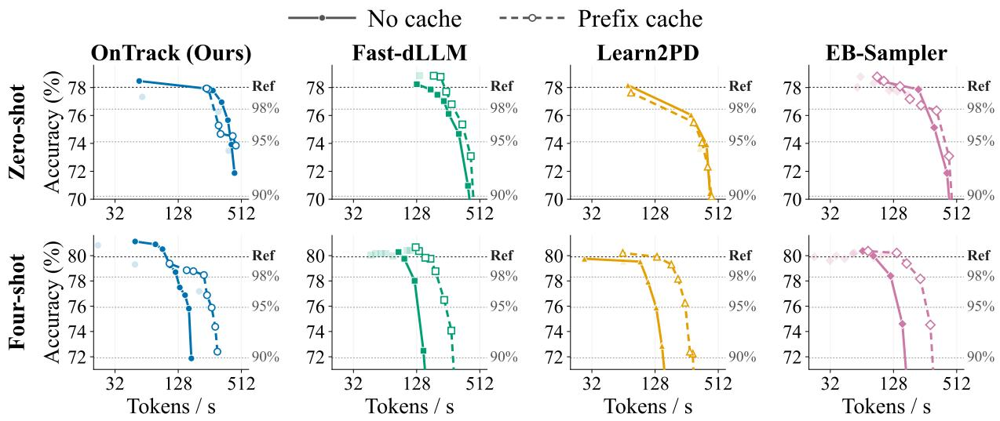  
Figure 10: Accuracy versus throughput on GSM8K with zero-shot (top) and four-shot (bottom) prompting. Solid and dashed lines indicate decoding without and with prefix caching, respectively. Horizontal lines mark the uncached one-by-one reference accuracy and its 98%, 95%, and 90% retention thresholds.

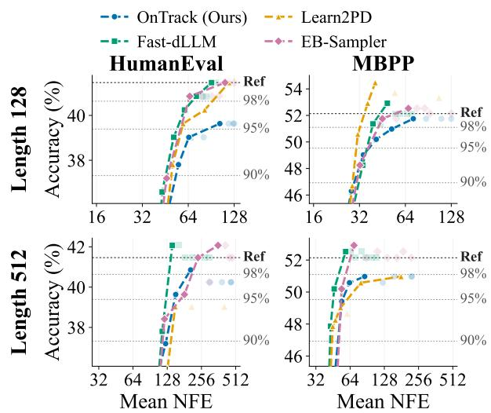  
Figure 11: Accuracy versus NFE on HumanEval and MBPP at generation lengths L = 128 (top) and L = 512 (bottom) for a policy trained at L = 256.

## C.6 Additional Results

For the prefix caching experiments (Section 5.3), Figure 10 shows the accuracy–throughput frontiers on GSM8K under zero-shot and four-shot prompting. Our policy exhibits greater accuracy sensitivity to caching than the baselines, while four-shot prompting yields substantial throughput improvements with caching.

For generalization across sequence lengths (Section 5.5), Figure 11 shows the frontiers on HumanEval and MBPP at $L = 1 2 8$ and $L = 5 1 2 .$ complementing Figure 6. The corresponding operating points, together with those for all other figures, are listed in Section D.

## D Numerical Results

This section lists all measured operating points underlying the figures. Tables 13 and 15 correspond to Figures 2 and 8; Tables 14 and 16 to Figures 3 and 9; Tables 17 and 18 to Figure 4; Tables 19 and 20 to Figure 10; Tables 21 and 22 to Figure 5; and Tables 23 to 26 to Figures 6 and 11.

<table><tr><td colspan="4">GSM8K</td><td colspan="4">MBPP</td></tr><tr><td>Method</td><td>Param.</td><td>Acc.</td><td>NFE</td><td>Method</td><td>Param.</td><td>Acc.</td><td>NFE</td></tr><tr><td>Teacher + terminal</td><td>0.99</td><td>79.2</td><td>256.0</td><td>Teacher + terminal</td><td>0.99</td><td>52.5</td><td>256.0</td></tr><tr><td></td><td>0.98</td><td>78.8</td><td>100.1</td><td></td><td>0.98</td><td>52.5</td><td>187.7</td></tr><tr><td></td><td>0.96</td><td>78.4</td><td>66.0</td><td></td><td>0.96</td><td>52.5</td><td>127.6</td></tr><tr><td></td><td>0.94</td><td>77.8</td><td>55.9</td><td></td><td>0.94</td><td>52.5</td><td>100.5</td></tr><tr><td></td><td>0.9</td><td>75.1</td><td>46.8</td><td></td><td>0.9</td><td>51.4</td><td>70.4</td></tr><tr><td></td><td>0.85</td><td>74.0</td><td>40.6</td><td></td><td>0.85</td><td>49.0</td><td>56.6</td></tr><tr><td></td><td>0.8</td><td>73.0</td><td>37.1</td><td></td><td>0.8</td><td>46.3</td><td>48.0</td></tr><tr><td></td><td>0.7</td><td>67.8</td><td>33.0</td><td></td><td>0.7</td><td>33.5</td><td>39.0</td></tr><tr><td></td><td>0.6</td><td>63.2</td><td>30.5</td><td></td><td>0.6</td><td>26.5</td><td>30.0</td></tr><tr><td></td><td>0.5</td><td>55.4</td><td>28.1</td><td></td><td>0.5</td><td>18.3</td><td>24.8</td></tr><tr><td>Teacher + contraction</td><td>0.99</td><td>78.1</td><td>256.0</td><td>Teacher + contraction</td><td>0.99</td><td>53.7</td><td>256.0</td></tr><tr><td></td><td>0.98</td><td>78.2</td><td>105.0</td><td></td><td>0.98</td><td>53.7</td><td>179.3</td></tr><tr><td></td><td>0.96</td><td>77.9</td><td>69.7</td><td></td><td>0.96</td><td>53.7</td><td>117.6</td></tr><tr><td></td><td>0.94</td><td>78.2</td><td>60.2</td><td></td><td>0.94</td><td>53.7</td><td>90.1</td></tr><tr><td></td><td>0.9</td><td>77.8</td><td>51.2</td><td></td><td>0.9</td><td>53.7</td><td>64.8</td></tr><tr><td></td><td>0.85</td><td>77.3</td><td>45.3</td><td></td><td>0.85</td><td>51.4</td><td>50.7</td></tr><tr><td></td><td>0.8</td><td>76.6</td><td>41.7</td><td></td><td>0.8</td><td>47.5</td><td>44.4</td></tr><tr><td></td><td>0.7</td><td>75.1</td><td>36.8</td><td></td><td>0.7</td><td>44.0</td><td>39.5</td></tr><tr><td></td><td>0.6</td><td>74.2</td><td>33.6</td><td></td><td>0.6</td><td>36.2</td><td>36.9</td></tr><tr><td></td><td>0.5</td><td>71.7</td><td>31.3</td><td></td><td>0.5</td><td>30.4</td><td>34.2</td></tr><tr><td>Reference + terminal</td><td>0.99</td><td>78.6</td><td>256.0</td><td>Reference + terminal</td><td>0.99</td><td>51.8</td><td>256.0</td></tr><tr><td></td><td>0.98</td><td>78.8</td><td>70.8</td><td></td><td>0.98</td><td>51.8</td><td>192.4</td></tr><tr><td></td><td>0.96</td><td>76.9</td><td>51.8</td><td></td><td>0.96</td><td>51.8</td><td>116.0</td></tr><tr><td></td><td>0.94</td><td>76.2</td><td>45.7</td><td></td><td>0.94</td><td>51.0</td><td>81.3</td></tr><tr><td></td><td>0.9</td><td>74.7</td><td>39.8</td><td></td><td>0.9</td><td>48.2</td><td>54.1</td></tr><tr><td></td><td>0.85</td><td>73.6</td><td>35.7</td><td></td><td>0.85</td><td>43.2</td><td>42.7</td></tr><tr><td></td><td>0.8</td><td>70.6</td><td>33.6</td><td></td><td>0.8</td><td>36.2</td><td>38.5</td></tr><tr><td></td><td>0.7</td><td>67.2</td><td>30.5</td><td></td><td>0.7</td><td>29.2</td><td>32.2</td></tr><tr><td></td><td>0.6</td><td>59.9</td><td>28.5</td><td></td><td>0.6</td><td>21.8</td><td>27.8</td></tr><tr><td></td><td>0.5</td><td>54.0</td><td>26.4</td><td></td><td>0.5</td><td>17.1</td><td>20.3</td></tr><tr><td>Reference + contraction</td><td>0.99</td><td>78.5</td><td>256.0</td><td>Reference + contraction</td><td>0.99</td><td>53.7</td><td>256.0</td></tr><tr><td></td><td>0.98</td><td>78.4</td><td>109.0</td><td></td><td>0.98</td><td>53.7</td><td>196.9</td></tr><tr><td></td><td>0.96</td><td>78.8</td><td>70.6</td><td></td><td>0.96</td><td>53.7</td><td>131.9</td></tr><tr><td></td><td>0.94</td><td>77.9</td><td>60.6</td><td></td><td>0.94</td><td>53.7</td><td>103.3</td></tr><tr><td></td><td>0.9</td><td>77.8</td><td>51.7</td><td></td><td>0.9</td><td>54.1</td><td>73.4</td></tr><tr><td></td><td>0.85</td><td>76.3</td><td>45.8</td><td></td><td>0.85</td><td>54.1</td><td>57.1</td></tr><tr><td></td><td>0.8</td><td>77.0</td><td>42.1</td><td></td><td>0.8</td><td>52.5</td><td>48.6</td></tr><tr><td></td><td>0.7</td><td>75.7</td><td>37.1</td><td></td><td>0.7</td><td>45.9</td><td>42.4</td></tr><tr><td></td><td>0.6</td><td>73.9</td><td>34.2</td><td></td><td>0.6</td><td>42.0</td><td>39.4</td></tr><tr><td></td><td>0.5</td><td>71.9</td><td>31.8</td><td></td><td>0.5</td><td>37.0</td><td>35.9</td></tr></table>

Table 13: All operating points for the supervision study on GSM8K and MBPP (Figure 2).

<table><tr><td colspan="4">GSM8K</td><td colspan="4">MBPP</td></tr><tr><td>Method</td><td>Param.</td><td>Acc.</td><td>NFE</td><td>Method</td><td>Param.</td><td>Acc.</td><td>NFE</td></tr><tr><td>Conf.</td><td>0.99</td><td>78.1</td><td>256.0</td><td>Conf.</td><td>0.99</td><td>53.3</td><td>256.0</td></tr><tr><td></td><td>0.98</td><td>78.2</td><td>158.4</td><td></td><td>0.98</td><td>53.3</td><td>162.2</td></tr><tr><td></td><td>0.96</td><td>78.1</td><td>72.5</td><td></td><td>0.96</td><td>52.5</td><td>65.8</td></tr><tr><td></td><td>0.94</td><td>77.9</td><td>62.0</td><td></td><td>0.94</td><td>52.5</td><td>58.8</td></tr><tr><td></td><td>0.9</td><td>77.0</td><td>52.9</td><td></td><td>0.9</td><td>51.4</td><td>51.9</td></tr><tr><td></td><td>0.85</td><td>75.3</td><td>47.2</td><td></td><td>0.85</td><td>50.2</td><td>47.3</td></tr><tr><td></td><td>0.8</td><td>75.1</td><td>43.6</td><td></td><td>0.8</td><td>49.4</td><td>44.2</td></tr><tr><td></td><td>0.7</td><td>75.1</td><td>39.0</td><td></td><td>0.7</td><td>44.0</td><td>41.0</td></tr><tr><td></td><td>0.6</td><td>72.4</td><td>36.2</td><td></td><td>0.6</td><td>41.6</td><td>42.0</td></tr><tr><td></td><td>0.5</td><td>72.6</td><td>33.5</td><td></td><td>0.5</td><td>36.6</td><td>41.3</td></tr><tr><td>Hidden</td><td>0.99</td><td>77.5</td><td>256.0</td><td>Hidden</td><td>0.99</td><td>51.0</td><td>256.0</td></tr><tr><td></td><td>0.98</td><td>77.4</td><td>227.6</td><td></td><td>0.98</td><td>51.0</td><td>197.8</td></tr><tr><td></td><td>0.96</td><td>77.6</td><td>138.6</td><td></td><td>0.96</td><td>51.0</td><td>143.8</td></tr><tr><td></td><td>0.94</td><td>77.6</td><td>105.3</td><td></td><td>0.94</td><td>50.6</td><td>124.0</td></tr><tr><td></td><td>0.9</td><td>76.4</td><td>77.1</td><td></td><td>0.9</td><td>50.6</td><td>99.4</td></tr><tr><td></td><td>0.85</td><td>74.5</td><td>61.3</td><td></td><td>0.85</td><td>49.8</td><td>83.6</td></tr><tr><td></td><td>0.8</td><td>75.4</td><td>51.9</td><td></td><td>0.8</td><td>48.2</td><td>73.1</td></tr><tr><td></td><td>0.7</td><td>69.8</td><td>42.2</td><td></td><td>0.7</td><td>42.0</td><td>59.0</td></tr><tr><td></td><td>0.6 0.5</td><td>67.5</td><td>37.6</td><td></td><td>0.6</td><td>37.7</td><td>51.0</td></tr><tr><td></td><td></td><td>64.0</td><td>33.8</td><td></td><td>0.5</td><td>31.1</td><td>41.4</td></tr><tr><td>Conf.+Margin</td><td>0.99</td><td>77.9</td><td>255.9</td><td>Conf.+Margin</td><td>0.99</td><td>52.9</td><td>255.9</td></tr><tr><td></td><td>0.98</td><td>77.9</td><td>99.2</td><td></td><td>0.98</td><td>52.9</td><td>95.3 60.9</td></tr><tr><td></td><td>0.96</td><td>77.1</td><td>66.2</td><td></td><td>0.96</td><td>51.4</td><td></td></tr><tr><td></td><td>0.94</td><td>77.4</td><td>58.3</td><td></td><td>0.94</td><td>51.4</td><td>54.9 49.1</td></tr><tr><td></td><td>0.9</td><td>76.0</td><td>50.7</td><td></td><td>0.9</td><td>49.8</td><td></td></tr><tr><td></td><td>0.85</td><td>75.7</td><td>45.5</td><td></td><td>0.85</td><td>48.6</td><td>44.1</td></tr><tr><td></td><td>0.8</td><td>75.5</td><td>42.0</td><td></td><td>0.8</td><td>48.2</td><td>43.6 41.5</td></tr><tr><td></td><td>0.7</td><td>74.5</td><td>37.6</td><td></td><td>0.7</td><td>43.6</td><td>40.1</td></tr><tr><td></td><td>0.6</td><td>73.0</td><td>34.3</td><td></td><td>0.6</td><td>43.2</td><td></td></tr><tr><td></td><td>0.5</td><td>70.8</td><td>32.0</td><td></td><td>0.5</td><td>40.1</td><td>38.7</td></tr><tr><td>Conf.+Hidden</td><td>0.99</td><td>78.5</td><td>256.0</td><td>Conf.+Hidden</td><td>0.99</td><td>53.7</td><td>256.0</td></tr><tr><td></td><td>0.98</td><td>78.4</td><td>109.0</td><td></td><td>0.98</td><td>53.7</td><td>196.9 131.9</td></tr><tr><td></td><td>0.96</td><td>78.8</td><td>70.6</td><td></td><td>0.96</td><td>53.7</td><td>103.3</td></tr><tr><td></td><td>0.94</td><td>77.9</td><td>60.6</td><td></td><td>0.94</td><td>53.7</td><td></td></tr><tr><td></td><td>0.9</td><td>77.8</td><td>51.7</td><td></td><td>0.9</td><td>54.1</td><td>73.4</td></tr><tr><td></td><td>0.85</td><td>76.3</td><td>45.8</td><td></td><td>0.85</td><td>54.1</td><td>57.1</td></tr><tr><td></td><td>0.8</td><td>77.0</td><td>42.1</td><td></td><td>0.8</td><td>52.5</td><td>48.6</td></tr><tr><td></td><td>0.7</td><td>75.7</td><td>37.1</td><td></td><td>0.7</td><td>45.9</td><td>42.4</td></tr><tr><td></td><td>0.6</td><td>73.9</td><td>34.2</td><td></td><td>0.6</td><td>42.0</td><td>39.4</td></tr><tr><td></td><td>0.5</td><td>71.9</td><td>31.8</td><td></td><td>0.5</td><td>37.0</td><td>35.9</td></tr></table>

Table 14: All operating points for the policy-input study on GSM8K and MBPP (Figure 3).

<table><tr><td colspan="4">MATH-500</td><td colspan="4">HumanEval</td></tr><tr><td>Method</td><td>Param.</td><td>Acc.</td><td>NFE</td><td>Method</td><td>Param.</td><td>Acc.</td><td>NFE</td></tr><tr><td>Teacher + terminal</td><td>0.99</td><td>38.0</td><td>256.0</td><td>Teacher + terminal</td><td>0.99</td><td>42.1</td><td>256.0</td></tr><tr><td></td><td>0.98</td><td>38.2</td><td>137.6</td><td></td><td>0.98</td><td>42.1</td><td>246.0</td></tr><tr><td></td><td>0.96</td><td>36.6</td><td>93.9</td><td></td><td>0.96</td><td>42.1</td><td>213.3</td></tr><tr><td></td><td>0.94</td><td>37.0</td><td>81.3</td><td></td><td>0.94</td><td>41.5</td><td>175.4</td></tr><tr><td></td><td>0.9</td><td>36.0</td><td>68.6</td><td></td><td>0.9</td><td>39.6</td><td>126.3</td></tr><tr><td></td><td>0.85</td><td>36.8</td><td>60.2</td><td></td><td>0.85</td><td>36.6</td><td>94.7</td></tr><tr><td></td><td>0.8</td><td>34.0</td><td>54.9</td><td></td><td>0.8</td><td>34.1</td><td>76.5</td></tr><tr><td></td><td>0.7</td><td>31.2</td><td>47.6</td><td></td><td>0.7</td><td>23.8</td><td>53.7</td></tr><tr><td></td><td>0.6</td><td>26.8</td><td>42.9</td><td></td><td>0.6</td><td>14.6</td><td>40.7</td></tr><tr><td></td><td>0.5</td><td>22.8</td><td>38.1</td><td></td><td>0.5</td><td>9.1</td><td>29.1</td></tr><tr><td>Teacher + contraction</td><td>0.99</td><td>38.4</td><td>256.0</td><td>Teacher + contraction</td><td>0.99</td><td>42.7</td><td>256.0</td></tr><tr><td></td><td>0.98</td><td>38.2</td><td>128.2</td><td></td><td>0.98</td><td>42.7</td><td>241.8</td></tr><tr><td></td><td>0.96</td><td>38.4</td><td>88.9</td><td></td><td>0.96</td><td>42.7</td><td>192.6</td></tr><tr><td></td><td>0.94</td><td>38.6</td><td>78.5</td><td></td><td>0.94</td><td>42.7</td><td>153.8</td></tr><tr><td></td><td>0.9</td><td>37.8</td><td>67.9</td><td></td><td>0.9</td><td>42.7</td><td>112.7</td></tr><tr><td></td><td>0.85</td><td>37.0</td><td>59.6</td><td></td><td>0.85</td><td>37.2</td><td>86.4</td></tr><tr><td></td><td>0.8</td><td>36.4</td><td>55.5</td><td></td><td>0.8</td><td>34.8</td><td>74.4</td></tr><tr><td></td><td>0.7</td><td>32.4</td><td>49.1</td><td></td><td>0.7</td><td>31.7</td><td>58.6</td></tr><tr><td></td><td>0.6</td><td>31.6</td><td>44.3</td><td></td><td>0.6</td><td>29.3</td><td>48.8</td></tr><tr><td></td><td>0.5</td><td>31.6</td><td>41.2</td><td></td><td>0.5</td><td>22.0</td><td>40.0</td></tr><tr><td>Reference + terminal</td><td>0.99</td><td>39.8</td><td>256.0</td><td>Reference + terminal</td><td>0.99</td><td>39.0</td><td>256.0</td></tr><tr><td></td><td>0.98</td><td>39.4</td><td>88.1</td><td></td><td>0.98</td><td>39.0</td><td>244.4</td></tr><tr><td></td><td>0.96</td><td>39.2</td><td>68.4</td><td></td><td>0.96</td><td>39.0</td><td>186.0</td></tr><tr><td></td><td>0.94</td><td>35.8</td><td>62.0</td><td></td><td>0.94</td><td>37.8</td><td>140.8</td></tr><tr><td></td><td>0.9</td><td>35.6</td><td>54.5</td><td></td><td>0.9</td><td>36.6</td><td>91.3</td></tr><tr><td></td><td>0.85</td><td>32.8</td><td>49.3</td><td></td><td>0.85</td><td>31.7</td><td>67.1</td></tr><tr><td></td><td>0.8</td><td>31.6</td><td>46.6</td><td></td><td>0.8</td><td>21.3</td><td>54.2</td></tr><tr><td></td><td>0.7</td><td>32.6</td><td>41.9</td><td></td><td>0.7</td><td>18.3</td><td>41.0</td></tr><tr><td></td><td>0.6</td><td>28.6</td><td>38.9</td><td></td><td>0.6</td><td>12.2</td><td>31.3</td></tr><tr><td></td><td>0.5</td><td>23.4</td><td>34.9</td><td></td><td>0.5</td><td>8.5</td><td>22.4</td></tr><tr><td>Reference + contraction</td><td>0.99</td><td>37.2</td><td>256.0</td><td>Reference + contraction</td><td>0.99</td><td>43.3</td><td>256.0</td></tr><tr><td></td><td>0.98</td><td>37.2</td><td>131.2</td><td></td><td>0.98</td><td>43.3</td><td>247.1</td></tr><tr><td></td><td>0.96</td><td>37.6</td><td>88.7</td><td></td><td>0.96</td><td>43.3</td><td>212.9</td></tr><tr><td></td><td>0.94</td><td>37.8</td><td>77.8</td><td></td><td>0.94</td><td>43.9</td><td>176.5</td></tr><tr><td></td><td>0.9</td><td>38.0</td><td>68.0</td><td></td><td>0.9</td><td>43.3</td><td>130.0</td></tr><tr><td></td><td>0.85</td><td>36.8</td><td>60.5</td><td></td><td>0.85</td><td>42.1</td><td>99.1</td></tr><tr><td></td><td>0.8</td><td>37.0</td><td>55.8</td><td></td><td>0.8</td><td>41.5</td><td>82.9</td></tr><tr><td></td><td>0.7</td><td>33.8</td><td>49.6</td><td></td><td>0.7</td><td>35.4</td><td>65.6</td></tr><tr><td></td><td>0.6</td><td>33.8</td><td>45.0</td><td></td><td>0.6</td><td>33.5</td><td>54.8</td></tr><tr><td></td><td>0.5</td><td>34.2</td><td>41.7</td><td></td><td>0.5</td><td>25.6</td><td>44.0</td></tr><tr><td>Confidence</td><td>0.99</td><td>37.6</td><td>256.0</td><td>Confidence</td><td>0.99</td><td>42.7</td><td>256.0</td></tr><tr><td></td><td>0.98</td><td>37.8</td><td>170.0</td><td></td><td>0.98</td><td>42.7</td><td>182.9</td></tr><tr><td></td><td>0.96</td><td>38.2</td><td>98.4</td><td></td><td>0.96</td><td>42.7</td><td>111.9</td></tr><tr><td></td><td>0.94</td><td>37.6</td><td>86.5</td><td></td><td>0.94</td><td>40.9</td><td>100.1</td></tr><tr><td></td><td>0.9</td><td>38.2</td><td>76.7</td><td></td><td>0.9</td><td>42.1</td><td>86.5</td></tr><tr><td></td><td>0.85</td><td>37.2</td><td>69.5</td><td></td><td>0.85</td><td>40.9</td><td>78.5</td></tr><tr><td></td><td>0.8</td><td>37.0</td><td>65.2</td><td></td><td>0.8</td><td>34.8</td><td>73.1</td></tr><tr><td></td><td>0.7</td><td>36.4</td><td>58.9</td><td></td><td>0.7</td><td>33.5</td><td>65.1</td></tr><tr><td></td><td>0.6</td><td>35.8</td><td>54.8</td><td></td><td>0.6</td><td>26.8</td><td>59.0</td></tr><tr><td></td><td>0.5</td><td>31.6</td><td>50.9</td><td></td><td>0.5</td><td>25.6</td><td>53.6</td></tr><tr><td>Hidden</td><td>0.99</td><td>36.2</td><td>256.0</td><td>Hidden</td><td>0.99</td><td>37.8</td><td>256.0</td></tr><tr><td></td><td>0.98</td><td>36.2</td><td>240.2</td><td></td><td>0.98</td><td>37.8</td><td>247.7</td></tr><tr><td></td><td>0.96</td><td>35.6</td><td>162.6</td><td></td><td>0.96</td><td>37.8</td><td>221.3</td></tr><tr><td></td><td>0.94</td><td>35.6</td><td>129.6</td><td></td><td>0.94</td><td>37.8</td><td>201.8</td></tr><tr><td></td><td>0.9</td><td>36.8</td><td>101.2</td><td></td><td>0.9</td><td>37.8</td><td>168.6</td></tr><tr><td></td><td>0.85</td><td>34.6</td><td>82.6</td><td></td><td>0.85</td><td>37.2</td><td>141.5</td></tr><tr><td></td><td>0.8</td><td>32.2</td><td>70.5</td><td></td><td>0.8</td><td>34.8</td><td>122.3</td></tr><tr><td></td><td>0.7</td><td>31.8</td><td>58.5</td><td></td><td>0.7</td><td>32.9</td><td>99.2</td></tr><tr><td></td><td>0.6</td><td>28.0</td><td>49.0</td><td></td><td>0.6</td><td>29.9</td><td>78.6</td></tr><tr><td></td><td>0.5</td><td>27.2</td><td>42.6</td><td></td><td>0.5</td><td>25.6</td><td>64.8</td></tr><tr><td>Confidence + Margin</td><td>0.99</td><td>40.0</td><td>255.7</td><td>Confidence + Margin</td><td>0.99</td><td>43.9</td><td>255.8</td></tr><tr><td></td><td>0.98</td><td>39.8</td><td>122.3</td><td></td><td>0.98</td><td>43.3</td><td>133.4</td></tr><tr><td></td><td>0.96</td><td>39.8</td><td>90.6</td><td></td><td>0.96</td><td>42.7</td><td>103.7</td></tr><tr><td></td><td>0.94</td><td>39.0</td><td>81.3</td><td></td><td>0.94</td><td>41.5</td><td>93.3</td></tr><tr><td></td><td>0.9</td><td>38.4</td><td>72.8</td><td></td><td>0.9</td><td>42.1</td><td>82.2</td></tr><tr><td></td><td>0.85</td><td>35.6</td><td>66.1</td><td></td><td>0.85</td><td>40.2</td><td>74.1</td></tr><tr><td></td><td>0.8</td><td>36.0</td><td>61.4</td><td></td><td>0.8</td><td>36.6</td><td>69.7</td></tr><tr><td></td><td>0.7</td><td>36.0</td><td>55.4</td><td></td><td>0.7</td><td>32.9</td><td>60.2</td></tr><tr><td></td><td>0.6</td><td>33.0</td><td>50.6</td><td></td><td>0.6</td><td>29.9</td><td>55.0</td></tr><tr><td></td><td>0.5</td><td>32.8</td><td>47.8</td><td></td><td>0.5</td><td>23.8</td><td>50.3</td></tr><tr><td>Confidence + Hidden</td><td>0.99</td><td>37.2</td><td>256.0</td><td>Confidence + Hidden</td><td>0.99</td><td>43.3</td><td>256.0</td></tr><tr><td></td><td>0.98</td><td>37.2</td><td>131.2</td><td></td><td>0.98</td><td>43.3</td><td>247.1</td></tr><tr><td></td><td>0.96 0.94</td><td>37.6</td><td>88.7</td><td></td><td>0.96</td><td>43.3</td><td>212.9</td></tr><tr><td></td><td></td><td>37.8</td><td>77.8</td><td></td><td>0.94</td><td>43.9</td><td>176.5</td></tr><tr><td></td><td>0.9</td><td>38.0</td><td>68.0</td><td></td><td>0.9</td><td>43.3</td><td>130.0</td></tr><tr><td></td><td>0.85</td><td>36.8</td><td>60.5</td><td></td><td>0.85</td><td>42.1</td><td>99.1</td></tr><tr><td></td><td>0.8</td><td>37.0</td><td>55.8</td><td></td><td>0.8</td><td>41.5</td><td>82.9</td></tr><tr><td></td><td>0.7</td><td>33.8</td><td>49.6</td><td></td><td>0.7</td><td>35.4</td><td>65.6</td></tr><tr><td></td><td>0.6</td><td>33.8</td><td>45.0</td><td></td><td>0.6</td><td>33.5</td><td>54.8</td></tr><tr><td></td><td>0.5</td><td>34.2</td><td>41.7</td><td></td><td>0.5</td><td>25.6</td><td>44.0</td></tr></table>

Table 15: All operating points for the supervision study on MATH-500 and HumanEval (Figure 8).

Table 16: All operating points for the policy-input study on MATH-500 and HumanEval (Figure 9).

<table><tr><td colspan="5">GSM8K</td><td colspan="5">MATH-500</td></tr><tr><td>Method</td><td>Param.</td><td>Acc.</td><td>NFE</td><td>TPS</td><td>Method</td><td>Param.</td><td>Acc.</td><td>NFE</td><td>TPS</td></tr><tr><td>OnTrack (Ours)</td><td>0.99</td><td>78.5</td><td>256.0</td><td>54</td><td>OnTrack (Ours)</td><td>0.99</td><td>37.2</td><td>256.0</td><td>53</td></tr><tr><td></td><td>0.98</td><td>78.4</td><td>109.0</td><td>127</td><td></td><td>0.98</td><td>37.2</td><td>131.2</td><td>103</td></tr><tr><td></td><td>0.96</td><td>78.8</td><td>70.6</td><td>196</td><td></td><td>0.96</td><td>37.6</td><td>88.7</td><td>153</td></tr><tr><td></td><td>0.94</td><td>77.9</td><td>60.6</td><td>230</td><td></td><td>0.94</td><td>37.8</td><td>77.8</td><td>177</td></tr><tr><td></td><td>0.9</td><td>77.8</td><td>51.7</td><td>274</td><td></td><td>0.9</td><td>38.0</td><td>68.0</td><td>200</td></tr><tr><td></td><td>0.85</td><td>76.3</td><td>45.8</td><td>308</td><td></td><td>0.85</td><td>36.8</td><td>60.5</td><td>225</td></tr><tr><td></td><td>0.8</td><td>77.0</td><td>42.1</td><td>331</td><td></td><td>0.8</td><td>37.0</td><td>55.8</td><td>244</td></tr><tr><td></td><td>0.7</td><td>75.7</td><td>37.1</td><td>381</td><td></td><td>0.7</td><td>33.8</td><td>49.6</td><td>274</td></tr><tr><td></td><td>0.6</td><td>73.9</td><td>34.2</td><td>411</td><td></td><td>0.6</td><td>33.8</td><td>45.0</td><td>303</td></tr><tr><td></td><td>0.5</td><td>71.9</td><td>31.8</td><td>440</td><td></td><td>0.5</td><td>34.2</td><td>41.7</td><td>327</td></tr><tr><td>Fast-dLLM</td><td>0.99</td><td>78.2</td><td>118.1</td><td>128</td><td>Fast-dLLM</td><td>0.99</td><td>38.8</td><td>150.2</td><td>99</td></tr><tr><td></td><td>0.98</td><td>78.3</td><td>107.9</td><td>140</td><td></td><td>0.98</td><td>38.8</td><td>138.8</td><td>106</td></tr><tr><td></td><td>0.96</td><td>78.2</td><td>94.5</td><td>160</td><td></td><td>0.96</td><td>38.8</td><td>124.2</td><td>119</td></tr><tr><td></td><td>0.94</td><td>77.9</td><td>86.3</td><td>174</td><td></td><td>0.94</td><td>39.0</td><td>115.3</td><td>127</td></tr><tr><td></td><td>0.9</td><td>77.5</td><td>74.4</td><td>202</td><td></td><td>0.9</td><td>38.4</td><td>102.6</td><td>143</td></tr><tr><td></td><td>0.85</td><td>77.0</td><td>65.6</td><td>232</td><td></td><td>0.85</td><td>38.8</td><td>92.7</td><td>157</td></tr><tr><td></td><td>0.8</td><td>76.1</td><td>58.2</td><td>258</td><td></td><td>0.8</td><td>38.0</td><td>83.7</td><td>175</td></tr><tr><td></td><td>0.7</td><td>74.7</td><td>46.3</td><td>323</td><td></td><td>0.7</td><td>35.2</td><td>69.6</td><td>211</td></tr><tr><td></td><td>0.6</td><td>71.0</td><td>38.0</td><td>395</td><td></td><td>0.6</td><td>34.2</td><td>59.3</td><td>250</td></tr><tr><td></td><td>0.5</td><td>66.1</td><td>32.4</td><td>466</td><td></td><td>0.5</td><td>31.0</td><td>49.8</td><td>297</td></tr><tr><td>Learn2PD</td><td>0.99</td><td>78.2</td><td>212.5</td><td>71</td><td>Learn2PD</td><td>0.99</td><td>36.2</td><td>223.3</td><td>66</td></tr><tr><td></td><td>0.98</td><td>77.6</td><td>90.0</td><td>163</td><td></td><td>0.98</td><td>37.2</td><td>117.7</td><td>124</td></tr><tr><td></td><td>0.96</td><td>76.9</td><td>61.2</td><td>242</td><td></td><td>0.96</td><td>38.0</td><td>87.5</td><td>164</td></tr><tr><td></td><td>0.94</td><td>76.0</td><td>51.8</td><td>282</td><td></td><td>0.94</td><td>37.4</td><td>76.9</td><td>188</td></tr><tr><td></td><td>0.9</td><td>73.6</td><td>43.1</td><td>342</td><td></td><td>0.9</td><td>36.4</td><td>65.8</td><td>218</td></tr><tr><td></td><td>0.85</td><td>73.9</td><td>37.8</td><td>397</td><td></td><td>0.85</td><td>33.4</td><td>58.7</td><td>249</td></tr><tr><td></td><td>0.8</td><td>70.4</td><td>34.8</td><td>426</td><td></td><td>0.8</td><td>30.6</td><td>53.9</td><td>271</td></tr><tr><td></td><td>0.7</td><td>66.2</td><td>31.9</td><td>467</td><td></td><td>0.7</td><td>29.0</td><td>48.8</td><td>297</td></tr><tr><td></td><td>0.6</td><td>59.4</td><td>29.5</td><td>506</td><td></td><td>0.6</td><td>24.6</td><td>43.9</td><td>331</td></tr><tr><td></td><td>0.5</td><td>53.1</td><td>27.5</td><td>539</td><td></td><td>0.5</td><td>24.0</td><td>40.1</td><td>357</td></tr><tr><td>EB-Sampler</td><td>10</td><td>60.5</td><td>26.6</td><td>553</td><td>EB-Sampler</td><td>10</td><td>25.6</td><td>32.8</td><td>430</td></tr><tr><td></td><td>3</td><td>71.9</td><td>35.8</td><td>414</td><td></td><td>3</td><td>33.6</td><td>47.2</td><td>305</td></tr><tr><td></td><td>1</td><td>75.1</td><td>47.4</td><td>313</td><td></td><td>1</td><td>38.6</td><td>66.0</td><td>221</td></tr><tr><td></td><td>0.3</td><td>77.9</td><td>66.8</td><td>221</td><td></td><td>0.3</td><td>40.0</td><td>91.7</td><td>158</td></tr><tr><td></td><td>0.1</td><td>77.5</td><td>84.8</td><td>176</td><td></td><td>0.1</td><td>38.8</td><td>114.4</td><td>127</td></tr><tr><td></td><td>0.03</td><td>77.7</td><td>106.1</td><td>139</td><td></td><td>0.03</td><td>39.0</td><td>139.7</td><td>103</td></tr><tr><td></td><td>0.01</td><td>77.8</td><td>127.7</td><td>117</td><td></td><td>0.01</td><td>38.4</td><td>163.6</td><td>88</td></tr><tr><td></td><td>0.003</td><td>78.5</td><td>155.5</td><td>96</td><td></td><td>0.003</td><td>39.2</td><td>191.7</td><td>76</td></tr><tr><td></td><td>0.001</td><td>78.3</td><td>180.3</td><td>83</td><td></td><td>0.001</td><td>38.8</td><td>214.0</td><td>68 57</td></tr><tr><td></td><td>0</td><td>78.0</td><td>255.9</td><td>58</td><td></td><td>0</td></tr><tr><td colspan="5">HumanEval</td><td colspan="5">MBPP</td></tr><tr><td>Method</td><td>Param.</td><td>Acc.</td><td>NFE</td><td>TPS</td><td>Method</td><td>Param.</td><td>Acc.</td><td>NFE</td><td>TPS</td></tr><tr><td>OnTrack (Ours)</td><td>0.99</td><td>43.3</td><td>256.0</td><td>39</td><td>OnTrack (Ours)</td><td>0.99</td><td>53.7</td><td>256.0</td><td>38</td></tr><tr><td></td><td>0.98</td><td>43.3</td><td>247.1</td><td>40</td><td></td><td>0.98</td><td>53.7</td><td>196.9</td><td>48</td></tr><tr><td></td><td>0.96</td><td>43.3</td><td>212.9</td><td>46</td><td></td><td>0.96</td><td>53.7</td><td>131.9</td><td>72</td></tr><tr><td></td><td>0.94</td><td>43.9</td><td>176.5</td><td>57</td><td></td><td>0.94</td><td>53.7</td><td>103.3</td><td>93</td></tr><tr><td></td><td>0.9</td><td>43.3</td><td>130.0</td><td>76</td><td></td><td>0.9</td><td>54.1</td><td>73.4</td><td>129</td></tr><tr><td></td><td>0.85</td><td>42.1</td><td>99.1</td><td>101</td><td></td><td>0.85</td><td>54.1</td><td>57.1</td><td>163</td></tr><tr><td></td><td>0.8</td><td>41.5</td><td>82.9</td><td>120</td><td></td><td>0.8</td><td>52.5</td><td>48.6</td><td>193</td></tr><tr><td></td><td>0.7</td><td>35.4</td><td>65.6</td><td>153</td><td></td><td>0.7</td><td>45.9</td><td>42.4</td><td>237</td></tr><tr><td></td><td>0.6</td><td>33.5</td><td>54.8</td><td>180</td><td></td><td>0.6</td><td>42.0</td><td>39.4</td><td>264</td></tr><tr><td></td><td>0.5</td><td>25.6</td><td>44.0</td><td>215</td><td></td><td>0.5</td><td>37.0</td><td>35.9</td><td>293</td></tr><tr><td>Fast-dLLM</td><td>0.99</td><td>45.1</td><td>163.9</td><td>63</td><td>Fast-dLLM</td><td>0.99</td><td>52.9</td><td>97.1</td><td>104</td></tr><tr><td></td><td>0.98</td><td>45.1</td><td>153.0</td><td>67</td><td></td><td>0.98</td><td>52.9</td><td>89.7</td><td>112</td></tr><tr><td></td><td>0.96</td><td>45.1</td><td>137.8</td><td>75</td><td></td><td>0.96</td><td>52.9</td><td>80.4</td><td>124</td></tr><tr><td></td><td>0.94</td><td>45.1</td><td>129.1</td><td>80</td><td></td><td>0.94</td><td>52.9</td><td>75.2</td><td>135</td></tr><tr><td></td><td>0.9</td><td>44.5</td><td>115.7</td><td>90</td><td></td><td>0.9</td><td>52.5</td><td>66.9</td><td>151</td></tr><tr><td></td><td>0.85</td><td>43.3</td><td>104.9</td><td>98</td><td></td><td>0.85</td><td>52.5</td><td>60.8</td><td>164</td></tr><tr><td></td><td>0.8</td><td>42.1</td><td>95.6</td><td>108</td><td></td><td>0.8</td><td>51.8</td><td>55.5</td><td>180</td></tr><tr><td></td><td>0.7</td><td>39.0</td><td>78.2</td><td>133</td><td></td><td>0.7</td><td>49.8</td><td>46.2</td><td>218</td></tr><tr><td></td><td>0.6</td><td>34.8</td><td>64.0</td><td>166</td><td></td><td>0.6</td><td>44.4</td><td>39.2</td><td>259</td></tr><tr><td></td><td>0.5</td><td>25.6</td><td>52.7</td><td>196</td><td></td><td>0.5</td><td>40.1</td><td>38.0</td><td>290</td></tr><tr><td>Learn2PD</td><td>0.99</td><td>43.3</td><td>227.1</td><td>46</td><td>Learn2PD</td><td>0.99</td><td>53.3</td><td>199.0</td><td>50</td></tr><tr><td></td><td>0.98</td><td>42.7</td><td>132.5</td><td>80</td><td></td><td>0.98</td><td>53.3</td><td>76.0</td><td>129</td></tr><tr><td></td><td>0.96</td><td>41.5</td><td>101.7</td><td>104</td><td></td><td>0.96</td><td>52.9</td><td>57.2</td><td>172</td></tr><tr><td></td><td>0.94</td><td>38.4</td><td>88.9</td><td>118</td><td></td><td>0.94</td><td>52.5</td><td>50.8</td><td>196</td></tr><tr><td></td><td>0.9</td><td>36.0</td><td>75.6</td><td>139</td><td></td><td>0.9</td><td>48.6</td><td>44.9</td><td>225</td></tr><tr><td></td><td>0.85</td><td>33.5</td><td>65.0</td><td>156</td><td></td><td>0.85</td><td>48.2</td><td>42.1</td><td>246</td></tr><tr><td></td><td>0.8</td><td>31.7</td><td>57.2</td><td>179</td><td></td><td>0.8</td><td>43.6</td><td>41.7</td><td>263</td></tr><tr><td></td><td>0.7</td><td>20.7</td><td>49.8</td><td>199</td><td></td><td>0.7</td><td>32.7</td><td>39.7</td><td>283</td></tr><tr><td></td><td>0.6</td><td>17.1</td><td>43.2</td><td>230</td><td></td><td>0.6</td><td>28.4</td><td>36.7</td><td>300</td></tr><tr><td></td><td>0.5</td><td>12.8</td><td>36.1</td><td>266</td><td></td><td>0.5</td><td>24.1</td><td>32.3</td><td>334</td></tr><tr><td>EB-Sampler</td><td>10</td><td>16.5</td><td>29.9</td><td>318</td><td>EB-Sampler</td><td>10</td><td>21.0</td><td>23.2</td><td>402</td></tr><tr><td></td><td>3</td><td>29.3</td><td>48.8</td><td>210</td><td></td><td>3</td><td>38.1</td><td>37.6 49.3</td><td>280</td></tr><tr><td></td><td>1</td><td>38.4</td><td>73.2</td><td>141</td><td></td><td>1</td><td>51.0</td><td>65.1</td><td>210</td></tr><tr><td></td><td>0.3</td><td>42.7</td><td>104.8</td><td>99</td><td></td><td>0.3</td><td>54.9</td><td></td><td>157</td></tr><tr><td></td><td>0.1</td><td>43.9</td><td>130.6</td><td>79</td><td></td><td>0.1</td><td>54.1</td><td>78.2</td><td>128</td></tr><tr><td></td><td>0.03</td><td>47.0</td><td>159.0</td><td>65</td><td></td><td>0.03</td><td>53.3</td><td>96.9</td><td>103</td></tr><tr><td></td><td>0.01</td><td>46.3</td><td>182.4</td><td>56</td><td></td><td>0.01</td><td>53.3</td><td>113.6</td><td>89</td></tr><tr><td></td><td>0.003</td><td>45.1</td><td>207.3</td><td>49</td><td></td><td>0.003</td><td>53.3</td><td>133.1</td><td>75</td></tr><tr><td></td><td>0.001</td><td>45.1</td><td>224.0</td><td>46</td><td></td><td>0.001</td><td>53.3 52.9</td><td>150.4 256.0</td><td>67 39</td></tr><tr><td></td><td>0</td><td>45.1</td><td>256.0</td><td>39</td><td></td><td>0</td></tr><tr><td colspan="5">No cache</td><td colspan="5">Prefix cache</td></tr><tr><td>Method</td><td>Param.</td><td>Acc.</td><td>NFE</td><td>TPS</td><td>Method</td><td>Param.</td><td> $\operatorname { A c c } .$ </td><td>NFE</td><td>TPS</td></tr><tr><td>OnTrack (Ours)</td><td>0.99</td><td>78.5</td><td>256.0</td><td>54</td><td>OnTrack (Ours)</td><td>0.99</td><td>77.3</td><td>256.0</td><td>58</td></tr><tr><td></td><td>0.98</td><td>78.4</td><td>109.0</td><td>127</td><td></td><td>0.98</td><td>77.3</td><td>111.5</td><td>132</td></tr><tr><td></td><td>0.96</td><td>78.8</td><td>70.6</td><td>196</td><td></td><td>0.96</td><td>78.2</td><td>72.0</td><td>203</td></tr><tr><td></td><td>0.94</td><td>77.9</td><td>60.6</td><td>230</td><td></td><td>0.94</td><td>77.9</td><td>61.9</td><td>239</td></tr><tr><td></td><td>0.9</td><td>77.8</td><td>51.7</td><td>274</td><td></td><td>0.9</td><td>77.9</td><td>52.7</td><td>249</td></tr><tr><td></td><td>0.85</td><td>76.3</td><td>45.8</td><td>308</td><td></td><td>0.85</td><td>75.3</td><td>46.5</td><td>311</td></tr><tr><td></td><td>0.8</td><td>77.0</td><td>42.1</td><td>331</td><td></td><td>0.8</td><td>74.7</td><td>42.7</td><td>324</td></tr><tr><td></td><td>0.7</td><td>75.7</td><td>37.1</td><td>381</td><td></td><td>0.7</td><td>73.5</td><td>37.8</td><td>387</td></tr><tr><td></td><td>0.6</td><td>73.9</td><td>34.2</td><td>411</td><td></td><td>0.6</td><td>74.5</td><td>34.7</td><td>423</td></tr><tr><td></td><td>0.5</td><td>71.9</td><td>31.8</td><td>440</td><td></td><td>0.5</td><td>73.8</td><td>32.1</td><td>453</td></tr><tr><td>Fast-dLLM</td><td>0.99</td><td>78.2</td><td>118.1</td><td>128</td><td>Fast-dLLM</td><td>0.99</td><td>78.8</td><td>120.4</td><td>136</td></tr><tr><td></td><td>0.98</td><td>78.3</td><td>107.9</td><td>140</td><td></td><td>0.98</td><td>78.8</td><td>110.1</td><td>146</td></tr><tr><td></td><td>0.96</td><td>78.2</td><td>94.5</td><td>160</td><td></td><td>0.96</td><td>78.8</td><td>96.4</td><td>168</td></tr><tr><td></td><td>0.94</td><td>77.9</td><td>86.3</td><td>174</td><td></td><td>0.94</td><td>78.8</td><td>88.1</td><td>186</td></tr><tr><td></td><td>0.9</td><td>77.5</td><td>74.4</td><td>202</td><td></td><td>0.9</td><td>78.8</td><td>76.1</td><td>216</td></tr><tr><td></td><td>0.85</td><td>77.0</td><td>65.6</td><td>232</td><td></td><td>0.85</td><td>77.7</td><td>67.0</td><td>245</td></tr><tr><td></td><td>0.8</td><td>76.1</td><td>58.2</td><td>258</td><td></td><td>0.8</td><td>76.8</td><td>59.3</td><td>276</td></tr><tr><td></td><td>0.7</td><td>74.7</td><td>46.3</td><td>323</td><td></td><td>0.7</td><td>75.4</td><td>47.2</td><td>349</td></tr><tr><td></td><td>0.6</td><td>71.0</td><td>38.0</td><td>395</td><td></td><td>0.6</td><td>73.1</td><td>39.0</td><td>420</td></tr><tr><td></td><td>0.5</td><td>66.1</td><td>32.4</td><td>466</td><td></td><td>0.5</td><td>65.2</td><td>33.1</td><td>487</td></tr><tr><td>Learn2PD</td><td>0.99</td><td>78.2</td><td>212.5</td><td>71</td><td>Learn2PD</td><td>0.99</td><td>77.6</td><td>214.1</td><td>75</td></tr><tr><td></td><td>0.98</td><td>77.6</td><td>90.0</td><td>163</td><td></td><td>0.98</td><td>78.2</td><td>90.9</td><td>177</td></tr><tr><td></td><td>0.96</td><td>76.9</td><td>61.2</td><td>242</td><td></td><td>0.96</td><td>77.7</td><td>62.6</td><td>253</td></tr><tr><td></td><td>0.94</td><td>76.0</td><td>51.8</td><td>282</td><td></td><td>0.94</td><td>75.5</td><td>53.1</td><td>299</td></tr><tr><td></td><td>0.9</td><td>73.6</td><td>43.1</td><td>342</td><td></td><td>0.9</td><td>74.1</td><td>44.3</td><td>359</td></tr><tr><td></td><td>0.85</td><td>73.9</td><td>37.8</td><td>397</td><td></td><td>0.85</td><td>72.3</td><td>39.0</td><td>406</td></tr><tr><td></td><td>0.8</td><td>70.4</td><td>34.8</td><td>426</td><td></td><td>0.8</td><td>70.2</td><td>35.9</td><td>442</td></tr><tr><td></td><td>0.7</td><td>66.2</td><td>31.9</td><td>467</td><td></td><td>0.7</td><td>64.8</td><td>32.3</td><td>490</td></tr><tr><td></td><td>0.6</td><td>59.4</td><td>29.5</td><td>506</td><td></td><td>0.6</td><td>63.2</td><td>29.9</td><td>523</td></tr><tr><td></td><td>0.5</td><td>53.1</td><td>27.5</td><td>539</td><td></td><td>0.5</td><td>54.7</td><td>28.2</td><td>556</td></tr><tr><td>EB-Sampler</td><td>10</td><td>60.5</td><td>26.6</td><td>553</td><td>EB-Sampler</td><td>10</td><td>60.0</td><td>27.0</td><td>568</td></tr><tr><td></td><td>3</td><td>71.9</td><td>35.8</td><td>414</td><td></td><td>3</td><td>73.1</td><td>36.1</td><td>432</td></tr><tr><td></td><td>1</td><td>75.1</td><td>47.4</td><td>313</td><td></td><td>1</td><td>76.3</td><td>48.1</td><td>329</td></tr><tr><td></td><td>0.3</td><td>77.9</td><td>66.8</td><td>221</td><td></td><td>0.3</td><td>76.7</td><td>68.1</td><td>234</td></tr><tr><td></td><td>0.1</td><td>77.5</td><td>84.8</td><td>176</td><td></td><td>0.1</td><td>77.2</td><td>87.1</td><td>183</td></tr><tr><td></td><td>0.03</td><td>77.7</td><td>106.1</td><td>139</td><td></td><td>0.03</td><td>78.1</td><td>108.2</td><td>148</td></tr><tr><td></td><td>0.01</td><td>77.8</td><td>127.7</td><td>117</td><td></td><td>0.01</td><td>78.0</td><td>129.7</td><td>123</td></tr><tr><td></td><td>0.003</td><td>78.5</td><td>155.5</td><td>96</td><td></td><td>0.003</td><td>78.5</td><td>157.0</td><td>104</td></tr><tr><td></td><td>0.001</td><td>78.3</td><td>180.3</td><td>83</td><td></td><td>0.001</td><td>78.8</td><td>181.3</td><td>89 62</td></tr><tr><td></td><td>0</td><td>78.0</td><td>255.9</td><td>58</td><td></td><td>0</td></tr><tr><td>OnTrack (Ours)</td><td>0.99</td><td>80.8</td><td>256.0</td><td>22</td><td>OnTrack (Ours)</td><td>0.99</td><td>79.3</td><td>256.0</td><td>50</td></tr><tr><td></td><td>0.98</td><td>81.1</td><td>112.6</td><td>50</td><td></td><td>0.98</td><td>79.4</td><td>117.3</td><td>106</td></tr><tr><td></td><td>0.96</td><td>80.9</td><td>72.6</td><td>78</td><td></td><td>0.96</td><td>78.8</td><td>76.1</td><td>154</td></tr><tr><td></td><td>0.94</td><td>80.5</td><td>62.1</td><td>91</td><td></td><td>0.94</td><td>78.8</td><td>65.1</td><td>178</td></tr><tr><td></td><td>0.9</td><td>79.2</td><td>52.8</td><td>107</td><td></td><td>0.9</td><td>77.2</td><td>55.1</td><td>203</td></tr><tr><td></td><td>0.85</td><td>78.7</td><td>46.9</td><td>121</td><td></td><td>0.85</td><td>78.5</td><td>48.7</td><td>225</td></tr><tr><td></td><td>0.8</td><td>77.5</td><td>42.8</td><td>132</td><td></td><td>0.8</td><td>76.9</td><td>44.8</td><td>241</td></tr><tr><td></td><td>0.7</td><td>76.9</td><td>37.9</td><td>149</td><td></td><td>0.7</td><td>75.9</td><td>39.5</td><td>267</td></tr><tr><td></td><td>0.6</td><td>75.8</td><td>34.9</td><td>162</td><td></td><td>0.6</td><td>74.4</td><td>36.3</td><td>288</td></tr><tr><td></td><td>0.5</td><td>71.9</td><td>32.9</td><td>171</td><td></td><td>0.5</td><td>72.4</td><td>33.5</td><td>302</td></tr><tr><td>Fast-dLLM</td><td>0.99</td><td>80.1</td><td>122.3</td><td>47</td><td>Fast-dLLM</td><td>0.99</td><td>80.4</td><td>126.9</td><td>103</td></tr><tr><td></td><td>0.98</td><td>80.1</td><td>111.8</td><td>52</td><td></td><td>0.98</td><td>80.4</td><td>116.2</td><td>111</td></tr><tr><td></td><td>0.96</td><td>80.1</td><td>97.9</td><td>59</td><td></td><td>0.96</td><td>80.7</td><td>101.9</td><td>125</td></tr><tr><td></td><td>0.94</td><td>80.1</td><td>89.1</td><td>65</td><td></td><td>0.94</td><td>80.4</td><td>93.2</td><td>135</td></tr><tr><td></td><td>0.9</td><td>80.0</td><td>76.5</td><td>76</td><td></td><td>0.9</td><td>79.8</td><td>80.5</td><td>155</td></tr><tr><td></td><td>0.85</td><td>80.3</td><td>67.2</td><td>86</td><td></td><td>0.85</td><td>79.8</td><td>70.6</td><td>173</td></tr><tr><td></td><td>0.8</td><td>79.8</td><td>59.2</td><td>98</td><td></td><td>0.8</td><td>78.8</td><td>62.2</td><td>193</td></tr><tr><td></td><td>0.7</td><td>78.0</td><td>46.8</td><td>122</td><td></td><td>0.7</td><td>76.5</td><td>49.4</td><td>234</td></tr><tr><td></td><td>0.6</td><td>72.5</td><td>38.7</td><td>149</td><td></td><td>0.6</td><td>74.1</td><td>40.6</td><td>274</td></tr><tr><td></td><td>0.5</td><td>65.7</td><td>33.3</td><td>172</td><td></td><td>0.5</td><td>65.7</td><td>34.4</td><td>316</td></tr><tr><td>Learn2PD</td><td>0.99</td><td>79.8</td><td>213.1</td><td>27</td><td>Learn2PD</td><td>0.99</td><td>80.2</td><td>214.9</td><td>63</td></tr><tr><td></td><td>0.98</td><td>79.5</td><td>89.8</td><td>64</td><td></td><td>0.98</td><td>79.9</td><td>93.9</td><td>134</td></tr><tr><td></td><td>0.96</td><td>79.5</td><td>62.1</td><td>92</td><td></td><td>0.96</td><td>79.3</td><td>65.4</td><td>183</td></tr><tr><td></td><td>0.94</td><td>77.9</td><td>52.4</td><td>110</td><td></td><td>0.94</td><td>78.2</td><td>55.0</td><td>212</td></tr><tr><td></td><td>0.9</td><td>75.9</td><td>43.7</td><td>131</td><td></td><td>0.9</td><td>76.3</td><td>46.0</td><td>247</td></tr><tr><td></td><td>0.85</td><td>72.9</td><td>38.6</td><td>149</td><td></td><td>0.85</td><td>72.4</td><td>40.4</td><td>275</td></tr><tr><td></td><td>0.8</td><td>70.1</td><td>35.8</td><td>161</td><td></td><td>0.8</td><td>72.3</td><td>37.2</td><td>293</td></tr><tr><td></td><td>0.7</td><td>62.7</td><td>32.9</td><td>174</td><td></td><td>0.7</td><td>66.4</td><td>33.8</td><td>313</td></tr><tr><td></td><td>0.6</td><td>58.0</td><td>30.8</td><td>187</td><td></td><td>0.6</td><td>59.8</td><td>31.6</td><td>329</td></tr><tr><td></td><td>0.5</td><td>53.4</td><td>29.0</td><td>198</td><td></td><td>0.5</td><td>53.3</td><td>29.8</td><td>346</td></tr><tr><td>EB-Sampler</td><td>10</td><td>61.6</td><td>27.9</td><td>205</td><td>EB-Sampler</td><td>10</td><td>61.9</td><td>28.5</td><td>355</td></tr><tr><td></td><td>3</td><td>74.6</td><td>36.6</td><td>156</td><td></td><td>3</td><td>74.5</td><td>37.6</td><td>288</td></tr><tr><td></td><td>1</td><td>78.4</td><td>47.9</td><td>120</td><td></td><td>1</td><td>78.2</td><td>50.2</td><td>231</td></tr><tr><td></td><td>0.3</td><td>80.0</td><td>69.0</td><td>82</td><td></td><td>0.3</td><td>79.4</td><td>71.7</td><td>171</td></tr><tr><td></td><td>0.1</td><td>80.4</td><td>87.1</td><td>65</td><td></td><td>0.1</td><td>80.2</td><td>90.9</td><td>137</td></tr><tr><td></td><td>0.03</td><td>80.1</td><td>108.6</td><td>52</td><td></td><td>0.03</td><td>80.1</td><td>112.7</td><td>114</td></tr><tr><td></td><td>0.01</td><td>79.8</td><td>129.2</td><td>44</td><td></td><td>0.01</td><td>80.0</td><td>133.3</td><td>98</td></tr><tr><td></td><td>0.003</td><td>80.0</td><td>155.6</td><td>36</td><td></td><td>0.003</td><td>79.8</td><td>159.5</td><td>83</td></tr><tr><td></td><td>0.001</td><td>79.6</td><td>179.0</td><td>32</td><td></td><td>0.001</td><td>80.4</td><td>182.3</td><td>73</td></tr><tr><td></td><td>0</td><td>79.9</td><td>255.7</td><td>23</td><td></td><td>0</td></tr><tr><td colspan="5">GSM8K</td><td colspan="5">MATH-500</td></tr><tr><td>Method</td><td>Param.</td><td>Acc.</td><td>NFE</td><td>TPS</td><td>Method</td><td>Param.</td><td>Acc.</td><td>NFE</td><td>TPS</td></tr><tr><td>OnTrack (Ours)</td><td>0.99</td><td>81.7</td><td>256.0</td><td>52</td><td>OnTrack (Ours)</td><td>0.99</td><td>46.0</td><td>256.0</td><td>54</td></tr><tr><td></td><td>0.98</td><td>81.6</td><td>154.4</td><td>85</td><td></td><td>0.98</td><td>46.0</td><td>158.7</td><td>86</td></tr><tr><td></td><td>0.96</td><td>81.5</td><td>98.4</td><td>131</td><td></td><td>0.96</td><td>46.6</td><td>103.5</td><td>132</td></tr><tr><td></td><td>0.94</td><td>81.2</td><td>83.7</td><td>154</td><td></td><td>0.94</td><td>46.8</td><td>89.7</td><td>152</td></tr><tr><td></td><td>0.9</td><td>80.4</td><td>70.6</td><td>184</td><td></td><td>0.9</td><td>46.0</td><td>77.0</td><td>175</td></tr><tr><td></td><td>0.85</td><td>78.4</td><td>62.4</td><td>206</td><td></td><td>0.85</td><td>45.8</td><td>69.1</td><td>194</td></tr><tr><td></td><td>0.8</td><td>78.6</td><td>57.5</td><td>223</td><td></td><td>0.8</td><td>43.0</td><td>64.0</td><td>210</td></tr><tr><td></td><td>0.7</td><td>75.5</td><td>50.6</td><td>255</td><td></td><td>0.7</td><td>40.6</td><td>57.0</td><td>241</td></tr><tr><td></td><td>0.6</td><td>71.6</td><td>46.5</td><td>284</td><td></td><td>0.6</td><td>36.2</td><td>51.8</td><td>265</td></tr><tr><td></td><td>0.5</td><td>65.7</td><td>42.9</td><td>305</td><td></td><td>0.5</td><td>32.2</td><td>46.7</td><td>290</td></tr><tr><td>Fast-dLLM</td><td>0.99</td><td>83.0</td><td>140.2</td><td>102</td><td>Fast-dLLM</td><td>0.99</td><td>47.2</td><td>155.1</td><td>95</td></tr><tr><td></td><td>0.98</td><td>83.0</td><td>130.3</td><td>108</td><td></td><td>0.98</td><td>47.2</td><td>144.1</td><td>100</td></tr><tr><td></td><td>0.96</td><td>82.9</td><td>116.8</td><td>122</td><td></td><td>0.96</td><td>47.0</td><td>129.7</td><td>112</td></tr><tr><td></td><td>0.94</td><td>82.5</td><td>108.4</td><td>130</td><td></td><td>0.94</td><td>47.0</td><td>121.0</td><td>119</td></tr><tr><td></td><td>0.9</td><td>82.1</td><td>95.8</td><td>146</td><td></td><td>0.9</td><td>47.4</td><td>108.2</td><td>135</td></tr><tr><td></td><td>0.85</td><td>81.8</td><td>86.2</td><td>163</td><td></td><td>0.85</td><td>46.0</td><td>98.1</td><td>148</td></tr><tr><td></td><td>0.8</td><td>79.2</td><td>77.4</td><td>180</td><td></td><td>0.8</td><td>45.6</td><td>89.8</td><td>163</td></tr><tr><td></td><td>0.7</td><td>75.4</td><td>63.8</td><td>215</td><td></td><td>0.7</td><td>43.4</td><td>75.7</td><td>193</td></tr><tr><td></td><td>0.6</td><td>66.3</td><td>53.7</td><td>264</td><td></td><td>0.6</td><td>38.2</td><td>64.2</td><td>230</td></tr><tr><td></td><td>0.5</td><td>53.6</td><td>45.4</td><td>312</td><td></td><td>0.5</td><td>32.8</td><td>54.2</td><td>271</td></tr><tr><td>Learn2PD</td><td>0.99</td><td>82.1</td><td>212.5</td><td>65</td><td>Learn2PD</td><td>0.99</td><td>44.0</td><td>219.7</td><td>66</td></tr><tr><td></td><td>0.98</td><td>81.7</td><td>109.0</td><td>126</td><td></td><td>0.98</td><td>44.2</td><td>124.2</td><td>118</td></tr><tr><td></td><td>0.96</td><td>80.4</td><td>79.0</td><td>170</td><td></td><td>0.96</td><td>43.0</td><td>92.9</td><td>156</td></tr><tr><td></td><td>0.94</td><td>78.2</td><td>68.5</td><td>202</td><td></td><td>0.94</td><td>43.2</td><td>81.6</td><td>176</td></tr><tr><td></td><td>0.9</td><td>74.6</td><td>58.6</td><td>230</td><td></td><td>0.9</td><td>42.4</td><td>71.3</td><td>201</td></tr><tr><td></td><td>0.85</td><td>69.1</td><td>52.5</td><td>263</td><td></td><td>0.85</td><td>38.8</td><td>64.1</td><td>226</td></tr><tr><td></td><td>0.8</td><td>61.6</td><td>48.4</td><td>286</td><td></td><td>0.8</td><td>35.2</td><td>58.7</td><td>246</td></tr><tr><td></td><td>0.7</td><td>54.5</td><td>43.1</td><td>316</td><td></td><td>0.7</td><td>32.2</td><td>51.9</td><td>275</td></tr><tr><td></td><td>0.6</td><td>44.0</td><td>39.7</td><td>351</td><td></td><td>0.6</td><td>26.4</td><td>46.9</td><td>305</td></tr><tr><td></td><td>0.5</td><td>36.3</td><td>36.4</td><td>382</td><td></td><td>0.5</td><td>20.8</td><td>43.0</td><td>334</td></tr><tr><td>EB-Sampler</td><td>10</td><td>34.7</td><td>32.2</td><td>438</td><td>EB-Sampler</td><td>10</td><td>19.6</td><td>34.0</td><td>428</td></tr><tr><td></td><td>3</td><td>65.7</td><td>44.9</td><td>307</td><td></td><td>3</td><td>32.4</td><td>50.0</td><td>288</td></tr><tr><td></td><td>1</td><td>76.1</td><td>59.1</td><td>235</td><td></td><td>1</td><td>41.0</td><td>68.7</td><td>211</td></tr><tr><td></td><td>0.3</td><td>80.3</td><td>83.6</td><td>165</td><td></td><td>0.3</td><td>46.0</td><td>96.2</td><td>147</td></tr><tr><td></td><td>0.1</td><td>81.4</td><td>103.6</td><td>134</td><td></td><td>0.1</td><td>45.6</td><td>118.6</td><td>119</td></tr><tr><td></td><td>0.03</td><td>82.3</td><td>123.7</td><td>111</td><td></td><td>0.03</td><td>48.0</td><td>142.1</td><td>101</td></tr><tr><td></td><td>0.01</td><td>82.8</td><td>141.7</td><td>96</td><td></td><td>0.01</td><td>47.0</td><td>162.8</td><td>88</td></tr><tr><td></td><td>0.003</td><td>83.2</td><td>162.8</td><td>84</td><td></td><td>0.003</td><td>47.0</td><td>185.8</td><td>78</td></tr><tr><td></td><td>0.001</td><td>83.0</td><td>181.4</td><td>76</td><td></td><td>0.001</td><td>46.8</td><td>204.4</td><td>71 57</td></tr><tr><td></td><td>0</td><td>83.1</td><td>256.0</td><td>54</td><td></td><td>0</td></tr><tr><td colspan="5">HumanEval</td><td colspan="5">MBPP</td></tr><tr><td>Method</td><td>Param.</td><td>Acc.</td><td>NFE</td><td>TPS</td><td>Method</td><td>Param.</td><td>Acc.</td><td>NFE</td><td>TPS</td></tr><tr><td>OnTrack (Ours)</td><td>0.99</td><td>58.5</td><td>256.0</td><td>27</td><td>OnTrack (Ours)</td><td>0.99</td><td>66.9</td><td>256.0</td><td>12</td></tr><tr><td></td><td>0.98</td><td>58.5</td><td>140.5</td><td>49</td><td></td><td>0.98</td><td>66.9</td><td>65.7</td><td>44</td></tr><tr><td></td><td>0.96</td><td>58.5</td><td>121.3</td><td>56</td><td></td><td>0.96</td><td>66.9</td><td>54.6</td><td>52</td></tr><tr><td></td><td>0.94</td><td>58.5</td><td>104.6</td><td>65</td><td></td><td>0.94</td><td>66.9</td><td>47.3</td><td>61</td></tr><tr><td></td><td>0.9</td><td>59.8</td><td>84.1</td><td>81</td><td></td><td>0.9</td><td>65.8</td><td>38.5</td><td>73</td></tr><tr><td></td><td>0.85</td><td>56.7</td><td>69.8</td><td>98</td><td></td><td>0.85</td><td>65.0</td><td>32.7</td><td>87</td></tr><tr><td></td><td>0.8</td><td>55.5</td><td>61.2</td><td>111</td><td></td><td>0.8</td><td>62.3</td><td>30.2</td><td>98</td></tr><tr><td></td><td>0.7</td><td>48.8</td><td>50.0</td><td>133</td><td></td><td>0.7</td><td>61.1</td><td>26.3</td><td>120</td></tr><tr><td></td><td>0.6</td><td>40.9</td><td>43.6</td><td>152</td><td></td><td>0.6</td><td>55.6</td><td>22.8</td><td>141</td></tr><tr><td></td><td>0.5</td><td>35.4</td><td>38.2</td><td>174</td><td></td><td>0.5</td><td>49.0</td><td>21.2</td><td>159</td></tr><tr><td>Fast-dLLM</td><td>0.99</td><td>55.5</td><td>109.9</td><td>64</td><td>Fast-dLLM</td><td>0.99</td><td>65.8</td><td>45.9</td><td>65</td></tr><tr><td></td><td>0.98</td><td>55.5</td><td>104.5</td><td>67</td><td></td><td>0.98</td><td>65.8</td><td>43.3</td><td>69</td></tr><tr><td></td><td>0.96</td><td>55.5</td><td>97.1</td><td>70</td><td></td><td>0.96</td><td>65.8</td><td>38.9</td><td>76</td></tr><tr><td></td><td>0.94</td><td>54.9</td><td>91.8</td><td>77</td><td></td><td>0.94</td><td>65.8</td><td>36.1</td><td>82</td></tr><tr><td></td><td>0.9</td><td>53.7</td><td>83.7</td><td>86</td><td></td><td>0.9</td><td>65.4</td><td>32.4</td><td>94</td></tr><tr><td></td><td>0.85</td><td>52.4</td><td>76.9</td><td>93</td><td></td><td>0.85</td><td>65.0</td><td>29.4</td><td>103</td></tr><tr><td></td><td>0.8</td><td>50.6</td><td>70.2</td><td>100</td><td></td><td>0.8</td><td>63.8</td><td>27.1</td><td>112</td></tr><tr><td></td><td>0.7</td><td>50.0</td><td>59.0</td><td>120</td><td></td><td>0.7</td><td>60.7</td><td>23.8</td><td>128</td></tr><tr><td></td><td>0.6</td><td>43.3</td><td>48.8</td><td>141</td><td></td><td>0.6</td><td>52.9</td><td>22.1</td><td>149</td></tr><tr><td></td><td>0.5</td><td>29.3</td><td>41.0</td><td>169</td><td></td><td>0.5</td><td>44.4</td><td>20.4</td><td>169</td></tr><tr><td>Learn2PD</td><td>0.99</td><td>57.3</td><td>199.7</td><td>34</td><td>Learn2PD</td><td>0.99</td><td>66.5</td><td>180.0</td><td>16</td></tr><tr><td></td><td>0.98</td><td>56.1</td><td>92.3</td><td>75</td><td></td><td>0.98</td><td>65.8</td><td>41.6</td><td>70</td></tr><tr><td></td><td>0.96</td><td>54.3</td><td>68.8</td><td>99</td><td></td><td>0.96</td><td>65.4</td><td>28.5</td><td>104</td></tr><tr><td></td><td>0.94</td><td>52.4</td><td>61.2</td><td>110</td><td></td><td>0.94</td><td>64.6</td><td>25.8</td><td>116</td></tr><tr><td></td><td>0.9</td><td>47.0</td><td>52.5</td><td>127</td><td></td><td>0.9</td><td>61.1</td><td>24.7</td><td>126</td></tr><tr><td></td><td>0.85</td><td>40.2</td><td>47.2</td><td>142</td><td></td><td>0.85</td><td>57.6</td><td>22.8</td><td>143</td></tr><tr><td></td><td>0.8</td><td>33.5</td><td>42.2</td><td>157</td><td></td><td>0.8</td><td>48.6</td><td>23.3</td><td>150</td></tr><tr><td></td><td>0.7</td><td>22.6</td><td>36.7</td><td>182</td><td></td><td>0.7</td><td>42.8</td><td>21.9</td><td>178</td></tr><tr><td></td><td>0.6</td><td>14.0</td><td>33.0</td><td>207</td><td></td><td>0.6</td><td>38.9</td><td>19.5</td><td>207</td></tr><tr><td></td><td>0.5</td><td>11.0</td><td>29.4</td><td>227</td><td></td><td>0.5</td><td>27.2</td><td>17.4</td><td>204</td></tr><tr><td>EB-Sampler</td><td>10</td><td>12.2</td><td>23.2</td><td>289</td><td>EB-Sampler</td><td>10</td><td>25.7</td><td>15.0</td><td>233</td></tr><tr><td></td><td>3</td><td>36.6</td><td>36.3</td><td>187</td><td></td><td>3</td><td>45.5</td><td>23.0</td><td>169</td></tr><tr><td></td><td>1</td><td>48.2</td><td>52.1</td><td>131</td><td></td><td>1</td><td>59.5</td><td>30.2</td><td>125</td></tr><tr><td></td><td>0.3</td><td>53.0</td><td>71.4</td><td>91</td><td></td><td>0.3</td><td>66.9</td><td>32.5</td><td>96</td></tr><tr><td></td><td>0.1</td><td>53.7</td><td>85.7</td><td>76</td><td></td><td>0.1</td><td>66.5</td><td>36.9</td><td>77</td></tr><tr><td></td><td>0.03</td><td>53.7</td><td>100.2</td><td>67</td><td></td><td>0.03</td><td>66.1</td><td>43.5</td><td>67</td></tr><tr><td></td><td>0.01</td><td>54.3</td><td>112.0</td><td>63</td><td></td><td>0.01</td><td>65.4</td><td>50.2</td><td>60</td></tr><tr><td></td><td>0.003</td><td>55.5</td><td>124.5</td><td>57</td><td></td><td>0.003</td><td>65.8</td><td>58.6</td><td>51</td></tr><tr><td></td><td>0.001</td><td>55.5</td><td>134.1</td><td>53</td><td></td><td>0.001</td><td>65.8 65.8</td><td>66.0</td><td>45 12</td></tr><tr><td></td><td>0</td><td>55.5</td><td>256.0</td><td>27</td><td></td><td>0</td></tr><tr><td colspan="5">GSM8K</td><td colspan="5">MATH-500</td></tr><tr><td>Method</td><td>Param.</td><td>Acc.</td><td>NFE</td><td>TPS</td><td>Method</td><td>Param.</td><td>Acc.</td><td>NFE</td><td>TPS</td></tr><tr><td>OnTrack (Ours)</td><td>0.99</td><td>72.5</td><td>128.0</td><td>64</td><td>OnTrack (Ours)</td><td>0.99</td><td>35.0</td><td>128.0</td><td>58</td></tr><tr><td></td><td>0.98</td><td>72.3</td><td>67.3</td><td>124</td><td></td><td>0.98</td><td>35.0</td><td>86.2</td><td>92</td></tr><tr><td></td><td>0.96</td><td>72.3</td><td>45.8</td><td>181</td><td></td><td>0.96</td><td>35.2</td><td>57.8</td><td>128</td></tr><tr><td></td><td>0.94</td><td>71.9</td><td>39.7</td><td>210</td><td></td><td>0.94</td><td>33.0</td><td>50.2</td><td>153</td></tr><tr><td></td><td>0.9</td><td>72.5</td><td>34.1</td><td>245</td><td></td><td>0.9</td><td>34.0</td><td>43.3</td><td>181</td></tr><tr><td></td><td>0.85</td><td>71.7</td><td>30.3</td><td>273</td><td></td><td>0.85</td><td>34.0</td><td>38.6</td><td>199</td></tr><tr><td></td><td>0.8</td><td>70.2</td><td>27.9</td><td>298</td><td></td><td>0.8</td><td>33.6</td><td>35.5</td><td>215</td></tr><tr><td></td><td>0.7</td><td>69.7</td><td>24.6</td><td>327</td><td></td><td>0.7</td><td>34.4</td><td>31.1</td><td>230</td></tr><tr><td></td><td>0.6</td><td>67.8</td><td>22.4</td><td>372</td><td></td><td>0.6</td><td>31.0</td><td>28.1</td><td>266</td></tr><tr><td></td><td>0.5</td><td>67.1</td><td>20.7</td><td>403</td><td></td><td>0.5</td><td>27.0</td><td>26.1</td><td>299</td></tr><tr><td>Fast-dLLM</td><td>0.99</td><td>73.0</td><td>76.8</td><td>118</td><td>Fast-dLLM</td><td>0.99</td><td>34.8</td><td>91.5</td><td>94</td></tr><tr><td></td><td>0.98</td><td>73.1</td><td>70.5</td><td>128</td><td></td><td>0.98</td><td>34.8</td><td>85.4</td><td>99</td></tr><tr><td></td><td>0.96</td><td>73.4</td><td>62.4</td><td>147</td><td></td><td>0.96</td><td>34.8</td><td>77.0</td><td>108</td></tr><tr><td></td><td>0.94</td><td>73.3</td><td>57.5</td><td>159</td><td></td><td>0.94</td><td>35.2</td><td>71.8</td><td>117</td></tr><tr><td></td><td>0.9</td><td>73.4</td><td>50.4</td><td>181</td><td></td><td>0.9</td><td>35.6</td><td>64.2</td><td>133</td></tr><tr><td></td><td>0.85</td><td>73.2</td><td>44.9</td><td>203</td><td></td><td>0.85</td><td>35.0</td><td>58.3</td><td>146</td></tr><tr><td></td><td>0.8</td><td>73.5</td><td>40.0</td><td>228</td><td></td><td>0.8</td><td>34.0</td><td>53.1</td><td>161</td></tr><tr><td></td><td>0.7</td><td>71.0</td><td>32.4</td><td>283</td><td></td><td>0.7</td><td>31.8</td><td>44.1</td><td>193</td></tr><tr><td></td><td>0.6</td><td>69.8</td><td>26.6</td><td>347</td><td></td><td>0.6</td><td>31.8</td><td>37.4</td><td>221</td></tr><tr><td></td><td>0.5</td><td>62.4</td><td>21.9</td><td>423</td><td></td><td>0.5</td><td>27.4</td><td>30.8</td><td>280</td></tr><tr><td>Learn2PD</td><td>0.99</td><td>73.1</td><td>112.0</td><td>79</td><td>Learn2PD</td><td>0.99</td><td>33.2</td><td>115.5</td><td>75</td></tr><tr><td></td><td>0.98</td><td>73.2</td><td>59.9</td><td>149</td><td></td><td>0.98</td><td>33.6</td><td>72.4</td><td>118</td></tr><tr><td></td><td>0.96</td><td>72.6</td><td>42.6</td><td>209</td><td></td><td>0.96</td><td>33.0</td><td>54.8</td><td>157</td></tr><tr><td></td><td>0.94</td><td>72.8</td><td>36.4</td><td>246</td><td></td><td>0.94</td><td>32.2</td><td>48.1</td><td>179</td></tr><tr><td></td><td>0.9</td><td>70.7</td><td>30.5</td><td>298</td><td></td><td>0.9</td><td>31.0</td><td>41.6</td><td>204</td></tr><tr><td></td><td>0.85</td><td>67.2</td><td>26.6</td><td>343</td><td></td><td>0.85</td><td>30.0</td><td>36.7</td><td>233</td></tr><tr><td></td><td>0.8</td><td>66.0</td><td>24.3</td><td>375</td><td></td><td>0.8</td><td>27.8</td><td>33.5</td><td>254</td></tr><tr><td></td><td>0.7</td><td>61.0</td><td>21.4</td><td>419</td><td></td><td>0.7</td><td>28.6</td><td>29.1</td><td>293</td></tr><tr><td></td><td>0.6</td><td>55.3</td><td>19.4</td><td>461</td><td></td><td>0.6</td><td>24.6</td><td>26.4</td><td>317</td></tr><tr><td></td><td>0.5</td><td>49.3</td><td>17.9</td><td>498</td><td></td><td>0.5</td><td>20.6</td><td>23.8</td><td>357</td></tr><tr><td>EB-Sampler</td><td>10</td><td>54.1</td><td>15.6</td><td>559</td><td>EB-Sampler</td><td>10</td><td>19.0</td><td>18.4</td><td>441</td></tr><tr><td></td><td>3</td><td>66.5</td><td>22.2</td><td>404</td><td></td><td>3</td><td>29.4</td><td>27.4</td><td>303</td></tr><tr><td></td><td>1</td><td>70.0</td><td>31.2</td><td>290</td><td></td><td>1</td><td>33.6</td><td>40.5</td><td>209</td></tr><tr><td></td><td>0.3</td><td>73.3</td><td>45.3</td><td>188</td><td></td><td>0.3</td><td>35.2</td><td>58.4</td><td>140</td></tr><tr><td></td><td>0.1</td><td>73.2</td><td>57.3</td><td>150</td><td></td><td>0.1</td><td>34.6</td><td>71.9</td><td>114</td></tr><tr><td></td><td>0.03</td><td>72.8</td><td>70.5</td><td>122</td><td></td><td>0.03</td><td>34.2</td><td>85.9</td><td>89</td></tr><tr><td></td><td>0.01</td><td>73.1</td><td>82.6</td><td>105</td><td></td><td>0.01</td><td>35.2</td><td>97.1</td><td>87</td></tr><tr><td></td><td>0.003</td><td>72.9</td><td>96.6</td><td>89</td><td></td><td>0.003</td><td>34.2</td><td>108.2</td><td>78</td></tr><tr><td></td><td>0.001</td><td>73.1</td><td>107.1</td><td>82</td><td></td><td>0.001</td><td>34.4</td><td>115.2</td><td>74 66</td></tr><tr><td></td><td>0</td><td>73.0</td><td>128.0</td><td>70</td><td></td><td>0</td></tr><tr><td colspan="5">HumanEval</td><td colspan="5">MBPP</td></tr><tr><td>Method</td><td>Param.</td><td>Acc.</td><td>NFE</td><td>TPS</td><td>Method</td><td>Param.</td><td>Acc.</td><td>NFE</td><td>TPS</td></tr><tr><td>OnTrack (Ours)</td><td>0.99</td><td>43.9</td><td>128.0</td><td>53</td><td>OnTrack (Ours)</td><td>0.99</td><td>51.4</td><td>128.0</td><td>47</td></tr><tr><td></td><td>0.98</td><td>43.9</td><td>126.3</td><td>53</td><td></td><td>0.98</td><td>51.4</td><td>110.3</td><td>58</td></tr><tr><td></td><td>0.96</td><td>43.9</td><td>117.2</td><td>59</td><td></td><td>0.96</td><td>51.4</td><td>87.4</td><td>73</td></tr><tr><td></td><td>0.94</td><td>43.9</td><td>101.7</td><td>67</td><td></td><td>0.94</td><td>51.4</td><td>71.6</td><td>86</td></tr><tr><td></td><td>0.9</td><td>43.3</td><td>78.7</td><td>87</td><td></td><td>0.9</td><td>50.6</td><td>51.6</td><td>113</td></tr><tr><td></td><td>0.85</td><td>42.1</td><td>62.1</td><td>111</td><td></td><td>0.85</td><td>49.4</td><td>41.2</td><td>142</td></tr><tr><td></td><td>0.8</td><td>41.5</td><td>52.5</td><td>130</td><td></td><td>0.8</td><td>48.6</td><td>33.9</td><td>185</td></tr><tr><td></td><td>0.7</td><td>39.6</td><td>40.6</td><td>168</td><td></td><td>0.7</td><td>45.5</td><td>28.1</td><td>228</td></tr><tr><td></td><td>0.6</td><td>32.9</td><td>35.0</td><td>193</td><td></td><td>0.6</td><td>42.4</td><td>24.5</td><td>253</td></tr><tr><td></td><td>0.5</td><td>25.0</td><td>30.4</td><td>223</td><td></td><td>0.5</td><td>35.4</td><td>20.4</td><td>291</td></tr><tr><td>Fast-dLLM</td><td>0.99</td><td>45.1</td><td>97.3</td><td>75</td><td>Fast-dLLM</td><td>0.99</td><td>51.8</td><td>70.0</td><td>98</td></tr><tr><td></td><td>0.98</td><td>45.1</td><td>91.0</td><td>80</td><td></td><td>0.98</td><td>51.8</td><td>65.4</td><td>104</td></tr><tr><td></td><td>0.96</td><td>44.5</td><td>83.0</td><td>87</td><td></td><td>0.96</td><td>51.8</td><td>59.0</td><td>113</td></tr><tr><td></td><td>0.94</td><td>44.5</td><td>78.0</td><td>92</td><td></td><td>0.94</td><td>51.8</td><td>55.1</td><td>121</td></tr><tr><td></td><td>0.9</td><td>44.5</td><td>70.2</td><td>104</td><td></td><td>0.9</td><td>52.5</td><td>48.7</td><td>137</td></tr><tr><td></td><td>0.85</td><td>43.3</td><td>63.5</td><td>115</td><td></td><td>0.85</td><td>51.0</td><td>44.0</td><td>154</td></tr><tr><td></td><td>0.8</td><td>43.9</td><td>57.8</td><td>126</td><td></td><td>0.8</td><td>51.0</td><td>39.3</td><td>171</td></tr><tr><td></td><td>0.7</td><td>42.7</td><td>47.9</td><td>151</td><td></td><td>0.7</td><td>47.9</td><td>33.4</td><td>204</td></tr><tr><td></td><td>0.6</td><td>38.4</td><td>39.4</td><td>182</td><td></td><td>0.6</td><td>44.7</td><td>28.5</td><td>240</td></tr><tr><td></td><td>0.5</td><td>28.0</td><td>33.1</td><td>219</td><td></td><td>0.5</td><td>37.4</td><td>24.1</td><td>287</td></tr><tr><td>Learn2PD</td><td>0.99</td><td>41.5</td><td>117.2</td><td>62</td><td>Learn2PD</td><td>0.99</td><td>52.9</td><td>106.2</td><td>64</td></tr><tr><td></td><td>0.98</td><td>40.9</td><td>78.6</td><td>92</td><td></td><td>0.98</td><td>53.3</td><td>54.8</td><td>122</td></tr><tr><td></td><td>0.96</td><td>40.9</td><td>62.7</td><td>116</td><td></td><td>0.96</td><td>54.1</td><td>40.7</td><td>165</td></tr><tr><td></td><td>0.94</td><td>42.1</td><td>55.9</td><td>129</td><td></td><td>0.94</td><td>52.5</td><td>36.3</td><td>187</td></tr><tr><td></td><td>0.9</td><td>39.6</td><td>47.5</td><td>154</td><td></td><td>0.9</td><td>50.6</td><td>31.1</td><td>217</td></tr><tr><td></td><td>0.85</td><td>36.6</td><td>40.6</td><td>178</td><td></td><td>0.85</td><td>45.5</td><td>28.4</td><td>241</td></tr><tr><td></td><td>0.8</td><td>31.1</td><td>36.7</td><td>198</td><td></td><td>0.8</td><td>42.4</td><td>26.1</td><td>265</td></tr><tr><td></td><td>0.7</td><td>25.6</td><td>31.3</td><td>228</td><td></td><td>0.7</td><td>35.8</td><td>23.5</td><td>301</td></tr><tr><td></td><td>0.6</td><td>20.7</td><td>27.7</td><td>258</td><td></td><td>0.6</td><td>30.4</td><td>21.1</td><td>326</td></tr><tr><td></td><td>0.5</td><td>14.0</td><td>23.8</td><td>292</td><td></td><td>0.5</td><td>22.6</td><td>18.9</td><td>361</td></tr><tr><td>EB-Sampler</td><td>10</td><td>15.2</td><td>18.0</td><td>347</td><td>EB-Sampler</td><td>10</td><td>26.5</td><td>14.5</td><td>429</td></tr><tr><td></td><td>3</td><td>28.7</td><td>30.2</td><td>236</td><td></td><td>3</td><td>38.5</td><td>22.5</td><td>294</td></tr><tr><td></td><td>1</td><td>36.0</td><td>42.5</td><td>168</td><td></td><td>1</td><td>47.9</td><td>32.3</td><td>212</td></tr><tr><td></td><td>0.3</td><td>43.9</td><td>62.3</td><td>115</td><td></td><td>0.3</td><td>51.4</td><td>45.0</td><td>144</td></tr><tr><td></td><td>0.1</td><td>43.9</td><td>76.6</td><td>93</td><td></td><td>0.1</td><td>51.4</td><td>55.7</td><td>111</td></tr><tr><td></td><td>0.03</td><td>44.5</td><td>90.8</td><td>78</td><td></td><td>0.03</td><td>51.8</td><td>67.0</td><td>99</td></tr><tr><td></td><td>0.01</td><td>44.5</td><td>101.6</td><td>71</td><td></td><td>0.01</td><td>51.8</td><td>76.2</td><td>89</td></tr><tr><td></td><td>0.003</td><td>45.1</td><td>111.5</td><td>64</td><td></td><td>0.003</td><td>52.1</td><td>85.8</td><td>79</td></tr><tr><td></td><td>0.001</td><td>45.1</td><td>117.4</td><td>61</td><td></td><td>0.001</td><td>51.8</td><td>92.8</td><td>73 54</td></tr><tr><td></td><td>0</td><td>45.1</td><td>128.0</td><td>56</td><td></td><td>0</td></tr><tr><td colspan="5">GSM8K</td><td colspan="5">MATH-500</td></tr><tr><td>Method</td><td>Param.</td><td>Acc.</td><td>NFE</td><td>TPS</td><td>Method</td><td>Param.</td><td>Acc.</td><td>NFE</td><td>TPS</td></tr><tr><td>OnTrack (Ours)</td><td>0.99</td><td>82.2</td><td>348.5</td><td>39</td><td>OnTrack (Ours)</td><td>0.99</td><td>39.0</td><td>445.9</td><td>40</td></tr><tr><td></td><td>0.98</td><td>82.4</td><td>136.2</td><td>102</td><td></td><td>0.98</td><td>39.4</td><td>208.3</td><td>85</td></tr><tr><td></td><td>0.96</td><td>82.9</td><td>86.6</td><td>160</td><td></td><td>0.96</td><td>38.4</td><td>134.9</td><td>130</td></tr><tr><td></td><td>0.94</td><td>82.3</td><td>74.3</td><td>186</td><td></td><td>0.94</td><td>37.6</td><td>117.0</td><td>150</td></tr><tr><td></td><td>0.9</td><td>82.3</td><td>63.1</td><td>217</td><td></td><td>0.9</td><td>39.8</td><td>101.1</td><td>174</td></tr><tr><td></td><td>0.85</td><td>80.9</td><td>55.9</td><td>246</td><td></td><td>0.85</td><td>39.2</td><td>89.6</td><td>196</td></tr><tr><td></td><td>0.8</td><td>79.9</td><td>51.5</td><td>267</td><td></td><td>0.8</td><td>38.4</td><td>82.6</td><td>214</td></tr><tr><td></td><td>0.7</td><td>78.5</td><td>45.5</td><td>302</td><td></td><td>0.7</td><td>37.6</td><td>73.3</td><td>237</td></tr><tr><td></td><td>0.6</td><td>77.3</td><td>42.1</td><td>323</td><td></td><td>0.6</td><td>35.8</td><td>67.0</td><td>262</td></tr><tr><td></td><td>0.5</td><td>73.6</td><td>39.2</td><td>343</td><td></td><td>0.5</td><td>34.6</td><td>62.0</td><td>283</td></tr><tr><td>Fast-dLLM</td><td>0.99</td><td>82.3</td><td>149.0</td><td>99</td><td>Fast-dLLM</td><td>0.99</td><td>41.4</td><td>228.1</td><td>82</td></tr><tr><td></td><td>0.98</td><td>82.0</td><td>135.5</td><td>107</td><td></td><td>0.98</td><td>41.8</td><td>208.6</td><td>90</td></tr><tr><td></td><td>0.96</td><td>82.0</td><td>117.9</td><td>123</td><td></td><td>0.96</td><td>40.8</td><td>184.8</td><td>101</td></tr><tr><td></td><td>0.94</td><td>82.2</td><td>107.3</td><td>135</td><td></td><td>0.94</td><td>43.0</td><td>169.6</td><td>110</td></tr><tr><td></td><td>0.9</td><td>81.7</td><td>92.4</td><td>158</td><td></td><td>0.9</td><td>41.4</td><td>148.5</td><td>125</td></tr><tr><td></td><td>0.85</td><td>81.6</td><td>81.2</td><td>181</td><td></td><td>0.85</td><td>41.6</td><td>133.0</td><td>139</td></tr><tr><td></td><td>0.8</td><td>81.9</td><td>71.6</td><td>202</td><td></td><td>0.8</td><td>39.2</td><td>120.3</td><td>153</td></tr><tr><td></td><td>0.7</td><td>81.0</td><td>57.1</td><td>255</td><td></td><td>0.7</td><td>39.2</td><td>98.1</td><td>189</td></tr><tr><td></td><td>0.6</td><td>77.7</td><td>47.4</td><td>304</td><td></td><td>0.6</td><td>34.0</td><td>83.2</td><td>222</td></tr><tr><td></td><td>0.5</td><td>69.8</td><td>40.5</td><td>356</td><td></td><td>0.5</td><td>29.8</td><td>72.2</td><td>257</td></tr><tr><td>Learn2PD</td><td>0.99</td><td>81.8</td><td>284.0</td><td>50</td><td>Learn2PD</td><td>0.99</td><td>42.0</td><td>378.1</td><td>48</td></tr><tr><td></td><td>0.98</td><td>81.3</td><td>113.3</td><td>128</td><td></td><td>0.98</td><td>42.2</td><td>173.9</td><td>104</td></tr><tr><td></td><td>0.96</td><td>81.6</td><td>75.7</td><td>189</td><td></td><td>0.96</td><td>40.6</td><td>125.3</td><td>145</td></tr><tr><td></td><td>0.94</td><td>82.0</td><td>63.8</td><td>224</td><td></td><td>0.94</td><td>39.0</td><td>107.7</td><td>168</td></tr><tr><td></td><td>0.9</td><td>79.1</td><td>53.4</td><td>266</td><td></td><td>0.9</td><td>38.0</td><td>92.2</td><td>199</td></tr><tr><td></td><td>0.85</td><td>77.0</td><td>48.0</td><td>295</td><td></td><td>0.85</td><td>34.2</td><td>82.8</td><td>222</td></tr><tr><td></td><td>0.8</td><td>74.5</td><td>44.2</td><td>318</td><td></td><td>0.8</td><td>35.4</td><td>76.2</td><td>242</td></tr><tr><td></td><td>0.7</td><td>69.4</td><td>40.1</td><td>352</td><td></td><td>0.7</td><td>32.4</td><td>69.7</td><td>264</td></tr><tr><td></td><td>0.6</td><td>63.3</td><td>37.3</td><td>380</td><td></td><td>0.6</td><td>27.4</td><td>63.8</td><td>286</td></tr><tr><td></td><td>0.5</td><td>56.9</td><td>34.8</td><td>409</td><td></td><td>0.5</td><td>21.4</td><td>58.1</td><td>315</td></tr><tr><td>EB-Sampler</td><td>10</td><td>60.7</td><td>35.1</td><td>403</td><td>EB-Sampler</td><td>10</td><td>20.4</td><td>52.1</td><td>344</td></tr><tr><td></td><td>3</td><td>75.4</td><td>45.6</td><td>307</td><td></td><td>3</td><td>34.8</td><td>73.1</td><td>245</td></tr><tr><td></td><td>1</td><td>79.5</td><td>60.5</td><td>238</td><td></td><td>1</td><td>37.8</td><td>96.2</td><td>190</td></tr><tr><td></td><td>0.3</td><td>82.0</td><td>85.2</td><td>168</td><td></td><td>0.3</td><td>42.0</td><td>136.4</td><td>133</td></tr><tr><td></td><td>0.1</td><td>82.0</td><td>109.3</td><td>132</td><td></td><td>0.1</td><td>42.2</td><td>173.1</td><td>106</td></tr><tr><td></td><td>0.03</td><td>82.0</td><td>138.1</td><td>105</td><td></td><td>0.03</td><td>41.4</td><td>214.8</td><td>85</td></tr><tr><td></td><td>0.01</td><td>82.0</td><td>168.2</td><td>86</td><td></td><td>0.01</td><td>41.0</td><td>256.8</td><td>70</td></tr><tr><td></td><td>0.003</td><td>81.6</td><td>208.4</td><td>69</td><td></td><td>0.003</td><td>42.2</td><td>313.8</td><td>58</td></tr><tr><td></td><td>0.001</td><td>82.3</td><td>245.3</td><td>58</td><td></td><td>0.001</td><td>42.2</td><td>360.9</td><td>51 41</td></tr><tr><td></td><td>0</td><td>82.2</td><td>345.5</td><td>42</td><td></td><td>0</td></tr><tr><td colspan="5">HumanEval</td><td colspan="5">MBPP</td></tr><tr><td>Method</td><td>Param.</td><td>Acc.</td><td>NFE</td><td>TPS</td><td>Method</td><td>Param.</td><td>Acc.</td><td>NFE</td><td>TPS</td></tr><tr><td>OnTrack (Ours)</td><td>0.99</td><td>40.9</td><td>419.6</td><td>34</td><td>OnTrack (Ours)</td><td>0.99</td><td>50.6</td><td>222.3</td><td>38</td></tr><tr><td></td><td>0.98</td><td>40.9</td><td>418.1</td><td>34</td><td></td><td>0.98</td><td>50.6</td><td>220.9</td><td>37</td></tr><tr><td></td><td>0.96</td><td>40.9</td><td>352.6</td><td>40</td><td></td><td>0.96</td><td>50.6</td><td>157.0</td><td>53</td></tr><tr><td></td><td>0.94</td><td>40.9</td><td>285.0</td><td>49</td><td></td><td>0.94</td><td>50.2</td><td>124.0</td><td>68</td></tr><tr><td></td><td>0.9</td><td>40.2</td><td>198.9</td><td>71</td><td></td><td>0.9</td><td>50.6</td><td>85.7</td><td>100</td></tr><tr><td></td><td>0.85</td><td>39.6</td><td>150.2</td><td>94</td><td></td><td>0.85</td><td>50.2</td><td>62.4</td><td>135</td></tr><tr><td></td><td>0.8</td><td>37.2</td><td>124.2</td><td>113</td><td></td><td>0.8</td><td>49.0</td><td>54.6</td><td>158</td></tr><tr><td></td><td>0.7</td><td>35.4</td><td>95.3</td><td>144</td><td></td><td>0.7</td><td>43.2</td><td>45.3</td><td>196</td></tr><tr><td></td><td>0.6</td><td>28.0</td><td>76.3</td><td>178</td><td></td><td>0.6</td><td>39.3</td><td>39.4</td><td>228</td></tr><tr><td></td><td>0.5</td><td>25.0</td><td>60.8</td><td>215</td><td></td><td>0.5</td><td>31.9</td><td>35.0</td><td>254</td></tr><tr><td>Fast-dLLM</td><td>0.99</td><td>42.1</td><td>265.3</td><td>55</td><td>Fast-dLLM</td><td>0.99</td><td>51.8</td><td>109.5</td><td>80</td></tr><tr><td></td><td>0.98</td><td>42.1</td><td>243.1</td><td>60</td><td></td><td>0.98</td><td>51.8</td><td>99.9</td><td>87</td></tr><tr><td></td><td>0.96</td><td>42.1</td><td>215.2</td><td>68</td><td></td><td>0.96</td><td>51.8</td><td>87.8</td><td>99</td></tr><tr><td></td><td>0.94</td><td>42.7</td><td>197.6</td><td>74</td><td></td><td>0.94</td><td>52.1</td><td>81.0</td><td>107</td></tr><tr><td></td><td>0.9</td><td>42.7</td><td>172.5</td><td>84</td><td></td><td>0.9</td><td>51.8</td><td>70.9</td><td>122</td></tr><tr><td></td><td>0.85</td><td>43.3</td><td>151.4</td><td>95</td><td></td><td>0.85</td><td>52.1</td><td>64.5</td><td>134</td></tr><tr><td></td><td>0.8</td><td>41.5</td><td>135.2</td><td>106</td><td></td><td>0.8</td><td>52.1</td><td>58.6</td><td>149</td></tr><tr><td></td><td>0.7</td><td>39.6</td><td>109.0</td><td>128</td><td></td><td>0.7</td><td>49.8</td><td>46.9</td><td>182</td></tr><tr><td></td><td>0.6</td><td>34.1</td><td>86.8</td><td>159</td><td></td><td>0.6</td><td>47.5</td><td>43.8</td><td>209</td></tr><tr><td></td><td>0.5</td><td>25.6</td><td>72.9</td><td>192</td><td></td><td>0.5</td><td>38.1</td><td>39.2</td><td>237</td></tr><tr><td>Learn2PD</td><td>0.99</td><td>40.2</td><td>359.7</td><td>40</td><td>Learn2PD</td><td>0.99</td><td>51.0</td><td>177.8</td><td>47</td></tr><tr><td></td><td>0.98</td><td>40.2</td><td>197.3</td><td>71</td><td></td><td>0.98</td><td>50.6</td><td>80.5</td><td>103</td></tr><tr><td></td><td>0.96</td><td>39.6</td><td>146.3</td><td>96</td><td></td><td>0.96</td><td>48.6</td><td>60.9</td><td>137</td></tr><tr><td></td><td>0.94</td><td>37.8</td><td>124.1</td><td>112</td><td></td><td>0.94</td><td>48.6</td><td>53.1</td><td>158</td></tr><tr><td></td><td>0.9</td><td>33.5</td><td>104.5</td><td>133</td><td></td><td>0.9</td><td>47.5</td><td>48.5</td><td>181</td></tr><tr><td></td><td>0.85</td><td>31.7</td><td>91.0</td><td>152</td><td></td><td>0.85</td><td>46.7</td><td>45.4</td><td>199</td></tr><tr><td></td><td>0.8</td><td>29.3</td><td>79.1</td><td>169</td><td></td><td>0.8</td><td>43.2</td><td>42.7</td><td>217</td></tr><tr><td></td><td>0.7</td><td>16.5</td><td>68.5</td><td>206</td><td></td><td>0.7</td><td>31.5</td><td>39.8</td><td>248</td></tr><tr><td></td><td>0.6</td><td>15.9</td><td>56.2</td><td>236</td><td></td><td>0.6</td><td>31.9</td><td>37.7</td><td>275</td></tr><tr><td></td><td>0.5</td><td>12.8</td><td>46.7</td><td>289</td><td></td><td>0.5</td><td>21.0</td><td>35.5</td><td>303</td></tr><tr><td>EB-Sampler</td><td>10</td><td>9.8</td><td>39.0</td><td>318</td><td>EB-Sampler</td><td>10</td><td>20.6</td><td>29.2</td><td>361</td></tr><tr><td></td><td>3</td><td>28.0</td><td>67.1</td><td>188</td><td></td><td>3</td><td>37.4</td><td>43.9</td><td>225</td></tr><tr><td></td><td>1</td><td>37.2</td><td>108.1</td><td>129</td><td></td><td>1</td><td>49.8</td><td>53.2</td><td>172</td></tr><tr><td></td><td>0.3</td><td>41.5</td><td>160.8</td><td>88</td><td></td><td>0.3</td><td>52.5</td><td>70.3</td><td>123</td></tr><tr><td></td><td>0.1</td><td>43.9</td><td>206.2</td><td>69</td><td></td><td>0.1</td><td>51.8</td><td>90.8</td><td>95</td></tr><tr><td></td><td>0.03</td><td>42.1</td><td>256.5</td><td>55</td><td></td><td>0.03</td><td>52.1</td><td>112.0</td><td>74</td></tr><tr><td></td><td>0.01</td><td>42.1</td><td>298.9</td><td>47</td><td></td><td>0.01</td><td>51.8</td><td>137.7</td><td>62</td></tr><tr><td></td><td>0.003</td><td>42.1</td><td>345.7</td><td>41</td><td></td><td>0.003</td><td>51.8</td><td>165.2</td><td>51</td></tr><tr><td></td><td>0.001</td><td>42.1</td><td>373.8</td><td>38</td><td></td><td>0.001</td><td>52.1</td><td>187.7</td><td>44 38</td></tr><tr><td></td><td>0</td><td>42.1</td><td>404.7</td><td>35</td><td></td><td>0</td></tr></table>

Table 17: All operating points on GSM8K and MATH-500 with LLaDA-8B-Instruct (Figure 4).

Table 18: All operating points on HumanEval and MBPP with LLaDA-8B-Instruct (Figure 4).

Table 19: Full GSM8K results with and without prefix caching under zero-shot prompting (Table 3).

Table 20: Full GSM8K results with and without prefix caching under four-shot prompting (Table 3).

Table 21: All operating points on GSM8K and MATH-500 with Dream-7B-Instruct (Figure 5).

Table 22: All operating points on HumanEval and MBPP with Dream-7B-Instruct (Figure 5).

Table 23: All operating points on GSM8K and MATH-500 at L = 128 (Figure 6).

Table 24: All operating points on HumanEval and MBPP at L = 128 (Figure 11).

Table 25: All operating points on GSM8K and MATH-500 at L = 512 (Figure 6).

Table 26: All operating points on HumanEval and MBPP at L = 512 (Figure 11).

<table><tr><td></td><td></td><td colspan="3">NFE speedup (target: % of reference acc.)</td></tr><tr><td>Dataset</td><td>Baseline</td><td>90%</td><td>95%</td><td>98%</td></tr><tr><td>GSM8K</td><td>Fast-dLLM</td><td> $1 . 2 0 \times \ [ 1 . 1 1 , 1 . 4 7 ]$ </td><td> $1 . 2 5 \times \ [ 1 . 1 1 , 1 . 7 5 ]$ </td><td> $\mathbf { 1 . 5 6 \times \ [ 1 . 0 8 , 2 . 1 0 } ]$ </td></tr><tr><td></td><td>Learn2PD</td><td> $\mathbf { 1 . 1 0 \times \left[ 1 . 0 8 , 1 . 2 0 \right] }$ </td><td> $\mathbf { 1 . 4 0 \times \left[ 1 . 0 1 , 1 . 6 5 \right] }$ </td><td> $1 . 4 5 \times \ [ 1 . 0 0 , 5 . 0 0 ]$ </td></tr><tr><td></td><td>EB-Sampler</td><td> $1 . 1 3 \times \left[ 1 . 0 4 , 1 . 4 9 \right]$ </td><td> $1 . 2 8 \times [ 1 . 0 5 , 1 . 9 4 ]$ </td><td> $1 . 5 9 \times [ 0 . 9 5 , 2 . 5 2 ]$ </td></tr><tr><td>MATH-500</td><td>Fast-dLLM</td><td> $1 . 2 5 \times \ [ 1 . 0 5 , 2 . 0 2 ]$ </td><td> $1 . 5 0 \times \{ 1 . 0 0 , 2 . 0 2 \}$ </td><td>n.r.</td></tr><tr><td></td><td>Learn2PD</td><td> $1 . 1 8 \times 1 0 . 9 8 , 1 . 8 0 ]$ </td><td> $1 . 3 8 \times [ 0 . 9 6 , 1 . 8 4 ]$ </td><td></td></tr><tr><td></td><td>EB-Sampler</td><td> $1 . 1 8 \times [ 0 . 8 4 , 1 . 6 1 ]$ </td><td> $1 . 1 8 \times [ 0 . 8 4 , 1 . 6 5 ]$ </td><td>n.r.</td></tr><tr><td>HumanEval</td><td>Fast-dLLM</td><td> $1 . 1 5 \times [ 0 . 5 9 , 1 . 4 6 ]$ </td><td> $0 . 8 1 \times [ 0 . 5 7 , 1 . 4 5 ]$ </td><td>n.r.</td></tr><tr><td></td><td>Learn2PD</td><td> $1 . 2 3 \times [ 0 . 7 5 , 2 . 6 9 ]$ </td><td> $1 . 7 5 \times [ 0 . 6 0 , 2 . 7 3 ]$ </td><td>一</td></tr><tr><td></td><td>EB-Sampler</td><td> $1 . 2 6 \times [ 0 . 5 9 , 1 . 9 1 ]$ </td><td> $1 . 0 0 \times [ 0 . 5 8 , 1 . 9 4 ]$ </td><td>n.r.</td></tr><tr><td>MBPP</td><td>Fast-dLLM</td><td> $0 . 9 5 \times \ [ 0 . 8 1 , 1 . 2 6 ]$ </td><td> $1 . 1 4 \times [ 0 . 8 4 , 1 . 3 6 ]$ </td><td> $1 . 2 5 \times [ 0 . 8 3 , 1 . 5 3 ]$ </td></tr><tr><td></td><td>Learn2PD</td><td> $0 . 8 7 \times [ 0 . 8 3 , 1 . 1 9 ]$ </td><td> $1 . 0 5 \times [ 0 . 8 2 , 1 . 3 3 ]$ </td><td> $1 . 0 5 \times [ 0 . 7 9 , 1 . 5 1 ]$ </td></tr><tr><td></td><td> $\mathrm { E B - S a m p l e r }$ </td><td> $1 . 0 1 \times [ 0 . 9 5 , 1 . 3 7 ]$ </td><td> $1 . 0 1 \times [ 0 . 8 6 , 1 . 4 0 ]$ </td><td> $1 . 3 4 \times [ 0 . 8 5 , 1 . 4 0 ]$ </td></tr></table>

Table 27: NFE speedup of OnTrack over each LLaDA-8B baseline, defined as the baseline’s NFE divided by OnTrack’s NFE to reach 90%, 95%, or 98% of the one-by-one highest-confidence reference accuracy (GSM8K 78.0, MATH-500 38.8, HumanEval 45.1, MBPP 52.9; the same target for all methods). NFE-to-target is the smallest measured mean NFE whose accuracy meets the target, on the common threshold grid without interpolation. Brackets give paired bootstrap 95% confidence intervals over evaluation problems $( 1 0 { , } 0 0 0$ resamples); bold marks intervals that exclude 1. n.r.: OnTrack does not reach the target; –: neither method does.