# PHYSEVOLVE: VERIFIER-GROUNDEDSELF-EVOLUTION FOR PHYSICAL REASONINGWITH EXECUTABLE WORLDS

Jinyuan Hu∗ Yilei Jiang∗ Chen Tang Minghong Cai Xinran Liu Xiangyu Yue†

MMLab, The Chinese University of Hong Kong

€ Project page: https://yelonhu.github.io/physevolve-page/

§ GitHub: https://github.com/yelonhu/PhysEvolve

## ABSTRACT

Physical reasoning underpins how embodied systems understand and act in the physical world, yet vision-language models (VLMs) remain unreliable on questions about dynamics and physical causality. Progress is critically constrained by the scarcity of grounded counterfactual training data, as observational videos capture only the factual trajectory that occurred. The self-evolving paradigm offers a route beyond fixed datasets by enabling models to construct their own training problems. Extending this paradigm to physics, however, requires an external source of truth that can both validate model-proposed environments and verify alternative physical outcomes under intervention. We introduce PhysEvolve, a verifier-grounded self-evolving framework that trains VLMs for causal physical reasoning from model-proposed executable worlds and simulation-authored tasks. At each round, a shared VLM proposes executable world programs and evidence schemas; a deterministic physics engine freezes each valid world, simulates matched baseline and body-elided counterfactual branches, and synthesizes discrete, answer-bound visual tasks. Exact verifier feedback from task solving updates both the shared policy via GRPO and an adaptive curriculum over physical intents. Starting from Qwen3-VL-8B-Instruct, PhysEvolve achieves targeted gains across PhysBench, CausalPhys, and ContPhy without human intervention data, improving PhysBench Throwing by 8.8 points and ContPhy Counterfactual Removal and Goal-Pit by 7.4 and 24.4 points. These gains concentrate on interaction-sensitive and altered-world questions, demonstrating zero-shot transfer of causal principles to unseen complex dynamics (cloth, fluid, soft bodies) and real-world video.

## 1 INTRODUCTION

Multimodal understanding of the physical world is foundational to embodied intelligence and robotic systems, where reliable decision-making requires anticipating how scenes evolve and respond to external interventions (Black et al., 2024; Zhou et al., 2026). Yet current vision-language models (VLMs) remain substantially less reliable on physical dynamics, intervention effects, and counterfactual outcomes than on static object recognition or spatial relations (Chow et al., 2025; Tang et al., 2026; Zheng et al., 2024), and broader multimodal reasoning benchmarks echo the same reliability gap on structured logical inputs (Yuan et al., 2026). Closing this gap is fundamentally bottlenecked by training data: high-quality, verifiably annotated examples that isolate how physical outcomes change under controlled interventions are exceptionally scarce. Real-world videos are not only costly to annotate, but fundamentally capture only the factual trajectory that occurred, rendering counterfactual alternatives unobservable (Pearl, 2009).

A growing paradigm of self-evolving systems circumvents static data bottlenecks by enabling models to autonomously generate the problems from which they learn (Zhao et al., 2025; Xia et al., 2025; Gao et al., 2026). The viability of this paradigm hinges on an external source of truth that can independently validate self-generated problems and verify their correct answers as the training distribution shifts. In symbolic domains such as mathematics and code, an interpreter provides this exact supervision: a Proposer generates an executable specification, the interpreter computes its deterministic output, and exact correctness supplies the Solver’s learning signal. Physics simulators offer a natural counterpart for the physical world by executing proposed environments and exposing their complete internal states (Prabhudesai et al., 2026). This analogy suggests an appealingly direct route to physical self-play: retain the proposer–solver curriculum and substitute a physics simulator for the symbolic interpreter.

However, naively mapping this paradigm to physical reasoning reveals a fundamental structural breakdown (Figure 1). When a shared Proposer–Solver policy proposes rigid-body scenes and evaluates a single simulated trajectory using continuous proximity scores, two failure modes emerge (Section 3.1): (1) single-trajectory readouts cannot construct or verify intervention tasks, starving the curriculum of causal supervision; and (2) continuous proximity rewards inflate learnability signals for uniformly incorrect rollouts, inducing reward hacking without improving exact physical correctness. These findings establish two indispensable requirements for physical self-play: the verification environment must actively execute interventions across paired branches, and derived visual tasks must be bound to discrete, exact ground truth.

We introduce PhysEvolve, a verifier-grounded self-evolving framework that learns causal physical reasoning from policy-proposed executable worlds and simulation-authored tasks (Figure 2). Rather than authoring text questions directly, a task-conditioned Proposer generates an executable world program and an evidence schema. A deterministic physics executor validates and freezes the scene, executes matched baseline and body-elided counterfactual branches under identical initial conditions, and derives an answer-bound question from their divergent outcomes. The shared VLM then solves the task from the baseline video, receiving exact discrete feedback. This architecture establishes a strict information boundary: the policy guides the exploration of physical environments, while the fixed simulator alone determines physical validity and factual/counterfactual ground truth. The resulting exact solver feedback simultaneously drives shared-policy updates via GRPO and guides an adaptive curriculum over physical reasoning intents.

Training on executor-synthesized tasks over policy-proposed worlds produces targeted transfer across three physical-reasoning benchmarks without any human-annotated intervention data. Starting from Qwen3-VL-8B-Instruct (Bai et al., 2025a), PhysEvolve improves PhysBench Throwing by 8.78 percentage points and Judgment by 5.08 points. Crucially, on ContPhy, performance on Counterfactual Removal and Goal-Pit increases by 7.38 and 24.44 points, transferring causal intervention principles zero-shot to held-out continuous media (cloth, fluid, rope, and soft bodies) entirely absent from the rigid-body training templates. On real-world videos in CausalPhys, PhysEvolve likewise achieves consistent gains on Anticipation (+2.46) and Intervention (+2.27).

Our core contributions are summarized as follows:

1. Verifier-grounded physical self-play: We present PhysEvolve, the first self-evolving framework that trains VLMs for causal physical reasoning via model-proposed executable worlds, enforcing a strict information boundary between policy exploration and deterministic simulator verification.

2. Intervention-grounded task synthesis: We introduce an execution pipeline that executes matched baseline and body-elided branches under identical seeds, transforming continuous multi-body dynamics into discrete, answer-bound multi-choice tasks with exact verifier rewards.

3. Out-of-distribution causal transfer & audit: We demonstrate that self-play on rigid-body programs transfers zero-shot to complex continuous dynamics and real-world video, and provide an empirical audit exposing why naive single-trajectory physical self-play fundamentally collapses.

## 2 RELATED WORK

Physical reasoning in vision-language models. Extensive studies reveal that current multimodal models handle static visual appearance and geometric arrangements far more reliably than temporal prediction, physical intervention, and counterfactual reasoning (Riochet et al., 2018; Bear et al., 2021; Tung et al., 2023; Yi et al., 2020; Ates et al., 2022; Chow et al., 2025; Tang et al., 2026). Broader multimodal reasoning benchmarks further expose that vision-language models remain unreliable on structured logical reasoning (Yuan et al., 2026), motivating verifiable, grounded supervision rather than perception-only training. To diagnose physical understanding beyond passive prediction, counterfactual benchmarks introduce paired simulator-generated alternative trajectories and intervention questions (Baradel et al., 2020; Chen et al., 2022; Patel et al., 2022). Recently, simulator-grounded training has emerged to convert simulation traces into verifiable supervision: notably, Sim2Reason synthesizes physics QA pairs from predefined simulator rollouts and filters shortcut solutions (Prabhudesai et al., 2026). Unlike offline trajectory-to-QA pipelines, PhysEvolve autonomously synthesizes verifiable counterfactual supervision online by executing paired intervention branches over active, policy-proposed physical worlds.

Self-evolving agents and environment co-design. While standard self-training bootstraps reasoning over fixed problem sets (Zelikman et al., 2022; Gul¨ c¸ehre et al., 2023), self-evolving agents generate the very curricula and environments from which they learn. Absolute Zero pioneered shared-policy proposer–solver self-play with code interpreters (Zhao et al., 2025), inspiring subsequent frameworks to expand task substrates across multi-agent debates, geometric spaces, games, and tool-augmented execution (Huang et al., 2025; Chen et al., 2025; Xia et al., 2025; Liu et al., 2025; Wei et al., 2025; He et al., 2025; Wang et al., 2025; Li et al., 2026). A complementary line of modular and agentic multimodal systems—spanning visual-to-code generation, agentic coding for games, search-augmented image generation, multimodal deep search, agentic perception, and failure-aware software repair—demonstrates that decomposing perception, planning, and execution into verifiable sub-routines scales reliably across complex tool-use environments (Jiang et al., 2026b;a; Feng et al., 2026a; Jiao et al., 2026; Fan et al., 2026). In parallel, unsupervised environment design (UED) co-evolves adaptive environments alongside control policies based on learner regret or progress (Wang et al., 2019; Dennis et al., 2020; Parker-Holder et al., 2022; Zala et al., 2024; Liang et al., 2024). While existing self-play frameworks operate primarily in discrete symbolic spaces, PhysEvolve shifts the frontier of self-evolution to continuous multi-body physics, delegating the physical environment proposal to the policy while retaining deterministic verification and task synthesis within the executor.

Reinforcement learning with verifiable rewards. Reinforcement learning with verifiable rewards (RLVR) substitutes brittle, exploitable learned reward models with deterministic, ground-truth verifiers in domains admitting objective computation (DeepSeek-AI, 2025; Lambert et al., 2024). Verification methods have expanded from exact answer matching and test-suite execution to hybrid dense-sparse rewards, self-consistency checks, and formal proof checking (Tao et al., 2026; Zhao et al., 2026; Wilf et al., 2026). Recent multimodal RL work further studies reward design under heterogeneous or competing objectives, including multi-task visual reasoning with moving-average reward normalization, thinking-with-image video reward models, and reasoning reward models for agents (Feng et al., 2026b; Wang et al., 2026; Fan et al., 2026). While RLVR has achieved remarkable success in mathematical deduction and program synthesis, extending objective verification to multimodal physical reasoning has remained an open challenge. PhysEvolve realizes RLVR for multimodal physics by grounding policy updates in discrete, simulation-verified causal outcomes rather than heuristic continuous proximity metrics.

## 3 METHODOLOGY

We introduce PhysEvolve, a verifier-grounded self-evolving framework that learns causal physical reasoning by having a shared vision–language policy propose executable worlds while a deterministic physics executor authors and verifies derived multimodal tasks. Below, Section 3.1 first diagnoses the structural pitfalls of naively transferring code self-play to physical reasoning and establishes two necessary design principles. Sections 3.2–3.5 then detail the framework architecture, the task-conditioned proposer, the intervention-grounded task synthesis pipeline, and the hierarchical co-evolution training loop.

## 3.1 PROBLEM FORMULATION AND PITFALLS OF NAIVE PHYSICAL SELF-PLAY

In discrete symbolic domains such as mathematics and code synthesis, self-play enables models to surpass fixed data limits by autonomously generating and solving their own problems (Zhao et al., 2025). The policy evolves by optimizing a learnability reward that dynamically prioritizes tasks near the boundary of its current competence. The viability of this paradigm stems from its objectivity: a deterministic interpreter executes model-written specifications and returns exact correctness signals without human supervision.

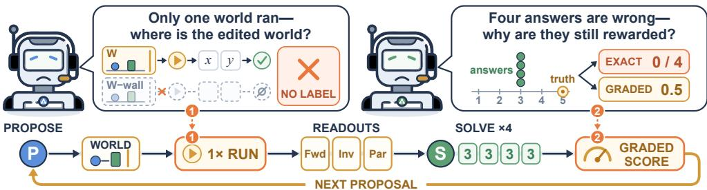  
Figure 1: Naive self-play baseline for physical reasoning. A Proposer generates a world program; the executor simulates a single trajectory and derives Forward, Inverse, and Parameter tasks. Graded continuous proximity can reward a Solver that remains fundamentally incorrect, broadcasting distorted learnability signals back to the Proposer.

Given that grounded, intervention-level annotations are exceptionally scarce in physical reasoning, transferring this self-play paradigm to multimodal physics by substituting a physics simulator for the symbolic interpreter appears to be a natural solution. In a direct physical transfer, a shared Proposer–Solver policy interacts with a rigid-body simulator. For each proposed world W, the executor simulates one factual trajectory τ under seed $\xi ,$ extracts an observation x alongside a simulator-derived target y, and scores the Solver’s prediction $\hat { y }$ via a graded similarity metric s:

$$
\tau = \Phi _ { \xi } ( \mathcal { W } ) , \qquad ( x , y ) = \mathrm { r e a d o u t } ( \tau ) , \qquad r _ { \mathrm { n a i v e } } = s ( \hat { y } , y ) .\tag{1}
$$

Here $\Phi _ { \xi }$ denotes deterministic simulation and s assigns partial credit based on continuous numerical or spatial proximity, intended to prevent sparse, uninformative all-zero rewards early in training. While this transfer ostensibly preserves both autonomous task generation and verifiable supervision, empirical auditing reveals two fatal structural failure modes.

Failure Mode 1: Single-trajectory execution cannot ground causal interventions. Physical reasoning distinctively demands understanding how scenes respond to counterfactual interventions— outcomes that never occurred in the observed trajectory (Pearl, 2009). However, evaluating a single trajectory τ restricts the task space strictly to passive observational readouts (e.g., predicting an object’s future position or initial velocity). In our audit of the naive transfer baseline, exactly zero intervention or counterfactual tasks were synthesized across 100 training rounds, causing PhysBench dynamics accuracy to stagnate and reasoning performance to degrade (Section 4.4). This limitation is structural: causal ground truth cannot be inferred from a single trajectory without paired, counterfactual branch executions. Neither scaling model capacity nor expanding rollout volume can produce verified labels that lie beyond the verification interface itself.

Failure Mode 2: Graded proximity rewards induce learnability illusions. In code and math, execution verification yields a rigorous binary correctness signal. In continuous physics, however, substituting exact match with graded proximity s fundamentally distorts reinforcement signals. Because s scores relative closeness rather than true task resolution, clusters of uniformly incorrect rollouts (e.g., predicting stationary velocities or median parameters) yield intermediate rewards. These reward distributions artificially inflate the empirical learnability metric $r _ { \mathrm { l e a r n } } = 1 - 2 | \bar { a } - 0 . 5 |$ misleading the curriculum into classifying failed, trivial tasks as productive learning boundaries. Consequently, graded reward steadily increases during naive training while exact physical correctness remains near zero (Section 4.4, Table 4).

These failure modes establish that continuous physics cannot be treated as a trivial drop-in replacement for discrete code interpreters. Autonomous physical reasoning requires two non-negotiable architectural guarantees:

1. Branch-level verification: The executor must actively execute paired, counterfactual interventions (divergent simulation branches) under identical initial conditions to establish objective causal ground truth.

2. Discrete answer binding: Derived physical tasks must map continuous trajectories into discrete, answer-bound problems, ensuring that Solver success reflects exact correctness rather than deceptive proximity.

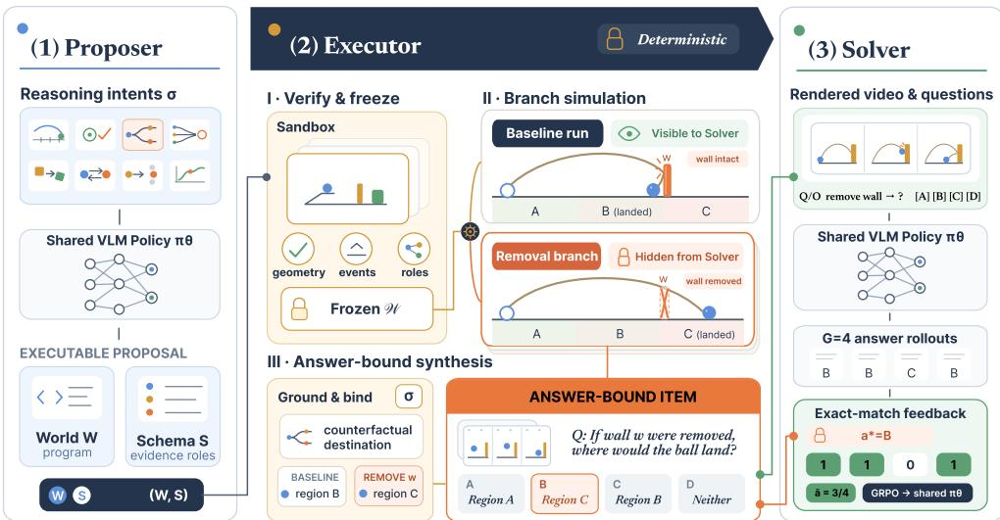  
Figure 2: Overview of PhysEvolve. A shared VLM proposes an executable world program and evidence schema. A fixed deterministic executor validates and freezes the scene, simulates matched baseline and body-elided branches when required, and synthesizes an answer-bound item. Exact discrete Solver feedback updates the shared policy and the curriculum.

## 3.2 FRAMEWORK OVERVIEW

Guided by these requirements, we introduce PhysEvolve (Figure 2). At each round, a Task-Conditioned Proposer transforms a sampled reasoning intent into an executable candidate world. Through Intervention-Grounded Task Synthesis, a fixed executor establishes factual and counterfactual outcomes via deterministic simulation and synthesizes discrete, answer-bound multiple-choice questions. Finally, Co-Evolution Training translates exact Solver correctness into joint updates for the shared policy and an adaptive curriculum.

Let $\pi _ { \theta }$ denote the shared vision–language policy. The identical parameters serve as Proposer $\pi _ { \theta } ^ { \mathrm { P } }$ and Solver $\pi _ { \theta } ^ { \mathrm { S } }$ . The Proposer controls the exploration of executable physical environments, while the Solver receives only rendered baseline video observations and the resulting question and options. Crucially, a strict information boundary is enforced: the fixed physics executor alone accesses internal simulator states, computes counterfactual branches, and binds the correct answer. This boundary enables the policy to actively shape its own training distribution without ever setting it own training labels, eliminating label contamination and reward hacking.

## 3.3 TASK-CONDITIONED PROPOSER

The Proposer receives a reasoning intent $\sigma ,$ which specifies the target physical relation to probe and the evidence required to make that relation uniquely decidable. Grounded in classical cognitive physics (Battaglia et al., 2013; Spelke, 1990), we instantiate simulation across three fundamental Newtonian paradigms: (1) projectile motion and parabolic dynamics (Throwing), (2) impulsemomentum transfer and kinematic collisions (Collision), and (3) continuous kinematics and contact interactions (Motion), spanning eight active reasoning intents.

Conditioned on σ, the Proposer samples a tuple $( { \mathcal { W } } , S ) \sim \pi _ { \theta } ^ { \mathrm { P } } ( \cdot \mid \sigma )$ : an executable world program W and an evidence schema S. The world program is authored in PhysDSL (a domain-specific Python API over rigid-body simulation) specifying 3D geometry, material properties (mass, restitution, friction), initial states, kinematic constraints, and rendering viewpoints. The evidence schema $s$ declares the semantic roles of key entities (e.g., query projectiles, barrier obstacles, potential collision targets) required by intent $\sigma .$ . The executor validates these role declarations against the realized simulation, rejecting any proposal whose physical dynamics cannot support the requested reasoning intent. Complete specifications of PhysDSL and evidence schemas are provided in Appendices A and A.2.

## 3.4 INTERVENTION-GROUNDED TASK SYNTHESIS

A candidate pair (W, S) represents only a potential reasoning opportunity; simulation execution must establish its physical semantics before it can constitute a valid training task. The executor admits an item only when execution recovers unambiguous physical evidence that determines a unique answer. This contract is executed across three sequential stages:

World verification and freezing. The executor parses and executes the world program in a sandboxed simulator, resolving evidence-schema roles against simulated rigid bodies. It admits only worlds exhibiting valid geometry, non-trivial physical events, and the causal prerequisites of intent σ. A bounded deterministic repair stage corrects minor placement or boundary syntax violations without introducing new bodies or joints. Once admitted, the world definition is strictlyfrozen into an immutable scene definition. Freezing guarantees that all subsequent intervention branches share identical initial geometry, material properties, and simulation seeds, ensuring that divergent outcomes are strictly attributable to declared interventions.

Branch elision. For interventional reasoning intents, the executor constructs a finite set of body removals $B _ { \sigma }$ . For each $\boldsymbol { B } \in \boldsymbol { B } _ { \sigma }$ , it elides those bodies and their dependent constraints from the frozen world, yielding the matched execution pair:

$$
\bigl ( \tau _ { \varnothing } , \tau _ { B } \bigr ) = \bigl ( \Phi _ { \xi } ( \mathcal { W } ) , \Phi _ { \xi } ( \mathcal { W } \setminus B ) \bigr ) , \qquad B \in \mathcal { B } _ { \sigma } .\tag{2}
$$

Both trajectories share the identical simulator state, random seed $\xi ,$ and time horizon. The Solver observes only a video rendering of the factual trajectory $\tau _ { \emptyset }$ , while the executor retains the divergent branch trajectories $\{ \tau _ { B } \}$ as objective ground truth.

Answer-bound question synthesis. Each reasoning intent defines a discrete readout function, feasibility margins, and natural language templates. The executor applies the readout across baseline and branch trajectories. An item is suppressed if readouts are non-unique, infeasible, or fall within sensitive physical margin thresholds $( \mathrm { e . g . }$ ., velocity differences below 0.30 m/s). Otherwise, the executor determines the unique factual or counterfactual outcome, binds it to ground-truth option index $a ^ { \star } \in \{ A , B , C , D \}$ , and renders the final visual question and distractors. For inverse intervention tasks (e.g., “Which wall should be removed to make the ball land in the target $\mathrm { p i t } ? ? )$ , the executor runs all candidate elisions (remove $\mathbf { A } ,$ , remove $\mathbf { B } ,$ remove both) and validates whether exactly one branch achieves the goal; “none of the above” is selected only if no branch reaches the target. Detailed contracts, margin tests, and binding rules are documented in Appendix C.

## 3.5 CO-EVOLUTION TRAINING AND ADAPTIVE CURRICULUM

The synthesized answer-bound items close the self-play loop by providing exact, discrete supervision to both policy roles.

Exact solver supervision. Each retained item defines a group of G Solver rollouts from policy $\pi _ { \theta } ^ { \mathrm { S } }$ Given the executor-bound label $a ^ { \star }$ and predicted options $\{ \hat { a } _ { i } \} _ { i = 1 } ^ { G }$ , the binary Solver reward and empirical item success rate are:

$$
r _ { i } ^ { \mathrm { s o l v e } } = \mathbf { 1 } [ \hat { a } _ { i } = a ^ { \star } ] , \qquad \bar { a } = \frac { 1 } { G } \sum _ { i = 1 } ^ { G } r _ { i } ^ { \mathrm { s o l v e } } .\tag{3}
$$

In contrast to the continuous proximity score s in Equation $( 1 ) , r _ { i } ^ { \mathrm { s o l v e } }$ provides unambiguous binary verification immune to proximity-induced reward hacking.

Hierarchical co-evolution. Co-evolution coordinates task selection and world exploration across two complementary levels:

• Macro-level intent curriculum: Across reasoning intents, the rolling Solver accuracy $\bar { a } _ { f }$ for each task family $f$ governs adaptive intent sampling. After an 8-round cold start, intent sampling weights follow $w _ { f } = \rho _ { f }$ max $\cdot ( 0 . 0 5 , 4 \bar { a } _ { f } ( 1 - \bar { a } _ { f } ) )$ , where $\rho _ { f }$ denotes structural family priors. This formulation concentrates training on intents situated at the frontier of the model’s evolving competence (where $4 \bar { a } _ { f } ( 1 - \bar { a } _ { f } )$ peaks near $\bar { a } _ { f } = 0 . 5 )$ . A family-difficulty multiplier further modulates Proposer credit according to rolling intent challenge.

• Micro-level world exploration: Conditioned on the sampled intent $\sigma _ { : }$ , the Proposer explores the space of valid, physically rich world programs. Proposer rewards reward successful compilation, dynamic collision feasibility, and structural edit-distance diversity I, penalized by anti-copy and saturation controls (Appendix E).

Shared-policy GRPO optimization. Both Proposer and Solver roles are optimized jointly via Group Relative Policy Optimization (GRPO) on the shared parameters πθ, regularized against a frozen reference policy $\pi _ { \mathrm { r e f } }$ . Proposer groups share a sampled intent σ, while Solver groups share an executor-rendered item. Joint optimization ensures that while the Solver masters causal physical deduction, the Proposer continuously adapts to author executable environments that remain informative and verifiable (Appendix F).

## 4 EXPERIMENTS

## 4.1 EXPERIMENTAL SETUP

Research questions. We design our empirical evaluation around four central questions: (Q1) Targeted capability transfer: Does PhysEvolve yield targeted improvements on the specific physical capabilities it simulates during training? (Q2) Out-of-distribution transfer: Do causal principles learned in synthetic rigid-body environments generalize to unseen complex media (fluid, cloth, soft bodies) and real-world video? (Q3) Architectural necessity: How critically do paired branch simulation and joint Proposer–Solver optimization contribute to performance? (Q4) Failure anatomy: What exact supervisory signals are forfeited by relying on single-trajectory execution and continuous proximity rewards?

Training configuration. All experimental variants are initialized from the open-weight base model Qwen3-VL-8B-Instruct (Bai et al., 2025a). Training is executed in a single run for 100 steps using one-epoch GRPO with a learning rate of 10−6. At each step, the curriculum samples $N \ = \ 4$ reasoning intents and generates G = 4 world program proposals per intent, capping retention at 32 active Solver groups with 4 rollouts per group. The complete hyperparameters and training loop are detailed in Appendix F and Algorithm 2.

Benchmarks and evaluation protocols. We evaluate across three rigorous physical reasoning benchmarks: (1) PhysBench (Chow et al., 2025) covers broad static and dynamic physical QA over 9,802 items; (2) ContPhy (Zheng et al., 2024) benchmarks counterfactual and goal-directed physical reasoning across 1,950 scenarios involving complex continuous dynamics (cloth, fluid, rope, and soft bodies); and (3) CausalPhys (Tang et al., 2026) assesses physical anticipation and intervention in 3,057 real-world video scenarios. All evaluated models share identical prompts, visual frame sampling, greedy decoding, and official evaluation protocols (Appendix F.3).

Baselines and comparative context. Our primary, strictly matched comparison comprises: (1) the base Qwen3-VL-8B-Instruct model; (2) Naive self-play, which replicates single-trajectory execution with continuous graded proximity rewards; and (3) PhysEvolve. To contextualize performance across model scales, we also report unaligned results for prominent open-weight models: InternVL2.5-8B (Chen et al., 2024), Llama-3.2-11B-Vision (Meta, 2024), Pixtral-12B (Agrawal et al., 2024), Qwen2.5-VL-7B (Bai et al., 2025b), and the scaled Qwen3-VL-32B (Bai et al., 2025a).

## 4.2 MAIN RESULTS: TARGETED AND EXTERNAL TRANSFER

Table 1 presents overall and capability-specific accuracies across the three benchmarks, separating matched 8B configurations from open-weight context models.

Q1: Targeted capability transfer on PhysBench. Within the matched 8B evaluation, PhysEvolve achieves substantial gains on tasks directly aligned with simulated Newtonian paradigms, improving Throwing by 8.78 percentage points, Judgment by 5.08, and Motion by 1.74. In stark contrast, Naive self-play yields negligible or negative differences on these categories (−0.24 on Throwing, +0.26 on Judgment). Crucially, PhysEvolve improves overall accuracy (+0.55) without catastrophic forgetting of general visual capabilities: performance remains close to or above the base model across most non-target partitions, including static relations and object identification (Appendix G, Table 16).

Table 1: Accuracy (%) across the three physical reasoning benchmarks. The upper block provides contextual reference models; bold text indicates the best performance within the strictly matched 8B comparison block.
<table><tr><td></td><td colspan="4">PhysBench</td><td colspan="3">CausalPhys</td><td colspan="3">ContPhy</td></tr><tr><td>Model</td><td>Ovr.</td><td>Throw.</td><td>Motion</td><td>Judg.</td><td>Ovr.</td><td>Antic.</td><td>Interv.</td><td>Ovr.</td><td>CF-Rm.</td><td>Goal-Pit</td></tr><tr><td colspan="9">Contextual open-weight references</td></tr><tr><td>InternVL2.5-8B (Chen et al., 2024)</td><td>43.8</td><td>40.0</td><td>27.7</td><td>32.7</td><td>50.2</td><td>51.5</td><td>42.4</td><td>31.4</td><td>48.4</td><td>23.3</td></tr><tr><td>Llama-3.2-11B-Vision (Meta, 2024)</td><td>38.7</td><td>36.6</td><td>27.2</td><td>30.8</td><td>44.2</td><td>44.1</td><td>40.1</td><td>20.7</td><td>0.0</td><td>20.0</td></tr><tr><td>Pixtral-12B (Agrawal et al., 2024)</td><td>46.9 49.4</td><td>41.2</td><td>35.2</td><td>31.0</td><td>50.2</td><td>53.0</td><td>44.5</td><td>21.5</td><td>40.2</td><td>13.3</td></tr><tr><td>Qwen2.5-VL-7B (Bai et al., 2025b)</td><td>60.9</td><td>44.4 47.1</td><td>50.6</td><td>33.1</td><td>52.6</td><td>56.5</td><td>45.7</td><td>25.9</td><td>11.5</td><td>24.4</td></tr><tr><td>Qwen3-VL-32B (Bai et al., 2025a)</td><td></td><td></td><td>83.5</td><td>44.3</td><td>58.9</td><td>61.9</td><td>52.9</td><td>41.0</td><td>45.9</td><td>26.7</td></tr><tr><td colspan="9">Matched Qwen3-VL-8B comparison</td></tr><tr><td>Qwen3-VL-8B (base) (Bai et al., 2025a)</td><td>52.9</td><td>46.1 45.9</td><td>54.7</td><td>34.9</td><td>53.9</td><td>55.9</td><td>42.8</td><td>37.1</td><td>44.3</td><td>20.0</td></tr><tr><td>Naive self-play</td><td>52.4</td><td></td><td>55.5</td><td>35.2</td><td>55.8</td><td>57.6</td><td>45.9</td><td>37.4</td><td>43.4</td><td>25.6</td></tr><tr><td>PhysEvolve (ours)</td><td>53.5 (+0.6) 54.9 (+8.8) 56.5 (+1.7) 40.0 (+5.1) 54.5 (+0.6) 58.4(+2.5) 45.0 (+2.3) 39.5 (+2.5) 51.6 (+7.4) 44.4(+24.4)</td><td></td><td></td><td></td><td></td><td></td><td></td><td></td><td></td><td></td></tr></table>

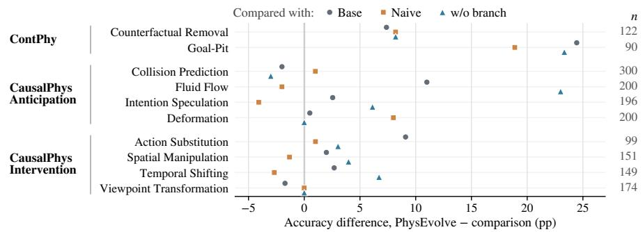  
Figure 3: Task-level transfer across matched comparisons. Markers show accuracy differences between PhysEvolve and each comparison model on ContPhy (Counterfactual Removal, Goal-Pit) and CausalPhys subcategories. Positive values favor PhysEvolve. Sample counts appear at right; see Table 19 for complete accuracies.

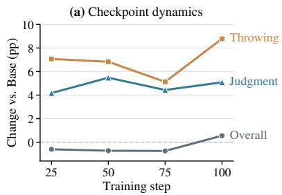

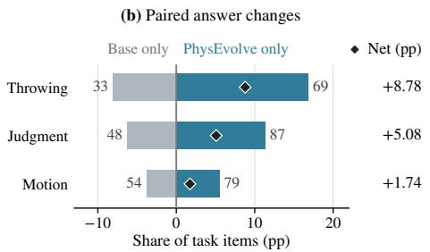  
Figure 4: PhysBench training dynamics and paired correctness analysis. Left: accuracy gains over Base across scheduled training checkpoints. Right: item-level paired analysis at the terminal checkpoint, separating questions answered correctly only by PhysEvolve from those answered correctly only by Base. Diamonds indicate net correct item gains; see Table 20 for complete counts.

Q2: Out-of-distribution transfer to complex media and real video. The most compelling evidence of physical generalization emerges on ContPhy: despite being trained exclusively on synthetic rigid-body simulations, PhysEvolve demonstrates remarkable zero-shot transfer to continuous media (cloth, fluid, rope, and soft bodies). On Counterfactual Removal, accuracy increases by 7.38 points over Base (51.64% vs. 44.26%), while on Goal-Pit, accuracy surges by 24.44 points (44.44% vs. 20.00%, surpassing even Qwen3-VL-32B’s 26.7%). On CausalPhys real-world videos, PhysEvolve similarly yields consistent gains on Anticipation (+2.46) and Intervention (+2.27). Because the non-rigid dynamics and visual textures of ContPhy are completely absent from the training templates, these gains confirm that PhysEvolve internalizes an abstract intervention operator—the ability to deduce how physical states diverge under structural removal—rather than memorizing superficial simulation artifacts.

Table 2: Ablation of the complete branch-enabled training path. Evaluating endpoint accuracy (%) under identical protocols when branch execution and dependent Counterfactual/Inverse families are deactivated.
<table><tr><td>Configuration</td><td colspan="2">Training Path</td><td colspan="2">Realized Exposure</td><td colspan="2">CausalPhys</td><td colspan="3">ContPhy</td></tr><tr><td></td><td>Branch Sim.</td><td>CF/Inv</td><td>Groups</td><td>Rollouts</td><td>Ovr.</td><td>Interv.</td><td>Ovr.</td><td>CF-Rm.</td><td>Goal-Pit</td></tr><tr><td>PhysEvolve</td><td>On</td><td>On</td><td>2,167</td><td>8,668</td><td>54.50</td><td>45.03</td><td>39.54</td><td>51.64</td><td>44.44</td></tr><tr><td>w/o branch-enabled path</td><td>Off</td><td>Off</td><td>1,990</td><td>7,960</td><td>51.42</td><td>41.71</td><td>37.28</td><td>43.44</td><td>21.11</td></tr><tr><td>Difference</td><td>一</td><td>一</td><td>+177</td><td>+708</td><td>+3.07</td><td>+3.32</td><td>+2.26</td><td>+8.20</td><td>+23.33</td></tr></table>

Table 3: Ablation of joint Proposer–Solver optimization. Disabling Proposer parameter updates while updating only Solver parameters collapses policy distribution and answer parse rates (%).  
Table 4: Training-time audit of the single-trajectory naive verifier across 100 rounds.
<table><tr><td></td><td colspan="2">Training updates</td><td colspan="2">CausalPhys</td><td colspan="2">ContPhy</td></tr><tr><td>Configuration</td><td>Proposer</td><td>Solver</td><td>ACC</td><td>Parse rate</td><td>ACC</td><td>Parse rate</td></tr><tr><td>PhysEvolve</td><td>√</td><td>√</td><td>54.50</td><td>97.84</td><td>39.54</td><td>100.00</td></tr><tr><td>w/o Proposer-role updates</td><td>一</td><td>√</td><td>15.01</td><td>26.07</td><td>17.85</td><td>99.90</td></tr><tr><td>∆</td><td>一</td><td>一</td><td>+39.48</td><td>+71.77</td><td>+21.69</td><td>+0.10</td></tr></table>

<table><tr><td colspan="2">Prediction Mean graded</td><td rowspan="2">Exact accuracy</td><td rowspan="2">Zero-exact rounds</td></tr><tr><td>task</td><td>reward</td></tr><tr><td>Forward</td><td>0.373</td><td>0.00%</td><td>100/100</td></tr><tr><td>Inverse</td><td>0.664</td><td>6.63%</td><td>75/100</td></tr><tr><td>Parameter</td><td>0.787</td><td>5.44%</td><td>83/100</td></tr></table>

Fine-grained task transfer and checkpoint dynamics. Figure 3 breaks down transfer across fine-grained causal subcategories. Relative to the Base model, PhysEvolve improves Fluid Flow by 11.00 points and Action Substitution by 9.09 points, significantly outperforming the branch-disabled control (by 23.00 points on Fluid Flow). Furthermore, longitudinal checkpoint analysis (Figure 4, left) shows consistent gains over Base on Throwing and Judgment throughout self-play. At the terminal checkpoint (Figure 4, right), item-level paired auditing reveals that PhysEvolve correctly answers 69 Throwing items that Base misses against only 33 reversals (a net gain of 36 items), and net gains of 39 and 25 items on Judgment and Motion, confirming genuine competence acquisition.

## 4.3 ABLATION STUDIES

Q3: Necessity of branch-enabled synthesis and joint co-evolution. We investigate the architectural components of PhysEvolve via two targeted endpoint ablations:

Essentiality of paired branch execution. In Table 2, removing branch simulation and its dependent Counterfactual/Inverse task families sharply degrades downstream causal transfer. The performance drop is especially drastic on ContPhy Counterfactual Removal (−8.20 points) and Goal-Pit (−23.33 points), dropping performance back to the un-finetuned Base level. This ablation empirically confirms that paired branch elision is the indispensable engine for acquiring causal physical reasoning.

Criticality of joint Proposer–Solver optimization. In Table 3, we freeze Proposer role updates, training the shared policy exclusively via Solver rollouts. Without co-evolution, the policy undergoes severe representational collapse: accuracy drops precipitously to 15.01% on CausalPhys and 17.85% on ContPhy, accompanied by a collapse in answer parse rate (falling to 26.07% on CausalPhys and 0% in later steps). Updating the Proposer keeps world generation diverse and physically non-trivial, preventing the Solver from over-adapting to a degenerate data stream.

## 4.4 AUDITING THE SINGLE-TRAJECTORY INTERFACE

Q4: What causes naive physical self-play to collapse? We conduct an empirical audit of the single-trajectory verifier and task stream in Naive self-play to validate the theoretical pitfalls identified in Section 3.1.

Divergence between graded reward and exact correctness. Table 4 exposes a striking pathology: continuous proximity rewards s consistently provide deceptive reinforcement. For Forward prediction, rollouts achieve a high mean graded reward of 0.373 despite zero exact matches across all 100 rounds. For Inverse and Parameter tasks, mean rewards reach 0.664 and 0.787 while exact accuracy remains below 7%. An error audit reveals severe mode collapse: the policy learns to output stationary initial velocities (746 instances) or the median rung of the parameter ladder (145 instances), exploiting the graded metric to reap partial credit without solving the physical events.

Task space starvation. Over 100 training rounds, the naive single-trajectory verifier generated zero intervention questions and zero counterfactual tasks. Constrained to an un-intervened factual trajectory τ, the system is incapable of synthesizing causal supervision. Consequently, downstream PhysBench dynamics accuracy stagnates (Table 1).

## 5 CONCLUSION

PhysEvolve demonstrates that verifier-grounded self-evolution extends to continuous multimodal physical reasoning by anchoring self-play in executable 3D world programs and paired counterfactual branches. Converting continuous physics into discrete verifier contracts eliminates the dual traps of continuous reward hacking and causal blindness inherent in naive physical self-play. Strong targeted gains on Newtonian dynamics and zero-shot transfer to unseen continuous media and real-world video show that counterfactual execution provides a scalable foundation for generalizable physical intelligence in vision-language models, entirely without any human-annotated physical reasoning supervision during self-play training. Each training target is bound to a verified physical outcome.

## REFERENCES

Pravesh Agrawal, Szymon Antoniak, Emma Bou Hanna, Baptiste Bout, Devendra Chaplot, Jessica Chudnovsky, Diogo Costa, Baudouin De Monicault, Saurabh Garg, Theophile Gervet, Soham Ghosh, Amelie H´ eliou, Paul Jacob, Albert Q. Jiang, Kartik Khandelwal, Timoth´ ee Lacroix,´ Guillaume Lample, Diego Las Casas, Thibaut Lavril, Teven Le Scao, Andy Lo, William Mar shall, Louis Martin, Arthur Mensch, Pavankumar Muddireddy, Valera Nemychnikova, Marie Pellat, Patrick Von Platen, Nikhil Raghuraman, Baptiste Roziere, Alexandre Sablayrolles, Lucile\` Saulnier, Romain Sauvestre, Wendy Shang, Roman Soletskyi, Lawrence Stewart, Pierre Stock, Joachim Studnia, Sandeep Subramanian, Sagar Vaze, Thomas Wang, and Sophia Yang. Pixtral 12B. arXiv preprint arXiv:2410.07073, 2024.

Tayfun Ates, M. Atesoglu, Cagatay Yigit, Ilker Kesen, Mert Kobas, Erkut Erdem, Aykut Erdem, Tilbe Goksun, and Deniz Yuret. CRAFT: A benchmark for causal reasoning about forces and interactions. In Findings of the Association for Computational Linguistics: ACL 2022, pages 2602–2627, 2022. doi: 10.18653/v1/2022.findings-acl.205.

Shuai Bai, Yuxuan Cai, Ruizhe Chen, Keqin Chen, Xionghui Chen, Zesen Cheng, Lianghao Deng, Wei Ding, Chang Gao, Chunjiang Ge, et al. Qwen3-VL technical report. arXiv preprint arXiv:2511.21631, 2025a. URL https://arxiv.org/abs/2511.21631.

Shuai Bai, Keqin Chen, Xuejing Liu, Jialin Wang, Wenbin Ge, Sibo Song, Kai Dang, Peng Wang, Shijie Wang, Jun Tang, et al. Qwen2.5-VL technical report. arXiv preprint arXiv:2502.13923, 2025b. URL https://arxiv.org/abs/2502.13923.

Fabien Baradel, Natalia Neverova, Julien Mille, Greg Mori, and Christian Wolf. CoPhy: Counterfactual learning of physical dynamics. In International Conference on Learning Representations (ICLR), 2020. arXiv:1909.12000.

Peter W. Battaglia, Jessica B. Hamrick, and Joshua B. Tenenbaum. Simulation as an engine of physical scene understanding. Proceedings of the National Academy of Sciences, 110(45):18327– 18332, 2013.

Daniel M. Bear, Elias Wang, Damian Mrowca, Felix J. Binder, Hsiao-Yu Fish Tung, R. T. Pramod, Cameron Holdaway, Sirui Tao, Kevin A. Smith, Fan-Yun Sun, Fei-Fei Li, Nancy Kanwisher, Joshua B. Tenenbaum, Daniel L. K. Yamins, and Judith E. Fan. Physion: Evaluating physical prediction from vision in humans and machines. In Advances in Neural Information Processing Systems (NeurIPS) Datasets and Benchmarks, 2021.

Kevin Black, Noah Brown, Danny Driess, Adnan Esmail, Michael Equi, Chelsea Finn, Niccolo Fusai, Lachy Groom, Karol Hausman, Brian Ichter, Szymon Jakubczak, Tim Jones, Liyiming Ke,

Sergey Levine, Adrian Li-Bell, Mohith Mothukuri, Suraj Nair, Karl Pertsch, Lucy Xiaoyang Shi, James Tanner, Quan Vuong, Anna Walling, Haohuan Wang, and Ury Zhilinsky. π0: A visionlanguage-action flow model for general robot control. arXiv preprint arXiv:2410.24164, 2024.

Yixing Chen, Yiding Wang, Siqi Zhu, Haofei Yu, Tao Feng, Muhan Zhang, Mostofa Patwary, and Jiaxuan You. Multi-agent evolve: LLM self-improve through co-evolution. arXiv preprint arXiv:2510.23595, 2025.

Zhe Chen, Weiyun Wang, Yue Cao, Yangzhou Liu, Zhangwei Gao, Erfei Cui, Jinguo Zhu, Shenglong Ye, Hao Tian, Zhaoyang Liu, et al. Expanding performance boundaries of open-source multimodal models with model, data, and test-time scaling. arXiv preprint arXiv:2412.05271, 2024.

Zhenfang Chen, Kexin Yi, Yunzhu Li, Mingyu Ding, Antonio Torralba, Joshua B. Tenenbaum, and Chuang Gan. ComPhy: Compositional physical reasoning of objects and events from videos. In International Conference on Learning Representations (ICLR), 2022. arXiv:2205.01089.

Wei Chow, Jiageng Mao, Boyi Li, Daniel Seita, Vitor Guizilini, and Yue Wang. PhysBench: Benchmarking and enhancing vision-language models for physical world understanding. In International Conference on Learning Representations (ICLR), 2025. arXiv:2501.16411.

DeepSeek-AI. Deepseek-R1: Incentivizing reasoning capability in LLMs via reinforcement learning. arXiv preprint arXiv:2501.12948, 2025.

Michael Dennis, Natasha Jaques, Eugene Vinitsky, Alexandre Bayen, Stuart Russell, Andrew Critch, and Sergey Levine. Emergent complexity and zero-shot transfer via unsupervised environment design. In Advances in Neural Information Processing Systems (NeurIPS), 2020. arXiv:2012.02096.

Kaixuan Fan, Kaituo Feng, Tianshuo Peng, Yilei Jiang, Manyuan Zhang, Jun Wang, and Xiangyu Yue. EviRover: Reinforcing agentic perception beyond a glance. arXiv preprint arXiv:2609.40230, 2026.

Kaituo Feng, Manyuan Zhang, Shuang Chen, Yunlong Lin, Kaixuan Fan, Yilei Jiang, Hongyu Li, Dian Zheng, Chenyang Wang, and Xiangyu Yue. Gen-Searcher: Reinforcing agentic search for image generation. In Advances in Neural Information Processing Systems (NeurIPS), 2026a. arXiv:2603.28767.

Kaituo Feng, Manyuan Zhang, Hongyu Li, Kaixuan Fan, Shuang Chen, Yilei Jiang, Dian Zheng, Peiwen Sun, Yiyuan Zhang, Haoze Sun, Yan Feng, Peng Pei, Xunliang Cai, and Xiangyu Yue. OneThinker: All-in-one reasoning model for image and video. In Proceedings ofthe IEEE/CVF Conference on Computer Vision and Pattern Recognition (CVPR), 2026b. arXiv:2512.03043.

Huan-ang Gao, Jiayi Geng, Wenyue Hua, Mengkang Hu, Xinzhe Juan, Hongzhang Liu, Shilong Liu, Jiahao Qiu, Xuan Qi, Qihan Ren, Yiran Wu, Hongru Wang, Han Xiao, Yuhang Zhou, Shaokun Zhang, Jiayi Zhang, Jinyu Xiang, Yixiong Fang, Qiwen Zhao, Dongrui Liu, Cheng Qian, Zhenhailong Wang, Minda Hu, Huazheng Wang, Qingyun Wu, Heng Ji, and Mengdi Wang. A survey of self-evolving agents: What, when, how, and where to evolve on the path to artificial super intelligence. Transactions on Machine Learning Research, 2026. arXiv:2507.21046.

C¸ aglar G˘ ulc¸ehre, Tom Le Paine, Srivatsan Srinivasan, Ksenia Konyushkova, Lotte Weerts, Abhishek¨ Sharma, Aditya Siddhant, Alex Ahern, Miaosen Wang, Chenjie Gu, Wolfgang Macherey, Arnaud Doucet, Orhan Firat, and Nando de Freitas. Reinforced self-training (ReST) for language modeling. arXiv preprint arXiv:2308.08998, 2023.

Yicheng He, Chengsong Huang, Zongxia Li, Jiaxin Huang, and Yonghui Yang. VisPlay: Selfevolving vision-language models from images. arXiv preprint arXiv:2511.15661, 2025.

Chengsong Huang, Wenhao Yu, Xiaoyang Wang, Hongming Zhang, Zongxia Li, Ruosen Li, Jiaxin Huang, Haitao Mi, and Dong Yu. R-Zero: Self-evolving reasoning LLM from zero data. arXiv preprint arXiv:2508.05004, 2025.

Yilei Jiang, Jinyuan Hu, Qinyuan Xiao, Yaozhi Zheng, Ruichuan Ma, Kaituo Feng, Jiaming Han, Tianshuo Peng, Kaixuan Fan, et al. OpenGame: Open agentic coding for games. arXiv preprint arXiv:2604.18394, 2026a.

Yilei Jiang, Yaozhi Zheng, Yuxuan Wan, Jiaming Han, Qunzhong Wang, Michael R. Lyu, and Xiangyu Yue. ScreenCoder: Advancing visual-to-code generation for front-end automation via modular multimodal agents. In Proceedings of the 2026 Conference on Empirical Methods in Natural Language Processing (EMNLP), 2026b. arXiv:2507.22827.

Zhe Jiao, Yu Cheng, Yilei Jiang, Kaituo Feng, Rong Huang, Tao Jiang, Junhao Tian, Qunzhong Wang, et al. SearchEyes: Towards frontier multimodal deep search intelligence via search world simulation. arXiv preprint arXiv:2607.05943, 2026.

Nathan Lambert, Jacob Morrison, Valentina Pyatkin, Shengyi Huang, Hamish Ivison, Faeze Brahman, Lester James V. Miranda, Alisa Liu, Nouha Dziri, Xinxi Lyu, Yuling Gu, Saumya Malik, Victoria Graf, Jena D. Hwang, Jiangjiang Yang, Ronan Le Bras, Oyvind Tafjord, Christopher Wilhelm, Luca Soldaini, Noah A. Smith, Yizhong Wang, Pradeep Dasigi, and Hanna Hajishirzi. Tulu¨ 3: Pushing frontiers in open language model post-training. arXiv preprint arXiv:2411.15124, 2024.

Dingming Li, Yingxiu Zhao, Xinrui Cheng, Kangheng Lin, Hongbo Peng, Hongxing Li, Zixuan Wang, Yuhong Dai, Haodong Li, Jia Wang, Yukang Shi, Liang Zhao, Jianjian Sun, Zheng Ge, Xiangyu Zhang, Weiming Lu, Jun Xiao, Yueting Zhuang, and Yongliang Shen. SpatialEvo: Self-evolving spatial intelligence via deterministic geometric environments. arXiv preprint arXiv:2604.14144, 2026.

William Liang, Sam Wang, Hung-Ju Wang, Osbert Bastani, Dinesh Jayaraman, and Yecheng Jason Ma. Eurekaverse: Environment curriculum generation via large language models. In Conference on Robot Learning (CoRL), 2024. arXiv:2411.01775.

Bo Liu, Leon Guertler, Simon Yu, Zichen Liu, Penghui Qi, Daniel Balcells, Mickel Liu, Cheston Tan, Weiyan Shi, Min Lin, Wee Sun Lee, and Natasha Jaques. SPIRAL: Self-play on zero-sum games incentivizes reasoning via multi-agent multi-turn reinforcement learning. arXiv preprint arXiv:2506.24119, 2025. URL https://arxiv.org/abs/2506.24119.

Meta. Llama 3.2: Revolutionizing edge AI and vision with open, customizable models. https://ai.meta.com/blog/ llama-3-2-connect-2024-vision-edge-mobile-devices/, 2024.

Jack Parker-Holder, Minqi Jiang, Michael Dennis, Mikayel Samvelyan, Jakob Foerster, Edward Grefenstette, and Tim Rocktaschel. Evolving curricula with regret-based environment de-¨ sign. In Proceedings of the 39th International Conference on Machine Learning (ICML), 2022. arXiv:2203.01302.

Maitreya Patel, Tejas Gokhale, Chitta Baral, and Yezhou Yang. CRIPP-VQA: Counterfactual reasoning about implicit physical properties via video question answering. In Proceedings of the 2022 Conference on Empirical Methods in Natural Language Processing (EMNLP), pages 9856– 9870, 2022.

Judea Pearl. Causality: Models, Reasoning, and Inference. Cambridge University Press, 2nd edition, 2009.

Mihir Prabhudesai, Aryan Satpathy, Yangmin Li, Zheyang Qin, Nikash Bhardwaj, Amir Zadeh, Chuan Li, Katerina Fragkiadaki, and Deepak Pathak. Solving physics olympiad via reinforcement learning on physics simulators. In International Conference on Machine Learning (ICML), 2026. URL https://sim2reason.github.io/. arXiv:2604.11805.

Ronan Riochet, Mario Ynocente Castro, Mathieu Bernard, Adam Lerer, Rob Fergus, Veronique´ Izard, and Emmanuel Dupoux. IntPhys: A framework and benchmark for visual intuitive physics reasoning. arXiv preprint arXiv:1803.07616, 2018.

Elizabeth S. Spelke. Principles of object perception. Cognitive Science, 14(1):29–56, 1990.

Tianyi Tang, Zhuoyi Lin, Zeyu Feng, Tianyi Ma, Yew-Soon Ong, Ivor Tsang, and Haiyan Yin. Causal scaffolding for physical reasoning: A benchmark for causally-informed physical world understanding in VLMs. arXiv preprint arXiv:2606.05966, 2026.

Leitian Tao, Ilia Kulikov, Swarnadeep Saha, Tianlu Wang, Jing Xu, Sharon Li, Jason E. Weston, and Ping Yu. Hybrid reinforcement: When reward is sparse, it’s better to be dense. In International Conference on Learning Representations (ICLR), 2026. arXiv:2510.07242.

Hsiao-Yu Tung, Mingyu Ding, Zhenfang Chen, Daniel M. Bear, Chuang Gan, Joshua B. Tenenbaum, Daniel L. K. Yamins, Judith E. Fan, and Kevin A. Smith. Physion++: Evaluating physical scene understanding that requires online inference of different physical properties. In Advances in Neural Information Processing Systems (NeurIPS), 2023.

Qinsi Wang, Bo Liu, Tianyi Zhou, Jing Shi, Yueqian Lin, Yiran Chen, Hai Helen Li, Kun Wan, and Wentian Zhao. Vision-Zero: Scalable VLM self-improvement via strategic gamified self-play. arXiv preprint arXiv:2509.25541, 2025.

Qunzhong Wang, Jie Liu, Jiajun Liang, Yilei Jiang, Yuanxing Zhang, Yaozhi Zheng, Xintao Wang, Pengfei Wan, Xiangyu Yue, and Jiaheng Liu. VR-Thinker: Boosting video reward models through thinking-with-image reasoning. In International Conference on Machine Learning (ICML), 2026. arXiv:2510.10518.

Rui Wang, Joel Lehman, Jeff Clune, and Kenneth O. Stanley. Paired open-ended trailblazer (POET): Endlessly generating increasingly complex and diverse learning environments and their solutions. In Proceedings of the Genetic and Evolutionary Computation Conference (GECCO), 2019. arXiv:1901.01753.

Yuxiang Wei, Zhiqing Sun, Emily McMilin, Jonas Gehring, David Zhang, Gabriel Synnaeve, Daniel Fried, Lingming Zhang, and Sida Wang. Toward training superintelligent software agents through self-play SWE-RL. arXiv preprint arXiv:2512.18552, 2025. URL https://arxiv.org/ abs/2512.18552.

Alex Wilf, Pranjal Aggarwal, Bryan Parno, Daniel Fried, Louis-Philippe Morency, Paul Pu Liang, and Sean Welleck. Propose, solve, verify: Self-play through formal verification. In International Conference on Machine Learning (ICML), 2026. arXiv:2512.18160.

Peng Xia, Kaide Zeng, Jiaqi Liu, Can Qin, Fang Wu, Yiyang Zhou, Caiming Xiong, and Huaxiu Yao. Agent0: Unleashing self-evolving agents from zero data via tool-integrated reasoning. arXiv preprint arXiv:2511.16043, 2025.

Kexin Yi, Chuang Gan, Yunzhu Li, Pushmeet Kohli, Jiajun Wu, Antonio Torralba, and Joshua B. Tenenbaum. CLEVRER: Collision events for video representation and reasoning. In International Conference on Learning Representations (ICLR), 2020.

Jiakang Yuan, Tianshuo Peng, Yilei Jiang, Yiting Lu, Renrui Zhang, Kaituo Feng, Chaoyou Fu, Tao Chen, Lei Bai, Bo Zhang, and Xiangyu Yue. MME-Reasoning: A comprehensive benchmark for logical reasoning in MLLMs. In International Conference on Machine Learning (ICML), 2026. arXiv:2505.21327.

Abhay Zala, Jaemin Cho, Han Lin, Jaehong Yoon, and Mohit Bansal. EnvGen: Generating and adapting environments via LLMs for training embodied agents. In Conference on Language Modeling (COLM), 2024. arXiv:2403.12014.

Eric Zelikman, Yuhuai Wu, Jesse Mu, and Noah Goodman. STaR: Bootstrapping reasoning with reasoning. In Advances in Neural Information Processing Systems (NeurIPS), 2022.

Andrew Zhao, Yiran Wu, Yang Yue, Tong Wu, Quentin Xu, Matthieu Lin, Shenzhi Wang, Qingyun Wu, Zilong Zheng, and Gao Huang. Absolute zero: Reinforced self-play reasoning with zero data. In Advances in Neural Information Processing Systems (NeurIPS), 2025. arXiv:2505.03335.

Xuandong Zhao, Zhewei Kang, Aosong Feng, Sergey Levine, and Dawn Song. Learning to reason without external rewards. In International Conference on Learning Representations (ICLR), 2026. arXiv:2505.19590.

Zhicheng Zheng, Xin Yan, Zhenfang Chen, Jingzhou Wang, Qin Zhi Eddie Lim, Joshua B. Tenenbaum, and Chuang Gan. ContPhy: Continuum physical concept learning and reasoning from videos. In Proceedings ofthe 41st International Conference on Machine Learning (ICML), 2024.

Fengzhe Zhou, Jiannan Huang, Jialuo Li, Deva Ramanan, and Humphrey Shi. PAI-Bench: A comprehensive benchmark for physical AI. In Proceedings of the IEEE/CVF Conference on Computer Vision and Pattern Recognition (CVPR), 2026. arXiv:2512.01989.

## A COMPLETE PHYSDSL AND EXECUTABLE WORLD INTERFACE

## A.1 COMPLETE CALLABLE SURFACE

A proposal is a Python module containing build scene(api) and a literal SCENE MANIFEST. Every construction/setter call mutates a builder and returns None; the proposal cannot branch on simulator state. The executor alone calls freeze() to obtain a scene. Table 5 lists the complete public surface used by the current executor, including operations not exercised by every reported world class. Section B instantiates the interface with three auditable golden-world illustrations.

Table 5: Complete PhysDSL callable surface. Arguments are validated when the call is made; freeze() returns the immutable executor input.
<table><tr><td>Capability</td><td>Calls</td><td>Effect</td></tr><tr><td>Geometry</td><td>add_box, add_sphere, add_cylinder, add_capsule, add_plane</td><td>Register fixed or free rigid bodies and visual/material attributes.</td></tr><tr><td>Initial state</td><td>set_velocity, set_rotation</td><td>Set linear/angular velocity or a nor- malized orientation quaternion.</td></tr><tr><td>Constraints</td><td>add_hinge, add_slide, add_spring</td><td>Add one-DOF joints or a damped spatial spring between existing bodies.</td></tr><tr><td>Environment</td><td>set_gravity, set_duration, add_camera</td><td>Set the execution horizon, gravity vector, and look-at camera.</td></tr><tr><td>Finalization</td><td>freeze</td><td>Add default ground/camera if ab- sent and snapshot a SceneDef.</td></tr></table>

Hard validation envelope. Table 6 gives the actual validator bounds. Stage 2 uses continuous levels=True: mass, friction, and restitution remain the submitted real values inside their intervals rather than being snapped to the Stage-1 ladders.

Table 6: PhysDSL construction-time bounds. Intervals are closed unless an inequality is written explicitly.
<table><tr><td>Field</td><td>Enforced contract</td></tr><tr><td>Names</td><td>Pattern  $[ { \sf a - z _ { - } } ] \ [ { \sf a - z } 0 - 9 _ { - } ] \star ;$  one namespace across bodies, joints, springs, and cameras; ground/world/sky reserved (ground is allowed for the plane).</td></tr><tr><td>Body centers and count</td><td>|x|,  $| y | < 1 . 5$  and  $0 ~ < ~ z ~ < ~ 2 . 5$  m; a plane may use z = 0. At least one body after finalization and at most 20 dynamic bodies; fixed scene furniture does not consume the dynamic- body cap.</td></tr><tr><td>Geometric size</td><td>Each non-plane radius/half-size/half-height in [0.01, 1.0] m; each plane half-size is at least 0.01 m and has no API upper cap.</td></tr><tr><td>Material</td><td>Mass [0.01, 100] kg, sliding friction [0, 2], restitution [0, 1], and every RGBA channel [0, 1].</td></tr><tr><td>Initial state</td><td>Each linear and angular velocity component has magnitude at most 20; orientation is a nonzero quaternion and is normalized.</td></tr><tr><td>Joint</td><td>Nonzero axis; optional limits satisfy l &lt; u; parent and child differ; only the parent may be world; one explicit joint per child.</td></tr><tr><td>Spring</td><td>Stiffness [0.1, 104], damping [0, 103], body-local anchor components in [−2, 2] m, and op- tional rest length &gt; 0; at least one endpoint is dynamic and neither endpoint is a plane.</td></tr><tr><td>Environment</td><td>Duration [0.1, 60] s; finite three-vector gravity; camera position and target must differ.</td></tr></table>

## A.2 REPORTED EVIDENCE SCHEMAS

A reasoning intent specifies the semantic relation to probe and the evidence needed to decide it. PhysDSL can express more worlds than the reported run uses; the run enables exactly the three schemas in Table 7, which jointly serve the eight active families in Section C. The executor resolves every declared role against the frozen world before constructing an item.

## B AUDITABLE WORLD-PROGRAM GALLERY

Three human-authored reference worlds illustrate the executable world-program interface: Throwing, Collision, and Motion. We execute the v01 programs with seed 7 in MuJoCo 3.6.0, retaining their colors, materials, and lighting. Initialization images precede the first simulation step; subsequent frames show the accepted world’s execution. Program copies, evidence schemas, accepted scenes, and execution records are stored under paper/assets/world\_program\_demo/. The rendered components are stored separately under paper/figures/world\_program\_demo/.

Table 7: The three SCENE MANIFEST contracts enabled in the reported run. Braces denote a bodyrole mapping, not model-predicted state.
<table><tr><td>World class</td><td>Required role fields</td><td>Served active families</td></tr><tr><td>Throwing</td><td>balls, three or more fixed platforms, two or more re- movable walls, region_kind, and three destination re- terfactual destination; inverse intervention gions derived from platform gaps</td><td>final destination; current-run judgment; coun-</td></tr><tr><td>Collision</td><td>dynamic target; trigger; exactly four dynamic final state; final relation; motion attribution movers;relation_pair={a,b,expected}</td><td></td></tr><tr><td>Motion</td><td>dynamic motion_target; speed_pair={a,b}</td><td>optional motion-state change, including forward, speed-profile, and pairwise surface forms</td></tr></table>

## B.1 THROWING: ONE PROGRAM, FOUR EXECUTABLE INPUTS

The reference program defines three balls, three platforms, four walls, and three destination regions. Figure 5 uses the orange ball (ball b) as the query. Wall A is black left wall; wall B is orange wall. Each branch preserves the retained bodies’ initial conditions and removes the designated walls together with the two non-query balls.

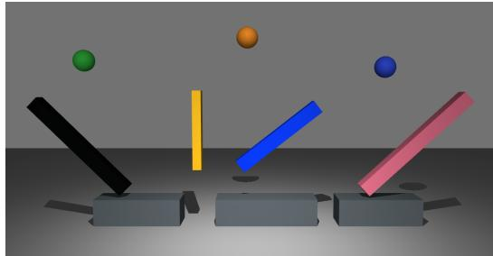  
(a) Baseline

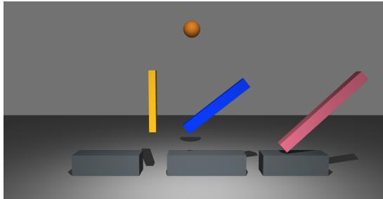  
(b) Remove A

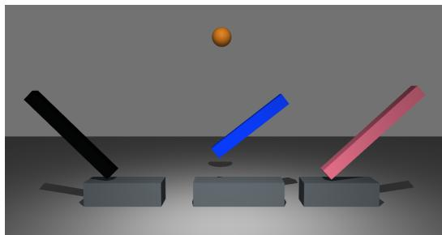  
(c) Remove B

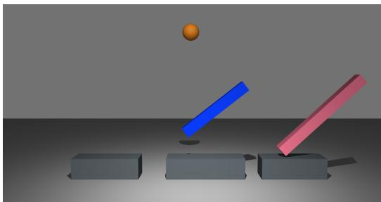  
(d) Remove A+B  
Figure 5: Throwing reference world and executable interventions. The frozen baseline and three altered inputs share the same camera and initial conditions for retained bodies. Each altered input removes the designated wall set and the non-query balls. The executor runs these inputs separately to obtain the region readouts used for question and answer construction.

The orange ball settles in the left pit in the baseline and in the middle pit when wall A and the other balls are removed. This executed difference supplies the counterfactual answer. The four evidence objects in Table 8 also support inverse questions by comparing which interventions reach a requested destination.

Table 8: Throwing evidence objects. Each altered input is executed with the same seed and horizon as the frozen baseline.
<table><tr><td>Evidence key</td><td>Elided bodies</td><td>Readout</td></tr><tr><td> $\tau _ { 0 } ( b )$ </td><td>none</td><td>baseline settled region</td></tr><tr><td> $\tau _ { A } ( b )$ </td><td>wall A and all non-query balls</td><td>altered settled region</td></tr><tr><td> $\tau _ { B } ( b )$ </td><td>wall B and all non-query balls</td><td>altered settled region</td></tr><tr><td> $\tau _ { A B } ( b )$ </td><td>walls A+B and all non-query balls</td><td>altered settled region</td></tr></table>

## B.2 COLLISION: ROLES AND CONTACT EVIDENCE

The evidence schema names swing striker as the trigger, blue plate as the target, four attribution candidates, and the relation pair orange ball/blue plate. These roles support attribution, final-state, and relation questions.

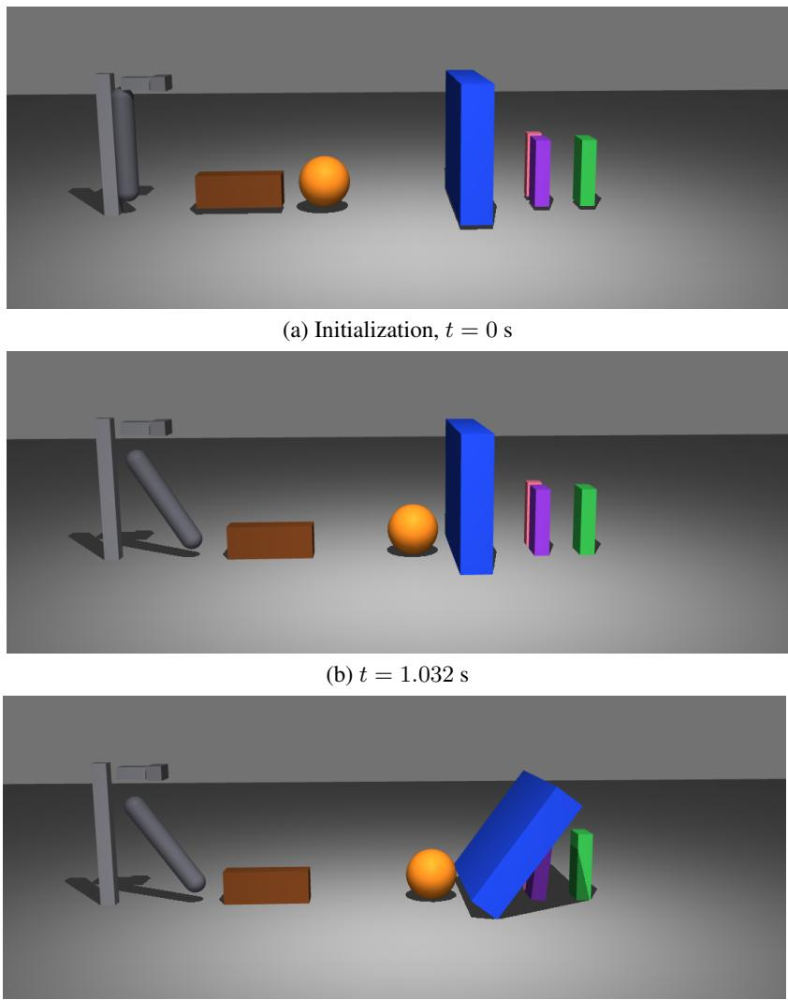  
(c) t = 1.678 s  
Figure 6: Collision reference world. The initialization and later frames connect the entity roles to execution. The lower panels bracket contact between the orange ball and blue plate; times are measured from simulation start.

## B.3 MOTION: AN APPARATUS FOR MOTION AND CONTACT

The Motion world combines a ramp, a platform with a separate surface patch, a slider, and two balls. The green ball descends the ramp and contacts the amber slider, which subsequently contacts the blue ball. Its trajectory provides evidence for the active motion-state family.

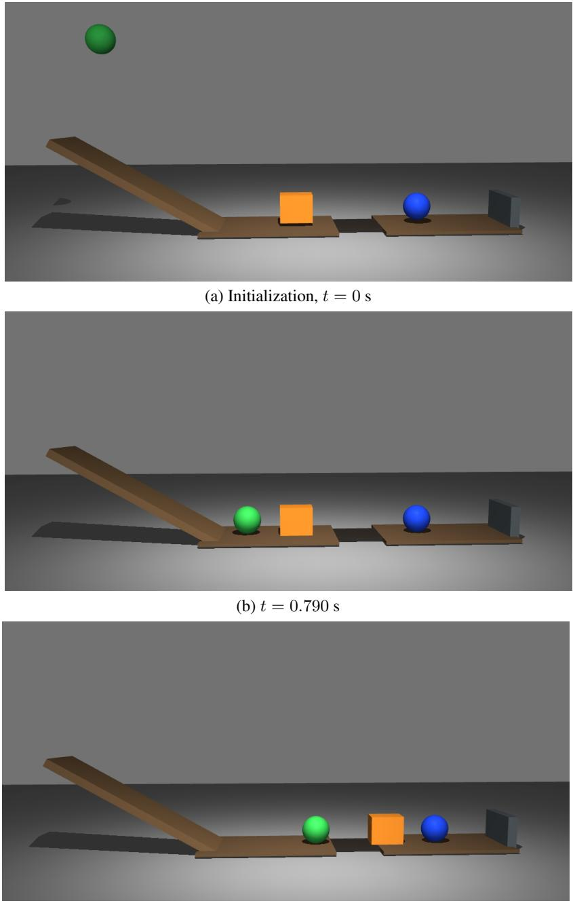  
(c) t = 1.356 s  
Figure 7: Motion reference world. Initialization and two execution states show the ramp-to-platform motion and resulting contacts. All frames share the same camera; times are measured from simula tion start.

Table 9: Exact contracts for the four active throwing families. The option descriptions give canonical semantics; an eligible surface layout may permute slots and substitute compatible distractors, but must preserve a unique binding for the admitted answer semantic.
<table><tr><td>Family</td><td>Representative item and option semantics</td><td>Evidence, binding, and suppression</td></tr><tr><td>throwing-final. destination</td><td>&quot;What is the final destination of the [referent]?&quot; Baseline only. A region requires final speed ≤ Regions use {left pit, right pit, center pit, none}; 0.30 m/s, a non-ejected status, exactly one derived an unsettled layout uses {left, right, neither, gap interval, and final height no more than 0.30 m none}.</td><td>above the platform tops. A settled region binds that region; otherwise neither is bound rather than</td></tr><tr><td>throwing-current. run_judgment</td><td>a different destination region than a named one.</td><td>guessed. &quot;Will the [referent] eventually drop into the left Baseline only. Yes iff the settled-region readout pit?&quot; Options are {Yes, No, Can not answer, Un- equals the named target; otherwise No, including an certain }; a second surface asks whether it reaches unsettled/ejected readout. Target choice alternates between matching and nonmatching regions across ball indices.</td></tr><tr><td>counterfactual_ destination</td><td>{left, right, center, none }.</td><td>“&quot;If we removed the [wall] and other balls, which Matched baseline and one elision branch. Admit pit would the [referent] drop into?&quot; Options are only when the branch is available, settles in one region, and differs from the baseline region. The branch region is the answer; failed, unsettled, or un- changed branches suppress the item.</td></tr><tr><td>inverse- intervention</td><td>“What can we do to make the [referent] drop into Baseline plus all three A/B/A+B branches. In a first the [target] pit?&quot; Options are {remove A + other fixed-order pass, the first non-baseline target reached balls, remove B + other balls, remove both + other by exactly one branch binds that intervention. Only if balls, none}.</td><td>no target has a unique achiever, a second pass binds none to the first non-baseline target reached by no branch. A multiply achieved target is skipped; miss- ing branches suppress.</td></tr></table>

Table 10: Exact contracts for the other four active families. Canonical options are shown; eligible layouts may change slot order and compatible distractors while preserving the admitted answer semantic.
<table><tr><td>Family</td><td>Representative item and option semantics</td><td>Evidence, binding, and suppression</td></tr><tr><td>collision_ final_state</td><td>lying horizontally, floating}.</td><td>&quot;Which phrase best describes the final pose of the Terminal status and speed. Ejected with z &gt; 0.35 [target]?&quot; Options are {standing upright, leaning, binds floating; fallen binds lying; moving with speed ≥ 0.10 binds leaning; stable with speed ≤ 0.20 binds standing. Other/borderline combinations sup-</td></tr><tr><td>collision_final_ relation</td><td>&quot;Which phrase best describes the interaction be- Contact is trajectory-level: any recorded pairwise tween A and B during the run?&quot; Options are contact dominates and binds the contact semantic {ends in contact, never touches, passes near with- (canonically rendered as “ends in contact&quot;). Other- out touching, ends vertically separated without wise vertical separation requires final |∆z| ≥ 0.30</td><td>press the item. contact}; a binary surface uses {Yes, No, Some- and lateral gap &lt; 0.30 m; pass-by requires initial or final distance ≤ 0.20 m; the remainder is no-</td></tr><tr><td>motion_attribution</td><td>&quot;Which object experienced a change in motion as Candidates must be distinct, dynamic, and different a result of the [trigger]?&quot; The four options are the from the trigger. Eligibility requires trigger contact manifest&#x27;s four mover bodies.</td><td>contact. The computed class must equal the manifest declaration or the family is suppressed. and velocity-change magnitude  $\begin{array} { r l } { \| \mathbf { v } _ { f } \ - \ \mathbf { v } _ { 0 } \| _ { 2 } } & { { } > } \end{array}$  0.30 m/s; the argmax is bound only if its lead over a second eligible candidate is at least 0.30 m/s. The</td></tr><tr><td>motion_state_change</td><td>Three surfaces: motion change {stop, slow Require target initial speed ≥ 0.10 m/s. Stop uses but moving, speed up, same}; speed profile final speed &lt; 0.10; speed-change/profile bound- {accelerate, decelerate, accelerate then deceler- aries use an absolute 0.30 m/s gap; pairwise order ate, constant }; pairwise semantics {final tie, fi- uses 0.10 m/s. Crossover is bound only when both</td><td>absence of an eligible candidate, or a lead below this margin, suppresses the item. nal A faster, final B faster, non-tied order rever- endpoint orders are non-tied and reverse; otherwise sal }. The canonical middle options use “consis- the final order is bound. The pairwise surface re-</td></tr></table>

## C INTERVENTION-GROUNDED TASK CONTRACTS

The implementation follows one order for every family: define the physical semantic, test whether the executed evidence makes it decidable, map the admitted case to an answer semantic, and only then realize a question and option layout. Tables 9 and 10 enumerate all eight active families. Frozen registry entries are not counted.

Table 11: Branch-result contract used for counterfactual and inverse items.
<table><tr><td>Execution</td><td>Baseline</td><td>Remove A</td><td>Remove B</td><td>Remove A+B</td></tr><tr><td>Stored semantic</td><td>r0</td><td>rA</td><td>rB</td><td>rAB</td></tr><tr><td>Required for counterfactual(A)</td><td>yes</td><td>yes</td><td>no</td><td>no</td></tr><tr><td>Required for inverse</td><td>yes</td><td>yes</td><td>yes</td><td>yes</td></tr></table>

## C.1 BRANCH MATRIX AND UNIQUE-ANSWER BINDING

For a query ball b, let $r _ { 0 } , r _ { A } , r _ { B } , r _ { A B } \in \{ \mathrm { l e f t } , \mathrm { r i g h t } _ { }$ , middle, ⊥} be the settled-region readouts of the four executions in Table $8 ; \perp$ denotes no admitted region. Table 11 formalizes which cells each family must observe before any option letters are assigned.

A counterfactual(A) item is admitted exactly when $r _ { A } \neq \perp$ and $r _ { A } \neq r _ { 0 } ,$ then binds answer semantic $r _ { A }$ . For an inverse target $t \neq r _ { 0 }$ , define $H _ { t } = \{ A : r _ { A } = t , B : r _ { B } = t , A B : r _ { A B } = t \}$ . The generator requires all three branch views and makes two fixed-order passes over left/right/middle. The first returns the first target with $| H _ { t } | = 1$ and binds its sole lever. Only when no target has a unique achiever does the second return the first target with $| H _ { t } | = 0$ and bind none of the above; a target with $| H _ { t } | > 1$ is skipped in both passes. Thus “none” is an executor-derived negative, not a catch-all for failed execution, and an ambiguous target does not preclude a decidable target elsewhere.

## C.2 SURFACE REALIZATION BOUNDARY

Only after an answer semantic is admitted does the task-interface library select a compatible stem and four-option layout and bind the semantic to an index. A canonical family layout is used whenever a sampled surface lacks the required semantic. This ordering keeps the physical decision rule executor-determined while allowing multiple linguistic realizations of the same evidence.

## D VERIFICATION, REPAIR, AND BRANCH EXECUTION

Typed termination. Every proposal receives exactly one status. FAILED SYNTAX, FAILED SEMANTIC, and FAILED RUNTIME cover parsing, eager DSL validation, and build scene execution. FAILED COMPILE, FAILED OVERLAP, and FAILED NAN cover simulator-model, initial-interpenetration, and numerical failures. FAILED TIMEOUT and FAILED RENDER cover bounded execution and rendering. FAILED VQA means the manifest or generated item violates its contract. TRIVIAL means maximum displacement is below 0.05 m and there is no collision. Only OK worlds with admitted items enter Solver groups.

Bounded repair. Repairs are recorded as an ordered trace. Minor repairs address supported syntax/argument variants, manifest repairs recover fields mechanically determined by authored geometry, and geometry repairs clamp workspace positions or separate simple initial overlap. Repair does not add a new body, joint, spring, or declared causal relation. The strongest applied tier yields a proposal-credit multiplier of 0.90 (minor), 0.80 (manifest), or 0.75 (geometry); unrepaired worlds use 1.0.

Frozen matched branches. After repair, the executor calls freeze() once. A branch clones that immutable SceneDef, elides its named body set and every incident joint/spring, and re-executes with the baseline seed and horizon. Identical removal sets share one cached execution. At most six distinct removal sets are run per world; failed/capped branches are absent, causing dependent items to be suppressed. The throwing scheduler places the $\mathrm { A / B / A { + } B }$ inverse sets for the first two balls before compatible counterfactual requests, so the latter can reuse the same branch views.

## E OPTIMIZATION AND ACTIVE CURRICULUM

General objective. Let z be the terminal proposal status, n the number of retained Solver rollouts, $G _ { \mathrm { m i n } } = 4$ , and I the intrinsic score. Before repair, anti-copy, saturation control, and family scaling,

Algorithm 1 Executor-determined item construction under an explicit contract   
Require: proposal module $p ,$ stage-2 DSL, simulation seed s   
1: parse build scene and literal SCENE MANIFEST   
2: execute the sandboxed builder with eager DSL checks   
3: apply bounded repair and freeze one immutable world $W$   
4: compile, execute, and render baseline ${ \tau _ { 0 } } \gets \mathcal { E } ( W , s )$   
5: validate manifest roles against W and enumerate required elisions   
6: for each distinct removal set B up to the branch cap do   
7: $W _ { B }  W$ with B and incident constraints elided   
8: $\tau _ { B } \gets \mathcal { E } ( W _ { B } , s ) ;$ ; cache by B   
9: end for   
10: for each requested active family $f$ do   
11: compute evidence predicates from $\tau _ { 0 }$ and required $\tau _ { B }$   
12: if all decidability and margin conditions for f hold then   
13: derive answer semantic; select a compatible surface layout   
14: bind semantic to one option index and emit the item   
15: end if   
16: end for

the implementation defines

$$
r _ { \mathrm { b a s e } } = \left\{ \begin{array} { l l } { \lambda _ { \mathrm { f a i l } } c _ { z } , } & { z \neq \infty , } \\ { 0 , } & { z = \mathrm { O K ~ a n d } n < G _ { \mathrm { m i n } } , } \\ { \lambda _ { \mathrm { l e a r n } } ^ { \mathrm { e f f } } r _ { \mathrm { l e a r n } } + \lambda _ { \mathrm { i n t } } I , } & { \mathrm { o t h e r w i s e } . } \end{array} \right.\tag{4}
$$

Equation 4 separates terminal failure, insufficient retained evidence, and admitted worlds. Here $\begin{array} { r } { r _ { \mathrm { l e a r n } } = 1 - 2 \dot { | \bar { a } } _ { \mathrm { p r o p } } - \frac { 1 } { 2 } | } \end{array}$ is the instance-level tent statistic, where $\bar { a } _ { \mathrm { p r o p } }$ denotes the retained-rollout Solver accuracy used to score the proposal. The Solver receives exact option-match reward. Status prices are $c _ { z } ~ = ~ - 1 . 0$ for syntax, semantic, and VQA failure, −0.8 for runtime failure, −0.5 for compile and overlap failure, −0.3 for numerical, timeout, and render failure, and 0 for a trivial world.

Reported instantiation and hierarchical co-evolution. Co-evolution operates through a twolevel curriculum. At the macro level, family sampling tracks the Solver’s competence boundary across reasoning intents: after an eight-step prior-weighted cold start, selection uses max $\cdot ( 0 . 0 5 , 4 \bar { a } _ { f } ( 1 - \bar { a } _ { f } ) )$ multiplied by the structural priors in Table 12, so saturated or unsolvable families are down-weighted. The family-difficulty multiplier further scales Proposer credit by rolling ${ \bar { a } } _ { f } ,$ so Solver outcomes reshape both which intents are sampled and how admitted worlds are valued. At the micro level, conditioned on the sampled intent $\sigma ,$ , the shared policy explores the program space for valid, physically non-trivial environments. Instance-level scoring prioritizes physical validity, collision feasibility, and structural diversity $I ,$ with the instance-level tent coefficient held at $\lambda _ { \mathrm { l e a r n } } ^ { \mathrm { e f f } } = 0$ This hierarchy combines competence-adaptive task selection with verifier-grounded exploration of executable worlds. The executor supplies the verifiable answers that connect both levels. Executable demonstrations remain available as syntactic references. Through this dual-level loop, Solver progression reshapes the training distribution via the adaptive intent curriculum, and shared-parameter updates of $\pi _ { \theta }$ align world generation with physical reasoning.

The active proposal signals are typed failure/validity, repair credit, structural diversity, anti-copy, saturation control, and family-difficulty scaling; the active Solver signal is exact option match. Table 12 records these controls.

Exact Solver outcomes update the rolling family statistics used for subsequent rounds. Family sampling directs task generation toward the Solver’s competence boundary, and the family-difficulty multiplier adjusts Proposer credit across intents. Within each intent, validity, repair, diversity, and saturation controls shape executable world generation.

Table 12: Reward and sampling controls in the reported 100-step run.
<table><tr><td>Component</td><td>Reported configuration</td></tr><tr><td>Failure scale  $\lambda _ { \mathrm { f a i l } }$ </td><td>1.5</td></tr><tr><td>Instance-level tent coefficient  $\lambda _ { \mathrm { l e a r n } } ^ { \mathrm { e f f } }$ </td><td>held at 0 (validity/diversity dominate instance scoring)</td></tr><tr><td>Intrinsic weight  $\lambda _ { \mathrm { i n t } }$ </td><td>0.1; structural diversity only</td></tr><tr><td>Repair factors</td><td>0.90 minor; 0.80 schema; 0.75 geometry  $\geq 0 . 9 5$ </td></tr><tr><td>Near-copy control</td><td>similarity capped at 0.1 before repair and fam- ily scaling</td></tr><tr><td>Exact/within-group duplicate proposal</td><td>pre-family reward override —0.8</td></tr><tr><td>Edit-distance diversity weight</td><td>1.5</td></tr><tr><td>Saturation control</td><td>threshold 0.75; weight 1.0</td></tr><tr><td>Family-difficulty multiplier</td><td> ${ \mathrm { c l i p } } ( 1 + ( 0 . 5 - { \bar { a } } _ { f } ) , 0 . 5 , 1 . 5 )$ </td></tr><tr><td>Rolling family statistic</td><td>64 most recent per-world family accuracies</td></tr><tr><td>Family-sampling cold start Family-sampling priors</td><td>8 rounds 2.0× for priority families; 2.0× for collision_</td></tr><tr><td></td><td>final_relation; 1.2× for each branch family; 1.0× otherwise 1.5</td></tr></table>

Algorithm 2 Reported verifier-grounded shared-policy training loop   
Require: shared policy $\pi _ { \theta } ,$ executor E, intent curriculum C, intent batch N, group size G   
1: for $t = 1 , \dots { } _ $ 100 do   
2: sample $\{ \sigma _ { n } \} _ { n = 1 } ^ { N } \sim \mathcal { C }$ with scene-kind minima   
3: sample G program/manifest proposals for each $\sigma _ { n }$   
4: validate proposals and execute Algorithm 1   
5: retain up to the per-scene and per-step Solver-group caps   
6: sample G Solver answers per retained item; score exact option match   
7: compute proposal rewards and role-wise GRPO advantages   
8: update the shared $\pi _ { \theta }$ from Proposer and Solver rows   
9: update rolling family accuracy and C   
10: end for

## F REPRODUCIBILITY, TRAINING, AND EVALUATION CONFIGURATION

## F.1 ROLE CONTRACTS AND UPDATE LOOP

The shared policy alternates between two tagged interfaces. The Proposer receives a reasoning intent and returns a world program plus manifest inside <propose> tags. The Solver receives a rendered video and an executor-authored multiple-choice item and returns one option inside <answer> tags; it has no simulator tool. The fixed executor joins the roles by validating programs, executing the required baseline/branches, and binding each admitted answer.

## F.2 RESOLVED TRAINING CONFIGURATION

Table 13 transcribes the v7i launcher and current configuration builder. The launcher fixes a 100- step horizon and saves every 25 steps. We report the terminal step-100 checkpoint and show every scheduled intermediate checkpoint in Figure 4.

## F.3 EVALUATION PROTOCOLS

Table 14 gives the evaluation contract used for each benchmark.

PhysBench frames are passed directly to the Qwen processor as an array. For CausalPhys, five annotations whose gold field is not an A–D label are excluded before scoring. ContPhy evaluates one question per generation and normalizes extracted open responses by lowercasing and stripping whitespace. All models within one benchmark share the item list, visual preprocessing, prompt, decoding, answer parser, and scorer. An unparsed response is scored as incorrect.

Table 13: Resolved configuration for the reported PhysEvolve run.
<table><tr><td>Component</td><td>Configuration</td></tr><tr><td>Base and horizon</td><td>Qwen3-VL-8B-Instruct; 100 steps; checkpoints at 25/50/75/100</td></tr><tr><td>Run multiplicity</td><td>One training run per reported configuration; no training-seed sweep</td></tr><tr><td>Compute</td><td>4 GPUs; 32 Ray CPUs; 4 executor workers</td></tr><tr><td>Proposer sampling</td><td>N = 4 intent groups per step; G = 4 programs per intent; at least one throwing, collision, and motion intent per step</td></tr><tr><td>Solver retention and rollout</td><td>At most 5 items per scene and 32 groups per step; 4 answers per group; rollout chunk size 8</td></tr><tr><td>Visual variants</td><td>One additional color permutation per accepted baseline world; one executor camera; 32 rendered frames at 480 × 480</td></tr><tr><td>Golden demonstration pool</td><td>10 throwing, 8 collision, and 6 motion programs; active for steps 1–100</td></tr><tr><td>Auxiliary geometry item</td><td>Camera-depth bypass enabled; at most one executor-geometry item on an eligible col- lision/motion scene, outside the eight sampled intents</td></tr><tr><td>Generation</td><td>temperature 0.7; top  $\cdot p = 0 . 9 5 ;$  top  $k = 2 0 ; 6 ,$  144-token prompt and 4,096-token response budgets</td></tr><tr><td>GRPO</td><td>1 epoch; clip ratio 0.2; learning rate  $1 0 ^ { - 6 } ;$  entropy coefficient 0</td></tr><tr><td>Batch sizes</td><td>training batch 4; prompt-group mini-batch 1; per-GPU micro-batch 1</td></tr><tr><td>Reference regularization</td><td>frozen reference policy; low-variance actor KL and reward KL coefficient 0.03</td></tr><tr><td>Reference buffer</td><td>enabled during demonstrations; capacity 32; 2 references per prompt</td></tr><tr><td>Family sampling</td><td>8-step prior-weighted cold start; accuracy-adaptive sampling thereafter. Structural priors throughout: 2.0× for priority and relation coverage; 1.2× for counterfac-</td></tr><tr><td>Online construction seeds</td><td>tual/inverse families. executor sequence starts at 9001; curriculum/reference RNG base 9001 (resolved code defaults)</td></tr><tr><td>Executor limits</td><td>0.002 s timestep; 30 s simulation and 15 s render timeouts; at most 6 distinct branch executions per world</td></tr></table>

Table 14: Evaluation protocols for the three reported benchmarks.
<table><tr><td>Benchmark</td><td>Items</td><td>Visual input</td><td>Generation</td><td>Scoring</td></tr><tr><td>PhysBench</td><td>9,802</td><td>8 uniform frames</td><td>greedy; 2,048 tokens</td><td>official prompts, normalization, and scorer</td></tr><tr><td>CausalPhys</td><td>3,057</td><td>5 uniform frames</td><td>CoT; greedy; 512 tokens</td><td>final A-D answer; unparsed output is incorrect</td></tr><tr><td>ContPhy</td><td>1,950</td><td>10 uniform frames</td><td>greedy; 64 tokens</td><td>normalized MC or normalized open- response exact match</td></tr></table>

We report accuracy and percentage-point differences on the shared item set within each benchmark.

## G EXTENDED RESULTS

## G.1 PHYSBENCH TAXONOMY

Table 15 reports the matched claim-facing views. Table 16 then gives every top-level task and ability partition from the same step-100 evaluation, plus the three physical dynamics subtypes used in the main text.

## G.2 COMPLETE CONTEXTUAL REFERENCE TABLE

Table 17 restores the complete set of views for the open-weight contextual references. These heterogeneous scales are not used for component attribution; Base, Naive, and PhysEvolve remain the matched 8B comparison.

## G.3 CAUSALPHYS CATEGORIES AND CONTPHY DOMAINS

Table 18 exposes all four CausalPhys categories and all four ContPhy physical domains from the reported protocols. The intervention-operation views used in the main text are included after the domain partition.

The complete branch-path control is reported in Table 2.

Table 15: PhysBench accuracy and paired differences for matched models.
<table><tr><td>View (n)</td><td>Base</td><td>Naive</td><td> $\Delta { \mathrm { \ v s . } }$  Base</td><td>PhysEvolve</td><td> $\Delta { \mathrm { \bf v } } { \mathrm { \bf s } } .$  Base</td></tr><tr><td>Overall (9,802)</td><td>52.92</td><td>52.39</td><td>-0.53</td><td>53.47</td><td>+0.55</td></tr><tr><td>Dynamics (2,932)</td><td>44.37</td><td>44.44</td><td>+0.07</td><td>45.29</td><td>+0.92</td></tr><tr><td>Throwing (410)</td><td>46.10</td><td>45.85</td><td>-0.24</td><td>54.88</td><td>+8.78</td></tr><tr><td>Collision (650)</td><td>38.62</td><td>38.77</td><td>+0.15</td><td>40.77</td><td>+2.15</td></tr><tr><td>Motion (1,433)</td><td>54.71</td><td>55.48</td><td>+0.77</td><td>56.45</td><td>+1.74</td></tr><tr><td>Prediction (1,430)</td><td>42.17</td><td>42.87</td><td>+0.70</td><td>43.71</td><td>+1.54</td></tr><tr><td>Judgment (767)</td><td>34.94</td><td>35.20</td><td>+0.26</td><td>40.03</td><td>+5.08</td></tr><tr><td>Reasoning (2,056)</td><td>43.09</td><td>40.42</td><td>-2.68</td><td>43.92</td><td>+0.83</td></tr><tr><td>Static (1,899)</td><td>60.66</td><td>61.40</td><td>+0.74</td><td>62.24</td><td>+1.58</td></tr></table>

Accuracies and differences are percentage points. Difference columns compare Naive and PhysEvolve with Base. Task, subtype, and ability levels overlap; rows within each top-level partition do not.

Table 16: Complete top-level PhysBench task and ability partitions for the matched Base and PhysEvolve models. The dynamics-subtype rows are nested inside Dynamics and therefore do not form a complete partition.
<table><tr><td>Taxonomy level</td><td>View (n)</td><td>Base</td><td>PhysEvolve</td><td>∆</td></tr><tr><td>Task</td><td>Dynamics (2,932)</td><td>44.37</td><td>45.29</td><td>+0.92</td></tr><tr><td></td><td>Relationships (2,088)</td><td>61.97</td><td>63.46</td><td>+1.48</td></tr><tr><td></td><td>Scene (2,240)</td><td>45.13</td><td>45.62</td><td>+0.49</td></tr><tr><td></td><td>Property (2,542)</td><td>62.20</td><td>61.61</td><td>-0.59</td></tr><tr><td>Dynamics subtype</td><td>Throwing (410)</td><td>46.10</td><td>54.88</td><td>+8.78</td></tr><tr><td></td><td>Collision (650)</td><td>38.62</td><td>40.77</td><td>+2.15</td></tr><tr><td></td><td>Motion (1,433)</td><td>54.71</td><td>56.45</td><td>+1.74</td></tr><tr><td>Ability</td><td>Perception (919)</td><td>60.39</td><td>56.04</td><td>-4.35</td></tr><tr><td></td><td>Dynamic (189)</td><td>75.13</td><td>75.66</td><td>+0.53</td></tr><tr><td></td><td>Static (1,899)</td><td>60.66</td><td>62.24</td><td>+1.58</td></tr><tr><td></td><td>Comparison (1,423)</td><td>45.89</td><td>44.91</td><td>-0.98</td></tr><tr><td></td><td>Reasoning (2,056)</td><td>43.09</td><td>43.92</td><td>+0.83</td></tr><tr><td></td><td>Identify (1,119)</td><td>82.93</td><td>82.84</td><td>-0.09</td></tr><tr><td></td><td>Judgment (767)</td><td>34.94</td><td>40.03</td><td>+5.08</td></tr><tr><td></td><td>Prediction (1,430)</td><td>42.17</td><td>43.71</td><td>+1.54</td></tr></table>

## G.4 JOINT PROPOSER–SOLVER UPDATES

An additional run removed Proposer-role rows from the shared-policy update while retaining Proposer generation, the executor, and the family set. Its training answer parse rate remains valid through step 64 and becomes zero for steps 65–100. Table 3 reports endpoint accuracy and answer parse rates for the joint and Solver-only update configurations.

## G.5 TASK-LEVEL TRANSFER AND PAIRED ANSWER CHANGES

Table 19 gives the exact accuracies underlying Figure 3. The CausalPhys Naive and branch-disabled results use the same video-packing protocol as the Base and full-model evaluations. All comparisons retain the same valid-gold evaluation set.

Table 20 uses the official PhysBench answer-matching rule to partition the matched questions by terminal-checkpoint correctness. The difference between the two discordant counts, divided by the row’s sample size, recovers the accuracy change. Throwing and Motion are taxonomy subtypes; Judgment is an ability view and can overlap the subtype views. Counts are therefore interpreted within each row.

Counterfactual Removal ContPhy soft:00086  
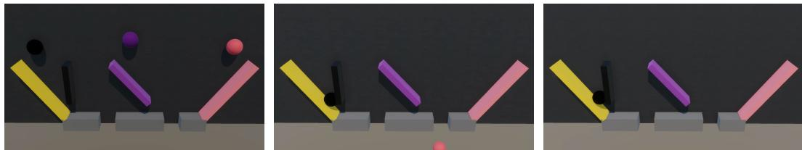  
If we removed the black floating wall and other balls, which pit would the purple ball drop into? A. The left pit B. The right pit C. None of the above  
Base: A / Naive: A / w/o branch: A / PhysEvolve: B Gold: B

Goal-Pit ContPhy soft:00038  
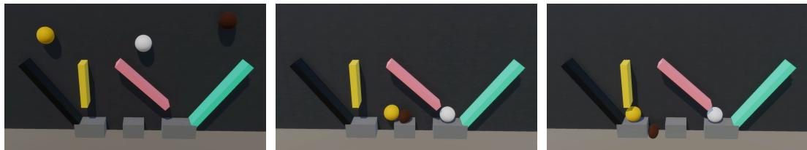  
What can we do to make the brown ball drop into the right pit? A. Remove the pink floating wall and other balls B. Remove the yellow floating wall and other balls C. None of the above  
Base: A B / Naive: A B / w/o branch: A / PhysEvolve: C Gold: C

Figure 8: Matched ContPhy examples for Counterfactual Removal and Goal-Pit. Each example displays three of the ten evaluation input frames, the original question and options, the extracted model answers, and the reference answer. The examples illustrate reasoning about removal and a requested destination in held-out soft-body scenes. The Goal-Pit reference answer is “None of the above.”

Table 17: Full accuracy (%) table for open-weight context and matched 8B models.
<table><tr><td></td><td colspan="8">PhysBench</td><td colspan="3">CausalPhys</td><td colspan="3">ContPhy</td></tr><tr><td>Model</td><td>Ovr. Dyn.</td><td></td><td></td><td></td><td></td><td></td><td>Throw. Coll. Motion Pred. Judg. Reason.</td><td></td><td></td><td></td><td>Ovr. Antic. Interv.</td><td></td><td></td><td>Ovr. CF-Rm. Goal-Pit</td></tr><tr><td>InternVL2.5-8B</td><td></td><td>43.842.1</td><td>40.0</td><td>38.9</td><td>27.7</td><td>43.0</td><td>32.7</td><td>27.4</td><td>50.2</td><td>51.5</td><td>42.4</td><td>31.4</td><td>48.4</td><td>23.3</td></tr><tr><td>Llama-3.2-11B-Vision 38.7 43.2</td><td></td><td></td><td>36.6</td><td>35.5</td><td>27.2</td><td>44.1</td><td>30.8</td><td>29.6</td><td>44.2</td><td>44.1</td><td>40.1</td><td>20.7</td><td>0.0</td><td>20.0</td></tr><tr><td>Pixtral-12B</td><td></td><td>46.944.6</td><td>41.2</td><td>39.2</td><td>35.2</td><td>46.9</td><td>31.0</td><td>35.1</td><td>50.2</td><td>53.0</td><td>44.5</td><td>21.5</td><td>40.2</td><td>13.3</td></tr><tr><td>Qwen2.5-VL-7B</td><td></td><td>49.444.3</td><td>44.4</td><td>36.5</td><td>50.6</td><td>44.1</td><td>33.1</td><td>36.5</td><td>52.6</td><td>56.5</td><td>45.7</td><td>25.9</td><td>11.5</td><td>24.4</td></tr><tr><td>Qwen3-VL-32B</td><td></td><td>60.948.7</td><td>47.1</td><td>46.0</td><td>83.5</td><td>48.0</td><td>44.3</td><td>51.4</td><td>58.9</td><td>61.9</td><td>52.9</td><td>41.0</td><td>45.9</td><td>26.7</td></tr><tr><td>Qwen3-VL-8B Base</td><td></td><td>52.9 44.4</td><td>46.1</td><td>38.6</td><td>54.7</td><td>42.2</td><td>34.9</td><td>43.1</td><td>53.9</td><td>55.9</td><td>42.8</td><td>37.1</td><td>44.3</td><td>20.0</td></tr><tr><td>Naive self-play</td><td></td><td>52.4 44.4</td><td>45.9</td><td>38.8</td><td>55.5</td><td>42.9</td><td>35.2</td><td>40.4</td><td>55.8</td><td>57.6</td><td>45.9</td><td>37.4</td><td>43.4</td><td>25.6</td></tr><tr><td>PhysEvolve</td><td></td><td>53.545.3</td><td>54.9</td><td>40.8</td><td>56.5</td><td>43.7</td><td>40.0</td><td>43.9</td><td>54.5</td><td>58.4</td><td>45.0</td><td>39.5</td><td>51.6</td><td>44.4</td></tr></table>

Table 18: Matched cross-benchmark accuracy and complete category/domain breakdowns.
<table><tr><td>Benchmark view (n)</td><td>Base</td><td>PhysEvolve</td><td> $\Delta$ </td></tr><tr><td>CausalPhys Overall (3,057)</td><td>53.94</td><td>54.50</td><td>+0.56</td></tr><tr><td>Anticipation (896)</td><td>55.92</td><td>58.37</td><td>+2.46</td></tr><tr><td>Goal orientation (637)</td><td>50.71</td><td>49.61</td><td>-1.10</td></tr><tr><td>Intervention (573)</td><td>42.76</td><td>45.03</td><td>+2.27</td></tr><tr><td>Perception (951)</td><td>60.99</td><td>59.83</td><td>-1.16</td></tr><tr><td>ContPhy Overall (1,950)</td><td>37.08</td><td>39.54</td><td>+2.46</td></tr><tr><td>Cloth (450)</td><td>48.00</td><td>47.11</td><td>-0.89</td></tr><tr><td>Fluid (450)</td><td>24.89</td><td>28.44</td><td>+3.55</td></tr><tr><td>Rope (600)</td><td>30.83</td><td>32.17</td><td>+1.33</td></tr><tr><td>Soft body (450)</td><td>46.67</td><td>52.89</td><td>+6.22</td></tr><tr><td>Counterfactual removal (122)</td><td>44.26</td><td>51.64</td><td></td></tr><tr><td>Goal-Pit (90)</td><td>20.00</td><td>44.44</td><td>+7.38 +24.44</td></tr></table>

Table 19: Complete accuracies for the task-level transfer comparison (%). CausalPhys controls use the matched video-packing protocol.
<table><tr><td>Task</td><td>n</td><td>Base</td><td>Naive</td><td>w/o branch</td><td>PhysEvolve</td></tr><tr><td>ContPhy</td><td></td><td></td><td></td><td></td><td></td></tr><tr><td>Counterfactual Removal</td><td>122</td><td>44.26</td><td>43.44</td><td>43.44</td><td>51.64</td></tr><tr><td>Goal-Pit</td><td>90</td><td>20.00</td><td>25.56</td><td>21.11</td><td>44.44</td></tr><tr><td>CausalPhys / Anticipation</td><td></td><td></td><td></td><td></td><td></td></tr><tr><td>Collision Prediction</td><td>300</td><td>53.67</td><td>50.67</td><td>54.67</td><td>51.67</td></tr><tr><td>Fluid Flow</td><td>200</td><td>47.50</td><td>60.50</td><td>35.50</td><td>58.50</td></tr><tr><td>Intention Speculation</td><td>196</td><td>45.92</td><td>52.55</td><td>42.35</td><td>48.47</td></tr><tr><td>Deformation</td><td>200</td><td>77.50</td><td>70.00</td><td>78.00</td><td>78.00</td></tr><tr><td>CausalPhys / Intervention</td><td></td><td></td><td></td><td></td><td></td></tr><tr><td>Action Substitution</td><td>99</td><td>38.38</td><td>46.46</td><td>44.44</td><td>47.47</td></tr><tr><td>Spatial Manipulation</td><td>151</td><td>43.05</td><td>46.36</td><td>41.06</td><td>45.03</td></tr><tr><td>Temporal Shifting</td><td>149</td><td>54.36</td><td>59.73</td><td>50.34</td><td>57.05</td></tr><tr><td>Viewpoint Transformation</td><td>174</td><td>35.06</td><td>33.33</td><td>33.33</td><td>33.33</td></tr></table>

Table 20: Paired terminal-checkpoint correctness on PhysBench. Each row partitions the same evaluation items by Base and PhysEvolve correctness.
<table><tr><td>Task</td><td>n</td><td>Both correct</td><td>Ours only</td><td>Base only</td><td>Neither</td><td>∆(pp)</td></tr><tr><td>Overall</td><td>9802</td><td>4487</td><td>754</td><td>700</td><td>3861</td><td>+0.55</td></tr><tr><td>Throwing</td><td>410</td><td>156</td><td>69</td><td>33</td><td>152</td><td>+8.78</td></tr><tr><td>Judgment</td><td>767</td><td>220</td><td>87</td><td>48</td><td>412</td><td>+5.08</td></tr><tr><td>Motion</td><td>1433</td><td>730</td><td>79</td><td>54</td><td>570</td><td>+1.74</td></tr></table>