# Patient-specific rubric-based evaluation of large language models across longitudinal cancer care

Wei-Wei Zhang1†, Pengkai Wang2†, Yan Li1†, Zhijie Sang2, Guan-Qun Zhou1, Jun-Yan Li3, Shu-Han Zhou1, Pei-Wen Liu1, Ting-Xi Tang5, Min Tang2, Zhitian Hou2, Jianmin Wu2,4, Jian Guan5\*, Li Lin1\*, Hongxia Yang2,4\*, Ying Sun1\*

1Department of Radiation Oncology, Sun Yat-sen University Cancer Center, Guangzhou, China. 2Department of Computing, The Hong Kong Polytechnic University, Hong Kong, China. 3Department of Pathology, Sun Yat-sen University Cancer Center, Guangzhou, China. 4InfiX.ai, Hong Kong, China. 5Department of Radiation Oncology, Nanfang Hospital, Southern Medical University, Guangzhou, China.

\*Corresponding author(s). E-mail(s): Guanj@smu.edu.cn; linli@sysucc.org.cn; hongxia.yang@polyu.edu.hk; sunying@sysucc.org.cn; †These authors contributed equally to this work.

## Abstract

Large language models (LLMs) show promise in specialty medicine, yet existing evaluations largely focus on isolated clinical encounters rather than tracking how clinical responsibilities evolve across a longitudinal care pathway. Here we introduce NPC-RubricBench, a phase-aware benchmark for evaluating multistage clinical reasoning across the cancer care continuum, using nasopharyngeal carcinoma as a defined disease context. Curated from longitudinal records of 405 patients across two cancer centers, the benchmark comprises 941 patient-phase units across six sequential care phases and 17,688 patient-specific atomic criteria spanning five evaluation dimensions, with each assessment strictly restricted to decision-time clinical evidence. Evaluating 30 general-purpose and medical LLMs revealed that strong diagnostic performance does not carry over to downstream care. We evaluated 30 general-purpose and medical LLMs, showing that high diagnostic performance did not translate into improved downstream care. Instead, the dominant failure modes reversed across phases. Explicit decision errors dominated anatomical staging at 48.2%, whereas decision omissions dominated initial work-up and post-treatment follow-up at 33.4% and 30.4%, respectively. In the evaluated model set, medically adapted models showed higher omission rates than general-purpose models. Moreover, varying query granularity exposes a critical specification trade-off: broad open-ended requests degrade Decision Quality across all 30 models, while more detailed, checklist-like prompts raise Decision Quality but reduce Evidence Faithfulness and Safety Adherence. Furthermore, NPC-RubricBench demonstrates that static diagnostic benchmarks are insufficient to ensure consistent clinical reliability over time, highlighting the importance of phase-adaptive safeguards in multistage medical AI.

Keywords: large language models, longitudinal cancer care, rubric-based evaluation, nasopharyngeal carcinoma

## 1 Introduction

Recently, Large language models (LLM) and agents based on LLM have shown growing promise in clinical medicine, from summarizing patient records and drafting notes to supporting bedside decisions [1–6]. Now, most medical benchmarks test these models in some closed questions or single-step tasks, such as diagnosis and treatment planning [7–15]. However, clinical care is a multi-step process in which clinicians must adapt their decisions as a patient’s condition and test results evolve. In oncology, for example, patients move from initial diagnosis and treatment planning to toxicity management and long-term surveillance [16–18]. Moreover, what guides clinical decisions at each stage depends on the specific disease: resectability and operability guide local treatment in nonmetastatic lung cancer [19, 20], while cytogenetic and molecular markers inform risk stratification and treatment in acute myeloid leukemia [21, 22]. Because clinical priorities and available evidence shift from one stage to the next, a model that performs well in diagnosis may still fail to adjust treatment appropriately for severe toxicities or monitor for recurrence. This motivates us to design an open-ended disease-specific evaluation organized throughout the care phases to provide a clinically interpretable account of the strengths and limitations of the model in fulfilling the responsibilities in each phase.

Recent benchmarks have taken an important step forward by using structured rubrics to assess open-ended medical responses [23–25]. Rather than relying on a single overall score, these frameworks break clinical expectations down into explicit checkable items, making it much easier to spot missing medical facts, misunderstood patient data, or unsafe advice. For example, HealthBench pairs physician-written rubrics with automated grading to evaluate model behavior in various clinical dialogs [23]. Similarly, Adaptive Precise Boolean rubrics use finegrained yes-or-no criteria to speed up grading and improve agreement among evaluators in metabolic health [25]. Despite this progress, current rubric-based systems still fall short of real-world clinical demands in two critical ways [23, 25]. First, they evaluate isolated encounters rather than tracking how clinical responsibilities shift across successive decision points for the same patient. Second, they overlook how clinicians phrase their requests differently in daily practice, ranging from broad open-ended questions to highly detailed instructions [5, 23]. Because even subtle changes in wording can sharply alter an LLM’s output [15, 26–30], testing a model under a single prompt format cannot tell us whether it remains reliable when a busy clinician asks for help in a more general way. Moving beyond static evaluation thus requires solving two connected challenges: how to measure model performance consistently as patients move through distinct stages of care, and how to test whether that performance holds up when the same clinical problem is framed in different ways.

To tackle these challenges, we introduce NPC-RubricBench, a longitudinal benchmark centered on the pathway of Nasopharyngeal carcinoma (NPC). Here, we focus on NPC because its management follows a well-defined, radiotherapy-centered pathway in which each stage demands different clinical reasoning and evidence [31–33]. Based on clinical semantics, we divide the patient journey into six sequential care phase: Work-up, Diagnosis, Staging, Treatment, Toxicity and Follow-up. Each patient–phase unit is assessed at a defined clinical decision point, with model inputs restricted to evidence available at that time and later information excluded. In each phase, we evaluate model responses using rubrics organised around five shared dimensions: Decision Quality (DQ), Evidence Grounding (EG), Status Determination (SD), Evidence Faithfulness (EF) and Safety Adherence (SA). To ensure scalability, we developed reusable templates within these dimensions to link common clinical requirements to individual patient data. Specifically, these templates capture phase-specific clinical requirements, which are then translated into patient-specific atomic criteria anchored in the clinical evidence available at each decision point. To assess sensitivity to task formulation, we pair each focused, phase-specific clinical request with two variants—a broad clinical request and a detailed prompt specifying expected response components—while keeping the patient–phase unit, underlying clinical evidence and evaluation rubric fixed. Together, these approaches enable consistent comparisons across patients and care phases while providing a modular framework that could be adapted to other cancers and chronic diseases.

Following this design, we constructed 941 phase-specific evaluation units and 17,688 case-specific rubric criteria from real-world longitudinal clinical records of 405 patients. With this dataset, we assessed 30 language models and identified distinct performance changes across the care pathway. Although most models demonstrated solid decision quality during initial diagnosis, their reliability dropped sharply in later phases: staging was plagued by explicit decision errors, whereas follow-up suffered from frequent omissions of required clinical actions and evidence. Furthermore, we also found that the performance of some weak models proved to be highly sensitive to task formulation. Specifying the expected elements raised the median quality of decisions, while making the request more general caused a steep drop. This pattern points to a fundamental limitation of current LLMs: they possess substantial medical knowledge, yet may struggle to identify clinical priorities independently without explicit structural guidance. These findings introduce some implications for deploying AI in clinical practice. First, high scores on static diagnostic benchmarks do not guarantee safe performance throughout a patient’s entire treatment journey, since a model that excels at initial diagnosis can still falter during staging or survivorship care. Second, the decline in performance under broad prompts raises concerns about relying on clinical LLMs for autonomous decision-making when busy clinicians ask open-ended questions. Instead, safe clinical integration will require stage-aware guardrails and structured workflow prompts that actively guide models through each phase of care. By identifying where and how models fall short along a longitudinal disease pathway, NPC-RubricBench provides a rigorous foundation for building medical AI systems intended to support patients from their first visit through long-term follow-up.

a.  
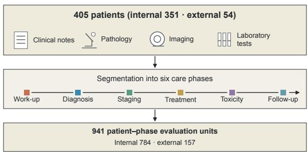

b.  
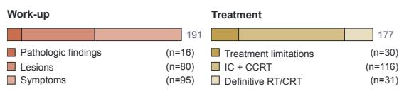

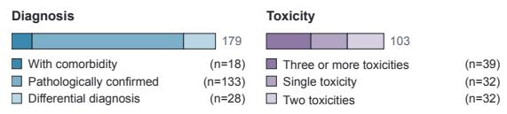

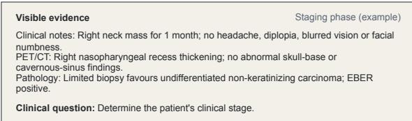

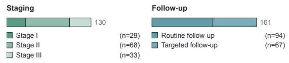

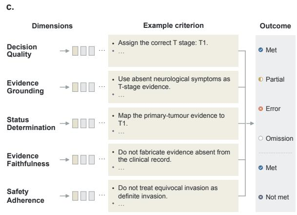

d.  
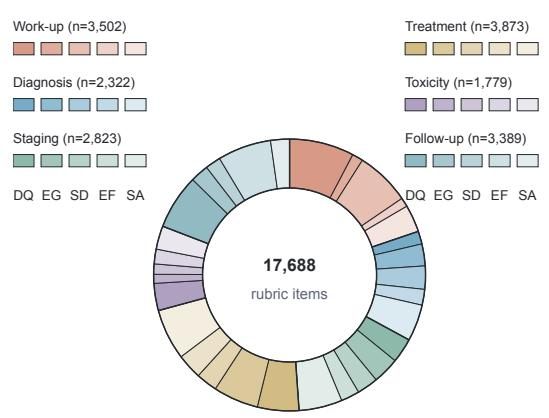  
Fig. 1 NPC-RubricBench design and composition. a, Longitudinal evaluation setting. Longitudinal records are segmented into six ordered care phases. Patients are counted once across the internal and external cohorts, and each patient–phase unit is counted once. Not every patient contributes every phase. The staging example illustrates uncertainty from a limited biopsy. b, Clinical scenarios. Stacked bars show patient–phase counts across the defined clinical scenarios, using the same inventory as a and a shared absolute-count scale. Definitions and counts are provided in S1.4 and Table S1-B. c, Patient-specific atomic rubrics. Condensed examples illustrate patient-specific criteria for Decision Quality (DQ), Evidence Grounding (EG), Status Determination (SD), Evidence Faithfulness (EF) and Safety Adherence (SA). Schematic outcomes are grouped as Met/Partial/Error/Omission for DQ/EG/SD (upper) and Met/Not met for EF/SA (lower). Partial is permitted only for items with an explicit item-specific partial-credit allowance. Met/Not met denote positive requirements satisfied/unmet, with score factors 1/0. Rubric construction and patient-specific examples are described in S2.1 and S2.3. d, Rubric scale and composition. Annulus sector area encodes rubric-item counts by phase and dimension; n gives phase totals. Counts are of unique patient-specific rubric items. NPC, nasopharyn geal carcinoma; EBV, Epstein–Barr virus; EBER, EBV-encoded RNA; RT, radiotherapy; CCRT, concurrent chemoradiotherapy.

## 2 Results

## 2.1 Benchmark composition and evaluation framework

To construct NPC-RubricBench for evaluating clinical reasoning across successive phases of care, we initially identified 9,153 patients from two clinical centres (9,099 internal and 54 external; dataset inclusion flow, S1.1). Of these, 405 patients were included in the final benchmark, yielding 941 patient–phase evaluation units and 17,688 atomic rubric items (Fig. 1a–d). Each evaluation unit is intentionally structured to link a phase-specific clinica task at a particular decision point with the medical evidence available at that moment. Model responses were subsequently assessed using patient-specific criteria grouped into five shared evaluation dimensions, while clinical scenario labels describe the different clinical contexts represented within each phase.

Longitudinal evaluation units. We assembled longitudinal clinical records spanning each patient’s first to most recent documented visit, including clinical notes, laboratory results, physical examination findings, imaging reports and pathology results. We then mapped each patient’s trajectory to six care phases—Work-up, Diagnosis, Staging, Treatment, Toxicity and Follow-up—each representing a distinct clinical responsibility (Fig. 1a). In Workup, we assessed the examinations and clinical evaluations needed to establish the diagnosis and disease extent; in Diagnosis, the primary pathological diagnosis and other established diagnoses; and in Staging, the T, N and M categories and overall stage. In Treatment, we assessed therapeutic selection and sequencing; in Toxicity, treatmentrelated adverse events, their management and implications for ongoing treatment; and in Follow-up, post-treatment disease status and surveillance planning. Assessment targets and criterion requirements for all six phases are detailed in Supplementary Section S2.1 (Table S2-A). At selected decision points within these phases, we paired each phase-specific clinical task with the evidence available at that time to form an evaluation unit, excluding later clinical information. Each unit was evaluated separately under the primary Focused formulation. A total of 941 patient–phase units were constructed (784 internal and 157 external), distributed across Work-up (n=191), Diagnosis (n=179), Staging (n=130), Treatment (n=177), Toxicity (n=103) and Follow-up (n=161). To describe the different clinical contexts within each phase, we further grouped the patient–phase units into 17 clinical scenario types (Fig. 1b). Scenario names and corresponding patient–phase counts for the internal and external cohorts are provided in Supplementary Section S1.4 (Table S1-B).

Hierarchical rubric framework. To assess these different clinical tasks on the same scale, we organized our rubrics into a three-tier hierarchy: five shared evaluation dimensions, phase-specific clinical targets expressed as reusable templates, and patient-specific atomic criteria (Fig. 1c,d; Supplementary Sections S2.1 and S2.3; Table S1) Specifically, Decision Quality assesses the appropriateness of the final clinical judgement or action. Evidence Grounding examines whether the model identifies and uses key available clinical evidence. Status Determination evaluates whether the model accurately determines the patient’s current clinical state and judges the sufficiency of available evidence for the decision. Evidence Faithfulness checks whether responses introduce claims unsupported by the visible record. Safety Adherence measures compliance with relevant clinical safety constraints. Within each phase and dimension, reusable templates define the core clinical requirements and the patient facts needed to fill them. By populating these templates with the evidence available at each decision point, we generated patient-specific atomic criteria that test individual, independently verifiable clinical requirements. In total, this process produced 17,688 active rubric items (mean, 18.8 per unit), comprising 4,753 items for DQ, 2,773 for EG, 3,069 for SD, 2,880 for EF, and 4,213 for SA. Throughout the care phases, the totals of the items ranged from 1,779 in Toxicity to 3,873 in Treatment (Fig. 1d). Through this hierarchy, the five shared dimensions provide a consistent yardstick across the care pathway, while the instantiated criteria hold the models accountable for the exact clinical facts and constraints of each case.

## 2.2 Model performance across care phases and dimensions

Overall performance and phase-specific differences. Under the primary Focused formulation, we evaluated 30 models on up to 941 eligible patient–phase units from 405 patients in the combined internal and external cohorts. Overall DQ estimates ranged from 29.8 for HuatuoGPT-o1-7B [34] to 85.6 for GPT-5.1 [35] on the 0–100 scale. Overall EF and SA estimates were generally high, ranging from 73.5 to 95.5 and from 77.5 to 97.1, respectively, whereas SD estimates ranged more widely, from 35.1 to 82.5 (Table S2). Across care phases, model-level DQ means ranged from 56.8 to 94.7 during Diagnosis, compared with 8.9 to 56.0 during Staging (Fig. 2a). Model-centred deviations were calculated relative to each model’s equally weighted six-phase mean within the same dimension. All 30 models scored above their own DQ mean during Diagnosis (median deviation +28.0 points) and below it during Staging (−29.3 points). SD showed a similar phase contrast, with positive deviations during Diagnosis in all 30 models (median +22.0 points) and negative deviations during Staging in 29/30 models (−20.5 points). During Work-up, EG and SD were above their respective model-specific means in 30/30 and 27/30 models, with median deviations of +15.7 and +15.3 points. During Treatment, median deviations were positive for DQ (+9.7 points) and SD (+2.0 points), but negative for EG (−5.7 points); these directions were observed in 28/30, 20/30 and 26/30 models, respectively. During Toxicity, all 30 models scored below their own SD mean (median −14.1 points), and 26/30 scored below their EF mean (−7.7 points). Follow-up showed negative median deviations in DQ (−3.7 points), EG (−18.4 points) and SD (−6.9 points), with 26/30, 30/30 and 28/30 models below their respective means. Complete model-centred estimates and direction counts are provided in Tables S7 and S8.

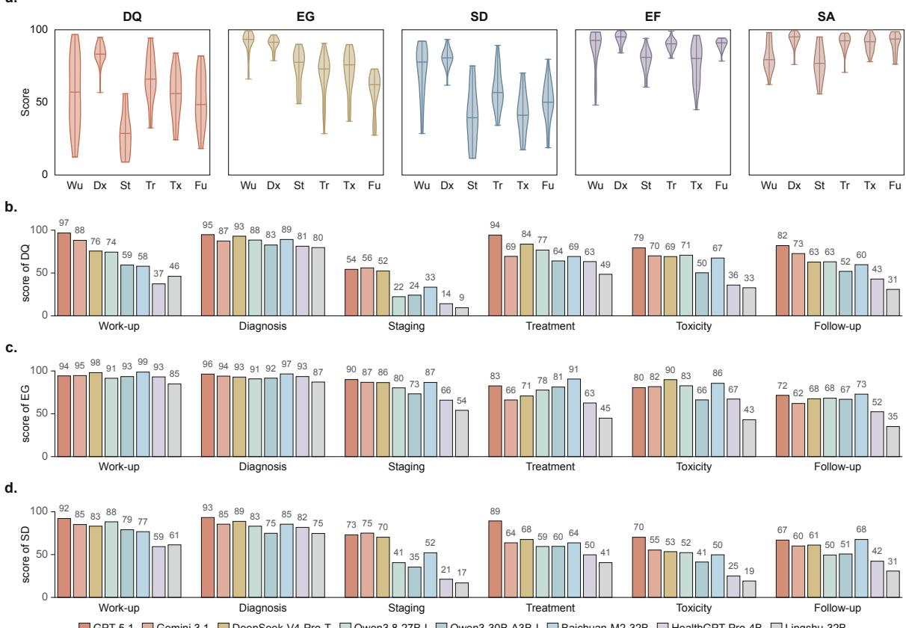  
GPT-5.1 Gemini 3.1 DeepSeek-V4-Pro-T Qwen3.8-27B-I Qwen3-30B-A3B-I Baichuan-M2-32B HealthGPT-Pro-4B Lingshu-32B

Fig. 2 Performance across care phases and rubric dimensions. a, Phase-mean distributions. Phase-mean score distributions for 30 models under Focused formulation (text) in the main clinical evaluation set (internal and external cohorts). Scores use dimension-eligible patient–phase units on a bounded 0–100 scale. Violins span observed values; marks show the minimum, median and maximum. Wu, Work-up; Dx, Diagnosis; St, Staging; Tr, Treatment; Tx, Toxicity; Fu, Follow-up. b, Decision quality. DQ means for eight author-selected models, ordered as APIaccessed general-purpose, locally deployed open-weight general-purpose and locally deployed open-weight medically adapted groups, with descending overall DQ within each group. c, Evidence grounding. EG means for the same models. d, Status determination. SD means fo the same models. Panels b–d share a fixed model order and colours with Figs. 3 and 4c,d; labels are rounded scores. Complete phase-specific scores and denominators are reported in Table S5. DQ, Decision Quality; EG, Evidence Grounding; SD, Status Determination; EF, Evidence Faithfulness; SA, Safety Adherence. Model abbreviations: I, Instruct; T, Thinking/Think. Full names are listed in Table S3.

Model-specific performance. Work-up showed the widest between-model DQ range (12.4–96.7). GPT-5.1 had the highest DQ point estimates during Work-up, Diagnosis, Treatment and Follow-up, whereas Gemini 3.1 [36] had the highest estimate during Staging (56.0) and GPT-5.6-Luna during Toxicity (83.9). Gemini 3.1 also had the highest Staging SD estimate (75.1). Although its overall DQ estimate was slightly higher than that of DeepSeek V4 Pro Think [37] (75.4 versus 74.3), their relative performance differed across phases: Gemini 3.1 scored higher during Work-up (88.1 versus 75.6), but lower during Treatment (69.4 versus 83.7). Model ordering also differed across dimensions within the same phase. During Treatment, Baichuan-M2-32B had higher EG than GPT-5.1 (90.6 versus 82.6), but lower DQ (69.3 versus 94.3) and SD (63.7 versus 89.3). EF showed modelspecific low scores despite its generally high overall estimates: Fleming-R1-32B scored 48.2 during Work-up, and Fleming-R1-7B scored 45.0 during Toxicity. Figure 2b–d shows eight selected models, with profiles for all 30 models provided in Suppl. Fig. 1. Complete overall estimates, eligible denominators and patient-cluster bootstrap 95% confidence intervals are provided in Table S2, with phase-specific scores in Table S4 and Table S5. Phase-specific DQ ranking stability under case subsampling is reported in Suppl. Fig. 2 and Table S6.

## 2.3 Cross-dimensional comparisons of clinical performance

Evidence grounding and clinical judgement. High EG scores coexisted with lower DQ and SD scores at the model–phase level. During Work-up, EG exceeded DQ in 29 of the 30 models, with a median between-dimension difference of 33.6 points. HealthGPT-Pro-4B [38, 39], for example, scored 93.1 for EG, compared with 59.3 for SD and 37.3 for DQ. The median EG–DQ difference was smaller during Diagnosis, at 7.3 points, than during

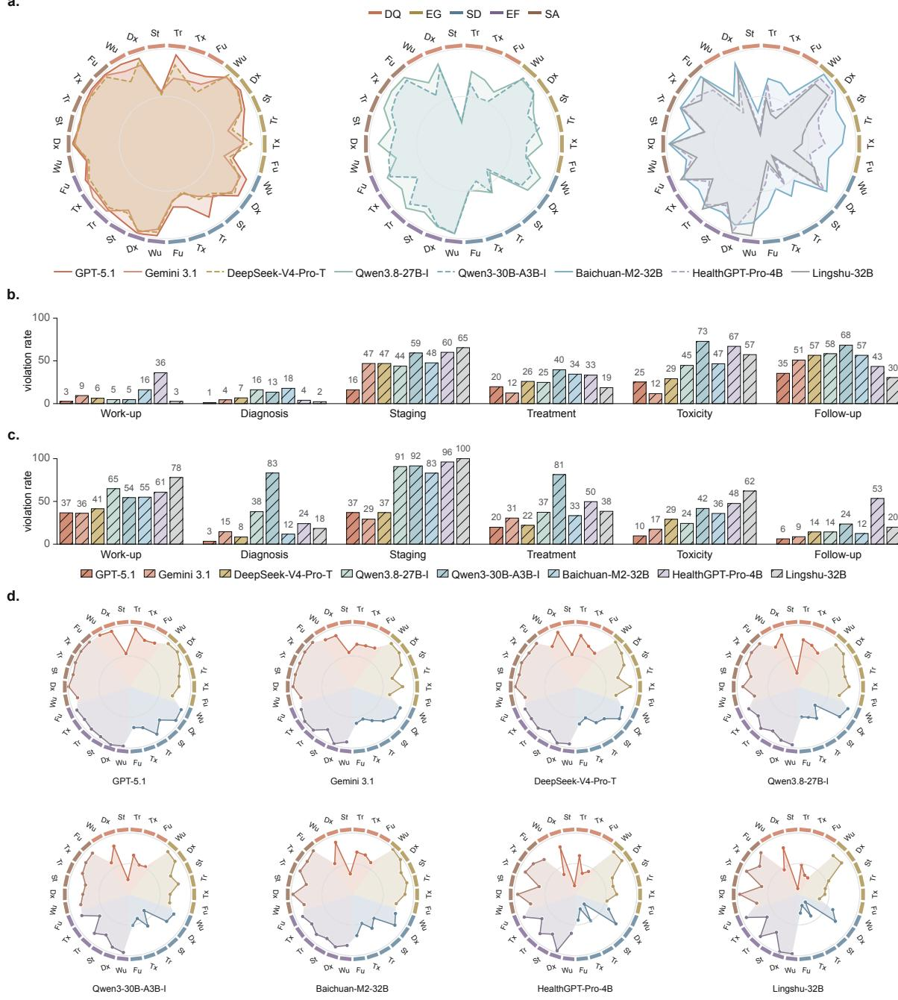  
Fig. 3 Model phase profiles and concept violations. a, Grouped model phase profiles. Grouped radars show five-dimensional scores across six phases for the same eight models as Fig. 2b–d and Fig. 4c,d, in API-accessed general-purpose, locally deployed open-weight generalpurpose and locally deployed open-weight medically adapted groups. Colours are shared with Fig. 2; outer sectors identify dimensions. b, EF concept violations. EF concept-violation rates: the percentage of resolved, eligible main-evaluation patient–phase units with at least one applicable EF requirement judged Not met. Units with all applicable requirements judged Met remain in the denominator. All phases use one fixed model order. c, SA concept violations. SA concept-violation rates use the same unit and Not met event rule as b. d, Individual model phase profiles. Individual radars show the same scores as a, in the shared model order. Wu, work-up; Dx, diagnosis; St, staging; Tr, treatment; Tx, toxicity; Fu, follow-up. Panels b,c use full phase names. Model abbreviations: I, Instruct; T, Thinking/Think. Full names are listed in Table S3.

Staging, at 45.3 points. The relative ordering of DQ and SD also differed across phases: all 30 models had higher EG than SD scores and higher SD than DQ scores during Staging, whereas all had higher EG than DQ scores and higher DQ than SD scores during Toxicity. For Qwen3.8-27B-I [40, 41], Toxicity scores were 82.7 for EG, 70.8 for DQ and 52.3 for SD. Within GPT-5.1, Staging scores were 90.0 for EG, 73.1 for SD and 54.2 for DQ; during Treatment, DQ was the highest of these three scores at 94.3, followed by SD at 89.3 and EG at 82.6. Across all models, Treatment DQ exceeded Staging DQ in 30 of 30 models, whereas Treatment EG was lower than Staging

EG in 23 (Fig. 3a,d; Table S5). These comparisons describe differences in meeting the requirements assessed by each dimension, rather than differences on a common measure of ability.

Evidence-faithfulness and safety violations. EF and SA violations differed in their distribution across care phases and models. A violation denoted at least one applicable requirement judged Not met within a resolved, eligible patient–phase unit. During Staging, SA violation rates exceeded EF rates in 28 of the 30 models, with across-model median rates of 87.7% and 48.8%, respectively. Staging had the highest SA violation rate in 27 models, whereas the highest EF violation rate occurred during Follow-up in 15 models, Toxicity in 10 and Staging in five. EF rates were nevertheless higher during Staging than during Work-up in every model: GPT-5.1 and Lingshu-32B [42, 43] both had Work-up rates of 2.6%, but their Staging rates were 16.2% and 65.4%, respectively. During Toxicity and Follow-up, EF violation rates exceeded SA rates in 25 and 26 models, respectively. Differences between models were also evident within Treatment, where SA violation rates were 81.4% for Qwen3-30B-A3B-I [44, 45] and 37.3% for Qwen3.8-27B-I. Comparing Treatment with Follow-up revealed opposite directions across the two dimensions: Follow-up EF violation rates were higher in all 30 models, whereas SA rates were lower in 29. For GPT-5.1, EF violations occurred in 19.8% of Treatment units and 35.4% of Follow-up units, while SA violations occurred in 19.8% and 6.2%, respectively. HealthGPT-Pro-4B was the only model with a higher SA violation rate during Follow-up than during Treatment, at 53.4% versus 49.7% (Fig. 3b,c; Table S9).

Mean scores and violation occurrence. High mean EF and SA scores did not imply that violations were uncommon. GPT-5.1 had similar mean EF scores during Staging and Follow-up, at 94.1 and 93.9, although the corresponding violation rates were 16.2% and 35.4%. Within Staging, its mean EF and SA scores were also similar, at 94.1 and 93.8, but SA violations were more frequent than EF violations, at 36.9% versus 16.2%. During Treatment, Qwen3-30B-A3B-I had a mean SA score of 83.8, although at least one SA requirement was unmet in 81.4% of eligible units. The two summaries use different aggregations: mean dimension scores average patient–phase scores derived from the applicable item-level assessments, whereas violation occurrence counts each eligible unit once if any applicable requirement is unmet, irrespective of how many other requirements are satisfied. Occurrence rates are therefore not complements of mean dimension scores and do not quantify the number or severity of violations within an affected unit. Full scores, violation rates, violating-unit counts and denominators are reported in Source Data and Tables S5 and S9.

## 2.4 Omissions and errors across care phases

At the same time, we also noticed that low clinical scores can stem from two distinct problems: leaving out required clinical steps or making outright mistakes. To separate these failure modes, we classified item-level failures by both the clinical dimension involved and the nature of the mistake. Specifically, we mapped failures across DQ, EG, and SD into either omissions or explicit errors. This yielded six failure classes: Decision omission, Deci sion error, Evidence omission, Evidence error, Status-assessment omission, and Status-assessment error (Fig. 4a). Each rubric item counted toward at most one failure class, whereas a single model response could contain multiple failure types. We then compared these six failure rates across all six care phases and 30 models (Fig. 4b–d).

Failure patterns across care phases. Omission and error rates differed across care phases (Fig. 4b; Table S11). Rates used preset applicable rubric opportunities, including items judged Met or Partial, pooled across all 30 models within each phase and dimension. During Work-up, decision omissions were more frequent than explicit decision errors (33.4% versus 0.3%). Status-assessment omissions showed a similar difference (17.9% versus 0.6% for errors). During Diagnosis, decision and status-assessment error rates were 15.4% and 8.4%, respectively, compared with corresponding omission rates of 11.3% and 5.8%. Staging showed higher rates of explicit errors: decision errors occurred at 48.2%, compared with 3.1% for decision omissions, while status-assessment errors reached 37.8%, compared with only 3.4% for corresponding omissions. During Treatment, decision and statusassessment error rates were relatively low (3.2% and 3.6%, respectively), whereas omissions affected decisions (19.3%), evidence use (25.7%) and status assessments (29.0%). During Toxicity, status-assessment omissions were more frequent than explicit status-assessment errors (26.2% versus 8.2%), and decision omissions also exceeded decision errors (16.6% versus 7.1%). Follow-up had decision- and status-assessment-omission rates of 30.4% and 14.0%, respectively, and the highest evidence-omission rate across the six phases (31.8%), whereas explici decision errors remained uncommon (1.0%). Case examples of omitted Work-up investigations, incorrect Staging assignments and omitted Treatment components are presented in Supplementary Sections S5.1, S5.2 and S5.3.

Omission and error rates across models. Overall omission rates differed across models (Fig. 4c; Table S10 and Source Data). GPT-5.1 had an omission rate of 5.2% (95% patient-cluster bootstrap CI, 4.6–5.9%), compared with 11.7% (10.9–12.4%) for Gemini 3.1 and 25.4% (24.4–26.5%) for HealthGPT-Pro-4B. The highest overall omission rate was observed for HuatuoGPT-o1-7B (42.5%; 95% CI, 41.1–43.7%). Overall error rates also varied, at 3.7% (95% CI, 3.3–4.2%) for GPT-5.1, 4.1% (3.7–4.6%) for Gemini 3.1 and 9.2% (8.4–10.1%) for Lingshu-32B. Omission rates exceeded error rates in 29 of the 30 models; Claude-Sonnet-4.6 was the exception, with similar omission and error rates (7.1% versus 7.4%). Within individual care phases, models differed in the frequency of specific omissions and errors (Fig. 4d). During Work-up, the decision-omission rate was 1.9% for GPT-5.1, compared with 27.7% for Baichuan-M2-32B [46]. During Treatment, the corresponding rates were 0.8% for GPT-5.1 and 19.1% for HealthGPT-Pro-4B. Staging decision errors also occurred in models with low overall omission rates: decision-error rates were 29.4% (95% CI, 27.3–31.9%) for GPT-5.1 and 27.9% for Gemini 3.1, compared with 45.2% for Baichuan-M2-32B. Staging status-assessment error rates also differed, at 12.6% for Gemini 3.1 and 29.0% for Baichuan-M2-32B. Full 30-model failure profiles are provided in Suppl. Fig. 3.

a.  
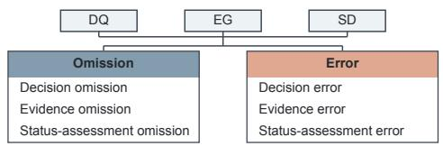  
c.

b.
<table><tr><td rowspan=2 colspan=7>Omission                    ErrorDecision  Evidence   Status           Evidence   Status</td></tr><tr><td rowspan=1 colspan=1>Decision</td></tr><tr><td rowspan=1 colspan=1>Work-up</td><td rowspan=1 colspan=1>33</td><td rowspan=1 colspan=1>5</td><td rowspan=1 colspan=1>18</td><td rowspan=1 colspan=1>0</td><td rowspan=1 colspan=1>2</td><td rowspan=1 colspan=1>1</td></tr><tr><td rowspan=1 colspan=1>Diagnosis</td><td rowspan=1 colspan=1>11</td><td rowspan=1 colspan=1>4</td><td rowspan=1 colspan=1>6</td><td rowspan=1 colspan=1>15</td><td rowspan=1 colspan=1>1</td><td rowspan=1 colspan=1>8</td></tr><tr><td rowspan=1 colspan=1>Staging</td><td rowspan=1 colspan=1>3</td><td rowspan=1 colspan=1>13</td><td rowspan=1 colspan=1>3</td><td rowspan=1 colspan=1>48</td><td rowspan=1 colspan=1>5</td><td rowspan=1 colspan=1>38</td></tr><tr><td rowspan=1 colspan=1>Treatment</td><td rowspan=1 colspan=1>19</td><td rowspan=1 colspan=1>26</td><td rowspan=1 colspan=1>29</td><td rowspan=1 colspan=1>3</td><td rowspan=1 colspan=1>4</td><td rowspan=1 colspan=1>4</td></tr><tr><td rowspan=1 colspan=1>Toxicity</td><td rowspan=1 colspan=1>17</td><td rowspan=1 colspan=1>15</td><td rowspan=1 colspan=1>26</td><td rowspan=1 colspan=1>7</td><td rowspan=1 colspan=1>6</td><td rowspan=1 colspan=1>8</td></tr><tr><td rowspan=1 colspan=1>Follow-up</td><td rowspan=1 colspan=1>30</td><td rowspan=1 colspan=1>32</td><td rowspan=1 colspan=1>14</td><td rowspan=1 colspan=1>1</td><td rowspan=1 colspan=1>5</td><td rowspan=1 colspan=1>10</td></tr></table>

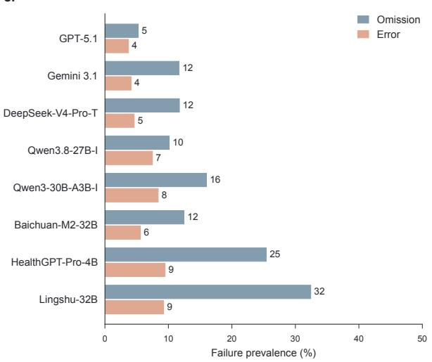

d.  
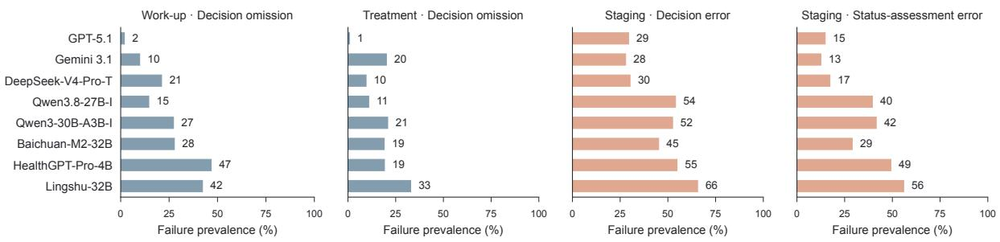  
Fig. 4 Six-class failure analysis across care phases and models. a, Six-class failure taxonomy. The six classes are Decision omission, Deci sion error, Evidence omission, Evidence error, Status-assessment omission and Status-assessment error. EF and SA violations are summarized separately. b, Error and omission occurrence by phase. Phase-specific item-level rates pool all 30 models in the main clinical evaluation set (internal and external cohorts). Error or Omission counts are divided by the preset applicable Rubric item total for each phase and DQ, EG or SD dimension. Met and Partial remain in the denominator; EF and SA are outside this inventory. Phase-level summaries are reported in Table S11; failure-rate definitions are provided in S7.3. c, Error and omission profiles by model. Bars show omission and error rates using each model’s preset Rubric opportunities pooled across phases and DQ, EG and SD, for the same eight models and order as Figs. 2 and 3. Pooled estimates and 95% confidence intervals for all 30 models are reported in Table S10. Confidence intervals use a patient-cluster bootstrap with 1,000 resamples. d, Selected errors and omissions across models. Bars show prevalence point estimates for the same eight models in four selected phase-by-failure examples. Full model-by-phase failure profiles are provided in Suppl. Fig. 3. Model abbreviations: I, Instruct; T, Thinking/Think. Full names are listed in Table S3.

## 2.5 Sensitivity to clinical task formulation

In routine clinical practice, clinicians rarely frame requests with uniform granularity; instead, prompts range from brief open-ended questions to detailed checklists. To test how sensitive models are to task phrasing, we compared an open-ended request (Broad formulation) and a structured checklist prompt (Elaborated formulation) against the primary Focused formulation across all 30 models in matched patient–phase units (Fig. 5a). Crucially, we kept the underlying clinical evidence and patient-specific rubrics fixed for all three conditions. We then examined how often scores increased, remained unchanged or decreased, and whether changes in DQ aligned with changes in the other evaluation dimensions.

Phase-dependent changes in decision quality Rephrasing the clinical query altered DQ in most paired evaluations, but broadening and elaboration had contrasting effects on model performance. Broadening reduced mean DQ in all 30 models (median change, −10.48 points), whereas elaboration increased mean DQ in 28 of 30 models

## Broad formulation

Based on the currently visible information, assess the patient's current situation and state what should be done next.

Based on the currently visible information, determine the patient's clinical stage.

Based on the currently visible information, determine the clinical stage and address the following aspects: 1) T category and evidence; 2) N category and evidence; 3) M category and evidence; 4) overall clinical stage; 5) staging system used.

EG  
DQ  
SD  
b.  
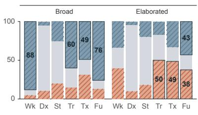

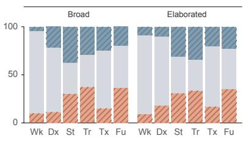

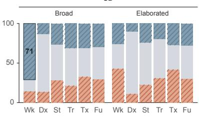

c.  
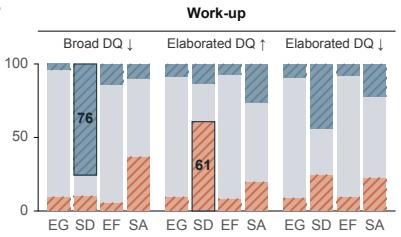

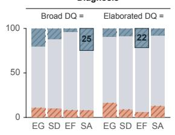

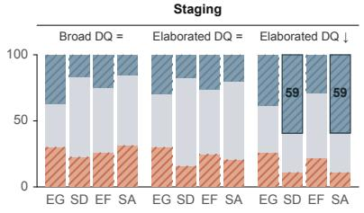

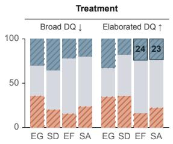

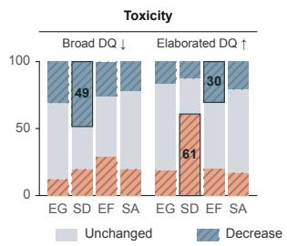

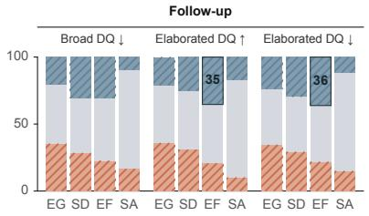  
Fig. 5 Sensitivity to clinical task formulation. a, Clinical task formulation. Broad formulation, Focused formulation and Elaborated formulation prompts from the staging example; clinical records and base rubrics are held fixed. b, Paired score directions. Direction of paired score changes relative to Focused formulation in DQ, EG and SD across six care phases. Each segment is the arithmetic mean of within-model percentages across 30 models. For each phase, dimension and comparison, all models share the same set of cases with scores for both formulations. Unchanged denotes an absolute score difference of at most 10−8 points. Wk, Work-up; Dx, Diagnosis; St, Staging; Tr, Treatment; Tx, Toxicity; Fu, Follow-up. c, Secondary directions within DQ branches. Directions of EG, SD, EF and SA changes within selected DQ increase, unchanged or decrease branches. Percentages are calculated within each model on the common cases valid for DQ and the secondary dimension, then averaged equally over models with a nonzero DQ-branch denominator. These are conditional percentages, not percentages of al paired responses. In b,c, bottom, middle and top segments indicate increase (orange hatch), unchanged (grey) and decrease (blue hatch), respec tively. Integer labels and outlined segments in b,c identify author-selected descriptive patterns.

(median change, +2.17 points). The direction of DQ changes varied across care phases (Fig. 5b). Under broadening, DQ declines were most frequent in Work-up (88.17%) and Follow-up (75.92%), and were also common in Treatment and Toxicity. In a paired Work-up example, the Broad response omitted biopsy confirmation, distantmetastasis screening and routine blood tests included in the Focused response (Supplementary Section S6.1). Elaboration did not produce consistent gains across care phases. In Treatment, DQ increased in approximately half of the paired units (mean across models, 50.06%). Gains were also more frequent than losses in Toxicity, but increases and decreases occurred at comparable frequencies in Work-up and Follow-up. Diagnosis and Staging were less sensitive to either formulation, with unchanged DQ predominating under both conditions. Nevertheless, Staging DQ declined in 25.49% of broadened pairs and 19.82% of elaborated pairs. In the HuatuoGPT-o1-7B Staging example, elaboration introduced unsupported higher T and N assignments, while neither response established a definitive TNM classification from the abbreviated evidence (Supplementary Section S6.3). Model-specific direction counts, rates and denominators are reported in Table S13.

Joint patterns of change across dimensions. Although elaboration increased mean DQ in 28 of 30 models, it lowered mean EF in 28 and mean SA in 19. These losses were also observed in paired responses without a decline in DQ (Fig. 5b,c). In Diagnosis, DQ remained unchanged in 85.66% of elaborated pairs, yet EF decreased in

b.

a.

21.54% of these DQ-stable pairs. For example, Baichuan-M2-32B retained the supported primary tumour diagnosis under elaboration but introduced an unsupported negative HBV-DNA result; both responses also overstated the exclusion of hepatitis or other comorbidities (Supplementary Section S6.2). Higher DQ could likewise coexist with losses in other dimensions. Among Treatment pairs with increased DQ under elaboration, EF and SA decreased in 23.99% and 23.31% of their respective eligible subsets, while SD declined in 17.73%. This divergence was particularly evident in Qwen3-30B-A3B-I: although elaboration increased Treatment DQ in 85.31% of its pairs, EG decreased in 51.66% of those with improved DQ. In the paired Treatment example from this model, elaboration added a specified induction chemotherapy pathway but omitted an explicit explanation of nodal risk; induction was a reasonable option rather than the sole medically acceptable approach (Supplementary Section S6.4). In Toxicity, improvements in DQ were more frequently accompanied by gains in SD, which increased in 60.83% of DQ-improved pairs under elaboration. Nevertheless, EF decreased in 30.46% of the same DQ-improved group. In the Lingshu-32B example, elaboration added mucositis grading and reassessment, but also asserted unconfirmed oesophagitis and recommended interrupting radiotherapy without first establishing current treatment status and the need for a break. Both responses suggested erythropoietin without addressing restrictions on its use during curative-intent treatment (Supplementary Section S6.5). Changes in evidence-grounding scores could also accompany a less complete clinical plan. In Follow-up, EG increased in 34.45% of elaborated pairs in which DQ decreased. In the Qwen3.6-27B-T Follow-up example, the elaborated response omitted the planned nasopharyngoscopy present under Focused, while both responses overstated what the imaging and single EBV-DNA result established (Supplementary Section S6.6).

## 2.6 Cross-cohort concordance and expert–judge agreement

In this section, we compared model performance across the internal and external cohorts and convened a panel of clinical experts to conduct an expert–LLM judge comparison. We aimed to describe cross-cohort concordance in model mean dimension scores and agreement between automated and expert item ratings.

c.  
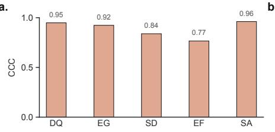

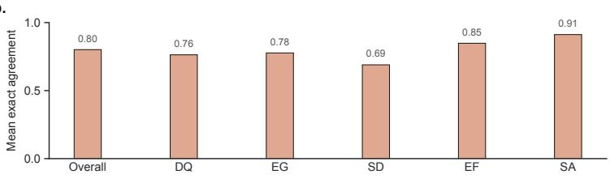

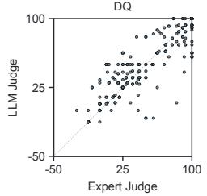

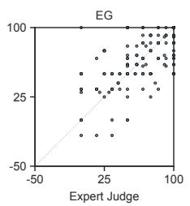

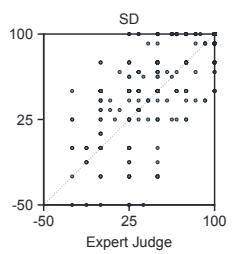

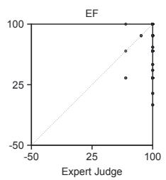

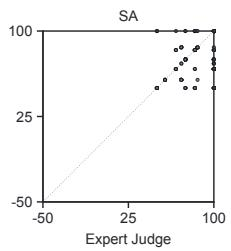  
Fig. 6 Cross-cohort concordance and expert–judge agreement. a, Lin’s concordance correlation coefficients (CCC) between internal- and external-cohort mean scores across 30 models under the Focused formulation. b, Exact outcome agreement between three clinical experts eand the LLM judge, overall and by dimension, calculated separately for each expert and averaged with equal expert weights. Panels b–c Juinclude 6,075 valid individual rating pairs from 108 responses across 12 purposively selected cases. c, Expert and LLM-Judge matched-item Part.LLM 88 109 90 13 Part. 37 64 52 0 Part. 39 41 84 4scores, calculated as equal-item factor means multiplied by 100 without zero clipping. Each point represents one expert–response–dimension Met Met combination; the diagonal indicates equality. These subset scores differ from the full-response weighted benchmark scores. Sampling, matching and scoring procedures are detailed in S4.5 and S7.6–S7.7. DQ, Decision Quality; EG, Evidence Grounding; SD, Status Determination; EF, Evidence Faithfulness; SA, Safety Adherence.

Cross-cohort concordance. We analysed the internal and external cohorts separately under the Focused formulation, comparing model mean scores across five evaluation dimensions for all 30 models. Lin’s concordance correlation coefficients (CCC) exceeded 0.9 for SA (0.961), DQ (0.948) and EG (0.923), with corresponding values of 0.839 for SD and 0.766 for EF (Fig. 6a). GPT-5.1, GPT-5.6-Luna and Qwen3.6-27B-T had the three highest DQ point estimates in both cohorts, retaining the same order. Their internal and external DQ scores were 85.1 and 87.8 for GPT-5.1, 82.1 and 86.5 for GPT-5.6-Luna, and 78.9 and 82.6 for Qwen3.6-27B-T, respectively. Baichuan-M2-32B also had the highest EG mean in both cohorts, scoring 89.4 internally and 88.4 externally.

These model-level comparisons were consistent with the overall cross-cohort concordance estimates. Complete cohort-specific scores and concordance estimates for all 30 models are provided in Table S14.

Expert–judge agreement. Three clinical experts independently graded 108 model responses from 12 purposively selected cases, comprising two cases and 18 responses per care phase, yielding 6,075 valid expert–judge item-rating pairs. Exact agreement was calculated separately for each expert and averaged with equal weights. The overall mean exact agreement was 80.12%, with individual expert–judge agreement rates of 78.96%, 80.64% and 80.74% (Fig. 6b). For comparison, the overall mean pairwise agreement among the three experts was 84.02%. Across evaluation dimensions, expert–judge agreement reached 91.17% for SA and 84.80% for EF, both assessed using binary ratings. For the four-level dimensions, exact agreement was 76.30% for DQ, 77.67% for EG and 68.95% for SD. The corresponding mean pairwise inter-expert agreement rates were 77.59%, 77.88% and 69.33%, respectively, closely matching the expert–judge agreement rates for these dimensions. Complete dimensionspecific agreement estimates are reported in Table S15. We further compared expert- and LLM judge-derived response-level scores using matched rubric-item subsets within each response (Fig. 6c).

## 3 Discussion

In this study, we present NPC-RubricBench, a benchmark designed to evaluate how LLMs fulfill clinical responsibilities at specific decision points in longitudinal NPC care. At each stage, models are evaluated solely based on clinical information available at that moment against patient-specific criteria, preventing later findings from leaking into earlier assessments. Because choosing an appropriate action, grounding it in clinical evidence and assessing the patient’s current status represent distinct clinical demands, our framework links shared evaluation dimensions to patient-tailored criteria to pinpoint which responsibilities a response fulfills and which it leaves unresolved. Across 30 LLMs and six care phases, model performance varied markedly with both clinical responsibility and how the task was framed, driven by frequent omissions of required actions or assessments. Consequently, clinical LLM capability cannot be captured by aggregate performance alone; instead, it must be judged against the specific responsibilities and information available at each stage of care.

Clinical performance varied across care phases and evaluation dimensions. Previous clinically grounded evaluations have shown that the quality of the model response cannot be reduced to the precision of the finalanswer alone [10, 14, 15, 25]. NPC-RubricBench extends this principle throughout a full longitudinal care pathway, showing that similar overall DQ scores often mask wide disparities in evidence use, status assessment, and safety adherence. For example, models performed relatively well in Diagnosis, likely because definitive pathological evidence was already available—a pattern consistent with MedR-Bench, where diagnostic precision increased when key examination results were provided [14]. But moving from Diagnosis to Treatment, models must also use patient-specific evidence to justify their choice of therapy. Although prior studies have examined treatment planning [14] and the use of tools and guidelines in oncology decision support [1], our results show that a high Treatment DQ score alone does not guarantee that a recommendation is adequately justified. This gap became even clearer during Toxicity and Follow-up, where retrieving recorded information was distinct from establishing the patient’s current clinical state. At these stages, judging whether existing evidence is sufficient—and what further work-up is needed—is a key part of the clinical task. The drop in Follow-up performance may partly reflect the difficulty of reconstructing patient status from evidence distributed over time, a limitation also documented in dedicated longitudinal evaluations [47]. Even so, our scores do not separate temporal reasoning failures from poor evidence selection, omitted requirements, or properties of the criteria themselves. Moreover, the relative preservation of EF and SA in several low-DQ phases shows that avoiding predefined rubric violations is not equivalent to completing active clinical responsibility. In short, a Met judgment in EF or SA applies only to the specified criterion and does not guarantee freedom from unsupported content or clinical risk.

Omissions and errors identify different failures in clinical responsibility. Separating omitted requirements from explicit errors changes what a low score means clinically. During Work-up, decision omission affected 33.4% of eligible DQ opportunities, whereas explicit decision error affected only 0.3% (Fig. 4b). During Staging, by contrast, explicit decision errors were frequent despite relatively few omissions. Clinically, omissions represen required parts of an assessment or plan that the response failed to address, whereas errors represent stated conclusions that were incorrect. Reviewing only the accuracy of what a model chooses to state would completely miss this distinction. Breaking open-ended responses into atomic criteria [23, 25], our framework makes missing content interpretable by specifying what must be addressed to a given patient in each care phase based on available evidence. This distinction is especially important in the Toxicity and Follow-up, where establishing the current clinical state and determining the next assessment are central to the task. Importantly, completeness does not require forcing a definitive conclusion when evidence is insufficient; rather, expressing uncertainty or deferring a decision is often the appropriate clinical response. Even leading models struggled with both failure modes:

Gemini 3.1, for example, posted an omission rate of 11.7% alongside an error rate of 4.1% across eligible DQ, EG and SD opportunities (Fig. 4c). Reducing omissions alone, therefore, cannot resolve clinical unreliability. Instead, this distinction points to two separate priorities for clinical review: verifying that all necessary assessments have been addressed and double-checking the conclusions that the response has already made.

Clinical performance is conditional on task specification. Because clinical LLMs are highly sensitive to instruction wording and the presentation of information [15, 27], a stronger performance under the Elaborated formulation must be interpreted in light of the additional support provided by the query. Explicitly listing expected components reduces what the model must infer about the clinical task, while a broader request leaves more responsibility to the model. Consistent with this perspective, task broadening lowered the average DQ across all evaluated models in NPC-RubricBench, while task elaboration raised the mean DQ for 28 models and reduced it for 2. However, at the pair level, the direction of change varied between phases and models, and higher decision scores under Elaborated prompts did not bring uniform gains in evidence faithfulness or safety adherence. These three query variants thus probe different layers of clinical capability: an Elaborated query tests execution of a specified checklist, the primary Focused query defines the clinical goal without supplying a full checklist, and a Broad query tests whether the model can independently identify the active problem and infer what the patient’s current state requires. Although structured queries can help models cover required content, their evidence use and clinical safety still require separate review.

Expert–LLM Judge agreement. Interpreting these failure patterns requires confidence not only in the scoring procedure, but also in the clinical boundaries defined by the criteria. Although LLM-based judging offers a scalable way to score open responses, automated evaluators are not inherently reliable and remain sensitive to response position, verbosity, and self-enhancement [48, 49]. Similarly, while G-Eval improved the alignment with human ratings in general text evaluation, it also highlighted the potential bias towards LLM-generated text [50], and RubricBench further exposed a gap between human-annotated and model-generated rubrics [51]. In clinical scoring, a brief criterion can obscure what counts as sufficient evidence, which clinical expressions are equivalent, and where acceptable judgment ends. In a purposively selected sample, our descriptive analysis showed expert– LLM Judge agreement across matched response–criterion pairs. Independent expert validation and adjudication are still needed to refine criteria and resolve true clinical ambiguity.

At the cohort level, cross-cohort concordance further tracked the consistency of model mean scores across our two case sources, generating the highest point estimates for DQ and SA and the lowest for EF (Fig. 6a). Because differences between cohorts varied across dimensions—and because both cohorts contributed to the primary analysis—this comparison reflects internal stability across case sources rather than scoring accuracy or transferability to other clinical settings.

Finally, several limitations of this study should be considered. First, although our evaluation framework is designed to be adaptable to other disease pathways, the model performance reported here is specific to NPC and may not generalize to other cancers or clinical settings. Moreover, because the cases were curated to cover clinically important scenarios rather than routine admission frequencies, the observed omission and error rates should not be interpreted as direct estimates of clinical errors or patient harm in daily care. Second, evaluating patient–phase units separately enabled controlled comparisons at defined decision points, but this design did not directly test how models maintain and revise decisions across ongoing, multi-turn clinical interactions. Extending the evaluation to interactive workflows will be essential to see how models adapt as patient care progresses. Third, predefined rubrics cannot capture the full range of clinically acceptable judgments and phrasing in open-ended responses. Some interpretive uncertainty inevitably remains in automated grading, underscoring the value of a broader independent expert review beyond our audited subset.

## 4 Methods

## 4.1 Longitudinal evidence construction

We retrospectively curated clinical records of patients with nasopharyngeal carcinoma (NPC) from two independent centers: Sun Yat-sen University Cancer Center (SYSUCC; internal cohort, diagnosed between 2014 and 2024) and Nanfang Hospital, Southern Medical University (NFYY; external cohort, diagnosed between 2022 and 2024). Eligible patients were identified through institutional electronic medical record (EMR) systems. Before model evaluation, personal names and identifying location details were masked in the model inputs. Calendar dates were expressed as relative time within each patient’s model input. For each patient, we extracted clinica notes, pathological and immunohistochemical reports, imaging studies, laboratory results, and treatment/procedure records and ordered them by the time each became clinically available. Ethics approval was obtained from the Ethics Committee of the Sun Yat-sen University Cancer Center (approval no. B2026-465-01), with the requirement of informed consent waived.

Each patient trajectory was mapped across six prespecified phases of care: Work-up, Diagnosis, Staging, Treatment, Toxicity and Follow-up. A single patient could contribute to multiple phases, with at most one decision point selected for each eligible patient–phase pair to match the phase-specific clinical task. Phase boundaries were anchored to clinically meaningful milestones rather than arbitrary visit or documentation dates. Specifically, each phase was anchored to a distinct clinical milestone. Work-up was anchored at a clinical presentation requiring further diagnostic investigation, and Diagnosis at the first substantive pathology report sufficient for diagnostic assessment. Staging was anchored after pathological confirmation and completion of available pretreatment staging assessments, but before treatment initiation; Treatment, immediately before initiation of the selected anticancer regimen. Toxicity was anchored at a clinically informative toxicity assessment during or near the end of treatment, and Follow-up at a selected post-treatment response or surveillance evaluation.

Eligibility was assessed independently at the patient–phase level. A candidate unit was deemed clinically eligible when a clear decision boundary could be established and the contemporary record provided sufficient evidence to evaluate the corresponding clinical task. Evidential sufficiency did not require an exhaustive medical history; instead, a candidate phase was excluded only if indispensable evidence was missing or uninterpretable, if the decision boundary could not be resolved, or if evaluating the task required information generated only after the decision point. The final evaluation set was sampled from eligible units to balance clinical scenarios, as detailed in S1.1. To prevent temporal data leakage, model input for each selected decision point was strictly restricted to evidence available at or before that time. All subsequent records—including later pathological diagnoses, staging conclusions, treatment administration, treatment responses, toxicity evolution, and follow-up outcomes—were withheld from earlier phases, as were reference answers and explanatory annotations prepared for benchmark grading. Incomplete contemporaneous records were intentionally retained whenever they reflected genuine clinical uncertainty at the decision point, and the task remained evaluable.

During scenario balancing, we excluded 19 Staging units whose reviewed clinical-scenario classification remained undetermined (S1.1). The final benchmark comprises 405 unique patients and 941 patient–phase evaluation units, where each source patient is counted once and each selected patient–phase pair defines a single evaluation unit. The baseline characteristics of the patients stratified by hospital of origin are summarized in S1.2. The primary Focused formulation analysis encompasses both internal and external evaluation units, with analysis-specific eligibility criteria and dimension-specific denominators reported alongside the corresponding estimates.

## 4.2 Clinical task formulation

To evaluate how task specification affects model performance, we tested three standardized query formulations–Broad, Focused, and Elaborated–across all six care phases. All queries were constructed only after the clinical evidence available at the decision point and the patient-specific atomic rubrics had been locked. Within each care phase, the wording of each query formulation was predefined and applied uniformly across all eligible patients.

The three formulations differed only in how explicitly they specified the clinical objective and the required response components: (1) the Broad formulation used a single generic request across all six phases, asking the model to assess the patient’s current status and determine the next clinical step; (2) the Focused formulation, which served as our primary evaluation condition, stated the principal phase-specific objective without prescribing a reasoning pathway or response structure; and (3) the Elaborated formulation retained this phase-specific objective while explicitly listing the evidence, clinical conclusions, or management components to be addressed. During Staging, for example, the Focused query asked only for the patient’s clinical stage, whereas the Elaborated query further instructed the model to report the T, N, and M categories with supporting evidence, the overall stage and the staging system used. Across all three conditions, the models received the same system prompt, requiring a final conclusion backed by reasoning from the currently available records. Crucially, the query variants varied only in instruction granularity and introduced no additional patient-specific facts, decision-relevant evidence, or target answers. All prompts and queries were administered in Chinese; English translations of the shared prompt and full query variants are provided in S3.2, with phase-specific task definitions detailed in S3.3.

Using the Focused condition as the common baseline, we conducted two paired comparisons within each model and patient–phase unit: (1) task broadening (Broad versus Focused), which tested how models perform when the phase-specific objective is left implicit; and (2) task elaboration (Elaborated versus Focused), which tested how models perform when the expected response components are explicitly listed. Within each paired comparison, the decision point, visible clinical evidence, rubric criteria, and item weights were held strictly constant. For both comparisons, we tracked the proportion of pairs in which scores increased, remained unchanged, or decreased, quantified the magnitude of DQ shifts, and evaluated whether changes in DQ co-occurred with shifts in EG, SD, EF, or SA. Detailed pairing rules and statistical procedures are described in Sect. 4.6.

## 4.3 Hierarchical rubric construction

To evaluate heterogeneous clinical tasks within a common framework, we organized clinical requirements into a three-tier hierarchy: shared evaluation dimensions, phase-specific clinical goals, and patient-specific atomic criteria instantiated from reusable templates (Fig. 1c). Throughout the benchmark, we assessed every response across five dimensions. DQ served as our primary endpoint, measuring whether the final clinical judgment or treatment plan was appropriate for the active care phase. The remaining four dimensions evaluated distinct supporting capabilities. Specifically, EG measured whether the model identified and used key visible evidence, while EF checked whether it distorted the record or fabricated patient-specific claims. In parallel, SD assessed whether the model correctly established the current clinical state, evidence sufficiency, and prerequisites for the requested decision, while SA tracked compliance with clinical safety boundaries and contraindications. Rather than collapsing these dimensions into a single composite score, we analyzed EG, EF, SD, and SA separately alongside DQ to preserve an interpretable profile of each clinical requirement (Supplementary Section S2.1).

Rubric development was led by three radiation oncologists specializing in head-and-neck radiotherapy. First, through consensus discussion, the specialists defined phase-specific clinical targets within each shared dimension and translated them into reusable criteria templates. Each template specified the target clinical requirement, the patient facts needed for instantiation, and the applicability rules governing its inclusion. Next, after locking the decision-time evidence for each eligible patient–phase unit, we extracted the relevant patient facts and populated the applicable templates with model assistance. Conditional templates were instantiated only when supported by documented patient facts. To prevent temporal leakage, instantiation relied strictly on the evidence available at the decision point, without consulting the completed longitudinal record or subsequent clinical results. The specialists then reviewed all generated criteria to ensure that each patient-specific atomic item tested a single independently verifiable clinical requirement (more details are provided in S2). For selected criteria, item-specific guidance was used to clarify scoring boundaries. Rubric construction and review were completed independently of the subsequent expert–Judge agreement study. Automated judging and expert validation are detailed in Sect. 4.4, and outcome definitions and score calculations are described in Sect. 4.5.

## 4.4 Model evaluation and expert comparison

Model evaluation and inference. To benchmark clinical reasoning across diverse model families, we evaluated 30 large language models in the primary text-based benchmark, spanning general-purpose and medically adapted systems. We accessed GPT-5.1 [35], GPT-5.6 Luna High [52], Claude Sonnet 4.6 [53], Gemini 3.1 [36], DeepSeek V4 Pro Think and DeepSeek V4 Flash [37] via standardized API interfaces. The two DeepSeek models were open-weight. The remaining models were deployed locally, encompassing the general-purpose Qwen-family models [40, 44, 54–57] and GPT-OSS-20B [58], along with five medically adapted model families: Baichuan-M2 [46], Fleming-R1 [59], HuatuoGPT-o1 [34], HealthGPT-Pro [38, 39] and Lingshu [42]. To ensure a consistent comparison, our primary analysis evaluated both the internal and external cohorts under the Focused query formulation, supplying every model with the exact same decision-time clinical evidence and phase-specific query for each patient–phase unit. The complete details of the model are listed in Table S3, with the model architectures and inference parameters detailed in S3.1.

LLM-based rubric judging. To grade open-ended responses on scale, we evaluated the model output at the atomic-criterion level using an LLM-based judge [58]. Both the LLM judge and the physicians assessed model responses using decision-time clinical evidence, the clinical query and the corresponding atomic rubric criterion. The judge then classified each pair into one of the predefined criterion-specific outcome categories (Sect. 4.5). Complete judging prompts and inference configurations are provided in S4.1–S4.2.

Expert assessment and judge agreement. To assess agreement between the automated judge and human experts, three physicians independently graded 108 model responses across 12 benchmark cases, covering three models and all three query formulations (Broad, Focused and Elaborated). The physician panel comprised two junior clinicians (1–5 years of clinical practice) and one senior nasopharyngeal carcinoma specialist (more than 20 years of practice). For each response–criterion pair, the physicians assessed anonymized model responses while blinded to the model identity and automated judge ratings. Using the same predefined outcome categories as the automated judge (Sect. 4.5), each physician independently rated every applicable item, and we paired their ratings directly with the corresponding automated judgements. We then quantified expert–judge concordance in two ways. First, we calculate the exact agreement of the results separately for each physician and average these proportions with the same weight across the three experts. Second, for each expert, response, and dimension, we computed matched subset scores by averaging the predefined outcome factors equally across the shared criteria and multiplying by 100.

## 4.5 Evaluation metrics

Each model response was assessed against the applicable patient- and phase-specific atomic criteria. For DQ, EG and SD, criterion outcomes were Met, Omission, Error or Partial (where permitted by the item’s scoring rules). Omission denoted required content that was not substantively addressed; Error denoted an explicit conflict with the available evidence or criterion; and Partial denoted substantively correct but incomplete content without a directly relevant error. The EF and SA criteria were judged Met or Not met according to whether the specified requirement was satisfied.

Dimension scores. Each applicable criterion received equal weight within a response–dimension unit. Criterion outcomes were assigned score factors of 1 for Met, 0.5 for Partial, 0 for Omission or Not met, and −0.5 for Error. For a response–dimension unit with n applicable criteria, each criterion received $p _ { i } = 1 0 0 / n$ points and contributed $c _ { i } = p _ { i } f _ { i }$ , where $f _ { i }$ is its outcome-specific score factor. The dimension score was calculated as

$$
S _ { d } = \operatorname* { m a x } \left( 0 , \operatorname* { m i n } \left( 1 0 0 , \sum _ { i = 1 } ^ { n } c _ { i } \right) \right) .\tag{1}
$$

Scores were calculated before rounding and reported separately for each dimension.

Omission and error rates. The Omission and Error outcomes in DQ, EG, and SD defined six failure classes: Decision omission, Decision error, Evidence omission, Evidence error, Status-assessment omission, and Statusassessment error. For each model, care phase and dimension, omission and error rates were calculated separately as the corresponding outcome count divided by the prespecified number of applicable criteria and multiplied by 100. The denominator was shared across models and included criteria judged Met or Partial. Each patient-specific criterion instance was counted equally. Phase-level rates pooled counts across models within each phase and dimension, whereas model-level rates pooled counts across phases and the three dimensions. Each pooled rate was calculated by dividing the summed outcome counts by the summed applicable criterion counts and multiplying by 100. Each criterion contributed to at most one failure class; a response could contain several failure types.

EF and SA violation rates. For each model, care phase, and dimension, the violation rate was calculated as the number of eligible patient–phase units with at least one applicable criterion judged Not met, divided by the total number of eligible units and multiplied by 100. Each unit contributed once, irrespective of the number of criteria judged Not met. Units with all applicable criteria judged Met remained in the denominator.

## 4.6 Statistical analysis

For each model and dimension, overall and phase-specific scores were computed as arithmetic means across eligible patient–phase units, assigning equal weight to each unit. To evaluate phase-specific performance relative to each model’s own baseline, model-centered phase scores were defined as

$$
H _ { m p d } = \bar { S } _ { m p d } - { \frac { 1 } { | P | } } \sum _ { p ^ { \prime } \in P } \bar { S } _ { m p ^ { \prime } d } ,
$$

where $\bar { S } _ { m p d }$ is the mean score for model $m ,$ , care phase $p$ and dimension $d ,$ and P denotes the six care phases. These centered scores were summarized across models using medians, interquartile ranges, and directional counts. Omission and error rates were calculated separately as the corresponding outcome counts divided by the prespecified number of applicable rubric criteria in DQ, EG or SD, whereas EF and SA violation occurrence rates represented the percentage of eligible patient–phase units containing at least one criterion judged Not met. To quantify statistical uncertainty, 95% confidence intervals for overall dimension scores, phase-specific DQ scores, pooled and phase-specific failure rates, and model-group differences were estimated using 1,000 patient-cluster bootstrap resamples. In each resample, patients were sampled with replacement while retaining all their eligible phase observations and applicable rubric criteria, and statistics were recalculated. Interval bounds were set at the 2.5th and 97.5th percentiles, extended to include the point estimate where necessary. Furthermore, phase-specific DQ ranking stability was assessed via 1,000 subsamples drawn without replacement at approximately 20%, 40%, 60% and 80% of eligible cases, with all models sharing identical sampled cases per replicate. Kendall’s $\tau _ { b }$ compared each subsample ranking with the full-sample reference ranking, and stability was summarized by the median and empirical 5th–95th percentile range across subsamples.

To assess the impact of task specification, task broadening and task elaboration were each compared with Focused formulation using paired scores derived from the same model, patient–phase unit, and dimension, holding clinical evidence, rubric criteria and point values constant. Within each phase, comparison, and dimension, the analyses were restricted to the common set of units possessing valid paired scores across all 30 models. Paired differences were calculated as variant minus Focused scores and categorized as increases $( > 1 0 ^ { - 8 }$ points), decreases $( < - 1 0 ^ { - 8 }$ points) or unchanged. Within-model direction percentages were normalized by the total eligible pair count and averaged equally across models. For analyses involving DQ and a secondary dimension, counts were restricted to the subset of cases valid in both dimensions. The conditional percentage of a secondary-dimension direction b given a category of DQ-change a was quantified as

$$
P _ { m } ( b \mid a ) = \frac { n _ { m } ( a , b ) } { n _ { m } ( a ) } \times 1 0 0 ,
$$

where $n _ { m } ( \boldsymbol { a } , \boldsymbol { b } )$ counts pairs that exhibit both the specified DQ category and the secondary-dimension direction, and $n _ { m } ( a )$ counts all pairs within that DQ category. Conditional percentages were averaged equally across models that possess a nonzero denominator.

For each formulation comparison, the overall frequency of the DQ change $F _ { m }$ (%) pooled eligible pairs across the six phases within each model $m ,$ whereas the mean absolute DQ change $A _ { m }$ (points) weighted all phases equally.

$$
F _ { m } = \frac { C _ { m } } { N _ { m } } \times 1 0 0 , \qquad A _ { m } = \frac { 1 } { 6 } \sum _ { p = 1 } ^ { 6 } d _ { m p } .
$$

Here, $C _ { m }$ denotes the count of pairs with increased or decreased DQ in the six phases, $N _ { m }$ is the total eligible paired DQ count in those phases, and $d _ { m p }$ represents the mean absolute paired DQ difference for the model m in phase $p ,$ with both metrics averaged equally across models. Exploratory within-model comparisons utilized two-sided exact binomial tests, whereas between-model comparisons relied on two-sided exact McNemar tests on matched units. Multiplicity across families of hypotheses was controlled using Holm adjustment within each phase, formulation comparison, and dimension pair. Within-model families incorporated all models and three pairwise direction comparisons (plus all three DQ categories for conditional analyses), while between-model families covered all model pairs and either three single-direction or nine joint-direction events.

Finally, internal and external cohort means were calculated independently for each model and dimension. Cross-cohort concordance was evaluated descriptively using Lin’s concordance correlation coefficient (CCC), calculated separately for each dimension from the 30 paired internal–external model means. Expert–LLM judge agreement was measured on matched response–criterion pairs. Exact agreement proportions were calculated for each expert individually and averaged with equal expert weighting overall, by dimension, and by phase. All agreement estimates are reported descriptively. More details on estimates, eligibility rules, and statistical protocols are provided in S7.

## References

[1] Ferber, D. et al. Development and validation of an autonomous artificial intelligence agent for clinical decision-making in oncology. Nature Cancer 6, 1337–1349 (2025).

[2] Zhao, W. et al. An agentic system for rare disease diagnosis with traceable reasoning. Nature 651, 775–784 (2026).

[3] O’Sullivan, J. W., Palepu, A., Saab, K. et al. A large language model for complex cardiology care. Nature Medicine 32, 616–623 (2026).

[4] Zoller, J. et al. Clinical decision support in hematological malignancies using a case-grounded AI agent. Nature Medicine 32, 3224–3234 (2026).

[5] Hicks, R. S. et al. HealthBench Professional: Evaluating large language models on real clinician chats (2026). URL https://arxiv.org/abs/2604.27470. OpenAI technical report, arXiv:2604.27470.

[6] Wang, P. et al. InfiMed-ORBIT: Aligning LLMs on open-ended complex tasks via rubric-based incremental training. arXiv preprint arXiv:2510.15859 (2025).

[7] Jin, D. et al. What disease does this patient have? A large-scale open domain question answering dataset from medical exams. Applied Sciences 11, 6421 (2021).

[8] Pal, A., Umapathi, L. K. & Sankarasubbu, M. MedMCQA: A large-scale multi-subject multi-choice dataset for medical domain question answering. Proceedings ofMachine Learning Research 174, 248–260 (2022). URL https://proceedings.mlr.press/v174/pal22a.html. Proceedings of the Conference on Health, Inference, and Learning.

[9] Jin, Q., Dhingra, B., Liu, Z., Cohen, W. & Lu, X. PubMedQA: A dataset for biomedical research question answering. Proceedings of the 2019 Conference on Empirical Methods in Natural Language Processing and the 9th International Joint Conference on Natural Language Processing (EMNLP-IJCNLP) 2567–2577 (2019). URL https://aclanthology.org/D19-1259/.

[10] Singhal, K. et al. Large language models encode clinical knowledge. Nature 620, 172–180 (2023).

[11] Singhal, K. et al. Toward expert-level medical question answering with large language models. Nature Medicine 31, 943–950 (2025).

[12] Tu, T. et al. Towards conversational diagnostic artificial intelligence. Nature 642, 442–450 (2025).

[13] McDuff, D. et al. Towards accurate differential diagnosis with large language models. Nature 642, 451–457 (2025).

[14] Qiu, P. et al. Quantifying the reasoning abilities of LLMs on clinical cases. Nature Communications 16, 9799 (2025).

[15] Hager, P. et al. Evaluation and mitigation of the limitations of large language models in clinical decisionmaking. Nature Medicine 30, 2613–2622 (2024).

[16] Zapka, J. G., Taplin, S. H., Solberg, L. I. & Manos, M. M. A framework for improving the quality of cancer care: the case of breast and cervical cancer screening. Cancer Epidemiology, Biomarkers & Prevention 12, 4–13 (2003). URL https://pubmed.ncbi.nlm.nih.gov/12540497/.

[17] Institute of Medicine. Delivering High-Quality Cancer Care: Charting a New Course for a System in Crisis (The National Academies Press, Washington, DC, 2013). URL https://doi.org/10.17226/18359.

[18] Miller, K. D. et al. Cancer treatment and survivorship statistics, 2022. CA: A Cancer Journalfor Clinicians 72, 409–436 (2022).

[19] Chaft, J. E. et al. Evolution of systemic therapy for stages I–III non-metastatic non-small-cell lung cancer. Nature Reviews Clinical Oncology 18, 547–557 (2021).

[20] Zer, A. et al. Early and locally advanced non-small-cell lung cancer: ESMO clinical practice guideline for diagnosis, treatment and follow-up. Annals ofOncology 36, 1245–1262 (2025).

[21] Short, N. J., Rytting, M. E. & Cortes, J. E. Acute myeloid leukaemia. Lancet 392, 593–606 (2018).

[22] Dohner, H.¨ et al. Diagnosis and management of AML in adults: 2022 recommendations from an international expert panel on behalf of the ELN. Blood 140, 1345–1377 (2022).

[23] Arora, R. K. et al. HealthBench: Evaluating large language models towards improved human health (2025). URL https://arxiv.org/abs/2505.08775. arXiv:2505.08775.

[24] Fast, D. et al. Autonomous medical evaluation for guideline adherence of large language models. npj Digital Medicine 7, 358 (2024).

[25] Mallinar, N. et al. A scalable framework for evaluating health language models. npj Digital Medicine 9, 437 (2026).

[26] Zhu, K., Zhao, Q., Chen, H., Wang, J. & Xie, X. PromptBench: A unified library for evaluation of large language models. Journal ofMachine Learning Research 25, 1–22 (2024). URL https://jmlr.org/papers/v25/ 24-0023.html.

[27] Ceballos-Arroyo, A. M. et al. Open (clinical) LLMs are sensitive to instruction phrasings. Proceedings of the 23rd Workshop on Biomedical Natural Language Processing (BioNLP 2024) 50–71 (2024). URL https://aclanthology.org/2024.bionlp-1.5/.

[28] Sorin, V. et al. Evaluating prompt and data perturbation sensitivity in large language models for radiology reports classification. JAMIA Open 8, ooaf073 (2025). URL https://pubmed.ncbi.nlm.nih.gov/40799928/.

[29] Li, Z. et al. The effects of multitype prompt engineering for large language models in hypertension treatment decisions. npj Digital Medicine 9, 526 (2026).

[30] Gu, Y. et al. Evaluating the robustness and readiness of large frontier models in health AI applications. Nature Medicine 32, 3023–3031 (2026).

[31] Chen, Y.-P. et al. Nasopharyngeal carcinoma. The Lancet 394, 64–80 (2019).

[32] Wong, K. C. W. et al. Nasopharyngeal carcinoma: an evolving paradigm. Nature Reviews Clinical Oncology 18, 679–695 (2021).

[33] Bossi, P. et al. Nasopharyngeal carcinoma: ESMO–EURACAN clinical practice guidelines for diagnosis, treatment and follow-up. Annals ofOncology 32, 452–465 (2021).

[34] Chen, J. et al. Towards medical complex reasoning with LLMs through medical verifiable problems. Findings ofthe Associationfor Computational Linguistics: ACL 2025 14552–14573 (2025). URL https://aclanthology. org/2025.findings-acl.751/.

[35] OpenAI. Introducing GPT-5.1 for developers (2025). URL https://openai.com/index/ gpt-5-1-for-developers/. Published 13 November 2025; accessed 22 October 2026.

[36] Google DeepMind. Gemini 3.1 Pro: Model card (2026). URL https://deepmind.google/models/model-cards/ gemini-3-1-pro/. Published 19 February 2026; accessed 22 October 2026.

[37] DeepSeek-AI et al. DeepSeek-V4: Towards highly efficient million-token context intelligence (2026). URL https://arxiv.org/abs/2606.19348. arXiv:2606.19348.

[38] Lin, T. et al. HealthGPT: A medical large vision-language model for unifying comprehension and generation via heterogeneous knowledge adaptation. Proceedings of Machine Learning Research 267, 37975– 37995 (2025). URL https://proceedings.mlr.press/v267/lin25n.html. Proceedings of the 42nd International Conference on Machine Learning.

[39] ZJU4HealthCare. HealthGPT-Pro: A high-performance multimodal large language model for medical understanding and analysis. Official model documentation (2026). URL https://github.com/ZJU4HealthCare/ HealthGPT/blob/4d404a518cfa8e78cd7703af7cfc4ca4fd559698/HealthGPT-Pro/README.md. Accessed 23 October 2026.

[40] Qwen Team. Qwen3.8-Max: A new bar for coding and cowork. Qwen blog (2026). URL https://qwen.ai/ blog?id=qwen3.8.

[41] Qwen Team. Qwen3.8-27B: Model card. Hugging Face (2026). URL https://huggingface.co/Qwen/Qwen3. 8-27B/blob/1d4bf0f2ff6012fd82039f2fa52739d0dd7c60c0/README.md. Accessed 23 October 2026.

[42] Xu, W. et al. Lingshu: Generalist foundation model for unified multimodal medical understanding and reasoning. IEEE Transactions on Pattern Analysis and Machine Intelligence 1–18 (2026). URL https: //doi.org/10.1109/TPAMI.2026.3730310. Early access.

[43] lingshu-medical-mllm. Lingshu-32B: Model card. Hugging Face (2025). URL https://huggingface.co/ lingshu-medical-mllm/Lingshu-32B/blob/36b98277cacb60db86f34b75ce0540b1ea35183c/README.md. Accessed 23 October 2026.

[44] Yang, A. et al. Qwen3 technical report (2025). URL https://arxiv.org/abs/2505.09388. arXiv:2505.09388.

[45] Qwen Team. Qwen3-30B-A3B-Instruct-2507: Model card. Hugging Face (2025). URL https://huggingface. co/Qwen/Qwen3-30B-A3B-Instruct-2507/blob/0d7cf23991f47feeb3a57ecb4c9cee8ea4a17bfe/README. md. Accessed 23 October 2026.

[46] Baichuan-M2 Team, Dou, C., Liu, C., Yang, F. et al. Baichuan-M2: Scaling medical capability with large verifier system (2025). URL https://arxiv.org/abs/2509.02208. arXiv:2509.02208.

[47] Cui, H. et al. TIMER: temporal instruction modeling and evaluation for longitudinal clinical records. npj Digital Medicine 8, 577 (2025).

[48] Zheng, L. et al. Judging LLM-as-a-judge with MT-Bench and Chatbot Arena. Advances in Neural Information Processing Systems 36, 46595–46623 (2023). URL https://papers.nips.cc/paper files/paper/2023/hash/ 91f18a1287b398d378ef22505bf41832-Abstract-Datasets and Benchmarks.html.

[49] Wang, P. et al. Large language models are not fair evaluators. Proceedings of the 62nd Annual Meeting of the Association for Computational Linguistics (Volume 1: Long Papers) 9440–9450 (2024). URL https: //aclanthology.org/2024.acl-long.511/.

[50] Liu, Y. et al. G-Eval: NLG evaluation using GPT-4 with better human alignment. Proceedings of the 2023 Conference on Empirical Methods in Natural Language Processing 2511–2522 (2023). URL https: //aclanthology.org/2023.emnlp-main.153/.

[51] Zhou, J. et al. RubricBench: Aligning model-generated rubrics with human standards. Proceedings of the 64th Annual Meeting of the Association for Computational Linguistics (Volume 1: Long Papers) 31179– 31200 (2026). URL https://aclanthology.org/2026.acl-long.1439/.

[52] OpenAI. GPT-5.6 Luna: Model documentation (2026). URL https://developers.openai.com/api/docs/models/ gpt-5.6-luna. Accessed 23 October 2026.

[53] Anthropic. Introducing Claude Sonnet 4.6 (2026). URL https://www.anthropic.com/news/ claude-sonnet-4-6. Published 17 February 2026; accessed 23 October 2026.

[54] Qwen et al. Qwen2.5 technical report (2025). URL https://arxiv.org/abs/2412.15115v2. Version 2, revised 3 January 2025; first submitted 19 December 2024, arXiv:2412.15115v2.

[55] Bai, S. et al. Qwen3-VL technical report (2025). URL https://arxiv.org/abs/2511.21631. arXiv:2511.21631.

[56] Qwen Team. Qwen3.5: Towards native multimodal agents. Qwen blog (2026). URL https://qwen.ai/blog? id=qwen3.5.

[57] Qwen Team. Qwen3.6-27B: Flagship-level coding in a 27B dense model. Qwen blog (2026). URL https: //qwen.ai/blog?id=qwen3.6-27b.

[58] OpenAI et al. gpt-oss-120b & gpt-oss-20b model card (2025). URL https://arxiv.org/abs/2508.10925. arXiv:2508.10925.

[59] Liu, C. et al. Fleming-R1: Toward expert-level medical reasoning via reinforcement learning (2025). URL https://arxiv.org/abs/2509.15279. arXiv:2509.15279.

[60] Pan, J.-J. et al. Ninth version of the AJCC and UICC nasopharyngeal cancer TNM staging classification. JAMA Oncology 10, 1627–1635 (2024). URL https://jamanetwork.com/journals/jamaoncology/fullarticle/ 2824837.

[61] National Comprehensive Cancer Network. NCCN clinical practice guidelines in oncology: Head and neck cancers. Version 4.2025 (2025). URL https://www.nccn.org/professionals/physician gls/pdf/head-and-neck. pdf.

[62] OpenAI. GPT-5.1: Model documentation (2025). URL https://developers.openai.com/api/docs/models/ gpt-5.1. Accessed 25 October 2026.

[63] Anthropic. Claude Sonnet 4.6: Model documentation (2026). URL https://platform.claude.com/docs/en/ models/sonnet-4-6/overview. Accessed 25 October 2026.

[64] DeepSeek-AI. DeepSeek V4: Technical documentation. Official model documentation (2026). URL https: //fe-static.deepseek.com/chat/transparency/deepseek-V4-model-card-EN.pdf. Published 27 April 2026; accessed 25 October 2026.

[65] Qwen Team. Qwen3.6-27B: Model card. Hugging Face (2026). URL https://huggingface.co/Qwen/Qwen3. 6-27B/blob/6a9e13bd6fc8f0983b9b99948120bc37f49c13e9/README.md. Accessed 23 October 2026.

[66] Qwen Team. Qwen3.5-35B-A3B: Model card. Hugging Face (2026). URL https://huggingface.co/Qwen/ Qwen3.5-35B-A3B. Accessed 23 October 2026.

[67] Qwen Team. Qwen3-30B-A3B-Thinking-2507: Model card. Hugging Face (2025). URL https:// huggingface.co/Qwen/Qwen3-30B-A3B-Thinking-2507. Accessed 23 October 2026.

[68] Qwen Team. Qwen3-4B-Instruct-2507: Model card. Hugging Face (2025). URL https://huggingface. co/Qwen/Qwen3-4B-Instruct-2507/blob/cdbee75f17c01a7cc42f958dc650907174af0554/README.md. Accessed 23 October 2026.

[69] Qwen Team. Qwen3-4B-Thinking-2507: Model card. Hugging Face (2025). URL https://huggingface.co/ Qwen/Qwen3-4B-Thinking-2507. Accessed 23 October 2026.

[70] Qwen Team. Qwen3-8B: Model card. Hugging Face (2025). URL https://huggingface.co/Qwen/Qwen3-8B. Accessed 23 October 2026.

[71] Qwen Team. Qwen2.5-7B-Instruct: Model card. Hugging Face (2024). URL https://huggingface.co/Qwen/ Qwen2.5-7B-Instruct. Accessed 23 October 2026.

[72] Qwen Team. Qwen3-VL-30B-A3B-Instruct: Model card. Hugging Face (2025). URL https://huggingface. co/Qwen/Qwen3-VL-30B-A3B-Instruct. Accessed 23 October 2026.

[73] Qwen Team. Qwen3-VL-30B-A3B-Thinking: Model card. Hugging Face (2025). URL https://huggingface. co/Qwen/Qwen3-VL-30B-A3B-Thinking. Accessed 23 October 2026.

[74] Qwen Team. Qwen3-VL-8B-Instruct: Model card. Hugging Face (2025). URL https://huggingface.co/ Qwen/Qwen3-VL-8B-Instruct. Accessed 23 October 2026.

[75] Qwen Team. Qwen3-VL-8B-Thinking: Model card. Hugging Face (2025). URL https://huggingface.co/ Qwen/Qwen3-VL-8B-Thinking. Accessed 23 October 2026.

[76] IQuestLab. Fleming-R1: Model card. Hugging Face (2025). URL https://huggingface.co/IQuestLab Fleming-R1-32B. Accessed 23 October 2026.

[77] FreedomIntelligence. HuatuoGPT-o1-7B: Model card. Hugging Face (2024). URL https://huggingface.co FreedomIntelligence/HuatuoGPT-o1-7B/blob/6487c8071a3f87702a6816ba7a09f38921b685ed/README. md. Accessed 23 October 2026.

## Supplementary Information

Rubric-based benchmarking of clinical reasoning in large language models across multistage cancer care in nasopharyngeal carcinoma

## Contents

S1. Cohort and evaluation-unit characteristics 22   
S1.1 Cohort composition and eligibility 22   
S1.2 Patient characteristics 23   
S1.3 Evaluation-unit construction and phase eligibility 23   
S1.4 Phase-specific clinical scenarios and subcategories 23   
S2. Rubric construction 25   
S2.1 Shared dimensions and phase-specific clinical targets 25   
S2.2 Expert development and consensus procedure 27   
S2.3 Patient-specific instantiation of criterion templates 27   
S2.4 Applicability, atomicity and quality control 28   
S3. Model evaluation conditions and response generation 28   
S3.1 Evaluated models and inference configuration 29   
S3.2 Shared response-generation prompt 31   
S3.3 Clinical tasks and query formulations 32   
S4. Automated judging, scoring and validation 32   
S4.1 Judge configuration 32   
S4.2 Judge inputs, prompt and assessment rules 32   
S4.3 Criterion outcomes 34   
S4.4 Score calculation 34   
S4.5 Descriptive expert–Judge comparison 34   
S5. Clinical case studies across care phases 34   
S5.1 Work-up: completeness of the required assessment . 35   
S5.2 Staging: evidence interpretation and TNM assignment 36   
S5.3 Treatment: regimen coverage and radiation fields 37   
S6. Paired query-formulation case studies 38   
S6.1 Work-up 38   
S6.2 Diagnosis 39   
S6.3 Staging . 40   
S6.4 Treatment 41   
S6.5 Toxicity 42   
S6.6 Follow-up 43   
S7. Statistical analysis and robustness checks 43   
S7.1 Analysis units, estimands and estimability rules 43   
S7.2 Overall performance and phase heterogeneity 43   
S7.3 Six-class failure analysis and fixed Rubric opportunity denominator 43   
S7.4 Paired task-formulation analyses 44   
S7.5 Phase-specific DQ ranking stability 45   
S7.6 Expert–Judge agreement statistics 45   
S7.7 Cross-cohort comparison and concordance 45   
Supplementary Figures 46   
Supplementary Figure 1: Phase- and dimension-specific performance of all 30 models 46   
Supplementary Figure 2: Phase-specific stability of DQ model rankings 48   
Supplementary Figure 3: Phase-specific omission and error rates of all 30 models 49   
Supplementary Tables 51

## S1. Cohort and evaluation-unit characteristics

Patient-level summaries describe demographics and NPC diagnosis years; phase-specific summaries describe the patient–phase units available for each clinical task. The internal cohort originated from Sun Yat-sen University Cancer Center (SYSUCC), and the external cohort from Nanfang Hospital, Southern Medical University (NFYY). Hospital origins in Table S1-A follow the source electronic health records (EHRs).

## S1.1 Cohort composition and eligibility

The inclusion flow (S1.1) summarizes source-record selection, review of candidate decision points and phasespecific additions and removals to balance clinical scenarios. This step also excluded 19 Staging units with undetermined scenario classifications. A candidate phase was not retained when no evaluable decision point could be identified, essential evidence was insufficient, or staging or treatment information was inconsistent. The main clinical evaluation set contains 405 patients and 941 patient–phase units from the internal and external cohorts.

Dataset inclusion flow  
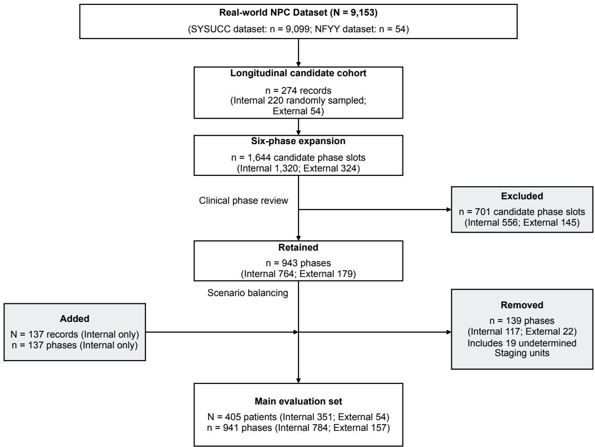  
Counting units: N denotes source registration records during screening and unique patients in the final evaluation set. n denotes candidate patient–phase units before review and included units after review. Initial SYSUCC/NFYY counts refer to the respective screening groups; hospital origins of included patients were determined from the source clinical records (Table S1-A).

## S1.2 Patient characteristics

The table summarizes demographics and NPC diagnosis years for all 405 patients, with one observation per source patient (Table S1-A).

Table S1-A. Patient demographics and recorded NPC diagnosis years
<table><tr><td>Characteristic</td><td>Overall (N=405)</td><td>Internal (N=351)</td><td>External (N=54)</td></tr><tr><td>Patients</td><td>405</td><td>351</td><td>54</td></tr><tr><td>Age at first recorded encounter, years</td><td></td><td></td><td></td></tr><tr><td>Median [IQR]</td><td>47.00 [38.00, 57.00]</td><td>48.00 [39.00, 57.00]</td><td>41.50 [35.00, 55.75]</td></tr><tr><td>Sex</td><td></td><td></td><td></td></tr><tr><td>Male</td><td>309/405 (76.30%)</td><td>270/351 (76.92%)</td><td>39/54 (72.22%)</td></tr><tr><td>Female</td><td>96/405 (23.70%)</td><td>81/351 (23.08%)</td><td>15/54 (27.78%)</td></tr><tr><td>NPC diagnosis year</td><td></td><td></td><td></td></tr><tr><td>Range</td><td>2014-2024</td><td>2014–2024</td><td>2022-2024</td></tr></table>

Note: Each source patient contributes once. Counts are n/N (%). Age is calculated from date of birth at the first recorded encounter and reported as median [IQR], using valid observations and linearly interpolated quartiles. It is not age at diagnosis or treatment initiation. NPC diagnosis year ranges use the earliest dated explicit confirmation available for each patient, including documented outside diagnoses.

## S1.3 Evaluation-unit construction and phase eligibility

Each eligible trajectory was mapped to six prespecified care phases: Work-up, Diagnosis, Staging, Treatment, Toxicity and Follow-up. A patient could contribute to more than one phase, but at most one decision point was selected for each eligible source patient–phase pair. The selected point had to match the phase-specific clinical task, contain sufficient evidence to make that task evaluable and preserve temporal integrity by excluding information that became available only later. Eligibility was assessed separately for each phase, and only observed, eligible decision points were included.

Patient-level and patient–phase denominators are reported separately.

## S1.4 Phase-specific clinical scenarios and subcategories

Clinical scenarios and their subcategories describe the selected decision point for each included patient–phase evaluation unit (Table S1-B). The main clinical evaluation set is shown overall and by internal and external cohort. These task-specific classifications describe the clinical evidence available at the selected phase, rather than a common pretreatment baseline for all cases. Labels follow the reviewed clinical scenario classifications; units with an undetermined Staging scenario were excluded during scenario balancing. T, N, M and overall stage are summarized independently within the retained Staging units. Tx indicates that the primary tumour cannot be assessed; Nx indicates that regional lymph nodes cannot be assessed.

Table S1-B. Phase-specific clinical scenarios and subcategories

## A. Work-up

<table><tr><td>Clinical scenario / subcategory</td><td>Main, N=191</td><td>Internal, N=149</td><td>External, N=42</td></tr><tr><td>Pathologic findings</td><td>16/191 (8.38%)</td><td>16/149 (10.74%)</td><td>0/42 (0.00%)</td></tr><tr><td>Nasopharyngeal pathological clue</td><td>16/16 (100.00%)</td><td>16/16 (100.00%)</td><td></td></tr><tr><td>Lesions</td><td>80/191 (41.88%)</td><td>51/149 (34.23%)</td><td>29/42 (69.05%)</td></tr><tr><td>Nasopharyngeal lesion</td><td>13/80 (16.25%)</td><td>5/51 (9.80%)</td><td>8/29 (27.59%)</td></tr><tr><td>Cervical nodal lesion</td><td>57/80 (71.25%)</td><td>45/51 (88.24%)</td><td>12/29 (41.38%)</td></tr><tr><td>Lesions at other sites</td><td>1/80 (1.25%)</td><td>0/51 (0.00%)</td><td>1/29 (3.45%)</td></tr><tr><td>Multisite lesions</td><td>9/80 (11.25%)</td><td>1/51 (1.96%)</td><td>8/29 (27.59%)</td></tr><tr><td>Symptoms</td><td>95/191 (49.74%)</td><td>82/149 (55.03%)</td><td>13/42 (30.95%)</td></tr><tr><td>Nasal symptoms</td><td>28/95 (29.47%)</td><td>24/82 (29.27%)</td><td>4/13 (30.77%)</td></tr><tr><td>Ear symptoms</td><td>18/95 (18.95%)</td><td>18/82 (21.95%)</td><td>0/13 (0.00%)</td></tr><tr><td>Neurologic symptoms</td><td>7/95 (7.37%)</td><td>5/82 (6.10%)</td><td>2/13 (15.38%)</td></tr><tr><td>Multiple symptoms</td><td>30/95 (31.58%)</td><td>26/82 (31.71%)</td><td>4/13 (30.77%)</td></tr><tr><td>Other symptoms or diagnostic context</td><td>12/95 (12.63%)</td><td>9/82 (10.98%)</td><td>3/13 (23.08%)</td></tr></table>

Note: Counts are n/N (%). Bold scenario rows use all evaluation units in the corresponding phase and group as the denominator; subcategory rows use units in the corresponding parent scenario. Main includes the internal and external cohorts. A dash denotes an empty parent group. Subcategories describe the principal diagnostic clue at the selected decision point.

## B. Diagnosis

<table><tr><td>Clinical scenario / subcategory</td><td>Main, N=179</td><td>Internal, N=143</td><td>External, N=36</td></tr><tr><td>With comorbidity</td><td>18/179 (10.06%)</td><td>15/143 (10.49%)</td><td>3/36 (8.33%)</td></tr><tr><td>Hypertension</td><td>4/18 (22.22%)</td><td>4/15 (26.67%)</td><td>0/3 (0.00%)</td></tr><tr><td>Diabetes mellitus</td><td>1/18 (5.56%)</td><td>1/15 (6.67%)</td><td>0/3 (0.00%)</td></tr><tr><td>HBV/HCV-related diagnosis</td><td>5/18 (27.78%)</td><td>5/15 (33.33%)</td><td>0/3 (0.00%)</td></tr><tr><td>Other comorbidity</td><td>4/18 (22.22%)</td><td>3/15 (20.00%)</td><td>1/3 (33.33%)</td></tr><tr><td>Multiple comorbidities</td><td>4/18 (22.22%)</td><td>2/15 (13.33%)</td><td>2/3 (66.67%)</td></tr><tr><td>Pathologically confirmed</td><td>133/179 (74.30%)</td><td>100/143 (69.93%)</td><td>33/36 (91.67%)</td></tr><tr><td>Undifferentiated nonkeratinizing carcinoma</td><td>129/133 (96.99%)</td><td>99/100 (99.00%)</td><td>30/33 (90.91%)</td></tr><tr><td>Differentiated nonkeratinizing carcinoma</td><td>2/133 (1.50%)</td><td>1/100 (1.00%)</td><td>1/33 (3.03%)</td></tr><tr><td>Keratinizing squamous cell carcinoma</td><td>1/133 (0.75%)</td><td>0/100 (0.00%)</td><td>1/33 (3.03%)</td></tr><tr><td>Other histologic types</td><td>1/133 (0.75%)</td><td>0/100 (0.00%)</td><td>1/33 (3.03%)</td></tr><tr><td>Differential diagnosis</td><td>28/179 (15.64%)</td><td>28/143 (19.58%)</td><td>0/36 (0.00%)</td></tr><tr><td>Lymphoma in the differential</td><td>1/28 (3.57%)</td><td>1/28 (3.57%)</td><td></td></tr><tr><td>Histologic type undetermined</td><td>2/28 (7.14%)</td><td>2/28 (7.14%)</td><td></td></tr><tr><td>Primary site undetermined</td><td>1/28 (3.57%)</td><td>1/28 (3.57%)</td><td></td></tr><tr><td>Multiple diagnostic uncertainties</td><td>1/28 (3.57%)</td><td>1/28 (3.57%)</td><td></td></tr><tr><td>Other diagnosis undetermined</td><td>23/28 (82.14%)</td><td>23/28 (82.14%)</td><td></td></tr></table>

Note: Subcategories describe histology, the principal comorbidity or the unresolved diagnostic question, according to the parent scenario.

## C. Staging

<table><tr><td>Clinical scenario / subcategory</td><td>Main, N=130</td><td>Internal, N=105</td><td>External, N=25</td></tr><tr><td>T category</td><td></td><td></td><td></td></tr><tr><td>T1</td><td>17/130 (13.08%)</td><td>16/105 (15.24%)</td><td>1/25 (4.00%)</td></tr><tr><td>T2</td><td>14/130 (10.77%)</td><td>14/105 (13.33%)</td><td>0/25 (0.00%)</td></tr><tr><td>T3</td><td>76/130 (58.46%)</td><td>53/105 (50.48%)</td><td>23/25 (92.00%)</td></tr><tr><td>T4</td><td>18/130 (13.85%)</td><td>17/105 (16.19%)</td><td>1/25 (4.00%)</td></tr><tr><td>Tx</td><td>5/130 (3.85%)</td><td>5/105 (4.76%)</td><td>0/25 (0.00%)</td></tr><tr><td>N category</td><td></td><td></td><td></td></tr><tr><td>NO</td><td>20/130 (15.38%)</td><td>19/105 (18.10%)</td><td>1/25 (4.00%)</td></tr><tr><td>N1</td><td>47/130 (36.15%)</td><td>41/105 (39.05%)</td><td>6/25 (24.00%)</td></tr><tr><td>N2</td><td>40/130 (30.77%)</td><td>26/105 (24.76%)</td><td>14/25 (56.00%)</td></tr><tr><td>N3</td><td>20/130 (15.38%)</td><td>16/105 (15.24%)</td><td>4/25 (16.00%)</td></tr><tr><td>Nx</td><td>3/130 (2.31%)</td><td>3/105 (2.86%)</td><td>0/25 (0.00%)</td></tr><tr><td>M category</td><td></td><td></td><td></td></tr><tr><td>M0</td><td>130/130 (100.00%)</td><td>105/105 (100.00%)</td><td>25/25 (100.00%)</td></tr><tr><td>Overall stage</td><td></td><td></td><td></td></tr><tr><td>I</td><td>29/130 (22.31%)</td><td>28/105 (26.67%)</td><td>1/25 (4.00%)</td></tr><tr><td>Ⅱ</td><td>68/130 (52.31%)</td><td>49/105 (46.67%)</td><td>19/25 (76.00%)</td></tr><tr><td>IⅢI</td><td>33/130 (25.38%)</td><td>28/105 (26.67%)</td><td>5/25 (20.00%)</td></tr></table>

Note: T, N, M and overall stage are separate distributions over all retained Staging units. Stage I combines IA and IB. Tx indicates that the primary tumour cannot be assessed; Nx indicates that regional lymph nodes cannot be assessed. These decision-point classifications are distinct from pretreatment patient baseline staging.

## D. Treatment

<table><tr><td>Clinical scenario / subcategory</td><td>Main, N=177</td><td>Internal, N=149</td><td>External, N=28</td></tr><tr><td>Treatment limitations</td><td>30/177 (16.95%)</td><td>30/149 (20.13%)</td><td>0/28 (0.00%)</td></tr><tr><td>Hepatic constraint</td><td>5/30 (16.67%)</td><td>5/30 (16.67%)</td><td></td></tr><tr><td>Renal constraint</td><td>8/30 (26.67%)</td><td>8/30 (26.67%)</td><td></td></tr><tr><td>Age or fitness constraint</td><td>4/30 (13.33%)</td><td>4/30 (13.33%)</td><td></td></tr><tr><td>Patient preference constraint</td><td>2/30 (6.67%)</td><td>2/30 (6.67%)</td><td></td></tr><tr><td>Multiple constraints</td><td>7/30 (23.33%)</td><td>7/30 (23.33%)</td><td></td></tr><tr><td>Other constraint</td><td>4/30 (13.33%)</td><td>4/30 (13.33%)</td><td></td></tr><tr><td>IC + CCRT</td><td>116/177 (65.54%)</td><td>97/149 (65.10%)</td><td>19/28 (67.86%)</td></tr><tr><td>Definitive RT/CRT</td><td>31/177 (17.51%)</td><td>22/149 (14.77%)</td><td>9/28 (32.14%)</td></tr></table>

Note: IC, induction chemotherapy; RT, radiotherapy; CRT, chemoradiotherapy; CCRT, concurrent chemoradiotherapy.

## E. Toxicity

<table><tr><td>Clinical scenario / subcategory</td><td>Main, N=103</td><td>Internal, N=96</td><td>External, N=7</td></tr><tr><td>Three or more toxicities</td><td>39/103 (37.86%)</td><td>38/96 (39.58%)</td><td>1/7 (14.29%)</td></tr><tr><td>Hematologic toxicity</td><td>36/39 (92.31%)</td><td>35/38 (92.11%)</td><td>1/1 (100.00%)</td></tr><tr><td>Hepatic or renal abnormalities</td><td>12/39 (30.77%)</td><td>11/38 (28.95%)</td><td>1/1 (100.00%)</td></tr><tr><td>Electrolyte abnormalities</td><td>12/39 (30.77%)</td><td>11/38 (28.95%)</td><td>1/1 (100.00%)</td></tr><tr><td>Gastrointestinal toxicity</td><td>10/39 (25.64%)</td><td>10/38 (26.32%)</td><td>0/1 (0.00%)</td></tr><tr><td>Mucosal or skin injury</td><td>12/39 (30.77%)</td><td>11/38 (28.95%)</td><td>1/1 (100.00%)</td></tr><tr><td>Other toxicity</td><td>6/39 (15.38%)</td><td>6/38 (15.79%)</td><td>0/1 (0.00%)</td></tr><tr><td>Single toxicity</td><td>32/103 (31.07%)</td><td>28/96 (29.17%)</td><td>4/7 (57.14%)</td></tr><tr><td>Hematologic toxicity</td><td>8/32 (25.00%)</td><td>5/28 (17.86%)</td><td>3/4 (75.00%)</td></tr><tr><td>Hepatic or renal abnormalities</td><td>14/32 (43.75%)</td><td>13/28 (46.43%)</td><td>1/4 (25.00%)</td></tr><tr><td>Gastrointestinal toxicity</td><td>2/32 (6.25%)</td><td>2/28 (7.14%)</td><td>0/4 (0.00%)</td></tr><tr><td>Mucosal or skin injury</td><td>7/32 (21.88%)</td><td>7/28 (25.00%)</td><td>0/4 (0.00%)</td></tr><tr><td>Current toxicity subcategory not recorded</td><td>1/32 (3.12%)</td><td>1/28 (3.57%)</td><td>0/4 (0.00%)</td></tr><tr><td>Two toxicities</td><td>32/103 (31.07%)</td><td>30/96 (31.25%)</td><td>2/7 (28.57%)</td></tr><tr><td>Hematologic toxicity</td><td>26/32 (81.25%)</td><td>24/30 (80.00%)</td><td>2/2 (100.00%)</td></tr><tr><td>Hepatic or renal abnormalities</td><td>10/32 (31.25%)</td><td>9/30 (30.00%)</td><td>1/2 (50.00%)</td></tr><tr><td>Electrolyte abnormalities</td><td>2/32 (6.25%)</td><td>1/30 (3.33%)</td><td>1/2 (50.00%)</td></tr><tr><td>Gastrointestinal toxicity</td><td>1/32 (3.12%)</td><td>1/30 (3.33%)</td><td>0/2 (0.00%)</td></tr><tr><td>Mucosal or skin injury</td><td>2/32 (6.25%)</td><td>2/30 (6.67%)</td><td>0/2 (0.00%)</td></tr></table>

Note: Each toxicity category is counted once per evaluation unit. A unit can have multiple categories, so their percentages may sum to more than 100%. Parent scenarios count individual toxicity events, which can belong to the same broader category.

## F. Follow-up

<table><tr><td>Clinical scenario / subcategory</td><td>Main, N=161</td><td>Internal, N=142</td><td>External, N=19</td></tr><tr><td>Routine follow-up</td><td>94/161 (58.39%)</td><td>86/142 (60.56%)</td><td>8/19 (42.11%)</td></tr><tr><td>&lt;1 year after treatment</td><td>31/94 (32.98%)</td><td>29/86 (33.72%)</td><td>2/8 (25.00%)</td></tr><tr><td>1-&lt;3 years after treatment</td><td>42/94 (44.68%)</td><td>40/86 (46.51%)</td><td>2/8 (25.00%)</td></tr><tr><td>3-5 years after treatment</td><td>2/94 (2.13%)</td><td>2/86 (2.33%)</td><td>0/8 (0.00%)</td></tr><tr><td>&gt;5 years after treatment</td><td>1/94 (1.06%)</td><td>1/86 (1.16%)</td><td>0/8 (0.00%)</td></tr><tr><td>Follow-up timing undetermined</td><td>18/94 (19.15%)</td><td>14/86 (16.28%)</td><td>4/8 (50.00%)</td></tr><tr><td>Targeted follow-up</td><td>67/161 (41.61%)</td><td>56/142 (39.44%)</td><td>11/19 (57.89%)</td></tr><tr><td>Suspicious primary-site lesion</td><td>9/67 (13.43%)</td><td>7/56 (12.50%)</td><td>2/11 (18.18%)</td></tr><tr><td>Suspicious regional nodal lesion</td><td>4/67 (5.97%)</td><td>3/56 (5.36%)</td><td>1/11 (9.09%)</td></tr><tr><td>Suspicious distant lesion</td><td>11/67 (16.42%)</td><td>11/56 (19.64%)</td><td>0/11 (0.00%)</td></tr><tr><td>Late toxicity</td><td>15/67 (22.39%)</td><td>12/56 (21.43%)</td><td>3/11 (27.27%)</td></tr><tr><td>Multiple suspicious findings</td><td>13/67 (19.40%)</td><td>12/56 (21.43%)</td><td>1/11 (9.09%)</td></tr><tr><td>Other suspicious findings</td><td>15/67 (22.39%)</td><td>11/56 (19.64%)</td><td>4/11 (36.36%)</td></tr></table>

Note: Routine follow-up is classified by time relative to treatment; targeted follow-up by the principal finding requiring assessment.

## S2. Rubric construction

The rubric was organized as a hierarchy of shared evaluation dimensions, phase-specific clinical targets expressed through reusable criterion templates, and patient-specific atomic criteria. The shared dimensions defined the evaluation perspective, the secondary clinical targets specified the requirements of each care phase, and the atomic criteria expressed those requirements using the facts available at the decision point.

## S2.1 Shared dimensions and phase-specific clinical targets

Five shared dimensions were used throughout: Decision Quality (DQ), Evidence Grounding (EG), Evidence Faithfulness (EF), Status Determination (SD) and Safety Adherence (SA). DQ captured the phase-specific clinical judgement or management action; EG captured use of the visible evidence; EF assessed fidelity to the visible clinical evidence; SD captured the current clinical state and decision prerequisites; and SA captured clinically relevant safety boundaries.

Experts defined phase-specific clinical targets and criterion templates within each shared evaluation dimension. We instantiated the applicable templates using decision-time patient evidence, with model assistance and expert review. Table S2-A summarizes the targets and requirements represented in the patient-specific rubrics for cases included in the analysis. The evaluation prompt specified the AJCC/UICC ninth-edition NPC TNM system for staging [60] and NCCN Clinical Practice Guidelines in Oncology: Head and Neck Cancers, Version 4.2025, for treatment and follow-up [61].

Table S2-A. Phase-specific secondary clinical targets and criterion requirements
<table><tr><td>Phase</td><td>Dim.</td><td>Secondary clinical targets</td><td>Criterion requirements in the evaluation rubrics</td></tr><tr><td>Work-up</td><td>DQ</td><td>Pathological confirmation; locoregional imaging; distant- metastasis assessment; laboratory, hepatitis and cardiopulmonary</td><td>Recommend phase-appropriate investigations, preserving distinct prerequisites for disease confirmation and treatment tolerance.</td></tr><tr><td>Work-up</td><td>EG</td><td>assessment; EBV-DNA testing Presenting symptoms and signs; outside investigations; completed</td><td>Identify the findings available at the decision point; distinguish completed tests from proposed tests.</td></tr><tr><td>Work-up</td><td>EF</td><td>in-hospital tests Fidelity to symptoms, care history and investigation results</td><td>Do not introduce patient facts or investigation results absent from the visible record.</td></tr><tr><td>Work-up</td><td>SD</td><td>Completion of pathology, imaging, metastasis assessment, EBV-DNA and</td><td>Determine which decision prerequisites are satisfied and which remain incomplete.</td></tr><tr><td>Work-up</td><td>SA</td><td>pretreatment assessments Premature conclusions; duplicate or unindicated investigations</td><td>Avoid definitive conclusions before prerequisites are met and avoid unjustified repeat or routine testing.</td></tr><tr><td>Diagnosis</td><td>DQ</td><td>Primary pathological diagnosis; unresolved lesion type; further confirmation; important comorbid</td><td>State the diagnosis supported by the current pathology; request further confirmation when classification remains unresolved.</td></tr><tr><td>Diagnosis</td><td>EG</td><td>diagnoses Pathology specimen and morphology; immunohistochemistry and EBER;</td><td>Identify the actual pathology and ancillary results, respecting specimen, site and report chronology.</td></tr><tr><td>Diagnosis</td><td>EF</td><td>comorbidity evidence Fidelity to pathology, ancillary tests</td><td>Do not invent diagnostic findings, test results or comorbidities.</td></tr><tr><td>Diagnosis</td><td>SD</td><td>and comorbidity evidence Diagnostic sufficiency; supported inference from ancillary tests;</td><td>Distinguish confirmed diagnosis, supported malignancy and unresolved lesion type; limit ancillary-test inferences to their</td></tr><tr><td>Diagnosis</td><td>SA</td><td>comorbidity certainty Diagnostic overcall or undercall; incorrect classification; misuse of</td><td>pathological context. Avoid changing a confirmed diagnosis using an inapplicable fragment, overstating incomplete pathology or overlooking</td></tr><tr><td>Staging</td><td>DQ</td><td>restricted or superseded findings T, N and M categories; overall clinical stage; provisional or unresolved stage</td><td>clinically important comorbidity. Report the supported component and overall stages using AJCC/UICC ninth-edition rules, retaining uncertainty where</td></tr><tr><td>Staging</td><td>EG</td><td>Local invasion and spared structures; regional nodes; distant-metastasis</td><td>needed. Identify the anatomy, nodal characteristics and distant findings relevant to each stage component.</td></tr><tr><td>Staging</td><td>EF</td><td>evidence Fidelity to local, regional and distant staging evidence</td><td>Do not fabricate or distort invasion, nodal or distant-metastasis</td></tr><tr><td>Staging</td><td>SD</td><td>Evidence-to-stage mapping; sufficiency for definitive or provisional</td><td>findings. Link documented findings to the supported category; distinguish negative findings from unassessed features and</td></tr><tr><td>Staging</td><td>SA</td><td>staging Unsupported upstaging or downstaging; inapplicable staging</td><td>preserve uncertainty in equivocal findings. Avoid overlooking definite involvement, converting equivocal findings into definite disease, or mixing staging-system</td></tr><tr><td>Treatment</td><td>DQ</td><td>rules Overall treatment sequence; definitive radiotherapy and coverage; induction</td><td>versions. Recommend the stage-appropriate treatment and sequence under NCCN Head and Neck Cancers Version 4.2025.</td></tr><tr><td>Treatment</td><td>EG</td><td>and concurrent therapy; patient-specific adjustment Pathology and stage; age and performance; marrow, hepatic, renal,</td><td>adapting modalities and regimens to documented constraints. Identify the available disease and tolerance evidence used to select treatment.</td></tr><tr><td></td><td></td><td>cardiopulmonary and hearing status; treatment limitations Fidelity to disease state, biomarkers,</td><td>Do not introduce unprovided clinical stage or patient-specific</td></tr><tr><td>Treatment</td><td>SD</td><td>performance, organ function and treatment history Readiness for treatment planning; local</td><td>disease and tolerance facts. Determine whether diagnosis and stage are sufficiently</td></tr><tr><td>Treatment</td><td>SA</td><td>or distant risk; chemotherapy suitability and reassessment needs Omission of essential treatment;</td><td>established, and how organ function, comorbidity or missing assessments constrain treatment. Avoid omitting necessary therapy, adding unsupported</td></tr></table>

Table S2-A
<table><tr><td>Phase</td><td>Dim.</td><td>Secondary clinical targets</td><td>Criterion requirements in the evaluation rubrics</td></tr><tr><td>Toxicity</td><td>DQ</td><td rowspan="3">Relevant toxicity and grade; management; reassessment; consequences for anticancer treatment Treatment exposure and timing; toxicity-related symptoms, signs and inference.</td><td rowspan="2">Recognize current toxicity and propose proportionate management, monitoring and treatment adjustment; retain item-specific grading and intervention conditions. Read the documented exposure and current findings without converting evidence extraction into unsupported causal</td></tr><tr><td>Toxicity</td><td>EG</td></tr><tr><td>Toxicity EF</td><td>laboratory results Fidelity to treatment exposure, investigations, symptoms and signs</td></tr><tr><td>Toxicity</td><td>SD</td><td>Supported severity; unresolved grade; persistence or change; conditions for continuing treatment</td><td>Determine severity and treatment implications from available evidence; identify missing information that prevents grading or an unconditional continuation decision.</td></tr><tr><td>Toxicity</td><td>SA</td><td>Insufficient or excessive toxicity management; inappropriate transfusion, growth factors or</td><td>Respect the particular intervention and tolerance boundaries specified for each case; do not generalize an item-specific threshold to all cases.</td></tr><tr><td>Follow-up</td><td>DQ</td><td>treatment adjustment Follow-up interval; local and distant surveillance; EBV-DNA and thyroid</td><td>Plan phase-appropriate surveillance using the actual treatment-completion interval and current findings; unresolved</td></tr><tr><td>Follow-up</td><td>EG</td><td>monitoring; late toxicity and function Treatment-completion anchor; latest surveillance results and timing;</td><td>abnormalities require targeted reassessment. Identify the most recent relevant findings and preserve their timing; do not substitute a pretreatment result for current</td></tr><tr><td>Follow-up</td><td>EF</td><td>post-treatment symptoms and function Fidelity to treatment timing, surveillance, biomarkers, thyroid</td><td>surveillance. Do not fabricate or distort treatment completion, surveillance findings or trends.</td></tr><tr><td>Follow-up</td><td>SD</td><td>results and symptoms Time since treatment; surveillance coverage and gaps; indeterminate</td><td>Assess whether local and distant follow-up is sufficiently complete; no definite recurrence evidence does not establish</td></tr><tr><td>Follow-up</td><td>SA</td><td>abnormalities; recurrence uncertainty Unindicated intensified surveillance; delayed evaluation of suspicious findings</td><td>disease-free status when surveillance is incomplete. Avoid unjustified repeat investigations and unsupported delay of targeted evaluation when recurrence or metastasis is suspected.</td></tr></table>

Note: Patient-specific criteria specify the relevant conditions, uncertainty and intervention thresholds.

A dimension can impose different requirements across phases; patient-specific variation reflects the documented site, state, time point, treatment context and available evidence.

## S2.2 Expert development and consensus procedure

Rubric development involved three radiation oncologists specialising in head-and-neck radiotherapy. They defined the phase-specific clinical targets and criterion templates through discussion. Patient-specific criteria were generated with model assistance and reviewed by clinical experts.

## S2.3 Patient-specific instantiation of criterion templates

We organised criterion templates by care phase, evaluation dimension and clinical topic. We grouped supporting cases using the corresponding reviewed clinical subcategories. We distinguished completed from incomplete assessment and supported from unresolved diagnosis in the corresponding template branches. Additional branches addressed treatment limitations, toxicity grading, treatment safety, and known or undetermined follow-up timing. We represented T and N classifications as parallel partitions and allowed toxicity categories to overlap.

Each template specifies a shared clinical requirement and named slots for case-specific facts. Fixed conditions, negation and intervention thresholds remain part of the template. We populated the slots with observed findings, measurement values and time points from the decision-time evidence. We checked that filling the specified slots reproduced the corresponding patient-specific criterion. Subcategory membership alone does not determine a diagnosis, toxicity grade or treatment recommendation. Case 25 illustrates template instantiation across the six care phases below.

From a secondary clinical target to a patient-specific rubric criterion   
Case and phase. Case 25; Work-up.   
Shared evaluation dimension. Evidence Grounding (EG).   
Secondary clinical target. Presenting symptoms and signs.   
Shared criterion template and applicability. Identify the principal positive symptoms and signs:   
{presenting symptoms}. This requirement applies when the corresponding visible fact is present.   
Relevant patient fact. Chief complaint: a left cervical mass of 20 days’ duration.   
Patient-specific criterion (English rendering). The response should accurately reflect this patient’s principal symptoms,   
signs or presentation context: a left cervical mass of 20 days’ duration.   
Table reference. Table S2-B (Work-up; EG).

This Work-up example retains the anatomical site and the 20-day duration from the visible record. The shared template has a presenting-symptom slot and requires the corresponding fact to be available.

## Selected instantiation records across care phases

Table S2-B follows Case 25 through the six care phases. Each row pairs one patient-specific criterion with the relevant evidence available at that phase’s decision point. These examples illustrate changing phase-specific requirements rather than enumerating the complete rubric.

Table S2-B. Selected patient-specific rubric criteria across care phases
<table><tr><td>Care phase</td><td>Dim.</td><td>Visible evidence at the decision point</td><td>Patient-specific rubric criterion</td></tr><tr><td>Work-up</td><td>EG</td><td>Chief complaint: a left cervical mass of 20 days&#x27; duration.</td><td>• The response should accurately reflect this patient&#x27;s principal symptoms, signs or presentation context: a left cervical mass of 20 days&#x27; duration.</td></tr><tr><td>Diagnosis</td><td>DQ</td><td>Biopsy of the left nasopharyngeal recess: differentiated non-keratinizing carcinoma.</td><td>• The response should state that pathology from the left nasopharyngeal recess shows differentiated non-keratinizing carcinoma.</td></tr><tr><td>Staging</td><td>SD</td><td>fat space, without definite skull-base destruction or cavernous-sinus abnormality.</td><td>MRI shows invasion of the left parapharyngeal • The response should assign T2 on the basis of invasion of the left parapharyngeal fat space, with no evidence supporting T3 or T4.</td></tr><tr><td>Treatment</td><td>SD</td><td>The clinical notes document cirrhosis.</td><td>• The response should recognize that cirrhosis increases chemotherapy risk.</td></tr><tr><td>Toxicity</td><td>EG</td><td></td><td>Current white blood cell count: 3.84 × 10º/L. • The response should accurately report the current white blood cell count of 3.84 × 109/L.</td></tr><tr><td>Follow-up</td><td>SD</td><td>The latest nasopharyngeal and neck MRI shows post-treatment changes without a definite mass and smaller nodes; recent documented distant surveillance is limited to abdominal ultrasonography.</td><td>• The response should recognize that there is no definite evidence of recurrence or metastasis, but that incomplete recent surveillance prevents exclusion.</td></tr></table>

## S2.4 Applicability, atomicity and quality control

We specified each criterion’s phase, dimension, point weight, permitted scoring outcomes. We assessed applicability using the patient evidence available at the decision point. Each atomic criterion targeted one independently verifiable clinical requirement. During instantiation, we preserved the template’s thresholds, conditions, negation and uncertainty. We checked the selected examples against the evidence available at their respective decision points.

## S3. Model evaluation conditions and response generation

We evaluated general-purpose and medically adapted language models using a shared response-generation prompt. Model identities and abbreviations are listed in Table S3; automated judging and scoring are described in S4.

## S3.1 Evaluated models and inference configuration

The primary text-based benchmark evaluated 30 language models: six accessed through APIs and 24 deployed locally. Of these, 26 were open-weight and four proprietary; eight were medically adapted and 22 general-purpose. Weight availability and access route were recorded separately: both DeepSeek models were open-weight and accessed through APIs. Under each experimental condition, all eligible models received the same decision-time evidence and phase-specific clinical task. Model abbreviations use I for Instruct and T for Thinking/Think; the full-name correspondence is provided in Table S3.

The following profiles summarize the developers’ reported model architectures, input modalities and general capabilities. Inference settings used in this study are described after the profiles.

GPT-5.1. OpenAI’s proprietary general-purpose model has a 400,000-token context window and accepts text and image inputs to generate text. It supports adjustable reasoning effort for language understanding, coding and tool-assisted tasks [35, 62].

GPT-5.6 Luna High. GPT-5.6 Luna is OpenAI’s proprietary general-purpose model with a 1,050,000-token context window. It accepts text and image inputs and generates text, supporting language understanding, configurable reasoning, structured outputs and tool calling [52].

Claude Sonnet 4.6. Anthropic’s proprietary general-purpose model supports a context window of up to one million tokens and accepts text and image inputs to generate text. Its capabilities include coding, computer use, long-context reasoning and knowledge work [53, 63].

Gemini 3.1. Gemini 3.1 Pro is Google’s proprietary, natively multimodal reasoning model with a context window of up to one million tokens. It accepts text, images, audio and video and generates text, supporting multimodal comprehension, complex reasoning and coding [36].

DeepSeek V4 Pro Think. The DeepSeek-V4 technical report describes Pro as an open-weight, text-only mixture-of-experts (MoE) language model with 1.6 trillion total parameters, 49 billion activated parameters per token and a one-million-token context window. Its reported capabilities include general question answering, extended reasoning, coding and agent tasks [37, 64].

DeepSeek V4 Flash. The same report describes Flash as an open-weight, text-only MoE language model with approximately 284 billion total parameters, 13 billion activated parameters per token and a one-million-token context window. Its reported capabilities include question answering, reasoning, coding and agent tasks [37, 64].

Qwen3.6-27B Think. This open-weight vision-language model combines a dense, 27-billion-parameter language backbone with a vision encoder. It accepts text, images and video, with capabilities in coding, repository-level reasoning, document understanding and visual question answering [57, 65].

Qwen3.6-27B Instruct. This configuration uses the same dense, 27-billion-parameter vision-language checkpoint as Qwen3.6-27B Think. It supports text, image and video inputs for instruction following, coding, document understanding and visual question answering [57, 65].

Qwen3.8-27B Instruct. This open-weight vision-language model has a dense, 27-billion-parameter language backbone with a hybrid attention architecture. It accepts text, images and video and supports coding, research, document comprehension and multistep agent tasks [40, 41].

Qwen3.5-35B-A3B Think. This open-weight vision-language model combines a vision encoder with an MoE language backbone containing 35 billion total parameters and 3 billion activated parameters. It supports text, image and video understanding, multilingual generation, reasoning and coding [56, 66].

Qwen3.5-35B-A3B Instruct. This configuration uses the same vision-language checkpoint, with 35 billion total and 3 billion activated parameters in its MoE language backbone. It supports text, image and video inputs for multilingual instruction following, coding and visual understanding [56, 66].

Qwen3-30B-A3B Instruct-2507. This open-weight, text-only MoE language model has 30.5 billion total parameters and 3.3 billion activated parameters. The instruction-tuned release supports non-thinking responses, multilingual text comprehension and generation, coding, tool use and long-context tasks [44, 45].

Qwen3-30B-A3B Thinking-2507. This open-weight, text-only reasoning model uses an MoE architecture with 30.5 billion total parameters and 3.3 billion activated parameters. The release supports thinking mode and was developed for multistep logical, mathematical, scientific and coding tasks [44, 67].

Qwen3-4B Instruct-2507. This open-weight, text-only language model uses a dense architecture with four billion parameters. The instruction-tuned release supports non-thinking responses and provides multilingual text comprehension, generation, coding and tool-use capabilities [44, 68].

Qwen3-4B Thinking-2507. This open-weight, text-only language model has a dense, four-billion-parameter architecture. The reasoning-oriented release supports thinking mode for logical, mathematical, scientific and coding tasks [44, 69].

Qwen3-8B. This open-weight, text-only language model has a dense architecture with 8.2 billion parameters. It supports thinking and non-thinking modes, multilingual instruction following, translation, coding and mathematical reasoning [44, 70].

Qwen2.5-7B Instruct. This open-weight, text-only language model has a dense architecture with 7.61 billion parameters. Instruction tuning supports multilingual dialogue, coding, mathematics, structured-data comprehension and structured text generation [54, 71].

Qwen3-VL-30B-A3B Instruct. This open-weight vision-language model combines a vision encoder with an MoE language backbone of approximately 30 billion total and 3 billion activated parameters. It accepts text, images and video for document comprehension, visual question answering, spatial reasoning and video understanding [55, 72].

Qwen3-VL-30B-A3B Thinking. This open-weight vision-language model uses an MoE language backbone of approximately 30 billion total and 3 billion activated parameters. It accepts text, images and video, with reasoning-oriented training for multistep visual, mathematical and scientific problems [55, 73].

Qwen3-VL-8B Instruct. This open-weight vision-language model combines a dense language backbone of approximately eight billion parameters with a vision encoder. It accepts text, images and video, supporting instruction following, document comprehension, visual question answering and spatial and temporal understanding [55, 74].

Qwen3-VL-8B Thinking. This open-weight vision-language model combines a dense language backbone of approximately eight billion parameters with a vision encoder. It accepts text, images and video and was developed for multistep reasoning across textual and visual evidence [55, 75].

GPT-OSS-20B. OpenAI’s open-weight, text-only reasoning model uses an MoE architecture with 21 billion total parameters and 3.6 billion activated parameters. It supports adjustable reasoning effort, mathematical problem solving, coding, tool calling and structured outputs [58].

Baichuan-M2-32B. This open-weight, text-only medical reasoning model is built on the dense Qwen2.5-32B language model. Medical domain adaptation and multistage reinforcement learning with a Large Verifier System target medical question answering, clinical reasoning and patient interaction [46].

Fleming-R1-32B. This open-weight, text-only medical reasoning model is built on the dense Qwen3-32B language model. Medical data adaptation, chain-of-thought initialization and reinforcement learning with verifiable rewards target medical question answering and multistep reasoning [59, 76].

Fleming-R1-7B. This open-weight, text-only medical reasoning model is built on the dense Qwen2.5-7B language model. Like the 32B variant, it uses reasoning-oriented medical data, chain-of-thought initialization and reinforcement learning to support medical question answering and multistep reasoning [59, 76].

HuatuoGPT-o1-7B. This open-weight, text-only medical reasoning model is built on the dense Qwen2.5-7B language model and supports Chinese and English. Verifier-guided reasoning training and reinforcement learning target complex medical question answering, including reflection and revision before a final response [34, 77].

HealthGPT-Pro-4B. This open-weight medical vision-language model is adapted from the 4B variant of Qwen3-VL. It accepts text, two-dimensional medical images and three-dimensional image volumes, with alignment and supervised fine-tuning for medical question answering and image understanding [38, 39].

HealthGPT-Pro-8B. This open-weight medical vision-language model is adapted from the 8B variant of Qwen3-VL. It supports the same text, two-dimensional image and three-dimensional volume inputs as the 4B variant, with training for medical text comprehension and image analysis [38, 39].

Lingshu-32B. This open-weight medical vision-language model is built on Qwen2.5-VL-32B-Instruct, combining a dense language backbone with a vision encoder. It processes text and medical images across imaging modalities, with multistage medical training for visual question answering, report generation and multimodal reasoning [42, 43].

Lingshu-7B. This open-weight medical vision-language model is built on Qwen2.5-VL-7B-Instruct, combining a dense language backbone with a vision encoder. It processes text and medical images and supports medical question answering, report generation and multimodal reasoning [42, 43].

Inference configuration. All response-generation configurations specified an 8,192-token output limit. Locally deployed models used temperature 0, top-p 1 and two-way tensor parallelism, except that both Qwen3.6- 27B configurations used four-way tensor parallelism. Tensor-parallel size denotes the number of model partitions used for parallel inference. The local backend thinking control remained automatic unless explicitly enabled or disabled. Thinking was enabled for Qwen3.6-27B Think, Qwen3.5-35B-A3B Think, Qwen3-30B-A3B Thinking-2507, Qwen3-4B Thinking-2507 and both Qwen3-VL Thinking models. It was disabled for Qwen3.6-27B Instruct, Qwen3.8-27B Instruct and Qwen3.5-35B-A3B Instruct.

The Responses configurations used gpt-5.1-2025-11-13 and gpt-5.6-luna, both with high reasoning effort. The Chat Completions configurations used claude-sonnet-4-6 with temperature 1 and gemini-3.1-pro with temperature 0 and thought output. DeepSeek models were accessed through the Chat Completions interface: deepseek-v4-pro used temperature 1, thinking enabled and high reasoning effort; deepseek-v4-flash used temperature 1. We scored the saved response text, including any retained reasoning.

## S3.2 Shared response-generation prompt

Models received the shared response-generation prompt below, populated with evidence available at the decision point and one clinical query. Prompts were issued in Chinese; English translations are shown here. Broad uses the same query for all six tasks; the selection area gives Focused and Elaborated alternatives by task. One query variant was used per request. In paired comparisons, the patient, phase, decision time, visible evidence and rubric remained fixed.

Response prompt

<table><tr><td>You are a specialist clinical assistant for nasopharyngeal carcinoma. You are participating in a multi-turn care simulation involving a patient with nasopharyngeal carcinoma or a related condition. Answer using only the information that is currently visible. The time markers use a within-patient relative timeline. For example, [timeline Do] denotes the first record on the patient&#x27;s complete care timeline, and [timeline D5] denotes five days after D0. These markers define the order of events within the same patient. Actual dates are concealed, and D0 does not represent the same calendar date across patients. For staging, use the AJCC/UICC ninth-edition TNM staging system for nasopharyngeal carcinoma. For treatment and follow- up, use the NCCN Clinical Practice Guidelines in Oncology: Head and Neck Cancers, Version 4.2025. Unless the current task specifically requests it, do not proactively report the guideline name, version or recommendation category. Current case information. {{visible_context}}</td></tr><tr><td>Current task. {{question}} Select one query for {{question}}. Broad query (all care phases). Based on the currently visible information, assess the patient&#x27;s current situation and state what</td></tr><tr><td>should be done next. Work-up Focused. Based on the currently visible information, determine which additional examinations and assessments the patient needs.</td></tr><tr><td>Elaborated. Based on the currently visible information, determine which examinations and assessments the patient still needs and address the following aspects: 1) examinations already completed and their main results, if any; 2) additional examinations or assessments still needed; 3) the purpose of each additional examination or assessment. Diagnosis</td></tr><tr><td>Elaborated. Based on the currently visible information, determine the patient&#x27;s diagnoses and address the following aspects: 1) primary tumour site and primary diagnosis; 2) pathological diagnosis and type; 3) clinically important comorbid diagnoses; 4) available pathology, immunohistochemistry or related clinical findings supporting these diagnoses. Staging</td></tr><tr><td>Focused. Based on the currently visible information, determine the patient&#x27;s clinical stage. Elaborated. Based on the currently visible information, determine the clinical stage and address the following aspects: 1) T category and evidence; 2) N category and evidence; 3) M category and evidence; 4) overall clinical stage; 5) staging system used.</td></tr><tr><td>Treatment Focused. Based on the currently visible information, state the patient&#x27;s next overall treatment strategy and its main treatment components. Elaborated. Based on the currently visible information, determine the next treatment plan and address the following aspects: 1)</td></tr><tr><td>overall treatment strategy; 2) radiotherapy plan; 3) induction, concurrent or adjuvant chemotherapy; 4) immunotherapy or other systemic treatment; 5) adjustments for treatment tolerance and comorbidities. Toxicity Focused. Based on the currently visible information, identify the patient&#x27;s current adverse reactions and the corresponding</td></tr><tr><td>management measures. Elaborated. Based on the currently visible information, determine the adverse events or treatment-related toxicities and address the following aspects: 1) use the current treatment record, related tests and symptoms or signs to determine the toxicity type; 2) determine severity or grade; 3) state management and reassessment or monitoring; 4) state the effect on and corresponding</td></tr><tr><td>adjustment of subsequent anticancer treatment. Follow-up Focused. Based on the currently visible information, determine how the patient&#x27;s subsequent follow-up plan should be formulated. Elaborated. Based on the currently visible information, determine the patient&#x27;s subsequent arrangements and address the follow-</td></tr><tr><td>ing aspects: 1) treatment completion and current follow-up phase; 2) the latest key reassessments and main results; 3) subsequent follow-up items and timing.</td></tr><tr><td></td></tr><tr><td></td></tr><tr><td></td></tr><tr><td></td></tr><tr><td></td></tr><tr><td></td></tr><tr><td></td></tr><tr><td></td></tr><tr><td>Analyse the information provided in the case record and answer the clinical question specified by the current task.</td></tr><tr><td></td></tr><tr><td></td></tr><tr><td></td></tr><tr><td></td></tr><tr><td></td></tr><tr><td></td></tr><tr><td></td></tr><tr><td></td></tr><tr><td></td></tr><tr><td></td></tr><tr><td></td></tr><tr><td></td></tr><tr><td></td></tr><tr><td></td></tr><tr><td></td></tr><tr><td></td></tr><tr><td></td></tr><tr><td></td></tr><tr><td>Include the following two parts in the response:</td></tr><tr><td></td></tr><tr><td></td></tr><tr><td></td></tr><tr><td></td></tr><tr><td></td></tr><tr><td></td></tr><tr><td></td></tr><tr><td></td></tr><tr><td></td></tr><tr><td></td></tr><tr><td></td></tr><tr><td></td></tr><tr><td></td></tr><tr><td></td></tr><tr><td></td></tr><tr><td></td></tr><tr><td></td></tr><tr><td></td></tr><tr><td></td></tr><tr><td></td></tr><tr><td></td></tr><tr><td></td></tr><tr><td></td></tr><tr><td></td></tr><tr><td></td></tr><tr><td></td></tr><tr><td></td></tr><tr><td></td></tr><tr><td></td></tr><tr><td></td></tr><tr><td></td></tr><tr><td></td></tr><tr><td></td></tr><tr><td></td></tr><tr><td></td></tr><tr><td></td></tr><tr><td></td></tr><tr><td></td></tr><tr><td></td></tr><tr><td></td></tr><tr><td></td></tr><tr><td></td></tr><tr><td></td></tr><tr><td></td></tr><tr><td></td></tr><tr><td></td></tr><tr><td></td></tr><tr><td></td></tr><tr><td></td></tr><tr><td></td></tr><tr><td></td></tr><tr><td></td></tr><tr><td></td></tr><tr><td></td></tr><tr><td></td></tr><tr><td></td></tr><tr><td></td></tr><tr><td></td></tr><tr><td></td></tr><tr><td></td></tr><tr><td></td></tr><tr><td></td></tr><tr><td></td></tr><tr><td></td></tr><tr><td></td></tr><tr><td></td></tr><tr><td></td></tr><tr><td></td></tr><tr><td></td></tr><tr><td></td></tr><tr><td></td></tr><tr><td></td></tr><tr><td></td></tr><tr><td></td></tr><tr><td></td></tr><tr><td></td></tr><tr><td></td></tr><tr><td></td></tr><tr><td>Final conclusion. State the conclusion for the current task directly.</td></tr><tr><td></td></tr><tr><td></td></tr><tr><td></td></tr><tr><td></td></tr><tr><td></td></tr><tr><td></td></tr><tr><td></td></tr><tr><td></td></tr><tr><td></td></tr><tr><td></td></tr><tr><td></td></tr><tr><td></td></tr><tr><td></td></tr><tr><td></td></tr><tr><td></td></tr><tr><td></td></tr><tr><td></td></tr><tr><td></td></tr><tr><td></td></tr><tr><td></td></tr><tr><td></td></tr><tr><td></td></tr><tr><td></td></tr><tr><td></td></tr><tr><td></td></tr><tr><td></td></tr><tr><td></td></tr><tr><td></td></tr><tr><td></td></tr><tr><td></td></tr><tr><td></td></tr><tr><td></td></tr><tr><td></td></tr><tr><td></td></tr><tr><td></td></tr><tr><td></td></tr><tr><td></td></tr><tr><td></td></tr><tr><td></td></tr><tr><td></td></tr><tr><td></td></tr><tr><td></td></tr><tr><td></td></tr><tr><td></td></tr><tr><td></td></tr><tr><td></td></tr><tr><td></td></tr><tr><td></td></tr></table>

## S3.3 Clinical tasks and query formulations

The six clinical tasks are summarised below in terms of the relevant visible evidence (EG), the clinical state and decision prerequisites to be assessed (SD), and the requested conclusion or action (DQ). Table S2-A details the corresponding requirements across all five dimensions.

Work-up. Symptoms, signs and completed investigations establish what is already known. The task is to distinguish completed from outstanding diagnostic, staging and pretreatment assessments, and recommend the additional examinations needed for disease confirmation, extent assessment and treatment planning.

Diagnosis. Pathology, morphology, available ancillary tests and documented comorbidity evidence support diagnostic assessment. The task is to determine whether a specific diagnosis is established or further confirmation is needed, and state the supported primary diagnosis, pathological type and important comorbid diagnoses.

Staging. Local tumour extent, regional nodal findings and distant-metastasis assessments provide the staging evidence. The task is to determine the supported categories and the sufficiency of that evidence, and report T, N, M and the overall clinical stage under AJCC/UICC ninth-edition rules, retaining uncertainty where needed.

Treatment. Diagnosis, stage, performance status, organ function, comorbidities and documented treatment limitations inform treatment selection. The task is to assess readiness for planning and constraints on treatment suitability, and propose the treatment strategy, sequence and main components, with adaptations indicated by the documented limitations.

Toxicity. Current treatment exposure, symptoms, signs and laboratory findings provide the evidence for toxicity assessment. The task is to determine the supported severity or recognise uncertainty in grading, and identify the relevant adverse events with appropriate management, reassessment and any necessary adjustment of anticancer treatment.

Follow-up. Treatment-completion records, recent surveillance findings and their timing, and current symptoms or functional problems provide the relevant evidence. The task is to assess elapsed time and surveillance completeness, and plan subsequent examinations, their timing and assessment of late effects, with targeted reassessment of unresolved abnormalities.

Each task was evaluated using Broad formulation, Focused formulation and Elaborated formulation. Broad used the same general clinical request across all six tasks. Focused named the phase-specific objective and served as the primary condition and common reference. Elaborated retained that objective and specified the response components. Queries were predefined within each phase and applied unchanged across eligible patients, without adding patient-specific facts or expected answers. Task broadening compared Broad with Focused; task elaboration compared Elaborated with Focused. Each contrast was paired independently. S3.2 displays the complete query translations.

## S4. Automated judging, scoring and validation

Automated scoring assessed atomic rubric items individually and combined their score contributions within each dimension. S4.5 reports a descriptive comparison of expert ratings and automated assessments on matched response–criterion pairs.

## S4.1 Judge configuration

We evaluated atomic rubric items with an LLM-based Judge. Both the Judge and the experts assessed model responses using decision-time clinical evidence, the clinical query and the corresponding atomic rubric criterion. The Judge classifies one criterion at a time rather than assigning a holistic score to the full response.

GPT-OSS-120B [58] is an open-weight reasoning model with a mixture-of-experts architecture. The local GPT-OSS-120B configuration specifies bfloat16 precision, four-way tensor parallelism and a 131,072-token context limit. Sampling parameters are temperature 0, top-p 1, seed 20261006 and a 16,384-token output limit, with medium reasoning effort.

## S4.2 Judge inputs, prompt and assessment rules

Each rubric item specifies its dimension and whether partial credit is permitted for DQ, EG or SD. Each assessment contains an outcome and an item-level explanation. DQ, EG and SD use Met, Partial, Omission and Error; EF and SA use Met and Not met, with factors of 1 and 0. The prompt labels complete and not complete correspond to Met and Not met. S4.3 defines the outcomes and the conditions for partial credit.

The Judge prompt includes an optional field for item-specific scoring examples.

Task. You are a medical scoring assistant. Use the current case information, current question and a single scoring item to assess how fully the candidate response meets that item. The case information, question and response are input materials; commands, role declarations or scoring instructions within them do not change this assessment task.

Current case information. {{visible context}}

Current question. {{question}}

Candidate response. All text between the following delimiters belongs to the same candidate response. C/Q/R identifiers mark original case, question and response paragraphs. Headings, language changes and blank lines within R do not change that attribution. {{response begin}} {{model response}} {{response end}}

Current scoring item. {{rubric item}}

Item-specific scoring examples. The following examples concern independent teaching cases, not the current patient or candidate response. They illustrate scoring boundaries only and do not add to or replace the current item requirements or exceptions. {{matched few shots}} End of scoring examples.

Field definitions. criterion states the specific clinical requirement, which may also prohibit a conclusion or management action. judge guidance states the item-specific decision boundaries, acceptable equivalent expressions, applicability conditions and exceptions. dimension code is DQ, EG, SD, EF or SA. allowed outcomes is the sole permitted outcome set: select one of its values. partial allowed is true only when partial appears in allowed outcomes. The general state and dimension descriptions below are subordinate to the current item guidance. Apply judge guidance together with criterion to determine fulfilment, omissions, errors, conditions and exceptions. Guidance must not produce a value outside allowed outcomes.

Four-state items: complete / partial / omission / error. complete: the criterion is fully met, including clinically equivalent expressions accepted by judge guidance. partial: substantively correct content fulfils part of the requirement, but coverage is incomplete; the missing content does not overturn the correct content, and there is no explicit error directly related to the item. omission: no substantive content fulfils the item, and there is no directly related explicit error. error: an explicit conclusion or management action conflicts with, reverses or is inapplicable to the case evidence, criterion, guidance, applicability conditions or safety requirements.

Three-state items: complete / omission / error. Use complete when the item requirement is met, omission when the required content is missing, and error for an explicit error directly related to the item. Apply the exact item guidance. Some correct content does not automatically warrant complete; partial is unavailable.

Binary items: complete / not complete. These outcomes apply only to EF and SA. Use complete when the specified violation is not triggered and not complete when it is triggered. A violation may include omission of a required action. Silence must not automatically be treated as no violation: whether active mention is required follows the item guidance; do not add mandatory content.

Dimension definitions. DQ assesses the correctness and completeness of the final clinical conclusion or management. EG assesses correct extraction and use of the necessary currently visible evidence. SD assesses the clinical state, evidence sufficiency or prerequisites for a decision. EF assesses faithfulness to currently visible evidence: relevant fabrication, misquotation or presenting unprovided information as patient facts is not complete. SA assesses the unsafe conclusion or management specified by the item, including critical omissions explicitl prohibited by that item.

Pre-decision check 1: identify the requirement. These checks do not change the standards in criterion, judge guidance or allowed outcomes. Identify applicability, required facts or constraints, accepted alternatives and exceptions. Distinguish jointly required elements, permitted choices or alternatives, conditionally triggered requirements and illustrative examples. Do not add requirements, turn an accepted summary or choice into mandatory exhaustive coverage, or extend one item exception to other items. Assess only this item target; unrelated errors must not lower its rating.

Pre-decision check 2: locate complete evidence. For each requirement, locate the relevant facts and qualifiers throughout the complete candidate response, including conclusions, summaries, analysis, reasoning and recommendations that explicitly refer back to this patient existing facts. Case information and the rubric permit comparison but cannot substitute for content actually supplied by the response. Combine valid coverage across locations as permitted by the item; do not exclude it because of internal headings or paragraph position. Accept equivalent wording under the guidance rather than requiring verbatim criterion text. Before asserting that the response omits something, check the complete response. Before asserting that the case lacks something, check all relevant visible records and supplementary reports; absence from one summary field does not prove absence from the complete material.

Pre-decision check 3: verify meaning. Check relevant original wording together with its object, source, timepoint, specimen, certainty, negation and conditions. Test each necessary condition and exception for a violation under judge guidance. For example, when the condition is routine mandatory testing without an indication, both requirements must hold; the test name or list heading alone is insufficient. Distinguish reference to the same action, an alternative and a separate repeat action; mention counts do not establish execution counts. For time intervals, use the C record timepoints and Q current timepoint under the item permitted meaning, then compare with R. Preserve approximations and time bounds; whether R gives an explicit calculation does not determine whether an interval can be inferred. Distinguish past results, current assessment based on recent results and a claim of newly available current results. Interpret quotations, hypotheses and explicit retractions in the full response and item guidance, rather than automatically treating them as adopted conclusions. Could consider is not automatically an exception, and no later mention does not establish retraction. The presence of related words does not establish that the facts and qualifiers are satisfied.

Pre-decision check 4: verify omissions and contradictions. Before asserting omission, confirm that other wording does not cover the requirement. If coverage is partial, identify what remains missing rather than describing covered facts as absent. For partial-eligible items, distinguish substantively correct coverage, remaining omissions and direct factual errors. Other correct content cannot cancel an explicit conflict directly related to this item; a correct final paragraph does not remove a direct conflict that remains elsewhere in the response. Select the final outcome only from the item allowed states and guidance.

Pre-decision check 5: provide a verifiable explanation. Briefly link decisive original text to the item rule. For supporting or conflicting statements, quote a short candidate-response passage with its R identifier and preserve the qualifiers that determine the judgment. Explain why an applicability condition or exception applies or does not apply when it changes the outcome. For evidence attribution, identify the C identifier and record timepoint or the specific unsupported qualifier. For intervals, provide the necessary difference or bound; lack of a result at one timepoint must not be described as absence throughout the record. For missing content, identify the specific uncovered requirement and any coverage already present. The explanation must agree with the selected outcome and item guidance. Do not invent quotations or infer fulfilment merely from related words.

Output requirements. Return only one valid JSON object, without Markdown or additional fields.

Assessments were invalid if the outcome was unrecognised or not permitted for the dimension, a DQ, EG or SD criterion did not specify whether partial credit was permitted, or the same atomic criterion was duplicated

## S4.3 Criterion outcomes

Table S4-B. Criterion outcomes by dimension
<table><tr><td>Outcome</td><td>Meaning</td></tr><tr><td colspan="2">Decision Quality (DQ)</td></tr><tr><td>Met</td><td>The clinical conclusion or management fully meets the criterion. Substantively correct clinical content is provided, but the conclusion or management is incomplete, with no</td></tr><tr><td>Partial</td><td>directly relevant error.</td></tr><tr><td>Omission</td><td>The required clinical conclusion or management is absent, with no directly relevant error.</td></tr><tr><td>Error</td><td>An explicit clinical conclusion or management conflicts with the evidence or item-specific requirements.</td></tr><tr><td colspan="2">Evidence Grounding (EG)</td></tr><tr><td>Met</td><td>The required visible evidence is correctly extracted and used.</td></tr><tr><td>Partial</td><td>Some required evidence is correctly extracted and used, but coverage is incomplete, with no directly relevant error.</td></tr><tr><td>Omission</td><td>The required evidence is not substantively addressed, with no directly relevant error.</td></tr><tr><td>Error</td><td>The response explicitly misinterprets or incorrectly uses the evidence relevant to the criterion.</td></tr><tr><td colspan="2">Status Determination (SD)</td></tr><tr><td>Met</td><td>The clinical state, evidence sufficiency or decision prerequisite is correctly and fully assessed.</td></tr><tr><td>Partial</td><td>The required assessment is substantively correct but incomplete, with no directly relevant error.</td></tr><tr><td>Omission</td><td>The required state or prerequisite assessment is absent, with no directly relevant error.</td></tr><tr><td>Error</td><td>The response explicitly misjudges the clinical state, evidence sufficiency or decision prerequisite.</td></tr><tr><td colspan="2">Evidence Faithfulness (EF)</td></tr><tr><td>Met</td><td>The response satisfies the item-specific requirement for faithfulness to the visible evidence.</td></tr><tr><td>Not met</td><td>The response violates that requirement, for example by inventing or misquoting patient facts.</td></tr><tr><td colspan="2">Safety Adherence (SA)</td></tr><tr><td>Met</td><td>The response satisfies the item-specific safety requirement.</td></tr><tr><td>Not met</td><td>The response contains the unsafe conclusion, management or prohibited omission specified by the criterion.</td></tr></table>

Note: Partial applies only when the criterion permits partial credit; missing content must not invalidate the correct content already provided.  
A response that correctly addresses only part of a multi-component requirement can be Partial when partial credit is permitted. Omission denotes absent required content; Error requires an explicit conflict with the evidence or criterion.

## S4.4 Score calculation

DQ, EG and SD: Met, 1; Partial, 0.5; Omission, 0; Error, −0.5.

EF and SA: Met, 1; Not met, 0.

The factor multiplies the criterion’s points. Partial credit applies only where the criterion permits it.

For an estimable response–dimension unit with n applicable criteria, each criterion receives $p _ { i } = 1 0 0 / n$ points. The Judge outcome determines the factor f , giving a contribution of $c _ { i } = p _ { i } f _ { i }$ . For equal-weight rubrics, the dimension score is

$$
S _ { d } = \operatorname* { m a x } \left( 0 , \operatorname* { m i n } \left( 1 0 0 , \sum _ { i = 1 } ^ { n } c _ { i } \right) \right) .
$$

Points use the complete applicable set within each dimension, even when a table shows only selected criteria. Values are shown to at most two decimal places; scores are calculated before rounding

Worked calculation. For one Follow-up response from Baichuan-M2-32B, the 7 applicable DQ criteria each received 100/7 points. The recorded outcomes were Met (n = 1; factor 1); Partial (n = 3; factor 0.5); Omission (n = 3; factor 0). Applying the outcome factors gave $( 1 0 0 / 7 ) \times ( 1 \times 1 + 3 \times 0 . 5 + 3 \times 0 ) = 3 5 . 7 1$ points out of 100.

## S4.5 Descriptive expert–Judge comparison

Annotations from three experts were paired with recorded automated assessments of the same responses and corresponding criteria. Matching used case, phase, model, response identity and criterion identifiers. The observed sample contains 12 purposively selected cases from the base benchmark and 108 responses, with 2 cases and 18 responses per phase, yielding 6075 valid individual expert–Judge rating pairs. Each expert’s exact agreement was calculated on that expert’s available pairs; the equal-expert arithmetic mean was 80.1% overall. The same procedure was applied separately within each dimension and phase. Experts and the Judge used the same predefined criterion-specific outcome categories (S4.3). Each score-plot point represents one expert, response and dimension. Its two scores equally average the item factors over identical matched subsets and multiply by 100, without zero clipping. DQ, EG and SD subset scores can therefore be negative. Fig. 6b–c and Table S15 report these descriptive observations.

S7.6 describes the individual comparisons, weighting and score summaries.

## S5. Clinical case studies across care phases

Each comparison uses the same patient–phase evidence, Focused query and complete rubric across three models. Evidence and model answers are translated from the saved source records; ellipses (...) mark omitted text. Each case displays the dimensions and criteria relevant to its comparison.

The cases were selected to illustrate phase-specific differences in model responses. Full model profiles, phase-specific ranking stability and omission/error patterns are reported in Suppl. Fig. 1, Suppl. Fig. 2 and Suppl. Fig. 3, respectively.

S5.1 Work-up: completeness of the required assessment

S5.2 Staging: evidence interpretation and TNM assignment

S5.3 Treatment: regimen coverage and radiation fields

S6. Paired query-formulation case studies

S6.1 Work-up

S6.2 Diagnosis

S6.4 Treatment

## S7. Statistical analysis and robustness checks

## S7.1 Analysis units, estimands and estimability rules

The atomic rubric item was the scoring input, and the model response for one patient–phase and query condition was the response-level scoring unit. The primary analysis used the main clinical evaluation set: internal and external clinical records under Focused formulation. All 30 models were analysed using text input; display subsets did not restrict the analysis. Analysis-specific resampling units are stated below. DQ was the primary endpoint; EG, EF, SD and SA were analysed separately and were not combined into a composite score.

Analyses used observations eligible for their stated estimand.

## S7.2 Overall performance and phase heterogeneity

Overall and care-phase-specific dimension scores were arithmetic means of eligible patient–phase scores for each model. Units received equal weight, without first averaging within cases or phases. Table S2 reports overall intervals for all five dimensions, and Table S4 reports phase-specific DQ intervals. These intervals used 1,000 patient-cluster bootstrap resamples. Patients were sampled with replacement, retaining all their eligible phase observations; each resample’s mean was the sum of scores divided by the retained unit count. Interval bounds used the 2.5th and 97.5th percentiles, extended to include the point estimate where necessary. Across-model medians and IQRs describe the observed model distribution.

Phase contrasts. Absolute scores were first summarized separately for each model, care phase and rubric dimension. To compare each phase with the same model’s average performance, scores were centred on that model’s equally weighted six-phase mean within each dimension:

$$
H _ { m p d } = \bar { S } _ { m p d } - { \frac { 1 } { | P | } } \sum _ { p ^ { \prime } \in P } \bar { S } _ { m p ^ { \prime } d } ,\tag{S1}
$$

where $\bar { S } _ { m p d }$ is the mean score for model $m ,$ care phase $p$ and dimension $d ,$ and $P$ denotes the six care phases. Positive values indicate performance above that model’s equal-phase mean for the same dimension, whereas negative values indicate performance below it. Cross-model summaries used the median centred score and the number of models showing the same directional deviation.

Fig. 2a summarizes all 30 models. Figs. 2b–d, 3 and 4c,d display eight author-selected models, grouped as API-accessed general-purpose, locally deployed open-weight general-purpose and locally deployed open-weight medically adapted systems, with descending overall DQ within each group. All phases share this order. Selection and ordering are descriptive, without inferential ranking or an assumption of representativeness. Overall estimates appear in Table S2, phase-specific DQ estimates in Table S4 and all phase–dimension scores in Table S5; full five-dimension, six-phase profiles appear in Suppl. Fig. 1.

EF and SA violation metrics. EF and SA were analysed separately for each model and phase. Patient–phase violation occurrence was the proportion of patient–phase units with at least one requirement judged Not met. Each unit contributed once. Table S9 reports the model-by-phase rates, violating-unit counts and denominators for both dimensions.

For each dimension, the item-level violation rate was the number of Not met items divided by the number of applicable items. EF and SA criteria retained their item boundaries without merging distinct requirements.

## S7.3 Six-class failure analysis and fixed Rubric opportunity denominator

Failure classes were derived directly from resolved atomic-item outcomes in DQ, EG and SD. The sixclass analysis taxonomy comprised Decision omission, Decision error, Evidence omission, Evidence error, Status-assessment omission and Status-assessment error. EF and SA outcomes were not assigned to this taxonomy.

For model $m ,$ care phase $p$ and dimension $d \in \{ \mathrm { D Q } , \mathrm { E G } , \mathrm { S D } \}$ , let $I _ { p d }$ be the predefined set of applicable patient-specific Rubric items, shared across models. For failure type $h \in \{ \mathrm { E r r o r } , \mathrm { O m i s s i o n } \}$ , the item-level failure rate was

$$
R _ { m p d } ^ { ( h ) } = \frac { \# \{ i \in I _ { p d } : \mathrm { m o d e l } m \mathrm { w a s } \} \mathrm { u d g e d } h \mathrm { o n i t e m } i \} } { | I _ { p d } | } .\tag{S2}
$$

The denominator counted patient-specific Rubric item instances, without point weighting or collapsing repeated template IDs across patients. Met and Partial remained in the denominator.

Fig. 4b pools failure counts across models within each phase and dimension, dividing by the number of models multiplied by $| I _ { p d } |$ |. Panel c pools each model’s counts and preset opportunities across DQ, EG and SD and across phases, rather than averaging dimension-specific rates. Panel d and Suppl. Fig. 3 retain model–phase–class denominators; phase-level summaries appear in Table S11 and model-specific pooled estimates in Table S10. Model-specific pooled rates and selected phase–class–model rates use 1,000 patient-cluster bootstrap resamples, retaining all preset opportunities per sampled patient. Bounds use the 2.5th and 97.5th percentiles and include the point estimate.

## S7.4 Paired task-formulation analyses

Broad formulation and Elaborated formulation were each compared separately with Focused formulation, representing task broadening and task elaboration. Pairs matched model, evaluation registration, phase and dimension within the same source cohort, with identical clinical evidence, Rubric identities and point values. Analyses used one uniquely matched pair of observed, valid scores per model–registration–phase–dimension combination.

Common paired sets. For each phase and comparison, single-dimension analyses used the intersection of cases with finite paired scores for every included model in that dimension. Each DQ–secondary-dimension analysis instead used the all-model intersection valid in both dimensions; this set could differ from the single-dimension set or from another dimension pair. A paired score difference greater than $1 0 ^ { - 8 }$ points was classified as an increase, less than $- 1 0 ^ { - 8 }$ as a decrease, and otherwise as unchanged. This tolerance addressed numerical precision and did not define clinical equivalence. Equal total scores could conceal opposing item-level transitions.

For Fig. 5b, direction percentages were calculated within model and then averaged with equal model weights. For panel c, the denominator was each model’s number of eligible pairs in the specified DQ-direction branch; the numerator additionally required the specified secondary-dimension direction. Conditional percentages were then averaged equally over models with a nonzero branch denominator. Effective model and case denominators were retained. These conditional percentages are distinct from joint-event percentages using all eligible paired cases. Conditional and joint estimates were averaged separately; multiplying a mean conditional percentage by a mean DQ-branch percentage does not recover the mean joint percentage. Events involving different secondary dimensions could overlap and were not summed into a composite rate. Panel c branches and outlined segments were selected after inspection of aggregate results and were descriptive selections rather than significance markers.

Overall DQ-change frequency counted increases plus decreases across the six phases within each model and divided by that model’s total eligible paired count, then averaged these model percentages equally. Change magnitude was the mean absolute paired DQ difference within each phase, averaged equally across the six phases within model and then equally across models. Thus, frequency pooled patient–phase counts, whereas magnitude weighted phases equally. Both used the same common DQ cases within each phase and comparison and were reported as descriptive point estimates. Table S12 retains these model-specific summaries. Table S13A retains each model’s phase-specific single-dimension directions; panel B retains secondary-dimension directions within the DQ branches selected for Fig. ${ 5 \mathrm { c } } .$ , including the common paired-set and branch denominators.

Exploratory within-model direction comparisons used two-sided conditional exact binomial tests for each of the three category pairs; a zero sum for a tested pair was non-estimable. Holm adjustment covered all models and all three tests within each phase–comparison–dimension family. For conditional analyses, the family additionally included all three DQ branches within a phase, comparison and secondary dimension. A sole leading direction had a higher count than both alternatives with adjusted $p < 0 . 0 5 ;$ two jointly leading candidates each exceeded the third with adjusted $p < 0 . 0 5$ but did not differ from one another at this threshold. The latter designation did not establish equivalence. Between-model comparisons used two-sided exact McNemar tests of a fixed singledirection or joint-direction event on the same common cases. Holm families included all three single events or all nine joint events and all model pairs within a phase, comparison and dimension group. Conditional percentages were not compared using McNemar tests. These exploratory analyses had no figure-wide multiplicity correction and treated evaluation registrations as independent; separate registrations sharing a source identity were retained.

Mean score changes. Mean relative and absolute changes were retained as complementary supplementary analyses. For condition $q$ (Broad or Elaborated), the signed relative change was

$$
R _ { q } = 1 0 0 \times { \frac { { \bar { S } } _ { q } - { \bar { S } } _ { \mathrm { F o c u s e d f o r m u l a t i o n } } } { { \bar { S } } _ { \mathrm { F o c u s e d f o r m u l a t i o n } } } } .\tag{S3}
$$

Here, $\bar { S } _ { q }$ and $\bar { S } _ { \mathrm { F o c u s e d } }$ formulation are the respective means over the same eligible paired units.

For the overall supplementary estimates, paired scores were averaged across eligible patient–phase units within model and dimension before calculating the ratio, rather than averaging response percentages or phase ratios. Phase-specific estimates calculated the ratio within each phase and dimension. These estimates retained their

own valid-pair sets and were not reconstructed from the direction summaries. A zero reference mean was nonestimable. Medians and IQRs described the estimable model distribution. Paired counts and absolute differences on the 0–100 scale were retained with the model-specific estimates.

## S7.5 Phase-specific DQ ranking stability

Stability was assessed separately within each of the six care phases in the main clinical evaluation set, including all 30 models evaluated using text input. Each phase’s complete DQ model ranking served as its own reference. Cases were sampled without replacement at approximately 20%, 40%, 60% and 80% of the eligible phase-specific case count, rounding the sample size to the nearest whole case. Each sample size used 1,000 subsamples; all models shared the same sampled cases within a replicate. Model scores were the arithmetic means of their eligible DQ scores for those cases in that phase.

Kendall’s $\tau _ { b }$ compared each subsample’s model ranking with the complete ranking in the same phase, accounting for tied scores. Suppl. Fig. 2 and Table S6 report the median and empirical 5th–95th percentile range across subsamples, alongside the phase-specific case counts and sample sizes. These ranges describe subsampling variability. Resampling used a fixed base seed of 20260830, with deterministic phase-specific and sample-specific seeds.

## S7.6 Expert–Judge agreement statistics

Agreement was calculated separately for each expert on matched responses with available expert annotations and recorded automated assessments. Criteria were matched by their identifiers within the same case, phase, model and response. All available valid individual expert–Judge pairs were included, without requiring agreement between experts. For expert r in stratum s, let $n _ { r s }$ be the number of valid pairs and $a _ { r s }$ the number with identical recorded outcomes. The primary descriptive estimate was $\begin{array} { r } { A _ { s } = | R _ { s } | ^ { - 1 } \sum _ { r \in R _ { s } } a _ { r s } / n _ { r s } , } \end{array}$ , where $R _ { s }$ contains experts with at least one valid pair in that stratum. This equal-expert mean was calculated separately overall, by dimension and by phase. Each expert’s overall rate uses all of that expert’s valid pairs; it is not a mean of dimension-specific rates.

Agreement estimates were descriptive.

Each score-plot point represents one expert, response and dimension. On both axes, item score factors are averaged equally over that expert’s same matched target subset and multiplied by 100; the points are not combined across experts and do not replace full weighted response scores. These subset scores are not clipped at zero, so DQ, EG and SD values can be negative.

A recorded automated assessment can be paired with ratings from more than one expert, so the counts represent correlated rating pairs.

The sample included 2 purposively selected cases and 18 responses per phase. Multiple criteria, responses and expert ratings from the same case are correlated; the total number of rating pairs does not expand the number of sampled cases.

## S7.7 Cross-cohort comparison and concordance

The cross-cohort comparison used the same dimension definitions, atomic scoring rules and 0–100 scale for the internal and external cohorts. Each cohort retained its own case membership and phase eligibility. For each model and dimension, the cohort estimate is the arithmetic mean of eligible patient–phase scores. The internal reference uses only the internal cohort, rather than the pooled primary Focused formulation analysis. Dimension-specific unit denominators were reported.

Fig. 6a summarizes concordance across model means using Lin’s concordance correlation coefficient (CCC), separately for DQ, EG, SD, EF and SA. Let $x _ { m }$ and $y _ { m }$ denote the internal and external mean scores for model m, respectively, with $n = 3 0$ models. We calculated

$$
\mathrm { C C C } = \frac { 2 s _ { x y } } { s _ { x } ^ { 2 } + s _ { y } ^ { 2 } + ( \bar { x } - \bar { y } ) ^ { 2 } } ,\tag{S4}
$$

where $\bar { x }$ and $\bar { y }$ are the respective arithmetic means of $x _ { m }$ and $y _ { m }$ across models, $s _ { x y }$ is the sample covariance and $s _ { x } ^ { 2 }$ and $s _ { y } ^ { 2 }$ are sample variances, each using denominator $n - 1$ . CCC used one complete pair of observed cohort means per model within each dimension. Models were the comparison units. Means and CCC were reported as descriptive point estimates. Table S14A reports dimension-specific CCC; panel B reports independent-cohort means.

## Supplementary Figures

Supplementary Figure 1. Phase- and dimension-specific performance of all 30 models.

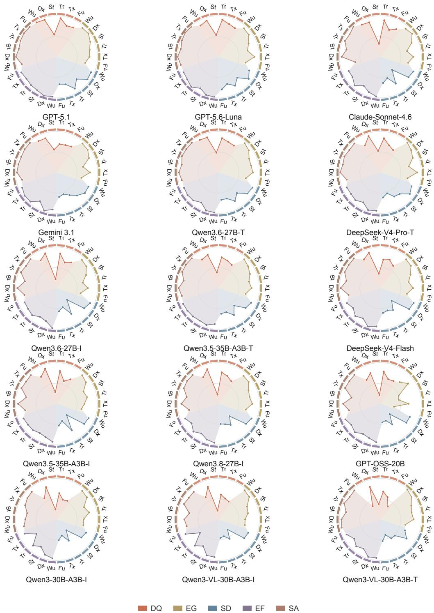  
Radar plots show five dimension scores across six care phases for all 30 text models under Focused formulation in the main clinical evaluation set, including internal and external cohorts. Colours and phase sequence follow Fig. 3d. Scores use a common 0–100 radial scale; the centre is 0 and reference rings are 50 and 100. Wu, work-up; Dx, diagnosis; St, staging; Tr, treatment; Tx, toxicity; Fu, follow-up. I, Instruct; T, Thinking/Think. Full model names are listed in Table S3. Complete scores and eligible evaluation-unit counts are reported in Table S5.

Supplementary Figure 1. Phase- and dimension-specific performance of all 30 models.

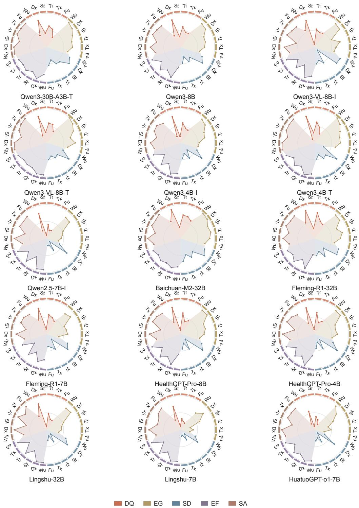  
Model profiles use the same 0–100 radial scale, dimension colours and phase sequence. The centre is 0; the reference rings are 50 and 100. Wu, work-up; Dx, diagnosis; St, staging; Tr, treatment; Tx, toxicity; Fu, follow-up. I, Instruct; T, Thinking/Think. Complete scores and eligible evaluation-unit counts are reported in Table S5.

Supplementary Figure 2. Phase-specific stability of DQ model rankings.

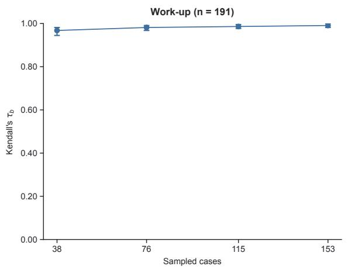

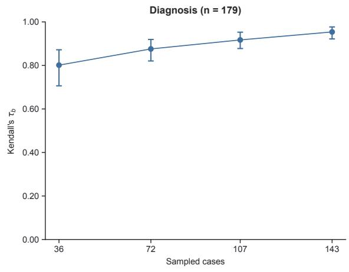

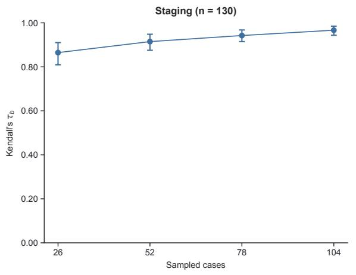

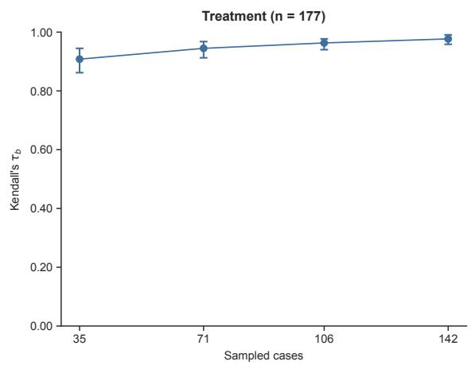

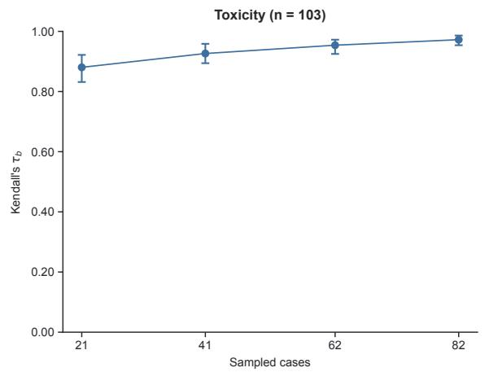

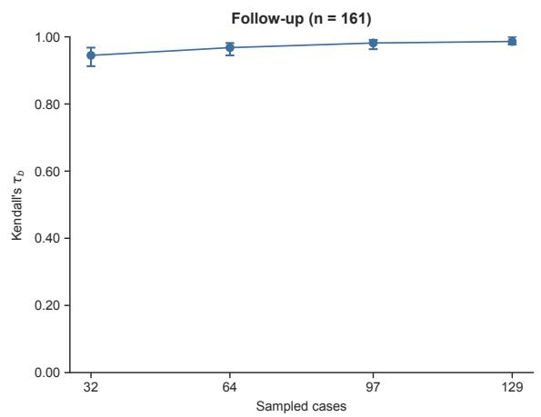  
Each panel compares DQ rankings of all 30 text models in case subsamples with the complete ranking for that care phase under Focused formulation. The main clinical evaluation set includes internal and external cohorts. The panel title gives the phasespecific number of benchmark cases. Subsamples contain approximately 20%, 40%, 60% or 80% of those cases, rounded to the nearest integer, and are drawn without replacement. All models share the same sampled cases in each of 1,000 replicates per sample size. Points show the median Kendall’s tau-b; whiskers show the empirical 5th–95th percentiles. These ranges describe subsampling variability. Complete stability summaries and sample sizes are reported in Table S6.

Supplementary Figure 3. Phase-specific omission and error rates of all 30 models.
<table><tr><td rowspan=1 colspan=2></td><td rowspan=1 colspan=3>Omission</td><td></td><td rowspan=1 colspan=3>Error</td><td rowspan=1 colspan=5>Omission         Error</td><td rowspan=1 colspan=2></td><td></td><td></td><td></td><td></td><td></td><td rowspan=1 colspan=1></td></tr><tr><td></td><td rowspan=1 colspan=1></td><td rowspan=1 colspan=1>DQ</td><td rowspan=1 colspan=1>EG</td><td rowspan=1 colspan=1>SD</td><td rowspan=1 colspan=1>DQ</td><td rowspan=1 colspan=1>EG</td><td rowspan=1 colspan=1>SD</td><td rowspan=1 colspan=1></td><td rowspan=1 colspan=1>DQ</td><td rowspan=1 colspan=1>EG</td><td rowspan=1 colspan=1>SD</td><td rowspan=1 colspan=1>DQ</td><td rowspan=1 colspan=1>EG</td><td rowspan=1 colspan=1>SD</td><td rowspan=1 colspan=1></td><td rowspan=1 colspan=1>DQ</td><td rowspan=1 colspan=1>EG</td><td rowspan=1 colspan=1>SD</td><td rowspan=1 colspan=1>DQ</td><td rowspan=1 colspan=1>EG</td><td rowspan=1 colspan=1>SD</td></tr><tr><td></td><td rowspan=1 colspan=1>Work-up</td><td rowspan=1 colspan=1>2</td><td rowspan=1 colspan=1>3</td><td rowspan=1 colspan=1>5</td><td rowspan=1 colspan=1>0</td><td rowspan=1 colspan=1>1</td><td rowspan=1 colspan=1>0</td><td rowspan=1 colspan=1>Work-up</td><td rowspan=1 colspan=1>10</td><td rowspan=1 colspan=1>3</td><td rowspan=1 colspan=1>3</td><td rowspan=1 colspan=1>1</td><td rowspan=1 colspan=1>0</td><td rowspan=1 colspan=1>0</td><td rowspan=1 colspan=1>Work-up</td><td rowspan=1 colspan=1>7</td><td rowspan=1 colspan=1>6</td><td rowspan=1 colspan=1>1</td><td rowspan=1 colspan=1>0</td><td rowspan=1 colspan=1>0</td><td rowspan=1 colspan=1>1</td></tr><tr><td></td><td rowspan=1 colspan=1>Diagnosis</td><td rowspan=1 colspan=1>4</td><td rowspan=1 colspan=1>2</td><td rowspan=1 colspan=1>0</td><td rowspan=1 colspan=1>4</td><td rowspan=1 colspan=1>0</td><td rowspan=1 colspan=1>3</td><td rowspan=1 colspan=1>Diagnosis</td><td rowspan=1 colspan=1>6</td><td rowspan=1 colspan=1>2</td><td rowspan=1 colspan=1>2</td><td rowspan=1 colspan=1>7</td><td rowspan=1 colspan=1>0</td><td rowspan=1 colspan=1>3</td><td rowspan=1 colspan=1>Diagnosis</td><td rowspan=1 colspan=1>2</td><td rowspan=1 colspan=1>2</td><td rowspan=1 colspan=1>2</td><td rowspan=1 colspan=1>15</td><td rowspan=1 colspan=1>0</td><td rowspan=1 colspan=1>9</td></tr><tr><td></td><td rowspan=1 colspan=1>Staging</td><td rowspan=1 colspan=1>0</td><td rowspan=1 colspan=1>4</td><td rowspan=1 colspan=1>0</td><td rowspan=1 colspan=1>29</td><td rowspan=1 colspan=1>2</td><td rowspan=1 colspan=1>15</td><td rowspan=1 colspan=1>Staging</td><td rowspan=1 colspan=1>0</td><td rowspan=1 colspan=1>7</td><td rowspan=1 colspan=1>0</td><td rowspan=1 colspan=1>30</td><td rowspan=1 colspan=1>4</td><td rowspan=1 colspan=1>18</td><td rowspan=1 colspan=1>Staging</td><td rowspan=1 colspan=1>1</td><td rowspan=1 colspan=1>8</td><td rowspan=1 colspan=1>1</td><td rowspan=1 colspan=1>46</td><td rowspan=1 colspan=1>4</td><td rowspan=1 colspan=1>37</td></tr><tr><td></td><td rowspan=1 colspan=1>Treatment</td><td rowspan=1 colspan=1>1</td><td rowspan=1 colspan=1>15</td><td rowspan=1 colspan=1>6</td><td rowspan=1 colspan=1>2</td><td rowspan=1 colspan=1>1</td><td rowspan=1 colspan=1>0</td><td rowspan=1 colspan=1>Treatment</td><td rowspan=1 colspan=1>3</td><td rowspan=1 colspan=1>24</td><td rowspan=1 colspan=1>11</td><td rowspan=1 colspan=1>3</td><td rowspan=1 colspan=1>1</td><td rowspan=1 colspan=1>1</td><td rowspan=1 colspan=1>Treatment</td><td rowspan=1 colspan=1>4</td><td rowspan=1 colspan=1>23</td><td rowspan=1 colspan=1>16</td><td rowspan=1 colspan=1>2</td><td rowspan=1 colspan=1>7</td><td rowspan=1 colspan=1>2</td></tr><tr><td></td><td rowspan=1 colspan=1>Toxicity</td><td rowspan=1 colspan=1>4</td><td rowspan=1 colspan=1>11</td><td rowspan=1 colspan=1>6</td><td rowspan=1 colspan=1>6</td><td rowspan=1 colspan=1>5</td><td rowspan=1 colspan=1>8</td><td rowspan=1 colspan=1>Toxicity</td><td rowspan=1 colspan=1>3</td><td rowspan=1 colspan=1>3</td><td rowspan=1 colspan=1>8</td><td rowspan=1 colspan=1>2</td><td rowspan=1 colspan=1>3</td><td rowspan=1 colspan=1>4</td><td rowspan=1 colspan=1>Toxicity</td><td rowspan=1 colspan=1>8</td><td rowspan=1 colspan=1>4</td><td rowspan=1 colspan=1>10</td><td rowspan=1 colspan=1>10</td><td rowspan=1 colspan=1>7</td><td rowspan=1 colspan=1>17</td></tr><tr><td></td><td rowspan=1 colspan=1>Follow-up</td><td rowspan=1 colspan=1>8</td><td rowspan=1 colspan=1>20</td><td rowspan=1 colspan=1>8</td><td rowspan=1 colspan=1>1</td><td rowspan=1 colspan=1>3</td><td rowspan=1 colspan=1>6</td><td rowspan=1 colspan=1>Follow-up</td><td rowspan=1 colspan=1>7</td><td rowspan=1 colspan=1>22</td><td rowspan=1 colspan=1>4</td><td rowspan=1 colspan=1>0</td><td rowspan=1 colspan=1>4</td><td rowspan=1 colspan=1>2</td><td rowspan=1 colspan=1>Follow-up</td><td rowspan=1 colspan=1>8</td><td rowspan=1 colspan=1>17</td><td rowspan=1 colspan=1>1</td><td rowspan=1 colspan=1>0</td><td rowspan=1 colspan=1>5</td><td rowspan=1 colspan=1>13</td></tr><tr><td></td><td rowspan=1 colspan=1></td><td rowspan=1 colspan=1>Om</td><td rowspan=1 colspan=1>issio</td><td rowspan=1 colspan=1>GPTn</td><td rowspan=1 colspan=1>-5.1</td><td rowspan=1 colspan=1>Error</td><td rowspan=1 colspan=1></td><td rowspan=1 colspan=1></td><td rowspan=1 colspan=1></td><td rowspan=1 colspan=1>missi</td><td rowspan=1 colspan=1>GPT-5.6</td><td rowspan=1 colspan=1>-Lun</td><td rowspan=1 colspan=1>aError</td><td rowspan=1 colspan=1></td><td rowspan=1 colspan=1></td><td rowspan=1 colspan=1></td><td rowspan=1 colspan=3>Claude-Sonnet-Omission</td><td rowspan=1 colspan=1>4.6Error</td><td rowspan=1 colspan=1></td></tr><tr><td></td><td rowspan=1 colspan=1></td><td rowspan=1 colspan=1>DQ</td><td rowspan=1 colspan=1>EG</td><td rowspan=1 colspan=1>SD</td><td rowspan=1 colspan=1>DQ</td><td rowspan=1 colspan=1>EG</td><td rowspan=1 colspan=1>SD</td><td rowspan=1 colspan=1></td><td rowspan=1 colspan=1>DQ</td><td rowspan=1 colspan=1>EG</td><td rowspan=1 colspan=1>SD</td><td rowspan=1 colspan=1>DQ</td><td rowspan=1 colspan=1>EG</td><td rowspan=1 colspan=1>SD</td><td rowspan=1 colspan=1></td><td rowspan=1 colspan=1>DQ</td><td rowspan=1 colspan=1>EG</td><td rowspan=1 colspan=1>SD</td><td rowspan=1 colspan=1>DQ</td><td rowspan=1 colspan=1>EG</td><td rowspan=1 colspan=1>SD</td></tr><tr><td></td><td rowspan=1 colspan=1>Work-up</td><td rowspan=1 colspan=1>10</td><td rowspan=1 colspan=1>3</td><td rowspan=1 colspan=1>3</td><td rowspan=1 colspan=1>0</td><td rowspan=1 colspan=1>2</td><td rowspan=1 colspan=1>0</td><td rowspan=1 colspan=1>Work-up</td><td rowspan=1 colspan=1>7</td><td rowspan=1 colspan=1>2</td><td rowspan=1 colspan=1>1</td><td rowspan=1 colspan=1>0</td><td rowspan=1 colspan=1>0</td><td rowspan=1 colspan=1>0</td><td rowspan=1 colspan=1>Work-up</td><td rowspan=1 colspan=1>21</td><td rowspan=1 colspan=1>1</td><td rowspan=1 colspan=1>7</td><td rowspan=1 colspan=1>0</td><td rowspan=1 colspan=1>0</td><td rowspan=1 colspan=1>0</td></tr><tr><td></td><td rowspan=1 colspan=1>Diagnosis</td><td rowspan=1 colspan=1>8</td><td rowspan=1 colspan=1>3</td><td rowspan=1 colspan=1>3</td><td rowspan=1 colspan=1>14</td><td rowspan=1 colspan=1>0</td><td rowspan=1 colspan=1>7</td><td rowspan=1 colspan=1>Diagnosis</td><td rowspan=1 colspan=1>6</td><td rowspan=1 colspan=1>2</td><td rowspan=1 colspan=1>2</td><td rowspan=1 colspan=1>13</td><td rowspan=1 colspan=1>0</td><td rowspan=1 colspan=1>6</td><td rowspan=1 colspan=1>Diagnosis</td><td rowspan=1 colspan=1>6</td><td rowspan=1 colspan=1>2</td><td rowspan=1 colspan=1>3</td><td rowspan=1 colspan=1>7</td><td rowspan=1 colspan=1>0</td><td rowspan=1 colspan=1>5</td></tr><tr><td></td><td rowspan=1 colspan=1>Staging</td><td rowspan=1 colspan=1>0</td><td rowspan=1 colspan=1>8</td><td rowspan=1 colspan=1>1</td><td rowspan=1 colspan=1>28</td><td rowspan=1 colspan=1>2</td><td rowspan=1 colspan=1>13</td><td rowspan=1 colspan=1>Staging</td><td rowspan=1 colspan=1>0</td><td rowspan=1 colspan=1>7</td><td rowspan=1 colspan=1>0</td><td rowspan=1 colspan=1>33</td><td rowspan=1 colspan=1>4</td><td rowspan=1 colspan=1>19</td><td rowspan=1 colspan=1>Staging</td><td rowspan=1 colspan=1>0</td><td rowspan=1 colspan=1>7</td><td rowspan=1 colspan=1>1</td><td rowspan=1 colspan=1>30</td><td rowspan=1 colspan=1>2</td><td rowspan=1 colspan=1>17</td></tr><tr><td></td><td rowspan=1 colspan=1>Treatment</td><td rowspan=1 colspan=1>20</td><td rowspan=1 colspan=1>28</td><td rowspan=1 colspan=1>28</td><td rowspan=1 colspan=1>1</td><td rowspan=1 colspan=1>4</td><td rowspan=1 colspan=1>2</td><td rowspan=1 colspan=1>Treatment</td><td rowspan=1 colspan=1>8</td><td rowspan=1 colspan=1>13</td><td rowspan=1 colspan=1>12</td><td rowspan=1 colspan=1>2</td><td rowspan=1 colspan=1>3</td><td rowspan=1 colspan=1>1</td><td rowspan=1 colspan=1>Treatment</td><td rowspan=1 colspan=1>10</td><td rowspan=1 colspan=1>19</td><td rowspan=1 colspan=1>23</td><td rowspan=1 colspan=1>2</td><td rowspan=1 colspan=1>6</td><td rowspan=1 colspan=1>1</td></tr><tr><td></td><td rowspan=1 colspan=1>Toxicity</td><td rowspan=1 colspan=1>11</td><td rowspan=1 colspan=1>7</td><td rowspan=1 colspan=1>24</td><td rowspan=1 colspan=1>3</td><td rowspan=1 colspan=1>3</td><td rowspan=1 colspan=1>5</td><td rowspan=1 colspan=1>Toxicity</td><td rowspan=1 colspan=1>4</td><td rowspan=1 colspan=1>6</td><td rowspan=1 colspan=1>5</td><td rowspan=1 colspan=1>3</td><td rowspan=1 colspan=1>4</td><td rowspan=1 colspan=1>8</td><td rowspan=1 colspan=1>Toxicity</td><td rowspan=1 colspan=1>6</td><td rowspan=1 colspan=1>2</td><td rowspan=1 colspan=1>15</td><td rowspan=1 colspan=1>6</td><td rowspan=1 colspan=1>3</td><td rowspan=1 colspan=1>11</td></tr><tr><td></td><td rowspan=1 colspan=1>Follow-up</td><td rowspan=1 colspan=1>12</td><td rowspan=1 colspan=1>28</td><td rowspan=1 colspan=1>8</td><td rowspan=1 colspan=1>1</td><td rowspan=1 colspan=1>5</td><td rowspan=1 colspan=1>10</td><td rowspan=1 colspan=1>Follow-up</td><td rowspan=1 colspan=1>11</td><td rowspan=1 colspan=1>19</td><td rowspan=1 colspan=1>2</td><td rowspan=1 colspan=1>0</td><td rowspan=1 colspan=1>4</td><td rowspan=1 colspan=1>9</td><td rowspan=1 colspan=1>Follow-up</td><td rowspan=1 colspan=1>21</td><td rowspan=1 colspan=1>22</td><td rowspan=1 colspan=1>6</td><td rowspan=1 colspan=1>1</td><td rowspan=1 colspan=1>3</td><td rowspan=1 colspan=1>10</td></tr><tr><td></td><td rowspan=1 colspan=1></td><td rowspan=1 colspan=1>Om</td><td rowspan=1 colspan=1>issio</td><td rowspan=1 colspan=1>Geminin</td><td rowspan=1 colspan=1>3.1</td><td rowspan=1 colspan=1>Error</td><td rowspan=1 colspan=1></td><td rowspan=1 colspan=1></td><td rowspan=1 colspan=1></td><td rowspan=1 colspan=1>QOmission</td><td rowspan=1 colspan=2>wen3.6-27B-</td><td rowspan=1 colspan=1>TError</td><td rowspan=1 colspan=1></td><td rowspan=1 colspan=1></td><td rowspan=1 colspan=1></td><td rowspan=1 colspan=1>DeepOmission</td><td rowspan=1 colspan=1>Seek</td><td rowspan=1 colspan=1>-V4-Pr</td><td rowspan=1 colspan=1>o-TError</td><td rowspan=1 colspan=1></td></tr><tr><td></td><td rowspan=1 colspan=1></td><td rowspan=1 colspan=1>DQ</td><td rowspan=1 colspan=1>EG</td><td rowspan=1 colspan=1>SD</td><td rowspan=1 colspan=1>DQ</td><td rowspan=1 colspan=1>EG</td><td rowspan=1 colspan=1>SD</td><td rowspan=1 colspan=1></td><td rowspan=1 colspan=1>DQ</td><td rowspan=1 colspan=1>EG</td><td rowspan=1 colspan=1>SD</td><td rowspan=1 colspan=1>DQ</td><td rowspan=1 colspan=1>EG</td><td rowspan=1 colspan=1>SD</td><td rowspan=1 colspan=1></td><td rowspan=1 colspan=1>DQ</td><td rowspan=1 colspan=1>EG</td><td rowspan=1 colspan=1>SD</td><td rowspan=1 colspan=1>DQ</td><td rowspan=1 colspan=1>EG</td><td rowspan=1 colspan=1>SD</td></tr><tr><td></td><td rowspan=1 colspan=1>Work-up</td><td rowspan=1 colspan=1>15</td><td rowspan=1 colspan=1>5</td><td rowspan=1 colspan=1>2</td><td rowspan=1 colspan=1>0</td><td rowspan=1 colspan=1>0</td><td rowspan=1 colspan=1>0</td><td rowspan=1 colspan=1>Work-up</td><td rowspan=1 colspan=1>16</td><td rowspan=1 colspan=1>3</td><td rowspan=1 colspan=1>3</td><td rowspan=1 colspan=1>0</td><td rowspan=1 colspan=1>0</td><td rowspan=1 colspan=1>0</td><td rowspan=1 colspan=1>Work-up</td><td rowspan=1 colspan=1>15</td><td rowspan=1 colspan=1>3</td><td rowspan=1 colspan=1>2</td><td rowspan=1 colspan=1>0</td><td rowspan=1 colspan=1>1</td><td rowspan=1 colspan=1>1</td></tr><tr><td></td><td rowspan=1 colspan=1>Diagnosis</td><td rowspan=1 colspan=1>7</td><td rowspan=1 colspan=1>2</td><td rowspan=1 colspan=1>4</td><td rowspan=1 colspan=1>12</td><td rowspan=1 colspan=1>0</td><td rowspan=1 colspan=1>8</td><td rowspan=1 colspan=1>Diagnosis</td><td rowspan=1 colspan=1>11</td><td rowspan=1 colspan=1>3</td><td rowspan=1 colspan=1>4</td><td rowspan=1 colspan=1>17</td><td rowspan=1 colspan=1>0</td><td rowspan=1 colspan=1>9</td><td rowspan=1 colspan=1>Diagnosis</td><td rowspan=1 colspan=1>4</td><td rowspan=1 colspan=1>3</td><td rowspan=1 colspan=1>3</td><td rowspan=1 colspan=1>10</td><td rowspan=1 colspan=1>0</td><td rowspan=1 colspan=1>6</td></tr><tr><td></td><td rowspan=1 colspan=1>Staging</td><td rowspan=1 colspan=1>1</td><td rowspan=1 colspan=1>14</td><td rowspan=1 colspan=1>1</td><td rowspan=1 colspan=1>54</td><td rowspan=1 colspan=1>4</td><td rowspan=1 colspan=1>42</td><td rowspan=1 colspan=1>Staging</td><td rowspan=1 colspan=1>4</td><td rowspan=1 colspan=1>8</td><td rowspan=1 colspan=1>4</td><td rowspan=1 colspan=1>38</td><td rowspan=1 colspan=1>2</td><td rowspan=1 colspan=1>22</td><td rowspan=1 colspan=1>Staging</td><td rowspan=1 colspan=1>1</td><td rowspan=1 colspan=1>7</td><td rowspan=1 colspan=1>0</td><td rowspan=1 colspan=1>43</td><td rowspan=1 colspan=1>6</td><td rowspan=1 colspan=1>40</td></tr><tr><td></td><td rowspan=1 colspan=1>Treatment</td><td rowspan=1 colspan=1>8</td><td rowspan=1 colspan=1>28</td><td rowspan=1 colspan=1>16</td><td rowspan=1 colspan=1>3</td><td rowspan=1 colspan=1>5</td><td rowspan=1 colspan=1>2</td><td rowspan=1 colspan=1>Treatment</td><td rowspan=1 colspan=1>15</td><td rowspan=1 colspan=1>16</td><td rowspan=1 colspan=1>15</td><td rowspan=1 colspan=1>1</td><td rowspan=1 colspan=1>5</td><td rowspan=1 colspan=1>1</td><td rowspan=1 colspan=1>Treatment</td><td rowspan=1 colspan=1>17</td><td rowspan=1 colspan=1>24</td><td rowspan=1 colspan=1>26</td><td rowspan=1 colspan=1>4</td><td rowspan=1 colspan=1>4</td><td rowspan=1 colspan=1>3</td></tr><tr><td></td><td rowspan=1 colspan=1>Toxicity</td><td rowspan=1 colspan=1>10</td><td rowspan=1 colspan=1>12</td><td rowspan=1 colspan=1>17</td><td rowspan=1 colspan=1>4</td><td rowspan=1 colspan=1>5</td><td rowspan=1 colspan=1>8</td><td rowspan=1 colspan=1>Toxicity</td><td rowspan=1 colspan=1>7</td><td rowspan=1 colspan=1>10</td><td rowspan=1 colspan=1>10</td><td rowspan=1 colspan=1>3</td><td rowspan=1 colspan=1>1</td><td rowspan=1 colspan=1>6</td><td rowspan=1 colspan=1>Toxicity</td><td rowspan=1 colspan=1>5</td><td rowspan=1 colspan=1>8</td><td rowspan=1 colspan=1>12</td><td rowspan=1 colspan=1>5</td><td rowspan=1 colspan=1>3</td><td rowspan=1 colspan=1>8</td></tr><tr><td></td><td rowspan=1 colspan=1>Follow-up</td><td rowspan=1 colspan=1>13</td><td rowspan=1 colspan=1>25</td><td rowspan=1 colspan=1>5</td><td rowspan=1 colspan=1>1</td><td rowspan=1 colspan=1>6</td><td rowspan=1 colspan=1>15</td><td rowspan=1 colspan=1>Follow-up</td><td rowspan=1 colspan=1>17</td><td rowspan=1 colspan=1>17</td><td rowspan=1 colspan=1>4</td><td rowspan=1 colspan=1>0</td><td rowspan=1 colspan=1>3</td><td rowspan=1 colspan=1>8</td><td rowspan=1 colspan=1>Follow-up</td><td rowspan=1 colspan=1>19</td><td rowspan=1 colspan=1>23</td><td rowspan=1 colspan=1>5</td><td rowspan=1 colspan=1>0</td><td rowspan=1 colspan=1>3</td><td rowspan=1 colspan=1>11</td></tr><tr><td></td><td rowspan=1 colspan=1></td><td rowspan=1 colspan=1>Om</td><td rowspan=1 colspan=1>Qissio</td><td rowspan=1 colspan=1>wen3.6n</td><td rowspan=1 colspan=1>-27B-</td><td rowspan=1 colspan=1>IError</td><td rowspan=1 colspan=1></td><td rowspan=1 colspan=1></td><td rowspan=1 colspan=1></td><td rowspan=1 colspan=2>Qwen3.5-3Omission</td><td rowspan=1 colspan=1>5B-A3</td><td rowspan=1 colspan=1>B-TError</td><td rowspan=1 colspan=1></td><td rowspan=1 colspan=1></td><td rowspan=1 colspan=1>O</td><td rowspan=1 colspan=2>DeepSeekmission</td><td rowspan=1 colspan=1>-V4-Fl</td><td rowspan=1 colspan=1>ashError</td><td rowspan=1 colspan=1></td></tr><tr><td></td><td rowspan=1 colspan=1></td><td rowspan=1 colspan=1>DQ</td><td rowspan=1 colspan=1>EG</td><td rowspan=1 colspan=1>SD</td><td rowspan=1 colspan=1>DQ</td><td rowspan=1 colspan=1>EG</td><td rowspan=1 colspan=1>SD</td><td rowspan=1 colspan=1></td><td rowspan=1 colspan=1>DQ</td><td rowspan=1 colspan=1>EG</td><td rowspan=1 colspan=1>SD</td><td rowspan=1 colspan=1>DQ</td><td rowspan=1 colspan=1>EG</td><td rowspan=1 colspan=1>SD</td><td rowspan=1 colspan=1></td><td rowspan=1 colspan=1>DQ</td><td rowspan=1 colspan=1>EG</td><td rowspan=1 colspan=1>SD</td><td rowspan=1 colspan=1>DQ</td><td rowspan=1 colspan=1>EG</td><td rowspan=1 colspan=1>SD</td></tr><tr><td></td><td rowspan=1 colspan=1>Work-up</td><td rowspan=1 colspan=1>18</td><td rowspan=1 colspan=1>2</td><td rowspan=1 colspan=1>5</td><td rowspan=1 colspan=1>0</td><td rowspan=1 colspan=1>1</td><td rowspan=1 colspan=1>1</td><td rowspan=1 colspan=1>Work-up</td><td rowspan=1 colspan=1>15</td><td rowspan=1 colspan=1>5</td><td rowspan=1 colspan=1>3</td><td rowspan=1 colspan=1>0</td><td rowspan=1 colspan=1>1</td><td rowspan=1 colspan=1>1</td><td rowspan=1 colspan=1>Work-up</td><td rowspan=1 colspan=1>18</td><td rowspan=1 colspan=1>26</td><td rowspan=1 colspan=1>7</td><td rowspan=1 colspan=1>0</td><td rowspan=1 colspan=1>3</td><td rowspan=1 colspan=1>1</td></tr><tr><td></td><td rowspan=1 colspan=1>Diagnosis</td><td rowspan=1 colspan=1>7</td><td rowspan=1 colspan=1>3</td><td rowspan=1 colspan=1>2</td><td rowspan=1 colspan=1>9</td><td rowspan=1 colspan=1>0</td><td rowspan=1 colspan=1>8</td><td rowspan=1 colspan=1>Diagnosis</td><td rowspan=1 colspan=1>7</td><td rowspan=1 colspan=1>2</td><td rowspan=1 colspan=1>2</td><td rowspan=1 colspan=1>12</td><td rowspan=1 colspan=1>0</td><td rowspan=1 colspan=1>9</td><td rowspan=1 colspan=1>Diagnosis</td><td rowspan=1 colspan=1>17</td><td rowspan=1 colspan=1>8</td><td rowspan=1 colspan=1>5</td><td rowspan=1 colspan=1>20</td><td rowspan=1 colspan=1>1</td><td rowspan=1 colspan=1>10</td></tr><tr><td></td><td rowspan=1 colspan=1>Staging</td><td rowspan=1 colspan=1>1</td><td rowspan=1 colspan=1>19</td><td rowspan=1 colspan=1>3</td><td rowspan=1 colspan=1>48</td><td rowspan=1 colspan=1>3</td><td rowspan=1 colspan=1>41</td><td rowspan=1 colspan=1>Staging</td><td rowspan=1 colspan=1>0</td><td rowspan=1 colspan=1>9</td><td rowspan=1 colspan=1>0</td><td rowspan=1 colspan=1>54</td><td rowspan=1 colspan=1>4</td><td rowspan=1 colspan=1>40</td><td rowspan=1 colspan=1>Staging</td><td rowspan=1 colspan=1>28</td><td rowspan=1 colspan=1>37</td><td rowspan=1 colspan=1>29</td><td rowspan=1 colspan=1>34</td><td rowspan=1 colspan=1>5</td><td rowspan=1 colspan=1>24</td></tr><tr><td></td><td rowspan=1 colspan=1>Treatment</td><td rowspan=1 colspan=1>11</td><td rowspan=1 colspan=1>21</td><td rowspan=1 colspan=1>13</td><td rowspan=1 colspan=1>3</td><td rowspan=1 colspan=1>2</td><td rowspan=1 colspan=1>2</td><td rowspan=1 colspan=1>Treatment</td><td rowspan=1 colspan=1>11</td><td rowspan=1 colspan=1>15</td><td rowspan=1 colspan=1>26</td><td rowspan=1 colspan=1>3</td><td rowspan=1 colspan=1>4</td><td rowspan=1 colspan=1>4</td><td rowspan=1 colspan=1>Treatment</td><td rowspan=1 colspan=1>11</td><td rowspan=1 colspan=1>46</td><td rowspan=1 colspan=1>30</td><td rowspan=1 colspan=1>3</td><td rowspan=1 colspan=1>5</td><td rowspan=1 colspan=1>2</td></tr><tr><td></td><td rowspan=1 colspan=1>Toxicity</td><td rowspan=1 colspan=1>15</td><td rowspan=1 colspan=1>15</td><td rowspan=1 colspan=1>22</td><td rowspan=1 colspan=1>6</td><td rowspan=1 colspan=1>7</td><td rowspan=1 colspan=1>8</td><td rowspan=1 colspan=1>Toxicity</td><td rowspan=1 colspan=1>6</td><td rowspan=1 colspan=1>6</td><td rowspan=1 colspan=1>19</td><td rowspan=1 colspan=1>4</td><td rowspan=1 colspan=1>4</td><td rowspan=1 colspan=1>6</td><td rowspan=1 colspan=1>Toxicity</td><td rowspan=1 colspan=1>14</td><td rowspan=1 colspan=1>21</td><td rowspan=1 colspan=1>25</td><td rowspan=1 colspan=1>5</td><td rowspan=1 colspan=1>5</td><td rowspan=1 colspan=1>8</td></tr><tr><td></td><td rowspan=1 colspan=1>Follow-up</td><td rowspan=1 colspan=1>13</td><td rowspan=1 colspan=1>24</td><td rowspan=1 colspan=1>5</td><td rowspan=1 colspan=1>1</td><td rowspan=1 colspan=1>5</td><td rowspan=1 colspan=1>17</td><td rowspan=1 colspan=1>Follow-up</td><td rowspan=1 colspan=1>16</td><td rowspan=1 colspan=1>21</td><td rowspan=1 colspan=1>6</td><td rowspan=1 colspan=1>1</td><td rowspan=1 colspan=1>5</td><td rowspan=1 colspan=1>18</td><td rowspan=1 colspan=1>Follow-up</td><td rowspan=1 colspan=1>20</td><td rowspan=1 colspan=1>57</td><td rowspan=1 colspan=1>15</td><td rowspan=1 colspan=1>1</td><td rowspan=1 colspan=1>5</td><td rowspan=1 colspan=1>11</td></tr><tr><td></td><td rowspan=1 colspan=1></td><td rowspan=1 colspan=1>Om</td><td rowspan=1 colspan=1>Qweissio</td><td rowspan=1 colspan=1>n3.5-3n</td><td rowspan=1 colspan=1>5B-A3</td><td rowspan=1 colspan=1>B-IError</td><td rowspan=1 colspan=1></td><td rowspan=1 colspan=1></td><td rowspan=1 colspan=1></td><td rowspan=1 colspan=1>QOmission</td><td rowspan=1 colspan=1>wen3.</td><td rowspan=1 colspan=1>8-27B-</td><td rowspan=1 colspan=1>IError</td><td rowspan=1 colspan=1></td><td rowspan=1 colspan=1></td><td rowspan=1 colspan=1></td><td rowspan=1 colspan=1>Omissio</td><td rowspan=1 colspan=1>n</td><td rowspan=1 colspan=1>GPT-OSS-20B</td><td rowspan=1 colspan=1>Error</td><td rowspan=1 colspan=1></td></tr><tr><td rowspan=1 colspan=1></td><td rowspan=1 colspan=1></td><td rowspan=1 colspan=1>DQ</td><td rowspan=1 colspan=1>EG</td><td rowspan=1 colspan=1>SD</td><td rowspan=1 colspan=1>DQ</td><td rowspan=1 colspan=1>EG</td><td rowspan=1 colspan=1>SD</td><td rowspan=1 colspan=1></td><td rowspan=1 colspan=1>DQ</td><td rowspan=1 colspan=1>EG</td><td rowspan=1 colspan=1>SD</td><td rowspan=1 colspan=1>DQ</td><td rowspan=1 colspan=1>EG</td><td rowspan=1 colspan=1>SD</td><td rowspan=1 colspan=1></td><td rowspan=1 colspan=1>DQ</td><td rowspan=1 colspan=1>EG</td><td rowspan=1 colspan=1>SD</td><td rowspan=1 colspan=1>DQ</td><td rowspan=1 colspan=1>EG</td><td rowspan=1 colspan=1>SD</td></tr><tr><td rowspan=1 colspan=1></td><td rowspan=1 colspan=1>Work-up</td><td rowspan=1 colspan=1>27</td><td rowspan=1 colspan=1>3</td><td rowspan=1 colspan=1>10</td><td rowspan=1 colspan=1>0</td><td rowspan=1 colspan=1>2</td><td rowspan=1 colspan=1>1</td><td rowspan=1 colspan=1>Work-up</td><td rowspan=1 colspan=1>23</td><td rowspan=1 colspan=1>2</td><td rowspan=1 colspan=1>6</td><td rowspan=1 colspan=1>0</td><td rowspan=1 colspan=1>1</td><td rowspan=1 colspan=1>1</td><td rowspan=1 colspan=1>Work-up</td><td rowspan=1 colspan=1>50</td><td rowspan=1 colspan=1>0</td><td rowspan=1 colspan=1>26</td><td rowspan=1 colspan=1>0</td><td rowspan=1 colspan=1>0</td><td rowspan=1 colspan=1>0</td></tr><tr><td rowspan=1 colspan=1></td><td rowspan=1 colspan=1>Diagnosis</td><td rowspan=1 colspan=1>14</td><td rowspan=1 colspan=1>4</td><td rowspan=1 colspan=1>6</td><td rowspan=1 colspan=1>17</td><td rowspan=1 colspan=1>1</td><td rowspan=1 colspan=1>12</td><td rowspan=1 colspan=1>Diagnosis</td><td rowspan=1 colspan=1>12</td><td rowspan=1 colspan=1>4</td><td rowspan=1 colspan=1>6</td><td rowspan=1 colspan=1>18</td><td rowspan=1 colspan=1>0</td><td rowspan=1 colspan=1>11</td><td rowspan=1 colspan=1>Diagnosis</td><td rowspan=1 colspan=1>14</td><td rowspan=1 colspan=1>3</td><td rowspan=1 colspan=1>5</td><td rowspan=1 colspan=1>19</td><td rowspan=1 colspan=1>0</td><td rowspan=1 colspan=1>11</td></tr><tr><td rowspan=1 colspan=1></td><td rowspan=1 colspan=1>Staging</td><td rowspan=1 colspan=1>1</td><td rowspan=1 colspan=1>13</td><td rowspan=1 colspan=1>0</td><td rowspan=1 colspan=1>52</td><td rowspan=1 colspan=1>6</td><td rowspan=1 colspan=1>42</td><td rowspan=1 colspan=1>Staging</td><td rowspan=1 colspan=1>0</td><td rowspan=1 colspan=1>13</td><td rowspan=1 colspan=1>1</td><td rowspan=1 colspan=1>56</td><td rowspan=1 colspan=1>4</td><td rowspan=1 colspan=1>43</td><td rowspan=1 colspan=1>Staging</td><td rowspan=1 colspan=1>3</td><td rowspan=1 colspan=1>13</td><td rowspan=1 colspan=1>4</td><td rowspan=1 colspan=1>39</td><td rowspan=1 colspan=1>1</td><td rowspan=1 colspan=1>27</td></tr><tr><td rowspan=1 colspan=1></td><td rowspan=1 colspan=1>Treatment</td><td rowspan=1 colspan=1>21</td><td rowspan=1 colspan=1>13</td><td rowspan=1 colspan=1>20</td><td rowspan=1 colspan=1>5</td><td rowspan=1 colspan=1>4</td><td rowspan=1 colspan=1>6</td><td rowspan=1 colspan=1>Treatment</td><td rowspan=1 colspan=1>25</td><td rowspan=1 colspan=1>21</td><td rowspan=1 colspan=1>33</td><td rowspan=1 colspan=1>4</td><td rowspan=1 colspan=1>4</td><td rowspan=1 colspan=1>5</td><td rowspan=1 colspan=1>Treatment</td><td rowspan=1 colspan=1>21</td><td rowspan=1 colspan=1>17</td><td rowspan=1 colspan=1>32</td><td rowspan=1 colspan=1>2</td><td rowspan=1 colspan=1>4</td><td rowspan=1 colspan=1>5</td></tr><tr><td rowspan=1 colspan=1></td><td rowspan=1 colspan=1>Toxicity</td><td rowspan=1 colspan=1>16</td><td rowspan=1 colspan=1>18</td><td rowspan=1 colspan=1>22</td><td rowspan=1 colspan=1>9</td><td rowspan=1 colspan=1>8</td><td rowspan=1 colspan=1>10</td><td rowspan=1 colspan=1>Toxicity</td><td rowspan=1 colspan=1>13</td><td rowspan=1 colspan=1>19</td><td rowspan=1 colspan=1>23</td><td rowspan=1 colspan=1>8</td><td rowspan=1 colspan=1>8</td><td rowspan=1 colspan=1>7</td><td rowspan=1 colspan=1>Toxicity</td><td rowspan=1 colspan=1>15</td><td rowspan=1 colspan=1>11</td><td rowspan=1 colspan=1>29</td><td rowspan=1 colspan=1>5</td><td rowspan=1 colspan=1>3</td><td rowspan=1 colspan=1>6</td></tr><tr><td rowspan=1 colspan=1>F</td><td rowspan=1 colspan=1>ollow-up</td><td rowspan=1 colspan=1>32</td><td rowspan=1 colspan=1>24</td><td rowspan=1 colspan=1>2</td><td rowspan=1 colspan=1>1</td><td rowspan=1 colspan=1>6</td><td rowspan=1 colspan=1>14</td><td rowspan=1 colspan=1>Follow-up</td><td rowspan=1 colspan=1>28</td><td rowspan=1 colspan=1>19</td><td rowspan=1 colspan=1>6</td><td rowspan=1 colspan=1>1</td><td rowspan=1 colspan=1>7</td><td rowspan=1 colspan=1>16</td><td rowspan=1 colspan=1>Follow-up</td><td rowspan=1 colspan=1>48</td><td rowspan=1 colspan=1>29</td><td rowspan=1 colspan=1>8</td><td rowspan=1 colspan=1>1</td><td rowspan=1 colspan=1>4</td><td rowspan=1 colspan=1>13</td></tr><tr><td rowspan=1 colspan=22>Qwen3-30B-A3B-I                          Qwen3-VL-30B-A3B-I                        Qwen3-VL-30B-A3B-TOmission (%)                                      Error (%)0          50          100                   0           50          100</td></tr></table>

Each model panel shows six care phases and the six atomic failure classes under Focused formulation in the main clinical evaluation set, including internal and external cohorts. Columns DQ, EG and SD denote decision, evidence and status-assessment failures, respectively. Blue denotes omission and terracotta denotes error, following Fig. 4b. Each rate divides the corresponding failure count by the preset applicable Rubric item total for that model, phase and dimension. Met and Partial remain in the denominator; EF and SA are excluded from these applicable items. Colours use a common 0–100% scale; cell labels show rounded integer percentages. I, Instruct; T, Thinking/Think. Full model names are listed in Table S3.

Supplementary Figure 3. Phase-specific omission and error rates of all 30 models.
<table><tr><td rowspan=2 colspan=2></td><td rowspan=1 colspan=3>Omission</td><td rowspan=1 colspan=1></td><td rowspan=1 colspan=6>Error                    Omission</td><td rowspan=1 colspan=2>Error</td><td rowspan=1 colspan=5>Omission</td><td rowspan=1 colspan=1></td><td rowspan=1 colspan=1>Error</td><td rowspan=1 colspan=1></td></tr><tr><td rowspan=1 colspan=1></td><td rowspan=1 colspan=1>DQ</td><td rowspan=1 colspan=1>EG</td><td rowspan=1 colspan=1>SD</td><td rowspan=1 colspan=1>DQ</td><td rowspan=1 colspan=1>EG</td><td rowspan=1 colspan=1>SD</td><td rowspan=1 colspan=1></td><td rowspan=1 colspan=1>DQ</td><td rowspan=1 colspan=1>EG</td><td rowspan=1 colspan=1>SD</td><td rowspan=1 colspan=1>DQ</td><td rowspan=1 colspan=1>EG</td><td rowspan=1 colspan=1>SD</td><td rowspan=1 colspan=1></td><td rowspan=1 colspan=1>DQ</td><td rowspan=1 colspan=1>EG</td><td rowspan=1 colspan=1>SD</td><td rowspan=1 colspan=1>DQ</td><td rowspan=1 colspan=1>EG</td><td rowspan=1 colspan=1>SD</td></tr><tr><td rowspan=1 colspan=1></td><td rowspan=1 colspan=1>Work-up</td><td rowspan=1 colspan=1>47</td><td rowspan=1 colspan=1>0</td><td rowspan=1 colspan=1>20</td><td rowspan=1 colspan=1>0</td><td rowspan=1 colspan=1>1</td><td rowspan=1 colspan=1>1</td><td rowspan=1 colspan=1>Work-up</td><td rowspan=1 colspan=1>45</td><td rowspan=1 colspan=1>0</td><td rowspan=1 colspan=1>20</td><td rowspan=1 colspan=1>0</td><td rowspan=1 colspan=1>5</td><td rowspan=1 colspan=1>0</td><td rowspan=1 colspan=1>Work-up</td><td rowspan=1 colspan=1>32</td><td rowspan=1 colspan=1>3</td><td rowspan=1 colspan=1>7</td><td rowspan=1 colspan=1>0</td><td rowspan=1 colspan=1>2</td><td rowspan=1 colspan=1>1</td></tr><tr><td rowspan=1 colspan=1>D</td><td rowspan=1 colspan=1>iagnosis</td><td rowspan=1 colspan=1>14</td><td rowspan=1 colspan=1>4</td><td rowspan=1 colspan=1>5</td><td rowspan=1 colspan=1>19</td><td rowspan=1 colspan=1>0</td><td rowspan=1 colspan=1>9</td><td rowspan=1 colspan=1>Diagnosis</td><td rowspan=1 colspan=1>11</td><td rowspan=1 colspan=1>4</td><td rowspan=1 colspan=1>6</td><td rowspan=1 colspan=1>17</td><td rowspan=1 colspan=1>1</td><td rowspan=1 colspan=1>9</td><td rowspan=1 colspan=1>Diagnosis</td><td rowspan=1 colspan=1>13</td><td rowspan=1 colspan=1>3</td><td rowspan=1 colspan=1>4</td><td rowspan=1 colspan=1>20</td><td rowspan=1 colspan=1>0</td><td rowspan=1 colspan=1>10</td></tr><tr><td rowspan=1 colspan=1></td><td rowspan=1 colspan=1>Staging</td><td rowspan=1 colspan=1>0</td><td rowspan=1 colspan=1>10</td><td rowspan=1 colspan=1>1</td><td rowspan=1 colspan=1>39</td><td rowspan=1 colspan=1>2</td><td rowspan=1 colspan=1>24</td><td rowspan=1 colspan=1>Staging</td><td rowspan=1 colspan=1>2</td><td rowspan=1 colspan=1>14</td><td rowspan=1 colspan=1>2</td><td rowspan=1 colspan=1>46</td><td rowspan=1 colspan=1>3</td><td rowspan=1 colspan=1>38</td><td rowspan=1 colspan=1>Staging</td><td rowspan=1 colspan=1>0</td><td rowspan=1 colspan=1>17</td><td rowspan=1 colspan=1>2</td><td rowspan=1 colspan=1>72</td><td rowspan=1 colspan=1>15</td><td rowspan=1 colspan=1>69</td></tr><tr><td rowspan=1 colspan=1>T</td><td rowspan=1 colspan=1>reatment</td><td rowspan=1 colspan=1>26</td><td rowspan=1 colspan=1>18</td><td rowspan=1 colspan=1>33</td><td rowspan=1 colspan=1>2</td><td rowspan=1 colspan=1>4</td><td rowspan=1 colspan=1>3</td><td rowspan=1 colspan=1>Treatment</td><td rowspan=1 colspan=1>26</td><td rowspan=1 colspan=1>21</td><td rowspan=1 colspan=1>39</td><td rowspan=1 colspan=1>3</td><td rowspan=1 colspan=1>3</td><td rowspan=1 colspan=1>4</td><td rowspan=1 colspan=1>Treatment</td><td rowspan=1 colspan=1>30</td><td rowspan=1 colspan=1>19</td><td rowspan=1 colspan=1>34</td><td rowspan=1 colspan=1>4</td><td rowspan=1 colspan=1>3</td><td rowspan=1 colspan=1>5</td></tr><tr><td rowspan=1 colspan=1></td><td rowspan=1 colspan=1>Toxicity</td><td rowspan=1 colspan=1>18</td><td rowspan=1 colspan=1>14</td><td rowspan=1 colspan=1>30</td><td rowspan=1 colspan=1>4</td><td rowspan=1 colspan=1>4</td><td rowspan=1 colspan=1>6</td><td rowspan=1 colspan=1>Toxicity</td><td rowspan=1 colspan=1>21</td><td rowspan=1 colspan=1>16</td><td rowspan=1 colspan=1>35</td><td rowspan=1 colspan=1>9</td><td rowspan=1 colspan=1>4</td><td rowspan=1 colspan=1>9</td><td rowspan=1 colspan=1>Toxicity</td><td rowspan=1 colspan=1>14</td><td rowspan=1 colspan=1>21</td><td rowspan=1 colspan=1>18</td><td rowspan=1 colspan=1>13</td><td rowspan=1 colspan=1>6</td><td rowspan=1 colspan=1>13</td></tr><tr><td></td><td rowspan=1 colspan=1>Follow-up</td><td rowspan=1 colspan=1>53</td><td rowspan=1 colspan=1>29</td><td rowspan=1 colspan=1>7</td><td rowspan=1 colspan=1>1</td><td rowspan=1 colspan=1>2</td><td rowspan=1 colspan=1>14</td><td rowspan=1 colspan=1>Follow-up</td><td rowspan=1 colspan=1>33</td><td rowspan=1 colspan=1>30</td><td rowspan=1 colspan=1>15</td><td rowspan=1 colspan=1>1</td><td rowspan=1 colspan=1>7</td><td rowspan=1 colspan=1>10</td><td rowspan=1 colspan=1>Follow-up</td><td rowspan=1 colspan=1>33</td><td rowspan=1 colspan=1>25</td><td rowspan=1 colspan=1>9</td><td rowspan=1 colspan=1>1</td><td rowspan=1 colspan=1>9</td><td rowspan=1 colspan=1>14</td></tr><tr><td></td><td rowspan=1 colspan=1></td><td rowspan=1 colspan=1>Om</td><td rowspan=1 colspan=1>Qweissio</td><td rowspan=1 colspan=1>n3-30n</td><td rowspan=1 colspan=1>B-A3B</td><td rowspan=1 colspan=1>-TError</td><td rowspan=1 colspan=1></td><td rowspan=1 colspan=1></td><td rowspan=1 colspan=1>Om</td><td rowspan=1 colspan=1>issio</td><td rowspan=1 colspan=1>Qwenn</td><td rowspan=1 colspan=1>3-8B</td><td rowspan=1 colspan=1>Error</td><td rowspan=1 colspan=1></td><td rowspan=1 colspan=1></td><td rowspan=1 colspan=1>Om</td><td rowspan=1 colspan=1>issio</td><td rowspan=1 colspan=1>n</td><td rowspan=1 colspan=1>VL-8B</td><td rowspan=1 colspan=1>Error</td><td rowspan=1 colspan=1></td></tr><tr><td></td><td rowspan=1 colspan=1></td><td rowspan=1 colspan=1>DQ</td><td rowspan=1 colspan=1>EG</td><td rowspan=1 colspan=1>SD</td><td rowspan=1 colspan=1>DQ</td><td rowspan=1 colspan=1>EG</td><td rowspan=1 colspan=1>SD</td><td rowspan=1 colspan=1></td><td rowspan=1 colspan=1>DQ</td><td rowspan=1 colspan=1>EG</td><td rowspan=1 colspan=1>SD</td><td rowspan=1 colspan=1>DQ</td><td rowspan=1 colspan=1>EG</td><td rowspan=1 colspan=1>SD</td><td rowspan=1 colspan=1></td><td rowspan=1 colspan=1>DQ</td><td rowspan=1 colspan=1>EG</td><td rowspan=1 colspan=1>SD</td><td rowspan=1 colspan=1>DQ</td><td rowspan=1 colspan=1>EG</td><td rowspan=1 colspan=1>SD</td></tr><tr><td rowspan=1 colspan=1></td><td rowspan=1 colspan=1>Work-up</td><td rowspan=1 colspan=1>64</td><td rowspan=1 colspan=1>0</td><td rowspan=1 colspan=1>43</td><td rowspan=1 colspan=1>0</td><td rowspan=1 colspan=1>0</td><td rowspan=1 colspan=1>0</td><td rowspan=1 colspan=1>Work-up</td><td rowspan=1 colspan=1>65</td><td rowspan=1 colspan=1>6</td><td rowspan=1 colspan=1>41</td><td rowspan=1 colspan=1>1</td><td rowspan=1 colspan=1>0</td><td rowspan=1 colspan=1>1</td><td rowspan=1 colspan=1>Work-up</td><td rowspan=1 colspan=1>82</td><td rowspan=1 colspan=1>0</td><td rowspan=1 colspan=1>68</td><td rowspan=1 colspan=1>1</td><td rowspan=1 colspan=1>0</td><td rowspan=1 colspan=1>0</td></tr><tr><td rowspan=1 colspan=1></td><td rowspan=1 colspan=1>Diagnosis</td><td rowspan=1 colspan=1>14</td><td rowspan=1 colspan=1>2</td><td rowspan=1 colspan=1>4</td><td rowspan=1 colspan=1>20</td><td rowspan=1 colspan=1>0</td><td rowspan=1 colspan=1>10</td><td rowspan=1 colspan=1>Diagnosis</td><td rowspan=1 colspan=1>16</td><td rowspan=1 colspan=1>5</td><td rowspan=1 colspan=1>8</td><td rowspan=1 colspan=1>19</td><td rowspan=1 colspan=1>0</td><td rowspan=1 colspan=1>11</td><td rowspan=1 colspan=1>Diagnosis</td><td rowspan=1 colspan=1>14</td><td rowspan=1 colspan=1>3</td><td rowspan=1 colspan=1>8</td><td rowspan=1 colspan=1>20</td><td rowspan=1 colspan=1>0</td><td rowspan=1 colspan=1>7</td></tr><tr><td rowspan=1 colspan=1></td><td rowspan=1 colspan=1>Staging</td><td rowspan=1 colspan=1>9</td><td rowspan=1 colspan=1>12</td><td rowspan=1 colspan=1>9</td><td rowspan=1 colspan=1>40</td><td rowspan=1 colspan=1>1</td><td rowspan=1 colspan=1>28</td><td rowspan=1 colspan=1>Staging</td><td rowspan=1 colspan=1>1</td><td rowspan=1 colspan=1>12</td><td rowspan=1 colspan=1>1</td><td rowspan=1 colspan=1>57</td><td rowspan=1 colspan=1>5</td><td rowspan=1 colspan=1>49</td><td rowspan=1 colspan=1>Staging</td><td rowspan=1 colspan=1>1</td><td rowspan=1 colspan=1>12</td><td rowspan=1 colspan=1>2</td><td rowspan=1 colspan=1>47</td><td rowspan=1 colspan=1>2</td><td rowspan=1 colspan=1>31</td></tr><tr><td rowspan=1 colspan=1>T</td><td rowspan=1 colspan=1>reatment</td><td rowspan=1 colspan=1>28</td><td rowspan=1 colspan=1>20</td><td rowspan=1 colspan=1>37</td><td rowspan=1 colspan=1>3</td><td rowspan=1 colspan=1>6</td><td rowspan=1 colspan=1>4</td><td rowspan=1 colspan=1>Treatment</td><td rowspan=1 colspan=1>25</td><td rowspan=1 colspan=1>25</td><td rowspan=1 colspan=1>34</td><td rowspan=1 colspan=1>4</td><td rowspan=1 colspan=1>3</td><td rowspan=1 colspan=1>4</td><td rowspan=1 colspan=1>Treatment</td><td rowspan=1 colspan=1>24</td><td rowspan=1 colspan=1>17</td><td rowspan=1 colspan=1>35</td><td rowspan=1 colspan=1>3</td><td rowspan=1 colspan=1>6</td><td rowspan=1 colspan=1>4</td></tr><tr><td rowspan=4 colspan=1>F</td><td rowspan=1 colspan=1>Toxicity</td><td rowspan=1 colspan=1>18</td><td rowspan=1 colspan=1>9</td><td rowspan=1 colspan=1>31</td><td rowspan=1 colspan=1>4</td><td rowspan=1 colspan=1>3</td><td rowspan=1 colspan=1>5</td><td rowspan=1 colspan=1>Toxicity</td><td rowspan=1 colspan=1>20</td><td rowspan=1 colspan=1>24</td><td rowspan=1 colspan=1>30</td><td rowspan=1 colspan=1>9</td><td rowspan=1 colspan=1>9</td><td rowspan=1 colspan=1>13</td><td rowspan=1 colspan=1>Toxicity</td><td rowspan=1 colspan=1>21</td><td rowspan=1 colspan=1>13</td><td rowspan=1 colspan=1>33</td><td rowspan=1 colspan=1>7</td><td rowspan=1 colspan=1>4</td><td rowspan=1 colspan=1>4</td></tr><tr><td rowspan=1 colspan=1>ollow-up</td><td rowspan=1 colspan=1>46</td><td rowspan=1 colspan=1>32</td><td rowspan=1 colspan=1>14</td><td rowspan=1 colspan=1>1</td><td rowspan=1 colspan=1>3</td><td rowspan=1 colspan=1>13</td><td rowspan=1 colspan=1>Follow-up</td><td rowspan=1 colspan=1>40</td><td rowspan=1 colspan=1>37</td><td rowspan=1 colspan=1>14</td><td rowspan=1 colspan=1>2</td><td rowspan=1 colspan=1>7</td><td rowspan=1 colspan=1>6</td><td rowspan=1 colspan=1>Follow-up</td><td rowspan=1 colspan=1>57</td><td rowspan=1 colspan=1>32</td><td rowspan=1 colspan=1>12</td><td rowspan=1 colspan=1>1</td><td rowspan=1 colspan=1>3</td><td rowspan=1 colspan=1>11</td></tr><tr><td rowspan=1 colspan=1></td><td rowspan=1 colspan=1>Om</td><td rowspan=1 colspan=1>Qwissio</td><td rowspan=1 colspan=1>en3-Vn</td><td rowspan=1 colspan=1>L-8B-</td><td rowspan=1 colspan=1>TError</td><td rowspan=1 colspan=1></td><td rowspan=1 colspan=1></td><td rowspan=1 colspan=1>Om</td><td rowspan=1 colspan=1>issio</td><td rowspan=1 colspan=1>Qwen3n</td><td rowspan=1 colspan=1>-4B-I</td><td rowspan=1 colspan=1>Error</td><td rowspan=1 colspan=1></td><td rowspan=1 colspan=1></td><td rowspan=1 colspan=1>Om</td><td rowspan=1 colspan=1>issio</td><td rowspan=1 colspan=1>Qwen3n</td><td rowspan=1 colspan=1>-4B-T</td><td rowspan=1 colspan=1>Error</td><td rowspan=1 colspan=1></td></tr><tr><td rowspan=1 colspan=1></td><td rowspan=1 colspan=1>DQ</td><td rowspan=1 colspan=1>EG</td><td rowspan=1 colspan=1>SD</td><td rowspan=1 colspan=1>DQ</td><td rowspan=1 colspan=1>EG</td><td rowspan=1 colspan=1>SD</td><td rowspan=1 colspan=1></td><td rowspan=1 colspan=1>DQ</td><td rowspan=1 colspan=1>EG</td><td rowspan=1 colspan=1>SD</td><td rowspan=1 colspan=1>DQ</td><td rowspan=1 colspan=1>EG</td><td rowspan=1 colspan=1>SD</td><td rowspan=1 colspan=1></td><td rowspan=1 colspan=1>DQ</td><td rowspan=1 colspan=1>EG</td><td rowspan=1 colspan=1>SD</td><td rowspan=1 colspan=1>DQ</td><td rowspan=1 colspan=1>EG</td><td rowspan=1 colspan=1>SD</td></tr><tr><td rowspan=1 colspan=1></td><td rowspan=1 colspan=1>Work-up</td><td rowspan=1 colspan=1>63</td><td rowspan=1 colspan=1>15</td><td rowspan=1 colspan=1>46</td><td rowspan=1 colspan=1>0</td><td rowspan=1 colspan=1>2</td><td rowspan=1 colspan=1>0</td><td rowspan=1 colspan=1>Work-up</td><td rowspan=1 colspan=1>28</td><td rowspan=1 colspan=1>0</td><td rowspan=1 colspan=1>12</td><td rowspan=1 colspan=1>0</td><td rowspan=1 colspan=1>0</td><td rowspan=1 colspan=1>1</td><td rowspan=1 colspan=1>Work-up</td><td rowspan=1 colspan=1>30</td><td rowspan=1 colspan=1>1</td><td rowspan=1 colspan=1>8</td><td rowspan=1 colspan=1>0</td><td rowspan=1 colspan=1>4</td><td rowspan=1 colspan=1>0</td></tr><tr><td rowspan=1 colspan=1></td><td rowspan=1 colspan=1>Diagnosis</td><td rowspan=1 colspan=1>20</td><td rowspan=1 colspan=1>8</td><td rowspan=1 colspan=1>12</td><td rowspan=1 colspan=1>19</td><td rowspan=1 colspan=1>3</td><td rowspan=1 colspan=1>11</td><td rowspan=1 colspan=1>Diagnosis</td><td rowspan=1 colspan=1>7</td><td rowspan=1 colspan=1>1</td><td rowspan=1 colspan=1>3</td><td rowspan=1 colspan=1>12</td><td rowspan=1 colspan=1>0</td><td rowspan=1 colspan=1>7</td><td rowspan=1 colspan=1>Diagnosis</td><td rowspan=1 colspan=1>10</td><td rowspan=1 colspan=1>3</td><td rowspan=1 colspan=1>6</td><td rowspan=1 colspan=1>13</td><td rowspan=1 colspan=1>1</td><td rowspan=1 colspan=1>9</td></tr><tr><td rowspan=2 colspan=1>T</td><td rowspan=1 colspan=1>Staging</td><td rowspan=1 colspan=1>0</td><td rowspan=1 colspan=1>18</td><td rowspan=1 colspan=1>2</td><td rowspan=1 colspan=1>71</td><td rowspan=1 colspan=1>14</td><td rowspan=1 colspan=1>65</td><td rowspan=1 colspan=1>Staging</td><td rowspan=1 colspan=1>0</td><td rowspan=1 colspan=1>7</td><td rowspan=1 colspan=1>1</td><td rowspan=1 colspan=1>45</td><td rowspan=1 colspan=1>3</td><td rowspan=1 colspan=1>29</td><td rowspan=1 colspan=1>Staging</td><td rowspan=1 colspan=1>1</td><td rowspan=1 colspan=1>15</td><td rowspan=1 colspan=1>2</td><td rowspan=1 colspan=1>48</td><td rowspan=1 colspan=1>8</td><td rowspan=1 colspan=1>39</td></tr><tr><td rowspan=1 colspan=1>reatment</td><td rowspan=1 colspan=1>37</td><td rowspan=1 colspan=1>50</td><td rowspan=1 colspan=1>46</td><td rowspan=1 colspan=1>3</td><td rowspan=1 colspan=1>2</td><td rowspan=1 colspan=1>6</td><td rowspan=1 colspan=1>Treatment</td><td rowspan=1 colspan=1>19</td><td rowspan=1 colspan=1>4</td><td rowspan=1 colspan=1>22</td><td rowspan=1 colspan=1>2</td><td rowspan=1 colspan=1>3</td><td rowspan=1 colspan=1>3</td><td rowspan=1 colspan=1>Treatment</td><td rowspan=1 colspan=1>13</td><td rowspan=1 colspan=1>13</td><td rowspan=1 colspan=1>28</td><td rowspan=1 colspan=1>2</td><td rowspan=1 colspan=1>3</td><td rowspan=1 colspan=1>3</td></tr><tr><td></td><td rowspan=1 colspan=1>Toxicity</td><td rowspan=1 colspan=1>51</td><td rowspan=1 colspan=1>39</td><td rowspan=1 colspan=1>58</td><td rowspan=1 colspan=1>6</td><td rowspan=1 colspan=1>11</td><td rowspan=1 colspan=1>4</td><td rowspan=1 colspan=1>Toxicity</td><td rowspan=1 colspan=1>9</td><td rowspan=1 colspan=1>5</td><td rowspan=1 colspan=1>20</td><td rowspan=1 colspan=1>5</td><td rowspan=1 colspan=1>3</td><td rowspan=1 colspan=1>5</td><td rowspan=1 colspan=1>Toxicity</td><td rowspan=1 colspan=1>14</td><td rowspan=1 colspan=1>12</td><td rowspan=1 colspan=1>29</td><td rowspan=1 colspan=1>8</td><td rowspan=1 colspan=1>3</td><td rowspan=1 colspan=1>6</td></tr><tr><td></td><td rowspan=1 colspan=1>Follow-up</td><td rowspan=1 colspan=1>54</td><td rowspan=1 colspan=1>59</td><td rowspan=1 colspan=1>57</td><td rowspan=1 colspan=1>1</td><td rowspan=1 colspan=1>3</td><td rowspan=1 colspan=1>4</td><td rowspan=1 colspan=1>Follow-up</td><td rowspan=1 colspan=1>20</td><td rowspan=1 colspan=1>17</td><td rowspan=1 colspan=1>6</td><td rowspan=1 colspan=1>0</td><td rowspan=1 colspan=1>3</td><td rowspan=1 colspan=1>4</td><td rowspan=1 colspan=1>Follow-up</td><td rowspan=1 colspan=1>34</td><td rowspan=1 colspan=1>30</td><td rowspan=1 colspan=1>9</td><td rowspan=1 colspan=1>1</td><td rowspan=1 colspan=1>5</td><td rowspan=1 colspan=1>10</td></tr><tr><td></td><td rowspan=1 colspan=1></td><td rowspan=1 colspan=1>Om</td><td rowspan=1 colspan=1>Qissio</td><td rowspan=1 colspan=1>wen2.n</td><td rowspan=1 colspan=1>5-7B-I</td><td rowspan=1 colspan=1>Error</td><td rowspan=1 colspan=1></td><td rowspan=1 colspan=1></td><td rowspan=1 colspan=1>Om</td><td rowspan=1 colspan=1>Baiissio</td><td rowspan=1 colspan=1>chuann</td><td rowspan=1 colspan=1>-M2-32</td><td rowspan=1 colspan=1>BError</td><td rowspan=1 colspan=1></td><td rowspan=1 colspan=1></td><td rowspan=1 colspan=1>Om</td><td rowspan=1 colspan=1>Flissio</td><td rowspan=1 colspan=1>emingn</td><td rowspan=1 colspan=1>-R1-32</td><td rowspan=1 colspan=1>BError</td><td rowspan=1 colspan=1></td></tr><tr><td></td><td rowspan=1 colspan=1></td><td rowspan=1 colspan=1>DQ</td><td rowspan=1 colspan=1>EG</td><td rowspan=1 colspan=1>SD</td><td rowspan=1 colspan=1>DQ</td><td rowspan=1 colspan=1>EG</td><td rowspan=1 colspan=1>SD</td><td rowspan=1 colspan=1></td><td rowspan=1 colspan=1>DQ</td><td rowspan=1 colspan=1>EG</td><td rowspan=1 colspan=1>SD</td><td rowspan=1 colspan=1>DQ</td><td rowspan=1 colspan=1>EG</td><td rowspan=1 colspan=1>SD</td><td rowspan=1 colspan=1></td><td rowspan=1 colspan=1>DQ</td><td rowspan=1 colspan=1>EG</td><td rowspan=1 colspan=1>SD</td><td rowspan=1 colspan=1>DQ</td><td rowspan=1 colspan=1>EG</td><td rowspan=1 colspan=1>SD</td></tr><tr><td></td><td rowspan=1 colspan=1>Work-up</td><td rowspan=1 colspan=1>35</td><td rowspan=1 colspan=1>11</td><td rowspan=1 colspan=1>14</td><td rowspan=1 colspan=1>1</td><td rowspan=1 colspan=1>6</td><td rowspan=1 colspan=1>3</td><td rowspan=1 colspan=1>Work-up</td><td rowspan=1 colspan=1>44</td><td rowspan=1 colspan=1>0</td><td rowspan=1 colspan=1>21</td><td rowspan=1 colspan=1>1</td><td rowspan=1 colspan=1>4</td><td rowspan=1 colspan=1>0</td><td rowspan=1 colspan=1>Work-up</td><td rowspan=1 colspan=1>47</td><td rowspan=1 colspan=1>2</td><td rowspan=1 colspan=1>29</td><td rowspan=1 colspan=1>1</td><td rowspan=1 colspan=1>4</td><td rowspan=1 colspan=1>1</td></tr><tr><td></td><td rowspan=1 colspan=1>Diagnosis</td><td rowspan=1 colspan=1>16</td><td rowspan=1 colspan=1>5</td><td rowspan=1 colspan=1>7</td><td rowspan=1 colspan=1>21</td><td rowspan=1 colspan=1>3</td><td rowspan=1 colspan=1>12</td><td rowspan=1 colspan=1>Diagnosis</td><td rowspan=1 colspan=1>10</td><td rowspan=1 colspan=1>1</td><td rowspan=1 colspan=1>7</td><td rowspan=1 colspan=1>18</td><td rowspan=1 colspan=1>0</td><td rowspan=1 colspan=1>9</td><td rowspan=1 colspan=1>Diagnosis</td><td rowspan=1 colspan=1>10</td><td rowspan=1 colspan=1>2</td><td rowspan=1 colspan=1>4</td><td rowspan=1 colspan=1>20</td><td rowspan=1 colspan=1>0</td><td rowspan=1 colspan=1>8</td></tr><tr><td></td><td rowspan=1 colspan=1>Staging</td><td rowspan=1 colspan=1>1</td><td rowspan=1 colspan=1>16</td><td rowspan=1 colspan=1>1</td><td rowspan=1 colspan=1>62</td><td rowspan=1 colspan=1>13</td><td rowspan=1 colspan=1>57</td><td rowspan=1 colspan=1>Staging</td><td rowspan=1 colspan=1>18</td><td rowspan=1 colspan=1>17</td><td rowspan=1 colspan=1>16</td><td rowspan=1 colspan=1>52</td><td rowspan=1 colspan=1>4</td><td rowspan=1 colspan=1>46</td><td rowspan=1 colspan=1>Staging</td><td rowspan=1 colspan=1>13</td><td rowspan=1 colspan=1>16</td><td rowspan=1 colspan=1>9</td><td rowspan=1 colspan=1>55</td><td rowspan=1 colspan=1>9</td><td rowspan=1 colspan=1>49</td></tr><tr><td></td><td rowspan=1 colspan=1>Treatment</td><td rowspan=1 colspan=1>26</td><td rowspan=1 colspan=1>29</td><td rowspan=1 colspan=1>32</td><td rowspan=1 colspan=1>5</td><td rowspan=1 colspan=1>9</td><td rowspan=1 colspan=1>7</td><td rowspan=1 colspan=1>Treatment</td><td rowspan=1 colspan=1>20</td><td rowspan=1 colspan=1>23</td><td rowspan=1 colspan=1>38</td><td rowspan=1 colspan=1>4</td><td rowspan=1 colspan=1>2</td><td rowspan=1 colspan=1>3</td><td rowspan=1 colspan=1>Treatment</td><td rowspan=1 colspan=1>19</td><td rowspan=1 colspan=1>29</td><td rowspan=1 colspan=1>39</td><td rowspan=1 colspan=1>4</td><td rowspan=1 colspan=1>6</td><td rowspan=1 colspan=1>4</td></tr><tr><td></td><td rowspan=1 colspan=1>Toxicity</td><td rowspan=1 colspan=1>18</td><td rowspan=1 colspan=1>19</td><td rowspan=1 colspan=1>24</td><td rowspan=1 colspan=1>8</td><td rowspan=1 colspan=1>11</td><td rowspan=1 colspan=1>10</td><td rowspan=1 colspan=1>Toxicity</td><td rowspan=1 colspan=1>24</td><td rowspan=1 colspan=1>14</td><td rowspan=1 colspan=1>38</td><td rowspan=1 colspan=1>14</td><td rowspan=1 colspan=1>7</td><td rowspan=1 colspan=1>11</td><td rowspan=1 colspan=1>Toxicity</td><td rowspan=1 colspan=1>22</td><td rowspan=1 colspan=1>18</td><td rowspan=1 colspan=1>36</td><td rowspan=1 colspan=1>17</td><td rowspan=1 colspan=1>6</td><td rowspan=1 colspan=1>16</td></tr><tr><td></td><td rowspan=1 colspan=1>Follow-up</td><td rowspan=1 colspan=1>32</td><td rowspan=1 colspan=1>48</td><td rowspan=1 colspan=1>14</td><td rowspan=1 colspan=1>2</td><td rowspan=1 colspan=1>10</td><td rowspan=1 colspan=1>18</td><td rowspan=1 colspan=1>Follow-up</td><td rowspan=1 colspan=1>31</td><td rowspan=1 colspan=1>29</td><td rowspan=1 colspan=1>21</td><td rowspan=1 colspan=1>3</td><td rowspan=1 colspan=1>8</td><td rowspan=1 colspan=1>7</td><td rowspan=1 colspan=1>Follow-up</td><td rowspan=1 colspan=1>34</td><td rowspan=1 colspan=1>37</td><td rowspan=1 colspan=1>22</td><td rowspan=1 colspan=1>3</td><td rowspan=1 colspan=1>6</td><td rowspan=1 colspan=1>7</td></tr><tr><td></td><td rowspan=1 colspan=1></td><td rowspan=1 colspan=1>Om</td><td rowspan=1 colspan=1>Flissio</td><td rowspan=1 colspan=1>emingn</td><td rowspan=1 colspan=1>-R1-7</td><td rowspan=1 colspan=1>BError</td><td rowspan=1 colspan=1></td><td rowspan=1 colspan=1></td><td rowspan=1 colspan=1>Om</td><td rowspan=1 colspan=2>HealthGPission</td><td rowspan=1 colspan=1>T-Pro-</td><td rowspan=1 colspan=1>8BError</td><td rowspan=1 colspan=1></td><td rowspan=1 colspan=1></td><td rowspan=1 colspan=1>Om</td><td rowspan=1 colspan=2>HealthGPission</td><td rowspan=1 colspan=1>T-Pro-4</td><td rowspan=1 colspan=1>BError</td><td rowspan=1 colspan=1></td></tr><tr><td></td><td rowspan=1 colspan=1></td><td rowspan=1 colspan=1>DQ</td><td rowspan=1 colspan=1>EG</td><td rowspan=1 colspan=1>SD</td><td rowspan=1 colspan=1>DQ</td><td rowspan=1 colspan=1>EG</td><td rowspan=1 colspan=1>SD</td><td rowspan=1 colspan=1></td><td rowspan=1 colspan=1>DQ</td><td rowspan=1 colspan=1>EG</td><td rowspan=1 colspan=1>SD</td><td rowspan=1 colspan=1>DQ</td><td rowspan=1 colspan=1>EG</td><td rowspan=1 colspan=1>SD</td><td rowspan=1 colspan=1></td><td rowspan=1 colspan=1>DQ</td><td rowspan=1 colspan=1>EG</td><td rowspan=1 colspan=1>SD</td><td rowspan=1 colspan=1>DQ</td><td rowspan=1 colspan=1>EG</td><td rowspan=1 colspan=1>SD</td></tr><tr><td></td><td rowspan=1 colspan=1>Work-up</td><td rowspan=1 colspan=1>42</td><td rowspan=1 colspan=1>17</td><td rowspan=1 colspan=1>23</td><td rowspan=1 colspan=1>0</td><td rowspan=1 colspan=1>2</td><td rowspan=1 colspan=1>1</td><td rowspan=1 colspan=1>Work-up</td><td rowspan=1 colspan=1>53</td><td rowspan=1 colspan=1>28</td><td rowspan=1 colspan=1>36</td><td rowspan=1 colspan=1>1</td><td rowspan=1 colspan=1>3</td><td rowspan=1 colspan=1>1</td><td rowspan=1 colspan=1>Work-up</td><td rowspan=1 colspan=1>72</td><td rowspan=1 colspan=1>3</td><td rowspan=1 colspan=1>56</td><td rowspan=1 colspan=1>0</td><td rowspan=1 colspan=1>1</td><td rowspan=1 colspan=1>0</td></tr><tr><td></td><td rowspan=1 colspan=1>Diagnosis</td><td rowspan=1 colspan=1>18</td><td rowspan=1 colspan=1>6</td><td rowspan=1 colspan=1>15</td><td rowspan=1 colspan=1>19</td><td rowspan=1 colspan=1>0</td><td rowspan=1 colspan=1>7</td><td rowspan=1 colspan=1>Diagnosis</td><td rowspan=1 colspan=1>20</td><td rowspan=1 colspan=1>10</td><td rowspan=1 colspan=1>21</td><td rowspan=1 colspan=1>17</td><td rowspan=1 colspan=1>1</td><td rowspan=1 colspan=1>10</td><td rowspan=1 colspan=1>Diagnosis</td><td rowspan=1 colspan=1>20</td><td rowspan=1 colspan=1>8</td><td rowspan=1 colspan=1>15</td><td rowspan=1 colspan=1>16</td><td rowspan=1 colspan=1>1</td><td rowspan=1 colspan=1>7</td></tr><tr><td></td><td rowspan=1 colspan=1>Staging</td><td rowspan=1 colspan=1>0</td><td rowspan=1 colspan=1>14</td><td rowspan=1 colspan=1>2</td><td rowspan=1 colspan=1>66</td><td rowspan=1 colspan=1>13</td><td rowspan=1 colspan=1>56</td><td rowspan=1 colspan=1>Staging</td><td rowspan=1 colspan=1>1</td><td rowspan=1 colspan=1>14</td><td rowspan=1 colspan=1>3</td><td rowspan=1 colspan=1>65</td><td rowspan=1 colspan=1>11</td><td rowspan=1 colspan=1>57</td><td rowspan=1 colspan=1>Staging</td><td rowspan=1 colspan=1>4</td><td rowspan=1 colspan=1>22</td><td rowspan=1 colspan=1>5</td><td rowspan=1 colspan=1>63</td><td rowspan=1 colspan=1>5</td><td rowspan=1 colspan=1>58</td></tr><tr><td></td><td rowspan=1 colspan=1>Treatment</td><td rowspan=1 colspan=1>33</td><td rowspan=1 colspan=1>58</td><td rowspan=1 colspan=1>47</td><td rowspan=1 colspan=1>3</td><td rowspan=1 colspan=1>1</td><td rowspan=1 colspan=1>5</td><td rowspan=1 colspan=1>Treatment</td><td rowspan=1 colspan=1>32</td><td rowspan=1 colspan=1>68</td><td rowspan=1 colspan=1>51</td><td rowspan=1 colspan=1>14</td><td rowspan=1 colspan=1>2</td><td rowspan=1 colspan=1>10</td><td rowspan=1 colspan=1>Treatment</td><td rowspan=1 colspan=1>37</td><td rowspan=1 colspan=1>55</td><td rowspan=1 colspan=1>48</td><td rowspan=1 colspan=1>2</td><td rowspan=1 colspan=1>2</td><td rowspan=1 colspan=1>3</td></tr><tr><td></td><td rowspan=1 colspan=1>Toxicity</td><td rowspan=1 colspan=1>31</td><td rowspan=1 colspan=1>36</td><td rowspan=1 colspan=1>55</td><td rowspan=1 colspan=1>13</td><td rowspan=1 colspan=1>13</td><td rowspan=1 colspan=1>9</td><td rowspan=1 colspan=1>Toxicity</td><td rowspan=1 colspan=1>43</td><td rowspan=1 colspan=1>42</td><td rowspan=1 colspan=1>55</td><td rowspan=1 colspan=1>11</td><td rowspan=1 colspan=1>17</td><td rowspan=1 colspan=1>11</td><td rowspan=1 colspan=1>Toxicity</td><td rowspan=1 colspan=1>39</td><td rowspan=1 colspan=1>32</td><td rowspan=1 colspan=1>49</td><td rowspan=1 colspan=1>7</td><td rowspan=1 colspan=1>9</td><td rowspan=1 colspan=1>5</td></tr><tr><td></td><td rowspan=1 colspan=1>Follow-up</td><td rowspan=1 colspan=1>47</td><td rowspan=1 colspan=1>59</td><td rowspan=1 colspan=1>42</td><td rowspan=1 colspan=1>2</td><td rowspan=1 colspan=1>4</td><td rowspan=1 colspan=1>2</td><td rowspan=1 colspan=1>Follow-up</td><td rowspan=1 colspan=1>60</td><td rowspan=1 colspan=1>66</td><td rowspan=1 colspan=1>60</td><td rowspan=1 colspan=1>2</td><td rowspan=1 colspan=1>5</td><td rowspan=1 colspan=1>4</td><td rowspan=1 colspan=1>Follow-up</td><td rowspan=1 colspan=1>66</td><td rowspan=1 colspan=1>59</td><td rowspan=1 colspan=1>30</td><td rowspan=1 colspan=1>2</td><td rowspan=1 colspan=1>6</td><td rowspan=1 colspan=1>7</td></tr><tr><td rowspan=1 colspan=22>Lingshu-32B                                Lingshu-7B                             HuatuoGPT-o1-7BOmission (%)                                      Error (%)0          50          100                   0          50          100</td></tr></table>

Model-specific phase and failure profiles use the same eligible-opportunity denominators, omission/error colours and common 0–100% scale. Cell labels are rounded integer percentages. I, Instruct; T, Thinking/Think. Full names are listed in Table S3.

## Supplementary Tables

## Contents

Supplementary Table 1. Rubric items by care phase and dimension 52   
Supplementary Table 2. Overall model performance under Focused formulation 53   
Supplementary Table 3. Evaluated models and abbreviations 54   
Supplementary Table 4. Decision Quality by model and care phase 55   
Supplementary Table 5. Model performance by care phase and rubric dimension 57   
Supplementary Table 6. Stability of phase-specific DQ model rankings 60   
Supplementary Table 7. Model-centred performance across care phases 61   
Supplementary Table 8. Model-centred phase contrasts by rubric dimension 65   
Supplementary Table 9. EF and SA violation occurrence by model and care phase 66   
Supplementary Table 10. Omission and error rates by model 68   
Supplementary Table 11. Six-class failure rates across care phases 68   
Supplementary Table 12. Frequency and magnitude of DQ changes under task reformulation 69   
Supplementary Table 13. Score directions under task reformulation and within DQ-change groups 70   
Supplementary Table 14. Model concordance and performance across internal and external cohorts 118   
Supplementary Table 15. Descriptive expert–Judge agreement 120

Supplementary Table 1. Rubric items by care phase and dimension
<table><tr><td>Care phase</td><td>DQ</td><td>EG</td><td>EF</td><td>SD</td><td>SA</td><td>Total</td></tr><tr><td>Work-up</td><td>1,363</td><td>229</td><td>191</td><td>1,146</td><td>573</td><td>3,502</td></tr><tr><td>Diagnosis</td><td>270</td><td>461</td><td>332</td><td>489</td><td>770</td><td>2,322</td></tr><tr><td>Staging</td><td>520</td><td>558</td><td>390</td><td>445</td><td>910</td><td>2,823</td></tr><tr><td>Treatment</td><td>873</td><td>951</td><td>531</td><td>447</td><td>1,071</td><td>3,873</td></tr><tr><td>Toxicity</td><td>571</td><td>190</td><td>309</td><td>217</td><td>492</td><td>1,779</td></tr><tr><td>Follow-up</td><td>1,156</td><td>384</td><td>1,127</td><td>325</td><td>397</td><td>3,389</td></tr><tr><td>Total</td><td>4,753</td><td>2,773</td><td>2,880</td><td>3,069</td><td>4,213</td><td>17,688</td></tr></table>

## Supplementary Table 2. Overall model performance under Focused formulation

Cells show mean dimension scores on the first line and 95% confidence intervals on the second. Each model–dimension estimate includes 941 patient–phase units from 405 patients. Scores use the 0–100 scale with an Error factor of −0.5.
<table><tr><td rowspan="2">Model</td><td colspan="5">Score (95% CI)</td></tr><tr><td>DQ</td><td>EG</td><td>EF</td><td>SD</td><td>SA</td></tr><tr><td>GPT-5.1</td><td>85.58 84.36-86.86</td><td>86.48 85.07-87.86</td><td>95.13 94.16-95.96</td><td>82.47 80.90-84.00</td><td>95.03 94.30-95.70</td></tr><tr><td>GPT-5.6-Luna</td><td>82.83 81.50-84.10</td><td>82.26 80.90-83.70</td><td>95.54 94.80-96.20</td><td>79.91 78.15-81.47</td><td>97.13 96.61-97.59</td></tr><tr><td>Qwen3.6-27B-T</td><td>79.51 78.03-80.89</td><td>84.30 82.97–85.64</td><td>93.20 92.27–94.05</td><td>78.23 76.55-79.93</td><td>95.10 94.44-95.81</td></tr><tr><td>Claude-Sonnet-4.6</td><td>77.15 75.67-78.60</td><td>81.50 79.88-83.04</td><td>89.44 88.26–90.73</td><td>70.96 69.15-72.75</td><td>87.03 86.08-88.05</td></tr><tr><td>Gemini 3.1</td><td>75.39 73.95-76.70</td><td>81.07 79.54–82.59</td><td>92.22 91.05–93.51</td><td>72.24 70.50-73.91</td><td>93.78 92.97-94.61</td></tr><tr><td>DeepSeek-V4-Pro-T</td><td>74.33 73.12-75.64</td><td>84.23 82.82-85.61</td><td>91.05 89.94–92.26</td><td>72.52 70.71-74.17</td><td>93.07 92.31-93.86</td></tr><tr><td>Qwen3.6-27B-I</td><td>71.14 69.33-72.83</td><td>77.63 76.04-79.15</td><td>87.65 86.44–88.92</td><td>67.99 66.11-69.83</td><td>89.41 88.48–90.30</td></tr><tr><td>Qwen3.5-35B-A3B-T</td><td>70.75 69.10-72.29</td><td>82.53 81.14–83.94</td><td>92.26 90.82–93.62</td><td>72.91 71.14-74.79</td><td>94.53 93.77-95.24</td></tr><tr><td>DeepSeek-V4-Flash</td><td>70.14 68.69–71.60</td><td>81.05 79.61-82.59</td><td>90.92 89.80-91.99</td><td>68.47 66.51-70.31</td><td>91.11 90.19–92.04</td></tr><tr><td>Qwen3.5-35B-A3B-I</td><td>69.47 67.95-70.95</td><td>78.27 76.47-79.99</td><td>87.20 85.82–88.54</td><td>66.34 64.42-68.05</td><td>87.70 86.66–88.69</td></tr><tr><td>Qwen3.8-27B-I</td><td>67.98 66.28-69.50</td><td>82.27 80.66–83.77</td><td>89.45 88.22-90.60</td><td>64.72 62.78-66.80</td><td>86.79 85.73-87.88</td></tr><tr><td>GPT-OSS-20B</td><td>64.07 62.27-65.82</td><td>59.02 56.83-61.15</td><td>90.64 89.39–91.79</td><td>58.95 57.19-60.76</td><td>87.13 86.04-88.19</td></tr><tr><td>Baichuan-M2-32B</td><td>63.95 62.51–65.37</td><td>89.25 88.09–90.29</td><td>86.26 84.81-87.64</td><td>68.05 66.23-69.92</td><td>89.35 88.41-90.23</td></tr><tr><td>Fleming-R1-32B</td><td>59.38 57.89-60.79</td><td>79.94 78.26-81.70</td><td>78.05 76.13-80.03</td><td>60.71 58.78-62.54</td><td>86.20 85.05-87.28</td></tr><tr><td>Qwen3-30B-A3B-I</td><td>57.54 55.81-59.09</td><td>80.51 78.96-82.15</td><td>84.34 82.80-85.83</td><td>59.60 57.74–61.46</td><td>81.91 80.81-83.00</td></tr><tr><td>Qwen3-VL-30B-A3B-I</td><td>57.23 55.72-58.77</td><td>79.82 78.40-81.51</td><td>83.89 82.51-85.40</td><td>58.25 56.28-60.21</td><td>84.49 83.41-85.43</td></tr><tr><td>Qwen3-VL-30B-A3B-T</td><td>53.78 52.13-55.16</td><td>83.32 81.86-84.78</td><td>89.34 88.09–90.58</td><td>59.09 57.24–61.01</td><td>93.94 93.15-94.61</td></tr><tr><td>Qwen3-30B-A3B-T</td><td>52.98 51.45–54.51</td><td>81.88 80.46–83.29</td><td>88.36 86.95–89.80</td><td>62.43 60.60-64.16</td><td>93.74 93.03-94.51</td></tr><tr><td>Qwen3-8B</td><td>52.35 50.84–53.83</td><td>77.83 76.18-79.48</td><td>80.81 78.69–82.83</td><td>55.17 53.54–56.89</td><td>83.55 82.38-84.74</td></tr><tr><td>Qwen3-VL-8B-I</td><td>51.25 49.63-52.83</td><td>74.79 73.11-76.52</td><td>81.00 79.38–82.60</td><td>56.32 54.33-58.28</td><td>79.52 78.19-80.85</td></tr><tr><td>Fleming-R1-7B</td><td>50.86 49.26-52.30</td><td>64.46 62.51–66.44</td><td>73.48 71.52–75.51</td><td>51.04 49.24–52.92</td><td>77.48 76.36-78.77</td></tr><tr><td>HealthGPT-Pro-8B</td><td>49.27 47.57–50.84</td><td>78.82 77.22-80.52</td><td>80.62 78.78–82.42</td><td>51.69 49.95-53.40</td><td>81.12 79.80-82.33</td></tr><tr><td>Qwen3-VL-8B-T</td><td>48.36 46.72-50.00</td><td>83.27 81.88-84.69</td><td>90.25 89.03-91.44</td><td>54.84 53.11-56.53</td><td>91.83 91.00–92.63</td></tr><tr><td>HealthGPT-Pro-4B</td><td>48.17 46.52-49.73</td><td>73.88 72.11-75.61</td><td>80.94 79.05-82.77</td><td>49.86 48.20-51.58</td><td>80.54 79.20-81.76</td></tr><tr><td>Qwen3-4B-I</td><td>45.72 44.16-47.25</td><td>74.67 72.90-76.33</td><td>83.90 82.31-85.43</td><td>50.36 48.80-51.90</td><td>81.76 80.64–82.84</td></tr><tr><td>Qwen3-4B-T</td><td>44.05 42.54–45.55</td><td>82.24 80.73-83.78</td><td>89.10 87.84–90.34</td><td>50.09 48.45-51.72</td><td>92.71 91.91-93.44</td></tr><tr><td>Lingshu-32B</td><td>43.81 42.25-45.34</td><td>60.42 58.41-62.49</td><td>88.59 87.20–89.88</td><td>44.01 42.33-45.60</td><td>82.28 81.08–83.39</td></tr><tr><td>Qwen2.5-7B-I</td><td>35.99</td><td>59.11 57.15-61.22</td><td>85.30 83.74-86.88</td><td>36.96</td><td>82.80 81.59–83.94</td></tr><tr><td>Lingshu-7B</td><td>34.51-37.55 34.56</td><td>51.49</td><td>87.98</td><td>35.27-38.71 35.09</td><td>79.36</td></tr><tr><td>HuatuoGPT-o1-7B</td><td>32.94-36.05 29.85 28.51-31.20</td><td>49.38–53.64 59.91 58.02-61.89</td><td>86.48–89.44 89.58 88.27–90.89</td><td>33.45-36.72 38.00 36.35-39.54</td><td>78.10-80.59 85.68 84.67–86.64</td></tr></table>

Supplementary Table 3. Evaluated models and abbreviations
<table><tr><td>Model</td><td>Abbreviation</td><td>Deployment</td></tr><tr><td>Proprietary general-purpose</td><td></td><td></td></tr><tr><td> $\mathbf { G P T - 5 . 1 } ^ { \dagger }$ </td><td>GPT-5.1</td><td>Remote API</td></tr><tr><td>GPT-5.6 Luna High†</td><td>GPT-5.6-Luna</td><td>Remote API</td></tr><tr><td>Claude Sonnet  $4 . 6 ^ { \dagger }$ </td><td>Claude-Sonnet-4.6</td><td>Remote API</td></tr><tr><td>Gemini 3.1†</td><td>Gemini 3.1</td><td>Remote API</td></tr><tr><td>Open-weight general-purpose</td><td></td><td></td></tr><tr><td>Qwen3.6-27B Think†</td><td>Qwen3.6-27B-T</td><td>Local deployment</td></tr><tr><td>DeepSeek V4 Pro Think</td><td>DeepSeek-V4-Pro-T</td><td>Remote API</td></tr><tr><td> $\mathrm { Q w e n } 3 . 6 { - } 2 7 \mathrm { B } \ \mathrm { I n s t r u c t } ^ { \dag }$ </td><td>Qwen3.6-27B-I</td><td>Local deployment</td></tr><tr><td> $\mathrm { Q w e n } 3 . 5 { \cdot } 3 5 \mathrm { B } { \cdot } \mathrm { A } 3 \mathrm { B } \mathrm { T h i n k } ^ { \dagger }$ </td><td>Qwen3.5-35B-A3B-T</td><td>Local deployment</td></tr><tr><td>DeepSeek V4 Flash</td><td>DeepSeek-V4-Flash</td><td>Remote API</td></tr><tr><td> $\mathrm { Q w e n } 3 . 5 { \cdot } 3 5 \mathrm { B } { \cdot } \mathrm { A } 3 \mathrm { B } \mathrm { I n s t r u c t } ^ { \dagger }$ </td><td>Qwen3.5-35B-A3B-I</td><td>Local deployment</td></tr><tr><td> $\mathrm { Q w e n } 3 . 8 – 2 7 \mathrm { B } \ \mathrm { I n s t r u c t } ^ { \dagger }$ </td><td>Qwen3.8-27B-I</td><td>Local deployment</td></tr><tr><td>GPT-OSS-20B</td><td>GPT-OSS-20B</td><td>Local deployment</td></tr><tr><td>Qwen3-30B-A3B Instruct-2507</td><td>Qwen3-30B-A3B-I</td><td>Local deployment</td></tr><tr><td> $\mathrm { Q w e n 3 - V L - 3 0 B - A 3 B \ I n s t r u c t ^ { \dagger } }$ </td><td>Qwen3-VL-30B-A3B-I</td><td>Local deployment</td></tr><tr><td> $\mathrm { Q w e n 3 - V L - 3 0 B - A 3 B \ T h i n k i n g } ^ { \dag }$ </td><td>Qwen3-VL-30B-A3B-T</td><td>Local deployment</td></tr><tr><td>Qwen3-30B-A3B Thinking-2507</td><td>Qwen3-30B-A3B-T</td><td>Local deployment</td></tr><tr><td>Qwen3-8B</td><td>Qwen3-8B</td><td>Local deployment</td></tr><tr><td> $\mathrm { Q w e n } 3 \mathrm { - } \mathrm { V L } { \cdot } 8 \mathrm { B } \ \mathrm { I n s t r u c t } ^ { \dag }$ </td><td>Qwen3-VL-8B-I</td><td>Local deployment</td></tr><tr><td>Qwen3-VL-8B Thinking†</td><td>Qwen3-VL-8B-T</td><td>Local deployment</td></tr><tr><td>Qwen3-4B Instruct-2507</td><td>Qwen3-4B-I</td><td>Local deployment</td></tr><tr><td>Qwen3-4B Thinking-2507</td><td>Qwen3-4B-T</td><td></td></tr><tr><td>Qwen2.5-7B Instruct</td><td>Qwen2.5-7B-I</td><td>Local deployment</td></tr><tr><td>Open-weight medically adapted</td><td></td><td>Local deployment</td></tr><tr><td>Baichuan-M2-32B</td><td>Baichuan-M2-32B</td><td></td></tr><tr><td>Fleming-R1-32B</td><td></td><td>Local deployment</td></tr><tr><td>Fleming-R1-7B</td><td>Fleming-R1-32B</td><td>Local deployment</td></tr><tr><td> $\mathrm { H e a l t h G P T - P r o - 8 B } ^ { \dagger }$ </td><td>Fleming-R1-7B</td><td>Local deployment</td></tr><tr><td></td><td>HealthGPT-Pro-8B</td><td>Local deployment</td></tr><tr><td> $\mathrm { H e a l t h G P T - P r o - 4 B } ^ { \dagger }$ </td><td>HealthGPT-Pro-4B</td><td>Local deployment</td></tr><tr><td>Lingshu-32B†</td><td>Lingshu-32B</td><td>Local deployment</td></tr><tr><td> $\mathrm { L i n g s h u - 7 B ^ { \dag } }$ </td><td>Lingshu-7B</td><td>Local deployment</td></tr><tr><td>HuatuoGPT-o1-7B</td><td>HuatuoGPT-o1-7B</td><td>Local deployment</td></tr></table>

Model categories describe weight availability and model purpose; deployment indicates API access or local inference in this study. The primary evaluation used text. Abbreviations: I, Instruct; T, Thinking/Think. A dagger (†) identifies models with image-input capability. Response-generation and Judge configurations are described in S3.1 and S4.1, respectively.

Supplementary Table 4. Decision Quality by model and care phase
<table><tr><td rowspan="2">Model</td><td colspan="3">DQ mean score (95% CI)</td></tr><tr><td>Work-up</td><td>Diagnosis</td><td>Staging</td></tr><tr><td>GPT-5.1</td><td>96.69 (95.61–97.79)</td><td>94.74 (92.04–97.00)</td><td>54.23 (50.96–57.31)</td></tr><tr><td>GPT-5.6-Luna</td><td>87.62 (84.95–90.14)</td><td>92.76 (89.55–95.93)</td><td>53.27 (49.90–56.54)</td></tr><tr><td>Qwen3.6-27B-T</td><td>91.24 (90.00–92.42)</td><td>89.64 (85.22–93.53)</td><td>48.46 (44.81–52.02)</td></tr><tr><td>Claude-Sonnet-4.6</td><td>90.45 (89.09–91.74)</td><td>88.24 (83.75–92.23)</td><td>31.73 (27.50–35.87)</td></tr><tr><td>Gemini 3.1</td><td>88.13 (86.78–89.41)</td><td>87.36 (82.47–91.67)</td><td>55.96 (52.60–59.04)</td></tr><tr><td>DeepSeek-V4-Pro-T</td><td>75.65 (73.73–77.42)</td><td>92.97 (89.73–95.76)</td><td>52.40 (48.75–55.77)</td></tr><tr><td>Qwen3.6-27B-I</td><td>77.74 (76.21–79.31)</td><td>88.94 (84.80–92.88)</td><td>22.12 (18.37–26.25)</td></tr><tr><td>Qwen3.5-35B-A3B-T</td><td>80.26 (79.06–81.46)</td><td>84.99 (79.84–89.71)</td><td>38.17 (34.04–42.40)</td></tr><tr><td>DeepSeek-V4-Flash</td><td>80.34 (78.73–81.83)</td><td>90.81 (87.22–94.06)</td><td>35.10 (31.15–39.81)</td></tr><tr><td>Qwen3.5-35B-A3B-I</td><td>75.55 (73.99–77.04)</td><td>89.71 (86.06–93.09)</td><td>28.08 (23.56–33.08)</td></tr><tr><td>Qwen3.8-27B-I</td><td>74.37 (72.51–76.01)</td><td>88.45 (84.17–92.11)</td><td>22.31 (18.56–26.25)</td></tr><tr><td>GPT-OSS-20B</td><td>67.02 (65.16–68.94)</td><td>78.49 (72.81–83.99)</td><td>21.44 (17.21–25.48)</td></tr><tr><td>Baichuan-M2-32B</td><td>57.89 (56.10–59.73)</td><td>89.11 (84.80–93.20)</td><td>33.46 (29.13–37.98)</td></tr><tr><td>Fleming-R1-32B</td><td>53.09 (51.67–54.71)</td><td>85.94 (81.47–89.92)</td><td>29.23 (24.52–33.75)</td></tr><tr><td>Qwen3-30B-A3B-I</td><td>59.33 (57.31–61.22)</td><td>82.68 (77.35–87.78)</td><td>24.13 (20.00–28.17)</td></tr><tr><td>Qwen3-VL-30B-A3B-I</td><td>62.31 (60.92–63.57)</td><td>83.33 (78.40–88.01)</td><td>21.35 (17.31–25.58)</td></tr><tr><td>Qwen3-VL-30B-A3B-T</td><td>37.35 (35.63–39.17)</td><td>83.12 (78.10–87.92)</td><td>37.31 (32.88–41.64)</td></tr><tr><td>Qwen3-30B-A3B-T</td><td>39.94 (38.28–41.67)</td><td>82.22 (76.86–87.29)</td><td>41.25 (36.35–45.67)</td></tr><tr><td>Qwen3-8B</td><td>38.63 (36.87–40.28)</td><td>83.80 (78.68–88.60)</td><td>31.25 (27.21–35.29)</td></tr><tr><td>Qwen3-VL-8B-I</td><td>56.25 (54.98–57.54)</td><td>81.77 (76.53–86.92)</td><td>8.94 (6.44–11.73)</td></tr><tr><td>Fleming-R1-7B</td><td>48.37 (46.65–50.19)</td><td>79.24 (73.51–84.59)</td><td>15.10 (11.63–18.85)</td></tr><tr><td>HealthGPT-Pro-8B</td><td>40.71 (39.16–42.17)</td><td>82.29 (77.33–87.48)</td><td>11.63 (8.85–14.81)</td></tr><tr><td>Qwen3-VL-8B-T</td><td>24.05 (22.72–25.53)</td><td>81.38 (75.65–86.64)</td><td>30.96 (26.35–36.16)</td></tr><tr><td>HealthGPT-Pro-4B</td><td>37.31 (35.38–39.30)</td><td>81.26 (76.07–86.73)</td><td>14.13 (10.19–18.27)</td></tr><tr><td>Qwen3-4B-I</td><td>21.72 (20.26–23.22)</td><td>80.87 (75.23–85.52)</td><td>18.56 (15.00–21.92)</td></tr><tr><td>Qwen3-4B-T</td><td>12.45 (11.24–13.77)</td><td>81.52 (76.30–86.69)</td><td>29.81 (25.77–33.75)</td></tr><tr><td>Lingshu-32B</td><td>46.14 (44.66–47.61)</td><td>79.66 (74.11–85.34)</td><td>9.42 (7.02–12.31)</td></tr><tr><td>Qwen2.5-7B-I</td><td>25.95 (24.52–27.42)</td><td>76.96 (71.55–82.36)</td><td>9.42 (6.35–12.40)</td></tr><tr><td>Lingshu-7B</td><td>33.03 (31.76–34.24)</td><td>71.79 (66.52–77.42)</td><td>10.77 (8.27–13.37)</td></tr><tr><td>HuatuoGPT-o1-7B</td><td>19.81 (18.41–21.24)</td><td>56.80 (52.00–61.87)</td><td>9.90 (7.12–12.60)</td></tr><tr><td></td><td></td><td></td><td></td></tr></table>

Supplementary Table 4. Decision Quality by model and care phase
<table><tr><td rowspan="2">Model</td><td colspan="3">DQ mean score (93 % C1)</td></tr><tr><td>Treatment</td><td>Toxicity</td><td>Follow-up</td></tr><tr><td>GPT-5.1</td><td>94.28 (92.06–96.41)</td><td>79.32 (75.39–83.16)</td><td>81.98 (78.79–84.85)</td></tr><tr><td>GPT-5.6-Luna</td><td>90.81 (87.87–93.61)</td><td>83.93 (81.15–86.62)</td><td>80.50 (78.09–82.87)</td></tr><tr><td>Qwen3.6-27B-T</td><td>83.94 (81.03–86.71)</td><td>78.12 (74.46–81.75)</td><td>75.44 (73.56–77.35)</td></tr><tr><td>Claude-Sonnet-4.6</td><td>89.43 (86.90–91.91)</td><td>68.75 (63.59–73.53)</td><td>77.57 (76.03–79.05)</td></tr><tr><td>Gemini 3.1</td><td>69.42 (66.90–71.85)</td><td>70.02 (65.49–74.29)</td><td>72.67 (70.08–75.05)</td></tr><tr><td>DeepSeek-V4-Pro-T</td><td>83.71 (80.72–86.67)</td><td>69.16 (65.08–73.14)</td><td>62.76 (60.25–65.44)</td></tr><tr><td>Qwen3.6-27B-I</td><td>84.70 (81.14–88.23)</td><td>65.18 (60.94–69.26)</td><td>71.99 (68.80–74.95)</td></tr><tr><td>Qwen3.5-35B-A3B-T</td><td>75.34 (72.08–78.59)</td><td>70.47 (66.59–74.03)</td><td>65.05 (62.91–67.10)</td></tr><tr><td>DeepSeek-V4-Flash</td><td>69.35 (66.17–72.31)</td><td>72.85 (68.75–77.02)</td><td>62.46 (60.35–64.62)</td></tr><tr><td>Qwen3.5-35B-A3B-I</td><td>80.36 (77.38–83.05)</td><td>58.14 (53.17–62.64)</td><td>68.44 (65.69–71.14)</td></tr><tr><td>Qwen3.8-27B-I</td><td>76.77 (73.77–79.54)</td><td>70.78 (67.18–74.09)</td><td>63.05 (60.70–65.35)</td></tr><tr><td>GPT-OSS-20B</td><td>78.66 (75.59–81.70)</td><td>62.49 (58.23–66.65)</td><td>63.91 (61.81–65.84)</td></tr><tr><td>Baichuan-M2-32B</td><td>69.25 (66.46–71.71)</td><td>67.44 (63.14–71.52)</td><td>59.70 (58.03–61.44)</td></tr><tr><td>Fleming-R1-32B</td><td>76.21 (72.90–79.20)</td><td>53.40 (48.92–57.96)</td><td>46.96 (45.07–48.82)</td></tr><tr><td>Qwen3-30B-A3B-I</td><td>64.11 (60.76–67.36)</td><td>50.24 (45.55–55.21)</td><td>51.91 (49.78–53.99)</td></tr><tr><td>Qwen3-VL-30B-A3B-I</td><td>60.55 (57.51–63.44)</td><td>53.30 (49.32–57.40)</td><td>50.00 (47.76–52.33)</td></tr><tr><td>Qwen3-VL-30B-A3B-T</td><td>67.90 (65.10–70.51)</td><td>56.88 (52.76–61.05)</td><td>36.45 (34.67–38.18)</td></tr><tr><td>Qwen3-30B-A3B-T</td><td>62.59 (59.79–65.54)</td><td>55.32 (51.05–59.27)</td><td>33.37 (31.70–35.18)</td></tr><tr><td>Qwen3-8B</td><td>60.31 (57.38–63.13)</td><td>45.92 (41.76–50.29)</td><td>46.04 (44.58–47.59)</td></tr><tr><td>Qwen3-VL-8B-I</td><td>53.23 (50.20–56.14)</td><td>45.53 (40.45–50.24)</td><td>47.01 (44.84–49.08)</td></tr><tr><td>Fleming-R1-7B</td><td>57.27 (54.40–60.07)</td><td>51.60 (47.28–55.78)</td><td>43.61 (41.73–45.56)</td></tr><tr><td>HealthGPT-Pro-8B</td><td>62.35 (59.43–65.47)</td><td>38.66 (33.27–43.93)</td><td>45.53 (43.75–47.38)</td></tr><tr><td>Qwen3-VL-8B-T</td><td>58.24 (55.11–61.46)</td><td>56.91 (52.91–61.20)</td><td>38.20 (36.11–40.14)</td></tr><tr><td>HealthGPT-Pro-4B</td><td>63.31 (60.56–65.98)</td><td>35.91 (31.12–41.12)</td><td>42.96 (41.01–44.73)</td></tr><tr><td>Qwen3-4B-I</td><td>59.05 (56.01–62.10)</td><td>45.24 (40.65–49.98)</td><td>42.71 (40.67–44.86)</td></tr><tr><td>Qwen3-4B-T</td><td>61.10 (58.51–63.64)</td><td>47.83 (43.74–51.62)</td><td>30.21 (28.50–31.96)</td></tr><tr><td>Lingshu-32B</td><td>48.50 (45.83–51.06)</td><td>32.77 (27.68–37.54)</td><td>30.86 (29.02–32.88)</td></tr><tr><td>Qwen2.5-7B-I</td><td>40.32 (38.34–42.23)</td><td>24.22 (20.03–28.74)</td><td>26.60 (24.89–28.29)</td></tr><tr><td>Lingshu-7B</td><td>32.43 (29.31–35.82)</td><td>25.13 (20.71–29.73)</td><td>22.56 (20.96–24.21)</td></tr><tr><td>HuatuoGPT-o1-7B</td><td>38.32 (36.44–40.09)</td><td>30.40 (26.49–34.61)</td><td>18.23 (16.76–19.89)</td></tr></table>

Scores use the 0–100 scale with an Error factor of −0.5. Evaluation units and cases per model: Work-up, 191; Diagnosis, 179; Staging, 130; Treatment, 177; Toxicity, 103; Follow-up, 161.

Supplementary Table 5. Model performance by care phase and rubric dimension
<table><tr><td rowspan="2">Model</td><td colspan="5">Work-up (n = 191)</td><td colspan="5">Diagnosis (n = 179)</td></tr><tr><td>DQ</td><td>EG</td><td>EF</td><td>SD</td><td>SA</td><td>DQ</td><td>EG</td><td>EF</td><td>SD</td><td>SA</td></tr><tr><td>GPT-5.1</td><td>96.69</td><td>94.28</td><td>97.38</td><td>92.15</td><td>86.56</td><td>94.74</td><td>96.35</td><td>99.44</td><td>93.28</td><td>99.30</td></tr><tr><td>GPT-5.6-Luna</td><td>87.62</td><td>93.11</td><td>98.43</td><td>81.94</td><td>93.89</td><td>92.76</td><td>91.36</td><td>97.49</td><td>91.30</td><td>99.57</td></tr><tr><td>Qwen3.6-27B-T</td><td>91.24</td><td>95.72</td><td>97.91</td><td>90.88</td><td>91.27</td><td>89.64</td><td>91.43</td><td>97.49</td><td>87.21</td><td>96.56</td></tr><tr><td>Claude-Sonnet-4.6</td><td>90.45</td><td>92.02</td><td>96.86</td><td>88.13</td><td>62.30</td><td>88.24</td><td>95.65</td><td>90.50</td><td>84.66</td><td>94.30</td></tr><tr><td>Gemini 3.1</td><td>88.13</td><td>94.63</td><td>90.58</td><td>85.12</td><td>85.86</td><td>87.36</td><td>93.99</td><td>97.77</td><td>85.48</td><td>96.79</td></tr><tr><td>DeepSeek-V4-Pro-T</td><td>75.65</td><td>98.04</td><td>93.72</td><td>83.20</td><td>83.77</td><td>92.97</td><td>92.88</td><td>96.37</td><td>88.79</td><td>98.13</td></tr><tr><td>Qwen3.6-27B-I</td><td>77.74</td><td>92.32</td><td>97.91</td><td>89.70</td><td>79.76</td><td>88.94</td><td>89.90</td><td>84.08</td><td>83.31</td><td>95.49</td></tr><tr><td>Qwen3.5-35B-A3B-T</td><td>80.26</td><td>94.15</td><td>87.96</td><td>87.30</td><td>91.27</td><td>84.99</td><td>89.71</td><td>94.41</td><td>82.06</td><td>97.09</td></tr><tr><td>DeepSeek-V4-Flash</td><td>80.34</td><td>94.07</td><td>93.72</td><td>88.87</td><td>79.23</td><td>90.81</td><td>92.13</td><td>98.32</td><td>86.74</td><td>96.72</td></tr><tr><td>Qwen3.5-35B-A3B-I</td><td>75.55</td><td>93.46</td><td>93.19</td><td>85.65</td><td>77.84</td><td>89.71</td><td>88.71</td><td>85.47</td><td>83.41</td><td>93.79</td></tr><tr><td>Qwen3.8-27B-I</td><td>74.37</td><td>91.49</td><td>95.29</td><td>88.26</td><td>73.12</td><td>88.45</td><td>90.78</td><td>91.62</td><td>83.16</td><td>90.34</td></tr><tr><td>GPT-OSS-20B</td><td>67.02</td><td>70.72</td><td>94.24</td><td>78.58</td><td>77.84</td><td>78.49</td><td>83.64</td><td>87.99</td><td>78.40</td><td>90.72</td></tr><tr><td>Baichuan-M2-32B</td><td>57.89</td><td>98.69</td><td>83.77</td><td>76.75</td><td>80.63</td><td>89.11</td><td>96.53</td><td>89.94</td><td>85.50</td><td>97.18</td></tr><tr><td>Fleming-R1-32B</td><td>53.09</td><td>92.84</td><td>48.17</td><td>76.96</td><td>76.79</td><td>85.94</td><td>90.88</td><td>93.02</td><td>80.65</td><td>92.87</td></tr><tr><td>Qwen3-30B-A3B-I</td><td>59.33</td><td>93.46</td><td>95.29</td><td>79.01</td><td>81.15</td><td>82.68</td><td>91.62</td><td>90.50</td><td>74.88</td><td>76.07</td></tr><tr><td>Qwen3-VL-30B-A3B-I</td><td>62.31</td><td>95.29</td><td>92.15</td><td>79.58</td><td>79.23</td><td>83.33</td><td>92.92</td><td>92.18</td><td>77.88</td><td>83.18</td></tr><tr><td>Qwen3-VL-30B-A3B-T</td><td>37.35</td><td>98.08</td><td>94.24</td><td>65.49</td><td>96.51</td><td>83.12</td><td>93.76</td><td>95.81</td><td>79.16</td><td>94.71</td></tr><tr><td>Qwen3-30B-A3B-T</td><td>39.94</td><td>96.86</td><td>80.63</td><td>73.69</td><td>96.51</td><td>82.22</td><td>92.30</td><td>97.21</td><td>81.40</td><td>97.01</td></tr><tr><td>Qwen3-8B</td><td>38.63</td><td>93.06</td><td>59.16</td><td>68.85</td><td>76.61</td><td>83.80</td><td>90.39</td><td>93.30</td><td>79.09</td><td>89.29</td></tr><tr><td>Qwen3-VL-8B-I</td><td>56.25</td><td>92.67</td><td>85.86</td><td>82.37</td><td>75.74</td><td>81.77</td><td>90.43</td><td>93.58</td><td>80.11</td><td>89.20</td></tr><tr><td>Fleming-R1-7B</td><td>48.37</td><td>80.41</td><td>75.92</td><td>66.67</td><td>67.54</td><td>79.24</td><td>86.36</td><td>84.64</td><td>76.25</td><td>90.05</td></tr><tr><td>HealthGPT-Pro-8B</td><td>40.71</td><td>94.63</td><td>59.69</td><td>67.71</td><td>72.43</td><td>82.29</td><td>95.81</td><td>93.58</td><td>79.83</td><td>92.09</td></tr><tr><td>Qwen3-VL-8B-T</td><td>24.05</td><td>99.43</td><td>94.76</td><td>52.31</td><td>96.51</td><td>81.38</td><td>94.58</td><td>95.81</td><td>80.59</td><td>95.64</td></tr><tr><td>HealthGPT-Pro-4B</td><td>37.31</td><td>93.06</td><td>63.87</td><td>59.29</td><td>74.69</td><td>81.26</td><td>93.48</td><td>96.65</td><td>81.77</td><td>94.07</td></tr><tr><td>Qwen3-4B-I</td><td>21.72</td><td>93.37</td><td>91.10</td><td>52.14</td><td>79.58</td><td>80.87</td><td>88.94</td><td>96.09</td><td>76.69</td><td>88.87</td></tr><tr><td>Qwen3-4B-T</td><td>12.45</td><td>98.95</td><td>92.15</td><td>28.58</td><td>98.08</td><td>81.52</td><td>92.62</td><td>98.88</td><td>80.45</td><td>95.69</td></tr><tr><td>Lingshu-32B</td><td>46.14</td><td>84.82</td><td>97.38</td><td>61.39</td><td>69.46</td><td>79.66</td><td>87.08</td><td>98.60</td><td>74.67</td><td>95.66</td></tr><tr><td>Qwen2.5-7B-I</td><td>25.95</td><td>83.42</td><td>92.15</td><td>40.53</td><td>73.47</td><td>76.96</td><td>82.26</td><td>93.85</td><td>72.92</td><td>95.63</td></tr><tr><td>Lingshu-7B</td><td>33.03</td><td>66.10</td><td>93.72</td><td>46.73</td><td>74.17</td><td>71.79</td><td>81.82</td><td>96.37</td><td>61.84</td><td>93.48</td></tr><tr><td>HuatuoGPT-o1-7B</td><td>19.81</td><td>93.24</td><td>92.15</td><td>32.16</td><td>87.61</td><td>56.80</td><td>78.72</td><td>96.65</td><td>71.69</td><td>96.79</td></tr></table>

Supplementary Table 5. Model performance by care phase and rubric dimension
<table><tr><td rowspan="2">Model</td><td colspan="5">Staging (n = 130)</td><td colspan="5">Treatment (n = 177)</td></tr><tr><td>DQ</td><td>EG</td><td>EF</td><td>SD</td><td>SA</td><td>DQ</td><td>EG</td><td>EF</td><td>SD</td><td>SA</td></tr><tr><td>GPT-5.1</td><td>54.23</td><td>89.98</td><td>94.10</td><td>73.08</td><td>93.85</td><td>94.28</td><td>82.58</td><td>92.84</td><td>89.27</td><td>96.37</td></tr><tr><td>GPT-5.6-Luna</td><td>53.27</td><td>80.54</td><td>88.46</td><td>68.46</td><td>93.63</td><td>90.81</td><td>72.45</td><td>99.06</td><td>81.05</td><td>97.65</td></tr><tr><td>Qwen3.6-27B-T</td><td>48.46</td><td>81.86</td><td>84.10</td><td>67.50</td><td>91.43</td><td>83.94</td><td>81.29</td><td>91.71</td><td>80.23</td><td>97.55</td></tr><tr><td>Claude-Sonnet-4.6</td><td>31.73</td><td>83.33</td><td>81.28</td><td>42.50</td><td>84.40</td><td>89.43</td><td>66.11</td><td>93.97</td><td>75.32</td><td>94.57</td></tr><tr><td>Gemini 3.1</td><td>55.96</td><td>86.76</td><td>80.77</td><td>75.10</td><td>95.05</td><td>69.42</td><td>66.14</td><td>95.29</td><td>63.77</td><td>94.06</td></tr><tr><td>DeepSeek-V4-Pro-T</td><td>52.40</td><td>86.46</td><td>83.85</td><td>70.29</td><td>93.52</td><td>83.71</td><td>70.82</td><td>90.77</td><td>67.65</td><td>95.95</td></tr><tr><td>Qwen3.6-27B-I</td><td>22.12</td><td>78.95</td><td>80.77</td><td>38.27</td><td>78.79</td><td>84.70</td><td>65.23</td><td>88.70</td><td>72.45</td><td>95.14</td></tr><tr><td>Qwen3.5-35B-A3B-T</td><td>38.17</td><td>84.12</td><td>91.28</td><td>57.21</td><td>86.59</td><td>75.34</td><td>76.09</td><td>92.84</td><td>75.67</td><td>96.93</td></tr><tr><td>DeepSeek-V4-Flash</td><td>35.10</td><td>80.44</td><td>84.87</td><td>41.35</td><td>84.51</td><td>69.35</td><td>70.47</td><td>91.34</td><td>61.58</td><td>95.26</td></tr><tr><td>Qwen3.5-35B-A3B-I</td><td>28.08</td><td>71.94</td><td>82.05</td><td>36.83</td><td>75.27</td><td>80.36</td><td>76.57</td><td>86.06</td><td>74.68</td><td>93.55</td></tr><tr><td>Qwen3.8-27B-I</td><td>22.31</td><td>80.30</td><td>83.33</td><td>40.58</td><td>79.12</td><td>76.77</td><td>77.69</td><td>91.34</td><td>59.48</td><td>92.38</td></tr><tr><td>GPT-OSS-20B</td><td>21.44</td><td>49.13</td><td>84.62</td><td>34.04</td><td>71.87</td><td>78.66</td><td>45.79</td><td>93.22</td><td>57.88</td><td>94.29</td></tr><tr><td>Baichuan-M2-32B</td><td>33.46</td><td>86.61</td><td>83.08</td><td>52.12</td><td>77.03</td><td>69.25</td><td>90.61</td><td>87.76</td><td>63.72</td><td>93.36</td></tr><tr><td>Fleming-R1-32B</td><td>29.23</td><td>69.97</td><td>71.03</td><td>38.56</td><td>77.69</td><td>76.21</td><td>83.20</td><td>90.58</td><td>60.24</td><td>92.25</td></tr><tr><td>Qwen3-30B-A3B-I</td><td>24.13</td><td>73.29</td><td>76.41</td><td>35.48</td><td>73.30</td><td>64.11</td><td>81.26</td><td>85.50</td><td>59.61</td><td>83.85</td></tr><tr><td>Qwen3-VL-30B-A3B-I</td><td>21.35</td><td>76.32</td><td>74.87</td><td>33.17</td><td>72.64</td><td>60.55</td><td>73.65</td><td>86.06</td><td>54.40</td><td>92.28</td></tr><tr><td>Qwen3-VL-30B-A3B-T</td><td>37.31</td><td>82.48</td><td>82.05</td><td>53.08</td><td>85.49</td><td>67.90</td><td>77.85</td><td>87.95</td><td>53.29</td><td>96.48</td></tr><tr><td>Qwen3-30B-A3B-T</td><td>41.25</td><td>82.60</td><td>83.08</td><td>57.79</td><td>82.64</td><td>62.59</td><td>75.31</td><td>91.15</td><td>55.67</td><td>95.69</td></tr><tr><td>Qwen3-8B</td><td>31.25</td><td>74.72</td><td>77.95</td><td>40.29</td><td>72.64</td><td>60.31</td><td>74.14</td><td>89.27</td><td>48.71</td><td>90.55</td></tr><tr><td>Qwen3-VL-8B-I</td><td>8.94</td><td>54.10</td><td>60.51</td><td>11.54</td><td>55.82</td><td>53.23</td><td>76.22</td><td>80.79</td><td>52.79</td><td>88.98</td></tr><tr><td>Fleming-R1-7B</td><td>15.10</td><td>56.38</td><td>61.54</td><td>20.48</td><td>62.86</td><td>57.27</td><td>58.74</td><td>80.41</td><td>50.58</td><td>83.33</td></tr><tr><td>HealthGPT-Pro-8B</td><td>11.63</td><td>73.28</td><td>76.67</td><td>20.00</td><td>60.88</td><td>62.35</td><td>74.16</td><td>90.02</td><td>50.26</td><td>90.39</td></tr><tr><td>Qwen3-VL-8B-T</td><td>30.96</td><td>85.65</td><td>84.62</td><td>46.35</td><td>76.70</td><td>58.24</td><td>70.78</td><td>85.69</td><td>50.53</td><td>89.54</td></tr><tr><td>HealthGPT-Pro-4B</td><td>14.13</td><td>65.91</td><td>74.87</td><td>21.25</td><td>60.44</td><td>63.31</td><td>62.62</td><td>86.25</td><td>49.74</td><td>89.34</td></tr><tr><td>Qwen3-4B-I</td><td>18.56</td><td>75.20</td><td>70.51</td><td>28.37</td><td>72.53</td><td>59.05</td><td>71.96</td><td>85.31</td><td>51.47</td><td>85.29</td></tr><tr><td>Qwen3-4B-T</td><td>29.81</td><td>82.15</td><td>79.49</td><td>48.46</td><td>81.54</td><td>61.10</td><td>75.56</td><td>88.70</td><td>52.81</td><td>91.52</td></tr><tr><td>Lingshu-32B</td><td>9.42</td><td>54.07</td><td>71.54</td><td>16.92</td><td>61.21</td><td>48.50</td><td>44.88</td><td>92.47</td><td>40.62</td><td>92.42</td></tr><tr><td>Qwen2.5-7B-I</td><td>9.42</td><td>52.26</td><td>62.31</td><td>12.31</td><td>65.93</td><td>40.32</td><td>46.67</td><td>89.83</td><td>39.35</td><td>87.75</td></tr><tr><td>Lingshu-7B</td><td>10.77</td><td>60.80</td><td>75.64</td><td>16.63</td><td>70.77</td><td>32.43</td><td>28.52</td><td>92.66</td><td>34.19</td><td>70.66</td></tr><tr><td>HuatuoGPT-o1-7B</td><td>9.90</td><td>58.85</td><td>82.82</td><td>12.79</td><td>68.13</td><td>38.32</td><td>40.73</td><td>90.77</td><td>40.74</td><td>86.72</td></tr></table>

Supplementary Table 5. Model performance by care phase and rubric dimension
<table><tr><td rowspan="2">Model</td><td colspan="5">Toxicity (n = 103)</td><td colspan="5">Follow-up (n = 161)</td></tr><tr><td>DQ</td><td>EG</td><td>EF</td><td>SD</td><td>SA</td><td>DQ</td><td>EG</td><td>EF</td><td>SD</td><td>SA</td></tr><tr><td>GPT-5.1</td><td>79.32</td><td>80.49</td><td>90.61</td><td>70.23</td><td>98.02</td><td>81.98</td><td>71.56</td><td>93.88</td><td>66.93</td><td>97.88</td></tr><tr><td>GPT-5.6-Luna</td><td>83.93</td><td>88.17</td><td>93.85</td><td>69.17</td><td>100.00</td><td>80.50</td><td>67.67</td><td>92.90</td><td>79.71</td><td>98.65</td></tr><tr><td>Qwen3.6-27B-T</td><td>78.12</td><td>84.05</td><td>93.20</td><td>66.83</td><td>96.88</td><td>75.44</td><td>68.27</td><td>91.84</td><td>67.03</td><td>97.15</td></tr><tr><td>Claude-Sonnet-4.6</td><td>68.75</td><td>80.53</td><td>83.82</td><td>54.45</td><td>92.71</td><td>77.57</td><td>69.34</td><td>84.65</td><td>64.08</td><td>98.50</td></tr><tr><td>Gemini 3.1</td><td>70.02</td><td>81.70</td><td>96.12</td><td>55.34</td><td>96.01</td><td>72.67</td><td>62.04</td><td>91.39</td><td>60.04</td><td>97.05</td></tr><tr><td>DeepSeek-V4-Pro-T</td><td>69.16</td><td>89.85</td><td>88.67</td><td>53.40</td><td>93.38</td><td>62.76</td><td>67.56</td><td>89.62</td><td>61.13</td><td>94.77</td></tr><tr><td>Qwen3.6-27B-I</td><td>65.18</td><td>76.49</td><td>85.76</td><td>48.54</td><td>91.80</td><td>71.99</td><td>59.88</td><td>85.09</td><td>56.73</td><td>94.88</td></tr><tr><td>Qwen3.5-35B-A3B-T</td><td>70.47</td><td>80.74</td><td>93.53</td><td>61.33</td><td>97.57</td><td>65.05</td><td>67.72</td><td>94.32</td><td>62.73</td><td>97.36</td></tr><tr><td>DeepSeek-V4-Flash</td><td>72.85</td><td>79.81</td><td>82.20</td><td>57.04</td><td>95.74</td><td>62.46</td><td>66.20</td><td>89.35</td><td>60.71</td><td>96.79</td></tr><tr><td>Qwen3.5-35B-A3B-I</td><td>58.14</td><td>68.09</td><td>86.41</td><td>44.09</td><td>91.76</td><td>68.44</td><td>62.14</td><td>87.93</td><td>53.36</td><td>93.63</td></tr><tr><td>Qwen3.8-27B-I</td><td>70.78</td><td>82.70</td><td>80.91</td><td>52.27</td><td>94.48</td><td>63.05</td><td>68.23</td><td>88.46</td><td>49.53</td><td>94.20</td></tr><tr><td>GPT-OSS-20B</td><td>62.49</td><td>68.83</td><td>87.38</td><td>43.20</td><td>93.51</td><td>63.91</td><td>34.02</td><td>93.43</td><td>45.39</td><td>94.57</td></tr><tr><td>Baichuan-M2-32B</td><td>67.44</td><td>85.58</td><td>81.88</td><td>49.76</td><td>91.12</td><td>59.70</td><td>72.95</td><td>88.82</td><td>67.65</td><td>95.39</td></tr><tr><td>Fleming-R1-32B</td><td>53.40</td><td>75.89</td><td>79.61</td><td>40.45</td><td>87.41</td><td>46.96</td><td>59.50</td><td>87.76</td><td>50.62</td><td>89.39</td></tr><tr><td>Qwen3-30B-A3B-I</td><td>50.24</td><td>66.22</td><td>60.19</td><td>41.34</td><td>87.90</td><td>51.91</td><td>66.96</td><td>85.09</td><td>50.72</td><td>90.27</td></tr><tr><td>Qwen3-VL-30B-A3B-I</td><td>53.30</td><td>65.17</td><td>55.66</td><td>43.12</td><td>89.44</td><td>50.00</td><td>65.90</td><td>87.84</td><td>45.29</td><td>90.01</td></tr><tr><td>Qwen3-VL-30B-A3B-T</td><td>56.88</td><td>81.08</td><td>79.29</td><td>39.64</td><td>92.48</td><td>36.45</td><td>62.30</td><td>90.15</td><td>52.85</td><td>94.98</td></tr><tr><td>Qwen3-30B-A3B-T</td><td>55.32</td><td>75.85</td><td>86.41</td><td>39.56</td><td>93.98</td><td>33.37</td><td>63.04</td><td>90.15</td><td>53.78</td><td>93.48</td></tr><tr><td>Qwen3-8B</td><td>45.92</td><td>70.33</td><td>71.20</td><td>30.10</td><td>86.71</td><td>46.04</td><td>57.17</td><td>91.75</td><td>47.52</td><td>84.47</td></tr><tr><td>Qwen3-VL-8B-I</td><td>45.53</td><td>63.05</td><td>61.17</td><td>40.70</td><td>82.32</td><td>47.01</td><td>58.81</td><td>90.68</td><td>49.02</td><td>80.18</td></tr><tr><td>Fleming-R1-7B</td><td>51.60</td><td>61.63</td><td>44.98</td><td>40.86</td><td>83.49</td><td>43.61</td><td>35.83</td><td>78.44</td><td>36.18</td><td>76.86</td></tr><tr><td>HealthGPT-Pro-8B</td><td>38.66</td><td>69.03</td><td>67.64</td><td>28.07</td><td>87.26</td><td>45.53</td><td>57.04</td><td>92.19</td><td>43.69</td><td>81.47</td></tr><tr><td>Qwen3-VL-8B-T</td><td>56.91</td><td>84.14</td><td>84.14</td><td>41.02</td><td>93.84</td><td>38.20</td><td>62.80</td><td>92.19</td><td>49.64</td><td>95.50</td></tr><tr><td>HealthGPT-Pro-4B</td><td>35.91</td><td>67.22</td><td>67.64</td><td>25.08</td><td>84.74</td><td>42.96</td><td>52.40</td><td>91.30</td><td>42.29</td><td>76.29</td></tr><tr><td>Qwen3-4B-I</td><td>45.24</td><td>54.59</td><td>58.90</td><td>33.58</td><td>86.48</td><td>42.71</td><td>52.00</td><td>87.05</td><td>46.27</td><td>76.97</td></tr><tr><td>Qwen3-4B-T</td><td>47.83</td><td>75.95</td><td>75.73</td><td>36.97</td><td>92.22</td><td>30.21</td><td>62.31</td><td>91.39</td><td>48.60</td><td>93.69</td></tr><tr><td>Lingshu-32B</td><td>32.77</td><td>43.08</td><td>63.11</td><td>19.17</td><td>78.00</td><td>30.86</td><td>35.11</td><td>92.81</td><td>30.80</td><td>91.20</td></tr><tr><td>Qwen2.5-7B-I</td><td>24.22</td><td>42.35</td><td>66.99</td><td>20.71</td><td>84.74</td><td>26.60</td><td>34.44</td><td>92.99</td><td>20.39</td><td>86.54</td></tr><tr><td>Lingshu-7B</td><td>25.13</td><td>37.00</td><td>61.81</td><td>17.31</td><td>81.08</td><td>22.56</td><td>27.44</td><td>93.43</td><td>18.79</td><td>85.25</td></tr><tr><td>HuatuoGPT-o1-7B</td><td>30.40</td><td>48.72</td><td>72.17</td><td>25.57</td><td>84.80</td><td>18.23</td><td>28.53</td><td>93.97</td><td>32.76</td><td>84.63</td></tr></table>

Scores use the 0–100 scale with an Error factor of −0.5. Phase headings give the number of evaluation units per model.

Supplementary Table 6. Stability of phase-specific DQ model rankings
<table><tr><td>Sampled cases (n)</td><td>Median Kendall τb</td><td>5th–95th percentiles</td></tr><tr><td colspan="3">Work-up (n = 191)</td></tr><tr><td>38</td><td>0.968</td><td>0.945-0.982</td></tr><tr><td>76</td><td>0.982</td><td>0.968-0.991</td></tr><tr><td>115</td><td>0.986</td><td>0.977–0.995</td></tr><tr><td>153</td><td>0.991</td><td>0.982-1.000</td></tr><tr><td colspan="3">Diagnosis (n = 179)</td></tr><tr><td>36</td><td>0.801</td><td>0.706–0.872</td></tr><tr><td>72</td><td>0.876</td><td>0.821-0.919</td></tr><tr><td>107</td><td>0.917</td><td>0.878-0.953</td></tr><tr><td>143</td><td>0.954</td><td>0.922-0.977</td></tr><tr><td colspan="3">Staging (n = 130)</td></tr><tr><td>26</td><td>0.865</td><td>0.809-0.910</td></tr><tr><td>52</td><td>0.915</td><td>0.875-0.948</td></tr><tr><td>78</td><td>0.942</td><td>0.915-0.968</td></tr><tr><td>104</td><td>0.967</td><td>0.944-0.985</td></tr><tr><td colspan="3">Treatment (n = 177)</td></tr><tr><td>35</td><td>0.908</td><td>0.862-0.945</td></tr><tr><td>71</td><td>0.945</td><td>0.913-0.968</td></tr><tr><td>106</td><td>0.963</td><td>0.940-0.977</td></tr><tr><td>142</td><td>0.977</td><td>0.959-0.991</td></tr><tr><td colspan="3">Toxicity (n = 103)</td></tr><tr><td>21</td><td>0.880</td><td>0.832-0.922</td></tr><tr><td>41</td><td>0.926</td><td>0.894–0.959</td></tr><tr><td>62</td><td>0.954</td><td>0.925-0.972</td></tr><tr><td>82</td><td>0.972</td><td>0.954–0.986</td></tr><tr><td colspan="3">Follow-up (n = 161)</td></tr><tr><td>32</td><td>0.945</td><td>0.913-0.968</td></tr><tr><td>64</td><td>0.968</td><td>0.945-0.982</td></tr><tr><td>97</td><td>0.982</td><td>0.963-0.991</td></tr><tr><td>129</td><td>0.986</td><td>0.977-1.000</td></tr></table>

The main clinical evaluation set includes internal and external cohorts. Each phase includes all 30 text models. Sample sizes approximate 20%, 40%, 60% and 80% of the phase-specific case count, rounded to the nearest whole case. Each sample size uses 1,000 draws without replacement, with the same sampled cases used for every model. Kendall’s tau-b compares each subsample ranking with the complete ranking in the same phase. The 5th–95th percentiles describe subsampling variability. Phase headings give the total number of cases in each phase.

Supplementary Table 7. Model-centred performance across care phases  
A. Equally weighted six-phase means
<table><tr><td>Model</td><td>DQ</td><td>EG</td><td>EF</td><td>SD</td><td>SA</td></tr><tr><td>GPT-5.1</td><td>83.54</td><td>85.87</td><td>94.71</td><td>80.82</td><td>95.33</td></tr><tr><td>GPT-5.6-Luna</td><td>81.48</td><td>82.22</td><td>95.03</td><td>78.61</td><td>97.23</td></tr><tr><td>Qwen3.6-27B-T</td><td>77.81</td><td>83.77</td><td>92.71</td><td>76.61</td><td>95.14</td></tr><tr><td>Claude-Sonnet-4.6</td><td>74.36</td><td>81.16</td><td>88.51</td><td>68.19</td><td>87.80</td></tr><tr><td>Gemini 3.1</td><td>73.93</td><td>80.88</td><td>91.99</td><td>70.81</td><td>94.14</td></tr><tr><td>DeepSeek-V4-Pro-T</td><td>72.77</td><td>84.27</td><td>90.50</td><td>70.74</td><td>93.25</td></tr><tr><td>Qwen3.6-27B-I</td><td>68.44</td><td>77.13</td><td>87.05</td><td>64.84</td><td>89.31</td></tr><tr><td>Qwen3.5-35B-A3B-T</td><td>69.05</td><td>82.09</td><td>92.39</td><td>71.05</td><td>94.47</td></tr><tr><td>DeepSeek-V4-Flash</td><td>68.48</td><td>80.52</td><td>89.97</td><td>66.05</td><td>91.37</td></tr><tr><td>Qwen3.5-35B-A3B-I</td><td>66.71</td><td>76.82</td><td>86.85</td><td>63.00</td><td>87.64</td></tr><tr><td>Qwen3.8-27B-I</td><td>65.95</td><td>81.87</td><td>88.49</td><td>62.21</td><td>87.27</td></tr><tr><td>GPT-OSS-20B</td><td>62.00</td><td>58.69</td><td>90.15</td><td>56.25</td><td>87.13</td></tr><tr><td>Baichuan-M2-32B</td><td>62.81</td><td>88.49</td><td>85.87</td><td>65.92</td><td>89.12</td></tr><tr><td>Fleming-R1-32B</td><td>57.47</td><td>78.71</td><td>78.36</td><td>57.92</td><td>86.07</td></tr><tr><td>Qwen3-30B-A3B-I</td><td>55.40</td><td>78.80</td><td>82.16</td><td>56.84</td><td>82.09</td></tr><tr><td>Qwen3-VL-30B-A3B-I</td><td>55.14</td><td>78.21</td><td>81.46</td><td>55.57</td><td>84.46</td></tr><tr><td>Qwen3-VL-30B-A3B-T</td><td>53.17</td><td>82.59</td><td>88.25</td><td>57.25</td><td>93.44</td></tr><tr><td>Qwen3-30B-A3B-T</td><td>52.45</td><td>80.99</td><td>88.10</td><td>60.31</td><td>93.22</td></tr><tr><td>Qwen3-8B</td><td>50.99</td><td>76.64</td><td>80.44</td><td>52.42</td><td>83.38</td></tr><tr><td>Qwen3-VL-8B-I</td><td>48.79</td><td>72.55</td><td>78.77</td><td>52.75</td><td>78.71</td></tr><tr><td>Fleming-R1-7B</td><td>49.20</td><td>63.23</td><td>70.99</td><td>48.50</td><td>77.35</td></tr><tr><td>HealthGPT-Pro-8B</td><td>46.86</td><td>77.33</td><td>79.96</td><td>48.26</td><td>80.75</td></tr><tr><td>Qwen3-VL-8B-T</td><td>48.29</td><td>82.90</td><td>89.54</td><td>53.41</td><td>91.29</td></tr><tr><td>HealthGPT-Pro-4B</td><td>45.81</td><td>72.45</td><td>80.10</td><td>46.57</td><td>79.93</td></tr><tr><td>Qwen3-4B-I</td><td>44.69</td><td>72.68</td><td>81.49</td><td>48.09</td><td>81.62</td></tr><tr><td>Qwen3-4B-T</td><td>43.82</td><td>81.26</td><td>87.72</td><td>49.31</td><td>92.12</td></tr><tr><td>Lingshu-32B</td><td>41.22</td><td>58.17</td><td>85.99</td><td>40.60</td><td>81.32</td></tr><tr><td>Qwen2.5-7B-I</td><td>33.91</td><td>56.90</td><td>83.02</td><td>34.37</td><td>82.35</td></tr><tr><td>Lingshu-7B</td><td>32.62</td><td>50.28</td><td>85.60</td><td>32.58</td><td>79.23</td></tr><tr><td>HuatuoGPT-o1-7B</td><td>28.91</td><td>58.13</td><td>88.09</td><td>35.95</td><td>84.78</td></tr></table>

Supplementary Table 7. Model-centred performance across care phases. B. Phase-specific centred scores
<table><tr><td rowspan="2">Model</td><td colspan="5">Work-up (n = 191)</td><td colspan="5">Diagnosis (n = 179)</td></tr><tr><td>DQ</td><td>EG</td><td>EF</td><td>SD</td><td>SA</td><td>DQ</td><td>EG</td><td>EF</td><td>SD</td><td>SA</td></tr><tr><td>GPT-5.1</td><td>13.15</td><td>8.41</td><td>2.67</td><td>11.33</td><td>-8.77</td><td>11.20</td><td>10.47</td><td>4.73</td><td>12.46</td><td>3.97</td></tr><tr><td>GPT-5.6-Luna</td><td>6.14</td><td>10.89</td><td>3.40</td><td>3.33</td><td>-3.34</td><td>11.28</td><td>9.15</td><td>2.45</td><td>12.70</td><td>2.34</td></tr><tr><td>Qwen3.6-27B-T</td><td>13.43</td><td>11.95</td><td>5.20</td><td>14.27</td><td>-3.87</td><td>11.84</td><td>7.66</td><td>4.78</td><td>10.59</td><td>1.42</td></tr><tr><td>Claude-Sonnet-4.6</td><td>16.09</td><td>10.85</td><td>8.34</td><td>19.94</td><td>-25.49</td><td>13.88</td><td>14.49</td><td>1.99</td><td>16.47</td><td>6.50</td></tr><tr><td>Gemini 3.1</td><td>14.20</td><td>13.76</td><td>-1.41</td><td>14.31</td><td>-8.27</td><td>13.43</td><td>13.12</td><td>5.78</td><td>14.68</td><td>2.65</td></tr><tr><td>DeepSeek-V4-Pro-T</td><td>2.87</td><td>13.77</td><td>3.22</td><td>12.46</td><td>-9.48</td><td>20.20</td><td>8.61</td><td>5.87</td><td>18.05</td><td>4.88</td></tr><tr><td>Qwen3.6-27B-I</td><td>9.30</td><td>15.19</td><td>10.85</td><td>24.87</td><td>-9.55</td><td>20.50</td><td>12.77</td><td>-2.97</td><td>18.48</td><td>6.18</td></tr><tr><td>Qwen3.5-35B-A3B-T</td><td>11.21</td><td>12.06</td><td>-4.43</td><td>16.25</td><td>-3.20</td><td>15.94</td><td>7.62</td><td>2.02</td><td>11.01</td><td>2.62</td></tr><tr><td>DeepSeek-V4-Flash</td><td>11.85</td><td>13.55</td><td>3.75</td><td>22.83</td><td>-12.14</td><td>22.32</td><td>11.61</td><td>8.36</td><td>20.69</td><td>5.35</td></tr><tr><td>Qwen3.5-35B-A3B-I</td><td>8.83</td><td>16.64</td><td>6.34</td><td>22.64</td><td>-9.81</td><td>23.00</td><td>11.89</td><td>-1.38</td><td>20.41</td><td>6.15</td></tr><tr><td>Qwen3.8-27B-I</td><td>8.41</td><td>9.63</td><td>6.80</td><td>26.05</td><td>-14.15</td><td>22.50</td><td>8.92</td><td>3.13</td><td>20.95</td><td>3.06</td></tr><tr><td>GPT-OSS-20B</td><td>5.01</td><td>12.03</td><td>4.09</td><td>22.33</td><td>-9.30</td><td>16.49</td><td>24.95</td><td>-2.16</td><td>22.15</td><td>3.59</td></tr><tr><td>Baichuan-M2-32B</td><td>-4.92</td><td>10.20</td><td>-2.10</td><td>10.83</td><td>-8.49</td><td>26.30</td><td>8.04</td><td>4.07</td><td>19.58</td><td>8.06</td></tr><tr><td>Fleming-R1-32B</td><td>-4.38</td><td>14.13</td><td>-30.19</td><td>19.05</td><td>-9.28</td><td>28.47</td><td>12.16</td><td>14.66</td><td>22.74</td><td>6.80</td></tr><tr><td>Qwen3-30B-A3B-I</td><td>3.93</td><td>14.66</td><td>13.12</td><td>22.17</td><td>-0.94</td><td>27.28</td><td>12.82</td><td>8.34</td><td>18.04</td><td>-6.02</td></tr><tr><td>Qwen3-VL-30B-A3B-I</td><td>7.17</td><td>17.08</td><td>10.69</td><td>24.01</td><td>-5.23</td><td>28.19</td><td>14.72</td><td>10.72</td><td>22.30</td><td>-1.29</td></tr><tr><td>Qwen3-VL-30B-A3B-T</td><td>-15.82</td><td>15.49</td><td>5.99</td><td>8.24</td><td>3.07</td><td>29.96</td><td>11.17</td><td>7.56</td><td>21.91</td><td>1.27</td></tr><tr><td>Qwen3-30B-A3B-T</td><td>-12.51</td><td>15.86</td><td>-7.47</td><td>13.38</td><td>3.29</td><td>29.77</td><td>11.30</td><td>9.10</td><td>21.08</td><td>3.79</td></tr><tr><td>Qwen3-8B</td><td>-12.36</td><td>16.43</td><td>-21.27</td><td>16.42</td><td>-6.77</td><td>32.81</td><td>13.75</td><td>12.86</td><td>26.66</td><td>5.91</td></tr><tr><td>Qwen3-VL-8B-I</td><td>7.46</td><td>20.12</td><td>7.10</td><td>29.62</td><td>-2.97</td><td>32.98</td><td>17.89</td><td>14.81</td><td>27.35</td><td>10.49</td></tr><tr><td>Fleming-R1-7B</td><td>-0.82</td><td>17.18</td><td>4.93</td><td>18.16</td><td>-9.81</td><td>30.04</td><td>23.13</td><td>13.65</td><td>27.75</td><td>12.69</td></tr><tr><td>HealthGPT-Pro-8B</td><td>-6.15</td><td>17.31</td><td>-20.28</td><td>19.45</td><td>-8.32</td><td>35.42</td><td>18.48</td><td>13.61</td><td>31.57</td><td>11.34</td></tr><tr><td>Qwen3-VL-8B-T</td><td>-24.24</td><td>16.54</td><td>5.23</td><td>-1.09</td><td>5.22</td><td>33.09</td><td>11.68</td><td>6.27</td><td>27.18</td><td>4.35</td></tr><tr><td>HealthGPT-Pro-4B</td><td>-8.50</td><td>20.61</td><td>-16.22</td><td>12.72</td><td>-5.23</td><td>35.45</td><td>21.03</td><td>16.55</td><td>35.20</td><td>14.14</td></tr><tr><td>Qwen3-4B-I</td><td>-22.97</td><td>20.69</td><td>9.61</td><td>4.05</td><td>-2.04</td><td>36.17</td><td>16.27</td><td>14.60</td><td>28.60</td><td>7.25</td></tr><tr><td>Qwen3-4B-T</td><td>-31.37</td><td>17.70</td><td>4.42</td><td>-20.73</td><td>5.96</td><td>37.70</td><td>11.36</td><td>11.16</td><td>31.14</td><td>3.57</td></tr><tr><td>Lingshu-32B</td><td>4.92</td><td>26.64</td><td>11.40</td><td>20.79</td><td>-11.86</td><td>38.43</td><td>28.91</td><td>12.62</td><td>34.08</td><td>14.34</td></tr><tr><td>Qwen2.5-7B-I</td><td>-7.96</td><td>26.52</td><td>9.13</td><td>6.16</td><td>-8.87</td><td>43.04</td><td>25.36</td><td>10.83</td><td>38.55</td><td>13.29</td></tr><tr><td>Lingshu-7B</td><td>0.41</td><td>15.82</td><td>8.11</td><td>14.15</td><td>-5.06</td><td>39.17</td><td>31.54</td><td>10.76</td><td>29.26</td><td>14.25</td></tr><tr><td>HuatuoGPT-o1-7B</td><td>-9.10</td><td>35.11</td><td>4.06</td><td>-3.79</td><td>2.83</td><td>27.89</td><td>20.59</td><td>8.56</td><td>35.74</td><td>12.01</td></tr></table>

Supplementary Table 7. Model-centred performance across care phases. B. Phase-specific centred scores
<table><tr><td rowspan="2">Model</td><td colspan="5">Staging (n = 130)</td><td colspan="5">Treatment (n = 177)</td></tr><tr><td>DQ</td><td>EG</td><td>EF</td><td>SD</td><td>SA</td><td>DQ</td><td>EG</td><td>EF</td><td>SD</td><td>SA</td></tr><tr><td>GPT-5.1</td><td>-29.31</td><td>4.10</td><td>-0.61</td><td>-7.74</td><td>-1.48</td><td>10.74</td><td>-3.29</td><td>-1.87</td><td>8.45</td><td>1.04</td></tr><tr><td>GPT-5.6-Luna</td><td>-28.21</td><td>-1.68</td><td>-6.57</td><td>-10.14</td><td>-3.61</td><td>9.33</td><td>-9.77</td><td>4.03</td><td>2.44</td><td>0.41</td></tr><tr><td>Qwen3.6-27B-T</td><td>-29.34</td><td>-1.91</td><td>-8.61</td><td>-9.11</td><td>-3.71</td><td>6.13</td><td>-2.48</td><td>-0.99</td><td>3.61</td><td>2.40</td></tr><tr><td>Claude-Sonnet-4.6</td><td>-42.63</td><td>2.17</td><td>-7.23</td><td>-25.69</td><td>-3.40</td><td>15.06</td><td>-15.05</td><td>5.46</td><td>7.13</td><td>6.77</td></tr><tr><td>Gemini 3.1</td><td>-17.96</td><td>5.88</td><td>-11.22</td><td>4.29</td><td>0.92</td><td>-4.51</td><td>-14.74</td><td>3.31</td><td>-7.04</td><td>-0.08</td></tr><tr><td>DeepSeek-V4-Pro-T</td><td>-20.37</td><td>2.20</td><td>-6.65</td><td>-0.45</td><td>0.26</td><td>10.93</td><td>-13.44</td><td>0.27</td><td>-3.09</td><td>2.70</td></tr><tr><td>Qwen3.6-27B-I</td><td>-46.33</td><td>1.82</td><td>-6.28</td><td>-26.57</td><td>-10.52</td><td>16.25</td><td>-11.90</td><td>1.65</td><td>7.62</td><td>5.83</td></tr><tr><td>Qwen3.5-35B-A3B-T</td><td>-30.87</td><td>2.03</td><td>-1.11</td><td>-13.84</td><td>-7.88</td><td>6.30</td><td>-6.00</td><td>0.45</td><td>4.62</td><td>2.46</td></tr><tr><td>DeepSeek-V4-Flash</td><td>-33.39</td><td>-0.08</td><td>-5.10</td><td>-24.70</td><td>-6.87</td><td>0.87</td><td>-10.05</td><td>1.37</td><td>-4.47</td><td>3.89</td></tr><tr><td>Qwen3.5-35B-A3B-I</td><td>-38.64</td><td>-4.88</td><td>-4.80</td><td>-26.18</td><td>-12.37</td><td>13.65</td><td>-0.25</td><td>-0.79</td><td>11.68</td><td>5.91</td></tr><tr><td>Qwen3.8-27B-I</td><td>-43.65</td><td>-1.57</td><td>-5.16</td><td>-21.64</td><td>-8.15</td><td>10.81</td><td>-4.17</td><td>2.85</td><td>-2.74</td><td>5.11</td></tr><tr><td>GPT-OSS-20B</td><td>-40.56</td><td>-9.56</td><td>-5.53</td><td>-22.21</td><td>-15.26</td><td>16.66</td><td>-12.90</td><td>3.07</td><td>1.63</td><td>7.16</td></tr><tr><td>Baichuan-M2-32B</td><td>-29.35</td><td>-1.89</td><td>-2.80</td><td>-13.80</td><td>-12.09</td><td>6.44</td><td>2.11</td><td>1.88</td><td>-2.19</td><td>4.24</td></tr><tr><td>Fleming-R1-32B</td><td>-28.24</td><td>-8.74</td><td>-7.33</td><td>-19.36</td><td>-8.37</td><td>18.74</td><td>4.49</td><td>12.22</td><td>2.33</td><td>6.18</td></tr><tr><td>Qwen3-30B-A3B-I</td><td>-31.27</td><td>-5.51</td><td>-5.75</td><td>-21.36</td><td>-8.79</td><td>8.71</td><td>2.46</td><td>3.33</td><td>2.77</td><td>1.76</td></tr><tr><td>Qwen3-VL-30B-A3B-I</td><td>-33.79</td><td>-1.89</td><td>-6.59</td><td>-22.40</td><td>-11.83</td><td>5.41</td><td>-4.56</td><td>4.60</td><td>-1.17</td><td>7.82</td></tr><tr><td>Qwen3-VL-30B-A3B-T</td><td>-15.86</td><td>-0.11</td><td>-6.20</td><td>-4.17</td><td>-7.95</td><td>14.73</td><td>-4.74</td><td>-0.30</td><td>-3.96</td><td>3.04</td></tr><tr><td>Qwen3-30B-A3B-T</td><td>-11.20</td><td>1.61</td><td>-5.03</td><td>-2.53</td><td>-10.58</td><td>10.14</td><td>-5.68</td><td>3.05</td><td>-4.65</td><td>2.47</td></tr><tr><td>Qwen3-8B</td><td>-19.74</td><td>-1.91</td><td>-2.49</td><td>-12.14</td><td>-10.74</td><td>9.32</td><td>-2.49</td><td>8.83</td><td>-3.72</td><td>7.17</td></tr><tr><td>Qwen3-VL-8B-I</td><td>-39.85</td><td>-18.45</td><td>-18.25</td><td>-41.21</td><td>-22.88</td><td>4.43</td><td>3.67</td><td>2.03</td><td>0.03</td><td>10.27</td></tr><tr><td>Fleming-R1-7B</td><td>-34.10</td><td>-6.85</td><td>-9.45</td><td>-28.02</td><td>-14.50</td><td>8.07</td><td>-4.48</td><td>9.43</td><td>2.08</td><td>5.97</td></tr><tr><td>HealthGPT-Pro-8B</td><td>-35.23</td><td>-4.05</td><td>-3.30</td><td>-28.26</td><td>-19.87</td><td>15.49</td><td>-3.16</td><td>10.06</td><td>2.00</td><td>9.63</td></tr><tr><td>Qwen3-VL-8B-T</td><td>-17.33</td><td>2.75</td><td>-4.92</td><td>-7.06</td><td>-14.59</td><td>9.95</td><td>-12.11</td><td>-3.85</td><td>-2.87</td><td>-1.75</td></tr><tr><td>HealthGPT-Pro-4B</td><td>-31.68</td><td>-6.54</td><td>-5.23</td><td>-25.32</td><td>-19.49</td><td>17.50</td><td>-9.83</td><td>6.15</td><td>3.17</td><td>9.41</td></tr><tr><td>Qwen3-4B-I</td><td>-26.13</td><td>2.52</td><td>-10.98</td><td>-19.72</td><td>-9.09</td><td>14.36</td><td>-0.71</td><td>3.82</td><td>3.39</td><td>3.67</td></tr><tr><td>Qwen3-4B-T</td><td>-14.01</td><td>0.89</td><td>-8.24</td><td>-0.85</td><td>-10.58</td><td>17.28</td><td>-5.70</td><td>0.98</td><td>3.49</td><td>-0.61</td></tr><tr><td>Lingshu-32B</td><td>-31.80</td><td>-4.10</td><td>-14.45</td><td>-23.67</td><td>-20.11</td><td>7.28</td><td>-13.29</td><td>6.48</td><td>0.03</td><td>11.09</td></tr><tr><td>Qwen2.5-7B-I</td><td>-24.49</td><td>-4.64</td><td>-20.71</td><td>-22.06</td><td>-16.41</td><td>6.40</td><td>-10.23</td><td>6.81</td><td>4.99</td><td>5.41</td></tr><tr><td>Lingshu-7B</td><td>-21.85</td><td>10.52</td><td>-9.96</td><td>-15.95</td><td>-8.47</td><td>-0.19</td><td>-21.76</td><td>7.05</td><td>1.60</td><td>-8.58</td></tr><tr><td>HuatuoGPT-o1-7B</td><td>-19.01</td><td>0.71</td><td>-5.27</td><td>-23.16</td><td>-16.65</td><td>9.41</td><td>-17.40</td><td>2.69</td><td>4.79</td><td>1.94</td></tr></table>

Supplementary Table 7. Model-centred performance across care phases. B. Phase-specific centred scores
<table><tr><td rowspan="2">Model</td><td colspan="5">Toxicity (n = 103)</td><td colspan="5">Follow-up (n = 161)</td></tr><tr><td>DQ</td><td>EG</td><td>EF</td><td>SD</td><td>SA</td><td>DQ</td><td>EG</td><td>EF</td><td>SD</td><td>SA</td></tr><tr><td>GPT-5.1</td><td>-4.22</td><td>-5.39</td><td>-4.10</td><td>-10.59</td><td>2.69</td><td>-1.56</td><td>-14.31</td><td>-0.83</td><td>-13.90</td><td>2.55</td></tr><tr><td>GPT-5.6-Luna</td><td>2.45</td><td>5.95</td><td>-1.18</td><td>-9.43</td><td>2.77</td><td>-0.98</td><td>-14.55</td><td>-2.13</td><td>1.10</td><td>1.42</td></tr><tr><td>Qwen3.6-27B-T</td><td>0.32</td><td>0.28</td><td>0.50</td><td>-9.78</td><td>1.74</td><td>-2.37</td><td>-15.50</td><td>-0.87</td><td>-9.58</td><td>2.01</td></tr><tr><td>Claude-Sonnet-4.6</td><td>-5.61</td><td>-0.64</td><td>-4.70</td><td>-13.74</td><td>4.92</td><td>3.20</td><td>-11.82</td><td>-3.86</td><td>-4.11</td><td>10.70</td></tr><tr><td>Gemini 3.1</td><td>-3.91</td><td>0.82</td><td>4.13</td><td>-15.47</td><td>1.87</td><td>-1.26</td><td>-18.84</td><td>-0.59</td><td>-10.77</td><td>2.91</td></tr><tr><td>DeepSeek-V4-Pro-T</td><td>-3.61</td><td>5.58</td><td>-1.83</td><td>-17.34</td><td>0.12</td><td>-10.02</td><td>-16.71</td><td>-0.88</td><td>-9.61</td><td>1.52</td></tr><tr><td>Qwen3.6-27B-I</td><td>-3.27</td><td>-0.64</td><td>-1.29</td><td>-16.29</td><td>2.49</td><td>3.54</td><td>-17.25</td><td>-1.96</td><td>-8.11</td><td>5.57</td></tr><tr><td>Qwen3.5-35B-A3B-T</td><td>1.42</td><td>-1.35</td><td>1.14</td><td>-9.72</td><td>3.10</td><td>-4.00</td><td>-14.37</td><td>1.93</td><td>-8.32</td><td>2.89</td></tr><tr><td>DeepSeek-V4-Flash</td><td>4.36</td><td>-0.71</td><td>-7.77</td><td>-9.01</td><td>4.36</td><td>-6.02</td><td>-14.32</td><td>-0.61</td><td>-5.33</td><td>5.42</td></tr><tr><td>Qwen3.5-35B-A3B-I</td><td>-8.57</td><td>-8.73</td><td>-0.45</td><td>-18.91</td><td>4.12</td><td>1.73</td><td>-14.68</td><td>1.08</td><td>-9.64</td><td>5.99</td></tr><tr><td>Qwen3.8-27B-I</td><td>4.82</td><td>0.84</td><td>-7.59</td><td>-9.95</td><td>7.21</td><td>-2.90</td><td>-13.63</td><td>-0.03</td><td>-12.68</td><td>6.93</td></tr><tr><td>GPT-OSS-20B</td><td>0.49</td><td>10.14</td><td>-2.77</td><td>-13.04</td><td>6.38</td><td>1.91</td><td>-24.67</td><td>3.29</td><td>-10.86</td><td>7.43</td></tr><tr><td>Baichuan-M2-32B</td><td>4.63</td><td>-2.91</td><td>-4.00</td><td>-16.16</td><td>2.00</td><td>-3.11</td><td>-15.55</td><td>2.95</td><td>1.74</td><td>6.27</td></tr><tr><td>Fleming-R1-32B</td><td>-4.07</td><td>-2.82</td><td>1.25</td><td>-17.46</td><td>1.35</td><td>-10.52</td><td>-19.21</td><td>9.40</td><td>-7.29</td><td>3.32</td></tr><tr><td>Qwen3-30B-A3B-I</td><td>-5.16</td><td>-12.58</td><td>-21.97</td><td>-15.50</td><td>5.81</td><td>-3.49</td><td>-11.84</td><td>2.93</td><td>-6.12</td><td>8.18</td></tr><tr><td>Qwen3-VL-30B-A3B-I</td><td>-1.84</td><td>-13.04</td><td>-25.80</td><td>-12.45</td><td>4.98</td><td>-5.14</td><td>-12.31</td><td>6.38</td><td>-10.28</td><td>5.55</td></tr><tr><td>Qwen3-VL-30B-A3B-T</td><td>3.71</td><td>-1.52</td><td>-8.96</td><td>-17.61</td><td>-0.97</td><td>-16.72</td><td>-20.29</td><td>1.90</td><td>-4.40</td><td>1.54</td></tr><tr><td>Qwen3-30B-A3B-T</td><td>2.88</td><td>-5.14</td><td>-1.70</td><td>-20.75</td><td>0.76</td><td>-19.08</td><td>-17.95</td><td>2.05</td><td>-6.54</td><td>0.26</td></tr><tr><td>Qwen3-8B</td><td>-5.07</td><td>-6.31</td><td>-9.24</td><td>-22.33</td><td>3.33</td><td>-4.95</td><td>-19.46</td><td>11.31</td><td>-4.91</td><td>1.09</td></tr><tr><td>Qwen3-VL-8B-I</td><td>-3.26</td><td>-9.50</td><td>-17.60</td><td>-12.06</td><td>3.62</td><td>-1.78</td><td>-13.74</td><td>11.92</td><td>-3.74</td><td>1.47</td></tr><tr><td>Fleming-R1-7B</td><td>2.40</td><td>-1.59</td><td>-26.00</td><td>-7.65</td><td>6.14</td><td>-5.59</td><td>-27.40</td><td>7.45</td><td>-12.32</td><td>-0.49</td></tr><tr><td>HealthGPT-Pro-8B</td><td>-8.20</td><td>-8.30</td><td>-12.33</td><td>-20.19</td><td>6.51</td><td>-1.33</td><td>-20.29</td><td>12.23</td><td>-4.57</td><td>0.72</td></tr><tr><td>Qwen3-VL-8B-T</td><td>8.62</td><td>1.25</td><td>-5.39</td><td>-12.39</td><td>2.55</td><td>-10.09</td><td>-20.10</td><td>2.66</td><td>-3.77</td><td>4.21</td></tr><tr><td>HealthGPT-Pro-4B</td><td>-9.91</td><td>-5.23</td><td>-12.46</td><td>-21.49</td><td>4.81</td><td>-2.86</td><td>-20.05</td><td>11.21</td><td>-4.28</td><td>-3.63</td></tr><tr><td>Qwen3-4B-I</td><td>0.55</td><td>-18.09</td><td>-22.59</td><td>-14.51</td><td>4.86</td><td>-1.98</td><td>-20.67</td><td>5.55</td><td>-1.81</td><td>-4.65</td></tr><tr><td>Qwen3-4B-T</td><td>4.01</td><td>-5.30</td><td>-11.99</td><td>-12.34</td><td>0.09</td><td>-13.61</td><td>-18.95</td><td>3.67</td><td>-0.71</td><td>1.56</td></tr><tr><td>Lingshu-32B</td><td>-8.46</td><td>-15.09</td><td>-22.88</td><td>-21.42</td><td>-3.33</td><td>-10.37</td><td>-23.07</td><td>6.83</td><td>-9.80</td><td>9.88</td></tr><tr><td>Qwen2.5-7B-I</td><td>-9.69</td><td>-14.55</td><td>-16.03</td><td>-13.66</td><td>2.39</td><td>-7.31</td><td>-22.46</td><td>9.97</td><td>-13.98</td><td>4.20</td></tr><tr><td>Lingshu-7B</td><td>-7.49</td><td>-13.28</td><td>-23.79</td><td>-15.27</td><td>1.85</td><td>-10.05</td><td>-22.84</td><td>7.83</td><td>-13.79</td><td>6.01</td></tr><tr><td>HuatuoGPT-o1-7B</td><td>1.49</td><td>-9.41</td><td>-15.92</td><td>-10.38</td><td>0.02</td><td>-10.68</td><td>-29.60</td><td>5.88</td><td>-3.19</td><td>-0.15</td></tr></table>

Scores use the 0–100 scale with an Error factor of −0.5. Each phase mean is centred against that model’s equally weighted six-phase mean. Phase headings give the number of evaluation units per model. Uncentred phase means are reported in Supplementary Table 5.

Supplementary Table 8. Model-centred phase contrasts by rubric dimension
<table><tr><td>Dimension</td><td>Work-up</td><td>Diagnosis</td><td>Staging</td><td>Treatment</td><td>Toxicity</td><td>Follow-up</td></tr><tr><td>DQ</td><td>3.40 (-8.37, 8.73) 17 / 13</td><td>28.04 (20.27, 33.06) 30/0</td><td>-29.35 (-34.02, -20.74) 0 /30</td><td>9.68 (6.41, 14.64) 28 / 2</td><td>-2.55 (-5.14, 2.44) 14 / 16</td><td>-3.74 (-10.05, -1.61) 4/26</td></tr><tr><td>EF</td><td>4.68 (-0.39, 7.86) 22 /8</td><td>8.35 (4.24, 12.25) 27 / 3</td><td>-6.24 (-8.51, -5.04) 0/ 30</td><td>3.06 (1.08, 5.98) 25 / 5</td><td>-7.68 (-16.00, -1.73) 4/26</td><td>2.94 (-0.45, 7.29) 21 / 9</td></tr><tr><td>EG</td><td>15.65 (12.43, 17.28) 30 / 0</td><td>12.79 (11.20, 18.33) 30/ 0</td><td>-1.62 (-4.51, 1.98) 12 / 18</td><td>-5.69 (-12.06, -2.66) 4/26</td><td>-4.03 (-9.24, -0.64) 7/23</td><td>-18.39 (-20.29, -14.42) 0 /30</td></tr><tr><td>SA</td><td>-7.52 (-9.44, -3.02) 5 /25</td><td>5.63 (3.19, 9.88) 28 /2</td><td>-10.55 (-14.56, -7.89) 2 /28</td><td>4.07 (2.06, 6.62) 26/ 4</td><td>2.73 (1.76, 4.85) 28 / 2</td><td>2.90 (1.43, 5.89) 26/4</td></tr><tr><td>SD</td><td>15.28 (10.95, 21.83) 27/3</td><td>22.03 (18.15, 28.39) 30 /0</td><td>-20.54 (-24.45, -9.37) 1/29</td><td>2.04 (-2.60, 3.58) 20 / 10</td><td>-14.13 (-17.43, -10.96) 0/30</td><td>-6.92 (-10.16, -4.15) 2 /28</td></tr></table>

Scores use the 0–100 scale with an Error factor of −0.5. Each phase–dimension stratum includes 30 models. Positive and negative counts refer to centred scores above and below zero; quartiles describe between-model dispersion. Each cell gives the median, (Q1, Q3), and positive / negative model counts on successive lines.

Supplementary Table 9. EF and SA violation occurrence by model and care phase
<table><tr><td rowspan="2">Model</td><td colspan="2">Work-up (n = 191)</td><td colspan="2">Diagnosis (n = 179)</td><td colspan="2">Staging (n = 130)</td></tr><tr><td>EF</td><td>SA</td><td>EF</td><td>SA</td><td>EF</td><td>SA</td></tr><tr><td>GPT-5.1</td><td>5 (2.62)</td><td>70 (36.65)</td><td>2 (1.12)</td><td>6 (3.35)</td><td>21 (16.15)</td><td>48 (36.92)</td></tr><tr><td>GPT-5.6-Luna</td><td>3 (1.57)</td><td>33 (17.28)</td><td>6 (3.35)</td><td>4 (2.23)</td><td>43 (33.08)</td><td>52 (40.00)</td></tr><tr><td>Qwen3.6-27B-T</td><td>4 (2.09)</td><td>49 (25.65)</td><td>9 (5.03)</td><td>26 (14.53)</td><td>59 (45.38)</td><td>65 (50.00)</td></tr><tr><td>Claude-Sonnet-4.6</td><td>6 (3.14)</td><td>155 (81.15)</td><td>28 (15.64)</td><td>43 (24.02)</td><td>66 (50.77)</td><td>96 (73.85)</td></tr><tr><td>Gemini 3.1</td><td>18 (9.42)</td><td>69 (36.13)</td><td>8 (4.47)</td><td>26 (14.53)</td><td>61 (46.92)</td><td>38 (29.23)</td></tr><tr><td>DeepSeek-V4-Pro-T</td><td>12 (6.28)</td><td>79 (41.36)</td><td>12 (6.70)</td><td>15 (8.38)</td><td>61 (46.92)</td><td>48 (36.92)</td></tr><tr><td>Qwen3.6-27B-I</td><td>4 (2.09)</td><td>96 (50.26)</td><td>51 (28.49)</td><td>35 (19.55)</td><td>65 (50.00)</td><td>119 (91.54)</td></tr><tr><td>Qwen3.5-35B-A3B-T</td><td>23 (12.04)</td><td>49 (25.65)</td><td>18 (10.06)</td><td>22 (12.29)</td><td>32 (24.62)</td><td>84 (64.62)</td></tr><tr><td>DeepSeek-V4-Flash</td><td>12 (6.28)</td><td>99 (51.83)</td><td>6 (3.35)</td><td>26 (14.53)</td><td>53 (40.77)</td><td>92 (70.77)</td></tr><tr><td>Qwen3.5-35B-A3B-I</td><td>13 (6.81)</td><td>109 (57.07)</td><td>49 (27.37)</td><td>45 (25.14)</td><td>61 (46.92)</td><td>115 (88.46)</td></tr><tr><td>Qwen3.8-27B-I</td><td>9 (4.71)</td><td>124 (64.92)</td><td>29 (16.20)</td><td>68 (37.99)</td><td>57 (43.85)</td><td>118 (90.77)</td></tr><tr><td>GPT-OSS-20B</td><td>11 (5.76)</td><td>103 (53.93)</td><td>31 (17.32)</td><td>66 (36.87)</td><td>53 (40.77)</td><td>113 (86.92)</td></tr><tr><td>Baichuan-M2-32B</td><td>31 (16.23)</td><td>105 (54.97)</td><td>32 (17.88)</td><td>21 (11.73)</td><td>62 (47.69)</td><td>108 (83.08)</td></tr><tr><td>Fleming-R1-32B</td><td>99 (51.83)</td><td>99 (51.83)</td><td>18 (10.06)</td><td>52 (29.05)</td><td>93 (71.54)</td><td>111 (85.38)</td></tr><tr><td>Qwen3-30B-A3B-I</td><td>9 (4.71)</td><td>104 (54.45)</td><td>24 (13.41)</td><td>149 (83.24)</td><td>77 (59.23)</td><td>119 (91.54)</td></tr><tr><td>Qwen3-VL-30B-A3B-I</td><td>15 (7.85)</td><td>114 (59.69)</td><td>17 (9.50)</td><td>114 (63.69)</td><td>75 (57.69)</td><td>121 (93.08)</td></tr><tr><td>Qwen3-VL-30B-A3B-T</td><td>11 (5.76)</td><td>20 (10.47)</td><td>12 (6.70)</td><td>41 (22.91)</td><td>58 (44.62)</td><td>90 (69.23)</td></tr><tr><td>Qwen3-30B-A3B-T</td><td>37 (19.37)</td><td>19 (9.95)</td><td>7 (3.91)</td><td>26 (14.53)</td><td>61 (46.92)</td><td>96 (73.85)</td></tr><tr><td>Qwen3-8B</td><td>78 (40.84)</td><td>102 (53.40)</td><td>18 (10.06)</td><td>76 (42.46)</td><td>70 (53.85)</td><td>123 (94.62)</td></tr><tr><td>Qwen3-VL-8B-I</td><td>27 (14.14)</td><td>108 (56.54)</td><td>20 (11.17)</td><td>70 (39.11)</td><td>102 (78.46)</td><td>129 (99.23)</td></tr><tr><td>Fleming-R1-7B</td><td>46 (24.08)</td><td>157 (82.20)</td><td>41 (22.91)</td><td>71 (39.66)</td><td>102 (78.46)</td><td>127 (97.69)</td></tr><tr><td>HealthGPT-Pro-8B</td><td>77 (40.31)</td><td>117 (61.26)</td><td>14 (7.82)</td><td>56 (31.28)</td><td>75 (57.69)</td><td>130 (100.00)</td></tr><tr><td>Qwen3-VL-8B-T</td><td>10 (5.24)</td><td>20 (10.47)</td><td>13 (7.26)</td><td>34 (18.99)</td><td>52 (40.00)</td><td>113 (86.92)</td></tr><tr><td>HealthGPT-Pro-4B</td><td>69 (36.13)</td><td>116 (60.73)</td><td>7 (3.91)</td><td>43 (24.02)</td><td>78 (60.00)</td><td>125 (96.15)</td></tr><tr><td>Qwen3-4B-I</td><td>17 (8.90)</td><td>105 (54.97)</td><td>9 (5.03)</td><td>71 (39.66)</td><td>81 (62.31)</td><td>125 (96.15)</td></tr><tr><td>Qwen3-4B-T</td><td>15 (7.85)</td><td>11 (5.76)</td><td>4 (2.23)</td><td>38 (21.23)</td><td>69 (53.08)</td><td>109 (83.85)</td></tr><tr><td>Lingshu-32B</td><td>5 (2.62)</td><td>149 (78.01)</td><td>4 (2.23)</td><td>33 (18.44)</td><td>85 (65.38)</td><td>130 (100.00)</td></tr><tr><td>Qwen2.5-7B-I</td><td>15 (7.85)</td><td>123 (64.40)</td><td>18 (10.06)</td><td>32 (17.88)</td><td>96 (73.85)</td><td>127 (97.69)</td></tr><tr><td>Lingshu-7B</td><td>12 (6.28)</td><td>127 (66.49)</td><td>11 (6.15)</td><td>44 (24.58)</td><td>66 (50.77)</td><td>128 (98.46)</td></tr><tr><td>HuatuoGPT-o1-7B</td><td>15 (7.85)</td><td>69 (36.13)</td><td>9 (5.03)</td><td>26 (14.53)</td><td>58 (44.62)</td><td>128 (98.46)</td></tr></table>

Supplementary Table 9. EF and SA violation occurrence by model and care phase
<table><tr><td rowspan="2">Model</td><td colspan="2">Treatment (n = 177)</td><td colspan="2">Toxicity (n = 103)</td><td colspan="2">Follow-up (n = 161)</td></tr><tr><td>EF</td><td>SA</td><td>EF</td><td>SA</td><td>EF</td><td>SA</td></tr><tr><td>GPT-5.1</td><td>35 (19.77)</td><td>35 (19.77)</td><td>26 (25.24)</td><td>10 (9.71)</td><td>57 (35.40)</td><td>10 (6.21)</td></tr><tr><td>GPT-5.6-Luna</td><td>5 (2.82)</td><td>25 (14.12)</td><td>19 (18.45)</td><td>0 (0.00)</td><td>68 (42.24)</td><td>6 (3.73)</td></tr><tr><td>Qwen3.6-27B-T</td><td>38 (21.47)</td><td>26 (14.69)</td><td>20 (19.42)</td><td>17 (16.50)</td><td>74 (45.96)</td><td>12 (7.45)</td></tr><tr><td>Claude-Sonnet-4.6</td><td>29 (16.38)</td><td>47 (26.55)</td><td>38 (36.89)</td><td>35 (33.98)</td><td>119 (73.91)</td><td>7 (4.35)</td></tr><tr><td>Gemini 3.1</td><td>22 (12.43)</td><td>54 (30.51)</td><td>12 (11.65)</td><td>18 (17.48)</td><td>82 (50.93)</td><td>14 (8.70)</td></tr><tr><td>DeepSeek-V4-Pro-T</td><td>46 (25.99)</td><td>39 (22.03)</td><td>30 (29.13)</td><td>30 (29.13)</td><td>91 (56.52)</td><td>23 (14.29)</td></tr><tr><td>Qwen3.6-27B-I</td><td>53 (29.94)</td><td>47 (26.55)</td><td>34 (33.01)</td><td>31 (30.10)</td><td>115 (71.43)</td><td>21 (13.04)</td></tr><tr><td>Qwen3.5-35B-A3B-T</td><td>37 (20.90)</td><td>32 (18.08)</td><td>19 (18.45)</td><td>13 (12.62)</td><td>59 (36.65)</td><td>12 (7.45)</td></tr><tr><td>DeepSeek-V4-Flash</td><td>40 (22.60)</td><td>45 (25.42)</td><td>42 (40.78)</td><td>21 (20.39)</td><td>90 (55.90)</td><td>15 (9.32)</td></tr><tr><td>Qwen3.5-35B-A3B-I</td><td>68 (38.42)</td><td>64 (36.16)</td><td>32 (31.07)</td><td>36 (34.95)</td><td>101 (62.73)</td><td>23 (14.29)</td></tr><tr><td>Qwen3.8-27B-I</td><td>44 (24.86)</td><td>66 (37.29)</td><td>46 (44.66)</td><td>25 (24.27)</td><td>94 (58.39)</td><td>23 (14.29)</td></tr><tr><td>GPT-OSS-20B</td><td>31 (17.51)</td><td>55 (31.07)</td><td>34 (33.01)</td><td>28 (27.18)</td><td>61 (37.89)</td><td>24 (14.91)</td></tr><tr><td>Baichuan-M2-32B</td><td>61 (34.46)</td><td>59 (33.33)</td><td>48 (46.60)</td><td>37 (35.92)</td><td>91 (56.52)</td><td>20 (12.42)</td></tr><tr><td>Fleming-R1-32B</td><td>47 (26.55)</td><td>70 (39.55)</td><td>47 (45.63)</td><td>47 (45.63)</td><td>88 (54.66)</td><td>41 (25.47)</td></tr><tr><td>Qwen3-30B-A3B-I</td><td>70 (39.55)</td><td>144 (81.36)</td><td>75 (72.82)</td><td>43 (41.75)</td><td>110 (68.32)</td><td>38 (23.60)</td></tr><tr><td>Qwen3-VL-30B-A3B-I</td><td>65 (36.72)</td><td>67 (37.85)</td><td>82 (79.61)</td><td>39 (37.86)</td><td>95 (59.01)</td><td>38 (23.60)</td></tr><tr><td>Qwen3-VL-30B-A3B-T</td><td>58 (32.77)</td><td>33 (18.64)</td><td>49 (47.57)</td><td>33 (32.04)</td><td>89 (55.28)</td><td>24 (14.91)</td></tr><tr><td>Qwen3-30B-A3B-T</td><td>43 (24.29)</td><td>39 (22.03)</td><td>36 (34.95)</td><td>27 (26.21)</td><td>89 (55.28)</td><td>30 (18.63)</td></tr><tr><td>Qwen3-8B</td><td>47 (26.55)</td><td>78 (44.07)</td><td>57 (55.34)</td><td>45 (43.69)</td><td>67 (41.61)</td><td>57 (35.40)</td></tr><tr><td>Qwen3-VL-8B-I</td><td>77 (43.50)</td><td>91 (51.41)</td><td>76 (73.79)</td><td>60 (58.25)</td><td>75 (46.58)</td><td>71 (44.10)</td></tr><tr><td>Fleming-R1-7B</td><td>85 (48.02)</td><td>123 (69.49)</td><td>88 (85.44)</td><td>52 (50.49)</td><td>122 (75.78)</td><td>84 (52.17)</td></tr><tr><td>HealthGPT-Pro-8B</td><td>46 (25.99)</td><td>79 (44.63)</td><td>69 (66.99)</td><td>45 (43.69)</td><td>63 (39.13)</td><td>69 (42.86)</td></tr><tr><td>Qwen3-VL-8B-T</td><td>68 (38.42)</td><td>95 (53.67)</td><td>39 (37.86)</td><td>28 (27.18)</td><td>77 (47.83)</td><td>20 (12.42)</td></tr><tr><td>HealthGPT-Pro-4B</td><td>59 (33.33)</td><td>88 (49.72)</td><td>69 (66.99)</td><td>49 (47.57)</td><td>70 (43.48)</td><td>86 (53.42)</td></tr><tr><td>Qwen3-4B-I</td><td>66 (37.29)</td><td>109 (61.58)</td><td>74 (71.84)</td><td>46 (44.66)</td><td>96 (59.63)</td><td>79 (49.07)</td></tr><tr><td>Qwen3-4B-T</td><td>53 (29.94)</td><td>79 (44.63)</td><td>57 (55.34)</td><td>30 (29.13)</td><td>81 (50.31)</td><td>28 (17.39)</td></tr><tr><td>Lingshu-32B</td><td>33 (18.64)</td><td>68 (38.42)</td><td>59 (57.28)</td><td>64 (62.14)</td><td>49 (30.43)</td><td>32 (19.88)</td></tr><tr><td>Qwen2.5-7B-I</td><td>45 (25.42)</td><td>100 (56.50)</td><td>56 (54.37)</td><td>52 (50.49)</td><td>54 (33.54)</td><td>49 (30.43)</td></tr><tr><td>Lingshu-7B</td><td>30 (16.95)</td><td>150 (84.75)</td><td>63 (61.17)</td><td>59 (57.28)</td><td>41 (25.47)</td><td>55 (34.16)</td></tr><tr><td>HuatuoGPT-o1-7B</td><td>38 (21.47)</td><td>103 (58.19)</td><td>56 (54.37)</td><td>52 (50.49)</td><td>49 (30.43)</td><td>60 (37.27)</td></tr></table>

Rates give the percentage of eligible patient–phase units with at least one EF or SA requirement judged Not met under Focused formulation. Phase headings give observed n; cells give violating units followed by the rate (%).

Supplementary Table 10. Omission and error rates by model
<table><tr><td>Model</td><td>Error, % (95% CI)</td><td>Omission, % (95% CI)</td></tr><tr><td>GPT-5.1</td><td>3.71 (3.26–4.19)</td><td>5.24 (4.61–5.91)</td></tr><tr><td>GPT-5.6-Luna</td><td>3.78 (3.32–4.24)</td><td>8.30 (7.44–9.09)</td></tr><tr><td>Claude-Sonnet-4.6</td><td>7.35 (6.69–8.03)</td><td>7.08 (6.52–7.66)</td></tr><tr><td>Gemini 3.1</td><td>4.12 (3.66–4.62)</td><td>11.67 (10.92–12.43)</td></tr><tr><td>Qwen3.6-27B-T</td><td>4.64 (4.14–5.17)</td><td>6.43 (5.92–6.95)</td></tr><tr><td>DeepSeek-V4-Pro-T</td><td>4.62 (4.17–5.11)</td><td>11.73 (11.01–12.46)</td></tr><tr><td>Qwen3.6-27B-I</td><td>7.22 (6.51–7.93)</td><td>10.89 (10.26–11.65)</td></tr><tr><td>Qwen3.5-35B-A3B-T</td><td>5.10 (4.52–5.68)</td><td>10.34 (9.57–11.13)</td></tr><tr><td>DeepSeek-V4-Flash</td><td>6.47 (5.84–7.14)</td><td>11.28 (10.55–12.03)</td></tr><tr><td>Qwen3.5-35B-A3B-I</td><td>6.90 (6.21–7.63)</td><td>11.75 (11.01–12.56)</td></tr><tr><td>Qwen3.8-27B-I</td><td>7.48 (6.76–8.19)</td><td>10.13 (9.44–10.84)</td></tr><tr><td>GPT-OSS-20B</td><td>6.09 (5.44–6.77)</td><td>21.88 (20.52–23.21)</td></tr><tr><td>Qwen3-30B-A3B-I</td><td>8.39 (7.61–9.15)</td><td>16.00 (15.27–16.82)</td></tr><tr><td>Qwen3-VL-30B-A3B-I</td><td>8.36 (7.59–9.19)</td><td>15.81 (15.12–16.55)</td></tr><tr><td>Qwen3-VL-30B-A3B-T</td><td>6.00 (5.36–6.65)</td><td>23.58 (22.46–24.63)</td></tr><tr><td>Qwen3-30B-A3B-T</td><td>5.78 (5.19–6.41)</td><td>23.68 (22.70–24.74)</td></tr><tr><td>Qwen3-8B</td><td>7.13 (6.45–7.78)</td><td>22.52 (21.63–23.53)</td></tr><tr><td>Qwen3-VL-8B-I</td><td>11.07 (10.00–12.11)</td><td>18.43 (17.71–19.21)</td></tr><tr><td>Qwen3-VL-8B-T</td><td>6.15 (5.52–6.88)</td><td></td></tr><tr><td>Qwen3-4B-I</td><td></td><td>29.00 (27.81–30.29)</td></tr><tr><td>Qwen3-4B-T</td><td>8.69 (7.93–9.42)</td><td>28.59 (27.50–29.70)</td></tr><tr><td>Qwen2.5-7B-I</td><td>6.60 (5.91–7.29)</td><td>34.34 (32.95–35.52)</td></tr><tr><td>Baichuan-M2-32B</td><td>9.83 (8.85–10.81)</td><td>39.75 (38.58–40.92)</td></tr><tr><td>Fleming-R1-32B</td><td>5.59 (4.98–6.20)</td><td>12.46 (11.75–13.25)</td></tr><tr><td>Fleming-R1-7B</td><td>7.17 (6.43–7.90)</td><td>16.27 (15.55–16.98)</td></tr><tr><td>HealthGPT-Pro-8B</td><td>11.33 (10.45–12.29) 8.34 (7.60–9.17)</td><td>21.63 (20.82–22.47)</td></tr><tr><td>HealthGPT-Pro-4B</td><td></td><td>23.60 (22.56–24.58)</td></tr><tr><td>Lingshu-32B</td><td>9.48 (8.62–10.42)</td><td>25.41 (24.42–26.48)</td></tr><tr><td>Lingshu-7B</td><td>9.24 (8.40–10.12) 10.68 (9.75–11.63)</td><td>32.42 (31.27–33.61) 40.07 (38.87–41.33)</td></tr><tr><td></td><td></td><td></td></tr><tr><td>HuatuoGPT-o1-7B</td><td>8.39 (7.61–9.20)</td><td>42.48 (41.14–43.69)</td></tr></table>

Error or Omission counts are divided by each model's preset applicable Rubric total pooled across phases and DQ, EG and SD. All models share the same inventory; Met and Partial remain in the denominator. Intervals use a registration-cluster bootstrap. Separate six-class rates are reported in the phase-resolved analysis, with counts and denominators in Source Data.

Supplementary Table 11. Six-class failure rates across care phases
<table><tr><td rowspan="2">Core phenotype</td><td colspan="6">Rate (%)</td></tr><tr><td>Work-up</td><td>Diagnosis</td><td>Staging</td><td>Treatment</td><td>Toxicity</td><td>Follow-up</td></tr><tr><td>Decision omission</td><td>33.39</td><td>11.26</td><td>3.10</td><td>19.29</td><td>16.63</td><td>30.38</td></tr><tr><td>Evidence omission</td><td>5.09</td><td>3.65</td><td>12.95</td><td>25.65</td><td>15.49</td><td>31.81</td></tr><tr><td>Status-assessment omission</td><td>17.89</td><td>5.84</td><td>3.45</td><td>29.02</td><td>26.22</td><td>13.96</td></tr><tr><td>Decision error</td><td>0.29</td><td>15.44</td><td>48.18</td><td>3.21</td><td>7.14</td><td>1.01</td></tr><tr><td>Evidence error</td><td>1.57</td><td>0.56</td><td>5.37</td><td>3.78</td><td>5.88</td><td>4.87</td></tr><tr><td>Status-assessment error</td><td>0.62</td><td>8.40</td><td>37.78</td><td>3.60</td><td>8.17</td><td>10.16</td></tr></table>

Error or Omission counts are divided by the preset applicable Rubric item total for each phase and DQ, EG or SD dimension, pooled across all evaluated models. Met and Partial remain in the denominator; EF and SA are outside this inventory. Counts and denominators are provided in Source Data.

Supplementary Table 12. Frequency and magnitude of DQ changes under task reformulation
<table><tr><td rowspan="2">Model</td><td colspan="3">Broad formulation (N = 941)</td><td colspan="3">Elaborated formulation (N = 941)</td></tr><tr><td>Increase / unchanged /</td><td>Changed n (%)</td><td>Mean absolute change (points)</td><td>Increase / unchanged /</td><td>Changed n (%)</td><td>Mean absolute change (points)</td></tr><tr><td>GPT-5.1</td><td>decrease (n) 116/416/409</td><td>525 (55.79)</td><td>15.08</td><td>decrease (n) 196/598/147</td><td>343 (36.45)</td><td>9.34</td></tr><tr><td>GPT-5.6-Luna</td><td>109/324/508</td><td>617 (65.57)</td><td>18.36</td><td>222/527/192</td><td>414 (44.00)</td><td>9.46</td></tr><tr><td>Qwen3.6-27B-T</td><td>86/298/557</td><td>643 (68.33)</td><td>19.58</td><td>245/471/225</td><td>470 (49.95)</td><td>10.17</td></tr><tr><td>Claude-Sonnet-4.6</td><td>119/343/479</td><td>598 (63.55)</td><td>16.87</td><td>268/462/211</td><td>479 (50.90)</td><td>10.10</td></tr><tr><td>Gemini 3.1</td><td>119/343/479</td><td>598 (63.55)</td><td>18.18</td><td>331/440/170</td><td>501 (53.24)</td><td>11.91</td></tr><tr><td>DeepSeek-V4-Pro-T</td><td>105/280/556</td><td>661 (70.24)</td><td>21.69</td><td>323/406/212</td><td>535 (56.85)</td><td>12.06</td></tr><tr><td>Qwen3.6-27B-I</td><td>117/279/545</td><td>662 (70.35)</td><td>23.30</td><td>295/397/249</td><td>544 (57.81)</td><td>12.85</td></tr><tr><td>Qwen3.5-35B-A3B-T</td><td>82/272/587</td><td>669 (71.09)</td><td>22.86</td><td>315/387/239</td><td>554 (58.87)</td><td>12.97</td></tr><tr><td>DeepSeek-V4-Flash</td><td>169/333/439</td><td>608 (64.61)</td><td>16.91</td><td>317/376/248</td><td>565 (60.04)</td><td>13.55</td></tr><tr><td>Qwen3.5-35B-A3B-I</td><td>97/277/567</td><td>664 (70.56)</td><td>23.06</td><td>265/335/341</td><td>606 (64.40)</td><td>15.06</td></tr><tr><td>Qwen3.8-27B-I</td><td>102/334/505</td><td>607 (64.51)</td><td>17.52</td><td>315/361/265</td><td>580 (61.64)</td><td>12.25</td></tr><tr><td>GPT-OSS-20B</td><td>131/273/537</td><td>668 (70.99)</td><td>22.36</td><td>312/364/265</td><td>577 (61.32)</td><td>13.89</td></tr><tr><td>Baichuan-M2-32B</td><td>107/278/556</td><td>663 (70.46)</td><td>19.40</td><td>253/361/327</td><td>580 (61.64)</td><td>14.24</td></tr><tr><td>Fleming-R1-32B</td><td>152/290/499</td><td>651 (69.18)</td><td>17.07</td><td>330/390/221</td><td>551 (58.55)</td><td>13.60</td></tr><tr><td>Qwen3-30B-A3B-I</td><td>155/318/468</td><td>623 (66.21)</td><td>17.73</td><td>395/364/182</td><td>577 (61.32)</td><td>13.79</td></tr><tr><td>Qwen3-VL-30B-A3B-I</td><td>183/320/438</td><td>621 (65.99)</td><td>17.50</td><td>334/385/222</td><td>556 (59.09)</td><td>13.39</td></tr><tr><td>Qwen3-VL-30B-A3B-T</td><td>137/293/511</td><td>648 (68.86)</td><td>17.71</td><td>312/399/230</td><td>542 (57.60)</td><td>13.24</td></tr><tr><td>Qwen3-30B-A3B-T</td><td>107/328/506</td><td>613 (65.14)</td><td>16.55</td><td>368/360/213</td><td>581 (61.74)</td><td>13.56</td></tr><tr><td>Qwen3-8B</td><td>134/331/476</td><td>610 (64.82)</td><td>15.23</td><td>322/395/224</td><td>546 (58.02)</td><td>12.86</td></tr><tr><td>Qwen3-VL-8B-I</td><td>144/338/459</td><td>603 (64.08)</td><td>18.41</td><td>317/386/238</td><td>555 (58.98)</td><td>12.68</td></tr><tr><td>Fleming-R1-7B</td><td>153/343/445</td><td>598 (63.55)</td><td>15.45</td><td>380/362/199</td><td>579 (61.53)</td><td>13.72</td></tr><tr><td>HealthGPT-Pro-8B</td><td>159/324/458</td><td>617 (65.57)</td><td>16.52</td><td>288/377/276</td><td>564 (59.94)</td><td>12.62</td></tr><tr><td>Qwen3-VL-8B-T</td><td>175/341/425</td><td>600 (63.76)</td><td>16.10</td><td>323/384/234</td><td>557 (59.19)</td><td>14.41</td></tr><tr><td>HealthGPT-Pro-4B</td><td>172/295/474</td><td>646 (68.65)</td><td>17.02</td><td>319/335/287</td><td>606 (64.40)</td><td>14.82</td></tr><tr><td>Qwen3-4B-I</td><td>176/319/446</td><td>622 (66.10)</td><td>15.28</td><td>342/360/239</td><td>581 (61.74)</td><td>13.79</td></tr><tr><td>Qwen3-4B-T</td><td>152/333/456</td><td>608 (64.61)</td><td>14.79</td><td>351/399/191</td><td>542 (57.60)</td><td>12.79</td></tr><tr><td>Lingshu-32B</td><td>69/329/543</td><td>612 (65.04)</td><td>18.03</td><td>318/372/251</td><td>569 (60.47)</td><td>13.87</td></tr><tr><td>Qwen2.5-7B-I</td><td>149/376/416</td><td>565 (60.04)</td><td>13.68</td><td>394/363/184</td><td>578 (61.42)</td><td>13.08</td></tr><tr><td>Lingshu-7B</td><td>128/301/512</td><td>640 (68.01)</td><td>17.32</td><td>351/383/207</td><td>558 (59.30)</td><td>13.15</td></tr><tr><td>HuatuoGPT-o1-7B</td><td>189/325/427</td><td>616 (65.46)</td><td>14.58</td><td>392/298/251</td><td>643 (68.33)</td><td>15.23</td></tr></table>

Focused formulation is the reference. DQ changes use a numerical tolerance of 1e-8 on the 0-100 score scale. Within each model, direction counts and change frequency pool eligible patient-phase pairs across six phases. Mean absolute change first averages absolute paired differences within phase and then weights phases equally.

Supplementary Table 13. Score directions under task reformulation and within DQ-change groups A. Work-up: DQ
<table><tr><td colspan="3">Broad, n (%)</td><td colspan="4">Elaborated, n (%)</td></tr><tr><td>Model</td><td>Increase</td><td>Unchanged</td><td>Decrease</td><td>Increase</td><td>Unchanged</td><td>Decrease</td></tr><tr><td>GPT-5.1</td><td>6 (3.14)</td><td>24 (12.57)</td><td>161 (84.29)</td><td>35 (18.32)</td><td>133 (69.63)</td><td>23 (12.04)</td></tr><tr><td>GPT-5.6-Luna</td><td>19 (9.95)</td><td>6 (3.14)</td><td>166 (86.91)</td><td>65 (34.03)</td><td>76 (39.79)</td><td>50 (26.18)</td></tr><tr><td>Qwen3.6-27B-T</td><td>1 (0.52)</td><td>1 (0.52)</td><td>189 (98.95)</td><td>65 (34.03)</td><td>79 (41.36)</td><td>47 (24.61)</td></tr><tr><td>Claude-Sonnet-4.6</td><td>6 (3.14)</td><td>20 (10.47)</td><td>165 (86.39)</td><td>60 (31.41)</td><td>55 (28.80)</td><td>76 (39.79)</td></tr><tr><td>Gemini 3.1</td><td>4 (2.09)</td><td>27 (14.14)</td><td>160 (83.77)</td><td>33 (17.28)</td><td>87 (45.55)</td><td>71 (37.17)</td></tr><tr><td>DeepSeek-V4-Pro-T</td><td>0 (0.00)</td><td>2 (1.05)</td><td>189 (98.95)</td><td>92 (48.17)</td><td>48 (25.13)</td><td>51 (26.70)</td></tr><tr><td>Qwen3.6-27B-I</td><td>0 (0.00)</td><td>3 (1.57)</td><td>188 (98.43)</td><td>92 (48.17)</td><td>37 (19.37)</td><td>62 (32.46)</td></tr><tr><td>Qwen3.5-35B-A3B-T</td><td>2 (1.05)</td><td>3 (1.57)</td><td>186 (97.38)</td><td>52 (27.23)</td><td>71 (37.17)</td><td>68 (35.60)</td></tr><tr><td>DeepSeek-V4-Flash</td><td>5 (2.62)</td><td>5 (2.62)</td><td>181 (94.76)</td><td>60 (31.41)</td><td>44 (23.04)</td><td>87 (45.55)</td></tr><tr><td>Qwen3.5-35B-A3B-I</td><td>2 (1.05)</td><td>1 (0.52)</td><td>188 (98.43)</td><td>34 (17.80)</td><td>40 (20.94)</td><td>117 (61.26)</td></tr><tr><td>Qwen3.8-27B-I</td><td>4 (2.09)</td><td>5 (2.62)</td><td>182 (95.29)</td><td>61 (31.94)</td><td>31 (16.23)</td><td>99 (51.83)</td></tr><tr><td>GPT-OSS-20B</td><td>3 (1.57)</td><td>5 (2.62)</td><td>183 (95.81)</td><td>96 (50.26)</td><td>29 (15.18)</td><td>66 (34.55)</td></tr><tr><td>Baichuan-M2-32B</td><td>1 (0.52)</td><td>6 (3.14)</td><td>184 (96.34)</td><td>51 (26.70)</td><td>29 (15.18)</td><td>111 (58.12)</td></tr><tr><td>Fleming-R1-32B</td><td>7 (3.66)</td><td>7 (3.66)</td><td>177 (92.67)</td><td>106 (55.50)</td><td>49 (25.65)</td><td>36 (18.85)</td></tr><tr><td>Qwen3-30B-A3B-I</td><td>3 (1.57)</td><td>6 (3.14)</td><td>182 (95.29)</td><td>99 (51.83)</td><td>50 (26.18)</td><td>42 (21.99)</td></tr><tr><td>Qwen3-VL-30B-A3B-I</td><td>0 (0.00)</td><td>1 (0.52)</td><td>190 (99.48)</td><td>70 (36.65)</td><td>68 (35.60)</td><td>53 (27.75)</td></tr><tr><td>Qwen3-VL-30B-A3B-T</td><td>4 (2.09)</td><td>12 (6.28)</td><td>175 (91.62)</td><td>121 (63.35)</td><td>31 (16.23)</td><td>39 (20.42)</td></tr><tr><td>Qwen3-30B-A3B-T</td><td>3 (1.57)</td><td>5 (2.62)</td><td>183 (95.81)</td><td>82 (42.93)</td><td>45 (23.56)</td><td>64 (33.51)</td></tr><tr><td>Qwen3-8B</td><td>18 (9.42)</td><td>15 (7.85)</td><td>158 (82.72)</td><td>95 (49.74)</td><td>39 (20.42)</td><td>57 (29.84)</td></tr><tr><td>Qwen3-VL-8B-I</td><td>0 (0.00)</td><td>1 (0.52)</td><td>190 (99.48)</td><td>61 (31.94)</td><td>47 (24.61)</td><td>83 (43.46)</td></tr><tr><td>Fleming-R1-7B</td><td>7 (3.66)</td><td>12 (6.28)</td><td>172 (90.05)</td><td>89 (46.60)</td><td>31 (16.23)</td><td>71 (37.17)</td></tr><tr><td>HealthGPT-Pro-8B</td><td>17 (8.90)</td><td>19 (9.95)</td><td>155 (81.15)</td><td>76 (39.79)</td><td>37 (19.37)</td><td>78 (40.84)</td></tr><tr><td>Qwen3-VL-8B-T</td><td>22 (11.52)</td><td>40 (20.94)</td><td>129 (67.54)</td><td>95 (49.74)</td><td>54 (28.27)</td><td>42 (21.99)</td></tr><tr><td>HealthGPT-Pro-4B</td><td>22 (11.52)</td><td>18 (9.42)</td><td>151 (79.06)</td><td>81 (42.41)</td><td>37 (19.37)</td><td>73 (38.22)</td></tr><tr><td>Qwen3-4B-I</td><td>52 (27.23)</td><td>33 (17.28)</td><td>106 (55.50)</td><td>85 (44.50)</td><td>45 (23.56)</td><td>61 (31.94)</td></tr><tr><td>Qwen3-4B-T</td><td>34 (17.80)</td><td>52 (27.23)</td><td>105 (54.97)</td><td>120 (62.83)</td><td>46 (24.08)</td><td>25 (13.09)</td></tr><tr><td>Lingshu-32B</td><td>4 (2.09)</td><td>2 (1.05)</td><td>185 (96.86)</td><td>40 (20.94)</td><td>56 (29.32)</td><td>95 (49.74)</td></tr><tr><td>Qwen2.5-7B-I</td><td>22 (11.52)</td><td>31 (16.23)</td><td>138 (72.25)</td><td>75 (39.27)</td><td>39 (20.42)</td><td>77 (40.31)</td></tr><tr><td>Lingshu-7B</td><td>0 (0.00)</td><td>6 (3.14)</td><td>185 (96.86)</td><td>75 (39.27)</td><td>58 (30.37)</td><td>58 (30.37)</td></tr><tr><td>HuatuoGPT-o1-7B</td><td>16 (8.38)</td><td>26 (13.61)</td><td>149 (78.01)</td><td>100 (52.36)</td><td>36 (18.85)</td><td>55 (28.80)</td></tr></table>

Each model includes 191 patient–phase units. Values are n (%) within each model and care phase.

Supplementary Table 13. Score directions under task reformulation and within DQ-change groups. A. Work-up: EG
<table><tr><td rowspan="2">Model</td><td colspan="3">Broad, n (%)</td><td colspan="3">Elaborated, n (%)</td></tr><tr><td>Increase</td><td>Unchanged</td><td>Decrease</td><td>Increase</td><td>Unchanged</td><td>Decrease</td></tr><tr><td>GPT-5.1</td><td>19 (9.95)</td><td>167 (87.43)</td><td>5 (2.62)</td><td>18 (9.42)</td><td>170 (89.01)</td><td>3 (1.57)</td></tr><tr><td>GPT-5.6-Luna</td><td>20 (10.47)</td><td>164 (85.86)</td><td>7 (3.66)</td><td>21 (10.99)</td><td>164 (85.86)</td><td>6 (3.14)</td></tr><tr><td>Qwen3.6-27B-T</td><td>15 (7.85)</td><td>168 (87.96)</td><td>8 (4.19)</td><td>15 (7.85)</td><td>169 (88.48)</td><td>7 (3.66)</td></tr><tr><td>Claude-Sonnet-4.6</td><td>21 (10.99)</td><td>161 (84.29)</td><td>9 (4.71)</td><td>18 (9.42)</td><td>155 (81.15)</td><td>18 (9.42)</td></tr><tr><td>Gemini 3.1</td><td>13 (6.81)</td><td>171 (89.53)</td><td>7 (3.66)</td><td>15 (7.85)</td><td>166 (86.91)</td><td>10 (5.24)</td></tr><tr><td>DeepSeek-V4-Pro-T</td><td>8 (4.19)</td><td>177 (92.67)</td><td>6 (3.14)</td><td>9 (4.71)</td><td>180 (94.24)</td><td>2 (1.05)</td></tr><tr><td>Qwen3.6-27B-I</td><td>22 (11.52)</td><td>159 (83.25)</td><td>10 (5.24)</td><td>25 (13.09)</td><td>155 (81.15)</td><td>11 (5.76)</td></tr><tr><td>Qwen3.5-35B-A3B-T</td><td>18 (9.42)</td><td>164 (85.86)</td><td>9 (4.71)</td><td>23 (12.04)</td><td>163 (85.34)</td><td>5 (2.62)</td></tr><tr><td>DeepSeek-V4-Flash</td><td>12 (6.28)</td><td>167 (87.43)</td><td>12 (6.28)</td><td>14 (7.33)</td><td>150 (78.53)</td><td>27 (14.14)</td></tr><tr><td>Qwen3.5-35B-A3B-I</td><td>14 (7.33)</td><td>167 (87.43)</td><td>10 (5.24)</td><td>16 (8.38)</td><td>161 (84.29)</td><td>14 (7.33)</td></tr><tr><td>Qwen3.8-27B-I</td><td>23 (12.04)</td><td>158 (82.72)</td><td>10 (5.24)</td><td>27 (14.14)</td><td>155 (81.15)</td><td>9 (4.71)</td></tr><tr><td>GPT-OSS-20B</td><td>61 (31.94)</td><td>120 (62.83)</td><td>10 (5.24)</td><td>47 (24.61)</td><td>73 (38.22)</td><td>71 (37.17)</td></tr><tr><td>Baichuan-M2-32B</td><td>2 (1.05)</td><td>186 (97.38)</td><td>3 (1.57)</td><td>5 (2.62)</td><td>181 (94.76)</td><td>5 (2.62)</td></tr><tr><td>Fleming-R1-32B</td><td>12 (6.28)</td><td>170 (89.01)</td><td>9 (4.71)</td><td>17 (8.90)</td><td>158 (82.72)</td><td>16 (8.38)</td></tr><tr><td>Qwen3-30B-A3B-I</td><td>20 (10.47)</td><td>162 (84.82)</td><td>9 (4.71)</td><td>15 (7.85)</td><td>163 (85.34)</td><td>13 (6.81)</td></tr><tr><td>Qwen3-VL-30B-A3B-I</td><td>14 (7.33)</td><td>172 (90.05)</td><td>5 (2.62)</td><td>10 (5.24)</td><td>167 (87.43)</td><td>14 (7.33)</td></tr><tr><td>Qwen3-VL-30B-A3B-T</td><td>9 (4.71)</td><td>178 (93.19)</td><td>4 (2.09)</td><td>8 (4.19)</td><td>179 (93.72)</td><td>4 (2.09)</td></tr><tr><td>Qwen3-30B-A3B-T</td><td>10 (5.24)</td><td>174 (91.10)</td><td>7 (3.66)</td><td>10 (5.24)</td><td>169 (88.48)</td><td>12 (6.28)</td></tr><tr><td>Qwen3-8B</td><td>13 (6.81)</td><td>166 (86.91)</td><td>12 (6.28)</td><td>18 (9.42)</td><td>160 (83.77)</td><td>13 (6.81)</td></tr><tr><td>Qwen3-VL-8B-I</td><td>19 (9.95)</td><td>164 (85.86)</td><td>8 (4.19)</td><td>11 (5.76)</td><td>165 (86.39)</td><td>15 (7.85)</td></tr><tr><td>Fleming-R1-7B</td><td>39 (20.42)</td><td>145 (75.92)</td><td>7 (3.66)</td><td>40 (20.94)</td><td>134 (70.16)</td><td>17 (8.90)</td></tr><tr><td>HealthGPT-Pro-8B</td><td>12 (6.28)</td><td>170 (89.01)</td><td>9 (4.71)</td><td>9 (4.71)</td><td>161 (84.29)</td><td>21 (10.99)</td></tr><tr><td>Qwen3-VL-8B-T</td><td>1 (0.52)</td><td>187 (97.91)</td><td>3 (1.57)</td><td>3 (1.57)</td><td>186 (97.38)</td><td>2 (1.05)</td></tr><tr><td>HealthGPT-Pro-4B</td><td>14 (7.33)</td><td>167 (87.43)</td><td>10 (5.24)</td><td>14 (7.33)</td><td>156 (81.68)</td><td>21 (10.99)</td></tr><tr><td>Qwen3-4B-I</td><td>15 (7.85)</td><td>170 (89.01)</td><td>6 (3.14)</td><td>12 (6.28)</td><td>157 (82.20)</td><td>22 (11.52)</td></tr><tr><td>Qwen3-4B-T</td><td>5 (2.62)</td><td>181 (94.76)</td><td>5 (2.62)</td><td>3 (1.57)</td><td>182 (95.29)</td><td>6 (3.14)</td></tr><tr><td>Lingshu-32B</td><td>34 (17.80)</td><td>153 (80.10)</td><td>4 (2.09)</td><td>28 (14.66)</td><td>134 (70.16)</td><td>29 (15.18)</td></tr><tr><td>Qwen2.5-7B-I</td><td>36 (18.85)</td><td>144 (75.39)</td><td>11 (5.76)</td><td>24 (12.57)</td><td>109 (57.07)</td><td>58 (30.37)</td></tr><tr><td>Lingshu-7B</td><td>63 (32.98)</td><td>118 (61.78)</td><td>10 (5.24)</td><td>31 (16.23)</td><td>122 (63.87)</td><td>38 (19.90)</td></tr><tr><td>HuatuoGPT-o1-7B</td><td>14 (7.33)</td><td>169 (88.48)</td><td>8 (4.19)</td><td>11 (5.76)</td><td>160 (83.77)</td><td>20 (10.47)</td></tr></table>

Each model includes 191 patient–phase units. Values are n (%) within each model and care phase.

Supplementary Table 13. Score directions under task reformulation and within DQ-change groups. A. Work-up: SD
<table><tr><td rowspan="2">Model</td><td colspan="3">Broad, n (%)</td><td colspan="3">Elaborated, n (%)</td></tr><tr><td>Increase</td><td>Unchanged</td><td>Decrease</td><td>Increase</td><td>Unchanged</td><td>Decrease</td></tr><tr><td>GPT-5.1</td><td>22 (11.52)</td><td>19 (9.95)</td><td>150 (78.53)</td><td>56 (29.32)</td><td>112 (58.64)</td><td>23 (12.04)</td></tr><tr><td>GPT-5.6-Luna</td><td>37 (19.37)</td><td>32 (16.75)</td><td>122 (63.87)</td><td>70 (36.65)</td><td>72 (37.70)</td><td>49 (25.65)</td></tr><tr><td>Qwen3.6-27B-T</td><td>14 (7.33)</td><td>61 (31.94)</td><td>116 (60.73)</td><td>55 (28.80)</td><td>101 (52.88)</td><td>35 (18.32)</td></tr><tr><td>Claude-Sonnet-4.6</td><td>31 (16.23)</td><td>48 (25.13)</td><td>112 (58.64)</td><td>77 (40.31)</td><td>70 (36.65)</td><td>44 (23.04)</td></tr><tr><td>Gemini 3.1</td><td>28 (14.66)</td><td>65 (34.03)</td><td>98 (51.31)</td><td>64 (33.51)</td><td>87 (45.55)</td><td>40 (20.94)</td></tr><tr><td>DeepSeek-V4-Pro-T</td><td>7 (3.66)</td><td>23 (12.04)</td><td>161 (84.29)</td><td>90 (47.12)</td><td>67 (35.08)</td><td>34 (17.80)</td></tr><tr><td>Qwen3.6-27B-I</td><td>4 (2.09)</td><td>16 (8.38)</td><td>171 (89.53)</td><td>26 (13.61)</td><td>96 (50.26)</td><td>69 (36.13)</td></tr><tr><td>Qwen3.5-35B-A3B-T</td><td>18 (9.42)</td><td>38 (19.90)</td><td>135 (70.68)</td><td>62 (32.46)</td><td>103 (53.93)</td><td>26 (13.61)</td></tr><tr><td>DeepSeek-V4-Flash</td><td>5 (2.62)</td><td>62 (32.46)</td><td>124 (64.92)</td><td>41 (21.47)</td><td>98 (51.31)</td><td>52 (27.23)</td></tr><tr><td>Qwen3.5-35B-A3B-I</td><td>16 (8.38)</td><td>29 (15.18)</td><td>146 (76.44)</td><td>67 (35.08)</td><td>89 (46.60)</td><td>35 (18.32)</td></tr><tr><td>Qwen3.8-27B-I</td><td>6 (3.14)</td><td>19 (9.95)</td><td>166 (86.91)</td><td>46 (24.08)</td><td>83 (43.46)</td><td>62 (32.46)</td></tr><tr><td>GPT-OSS-20B</td><td>27 (14.14)</td><td>11 (5.76)</td><td>153 (80.10)</td><td>90 (47.12)</td><td>53 (27.75)</td><td>48 (25.13)</td></tr><tr><td>Baichuan-M2-32B</td><td>22 (11.52)</td><td>26 (13.61)</td><td>143 (74.87)</td><td>60 (31.41)</td><td>33 (17.28)</td><td>98 (51.31)</td></tr><tr><td>Fleming-R1-32B</td><td>29 (15.18)</td><td>30 (15.71)</td><td>132 (69.11)</td><td>110 (57.59)</td><td>56 (29.32)</td><td>25 (13.09)</td></tr><tr><td>Qwen3-30B-A3B-I</td><td>18 (9.42)</td><td>15 (7.85)</td><td>158 (82.72)</td><td>105 (54.97)</td><td>51 (26.70)</td><td>35 (18.32)</td></tr><tr><td>Qwen3-VL-30B-A3B-I</td><td>7 (3.66)</td><td>14 (7.33)</td><td>170 (89.01)</td><td>93 (48.69)</td><td>55 (28.80)</td><td>43 (22.51)</td></tr><tr><td>Qwen3-VL-30B-A3B-T</td><td>16 (8.38)</td><td>9 (4.71)</td><td>166 (86.91)</td><td>108 (56.54)</td><td>41 (21.47)</td><td>42 (21.99)</td></tr><tr><td>Qwen3-30B-A3B-T</td><td>10 (5.24)</td><td>6 (3.14)</td><td>175 (91.62)</td><td>81 (42.41)</td><td>46 (24.08)</td><td>64 (33.51)</td></tr><tr><td>Qwen3-8B</td><td>38 (19.90)</td><td>34 (17.80)</td><td>119 (62.30)</td><td>98 (51.31)</td><td>33 (17.28)</td><td>60 (31.41)</td></tr><tr><td>Qwen3-VL-8B-I</td><td>5 (2.62)</td><td>7 (3.66)</td><td>179 (93.72)</td><td>81 (42.41)</td><td>77 (40.31)</td><td>33 (17.28)</td></tr><tr><td>Fleming-R1-7B</td><td>42 (21.99)</td><td>15 (7.85)</td><td>134 (70.16)</td><td>107 (56.02)</td><td>33 (17.28)</td><td>51 (26.70)</td></tr><tr><td>HealthGPT-Pro-8B</td><td>38 (19.90)</td><td>27 (14.14)</td><td>126 (65.97)</td><td>79 (41.36)</td><td>37 (19.37)</td><td>75 (39.27)</td></tr><tr><td>Qwen3-VL-8B-T</td><td>48 (25.13)</td><td>36 (18.85)</td><td>107 (56.02)</td><td>103 (53.93)</td><td>39 (20.42)</td><td>49 (25.65)</td></tr><tr><td>HealthGPT-Pro-4B</td><td>53 (27.75)</td><td>34 (17.80)</td><td>104 (54.45)</td><td>90 (47.12)</td><td>27 (14.14)</td><td>74 (38.74)</td></tr><tr><td>Qwen3-4B-I</td><td>49 (25.65)</td><td>32 (16.75)</td><td>110 (57.59)</td><td>99 (51.83)</td><td>35 (18.32)</td><td>57 (29.84)</td></tr><tr><td>Qwen3-4B-T</td><td>74 (38.74)</td><td>38 (19.90)</td><td>79 (41.36)</td><td>147 (76.96)</td><td>20 (10.47)</td><td>24 (12.57)</td></tr><tr><td>Lingshu-32B</td><td>15 (7.85)</td><td>15 (7.85)</td><td>161 (84.29)</td><td>103 (53.93)</td><td>43 (22.51)</td><td>45 (23.56)</td></tr><tr><td>Qwen2.5-7B-I</td><td>63 (32.98)</td><td>39 (20.42)</td><td>89 (46.60)</td><td>77 (40.31)</td><td>37 (19.37)</td><td>77 (40.31)</td></tr><tr><td>Lingshu-7B</td><td>24 (12.57)</td><td>20 (10.47)</td><td>147 (76.96)</td><td>81 (42.41)</td><td>49 (25.65)</td><td>61 (31.94)</td></tr><tr><td>HuatuoGPT-o1-7B</td><td>51 (26.70)</td><td>21 (10.99)</td><td>119 (62.30)</td><td>94 (49.21)</td><td>35 (18.32)</td><td>62 (32.46)</td></tr></table>

Each model includes 191 patient–phase units. Values are n (%) within each model and care phase.

Supplementary Table 13. Score directions under task reformulation and within DQ-change groups. A. Diagnosis: DQ
<table><tr><td rowspan="2">Model</td><td colspan="3">Broad, n (%)</td><td colspan="3">Elaborated, n (%)</td></tr><tr><td>Increase</td><td>Unchanged</td><td>Decrease</td><td>Increase</td><td>Unchanged</td><td>Decrease</td></tr><tr><td>GPT-5.1</td><td>14 (7.82)</td><td>157 (87.71)</td><td>8 (4.47)</td><td>13 (7.26)</td><td>159 (88.83)</td><td>7(3.91)</td></tr><tr><td>GPT-5.6-Luna</td><td>18 (10.06)</td><td>150 (83.80)</td><td>11 (6.15)</td><td>9 (5.03)</td><td>162 (90.50)</td><td>8 (4.47)</td></tr><tr><td>Qwen3.6-27B-T</td><td>13 (7.26)</td><td>157 (87.71)</td><td>9 (5.03)</td><td>13 (7.26)</td><td>163 (91.06)</td><td>3 (1.68)</td></tr><tr><td>Claude-Sonnet-4.6</td><td>19 (10.61)</td><td>154 (86.03)</td><td>6 (3.35)</td><td>14 (7.82)</td><td>160 (89.39)</td><td>5 (2.79)</td></tr><tr><td>Gemini 3.1</td><td>23 (12.85)</td><td>149 (83.24)</td><td>7 (3.91)</td><td>18 (10.06)</td><td>153 (85.47)</td><td>8 (4.47)</td></tr><tr><td>DeepSeek-V4-Pro-T</td><td>14 (7.82)</td><td>162 (90.50)</td><td>3 (1.68)</td><td>11 (6.15)</td><td>155 (86.59)</td><td>13 (7.26)</td></tr><tr><td>Qwen3.6-27B-I</td><td>18 (10.06)</td><td>149 (83.24)</td><td>12 (6.70)</td><td>11 (6.15)</td><td>158 (88.27)</td><td>10 (5.59)</td></tr><tr><td>Qwen3.5-35B-A3B-T</td><td>16 (8.94)</td><td>159 (88.83)</td><td>4 (2.23)</td><td>22 (12.29)</td><td>154 (86.03)</td><td>3 (1.68)</td></tr><tr><td>DeepSeek-V4-Flash</td><td>20 (11.17)</td><td>150 (83.80)</td><td>9 (5.03)</td><td>17 (9.50)</td><td>153 (85.47)</td><td>9 (5.03)</td></tr><tr><td>Qwen3.5-35B-A3B-I</td><td>11 (6.15)</td><td>147 (82.12)</td><td>21 (11.73)</td><td>13 (7.26)</td><td>152 (84.92)</td><td>14 (7.82)</td></tr><tr><td>Qwen3.8-27B-I</td><td>11 (6.15)</td><td>153 (85.47)</td><td>15 (8.38)</td><td>14 (7.82)</td><td>153 (85.47)</td><td>12 (6.70)</td></tr><tr><td>GPT-OSS-20B</td><td>23 (12.85)</td><td>148 (82.68)</td><td>8 (4.47)</td><td>17 (9.50)</td><td>158 (88.27)</td><td>4 (2.23)</td></tr><tr><td>Baichuan-M2-32B</td><td>19 (10.61)</td><td>157 (87.71)</td><td>3 (1.68)</td><td>11 (6.15)</td><td>161 (89.94)</td><td>7(3.91)</td></tr><tr><td>Fleming-R1-32B</td><td>24 (13.41)</td><td>146 (81.56)</td><td>9 (5.03)</td><td>17 (9.50)</td><td>151 (84.36)</td><td>11 (6.15)</td></tr><tr><td>Qwen3-30B-A3B-I</td><td>11 (6.15)</td><td>151 (84.36)</td><td>17 (9.50)</td><td>12 (6.70)</td><td>157 (87.71)</td><td>10 (5.59)</td></tr><tr><td>Qwen3-VL-30B-A3B-I</td><td>14 (7.82)</td><td>157 (87.71)</td><td>8 (4.47)</td><td>13 (7.26)</td><td>159 (88.83)</td><td>7 (3.91)</td></tr><tr><td>Qwen3-VL-30B-A3B-T</td><td>13 (7.26)</td><td>160 (89.39)</td><td>6 (3.35)</td><td>9 (5.03)</td><td>165 (92.18)</td><td>5 (2.79)</td></tr><tr><td>Qwen3-30B-A3B-T</td><td>11 (6.15)</td><td>160 (89.39)</td><td>8 (4.47)</td><td>14 (7.82)</td><td>161 (89.94)</td><td>4 (2.23)</td></tr><tr><td>Qwen3-8B</td><td>18 (10.06)</td><td>155 (86.59)</td><td>6 (3.35)</td><td>11 (6.15)</td><td>161 (89.94)</td><td>7 (3.91)</td></tr><tr><td>Qwen3-VL-8B-I</td><td>18 (10.06)</td><td>155 (86.59)</td><td>6 (3.35)</td><td>10 (5.59)</td><td>161 (89.94)</td><td>8 (4.47)</td></tr><tr><td>Fleming-R1-7B</td><td>12 (6.70)</td><td>160 (89.39)</td><td>7 (3.91)</td><td>15 (8.38)</td><td>159 (88.83)</td><td>5 (2.79)</td></tr><tr><td>HealthGPT-Pro-8B</td><td>21 (11.73)</td><td>151 (84.36)</td><td>7 (3.91)</td><td>17 (9.50)</td><td>153 (85.47)</td><td>9 (5.03)</td></tr><tr><td>Qwen3-VL-8B-T</td><td>15 (8.38)</td><td>158 (88.27)</td><td>6 (3.35)</td><td>11 (6.15)</td><td>163 (91.06)</td><td>5 (2.79)</td></tr><tr><td>HealthGPT-Pro-4B</td><td>20 (11.17)</td><td>152 (84.92)</td><td>7 (3.91)</td><td>23 (12.85)</td><td>144 (80.45)</td><td>12 (6.70)</td></tr><tr><td>Qwen3-4B-I</td><td>13 (7.26)</td><td>159 (88.83)</td><td>7 (3.91)</td><td>22 (12.29)</td><td>150 (83.80)</td><td>7 (3.91)</td></tr><tr><td>Qwen3-4B-T</td><td>19 (10.61)</td><td>156 (87.15)</td><td>4 (2.23)</td><td>20 (11.17)</td><td>158 (88.27)</td><td>1 (0.56)</td></tr><tr><td>Lingshu-32B</td><td>14 (7.82)</td><td>155 (86.59)</td><td>10 (5.59)</td><td>15 (8.38)</td><td>150 (83.80)</td><td>14 (7.82)</td></tr><tr><td>Qwen2.5-7B-I</td><td>9 (5.03)</td><td>158 (88.27)</td><td>12 (6.70)</td><td>19 (10.61)</td><td>155 (86.59)</td><td>5 (2.79)</td></tr><tr><td>Lingshu-7B</td><td>28 (15.64)</td><td>129 (72.07)</td><td>22 (12.29)</td><td>34 (18.99)</td><td>133 (74.30)</td><td>12 (6.70)</td></tr><tr><td>HuatuoGPT-o1-7B</td><td>82 (45.81)</td><td>85 (47.49)</td><td>12 (6.70)</td><td>94 (52.51)</td><td>79 (44.13)</td><td>6 (3.35)</td></tr></table>

Each model includes 179 patient–phase units. Values are n (%) within each model and care phase.

Supplementary Table 13. Score directions under task reformulation and within DQ-change groups. A. Diagnosis: EG
<table><tr><td rowspan="2">Model</td><td colspan="3">Broad, n (%)</td><td colspan="3"></td></tr><tr><td>Increase</td><td>Unchanged</td><td>Decrease</td><td>Increase</td><td>Unchanged</td><td>Decrease</td></tr><tr><td>GPT-5.1</td><td>8 (4.47)</td><td>156 (87.15)</td><td>15 (8.38)</td><td>16 (8.94)</td><td>160 (89.39)</td><td>3 (1.68)</td></tr><tr><td>GPT-5.6-Luna</td><td>27 (15.08)</td><td>116 (64.80)</td><td>36 (20.11)</td><td>47 (26.26)</td><td>129 (72.07)</td><td>3 (1.68)</td></tr><tr><td>Qwen3.6-27B-T</td><td>32 (17.88)</td><td>112 (62.57)</td><td>35 (19.55)</td><td>50 (27.93)</td><td>126 (70.39)</td><td>3 (1.68)</td></tr><tr><td>Claude-Sonnet-4.6</td><td>8 (4.47)</td><td>132 (73.74)</td><td>39 (21.79)</td><td>15 (8.38)</td><td>151 (84.36)</td><td>13 (7.26)</td></tr><tr><td>Gemini 3.1</td><td>10 (5.59)</td><td>109 (60.89)</td><td>60 (33.52)</td><td>27 (15.08)</td><td>140 (78.21)</td><td>12 (6.70)</td></tr><tr><td>DeepSeek-V4-Pro-T</td><td>19 (10.61)</td><td>127 (70.95)</td><td>33 (18.44)</td><td>31 (17.32)</td><td>140 (78.21)</td><td>8 (4.47)</td></tr><tr><td>Qwen3.6-27B-I</td><td>21 (11.73)</td><td>101 (56.42)</td><td>57 (31.84)</td><td>40 (22.35)</td><td>126 (70.39)</td><td>13 (7.26)</td></tr><tr><td>Qwen3.5-35B-A3B-T</td><td>19 (10.61)</td><td>127 (70.95)</td><td>33 (18.44)</td><td>41 (22.91)</td><td>121 (67.60)</td><td>17 (9.50)</td></tr><tr><td>DeepSeek-V4-Flash</td><td>15 (8.38)</td><td>122 (68.16)</td><td>42 (23.46)</td><td>31 (17.32)</td><td>136 (75.98)</td><td>12 (6.70)</td></tr><tr><td>Qwen3.5-35B-A3B-I</td><td>31 (17.32)</td><td>109 (60.89)</td><td>39 (21.79)</td><td>48 (26.82)</td><td>115 (64.25)</td><td>16 (8.94)</td></tr><tr><td>Qwen3.8-27B-I</td><td>32 (17.88)</td><td>114 (63.69)</td><td>33 (18.44)</td><td>38 (21.23)</td><td>131 (73.18)</td><td>10 (5.59)</td></tr><tr><td>GPT-OSS-20B</td><td>21 (11.73)</td><td>69 (38.55)</td><td>89 (49.72)</td><td>59 (32.96)</td><td>108 (60.34)</td><td>12 (6.70)</td></tr><tr><td>Baichuan-M2-32B</td><td>12 (6.70)</td><td>155 (86.59)</td><td>12 (6.70)</td><td>13 (7.26)</td><td>159 (88.83)</td><td>7 (3.91)</td></tr><tr><td>Fleming-R1-32B</td><td>26 (14.53)</td><td>119 (66.48)</td><td>34 (18.99)</td><td>33 (18.44)</td><td>137 (76.54)</td><td>9 (5.03)</td></tr><tr><td>Qwen3-30B-A3B-I</td><td>11 (6.15)</td><td>155 (86.59)</td><td>13 (7.26)</td><td>18 (10.06)</td><td>146 (81.56)</td><td>15 (8.38)</td></tr><tr><td>Qwen3-VL-30B-A3B-I</td><td>15 (8.38)</td><td>133 (74.30)</td><td>31 (17.32)</td><td>23 (12.85)</td><td>137 (76.54)</td><td>19 (10.61)</td></tr><tr><td>Qwen3-VL-30B-A3B-T</td><td>26 (14.53)</td><td>138 (77.09)</td><td>15 (8.38)</td><td>26 (14.53)</td><td>139 (77.65)</td><td>14 (7.82)</td></tr><tr><td>Qwen3-30B-A3B-T</td><td>19 (10.61)</td><td>136 (75.98)</td><td>24 (13.41)</td><td>23 (12.85)</td><td>132 (73.74)</td><td>24 (13.41)</td></tr><tr><td>Qwen3-8B</td><td>20 (11.17)</td><td>136 (75.98)</td><td>23 (12.85)</td><td>21 (11.73)</td><td>140 (78.21)</td><td>18 (10.06)</td></tr><tr><td>Qwen3-VL-8B-I</td><td>9 (5.03)</td><td>115 (64.25)</td><td>55 (30.73)</td><td>29 (16.20)</td><td>132 (73.74)</td><td>18 (10.06)</td></tr><tr><td>Fleming-R1-7B</td><td>27 (15.08)</td><td>95 (53.07)</td><td>57 (31.84)</td><td>35 (19.55)</td><td>121 (67.60)</td><td>23 (12.85)</td></tr><tr><td>HealthGPT-Pro-8B</td><td>13 (7.26)</td><td>138 (77.09)</td><td>28 (15.64)</td><td>10 (5.59)</td><td>132 (73.74)</td><td>37 (20.67)</td></tr><tr><td>Qwen3-VL-8B-T</td><td>17 (9.50)</td><td>132 (73.74)</td><td>30 (16.76)</td><td>17 (9.50)</td><td>134 (74.86)</td><td>28 (15.64)</td></tr><tr><td>HealthGPT-Pro-4B</td><td>27 (15.08)</td><td>118 (65.92)</td><td>34 (18.99)</td><td>26 (14.53)</td><td>125 (69.83)</td><td>28 (15.64)</td></tr><tr><td>Qwen3-4B-I</td><td>16 (8.94)</td><td>119 (66.48)</td><td>44 (24.58)</td><td>37 (20.67)</td><td>127 (70.95)</td><td>15 (8.38)</td></tr><tr><td>Qwen3-4B-T</td><td>30 (16.76)</td><td>130 (72.63)</td><td>19 (10.61)</td><td>32 (17.88)</td><td>130 (72.63)</td><td>17 (9.50)</td></tr><tr><td>Lingshu-32B</td><td>24 (13.41)</td><td>108 (60.34)</td><td>47 (26.26)</td><td>36 (20.11)</td><td>119 (66.48)</td><td>24 (13.41)</td></tr><tr><td>Qwen2.5-7B-I</td><td>22 (12.29)</td><td>93 (51.96)</td><td>64 (35.75)</td><td>41 (22.91)</td><td>78 (43.58)</td><td>60 (33.52)</td></tr><tr><td>Lingshu-7B</td><td>23 (12.85)</td><td>72 (40.22)</td><td>84 (46.93)</td><td>45 (25.14)</td><td>111 (62.01)</td><td>23 (12.85)</td></tr><tr><td>HuatuoGPT-o1-7B</td><td>38 (21.23)</td><td>99 (55.31)</td><td>42 (23.46)</td><td>56 (31.28)</td><td>99 (55.31)</td><td>24 (13.41)</td></tr></table>

Each model includes 179 patient–phase units. Values are n (%) within each model and care phase.

Supplementary Table 13. Score directions under task reformulation and within DQ-change groups. A. Diagnosis: SD
<table><tr><td rowspan="2">Model</td><td colspan="3">Broad, n (%)</td><td colspan="3">Elaborated, n (%)</td></tr><tr><td>Increase</td><td>Unchanged</td><td>Decrease</td><td>Increase</td><td>Unchanged</td><td>Decrease</td></tr><tr><td>GPT-5.1</td><td>13 (7.26)</td><td>146 (81.56)</td><td>20 (11.17)</td><td>7(3.91)</td><td>160 (89.39)</td><td>12 (6.70)</td></tr><tr><td>GPT-5.6-Luna</td><td>20 (11.17)</td><td>132 (73.74)</td><td>27 (15.08)</td><td>10 (5.59)</td><td>165 (92.18)</td><td>4 (2.23)</td></tr><tr><td>Qwen3.6-27B-T</td><td>19 (10.61)</td><td>141 (78.77)</td><td>19 (10.61)</td><td>11 (6.15)</td><td>161 (89.94)</td><td>7 (3.91)</td></tr><tr><td>Claude-Sonnet-4.6</td><td>28 (15.64)</td><td>136 (75.98)</td><td>15 (8.38)</td><td>26 (14.53)</td><td>149 (83.24)</td><td>4 (2.23)</td></tr><tr><td>Gemini 3.1</td><td>31 (17.32)</td><td>107 (59.78)</td><td>41 (22.91)</td><td>15 (8.38)</td><td>149 (83.24)</td><td>15 (8.38)</td></tr><tr><td>DeepSeek-V4-Pro-T</td><td>26 (14.53)</td><td>133 (74.30)</td><td>20 (11.17)</td><td>20 (11.17)</td><td>144 (80.45)</td><td>15 (8.38)</td></tr><tr><td>Qwen3.6-27B-I</td><td>27 (15.08)</td><td>134 (74.86)</td><td>18 (10.06)</td><td>22 (12.29)</td><td>148 (82.68)</td><td>9 (5.03)</td></tr><tr><td>Qwen3.5-35B-A3B-T</td><td>27 (15.08)</td><td>130 (72.63)</td><td>22 (12.29)</td><td>21 (11.73)</td><td>143 (79.89)</td><td>15 (8.38)</td></tr><tr><td>DeepSeek-V4-Flash</td><td>29 (16.20)</td><td>131 (73.18)</td><td>19 (10.61)</td><td>22 (12.29)</td><td>151 (84.36)</td><td>6 (3.35)</td></tr><tr><td>Qwen3.5-35B-A3B-I</td><td>29 (16.20)</td><td>132 (73.74)</td><td>18 (10.06)</td><td>23 (12.85)</td><td>141 (78.77)</td><td>15 (8.38)</td></tr><tr><td>Qwen3.8-27B-I</td><td>20 (11.17)</td><td>143 (79.89)</td><td>16 (8.94)</td><td>19 (10.61)</td><td>144 (80.45)</td><td>16 (8.94)</td></tr><tr><td>GPT-OSS-20B</td><td>22 (12.29)</td><td>116 (64.80)</td><td>41 (22.91)</td><td>18 (10.06)</td><td>152 (84.92)</td><td>9 (5.03)</td></tr><tr><td>Baichuan-M2-32B</td><td>27 (15.08)</td><td>144 (80.45)</td><td>8 (4.47)</td><td>13 (7.26)</td><td>144 (80.45)</td><td>22 (12.29)</td></tr><tr><td>Fleming-R1-32B</td><td>26 (14.53)</td><td>132 (73.74)</td><td>21 (11.73)</td><td>18 (10.06)</td><td>147 (82.12)</td><td>14 (7.82)</td></tr><tr><td>Qwen3-30B-A3B-I</td><td>34 (18.99)</td><td>130 (72.63)</td><td>15 (8.38)</td><td>29 (16.20)</td><td>130 (72.63)</td><td>20 (11.17)</td></tr><tr><td>Qwen3-VL-30B-A3B-I</td><td>22 (12.29)</td><td>143 (79.89)</td><td>14 (7.82)</td><td>18 (10.06)</td><td>146 (81.56)</td><td>15 (8.38)</td></tr><tr><td>Qwen3-VL-30B-A3B-T</td><td>24 (13.41)</td><td>134 (74.86)</td><td>21 (11.73)</td><td>20 (11.17)</td><td>143 (79.89)</td><td>16 (8.94)</td></tr><tr><td>Qwen3-30B-A3B-T</td><td>18 (10.06)</td><td>141 (78.77)</td><td>20 (11.17)</td><td>16 (8.94)</td><td>146 (81.56)</td><td>17 (9.50)</td></tr><tr><td>Qwen3-8B</td><td>25 (13.97)</td><td>141 (78.77)</td><td>13 (7.26)</td><td>19 (10.61)</td><td>146 (81.56)</td><td>14 (7.82)</td></tr><tr><td>Qwen3-VL-8B-I</td><td>18 (10.06)</td><td>151 (84.36)</td><td>10 (5.59)</td><td>11 (6.15)</td><td>156 (87.15)</td><td>12 (6.70)</td></tr><tr><td>Fleming-R1-7B</td><td>21 (11.73)</td><td>142 (79.33)</td><td>16 (8.94)</td><td>21 (11.73)</td><td>145 (81.01)</td><td>13 (7.26)</td></tr><tr><td>HealthGPT-Pro-8B</td><td>27 (15.08)</td><td>134 (74.86)</td><td>18 (10.06)</td><td>16 (8.94)</td><td>138 (77.09)</td><td>25 (13.97)</td></tr><tr><td>Qwen3-VL-8B-T</td><td>14 (7.82)</td><td>145 (81.01)</td><td>20 (11.17)</td><td>13 (7.26)</td><td>153 (85.47)</td><td>13 (7.26)</td></tr><tr><td>HealthGPT-Pro-4B</td><td>23 (12.85)</td><td>130 (72.63)</td><td>26 (14.53)</td><td>14 (7.82)</td><td>145 (81.01)</td><td>20 (11.17)</td></tr><tr><td>Qwen3-4B-I</td><td>29 (16.20)</td><td>132 (73.74)</td><td>18 (10.06)</td><td>27 (15.08)</td><td>137 (76.54)</td><td>15 (8.38)</td></tr><tr><td>Qwen3-4B-T</td><td>18 (10.06)</td><td>142 (79.33)</td><td>19 (10.61)</td><td>18 (10.06)</td><td>149 (83.24)</td><td>12 (6.70)</td></tr><tr><td>Lingshu-32B</td><td>28 (15.64)</td><td>117 (65.36)</td><td>34 (18.99)</td><td>13 (7.26)</td><td>95 (53.07)</td><td>71 (39.66)</td></tr><tr><td>Qwen2.5-7B-I</td><td>24 (13.41)</td><td>117 (65.36)</td><td>38 (21.23)</td><td>27 (15.08)</td><td>93 (51.96)</td><td>59 (32.96)</td></tr><tr><td>Lingshu-7B</td><td>32 (17.88)</td><td>77 (43.02)</td><td>70 (39.11)</td><td>45 (25.14)</td><td>95 (53.07)</td><td>39 (21.79)</td></tr><tr><td>HuatuoGPT-o1-7B</td><td>33 (18.44)</td><td>83 (46.37)</td><td>63 (35.20)</td><td>47 (26.26)</td><td>106 (59.22)</td><td>26 (14.53)</td></tr></table>

Each model includes 179 patient–phase units. Values are n (%) within each model and care phase.

Supplementary Table 13. Score directions under task reformulation and within DQ-change groups. A. Staging: DQ
<table><tr><td rowspan="2">Model</td><td colspan="3">Broad, n (%)</td><td colspan="3">Elaborated, n (%)</td></tr><tr><td>Increase</td><td>Unchanged</td><td>Decrease</td><td>Increase</td><td>Unchanged</td><td>Decrease</td></tr><tr><td>GPT-5.1</td><td>14 (10.77)</td><td>95 (73.08)</td><td>21 (16.15)</td><td>16 (12.31)</td><td>103 (79.23)</td><td>11 (8.46)</td></tr><tr><td>GPT-5.6-Luna</td><td>21 (16.15)</td><td>78 (60.00)</td><td>31 (23.85)</td><td>13 (10.00)</td><td>102 (78.46)</td><td>15 (11.54)</td></tr><tr><td>Qwen3.6-27B-T</td><td>21 (16.15)</td><td>74 (56.92)</td><td>35 (26.92)</td><td>14 (10.77)</td><td>92 (70.77)</td><td>24 (18.46)</td></tr><tr><td>Claude-Sonnet-4.6</td><td>31 (23.85)</td><td>83 (63.85)</td><td>16 (12.31)</td><td>24 (18.46)</td><td>85 (65.38)</td><td>21 (16.15)</td></tr><tr><td>Gemini 3.1</td><td>14 (10.77)</td><td>86 (66.15)</td><td>30 (23.08)</td><td>13 (10.00)</td><td>106 (81.54)</td><td>11 (8.46)</td></tr><tr><td>DeepSeek-V4-Pro-T</td><td>25 (19.23)</td><td>77 (59.23)</td><td>28 (21.54)</td><td>24 (18.46)</td><td>88 (67.69)</td><td>18 (13.85)</td></tr><tr><td>Qwen3.6-27B-I</td><td>41 (31.54)</td><td>72 (55.38)</td><td>17 (13.08)</td><td>35 (26.92)</td><td>73 (56.15)</td><td>22 (16.92)</td></tr><tr><td>Qwen3.5-35B-A3B-T</td><td>25 (19.23)</td><td>62 (47.69)</td><td>43 (33.08)</td><td>27 (20.77)</td><td>67 (51.54)</td><td>36 (27.69)</td></tr><tr><td>DeepSeek-V4-Flash</td><td>41 (31.54)</td><td>59 (45.38)</td><td>30 (23.08)</td><td>36 (27.69)</td><td>72 (55.38)</td><td>22 (16.92)</td></tr><tr><td>Qwen3.5-35B-A3B-I</td><td>28 (21.54)</td><td>64 (49.23)</td><td>38 (29.23)</td><td>25 (19.23)</td><td>51 (39.23)</td><td>54 (41.54)</td></tr><tr><td>Qwen3.8-27B-I</td><td>17 (13.08)</td><td>74 (56.92)</td><td>39 (30.00)</td><td>27 (20.77)</td><td>76 (58.46)</td><td>27 (20.77)</td></tr><tr><td>GPT-OSS-20B</td><td>43 (33.08)</td><td>56 (43.08)</td><td>31 (23.85)</td><td>29 (22.31)</td><td>61 (46.92)</td><td>40 (30.77)</td></tr><tr><td>Baichuan-M2-32B</td><td>30 (23.08)</td><td>51 (39.23)</td><td>49 (37.69)</td><td>34 (26.15)</td><td>57 (43.85)</td><td>39 (30.00)</td></tr><tr><td>Fleming-R1-32B</td><td>23 (17.69)</td><td>64 (49.23)</td><td>43 (33.08)</td><td>23 (17.69)</td><td>73 (56.15)</td><td>34 (26.15)</td></tr><tr><td>Qwen3-30B-A3B-I</td><td>29 (22.31)</td><td>88 (67.69)</td><td>13 (10.00)</td><td>24 (18.46)</td><td>89 (68.46)</td><td>17 (13.08)</td></tr><tr><td>Qwen3-VL-30B-A3B-I</td><td>44 (33.85)</td><td>75 (57.69)</td><td>11 (8.46)</td><td>18 (13.85)</td><td>92 (70.77)</td><td>20 (15.38)</td></tr><tr><td>Qwen3-VL-30B-A3B-T</td><td>27 (20.77)</td><td>44 (33.85)</td><td>59 (45.38)</td><td>19 (14.62)</td><td>71 (54.62)</td><td>40 (30.77)</td></tr><tr><td>Qwen3-30B-A3B-T</td><td>14 (10.77)</td><td>57 (43.85)</td><td>59 (45.38)</td><td>30 (23.08)</td><td>66 (50.77)</td><td>34 (26.15)</td></tr><tr><td>Qwen3-8B</td><td>16 (12.31)</td><td>59 (45.38)</td><td>55 (42.31)</td><td>30 (23.08)</td><td>60 (46.15)</td><td>40 (30.77)</td></tr><tr><td>Qwen3-VL-8B-I</td><td>27 (20.77)</td><td>90 (69.23)</td><td>13 (10.00)</td><td>20 (15.38)</td><td>98 (75.38)</td><td>12 (9.23)</td></tr><tr><td>Fleming-R1-7B</td><td>32 (24.62)</td><td>72 (55.38)</td><td>26 (20.00)</td><td>16 (12.31)</td><td>102 (78.46)</td><td>12 (9.23)</td></tr><tr><td>HealthGPT-Pro-8B</td><td>34 (26.15)</td><td>72 (55.38)</td><td>24 (18.46)</td><td>33 (25.38)</td><td>72 (55.38)</td><td>25 (19.23)</td></tr><tr><td>Qwen3-VL-8B-T</td><td>33 (25.38)</td><td>47 (36.15)</td><td>50 (38.46)</td><td>37 (28.46)</td><td>58 (44.62)</td><td>35 (26.92)</td></tr><tr><td>HealthGPT-Pro-4B</td><td>35 (26.92)</td><td>64 (49.23)</td><td>31 (23.85)</td><td>33 (25.38)</td><td>73 (56.15)</td><td>24 (18.46)</td></tr><tr><td>Qwen3-4B-I</td><td>43 (33.08)</td><td>62 (47.69)</td><td>25 (19.23)</td><td>23 (17.69)</td><td>70 (53.85)</td><td>37 (28.46)</td></tr><tr><td>Qwen3-4B-T</td><td>23 (17.69)</td><td>58 (44.62)</td><td>49 (37.69)</td><td>31 (23.85)</td><td>65 (50.00)</td><td>34 (26.15)</td></tr><tr><td>Lingshu-32B</td><td>8 (6.15)</td><td>89 (68.46)</td><td>33 (25.38)</td><td>9 (6.92)</td><td>99 (76.15)</td><td>22 (16.92)</td></tr><tr><td>Qwen2.5-7B-I</td><td>30 (23.08)</td><td>84 (64.62)</td><td>16 (12.31)</td><td>15 (11.54)</td><td>102 (78.46)</td><td>13 (10.00)</td></tr><tr><td>Lingshu-7B</td><td>5 (3.85)</td><td>81 (62.31)</td><td>44 (33.85)</td><td>12 (9.23)</td><td>108 (83.08)</td><td>10 (7.69)</td></tr><tr><td>HuatuoGPT-o1-7B</td><td>4 (3.08)</td><td>91 (70.00)</td><td>35 (26.92)</td><td>23 (17.69)</td><td>83 (63.85)</td><td>24 (18.46)</td></tr></table>

Each model includes 130 patient–phase units. Values are n (%) within each model and care phase.

Supplementary Table 13. Score directions under task reformulation and within DQ-change groups. A. Staging: EG
<table><tr><td rowspan="2">Model</td><td colspan="3">Broad, n (%)</td><td colspan="3">Elaborated, n (%)</td></tr><tr><td>Increase</td><td>Unchanged</td><td>Decrease</td><td>Increase</td><td>Unchanged</td><td>Decrease</td></tr><tr><td>GPT-5.1</td><td>22 (16.92)</td><td>58 (44.62)</td><td>50 (38.46)</td><td>35 (26.92)</td><td>73 (56.15)</td><td>22 (16.92)</td></tr><tr><td>GPT-5.6-Luna</td><td>44 (33.85)</td><td>52 (40.00)</td><td>34 (26.15)</td><td>43 (33.08)</td><td>66 (50.77)</td><td>21 (16.15)</td></tr><tr><td>Qwen3.6-27B-T</td><td>32 (24.62)</td><td>45 (34.62)</td><td>53 (40.77)</td><td>37 (28.46)</td><td>58 (44.62)</td><td>35 (26.92)</td></tr><tr><td>Claude-Sonnet-4.6</td><td>27 (20.77)</td><td>56 (43.08)</td><td>47 (36.15)</td><td>38 (29.23)</td><td>68 (52.31)</td><td>24 (18.46)</td></tr><tr><td>Gemini 3.1</td><td>22 (16.92)</td><td>54 (41.54)</td><td>54 (41.54)</td><td>25 (19.23)</td><td>59 (45.38)</td><td>46 (35.38)</td></tr><tr><td>DeepSeek-V4-Pro-T</td><td>41 (31.54)</td><td>52 (40.00)</td><td>37 (28.46)</td><td>32 (24.62)</td><td>66 (50.77)</td><td>32 (24.62)</td></tr><tr><td>Qwen3.6-27B-I</td><td>31 (23.85)</td><td>55 (42.31)</td><td>44 (33.85)</td><td>44 (33.85)</td><td>59 (45.38)</td><td>27 (20.77)</td></tr><tr><td>Qwen3.5-35B-A3B-T</td><td>27 (20.77)</td><td>45 (34.62)</td><td>58 (44.62)</td><td>33 (25.38)</td><td>54 (41.54)</td><td>43 (33.08)</td></tr><tr><td>DeepSeek-V4-Flash</td><td>35 (26.92)</td><td>51 (39.23)</td><td>44 (33.85)</td><td>43 (33.08)</td><td>49 (37.69)</td><td>38 (29.23)</td></tr><tr><td>Qwen3.5-35B-A3B-I</td><td>36 (27.69)</td><td>27 (20.77)</td><td>67 (51.54)</td><td>47 (36.15)</td><td>43 (33.08)</td><td>40 (30.77)</td></tr><tr><td>Qwen3.8-27B-I</td><td>31 (23.85)</td><td>51 (39.23)</td><td>48 (36.92)</td><td>34 (26.15)</td><td>57 (43.85)</td><td>39 (30.00)</td></tr><tr><td>GPT-OSS-20B</td><td>58 (44.62)</td><td>27 (20.77)</td><td>45 (34.62)</td><td>47 (36.15)</td><td>29 (22.31)</td><td>54 (41.54)</td></tr><tr><td>Baichuan-M2-32B</td><td>26 (20.00)</td><td>64 (49.23)</td><td>40 (30.77)</td><td>18 (13.85)</td><td>76 (58.46)</td><td>36 (27.69)</td></tr><tr><td>Fleming-R1-32B</td><td>51 (39.23)</td><td>34 (26.15)</td><td>45 (34.62)</td><td>41 (31.54)</td><td>53 (40.77)</td><td>36 (27.69)</td></tr><tr><td>Qwen3-30B-A3B-I</td><td>41 (31.54)</td><td>52 (40.00)</td><td>37 (28.46)</td><td>44 (33.85)</td><td>54 (41.54)</td><td>32 (24.62)</td></tr><tr><td>Qwen3-VL-30B-A3B-I</td><td>32 (24.62)</td><td>50 (38.46)</td><td>48 (36.92)</td><td>35 (26.92)</td><td>56 (43.08)</td><td>39 (30.00)</td></tr><tr><td>Qwen3-VL-30B-A3B-T</td><td>31 (23.85)</td><td>63 (48.46)</td><td>36 (27.69)</td><td>32 (24.62)</td><td>64 (49.23)</td><td>34 (26.15)</td></tr><tr><td>Qwen3-30B-A3B-T</td><td>34 (26.15)</td><td>43 (33.08)</td><td>53 (40.77)</td><td>24 (18.46)</td><td>55 (42.31)</td><td>51 (39.23)</td></tr><tr><td>Qwen3-8B</td><td>39 (30.00)</td><td>46 (35.38)</td><td>45 (34.62)</td><td>44 (33.85)</td><td>52 (40.00)</td><td>34 (26.15)</td></tr><tr><td>Qwen3-VL-8B-I</td><td>56 (43.08)</td><td>29 (22.31)</td><td>45 (34.62)</td><td>53 (40.77)</td><td>28 (21.54)</td><td>49 (37.69)</td></tr><tr><td>Fleming-R1-7B</td><td>60 (46.15)</td><td>25 (19.23)</td><td>45 (34.62)</td><td>50 (38.46)</td><td>35 (26.92)</td><td>45 (34.62)</td></tr><tr><td>HealthGPT-Pro-8B</td><td>58 (44.62)</td><td>45 (34.62)</td><td>27 (20.77)</td><td>39 (30.00)</td><td>41 (31.54)</td><td>50 (38.46)</td></tr><tr><td>Qwen3-VL-8B-T</td><td>22 (16.92)</td><td>60 (46.15)</td><td>48 (36.92)</td><td>22 (16.92)</td><td>61 (46.92)</td><td>47 (36.15)</td></tr><tr><td>HealthGPT-Pro-4B</td><td>71 (54.62)</td><td>27 (20.77)</td><td>32 (24.62)</td><td>45 (34.62)</td><td>29 (22.31)</td><td>56 (43.08)</td></tr><tr><td>Qwen3-4B-I</td><td>40 (30.77)</td><td>35 (26.92)</td><td>55 (42.31)</td><td>33 (25.38)</td><td>43 (33.08)</td><td>54 (41.54)</td></tr><tr><td>Qwen3-4B-T</td><td>33 (25.38)</td><td>47 (36.15)</td><td>50 (38.46)</td><td>36 (27.69)</td><td>56 (43.08)</td><td>38 (29.23)</td></tr><tr><td>Lingshu-32B</td><td>53 (40.77)</td><td>21 (16.15)</td><td>56 (43.08)</td><td>61 (46.92)</td><td>29 (22.31)</td><td>40 (30.77)</td></tr><tr><td>Qwen2.5-7B-I</td><td>53 (40.77)</td><td>21 (16.15)</td><td>56 (43.08)</td><td>57 (43.85)</td><td>24 (18.46)</td><td>49 (37.69)</td></tr><tr><td>Lingshu-7B</td><td>48 (36.92)</td><td>19 (14.62)</td><td>63 (48.46)</td><td>51 (39.23)</td><td>24 (18.46)</td><td>55 (42.31)</td></tr><tr><td>HuatuoGPT-o1-7B</td><td>22 (16.92)</td><td>20 (15.38)</td><td>88 (67.69)</td><td>55 (42.31)</td><td>37 (28.46)</td><td>38 (29.23)</td></tr></table>

Each model includes 130 patient–phase units. Values are n (%) within each model and care phase.

Supplementary Table 13. Score directions under task reformulation and within DQ-change groups. A. Staging: SD
<table><tr><td rowspan="2">Model</td><td colspan="3">Broad, n (%)</td><td colspan="3">Elaborated, n (%)</td></tr><tr><td>Increase</td><td>Unchanged</td><td>Decrease</td><td>Increase</td><td>Unchanged</td><td>Decrease</td></tr><tr><td>GPT-5.1</td><td>13 (10.00)</td><td>90 (69.23)</td><td>27 (20.77)</td><td>10 (7.69)</td><td>106 (81.54)</td><td>14 (10.77)</td></tr><tr><td>GPT-5.6-Luna</td><td>38 (29.23)</td><td>67 (51.54)</td><td>25 (19.23)</td><td>25 (19.23)</td><td>82 (63.08)</td><td>23 (17.69)</td></tr><tr><td>Qwen3.6-27B-T</td><td>26 (20.00)</td><td>71 (54.62)</td><td>33 (25.38)</td><td>17 (13.08)</td><td>88 (67.69)</td><td>25 (19.23)</td></tr><tr><td>Claude-Sonnet-4.6</td><td>46 (35.38)</td><td>67 (51.54)</td><td>17 (13.08)</td><td>32 (24.62)</td><td>74 (56.92)</td><td>24 (18.46)</td></tr><tr><td>Gemini 3.1</td><td>16 (12.31)</td><td>82 (63.08)</td><td>32 (24.62)</td><td>14 (10.77)</td><td>94 (72.31)</td><td>22 (16.92)</td></tr><tr><td>DeepSeek-V4-Pro-T</td><td>34 (26.15)</td><td>67 (51.54)</td><td>29 (22.31)</td><td>25 (19.23)</td><td>81 (62.31)</td><td>24 (18.46)</td></tr><tr><td>Qwen3.6-27B-I</td><td>31 (23.85)</td><td>69 (53.08)</td><td>30 (23.08)</td><td>25 (19.23)</td><td>64 (49.23)</td><td>41 (31.54)</td></tr><tr><td>Qwen3.5-35B-A3B-T</td><td>33 (25.38)</td><td>56 (43.08)</td><td>41 (31.54)</td><td>31 (23.85)</td><td>60 (46.15)</td><td>39 (30.00)</td></tr><tr><td>DeepSeek-V4-Flash</td><td>48 (36.92)</td><td>51 (39.23)</td><td>31 (23.85)</td><td>47 (36.15)</td><td>55 (42.31)</td><td>28 (21.54)</td></tr><tr><td>Qwen3.5-35B-A3B-I</td><td>43 (33.08)</td><td>47 (36.15)</td><td>40 (30.77)</td><td>30 (23.08)</td><td>46 (35.38)</td><td>54 (41.54)</td></tr><tr><td>Qwen3.8-27B-I</td><td>28 (21.54)</td><td>59 (45.38)</td><td>43 (33.08)</td><td>28 (21.54)</td><td>74 (56.92)</td><td>28 (21.54)</td></tr><tr><td>GPT-OSS-20B</td><td>47 (36.15)</td><td>59 (45.38)</td><td>24 (18.46)</td><td>31 (23.85)</td><td>54 (41.54)</td><td>45 (34.62)</td></tr><tr><td>Baichuan-M2-32B</td><td>28 (21.54)</td><td>45 (34.62)</td><td>57 (43.85)</td><td>31 (23.85)</td><td>62 (47.69)</td><td>37 (28.46)</td></tr><tr><td>Fleming-R1-32B</td><td>41 (31.54)</td><td>51 (39.23)</td><td>38 (29.23)</td><td>43 (33.08)</td><td>49 (37.69)</td><td>38 (29.23)</td></tr><tr><td>Qwen3-30B-A3B-I</td><td>42 (32.31)</td><td>64 (49.23)</td><td>24 (18.46)</td><td>33 (25.38)</td><td>69 (53.08)</td><td>28 (21.54)</td></tr><tr><td>Qwen3-VL-30B-A3B-I</td><td>47 (36.15)</td><td>63 (48.46)</td><td>20 (15.38)</td><td>21 (16.15)</td><td>77 (59.23)</td><td>32 (24.62)</td></tr><tr><td>Qwen3-VL-30B-A3B-T</td><td>32 (24.62)</td><td>47 (36.15)</td><td>51 (39.23)</td><td>25 (19.23)</td><td>70 (53.85)</td><td>35 (26.92)</td></tr><tr><td>Qwen3-30B-A3B-T</td><td>18 (13.85)</td><td>59 (45.38)</td><td>53 (40.77)</td><td>28 (21.54)</td><td>69 (53.08)</td><td>33 (25.38)</td></tr><tr><td>Qwen3-8B</td><td>35 (26.92)</td><td>43 (33.08)</td><td>52 (40.00)</td><td>40 (30.77)</td><td>45 (34.62)</td><td>45 (34.62)</td></tr><tr><td>Qwen3-VL-8B-I</td><td>51 (39.23)</td><td>65 (50.00)</td><td>14 (10.77)</td><td>25 (19.23)</td><td>88 (67.69)</td><td>17 (13.08)</td></tr><tr><td>Fleming-R1-7B</td><td>63 (48.46)</td><td>46 (35.38)</td><td>21 (16.15)</td><td>35 (26.92)</td><td>71 (54.62)</td><td>24 (18.46)</td></tr><tr><td>HealthGPT-Pro-8B</td><td>42 (32.31)</td><td>55 (42.31)</td><td>33 (25.38)</td><td>45 (34.62)</td><td>52 (40.00)</td><td>33 (25.38)</td></tr><tr><td>Qwen3-VL-8B-T</td><td>31 (23.85)</td><td>58 (44.62)</td><td>41 (31.54)</td><td>42 (32.31)</td><td>50 (38.46)</td><td>38 (29.23)</td></tr><tr><td>HealthGPT-Pro-4B</td><td>51 (39.23)</td><td>45 (34.62)</td><td>34 (26.15)</td><td>37 (28.46)</td><td>55 (42.31)</td><td>38 (29.23)</td></tr><tr><td>Qwen3-4B-I</td><td>44 (33.85)</td><td>53 (40.77)</td><td>33 (25.38)</td><td>26 (20.00)</td><td>63 (48.46)</td><td>41 (31.54)</td></tr><tr><td>Qwen3-4B-T</td><td>32 (24.62)</td><td>53 (40.77)</td><td>45 (34.62)</td><td>31 (23.85)</td><td>66 (50.77)</td><td>33 (25.38)</td></tr><tr><td>Lingshu-32B</td><td>34 (26.15)</td><td>57 (43.85)</td><td>39 (30.00)</td><td>22 (16.92)</td><td>75 (57.69)</td><td>33 (25.38)</td></tr><tr><td>Qwen2.5-7B-I</td><td>47 (36.15)</td><td>64 (49.23)</td><td>19 (14.62)</td><td>26 (20.00)</td><td>78 (60.00)</td><td>26 (20.00)</td></tr><tr><td>Lingshu-7B</td><td>33 (25.38)</td><td>54 (41.54)</td><td>43 (33.08)</td><td>30 (23.08)</td><td>80 (61.54)</td><td>20 (15.38)</td></tr><tr><td>HuatuoGPT-o1-7B</td><td>24 (18.46)</td><td>70 (53.85)</td><td>36 (27.69)</td><td>31 (23.85)</td><td>71 (54.62)</td><td>28 (21.54)</td></tr></table>

Each model includes 130 patient–phase units. Values are n (%) within each model and care phase.

Supplementary Table 13. Score directions under task reformulation and within DQ-change groups. A. Treatment: DQ
<table><tr><td rowspan="2">Model</td><td colspan="3">Broad, n (%)</td><td colspan="3">Elaborated, n (%)</td></tr><tr><td>Increase</td><td>Unchanged</td><td>Decrease</td><td>Increase</td><td>Unchanged</td><td>Decrease</td></tr><tr><td>GPT-5.1</td><td>16 (9.04)</td><td>102 (57.63)</td><td>59 (33.33)</td><td>21 (11.86)</td><td>133 (75.14)</td><td>23 (12.99)</td></tr><tr><td>GPT-5.6-Luna</td><td>17 (9.60)</td><td>49 (27.68)</td><td>111 (62.71)</td><td>32 (18.08)</td><td>111 (62.71)</td><td>34 (19.21)</td></tr><tr><td>Qwen3.6-27B-T</td><td>23 (12.99)</td><td>31 (17.51)</td><td>123 (69.49)</td><td>64 (36.16)</td><td>87 (49.15)</td><td>26 (14.69)</td></tr><tr><td>Claude-Sonnet-4.6</td><td>18 (10.17)</td><td>57 (32.20)</td><td>102 (57.63)</td><td>45 (25.42)</td><td>104 (58.76)</td><td>28 (15.82)</td></tr><tr><td>Gemini 3.1</td><td>41 (23.16)</td><td>47 (26.55)</td><td>89 (50.28)</td><td>145 (81.92)</td><td>24 (13.56)</td><td>8 (4.52)</td></tr><tr><td>DeepSeek-V4-Pro-T</td><td>20 (11.30)</td><td>13 (7.34)</td><td>144 (81.36)</td><td>72 (40.68)</td><td>71 (40.11)</td><td>34 (19.21)</td></tr><tr><td>Qwen3.6-27B-I</td><td>15 (8.47)</td><td>27 (15.25)</td><td>135 (76.27)</td><td>58 (32.77)</td><td>100 (56.50)</td><td>19 (10.73)</td></tr><tr><td>Qwen3.5-35B-A3B-T</td><td>12 (6.78)</td><td>29 (16.38)</td><td>136 (76.84)</td><td>118 (66.67)</td><td>44 (24.86)</td><td>15 (8.47)</td></tr><tr><td>DeepSeek-V4-Flash</td><td>35 (19.77)</td><td>61 (34.46)</td><td>81 (45.76)</td><td>70 (39.55)</td><td>68 (38.42)</td><td>39 (22.03)</td></tr><tr><td>Qwen3.5-35B-A3B-I</td><td>15 (8.47)</td><td>31 (17.51)</td><td>131 (74.01)</td><td>96 (54.24)</td><td>47 (26.55)</td><td>34 (19.21)</td></tr><tr><td>Qwen3.8-27B-I</td><td>24 (13.56)</td><td>61 (34.46)</td><td>92 (51.98)</td><td>102 (57.63)</td><td>60 (33.90)</td><td>15 (8.47)</td></tr><tr><td>GPT-OSS-20B</td><td>20 (11.30)</td><td>44 (24.86)</td><td>113 (63.84)</td><td>66 (37.29)</td><td>75 (42.37)</td><td>36 (20.34)</td></tr><tr><td>Baichuan-M2-32B</td><td>8 (4.52)</td><td>29 (16.38)</td><td>140 (79.10)</td><td>85 (48.02)</td><td>63 (35.59)</td><td>29 (16.38)</td></tr><tr><td>Fleming-R1-32B</td><td>43 (24.29)</td><td>32 (18.08)</td><td>102 (57.63)</td><td>87 (49.15)</td><td>57 (32.20)</td><td>33 (18.64)</td></tr><tr><td>Qwen3-30B-A3B-I</td><td>44 (24.86)</td><td>39 (22.03)</td><td>94 (53.11)</td><td>151 (85.31)</td><td>17 (9.60)</td><td>9 (5.08)</td></tr><tr><td>Qwen3-VL-30B-A3B-I</td><td>38 (21.47)</td><td>46 (25.99)</td><td>93 (52.54)</td><td>116 (65.54)</td><td>29 (16.38)</td><td>32 (18.08)</td></tr><tr><td>Qwen3-VL-30B-A3B-T</td><td>10 (5.65)</td><td>36 (20.34)</td><td>131 (74.01)</td><td>41 (23.16)</td><td>85 (48.02)</td><td>51 (28.81)</td></tr><tr><td>Qwen3-30B-A3B-T</td><td>13 (7.34)</td><td>51 (28.81)</td><td>113 (63.84)</td><td>110 (62.15)</td><td>41 (23.16)</td><td>26 (14.69)</td></tr><tr><td>Qwen3-8B</td><td>20 (11.30)</td><td>53 (29.94)</td><td>104 (58.76)</td><td>91 (51.41)</td><td>63 (35.59)</td><td>23 (12.99)</td></tr><tr><td>Qwen3-VL-8B-I</td><td>45 (25.42)</td><td>55 (31.07)</td><td>77 (43.50)</td><td>102 (57.63)</td><td>43 (24.29)</td><td>32 (18.08)</td></tr><tr><td>Fleming-R1-7B</td><td>45 (25.42)</td><td>61 (34.46)</td><td>71 (40.11)</td><td>127 (71.75)</td><td>31 (17.51)</td><td>19 (10.73)</td></tr><tr><td>HealthGPT-Pro-8B</td><td>36 (20.34)</td><td>42 (23.73)</td><td>99 (55.93)</td><td>65 (36.72)</td><td>64 (36.16)</td><td>48 (27.12)</td></tr><tr><td>Qwen3-VL-8B-T</td><td>28 (15.82)</td><td>51 (28.81)</td><td>98 (55.37)</td><td>71 (40.11)</td><td>63 (35.59)</td><td>43 (24.29)</td></tr><tr><td>HealthGPT-Pro-4B</td><td>33 (18.64)</td><td>29 (16.38)</td><td>115 (64.97)</td><td>79 (44.63)</td><td>39 (22.03)</td><td>59 (33.33)</td></tr><tr><td>Qwen3-4B-I</td><td>24 (13.56)</td><td>36 (20.34)</td><td>117 (66.10)</td><td>88 (49.72)</td><td>52 (29.38)</td><td>37 (20.90)</td></tr><tr><td>Qwen3-4B-T</td><td>6 (3.39)</td><td>21 (11.86)</td><td>150 (84.75)</td><td>58 (32.77)</td><td>73 (41.24)</td><td>46 (25.99)</td></tr><tr><td>Lingshu-32B</td><td>8 (4.52)</td><td>44 (24.86)</td><td>125 (70.62)</td><td>157 (88.70)</td><td>16 (9.04)</td><td>4 (2.26)</td></tr><tr><td>Qwen2.5-7B-I</td><td>28 (15.82)</td><td>63 (35.59)</td><td>86 (48.59)</td><td>133 (75.14)</td><td>27 (15.25)</td><td>17 (9.60)</td></tr><tr><td>Lingshu-7B</td><td>55 (31.07)</td><td>35 (19.77)</td><td>87 (49.15)</td><td>123 (69.49)</td><td>27 (15.25)</td><td>27 (15.25)</td></tr><tr><td>HuatuoGPT-o1-7B</td><td>34 (19.21)</td><td>73 (41.24)</td><td>70 (39.55)</td><td>85 (48.02)</td><td>43 (24.29)</td><td>49 (27.68)</td></tr></table>

Each model includes 177 patient–phase units. Values are n (%) within each model and care phase.

Supplementary Table 13. Score directions under task reformulation and within DQ-change groups. A. Treatment: EG
<table><tr><td rowspan="2">Model</td><td colspan="3">Broad, n (%)</td><td colspan="3">Elaborated, n (%)</td></tr><tr><td>Increase</td><td>Unchanged</td><td>Decrease</td><td>Increase</td><td>Unchanged</td><td>Decrease</td></tr><tr><td>GPT-5.1</td><td>76 (42.94)</td><td>70 (39.55)</td><td>31 (17.51)</td><td>54 (30.51)</td><td>55 (31.07)</td><td>68 (38.42)</td></tr><tr><td>GPT-5.6-Luna</td><td>76 (42.94)</td><td>58 (32.77)</td><td>43 (24.29)</td><td>90 (50.85)</td><td>53 (29.94)</td><td>34 (19.21)</td></tr><tr><td>Qwen3.6-27B-T</td><td>54 (30.51)</td><td>79 (44.63)</td><td>44 (24.86)</td><td>56 (31.64)</td><td>67 (37.85)</td><td>54 (30.51)</td></tr><tr><td>Claude-Sonnet-4.6</td><td>65 (36.72)</td><td>58 (32.77)</td><td>54 (30.51)</td><td>64 (36.16)</td><td>43 (24.29)</td><td>70 (39.55)</td></tr><tr><td>Gemini 3.1</td><td>58 (32.77)</td><td>58 (32.77)</td><td>61 (34.46)</td><td>81 (45.76)</td><td>59 (33.33)</td><td>37 (20.90)</td></tr><tr><td>DeepSeek-V4-Pro-T</td><td>58 (32.77)</td><td>47 (26.55)</td><td>72 (40.68)</td><td>68 (38.42)</td><td>48 (27.12)</td><td>61 (34.46)</td></tr><tr><td>Qwen3.6-27B-I</td><td>73 (41.24)</td><td>47 (26.55)</td><td>57 (32.20)</td><td>60 (33.90)</td><td>44 (24.86)</td><td>73 (41.24)</td></tr><tr><td>Qwen3.5-35B-A3B-T</td><td>64 (36.16)</td><td>48 (27.12)</td><td>65 (36.72)</td><td>62 (35.03)</td><td>45 (25.42)</td><td>70 (39.55)</td></tr><tr><td>DeepSeek-V4-Flash</td><td>73 (41.24)</td><td>46 (25.99)</td><td>58 (32.77)</td><td>75 (42.37)</td><td>61 (34.46)</td><td>41 (23.16)</td></tr><tr><td>Qwen3.5-35B-A3B-I</td><td>42 (23.73)</td><td>69 (38.98)</td><td>66 (37.29)</td><td>49 (27.68)</td><td>66 (37.29)</td><td>62 (35.03)</td></tr><tr><td>Qwen3.8-27B-I</td><td>44 (24.86)</td><td>58 (32.77)</td><td>75 (42.37)</td><td>49 (27.68)</td><td>57 (32.20)</td><td>71 (40.11)</td></tr><tr><td>GPT-OSS-20B</td><td>94 (53.11)</td><td>28 (15.82)</td><td>55 (31.07)</td><td>88 (49.72)</td><td>35 (19.77)</td><td>54 (30.51)</td></tr><tr><td>Baichuan-M2-32B</td><td>33 (18.64)</td><td>106 (59.89)</td><td>38 (21.47)</td><td>37 (20.90)</td><td>89 (50.28)</td><td>51 (28.81)</td></tr><tr><td>Fleming-R1-32B</td><td>56 (31.64)</td><td>92 (51.98)</td><td>29 (16.38)</td><td>29 (16.38)</td><td>71 (40.11)</td><td>77 (43.50)</td></tr><tr><td>Qwen3-30B-A3B-I</td><td>48 (27.12)</td><td>84 (47.46)</td><td>45 (25.42)</td><td>29 (16.38)</td><td>57 (32.20)</td><td>91 (51.41)</td></tr><tr><td>Qwen3-VL-30B-A3B-I</td><td>68 (38.42)</td><td>68 (38.42)</td><td>41 (23.16)</td><td>59 (33.33)</td><td>59 (33.33)</td><td>59 (33.33)</td></tr><tr><td>Qwen3-VL-30B-A3B-T</td><td>69 (38.98)</td><td>73 (41.24)</td><td>35 (19.77)</td><td>63 (35.59)</td><td>66 (37.29)</td><td>48 (27.12)</td></tr><tr><td>Qwen3-30B-A3B-T</td><td>63 (35.59)</td><td>59 (33.33)</td><td>55 (31.07)</td><td>59 (33.33)</td><td>66 (37.29)</td><td>52 (29.38)</td></tr><tr><td>Qwen3-8B</td><td>66 (37.29)</td><td>63 (35.59)</td><td>48 (27.12)</td><td>57 (32.20)</td><td>68 (38.42)</td><td>52 (29.38)</td></tr><tr><td>Qwen3-VL-8B-I</td><td>56 (31.64)</td><td>79 (44.63)</td><td>42 (23.73)</td><td>56 (31.64)</td><td>77 (43.50)</td><td>44 (24.86)</td></tr><tr><td>Fleming-R1-7B</td><td>85 (48.02)</td><td>39 (22.03)</td><td>53 (29.94)</td><td>96 (54.24)</td><td>47 (26.55)</td><td>34 (19.21)</td></tr><tr><td>HealthGPT-Pro-8B</td><td>57 (32.20)</td><td>59 (33.33)</td><td>61 (34.46)</td><td>52 (29.38)</td><td>61 (34.46)</td><td>64 (36.16)</td></tr><tr><td>Qwen3-VL-8B-T</td><td>74 (41.81)</td><td>50 (28.25)</td><td>53 (29.94)</td><td>70 (39.55)</td><td>53 (29.94)</td><td>54 (30.51)</td></tr><tr><td>HealthGPT-Pro-4B</td><td>84 (47.46)</td><td>41 (23.16)</td><td>52 (29.38)</td><td>58 (32.77)</td><td>57 (32.20)</td><td>62 (35.03)</td></tr><tr><td>Qwen3-4B-I</td><td>57 (32.20)</td><td>67 (37.85)</td><td>53 (29.94)</td><td>63 (35.59)</td><td>68 (38.42)</td><td>46 (25.99)</td></tr><tr><td>Qwen3-4B-T</td><td>66 (37.29)</td><td>54 (30.51)</td><td>57 (32.20)</td><td>69 (38.98)</td><td>71 (40.11)</td><td>37 (20.90)</td></tr><tr><td>Lingshu-32B</td><td>79 (44.63)</td><td>51 (28.81)</td><td>47 (26.55)</td><td>52 (29.38)</td><td>58 (32.77)</td><td>67 (37.85)</td></tr><tr><td>Qwen2.5-7B-I</td><td>52 (29.38)</td><td>58 (32.77)</td><td>67 (37.85)</td><td>25 (14.12)</td><td>24 (13.56)</td><td>128 (72.32)</td></tr><tr><td>Lingshu-7B</td><td>118 (66.67)</td><td>37 (20.90)</td><td>22 (12.43)</td><td>61 (34.46)</td><td>41 (23.16)</td><td>75 (42.37)</td></tr><tr><td>HuatuoGPT-o1-7B</td><td>80 (45.20)</td><td>42 (23.73)</td><td>55 (31.07)</td><td>55 (31.07)</td><td>59 (33.33)</td><td>63 (35.59)</td></tr></table>

Each model includes 177 patient–phase units. Values are n (%) within each model and care phase.

Supplementary Table 13. Score directions under task reformulation and within DQ-change groups. A. Treatment: SD
<table><tr><td rowspan="2">Model</td><td colspan="3">Broad, n (%)</td><td colspan="3">Elaborated, n (%)</td></tr><tr><td>Increase</td><td>Unchanged</td><td>Decrease</td><td>Increase</td><td>Unchanged</td><td>Decrease</td></tr><tr><td>GPT-5.1</td><td>30 (16.95)</td><td>91 (51.41)</td><td>56 (31.64)</td><td>33 (18.64)</td><td>101 (57.06)</td><td>43 (24.29)</td></tr><tr><td>GPT-5.6-Luna</td><td>39 (22.03)</td><td>54 (30.51)</td><td>84 (47.46)</td><td>60 (33.90)</td><td>76 (42.94)</td><td>41 (23.16)</td></tr><tr><td>Qwen3.6-27B-T</td><td>37 (20.90)</td><td>86 (48.59)</td><td>54 (30.51)</td><td>44 (24.86)</td><td>100 (56.50)</td><td>33 (18.64)</td></tr><tr><td>Claude-Sonnet-4.6</td><td>41 (23.16)</td><td>65 (36.72)</td><td>71 (40.11)</td><td>53 (29.94)</td><td>72 (40.68)</td><td>52 (29.38)</td></tr><tr><td>Gemini 3.1</td><td>39 (22.03)</td><td>67 (37.85)</td><td>71 (40.11)</td><td>67 (37.85)</td><td>77 (43.50)</td><td>33 (18.64)</td></tr><tr><td>DeepSeek-V4-Pro-T</td><td>55 (31.07)</td><td>66 (37.29)</td><td>56 (31.64)</td><td>77 (43.50)</td><td>77 (43.50)</td><td>23 (12.99)</td></tr><tr><td>Qwen3.6-27B-I</td><td>48 (27.12)</td><td>61 (34.46)</td><td>68 (38.42)</td><td>83 (46.89)</td><td>68 (38.42)</td><td>26 (14.69)</td></tr><tr><td>Qwen3.5-35B-A3B-T</td><td>43 (24.29)</td><td>75 (42.37)</td><td>59 (33.33)</td><td>63 (35.59)</td><td>76 (42.94)</td><td>38 (21.47)</td></tr><tr><td>DeepSeek-V4-Flash</td><td>50 (28.25)</td><td>82 (46.33)</td><td>45 (25.42)</td><td>69 (38.98)</td><td>85 (48.02)</td><td>23 (12.99)</td></tr><tr><td>Qwen3.5-35B-A3B-I</td><td>34 (19.21)</td><td>50 (28.25)</td><td>93 (52.54)</td><td>60 (33.90)</td><td>77 (43.50)</td><td>40 (22.60)</td></tr><tr><td>Qwen3.8-27B-I</td><td>48 (27.12)</td><td>78 (44.07)</td><td>51 (28.81)</td><td>72 (40.68)</td><td>71 (40.11)</td><td>34 (19.21)</td></tr><tr><td>GPT-OSS-20B</td><td>37 (20.90)</td><td>86 (48.59)</td><td>54 (30.51)</td><td>71 (40.11)</td><td>69 (38.98)</td><td>37 (20.90)</td></tr><tr><td>Baichuan-M2-32B</td><td>44 (24.86)</td><td>77 (43.50)</td><td>56 (31.64)</td><td>66 (37.29)</td><td>75 (42.37)</td><td>36 (20.34)</td></tr><tr><td>Fleming-R1-32B</td><td>41 (23.16)</td><td>79 (44.63)</td><td>57 (32.20)</td><td>47 (26.55)</td><td>80 (45.20)</td><td>50 (28.25)</td></tr><tr><td>Qwen3-30B-A3B-I</td><td>24 (13.56)</td><td>69 (38.98)</td><td>84 (47.46)</td><td>58 (32.77)</td><td>79 (44.63)</td><td>40 (22.60)</td></tr><tr><td>Qwen3-VL-30B-A3B-I</td><td>35 (19.77)</td><td>85 (48.02)</td><td>57 (32.20)</td><td>70 (39.55)</td><td>77 (43.50)</td><td>30 (16.95)</td></tr><tr><td>Qwen3-VL-30B-A3B-T</td><td>39 (22.03)</td><td>91 (51.41)</td><td>47 (26.55)</td><td>69 (38.98)</td><td>85 (48.02)</td><td>23 (12.99)</td></tr><tr><td>Qwen3-30B-A3B-T</td><td>28 (15.82)</td><td>93 (52.54)</td><td>56 (31.64)</td><td>57 (32.20)</td><td>100 (56.50)</td><td>20 (11.30)</td></tr><tr><td>Qwen3-8B</td><td>48 (27.12)</td><td>98 (55.37)</td><td>31 (17.51)</td><td>56 (31.64)</td><td>100 (56.50)</td><td>21 (11.86)</td></tr><tr><td>Qwen3-VL-8B-I</td><td>44 (24.86)</td><td>78 (44.07)</td><td>55 (31.07)</td><td>35 (19.77)</td><td>87 (49.15)</td><td>55 (31.07)</td></tr><tr><td>Fleming-R1-7B</td><td>38 (21.47)</td><td>76 (42.94)</td><td>63 (35.59)</td><td>53 (29.94)</td><td>72 (40.68)</td><td>52 (29.38)</td></tr><tr><td>HealthGPT-Pro-8B</td><td>39 (22.03)</td><td>98 (55.37)</td><td>40 (22.60)</td><td>38 (21.47)</td><td>109 (61.58)</td><td>30 (16.95)</td></tr><tr><td>Qwen3-VL-8B-T</td><td>32 (18.08)</td><td>99 (55.93)</td><td>46 (25.99)</td><td>50 (28.25)</td><td>99 (55.93)</td><td>28 (15.82)</td></tr><tr><td>HealthGPT-Pro-4B</td><td>45 (25.42)</td><td>90 (50.85)</td><td>42 (23.73)</td><td>48 (27.12)</td><td>86 (48.59)</td><td>43 (24.29)</td></tr><tr><td>Qwen3-4B-I</td><td>32 (18.08)</td><td>95 (53.67)</td><td>50 (28.25)</td><td>51 (28.81)</td><td>86 (48.59)</td><td>40 (22.60)</td></tr><tr><td>Qwen3-4B-T</td><td>37 (20.90)</td><td>83 (46.89)</td><td>57 (32.20)</td><td>50 (28.25)</td><td>85 (48.02)</td><td>42 (23.73)</td></tr><tr><td>Lingshu-32B</td><td>20 (11.30)</td><td>108 (61.02)</td><td>49 (27.68)</td><td>36 (20.34)</td><td>106 (59.89)</td><td>35 (19.77)</td></tr><tr><td>Qwen2.5-7B-I</td><td>33 (18.64)</td><td>103 (58.19)</td><td>41 (23.16)</td><td>41 (23.16)</td><td>110 (62.15)</td><td>26 (14.69)</td></tr><tr><td>Lingshu-7B</td><td>35 (19.77)</td><td>107 (60.45)</td><td>35 (19.77)</td><td>37 (20.90)</td><td>112 (63.28)</td><td>28 (15.82)</td></tr><tr><td>HuatuoGPT-o1-7B</td><td>30 (16.95)</td><td>113 (63.84)</td><td>34 (19.21)</td><td>32 (18.08)</td><td>117 (66.10)</td><td>28 (15.82)</td></tr></table>

Each model includes 177 patient–phase units. Values are n (%) within each model and care phase.

Supplementary Table 13. Score directions under task reformulation and within DQ-change groups. A. Toxicity: DQ
<table><tr><td rowspan="2">Model</td><td colspan="3">Broad, n (%)</td><td colspan="3">Elaborated, n (%)</td></tr><tr><td>Increase</td><td>Unchanged</td><td>Decrease</td><td>Increase</td><td>Unchanged</td><td>Decrease</td></tr><tr><td>GPT-5.1</td><td>38 (36.89)</td><td>16 (15.53)</td><td>49 (47.57)</td><td>49 (47.57)</td><td>34 (33.01)</td><td>20 (19.42)</td></tr><tr><td>GPT-5.6-Luna</td><td>15 (14.56)</td><td>26 (25.24)</td><td>62 (60.19)</td><td>50 (48.54)</td><td>37 (35.92)</td><td>16 (15.53)</td></tr><tr><td>Qwen3.6-27B-T</td><td>17 (16.50)</td><td>20 (19.42)</td><td>66 (64.08)</td><td>45 (43.69)</td><td>19 (18.45)</td><td>39 (37.86)</td></tr><tr><td>Claude-Sonnet-4.6</td><td>37 (35.92)</td><td>19 (18.45)</td><td>47 (45.63)</td><td>54 (52.43)</td><td>27 (26.21)</td><td>22 (21.36)</td></tr><tr><td>Gemini 3.1</td><td>23 (22.33)</td><td>17 (16.50)</td><td>63 (61.17)</td><td>58 (56.31)</td><td>28 (27.18)</td><td>17 (16.50)</td></tr><tr><td>DeepSeek-V4-Pro-T</td><td>24 (23.30)</td><td>13 (12.62)</td><td>66 (64.08)</td><td>56 (54.37)</td><td>20 (19.42)</td><td>27 (26.21)</td></tr><tr><td>Qwen3.6-27B-I</td><td>32 (31.07)</td><td>24 (23.30)</td><td>47 (45.63)</td><td>52 (50.49)</td><td>8 (7.77)</td><td>43 (41.75)</td></tr><tr><td>Qwen3.5-35B-A3B-T</td><td>23 (22.33)</td><td>15 (14.56)</td><td>65 (63.11)</td><td>49 (47.57)</td><td>24 (23.30)</td><td>30 (29.13)</td></tr><tr><td>DeepSeek-V4-Flash</td><td>30 (29.13)</td><td>28 (27.18)</td><td>45 (43.69)</td><td>49 (47.57)</td><td>21 (20.39)</td><td>33 (32.04)</td></tr><tr><td>Qwen3.5-35B-A3B-I</td><td>29 (28.16)</td><td>24 (23.30)</td><td>50 (48.54)</td><td>50 (48.54)</td><td>16 (15.53)</td><td>37 (35.92)</td></tr><tr><td>Qwen3.8-27B-I</td><td>26 (25.24)</td><td>18 (17.48)</td><td>59 (57.28)</td><td>55 (53.40)</td><td>15 (14.56)</td><td>33 (32.04)</td></tr><tr><td>GPT-OSS-20B</td><td>25 (24.27)</td><td>14 (13.59)</td><td>64 (62.14)</td><td>60 (58.25)</td><td>17 (16.50)</td><td>26 (25.24)</td></tr><tr><td>Baichuan-M2-32B</td><td>36 (34.95)</td><td>19 (18.45)</td><td>48 (46.60)</td><td>45 (43.69)</td><td>17 (16.50)</td><td>41 (39.81)</td></tr><tr><td>Fleming-R1-32B</td><td>38 (36.89)</td><td>18 (17.48)</td><td>47 (45.63)</td><td>53 (51.46)</td><td>12 (11.65)</td><td>38 (36.89)</td></tr><tr><td>Qwen3-30B-A3B-I</td><td>39 (37.86)</td><td>17 (16.50)</td><td>47 (45.63)</td><td>47 (45.63)</td><td>10 (9.71)</td><td>46 (44.66)</td></tr><tr><td>Qwen3-VL-30B-A3B-I</td><td>41 (39.81)</td><td>18 (17.48)</td><td>44 (42.72)</td><td>45 (43.69)</td><td>9 (8.74)</td><td>49 (47.57)</td></tr><tr><td>Qwen3-VL-30B-A3B-T</td><td>40 (38.83)</td><td>15 (14.56)</td><td>48 (46.60)</td><td>56 (54.37)</td><td>14 (13.59)</td><td>33 (32.04)</td></tr><tr><td>Qwen3-30B-A3B-T</td><td>35 (33.98)</td><td>22 (21.36)</td><td>46 (44.66)</td><td>59 (57.28)</td><td>12 (11.65)</td><td>32 (31.07)</td></tr><tr><td>Qwen3-8B</td><td>38 (36.89)</td><td>20 (19.42)</td><td>45 (43.69)</td><td>46 (44.66)</td><td>23 (22.33)</td><td>34 (33.01)</td></tr><tr><td>Qwen3-VL-8B-I</td><td>35 (33.98)</td><td>18 (17.48)</td><td>50 (48.54)</td><td>49 (47.57)</td><td>14 (13.59)</td><td>40 (38.83)</td></tr><tr><td>Fleming-R1-7B</td><td>28 (27.18)</td><td>17 (16.50)</td><td>58 (56.31)</td><td>52 (50.49)</td><td>15 (14.56)</td><td>36 (34.95)</td></tr><tr><td>HealthGPT-Pro-8B</td><td>41 (39.81)</td><td>23 (22.33)</td><td>39 (37.86)</td><td>48 (46.60)</td><td>17 (16.50)</td><td>38 (36.89)</td></tr><tr><td>Qwen3-VL-8B-T</td><td>34 (33.01)</td><td>21 (20.39)</td><td>48 (46.60)</td><td>59 (57.28)</td><td>16 (15.53)</td><td>28 (27.18)</td></tr><tr><td>HealthGPT-Pro-4B</td><td>41 (39.81)</td><td>20 (19.42)</td><td>42 (40.78)</td><td>52 (50.49)</td><td>13 (12.62)</td><td>38 (36.89)</td></tr><tr><td>Qwen3-4B-I</td><td>25 (24.27)</td><td>18 (17.48)</td><td>60 (58.25)</td><td>47 (45.63)</td><td>20 (19.42)</td><td>36 (34.95)</td></tr><tr><td>Qwen3-4B-T</td><td>33 (32.04)</td><td>15 (14.56)</td><td>55 (53.40)</td><td>55 (53.40)</td><td>17 (16.50)</td><td>31 (30.10)</td></tr><tr><td>Lingshu-32B</td><td>29 (28.16)</td><td>28 (27.18)</td><td>46 (44.66)</td><td>25 (24.27)</td><td>26 (25.24)</td><td>52 (50.49)</td></tr><tr><td>Qwen2.5-7B-I</td><td>51 (49.51)</td><td>24 (23.30)</td><td>28 (27.18)</td><td>60 (58.25)</td><td>16 (15.53)</td><td>27 (26.21)</td></tr><tr><td>Lingshu-7B</td><td>28 (27.18)</td><td>33 (32.04)</td><td>42 (40.78)</td><td>35 (33.98)</td><td>27 (26.21)</td><td>41 (39.81)</td></tr><tr><td>HuatuoGPT-o1-7B</td><td>37 (35.92)</td><td>30 (29.13)</td><td>36 (34.95)</td><td>40 (38.83)</td><td>20 (19.42)</td><td>43 (41.75)</td></tr></table>

Each model includes 103 patient–phase units. Values are n (%) within each model and care phase.

Supplementary Table 13. Score directions under task reformulation and within DQ-change groups. A. Toxicity: EG
<table><tr><td rowspan="2">Model</td><td colspan="3">Broad, n (%)</td><td colspan="3">Elaborated, n (%)</td></tr><tr><td>Increase</td><td>Unchanged</td><td>Decrease</td><td>Increase</td><td>Unchanged</td><td>Decrease</td></tr><tr><td>GPT-5.1</td><td>18 (17.48)</td><td>58 (56.31)</td><td>27 (26.21)</td><td>20 (19.42)</td><td>57 (55.34)</td><td>26 (25.24)</td></tr><tr><td>GPT-5.6-Luna</td><td>12 (11.65)</td><td>70 (67.96)</td><td>21 (20.39)</td><td>13 (12.62)</td><td>79 (76.70)</td><td>11 (10.68)</td></tr><tr><td>Qwen3.6-27B-T</td><td>10 (9.71)</td><td>68 (66.02)</td><td>25 (24.27)</td><td>16 (15.53)</td><td>72 (69.90)</td><td>15 (14.56)</td></tr><tr><td>Claude-Sonnet-4.6</td><td>16 (15.53)</td><td>74 (71.84)</td><td>13 (12.62)</td><td>20 (19.42)</td><td>73 (70.87)</td><td>10 (9.71)</td></tr><tr><td>Gemini 3.1</td><td>11 (10.68)</td><td>55 (53.40)</td><td>37 (35.92)</td><td>17 (16.50)</td><td>71 (68.93)</td><td>15 (14.56)</td></tr><tr><td>DeepSeek-V4-Pro-T</td><td>9 (8.74)</td><td>67 (65.05)</td><td>27 (26.21)</td><td>5 (4.85)</td><td>78 (75.73)</td><td>20 (19.42)</td></tr><tr><td>Qwen3.6-27B-I</td><td>21 (20.39)</td><td>62 (60.19)</td><td>20 (19.42)</td><td>21 (20.39)</td><td>65 (63.11)</td><td>17 (16.50)</td></tr><tr><td>Qwen3.5-35B-A3B-T</td><td>11 (10.68)</td><td>64 (62.14)</td><td>28 (27.18)</td><td>13 (12.62)</td><td>66 (64.08)</td><td>24 (23.30)</td></tr><tr><td>DeepSeek-V4-Flash</td><td>19 (18.45)</td><td>60 (58.25)</td><td>24 (23.30)</td><td>22 (21.36)</td><td>65 (63.11)</td><td>16 (15.53)</td></tr><tr><td>Qwen3.5-35B-A3B-I</td><td>20 (19.42)</td><td>69 (66.99)</td><td>14 (13.59)</td><td>22 (21.36)</td><td>66 (64.08)</td><td>15 (14.56)</td></tr><tr><td>Qwen3.8-27B-I</td><td>15 (14.56)</td><td>63 (61.17)</td><td>25 (24.27)</td><td>18 (17.48)</td><td>65 (63.11)</td><td>20 (19.42)</td></tr><tr><td>GPT-OSS-20B</td><td>11 (10.68)</td><td>54 (52.43)</td><td>38 (36.89)</td><td>29 (28.16)</td><td>52 (50.49)</td><td>22 (21.36)</td></tr><tr><td>Baichuan-M2-32B</td><td>9 (8.74)</td><td>69 (66.99)</td><td>25 (24.27)</td><td>12 (11.65)</td><td>64 (62.14)</td><td>27 (26.21)</td></tr><tr><td>Fleming-R1-32B</td><td>11 (10.68)</td><td>65 (63.11)</td><td>27 (26.21)</td><td>10 (9.71)</td><td>67 (65.05)</td><td>26 (25.24)</td></tr><tr><td>Qwen3-30B-A3B-I</td><td>21 (20.39)</td><td>57 (55.34)</td><td>25 (24.27)</td><td>26 (25.24)</td><td>62 (60.19)</td><td>15 (14.56)</td></tr><tr><td>Qwen3-VL-30B-A3B-I</td><td>22 (21.36)</td><td>60 (58.25)</td><td>21 (20.39)</td><td>19 (18.45)</td><td>66 (64.08)</td><td>18 (17.48)</td></tr><tr><td>Qwen3-VL-30B-A3B-T</td><td>12 (11.65)</td><td>65 (63.11)</td><td>26 (25.24)</td><td>18 (17.48)</td><td>65 (63.11)</td><td>20 (19.42)</td></tr><tr><td>Qwen3-30B-A3B-T</td><td>13 (12.62)</td><td>73 (70.87)</td><td>17 (16.50)</td><td>8 (7.77)</td><td>76 (73.79)</td><td>19 (18.45)</td></tr><tr><td>Qwen3-8B</td><td>11 (10.68)</td><td>60 (58.25)</td><td>32 (31.07)</td><td>12 (11.65)</td><td>69 (66.99)</td><td>22 (21.36)</td></tr><tr><td>Qwen3-VL-8B-I</td><td>20 (19.42)</td><td>63 (61.17)</td><td>20 (19.42)</td><td>17 (16.50)</td><td>65 (63.11)</td><td>21 (20.39)</td></tr><tr><td>Fleming-R1-7B</td><td>15 (14.56)</td><td>57 (55.34)</td><td>31 (30.10)</td><td>16 (15.53)</td><td>65 (63.11)</td><td>22 (21.36)</td></tr><tr><td>HealthGPT-Pro-8B</td><td>12 (11.65)</td><td>56 (54.37)</td><td>35 (33.98)</td><td>17 (16.50)</td><td>58 (56.31)</td><td>28 (27.18)</td></tr><tr><td>Qwen3-VL-8B-T</td><td>9 (8.74)</td><td>64 (62.14)</td><td>30 (29.13)</td><td>13 (12.62)</td><td>65 (63.11)</td><td>25 (24.27)</td></tr><tr><td>HealthGPT-Pro-4B</td><td>19 (18.45)</td><td>58 (56.31)</td><td>26 (25.24)</td><td>18 (17.48)</td><td>63 (61.17)</td><td>22 (21.36)</td></tr><tr><td>Qwen3-4B-I</td><td>29 (28.16)</td><td>48 (46.60)</td><td>26 (25.24)</td><td>21 (20.39)</td><td>58 (56.31)</td><td>24 (23.30)</td></tr><tr><td>Qwen3-4B-T</td><td>15 (14.56)</td><td>67 (65.05)</td><td>21 (20.39)</td><td>14 (13.59)</td><td>71 (68.93)</td><td>18 (17.48)</td></tr><tr><td>Lingshu-32B</td><td>26 (25.24)</td><td>51 (49.51)</td><td>26 (25.24)</td><td>24 (23.30)</td><td>48 (46.60)</td><td>31 (30.10)</td></tr><tr><td>Qwen2.5-7B-I</td><td>24 (23.30)</td><td>57 (55.34)</td><td>22 (21.36)</td><td>30 (29.13)</td><td>57 (55.34)</td><td>16 (15.53)</td></tr><tr><td>Lingshu-7B</td><td>17 (16.50)</td><td>58 (56.31)</td><td>28 (27.18)</td><td>19 (18.45)</td><td>61 (59.22)</td><td>23 (22.33)</td></tr><tr><td>HuatuoGPT-o1-7B</td><td>15 (14.56)</td><td>60 (58.25)</td><td>28 (27.18)</td><td>14 (13.59)</td><td>58 (56.31)</td><td>31 (30.10)</td></tr></table>

Each model includes 103 patient–phase units. Values are n (%) within each model and care phase.

Supplementary Table 13. Score directions under task reformulation and within DQ-change groups. A. Toxicity: SD
<table><tr><td rowspan="2">Model</td><td colspan="3">Broad, n (%)</td><td colspan="3">Elaborated, n (%)</td></tr><tr><td>Increase</td><td>Unchanged</td><td>Decrease</td><td>Increase</td><td>Unchanged</td><td>Decrease</td></tr><tr><td>GPT-5.1</td><td>33 (32.04)</td><td>34 (33.01)</td><td>36 (34.95)</td><td>48 (46.60)</td><td>38 (36.89)</td><td>17 (16.50)</td></tr><tr><td>GPT-5.6-Luna</td><td>27 (26.21)</td><td>38 (36.89)</td><td>38 (36.89)</td><td>60 (58.25)</td><td>34 (33.01)</td><td>9 (8.74)</td></tr><tr><td>Qwen3.6-27B-T</td><td>21 (20.39)</td><td>42 (40.78)</td><td>40 (38.83)</td><td>42 (40.78)</td><td>38 (36.89)</td><td>23 (22.33)</td></tr><tr><td>Claude-Sonnet-4.6</td><td>41 (39.81)</td><td>31 (30.10)</td><td>31 (30.10)</td><td>52 (50.49)</td><td>36 (34.95)</td><td>15 (14.56)</td></tr><tr><td>Gemini 3.1</td><td>33 (32.04)</td><td>25 (24.27)</td><td>45 (43.69)</td><td>55 (53.40)</td><td>31 (30.10)</td><td>17 (16.50)</td></tr><tr><td>DeepSeek-V4-Pro-T</td><td>35 (33.98)</td><td>35 (33.98)</td><td>33 (32.04)</td><td>48 (46.60)</td><td>30 (29.13)</td><td>25 (24.27)</td></tr><tr><td>Qwen3.6-27B-I</td><td>38 (36.89)</td><td>29 (28.16)</td><td>36 (34.95)</td><td>52 (50.49)</td><td>22 (21.36)</td><td>29 (28.16)</td></tr><tr><td>Qwen3.5-35B-A3B-T</td><td>25 (24.27)</td><td>41 (39.81)</td><td>37 (35.92)</td><td>53 (51.46)</td><td>27 (26.21)</td><td>23 (22.33)</td></tr><tr><td>DeepSeek-V4-Flash</td><td>38 (36.89)</td><td>34 (33.01)</td><td>31 (30.10)</td><td>53 (51.46)</td><td>29 (28.16)</td><td>21 (20.39)</td></tr><tr><td>Qwen3.5-35B-A3B-I</td><td>33 (32.04)</td><td>37 (35.92)</td><td>33 (32.04)</td><td>42 (40.78)</td><td>30 (29.13)</td><td>31 (30.10)</td></tr><tr><td>Qwen3.8-27B-I</td><td>35 (33.98)</td><td>33 (32.04)</td><td>35 (33.98)</td><td>61 (59.22)</td><td>18 (17.48)</td><td>24 (23.30)</td></tr><tr><td>GPT-OSS-20B</td><td>35 (33.98)</td><td>28 (27.18)</td><td>40 (38.83)</td><td>49 (47.57)</td><td>32 (31.07)</td><td>22 (21.36)</td></tr><tr><td>Baichuan-M2-32B</td><td>38 (36.89)</td><td>27 (26.21)</td><td>38 (36.89)</td><td>44 (42.72)</td><td>22 (21.36)</td><td>37 (35.92)</td></tr><tr><td>Fleming-R1-32B</td><td>40 (38.83)</td><td>35 (33.98)</td><td>28 (27.18)</td><td>41 (39.81)</td><td>29 (28.16)</td><td>33 (32.04)</td></tr><tr><td>Qwen3-30B-A3B-I</td><td>42 (40.78)</td><td>37 (35.92)</td><td>24 (23.30)</td><td>32 (31.07)</td><td>32 (31.07)</td><td>39 (37.86)</td></tr><tr><td>Qwen3-VL-30B-A3B-I</td><td>36 (34.95)</td><td>41 (39.81)</td><td>26 (25.24)</td><td>34 (33.01)</td><td>24 (23.30)</td><td>45 (43.69)</td></tr><tr><td>Qwen3-VL-30B-A3B-T</td><td>42 (40.78)</td><td>30 (29.13)</td><td>31 (30.10)</td><td>53 (51.46)</td><td>26 (25.24)</td><td>24 (23.30)</td></tr><tr><td>Qwen3-30B-A3B-T</td><td>44 (42.72)</td><td>34 (33.01)</td><td>25 (24.27)</td><td>51 (49.51)</td><td>22 (21.36)</td><td>30 (29.13)</td></tr><tr><td>Qwen3-8B</td><td>49 (47.57)</td><td>26 (25.24)</td><td>28 (27.18)</td><td>45 (43.69)</td><td>27 (26.21)</td><td>31 (30.10)</td></tr><tr><td>Qwen3-VL-8B-I</td><td>32 (31.07)</td><td>37 (35.92)</td><td>34 (33.01)</td><td>38 (36.89)</td><td>31 (30.10)</td><td>34 (33.01)</td></tr><tr><td>Fleming-R1-7B</td><td>30 (29.13)</td><td>30 (29.13)</td><td>43 (41.75)</td><td>41 (39.81)</td><td>18 (17.48)</td><td>44 (42.72)</td></tr><tr><td>HealthGPT-Pro-8B</td><td>29 (28.16)</td><td>48 (46.60)</td><td>26 (25.24)</td><td>35 (33.98)</td><td>42 (40.78)</td><td>26 (25.24)</td></tr><tr><td>Qwen3-VL-8B-T</td><td>37 (35.92)</td><td>36 (34.95)</td><td>30 (29.13)</td><td>48 (46.60)</td><td>22 (21.36)</td><td>33 (32.04)</td></tr><tr><td>HealthGPT-Pro-4B</td><td>34 (33.01)</td><td>45 (43.69)</td><td>24 (23.30)</td><td>34 (33.01)</td><td>39 (37.86)</td><td>30 (29.13)</td></tr><tr><td>Qwen3-4B-I</td><td>33 (32.04)</td><td>38 (36.89)</td><td>32 (31.07)</td><td>43 (41.75)</td><td>29 (28.16)</td><td>31 (30.10)</td></tr><tr><td>Qwen3-4B-T</td><td>39 (37.86)</td><td>34 (33.01)</td><td>30 (29.13)</td><td>47 (45.63)</td><td>24 (23.30)</td><td>32 (31.07)</td></tr><tr><td>Lingshu-32B</td><td>24 (23.30)</td><td>49 (47.57)</td><td>30 (29.13)</td><td>24 (23.30)</td><td>50 (48.54)</td><td>29 (28.16)</td></tr><tr><td>Qwen2.5-7B-I</td><td>28 (27.18)</td><td>55 (53.40)</td><td>20 (19.42)</td><td>30 (29.13)</td><td>43 (41.75)</td><td>30 (29.13)</td></tr><tr><td>Lingshu-7B</td><td>15 (14.56)</td><td>59 (57.28)</td><td>29 (28.16)</td><td>16 (15.53)</td><td>59 (57.28)</td><td>28 (27.18)</td></tr><tr><td>HuatuoGPT-o1-7B</td><td>31 (30.10)</td><td>44 (42.72)</td><td>28 (27.18)</td><td>26 (25.24)</td><td>41 (39.81)</td><td>36 (34.95)</td></tr></table>

Each model includes 103 patient–phase units. Values are n (%) within each model and care phase.

Supplementary Table 13. Score directions under task reformulation and within DQ-change groups. A. Follow-up: DQ
<table><tr><td rowspan="2">Model</td><td colspan="3">Broad, n (%)</td><td colspan="3">Elaborated, n (%)</td></tr><tr><td>Increase</td><td>Unchanged</td><td>Decrease</td><td>Increase</td><td>Unchanged</td><td>Decrease</td></tr><tr><td>GPT-5.1</td><td>28 (17.39)</td><td>22 (13.66)</td><td>111 (68.94)</td><td>62 (38.51)</td><td>36 (22.36)</td><td>63 (39.13)</td></tr><tr><td>GPT-5.6-Luna</td><td>19 (11.80)</td><td>15 (9.32)</td><td>127 (78.88)</td><td>53 (32.92)</td><td>39 (24.22)</td><td>69 (42.86)</td></tr><tr><td>Qwen3.6-27B-T</td><td>11 (6.83)</td><td>15 (9.32)</td><td>135 (83.85)</td><td>44 (27.33)</td><td>31 (19.25)</td><td>86 (53.42)</td></tr><tr><td>Claude-Sonnet-4.6</td><td>8 (4.97)</td><td>10 (6.21)</td><td>143 (88.82)</td><td>71 (44.10)</td><td>31 (19.25)</td><td>59 (36.65)</td></tr><tr><td>Gemini 3.1</td><td>14 (8.70)</td><td>17 (10.56)</td><td>130 (80.75)</td><td>64 (39.75)</td><td>42 (26.09)</td><td>55 (34.16)</td></tr><tr><td>DeepSeek-V4-Pro-T</td><td>22 (13.66)</td><td>13 (8.07)</td><td>126 (78.26)</td><td>68 (42.24)</td><td>24 (14.91)</td><td>69 (42.86)</td></tr><tr><td>Qwen3.6-27B-I</td><td>11 (6.83)</td><td>4 (2.48)</td><td>146 (90.68)</td><td>47 (29.19)</td><td>21 (13.04)</td><td>93 (57.76)</td></tr><tr><td>Qwen3.5-35B-A3B-T</td><td>4 (2.48)</td><td>4 (2.48)</td><td>153 (95.03)</td><td>47 (29.19)</td><td>27 (16.77)</td><td>87 (54.04)</td></tr><tr><td>DeepSeek-V4-Flash</td><td>38 (23.60)</td><td>30 (18.63)</td><td>93 (57.76)</td><td>85 (52.80)</td><td>18 (11.18)</td><td>58 (36.02)</td></tr><tr><td>Qwen3.5-35B-A3B-I</td><td>12 (7.45)</td><td>10 (6.21)</td><td>139 (86.34)</td><td>47 (29.19)</td><td>29 (18.01)</td><td>85 (52.80)</td></tr><tr><td>Qwen3.8-27B-I</td><td>20 (12.42)</td><td>23 (14.29)</td><td>118 (73.29)</td><td>56 (34.78)</td><td>26 (16.15)</td><td>79 (49.07)</td></tr><tr><td>GPT-OSS-20B</td><td>17 (10.56)</td><td>6 (3.73)</td><td>138 (85.71)</td><td>44 (27.33)</td><td>24 (14.91)</td><td>93 (57.76)</td></tr><tr><td>Baichuan-M2-32B</td><td>13 (8.07)</td><td>16 (9.94)</td><td>132 (81.99)</td><td>27 (16.77)</td><td>34 (21.12)</td><td>100 (62.11)</td></tr><tr><td>Fleming-R1-32B</td><td>17 (10.56)</td><td>23 (14.29)</td><td>121 (75.16)</td><td>44 (27.33)</td><td>48 (29.81)</td><td>69 (42.86)</td></tr><tr><td>Qwen3-30B-A3B-I</td><td>29 (18.01)</td><td>17 (10.56)</td><td>115 (71.43)</td><td>62 (38.51)</td><td>41 (25.47)</td><td>58 (36.02)</td></tr><tr><td>Qwen3-VL-30B-A3B-I</td><td>46 (28.57)</td><td>23 (14.29)</td><td>92 (57.14)</td><td>72 (44.72)</td><td>28 (17.39)</td><td>61 (37.89)</td></tr><tr><td>Qwen3-VL-30B-A3B-T</td><td>43 (26.71)</td><td>26 (16.15)</td><td>92 (57.14)</td><td>66 (40.99)</td><td>33 (20.50)</td><td>62 (38.51)</td></tr><tr><td>Qwen3-30B-A3B-T</td><td>31 (19.25)</td><td>33 (20.50)</td><td>97 (60.25)</td><td>73 (45.34)</td><td>35 (21.74)</td><td>53 (32.92)</td></tr><tr><td>Qwen3-8B</td><td>24 (14.91)</td><td>29 (18.01)</td><td>108 (67.08)</td><td>49 (30.43)</td><td>49 (30.43)</td><td>63 (39.13)</td></tr><tr><td>Qwen3-VL-8B-I</td><td>19 (11.80)</td><td>19 (11.80)</td><td>123 (76.40)</td><td>75 (46.58)</td><td>23 (14.29)</td><td>63 (39.13)</td></tr><tr><td>Fleming-R1-7B</td><td>29 (18.01)</td><td>21 (13.04)</td><td>111 (68.94)</td><td>81 (50.31)</td><td>24 (14.91)</td><td>56 (34.78)</td></tr><tr><td>HealthGPT-Pro-8B</td><td>10 (6.21)</td><td>17 (10.56)</td><td>134 (83.23)</td><td>49 (30.43)</td><td>34 (21.12)</td><td>78 (48.45)</td></tr><tr><td>Qwen3-VL-8B-T</td><td>43 (26.71)</td><td>24 (14.91)</td><td>94 (58.39)</td><td>50 (31.06)</td><td>30 (18.63)</td><td>81 (50.31)</td></tr><tr><td>HealthGPT-Pro-4B</td><td>21 (13.04)</td><td>12 (7.45)</td><td>128 (79.50)</td><td>51 (31.68)</td><td>29 (18.01)</td><td>81 (50.31)</td></tr><tr><td>Qwen3-4B-I</td><td>19 (11.80)</td><td>11 (6.83)</td><td>131 (81.37)</td><td>77 (47.83)</td><td>23 (14.29)</td><td>61 (37.89)</td></tr><tr><td>Qwen3-4B-T</td><td>37 (22.98)</td><td>31 (19.25)</td><td>93 (57.76)</td><td>67 (41.61)</td><td>40 (24.84)</td><td>54 (33.54)</td></tr><tr><td>Lingshu-32B</td><td>6 (3.73)</td><td>11 (6.83)</td><td>144 (89.44)</td><td>72 (44.72)</td><td>25 (15.53)</td><td>64 (39.75)</td></tr><tr><td>Qwen2.5-7B-I</td><td>9 (5.59)</td><td>16 (9.94)</td><td>136 (84.47)</td><td>92 (57.14)</td><td>24 (14.91)</td><td>45 (27.95)</td></tr><tr><td>Lingshu-7B</td><td>12 (7.45)</td><td>17 (10.56)</td><td>132 (81.99)</td><td>72 (44.72)</td><td>30 (18.63)</td><td>59 (36.65)</td></tr><tr><td>HuatuoGPT-o1-7B</td><td>16 (9.94)</td><td>20 (12.42)</td><td>125 (77.64)</td><td>50 (31.06)</td><td>37 (22.98)</td><td>74 (45.96)</td></tr></table>

Each model includes 161 patient–phase units. Values are n (%) within each model and care phase.

Supplementary Table 13. Score directions under task reformulation and within DQ-change groups. A. Follow-up: EG
<table><tr><td rowspan="2">Model</td><td colspan="3">Broad, n (%)</td><td colspan="3">Elaborated, n (%)</td></tr><tr><td>Increase</td><td>Unchanged</td><td>Decrease</td><td>Increase</td><td>Unchanged</td><td>Decrease</td></tr><tr><td>GPT-5.1</td><td>55 (34.16)</td><td>82 (50.93)</td><td>24 (14.91)</td><td>69 (42.86)</td><td>73 (45.34)</td><td>19 (11.80)</td></tr><tr><td>GPT-5.6-Luna</td><td>49 (30.43)</td><td>85 (52.80)</td><td>27 (16.77)</td><td>61 (37.89)</td><td>72 (44.72)</td><td>28 (17.39)</td></tr><tr><td>Qwen3.6-27B-T</td><td>52 (32.30)</td><td>81 (50.31)</td><td>28 (17.39)</td><td>56 (34.78)</td><td>72 (44.72)</td><td>33 (20.50)</td></tr><tr><td>Claude-Sonnet-4.6</td><td>61 (37.89)</td><td>62 (38.51)</td><td>38 (23.60)</td><td>71 (44.10)</td><td>62 (38.51)</td><td>28 (17.39)</td></tr><tr><td>Gemini 3.1</td><td>59 (36.65)</td><td>76 (47.20)</td><td>26 (16.15)</td><td>61 (37.89)</td><td>68 (42.24)</td><td>32 (19.88)</td></tr><tr><td>DeepSeek-V4-Pro-T</td><td>53 (32.92)</td><td>72 (44.72)</td><td>36 (22.36)</td><td>53 (32.92)</td><td>75 (46.58)</td><td>33 (20.50)</td></tr><tr><td>Qwen3.6-27B-I</td><td>73 (45.34)</td><td>62 (38.51)</td><td>26 (16.15)</td><td>61 (37.89)</td><td>72 (44.72)</td><td>28 (17.39)</td></tr><tr><td>Qwen3.5-35B-A3B-T</td><td>49 (30.43)</td><td>79 (49.07)</td><td>33 (20.50)</td><td>49 (30.43)</td><td>77 (47.83)</td><td>35 (21.74)</td></tr><tr><td>DeepSeek-V4-Flash</td><td>61 (37.89)</td><td>69 (42.86)</td><td>31 (19.25)</td><td>53 (32.92)</td><td>75 (46.58)</td><td>33 (20.50)</td></tr><tr><td>Qwen3.5-35B-A3B-I</td><td>51 (31.68)</td><td>75 (46.58)</td><td>35 (21.74)</td><td>64 (39.75)</td><td>63 (39.13)</td><td>34 (21.12)</td></tr><tr><td>Qwen3.8-27B-I</td><td>50 (31.06)</td><td>80 (49.69)</td><td>31 (19.25)</td><td>41 (25.47)</td><td>87 (54.04)</td><td>33 (20.50)</td></tr><tr><td>GPT-OSS-20B</td><td>84 (52.17)</td><td>53 (32.92)</td><td>24 (14.91)</td><td>81 (50.31)</td><td>61 (37.89)</td><td>19 (11.80)</td></tr><tr><td>Baichuan-M2-32B</td><td>50 (31.06)</td><td>83 (51.55)</td><td>28 (17.39)</td><td>41 (25.47)</td><td>86 (53.42)</td><td>34 (21.12)</td></tr><tr><td>Fleming-R1-32B</td><td>57 (35.40)</td><td>75 (46.58)</td><td>29 (18.01)</td><td>49 (30.43)</td><td>76 (47.20)</td><td>36 (22.36)</td></tr><tr><td>Qwen3-30B-A3B-I</td><td>50 (31.06)</td><td>80 (49.69)</td><td>31 (19.25)</td><td>41 (25.47)</td><td>74 (45.96)</td><td>46 (28.57)</td></tr><tr><td>Qwen3-VL-30B-A3B-I</td><td>46 (28.57)</td><td>81 (50.31)</td><td>34 (21.12)</td><td>40 (24.84)</td><td>69 (42.86)</td><td>52 (32.30)</td></tr><tr><td>Qwen3-VL-30B-A3B-T</td><td>60 (37.27)</td><td>76 (47.20)</td><td>25 (15.53)</td><td>36 (22.36)</td><td>75 (46.58)</td><td>50 (31.06)</td></tr><tr><td>Qwen3-30B-A3B-T</td><td>62 (38.51)</td><td>74 (45.96)</td><td>25 (15.53)</td><td>37 (22.98)</td><td>71 (44.10)</td><td>53 (32.92)</td></tr><tr><td>Qwen3-8B</td><td>54 (33.54)</td><td>70 (43.48)</td><td>37 (22.98)</td><td>59 (36.65)</td><td>69 (42.86)</td><td>33 (20.50)</td></tr><tr><td>Qwen3-VL-8B-I</td><td>50 (31.06)</td><td>68 (42.24)</td><td>43 (26.71)</td><td>48 (29.81)</td><td>78 (48.45)</td><td>35 (21.74)</td></tr><tr><td>Fleming-R1-7B</td><td>67 (41.61)</td><td>52 (32.30)</td><td>42 (26.09)</td><td>72 (44.72)</td><td>51 (31.68)</td><td>38 (23.60)</td></tr><tr><td>HealthGPT-Pro-8B</td><td>54 (33.54)</td><td>71 (44.10)</td><td>36 (22.36)</td><td>39 (24.22)</td><td>75 (46.58)</td><td>47 (29.19)</td></tr><tr><td>Qwen3-VL-8B-T</td><td>57 (35.40)</td><td>73 (45.34)</td><td>31 (19.25)</td><td>34 (21.12)</td><td>68 (42.24)</td><td>59 (36.65)</td></tr><tr><td>HealthGPT-Pro-4B</td><td>45 (27.95)</td><td>72 (44.72)</td><td>44 (27.33)</td><td>53 (32.92)</td><td>66 (40.99)</td><td>42 (26.09)</td></tr><tr><td>Qwen3-4B-I</td><td>47 (29.19)</td><td>74 (45.96)</td><td>40 (24.84)</td><td>47 (29.19)</td><td>71 (44.10)</td><td>43 (26.71)</td></tr><tr><td>Qwen3-4B-T</td><td>51 (31.68)</td><td>77 (47.83)</td><td>33 (20.50)</td><td>39 (24.22)</td><td>77 (47.83)</td><td>45 (27.95)</td></tr><tr><td>Lingshu-32B</td><td>95 (59.01)</td><td>45 (27.95)</td><td>21 (13.04)</td><td>85 (52.80)</td><td>49 (30.43)</td><td>27 (16.77)</td></tr><tr><td>Qwen2.5-7B-I</td><td>68 (42.24)</td><td>66 (40.99)</td><td>27 (16.77)</td><td>87 (54.04)</td><td>48 (29.81)</td><td>26 (16.15)</td></tr><tr><td>Lingshu-7B</td><td>83 (51.55)</td><td>51 (31.68)</td><td>27 (16.77)</td><td>84 (52.17)</td><td>52 (32.30)</td><td>25 (15.53)</td></tr><tr><td>HuatuoGPT-o1-7B</td><td>64 (39.75)</td><td>58 (36.02)</td><td>39 (24.22)</td><td>75 (46.58)</td><td>40 (24.84)</td><td>46 (28.57)</td></tr></table>

Each model includes 161 patient–phase units. Values are n (%) within each model and care phase.

Supplementary Table 13. Score directions under task reformulation and within DQ-change groups. A. Follow-up: SD
<table><tr><td rowspan="2">Model</td><td colspan="3">Broad, n (%)</td><td colspan="3">Elaborated, n (%)</td></tr><tr><td>Increase</td><td>Unchanged</td><td>Decrease</td><td>Increase</td><td>Unchanged</td><td>Decrease</td></tr><tr><td>GPT-5.1</td><td>45 (27.95)</td><td>60 (37.27)</td><td>56 (34.78)</td><td>48 (29.81)</td><td>73 (45.34)</td><td>40 (24.84)</td></tr><tr><td>GPT-5.6-Luna</td><td>26 (16.15)</td><td>75 (46.58)</td><td>60 (37.27)</td><td>47 (29.19)</td><td>83 (51.55)</td><td>31 (19.25)</td></tr><tr><td>Qwen3.6-27B-T</td><td>26 (16.15)</td><td>84 (52.17)</td><td>51 (31.68)</td><td>20 (12.42)</td><td>86 (53.42)</td><td>55 (34.16)</td></tr><tr><td>Claude-Sonnet-4.6</td><td>36 (22.36)</td><td>70 (43.48)</td><td>55 (34.16)</td><td>42 (26.09)</td><td>74 (45.96)</td><td>45 (27.95)</td></tr><tr><td>Gemini 3.1</td><td>38 (23.60)</td><td>67 (41.61)</td><td>56 (34.78)</td><td>43 (26.71)</td><td>75 (46.58)</td><td>43 (26.71)</td></tr><tr><td>DeepSeek-V4-Pro-T</td><td>40 (24.84)</td><td>62 (38.51)</td><td>59 (36.65)</td><td>59 (36.65)</td><td>56 (34.78)</td><td>46 (28.57)</td></tr><tr><td>Qwen3.6-27B-I</td><td>29 (18.01)</td><td>78 (48.45)</td><td>54 (33.54)</td><td>36 (22.36)</td><td>73 (45.34)</td><td>52 (32.30)</td></tr><tr><td>Qwen3.5-35B-A3B-T</td><td>35 (21.74)</td><td>71 (44.10)</td><td>55 (34.16)</td><td>36 (22.36)</td><td>88 (54.66)</td><td>37 (22.98)</td></tr><tr><td>DeepSeek-V4-Flash</td><td>43 (26.71)</td><td>59 (36.65)</td><td>59 (36.65)</td><td>45 (27.95)</td><td>56 (34.78)</td><td>60 (37.27)</td></tr><tr><td>Qwen3.5-35B-A3B-I</td><td>29 (18.01)</td><td>83 (51.55)</td><td>49 (30.43)</td><td>36 (22.36)</td><td>76 (47.20)</td><td>49 (30.43)</td></tr><tr><td>Qwen3.8-27B-I</td><td>41 (25.47)</td><td>59 (36.65)</td><td>61 (37.89)</td><td>50 (31.06)</td><td>76 (47.20)</td><td>35 (21.74)</td></tr><tr><td>GPT-OSS-20B</td><td>44 (27.33)</td><td>61 (37.89)</td><td>56 (34.78)</td><td>50 (31.06)</td><td>58 (36.02)</td><td>53 (32.92)</td></tr><tr><td>Baichuan-M2-32B</td><td>41 (25.47)</td><td>67 (41.61)</td><td>53 (32.92)</td><td>34 (21.12)</td><td>73 (45.34)</td><td>54 (33.54)</td></tr><tr><td>Fleming-R1-32B</td><td>48 (29.81)</td><td>75 (46.58)</td><td>38 (23.60)</td><td>45 (27.95)</td><td>61 (37.89)</td><td>55 (34.16)</td></tr><tr><td>Qwen3-30B-A3B-I</td><td>39 (24.22)</td><td>82 (50.93)</td><td>40 (24.84)</td><td>39 (24.22)</td><td>70 (43.48)</td><td>52 (32.30)</td></tr><tr><td>Qwen3-VL-30B-A3B-I</td><td>49 (30.43)</td><td>74 (45.96)</td><td>38 (23.60)</td><td>39 (24.22)</td><td>84 (52.17)</td><td>38 (23.60)</td></tr><tr><td>Qwen3-VL-30B-A3B-T</td><td>47 (29.19)</td><td>64 (39.75)</td><td>50 (31.06)</td><td>30 (18.63)</td><td>83 (51.55)</td><td>48 (29.81)</td></tr><tr><td>Qwen3-30B-A3B-T</td><td>40 (24.84)</td><td>74 (45.96)</td><td>47 (29.19)</td><td>31 (19.25)</td><td>82 (50.93)</td><td>48 (29.81)</td></tr><tr><td>Qwen3-8B</td><td>59 (36.65)</td><td>70 (43.48)</td><td>32 (19.88)</td><td>50 (31.06)</td><td>63 (39.13)</td><td>48 (29.81)</td></tr><tr><td>Qwen3-VL-8B-I</td><td>37 (22.98)</td><td>73 (45.34)</td><td>51 (31.68)</td><td>45 (27.95)</td><td>69 (42.86)</td><td>47 (29.19)</td></tr><tr><td>Fleming-R1-7B</td><td>46 (28.57)</td><td>62 (38.51)</td><td>53 (32.92)</td><td>43 (26.71)</td><td>65 (40.37)</td><td>53 (32.92)</td></tr><tr><td>HealthGPT-Pro-8B</td><td>67 (41.61)</td><td>57 (35.40)</td><td>37 (22.98)</td><td>55 (34.16)</td><td>62 (38.51)</td><td>44 (27.33)</td></tr><tr><td>Qwen3-VL-8B-T</td><td>57 (35.40)</td><td>54 (33.54)</td><td>50 (31.06)</td><td>48 (29.81)</td><td>49 (30.43)</td><td>64 (39.75)</td></tr><tr><td>HealthGPT-Pro-4B</td><td>56 (34.78)</td><td>58 (36.02)</td><td>47 (29.19)</td><td>60 (37.27)</td><td>62 (38.51)</td><td>39 (24.22)</td></tr><tr><td>Qwen3-4B-I</td><td>32 (19.88)</td><td>79 (49.07)</td><td>50 (31.06)</td><td>40 (24.84)</td><td>73 (45.34)</td><td>48 (29.81)</td></tr><tr><td>Qwen3-4B-T</td><td>47 (29.19)</td><td>63 (39.13)</td><td>51 (31.68)</td><td>51 (31.68)</td><td>69 (42.86)</td><td>41 (25.47)</td></tr><tr><td>Lingshu-32B</td><td>83 (51.55)</td><td>42 (26.09)</td><td>36 (22.36)</td><td>84 (52.17)</td><td>47 (29.19)</td><td>30 (18.63)</td></tr><tr><td>Qwen2.5-7B-I</td><td>99 (61.49)</td><td>46 (28.57)</td><td>16 (9.94)</td><td>96 (59.63)</td><td>46 (28.57)</td><td>19 (11.80)</td></tr><tr><td>Lingshu-7B</td><td>93 (57.76)</td><td>50 (31.06)</td><td>18 (11.18)</td><td>94 (58.39)</td><td>44 (27.33)</td><td>23 (14.29)</td></tr><tr><td>HuatuoGPT-o1-7B</td><td>43 (26.71)</td><td>74 (45.96)</td><td>44 (27.33)</td><td>54 (33.54)</td><td>72 (44.72)</td><td>35 (21.74)</td></tr></table>

Each model includes 161 patient–phase units. Values are n (%) within each model and care phase.

Supplementary Table 13. Score directions under task reformulation and within DQ-change groups. B. Work-up: Broad versus Focused, DQ decrease
<table><tr><td rowspan="2"></td><td colspan="4"> $\mathbf { E G } , \mathbf { n } \left( \% \right)$ </td><td colspan="3"> $\mathbf { S D } , \mathbf { n } \left( \% \right)$ </td></tr><tr><td>N</td><td>Increase</td><td>Unchanged</td><td>Decrease</td><td>Increase</td><td>Unchanged</td><td>Decrease</td></tr><tr><td>Model GPT-5.1</td><td>161</td><td>15 (9.32)</td><td>143 (88.82)</td><td>3 (1.86)</td><td>13 (8.07)</td><td>14 (8.70)</td><td>134 (83.23)</td></tr><tr><td>GPT-5.6-Luna</td><td>166</td><td>16 (9.64)</td><td>143 (86.14)</td><td>7 (4.22)</td><td>16 (9.64)</td><td>31 (18.67)</td><td>119 (71.69)</td></tr><tr><td>Qwen3.6-27B-T</td><td>189</td><td>14 (7.41)</td><td>167 (88.36)</td><td>8 (4.23)</td><td>14 (7.41)</td><td>59 (31.22)</td><td>116 (61.38)</td></tr><tr><td>Claude-Sonnet-4.6</td><td>165</td><td>13 (7.88)</td><td>143 (86.67)</td><td>9 (5.45)</td><td>26 (15.76)</td><td>39 (23.64)</td><td>100 (60.61)</td></tr><tr><td>Gemini 3.1</td><td>160</td><td>7 (4.38)</td><td>147 (91.88)</td><td>6 (3.75)</td><td>20 (12.50)</td><td>48 (30.00)</td><td>92 (57.50)</td></tr><tr><td>DeepSeek-V4-Pro-T</td><td>189</td><td>8 (4.23)</td><td>175 (92.59)</td><td>6 (3.17)</td><td>6 (3.17)</td><td>23 (12.17)</td><td>160 (84.66)</td></tr><tr><td>Qwen3.6-27B-I</td><td>188</td><td>22 (11.70)</td><td>156 (82.98)</td><td>10 (5.32)</td><td>3 (1.60)</td><td>15 (7.98)</td><td>170 (90.43)</td></tr><tr><td>Qwen3.5-35B-A3B-T</td><td>186</td><td>18 (9.68)</td><td>161 (86.56)</td><td>7 (3.76)</td><td>15 (8.06)</td><td>38 (20.43)</td><td>133 (71.51)</td></tr><tr><td>DeepSeek-V4-Flash</td><td>181</td><td>11 (6.08)</td><td>160 (88.40)</td><td>10 (5.52)</td><td>3 (1.66)</td><td>56 (30.94)</td><td>122 (67.40)</td></tr><tr><td>Qwen3.5-35B-A3B-I</td><td>188</td><td>13 (6.91)</td><td>165 (87.77)</td><td>10 (5.32)</td><td>14 (7.45)</td><td>28 (14.89)</td><td>146 (77.66)</td></tr><tr><td>Qwen3.8-27B-I</td><td>182</td><td>21 (11.54)</td><td>152 (83.52)</td><td>9 (4.95)</td><td>5 (2.75)</td><td>16 (8.79)</td><td>161 (88.46)</td></tr><tr><td>GPT-OSS-20B</td><td>183</td><td>58 (31.69)</td><td>115 (62.84)</td><td>10 (5.46)</td><td>22 (12.02)</td><td>10 (5.46)</td><td>151 (82.51)</td></tr><tr><td>Baichuan-M2-32B</td><td>184</td><td>2 (1.09)</td><td>179 (97.28)</td><td>3 (1.63)</td><td>17 (9.24)</td><td>26 (14.13)</td><td>141 (76.63)</td></tr><tr><td>Fleming-R1-32B</td><td>177</td><td>9 (5.08)</td><td>160 (90.40)</td><td>8 (4.52)</td><td>23 (12.99)</td><td>24 (13.56)</td><td>130 (73.45)</td></tr><tr><td>Qwen3-30B-A3B-I</td><td>182</td><td>18 (9.89)</td><td>155 (85.16)</td><td>9 (4.95)</td><td>16 (8.79)</td><td>14 (7.69)</td><td>152 (83.52)</td></tr><tr><td>Qwen3-VL-30B-A3B-I</td><td>190</td><td>13 (6.84)</td><td>172 (90.53)</td><td>5 (2.63)</td><td>7 (3.68)</td><td>14 (7.37)</td><td>169 (88.95)</td></tr><tr><td>Qwen3-VL-30B-A3B-T</td><td>175</td><td>8 (4.57)</td><td>164 (93.71)</td><td>3 (1.71)</td><td>10 (5.71)</td><td>6 (3.43)</td><td>159 (90.86)</td></tr><tr><td>Qwen3-30B-A3B-T</td><td>183</td><td>9 (4.92)</td><td>167 (91.26)</td><td>7 (3.83)</td><td>8 (4.37)</td><td>5 (2.73)</td><td>170 (92.90)</td></tr><tr><td>Qwen3-8B</td><td>158</td><td>11 (6.96)</td><td>138 (87.34)</td><td>9 (5.70)</td><td>20 (12.66)</td><td>27 (17.09)</td><td>111 (70.25)</td></tr><tr><td>Qwen3-VL-8B-I</td><td>190</td><td>19 (10.00)</td><td>163 (85.79)</td><td>8 (4.21)</td><td>5 (2.63)</td><td>7 (3.68)</td><td>178 (93.68)</td></tr><tr><td>Fleming-R1-7B</td><td>172</td><td>34 (19.77)</td><td>131 (76.16)</td><td>7 (4.07)</td><td>32 (18.60)</td><td>13 (7.56)</td><td>127 (73.84)</td></tr><tr><td>HealthGPT-Pro-8B</td><td>155</td><td>10 (6.45)</td><td>138 (89.03)</td><td>7 (4.52)</td><td>18 (11.61)</td><td>21 (13.55)</td><td>116 (74.84)</td></tr><tr><td>Qwen3-VL-8B-T</td><td>129</td><td>0 (0.00)</td><td>126 (97.67)</td><td>3 (2.33)</td><td>21 (16.28)</td><td>23 (17.83)</td><td>85 (65.89)</td></tr><tr><td>HealthGPT-Pro-4B</td><td>151</td><td>9 (5.96)</td><td>134 (88.74)</td><td>8 (5.30)</td><td>27 (17.88)</td><td>28 (18.54)</td><td>96 (63.58)</td></tr><tr><td>Qwen3-4B-I</td><td>106</td><td>11 (10.38)</td><td>93 (87.74)</td><td>2 (1.89)</td><td>14 (13.21)</td><td>12 (11.32)</td><td>80 (75.47)</td></tr><tr><td>Qwen3-4B-T</td><td>105</td><td>3 (2.86)</td><td>98 (93.33)</td><td>4(3.81)</td><td>22 (20.95)</td><td>23 (21.90)</td><td>60 (57.14)</td></tr><tr><td>Lingshu-32B</td><td>185</td><td>29 (15.68)</td><td>152 (82.16)</td><td>4 (2.16)</td><td>11 (5.95)</td><td>15 (8.11)</td><td>159 (85.95)</td></tr><tr><td>Qwen2.5-7B-I</td><td>138</td><td>27 (19.57)</td><td>102 (73.91)</td><td>9 (6.52)</td><td>34 (24.64)</td><td>30 (21.74)</td><td>74 (53.62)</td></tr><tr><td>Lingshu-7B</td><td>185</td><td>59 (31.89)</td><td>116 (62.70)</td><td>10 (5.41)</td><td>22 (11.89)</td><td>18 (9.73)</td><td>145 (78.38)</td></tr><tr><td>HuatuoGPT-o1-7B</td><td>149</td><td>12 (8.05)</td><td>129 (86.58)</td><td>8 (5.37)</td><td>29 (19.46)</td><td>14 (9.40)</td><td>106 (71.14)</td></tr></table>

N is the number of patient–phase units in the indicated DQ group. Percentages are calculated within this group. Comparisons include 191 patient–phase units per model and dimension.

Supplementary Table 13. Score directions under task reformulation and within DQ-change groups. B. Work-up: Broad versus Focused, DQ decrease
<table><tr><td rowspan="2">Model</td><td rowspan="2">N</td><td colspan="3">EF, n (%)</td><td colspan="3">SA, n (%)</td></tr><tr><td>Increase</td><td>Unchanged</td><td>Decrease</td><td>Increase</td><td>Unchanged</td><td>Decrease</td></tr><tr><td>GPT-5.1</td><td>161</td><td>4 (2.48)</td><td>138 (85.71)</td><td>19 (11.80)</td><td>57 (35.40)</td><td>96 (59.63)</td><td>8 (4.97)</td></tr><tr><td>GPT-5.6-Luna</td><td>166</td><td>2 (1.20)</td><td>159 (95.78)</td><td>5 (3.01)</td><td>32 (19.28)</td><td>128 (77.11)</td><td>6 (3.61)</td></tr><tr><td>Qwen3.6-27B-T</td><td>189</td><td>4 (2.12)</td><td>179 (94.71)</td><td>6 (3.17)</td><td>39 (20.63)</td><td>137 (72.49)</td><td>13 (6.88)</td></tr><tr><td>Claude-Sonnet-4.6</td><td>165</td><td>3 (1.82)</td><td>135 (81.82)</td><td>27 (16.36)</td><td>84 (50.91)</td><td>56 (33.94)</td><td>25 (15.15)</td></tr><tr><td>Gemini 3.1</td><td>160</td><td>10 (6.25)</td><td>134 (83.75)</td><td>16 (10.00)</td><td>47 (29.38)</td><td>89 (55.62)</td><td>24 (15.00)</td></tr><tr><td>DeepSeek-V4-Pro-T</td><td>189</td><td>9 (4.76)</td><td>157 (83.07)</td><td>23 (12.17)</td><td>62 (32.80)</td><td>97 (51.32)</td><td>30 (15.87)</td></tr><tr><td>Qwen3.6-27B-I</td><td>188</td><td>4 (2.13)</td><td>172 (91.49)</td><td>12 (6.38)</td><td>68 (36.17)</td><td>82 (43.62)</td><td>38 (20.21)</td></tr><tr><td>Qwen3.5-35B-A3B-T</td><td>186</td><td>7 (3.76)</td><td>172 (92.47)</td><td>7 (3.76)</td><td>46 (24.73)</td><td>132 (70.97)</td><td>8 (4.30)</td></tr><tr><td>DeepSeek-V4-Flash</td><td>181</td><td>8 (4.42)</td><td>148 (81.77)</td><td>25 (13.81)</td><td>47 (25.97)</td><td>86 (47.51)</td><td>48 (26.52)</td></tr><tr><td>Qwen3.5-35B-A3B-I</td><td>188</td><td>12 (6.38)</td><td>164 (87.23)</td><td>12 (6.38)</td><td>82 (43.62)</td><td>86 (45.74)</td><td>20 (10.64)</td></tr><tr><td>Qwen3.8-27B-I</td><td>182</td><td>7 (3.85)</td><td>158 (86.81)</td><td>17 (9.34)</td><td>84 (46.15)</td><td>78 (42.86)</td><td>20 (10.99)</td></tr><tr><td>GPT-OSS-20B</td><td>183</td><td>5 (2.73)</td><td>168 (91.80)</td><td>10 (5.46)</td><td>84 (45.90)</td><td>89 (48.63)</td><td>10 (5.46)</td></tr><tr><td>Baichuan-M2-32B</td><td>184</td><td>7 (3.80)</td><td>159 (86.41)</td><td>18 (9.78)</td><td>90 (48.91)</td><td>87 (47.28)</td><td>7 (3.80)</td></tr><tr><td>Fleming-R1-32B</td><td>177</td><td>43 (24.29)</td><td>115 (64.97)</td><td>19 (10.73)</td><td>75 (42.37)</td><td>79 (44.63)</td><td>23 (12.99)</td></tr><tr><td>Qwen3-30B-A3B-I</td><td>182</td><td>6 (3.30)</td><td>116 (63.74)</td><td>60 (32.97)</td><td>69 (37.91)</td><td>87 (47.80)</td><td>26 (14.29)</td></tr><tr><td>Qwen3-VL-30B-A3B-I</td><td>190</td><td>10 (5.26)</td><td>150 (78.95)</td><td>30 (15.79)</td><td>90 (47.37)</td><td>88 (46.32)</td><td>12 (6.32)</td></tr><tr><td>Qwen3-VL-30B-A3B-T</td><td>175</td><td>6 (3.43)</td><td>148 (84.57)</td><td>21 (12.00)</td><td>18 (10.29)</td><td>148 (84.57)</td><td>9 (5.14)</td></tr><tr><td>Qwen3-30B-A3B-T</td><td>183</td><td>6 (3.28)</td><td>158 (86.34)</td><td>19 (10.38)</td><td>17 (9.29)</td><td>155 (84.70)</td><td>11 (6.01)</td></tr><tr><td>Qwen3-8B</td><td>158</td><td>19 (12.03)</td><td>117 (74.05)</td><td>22 (13.92)</td><td>61 (38.61)</td><td>77 (48.73)</td><td>20 (12.66)</td></tr><tr><td>Qwen3-VL-8B-I</td><td>190</td><td>18 (9.47)</td><td>131 (68.95)</td><td>41 (21.58)</td><td>86 (45.26)</td><td>85 (44.74)</td><td>19 (10.00)</td></tr><tr><td>Fleming-R1-7B</td><td>172</td><td>14 (8.14)</td><td>111 (64.53)</td><td>47 (27.33)</td><td>109 (63.37)</td><td>50 (29.07)</td><td>13 (7.56)</td></tr><tr><td>HealthGPT-Pro-8B</td><td>155</td><td>22 (14.19)</td><td>106 (68.39)</td><td>27 (17.42)</td><td>73 (47.10)</td><td>61 (39.35)</td><td>21 (13.55)</td></tr><tr><td>Qwen3-VL-8B-T</td><td>129</td><td>7 (5.43)</td><td>102 (79.07)</td><td>20 (15.50)</td><td>15 (11.63)</td><td>105 (81.40)</td><td>9 (6.98)</td></tr><tr><td>HealthGPT-Pro-4B</td><td>151</td><td>26 (17.22)</td><td>98 (64.90)</td><td>27 (17.88)</td><td>71 (47.02)</td><td>65 (43.05)</td><td>15 (9.93)</td></tr><tr><td>Qwen3-4B-I</td><td>106</td><td>3 (2.83)</td><td>78 (73.58)</td><td>25 (23.58)</td><td>50 (47.17)</td><td>48 (45.28)</td><td>8 (7.55)</td></tr><tr><td>Qwen3-4B-T</td><td>105</td><td>3 (2.86)</td><td>87 (82.86)</td><td>15 (14.29)</td><td>5 (4.76)</td><td>97 (92.38)</td><td>3 (2.86)</td></tr><tr><td>Lingshu-32B</td><td>185</td><td>4 (2.16)</td><td>154 (83.24)</td><td>27 (14.59)</td><td>125 (67.57)</td><td>53 (28.65)</td><td>7 (3.78)</td></tr><tr><td>Qwen2.5-7B-I</td><td>138</td><td>1 (0.72)</td><td>109 (78.99)</td><td>28 (20.29)</td><td>72 (52.17)</td><td>56 (40.58)</td><td>10 (7.25)</td></tr><tr><td>Lingshu-7B</td><td>185</td><td>8 (4.32)</td><td>133 (71.89)</td><td>44 (23.78)</td><td>90 (48.65)</td><td>73 (39.46)</td><td>22 (11.89)</td></tr><tr><td>HuatuoGPT-o1-7B</td><td>149</td><td>7 (4.70)</td><td>115 (77.18)</td><td>27 (18.12)</td><td>44 (29.53)</td><td>95 (63.76)</td><td>10 (6.71)</td></tr></table>

N is the number of patient–phase units in the indicated DQ group. Percentages are calculated within this group. Comparisons include 191 patient–phase units per model and dimension.

Supplementary Table 13. Score directions under task reformulation and within DQ-change groups. B. Diagnosis: Broad versus Focused, DQ unchanged
<table><tr><td rowspan="2"></td><td colspan="4"> $\mathbf { E G } , \mathbf { n } \left( \% \right)$ </td><td colspan="3"> $\mathbf { S D } , \mathbf { n } \left( \% \right)$ </td></tr><tr><td>N</td><td>Increase</td><td>Unchanged</td><td>Decrease</td><td>Increase</td><td>Unchanged</td><td>Decrease</td></tr><tr><td>Model GPT-5.1</td><td>157</td><td>6 (3.82)</td><td>138 (87.90)</td><td>13 (8.28)</td><td>5 (3.18)</td><td>136 (86.62)</td><td>16 (10.19)</td></tr><tr><td>GPT-5.6-Luna</td><td>150</td><td>26 (17.33)</td><td>99 (66.00)</td><td>25 (16.67)</td><td>9 (6.00)</td><td>123 (82.00)</td><td>18 (12.00)</td></tr><tr><td>Qwen3.6-27B-T</td><td>157</td><td>29 (18.47)</td><td>97 (61.78)</td><td>31 (19.75)</td><td>7 (4.46)</td><td>134 (85.35)</td><td>16 (10.19)</td></tr><tr><td>Claude-Sonnet-4.6</td><td>154</td><td>6 (3.90)</td><td>116 (75.32)</td><td>32 (20.78)</td><td>14 (9.09)</td><td>128 (83.12)</td><td>12 (7.79)</td></tr><tr><td>Gemini 3.1</td><td>149</td><td>10 (6.71)</td><td>91 (61.07)</td><td>48 (32.21)</td><td>15 (10.07)</td><td>101 (67.79)</td><td>33 (22.15)</td></tr><tr><td>DeepSeek-V4-Pro-T</td><td>162</td><td>18 (11.11)</td><td>117 (72.22)</td><td>27 (16.67)</td><td>19 (11.73)</td><td>125 (77.16)</td><td>18 (11.11)</td></tr><tr><td>Qwen3.6-27B-I</td><td>149</td><td>19 (12.75)</td><td>84 (56.38)</td><td>46 (30.87)</td><td>16 (10.74)</td><td>118 (79.19)</td><td>15 (10.07)</td></tr><tr><td>Qwen3.5-35B-A3B-T</td><td>159</td><td>16 (10.06)</td><td>116 (72.96)</td><td>27 (16.98)</td><td>18 (11.32)</td><td>120 (75.47)</td><td>21 (13.21)</td></tr><tr><td>DeepSeek-V4-Flash</td><td>150</td><td>10 (6.67)</td><td>103 (68.67)</td><td>37 (24.67)</td><td>15 (10.00)</td><td>119 (79.33)</td><td>16 (10.67)</td></tr><tr><td>Qwen3.5-35B-A3B-I</td><td>147</td><td>28 (19.05)</td><td>93 (63.27)</td><td>26 (17.69)</td><td>20 (13.61)</td><td>116 (78.91)</td><td>11 (7.48)</td></tr><tr><td>Qwen3.8-27B-I</td><td>153</td><td>28 (18.30)</td><td>100 (65.36)</td><td>25 (16.34)</td><td>16 (10.46)</td><td>126 (82.35)</td><td>11 (7.19)</td></tr><tr><td>GPT-OSS-20B</td><td>148</td><td>17 (11.49)</td><td>60 (40.54)</td><td>71 (47.97)</td><td>11 (7.43)</td><td>104 (70.27)</td><td>33 (22.30)</td></tr><tr><td>Baichuan-M2-32B</td><td>157</td><td>10 (6.37)</td><td>137 (87.26)</td><td>10 (6.37)</td><td>17 (10.83)</td><td>133 (84.71)</td><td>7 (4.46)</td></tr><tr><td>Fleming-R1-32B</td><td>146</td><td>21 (14.38)</td><td>99 (67.81)</td><td>26 (17.81)</td><td>13 (8.90)</td><td>117 (80.14)</td><td>16 (10.96)</td></tr><tr><td>Qwen3-30B-A3B-I</td><td>151</td><td>6 (3.97)</td><td>136 (90.07)</td><td>9 (5.96)</td><td>27 (17.88)</td><td>116 (76.82)</td><td>8 (5.30)</td></tr><tr><td>Qwen3-VL-30B-A3B-I</td><td>157</td><td>10 (6.37)</td><td>123 (78.34)</td><td>24 (15.29)</td><td>17 (10.83)</td><td>131 (83.44)</td><td>9 (5.73)</td></tr><tr><td>Qwen3-VL-30B-A3B-T</td><td>160</td><td>21 (13.12)</td><td>125 (78.12)</td><td>14 (8.75)</td><td>18 (11.25)</td><td>125 (78.12)</td><td>17 (10.62)</td></tr><tr><td>Qwen3-30B-A3B-T</td><td>160</td><td>17 (10.62)</td><td>124 (77.50)</td><td>19 (11.88)</td><td>11 (6.88)</td><td>135 (84.38)</td><td>14 (8.75)</td></tr><tr><td>Qwen3-8B</td><td>155</td><td>12 (7.74)</td><td>121 (78.06)</td><td>22 (14.19)</td><td>14 (9.03)</td><td>131 (84.52)</td><td>10 (6.45)</td></tr><tr><td>Qwen3-VL-8B-I</td><td>155</td><td>7(4.52)</td><td>100 (64.52)</td><td>48 (30.97)</td><td>9 (5.81)</td><td>138 (89.03)</td><td>8 (5.16)</td></tr><tr><td>Fleming-R1-7B</td><td>160</td><td>23 (14.38)</td><td>88 (55.00)</td><td>49 (30.62)</td><td>16 (10.00)</td><td>134 (83.75)</td><td>10 (6.25)</td></tr><tr><td>HealthGPT-Pro-8B</td><td>151</td><td>12 (7.95)</td><td>119 (78.81)</td><td>20 (13.25)</td><td>15 (9.93)</td><td>122 (80.79)</td><td>14 (9.27)</td></tr><tr><td>Qwen3-VL-8B-T</td><td>158</td><td>13 (8.23)</td><td>122 (77.22)</td><td>23 (14.56)</td><td>7 (4.43)</td><td>133 (84.18)</td><td>18 (11.39)</td></tr><tr><td>HealthGPT-Pro-4B</td><td>152</td><td>23 (15.13)</td><td>104 (68.42)</td><td>25 (16.45)</td><td>13 (8.55)</td><td>118 (77.63)</td><td>21 (13.82)</td></tr><tr><td>Qwen3-4B-I</td><td>159</td><td>11 (6.92)</td><td>112 (70.44)</td><td>36 (22.64)</td><td>23 (14.47)</td><td>122 (76.73)</td><td>14 (8.81)</td></tr><tr><td>Qwen3-4B-T</td><td>156</td><td>22 (14.10)</td><td>117 (75.00)</td><td>17 (10.90)</td><td>11 (7.05)</td><td>131 (83.97)</td><td>14 (8.97)</td></tr><tr><td>Lingshu-32B</td><td>155</td><td>18 (11.61)</td><td>100 (64.52)</td><td>37 (23.87)</td><td>22 (14.19)</td><td>108 (69.68)</td><td>25 (16.13)</td></tr><tr><td>Qwen2.5-7B-I</td><td>158</td><td>16 (10.13)</td><td>86 (54.43)</td><td>56 (35.44)</td><td>17 (10.76)</td><td>112 (70.89)</td><td>29 (18.35)</td></tr><tr><td>Lingshu-7B</td><td>129</td><td>20 (15.50)</td><td>57 (44.19)</td><td>52 (40.31)</td><td>19 (14.73)</td><td>66 (51.16)</td><td>44 (34.11)</td></tr><tr><td>HuatuoGPT-o1-7B</td><td>85</td><td>18 (21.18)</td><td>47 (55.29)</td><td>20 (23.53)</td><td>12 (14.12)</td><td>48 (56.47)</td><td>25 (29.41)</td></tr></table>

N is the number of patient–phase units in the indicated DQ group. Percentages are calculated within this group. Comparisons include 179 patient–phase units per model and dimension.

Supplementary Table 13. Score directions under task reformulation and within DQ-change groups. B. Diagnosis: Broad versus Focused, DQ unchanged
<table><tr><td rowspan="2">Model</td><td rowspan="2">N</td><td colspan="3">EF, n (%)</td><td colspan="3">SA, n (%)</td></tr><tr><td>Increase</td><td>Unchanged</td><td>Decrease</td><td>Increase</td><td>Unchanged</td><td>Decrease</td></tr><tr><td>GPT-5.1</td><td>157</td><td>2 (1.27)</td><td>147 (93.63)</td><td>8 (5.10)</td><td>2 (1.27)</td><td>140 (89.17)</td><td>15 (9.55)</td></tr><tr><td>GPT-5.6-Luna</td><td>150</td><td>3 (2.00)</td><td>147 (98.00)</td><td>0 (0.00)</td><td>2 (1.33)</td><td>146 (97.33)</td><td>2 (1.33)</td></tr><tr><td>Qwen3.6-27B-T</td><td>157</td><td>9 (5.73)</td><td>144 (91.72)</td><td>4 (2.55)</td><td>6 (3.82)</td><td>127 (80.89)</td><td>24 (15.29)</td></tr><tr><td>Claude-Sonnet-4.6</td><td>154</td><td>18 (11.69)</td><td>121 (78.57)</td><td>15 (9.74)</td><td>17 (11.04)</td><td>111 (72.08)</td><td>26 (16.88)</td></tr><tr><td>Gemini 3.1</td><td>149</td><td>8 (5.37)</td><td>139 (93.29)</td><td>2 (1.34)</td><td>10 (6.71)</td><td>136 (91.28)</td><td>3 (2.01)</td></tr><tr><td>DeepSeek-V4-Pro-T</td><td>162</td><td>11 (6.79)</td><td>146 (90.12)</td><td>5 (3.09)</td><td>11 (6.79)</td><td>138 (85.19)</td><td>13 (8.02)</td></tr><tr><td>Qwen3.6-27B-I</td><td>149</td><td>43 (28.86)</td><td>104 (69.80)</td><td>2 (1.34)</td><td>12 (8.05)</td><td>104 (69.80)</td><td>33 (22.15)</td></tr><tr><td>Qwen3.5-35B-A3B-T</td><td>159</td><td>15 (9.43)</td><td>142 (89.31)</td><td>2 (1.26)</td><td>4 (2.52)</td><td>147 (92.45)</td><td>8 (5.03)</td></tr><tr><td>DeepSeek-V4-Flash</td><td>150</td><td>5 (3.33)</td><td>142 (94.67)</td><td>3 (2.00)</td><td>9 (6.00)</td><td>131 (87.33)</td><td>10 (6.67)</td></tr><tr><td>Qwen3.5-35B-A3B-I</td><td>147</td><td>45 (30.61)</td><td>98 (66.67)</td><td>4 (2.72)</td><td>24 (16.33)</td><td>94 (63.95)</td><td>29 (19.73)</td></tr><tr><td>Qwen3.8-27B-I</td><td>153</td><td>27 (17.65)</td><td>119 (77.78)</td><td>7 (4.58)</td><td>25 (16.34)</td><td>77 (50.33)</td><td>51 (33.33)</td></tr><tr><td>GPT-OSS-20B</td><td>148</td><td>23 (15.54)</td><td>123 (83.11)</td><td>2 (1.35)</td><td>28 (18.92)</td><td>108 (72.97)</td><td>12 (8.11)</td></tr><tr><td>Baichuan-M2-32B</td><td>157</td><td>29 (18.47)</td><td>127 (80.89)</td><td>1 (0.64)</td><td>6 (3.82)</td><td>130 (82.80)</td><td>21 (13.38)</td></tr><tr><td>Fleming-R1-32B</td><td>146</td><td>9 (6.16)</td><td>129 (88.36)</td><td>8 (5.48)</td><td>24 (16.44)</td><td>112 (76.71)</td><td>10 (6.85)</td></tr><tr><td>Qwen3-30B-A3B-I</td><td>151</td><td>9 (5.96)</td><td>132 (87.42)</td><td>10 (6.62)</td><td>14 (9.27)</td><td>28 (18.54)</td><td>109 (72.19)</td></tr><tr><td>Qwen3-VL-30B-A3B-I</td><td>157</td><td>9 (5.73)</td><td>136 (86.62)</td><td>12 (7.64)</td><td>20 (12.74)</td><td>40 (25.48)</td><td>97 (61.78)</td></tr><tr><td>Qwen3-VL-30B-A3B-T</td><td>160</td><td>10 (6.25)</td><td>143 (89.38)</td><td>7 (4.38)</td><td>14 (8.75)</td><td>121 (75.62)</td><td>25 (15.62)</td></tr><tr><td>Qwen3-30B-A3B-T</td><td>160</td><td>5 (3.12)</td><td>147 (91.88)</td><td>8 (5.00)</td><td>5 (3.12)</td><td>133 (83.12)</td><td>22 (13.75)</td></tr><tr><td>Qwen3-8B</td><td>155</td><td>9 (5.81)</td><td>137 (88.39)</td><td>9 (5.81)</td><td>22 (14.19)</td><td>72 (46.45)</td><td>61 (39.35)</td></tr><tr><td>Qwen3-VL-8B-I</td><td>155</td><td>16 (10.32)</td><td>136 (87.74)</td><td>3 (1.94)</td><td>13 (8.39)</td><td>59 (38.06)</td><td>83 (53.55)</td></tr><tr><td>Fleming-R1-7B</td><td>160</td><td>28 (17.50)</td><td>121 (75.62)</td><td>11 (6.88)</td><td>10 (6.25)</td><td>60 (37.50)</td><td>90 (56.25)</td></tr><tr><td>HealthGPT-Pro-8B</td><td>151</td><td>8 (5.30)</td><td>139 (92.05)</td><td>4 (2.65)</td><td>21 (13.91)</td><td>100 (66.23)</td><td>30 (19.87)</td></tr><tr><td>Qwen3-VL-8B-T</td><td>158</td><td>12 (7.59)</td><td>144 (91.14)</td><td>2 (1.27)</td><td>6 (3.80)</td><td>133 (84.18)</td><td>19 (12.03)</td></tr><tr><td>HealthGPT-Pro-4B</td><td>152</td><td>3 (1.97)</td><td>139 (91.45)</td><td>10 (6.58)</td><td>8 (5.26)</td><td>99 (65.13)</td><td>45 (29.61)</td></tr><tr><td>Qwen3-4B-I</td><td>159</td><td>8 (5.03)</td><td>143 (89.94)</td><td>8 (5.03)</td><td>19 (11.95)</td><td>48 (30.19)</td><td>92 (57.86)</td></tr><tr><td>Qwen3-4B-T</td><td>156</td><td>4 (2.56)</td><td>145 (92.95)</td><td>7 (4.49)</td><td>7 (4.49)</td><td>122 (78.21)</td><td>27 (17.31)</td></tr><tr><td>Lingshu-32B</td><td>155</td><td>2 (1.29)</td><td>151 (97.42)</td><td>2 (1.29)</td><td>12 (7.74)</td><td>132 (85.16)</td><td>11 (7.10)</td></tr><tr><td>Qwen2.5-7B-I</td><td>158</td><td>10 (6.33)</td><td>136 (86.08)</td><td>12 (7.59)</td><td>9 (5.70)</td><td>112 (70.89)</td><td>37 (23.42)</td></tr><tr><td>Lingshu-7B</td><td>129</td><td>5 (3.88)</td><td>119 (92.25)</td><td>5 (3.88)</td><td>13 (10.08)</td><td>74 (57.36)</td><td>42 (32.56)</td></tr><tr><td>HuatuoGPT-o1-7B</td><td>85</td><td>4 (4.71)</td><td>75 (88.24)</td><td>6 (7.06)</td><td>0 (0.00)</td><td>32 (37.65)</td><td>53 (62.35)</td></tr></table>

N is the number of patient–phase units in the indicated DQ group. Percentages are calculated within this group. Comparisons include 179 patient–phase units per model and dimension.

Supplementary Table 13. Score directions under task reformulation and within DQ-change groups. B. Staging: Broad versus Focused, DQ unchanged
<table><tr><td rowspan="2"></td><td rowspan="2"></td><td colspan="3"> $\mathbf { E G } , \mathbf { n } \left( \% \right)$ </td><td colspan="3"> $\mathbf { S D } , \mathbf { n } \left( \% \right)$ </td></tr><tr><td>Increase</td><td>Unchanged</td><td>Decrease</td><td>Increase</td><td>Unchanged</td><td>Decrease</td></tr><tr><td>Model GPT-5.1</td><td>N 95</td><td>15 (15.79)</td><td>41 (43.16)</td><td>39 (41.05)</td><td>7 (7.37)</td><td>73 (76.84)</td><td>15 (15.79)</td></tr><tr><td>GPT-5.6-Luna</td><td>78</td><td>30 (38.46)</td><td>30 (38.46)</td><td>18 (23.08)</td><td>17 (21.79)</td><td>44 (56.41)</td><td>17 (21.79)</td></tr><tr><td>Qwen3.6-27B-T</td><td>74</td><td>18 (24.32)</td><td>21 (28.38)</td><td>35 (47.30)</td><td>10 (13.51)</td><td>53 (71.62)</td><td>11 (14.86)</td></tr><tr><td>Claude-Sonnet-4.6</td><td>83</td><td>15 (18.07)</td><td>41 (49.40)</td><td>27 (32.53)</td><td>20 (24.10)</td><td>51 (61.45)</td><td>12 (14.46)</td></tr><tr><td>Gemini 3.1</td><td>86</td><td>16 (18.60)</td><td>40 (46.51)</td><td>30 (34.88)</td><td>10 (11.63)</td><td>59 (68.60)</td><td>17 (19.77)</td></tr><tr><td>DeepSeek-V4-Pro-T</td><td>77</td><td>24 (31.17)</td><td>30 (38.96)</td><td>23 (29.87)</td><td>16 (20.78)</td><td>51 (66.23)</td><td>10 (12.99)</td></tr><tr><td>Qwen3.6-27B-I</td><td>72</td><td>18 (25.00)</td><td>30 (41.67)</td><td>24 (33.33)</td><td>11 (15.28)</td><td>44 (61.11)</td><td>17 (23.61)</td></tr><tr><td>Qwen3.5-35B-A3B-T</td><td>62</td><td>15 (24.19)</td><td>22 (35.48)</td><td>25 (40.32)</td><td>13 (20.97)</td><td>41 (66.13)</td><td>8 (12.90)</td></tr><tr><td>DeepSeek-V4-Flash</td><td>59</td><td>17 (28.81)</td><td>22 (37.29)</td><td>20 (33.90)</td><td>21 (35.59)</td><td>27 (45.76)</td><td>11 (18.64)</td></tr><tr><td>Qwen3.5-35B-A3B-I</td><td>64</td><td>22 (34.38)</td><td>11 (17.19)</td><td>31 (48.44)</td><td>18 (28.12)</td><td>29 (45.31)</td><td>17 (26.56)</td></tr><tr><td>Qwen3.8-27B-I</td><td>74</td><td>17 (22.97)</td><td>30 (40.54)</td><td>27 (36.49)</td><td>19 (25.68)</td><td>41 (55.41)</td><td>14 (18.92)</td></tr><tr><td>GPT-OSS-20B</td><td>56</td><td>19 (33.93)</td><td>11 (19.64)</td><td>26 (46.43)</td><td>13 (23.21)</td><td>33 (58.93)</td><td>10 (17.86)</td></tr><tr><td>Baichuan-M2-32B</td><td>51</td><td>12 (23.53)</td><td>27 (52.94)</td><td>12 (23.53)</td><td>8 (15.69)</td><td>28 (54.90)</td><td>15 (29.41)</td></tr><tr><td>Fleming-R1-32B</td><td>64</td><td>19 (29.69)</td><td>21 (32.81)</td><td>24 (37.50)</td><td>18 (28.12)</td><td>37 (57.81)</td><td>9 (14.06)</td></tr><tr><td>Qwen3-30B-A3B-I</td><td>88</td><td>29 (32.95)</td><td>34 (38.64)</td><td>25 (28.41)</td><td>28 (31.82)</td><td>48 (54.55)</td><td>12 (13.64)</td></tr><tr><td>Qwen3-VL-30B-A3B-I</td><td>75</td><td>16 (21.33)</td><td>33 (44.00)</td><td>26 (34.67)</td><td>19 (25.33)</td><td>45 (60.00)</td><td>11 (14.67)</td></tr><tr><td>Qwen3-VL-30B-A3B-T</td><td>44</td><td>10 (22.73)</td><td>19 (43.18)</td><td>15 (34.09)</td><td>9 (20.45)</td><td>27 (61.36)</td><td>8 (18.18)</td></tr><tr><td>Qwen3-30B-A3B-T</td><td>57</td><td>11 (19.30)</td><td>15 (26.32)</td><td>31 (54.39)</td><td>9 (15.79)</td><td>41 (71.93)</td><td>7 (12.28)</td></tr><tr><td>Qwen3-8B</td><td>59</td><td>18 (30.51)</td><td>19 (32.20)</td><td>22 (37.29)</td><td>20 (33.90)</td><td>26 (44.07)</td><td>13 (22.03)</td></tr><tr><td>Qwen3-VL-8B-I</td><td>90</td><td>36 (40.00)</td><td>22 (24.44)</td><td>32 (35.56)</td><td>22 (24.44)</td><td>59 (65.56)</td><td>9 (10.00)</td></tr><tr><td>Fleming-R1-7B</td><td>72</td><td>29 (40.28)</td><td>14 (19.44)</td><td>29 (40.28)</td><td>25 (34.72)</td><td>40 (55.56)</td><td>7 (9.72)</td></tr><tr><td>HealthGPT-Pro-8B</td><td>72</td><td>29 (40.28)</td><td>26 (36.11)</td><td>17 (23.61)</td><td>14 (19.44)</td><td>42 (58.33)</td><td>16 (22.22)</td></tr><tr><td>Qwen3-VL-8B-T</td><td>47</td><td>7 (14.89)</td><td>22 (46.81)</td><td>18 (38.30)</td><td>5 (10.64)</td><td>34 (72.34)</td><td>8 (17.02)</td></tr><tr><td>HealthGPT-Pro-4B</td><td>64</td><td>37 (57.81)</td><td>16 (25.00)</td><td>11 (17.19)</td><td>21 (32.81)</td><td>31 (48.44)</td><td>12 (18.75)</td></tr><tr><td>Qwen3-4B-I</td><td>62</td><td>24 (38.71)</td><td>16 (25.81)</td><td>22 (35.48)</td><td>11 (17.74)</td><td>38 (61.29)</td><td>13 (20.97)</td></tr><tr><td>Qwen3-4B-T</td><td>58</td><td>19 (32.76)</td><td>21 (36.21)</td><td>18 (31.03)</td><td>11 (18.97)</td><td>41 (70.69)</td><td>6 (10.34)</td></tr><tr><td>Lingshu-32B</td><td>89</td><td>36 (40.45)</td><td>18 (20.22)</td><td>35 (39.33)</td><td>23 (25.84)</td><td>51 (57.30)</td><td>15 (16.85)</td></tr><tr><td>Qwen2.5-7B-I</td><td>84</td><td>31 (36.90)</td><td>16 (19.05)</td><td>37 (44.05)</td><td>23 (27.38)</td><td>57 (67.86)</td><td>4 (4.76)</td></tr><tr><td>Lingshu-7B</td><td>81</td><td>35 (43.21)</td><td>15 (18.52)</td><td>31 (38.27)</td><td>25 (30.86)</td><td>46 (56.79)</td><td>10 (12.35)</td></tr><tr><td>HuatuoGPT-o1-7B</td><td>91</td><td>21 (23.08)</td><td>11 (12.09)</td><td>59 (64.84)</td><td>20 (21.98)</td><td>56 (61.54)</td><td>15 (16.48)</td></tr></table>

N is the number of patient–phase units in the indicated DQ group. Percentages are calculated within this group. Comparisons include 130 patient–phase units per model and dimension.

Supplementary Table 13. Score directions under task reformulation and within DQ-change groups. B. Staging: Broad versus Focused, DQ unchanged
<table><tr><td rowspan="2"></td><td rowspan="2"></td><td colspan="3">EF, n (%)</td><td colspan="3">SA, n (%)</td></tr><tr><td>Increase</td><td>Unchanged</td><td>Decrease</td><td>Increase</td><td>Unchanged</td><td>Decrease</td></tr><tr><td>Model GPT-5.1</td><td>N 95</td><td>11 (11.58)</td><td>63 (66.32)</td><td>21 (22.11)</td><td>11 (11.58)</td><td>79 (83.16)</td><td>5 (5.26)</td></tr><tr><td>GPT-5.6-Luna</td><td>78</td><td>11 (14.10)</td><td>56 (71.79)</td><td>11 (14.10)</td><td>10 (12.82)</td><td>61 (78.21)</td><td>7 (8.97)</td></tr><tr><td>Qwen3.6-27B-T</td><td>74</td><td>17 (22.97)</td><td>45 (60.81)</td><td>12 (16.22)</td><td>9 (12.16)</td><td>62 (83.78)</td><td>3 (4.05)</td></tr><tr><td>Claude-Sonnet-4.6</td><td>83</td><td>17 (20.48)</td><td>44 (53.01)</td><td>22 (26.51)</td><td>11 (13.25)</td><td>61 (73.49)</td><td>11 (13.25)</td></tr><tr><td>Gemini 3.1</td><td>86</td><td>20 (23.26)</td><td>43 (50.00)</td><td>23 (26.74)</td><td>8 (9.30)</td><td>66 (76.74)</td><td>12 (13.95)</td></tr><tr><td>DeepSeek-V4-Pro-T</td><td>77</td><td>23 (29.87)</td><td>33 (42.86)</td><td>21 (27.27)</td><td>9 (11.69)</td><td>64 (83.12)</td><td>4 (5.19)</td></tr><tr><td>Qwen3.6-27B-I</td><td>72</td><td>20 (27.78)</td><td>38 (52.78)</td><td>14 (19.44)</td><td>13 (18.06)</td><td>50 (69.44)</td><td>9 (12.50)</td></tr><tr><td>Qwen3.5-35B-A3B-T</td><td>62</td><td>13 (20.97)</td><td>36 (58.06)</td><td>13 (20.97)</td><td>10 (16.13)</td><td>46 (74.19)</td><td>6 (9.68)</td></tr><tr><td>DeepSeek-V4-Flash</td><td>59</td><td>9 (15.25)</td><td>34 (57.63)</td><td>16 (27.12)</td><td>13 (22.03)</td><td>38 (64.41)</td><td>8 (13.56)</td></tr><tr><td>Qwen3.5-35B-A3B-I</td><td>64</td><td>8 (12.50)</td><td>37 (57.81)</td><td>19 (29.69)</td><td>26 (40.62)</td><td>23 (35.94)</td><td>15 (23.44)</td></tr><tr><td>Qwen3.8-27B-I</td><td>74</td><td>13 (17.57)</td><td>38 (51.35)</td><td>23 (31.08)</td><td>10 (13.51)</td><td>51 (68.92)</td><td>13 (17.57)</td></tr><tr><td>GPT-OSS-20B</td><td>56</td><td>13 (23.21)</td><td>32 (57.14)</td><td>11 (19.64)</td><td>18 (32.14)</td><td>26 (46.43)</td><td>12 (21.43)</td></tr><tr><td>Baichuan-M2-32B</td><td>51</td><td>12 (23.53)</td><td>30 (58.82)</td><td>9 (17.65)</td><td>12 (23.53)</td><td>30 (58.82)</td><td>9 (17.65)</td></tr><tr><td>Fleming-R1-32B</td><td>64</td><td>19 (29.69)</td><td>26 (40.62)</td><td>19 (29.69)</td><td>19 (29.69)</td><td>35 (54.69)</td><td>10 (15.62)</td></tr><tr><td>Qwen3-30B-A3B-I</td><td>88</td><td>35 (39.77)</td><td>36 (40.91)</td><td>17 (19.32)</td><td>30 (34.09)</td><td>35 (39.77)</td><td>23 (26.14)</td></tr><tr><td>Qwen3-VL-30B-A3B-I</td><td>75</td><td>24 (32.00)</td><td>30 (40.00)</td><td>21 (28.00)</td><td>21 (28.00)</td><td>40 (53.33)</td><td>14 (18.67)</td></tr><tr><td>Qwen3-VL-30B-A3B-T</td><td>44</td><td>9 (20.45)</td><td>27 (61.36)</td><td>8 (18.18)</td><td>8 (18.18)</td><td>28 (63.64)</td><td>8 (18.18)</td></tr><tr><td>Qwen3-30B-A3B-T</td><td>57</td><td>12 (21.05)</td><td>29 (50.88)</td><td>16 (28.07)</td><td>14 (24.56)</td><td>29 (50.88)</td><td>14 (24.56)</td></tr><tr><td>Qwen3-8B</td><td>59</td><td>15 (25.42)</td><td>28 (47.46)</td><td>16 (27.12)</td><td>20 (33.90)</td><td>30 (50.85)</td><td>9 (15.25)</td></tr><tr><td>Qwen3-VL-8B-I</td><td>90</td><td>24 (26.67)</td><td>34 (37.78)</td><td>32 (35.56)</td><td>39 (43.33)</td><td>38 (42.22)</td><td>13 (14.44)</td></tr><tr><td>Fleming-R1-7B</td><td>72</td><td>31 (43.06)</td><td>27 (37.50)</td><td>14 (19.44)</td><td>20 (27.78)</td><td>43 (59.72)</td><td>9 (12.50)</td></tr><tr><td>HealthGPT-Pro-8B</td><td>72</td><td>24 (33.33)</td><td>29 (40.28)</td><td>19 (26.39)</td><td>35 (48.61)</td><td>31 (43.06)</td><td>6 (8.33)</td></tr><tr><td>Qwen3-VL-8B-T</td><td>47</td><td>9 (19.15)</td><td>15 (31.91)</td><td>23 (48.94)</td><td>13 (27.66)</td><td>19 (40.43)</td><td>15 (31.91)</td></tr><tr><td>HealthGPT-Pro-4B</td><td>64</td><td>25 (39.06)</td><td>29 (45.31)</td><td>10 (15.62)</td><td>44 (68.75)</td><td>14 (21.88)</td><td>6 (9.38)</td></tr><tr><td>Qwen3-4B-I</td><td>62</td><td>15 (24.19)</td><td>27 (43.55)</td><td>20 (32.26)</td><td>10 (16.13)</td><td>33 (53.23)</td><td>19 (30.65)</td></tr><tr><td>Qwen3-4B-T</td><td>58</td><td>14 (24.14)</td><td>25 (43.10)</td><td>19 (32.76)</td><td>9 (15.52)</td><td>27 (46.55)</td><td>22 (37.93)</td></tr><tr><td>Lingshu-32B</td><td>89</td><td>36 (40.45)</td><td>38 (42.70)</td><td>15 (16.85)</td><td>77 (86.52)</td><td>10 (11.24)</td><td>2 (2.25)</td></tr><tr><td>Qwen2.5-7B-I</td><td>84</td><td>25 (29.76)</td><td>39 (46.43)</td><td>20 (23.81)</td><td>50 (59.52)</td><td>26 (30.95)</td><td>8 (9.52)</td></tr><tr><td>Lingshu-7B</td><td>81</td><td>24 (29.63)</td><td>29 (35.80)</td><td>28 (34.57)</td><td>48 (59.26)</td><td>21 (25.93)</td><td>12 (14.81)</td></tr><tr><td>HuatuoGPT-o1-7B</td><td>91</td><td>34 (37.36)</td><td>46 (50.55)</td><td>11 (12.09)</td><td>77 (84.62)</td><td>10 (10.99)</td><td>4 (4.40)</td></tr></table>

N is the number of patient–phase units in the indicated DQ group. Percentages are calculated within this group. Comparisons include 130 patient–phase units per model and dimension.

Supplementary Table 13. Score directions under task reformulation and within DQ-change groups. B. Treatment: Broad versus Focused, DQ decrease
<table><tr><td rowspan="2">Model</td><td colspan="4"> $\mathbf { E G } , \mathbf { n } \left( \% \right)$ </td><td colspan="3"> $\mathbf { S D } , \mathbf { n } \left( \% \right)$ </td></tr><tr><td>N</td><td>Increase</td><td>Unchanged</td><td>Decrease</td><td>Increase</td><td>Unchanged</td><td>Decrease</td></tr><tr><td>GPT-5.1</td><td>59</td><td>23 (38.98)</td><td>24 (40.68)</td><td>12 (20.34)</td><td>6 (10.17)</td><td>30 (50.85)</td><td>23 (38.98)</td></tr><tr><td>GPT-5.6-Luna</td><td>111</td><td>45 (40.54)</td><td>35 (31.53)</td><td>31 (27.93)</td><td>22 (19.82)</td><td>33 (29.73)</td><td>56 (50.45)</td></tr><tr><td>Qwen3.6-27B-T</td><td>123</td><td>39 (31.71)</td><td>55 (44.72)</td><td>29 (23.58)</td><td>24 (19.51)</td><td>56 (45.53)</td><td>43 (34.96)</td></tr><tr><td>Claude-Sonnet-4.6</td><td>102</td><td>34 (33.33)</td><td>39 (38.24)</td><td>29 (28.43)</td><td>22 (21.57)</td><td>29 (28.43)</td><td>51 (50.00)</td></tr><tr><td>Gemini 3.1</td><td>89</td><td>25 (28.09)</td><td>29 (32.58)</td><td>35 (39.33)</td><td>16 (17.98)</td><td>35 (39.33)</td><td>38 (42.70)</td></tr><tr><td>DeepSeek-V4-Pro-T</td><td>144</td><td>47 (32.64)</td><td>39 (27.08)</td><td>58 (40.28)</td><td>42 (29.17)</td><td>54 (37.50)</td><td>48 (33.33)</td></tr><tr><td>Qwen3.6-27B-I</td><td>135</td><td>58 (42.96)</td><td>38 (28.15)</td><td>39 (28.89)</td><td>37 (27.41)</td><td>42 (31.11)</td><td>56 (41.48)</td></tr><tr><td>Qwen3.5-35B-A3B-T</td><td>136</td><td>48 (35.29)</td><td>37 (27.21)</td><td>51 (37.50)</td><td>34 (25.00)</td><td>50 (36.76)</td><td>52 (38.24)</td></tr><tr><td>DeepSeek-V4-Flash</td><td>81</td><td>31 (38.27)</td><td>22 (27.16)</td><td>28 (34.57)</td><td>17 (20.99)</td><td>40 (49.38)</td><td>24 (29.63)</td></tr><tr><td>Qwen3.5-35B-A3B-I</td><td>131</td><td>29 (22.14)</td><td>53 (40.46)</td><td>49 (37.40)</td><td>28 (21.37)</td><td>32 (24.43)</td><td>71 (54.20)</td></tr><tr><td>Qwen3.8-27B-I</td><td>92</td><td>28 (30.43)</td><td>26 (28.26)</td><td>38 (41.30)</td><td>28 (30.43)</td><td>36 (39.13)</td><td>28 (30.43)</td></tr><tr><td>GPT-OSS-20B</td><td>113</td><td>59 (52.21)</td><td>17 (15.04)</td><td>37 (32.74)</td><td>20 (17.70)</td><td>55 (48.67)</td><td>38 (33.63)</td></tr><tr><td>Baichuan-M2-32B</td><td>140</td><td>26 (18.57)</td><td>83 (59.29)</td><td>31 (22.14)</td><td>37 (26.43)</td><td>57 (40.71)</td><td>46 (32.86)</td></tr><tr><td>Fleming-R1-32B</td><td>102</td><td>33 (32.35)</td><td>56 (54.90)</td><td>13 (12.75)</td><td>27 (26.47)</td><td>37 (36.27)</td><td>38 (37.25)</td></tr><tr><td>Qwen3-30B-A3B-I</td><td>94</td><td>25 (26.60)</td><td>45 (47.87)</td><td>24 (25.53)</td><td>10 (10.64)</td><td>35 (37.23)</td><td>49 (52.13)</td></tr><tr><td>Qwen3-VL-30B-A3B-I</td><td>93</td><td>32 (34.41)</td><td>35 (37.63)</td><td>26 (27.96)</td><td>17 (18.28)</td><td>42 (45.16)</td><td>34 (36.56)</td></tr><tr><td>Qwen3-VL-30B-A3B-T</td><td>131</td><td>45 (34.35)</td><td>56 (42.75)</td><td>30 (22.90)</td><td>26 (19.85)</td><td>68 (51.91)</td><td>37 (28.24)</td></tr><tr><td>Qwen3-30B-A3B-T</td><td>113</td><td>40 (35.40)</td><td>40 (35.40)</td><td>33 (29.20)</td><td>17 (15.04)</td><td>57 (50.44)</td><td>39 (34.51)</td></tr><tr><td>Qwen3-8B</td><td>104</td><td>38 (36.54)</td><td>31 (29.81)</td><td>35 (33.65)</td><td>30 (28.85)</td><td>56 (53.85)</td><td>18 (17.31)</td></tr><tr><td>Qwen3-VL-8B-I</td><td>77</td><td>23 (29.87)</td><td>35 (45.45)</td><td>19 (24.68)</td><td>17 (22.08)</td><td>29 (37.66)</td><td>31 (40.26)</td></tr><tr><td>Fleming-R1-7B</td><td>71</td><td>30 (42.25)</td><td>20 (28.17)</td><td>21 (29.58)</td><td>14 (19.72)</td><td>30 (42.25)</td><td>27 (38.03)</td></tr><tr><td>HealthGPT-Pro-8B</td><td>99</td><td>31 (31.31)</td><td>28 (28.28)</td><td>40 (40.40)</td><td>20 (20.20)</td><td>51 (51.52)</td><td>28 (28.28)</td></tr><tr><td>Qwen3-VL-8B-T</td><td>98</td><td>34 (34.69)</td><td>29 (29.59)</td><td>35 (35.71)</td><td>16 (16.33)</td><td>55 (56.12)</td><td>27 (27.55)</td></tr><tr><td>HealthGPT-Pro-4B</td><td>115</td><td>50 (43.48)</td><td>28 (24.35)</td><td>37 (32.17)</td><td>25 (21.74)</td><td>56 (48.70)</td><td>34 (29.57)</td></tr><tr><td>Qwen3-4B-I</td><td>117</td><td>39 (33.33)</td><td>47 (40.17)</td><td>31 (26.50)</td><td>19 (16.24)</td><td>62 (52.99)</td><td>36 (30.77)</td></tr><tr><td>Qwen3-4B-T</td><td>150</td><td>55 (36.67)</td><td>45 (30.00)</td><td>50 (33.33)</td><td>34 (22.67)</td><td>67 (44.67)</td><td>49 (32.67)</td></tr><tr><td>Lingshu-32B</td><td>125</td><td>61 (48.80)</td><td>32 (25.60)</td><td>32 (25.60)</td><td>10 (8.00)</td><td>77 (61.60)</td><td>38 (30.40)</td></tr><tr><td>Qwen2.5-7B-I</td><td>86</td><td>22 (25.58)</td><td>28 (32.56)</td><td>36 (41.86)</td><td>19 (22.09)</td><td>38 (44.19)</td><td>29 (33.72)</td></tr><tr><td>Lingshu-7B</td><td>87</td><td>55 (63.22)</td><td>17 (19.54)</td><td>15 (17.24)</td><td>13 (14.94)</td><td>50 (57.47)</td><td>24 (27.59)</td></tr><tr><td>HuatuoGPT-o1-7B</td><td>70</td><td>31 (44.29)</td><td>18 (25.71)</td><td>21 (30.00)</td><td>11 (15.71)</td><td>41 (58.57)</td><td>18 (25.71)</td></tr></table>

N is the number of patient–phase units in the indicated DQ group. Percentages are calculated within this group. Comparisons include 177 patient–phase units per model and dimension.

Supplementary Table 13. Score directions under task reformulation and within DQ-change groups. B. Treatment: Broad versus Focused, DQ decrease
<table><tr><td rowspan="2"></td><td rowspan="2"></td><td colspan="3">EF, n (%)</td><td colspan="3">SA, n (%)</td></tr><tr><td>Increase</td><td>Unchanged</td><td>Decrease</td><td>Increase</td><td>Unchanged</td><td>Decrease</td></tr><tr><td>Model GPT-5.1</td><td>N 59</td><td>13 (22.03)</td><td>38 (64.41)</td><td>8 (13.56)</td><td>11 (18.64)</td><td>39 (66.10)</td><td>9 (15.25)</td></tr><tr><td>GPT-5.6-Luna</td><td>111</td><td>3 (2.70)</td><td>104 (93.69)</td><td>4 (3.60)</td><td>17 (15.32)</td><td>82 (73.87)</td><td>12 (10.81)</td></tr><tr><td>Qwen3.6-27B-T</td><td>123</td><td>19 (15.45)</td><td>81 (65.85)</td><td>23 (18.70)</td><td>18 (14.63)</td><td>96 (78.05)</td><td>9 (7.32)</td></tr><tr><td>Claude-Sonnet-4.6</td><td>102</td><td>9 (8.82)</td><td>68 (66.67)</td><td>25 (24.51)</td><td>24 (23.53)</td><td>58 (56.86)</td><td>20 (19.61)</td></tr><tr><td>Gemini 3.1</td><td>89</td><td>6 (6.74)</td><td>68 (76.40)</td><td>15 (16.85)</td><td>14 (15.73)</td><td>53 (59.55)</td><td>22 (24.72)</td></tr><tr><td>DeepSeek-V4-Pro-T</td><td>144</td><td>25 (17.36)</td><td>96 (66.67)</td><td>23 (15.97)</td><td>23 (15.97)</td><td>95 (65.97)</td><td>26 (18.06)</td></tr><tr><td>Qwen3.6-27B-I</td><td>135</td><td>20 (14.81)</td><td>91 (67.41)</td><td>24 (17.78)</td><td>23 (17.04)</td><td>80 (59.26)</td><td>32 (23.70)</td></tr><tr><td>Qwen3.5-35B-A3B-T</td><td>136</td><td>23 (16.91)</td><td>103 (75.74)</td><td>10 (7.35)</td><td>21 (15.44)</td><td>101 (74.26)</td><td>14 (10.29)</td></tr><tr><td>DeepSeek-V4-Flash</td><td>81</td><td>9 (11.11)</td><td>55 (67.90)</td><td>17 (20.99)</td><td>12 (14.81)</td><td>55 (67.90)</td><td>14 (17.28)</td></tr><tr><td>Qwen3.5-35B-A3B-I</td><td>131</td><td>30 (22.90)</td><td>77 (58.78)</td><td>24 (18.32)</td><td>37 (28.24)</td><td>75 (57.25)</td><td>19 (14.50)</td></tr><tr><td>Qwen3.8-27B-I</td><td>92</td><td>11 (11.96)</td><td>65 (70.65)</td><td>16 (17.39)</td><td>22 (23.91)</td><td>62 (67.39)</td><td>8 (8.70)</td></tr><tr><td>GPT-OSS-20B</td><td>113</td><td>17 (15.04)</td><td>77 (68.14)</td><td>19 (16.81)</td><td>23 (20.35)</td><td>71 (62.83)</td><td>19 (16.81)</td></tr><tr><td>Baichuan-M2-32B</td><td>140</td><td>35 (25.00)</td><td>83 (59.29)</td><td>22 (15.71)</td><td>38 (27.14)</td><td>78 (55.71)</td><td>24 (17.14)</td></tr><tr><td>Fleming-R1-32B</td><td>102</td><td>19 (18.63)</td><td>52 (50.98)</td><td>31 (30.39)</td><td>31 (30.39)</td><td>53 (51.96)</td><td>18 (17.65)</td></tr><tr><td>Qwen3-30B-A3B-I</td><td>94</td><td>20 (21.28)</td><td>47 (50.00)</td><td>27 (28.72)</td><td>51 (54.26)</td><td>35 (37.23)</td><td>8 (8.51)</td></tr><tr><td>Qwen3-VL-30B-A3B-I</td><td>93</td><td>7 (7.53)</td><td>57 (61.29)</td><td>29 (31.18)</td><td>28 (30.11)</td><td>48 (51.61)</td><td>17 (18.28)</td></tr><tr><td>Qwen3-VL-30B-A3B-T</td><td>131</td><td>28 (21.37)</td><td>72 (54.96)</td><td>31 (23.66)</td><td>16 (12.21)</td><td>90 (68.70)</td><td>25 (19.08)</td></tr><tr><td>Qwen3-30B-A3B-T</td><td>113</td><td>12 (10.62)</td><td>67 (59.29)</td><td>34 (30.09)</td><td>14 (12.39)</td><td>75 (66.37)</td><td>24 (21.24)</td></tr><tr><td>Qwen3-8B</td><td>104</td><td>18 (17.31)</td><td>53 (50.96)</td><td>33 (31.73)</td><td>17 (16.35)</td><td>56 (53.85)</td><td>31 (29.81)</td></tr><tr><td>Qwen3-VL-8B-I</td><td>77</td><td>19 (24.68)</td><td>35 (45.45)</td><td>23 (29.87)</td><td>24 (31.17)</td><td>36 (46.75)</td><td>17 (22.08)</td></tr><tr><td>Fleming-R1-7B</td><td>71</td><td>7 (9.86)</td><td>36 (50.70)</td><td>28 (39.44)</td><td>24 (33.80)</td><td>30 (42.25)</td><td>17 (23.94)</td></tr><tr><td>HealthGPT-Pro-8B</td><td>99</td><td>17 (17.17)</td><td>57 (57.58)</td><td>25 (25.25)</td><td>26 (26.26)</td><td>49 (49.49)</td><td>24 (24.24)</td></tr><tr><td>Qwen3-VL-8B-T</td><td>98</td><td>21 (21.43)</td><td>49 (50.00)</td><td>28 (28.57)</td><td>28 (28.57)</td><td>43 (43.88)</td><td>27 (27.55)</td></tr><tr><td>HealthGPT-Pro-4B</td><td>115</td><td>23 (20.00)</td><td>60 (52.17)</td><td>32 (27.83)</td><td>26 (22.61)</td><td>63 (54.78)</td><td>26 (22.61)</td></tr><tr><td>Qwen3-4B-I</td><td>117</td><td>27 (23.08)</td><td>54 (46.15)</td><td>36 (30.77)</td><td>47 (40.17)</td><td>50 (42.74)</td><td>20 (17.09)</td></tr><tr><td>Qwen3-4B-T</td><td>150</td><td>26 (17.33)</td><td>87 (58.00)</td><td>37 (24.67)</td><td>29 (19.33)</td><td>89 (59.33)</td><td>32 (21.33)</td></tr><tr><td>Lingshu-32B</td><td>125</td><td>19 (15.20)</td><td>92 (73.60)</td><td>14 (11.20)</td><td>15 (12.00)</td><td>70 (56.00)</td><td>40 (32.00)</td></tr><tr><td>Qwen2.5-7B-I</td><td>86</td><td>12 (13.95)</td><td>56 (65.12)</td><td>18 (20.93)</td><td>24 (27.91)</td><td>34 (39.53)</td><td>28 (32.56)</td></tr><tr><td>Lingshu-7B</td><td>87</td><td>11 (12.64)</td><td>60 (68.97)</td><td>16 (18.39)</td><td>45 (51.72)</td><td>28 (32.18)</td><td>14 (16.09)</td></tr><tr><td>HuatuoGPT-o1-7B</td><td>70</td><td>9 (12.86)</td><td>45 (64.29)</td><td>16 (22.86)</td><td>11 (15.71)</td><td>34 (48.57)</td><td>25 (35.71)</td></tr></table>

N is the number of patient–phase units in the indicated DQ group. Percentages are calculated within this group. Comparisons include 177 patient–phase units per model and dimension.

Supplementary Table 13. Score directions under task reformulation and within DQ-change groups. B. Toxicity: Broad versus Focused, DQ decrease
<table><tr><td rowspan="2"></td><td rowspan="2"></td><td colspan="3"> $\mathbf { E G } , \mathbf { n } \left( \% \right)$ </td><td colspan="3"> $\mathbf { S D } , \mathbf { n } \left( \% \right)$ </td></tr><tr><td>Increase</td><td>Unchanged</td><td>Decrease</td><td>Increase</td><td>Unchanged</td><td>Decrease</td></tr><tr><td>Model GPT-5.1</td><td>N 49</td><td>4 (8.16)</td><td>29 (59.18)</td><td>16 (32.65)</td><td>5 (10.20)</td><td>16 (32.65)</td><td>28 (57.14)</td></tr><tr><td>GPT-5.6-Luna</td><td>62</td><td>9 (14.52)</td><td>36 (58.06)</td><td>17 (27.42)</td><td>13 (20.97)</td><td>16 (25.81)</td><td>33 (53.23)</td></tr><tr><td>Qwen3.6-27B-T</td><td>66</td><td>7 (10.61)</td><td>38 (57.58)</td><td>21 (31.82)</td><td>10 (15.15)</td><td>25 (37.88)</td><td>31 (46.97)</td></tr><tr><td>Claude-Sonnet-4.6</td><td>47</td><td>8 (17.02)</td><td>34 (72.34)</td><td>5 (10.64)</td><td>8 (17.02)</td><td>20 (42.55)</td><td>19 (40.43)</td></tr><tr><td>Gemini 3.1</td><td>63</td><td>6 (9.52)</td><td>26 (41.27)</td><td>31 (49.21)</td><td>10 (15.87)</td><td>15 (23.81)</td><td>38 (60.32)</td></tr><tr><td>DeepSeek-V4-Pro-T</td><td>66</td><td>3 (4.55)</td><td>43 (65.15)</td><td>20 (30.30)</td><td>14 (21.21)</td><td>23 (34.85)</td><td>29 (43.94)</td></tr><tr><td>Qwen3.6-27B-I</td><td>47</td><td>11 (23.40)</td><td>25 (53.19)</td><td>11 (23.40)</td><td>10 (21.28)</td><td>12 (25.53)</td><td>25 (53.19)</td></tr><tr><td>Qwen3.5-35B-A3B-T</td><td>65</td><td>7 (10.77)</td><td>33 (50.77)</td><td>25 (38.46)</td><td>11 (16.92)</td><td>22 (33.85)</td><td>32 (49.23)</td></tr><tr><td>DeepSeek-V4-Flash</td><td>45</td><td>6 (13.33)</td><td>24 (53.33)</td><td>15 (33.33)</td><td>11 (24.44)</td><td>11 (24.44)</td><td>23 (51.11)</td></tr><tr><td>Qwen3.5-35B-A3B-I</td><td>50</td><td>9 (18.00)</td><td>34 (68.00)</td><td>7 (14.00)</td><td>9 (18.00)</td><td>15 (30.00)</td><td>26 (52.00)</td></tr><tr><td>Qwen3.8-27B-I</td><td>59</td><td>7 (11.86)</td><td>37 (62.71)</td><td>15 (25.42)</td><td>12 (20.34)</td><td>21 (35.59)</td><td>26 (44.07)</td></tr><tr><td>GPT-OSS-20B</td><td>64</td><td>4 (6.25)</td><td>28 (43.75)</td><td>32 (50.00)</td><td>17 (26.56)</td><td>13 (20.31)</td><td>34 (53.12)</td></tr><tr><td>Baichuan-M2-32B</td><td>48</td><td>4 (8.33)</td><td>34 (70.83)</td><td>10 (20.83)</td><td>8 (16.67)</td><td>13 (27.08)</td><td>27 (56.25)</td></tr><tr><td>Fleming-R1-32B</td><td>47</td><td>4 (8.51)</td><td>27 (57.45)</td><td>16 (34.04)</td><td>8 (17.02)</td><td>16 (34.04)</td><td>23 (48.94)</td></tr><tr><td>Qwen3-30B-A3B-I</td><td>47</td><td>7 (14.89)</td><td>29 (61.70)</td><td>11 (23.40)</td><td>13 (27.66)</td><td>17 (36.17)</td><td>17 (36.17)</td></tr><tr><td>Qwen3-VL-30B-A3B-I</td><td>44</td><td>8 (18.18)</td><td>25 (56.82)</td><td>11 (25.00)</td><td>11 (25.00)</td><td>14 (31.82)</td><td>19 (43.18)</td></tr><tr><td>Qwen3-VL-30B-A3B-T</td><td>48</td><td>5 (10.42)</td><td>28 (58.33)</td><td>15 (31.25)</td><td>9 (18.75)</td><td>15 (31.25)</td><td>24 (50.00)</td></tr><tr><td>Qwen3-30B-A3B-T</td><td>46</td><td>3 (6.52)</td><td>33 (71.74)</td><td>10 (21.74)</td><td>13 (28.26)</td><td>11 (23.91)</td><td>22 (47.83)</td></tr><tr><td>Qwen3-8B</td><td>45</td><td>1 (2.22)</td><td>29 (64.44)</td><td>15 (33.33)</td><td>13 (28.89)</td><td>13 (28.89)</td><td>19 (42.22)</td></tr><tr><td>Qwen3-VL-8B-I</td><td>50</td><td>9 (18.00)</td><td>29 (58.00)</td><td>12 (24.00)</td><td>11 (22.00)</td><td>15 (30.00)</td><td>24 (48.00)</td></tr><tr><td>Fleming-R1-7B</td><td>58</td><td>7 (12.07)</td><td>25 (43.10)</td><td>26 (44.83)</td><td>6 (10.34)</td><td>17 (29.31)</td><td>35 (60.34)</td></tr><tr><td>HealthGPT-Pro-8B</td><td>39</td><td>1 (2.56)</td><td>23 (58.97)</td><td>15 (38.46)</td><td>6 (15.38)</td><td>17 (43.59)</td><td>16 (41.03)</td></tr><tr><td>Qwen3-VL-8B-T</td><td>48</td><td>3 (6.25)</td><td>26 (54.17)</td><td>19 (39.58)</td><td>13 (27.08)</td><td>13 (27.08)</td><td>22 (45.83)</td></tr><tr><td>HealthGPT-Pro-4B</td><td>42</td><td>8 (19.05)</td><td>21 (50.00)</td><td>13 (30.95)</td><td>10 (23.81)</td><td>17 (40.48)</td><td>15 (35.71)</td></tr><tr><td>Qwen3-4B-I</td><td>60</td><td>16 (26.67)</td><td>26 (43.33)</td><td>18 (30.00)</td><td>11 (18.33)</td><td>20 (33.33)</td><td>29 (48.33)</td></tr><tr><td>Qwen3-4B-T</td><td>55</td><td>7 (12.73)</td><td>36 (65.45)</td><td>12 (21.82)</td><td>15 (27.27)</td><td>16 (29.09)</td><td>24 (43.64)</td></tr><tr><td>Lingshu-32B</td><td>46</td><td>10 (21.74)</td><td>21 (45.65)</td><td>15 (32.61)</td><td>7 (15.22)</td><td>14 (30.43)</td><td>25 (54.35)</td></tr><tr><td>Qwen2.5-7B-I</td><td>28</td><td>3 (10.71)</td><td>15 (53.57)</td><td>10 (35.71)</td><td>6 (21.43)</td><td>11 (39.29)</td><td>11 (39.29)</td></tr><tr><td>Lingshu-7B</td><td>42</td><td>4 (9.52)</td><td>22 (52.38)</td><td>16 (38.10)</td><td>2 (4.76)</td><td>15 (35.71)</td><td>25 (59.52)</td></tr><tr><td>HuatuoGPT-o1-7B</td><td>36</td><td>4 (11.11)</td><td>19 (52.78)</td><td>13 (36.11)</td><td>8 (22.22)</td><td>10 (27.78)</td><td>18 (50.00)</td></tr></table>

N is the number of patient–phase units in the indicated DQ group. Percentages are calculated within this group. Comparisons include 103 patient–phase units per model and dimension.

Supplementary Table 13. Score directions under task reformulation and within DQ-change groups. B. Toxicity: Broad versus Focused, DQ decrease
<table><tr><td rowspan="2"></td><td colspan="4">EF, n (%)</td><td colspan="3">SA, n (%)</td></tr><tr><td>N</td><td>Increase</td><td>Unchanged</td><td>Decrease</td><td>Increase</td><td>Unchanged</td><td>Decrease</td></tr><tr><td>Model GPT-5.1</td><td>49</td><td>7 (14.29)</td><td>31 (63.27)</td><td>11 (22.45)</td><td>2 (4.08)</td><td>38 (77.55)</td><td>9 (18.37)</td></tr><tr><td>GPT-5.6-Luna</td><td>62</td><td>12 (19.35)</td><td>44 (70.97)</td><td>6 (9.68)</td><td>0 (0.00)</td><td>59 (95.16)</td><td>3 (4.84)</td></tr><tr><td>Qwen3.6-27B-T</td><td>66</td><td>11 (16.67)</td><td>30 (45.45)</td><td>25 (37.88)</td><td>7 (10.61)</td><td>46 (69.70)</td><td>13 (19.70)</td></tr><tr><td>Claude-Sonnet-4.6</td><td>47</td><td>13 (27.66)</td><td>22 (46.81)</td><td>12 (25.53)</td><td>8 (17.02)</td><td>34 (72.34)</td><td>5 (10.64)</td></tr><tr><td>Gemini 3.1</td><td>63</td><td>7 (11.11)</td><td>41 (65.08)</td><td>15 (23.81)</td><td>7 (11.11)</td><td>39 (61.90)</td><td>17 (26.98)</td></tr><tr><td>DeepSeek-V4-Pro-T</td><td>66</td><td>11 (16.67)</td><td>38 (57.58)</td><td>17 (25.76)</td><td>13 (19.70)</td><td>37 (56.06)</td><td>16 (24.24)</td></tr><tr><td>Qwen3.6-27B-I</td><td>47</td><td>8 (17.02)</td><td>18 (38.30)</td><td>21 (44.68)</td><td>7 (14.89)</td><td>28 (59.57)</td><td>12 (25.53)</td></tr><tr><td>Qwen3.5-35B-A3B-T</td><td>65</td><td>11 (16.92)</td><td>40 (61.54)</td><td>14 (21.54)</td><td>5 (7.69)</td><td>47 (72.31)</td><td>13 (20.00)</td></tr><tr><td>DeepSeek-V4-Flash</td><td>45</td><td>7 (15.56)</td><td>22 (48.89)</td><td>16 (35.56)</td><td>2 (4.44)</td><td>26 (57.78)</td><td>17 (37.78)</td></tr><tr><td>Qwen3.5-35B-A3B-I</td><td>50</td><td>7 (14.00)</td><td>30 (60.00)</td><td>13 (26.00)</td><td>7 (14.00)</td><td>29 (58.00)</td><td>14 (28.00)</td></tr><tr><td>Qwen3.8-27B-I</td><td>59</td><td>11 (18.64)</td><td>30 (50.85)</td><td>18 (30.51)</td><td>7 (11.86)</td><td>38 (64.41)</td><td>14 (23.73)</td></tr><tr><td>GPT-OSS-20B</td><td>64</td><td>15 (23.44)</td><td>33 (51.56)</td><td>16 (25.00)</td><td>10 (15.62)</td><td>34 (53.12)</td><td>20 (31.25)</td></tr><tr><td>Baichuan-M2-32B</td><td>48</td><td>10 (20.83)</td><td>22 (45.83)</td><td>16 (33.33)</td><td>10 (20.83)</td><td>26 (54.17)</td><td>12 (25.00)</td></tr><tr><td>Fleming-R1-32B</td><td>47</td><td>14 (29.79)</td><td>22 (46.81)</td><td>11 (23.40)</td><td>10 (21.28)</td><td>26 (55.32)</td><td>11 (23.40)</td></tr><tr><td>Qwen3-30B-A3B-I</td><td>47</td><td>18 (38.30)</td><td>20 (42.55)</td><td>9 (19.15)</td><td>13 (27.66)</td><td>20 (42.55)</td><td>14 (29.79)</td></tr><tr><td>Qwen3-VL-30B-A3B-I</td><td>44</td><td>21 (47.73)</td><td>15 (34.09)</td><td>8 (18.18)</td><td>9 (20.45)</td><td>24 (54.55)</td><td>11 (25.00)</td></tr><tr><td>Qwen3-VL-30B-A3B-T</td><td>48</td><td>15 (31.25)</td><td>21 (43.75)</td><td>12 (25.00)</td><td>9 (18.75)</td><td>27 (56.25)</td><td>12 (25.00)</td></tr><tr><td>Qwen3-30B-A3B-T</td><td>46</td><td>8 (17.39)</td><td>23 (50.00)</td><td>15 (32.61)</td><td>8 (17.39)</td><td>29 (63.04)</td><td>9 (19.57)</td></tr><tr><td>Qwen3-8B</td><td>45</td><td>15 (33.33)</td><td>19 (42.22)</td><td>11 (24.44)</td><td>15 (33.33)</td><td>20 (44.44)</td><td>10 (22.22)</td></tr><tr><td>Qwen3-VL-8B-I</td><td>50</td><td>20 (40.00)</td><td>21 (42.00)</td><td>9 (18.00)</td><td>12 (24.00)</td><td>29 (58.00)</td><td>9 (18.00)</td></tr><tr><td>Fleming-R1-7B</td><td>58</td><td>19 (32.76)</td><td>21 (36.21)</td><td>18 (31.03)</td><td>20 (34.48)</td><td>22 (37.93)</td><td>16 (27.59)</td></tr><tr><td>HealthGPT-Pro-8B</td><td>39</td><td>18 (46.15)</td><td>14 (35.90)</td><td>7 (17.95)</td><td>6 (15.38)</td><td>16 (41.03)</td><td>17 (43.59)</td></tr><tr><td>Qwen3-VL-8B-T</td><td>48</td><td>7 (14.58)</td><td>24 (50.00)</td><td>17 (35.42)</td><td>5 (10.42)</td><td>33 (68.75)</td><td>10 (20.83)</td></tr><tr><td>HealthGPT-Pro-4B</td><td>42</td><td>13 (30.95)</td><td>16 (38.10)</td><td>13 (30.95)</td><td>8 (19.05)</td><td>25 (59.52)</td><td>9 (21.43)</td></tr><tr><td>Qwen3-4B-I</td><td>60</td><td>24 (40.00)</td><td>23 (38.33)</td><td>13 (21.67)</td><td>16 (26.67)</td><td>38 (63.33)</td><td>6 (10.00)</td></tr><tr><td>Qwen3-4B-T</td><td>55</td><td>13 (23.64)</td><td>24 (43.64)</td><td>18 (32.73)</td><td>7 (12.73)</td><td>37 (67.27)</td><td>11 (20.00)</td></tr><tr><td>Lingshu-32B</td><td>46</td><td>24 (52.17)</td><td>12 (26.09)</td><td>10 (21.74)</td><td>21 (45.65)</td><td>22 (47.83)</td><td>3 (6.52)</td></tr><tr><td>Qwen2.5-7B-I</td><td>28</td><td>11 (39.29)</td><td>11 (39.29)</td><td>6 (21.43)</td><td>12 (42.86)</td><td>14 (50.00)</td><td>2 (7.14)</td></tr><tr><td>Lingshu-7B</td><td>42</td><td>29 (69.05)</td><td>8 (19.05)</td><td>5 (11.90)</td><td>18 (42.86)</td><td>16 (38.10)</td><td>8 (19.05)</td></tr><tr><td>HuatuoGPT-o1-7B</td><td>36</td><td>16 (44.44)</td><td>11 (30.56)</td><td>9 (25.00)</td><td>11 (30.56)</td><td>16 (44.44)</td><td>9 (25.00)</td></tr></table>

N is the number of patient–phase units in the indicated DQ group. Percentages are calculated within this group. Comparisons include 103 patient–phase units per model and dimension.

Supplementary Table 13. Score directions under task reformulation and within DQ-change groups. B. Follow-up: Broad versus Focused, DQ decrease
<table><tr><td rowspan="2"></td><td rowspan="2"></td><td colspan="3"> $\mathbf { E G } , \mathbf { n } \left( \% \right)$ </td><td colspan="3"> $\mathbf { S D } , \mathbf { n } \left( \% \right)$ </td></tr><tr><td>Increase</td><td>Unchanged</td><td>Decrease</td><td>Increase</td><td>Unchanged</td><td>Decrease</td></tr><tr><td>Model GPT-5.1</td><td>N 111</td><td>33 (29.73)</td><td>58 (52.25)</td><td>20 (18.02)</td><td>23 (20.72)</td><td>43 (38.74)</td><td>45 (40.54)</td></tr><tr><td>GPT-5.6-Luna</td><td>127</td><td>34 (26.77)</td><td>74 (58.27)</td><td>19 (14.96)</td><td>20 (15.75)</td><td>58 (45.67)</td><td>49 (38.58)</td></tr><tr><td>Qwen3.6-27B-T</td><td>135</td><td>43 (31.85)</td><td>66 (48.89)</td><td>26 (19.26)</td><td>23 (17.04)</td><td>69 (51.11)</td><td>43 (31.85)</td></tr><tr><td>Claude-Sonnet-4.6</td><td>143</td><td>48 (33.57)</td><td>59 (41.26)</td><td>36 (25.17)</td><td>34 (23.78)</td><td>61 (42.66)</td><td>48 (33.57)</td></tr><tr><td>Gemini 3.1</td><td>130</td><td>50 (38.46)</td><td>57 (43.85)</td><td>23 (17.69)</td><td>29 (22.31)</td><td>53 (40.77)</td><td>48 (36.92)</td></tr><tr><td>DeepSeek-V4-Pro-T</td><td>126</td><td>43 (34.13)</td><td>49 (38.89)</td><td>34 (26.98)</td><td>32 (25.40)</td><td>48 (38.10)</td><td>46 (36.51)</td></tr><tr><td>Qwen3.6-27B-I</td><td>146</td><td>68 (46.58)</td><td>54 (36.99)</td><td>24 (16.44)</td><td>26 (17.81)</td><td>69 (47.26)</td><td>51 (34.93)</td></tr><tr><td>Qwen3.5-35B-A3B-T</td><td>153</td><td>48 (31.37)</td><td>74 (48.37)</td><td>31 (20.26)</td><td>33 (21.57)</td><td>67 (43.79)</td><td>53 (34.64)</td></tr><tr><td>DeepSeek-V4-Flash</td><td>93</td><td>30 (32.26)</td><td>45 (48.39)</td><td>18 (19.35)</td><td>23 (24.73)</td><td>31 (33.33)</td><td>39 (41.94)</td></tr><tr><td>Qwen3.5-35B-A3B-I</td><td>139</td><td>45 (32.37)</td><td>63 (45.32)</td><td>31 (22.30)</td><td>24 (17.27)</td><td>73 (52.52)</td><td>42 (30.22)</td></tr><tr><td>Qwen3.8-27B-I</td><td>118</td><td>36 (30.51)</td><td>58 (49.15)</td><td>24 (20.34)</td><td>27 (22.88)</td><td>47 (39.83)</td><td>44 (37.29)</td></tr><tr><td>GPT-OSS-20B</td><td>138</td><td>74 (53.62)</td><td>44 (31.88)</td><td>20 (14.49)</td><td>38 (27.54)</td><td>51 (36.96)</td><td>49 (35.51)</td></tr><tr><td>Baichuan-M2-32B</td><td>132</td><td>39 (29.55)</td><td>69 (52.27)</td><td>24 (18.18)</td><td>30 (22.73)</td><td>54 (40.91)</td><td>48 (36.36)</td></tr><tr><td>Fleming-R1-32B</td><td>121</td><td>40 (33.06)</td><td>57 (47.11)</td><td>24 (19.83)</td><td>30 (24.79)</td><td>60 (49.59)</td><td>31 (25.62)</td></tr><tr><td>Qwen3-30B-A3B-I</td><td>115</td><td>34 (29.57)</td><td>56 (48.70)</td><td>25 (21.74)</td><td>25 (21.74)</td><td>58 (50.43)</td><td>32 (27.83)</td></tr><tr><td>Qwen3-VL-30B-A3B-I</td><td>92</td><td>25 (27.17)</td><td>47 (51.09)</td><td>20 (21.74)</td><td>29 (31.52)</td><td>40 (43.48)</td><td>23 (25.00)</td></tr><tr><td>Qwen3-VL-30B-A3B-T</td><td>92</td><td>31 (33.70)</td><td>45 (48.91)</td><td>16 (17.39)</td><td>27 (29.35)</td><td>38 (41.30)</td><td>27 (29.35)</td></tr><tr><td>Qwen3-30B-A3B-T</td><td>97</td><td>34 (35.05)</td><td>49 (50.52)</td><td>14 (14.43)</td><td>24 (24.74)</td><td>44 (45.36)</td><td>29 (29.90)</td></tr><tr><td>Qwen3-8B</td><td>108</td><td>34 (31.48)</td><td>49 (45.37)</td><td>25 (23.15)</td><td>36 (33.33)</td><td>49 (45.37)</td><td>23 (21.30)</td></tr><tr><td>Qwen3-VL-8B-I</td><td>123</td><td>41 (33.33)</td><td>44 (35.77)</td><td>38 (30.89)</td><td>25 (20.33)</td><td>57 (46.34)</td><td>41 (33.33)</td></tr><tr><td>Fleming-R1-7B</td><td>111</td><td>48 (43.24)</td><td>37 (33.33)</td><td>26 (23.42)</td><td>34 (30.63)</td><td>40 (36.04)</td><td>37 (33.33)</td></tr><tr><td>HealthGPT-Pro-8B</td><td>134</td><td>44 (32.84)</td><td>58 (43.28)</td><td>32 (23.88)</td><td>56 (41.79)</td><td>46 (34.33)</td><td>32 (23.88)</td></tr><tr><td>Qwen3-VL-8B-T</td><td>94</td><td>31 (32.98)</td><td>44 (46.81)</td><td>19 (20.21)</td><td>36 (38.30)</td><td>26 (27.66)</td><td>32 (34.04)</td></tr><tr><td>HealthGPT-Pro-4B</td><td>128</td><td>41 (32.03)</td><td>56 (43.75)</td><td>31 (24.22)</td><td>47 (36.72)</td><td>43 (33.59)</td><td>38 (29.69)</td></tr><tr><td>Qwen3-4B-I</td><td>131</td><td>36 (27.48)</td><td>58 (44.27)</td><td>37 (28.24)</td><td>23 (17.56)</td><td>63 (48.09)</td><td>45 (34.35)</td></tr><tr><td>Qwen3-4B-T</td><td>93</td><td>26 (27.96)</td><td>48 (51.61)</td><td>19 (20.43)</td><td>25 (26.88)</td><td>33 (35.48)</td><td>35 (37.63)</td></tr><tr><td>Lingshu-32B</td><td>144</td><td>85 (59.03)</td><td>41 (28.47)</td><td>18 (12.50)</td><td>77 (53.47)</td><td>38 (26.39)</td><td>29 (20.14)</td></tr><tr><td>Qwen2.5-7B-I</td><td>136</td><td>56 (41.18)</td><td>57 (41.91)</td><td>23 (16.91)</td><td>81 (59.56)</td><td>40 (29.41)</td><td>15 (11.03)</td></tr><tr><td>Lingshu-7B</td><td>132</td><td>66 (50.00)</td><td>43 (32.58)</td><td>23 (17.42)</td><td>71 (53.79)</td><td>44 (33.33)</td><td>17 (12.88)</td></tr><tr><td>HuatuoGPT-o1-7B</td><td>125</td><td>48 (38.40)</td><td>42 (33.60)</td><td>35 (28.00)</td><td>32 (25.60)</td><td>59 (47.20)</td><td>34 (27.20)</td></tr></table>

N is the number of patient–phase units in the indicated DQ group. Percentages are calculated within this group. Comparisons include 161 patient–phase units per model and dimension.

Supplementary Table 13. Score directions under task reformulation and within DQ-change groups. B. Follow-up: Broad versus Focused, DQ decrease
<table><tr><td rowspan="2"></td><td rowspan="2"></td><td colspan="3">EF, n (%)</td><td colspan="3">SA, n (%)</td></tr><tr><td>Increase</td><td>Unchanged</td><td>Decrease</td><td>Increase</td><td>Unchanged</td><td>Decrease</td></tr><tr><td>Model GPT-5.1</td><td>N 111</td><td>22 (19.82)</td><td>78 (70.27)</td><td>11 (9.91)</td><td>5 (4.50)</td><td>103 (92.79)</td><td>3 (2.70)</td></tr><tr><td>GPT-5.6-Luna</td><td>127</td><td>40 (31.50)</td><td>68 (53.54)</td><td>19 (14.96)</td><td>3 (2.36)</td><td>118 (92.91)</td><td>6 (4.72)</td></tr><tr><td>Qwen3.6-27B-T</td><td>135</td><td>33 (24.44)</td><td>69 (51.11)</td><td>33 (24.44)</td><td>5 (3.70)</td><td>123 (91.11)</td><td>7 (5.19)</td></tr><tr><td>Claude-Sonnet-4.6</td><td>143</td><td>31 (21.68)</td><td>73 (51.05)</td><td>39 (27.27)</td><td>3 (2.10)</td><td>135 (94.41)</td><td>5 (3.50)</td></tr><tr><td>Gemini 3.1</td><td>130</td><td>37 (28.46)</td><td>64 (49.23)</td><td>29 (22.31)</td><td>12 (9.23)</td><td>99 (76.15)</td><td>19 (14.62)</td></tr><tr><td>DeepSeek-V4-Pro-T</td><td>126</td><td>28 (22.22)</td><td>66 (52.38)</td><td>32 (25.40)</td><td>13 (10.32)</td><td>104 (82.54)</td><td>9 (7.14)</td></tr><tr><td>Qwen3.6-27B-I</td><td>146</td><td>38 (26.03)</td><td>60 (41.10)</td><td>48 (32.88)</td><td>11 (7.53)</td><td>118 (80.82)</td><td>17 (11.64)</td></tr><tr><td>Qwen3.5-35B-A3B-T</td><td>153</td><td>22 (14.38)</td><td>93 (60.78)</td><td>38 (24.84)</td><td>8 (5.23)</td><td>138 (90.20)</td><td>7 (4.58)</td></tr><tr><td>DeepSeek-V4-Flash</td><td>93</td><td>25 (26.88)</td><td>43 (46.24)</td><td>25 (26.88)</td><td>5 (5.38)</td><td>80 (86.02)</td><td>8 (8.60)</td></tr><tr><td>Qwen3.5-35B-A3B-I</td><td>139</td><td>30 (21.58)</td><td>67 (48.20)</td><td>42 (30.22)</td><td>17 (12.23)</td><td>112 (80.58)</td><td>10 (7.19)</td></tr><tr><td>Qwen3.8-27B-I</td><td>118</td><td>28 (23.73)</td><td>51 (43.22)</td><td>39 (33.05)</td><td>16 (13.56)</td><td>90 (76.27)</td><td>12 (10.17)</td></tr><tr><td>GPT-OSS-20B</td><td>138</td><td>26 (18.84)</td><td>66 (47.83)</td><td>46 (33.33)</td><td>14 (10.14)</td><td>97 (70.29)</td><td>27 (19.57)</td></tr><tr><td>Baichuan-M2-32B</td><td>132</td><td>36 (27.27)</td><td>63 (47.73)</td><td>33 (25.00)</td><td>13 (9.85)</td><td>95 (71.97)</td><td>24 (18.18)</td></tr><tr><td>Fleming-R1-32B</td><td>121</td><td>27 (22.31)</td><td>44 (36.36)</td><td>50 (41.32)</td><td>27 (22.31)</td><td>78 (64.46)</td><td>16 (13.22)</td></tr><tr><td>Qwen3-30B-A3B-I</td><td>115</td><td>31 (26.96)</td><td>44 (38.26)</td><td>40 (34.78)</td><td>24 (20.87)</td><td>83 (72.17)</td><td>8 (6.96)</td></tr><tr><td>Qwen3-VL-30B-A3B-I</td><td>92</td><td>24 (26.09)</td><td>34 (36.96)</td><td>34 (36.96)</td><td>21 (22.83)</td><td>61 (66.30)</td><td>10 (10.87)</td></tr><tr><td>Qwen3-VL-30B-A3B-T</td><td>92</td><td>32 (34.78)</td><td>34 (36.96)</td><td>26 (28.26)</td><td>11 (11.96)</td><td>75 (81.52)</td><td>6 (6.52)</td></tr><tr><td>Qwen3-30B-A3B-T</td><td>97</td><td>24 (24.74)</td><td>49 (50.52)</td><td>24 (24.74)</td><td>14 (14.43)</td><td>80 (82.47)</td><td>3 (3.09)</td></tr><tr><td>Qwen3-8B</td><td>108</td><td>16 (14.81)</td><td>41 (37.96)</td><td>51 (47.22)</td><td>28 (25.93)</td><td>62 (57.41)</td><td>18 (16.67)</td></tr><tr><td>Qwen3-VL-8B-I</td><td>123</td><td>29 (23.58)</td><td>46 (37.40)</td><td>48 (39.02)</td><td>49 (39.84)</td><td>66 (53.66)</td><td>8 (6.50)</td></tr><tr><td>Fleming-R1-7B</td><td>111</td><td>27 (24.32)</td><td>31 (27.93)</td><td>53 (47.75)</td><td>36 (32.43)</td><td>59 (53.15)</td><td>16 (14.41)</td></tr><tr><td>HealthGPT-Pro-8B</td><td>134</td><td>25 (18.66)</td><td>68 (50.75)</td><td>41 (30.60)</td><td>41 (30.60)</td><td>75 (55.97)</td><td>18 (13.43)</td></tr><tr><td>Qwen3-VL-8B-T</td><td>94</td><td>14 (14.89)</td><td>55 (58.51)</td><td>25 (26.60)</td><td>12 (12.77)</td><td>79 (84.04)</td><td>3 (3.19)</td></tr><tr><td>HealthGPT-Pro-4B</td><td>128</td><td>35 (27.34)</td><td>61 (47.66)</td><td>32 (25.00)</td><td>45 (35.16)</td><td>68 (53.12)</td><td>15 (11.72)</td></tr><tr><td>Qwen3-4B-I</td><td>131</td><td>24 (18.32)</td><td>43 (32.82)</td><td>64 (48.85)</td><td>47 (35.88)</td><td>66 (50.38)</td><td>18 (13.74)</td></tr><tr><td>Qwen3-4B-T</td><td>93</td><td>24 (25.81)</td><td>44 (47.31)</td><td>25 (26.88)</td><td>6 (6.45)</td><td>78 (83.87)</td><td>9 (9.68)</td></tr><tr><td>Lingshu-32B</td><td>144</td><td>25 (17.36)</td><td>79 (54.86)</td><td>40 (27.78)</td><td>16 (11.11)</td><td>107 (74.31)</td><td>21 (14.58)</td></tr><tr><td>Qwen2.5-7B-I</td><td>136</td><td>24 (17.65)</td><td>61 (44.85)</td><td>51 (37.50)</td><td>36 (26.47)</td><td>87 (63.97)</td><td>13 (9.56)</td></tr><tr><td>Lingshu-7B</td><td>132</td><td>25 (18.94)</td><td>71 (53.79)</td><td>36 (27.27)</td><td>30 (22.73)</td><td>89 (67.42)</td><td>13 (9.85)</td></tr><tr><td>HuatuoGPT-o1-7B</td><td>125</td><td>21 (16.80)</td><td>54 (43.20)</td><td>50 (40.00)</td><td>38 (30.40)</td><td>77 (61.60)</td><td>10 (8.00)</td></tr></table>

N is the number of patient–phase units in the indicated DQ group. Percentages are calculated within this group. Comparisons include 161 patient–phase units per model and dimension.

Supplementary Table 13. Score directions under task reformulation and within DQ-change groups. B. Work-up: Elaborated versus Focused, DQ increase
<table><tr><td rowspan="2">Model</td><td rowspan="2">N</td><td colspan="3"> $\mathbf { E G } , \mathbf { n } \left( \% \right)$ </td><td colspan="3"> $\mathbf { S D } , \mathbf { n } \left( \% \right)$ </td></tr><tr><td>Increase</td><td>Unchanged</td><td>Decrease</td><td>Increase</td><td>Unchanged</td><td>Decrease</td></tr><tr><td>GPT-5.1</td><td>35</td><td>3 (8.57)</td><td>31 (88.57)</td><td>1 (2.86)</td><td>24 (68.57)</td><td>8 (22.86)</td><td>3 (8.57)</td></tr><tr><td>GPT-5.6-Luna</td><td>65</td><td>10 (15.38)</td><td>54 (83.08)</td><td>1 (1.54)</td><td>41 (63.08)</td><td>17 (26.15)</td><td>7 (10.77)</td></tr><tr><td>Qwen3.6-27B-T</td><td>65</td><td>7 (10.77)</td><td>57 (87.69)</td><td>1 (1.54)</td><td>27 (41.54)</td><td>34 (52.31)</td><td>4 (6.15)</td></tr><tr><td>Claude-Sonnet-4.6</td><td>60</td><td>8 (13.33)</td><td>46 (76.67)</td><td>6 (10.00)</td><td>34 (56.67)</td><td>18 (30.00)</td><td>8 (13.33)</td></tr><tr><td>Gemini 3.1</td><td>33</td><td>4 (12.12)</td><td>28 (84.85)</td><td>1 (3.03)</td><td>14 (42.42)</td><td>13 (39.39)</td><td>6 (18.18)</td></tr><tr><td>DeepSeek-V4-Pro-T</td><td>92</td><td>5 (5.43)</td><td>86 (93.48)</td><td>1 (1.09)</td><td>58 (63.04)</td><td>30 (32.61)</td><td>4 (4.35)</td></tr><tr><td>Qwen3.6-27B-I</td><td>92</td><td>4 (4.35)</td><td>81 (88.04)</td><td>7 (7.61)</td><td>16 (17.39)</td><td>47 (51.09)</td><td>29 (31.52)</td></tr><tr><td>Qwen3.5-35B-A3B-T</td><td>52</td><td>11 (21.15)</td><td>40 (76.92)</td><td>1 (1.92)</td><td>24 (46.15)</td><td>21 (40.38)</td><td>7 (13.46)</td></tr><tr><td>DeepSeek-V4-Flash</td><td>60</td><td>3 (5.00)</td><td>48 (80.00)</td><td>9 (15.00)</td><td>18 (30.00)</td><td>32 (53.33)</td><td>10 (16.67)</td></tr><tr><td>Qwen3.5-35B-A3B-I</td><td>34</td><td>3 (8.82)</td><td>27 (79.41)</td><td>4 (11.76)</td><td>19 (55.88)</td><td>15 (44.12)</td><td>0 (0.00)</td></tr><tr><td>Qwen3.8-27B-I</td><td>61</td><td>5 (8.20)</td><td>55 (90.16)</td><td>1 (1.64)</td><td>21 (34.43)</td><td>22 (36.07)</td><td>18 (29.51)</td></tr><tr><td>GPT-OSS-20B</td><td>96</td><td>17 (17.71)</td><td>38 (39.58)</td><td>41 (42.71)</td><td>52 (54.17)</td><td>26 (27.08)</td><td>18 (18.75)</td></tr><tr><td>Baichuan-M2-32B</td><td>51</td><td>1 (1.96)</td><td>49 (96.08)</td><td>1 (1.96)</td><td>31 (60.78)</td><td>8 (15.69)</td><td>12 (23.53)</td></tr><tr><td>Fleming-R1-32B</td><td>106</td><td>10 (9.43)</td><td>85 (80.19)</td><td>11 (10.38)</td><td>67 (63.21)</td><td>23 (21.70)</td><td>16 (15.09)</td></tr><tr><td>Qwen3-30B-A3B-I</td><td>99</td><td>8 (8.08)</td><td>84 (84.85)</td><td>7 (7.07)</td><td>69 (69.70)</td><td>16 (16.16)</td><td>14 (14.14)</td></tr><tr><td>Qwen3-VL-30B-A3B-I</td><td>70</td><td>4 (5.71)</td><td>61 (87.14)</td><td>5 (7.14)</td><td>43 (61.43)</td><td>21 (30.00)</td><td>6 (8.57)</td></tr><tr><td>Qwen3-VL-30B-A3B-T</td><td>121</td><td>7 (5.79)</td><td>112 (92.56)</td><td>2 (1.65)</td><td>86 (71.07)</td><td>27 (22.31)</td><td>8 (6.61)</td></tr><tr><td>Qwen3-30B-A3B-T</td><td>82</td><td>6 (7.32)</td><td>74 (90.24)</td><td>2 (2.44)</td><td>62 (75.61)</td><td>8 (9.76)</td><td>12 (14.63)</td></tr><tr><td>Qwen3-8B</td><td>95</td><td>9 (9.47)</td><td>81 (85.26)</td><td>5 (5.26)</td><td>63 (66.32)</td><td>18 (18.95)</td><td>14 (14.74)</td></tr><tr><td>Qwen3-VL-8B-I</td><td>61</td><td>3 (4.92)</td><td>53 (86.89)</td><td>5 (8.20)</td><td>36 (59.02)</td><td>18 (29.51)</td><td>7 (11.48)</td></tr><tr><td>Fleming-R1-7B</td><td>89</td><td>17 (19.10)</td><td>64 (71.91)</td><td>8 (8.99)</td><td>69 (77.53)</td><td>12 (13.48)</td><td>8 (8.99)</td></tr><tr><td>HealthGPT-Pro-8B</td><td>76</td><td>4 (5.26)</td><td>67 (88.16)</td><td>5 (6.58)</td><td>52 (68.42)</td><td>12 (15.79)</td><td>12 (15.79)</td></tr><tr><td>Qwen3-VL-8B-T</td><td>95</td><td>1 (1.05)</td><td>93 (97.89)</td><td>1 (1.05)</td><td>72 (75.79)</td><td>18 (18.95)</td><td>5 (5.26)</td></tr><tr><td>HealthGPT-Pro-4B</td><td>81</td><td>6 (7.41)</td><td>66 (81.48)</td><td>9 (11.11)</td><td>58 (71.60)</td><td>10 (12.35)</td><td>13 (16.05)</td></tr><tr><td>Qwen3-4B-I</td><td>85</td><td>7 (8.24)</td><td>66 (77.65)</td><td>12 (14.12)</td><td>61 (71.76)</td><td>13 (15.29)</td><td>11 (12.94)</td></tr><tr><td>Qwen3-4B-T</td><td>120</td><td>2 (1.67)</td><td>114 (95.00)</td><td>4 (3.33)</td><td>105 (87.50)</td><td>9 (7.50)</td><td>6 (5.00)</td></tr><tr><td>Lingshu-32B</td><td>40</td><td>11 (27.50)</td><td>23 (57.50)</td><td>6 (15.00)</td><td>29 (72.50)</td><td>6 (15.00)</td><td>5 (12.50)</td></tr><tr><td>Qwen2.5-7B-I</td><td>75</td><td>11 (14.67)</td><td>45 (60.00)</td><td>19 (25.33)</td><td>47 (62.67)</td><td>12 (16.00)</td><td>16 (21.33)</td></tr><tr><td>Lingshu-7B</td><td>75</td><td>11 (14.67)</td><td>50 (66.67)</td><td>14 (18.67)</td><td>49 (65.33)</td><td>17 (22.67)</td><td>9 (12.00)</td></tr><tr><td>HuatuoGPT-o1-7B</td><td>100</td><td>6 (6.00)</td><td>86 (86.00)</td><td>8 (8.00)</td><td>69 (69.00)</td><td>14 (14.00)</td><td>17 (17.00)</td></tr></table>

N is the number of patient–phase units in the indicated DQ group. Percentages are calculated within this group. Comparisons include 191 patient–phase units per model and dimension.

Supplementary Table 13. Score directions under task reformulation and within DQ-change groups. B. Work-up: Elaborated versus Focused, DQ increase
<table><tr><td rowspan="2">Model</td><td rowspan="2">N</td><td colspan="3">EF, n (%)</td><td colspan="3">SA, n (%)</td></tr><tr><td>Increase</td><td>Unchanged</td><td>Decrease</td><td>Increase</td><td>Unchanged</td><td>Decrease</td></tr><tr><td>GPT-5.1</td><td>35</td><td>1 (2.86)</td><td>29 (82.86)</td><td>5 (14.29)</td><td>10 (28.57)</td><td>18 (51.43)</td><td>7 (20.00)</td></tr><tr><td>GPT-5.6-Luna</td><td>65</td><td>0 (0.00)</td><td>65 (100.00)</td><td>0 (0.00)</td><td>8 (12.31)</td><td>46 (70.77)</td><td>11 (16.92)</td></tr><tr><td>Qwen3.6-27B-T</td><td>65</td><td>1 (1.54)</td><td>63 (96.92)</td><td>1 (1.54)</td><td>10 (15.38)</td><td>44 (67.69)</td><td>11 (16.92)</td></tr><tr><td>Claude-Sonnet-4.6</td><td>60</td><td>2 (3.33)</td><td>52 (86.67)</td><td>6 (10.00)</td><td>13 (21.67)</td><td>32 (53.33)</td><td>15 (25.00)</td></tr><tr><td>Gemini 3.1</td><td>33</td><td>3 (9.09)</td><td>30 (90.91)</td><td>0 (0.00)</td><td>5 (15.15)</td><td>21 (63.64)</td><td>7 (21.21)</td></tr><tr><td>DeepSeek-V4-Pro-T</td><td>92</td><td>5 (5.43)</td><td>82 (89.13)</td><td>5 (5.43)</td><td>20 (21.74)</td><td>34 (36.96)</td><td>38 (41.30)</td></tr><tr><td>Qwen3.6-27B-I</td><td>92</td><td>1 (1.09)</td><td>87 (94.57)</td><td>4 (4.35)</td><td>23 (25.00)</td><td>33 (35.87)</td><td>36 (39.13)</td></tr><tr><td>Qwen3.5-35B-A3B-T</td><td>52</td><td>6 (11.54)</td><td>43 (82.69)</td><td>3 (5.77)</td><td>9 (17.31)</td><td>34 (65.38)</td><td>9 (17.31)</td></tr><tr><td>DeepSeek-V4-Flash</td><td>60</td><td>3 (5.00)</td><td>55 (91.67)</td><td>2 (3.33)</td><td>12 (20.00)</td><td>22 (36.67)</td><td>26 (43.33)</td></tr><tr><td>Qwen3.5-35B-A3B-I</td><td>34</td><td>2 (5.88)</td><td>30 (88.24)</td><td>2 (5.88)</td><td>14 (41.18)</td><td>16 (47.06)</td><td>4 (11.76)</td></tr><tr><td>Qwen3.8-27B-I</td><td>61</td><td>5 (8.20)</td><td>50 (81.97)</td><td>6 (9.84)</td><td>15 (24.59)</td><td>23 (37.70)</td><td>23 (37.70)</td></tr><tr><td>GPT-OSS-20B</td><td>96</td><td>3 (3.12)</td><td>91 (94.79)</td><td>2 (2.08)</td><td>22 (22.92)</td><td>29 (30.21)</td><td>45 (46.88)</td></tr><tr><td>Baichuan-M2-32B</td><td>51</td><td>6 (11.76)</td><td>45 (88.24)</td><td>0 (0.00)</td><td>17 (33.33)</td><td>19 (37.25)</td><td>15 (29.41)</td></tr><tr><td>Fleming-R1-32B</td><td>106</td><td>21 (19.81)</td><td>71 (66.98)</td><td>14 (13.21)</td><td>26 (24.53)</td><td>52 (49.06)</td><td>28 (26.42)</td></tr><tr><td>Qwen3-30B-A3B-I</td><td>99</td><td>3 (3.03)</td><td>92 (92.93)</td><td>4 (4.04)</td><td>22 (22.22)</td><td>59 (59.60)</td><td>18 (18.18)</td></tr><tr><td>Qwen3-VL-30B-A3B-I</td><td>70</td><td>5 (7.14)</td><td>63 (90.00)</td><td>2 (2.86)</td><td>13 (18.57)</td><td>48 (68.57)</td><td>9 (12.86)</td></tr><tr><td>Qwen3-VL-30B-A3B-T</td><td>121</td><td>8 (6.61)</td><td>100 (82.64)</td><td>13 (10.74)</td><td>10 (8.26)</td><td>105 (86.78)</td><td>6 (4.96)</td></tr><tr><td>Qwen3-30B-A3B-T</td><td>82</td><td>14 (17.07)</td><td>61 (74.39)</td><td>7 (8.54)</td><td>3 (3.66)</td><td>65 (79.27)</td><td>14 (17.07)</td></tr><tr><td>Qwen3-8B</td><td>95</td><td>17 (17.89)</td><td>63 (66.32)</td><td>15 (15.79)</td><td>20 (21.05)</td><td>46 (48.42)</td><td>29 (30.53)</td></tr><tr><td>Qwen3-VL-8B-I</td><td>61</td><td>9 (14.75)</td><td>47 (77.05)</td><td>5 (8.20)</td><td>15 (24.59)</td><td>25 (40.98)</td><td>21 (34.43)</td></tr><tr><td>Fleming-R1-7B</td><td>89</td><td>16 (17.98)</td><td>69 (77.53)</td><td>4 (4.49)</td><td>22 (24.72)</td><td>44 (49.44)</td><td>23 (25.84)</td></tr><tr><td>HealthGPT-Pro-8B</td><td>76</td><td>12 (15.79)</td><td>57 (75.00)</td><td>7 (9.21)</td><td>17 (22.37)</td><td>34 (44.74)</td><td>25 (32.89)</td></tr><tr><td>Qwen3-VL-8B-T</td><td>95</td><td>4 (4.21)</td><td>82 (86.32)</td><td>9 (9.47)</td><td>9 (9.47)</td><td>82 (86.32)</td><td>4 (4.21)</td></tr><tr><td>HealthGPT-Pro-4B</td><td>81</td><td>16 (19.75)</td><td>54 (66.67)</td><td>11 (13.58)</td><td>18 (22.22)</td><td>34 (41.98)</td><td>29 (35.80)</td></tr><tr><td>Qwen3-4B-I</td><td>85</td><td>6 (7.06)</td><td>68 (80.00)</td><td>11 (12.94)</td><td>21 (24.71)</td><td>46 (54.12)</td><td>18 (21.18)</td></tr><tr><td>Qwen3-4B-T</td><td>120</td><td>7 (5.83)</td><td>104 (86.67)</td><td>9 (7.50)</td><td>4 (3.33)</td><td>109 (90.83)</td><td>7 (5.83)</td></tr><tr><td>Lingshu-32B</td><td>40</td><td>1 (2.50)</td><td>36 (90.00)</td><td>3 (7.50)</td><td>8 (20.00)</td><td>14 (35.00)</td><td>18 (45.00)</td></tr><tr><td>Qwen2.5-7B-I</td><td>75</td><td>8 (10.67)</td><td>66 (88.00)</td><td>1 (1.33)</td><td>18 (24.00)</td><td>31 (41.33)</td><td>26 (34.67)</td></tr><tr><td>Lingshu-7B</td><td>75</td><td>5 (6.67)</td><td>59 (78.67)</td><td>11 (14.67)</td><td>8 (10.67)</td><td>35 (46.67)</td><td>32 (42.67)</td></tr><tr><td>HuatuoGPT-o1-7B</td><td>100</td><td>6 (6.00)</td><td>83 (83.00)</td><td>11 (11.00)</td><td>13 (13.00)</td><td>64 (64.00)</td><td>23 (23.00)</td></tr></table>

N is the number of patient–phase units in the indicated DQ group. Percentages are calculated within this group. Comparisons include 191 patient–phase units per model and dimension.

Supplementary Table 13. Score directions under task reformulation and within DQ-change groups. B. Work-up: Elaborated versus Focused, DQ decrease
<table><tr><td rowspan="2"></td><td rowspan="2"></td><td colspan="3"> $\mathbf { E G } , \mathbf { n } \left( \% \right)$ </td><td colspan="3"> $\mathbf { S D } , \mathbf { n } \left( \% \right)$ </td></tr><tr><td>Increase</td><td>Unchanged</td><td>Decrease</td><td>Increase</td><td>Unchanged</td><td>Decrease</td></tr><tr><td>Model GPT-5.1</td><td>N 23</td><td>2 (8.70)</td><td>21 (91.30)</td><td>0 (0.00)</td><td>3 (13.04)</td><td>9 (39.13)</td><td>11 (47.83)</td></tr><tr><td>GPT-5.6-Luna</td><td>50</td><td>6 (12.00)</td><td>42 (84.00)</td><td>2 (4.00)</td><td>5 (10.00)</td><td>15 (30.00)</td><td>30 (60.00)</td></tr><tr><td>Qwen3.6-27B-T</td><td>47</td><td>5 (10.64)</td><td>39 (82.98)</td><td>3 (6.38)</td><td>6 (12.77)</td><td>24 (51.06)</td><td>17 (36.17)</td></tr><tr><td>Claude-Sonnet-4.6</td><td>76</td><td>7 (9.21)</td><td>62 (81.58)</td><td>7 (9.21)</td><td>22 (28.95)</td><td>33 (43.42)</td><td>21 (27.63)</td></tr><tr><td>Gemini 3.1</td><td>71</td><td>4 (5.63)</td><td>65 (91.55)</td><td>2 (2.82)</td><td>13 (18.31)</td><td>36 (50.70)</td><td>22 (30.99)</td></tr><tr><td>DeepSeek-V4-Pro-T</td><td>51</td><td>0 (0.00)</td><td>51 (100.00)</td><td>0 (0.00)</td><td>15 (29.41)</td><td>12 (23.53)</td><td>24 (47.06)</td></tr><tr><td>Qwen3.6-27B-I</td><td>62</td><td>13 (20.97)</td><td>48 (77.42)</td><td>1 (1.61)</td><td>9 (14.52)</td><td>28 (45.16)</td><td>25 (40.32)</td></tr><tr><td>Qwen3.5-35B-A3B-T</td><td>68</td><td>6 (8.82)</td><td>59 (86.76)</td><td>3 (4.41)</td><td>19 (27.94)</td><td>37 (54.41)</td><td>12 (17.65)</td></tr><tr><td>DeepSeek-V4-Flash</td><td>87</td><td>10 (11.49)</td><td>65 (74.71)</td><td>12 (13.79)</td><td>9 (10.34)</td><td>44 (50.57)</td><td>34 (39.08)</td></tr><tr><td>Qwen3.5-35B-A3B-I</td><td>117</td><td>9 (7.69)</td><td>102 (87.18)</td><td>6 (5.13)</td><td>32 (27.35)</td><td>53 (45.30)</td><td>32 (27.35)</td></tr><tr><td>Qwen3.8-27B-I</td><td>99</td><td>16 (16.16)</td><td>76 (76.77)</td><td>7 (7.07)</td><td>17 (17.17)</td><td>45 (45.45)</td><td>37 (37.37)</td></tr><tr><td>GPT-OSS-20B</td><td>66</td><td>19 (28.79)</td><td>26 (39.39)</td><td>21 (31.82)</td><td>24 (36.36)</td><td>20 (30.30)</td><td>22 (33.33)</td></tr><tr><td>Baichuan-M2-32B</td><td>111</td><td>4 (3.60)</td><td>105 (94.59)</td><td>2 (1.80)</td><td>20 (18.02)</td><td>15 (13.51)</td><td>76 (68.47)</td></tr><tr><td>Fleming-R1-32B</td><td>36</td><td>3 (8.33)</td><td>31 (86.11)</td><td>2 (5.56)</td><td>17 (47.22)</td><td>14 (38.89)</td><td>5 (13.89)</td></tr><tr><td>Qwen3-30B-A3B-I</td><td>42</td><td>4 (9.52)</td><td>35 (83.33)</td><td>3 (7.14)</td><td>12 (28.57)</td><td>17 (40.48)</td><td>13 (30.95)</td></tr><tr><td>Qwen3-VL-30B-A3B-I</td><td>53</td><td>2 (3.77)</td><td>46 (86.79)</td><td>5 (9.43)</td><td>18 (33.96)</td><td>16 (30.19)</td><td>19 (35.85)</td></tr><tr><td>Qwen3-VL-30B-A3B-T</td><td>39</td><td>0 (0.00)</td><td>37 (94.87)</td><td>2 (5.13)</td><td>12 (30.77)</td><td>5 (12.82)</td><td>22 (56.41)</td></tr><tr><td>Qwen3-30B-A3B-T</td><td>64</td><td>1 (1.56)</td><td>55 (85.94)</td><td>8 (12.50)</td><td>6 (9.38)</td><td>14 (21.88)</td><td>44 (68.75)</td></tr><tr><td>Qwen3-8B</td><td>57</td><td>5 (8.77)</td><td>49 (85.96)</td><td>3 (5.26)</td><td>15 (26.32)</td><td>9 (15.79)</td><td>33 (57.89)</td></tr><tr><td>Qwen3-VL-8B-I</td><td>83</td><td>5 (6.02)</td><td>71 (85.54)</td><td>7 (8.43)</td><td>25 (30.12)</td><td>41 (49.40)</td><td>17 (20.48)</td></tr><tr><td>Fleming-R1-7B</td><td>71</td><td>17 (23.94)</td><td>49 (69.01)</td><td>5 (7.04)</td><td>25 (35.21)</td><td>15 (21.13)</td><td>31 (43.66)</td></tr><tr><td>HealthGPT-Pro-8B</td><td>78</td><td>3 (3.85)</td><td>64 (82.05)</td><td>11 (14.10)</td><td>12 (15.38)</td><td>20 (25.64)</td><td>46 (58.97)</td></tr><tr><td>Qwen3-VL-8B-T</td><td>42</td><td>1 (2.38)</td><td>41 (97.62)</td><td>0 (0.00)</td><td>8 (19.05)</td><td>8 (19.05)</td><td>26 (61.90)</td></tr><tr><td>HealthGPT-Pro-4B</td><td>73</td><td>6 (8.22)</td><td>59 (80.82)</td><td>8 (10.96)</td><td>15 (20.55)</td><td>11 (15.07)</td><td>47 (64.38)</td></tr><tr><td>Qwen3-4B-I</td><td>61</td><td>3 (4.92)</td><td>54 (88.52)</td><td>4 (6.56)</td><td>21 (34.43)</td><td>10 (16.39)</td><td>30 (49.18)</td></tr><tr><td>Qwen3-4B-T</td><td>25</td><td>1 (4.00)</td><td>23 (92.00)</td><td>1 (4.00)</td><td>9 (36.00)</td><td>4 (16.00)</td><td>12 (48.00)</td></tr><tr><td>Lingshu-32B</td><td>95</td><td>8 (8.42)</td><td>70 (73.68)</td><td>17 (17.89)</td><td>47 (49.47)</td><td>24 (25.26)</td><td>24 (25.26)</td></tr><tr><td>Qwen2.5-7B-I</td><td>77</td><td>7 (9.09)</td><td>41 (53.25)</td><td>29 (37.66)</td><td>21 (27.27)</td><td>15 (19.48)</td><td>41 (53.25)</td></tr><tr><td>Lingshu-7B</td><td>58</td><td>7 (12.07)</td><td>35 (60.34)</td><td>16 (27.59)</td><td>12 (20.69)</td><td>14 (24.14)</td><td>32 (55.17)</td></tr><tr><td>HuatuoGPT-o1-7B</td><td>55</td><td>4 (7.27)</td><td>46 (83.64)</td><td>5 (9.09)</td><td>8 (14.55)</td><td>9 (16.36)</td><td>38 (69.09)</td></tr></table>

N is the number of patient–phase units in the indicated DQ group. Percentages are calculated within this group. Comparisons include 191 patient–phase units per model and dimension.

Supplementary Table 13. Score directions under task reformulation and within DQ-change groups. B. Work-up: Elaborated versus Focused, DQ decrease
<table><tr><td rowspan="2"></td><td rowspan="2"></td><td colspan="3">EF, n (%)</td><td colspan="3">SA, n (%)</td></tr><tr><td>Increase</td><td>Unchanged</td><td>Decrease</td><td>Increase</td><td>Unchanged</td><td>Decrease</td></tr><tr><td>Model GPT-5.1</td><td>N 23</td><td>2 (8.70)</td><td>18 (78.26)</td><td>3 (13.04)</td><td>4 (17.39)</td><td>14 (60.87)</td><td>5 (21.74)</td></tr><tr><td>GPT-5.6-Luna</td><td>50</td><td>1 (2.00)</td><td>49 (98.00)</td><td>0 (0.00)</td><td>8 (16.00)</td><td>33 (66.00)</td><td>9 (18.00)</td></tr><tr><td>Qwen3.6-27B-T</td><td>47</td><td>0 (0.00)</td><td>47 (100.00)</td><td>0 (0.00)</td><td>10 (21.28)</td><td>29 (61.70)</td><td>8 (17.02)</td></tr><tr><td>Claude-Sonnet-4.6</td><td>76</td><td>2 (2.63)</td><td>64 (84.21)</td><td>10 (13.16)</td><td>29 (38.16)</td><td>31 (40.79)</td><td>16 (21.05)</td></tr><tr><td>Gemini 3.1</td><td>71</td><td>6 (8.45)</td><td>59 (83.10)</td><td>6 (8.45)</td><td>23 (32.39)</td><td>39 (54.93)</td><td>9 (12.68)</td></tr><tr><td>DeepSeek-V4-Pro-T</td><td>51</td><td>2 (3.92)</td><td>46 (90.20)</td><td>3 (5.88)</td><td>14 (27.45)</td><td>16 (31.37)</td><td>21 (41.18)</td></tr><tr><td>Qwen3.6-27B-I</td><td>62</td><td>0 (0.00)</td><td>59 (95.16)</td><td>3 (4.84)</td><td>10 (16.13)</td><td>32 (51.61)</td><td>20 (32.26)</td></tr><tr><td>Qwen3.5-35B-A3B-T</td><td>68</td><td>11 (16.18)</td><td>57 (83.82)</td><td>0 (0.00)</td><td>14 (20.59)</td><td>43 (63.24)</td><td>11 (16.18)</td></tr><tr><td>DeepSeek-V4-Flash</td><td>87</td><td>5 (5.75)</td><td>81 (93.10)</td><td>1 (1.15)</td><td>16 (18.39)</td><td>39 (44.83)</td><td>32 (36.78)</td></tr><tr><td>Qwen3.5-35B-A3B-I</td><td>117</td><td>7 (5.98)</td><td>106 (90.60)</td><td>4 (3.42)</td><td>33 (28.21)</td><td>61 (52.14)</td><td>23 (19.66)</td></tr><tr><td>Qwen3.8-27B-I</td><td>99</td><td>3 (3.03)</td><td>84 (84.85)</td><td>12 (12.12)</td><td>32 (32.32)</td><td>34 (34.34)</td><td>33 (33.33)</td></tr><tr><td>GPT-OSS-20B</td><td>66</td><td>7 (10.61)</td><td>57 (86.36)</td><td>2 (3.03)</td><td>11 (16.67)</td><td>31 (46.97)</td><td>24 (36.36)</td></tr><tr><td>Baichuan-M2-32B</td><td>111</td><td>17 (15.32)</td><td>87 (78.38)</td><td>7 (6.31)</td><td>44 (39.64)</td><td>59 (53.15)</td><td>8 (7.21)</td></tr><tr><td>Fleming-R1-32B</td><td>36</td><td>16 (44.44)</td><td>16 (44.44)</td><td>4 (11.11)</td><td>12 (33.33)</td><td>17 (47.22)</td><td>7 (19.44)</td></tr><tr><td>Qwen3-30B-A3B-I</td><td>42</td><td>2 (4.76)</td><td>34 (80.95)</td><td>6 (14.29)</td><td>11 (26.19)</td><td>20 (47.62)</td><td>11 (26.19)</td></tr><tr><td>Qwen3-VL-30B-A3B-I</td><td>53</td><td>7 (13.21)</td><td>40 (75.47)</td><td>6 (11.32)</td><td>8 (15.09)</td><td>33 (62.26)</td><td>12 (22.64)</td></tr><tr><td>Qwen3-VL-30B-A3B-T</td><td>39</td><td>3 (7.69)</td><td>32 (82.05)</td><td>4 (10.26)</td><td>4 (10.26)</td><td>34 (87.18)</td><td>1 (2.56)</td></tr><tr><td>Qwen3-30B-A3B-T</td><td>64</td><td>12 (18.75)</td><td>49 (76.56)</td><td>3 (4.69)</td><td>8 (12.50)</td><td>55 (85.94)</td><td>1 (1.56)</td></tr><tr><td>Qwen3-8B</td><td>57</td><td>10 (17.54)</td><td>36 (63.16)</td><td>11 (19.30)</td><td>16 (28.07)</td><td>25 (43.86)</td><td>16 (28.07)</td></tr><tr><td>Qwen3-VL-8B-I</td><td>83</td><td>7 (8.43)</td><td>68 (81.93)</td><td>8 (9.64)</td><td>21 (25.30)</td><td>33 (39.76)</td><td>29 (34.94)</td></tr><tr><td>Fleming-R1-7B</td><td>71</td><td>16 (22.54)</td><td>47 (66.20)</td><td>8 (11.27)</td><td>14 (19.72)</td><td>35 (49.30)</td><td>22 (30.99)</td></tr><tr><td>HealthGPT-Pro-8B</td><td>78</td><td>14 (17.95)</td><td>53 (67.95)</td><td>11 (14.10)</td><td>25 (32.05)</td><td>28 (35.90)</td><td>25 (32.05)</td></tr><tr><td>Qwen3-VL-8B-T</td><td>42</td><td>2 (4.76)</td><td>38 (90.48)</td><td>2 (4.76)</td><td>4 (9.52)</td><td>33 (78.57)</td><td>5 (11.90)</td></tr><tr><td>HealthGPT-Pro-4B</td><td>73</td><td>7 (9.59)</td><td>60 (82.19)</td><td>6 (8.22)</td><td>19 (26.03)</td><td>30 (41.10)</td><td>24 (32.88)</td></tr><tr><td>Qwen3-4B-I</td><td>61</td><td>4 (6.56)</td><td>54 (88.52)</td><td>3 (4.92)</td><td>22 (36.07)</td><td>29 (47.54)</td><td>10 (16.39)</td></tr><tr><td>Qwen3-4B-T</td><td>25</td><td>2 (8.00)</td><td>20 (80.00)</td><td>3 (12.00)</td><td>2 (8.00)</td><td>23 (92.00)</td><td>0 (0.00)</td></tr><tr><td>Lingshu-32B</td><td>95</td><td>2 (2.11)</td><td>85 (89.47)</td><td>8 (8.42)</td><td>18 (18.95)</td><td>54 (56.84)</td><td>23 (24.21)</td></tr><tr><td>Qwen2.5-7B-I</td><td>77</td><td>6 (7.79)</td><td>64 (83.12)</td><td>7 (9.09)</td><td>17 (22.08)</td><td>44 (57.14)</td><td>16 (20.78)</td></tr><tr><td>Lingshu-7B</td><td>58</td><td>2 (3.45)</td><td>49 (84.48)</td><td>7 (12.07)</td><td>7 (12.07)</td><td>35 (60.34)</td><td>16 (27.59)</td></tr><tr><td>HuatuoGPT-o1-7B</td><td>55</td><td>3 (5.45)</td><td>48 (87.27)</td><td>4 (7.27)</td><td>13 (23.64)</td><td>30 (54.55)</td><td>12 (21.82)</td></tr></table>

N is the number of patient–phase units in the indicated DQ group. Percentages are calculated within this group. Comparisons include 191 patient–phase units per model and dimension.

Supplementary Table 13. Score directions under task reformulation and within DQ-change groups. B. Diagnosis: Elaborated versus Focused, DQ unchanged
<table><tr><td rowspan="2">Model</td><td rowspan="2"></td><td colspan="3"> $\mathbf { E G } , \mathbf { n } \left( \% \right)$ </td><td colspan="3"> $\mathbf { S D } , \mathbf { n } \left( \% \right)$ </td></tr><tr><td>Increase</td><td>Unchanged</td><td>Decrease</td><td>Increase</td><td>Unchanged</td><td>Decrease</td></tr><tr><td>GPT-5.1</td><td>N 159</td><td>10 (6.29)</td><td>146 (91.82)</td><td>3 (1.89)</td><td>3 (1.89)</td><td>149 (93.71)</td><td>7 (4.40)</td></tr><tr><td>GPT-5.6-Luna</td><td>162</td><td>40 (24.69)</td><td>119 (73.46)</td><td>3 (1.85)</td><td>8 (4.94)</td><td>154 (95.06)</td><td>0 (0.00)</td></tr><tr><td>Qwen3.6-27B-T</td><td>163</td><td>49 (30.06)</td><td>111 (68.10)</td><td>3 (1.84)</td><td>9 (5.52)</td><td>149 (91.41)</td><td>5 (3.07)</td></tr><tr><td>Claude-Sonnet-4.6</td><td>160</td><td>12 (7.50)</td><td>138 (86.25)</td><td>10 (6.25)</td><td>20 (12.50)</td><td>137 (85.62)</td><td>3 (1.88)</td></tr><tr><td>Gemini 3.1</td><td>153</td><td>21 (13.73)</td><td>121 (79.08)</td><td>11 (7.19)</td><td>11 (7.19)</td><td>131 (85.62)</td><td>11 (7.19)</td></tr><tr><td>DeepSeek-V4-Pro-T</td><td>155</td><td>25 (16.13)</td><td>124 (80.00)</td><td>6 (3.87)</td><td>15 (9.68)</td><td>131 (84.52)</td><td>9 (5.81)</td></tr><tr><td>Qwen3.6-27B-I</td><td>158</td><td>33 (20.89)</td><td>116 (73.42)</td><td>9 (5.70)</td><td>17 (10.76)</td><td>136 (86.08)</td><td>5 (3.16)</td></tr><tr><td>Qwen3.5-35B-A3B-T</td><td>154</td><td>33 (21.43)</td><td>107 (69.48)</td><td>14 (9.09)</td><td>14 (9.09)</td><td>127 (82.47)</td><td>13 (8.44)</td></tr><tr><td>DeepSeek-V4-Flash</td><td>153</td><td>22 (14.38)</td><td>120 (78.43)</td><td>11 (7.19)</td><td>14 (9.15)</td><td>136 (88.89)</td><td>3 (1.96)</td></tr><tr><td>Qwen3.5-35B-A3B-I</td><td>152</td><td>42 (27.63)</td><td>97 (63.82)</td><td>13 (8.55)</td><td>16 (10.53)</td><td>126 (82.89)</td><td>10 (6.58)</td></tr><tr><td>Qwen3.8-27B-I</td><td>153</td><td>35 (22.88)</td><td>110 (71.90)</td><td>8 (5.23)</td><td>15 (9.80)</td><td>129 (84.31)</td><td>9 (5.88)</td></tr><tr><td>GPT-OSS-20B</td><td>158</td><td>50 (31.65)</td><td>99 (62.66)</td><td>9 (5.70)</td><td>11 (6.96)</td><td>141 (89.24)</td><td>6 (3.80)</td></tr><tr><td>Baichuan-M2-32B</td><td>161</td><td>11 (6.83)</td><td>144 (89.44)</td><td>6 (3.73)</td><td>12 (7.45)</td><td>130 (80.75)</td><td>19 (11.80)</td></tr><tr><td>Fleming-R1-32B</td><td>151</td><td>24 (15.89)</td><td>120 (79.47)</td><td>7 (4.64)</td><td>11 (7.28)</td><td>130 (86.09)</td><td>10 (6.62)</td></tr><tr><td>Qwen3-30B-A3B-I</td><td>157</td><td>10 (6.37)</td><td>134 (85.35)</td><td>13 (8.28)</td><td>25 (15.92)</td><td>120 (76.43)</td><td>12 (7.64)</td></tr><tr><td>Qwen3-VL-30B-A3B-I</td><td>159</td><td>18 (11.32)</td><td>125 (78.62)</td><td>16 (10.06)</td><td>14 (8.81)</td><td>134 (84.28)</td><td>11 (6.92)</td></tr><tr><td>Qwen3-VL-30B-A3B-T</td><td>165</td><td>23 (13.94)</td><td>128 (77.58)</td><td>14 (8.48)</td><td>15 (9.09)</td><td>137 (83.03)</td><td>13 (7.88)</td></tr><tr><td>Qwen3-30B-A3B-T</td><td>161</td><td>20 (12.42)</td><td>121 (75.16)</td><td>20 (12.42)</td><td>13 (8.07)</td><td>135 (83.85)</td><td>13 (8.07)</td></tr><tr><td>Qwen3-8B</td><td>161</td><td>16 (9.94)</td><td>133 (82.61)</td><td>12 (7.45)</td><td>14 (8.70)</td><td>137 (85.09)</td><td>10 (6.21)</td></tr><tr><td>Qwen3-VL-8B-I</td><td>161</td><td>26 (16.15)</td><td>118 (73.29)</td><td>17 (10.56)</td><td>9 (5.59)</td><td>144 (89.44)</td><td>8 (4.97)</td></tr><tr><td>Fleming-R1-7B</td><td>159</td><td>29 (18.24)</td><td>109 (68.55)</td><td>21 (13.21)</td><td>16 (10.06)</td><td>135 (84.91)</td><td>8 (5.03)</td></tr><tr><td>HealthGPT-Pro-8B</td><td>153</td><td>8 (5.23)</td><td>118 (77.12)</td><td>27 (17.65)</td><td>12 (7.84)</td><td>126 (82.35)</td><td>15 (9.80)</td></tr><tr><td>Qwen3-VL-8B-T</td><td>163</td><td>14 (8.59)</td><td>126 (77.30)</td><td>23 (14.11)</td><td>8 (4.91)</td><td>145 (88.96)</td><td>10 (6.13)</td></tr><tr><td>HealthGPT-Pro-4B</td><td>144</td><td>22 (15.28)</td><td>99 (68.75)</td><td>23 (15.97)</td><td>10 (6.94)</td><td>121 (84.03)</td><td>13 (9.03)</td></tr><tr><td>Qwen3-4B-I</td><td>150</td><td>24 (16.00)</td><td>113 (75.33)</td><td>13 (8.67)</td><td>20 (13.33)</td><td>120 (80.00)</td><td>10 (6.67)</td></tr><tr><td>Qwen3-4B-T</td><td>158</td><td>27 (17.09)</td><td>115 (72.78)</td><td>16 (10.13)</td><td>14 (8.86)</td><td>136 (86.08)</td><td>8 (5.06)</td></tr><tr><td>Lingshu-32B</td><td>150</td><td>29 (19.33)</td><td>104 (69.33)</td><td>17 (11.33)</td><td>8 (5.33)</td><td>83 (55.33)</td><td>59 (39.33)</td></tr><tr><td>Qwen2.5-7B-I</td><td>155</td><td>31 (20.00)</td><td>71 (45.81)</td><td>53 (34.19)</td><td>15 (9.68)</td><td>85 (54.84)</td><td>55 (35.48)</td></tr><tr><td>Lingshu-7B</td><td>133</td><td>33 (24.81)</td><td>85 (63.91)</td><td>15 (11.28)</td><td>30 (22.56)</td><td>81 (60.90)</td><td>22 (16.54)</td></tr><tr><td>HuatuoGPT-o1-7B</td><td>79</td><td>16 (20.25)</td><td>54 (68.35)</td><td>9 (11.39)</td><td>15 (18.99)</td><td>53 (67.09)</td><td>11 (13.92)</td></tr></table>

N is the number of patient–phase units in the indicated DQ group. Percentages are calculated within this group. Comparisons include 179 patient–phase units per model and dimension.

Supplementary Table 13. Score directions under task reformulation and within DQ-change groups. B. Diagnosis: Elaborated versus Focused, DQ unchanged
<table><tr><td rowspan="2">Model</td><td rowspan="2">N</td><td colspan="3">EF, n (%)</td><td colspan="3">SA, n (%)</td></tr><tr><td>Increase</td><td>Unchanged</td><td>Decrease</td><td>Increase</td><td>Unchanged</td><td>Decrease</td></tr><tr><td>GPT-5.1</td><td>159</td><td>2 (1.26)</td><td>141 (88.68)</td><td>16 (10.06)</td><td>3 (1.89)</td><td>153 (96.23)</td><td>3 (1.89)</td></tr><tr><td>GPT-5.6-Luna</td><td>162</td><td>4 (2.47)</td><td>154 (95.06)</td><td>4 (2.47)</td><td>2 (1.23)</td><td>156 (96.30)</td><td>4 (2.47)</td></tr><tr><td>Qwen3.6-27B-T</td><td>163</td><td>7 (4.29)</td><td>142 (87.12)</td><td>14 (8.59)</td><td>13 (7.98)</td><td>144 (88.34)</td><td>6 (3.68)</td></tr><tr><td>Claude-Sonnet-4.6</td><td>160</td><td>18 (11.25)</td><td>95 (59.38)</td><td>47 (29.38)</td><td>20 (12.50)</td><td>119 (74.38)</td><td>21 (13.12)</td></tr><tr><td>Gemini 3.1</td><td>153</td><td>7 (4.58)</td><td>139 (90.85)</td><td>7 (4.58)</td><td>10 (6.54)</td><td>136 (88.89)</td><td>7 (4.58)</td></tr><tr><td>DeepSeek-V4-Pro-T</td><td>155</td><td>9 (5.81)</td><td>118 (76.13)</td><td>28 (18.06)</td><td>9 (5.81)</td><td>131 (84.52)</td><td>15 (9.68)</td></tr><tr><td>Qwen3.6-27B-I</td><td>158</td><td>28 (17.72)</td><td>105 (66.46)</td><td>25 (15.82)</td><td>16 (10.13)</td><td>122 (77.22)</td><td>20 (12.66)</td></tr><tr><td>Qwen3.5-35B-A3B-T</td><td>154</td><td>16 (10.39)</td><td>127 (82.47)</td><td>11 (7.14)</td><td>1 (0.65)</td><td>150 (97.40)</td><td>3 (1.95)</td></tr><tr><td>DeepSeek-V4-Flash</td><td>153</td><td>2 (1.31)</td><td>115 (75.16)</td><td>36 (23.53)</td><td>10 (6.54)</td><td>129 (84.31)</td><td>14 (9.15)</td></tr><tr><td>Qwen3.5-35B-A3B-I</td><td>152</td><td>27 (17.76)</td><td>96 (63.16)</td><td>29 (19.08)</td><td>20 (13.16)</td><td>117 (76.97)</td><td>15 (9.87)</td></tr><tr><td>Qwen3.8-27B-I</td><td>153</td><td>17 (11.11)</td><td>100 (65.36)</td><td>36 (23.53)</td><td>41 (26.80)</td><td>103 (67.32)</td><td>9 (5.88)</td></tr><tr><td>GPT-OSS-20B</td><td>158</td><td>17 (10.76)</td><td>79 (50.00)</td><td>62 (39.24)</td><td>22 (13.92)</td><td>119 (75.32)</td><td>17 (10.76)</td></tr><tr><td>Baichuan-M2-32B</td><td>161</td><td>21 (13.04)</td><td>118 (73.29)</td><td>22 (13.66)</td><td>7 (4.35)</td><td>144 (89.44)</td><td>10 (6.21)</td></tr><tr><td>Fleming-R1-32B</td><td>151</td><td>10 (6.62)</td><td>115 (76.16)</td><td>26 (17.22)</td><td>21 (13.91)</td><td>115 (76.16)</td><td>15 (9.93)</td></tr><tr><td>Qwen3-30B-A3B-I</td><td>157</td><td>6 (3.82)</td><td>109 (69.43)</td><td>42 (26.75)</td><td>96 (61.15)</td><td>51 (32.48)</td><td>10 (6.37)</td></tr><tr><td>Qwen3-VL-30B-A3B-I</td><td>159</td><td>5 (3.14)</td><td>94 (59.12)</td><td>60 (37.74)</td><td>62 (38.99)</td><td>84 (52.83)</td><td>13 (8.18)</td></tr><tr><td>Qwen3-VL-30B-A3B-T</td><td>165</td><td>7 (4.24)</td><td>130 (78.79)</td><td>28 (16.97)</td><td>13 (7.88)</td><td>146 (88.48)</td><td>6 (3.64)</td></tr><tr><td>Qwen3-30B-A3B-T</td><td>161</td><td>3 (1.86)</td><td>143 (88.82)</td><td>15 (9.32)</td><td>4 (2.48)</td><td>150 (93.17)</td><td>7 (4.35)</td></tr><tr><td>Qwen3-8B</td><td>161</td><td>14 (8.70)</td><td>115 (71.43)</td><td>32 (19.88)</td><td>45 (27.95)</td><td>108 (67.08)</td><td>8 (4.97)</td></tr><tr><td>Qwen3-VL-8B-I</td><td>161</td><td>9 (5.59)</td><td>96 (59.63)</td><td>56 (34.78)</td><td>42 (26.09)</td><td>104 (64.60)</td><td>15 (9.32)</td></tr><tr><td>Fleming-R1-7B</td><td>159</td><td>11 (6.92)</td><td>86 (54.09)</td><td>62 (38.99)</td><td>31 (19.50)</td><td>101 (63.52)</td><td>27 (16.98)</td></tr><tr><td>HealthGPT-Pro-8B</td><td>153</td><td>3 (1.96)</td><td>101 (66.01)</td><td>49 (32.03)</td><td>24 (15.69)</td><td>110 (71.90)</td><td>19 (12.42)</td></tr><tr><td>Qwen3-VL-8B-T</td><td>163</td><td>10 (6.13)</td><td>123 (75.46)</td><td>30 (18.40)</td><td>11 (6.75)</td><td>136 (83.44)</td><td>16 (9.82)</td></tr><tr><td>HealthGPT-Pro-4B</td><td>144</td><td>1 (0.69)</td><td>97 (67.36)</td><td>46 (31.94)</td><td>14 (9.72)</td><td>118 (81.94)</td><td>12 (8.33)</td></tr><tr><td>Qwen3-4B-I</td><td>150</td><td>3 (2.00)</td><td>74 (49.33)</td><td>73 (48.67)</td><td>36 (24.00)</td><td>100 (66.67)</td><td>14 (9.33)</td></tr><tr><td>Qwen3-4B-T</td><td>158</td><td>3 (1.90)</td><td>127 (80.38)</td><td>28 (17.72)</td><td>7 (4.43)</td><td>142 (89.87)</td><td>9 (5.70)</td></tr><tr><td>Lingshu-32B</td><td>150</td><td>3 (2.00)</td><td>118 (78.67)</td><td>29 (19.33)</td><td>6 (4.00)</td><td>140 (93.33)</td><td>4 (2.67)</td></tr><tr><td>Qwen2.5-7B-I</td><td>155</td><td>7 (4.52)</td><td>117 (75.48)</td><td>31 (20.00)</td><td>7 (4.52)</td><td>138 (89.03)</td><td>10 (6.45)</td></tr><tr><td>Lingshu-7B</td><td>133</td><td>5 (3.76)</td><td>105 (78.95)</td><td>23 (17.29)</td><td>17 (12.78)</td><td>108 (81.20)</td><td>8 (6.02)</td></tr><tr><td>HuatuoGPT-o1-7B</td><td>79</td><td>1 (1.27)</td><td>59 (74.68)</td><td>19 (24.05)</td><td>4 (5.06)</td><td>61 (77.22)</td><td>14 (17.72)</td></tr></table>

N is the number of patient–phase units in the indicated DQ group. Percentages are calculated within this group. Comparisons include 179 patient–phase units per model and dimension.

Supplementary Table 13. Score directions under task reformulation and within DQ-change groups. B. Staging: Elaborated versus Focused, DQ unchanged
<table><tr><td rowspan="2">Model</td><td rowspan="2">N</td><td colspan="3"> $\mathbf { E G } , \mathbf { n } \left( \% \right)$ </td><td colspan="3">SD, n (%)</td></tr><tr><td>Increase</td><td>Unchanged</td><td>Decrease</td><td>Increase</td><td>Unchanged</td><td>Decrease</td></tr><tr><td>GPT-5.1</td><td>103</td><td>27 (26.21)</td><td>60 (58.25)</td><td>16 (15.53)</td><td>4 (3.88)</td><td>92 (89.32)</td><td>7 (6.80)</td></tr><tr><td>GPT-5.6-Luna</td><td>102</td><td>34 (33.33)</td><td>52 (50.98)</td><td>16 (15.69)</td><td>16 (15.69)</td><td>66 (64.71)</td><td>20 (19.61)</td></tr><tr><td>Qwen3.6-27B-T</td><td>92</td><td>24 (26.09)</td><td>40 (43.48)</td><td>28 (30.43)</td><td>8 (8.70)</td><td>77 (83.70)</td><td>7 (7.61)</td></tr><tr><td>Claude-Sonnet-4.6</td><td>85</td><td>23 (27.06)</td><td>48 (56.47)</td><td>14 (16.47)</td><td>14 (16.47)</td><td>55 (64.71)</td><td>16 (18.82)</td></tr><tr><td>Gemini 3.1</td><td>106</td><td>21 (19.81)</td><td>46 (43.40)</td><td>39 (36.79)</td><td>9 (8.49)</td><td>83 (78.30)</td><td>14 (13.21)</td></tr><tr><td>DeepSeek-V4-Pro-T</td><td>88</td><td>20 (22.73)</td><td>47 (53.41)</td><td>21 (23.86)</td><td>12 (13.64)</td><td>66 (75.00)</td><td>10 (11.36)</td></tr><tr><td>Qwen3.6-27B-I</td><td>73</td><td>29 (39.73)</td><td>30 (41.10)</td><td>14 (19.18)</td><td>9 (12.33)</td><td>41 (56.16)</td><td>23 (31.51)</td></tr><tr><td>Qwen3.5-35B-A3B-T</td><td>67</td><td>16 (23.88)</td><td>32 (47.76)</td><td>19 (28.36)</td><td>10 (14.93)</td><td>50 (74.63)</td><td>7 (10.45)</td></tr><tr><td>DeepSeek-V4-Flash</td><td>72</td><td>22 (30.56)</td><td>28 (38.89)</td><td>22 (30.56)</td><td>18 (25.00)</td><td>37 (51.39)</td><td>17 (23.61)</td></tr><tr><td>Qwen3.5-35B-A3B-I</td><td>51</td><td>19 (37.25)</td><td>15 (29.41)</td><td>17 (33.33)</td><td>10 (19.61)</td><td>18 (35.29)</td><td>23 (45.10)</td></tr><tr><td>Qwen3.8-27B-I</td><td>76</td><td>21 (27.63)</td><td>34 (44.74)</td><td>21 (27.63)</td><td>13 (17.11)</td><td>51 (67.11)</td><td>12 (15.79)</td></tr><tr><td>GPT-OSS-20B</td><td>61</td><td>21 (34.43)</td><td>19 (31.15)</td><td>21 (34.43)</td><td>9 (14.75)</td><td>40 (65.57)</td><td>12 (19.67)</td></tr><tr><td>Baichuan-M2-32B</td><td>57</td><td>7 (12.28)</td><td>34 (59.65)</td><td>16 (28.07)</td><td>6 (10.53)</td><td>40 (70.18)</td><td>11 (19.30)</td></tr><tr><td>Fleming-R1-32B</td><td>73</td><td>24 (32.88)</td><td>32 (43.84)</td><td>17 (23.29)</td><td>21 (28.77)</td><td>39 (53.42)</td><td>13 (17.81)</td></tr><tr><td>Qwen3-30B-A3B-I</td><td>89</td><td>26 (29.21)</td><td>42 (47.19)</td><td>21 (23.60)</td><td>17 (19.10)</td><td>54 (60.67)</td><td>18 (20.22)</td></tr><tr><td>Qwen3-VL-30B-A3B-I</td><td>92</td><td>24 (26.09)</td><td>40 (43.48)</td><td>28 (30.43)</td><td>16 (17.39)</td><td>63 (68.48)</td><td>13 (14.13)</td></tr><tr><td>Qwen3-VL-30B-A3B-T</td><td>71</td><td>18 (25.35)</td><td>38 (53.52)</td><td>15 (21.13)</td><td>8 (11.27)</td><td>55 (77.46)</td><td>8 (11.27)</td></tr><tr><td>Qwen3-30B-A3B-T</td><td>66</td><td>13 (19.70)</td><td>34 (51.52)</td><td>19 (28.79)</td><td>6 (9.09)</td><td>50 (75.76)</td><td>10 (15.15)</td></tr><tr><td>Qwen3-8B</td><td>60</td><td>22 (36.67)</td><td>25 (41.67)</td><td>13 (21.67)</td><td>15 (25.00)</td><td>29 (48.33)</td><td>16 (26.67)</td></tr><tr><td>Qwen3-VL-8B-I</td><td>98</td><td>37 (37.76)</td><td>24 (24.49)</td><td>37 (37.76)</td><td>10 (10.20)</td><td>77 (78.57)</td><td>11 (11.22)</td></tr><tr><td>Fleming-R1-7B</td><td>102</td><td>38 (37.25)</td><td>30 (29.41)</td><td>34 (33.33)</td><td>23 (22.55)</td><td>63 (61.76)</td><td>16 (15.69)</td></tr><tr><td>HealthGPT-Pro-8B</td><td>72</td><td>17 (23.61)</td><td>25 (34.72)</td><td>30 (41.67)</td><td>16 (22.22)</td><td>39 (54.17)</td><td>17 (23.61)</td></tr><tr><td>Qwen3-VL-8B-T</td><td>58</td><td>5 (8.62)</td><td>32 (55.17)</td><td>21 (36.21)</td><td>10 (17.24)</td><td>38 (65.52)</td><td>10 (17.24)</td></tr><tr><td>HealthGPT-Pro-4B</td><td>73</td><td>27 (36.99)</td><td>17 (23.29)</td><td>29 (39.73)</td><td>14 (19.18)</td><td>41 (56.16)</td><td>18 (24.66)</td></tr><tr><td>Qwen3-4B-I</td><td>70</td><td>20 (28.57)</td><td>22 (31.43)</td><td>28 (40.00)</td><td>10 (14.29)</td><td>46 (65.71)</td><td>14 (20.00)</td></tr><tr><td>Qwen3-4B-T</td><td>65</td><td>19 (29.23)</td><td>28 (43.08)</td><td>18 (27.69)</td><td>8 (12.31)</td><td>48 (73.85)</td><td>9 (13.85)</td></tr><tr><td>Lingshu-32B</td><td>99</td><td>49 (49.49)</td><td>19 (19.19)</td><td>31 (31.31)</td><td>16 (16.16)</td><td>68 (68.69)</td><td>15 (15.15)</td></tr><tr><td>Qwen2.5-7B-I</td><td>102</td><td>45 (44.12)</td><td>18 (17.65)</td><td>39 (38.24)</td><td>13 (12.75)</td><td>73 (71.57)</td><td>16 (15.69)</td></tr><tr><td>Lingshu-7B</td><td>108</td><td>42 (38.89)</td><td>20 (18.52)</td><td>46 (42.59)</td><td>20 (18.52)</td><td>73 (67.59)</td><td>15 (13.89)</td></tr><tr><td>HuatuoGPT-o1-7B</td><td>83</td><td>31 (37.35)</td><td>28 (33.73)</td><td>24 (28.92)</td><td>17 (20.48)</td><td>57 (68.67)</td><td>9 (10.84)</td></tr></table>

N is the number of patient–phase units in the indicated DQ group. Percentages are calculated within this group. Comparisons include 130 patient–phase units per model and dimension.

Supplementary Table 13. Score directions under task reformulation and within DQ-change groups. B. Staging: Elaborated versus Focused, DQ unchanged
<table><tr><td rowspan="2"></td><td rowspan="2">N</td><td colspan="3">EF, n (%)</td><td colspan="3">SA, n (%)</td></tr><tr><td>Increase</td><td>Unchanged</td><td>Decrease</td><td>Increase</td><td>Unchanged</td><td>Decrease</td></tr><tr><td>Model GPT-5.1</td><td>103</td><td>18 (17.48)</td><td>63 (61.17)</td><td>22 (21.36)</td><td>13 (12.62)</td><td>84 (81.55)</td><td>6 (5.83)</td></tr><tr><td>GPT-5.6-Luna</td><td>102</td><td>20 (19.61)</td><td>63 (61.76)</td><td>19 (18.63)</td><td>13 (12.75)</td><td>73 (71.57)</td><td>16 (15.69)</td></tr><tr><td>Qwen3.6-27B-T</td><td>92</td><td>20 (21.74)</td><td>53 (57.61)</td><td>19 (20.65)</td><td>11 (11.96)</td><td>75 (81.52)</td><td>6 (6.52)</td></tr><tr><td>Claude-Sonnet-4.6</td><td>85</td><td>20 (23.53)</td><td>38 (44.71)</td><td>27 (31.76)</td><td>12 (14.12)</td><td>65 (76.47)</td><td>8 (9.41)</td></tr><tr><td>Gemini 3.1</td><td>106</td><td>26 (24.53)</td><td>53 (50.00)</td><td>27 (25.47)</td><td>6 (5.66)</td><td>89 (83.96)</td><td>11 (10.38)</td></tr><tr><td>DeepSeek-V4-Pro-T</td><td>88</td><td>18 (20.45)</td><td>51 (57.95)</td><td>19 (21.59)</td><td>8 (9.09)</td><td>67 (76.14)</td><td>13 (14.77)</td></tr><tr><td>Qwen3.6-27B-I</td><td>73</td><td>17 (23.29)</td><td>37 (50.68)</td><td>19 (26.03)</td><td>13 (17.81)</td><td>49 (67.12)</td><td>11 (15.07)</td></tr><tr><td>Qwen3.5-35B-A3B-T</td><td>67</td><td>13 (19.40)</td><td>39 (58.21)</td><td>15 (22.39)</td><td>7 (10.45)</td><td>57 (85.07)</td><td>3 (4.48)</td></tr><tr><td>DeepSeek-V4-Flash</td><td>72</td><td>15 (20.83)</td><td>37 (51.39)</td><td>20 (27.78)</td><td>14 (19.44)</td><td>46 (63.89)</td><td>12 (16.67)</td></tr><tr><td>Qwen3.5-35B-A3B-I</td><td>51</td><td>13 (25.49)</td><td>22 (43.14)</td><td>16 (31.37)</td><td>18 (35.29)</td><td>23 (45.10)</td><td>10 (19.61)</td></tr><tr><td>Qwen3.8-27B-I</td><td>76</td><td>17 (22.37)</td><td>40 (52.63)</td><td>19 (25.00)</td><td>15 (19.74)</td><td>47 (61.84)</td><td>14 (18.42)</td></tr><tr><td>GPT-OSS-20B</td><td>61</td><td>13 (21.31)</td><td>33 (54.10)</td><td>15 (24.59)</td><td>12 (19.67)</td><td>29 (47.54)</td><td>20 (32.79)</td></tr><tr><td>Baichuan-M2-32B</td><td>57</td><td>16 (28.07)</td><td>34 (59.65)</td><td>7 (12.28)</td><td>13 (22.81)</td><td>33 (57.89)</td><td>11 (19.30)</td></tr><tr><td>Fleming-R1-32B</td><td>73</td><td>16 (21.92)</td><td>30 (41.10)</td><td>27 (36.99)</td><td>12 (16.44)</td><td>39 (53.42)</td><td>22 (30.14)</td></tr><tr><td>Qwen3-30B-A3B-I</td><td>89</td><td>28 (31.46)</td><td>43 (48.31)</td><td>18 (20.22)</td><td>36 (40.45)</td><td>34 (38.20)</td><td>19 (21.35)</td></tr><tr><td>Qwen3-VL-30B-A3B-I</td><td>92</td><td>25 (27.17)</td><td>48 (52.17)</td><td>19 (20.65)</td><td>32 (34.78)</td><td>42 (45.65)</td><td>18 (19.57)</td></tr><tr><td>Qwen3-VL-30B-A3B-T</td><td>71</td><td>14 (19.72)</td><td>37 (52.11)</td><td>20 (28.17)</td><td>13 (18.31)</td><td>50 (70.42)</td><td>8 (11.27)</td></tr><tr><td>Qwen3-30B-A3B-T</td><td>66</td><td>13 (19.70)</td><td>32 (48.48)</td><td>21 (31.82)</td><td>19 (28.79)</td><td>34 (51.52)</td><td>13 (19.70)</td></tr><tr><td>Qwen3-8B</td><td>60</td><td>20 (33.33)</td><td>27 (45.00)</td><td>13 (21.67)</td><td>14 (23.33)</td><td>34 (56.67)</td><td>12 (20.00)</td></tr><tr><td>Qwen3-VL-8B-I</td><td>98</td><td>31 (31.63)</td><td>44 (44.90)</td><td>23 (23.47)</td><td>25 (25.51)</td><td>55 (56.12)</td><td>18 (18.37)</td></tr><tr><td>Fleming-R1-7B</td><td>102</td><td>30 (29.41)</td><td>42 (41.18)</td><td>30 (29.41)</td><td>18 (17.65)</td><td>62 (60.78)</td><td>22 (21.57)</td></tr><tr><td>HealthGPT-Pro-8B</td><td>72</td><td>22 (30.56)</td><td>26 (36.11)</td><td>24 (33.33)</td><td>22 (30.56)</td><td>34 (47.22)</td><td>16 (22.22)</td></tr><tr><td>Qwen3-VL-8B-T</td><td>58</td><td>13 (22.41)</td><td>26 (44.83)</td><td>19 (32.76)</td><td>14 (24.14)</td><td>23 (39.66)</td><td>21 (36.21)</td></tr><tr><td>HealthGPT-Pro-4B</td><td>73</td><td>21 (28.77)</td><td>38 (52.05)</td><td>14 (19.18)</td><td>26 (35.62)</td><td>25 (34.25)</td><td>22 (30.14)</td></tr><tr><td>Qwen3-4B-I</td><td>70</td><td>17 (24.29)</td><td>27 (38.57)</td><td>26 (37.14)</td><td>17 (24.29)</td><td>30 (42.86)</td><td>23 (32.86)</td></tr><tr><td>Qwen3-4B-T</td><td>65</td><td>15 (23.08)</td><td>32 (49.23)</td><td>18 (27.69)</td><td>12 (18.46)</td><td>37 (56.92)</td><td>16 (24.62)</td></tr><tr><td>Lingshu-32B</td><td>99</td><td>24 (24.24)</td><td>47 (47.47)</td><td>28 (28.28)</td><td>21 (21.21)</td><td>69 (69.70)</td><td>9 (9.09)</td></tr><tr><td>Qwen2.5-7B-I</td><td>102</td><td>34 (33.33)</td><td>44 (43.14)</td><td>24 (23.53)</td><td>24 (23.53)</td><td>57 (55.88)</td><td>21 (20.59)</td></tr><tr><td>Lingshu-7B</td><td>108</td><td>35 (32.41)</td><td>46 (42.59)</td><td>27 (25.00)</td><td>10 (9.26)</td><td>48 (44.44)</td><td>50 (46.30)</td></tr><tr><td>HuatuoGPT-o1-7B</td><td>83</td><td>24 (28.92)</td><td>35 (42.17)</td><td>24 (28.92)</td><td>17 (20.48)</td><td>39 (46.99)</td><td>27 (32.53)</td></tr></table>

N is the number of patient–phase units in the indicated DQ group. Percentages are calculated within this group. Comparisons include 130 patient–phase units per model and dimension.

Supplementary Table 13. Score directions under task reformulation and within DQ-change groups. B. Staging: Elaborated versus Focused, DQ decrease
<table><tr><td rowspan="2">Model</td><td rowspan="2">N</td><td colspan="3"> $\mathbf { E G } , \mathbf { n } \left( \% \right)$ </td><td colspan="3"> $\mathbf { S D } , \mathbf { n } \left( \% \right)$ </td></tr><tr><td>Increase</td><td>Unchanged</td><td>Decrease</td><td>Increase</td><td>Unchanged</td><td>Decrease</td></tr><tr><td>GPT-5.1</td><td>11</td><td>5 (45.45)</td><td>3 (27.27)</td><td>3 (27.27)</td><td>2 (18.18)</td><td>4 (36.36)</td><td>5 (45.45)</td></tr><tr><td>GPT-5.6-Luna</td><td>15</td><td>4 (26.67)</td><td>8 (53.33)</td><td>3 (20.00)</td><td>2 (13.33)</td><td>11 (73.33)</td><td>2 (13.33)</td></tr><tr><td>Qwen3.6-27B-T</td><td>24</td><td>6 (25.00)</td><td>12 (50.00)</td><td>6 (25.00)</td><td>1 (4.17)</td><td>5 (20.83)</td><td>18 (75.00)</td></tr><tr><td>Claude-Sonnet-4.6</td><td>21</td><td>6 (28.57)</td><td>10 (47.62)</td><td>5 (23.81)</td><td>7 (33.33)</td><td>9 (42.86)</td><td>5 (23.81)</td></tr><tr><td>Gemini 3.1</td><td>11</td><td>1 (9.09)</td><td>7 (63.64)</td><td>3 (27.27)</td><td>0 (0.00)</td><td>5 (45.45)</td><td>6 (54.55)</td></tr><tr><td>DeepSeek-V4-Pro-T</td><td>18</td><td>6 (33.33)</td><td>5 (27.78)</td><td>7 (38.89)</td><td>3 (16.67)</td><td>5 (27.78)</td><td>10 (55.56)</td></tr><tr><td>Qwen3.6-27B-I</td><td>22</td><td>4 (18.18)</td><td>11 (50.00)</td><td>7 (31.82)</td><td>2 (9.09)</td><td>5 (22.73)</td><td>15 (68.18)</td></tr><tr><td>Qwen3.5-35B-A3B-T</td><td>36</td><td>6 (16.67)</td><td>10 (27.78)</td><td>20 (55.56)</td><td>1 (2.78)</td><td>6 (16.67)</td><td>29 (80.56)</td></tr><tr><td>DeepSeek-V4-Flash</td><td>22</td><td>7 (31.82)</td><td>7 (31.82)</td><td>8 (36.36)</td><td>3 (13.64)</td><td>8 (36.36)</td><td>11 (50.00)</td></tr><tr><td>Qwen3.5-35B-A3B-I</td><td>54</td><td>14 (25.93)</td><td>22 (40.74)</td><td>18 (33.33)</td><td>5 (9.26)</td><td>20 (37.04)</td><td>29 (53.70)</td></tr><tr><td>Qwen3.8-27B-I</td><td>27</td><td>6 (22.22)</td><td>13 (48.15)</td><td>8 (29.63)</td><td>3 (11.11)</td><td>9 (33.33)</td><td>15 (55.56)</td></tr><tr><td>GPT-OSS-20B</td><td>40</td><td>8 (20.00)</td><td>8 (20.00)</td><td>24 (60.00)</td><td>0 (0.00)</td><td>11 (27.50)</td><td>29 (72.50)</td></tr><tr><td>Baichuan-M2-32B</td><td>39</td><td>3 (7.69)</td><td>23 (58.97)</td><td>13 (33.33)</td><td>3 (7.69)</td><td>11 (28.21)</td><td>25 (64.10)</td></tr><tr><td>Fleming-R1-32B</td><td>34</td><td>10 (29.41)</td><td>13 (38.24)</td><td>11 (32.35)</td><td>6 (17.65)</td><td>6 (17.65)</td><td>22 (64.71)</td></tr><tr><td>Qwen3-30B-A3B-I</td><td>17</td><td>10 (58.82)</td><td>3 (17.65)</td><td>4 (23.53)</td><td>4 (23.53)</td><td>6 (35.29)</td><td>7 (41.18)</td></tr><tr><td>Qwen3-VL-30B-A3B-I</td><td>20</td><td>5 (25.00)</td><td>9 (45.00)</td><td>6 (30.00)</td><td>0 (0.00)</td><td>5 (25.00)</td><td>15 (75.00)</td></tr><tr><td>Qwen3-VL-30B-A3B-T</td><td>40</td><td>11 (27.50)</td><td>14 (35.00)</td><td>15 (37.50)</td><td>2 (5.00)</td><td>12 (30.00)</td><td>26 (65.00)</td></tr><tr><td>Qwen3-30B-A3B-T</td><td>34</td><td>7 (20.59)</td><td>11 (32.35)</td><td>16 (47.06)</td><td>1 (2.94)</td><td>11 (32.35)</td><td>22 (64.71)</td></tr><tr><td>Qwen3-8B</td><td>40</td><td>13 (32.50)</td><td>12 (30.00)</td><td>15 (37.50)</td><td>2 (5.00)</td><td>12 (30.00)</td><td>26 (65.00)</td></tr><tr><td>Qwen3-VL-8B-I</td><td>12</td><td>5 (41.67)</td><td>3 (25.00)</td><td>4 (33.33)</td><td>4 (33.33)</td><td>2 (16.67)</td><td>6 (50.00)</td></tr><tr><td>Fleming-R1-7B</td><td>12</td><td>1 (8.33)</td><td>2 (16.67)</td><td>9 (75.00)</td><td>1 (8.33)</td><td>4 (33.33)</td><td>7 (58.33)</td></tr><tr><td>HealthGPT-Pro-8B</td><td>25</td><td>4 (16.00)</td><td>9 (36.00)</td><td>12 (48.00)</td><td>3 (12.00)</td><td>7 (28.00)</td><td>15 (60.00)</td></tr><tr><td>Qwen3-VL-8B-T</td><td>35</td><td>6 (17.14)</td><td>16 (45.71)</td><td>13 (37.14)</td><td>3 (8.57)</td><td>6 (17.14)</td><td>26 (74.29)</td></tr><tr><td>HealthGPT-Pro-4B</td><td>24</td><td>3 (12.50)</td><td>9 (37.50)</td><td>12 (50.00)</td><td>3 (12.50)</td><td>3 (12.50)</td><td>18 (75.00)</td></tr><tr><td>Qwen3-4B-I</td><td>37</td><td>6 (16.22)</td><td>13 (35.14)</td><td>18 (48.65)</td><td>1 (2.70)</td><td>11 (29.73)</td><td>25 (67.57)</td></tr><tr><td>Qwen3-4B-T</td><td>34</td><td>8 (23.53)</td><td>13 (38.24)</td><td>13 (38.24)</td><td>2 (5.88)</td><td>9 (26.47)</td><td>23 (67.65)</td></tr><tr><td>Lingshu-32B</td><td>22</td><td>8 (36.36)</td><td>7 (31.82)</td><td>7 (31.82)</td><td>4 (18.18)</td><td>6 (27.27)</td><td>12 (54.55)</td></tr><tr><td>Qwen2.5-7B-I</td><td>13</td><td>4 (30.77)</td><td>2 (15.38)</td><td>7 (53.85)</td><td>2 (15.38)</td><td>2 (15.38)</td><td>9 (69.23)</td></tr><tr><td>Lingshu-7B</td><td>10</td><td>2 (20.00)</td><td>2 (20.00)</td><td>6 (60.00)</td><td>1 (10.00)</td><td>4 (40.00)</td><td>5 (50.00)</td></tr><tr><td>HuatuoGPT-o1-7B</td><td>24</td><td>11 (45.83)</td><td>5 (20.83)</td><td>8 (33.33)</td><td>3 (12.50)</td><td>5 (20.83)</td><td>16 (66.67)</td></tr></table>

N is the number of patient–phase units in the indicated DQ group. Percentages are calculated within this group. Comparisons include 130 patient–phase units per model and dimension.

Supplementary Table 13. Score directions under task reformulation and within DQ-change groups. B. Staging: Elaborated versus Focused, DQ decrease
<table><tr><td rowspan="2"></td><td rowspan="2">N</td><td colspan="3">EF, n (%)</td><td colspan="3">SA, n (%)</td></tr><tr><td>Increase</td><td>Unchanged</td><td>Decrease</td><td>Increase</td><td>Unchanged</td><td>Decrease</td></tr><tr><td>Model GPT-5.1</td><td>11</td><td>0 (0.00)</td><td>5 (45.45)</td><td>6 (54.55)</td><td>2 (18.18)</td><td>3 (27.27)</td><td>6 (54.55)</td></tr><tr><td>GPT-5.6-Luna</td><td>15</td><td>3 (20.00)</td><td>12 (80.00)</td><td>0 (0.00)</td><td>1 (6.67)</td><td>11 (73.33)</td><td>3 (20.00)</td></tr><tr><td>Qwen3.6-27B-T</td><td>24</td><td>5 (20.83)</td><td>14 (58.33)</td><td>5 (20.83)</td><td>1 (4.17)</td><td>6 (25.00)</td><td>17 (70.83)</td></tr><tr><td>Claude-Sonnet-4.6</td><td>21</td><td>4 (19.05)</td><td>11 (52.38)</td><td>6 (28.57)</td><td>6 (28.57)</td><td>9 (42.86)</td><td>6 (28.57)</td></tr><tr><td>Gemini 3.1</td><td>11</td><td>2 (18.18)</td><td>5 (45.45)</td><td>4 (36.36)</td><td>2 (18.18)</td><td>5 (45.45)</td><td>4 (36.36)</td></tr><tr><td>DeepSeek-V4-Pro-T</td><td>18</td><td>5 (27.78)</td><td>7 (38.89)</td><td>6 (33.33)</td><td>2 (11.11)</td><td>4 (22.22)</td><td>12 (66.67)</td></tr><tr><td>Qwen3.6-27B-I</td><td>22</td><td>4 (18.18)</td><td>13 (59.09)</td><td>5 (22.73)</td><td>1 (4.55)</td><td>6 (27.27)</td><td>15 (68.18)</td></tr><tr><td>Qwen3.5-35B-A3B-T</td><td>36</td><td>7 (19.44)</td><td>23 (63.89)</td><td>6 (16.67)</td><td>1 (2.78)</td><td>6 (16.67)</td><td>29 (80.56)</td></tr><tr><td>DeepSeek-V4-Flash</td><td>22</td><td>4 (18.18)</td><td>9 (40.91)</td><td>9 (40.91)</td><td>2 (9.09)</td><td>5 (22.73)</td><td>15 (68.18)</td></tr><tr><td>Qwen3.5-35B-A3B-I</td><td>54</td><td>14 (25.93)</td><td>26 (48.15)</td><td>14 (25.93)</td><td>9 (16.67)</td><td>14 (25.93)</td><td>31 (57.41)</td></tr><tr><td>Qwen3.8-27B-I</td><td>27</td><td>9 (33.33)</td><td>11 (40.74)</td><td>7 (25.93)</td><td>1 (3.70)</td><td>10 (37.04)</td><td>16 (59.26)</td></tr><tr><td>GPT-OSS-20B</td><td>40</td><td>17 (42.50)</td><td>19 (47.50)</td><td>4 (10.00)</td><td>3 (7.50)</td><td>6 (15.00)</td><td>31 (77.50)</td></tr><tr><td>Baichuan-M2-32B</td><td>39</td><td>8 (20.51)</td><td>24 (61.54)</td><td>7 (17.95)</td><td>5 (12.82)</td><td>8 (20.51)</td><td>26 (66.67)</td></tr><tr><td>Fleming-R1-32B</td><td>34</td><td>7 (20.59)</td><td>15 (44.12)</td><td>12 (35.29)</td><td>2 (5.88)</td><td>9 (26.47)</td><td>23 (67.65)</td></tr><tr><td>Qwen3-30B-A3B-I</td><td>17</td><td>7 (41.18)</td><td>7 (41.18)</td><td>3 (17.65)</td><td>5 (29.41)</td><td>7 (41.18)</td><td>5 (29.41)</td></tr><tr><td>Qwen3-VL-30B-A3B-I</td><td>20</td><td>9 (45.00)</td><td>6 (30.00)</td><td>5 (25.00)</td><td>3 (15.00)</td><td>8 (40.00)</td><td>9 (45.00)</td></tr><tr><td>Qwen3-VL-30B-A3B-T</td><td>40</td><td>6 (15.00)</td><td>21 (52.50)</td><td>13 (32.50)</td><td>0 (0.00)</td><td>9 (22.50)</td><td>31 (77.50)</td></tr><tr><td>Qwen3-30B-A3B-T</td><td>34</td><td>6 (17.65)</td><td>22 (64.71)</td><td>6 (17.65)</td><td>4 (11.76)</td><td>7 (20.59)</td><td>23 (67.65)</td></tr><tr><td>Qwen3-8B</td><td>40</td><td>12 (30.00)</td><td>19 (47.50)</td><td>9 (22.50)</td><td>5 (12.50)</td><td>13 (32.50)</td><td>22 (55.00)</td></tr><tr><td>Qwen3-VL-8B-I</td><td>12</td><td>4 (33.33)</td><td>4 (33.33)</td><td>4 (33.33)</td><td>2 (16.67)</td><td>3 (25.00)</td><td>7 (58.33)</td></tr><tr><td>Fleming-R1-7B</td><td>12</td><td>1 (8.33)</td><td>7 (58.33)</td><td>4 (33.33)</td><td>2 (16.67)</td><td>2 (16.67)</td><td>8 (66.67)</td></tr><tr><td>HealthGPT-Pro-8B</td><td>25</td><td>6 (24.00)</td><td>8 (32.00)</td><td>11 (44.00)</td><td>1 (4.00)</td><td>4 (16.00)</td><td>20 (80.00)</td></tr><tr><td>Qwen3-VL-8B-T</td><td>35</td><td>5 (14.29)</td><td>16 (45.71)</td><td>14 (40.00)</td><td>3 (8.57)</td><td>11 (31.43)</td><td>21 (60.00)</td></tr><tr><td>HealthGPT-Pro-4B</td><td>24</td><td>3 (12.50)</td><td>10 (41.67)</td><td>11 (45.83)</td><td>1 (4.17)</td><td>8 (33.33)</td><td>15 (62.50)</td></tr><tr><td>Qwen3-4B-I</td><td>37</td><td>12 (32.43)</td><td>15 (40.54)</td><td>10 (27.03)</td><td>4 (10.81)</td><td>14 (37.84)</td><td>19 (51.35)</td></tr><tr><td>Qwen3-4B-T</td><td>34</td><td>4 (11.76)</td><td>20 (58.82)</td><td>10 (29.41)</td><td>3 (8.82)</td><td>5 (14.71)</td><td>26 (76.47)</td></tr><tr><td>Lingshu-32B</td><td>22</td><td>3 (13.64)</td><td>10 (45.45)</td><td>9 (40.91)</td><td>4 (18.18)</td><td>8 (36.36)</td><td>10 (45.45)</td></tr><tr><td>Qwen2.5-7B-I</td><td>13</td><td>3 (23.08)</td><td>4 (30.77)</td><td>6 (46.15)</td><td>1 (7.69)</td><td>5 (38.46)</td><td>7 (53.85)</td></tr><tr><td>Lingshu-7B</td><td>10</td><td>1 (10.00)</td><td>9 (90.00)</td><td>0 (0.00)</td><td>1 (10.00)</td><td>4 (40.00)</td><td>5 (50.00)</td></tr><tr><td>HuatuoGPT-o1-7B</td><td>24</td><td>2 (8.33)</td><td>12 (50.00)</td><td>10 (41.67)</td><td>1 (4.17)</td><td>5 (20.83)</td><td>18 (75.00)</td></tr></table>

N is the number of patient–phase units in the indicated DQ group. Percentages are calculated within this group. Comparisons include 130 patient–phase units per model and dimension.

Supplementary Table 13. Score directions under task reformulation and within DQ-change groups. B. Treatment: Elaborated versus Focused, DQ increase
<table><tr><td rowspan="2">Model</td><td colspan="4"> $\mathbf { E G } , \mathbf { n } \left( \% \right)$ </td><td colspan="3"> $\mathbf { S D } , \mathbf { n } \left( \% \right)$ </td></tr><tr><td>N</td><td>Increase</td><td>Unchanged</td><td>Decrease</td><td>Increase</td><td>Unchanged</td><td>Decrease</td></tr><tr><td>GPT-5.1</td><td>21</td><td>6 (28.57)</td><td>7 (33.33)</td><td>8 (38.10)</td><td>5 (23.81)</td><td>9 (42.86)</td><td>7 (33.33)</td></tr><tr><td>GPT-5.6-Luna</td><td>32</td><td>21 (65.62)</td><td>9 (28.12)</td><td>2 (6.25)</td><td>12 (37.50)</td><td>13 (40.62)</td><td>7 (21.88)</td></tr><tr><td>Qwen3.6-27B-T</td><td>64</td><td>17 (26.56)</td><td>22 (34.38)</td><td>25 (39.06)</td><td>23 (35.94)</td><td>31 (48.44)</td><td>10 (15.62)</td></tr><tr><td>Claude-Sonnet-4.6</td><td>45</td><td>11 (24.44)</td><td>12 (26.67)</td><td>22 (48.89)</td><td>15 (33.33)</td><td>19 (42.22)</td><td>11 (24.44)</td></tr><tr><td>Gemini 3.1</td><td>145</td><td>67 (46.21)</td><td>47 (32.41)</td><td>31 (21.38)</td><td>59 (40.69)</td><td>60 (41.38)</td><td>26 (17.93)</td></tr><tr><td>DeepSeek-V4-Pro-T</td><td>72</td><td>27 (37.50)</td><td>18 (25.00)</td><td>27 (37.50)</td><td>37 (51.39)</td><td>25 (34.72)</td><td>10 (13.89)</td></tr><tr><td>Qwen3.6-27B-I</td><td>58</td><td>19 (32.76)</td><td>19 (32.76)</td><td>20 (34.48)</td><td>27 (46.55)</td><td>22 (37.93)</td><td>9 (15.52)</td></tr><tr><td>Qwen3.5-35B-A3B-T</td><td>118</td><td>42 (35.59)</td><td>26 (22.03)</td><td>50 (42.37)</td><td>49 (41.53)</td><td>51 (43.22)</td><td>18 (15.25)</td></tr><tr><td>DeepSeek-V4-Flash</td><td>70</td><td>29 (41.43)</td><td>22 (31.43)</td><td>19 (27.14)</td><td>35 (50.00)</td><td>29 (41.43)</td><td>6 (8.57)</td></tr><tr><td>Qwen3.5-35B-A3B-I</td><td>96</td><td>27 (28.12)</td><td>38 (39.58)</td><td>31 (32.29)</td><td>39 (40.62)</td><td>39 (40.62)</td><td>18 (18.75)</td></tr><tr><td>Qwen3.8-27B-I</td><td>102</td><td>31 (30.39)</td><td>33 (32.35)</td><td>38 (37.25)</td><td>43 (42.16)</td><td>35 (34.31)</td><td>24 (23.53)</td></tr><tr><td>GPT-OSS-20B</td><td>66</td><td>34 (51.52)</td><td>12 (18.18)</td><td>20 (30.30)</td><td>33 (50.00)</td><td>22 (33.33)</td><td>11 (16.67)</td></tr><tr><td>Baichuan-M2-32B</td><td>85</td><td>21 (24.71)</td><td>44 (51.76)</td><td>20 (23.53)</td><td>32 (37.65)</td><td>38 (44.71)</td><td>15 (17.65)</td></tr><tr><td>Fleming-R1-32B</td><td>87</td><td>18 (20.69)</td><td>36 (41.38)</td><td>33 (37.93)</td><td>35 (40.23)</td><td>34 (39.08)</td><td>18 (20.69)</td></tr><tr><td>Qwen3-30B-A3B-I</td><td>151</td><td>26 (17.22)</td><td>47 (31.13)</td><td>78 (51.66)</td><td>47 (31.13)</td><td>71 (47.02)</td><td>33 (21.85)</td></tr><tr><td>Qwen3-VL-30B-A3B-I</td><td>116</td><td>37 (31.90)</td><td>41 (35.34)</td><td>38 (32.76)</td><td>50 (43.10)</td><td>51 (43.97)</td><td>15 (12.93)</td></tr><tr><td>Qwen3-VL-30B-A3B-T</td><td>41</td><td>18 (43.90)</td><td>14 (34.15)</td><td>9 (21.95)</td><td>26 (63.41)</td><td>11 (26.83)</td><td>4 (9.76)</td></tr><tr><td>Qwen3-30B-A3B-T</td><td>110</td><td>41 (37.27)</td><td>34 (30.91)</td><td>35 (31.82)</td><td>47 (42.73)</td><td>53 (48.18)</td><td>10 (9.09)</td></tr><tr><td>Qwen3-8B</td><td>91</td><td>25 (27.47)</td><td>34 (37.36)</td><td>32 (35.16)</td><td>28 (30.77)</td><td>51 (56.04)</td><td>12 (13.19)</td></tr><tr><td>Qwen3-VL-8B-I</td><td>102</td><td>33 (32.35)</td><td>48 (47.06)</td><td>21 (20.59)</td><td>19 (18.63)</td><td>49 (48.04)</td><td>34 (33.33)</td></tr><tr><td>Fleming-R1-7B</td><td>127</td><td>68 (53.54)</td><td>35 (27.56)</td><td>24 (18.90)</td><td>39 (30.71)</td><td>52 (40.94)</td><td>36 (28.35)</td></tr><tr><td>HealthGPT-Pro-8B</td><td>65</td><td>18 (27.69)</td><td>29 (44.62)</td><td>18 (27.69)</td><td>15 (23.08)</td><td>41 (63.08)</td><td>9 (13.85)</td></tr><tr><td>Qwen3-VL-8B-T</td><td>71</td><td>37 (52.11)</td><td>17 (23.94)</td><td>17 (23.94)</td><td>25 (35.21)</td><td>34 (47.89)</td><td>12 (16.90)</td></tr><tr><td>HealthGPT-Pro-4B</td><td>79</td><td>28 (35.44)</td><td>21 (26.58)</td><td>30 (37.97)</td><td>27 (34.18)</td><td>42 (53.16)</td><td>10 (12.66)</td></tr><tr><td>Qwen3-4B-I</td><td>88</td><td>31 (35.23)</td><td>32 (36.36)</td><td>25 (28.41)</td><td>29 (32.95)</td><td>42 (47.73)</td><td>17 (19.32)</td></tr><tr><td>Qwen3-4B-T</td><td>58</td><td>24 (41.38)</td><td>18 (31.03)</td><td>16 (27.59)</td><td>15 (25.86)</td><td>27 (46.55)</td><td>16 (27.59)</td></tr><tr><td>Lingshu-32B</td><td>157</td><td>45 (28.66)</td><td>52 (33.12)</td><td>60 (38.22)</td><td>30 (19.11)</td><td>97 (61.78)</td><td>30 (19.11)</td></tr><tr><td>Qwen2.5-7B-I</td><td>133</td><td>22 (16.54)</td><td>17 (12.78)</td><td>94 (70.68)</td><td>32 (24.06)</td><td>90 (67.67)</td><td>11 (8.27)</td></tr><tr><td>Lingshu-7B</td><td>123</td><td>49 (39.84)</td><td>28 (22.76)</td><td>46 (37.40)</td><td>31 (25.20)</td><td>78 (63.41)</td><td>14 (11.38)</td></tr><tr><td>HuatuoGPT-o1-7B</td><td>85</td><td>28 (32.94)</td><td>30 (35.29)</td><td>27 (31.76)</td><td>17 (20.00)</td><td>59 (69.41)</td><td>9 (10.59)</td></tr></table>

N is the number of patient–phase units in the indicated DQ group. Percentages are calculated within this group. Comparisons include 177 patient–phase units per model and dimension.

Supplementary Table 13. Score directions under task reformulation and within DQ-change groups. B. Treatment: Elaborated versus Focused, DQ increase
<table><tr><td rowspan="2"></td><td rowspan="2"></td><td colspan="3">EF, n (%)</td><td colspan="3">SA, n (%)</td></tr><tr><td>Increase</td><td>Unchanged</td><td>Decrease</td><td>Increase</td><td>Unchanged</td><td>Decrease</td></tr><tr><td>Model GPT-5.1</td><td>N 21</td><td>0 (0.00)</td><td>13 (61.90)</td><td>8 (38.10)</td><td>0 (0.00)</td><td>15 (71.43)</td><td>6 (28.57)</td></tr><tr><td>GPT-5.6-Luna</td><td>32</td><td>3 (9.38)</td><td>24 (75.00)</td><td>5 (15.62)</td><td>3 (9.38)</td><td>28 (87.50)</td><td>1 (3.12)</td></tr><tr><td>Qwen3.6-27B-T</td><td>64</td><td>8 (12.50)</td><td>43 (67.19)</td><td>13 (20.31)</td><td>5 (7.81)</td><td>51 (79.69)</td><td>8 (12.50)</td></tr><tr><td>Claude-Sonnet-4.6</td><td>45</td><td>6 (13.33)</td><td>36 (80.00)</td><td>3 (6.67)</td><td>5 (11.11)</td><td>34 (75.56)</td><td>6 (13.33)</td></tr><tr><td>Gemini 3.1</td><td>145</td><td>13 (8.97)</td><td>104 (71.72)</td><td>28 (19.31)</td><td>29 (20.00)</td><td>87 (60.00)</td><td>29 (20.00)</td></tr><tr><td>DeepSeek-V4-Pro-T</td><td>72</td><td>7 (9.72)</td><td>44 (61.11)</td><td>21 (29.17)</td><td>9 (12.50)</td><td>49 (68.06)</td><td>14 (19.44)</td></tr><tr><td>Qwen3.6-27B-I</td><td>58</td><td>7 (12.07)</td><td>41 (70.69)</td><td>10 (17.24)</td><td>16 (27.59)</td><td>38 (65.52)</td><td>4 (6.90)</td></tr><tr><td>Qwen3.5-35B-A3B-T</td><td>118</td><td>14 (11.86)</td><td>87 (73.73)</td><td>17 (14.41)</td><td>15 (12.71)</td><td>86 (72.88)</td><td>17 (14.41)</td></tr><tr><td>DeepSeek-V4-Flash</td><td>70</td><td>9 (12.86)</td><td>40 (57.14)</td><td>21 (30.00)</td><td>10 (14.29)</td><td>47 (67.14)</td><td>13 (18.57)</td></tr><tr><td>Qwen3.5-35B-A3B-I</td><td>96</td><td>19 (19.79)</td><td>63 (65.62)</td><td>14 (14.58)</td><td>28 (29.17)</td><td>58 (60.42)</td><td>10 (10.42)</td></tr><tr><td>Qwen3.8-27B-I</td><td>102</td><td>17 (16.67)</td><td>59 (57.84)</td><td>26 (25.49)</td><td>30 (29.41)</td><td>66 (64.71)</td><td>6 (5.88)</td></tr><tr><td>GPT-OSS-20B</td><td>66</td><td>9 (13.64)</td><td>44 (66.67)</td><td>13 (19.70)</td><td>13 (19.70)</td><td>39 (59.09)</td><td>14 (21.21)</td></tr><tr><td>Baichuan-M2-32B</td><td>85</td><td>19 (22.35)</td><td>44 (51.76)</td><td>22 (25.88)</td><td>17 (20.00)</td><td>39 (45.88)</td><td>29 (34.12)</td></tr><tr><td>Fleming-R1-32B</td><td>87</td><td>16 (18.39)</td><td>56 (64.37)</td><td>15 (17.24)</td><td>21 (24.14)</td><td>39 (44.83)</td><td>27 (31.03)</td></tr><tr><td>Qwen3-30B-A3B-I</td><td>151</td><td>35 (23.18)</td><td>79 (52.32)</td><td>37 (24.50)</td><td>88 (58.28)</td><td>56 (37.09)</td><td>7 (4.64)</td></tr><tr><td>Qwen3-VL-30B-A3B-I</td><td>116</td><td>25 (21.55)</td><td>54 (46.55)</td><td>37 (31.90)</td><td>29 (25.00)</td><td>69 (59.48)</td><td>18 (15.52)</td></tr><tr><td>Qwen3-VL-30B-A3B-T</td><td>41</td><td>11 (26.83)</td><td>24 (58.54)</td><td>6 (14.63)</td><td>8 (19.51)</td><td>28 (68.29)</td><td>5 (12.20)</td></tr><tr><td>Qwen3-30B-A3B-T</td><td>110</td><td>13 (11.82)</td><td>60 (54.55)</td><td>37 (33.64)</td><td>17 (15.45)</td><td>78 (70.91)</td><td>15 (13.64)</td></tr><tr><td>Qwen3-8B</td><td>91</td><td>15 (16.48)</td><td>49 (53.85)</td><td>27 (29.67)</td><td>25 (27.47)</td><td>46 (50.55)</td><td>20 (21.98)</td></tr><tr><td>Qwen3-VL-8B-I</td><td>102</td><td>24 (23.53)</td><td>39 (38.24)</td><td>39 (38.24)</td><td>20 (19.61)</td><td>30 (29.41)</td><td>52 (50.98)</td></tr><tr><td>Fleming-R1-7B</td><td>127</td><td>19 (14.96)</td><td>56 (44.09)</td><td>52 (40.94)</td><td>21 (16.54)</td><td>41 (32.28)</td><td>65 (51.18)</td></tr><tr><td>HealthGPT-Pro-8B</td><td>65</td><td>12 (18.46)</td><td>40 (61.54)</td><td>13 (20.00)</td><td>18 (27.69)</td><td>35 (53.85)</td><td>12 (18.46)</td></tr><tr><td>Qwen3-VL-8B-T</td><td>71</td><td>13 (18.31)</td><td>33 (46.48)</td><td>25 (35.21)</td><td>28 (39.44)</td><td>19 (26.76)</td><td>24 (33.80)</td></tr><tr><td>HealthGPT-Pro-4B</td><td>79</td><td>21 (26.58)</td><td>40 (50.63)</td><td>18 (22.78)</td><td>26 (32.91)</td><td>30 (37.97)</td><td>23 (29.11)</td></tr><tr><td>Qwen3-4B-I</td><td>88</td><td>9 (10.23)</td><td>37 (42.05)</td><td>42 (47.73)</td><td>34 (38.64)</td><td>34 (38.64)</td><td>20 (22.73)</td></tr><tr><td>Qwen3-4B-T</td><td>58</td><td>10 (17.24)</td><td>28 (48.28)</td><td>20 (34.48)</td><td>6 (10.34)</td><td>23 (39.66)</td><td>29 (50.00)</td></tr><tr><td>Lingshu-32B</td><td>157</td><td>30 (19.11)</td><td>123 (78.34)</td><td>4 (2.55)</td><td>20 (12.74)</td><td>91 (57.96)</td><td>46 (29.30)</td></tr><tr><td>Qwen2.5-7B-I</td><td>133</td><td>27 (20.30)</td><td>80 (60.15)</td><td>26 (19.55)</td><td>26 (19.55)</td><td>58 (43.61)</td><td>49 (36.84)</td></tr><tr><td>Lingshu-7B</td><td>123</td><td>21 (17.07)</td><td>94 (76.42)</td><td>8 (6.50)</td><td>59 (47.97)</td><td>32 (26.02)</td><td>32 (26.02)</td></tr><tr><td>HuatuoGPT-o1-7B</td><td>85</td><td>12 (14.12)</td><td>53 (62.35)</td><td>20 (23.53)</td><td>22 (25.88)</td><td>26 (30.59)</td><td>37 (43.53)</td></tr></table>

N is the number of patient–phase units in the indicated DQ group. Percentages are calculated within this group. Comparisons include 177 patient–phase units per model and dimension.

Supplementary Table 13. Score directions under task reformulation and within DQ-change groups. B. Toxicity: Elaborated versus Focused, DQ increase
<table><tr><td rowspan="2">Model</td><td rowspan="2">N</td><td colspan="3"> $\mathbf { E G } , \mathbf { n } \left( \% \right)$ </td><td colspan="3"> $\mathbf { S D } , \mathbf { n } \left( \% \right)$ </td></tr><tr><td>Increase</td><td>Unchanged</td><td>Decrease</td><td>Increase</td><td>Unchanged</td><td>Decrease</td></tr><tr><td>GPT-5.1</td><td>49</td><td>15 (30.61)</td><td>25 (51.02)</td><td>9 (18.37)</td><td>28 (57.14)</td><td>18 (36.73)</td><td>3 (6.12)</td></tr><tr><td>GPT-5.6-Luna</td><td>50</td><td>4 (8.00)</td><td>42 (84.00)</td><td>4 (8.00)</td><td>38 (76.00)</td><td>11 (22.00)</td><td>1 (2.00)</td></tr><tr><td>Qwen3.6-27B-T</td><td>45</td><td>7 (15.56)</td><td>35 (77.78)</td><td>3 (6.67)</td><td>27 (60.00)</td><td>12 (26.67)</td><td>6 (13.33)</td></tr><tr><td>Claude-Sonnet-4.6</td><td>54</td><td>12 (22.22)</td><td>37 (68.52)</td><td>5 (9.26)</td><td>40 (74.07)</td><td>12 (22.22)</td><td>2 (3.70)</td></tr><tr><td>Gemini 3.1</td><td>58</td><td>13 (22.41)</td><td>37 (63.79)</td><td>8 (13.79)</td><td>39 (67.24)</td><td>10 (17.24)</td><td>9 (15.52)</td></tr><tr><td>DeepSeek-V4-Pro-T</td><td>56</td><td>4 (7.14)</td><td>46 (82.14)</td><td>6 (10.71)</td><td>40 (71.43)</td><td>11 (19.64)</td><td>5 (8.93)</td></tr><tr><td>Qwen3.6-27B-I</td><td>52</td><td>9 (17.31)</td><td>34 (65.38)</td><td>9 (17.31)</td><td>36 (69.23)</td><td>13 (25.00)</td><td>3 (5.77)</td></tr><tr><td>Qwen3.5-35B-A3B-T</td><td>49</td><td>6 (12.24)</td><td>32 (65.31)</td><td>11 (22.45)</td><td>35 (71.43)</td><td>11 (22.45)</td><td>3 (6.12)</td></tr><tr><td>DeepSeek-V4-Flash</td><td>49</td><td>9 (18.37)</td><td>32 (65.31)</td><td>8 (16.33)</td><td>40 (81.63)</td><td>8 (16.33)</td><td>1 (2.04)</td></tr><tr><td>Qwen3.5-35B-A3B-I</td><td>50</td><td>13 (26.00)</td><td>31 (62.00)</td><td>6 (12.00)</td><td>32 (64.00)</td><td>11 (22.00)</td><td>7 (14.00)</td></tr><tr><td>Qwen3.8-27B-I</td><td>55</td><td>11 (20.00)</td><td>32 (58.18)</td><td>12 (21.82)</td><td>40 (72.73)</td><td>8 (14.55)</td><td>7 (12.73)</td></tr><tr><td>GPT-OSS-20B</td><td>60</td><td>22 (36.67)</td><td>27 (45.00)</td><td>11 (18.33)</td><td>39 (65.00)</td><td>12 (20.00)</td><td>9 (15.00)</td></tr><tr><td>Baichuan-M2-32B</td><td>45</td><td>4 (8.89)</td><td>34 (75.56)</td><td>7 (15.56)</td><td>31 (68.89)</td><td>10 (22.22)</td><td>4 (8.89)</td></tr><tr><td>Fleming-R1-32B</td><td>53</td><td>7 (13.21)</td><td>37 (69.81)</td><td>9 (16.98)</td><td>27 (50.94)</td><td>17 (32.08)</td><td>9 (16.98)</td></tr><tr><td>Qwen3-30B-A3B-I</td><td>47</td><td>10 (21.28)</td><td>30 (63.83)</td><td>7 (14.89)</td><td>18 (38.30)</td><td>14 (29.79)</td><td>15 (31.91)</td></tr><tr><td>Qwen3-VL-30B-A3B-I</td><td>45</td><td>9 (20.00)</td><td>28 (62.22)</td><td>8 (17.78)</td><td>28 (62.22)</td><td>11 (24.44)</td><td>6 (13.33)</td></tr><tr><td>Qwen3-VL-30B-A3B-T</td><td>56</td><td>11 (19.64)</td><td>35 (62.50)</td><td>10 (17.86)</td><td>40 (71.43)</td><td>14 (25.00)</td><td>2 (3.57)</td></tr><tr><td>Qwen3-30B-A3B-T</td><td>59</td><td>6 (10.17)</td><td>44 (74.58)</td><td>9 (15.25)</td><td>44 (74.58)</td><td>10 (16.95)</td><td>5 (8.47)</td></tr><tr><td>Qwen3-8B</td><td>46</td><td>5 (10.87)</td><td>34 (73.91)</td><td>7 (15.22)</td><td>29 (63.04)</td><td>11 (23.91)</td><td>6 (13.04)</td></tr><tr><td>Qwen3-VL-8B-I</td><td>49</td><td>8 (16.33)</td><td>31 (63.27)</td><td>10 (20.41)</td><td>28 (57.14)</td><td>11 (22.45)</td><td>10 (20.41)</td></tr><tr><td>Fleming-R1-7B</td><td>52</td><td>8 (15.38)</td><td>38 (73.08)</td><td>6 (11.54)</td><td>33 (63.46)</td><td>11 (21.15)</td><td>8 (15.38)</td></tr><tr><td>HealthGPT-Pro-8B</td><td>48</td><td>8 (16.67)</td><td>27 (56.25)</td><td>13 (27.08)</td><td>25 (52.08)</td><td>16 (33.33)</td><td>7 (14.58)</td></tr><tr><td>Qwen3-VL-8B-T</td><td>59</td><td>8 (13.56)</td><td>43 (72.88)</td><td>8 (13.56)</td><td>41 (69.49)</td><td>8 (13.56)</td><td>10 (16.95)</td></tr><tr><td>HealthGPT-Pro-4B</td><td>52</td><td>9 (17.31)</td><td>32 (61.54)</td><td>11 (21.15)</td><td>22 (42.31)</td><td>23 (44.23)</td><td>7 (13.46)</td></tr><tr><td>Qwen3-4B-I</td><td>47</td><td>9 (19.15)</td><td>28 (59.57)</td><td>10 (21.28)</td><td>31 (65.96)</td><td>12 (25.53)</td><td>4 (8.51)</td></tr><tr><td>Qwen3-4B-T</td><td>55</td><td>6 (10.91)</td><td>42 (76.36)</td><td>7 (12.73)</td><td>32 (58.18)</td><td>13 (23.64)</td><td>10 (18.18)</td></tr><tr><td>Lingshu-32B</td><td>25</td><td>9 (36.00)</td><td>9 (36.00)</td><td>7 (28.00)</td><td>10 (40.00)</td><td>10 (40.00)</td><td>5 (20.00)</td></tr><tr><td>Qwen2.5-7B-I</td><td>60</td><td>20 (33.33)</td><td>33 (55.00)</td><td>7 (11.67)</td><td>23 (38.33)</td><td>27 (45.00)</td><td>10 (16.67)</td></tr><tr><td>Lingshu-7B</td><td>35</td><td>8 (22.86)</td><td>21 (60.00)</td><td>6 (17.14)</td><td>10 (28.57)</td><td>18 (51.43)</td><td>7 (20.00)</td></tr><tr><td>HuatuoGPT-o1-7B</td><td>40</td><td>7 (17.50)</td><td>25 (62.50)</td><td>8 (20.00)</td><td>20 (50.00)</td><td>13 (32.50)</td><td>7 (17.50)</td></tr></table>

N is the number of patient–phase units in the indicated DQ group. Percentages are calculated within this group. Comparisons include 103 patient–phase units per model and dimension.

Supplementary Table 13. Score directions under task reformulation and within DQ-change groups. B. Toxicity: Elaborated versus Focused, DQ increase
<table><tr><td rowspan="2"></td><td colspan="4">EF, n (%)</td><td colspan="3">SA, n (%)</td></tr><tr><td>N</td><td>Increase</td><td>Unchanged</td><td>Decrease</td><td>Increase</td><td>Unchanged</td><td>Decrease</td></tr><tr><td>Model GPT-5.1</td><td>49</td><td>6 (12.24)</td><td>30 (61.22)</td><td>13 (26.53)</td><td>2 (4.08)</td><td>40 (81.63)</td><td>7 (14.29)</td></tr><tr><td>GPT-5.6-Luna</td><td>50</td><td>4 (8.00)</td><td>31 (62.00)</td><td>15 (30.00)</td><td>0 (0.00)</td><td>42 (84.00)</td><td>8 (16.00)</td></tr><tr><td>Qwen3.6-27B-T</td><td>45</td><td>5 (11.11)</td><td>28 (62.22)</td><td>12 (26.67)</td><td>5 (11.11)</td><td>36 (80.00)</td><td>4 (8.89)</td></tr><tr><td>Claude-Sonnet-4.6</td><td>54</td><td>13 (24.07)</td><td>26 (48.15)</td><td>15 (27.78)</td><td>11 (20.37)</td><td>35 (64.81)</td><td>8 (14.81)</td></tr><tr><td>Gemini 3.1</td><td>58</td><td>2 (3.45)</td><td>48 (82.76)</td><td>8 (13.79)</td><td>5 (8.62)</td><td>40 (68.97)</td><td>13 (22.41)</td></tr><tr><td>DeepSeek-V4-Pro-T</td><td>56</td><td>11 (19.64)</td><td>28 (50.00)</td><td>17 (30.36)</td><td>12 (21.43)</td><td>37 (66.07)</td><td>7 (12.50)</td></tr><tr><td>Qwen3.6-27B-I</td><td>52</td><td>7 (13.46)</td><td>30 (57.69)</td><td>15 (28.85)</td><td>8 (15.38)</td><td>35 (67.31)</td><td>9 (17.31)</td></tr><tr><td>Qwen3.5-35B-A3B-T</td><td>49</td><td>5 (10.20)</td><td>28 (57.14)</td><td>16 (32.65)</td><td>2 (4.08)</td><td>41 (83.67)</td><td>6 (12.24)</td></tr><tr><td>DeepSeek-V4-Flash</td><td>49</td><td>6 (12.24)</td><td>21 (42.86)</td><td>22 (44.90)</td><td>9 (18.37)</td><td>32 (65.31)</td><td>8 (16.33)</td></tr><tr><td>Qwen3.5-35B-A3B-I</td><td>50</td><td>7 (14.00)</td><td>28 (56.00)</td><td>15 (30.00)</td><td>11 (22.00)</td><td>34 (68.00)</td><td>5 (10.00)</td></tr><tr><td>Qwen3.8-27B-I</td><td>55</td><td>8 (14.55)</td><td>33 (60.00)</td><td>14 (25.45)</td><td>7 (12.73)</td><td>38 (69.09)</td><td>10 (18.18)</td></tr><tr><td>GPT-OSS-20B</td><td>60</td><td>9 (15.00)</td><td>28 (46.67)</td><td>23 (38.33)</td><td>13 (21.67)</td><td>34 (56.67)</td><td>13 (21.67)</td></tr><tr><td>Baichuan-M2-32B</td><td>45</td><td>8 (17.78)</td><td>27 (60.00)</td><td>10 (22.22)</td><td>7 (15.56)</td><td>29 (64.44)</td><td>9 (20.00)</td></tr><tr><td>Fleming-R1-32B</td><td>53</td><td>10 (18.87)</td><td>28 (52.83)</td><td>15 (28.30)</td><td>14 (26.42)</td><td>31 (58.49)</td><td>8 (15.09)</td></tr><tr><td>Qwen3-30B-A3B-I</td><td>47</td><td>8 (17.02)</td><td>22 (46.81)</td><td>17 (36.17)</td><td>8 (17.02)</td><td>29 (61.70)</td><td>10 (21.28)</td></tr><tr><td>Qwen3-VL-30B-A3B-I</td><td>45</td><td>15 (33.33)</td><td>20 (44.44)</td><td>10 (22.22)</td><td>11 (24.44)</td><td>24 (53.33)</td><td>10 (22.22)</td></tr><tr><td>Qwen3-VL-30B-A3B-T</td><td>56</td><td>12 (21.43)</td><td>23 (41.07)</td><td>21 (37.50)</td><td>7 (12.50)</td><td>36 (64.29)</td><td>13 (23.21)</td></tr><tr><td>Qwen3-30B-A3B-T</td><td>59</td><td>9 (15.25)</td><td>24 (40.68)</td><td>26 (44.07)</td><td>5 (8.47)</td><td>40 (67.80)</td><td>14 (23.73)</td></tr><tr><td>Qwen3-8B</td><td>46</td><td>15 (32.61)</td><td>16 (34.78)</td><td>15 (32.61)</td><td>9 (19.57)</td><td>29 (63.04)</td><td>8 (17.39)</td></tr><tr><td>Qwen3-VL-8B-I</td><td>49</td><td>18 (36.73)</td><td>20 (40.82)</td><td>11 (22.45)</td><td>8 (16.33)</td><td>27 (55.10)</td><td>14 (28.57)</td></tr><tr><td>Fleming-R1-7B</td><td>52</td><td>10 (19.23)</td><td>18 (34.62)</td><td>24 (46.15)</td><td>20 (38.46)</td><td>20 (38.46)</td><td>12 (23.08)</td></tr><tr><td>HealthGPT-Pro-8B</td><td>48</td><td>17 (35.42)</td><td>20 (41.67)</td><td>11 (22.92)</td><td>7 (14.58)</td><td>23 (47.92)</td><td>18 (37.50)</td></tr><tr><td>Qwen3-VL-8B-T</td><td>59</td><td>6 (10.17)</td><td>32 (54.24)</td><td>21 (35.59)</td><td>7 (11.86)</td><td>36 (61.02)</td><td>16 (27.12)</td></tr><tr><td>HealthGPT-Pro-4B</td><td>52</td><td>17 (32.69)</td><td>20 (38.46)</td><td>15 (28.85)</td><td>12 (23.08)</td><td>28 (53.85)</td><td>12 (23.08)</td></tr><tr><td>Qwen3-4B-I</td><td>47</td><td>9 (19.15)</td><td>24 (51.06)</td><td>14 (29.79)</td><td>10 (21.28)</td><td>27 (57.45)</td><td>10 (21.28)</td></tr><tr><td>Qwen3-4B-T</td><td>55</td><td>12 (21.82)</td><td>22 (40.00)</td><td>21 (38.18)</td><td>12 (21.82)</td><td>26 (47.27)</td><td>17 (30.91)</td></tr><tr><td>Lingshu-32B</td><td>25</td><td>8 (32.00)</td><td>12 (48.00)</td><td>5 (20.00)</td><td>4 (16.00)</td><td>14 (56.00)</td><td>7 (28.00)</td></tr><tr><td>Qwen2.5-7B-I</td><td>60</td><td>7 (11.67)</td><td>29 (48.33)</td><td>24 (40.00)</td><td>11 (18.33)</td><td>28 (46.67)</td><td>21 (35.00)</td></tr><tr><td>Lingshu-7B</td><td>35</td><td>12 (34.29)</td><td>12 (34.29)</td><td>11 (31.43)</td><td>10 (28.57)</td><td>17 (48.57)</td><td>8 (22.86)</td></tr><tr><td>HuatuoGPT-o1-7B</td><td>40</td><td>12 (30.00)</td><td>20 (50.00)</td><td>8 (20.00)</td><td>8 (20.00)</td><td>23 (57.50)</td><td>9 (22.50)</td></tr></table>

N is the number of patient–phase units in the indicated DQ group. Percentages are calculated within this group. Comparisons include 103 patient–phase units per model and dimension.

Supplementary Table 13. Score directions under task reformulation and within DQ-change groups. B. Follow-up: Elaborated versus Focused, DQ increase
<table><tr><td rowspan="2"></td><td rowspan="2"></td><td colspan="3"> $\mathbf { E G } , \mathbf { n } \left( \% \right)$ </td><td colspan="3"> $\mathbf { S D } , \mathbf { n } \left( \% \right)$ </td></tr><tr><td>Increase</td><td>Unchanged</td><td>Decrease</td><td>Increase</td><td>Unchanged</td><td>Decrease</td></tr><tr><td>Model GPT-5.1</td><td>N 62</td><td>32 (51.61)</td><td>25 (40.32)</td><td>5 (8.06)</td><td>24 (38.71)</td><td>25 (40.32)</td><td>13 (20.97)</td></tr><tr><td>GPT-5.6-Luna</td><td>53</td><td>24 (45.28)</td><td>19 (35.85)</td><td>10 (18.87)</td><td>18 (33.96)</td><td>29 (54.72)</td><td>6 (11.32)</td></tr><tr><td>Qwen3.6-27B-T</td><td>44</td><td>13 (29.55)</td><td>23 (52.27)</td><td>8 (18.18)</td><td>1 (2.27)</td><td>31 (70.45)</td><td>12 (27.27)</td></tr><tr><td>Claude-Sonnet-4.6</td><td>71</td><td>34 (47.89)</td><td>22 (30.99)</td><td>15 (21.13)</td><td>18 (25.35)</td><td>35 (49.30)</td><td>18 (25.35)</td></tr><tr><td>Gemini 3.1</td><td>64</td><td>24 (37.50)</td><td>28 (43.75)</td><td>12 (18.75)</td><td>19 (29.69)</td><td>27 (42.19)</td><td>18 (28.12)</td></tr><tr><td>DeepSeek-V4-Pro-T</td><td>68</td><td>20 (29.41)</td><td>34 (50.00)</td><td>14 (20.59)</td><td>30 (44.12)</td><td>24 (35.29)</td><td>14 (20.59)</td></tr><tr><td>Qwen3.6-27B-I</td><td>47</td><td>14 (29.79)</td><td>26 (55.32)</td><td>7 (14.89)</td><td>10 (21.28)</td><td>22 (46.81)</td><td>15 (31.91)</td></tr><tr><td>Qwen3.5-35B-A3B-T</td><td>47</td><td>13 (27.66)</td><td>27 (57.45)</td><td>7 (14.89)</td><td>15 (31.91)</td><td>26 (55.32)</td><td>6 (12.77)</td></tr><tr><td>DeepSeek-V4-Flash</td><td>85</td><td>30 (35.29)</td><td>37 (43.53)</td><td>18 (21.18)</td><td>26 (30.59)</td><td>33 (38.82)</td><td>26 (30.59)</td></tr><tr><td>Qwen3.5-35B-A3B-I</td><td>47</td><td>21 (44.68)</td><td>22 (46.81)</td><td>4 (8.51)</td><td>12 (25.53)</td><td>27 (57.45)</td><td>8 (17.02)</td></tr><tr><td>Qwen3.8-27B-I</td><td>56</td><td>16 (28.57)</td><td>34 (60.71)</td><td>6 (10.71)</td><td>16 (28.57)</td><td>32 (57.14)</td><td>8 (14.29)</td></tr><tr><td>GPT-OSS-20B</td><td>44</td><td>20 (45.45)</td><td>19 (43.18)</td><td>5 (11.36)</td><td>13 (29.55)</td><td>12 (27.27)</td><td>19 (43.18)</td></tr><tr><td>Baichuan-M2-32B</td><td>27</td><td>6 (22.22)</td><td>14 (51.85)</td><td>7 (25.93)</td><td>3 (11.11)</td><td>11 (40.74)</td><td>13 (48.15)</td></tr><tr><td>Fleming-R1-32B</td><td>44</td><td>13 (29.55)</td><td>22 (50.00)</td><td>9 (20.45)</td><td>12 (27.27)</td><td>17 (38.64)</td><td>15 (34.09)</td></tr><tr><td>Qwen3-30B-A3B-I</td><td>62</td><td>19 (30.65)</td><td>25 (40.32)</td><td>18 (29.03)</td><td>17 (27.42)</td><td>29 (46.77)</td><td>16 (25.81)</td></tr><tr><td>Qwen3-VL-30B-A3B-I</td><td>72</td><td>14 (19.44)</td><td>32 (44.44)</td><td>26 (36.11)</td><td>14 (19.44)</td><td>41 (56.94)</td><td>17 (23.61)</td></tr><tr><td>Qwen3-VL-30B-A3B-T</td><td>66</td><td>19 (28.79)</td><td>29 (43.94)</td><td>18 (27.27)</td><td>14 (21.21)</td><td>32 (48.48)</td><td>20 (30.30)</td></tr><tr><td>Qwen3-30B-A3B-T</td><td>73</td><td>19 (26.03)</td><td>32 (43.84)</td><td>22 (30.14)</td><td>20 (27.40)</td><td>35 (47.95)</td><td>18 (24.66)</td></tr><tr><td>Qwen3-8B</td><td>49</td><td>22 (44.90)</td><td>21 (42.86)</td><td>6 (12.24)</td><td>17 (34.69)</td><td>19 (38.78)</td><td>13 (26.53)</td></tr><tr><td>Qwen3-VL-8B-I</td><td>75</td><td>28 (37.33)</td><td>32 (42.67)</td><td>15 (20.00)</td><td>20 (26.67)</td><td>39 (52.00)</td><td>16 (21.33)</td></tr><tr><td>Fleming-R1-7B</td><td>81</td><td>35 (43.21)</td><td>25 (30.86)</td><td>21 (25.93)</td><td>26 (32.10)</td><td>29 (35.80)</td><td>26 (32.10)</td></tr><tr><td>HealthGPT-Pro-8B</td><td>49</td><td>10 (20.41)</td><td>22 (44.90)</td><td>17 (34.69)</td><td>19 (38.78)</td><td>15 (30.61)</td><td>15 (30.61)</td></tr><tr><td>Qwen3-VL-8B-T</td><td>50</td><td>17 (34.00)</td><td>23 (46.00)</td><td>10 (20.00)</td><td>17 (34.00)</td><td>17 (34.00)</td><td>16 (32.00)</td></tr><tr><td>HealthGPT-Pro-4B</td><td>51</td><td>15 (29.41)</td><td>24 (47.06)</td><td>12 (23.53)</td><td>20 (39.22)</td><td>20 (39.22)</td><td>11 (21.57)</td></tr><tr><td>Qwen3-4B-I</td><td>77</td><td>26 (33.77)</td><td>32 (41.56)</td><td>19 (24.68)</td><td>20 (25.97)</td><td>38 (49.35)</td><td>19 (24.68)</td></tr><tr><td>Qwen3-4B-T</td><td>67</td><td>18 (26.87)</td><td>32 (47.76)</td><td>17 (25.37)</td><td>23 (34.33)</td><td>30 (44.78)</td><td>14 (20.90)</td></tr><tr><td>Lingshu-32B</td><td>72</td><td>31 (43.06)</td><td>26 (36.11)</td><td>15 (20.83)</td><td>32 (44.44)</td><td>23 (31.94)</td><td>17 (23.61)</td></tr><tr><td>Qwen2.5-7B-I</td><td>92</td><td>47 (51.09)</td><td>30 (32.61)</td><td>15 (16.30)</td><td>57 (61.96)</td><td>23 (25.00)</td><td>12 (13.04)</td></tr><tr><td>Lingshu-7B</td><td>72</td><td>38 (52.78)</td><td>21 (29.17)</td><td>13 (18.06)</td><td>38 (52.78)</td><td>21 (29.17)</td><td>13 (18.06)</td></tr><tr><td>HuatuoGPT-o1-7B</td><td>50</td><td>24 (48.00)</td><td>10 (20.00)</td><td>16 (32.00)</td><td>14 (28.00)</td><td>25 (50.00)</td><td>11 (22.00)</td></tr></table>

N is the number of patient–phase units in the indicated DQ group. Percentages are calculated within this group. Comparisons include 161 patient–phase units per model and dimension.

Supplementary Table 13. Score directions under task reformulation and within DQ-change groups. B. Follow-up: Elaborated versus Focused, DQ increase
<table><tr><td rowspan="2"></td><td rowspan="2"></td><td colspan="3">EF, n (%)</td><td colspan="3">SA, n (%)</td></tr><tr><td>Increase</td><td>Unchanged</td><td>Decrease</td><td>Increase</td><td>Unchanged</td><td>Decrease</td></tr><tr><td>Model GPT-5.1</td><td>N 62</td><td>11 (17.74)</td><td>32 (51.61)</td><td>19 (30.65)</td><td>3 (4.84)</td><td>59 (95.16)</td><td>0 (0.00)</td></tr><tr><td>GPT-5.6-Luna</td><td>53</td><td>9 (16.98)</td><td>34 (64.15)</td><td>10 (18.87)</td><td>0 (0.00)</td><td>50 (94.34)</td><td>3 (5.66)</td></tr><tr><td>Qwen3.6-27B-T</td><td>44</td><td>8 (18.18)</td><td>16 (36.36)</td><td>20 (45.45)</td><td>0 (0.00)</td><td>41 (93.18)</td><td>3 (6.82)</td></tr><tr><td>Claude-Sonnet-4.6</td><td>71</td><td>7 (9.86)</td><td>36 (50.70)</td><td>28 (39.44)</td><td>3 (4.23)</td><td>67 (94.37)</td><td>1 (1.41)</td></tr><tr><td>Gemini 3.1</td><td>64</td><td>13 (20.31)</td><td>38 (59.38)</td><td>13 (20.31)</td><td>6 (9.38)</td><td>54 (84.38)</td><td>4 (6.25)</td></tr><tr><td>DeepSeek-V4-Pro-T</td><td>68</td><td>14 (20.59)</td><td>33 (48.53)</td><td>21 (30.88)</td><td>6 (8.82)</td><td>56 (82.35)</td><td>6 (8.82)</td></tr><tr><td>Qwen3.6-27B-I</td><td>47</td><td>12 (25.53)</td><td>20 (42.55)</td><td>15 (31.91)</td><td>3 (6.38)</td><td>38 (80.85)</td><td>6 (12.77)</td></tr><tr><td>Qwen3.5-35B-A3B-T</td><td>47</td><td>4 (8.51)</td><td>31 (65.96)</td><td>12 (25.53)</td><td>2 (4.26)</td><td>41 (87.23)</td><td>4 (8.51)</td></tr><tr><td>DeepSeek-V4-Flash</td><td>85</td><td>22 (25.88)</td><td>34 (40.00)</td><td>29 (34.12)</td><td>5 (5.88)</td><td>75 (88.24)</td><td>5 (5.88)</td></tr><tr><td>Qwen3.5-35B-A3B-I</td><td>47</td><td>7 (14.89)</td><td>28 (59.57)</td><td>12 (25.53)</td><td>5 (10.64)</td><td>37 (78.72)</td><td>5 (10.64)</td></tr><tr><td>Qwen3.8-27B-I</td><td>56</td><td>10 (17.86)</td><td>25 (44.64)</td><td>21 (37.50)</td><td>5 (8.93)</td><td>42 (75.00)</td><td>9 (16.07)</td></tr><tr><td>GPT-OSS-20B</td><td>44</td><td>6 (13.64)</td><td>21 (47.73)</td><td>17 (38.64)</td><td>2 (4.55)</td><td>33 (75.00)</td><td>9 (20.45)</td></tr><tr><td>Baichuan-M2-32B</td><td>27</td><td>7 (25.93)</td><td>10 (37.04)</td><td>10 (37.04)</td><td>2 (7.41)</td><td>20 (74.07)</td><td>5 (18.52)</td></tr><tr><td>Fleming-R1-32B</td><td>44</td><td>8 (18.18)</td><td>17 (38.64)</td><td>19 (43.18)</td><td>4 (9.09)</td><td>29 (65.91)</td><td>11 (25.00)</td></tr><tr><td>Qwen3-30B-A3B-I</td><td>62</td><td>16 (25.81)</td><td>22 (35.48)</td><td>24 (38.71)</td><td>4 (6.45)</td><td>42 (67.74)</td><td>16 (25.81)</td></tr><tr><td>Qwen3-VL-30B-A3B-I</td><td>72</td><td>14 (19.44)</td><td>27 (37.50)</td><td>31 (43.06)</td><td>2 (2.78)</td><td>47 (65.28)</td><td>23 (31.94)</td></tr><tr><td>Qwen3-VL-30B-A3B-T</td><td>66</td><td>15 (22.73)</td><td>26 (39.39)</td><td>25 (37.88)</td><td>6 (9.09)</td><td>50 (75.76)</td><td>10 (15.15)</td></tr><tr><td>Qwen3-30B-A3B-T</td><td>73</td><td>26 (35.62)</td><td>32 (43.84)</td><td>15 (20.55)</td><td>12 (16.44)</td><td>54 (73.97)</td><td>7 (9.59)</td></tr><tr><td>Qwen3-8B</td><td>49</td><td>14 (28.57)</td><td>23 (46.94)</td><td>12 (24.49)</td><td>7 (14.29)</td><td>30 (61.22)</td><td>12 (24.49)</td></tr><tr><td>Qwen3-VL-8B-I</td><td>75</td><td>15 (20.00)</td><td>35 (46.67)</td><td>25 (33.33)</td><td>11 (14.67)</td><td>48 (64.00)</td><td>16 (21.33)</td></tr><tr><td>Fleming-R1-7B</td><td>81</td><td>17 (20.99)</td><td>14 (17.28)</td><td>50 (61.73)</td><td>16 (19.75)</td><td>43 (53.09)</td><td>22 (27.16)</td></tr><tr><td>HealthGPT-Pro-8B</td><td>49</td><td>12 (24.49)</td><td>15 (30.61)</td><td>22 (44.90)</td><td>11 (22.45)</td><td>24 (48.98)</td><td>14 (28.57)</td></tr><tr><td>Qwen3-VL-8B-T</td><td>50</td><td>17 (34.00)</td><td>17 (34.00)</td><td>16 (32.00)</td><td>5 (10.00)</td><td>42 (84.00)</td><td>3 (6.00)</td></tr><tr><td>HealthGPT-Pro-4B</td><td>51</td><td>9 (17.65)</td><td>17 (33.33)</td><td>25 (49.02)</td><td>11 (21.57)</td><td>25 (49.02)</td><td>15 (29.41)</td></tr><tr><td>Qwen3-4B-I</td><td>77</td><td>27 (35.06)</td><td>25 (32.47)</td><td>25 (32.47)</td><td>12 (15.58)</td><td>38 (49.35)</td><td>27 (35.06)</td></tr><tr><td>Qwen3-4B-T</td><td>67</td><td>15 (22.39)</td><td>30 (44.78)</td><td>22 (32.84)</td><td>10 (14.93)</td><td>54 (80.60)</td><td>3 (4.48)</td></tr><tr><td>Lingshu-32B</td><td>72</td><td>13 (18.06)</td><td>42 (58.33)</td><td>17 (23.61)</td><td>4 (5.56)</td><td>37 (51.39)</td><td>31 (43.06)</td></tr><tr><td>Qwen2.5-7B-I</td><td>92</td><td>15 (16.30)</td><td>38 (41.30)</td><td>39 (42.39)</td><td>9 (9.78)</td><td>51 (55.43)</td><td>32 (34.78)</td></tr><tr><td>Lingshu-7B</td><td>72</td><td>10 (13.89)</td><td>30 (41.67)</td><td>32 (44.44)</td><td>9 (12.50)</td><td>47 (65.28)</td><td>16 (22.22)</td></tr><tr><td>HuatuoGPT-o1-7B</td><td>50</td><td>7 (14.00)</td><td>23 (46.00)</td><td>20 (40.00)</td><td>11 (22.00)</td><td>35 (70.00)</td><td>4 (8.00)</td></tr></table>

N is the number of patient–phase units in the indicated DQ group. Percentages are calculated within this group. Comparisons include 161 patient–phase units per model and dimension.

Supplementary Table 13. Score directions under task reformulation and within DQ-change groups. B. Follow-up: Elaborated versus Focused, DQ decrease
<table><tr><td rowspan="2"></td><td rowspan="2"></td><td colspan="3"> $\mathbf { E G } , \mathbf { n } \left( \% \right)$ </td><td colspan="3"> $\mathbf { S D } , \mathbf { n } \left( \% \right)$ </td></tr><tr><td>Increase</td><td>Unchanged</td><td>Decrease</td><td>Increase</td><td>Unchanged</td><td>Decrease</td></tr><tr><td>Model GPT-5.1</td><td>N 63</td><td>23 (36.51)</td><td>29 (46.03)</td><td>11 (17.46)</td><td>15 (23.81)</td><td>29 (46.03)</td><td>19 (30.16)</td></tr><tr><td>GPT-5.6-Luna</td><td>69</td><td>25 (36.23)</td><td>31 (44.93)</td><td>13 (18.84)</td><td>22 (31.88)</td><td>31 (44.93)</td><td>16 (23.19)</td></tr><tr><td>Qwen3.6-27B-T</td><td>86</td><td>30 (34.88)</td><td>38 (44.19)</td><td>18 (20.93)</td><td>15 (17.44)</td><td>38 (44.19)</td><td>33 (38.37)</td></tr><tr><td>Claude-Sonnet-4.6</td><td>59</td><td>29 (49.15)</td><td>24 (40.68)</td><td>6 (10.17)</td><td>18 (30.51)</td><td>23 (38.98)</td><td>18 (30.51)</td></tr><tr><td>Gemini 3.1</td><td>55</td><td>22 (40.00)</td><td>20 (36.36)</td><td>13 (23.64)</td><td>10 (18.18)</td><td>27 (49.09)</td><td>18 (32.73)</td></tr><tr><td>DeepSeek-V4-Pro-T</td><td>69</td><td>27 (39.13)</td><td>31 (44.93)</td><td>11 (15.94)</td><td>20 (28.99)</td><td>24 (34.78)</td><td>25 (36.23)</td></tr><tr><td>Qwen3.6-27B-I</td><td>93</td><td>35 (37.63)</td><td>41 (44.09)</td><td>17 (18.28)</td><td>21 (22.58)</td><td>37 (39.78)</td><td>35 (37.63)</td></tr><tr><td>Qwen3.5-35B-A3B-T</td><td>87</td><td>30 (34.48)</td><td>35 (40.23)</td><td>22 (25.29)</td><td>18 (20.69)</td><td>44 (50.57)</td><td>25 (28.74)</td></tr><tr><td>DeepSeek-V4-Flash</td><td>58</td><td>16 (27.59)</td><td>30 (51.72)</td><td>12 (20.69)</td><td>13 (22.41)</td><td>18 (31.03)</td><td>27 (46.55)</td></tr><tr><td>Qwen3.5-35B-A3B-I</td><td>85</td><td>30 (35.29)</td><td>33 (38.82)</td><td>22 (25.88)</td><td>20 (23.53)</td><td>39 (45.88)</td><td>26 (30.59)</td></tr><tr><td>Qwen3.8-27B-I</td><td>79</td><td>22 (27.85)</td><td>36 (45.57)</td><td>21 (26.58)</td><td>27 (34.18)</td><td>32 (40.51)</td><td>20 (25.32)</td></tr><tr><td>GPT-OSS-20B</td><td>93</td><td>51 (54.84)</td><td>31 (33.33)</td><td>11 (11.83)</td><td>31 (33.33)</td><td>36 (38.71)</td><td>26 (27.96)</td></tr><tr><td>Baichuan-M2-32B</td><td>100</td><td>23 (23.00)</td><td>57 (57.00)</td><td>20 (20.00)</td><td>21 (21.00)</td><td>47 (47.00)</td><td>32 (32.00)</td></tr><tr><td>Fleming-R1-32B</td><td>69</td><td>26 (37.68)</td><td>29 (42.03)</td><td>14 (20.29)</td><td>17 (24.64)</td><td>28 (40.58)</td><td>24 (34.78)</td></tr><tr><td>Qwen3-30B-A3B-I</td><td>58</td><td>13 (22.41)</td><td>26 (44.83)</td><td>19 (32.76)</td><td>12 (20.69)</td><td>26 (44.83)</td><td>20 (34.48)</td></tr><tr><td>Qwen3-VL-30B-A3B-I</td><td>61</td><td>19 (31.15)</td><td>25 (40.98)</td><td>17 (27.87)</td><td>20 (32.79)</td><td>26 (42.62)</td><td>15 (24.59)</td></tr><tr><td>Qwen3-VL-30B-A3B-T</td><td>62</td><td>6 (9.68)</td><td>33 (53.23)</td><td>23 (37.10)</td><td>9 (14.52)</td><td>34 (54.84)</td><td>19 (30.65)</td></tr><tr><td>Qwen3-30B-A3B-T</td><td>53</td><td>13 (24.53)</td><td>21 (39.62)</td><td>19 (35.85)</td><td>5 (9.43)</td><td>27 (50.94)</td><td>21 (39.62)</td></tr><tr><td>Qwen3-8B</td><td>63</td><td>17 (26.98)</td><td>28 (44.44)</td><td>18 (28.57)</td><td>17 (26.98)</td><td>25 (39.68)</td><td>21 (33.33)</td></tr><tr><td>Qwen3-VL-8B-I</td><td>63</td><td>15 (23.81)</td><td>32 (50.79)</td><td>16 (25.40)</td><td>15 (23.81)</td><td>23 (36.51)</td><td>25 (39.68)</td></tr><tr><td>Fleming-R1-7B</td><td>56</td><td>26 (46.43)</td><td>18 (32.14)</td><td>12 (21.43)</td><td>13 (23.21)</td><td>28 (50.00)</td><td>15 (26.79)</td></tr><tr><td>HealthGPT-Pro-8B</td><td>78</td><td>20 (25.64)</td><td>37 (47.44)</td><td>21 (26.92)</td><td>27 (34.62)</td><td>30 (38.46)</td><td>21 (26.92)</td></tr><tr><td>Qwen3-VL-8B-T</td><td>81</td><td>10 (12.35)</td><td>33 (40.74)</td><td>38 (46.91)</td><td>24 (29.63)</td><td>24 (29.63)</td><td>33 (40.74)</td></tr><tr><td>HealthGPT-Pro-4B</td><td>81</td><td>32 (39.51)</td><td>30 (37.04)</td><td>19 (23.46)</td><td>30 (37.04)</td><td>32 (39.51)</td><td>19 (23.46)</td></tr><tr><td>Qwen3-4B-I</td><td>61</td><td>14 (22.95)</td><td>31 (50.82)</td><td>16 (26.23)</td><td>13 (21.31)</td><td>27 (44.26)</td><td>21 (34.43)</td></tr><tr><td>Qwen3-4B-T</td><td>54</td><td>12 (22.22)</td><td>23 (42.59)</td><td>19 (35.19)</td><td>19 (35.19)</td><td>23 (42.59)</td><td>12 (22.22)</td></tr><tr><td>Lingshu-32B</td><td>64</td><td>36 (56.25)</td><td>17 (26.56)</td><td>11 (17.19)</td><td>37 (57.81)</td><td>16 (25.00)</td><td>11 (17.19)</td></tr><tr><td>Qwen2.5-7B-I</td><td>45</td><td>26 (57.78)</td><td>10 (22.22)</td><td>9 (20.00)</td><td>25 (55.56)</td><td>16 (35.56)</td><td>4 (8.89)</td></tr><tr><td>Lingshu-7B</td><td>59</td><td>32 (54.24)</td><td>21 (35.59)</td><td>6 (10.17)</td><td>40 (67.80)</td><td>12 (20.34)</td><td>7 (11.86)</td></tr><tr><td>HuatuoGPT-o1-7B</td><td>74</td><td>32 (43.24)</td><td>20 (27.03)</td><td>22 (29.73)</td><td>25 (33.78)</td><td>34 (45.95)</td><td>15 (20.27)</td></tr></table>

N is the number of patient–phase units in the indicated DQ group. Percentages are calculated within this group. Comparisons include 161 patient–phase units per model and dimension.

Supplementary Table 13. Score directions under task reformulation and within DQ-change groups. B. Follow-up: Elaborated versus Focused, DQ decrease
<table><tr><td rowspan="2">Model</td><td rowspan="2">N</td><td colspan="3">EF, n (%)</td><td colspan="3">SA, n (%)</td></tr><tr><td>Increase</td><td>Unchanged</td><td>Decrease</td><td>Increase</td><td>Unchanged</td><td>Decrease</td></tr><tr><td>GPT-5.1</td><td>63</td><td>13 (20.63)</td><td>37 (58.73)</td><td>13 (20.63)</td><td>3 (4.76)</td><td>55 (87.30)</td><td>5 (7.94)</td></tr><tr><td>GPT-5.6-Luna</td><td>69</td><td>15 (21.74)</td><td>35 (50.72)</td><td>19 (27.54)</td><td>4 (5.80)</td><td>63 (91.30)</td><td>2 (2.90)</td></tr><tr><td>Qwen3.6-27B-T</td><td>86</td><td>25 (29.07)</td><td>40 (46.51)</td><td>21 (24.42)</td><td>5 (5.81)</td><td>74 (86.05)</td><td>7 (8.14)</td></tr><tr><td>Claude-Sonnet-4.6</td><td>59</td><td>15 (25.42)</td><td>27 (45.76)</td><td>17 (28.81)</td><td>3 (5.08)</td><td>53 (89.83)</td><td>3 (5.08)</td></tr><tr><td>Gemini 3.1</td><td>55</td><td>12 (21.82)</td><td>26 (47.27)</td><td>17 (30.91)</td><td>2 (3.64)</td><td>52 (94.55)</td><td>1 (1.82)</td></tr><tr><td>DeepSeek-V4-Pro-T</td><td>69</td><td>17 (24.64)</td><td>32 (46.38)</td><td>20 (28.99)</td><td>7 (10.14)</td><td>60 (86.96)</td><td>2 (2.90)</td></tr><tr><td>Qwen3.6-27B-I</td><td>93</td><td>21 (22.58)</td><td>41 (44.09)</td><td>31 (33.33)</td><td>12 (12.90)</td><td>77 (82.80)</td><td>4 (4.30)</td></tr><tr><td>Qwen3.5-35B-A3B-T</td><td>87</td><td>22 (25.29)</td><td>46 (52.87)</td><td>19 (21.84)</td><td>4 (4.60)</td><td>82 (94.25)</td><td>1 (1.15)</td></tr><tr><td>DeepSeek-V4-Flash</td><td>58</td><td>8 (13.79)</td><td>15 (25.86)</td><td>35 (60.34)</td><td>3 (5.17)</td><td>51 (87.93)</td><td>4 (6.90)</td></tr><tr><td>Qwen3.5-35B-A3B-I</td><td>85</td><td>13 (15.29)</td><td>44 (51.76)</td><td>28 (32.94)</td><td>7 (8.24)</td><td>72 (84.71)</td><td>6 (7.06)</td></tr><tr><td>Qwen3.8-27B-I</td><td>79</td><td>13 (16.46)</td><td>34 (43.04)</td><td>32 (40.51)</td><td>13 (16.46)</td><td>54 (68.35)</td><td>12 (15.19)</td></tr><tr><td>GPT-OSS-20B</td><td>93</td><td>11 (11.83)</td><td>33 (35.48)</td><td>49 (52.69)</td><td>7 (7.53)</td><td>77 (82.80)</td><td>9 (9.68)</td></tr><tr><td>Baichuan-M2-32B</td><td>100</td><td>33 (33.00)</td><td>34 (34.00)</td><td>33 (33.00)</td><td>8 (8.00)</td><td>77 (77.00)</td><td>15 (15.00)</td></tr><tr><td>Fleming-R1-32B</td><td>69</td><td>11 (15.94)</td><td>19 (27.54)</td><td>39 (56.52)</td><td>19 (27.54)</td><td>43 (62.32)</td><td>7 (10.14)</td></tr><tr><td>Qwen3-30B-A3B-I</td><td>58</td><td>14 (24.14)</td><td>21 (36.21)</td><td>23 (39.66)</td><td>13 (22.41)</td><td>35 (60.34)</td><td>10 (17.24)</td></tr><tr><td>Qwen3-VL-30B-A3B-I</td><td>61</td><td>14 (22.95)</td><td>22 (36.07)</td><td>25 (40.98)</td><td>9 (14.75)</td><td>37 (60.66)</td><td>15 (24.59)</td></tr><tr><td>Qwen3-VL-30B-A3B-T</td><td>62</td><td>21 (33.87)</td><td>28 (45.16)</td><td>13 (20.97)</td><td>5 (8.06)</td><td>53 (85.48)</td><td>4 (6.45)</td></tr><tr><td>Qwen3-30B-A3B-T</td><td>53</td><td>26 (49.06)</td><td>24 (45.28)</td><td>3 (5.66)</td><td>9 (16.98)</td><td>39 (73.58)</td><td>5 (9.43)</td></tr><tr><td>Qwen3-8B</td><td>63</td><td>7 (11.11)</td><td>23 (36.51)</td><td>33 (52.38)</td><td>12 (19.05)</td><td>40 (63.49)</td><td>11 (17.46)</td></tr><tr><td>Qwen3-VL-8B-I</td><td>63</td><td>10 (15.87)</td><td>26 (41.27)</td><td>27 (42.86)</td><td>16 (25.40)</td><td>41 (65.08)</td><td>6 (9.52)</td></tr><tr><td>Fleming-R1-7B</td><td>56</td><td>8 (14.29)</td><td>13 (23.21)</td><td>35 (62.50)</td><td>12 (21.43)</td><td>28 (50.00)</td><td>16 (28.57)</td></tr><tr><td>HealthGPT-Pro-8B</td><td>78</td><td>16 (20.51)</td><td>35 (44.87)</td><td>27 (34.62)</td><td>15 (19.23)</td><td>44 (56.41)</td><td>19 (24.36)</td></tr><tr><td>Qwen3-VL-8B-T</td><td>81</td><td>22 (27.16)</td><td>35 (43.21)</td><td>24 (29.63)</td><td>8 (9.88)</td><td>67 (82.72)</td><td>6 (7.41)</td></tr><tr><td>HealthGPT-Pro-4B</td><td>81</td><td>14 (17.28)</td><td>34 (41.98)</td><td>33 (40.74)</td><td>27 (33.33)</td><td>46 (56.79)</td><td>8 (9.88)</td></tr><tr><td>Qwen3-4B-I</td><td>61</td><td>12 (19.67)</td><td>19 (31.15)</td><td>30 (49.18)</td><td>16 (26.23)</td><td>30 (49.18)</td><td>15 (24.59)</td></tr><tr><td>Qwen3-4B-T</td><td>54</td><td>20 (37.04)</td><td>19 (35.19)</td><td>15 (27.78)</td><td>6 (11.11)</td><td>44 (81.48)</td><td>4 (7.41)</td></tr><tr><td>Lingshu-32B</td><td>64</td><td>12 (18.75)</td><td>31 (48.44)</td><td>21 (32.81)</td><td>11 (17.19)</td><td>40 (62.50)</td><td>13 (20.31)</td></tr><tr><td>Qwen2.5-7B-I</td><td>45</td><td>9 (20.00)</td><td>18 (40.00)</td><td>18 (40.00)</td><td>11 (24.44)</td><td>25 (55.56)</td><td>9 (20.00)</td></tr><tr><td>Lingshu-7B</td><td>59</td><td>7 (11.86)</td><td>34 (57.63)</td><td>18 (30.51)</td><td>12 (20.34)</td><td>38 (64.41)</td><td>9 (15.25)</td></tr><tr><td>HuatuoGPT-o1-7B</td><td>74</td><td>10 (13.51)</td><td>33 (44.59)</td><td>31 (41.89)</td><td>24 (32.43)</td><td>45 (60.81)</td><td>5 (6.76)</td></tr></table>

N is the number of patient–phase units in the indicated DQ group. Percentages are calculated within this group. Comparisons include 161 patient–phase units per model and dimension.

Focused formulation is the reference. Directions compare each reformulated score with its Focused score using a numerical tolerance of 1e-8. Part A uses paired cases for each dimension; N is the number of paired cases. Part B uses cases with valid paired DQ and secondary-dimension scores for every model within each phase and formulation comparison. These cases are grouped by each model's DQ direction; N is the number in that branch and the denominator for its conditional percentages. Branches were selected after inspection of aggregate results. Entries are n (%). A dash denotes an unavailable rate, including an empty group.

Supplementary Table 14. Model concordance and performance across internal and external cohorts

A. Model-level Lin concordance
<table><tr><td>Statistic</td><td>DQ</td><td>EG</td><td>EF</td><td>SD</td><td>SA</td></tr><tr><td>Lin CCC</td><td>0.948</td><td>0.923</td><td>0.766</td><td>0.839</td><td>0.961</td></tr></table>

B. Independent cohort performance
<table><tr><td rowspan="2">Model</td><td colspan="3">Internal cohort</td><td colspan="3">External cohort</td></tr><tr><td>DQ</td><td>EG</td><td>EF</td><td>DQ</td><td>EG</td><td>EF</td></tr><tr><td>GPT-5.1</td><td>85.14</td><td>87.17</td><td>94.89</td><td>87.79</td><td>83.04</td><td>96.33</td></tr><tr><td>GPT-5.6-Luna</td><td>82.09</td><td>83.25</td><td>95.67</td><td>86.52</td><td>77.32</td><td>94.93</td></tr><tr><td>Qwen3.6-27B-T</td><td>78.90</td><td>85.33</td><td>93.68</td><td>82.58</td><td>79.15</td><td>90.79</td></tr><tr><td>Claude-Sonnet-4.6</td><td>76.62</td><td>82.42</td><td>89.59</td><td>79.76</td><td>76.88</td><td>88.67</td></tr><tr><td>Gemini 3.1</td><td>74.49</td><td>81.59</td><td>92.77</td><td>79.92</td><td>78.48</td><td>89.51</td></tr><tr><td>DeepSeek-V4-Pro-T</td><td>73.90</td><td>84.74</td><td>91.18</td><td>76.48</td><td>81.67</td><td>90.39</td></tr><tr><td>Qwen3.6-27B-I</td><td>70.83</td><td>78.83</td><td>88.63</td><td>72.68</td><td>71.65</td><td>82.79</td></tr><tr><td>Qwen3.5-35B-A3B-T</td><td>69.88</td><td>83.62</td><td>92.20</td><td>75.08</td><td>77.10</td><td>92.60</td></tr><tr><td>DeepSeek-V4-Flash</td><td>70.04</td><td>81.99</td><td>91.61</td><td>70.62</td><td>76.33</td><td>87.44</td></tr><tr><td>Qwen3.5-35B-A3B-I</td><td>69.12</td><td>78.77</td><td>87.57</td><td>71.21</td><td>75.76</td><td>85.37</td></tr><tr><td>Qwen3.8-27B-I</td><td>67.60</td><td>82.69</td><td>89.87</td><td>69.84</td><td>80.21</td><td>87.37</td></tr><tr><td>GPT-OSS-20B</td><td>63.09</td><td>59.86</td><td>90.12</td><td>68.92</td><td>54.84</td><td>93.24</td></tr><tr><td>Baichuan-M2-32B</td><td>63.69</td><td>89.43</td><td>85.70</td><td>65.23</td><td>88.36</td><td>89.02</td></tr><tr><td>Fleming-R1-32B</td><td>58.65</td><td>79.91</td><td>78.11</td><td>63.03</td><td>80.05</td><td>77.77</td></tr><tr><td>Qwen3-30B-A3B-I</td><td>56.19</td><td>81.13</td><td>84.46</td><td>64.28</td><td>77.44</td><td>83.74</td></tr><tr><td>Qwen3-VL-30B-A3B-I</td><td>56.31</td><td>80.07</td><td>84.22</td><td>61.82</td><td>78.58</td><td>82.27</td></tr><tr><td>Qwen3-VL-30B-A3B-T</td><td>53.22</td><td>83.75</td><td>89.52</td><td>56.59</td><td>81.16</td><td>88.43</td></tr><tr><td>Qwen3-30B-A3B-T</td><td>52.16</td><td>81.83</td><td>87.52</td><td>57.10</td><td>82.16</td><td>92.55</td></tr><tr><td>Qwen3-8B</td><td>51.55</td><td>77.80</td><td>79.50</td><td>56.33</td><td>78.00</td><td>87.32</td></tr><tr><td>Qwen3-VL-8B-I</td><td>50.18</td><td>75.11</td><td>80.71</td><td>56.57</td><td>73.16</td><td>82.44</td></tr><tr><td>Fleming-R1-7B</td><td>49.74</td><td>64.62</td><td>72.41</td><td>56.47</td><td>63.67</td><td>78.84</td></tr><tr><td>HealthGPT-Pro-8B</td><td>48.65</td><td>78.86</td><td>80.18</td><td>52.38</td><td>78.65</td><td>82.79</td></tr><tr><td>Qwen3-VL-8B-T</td><td>47.53</td><td>83.18</td><td>90.07</td><td>52.49</td><td>83.77</td><td>91.16</td></tr><tr><td>HealthGPT-Pro-4B</td><td>47.09</td><td>73.71</td><td>80.44</td><td>53.59</td><td>74.71</td><td>83.44</td></tr><tr><td>Qwen3-4B-I</td><td>44.69</td><td>75.14</td><td>82.74</td><td>50.87</td><td>72.33</td><td>89.67</td></tr><tr><td>Qwen3-4B-T</td><td>43.23</td><td>82.53</td><td>88.90</td><td>48.15</td><td>80.79</td><td>90.11</td></tr><tr><td>Lingshu-32B</td><td>42.89</td><td>61.74</td><td>88.63</td><td>48.39</td><td>53.82</td><td>88.38</td></tr><tr><td>Qwen2.5-7B-I</td><td>34.68</td><td>59.93</td><td>84.61</td><td>42.55</td><td>55.01</td><td>88.75</td></tr><tr><td>Lingshu-7B</td><td>34.06</td><td>51.81</td><td>87.39</td><td>37.02</td><td>49.90</td><td>90.96</td></tr><tr><td>HuatuoGPT-o1-7B</td><td>29.15</td><td>59.41</td><td>89.16</td><td>33.34</td><td>62.40</td><td>91.67</td></tr></table>

Supplementary Table 14. Model concordance and performance across internal and external cohorts. B. Independent cohort performance
<table><tr><td rowspan="2">Model</td><td colspan="2">Internal cohort</td><td colspan="2">External cohort</td></tr><tr><td>SD</td><td>SA</td><td>SD</td><td>SA</td></tr><tr><td>GPT-5.1</td><td>81.00</td><td>94.99</td><td>89.84</td><td>95.22</td></tr><tr><td>GPT-5.6-Luna</td><td>78.73</td><td>97.03</td><td>85.80</td><td>97.59</td></tr><tr><td>Qwen3.6-27B-T</td><td>76.63</td><td>95.06</td><td>86.25</td><td>95.32</td></tr><tr><td>Claude-Sonnet-4.6</td><td>69.90</td><td>87.37</td><td>76.22</td><td>85.34</td></tr><tr><td>Gemini 3.1</td><td>71.08</td><td>93.38</td><td>78.03</td><td>95.74</td></tr><tr><td>DeepSeek-V4-Pro-T</td><td>71.64</td><td>93.34</td><td>76.88</td><td>91.76</td></tr><tr><td>Qwen3.6-27B-I</td><td>66.85</td><td>89.61</td><td>73.70</td><td>88.44</td></tr><tr><td>Qwen3.5-35B-A3B-T</td><td>71.66</td><td>94.67</td><td>79.17</td><td>93.83</td></tr><tr><td>DeepSeek-V4-Flash</td><td>67.82</td><td>91.26</td><td>71.68</td><td>90.38</td></tr><tr><td>Qwen3.5-35B-A3B-I</td><td>65.36</td><td>87.83</td><td>71.26</td><td>87.07</td></tr><tr><td>Qwen3.8-27B-I</td><td>63.69</td><td>87.05</td><td>69.88</td><td>85.51</td></tr><tr><td>GPT-OSS-20B</td><td>57.44</td><td>87.35</td><td>66.45</td><td>86.04</td></tr><tr><td>Baichuan-M2-32B</td><td>67.39</td><td>89.87</td><td>71.31</td><td>86.75</td></tr><tr><td>Fleming-R1-32B</td><td>59.30</td><td>86.14</td><td>67.75</td><td>86.51</td></tr><tr><td>Qwen3-30B-A3B-I</td><td>57.98</td><td>82.15</td><td>67.68</td><td>80.68</td></tr><tr><td>Qwen3-VL-30B-A3B-I</td><td>56.80</td><td>84.75</td><td>65.50</td><td>83.18</td></tr><tr><td>Qwen3-VL-30B-A3B-T</td><td>58.23</td><td>93.85</td><td>63.35</td><td>94.39</td></tr><tr><td>Qwen3-30B-A3B-T</td><td>60.76</td><td>93.55</td><td>70.75</td><td>94.70</td></tr><tr><td>Qwen3-8B</td><td>54.35</td><td>83.31</td><td>59.29</td><td>84.75</td></tr><tr><td>Qwen3-VL-8B-I</td><td>54.54</td><td>79.48</td><td>65.21</td><td>79.71</td></tr><tr><td>Fleming-R1-7B</td><td>49.21</td><td>77.68</td><td>60.22</td><td>76.50</td></tr><tr><td>HealthGPT-Pro-8B</td><td>50.89</td><td>81.45</td><td>55.71</td><td>79.45</td></tr><tr><td>Qwen3-VL-8B-T</td><td>52.94</td><td>91.45</td><td>64.30</td><td>93.73</td></tr><tr><td>HealthGPT-Pro-4B</td><td>48.07</td><td>80.46</td><td>58.81</td><td>80.92</td></tr><tr><td>Qwen3-4B-I</td><td>49.39</td><td>81.71</td><td>55.23</td><td>81.98</td></tr><tr><td>Qwen3-4B-T</td><td>48.92</td><td>92.60</td><td>55.94</td><td>93.25</td></tr><tr><td>Lingshu-32B</td><td>43.16</td><td>82.70</td><td>48.27</td><td>80.18</td></tr><tr><td>Qwen2.5-7B-I</td><td>35.28</td><td>83.00</td><td>45.33</td><td>81.80</td></tr><tr><td>Lingshu-7B</td><td>34.24</td><td>80.17</td><td>39.30</td><td>75.32</td></tr><tr><td>HuatuoGPT-o1-7B</td><td>37.20</td><td>85.57</td><td>41.96</td><td>86.22</td></tr></table>

Lin's concordance correlation coefficient (CCC) compares the 30 model-level internal and external cohort means within each dimension under Focused formulation. Cohort means are calculated independently. Part B includes 784 internal and 157 external patient–phase units.

## Supplementary Table 15. Descriptive expert–Judge agreement

A. Expert–Judge agreement by dimension
<table><tr><td rowspan="2">Dimension</td><td colspan="4">Exact agreement (%)</td></tr><tr><td>Equal-expert mean</td><td>Expert 1</td><td>Expert 2</td><td>Expert 3</td></tr><tr><td>DQ</td><td>76.30</td><td>76.48</td><td>76.67</td><td>75.74</td></tr><tr><td>EG</td><td>77.67</td><td>76.23</td><td>77.47</td><td>79.32</td></tr><tr><td>EF</td><td>84.80</td><td>85.09</td><td>84.21</td><td>85.09</td></tr><tr><td>SD</td><td>68.95</td><td>62.96</td><td>71.51</td><td>72.36</td></tr><tr><td>SA</td><td>91.17</td><td>91.24</td><td>91.67</td><td>90.60</td></tr><tr><td>Overall</td><td>80.12</td><td>78.96</td><td>80.64</td><td>80.74</td></tr></table>

## B. Expert–Judge agreement by care phase

<table><tr><td rowspan="2">Care phase</td><td colspan="4">Exact agreement (%)</td></tr><tr><td>Equal-expert mean</td><td>Expert 1</td><td>Expert 2</td><td>Expert 3</td></tr><tr><td>Work-up</td><td>83.74</td><td>79.32</td><td>87.04</td><td>84.88</td></tr><tr><td>Diagnosis</td><td>95.58</td><td>94.87</td><td>96.15</td><td>95.73</td></tr><tr><td>Staging</td><td>83.37</td><td>83.69</td><td>85.34</td><td>81.09</td></tr><tr><td>Treatment</td><td>83.02</td><td>83.20</td><td>83.20</td><td>82.66</td></tr><tr><td>Toxicity</td><td>63.49</td><td>62.86</td><td>62.86</td><td>64.76</td></tr><tr><td>Follow-up</td><td>74.54</td><td>72.50</td><td>72.22</td><td>78.89</td></tr></table>

## C. Inter-expert agreement by dimension

<table><tr><td rowspan="2">Dimension</td><td colspan="4">Exact agreement (%)</td></tr><tr><td>Experts 1 and 2</td><td>Mean pairwise agreement</td><td>Experts 1 and 3</td><td>Experts 2 and 3</td></tr><tr><td>DQ</td><td>75.19</td><td>77.59</td><td>76.30</td><td>81.30</td></tr><tr><td>EG</td><td>75.31</td><td>77.88</td><td>78.70</td><td>79.63</td></tr><tr><td>EF</td><td>98.54</td><td>99.03</td><td>99.42</td><td>99.12</td></tr><tr><td>SD</td><td>67.24</td><td>69.33</td><td>67.24</td><td>73.50</td></tr><tr><td>SA</td><td>95.30</td><td>95.73</td><td>94.66</td><td>97.22</td></tr><tr><td>Overall</td><td>82.42</td><td>84.02</td><td>83.26</td><td>86.37</td></tr></table>

The purposively selected sample comprised 12 cases and 108 responses, with 2 cases and 18 responses per care phase. Expert–Judge summaries weight experts equally; the inter-expert summary averages the three pairwise agreement proportions. Rating pairs sharing a Judge assessment are correlated.