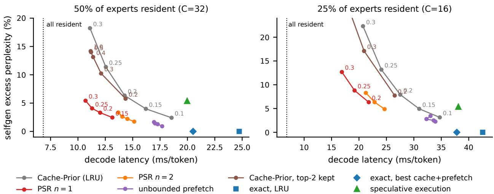
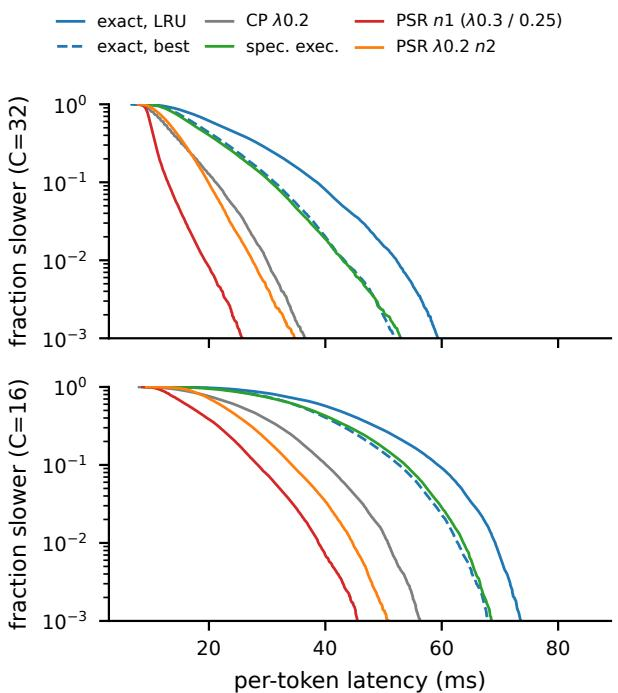
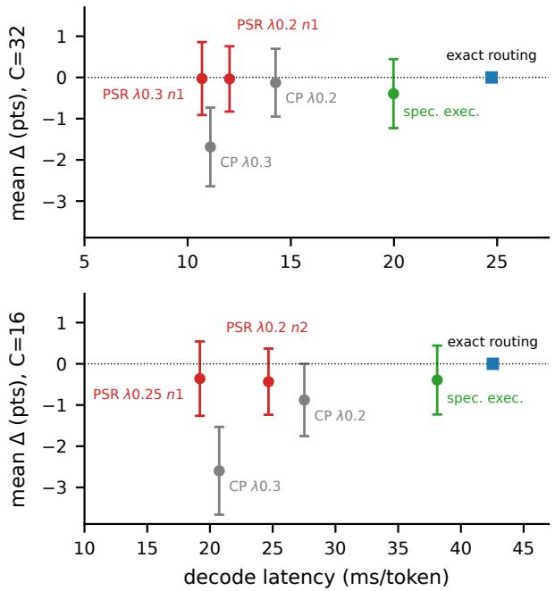
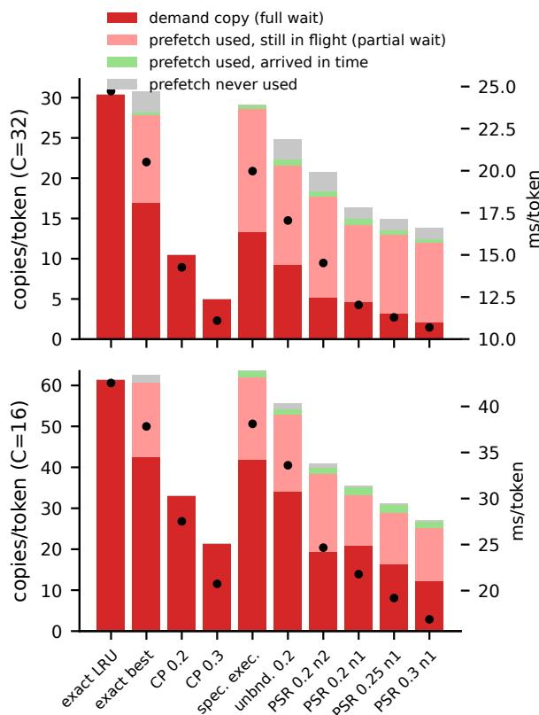
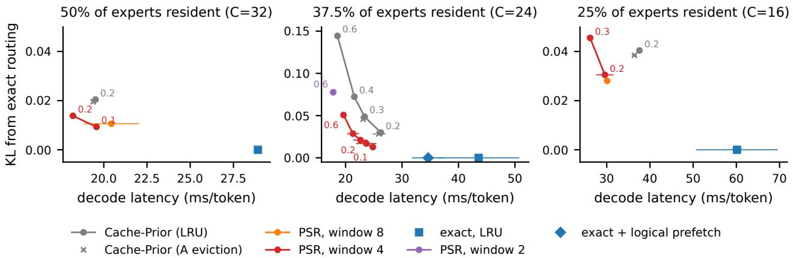
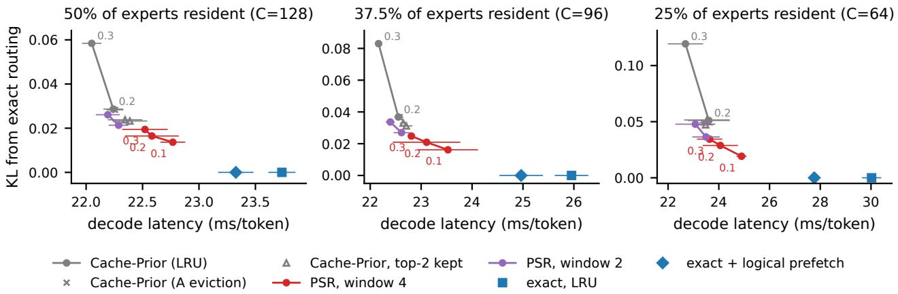

# Prefetch-Steered Routing: Deterministic Cache-Aware Expert Selection for Offloaded Mixture-of-Experts Decoding

Siming HUANG 1

## Abstract

When a Mixture-of-Experts (MoE) model does not fit in GPU memory, batch-1 decoding is dominated by copying expert weights from host memory. Cache-aware routing reduces these copies by biasing the router toward resident experts, but combined with asynchronous prefetching it makes the model’s outputs depend on transfer timing, so a harness that does not simulate that timing no longer evaluates the deployed model. We propose prefetch-steered routing (PSR): routing conditions on a deterministic logical cache, into which at most n experts predicted by the next layer’s router are inserted per layer and token; physical copies affect only latency. On OLMoE-1B-7B with 50% and 25% of experts resident on an RTX 4090, PSR decodes 2.2–2.3× faster than exact routing with LRU and 25–30% faster than the Cache-Prior operating point, with mean benchmark differences of +0.1 and +0.5 points (95% lower bounds −0.8 and −0.3). In greedy generation its lead over Cache-Prior depends on the workload and reverses on HumanEval at 50% residency. On Moonlight-16B-A3B, PSR is 1.9× faster than exact routing with LRU at 37.5% residency and, at the latency of Cache-Prior, significantly better on three of eight benchmarks. On Qwen3.6-35B-A3B, where copies are cheap relative to computation, PSR keeps its advantage over Cache-Prior on the likelihood benchmarks but not its speed. Distillation-trained gates did not help. Speculative decoding with block-level expert selection was slower than PSR with a 1B autoregressive drafter on OLMoE, but with a block drafter on Qwen3.6 it was 2.1–2.9× faster than any autoregressive configuration with at most its GPU memory on the 64 prompts we timed.

## 1. Introduction

Sparse Mixture-of-Experts (MoE) layers (Shazeer et al., 2017; Fedus et al., 2022) decouple a model’s parameter count from its per-token compute. This makes MoE models attractive for local, single-user inference, but their total weight often exceeds the memory of a consumer GPU. The standard remedy is expert offloading: non-expert weights stay on the GPU, experts live in host memory, and a perlayer GPU cache holds a subset of them (Eliseev & Mazur, 2023; Xue et al., 2024). At batch size one, each decoded token activates K experts in every layer, and every cache miss is a PCIe copy on the critical path. Prefetching hides part of this latency (Hwang et al., 2024; Song et al., 2024; Shen et al., 2025), but when the router’s choices are hard to predict and the link is close to saturated, transfers still dominate.

A second family of methods changes which experts run. Cache-aware routing adds a bonus to the router logits of resident experts (Skliar et al., 2025; Bambhaniya et al., 2024); expert substitution replaces missing experts with resident ones (Zhu et al., 2025); speculative execution runs the experts predicted ahead of time instead of the router’s choices (Madan et al., 2026; Li et al., 2026). Bias and substitution trade a small deviation from the original model for large reductions in transfers; speculative execution instead moves transfers earlier. SpecMD (Hoang et al., 2026) studies how such routing, prefetching, eviction and misshandling policies interact, including the routing bonus together with cross-layer prefetching. Two questions remain open.

What is the model being evaluated? Once routing depends on the cache, the cache becomes part of the model’s semantics. If the cache is filled by asynchronous prefetches, the experts that are resident when the router runs depend on PCIe timing, contention, and scheduler parameters. The same prompt can then produce different outputs on different machines or under different load, and unless the evaluation harness reproduces the engine’s timing, the quality it measures belongs to a different function from the one deployed. We show that this is a measurable effect, not a theoretical one (Section 3). Skliar et al. (2025) note that their algorithm is deterministic, which holds because their cache has no asynchronous prefetching. In SpecMD the bonus applies to the GPU-resident set, which an asynchronous prefetch thread fills, and in SMoE and MoE-CORE substitution uses whatever the prefetcher has made resident; this is our reading of their designs, and none of the three discusses the issue (Hoang et al., 2026; Zhu et al., 2025; Yang et al., 2026a). Speculating Experts and CommitMoE avoid it by executing predictions that do not depend on the cache, at the cost of executing every misprediction.

How should routing bias and prefetching be combined? SpecMD reports that the routing bonus accounts for 10– 20% of the speedup in some of its configurations. We find that how the two are combined matters. Prefetching based on token history or expert popularity gives exact routing little in our engine and clearly hurts under cache-aware routing: the bias already keeps routing on resident experts, so most prefetches are wasted and delay demand copies. Prefetching the experts that the next layer’s router predicts from the current hidden state behaves differently: the routing bonus then applies to experts the router was likely to choose anyway, so the bias steers routing onto in-flight experts rather than away from the router’s preference.

We turn these observations into a design, prefetch-steered routing (PSR; Section 4):

• Routing conditions only on a logical cache, a deterministic function of the token history and the policy. Physical copies are scheduled separately and change latency, never outputs. The evaluation harness and the deployed engine therefore implement the same routing policy; they differ only in floating-point numerics, which under greedy decoding change individual outputs but, in benchmarks generated by the engine itself, not the differences between configurations beyond the resolution of that check, about four points per task (Section 6.4).

• A deterministic budget decides which predicted experts receive the routing bonus: at each layer and token, at most n (1 or 2) of the next layer’s predicted experts are inserted into the logical cache when they are predicted, independently of when their copies complete. A small budget keeps the added copies within what the link can carry; unbounded insertion gives the best quality but commits more transfers than the link can overlap.

• A score-based eviction priority (exponential moving averages of the router’s choices plus a token prior) replaces LRU, as router-informed replacement policies do in systems with exact routing (Zhong et al., 2025; Yang et al., 2026a).

We implement PSR in a batch-1 offloading engine with

CUDA graphs and a fused MoE kernel, and in a Hugging-Face evaluation harness that runs the identical logical cache model (Section 5). On OLMoE-1B-7B-Instruct (Muennighoff et al., 2025) with 50% and 25% of experts resident on an RTX 4090 (Section 6):

• PSR decodes at 10.7 ms/token at 50% residency, 2.3× faster than exact routing with LRU (24.7 ms) and 1.9× faster than the best exact-routing cache and prefetch configuration we found (20.5 ms). At 25% residency it runs at 19.2 ms/token (2.2× and 2.0×).

• Against the operating point of Cache-Prior routing (Skliar et al., 2025) (λ = 0.2), PSR has 25% (50%) and 30% (25%) lower latency; the mean benchmark difference is +0.1 and +0.5 points, with 95% lower bounds of −0.8 and −0.3. At matched latency it is ahead by +1.7 ±1.0 and +2.2 ±1.0 points; after Holm’s correction it is better on HellaSwag (both sizes) and MMLU (25%) and worse on no task. These latencies are teacher-forced; in greedy generation on the benchmark prompts at 50% residency, the latency gap to Cache-Prior is 12% on GSM8K and 18% on IFEval, and Cache-Prior is faster on HumanEval; at 25% residency PSR stays 19–28% faster on all three (Section 6.4).

• Speculative execution of predicted experts (Madan et al., 2026) is 1.9–2.0× slower than PSR and not significantly better on any benchmark, because it moves transfers earlier without reducing them.

• On Moonlight-16B-A3B (Liu et al., 2025), a DeepSeek-V3-style model (DeepSeek-AI, 2024) that must be offloaded on this GPU, PSR transfers without retuning (Section 6.8). At every cache size we ran, the latency–divergence frontier consists of lossless exact routing and PSR configurations. With 37.5% of experts resident it runs at 22.6 ms/token, 1.9× faster than exact routing with LRU. At the same latency as Cache-Prior it is ahead by +1.6 ±0.9 points on average over eight benchmarks, significantly after correction on three of them.

• On Qwen3.6-35B-A3B (Qwen Team, 2026) in FP8, with 256 experts per layer and expert copies a quarter the size of OLMoE’s, decoding is bounded by computation (Section 6.9). Every cache-aware configuration runs within 3 ms/token of the fastest, and PSR is only 1.25× faster than exact routing with LRU at 25% residency. At the same teacher-forced latency as Cache-Prior it has 0.56 times its KL and is significantly better on MMLU and HellaSwag, with no significant difference on the generative tasks; in free generation Cache-Prior is 4–6% faster. PSR’s latency advantage therefore requires copies to be a large share of the time per token.

Quality is measured with per-question paired tests on MMLU, ARC-Challenge, HellaSwag, GSM8K, BBH (chain-of-thought), IFEval, HumanEval and MBPP (Section 6.3). We also report a negative and a conditional result. Training the gate (distillation to the frozen model with learned switching margins and LoRA adapters, and the same for PSR’s own router) does not improve benchmark quality over training-free cache-aware routing at the same transfer budget (Section 6.10). Speculative decoding with block-level expert selection (Liang et al., 2026) reduces the copies per token below PSR’s when drafts are accepted in long runs, but with a 1B autoregressive drafter on OLMoE it is slower than PSR on both tasks we timed. With a block drafter on Qwen3.6 it is 2.1–2.9× faster than the fastest autoregressive configuration with at most its GPU memory on the 64 prompts we timed, whose scores detect only large losses (Section 7).

Scope. We study three models. OLMoE fits in the 24 GB of an RTX 4090 in bf16, so for it we emulate memory pressure by capping the per-layer expert cache; Moonlight’s 31 GB and Qwen3.6’s 37 GB (FP8) do not fit, so their offloading is real. On Qwen3.6 we ran six of the eight benchmarks. We do not compare against complete external systems such as llama.cpp, MoE-Infinity or CPU-execution systems (Kamahori et al., 2024; Chen et al., 2025a); all baselines run in our engines. Section 9 discusses these limits.

## 2. Background

MoE decoding with offloading. An MoE layer l has $E$ experts and a router that produces logits $\boldsymbol { z } _ { t , l } \in \mathbb { R } ^ { E }$ for token t. Exact routing executes the top-K experts by $z _ { t , l }$ and combines their outputs with softmax weights. We consider batch-1 decoding with all non-expert weights on the GPU and a per-layer cache of $C < E$ expert slots; the remaining experts sit in pinned host memory. A selected expert that is not resident must be copied before the layer can finish. Copies run on a separate stream and can overlap with computation of earlier layers if they are issued early enough.

Cache-aware routing. Cache-Prior routing (Skliar et al., 2025) adds a bonus to the logits of resident experts before the top-K selection:

$$
\tilde { z } _ { t , l } = z _ { t , l } + \lambda \bar { \Delta } _ { l } m _ { t , l } ,\tag{1}
$$

where $m _ { t , l } \in \{ 0 , 1 \} ^ { E }$ marks resident experts, $\bar { \Delta } _ { l }$ is the average range max z − min z of the layer’s logits (estimated once on held-out text), and λ sets the strength. The selected experts are combined with the softmax weights of the unmodified logits. With an LRU cache and no prefetching, the cache state is a deterministic function of past selections, so the routed model is a well-defined (if history-dependent) function of the input.

Cross-layer prediction. The router of layer l applied to the hidden state entering layer l − 1’s MoE block predicts layer l’s experts well, because the residual stream changes little between consecutive layers (Eliseev & Mazur, 2023; Zhong et al., 2024; Madan et al., 2026); learned predictors refine this (Hwang et al., 2024; Song et al., 2024). We call this ranking the pre-gate ranking $g _ { t , l } .$ . It is available one layer ahead, about 0.4 ms at our layer latency, a little less than the 0.55 ms of one expert copy.

## 3. Cache-Conditioned Routing and Transfer Timing

Combining Equation (1) with prefetching is natural: prefetched experts become resident, receive the bonus, and are then likely to be selected. But if residency is the physical state of the GPU cache, the routing at token t depends on which copies have been issued and completed by then, which depends on bandwidth, contention, and scheduler parameters.

Table 1 makes this concrete. We run Cache-Prior routing $( \lambda = 0 . 2$ , 50% residency) with the A eviction priority of Section 4 and cross-layer prefetch, where routing sees the experts whose copies the scheduler has issued, and vary only the number of prefetch copies the scheduler keeps in flight (1, 2 or 4). This parameter changes nothing about the model, yet perplexity moves from 8.76 to 8.63, because a different set of experts is resident when the router runs. The same happens at 25% residency with λ = 0.25 (9.10 to 8.86). Even with all parameters fixed, repeated runs on the same GPU differ by up to 0.054 (50%) and 0.027 (25%) in perplexity. A GPU with different PCIe bandwidth, or the same GPU under different load, can be expected to produce yet another model. A harness that does not reproduce the engine’s timing then evaluates a different policy from the one deployed. Such a system can still be evaluated, by benchmarking inside the deployed engine or by fixing the order of copies and computation, but the result then holds for one hardware and load configuration.

We instead separate the cache that routing sees from the cache that holds bytes. The routing policy maintains a logical cache whose evolution depends only on the token history and the policy’s parameters. The engine keeps physical residency consistent with it by issuing copies, and waits for a copy only when an expert it must execute has not arrived. Timing then changes how long a token takes, never what it computes. The evaluation harness simulates the same logical cache, so the harness and the engine implement the same routing policy and differ only in floating-point numerics (Section 5); Section 6.4 checks how far benchmark comparisons carry over by generating three benchmarks with the engine itself. The bottom rows of Table 1 confirm that the logical variant is invariant to the scheduler parameter. Determinism here is relative to fixed numerics: the logical cache removes the dependence on timing, not the dependence on kernels, batch composition or hardware arithmetic, which affect any implementation, including exact routing.

Table 1. Perplexity (12 windows) of Cache-Prior routing with A eviction and cross-layer prefetch of 8 when only the number of prefetch copies in flight changes; mean of 3 runs, with the range across runs in parentheses. Physical cache: routing sees the experts whose copies have been issued (the scheduler also prefetches by token prior). Logical cache: routing sees the logical cache of PSR (unbounded insertion). With routing on the physical cache, outputs depend on the scheduler parameter and vary between runs; with the logical cache they do not.  
prefetch copies in flight 1 2 4   
$C = 3 2 , \lambda = 0 . 2 ,$ cross-layer prefetch of8   
physical cache 8.755 (0.041) 8.674 (0.054) 8.627 (0.048)   
logical cache 8.509 (0.000) 8.509 (0.000) 8.509 (0.000)   
$C = 1 6 , \lambda = 0 . 2 5 ,$ cross-layer prefetch of8   
physical cache 9.097 (0.013) 9.015 (0.013) 8.864 (0.027)   
logical cache 8.587 (0.000) 8.587 (0.000) 8.587 (0.000)

## 4. Prefetch-Steered Routing

## 4.1. Per-layer step

PSR keeps, per layer, a logical residency set $R _ { l }$ of size at most C, an eviction priority, and the statistics that define it. It is reset to a fixed warm set at the start of every sequence (the C most frequently selected experts of the layer on held-out text), so each request is processed independently. Algorithm 1 lists the step for token t at layer l.

Bounded prefetch steering (part 1). The candidates are the first 8 experts of the pre-gate ranking, i.e. layer $l \mathrm { { s } }$ router applied one layer early. They are visited in rank order, and every candidate visited so far, resident or newly inserted, is protected from eviction for the rest of the step. A resident candidate further down the ranking is not yet protected, so an insertion can evict it if it has the lowest priority; with the A priority this happens in 2.5% of insertions at 50% residency and 5.1% at 25% (7.3% and 10.4% with LRU), because the priority already favors experts the router has been choosing. At most n new candidates are inserted. Each insertion makes the expert eligible for the routing bonus in part 2, which is how prefetch steers routing: the bias now pulls the selection toward experts that are already in flight and that the router itself ranks highly. Without the budget, all non-resident candidates would be inserted; this gives the closest match to exact routing but commits more copies than the link can overlap (Section 6.6). One layer of computation is shorter than one copy, so even with $n = 1$ most prefetches are still in flight when their layer starts; they shorten the wait rather than remove it (Section 6.5).

Algorithm 1 PSR logical-cache step for token t. Part 1 runs   
at layer l−1, as soon as that layer’s MoE computation has   
been launched; part 2 runs at layer l, once its router logits   
are available. Layer 1 has no pre-gate and skips part 1.   
1: $B \gets \emptyset$ {stays empty at layer 1}   
2: Part 1, at layer $l - 1 \colon$ insertion for layer l   
3: input: pre-gate ranking g (router l on layer l−1’s MoE   
input), priority p of layer l (fixed for token t)   
4: new $ 0$   
5: for e in $g [ 1 { : } 8 ]$ (in rank order) do   
6: $\mathbf { i f } e \in R _ { l }$ then   
7: $B  B \cup \{ e \}$   
8: else if new $<$ n then   
9: if $| R _ { l } | = C ,$ evict arg min $j \in R _ { l } \backslash B ^ { p _ { j } }$   
10: ${ \cal R } _ { l }  { \cal R } _ { l } \cup \{ e \} ; B  B \cup \{ e \} ;$ new $+ = 1 ;$ queue   
a copy of e   
11: end if   
12: end for   
13: Part 2, at layer l: selection   
14: input: router logits z   
15: $S \gets \mathrm { T o p K } \big ( z + \lambda \bar { \Delta } _ { l } \mathcal { H } [ \cdot \in R _ { l } ] \big )$ {Equation (1) on $R _ { l } \}$   
16: for $e \in S \setminus { \dot { R } } _ { l }$ (in index order) do   
17: evict arg min $\iota _ { j \in R \iota } \backslash ( S \cup B ) \ : p _ { j } ,$ or arg min $\cdot j \in R _ { l } \backslash S ^ { \mathcal { p } _ { j } }$ if   
that set is empty   
18: $R _ { l } \gets R _ { l } \cup \{ e \} ;$ issue a demand copy of e   
19: end for   
20: execute $S$ with weights softmax(z) ; wait only for   
copies of S not yet complete   
21: update the statistics of layer l with the router’s own   
top-K of z

Selection (part 2) is Equation (1) on the logical set. Ties are broken toward the router’s own ranking. Execution weights come from the unmodified softmax, as in Cache-Prior. Demand insertions spare the experts inserted or visited in part 1 while any other victim outside S exists. All remaining ties in priority go to the lowest expert index, so every decision is a function of the token history.

Eviction priority. We use the following score of an expert as its priority, and call it the A priority:

$$
p _ { e } = \bar { s } _ { e } ^ { \mathrm { f a s t } } + \bar { s } _ { e } ^ { \mathrm { s l o w } } + \pi _ { l } ( x _ { t } ) _ { e } ,
$$

where $\bar { s } ^ { \mathrm { f a s t } }$ and $\boldsymbol { \bar { s } } ^ { \mathrm { s l o w } }$ are exponential moving averages (decay 0.5 and 0.98) of the indicator that the router’s own top-K contains e, and $\pi _ { l } ( x )$ is a token prior, the frequency with which layer l routes input token x to each expert on held-out text. The averages track the router’s preference rather than the executed set, so the bias does not reinforce itself through eviction. The priority is computed once per step, before any insertion; ties go to the lowest index.

## 4.2. Physical scheduling

The engine mirrors Algorithm 1 and issues a copy for every logical insertion. Demand copies are issued immediately. Prefetch copies are queued and issued at layer boundaries with at most two in flight, so that a later demand copy waits behind at most two prefetches. A queued prefetch whose slot has been reassigned before it was issued (its expert was evicted again) is dropped. All copies go through one ordered copy stream, so a later copy into a slot completes after an earlier one, and each slot records the event of its latest copy. The computation of a layer waits only on the events of the slots it executes. Because all decisions are made on logical state, the scheduler’s choices, including how many copies are in flight, affect latency alone. At the start of a request the logical cache is reset to the warm set; the engine copies the warm experts that are not physically in place before processing the prompt, so this cost is part of prompt processing, which our decode latencies exclude.

Speculative execution as a special case. If line 12 is replaced by $S = g [ 1 { : } K ]$ , the layer executes the predicted experts instead of the router’s choice, which is a variant of the speculative-execution strategy of Madan et al. (2026). It differs from theirs in two ways: the prediction uses the next layer’s router on the current hidden state, without their learned default vector, and the predicted experts are weighted by the true router softmax rather than by predicted weights. We implement it in the same engine and logical cache as a baseline.

## 5. Implementation

Engine. The decode engine is written in PyTorch for OL-MoE. Per layer it replays two CUDA graphs: attention, router and pre-gate (whose outputs are copied to pinned host memory), then the MoE computation with the fused MoE kernel of vLLM (Kwon et al., 2023) over a slot-indexed expert cache. Between the two graphs the host runs the routing policy (the cache model of Algorithm 1 compiled with numba, the biased top-K selection in numpy at about 20 µs per layer, which Cache-Prior and PSR pay alike) and issues copies on a dedicated stream with events. All $L \times E$ experts are in pinned host memory. The KV cache is static. Ports to the DeepSeek-V3 and Qwen3.6 architectures serve the second and third models (Sections 6.8 and 6.9).

Harness. Benchmarks run in a HuggingFace implementation of OLMoE whose MoE blocks call the same logical cache model, with state carried across decoding steps and reset per sequence. With LRU eviction and no prefetching, the logical model reproduces Cache-Prior routing decision for decision (unit-tested). Engine and harness agree on perplexity: 8.684 vs 8.683 for PSR λ = 0.2, n = 1 at 50% residency, and 9.009 vs 9.069 for λ = 0.25, n = 1 at 25%.

Selected expert sets agree on 75–92% of token-layer pairs. The rest are bf16 near-ties: even exact routing differs between the two implementations on 4.75% of token-layer pairs because the kernels accumulate in different orders, and a cache-conditioned router propagates a flipped near-tie through its state. Such differences are numerical, not timingdependent: with the logical cache, the engine’s perplexity is identical across repeated runs and across scheduler settings (Table 1).

## 6. Evaluation

## 6.1. Setup

Model and hardware. OLMoE-1B-7B-0924- Instruct (Muennighoff et al., 2025) has 16 MoE layers with 64 experts each and top-8 routing. One expert is 12.6 MB in bf16; all 1024 experts take 12.9 GB. We use one NVIDIA RTX 4090 (24 GB) on PCIe 4.0 ×16, where one expert copy takes 0.55 ms (22.9 GB/s measured). The engine process is pinned to 16 CPU cores. Experts stay in bf16; quantization is orthogonal and not studied.

Residency. We cap the expert cache at $C = 3 2 ( 5 0 \% )$ or $C = 1 6 ( 2 5 \% )$ slots per layer. Because the full model would fit on this GPU, this emulates a smaller GPU or a larger model with the same per-layer ratio.

Latency. We decode 12 windows of up to 1024 tokens (4 each from WikiText, C4, and text sampled from the model itself) token by token with teacher forcing, which executes the batch-1 decode path for every position and lets every configuration process the same tokens. We report mean and 99th-percentile per-token latency over about 9.8k tokens, and expert copies per token, split into demand copies that stall the layer and prefetch copies that overlap computation. Timings are the mean of 3 repetitions; repetition r of every configuration ran in the same timing round. Configurations added in this revision (the n = 1 ablation and Cache-Prior with top-J protection or a running bonus scale) were timed in a second session with the same protocol and also three rounds; latency ratios and tests pair repetitions only within a session. We report latency ratios with 95% intervals and p-values from a paired t-test on log latency over repetitions, which treats the repetition, not the token, as the unit (Kalibera & Jones, 2013). Timing processes ran concurrently on separate GPUs, each with its CPU cores and pinned host memory on its GPU’s NUMA node. With all experts resident, decoding takes 6.8 ms/token.

Quality. We use lm-evaluation-harness (Gao et al., 2023) with greedy decoding at batch size 1 (on Moonlight and Qwen3.6 in batches, with one logical cache per row; Section A), following each task’s default protocol: MMLU (Hendrycks et al., 2021) (0-shot, 14,042 questions), ARC-Challenge (Clark et al., 2018) and HellaSwag (Zellers et al., 2019) (0-shot, accuracy), GSM8K (Cobbe et al., 2021) (5-shot, strict match), BBH (Suzgun et al., 2023) (3-shot chain-of-thought, 100 questions from each of 27 subtasks), IFEval (Zhou et al., 2023) (chat template, strict promptand instruction-level accuracy), HumanEval (Chen et al., 2021) and MBPP (Austin et al., 2021) (pass@1). The last five are generative and exercise the routing policy over hundreds of decoding steps; MMLU, ARC and HellaSwag are scored from a single forward pass and stress the policy over the prompt. For each task we compare a configuration with a reference on the same questions and report the mean paired difference, its standard error, and an exact McNemar test (McNemar, 1947) on discordant questions (Dror et al., 2018). IFEval’s instruction-level accuracy counts several instructions per prompt; for it the prompt is the unit, with a cluster-robust standard error and a sign-flip permutation test on per-prompt sums. Each table is one family of tests: bold marks differences significant after Holm’s correction (Holm, 1979) over all tests of the table, and † marks $p < 0 . 0 5$ before correction only, which we treat as exploratory. Comparisons reported only in the text are corrected over the tasks of that comparison. As a one-number summary we average the difference over the eight tasks (IFEval at prompt level) with a 95% interval that treats tasks as independent. A difference that is not significant does not establish equivalence (Lakens, 2017). Where we call two configurations similar in quality, we give this interval and its lower end, the largest mean loss the data do not exclude, and leave the acceptable loss to the reader. Greedy generation is sensitive to any routing change (16–25% of BBH items flip relative to exact routing under each configuration in Table 3), so the paired standard error is 0.8–1.0 points on BBH, 1.2–1.3 on GSM8K, 1.5–1.8 on IFEval (prompt level), 1.1–1.7 on MBPP and 1.8–3.0 on HumanEval.

Diagnostic. We also report the excess perplexity on 44 windows of text sampled from the exact model at temperature 1 (selfgen). Because these samples come from the exact model, the excess negative log-likelihood estimates the KL divergence from the exact model. We use it to trace frontiers cheaply, not to accept configurations.

Baselines. All baselines run in the same engine. Exact routing with LRU, with the A priority of PSR, and with the best timing-dependent cache and prefetch configuration we found (A priority plus throttled cross-layer prefetch; exact routing makes timing harmless for outputs). Cache-Prior (Skliar et al., 2025) with LRU, as in the original, for $\lambda \in \{ 0 . 1 , \ldots , 0 . 3 \}$ The original also keeps the router’s top-J experts $( J = 2$ for fine-grained models) and tracks $\bar { \Delta } _ { l }$ with a running average. Our main comparisons use $J = 0$ and a fixed $\bar { \Delta } _ { l }$ for Cache-Prior and PSR alike, which isolates the bonus; Section 6.6 also evaluates Cache-Prior as published, with $J \in \{ 1 , 2 \}$ and a running average of the logit range over each request. Speculative execution (Madan et al., 2026), implemented as described in Section 4 with the same logical cache and prefetching as PSR; the shared cache helps it relative to the original, which keeps no experts resident across tokens, while our simpler predictor and the true router weights differ from theirs (Section 4).

Configuration selection. We chose $\lambda ,$ n and the pre-gate window on the selfgen diagnostic and engine latency (Figure 1); no evaluation data entered the token prior, the warm set or $\bar { \Delta } _ { l }$ (Section B). We then ran the full benchmark suite on 7 Cache-Prior and 6 PSR configurations of OLMoE and on speculative execution. The operating points of Tables 3 and 4 were fixed after seeing these results: Cache-Prior $\lambda = 0 . 2$ as the largest λ without a significant loss on a generative task, and the PSR points as those closest to it in latency or in quality. The three Cache-Prior configurations not shown $( \lambda = 0 . 1 5$ and 0.25 at 50% residency, 0.25 at 25%) lie between the ones shown. The tests are paired and corrected for multiplicity, but the operating points were not pre-registered.

## 6.2. Latency

Table 2 and Figure 1 summarize the engine measurements. At 50% residency, exact routing with LRU takes 24.7 ms/token. A better eviction priority and throttled cross-layer prefetch bring exact routing to 20.5 ms, but the link stays saturated: about 30 copies per token, of which more than half still stall. Cache-Prior at $\lambda = 0 . 2$ , the largest λ we ran on the full suite at 50% residency without a significant loss on any generative task, reduces copies to 10.5 per token and takes 14.3 ms. PSR $( \lambda = 0 . 3 , n = 1 )$ takes 10.7 ms with a p99 of 19 ms (Cache-Prior: 30 ms; exact LRU: 52 ms): exact routing with LRU takes 2.31× as long (95% interval $2 . 1 9 { - } 2 . 4 4 , p = \mathrm { : 0 . 0 0 1 } )$ , the best exact configuration 1.92× (1.80–2.05), and Cache-Prior $\lambda = 0 . 2 1 . 3 3 \times ( 1 . 2 8 – 1 . 3 8 )$ At 25% residency, the ordering is the same: 42.5 ms for exact LRU, 27.5 ms for Cache-Prior $\lambda = 0 . 2$ , and 19.2 ms for PSR $( \lambda = 0 . 2 5 , n = 1 )$ .

Figure 2 shows the full per-token distributions. From the 10th percentile up, PSR is faster than every baseline shown, and its gap to Cache-Prior $\lambda = 0 . 2$ is larger in the tail than at the median.

Across the λ sweep, PSR with n = 1 lies below and to the left of Cache-Prior at every point (Figure 1). At the same λ it is both faster and closer to exact routing: at $\lambda = 0 . 3$ and 50% residency, Cache-Prior has a selfgen excess of 18.2% and PSR 5.4%. The routing bonus is the same; what differs is which experts hold it.

## 6.3. Quality

Tables 3 and 4 and Figure 3 report the benchmarks. Three comparisons matter.

Table 2. Engine latency on OLMoE-1B-7B, RTX 4090. sg% = selfgen excess perplexity (KL diagnostic, lower is closer to exact routing). ms = mean per-token latency, p99 = 99th percentile, copies = expert copies per token; in parentheses, demand copies, issued only when the layer needs the expert. Prefetch copies that are still in flight when needed also delay the layer (Figure 4). †Routing or caching depends on transfer timing; for exact routing this affects latency only. PSR rows use A eviction (except the row marked LRU) and cross-layer prefetch with a budget of n new insertions per layer and token.
<table><tr><td rowspan="2">config</td><td colspan="4">C = 32 (50%)</td><td colspan="4"> $C = 1 6 ( 2 5 \% )$ </td></tr><tr><td>sg%</td><td>ms</td><td> $\mathsf { p } 9 9$ </td><td>copies (stall)</td><td> $s \mathbf { g } \%$ </td><td>ms</td><td>p99</td><td>copies (stall)</td></tr><tr><td>all experts resident (C=64)</td><td>0.0</td><td>6.8</td><td>7</td><td>0.0 (0.0)</td><td></td><td></td><td>(same)</td><td></td></tr><tr><td>exact routing, LRU</td><td>0.0</td><td>24.7</td><td>52</td><td>30.5 (30.5)</td><td>0.0</td><td>42.5</td><td>69</td><td>61.4 (61.4)</td></tr><tr><td>exact routing, A eviction</td><td>0.0</td><td>22.9</td><td>48</td><td>27.5 (27.5)</td><td>0.0</td><td>41.4</td><td>68</td><td>59.2 (59.2)</td></tr><tr><td>exact routing, best cache + prefetch†</td><td>0.0</td><td>20.5</td><td>43</td><td>30.7 (16.9)</td><td>0.0</td><td>37.8</td><td>63</td><td>62.5 (42.6)</td></tr><tr><td>exact routing, logical prefetch (n=8)</td><td>0.0</td><td>20.9</td><td>44</td><td>31.6 (16.7)</td><td>0.0</td><td>39.0</td><td>64</td><td>65.2 (43.8)</td></tr><tr><td>Cache-Prior λ0.2, LRU</td><td>6.3</td><td>14.3</td><td>30</td><td>10.5 (10.5)</td><td>7.9</td><td>27.5</td><td>51</td><td>33.1 (33.1)</td></tr><tr><td>Cache-Prior λ0.3, LRU</td><td>18.2</td><td>11.1</td><td>21</td><td>5.0 (5.0)</td><td>22.3</td><td>20.7</td><td>39</td><td>21.4 (21.4)</td></tr><tr><td>Cache-Prior, A eviction (λ0.2 / 0.25)</td><td>6.1</td><td>13.8</td><td>30</td><td>9.7 (9.7)</td><td>12.5</td><td>23.9</td><td>46</td><td>26.3 (26.3)</td></tr><tr><td>Cache-Prior λ0.2 + timing-dep. prefetch†</td><td>一</td><td>13.9</td><td>27</td><td>18.3 (4.5)</td><td>一</td><td>24.0</td><td>44</td><td>38.3 (18.4)</td></tr><tr><td>speculative execution</td><td>5.4</td><td>20.0</td><td>43</td><td>29.1 (13.3)</td><td>5.4</td><td>38.1</td><td>64</td><td>63.5 (41.9)</td></tr><tr><td>PSR λ0.2, unbounded (n=8)</td><td>1.4</td><td>17.0</td><td>37</td><td>24.8 (9.2)</td><td>2.5</td><td>33.6</td><td>59</td><td>55.7 (34.2)</td></tr><tr><td>PSR λ0.2, LRU eviction, n=8</td><td>1.7</td><td>18.7</td><td>43</td><td>27.9 (11.8)</td><td></td><td></td><td></td><td></td></tr><tr><td>PSR λ0.2, n=2</td><td>2.2</td><td>14.5</td><td>27</td><td>20.8 (5.2)</td><td>4.9</td><td>24.7</td><td>45</td><td>41.0 (19.4)</td></tr><tr><td>PSR λ0.2, n=1</td><td>3.3</td><td>12.0</td><td>25</td><td>16.3 (4.6)</td><td>6.3</td><td>21.8</td><td>43</td><td>35.6 (20.9)</td></tr><tr><td>PSR  $\lambda 0 . 2 5 , n { = } 1$ </td><td>4.1</td><td>11.3</td><td>22</td><td>14.9 (3.3)</td><td>8.8</td><td>19.2</td><td>39</td><td>31.1 (16.4)</td></tr><tr><td>PSR  $\lambda 0 . 3 , n { = } 1$ </td><td>5.4</td><td>10.7</td><td>19</td><td>13.8 (2.2)</td><td>12.7</td><td>16.9</td><td>34</td><td>27.0 (12.3)</td></tr></table>

Against Cache-Prior at the same latency, PSR is better. At 50% residency, PSR (λ = 0.3, n = 1, 10.7 ms) and Cache-Prior $( \lambda = 0 . 3 , 1 1 . 1$ ms) run at the same speed (latency ratio 1.04, $p = 0 . 0 5 )$ . PSR is ahead by +1.7 points on average (95% interval ±1.0); after correction over the 81 tests of Table 4 its gain on HellaSwag is significant, BBH and HumanEval are nominally so, and no task is worse. At 25% residency the gap is larger, $+ 2 . 2 \pm 1 . 0$ points, significant on MMLU and HellaSwag after correction and nominally on GSM8K, BBH and IFEval (instruction level). Excluding HumanEval, the noisiest task, the averages are +0.9 and +1.8.

Against Cache-Prior at similar quality, PSR is faster. At 50% residency, PSR with λ = 0.2 (12.0 ms) and Cache-Prior with λ = 0.2 (14.3 ms) differ by +0.1 ±0.8 points on average (lower end −0.8, or −0.3 without HumanEval), and Cache-Prior takes 1.19× as long (1.15–1.23). The faster PSR point (10.7 ms, 25% lower latency than Cache-Prior $\lambda = 0 . 2 )$ has the same mean difference, +0.1 ±0.9 (lower end −0.8; −1.0 without HumanEval), but larger point losses on IFEval at instruction level (−3.0) and MMLU (−0.5), both with p ≈ 0.06. At 25% residency, PSR at 19.2 ms and Cache-Prior λ = 0.2 at 27.5 ms (30% lower latency) differ by $+ 0 . 5 \pm 0 . 8$ (lower end −0.3), and no task differs even before correction.

Against exact routing, neither 50% PSR configuration differs significantly on any single task after correction over the 90 tests of Table 3, whereas Cache-Prior loses significantly on HellaSwag at $\lambda = 0 . 2$ and on MMLU and HellaSwag at $\lambda = 0 . 3 .$ . The averages need care. The fast 50% configuration has a mean of $0 . 0 \pm 0 . 9$ over eight tasks, but this includes a HumanEval score 5.5 points above exact routing; without HumanEval its mean is $- 0 . 8 \pm 0 . 8 ,$ a small loss spread over the other tasks. The slower 50% point $( \lambda = 0 . 2 ,$ n = 1, 12.0 ms) is at −0.1 ±0.7 without HumanEval. At 25% residency every cache-aware configuration we ran on BBH loses on it: 2.6 points for PSR at 19.2 ms $( p = 0 . 0 0 2 )$ 1.7 for PSR λ = 0.2, n = 2 at 24.7 ms $( p = 0 . 0 4 )$ , and 2.3 for Cache-Prior $\lambda = 0 . 2$ at 27.5 ms $( p = 0 . 0 1 )$ . None of these survives the correction alone, but they agree in sign and size. At this residency no method is free on multi-step reasoning; PSR reaches a given BBH cost at lower latency than Cache-Prior, but does not remove it.

HumanEval. On HumanEval (164 problems) the fast 50% PSR configuration scores +5.5 above exact routing $( p =$ 0.035, not significant after correction). We do not read this as an improvement, and we state every average above also without HumanEval.

## 6.4. Benchmarks generated by the engine

The harness runs the engine’s routing policy, but not its kernels: the engine uses CUDA graphs, FlashAttention and the fused MoE kernel, the harness HuggingFace’s modules. We therefore generated GSM8K, IFEval and HumanEval with the engine itself (batch 1, greedy, the prompt fed token by token through the same policy) for exact routing, Cache-

  
Figure 1. Latency vs. divergence from exact routing (selfgen excess, a KL diagnostic) for $\lambda \in \{ 0 . 1 , 0 . 1 5 , 0 . 2 , 0 . 2 5 , 0 . 3 \}$ (labels on Cache-Prior and n=1 curves). PSR with a budget of one insertion per layer and token is the fastest configuration at every divergence level its λ sweep covers; unbounded prefetch is closest to exact but slow. Quality claims rest on the benchmarks of Figure 3.

Table 3. Benchmark scores relative to exact routing (points; paired over identical questions; bold: significant after Holm’s correction over the table’s 90 tests; †: $p < 0 . 0 5$ before correction only). The first row gives absolute scores of exact routing. ms is engine latency at the configuration’s residency. IFE-P/IFE-I = IFEval strict prompt/instruction accuracy. Mean = average over the eight tasks with IFE-P. Speculative execution’s outputs do not depend on residency; its two rows share one benchmark run.
<table><tr><td>C</td><td>config</td><td>ms</td><td>MMLU</td><td>ARC-C</td><td>HellaS.</td><td>GSM8K</td><td>BBH</td><td>IFE-P</td><td>IFE-I</td><td>HumanE.</td><td>MBPP</td><td>mean</td></tr><tr><td></td><td>exact routing</td><td>24.7/42.5</td><td>52.4</td><td>49.0</td><td>60.6</td><td>33.2</td><td>36.0</td><td>41.2</td><td>52.3</td><td>32.9</td><td>28.8</td><td></td></tr><tr><td>32</td><td>CP λ0.2</td><td>14.3</td><td>-0.3</td><td>-0.5</td><td>-0.9</td><td>+0.3</td><td>-0.6</td><td>-2.2</td><td>+0.5</td><td>+3.0</td><td>+0.2</td><td>-0.13</td></tr><tr><td>32</td><td>CP λ0.3</td><td>11.1</td><td>-1.1</td><td>-2.3†</td><td>-2.4</td><td>+0.1</td><td>-2.9†</td><td>-2.4</td><td>-1.8</td><td>-1.8</td><td>-0.6</td><td>-1.69</td></tr><tr><td>32</td><td>PSR λ0.2 n1</td><td>12.0</td><td>-0.7†</td><td>+0.1</td><td>-0.2</td><td>+1.3</td><td>-0.2</td><td>-0.7</td><td>-0.4</td><td>+0.6</td><td>-0.4</td><td>-0.04</td></tr><tr><td>32</td><td>PSR λ0.3 n1</td><td>10.7</td><td>−0.8†</td><td>-0.5</td><td>−0.4†</td><td>+0.2</td><td>-0.9</td><td>-2.4</td><td>-2.5</td><td>+5.5†</td><td>-0.8</td><td>-0.03</td></tr><tr><td>32</td><td>spec. exec.</td><td>20.0</td><td>-1.3</td><td>+1.5</td><td>-0.9</td><td>-0.7</td><td>-1.9†</td><td>-2.0</td><td>-0.2</td><td>+1.2</td><td>+1.0</td><td>-0.39</td></tr><tr><td>16</td><td>P λ0.2</td><td>27.5</td><td>-0.8†</td><td>-0.3</td><td>-0.8</td><td>-1.9</td><td>-2.3†</td><td>+0.4</td><td>+0.7</td><td>-0.6</td><td>-0.6</td><td>-0.88</td></tr><tr><td>16</td><td>CP λ0.3</td><td>20.7</td><td>-2.0</td><td>-0.7</td><td>-2.7</td><td>-3.7†</td><td>-4.9</td><td>-3.3</td><td>-1.9</td><td>-3.7</td><td>+0.2</td><td>-2.60</td></tr><tr><td>16</td><td>PSR λ0.2 n2</td><td>24.7</td><td>-0.6†</td><td>+1.0</td><td>−0.4†</td><td>+0.3</td><td>-1.7†</td><td>-0.9</td><td>+0.4</td><td>+0.6</td><td>-1.8</td><td>-0.43</td></tr><tr><td>16</td><td>PSR λ0.25 n1</td><td>19.2</td><td>-0.7†</td><td>-0.4</td><td>-0.8</td><td>-0.3</td><td>-2.6†</td><td>+0.2</td><td>+1.9</td><td>+1.8</td><td>0.0</td><td>-0.36</td></tr><tr><td>16</td><td>spec. exec.</td><td>38.1</td><td>-1.3</td><td>+1.5</td><td>-0.9</td><td>-0.7</td><td>-1.9†</td><td>-2.0</td><td>-0.2</td><td>+1.2</td><td>+1.0</td><td>-0.39</td></tr></table>

Prior λ = 0.2 and the fast and quality PSR points (λ = 0.3 and 0.2, n = 1) at 50% residency, and compared them per question with the harness runs of the same configurations (Table 5).

Numerics alone change individual outputs. Under exact routing, where the cache influences nothing, 21% of GSM8K questions are solved by one implementation and not by the other, with no net difference (32.8 vs. 33.2). Greedy decoding turns floating-point near-ties into different continuations. Neither implementation’s per-question outputs predict the other’s; what can carry over is the score of each configuration and the paired difference between configurations.

No discrepancy in the paired differences is detected. For each pair of configurations and each task we compare the per-question difference in the engine with that in the harness (sign-flip permutation test on the difference of differences; IFEval instructions clustered by prompt). None of the 20 tests is significant after Holm’s correction; one is nominally so (IFEval at instruction level, PSR vs. Cache-Prior, where the engine favours PSR by 3.7 points more than the harness). The check has limited power: the 95% intervals have halfwidths of 3.2 to 4.8 points, so per-task discrepancies of that size would go undetected. The per-task differences of Table 4 are smaller than that and rest on the harness.

Free-generation latency depends on the workload. The latencies of Section 6.2 are teacher-forced on WikiText, C4 and sampled model text. We also timed greedy generation in the engine on 77 benchmark prompts (every 66th GSM8K,

Table 4. Direct paired comparisons of PSR with Cache-Prior (and speculative execution) on identical questions (points; bold: significant after Holm’s correction over the table’s 81 tests; ${ \displaystyle { \dag } : \ p } \ll 0 . 0 5$ before correction only). Mean ± 95% interval over the eight tasks. Iso-latency pairs run at about the same ms/token; the other pairs compare PSR with the Cache-Prior operating point of Table 3 $( \lambda = 0 . 2 )$ which is slower. A mean difference that is not significant does not show equal quality; its 95% lower bound limits how much worse PSR can be on average. Speculative execution does not depend on residency, so one benchmark run serves both C.
<table><tr><td></td><td>C PSR (ms)</td><td>vs. (ms)</td><td>MMLU</td><td>ARC-C HellaS.</td><td></td><td>GSM8K</td><td></td><td></td><td></td><td>BBH IFE-P IFE-I HumanE. MBPP</td><td></td><td>mean</td></tr><tr><td colspan="9">iso-latency</td><td></td><td></td><td></td><td></td></tr><tr><td></td><td>32 PSR λ0.3 n1 (10.7)</td><td>CP λ0.3 (11.1)</td><td>+0.3</td><td>+1.8</td><td>+2.0</td><td> $+ 0 . 1 \ \mathrel { + } 2 . 0 \AA ^ { \dagger }$ </td><td></td><td> $0 . 0 \mathrm { ~ \ } - 0 . 7$ </td><td></td><td> $+ 7 . 3 ^ { \dagger }$ </td><td></td><td> $- 0 . 2 \ + 1 . 7 \pm 1 . 0$ </td></tr><tr><td></td><td>16 PSR λ0.25 n1 (19.2)</td><td>CP λ0.3 (20.7)</td><td>+1.2</td><td>+0.3</td><td>+1.9</td><td> $+ 3 . 4 ^ { \dagger } + 2 . 3 ^ { \dagger }$ </td><td></td><td> $+ 3 . 5 ~ + 3 . 8 ^ { \dagger }$ </td><td></td><td>+5.5</td><td></td><td> $- 0 . 2 \ + 2 . 2 \pm 1 . 0$ </td></tr><tr><td colspan="9">vs. CP operating point</td><td></td><td></td><td></td><td></td></tr><tr><td></td><td>32 PSR λ0.3 n1 (10.7)</td><td>CP λ0.2 (14.3)</td><td>-0.5</td><td>0.0</td><td>+0.4†</td><td>-0.2</td><td>-0.3</td><td>-0.2</td><td>-3.0</td><td>+2.4</td><td></td><td>−1.0 +0.1 ±0.9</td></tr><tr><td></td><td>32 PSR λ0.2 n1 (12.0)</td><td>CP λ0.2 (14.3)</td><td>-0.4</td><td>+0.6</td><td>+0.6</td><td>+1.0</td><td>+0.4</td><td>+1.5</td><td>-0.8</td><td>-2.4</td><td></td><td>−0.6 +0.1 ±0.8</td></tr><tr><td></td><td>16 PSR λ0.25 n1 (19.2)</td><td>CP λ0.2 (27.5)</td><td>+0.1</td><td>-0.2</td><td>+0.1</td><td>+1.6</td><td>-0.3</td><td>-0.2</td><td>+1.2</td><td>+2.4</td><td></td><td>+0.6 +0.5 ±0.8</td></tr><tr><td></td><td>16 PSR λ0.2 n2 (24.7)</td><td>CP λ0.2 (27.5)</td><td>+0.3</td><td>+1.3</td><td>+0.4†</td><td>+2.2</td><td>+0.6</td><td>-1.3</td><td>-0.4</td><td>+1.2</td><td></td><td>−1.2 +0.4 ±0.9</td></tr><tr><td colspan="9">vs. spec.</td><td></td><td></td><td></td><td></td></tr><tr><td></td><td>32 PSR λ0.3 n1 (10.7)</td><td>spec. exec. (20.0)</td><td>+0.5</td><td>-2.0</td><td> $+ 0 . 5 ^ { \dagger }$ </td><td>+0.8</td><td>+1.0</td><td>-0.4</td><td>-2.3</td><td>+4.3</td><td></td><td>−1.8 +0.4 ±0.9</td></tr><tr><td></td><td>32 PSR λ0.2 n1 (12.0)</td><td>spec. exec. (20.0)</td><td>+0.6†</td><td>-1.4</td><td> $+ 0 . 7 ^ { \dagger }$ </td><td> $+ 2 . 0 \ + 1 . 7 ^ { \dagger }$ </td><td></td><td>+1.3</td><td>-0.1</td><td>-0.6</td><td>-1.4</td><td> $+ 0 . 4 \pm 0 . 9$ </td></tr><tr><td></td><td>16 PSR λ0.25 n1 (19.2)</td><td>spec. exec. (38.1)</td><td>+0.5</td><td>-1.9</td><td>+0.1</td><td>+0.4 -0.7</td><td></td><td></td><td>+2.2 +2.2</td><td>+0.6</td><td>-1.0</td><td> $0 . 0 \pm 1 . 0$ </td></tr></table>

The copy counts show why. Greedy benchmark outputs at 50% residency reuse experts so heavily that Cache-Prior needs only 5.2, 7.5 and 1.4 copies per token, while PSR’s cross-layer insertions still cost 10.9, 12.0 and 6.9, mostly prefetches. On the prompt tokens of the same runs, which are not the model’s own text, PSR is 18%, 28% and 7% faster than Cache-Prior. PSR’s 99th-percentile latency is lower on every task and residency (at 50%: 14.0 vs. 23.4

34th IFEval and 4th HumanEval problem: 20, 16 and 41 prompts), with the configurations of each residency level interleaved in one process over 3 rounds as in Section 6.2 (Table 6). Each configuration decodes its own continuation; the logical cache makes it identical in every round. Every configuration is faster than under teacher forcing. At 25% residency PSR keeps most of its advantage: it is 28%, 24% and 19% faster than Cache-Prior on GSM8K, IFEval and HumanEval. At 50% residency the gap narrows: the fast PSR point is 12% (95% interval 8–16) faster on GSM8K and 18% (11–25) on IFEval, but 4% (3–5) slower on HumanEval. All 9 ratios in Table 6 differ from one after Holm’s correction. These intervals take the round as the unit and, since every round decodes the same continuations, measure run-to-run repeatability on this prompt set, not variation over prompts. Resampling prompts instead (rows “over prompts”) also excludes one in all 9 cases, though only approximately with 16–41 prompts per task; per-prompt sign tests survive Holm’s correction except for PSR λ = 0.2 on GSM8K (faster on 13 of 20). Each configuration is timed on its own continuations, which differ in content and length (on IFEval at 50% residency, 615 tokens per prompt for the fast PSR point against 771 for Cache-Prior). Single runs over the full benchmarks, not interleaved, give the same direction on every task and are less favourable to PSR by up to 6.4 points.

ms on GSM8K, 18.3 vs. 29.5 on IFEval, 11.2 vs. 14.6 on HumanEval). The latency advantage of PSR over Cache-Prior is therefore largest when routing has little locality (long or external text, long generations, low residency) and can vanish on short, highly repetitive outputs at moderate residency; against exact routing, PSR is 1.7–2.3× faster in free generation as well.

## 6.5. Where the speedup comes from

Figure 4 decomposes the copies. Cache-Prior reduces the number of copies but leaves every remaining copy on the critical path: at λ = 0.2 and 50% residency, all 10.5 copies per token are demand copies, each a full 0.55 ms wait. PSR makes more copies (13.8 per token at $\lambda = 0 . 3 , n = 1 )$ , but only 2.2 of them are demand copies. Of its 11.7 prefetch copies per token, 10.4 bring an expert the layer executes; most of these (9.9 per token) were issued one layer earlier and are still in flight when the layer is scheduled, so the layer waits only for the remainder of the copy, and only 0.5 arrive in time. 1.3 per token are never used. Per copy, the latency above the all-resident floor is 0.28 ms for PSR, against 0.59 ms for exact routing with LRU and 0.70 ms for Cache-Prior λ = 0.2, where every copy is a demand copy that also stalls the host’s scheduling of the layer. Speculative execution also prefetches one layer ahead, but because it executes the full predicted top-8, it needs as many copies as exact routing (29.1 vs. 30.5 per token): the link stays saturated, 13.3 copies per token end up as demand copies and 15.3 are late. PSR gets its speed from combining both mechanisms: the routing bonus cuts the number of copies the link must carry, and the prefetch budget starts the remaining ones early enough to overlap most of their latency.

  
Figure 2. Distribution of per-token decode latency at 50% (top) and 25% (bottom) residency: fraction of tokens slower than x (log scale), over all tokens of the 3 timing repetitions.

## 6.6. Ablations

Prefetch budget. Inserting all non-resident pre-gate candidates (unbounded, $n = 8 )$ gives the configuration closest to exact routing (selfgen 1.4% at λ = 0.2, 50%), but commits about 25 copies per token, more than the link can overlap, and runs at 17.0 ms, slower than Cache-Prior without prefetching. $n = 2$ and $n = 1$ trade divergence for speed along the frontier of Figure 1; n = 1 is the fastest at every divergence level its λ sweep covers.

Steering and eviction at the operating point. To separate the two mechanisms we timed all four combinations at $n =$ 1, λ = 0.2 and 50% residency in one session. Cache-Prior without prefetching runs at 14.2 ms with LRU and 13.7 ms with the A priority (selfgen 6.3% and 6.1%); adding steering gives 12.8 ms with LRU and 12.1 ms with the A priority (3.8% and 3.3%). Most of the speedup comes from steering, which at the same λ also roughly halves the divergence, because the inserted experts are ones the router ranks highly; the A priority adds a little speed and lowers the divergence further. With unbounded prefetch the A priority matters more: LRU raises latency from 17.0 to 18.7 ms and selfgen excess from 1.4 to 1.7%.

Cache-Prior as published. Keeping the router’s top-2 experts bounds the divergence of Cache-Prior but also its savings, since the two experts must be loaded whatever the bonus. At 50% residency, J = 2 with λ = 0.2 runs at 14.4 ms with a selfgen excess of 5.8%, against 10.7 ms and 5.4% for PSR $( \lambda = 0 . 3 , n = 1 ) \colon$ raising λ to 0.3 gives 12.1 ms at 10.2%, and even λ = 1 does not go below 11.2 ms (14.2%). $\mathrm { A t } \lambda = 0 . 2$ the choice of J changes little; at $\lambda = 0 . 3 , J = 1$ lies between J = 0 and J = 2. Where the selfgen excess is below 20%, the running average of the logit range changes it by at most 1.3 points, consistent with Skliar et al. (2025), who find their running average comparable to a calibrationset estimate; at larger λ the two differ more, far from the frontier. At 50% residency every setting of Cache-Prior as published is dominated by a PSR configuration that is faster and closer at once. At 25% residency, J = 2 with $\lambda \geq 0 . 5$ is faster than every PSR configuration we ran (15.7 ms at $\lambda = 1 )$ , but at a selfgen excess of 34.5–38.0%, far beyond the range in which any configuration kept its benchmark losses small; below that range every setting is dominated by PSR.

  
Figure 3. Mean benchmark difference to exact routing over eight tasks (±95% interval) against decode latency, at 50% (top) and 25% (bottom) residency.

What to prefetch. Prefetching by the A priority of the next token (token prior and moving averages) gives exact routing little and hurts under Cache-Prior: at $\lambda = 0 . 2$ and 50% residency it raises latency from 13.8 to 16.3 ms, because the bias already keeps routing on resident experts and most prefetches are wasted. Cross-layer pre-gate candidates help because the router ranks them highly.

Timing-dependent prefetch. Throttling prefetches by transfer completion and letting routing see physical residency (Section 3) gives about the same latency–perplexity trade-off as the logical variant (perplexity on the 12 timing windows). At 50% residency, the timing-dependent configurations closest to the frontier reach 8.65 at 13.9 ms and 8.56 at 14.7 ms, while PSR reaches 8.60 at 13.1 ms $( \lambda = 0 . 1 5$ n = 1) and 8.55 at 14.5 ms $( \lambda = 0 . 2 , n = 2 )$ . Determinism therefore costs little or no speed.

Table 5. Engine-generated benchmarks against the harness at 50% residency: paired difference between two configurations (points) in the harness and in the engine on the same questions, and the difference of the two with its 95% interval $( ^ { \dag } \colon \bar { p } < 0 . 0 5$ before Holm’s correction over the table’s 20 tests; none survives it).
<table><tr><td>task</td><td>harness</td><td>engine</td><td>engine – harness</td><td></td></tr><tr><td colspan="5">PSR λ0.3 n1 vs. CP λ0.2</td></tr><tr><td>GSM8K</td><td>-0.2</td><td>-0.8</td><td></td><td> $- 0 . 7 \pm 3 . 5$ </td></tr><tr><td>IFEval-P</td><td>-0.2</td><td>+1.7</td><td></td><td> $+ 1 . 8 \pm 4 . 3$ </td></tr><tr><td>IFEval-I</td><td>-3.0</td><td>+0.7</td><td></td><td> $+ 3 . 7 ^ { \dagger } \pm 3 . 5$ </td></tr><tr><td>HumanEval</td><td>+2.4</td><td>-1.8</td><td></td><td> $- 4 . 3 \pm 4 . 6$ </td></tr><tr><td colspan="5">PSR λ0.2 n1 vs. CP λ0.2</td></tr><tr><td>GSM8K</td><td>+1.0</td><td>-0.1</td><td></td><td> $- 1 . 1 \pm 3 . 5$ </td></tr><tr><td>IFEval-P</td><td>+1.5</td><td>+1.7</td><td></td><td> $+ 0 . 2 \pm 4 . 3$ </td></tr><tr><td>IFEval-I</td><td>-0.8</td><td></td><td>+0.6</td><td> $+ 1 . 4 \pm 3 . 6$ </td></tr><tr><td>HumanEval</td><td>-2.4</td><td></td><td>-2.4</td><td> $0 . 0 \pm 3 . 8$ </td></tr><tr><td colspan="5">PSR λ0.3 n1 vs. exact, LRU</td></tr><tr><td>GSM8K</td><td>+0.2</td><td>+0.8</td><td></td><td> $+ 0 . 7 \pm 3 . 3$ </td></tr><tr><td>IFEval-P</td><td>-2.4</td><td></td><td>-0.2</td><td> $+ 2 . 2 \pm 4 . 3$ </td></tr><tr><td>IFEval-I</td><td>-2.5</td><td></td><td>-0.1</td><td> $+ 2 . 4 \pm 3 . 5$ </td></tr><tr><td>HumanEval</td><td>+5.5†</td><td></td><td>+4.3</td><td> $- 1 . 2 \pm 4 . 8$ </td></tr><tr><td colspan="5">CP λ0.2 vs. exact, LRU</td></tr><tr><td>GSM8K</td><td>+0.3</td><td>+1.7</td><td></td><td> $+ 1 . 4 \pm 3 . 3$ </td></tr><tr><td>IFEval-P</td><td>-2.2</td><td>-1.8</td><td></td><td> $+ 0 . 4 \pm 4 . 1$ </td></tr><tr><td>IFEval-I</td><td>+0.5</td><td></td><td>-0.8</td><td> $- 1 . 3 \pm 3 . 4$ </td></tr><tr><td>HumanEval</td><td></td><td>+3.0</td><td>+6.1†</td><td> $+ 3 . 0 \pm 4 . 3$ </td></tr><tr><td colspan="5">PSR λ0.2 n1 vs. exact, LRU</td></tr><tr><td>GSM8K</td><td>+1.3</td><td>+1.6</td><td></td><td> $+ 0 . 3 \pm 3 . 2$ </td></tr><tr><td>IFEval-P</td><td>-0.7</td><td>-0.2</td><td></td><td> $+ 0 . 6 \pm 4 . 3$ </td></tr><tr><td>IFEval-I</td><td>-0.4</td><td></td><td>-0.2</td><td> $+ 0 . 1 \pm 3 . 7$ </td></tr><tr><td>HumanEval</td><td></td><td>+0.6</td><td>+3.7</td><td> $+ 3 . 0 \pm 4 . 3$ </td></tr></table>

## 6.7. Speculative execution

Speculative execution runs the predicted experts whatever the cache holds, so its outputs, and therefore its quality, do not depend on residency. Its selfgen excess is 5.4%, about the same as PSR at $\lambda = 0 . 3 , n = 1$ , 50% residency (5.4%). It runs at 20.0 ms (p99 43) at 50% residency, 1.9× slower than PSR (10.7 ms, p99 19), and at 38.1 ms at 25%, about as slow as the best exact-routing configuration (37.8 ms).

On the benchmarks it loses to exact routing on MMLU (−1.3) and HellaSwag (−0.9), both significant after correction, and nominally on BBH $( - 1 . 9 , p = 0 . 0 3$ before correction), with a mean of −0.4 ±0.8 over the eight tasks (Table 3). In direct comparisons (Table 4), PSR at 10.7 ms is not significantly worse on any task (mean +0.4 ±0.9), and the slower PSR point (λ = 0.2, n = 1, 12.0 ms) is nominally better on MMLU, HellaSwag and BBH, none of them significant after correction. At 25% residency, PSR at 19.2 ms and speculative execution at 38.1 ms are within noise of each other on every task (mean 0.0 ±1.0). Speculative execution therefore costs about as much quality as PSR while running about twice as slow at both residencies; Section 6.5 explains why.

  
Figure 4. Expert copies per token at 50% (top) and 25% (bottom) residency: demand copies, issued when the layer needs the expert (full wait); prefetch copies of executed experts that are still in flight when the layer is scheduled (partial wait) or that arrived in time; and prefetch copies whose expert was never executed. Dots: ms/token (right axis).

## 6.8. A second model: Moonlight-16B-A3B

Model and port. Moonlight-16B-A3B-Instruct (Liu et al., 2025) uses the DeepSeek-V3 architecture (DeepSeek-AI, 2024): 26 MoE layers with 64 routed experts each, top-6 routing by a sigmoid router with a selection bias, and two shared experts per layer. A routed expert is 17.3 MB in bf16, 1.4 times an OLMoE expert, and the whole model takes 31 GB, so on the 24 GB RTX 4090 the routed experts must be offloaded. The engine keeps attention, the dense first layer, the shared experts and the routers on the GPU and the routed experts in pinned host memory; the harness streams them from host memory as well. The routing bonus of Equation (1) is added to the router’s selection scores (sigmoid plus bias), and the selected experts are weighted with the unmodified scores. The A priority, its decays and the budget n = 1 are those of OLMoE; the token prior, warm set and $\bar { \Delta } _ { l }$ are estimated on held-out text as before. The one setting we chose on Moonlight is the pre-gate window. With OLMoE’s 8 candidates, PSR (λ = 0.2) makes 28.0 copies per token and saturates the link. Restricting insertion to the first 4 candidates reduces this to 18.5 copies at the cost of slightly more divergence, and we use this window below.

Table 6. Latency in greedy free generation on 77 benchmark prompts (decode only; ms per generated token, its 99th percentile, and expert copies per token; means over 3 interleaved rounds), next to the teacher-forced latency (TF) of Table 2. Ratio rows: PSR over Cache-Prior per task, with the 95% interval over rounds (paired on log latency), which measures run-to-run repeatability on this fixed prompt set; bold: significant after Holm’s correction over the table’s 9 ratios. Over prompts: 95% interval of the same ratio from resampling the task’s prompts, and the number of prompts on which PSR is faster per token.
<table><tr><td rowspan="2">config</td><td>TF</td><td colspan="3">GSM8K</td><td colspan="3">IFEval</td><td colspan="3">HumanEval</td></tr><tr><td>ms</td><td>ms</td><td>p99</td><td>cp.</td><td>ms</td><td>p99</td><td>cp.</td><td>ms</td><td>p99</td><td>cp.</td></tr><tr><td colspan="10">50% residency</td></tr><tr><td>exact, LRU</td><td>24.7</td><td>21.6</td><td>44.3</td><td>26.4</td><td>22.4</td><td>51.9</td><td>27.2</td><td>14.3</td><td>34.6</td><td>13.5</td></tr><tr><td>CP λ0.2</td><td>14.3</td><td>10.8</td><td>23.4</td><td>5.2</td><td>12.1</td><td>29.5</td><td>7.5</td><td>8.1</td><td>14.6</td><td>1.4</td></tr><tr><td>PSR λ0.3 n1</td><td>10.7</td><td>9.5</td><td>14.0</td><td>10.9</td><td>9.9</td><td>18.3</td><td>12.0</td><td>8.4</td><td>11.2</td><td>6.9</td></tr><tr><td>PSR λ0.2 n1</td><td>12.0</td><td>10.2</td><td>19.2</td><td>12.3</td><td>10.7</td><td>22.8</td><td>13.0</td><td>8.6</td><td>13.4</td><td>7.1</td></tr><tr><td>PSR λ0.3 n1 / CP</td><td></td><td></td><td>0.881 [0.840, 0.923]</td><td></td><td></td><td>0.816 [0.750, 0.887]</td><td></td><td></td><td>1.041 [1.031, 1.052]</td><td></td></tr><tr><td>over prompts</td><td></td><td></td><td>[0.839, 0.929]; 20/20</td><td></td><td></td><td>[0.779, 0.863]; 15/16</td><td></td><td></td><td>[1.024, 1.060]; 7/41</td><td></td></tr><tr><td>PSR λ0.2 n1 / CP</td><td></td><td>0.947 [0.900, 0.996]</td><td></td><td></td><td></td><td>0.881 [0.811, 0.958]</td><td></td><td></td><td>1.068 [1.061, 1.075]</td><td></td></tr><tr><td>over prompts</td><td></td><td>[0.904, 0.998]; 13/20</td><td></td><td></td><td></td><td>[0.820, 0.939]; 14/16</td><td></td><td></td><td>[1.050, 1.083]; 4/41</td><td></td></tr><tr><td colspan="9">25% residency</td></tr><tr><td>CP λ0.2</td><td>27.5</td><td>21.0</td><td>44.9</td><td>22.4</td><td>23.1</td><td>51.3</td><td>26.5</td><td>13.7</td><td>35.0</td><td>10.6</td></tr><tr><td>PSR λ0.25 n1</td><td>19.2</td><td>15.1</td><td>34.0</td><td>23.4</td><td>17.5</td><td>40.3</td><td>28.6</td><td>11.0</td><td>20.9</td><td>15.9</td></tr><tr><td colspan="2">PSR λ0.25 n1 / CP</td><td></td><td>0.718 [0.708, 0.728]</td><td></td><td></td><td>0.759 [0.721, 0.799]</td><td></td><td></td><td>0.806 [0.783, 0.829]</td><td></td></tr><tr><td colspan="2">over prompts</td><td></td><td>[0.683, 0.752]; 20/20</td><td></td><td></td><td>[0.710, 0.824]; 16/16</td><td></td><td></td><td>[0.755, 0.869]; 39/41</td><td></td></tr></table>

Measurement. Latency is measured as for OLMoE (Section 6.1) with the logical cache: means over 3 rounds in which the configurations of a cache size are interleaved. The 95% intervals are within 8% of the mean for PSR and up to 17% for exact routing with LRU, whose demand copies are the most exposed to host load. As the divergence diagnostic we use the KL divergence from exact routing on 132 windows of WikiText, C4 and self-generated text in the model’s chat template. The benchmarks follow the OLMoE protocol, except that the harness decodes in batches of 8 on two GPUs (Section A).

The ordering of Sections 6.2 and 6.3 holds. Figure 5 shows the latency–KL trade-off at 50%, 37.5% and 25% residency. At every cache size, every configuration on the Pareto front other than exact routing is a PSR configuration; no Cache-Prior configuration, with LRU or with the A priority, is on it. This includes the high-λ end, where Cache-Prior nearly freezes the cache: at 37.5% residency PSR with λ = 0.6 and a window of 2 is faster than Cache-Prior with λ = 0.6 (17.8 against 18.6 ms) at about half its KL (0.078 against 0.144). At 50% residency PSR (λ = 0.2) runs at 18.2 ms with KL 0.014, against 19.4 ms and 0.020 for Cache-Prior with the A priority and 28.9 ms for exact routing with LRU. At 25% residency the same comparison gives 29.6 ms (KL 0.030), 36.4 ms (0.038) and 60.1 ms.

We ran the benchmarks at 37.5% residency (Table 7). PSR with λ = 0.2 decodes at 22.6 ms/token (p99 47 ms), 1.9× faster than exact routing with LRU (43.6 ms, p99 96) and faster than exact routing with logical prefetch (34.6 ms). PSR at 37.5% residency is also faster than exact routing at 50% (28.9 ms), with a quarter less expert memory.

• Same latency. Cache-Prior needs λ = 0.4 to reach PSR’s latency (21.5 ms, p99 43, against 22.6 ms), and its KL is then 0.072 against PSR’s 0.021. On the benchmarks, PSR is ahead by +1.6 ±0.9 points on average. After Holm’s correction over the 54 tests of Table 7, its gains on MMLU, HellaSwag and IFEval at instruction level (+5.3) are significant; those on GSM8K (+3.4), BBH (+2.1) and IFEval at prompt level (+4.6) are nominal (p < 0.05 before correction); the code tasks tie.

• Similar KL. Cache-Prior with the A priority and λ = 0.2 has a KL of 0.028, close to PSR’s, and runs at 25.9 ms. PSR has 13% lower latency, and its scores are lower only on ARC-C (−0.2); no task differs after correction, and the mean is +0.9 ±0.8.

• Against exact routing, PSR λ = 0.2 loses −0.48 ±0.8 points on average, with no significant loss after correction (nominal on HellaSwag, −0.3, and BBH, −1.5). Raising λ to 0.3 saves 6% of latency and doubles the mean loss (−1.03).

  
Figure 5. Moonlight-16B-A3B: latency vs. KL divergence from exact routing at three cache sizes. PSR uses n = 1 and a pre-gate window of 4 candidates (lines), 8 or 2 (single points); labels give λ. Exact routing with logical prefetch is PSR’s prefetching without the bonus. Means over 3 interleaved rounds with 95% intervals. Off exact routing, every point on the latency–KL Pareto front is a PSR configuration.

Table 7. Moonlight-16B-A3B with C = 24 of 64 experts resident (37.5%). ms = mean engine latency per token over 3 rounds; copies = expert copies per token; KL from exact routing. Benchmark columns as in Table 3: the first row gives the absolute scores of exact routing, the other rows the paired difference to it (bold: significant after Holm’s correction over the table’s 54 tests; †: $p < 0 . 0 5$ before correction only); the last two rows compare PSR λ = 0.2 directly with the two Cache-Prior configurations at about the same latency (iso-lat.) and the closest KL (sim. KL), with the mean ± 95% interval. PSR uses the A priority, $n = 1$ and a pre-gate window of 4.
<table><tr><td>config</td><td>ms copies</td><td></td><td></td><td></td><td></td><td>KL MMLU ARC-C HellaS.</td><td>GSM8K</td><td>BBH</td><td></td><td></td><td>IFE-P IFE-I HumanE. MBPP</td><td></td><td>mean</td></tr><tr><td>exact, LRU</td><td>43.6</td><td>36.7 0.000</td><td></td><td>67.9</td><td>57.5</td><td>62.2</td><td>74.5</td><td>66.6</td><td>44.2</td><td>56.0</td><td>58.5</td><td>57.8</td><td></td></tr><tr><td>exact + prefetch</td><td>34.6</td><td>41.3 0.000</td><td></td><td></td><td></td><td></td><td></td><td></td><td></td><td>outputs identical to exact routing</td><td></td><td></td><td></td></tr><tr><td>CP-A λ0.2 (A eviction)</td><td>25.9</td><td>13.40.028</td><td></td><td>-0.6</td><td>-0.7</td><td> $- 0 . 3 ^ { \dagger }$ </td><td></td><td></td><td></td><td> $+ 0 . 8 - 2 . 1 ^ { \dag } - 1 . 7 - 1 . 8$ </td><td>-4.3</td><td>-2.2</td><td>-1.37</td></tr><tr><td>CP λ0.4 (LRU)</td><td>21.5</td><td></td><td>8.00.072</td><td>-1.1</td><td>-2.0†</td><td>-0.8</td><td>-1.6</td><td>-3.7</td><td>-5.5†</td><td>-5.9</td><td>-1.2</td><td>-0.2</td><td>-2.03</td></tr><tr><td>PSR λ0.3</td><td>21.3</td><td>16.8 0.029</td><td></td><td>-0.6†</td><td>-1.7†</td><td>−0.4†</td><td>+0.6</td><td>-1.7†</td><td>-0.9</td><td>-1.1</td><td>-2.4</td><td>-1.0</td><td>-1.03</td></tr><tr><td>PSR λ0.2</td><td>22.6</td><td>18.50.021</td><td></td><td>-0.3</td><td>-0.9</td><td>-0.3†</td><td></td><td>+1.8 -1.5†</td><td>-0.9</td><td>-0.6</td><td>-1.2</td><td>-0.6</td><td>-0.48</td></tr><tr><td>vs. CP λ0.4 (iso-lat.)</td><td></td><td>22.6 vs. 21.5 ms</td><td></td><td>+0.9</td><td>+1.2</td><td>+0.6</td><td>+3.4†</td><td>+2.1†</td><td>+4.6†</td><td>+5.3</td><td>0.0</td><td></td><td> $- 0 . 4 \ + 1 . 6 { \pm } 0 . 9$ </td></tr><tr><td>vs. CP-A λ0.2 (sim. KL)</td><td></td><td>22.6 vs. 25.9 ms</td><td></td><td> $+ 0 . 4 ^ { \dagger }$ </td><td>-0.2</td><td>0.0</td><td>+1.0</td><td>+0.6</td><td>+0.7</td><td>+1.2</td><td>+3.0</td><td></td><td> $+ 1 . 6 ~ + 0 . 9 { \pm } 0 . 8 $ </td></tr></table>

Across the four configurations, the ranking by KL (0.021 $< 0 . 0 2 8 \approx 0 . 0 2 9 < 0 . 0 7 2 )$ matches the ranking by mean benchmark loss (−0.48; −1.37 and −1.03; −2.03). Cache-Prior at $\lambda = 0 . 4$ loses most on instruction following and long chain-of-thought (IFEval −5.5, BBH −3.7), not on code.

## 6.9. A third model: Qwen3.6-35B-A3B

Model and port. Qwen3.6-35B-A3B (Qwen Team, 2026) has 40 layers, 30 with Gated DeltaNet (Yang et al., 2025) and 10 with gated attention as token mixer, each followed by an MoE block with 256 routed experts, top-8 softmax routing and one gated shared expert. We use the official FP8 checkpoint (block-wise e4m3 weights) as the reference model, so exact routing is that checkpoint’s own. A routed expert takes 3.2 MB, a quarter of an OLMoE expert, and one copy about 0.14 ms. The routed experts take 33 GB, so their offloading is real. The engine keeps the structure of Section 5, two CUDA graphs per layer with the routing policy on the host between them, and runs the FP8 layers on vLLM’s kernels. The harness runs the model on two GPUs. PSR’s settings are those of Moonlight: A priority, $n = 1$ and a pre-gate window of 4 candidates (we also time a window of 2). The token prior, warm set and $\bar { \Delta } _ { l }$ are estimated on held-out text as before. We fixed the two benchmark configurations before any benchmark result: Cache-Prior at its operating point $\lambda = 0 . 2$ and PSR with $\lambda = 0 . 2$ , both at 25% residency $( C = 6 4 )$

Engine and harness agree in perplexity, not in expert sets. The check of Section 5, agreement of selected expert sets per token and layer, is not informative here. The router’s logit margin between its 8th and 9th expert is below 0.01 on 18% of token-layers in bf16, and the FP8 quantization of activations turns one-ulp differences into different selections. Under exact routing, transformers’ own incremental decoding and full forward pass already select different sets on 31% of token-layers. We therefore compare perplexity on 17 windows: under exact routing the engine is within 0.12% of the harness, and PSR’s change in negative log-likelihood from exact routing (0.008 nats per token in the harness at 25% residency) agrees between the two $\mathbf { t o } - 0 . 0 0 2 \pm 0 . 0 0 6$

Measurement. Latency is measured as for Moonlight (3 interleaved rounds per cache size, the 12 teacher-forced windows of Section 6.1). The KL diagnostic uses every second one of Moonlight’s 132 windows, re-tokenized. Host-side selection matters on this model: our first timing ran the Cache-Prior selection in numpy (116 µs per layer, 4.6 ms per token over 40 layers), which made every cache-aware configuration slower than exact routing at 37.5% and 50% residency. All numbers below use a compiled selection (14 µs per layer) that selects the same experts. We ran a reduced benchmark suite (MMLU, ARC-C, HellaSwag, GSM8K, IFEval, HumanEval) and changed the GSM8K protocol (Section A).

Latency is bounded by computation. Figure 6 shows the latency–KL trade-off at 50%, 37.5% and 25% residency. The fastest configuration runs at 22.0 ms/token with 0.7 copies per token, and every cache-aware configuration lies within 3 ms of it: 22.0–22.8, 22.2–23.5 and 22.7–24.9 ms at the three cache sizes. Exact routing with LRU takes 23.7, 26.0 and 30.0 ms, so PSR $( \lambda = 0 . 2 )$ is only 1.05, 1.12 and 1.25× faster. Copies are cheap relative to computation: exact routing at 25% residency makes 54 copies per token, about 7.5 ms of transfer if none overlapped, and once the routing bonus removes most of them, little is left for prefetching to hide. At 25% residency PSR and Cache-Prior then run at the same speed within the intervals $( 2 4 . 1 \pm 0 . 7$ and $2 3 . 6 \pm 0 . 8 ~ \mathrm { m s } )$ , and PSR’s KL is 0.56 times Cache-Prior’s (0.029 vs. 0.051). Unlike on Moonlight, Cache-Prior configurations are on the Pareto front, at its fast end. Cache-Prior with $\lambda = 0 . 3$ is the fastest point at every cache size, at more than twice the KL of the PSR points next to it (at 25%: 22.7 ms, KL 0.119). Cache-Prior with the router’s top-2 kept is on the front at 25% residency by a margin far inside the intervals: PSR with a window of 2 runs at the same latency (23.5 vs. 23.5 ms) with lower KL (0.036 vs. 0.047). In greedy generation on 32 GSM8K and 32 HumanEval chat prompts (Table 10), Cache-Prior is 4–6% faster than PSR at 25% residency (24.8 vs. 25.8 ms on GSM8K, 24.3 vs. 25.7 on HumanEval, in each of three rounds). As on OLMoE at 50% residency (Section 6.4), Cache-Prior needs few copies on the model’s own outputs (9.2 and 6.4 per token), and PSR’s prefetches (24.7 and 23.9) cost more than they hide.

PSR’s lower KL shows on the likelihood tasks (Table 8). Against exact routing, Cache-Prior loses significantly after correction on MMLU (−1.27) and HellaSwag (−0.85). PSR has no significant loss; on MMLU it is nominal (−0.43). In the direct comparison PSR is ahead on MMLU (+0.85) and HellaSwag (+0.57), both significant after correction. On the generative tasks no difference is significant even before correction $( p \ge 0 . 1 3 )$ , and the point estimates favour Cache-Prior (IFEval −2.2, HumanEval −2.4). Averaged over the six tasks the two configurations do not differ $( - 0 . 4 \pm 1 . 0 ) $ The likelihood tasks are scored on 10–14 thousand questions and resolve differences well below a point; the generative ones resolve differences of 1–5 points. At that resolution the generative tasks do not register the routing changes of either policy, although Cache-Prior replaces more of the router’s choices (78–126 of 320 router slots per token across the benchmarks, against 53–67 for PSR).

On this model, then, PSR keeps its advantage in divergence and in the precise benchmarks over Cache-Prior at equal teacher-forced latency, but not its speed: decoding is bounded by computation, and in free generation Cache-Prior is slightly faster. The mechanism of Section 6.5, hiding copies behind computation, pays only where copies are a large share of the time per token.

## 6.10. Does training the gate help?

Before settling on training-free routing we trained the gate, which is a natural way to reduce the deviation that cacheaware routing causes. We trained a gate that keeps a persistent active set and swaps an expert in only when its logit exceeds the weakest member’s by a margin; with a uniform margin for resident experts this rule is Equation (1) on a model-defined cache, which we verified numerically. Training distils the frozen model (KL on the next-token distribution) with a smooth penalty on host loads, learns a per-token margin from the gate’s state, and adapts the router and LoRA adapters (Hu et al., 2022) (rank 16 on attention, 8 per expert) on 4.5M tokens.

Training lowered perplexity substantially at the same number of host loads (selfgen excess about 17–30% lower than Cache-Prior), but not benchmark quality. At about ten host loads per token and 50% residency, the trained gate and Cache-Prior are within noise of each other on BBH, IFEval and the code tasks (e.g. BBH +0.2, HumanEval −4.3 with $p = 0 . 0 9 )$ . The trained gate is nominally better on GSM8K $( + 2 . 9 , p = 0 . 0 2 )$ , but the gain comes from the LoRA adapters: with only the router trained it disappears (−0.3). Both trained variants are nominally worse than Cache-Prior on MMLU (−0.5 and −0.6, p = 0.05 and 0.02), and the router-only variant is better on HellaSwag $( + 0 . 8 , p < 0 . 0 0 1 )$ , the only one of these differences that is significant after correction over the nine tasks of each comparison. In short, the extra deviation that training removes is not deviation the benchmarks detect.

We repeated the experiment with PSR itself, on OLMoE at 37.5% residency $( C = 2 4 , \lambda = 0 . 3 , n = 1 )$ . The router, attention LoRA (rank 16) and expert LoRA (rank 8) are distilled to the exact model through PSR’s selection on 3.9M tokens. At matched copies this lowers the selfgen excess by about 20%, but on the benchmarks it is a trade, not a gain. Against the untrained rule at the same λ and copies, BBH improves by +1.7 $( p = . 0 2 7 )$ , which offsets the untrained rule’s BBH loss to exact routing $( - 2 . 1 , p = . 0 1 )$ while HellaSwag drops by $- 0 . 8 \ ( p \ < \ 0 . 0 0 1 )$ . Only the HellaSwag drop is significant after correction over the nine tasks of the comparison; both BBH differences are nominal. The eight-task mean difference is $+ 0 . 3 \pm 0 . 8$ . A learned, bounded per-token bonus was the only training variant that improved the selfgen frontier further (about 8% at matched copies). It is likewise within noise of the untrained rule at a lower λ with about the same copies $( + 0 . 6 \pm 0 . 9 ) $ . With this data and objective (KL to the exact model), training improves the diagnostic but not the benchmarks; other data or rewards might change this. Methods that fine-tune for expert reuse report gains (Raje et al., 2026; Zhu et al., 2026; Wu et al., 2026); we evaluate against a training-free cache-aware baseline at matched loads and with generative benchmarks, which may explain the difference.

  
Figure 6. Qwen3.6-35B-A3B (FP8): latency vs. KL divergence from exact routing at three cache sizes of 256 experts per layer. PSR uses n = 1 and a pre-gate window of 4 or 2 candidates; labels give λ. Means over 3 interleaved rounds with 95% intervals. Every cache-aware configuration runs within 3 ms of the fastest; at the fast end of the Pareto front, it includes Cache-Prior configurations.

Table 8. Qwen3.6-35B-A3B (FP8) with $C = 6 4$ of 256 experts resident (25%). ms = mean engine latency per token over 3 rounds; copies = expert copies per token; KL from exact routing. Benchmark columns as in Table 7, on a reduced suite of six tasks (Section A): the first row gives the absolute scores of exact routing, the other rows the paired difference to it (bold: significant after Holm’s correction over the table’s 21 tests; $^ { \dag } \colon p < 0 . 0 5$ before correction only); mean over the six tasks with IFE-P. The last row compares PSR directly with Cache-Prior, with the mean ± 95% interval. Both configurations were fixed before any benchmark was run.
<table><tr><td>config</td><td>ms</td><td>copies</td><td>KL</td><td>MMLU</td><td>ARC-C</td><td>HellaS.</td><td>GSM8K</td><td>IFE-P</td><td>IFE-I HumanE.</td><td></td><td>mean</td></tr><tr><td>exact, LRU exact + prefetch</td><td>30.0</td><td>53.5</td><td>0.000</td><td>83.6</td><td>54.6</td><td>63.4</td><td>95.5</td><td>83.5</td><td>88.7</td><td>58.5</td><td></td></tr><tr><td></td><td>27.8</td><td>56.2</td><td>0.000</td><td></td><td></td><td></td><td>outputs identical to exact routing</td><td></td><td></td><td></td><td></td></tr><tr><td>CP λ0.2 (LRU) PSR λ0.2</td><td>23.6</td><td></td><td>8.3 0.051</td><td>-1.3 −0.4†</td><td>-1.5</td><td>-0.8</td><td>-0.3</td><td>-0.4</td><td>+0.1</td><td>+3.0</td><td>-0.21 -0.63</td></tr><tr><td>PSR vs. CP</td><td>24.1</td><td></td><td>16.5 0.029 24.1 vs. 23.6 ms</td><td>+0.8</td><td>-0.4 +1.1</td><td>-0.3 +0.6</td><td>-0.7 -0.4</td><td>-2.6 -2.2</td><td>-1.6 -1.7</td><td>+0.6 -2.4</td><td>-0.4±1.0</td></tr></table>

## 7. Speculative Decoding with Block-Level Expert Selection

Speculative decoding (Leviathan et al., 2023; Chen et al., 2023) lets a small drafter propose k tokens that the target model verifies in one forward pass of k + 1 positions. Under offloading, verification is expensive, because each layer needs the union of the experts of all positions: about 40 of OLMoE’s 64 experts per layer at $k = 1 6$ . With exact routing, speculative decoding therefore copies more expert bytes per committed token than autoregressive (AR) decoding. AcceptMoE (Liang et al., 2026) restricts verification to one eligible expert set per block and layer. The set is chosen from the router’s demand at all positions, weighted by how often a draft at that position is committed, and pruned toward resident experts; every position then routes within the set. We ask whether such block-level selection beats PSR at batch 1 once the drafter and the verification are paid for.

Setup. The target is OLMoE with a pool of $P = 2 4$ experts per layer (37.5%) and LRU replacement; the drafter is OLMo-1B-0724 (Groeneveld et al., 2024), which shares OLMoE’s tokenizer, with greedy decoding. Besides AcceptMoE’s position weights we test two changes. First, we weight each position’s demand by the drafter’s cumulative confidence in the draft up to that position, $\alpha _ { d } =$ $\textstyle ( \prod _ { i < d } c _ { i } ) ^ { 1 / 2 }$ , where $c _ { i }$ is the drafter’s probability of its own token. Rejected drafts are wrong tokens, and their router demand pulls experts into the set that no committed token uses. Second, each position whose weight $\alpha _ { d }$ is at least 0.3, i.e. each draft likely to be committed, keeps its own top-1 expert, even if it lies outside the set. Without this rescue, restricting positions to the set displaces whole top-1 experts, and the KL from exact routing is about twice that of PSR at the same displaced router mass. The speculative decoding engine replays CUDA graphs for the drafter and, per layer, for the (k + 1)-position verification. Like the AR engine, it uses the FlashAttention-2 kernel of vLLM. Expert selection runs on the host, and the copies of missing experts are on a copy stream that the layer waits on. Scores come from the full benchmarks in the HuggingFace harness. Latency is measured with the engines on the first 80 HumanEval and 48 GSM8K problems, decoding only, against PSR (C = 24, $n = 1 )$ on the same prompts. On the timed HumanEval problems the engines reproduce the benchmark scores of the harness (10 problems solved only by the engines, 12 only by the harness). Against a full forward pass, their next-token distributions deviate as much as the harness’s own incremental decoding does (KL about 0.002, top-1 agreement 98.8%).

Table 9. Speculative decoding (SD) on OLMoE with $P = 2 4$ experts per layer (37.5%), RTX 4090, batch 1. pass@1 and strict: full benchmarks (164 and 1319 problems) in the harness. τ = committed tokens per verification, copies = expert copies per generated token, ms = decode latency per generated token: all three from the engines on the timed subset (the first 80 HumanEval and 48 GSM8K problems). The copy ratios quoted in Section 7 use the copies of the full benchmark runs instead, which have longer accepted runs on HumanEval. AR-PSR = PSR with $C = 2 4$ and $n = 1$ . SD rows use $k = 1 6$ drafts from OLMo-1B unless noted. Position weights are AcceptMoE’s; confidence + top-1 is our variant (Section 7). “Copies skipped” runs the same routing without any PCIe copy and gives the compute-only time; it and $k = 8$ were only timed. –: not measured.
<table><tr><td></td><td colspan="4">HumanEval</td><td colspan="4">GSM8K</td></tr><tr><td>config</td><td>pass@1</td><td>T</td><td>copies</td><td>ms</td><td>strict</td><td>T</td><td>copies</td><td>ms</td></tr><tr><td>AR, all experts resident (exact routing)</td><td>32.9</td><td></td><td>0.0</td><td>6.1</td><td>33.2</td><td>一</td><td>0.0</td><td>6.5</td></tr><tr><td>AR-PSR λ0.25</td><td>30.5</td><td>一</td><td>10.0</td><td>9.2</td><td>32.8</td><td>一</td><td>15.2</td><td>11.3</td></tr><tr><td>AR-PSR λ0.3</td><td>34.8</td><td>一</td><td>9.8</td><td>9.1</td><td>33.4</td><td>一</td><td>14.1</td><td>10.5</td></tr><tr><td>SD, exact verification</td><td>31.1</td><td>6.5</td><td>29.3</td><td>27.3</td><td>33.1</td><td>4.9</td><td>59.7</td><td>53.2</td></tr><tr><td>SD, block selection, position weights</td><td>35.4</td><td>6.7</td><td>6.2</td><td>13.6</td><td>34.3</td><td></td><td></td><td></td></tr><tr><td>SD, block selection, confidence + top-1</td><td>29.9</td><td>6.4</td><td>6.4</td><td>14.3</td><td>33.5</td><td>4.5</td><td>16.4</td><td>26.3</td></tr><tr><td>same, copies skipped</td><td>一</td><td>6.4</td><td></td><td>10.7</td><td>一</td><td>4.5</td><td></td><td>16.4</td></tr><tr><td>same,  $k = 8$ </td><td>一</td><td>5.0</td><td>9.3</td><td>13.1</td><td>一</td><td>4.2</td><td>21.4</td><td>22.5</td></tr></table>

Bytes. Table 9 shows that block-level selection cuts the copies of exact speculative decoding by a factor of 3.6–5. Compared with PSR, its value grows with the acceptance length τ. On the full HumanEval benchmark (about 7 committed tokens per verification), our variant needs 0.56× the copies per token of PSR $\lambda = 0 . 2 5$ and AcceptMoE’s weighting 0.67×. On GSM8K with 5-shot prompts (about 5 tokens per verification), the ratios are 1.03× and 1.22×.

No score difference is resolvable. In paired tests among the seven benchmarked configurations (those of Table 9 and confidence weighting with a top-1 rescue at every position), 2 of 21 HumanEval pairs reach p $< 0 . 0 5$ , about what chance gives, and no GSM8K pair does $( p \ge 0 . 2 4 )$

Time. Speculative decoding is nonetheless slower than PSR. Its fastest timed configuration, our variant with k = 8 (timed only, not benchmarked), takes 1.41× (HumanEval) and 1.99× (GSM8K) the time per token of PSR. Even without any copies it would take 1.15× and 1.45× at k = 16. The time per verification with k = 16 decomposes as follows.

• Drafting dominates. One OLMo-1B step takes 3.5– 3.8 ms, more than half of a full target step (6.1–6.5 ms with all experts resident): OLMoE activates 1.3B parameters per token and OLMo-1B has 1.2B. Drafting 16 tokens therefore takes 56–61 ms, or 8.9 and 13.8 ms per committed token, about as much as a whole PSR token (9.2 and 11.3 ms). A smaller k halves the drafting per verification, but τ falls and the copies per token rise.

• Verification compute is cheap. With copies skipped, verifying 17 positions takes 10.6–11.7 ms, under two target steps, because a batch-1 forward pass is bound by memory bandwidth.

• Verification copies are exposed. Each copy adds 0.57– 0.60 ms, about its full transfer time: the engine chooses a layer’s eligible set from that layer’s router outputs, known only after its attention, and does not prefetch. PSR’s cross-layer prefetch brings its effective cost per copy down to 0.31–0.32 ms. Verification alone takes 0.58× (HumanEval) and 1.10× (GSM8K) of PSR’s time per token, close to the byte ratios.

Table 10. Qwen3.6-35B-A3B (FP8): speculative decoding (SD) with the DFlash block drafter against AR decoding, batch 1, on the first 32 GSM8K and 32 HumanEval problems as single chat prompts (thinking disabled, greedy, at most 512 new tokens); means over 3 rounds. AR rows at $C = 6 4 ( 2 5 \% ) , \bar { C } = 1 2 8 ( 5 0 \%$ , the expert slots of SD) and C = 148 (the largest AR capacity within SD’s peak GPU memory, drafter included); rows at $C \geq 1 2 8$ and the compute-only AR row (no copies, forced along exact routing’s continuation) come from three further rounds. SD rows: a pool of $P = 6 4$ experts per layer between blocks plus 64 slots for a block’s union, $k = 1 5 .$ . ms = decode latency per generated token; copies = expert copies per generated token; τ = committed tokens per verification; strict and pass@1 = scores of these generations (identical in every round). “Copies skipped” runs the same selection without any PCIe copy and gives the compute-only time; its outputs are not meaningful.
<table><tr><td></td><td colspan="4">GSM8K (32 prompts)</td><td colspan="4">HumanEval (32 prompts)</td></tr><tr><td>config</td><td>ms</td><td>copies</td><td>T</td><td>strict</td><td>ms</td><td>copies</td><td>T</td><td>pass@1</td></tr><tr><td>AR C=64, exact routing, LRU</td><td>36.3</td><td>85.0</td><td></td><td>78.1</td><td>36.0</td><td>82.6</td><td>一</td><td>100.0</td></tr><tr><td> $\Delta \mathrm { R } \ C { = } 6 4 , \mathrm { C P } \ \lambda 0 . 2$ </td><td>24.8</td><td>9.2</td><td></td><td>75.0</td><td>24.3</td><td>6.4</td><td>一</td><td>100.0</td></tr><tr><td> $\mathrm { A R \ C = 6 4 , P S R \ } \lambda 0 . 2$ </td><td>25.8</td><td>24.7</td><td></td><td>81.2</td><td>25.7</td><td>23.9</td><td>一</td><td>100.0</td></tr><tr><td>AR C=128, exact routing, LRU</td><td>27.9</td><td>28.7</td><td></td><td>78.1</td><td>28.0</td><td>30.0</td><td></td><td>100.0</td></tr><tr><td> $\mathtt { A R } \ C = 1 2 8 , \mathtt { C P } \ \lambda 0 . 2$ </td><td>24.4</td><td>2.5</td><td></td><td>84.4</td><td>24.2</td><td>1.8</td><td></td><td>100.0</td></tr><tr><td> ${ \tt A R C } = 1 2 8 , { \tt C P \lambda 0 . 3 }$ </td><td>24.0</td><td>1.2</td><td></td><td>59.4</td><td>24.0</td><td>0.8</td><td></td><td>100.0</td></tr><tr><td> $_ { \tiny \mathrm { A R } } C = 1 2 8 , { \tt P S R } \lambda 0 . 2$ </td><td>25.0</td><td>10.1</td><td></td><td>84.4</td><td>25.0</td><td>11.0</td><td></td><td>100.0</td></tr><tr><td> $\mathtt { A R } \ C = 1 4 8 , \mathtt { C P } \ \lambda 0 . 2$ </td><td>24.2</td><td>1.8</td><td></td><td>75.0</td><td>24.1</td><td>1.3</td><td></td><td>100.0</td></tr><tr><td> $\mathtt { A R } \ C = 1 4 8 , \mathtt { P S R } \lambda 0 . 2$ </td><td>24.8</td><td>7.9</td><td></td><td>81.2</td><td>24.8</td><td>9.0</td><td>一</td><td>100.0</td></tr><tr><td>AR, copies skipped</td><td>22.9</td><td>0</td><td></td><td></td><td>23.0</td><td>0</td><td>一</td><td></td></tr><tr><td>SD, exact verification</td><td>23.0</td><td>105.2</td><td>7.8</td><td>78.1</td><td>15.8</td><td>76.0</td><td>12.8</td><td>100.0</td></tr><tr><td>SD, block selection, confidence + top-1</td><td>11.2</td><td>27.1</td><td>7.7</td><td>75.0</td><td>8.4</td><td>26.6</td><td>13.0</td><td>100.0</td></tr><tr><td>same, copies skipped</td><td>7.0</td><td>0</td><td>一</td><td></td><td>5.1</td><td>0</td><td>一</td><td></td></tr></table>

Holding τ and the copies fixed, speculative decoding would match PSR on HumanEval if drafting 16 tokens cost at most 24 ms, 3.9 target steps. On GSM8K, verification alone is slower than PSR, so even free drafting does not suffice. If verification copies were hidden as well as PSR hides its own, the break-even drafting time would be 35 ms (5.6 steps) on HumanEval and 15 ms (2.4 steps) on GSM8K. Drafters that produce a block in one forward pass (Chen et al., 2026) or reuse the target’s features (Li et al., 2024) may fall in this range. None exists for OLMoE, and its target-to-drafter cost ratio is unusually small; we test a block drafter on a larger model below.

A block drafter on Qwen3.6. DFlash (Chen et al., 2026) provides a drafter for Qwen3.6-35B-A3B (Section 6.9): a 6-layer block-diffusion model that conditions on hidden states of eight target layers and drafts k = 15 tokens in one forward pass. We ported the speculative decoding engine to Qwen with the same block selection (confidence weights, top-1 rescue) and timed it against AR decoding with the same 32 GSM8K and 32 HumanEval chat prompts and decoding protocol (Table 10). SD holds P = 64 experts per layer between blocks plus 64 slots for a block’s union, the expert slots of AR at $C = 1 2 8 ;$ ; with the drafter it peaks at 22.4 GB of GPU memory, against 19.7 GB for AR at C = 128 and 22.3 GB at $C = 1 4 8 .$ , the largest AR capacity within SD’s peak. One drafting pass takes about 10 ms, under half a target step (OLMo-1B needed 16 sequential steps of more than half a target step each); per committed token, drafting costs 1.3 and 0.8 ms. With 7.7 and 13.0 committed tokens per verification, block selection decodes at 11.2 and 8.4 ms per token on GSM8K and HumanEval: 2.5–3.3× faster than AR with exact routing at the same expert slots and 2.1–2.9× faster than the fastest AR configuration (Cache-Prior $\lambda = 0 . 3 , C = 1 2 8 ;$ ; 95% intervals over prompts 2.1–2.2 and 2.8–3.0, faster on every prompt). AR decoding is bounded by computation (Section 6.9): its cache-aware configurations take 24.0–25.0 ms at $C = 1 2 8$ and 24.1–24.8 ms at $C = 1 4 8 ,$ and 22.9 and 23.0 ms with every copy skipped (forced along exact routing’s continuation). No residency can make AR decoding in our engine faster than this on these prompts; block selection is 2.0– 2.7× faster. Faster kernels would lower this bound, but would also speed up verification. Exact verification, whose routing is exact up to numerics, runs at 23.0 and 15.8 ms; the fastest AR configuration takes 1.04 and 1.52 times as long. Copies remain exposed as on OLMoE: without them, block selection would take 7.0 and 5.1 ms (with copies, re-timed in the rounds of the $C \geq 1 2 8$ rows: 11.1 and 8.3 ms). Of the 32 GSM8K problems, block selection solves 75.0%, AR with exact routing 78.1% and the fastest AR configuration 59.4%; every configuration solves all 32 HumanEval problems. Such samples detect only large losses, and we did not run the benchmarks with block selection on Qwen. With a drafter this cheap, the break-even of the OL-MoE analysis is met: speculative decoding with block-level selection is the fastest configuration we measured on Qwen, and exact verification alone is at least as fast as cache-aware AR routing.

The routed model now includes the drafter. Block-level selection makes the experts executed for a committed token depend on the other drafts in its block. In a replay of 3346 recorded verification blocks with AcceptMoE’s selection, 36% of committed token-layers execute a different expert set when the rejected positions carry the drafter’s wrong tokens than when they carry the true continuation. The output of such a system therefore depends on the drafter and on k, and differs from that of AR decoding with the same cache-aware rule. It is still deterministic: the pool is a function of the token history and the drafts, so a harness can reproduce it, which is the property Section 3 requires. A per-position logical cache with rollback on rejection would keep speculative decoding’s output identical to PSR’s. In a CPU replay with a synthetic drafter, however, it needed 1.4– 4× the copies of block-level selection at the same displaced router mass, and at k = 16 more copies per token than PSR itself.

## 8. Related Work

Offloading, caching and prefetching with exact routing. Eliseev & Mazur (2023) combine an LRU expert cache with speculative loading for Mixtral. MoE-Infinity (Xue et al., 2024) uses activation-aware caching on personal machines. ProMoE (Song et al., 2024) learns to predict upcoming experts for proactive caching, and Pre-gated MoE (Hwang et al., 2024) fine-tunes the model so that each layer’s experts are selected one layer early, which changes the model but keeps it deterministic; ExpertFlow (Shen et al., 2025) adapts the prediction horizon to bandwidth and schedules tokens whose experts are resident first, without changing which experts run. HybriMoE (Zhong et al., 2025) schedules experts across CPU and GPU, prefetches by estimated impact, and replaces cached experts by a moving average of their router scores, including high-scoring experts that were not selected, a replacement rule close to our A priority. Further work refines prediction and replacement (Wang et al., 2026; Kim et al., 2026; Yang et al., 2026a), adapts execution to bandwidth (Yang et al., 2026b), or computes missing experts on the CPU instead of copying them (Kamahori et al., 2024; Chen et al., 2025a). MoE-Lightning (Cao et al., 2025) pipelines CPU, GPU and I/O for high-throughput batched inference under memory limits, a different regime from our batch-1 latency. HOBBIT (Tang et al., 2024) loads low-precision copies of less important missed experts. These systems are complementary to PSR; our exact-routing baselines include the cross-layer prediction and score-based replacement they use.

Changing which experts run. Table 11 compares the closest methods along three design decisions: how future experts are predicted, whether the prediction changes the executed set, and which cache state routing reads. Skliar et al. (2025) introduced the routing bonus we build on (Cache-Prior), for flash-to-DRAM offloading on mobile devices, with an LRU cache and no prefetching; MoE-ERAS (Bambhaniya et al., 2024) also prefers resident experts. SpecMD (Hoang et al., 2026) combines this bonus with cross-layer prefetching, eviction policies and miss handling in a common framework, evaluated with emulated bandwidth and quantized experts; the bonus applies to the GPU-resident set, so routing de pends on when prefetches land. SMoE (Zhu et al., 2025) substitutes low-score activated experts with resident experts of similar score, prefetches high-score experts one layer ahead, and falls back to the CPU; MoE-CORE (Yang et al., 2026a) bounds cross-layer prefetching and optionally substitutes low-score misses. In these systems, too, the cache that routing or substitution reads depends on transfer timing and (for SMoE) batch composition; this is our reading, the authors do not discuss it. Speculating Experts (Madan et al., 2026) executes the predicted experts; on some models this costs substantial accuracy, which a trained estimator and a hybrid strategy largely recover. CommitMoE (Li et al., 2026) likewise commits execution to the experts predicted by a trained per-layer predictor, never loads the router’s choice on a misprediction, and optionally redistributes the router’s weights from missed to correctly predicted experts. Committing removes all corrective copies and keeps outputs independent of timing, but every misprediction changes the computation; our speculative-execution baseline uses the next layer’s router as predictor and the true router weights, and is neither method in full. AdapMoE (Zhong et al., 2024) reduces the number of experts for insensitive tokens and combines this with prefetching and caching, but its gating does not depend on the cache. Expert skipping (Lu et al., 2024) drops low-weight experts. PSR differs in choosing explicitly, under a budget and on a logical cache, which predicted experts become eligible for the bonus; the router still makes the final choice among resident and non-resident experts.

Table 11. How methods that change the executed experts use predictions and cache state. Prediction: of layer l’s experts before layer l runs. Executed: what decides the experts that run. Routing reads: the cache state that selection depends on (physical = filled by asynchronous copies, hence timing-dependent; logical = PSR’s cache with at most n insertions per layer and token). subst. = substitution of missed experts.
<table><tr><td>method</td><td>prediction</td><td>executed</td><td>routing reads</td></tr><tr><td>Cache-Prior</td><td></td><td>router+bonus LRU state</td><td></td></tr><tr><td>SpecMD (bonus)</td><td>next router</td><td>router+bonus physical</td><td></td></tr><tr><td>SMoE, MoE-CORE</td><td>next router</td><td>router, subst. physical</td><td></td></tr><tr><td>Spec. Experts</td><td>next router*</td><td>predicted</td><td>none</td></tr><tr><td>CommitMoE</td><td>trained MLP</td><td>predicted</td><td>none</td></tr><tr><td>PSR</td><td>next router</td><td>router+bonus logical</td><td></td></tr></table>

with a default vector or a trained estimator.

Training for locality. Several works fine-tune or train routers toward expert reuse: ReMoE (Zhu et al., 2026), Sticky Routing (Kayyam, 2026), temporally extended

MoE (Shen & Henderson, 2026), MELINOE (Raje et al., 2026), cache-aware joint router adaptation (Wu et al., 2026), and segment-level routing (Kundu et al., 2026). In a preregistered study, Suram (2026) train small MoE models from scratch with locality losses and find that the reduction in cache misses cannot be had without a perplexity cost. Our Section 6.10 adds a paired-benchmark comparison against training-free cache-aware routing.

Speculative decoding of offloaded MoE models. A verification step needs the union of its positions’ experts. Under offloading, AcceptMoE (Liang et al., 2026) finds standard speculative decoding slower than AR decoding on 7 of the 8 model pairs it tests, and Saxena et al. (2025) measure 2–3× more data per verification and switch speculation off when it does not pay. Prefetching experts during drafting (Chen et al., 2025b; Wang et al., 2025; Han, 2026) gives copies more lead time but does not reduce them. Restricting the verifier’s experts reduces them at a quality cost (McDanel et al., 2026; Liang et al., 2026; Huang et al., 2026). We evaluate AcceptMoE’s block-level selection with drafter-confidence weights and a top-1 rescue in an offloading engine against PSR, including the drafter’s cost (Section 7). In the methods that restrict the verifier’s experts, the routing of a committed token depends on the whole draft block; Section 7 measures how much.

Evaluation methodology. Zhang (2026) discuss replay semantics and workload contamination in trace-based evaluation of expert caching. We address a different issue: when routing depends on the cache, the cache becomes part of the evaluated model. A deterministic logical cache provides timing-independent routing semantics that an evaluation harness can reproduce; the alternatives of Section 3, benchmarking inside the deployed engine or fixing the order of copies and computation, give results for one hardware and load configuration.

## 9. Limitations

Three models, one GPU. OLMoE fits on the GPU we use, so its memory pressure is emulated; for Moonlight and Qwen3.6 it is real. OLMoE and Moonlight have 64 fine-grained experts per layer, Qwen3.6 has 256; models with fewer, larger experts (e.g. Mixtral) leave less room for cache-aware routing. The qualitative findings transferred from OLMoE to Moonlight without retuning except for the pre-gate window, which depends on how close the link is to saturation. They did not fully transfer to Qwen3.6: there copies are short relative to computation, PSR’s latency advantage over Cache-Prior disappears, and only its lower divergence and its gains on the likelihood benchmarks remain (Section 6.9). The numbers need to be re-measured for other models and links. Moonlight’s and Qwen3.6’s benchmarks were decoded in batches, and Qwen3.6 was evaluated on six tasks with a changed GSM8K protocol (Section A).

No external systems. Our baselines are reimplementations in one engine, which isolates the policies but does not show how PSR compares with tuned systems such as llama.cpp, MoE-Infinity, or CPU-execution systems (Kamahori et al., 2024; Chen et al., 2025a); at batch size one, computing missing experts on a strong CPU is a competitive alternative that PSR could be combined with. We did not implement SMoE-style substitution.

Measurement. The main latency results are teacher-forced over a fixed text set and exclude prompt processing. In greedy generation on benchmark prompts the advantage of PSR over Cache-Prior is smaller and reverses on HumanEval (Section 6.4): it depends on how much expert locality the decoded text has, and short, repetitive outputs leave little for prefetching to win. Benchmarks use greedy decoding; paired standard errors on the generative tasks are 0.8–3 points, so differences below that are not resolved. Host-side selection is part of the measured latency: in the OLMoE engine Cache-Prior and PSR pay about 0.3 ms per token for it and exact routing does not, which makes their speedups over exact routing slightly conservative; on Qwen3.6 an uncompiled selection cost 4.6 ms per token, and we report the compiled one (Section 6.9).

Numerics. The harness and the engine agree up to bf16 near-ties, which a cache-conditioned router propagates; this is the same kind of discrepancy any two implementations of exact routing have. Benchmark comparisons can therefore be checked against the engine only statistically, not token for token: under exact routing 21% of GSM8K answers differ between the two. The paired differences between configurations agree within the resolution of that check (±3.2–4.8 points, Section 6.4), which excludes large discrepancies but not ones the size of most per-task differences we report.

Speculative decoding. Section 7 uses greedy decoding and one drafter per target. On OLMoE its conclusion that a much cheaper drafter would be needed rests on measured components. The block drafter on Qwen3.6 confirms it for latency, but the quality of block selection there rests on 64 prompts, and its latency advantage is measured for our kernels and these prompts.

## 10. Conclusion

Cache-aware routing makes the cache part of the model. A deterministic logical cache makes the routing policy independent of transfer timing, so an evaluation harness can reproduce it. On that basis, letting a small budget of crosslayer prefetches choose which experts receive the routing bonus gives the best latency–quality trade-off we measured: 2.2–2.3× faster than exact routing with LRU, and 25–30% lower latency than the Cache-Prior operating point with mean benchmark differences whose 95% lower bounds are −0.8 and −0.3 points, on OLMoE with half or a quarter of its experts resident. These benchmark comparisons come from the evaluation harness; benchmarks generated by the engine itself found no discrepancy beyond that check’s resolution of 3.2–4.8 points per task, which rules out a large bias but does not show that per-task differences of one or two points carry over to the engine. On Moonlight-16B-A3B, which must be offloaded, PSR is 1.9× faster than exact routing with LRU at 37.5% residency and, at the latency of Cache-Prior, better on three of eight benchmarks after Holm’s correction and worse on none. On Qwen3.6- 35B-A3B, where copies are cheap relative to computation, PSR keeps its lower divergence and its gains on MMLU and HellaSwag at the latency of Cache-Prior, but not its speed: its latency benefit is specific to transfer-bound decoding. Speculative decoding with block-level expert selection saves expert bytes when drafts are accepted in long runs; with a 1B autoregressive drafter on OLMoE that saving did not pay, while with a block drafter on Qwen3.6 it made decoding 2.1–2.9× faster than any autoregressive configuration with at most its GPU memory on the prompts we timed.

## References

Austin, J., Odena, A., Nye, M., Bosma, M., Michalewski, H., Dohan, D., Jiang, E., Cai, C., Terry, M., Le, Q., and Sutton, C. Program synthesis with large language models. arXiv preprint arXiv:2108.07732, 2021.

Bambhaniya, A. R., Kumar, S. C., and Krishna, T. MoE-ERAS: Expert residency aware selection. In Machine Learning for Computer Architecture and Systems (MLArchSys) Workshop, 2024.

Cao, S., Liu, S., Griggs, T., Schafhalter, P., Liu, X., Sheng, Y., Gonzalez, J. E., Zaharia, M., and Stoica, I. MoE-Lightning: High-throughput MoE inference on memoryconstrained GPUs. In Proceedings of the 30th ACM International Conference on Architectural Support for Programming Languages and Operating Systems (ASP-LOS), pp. 715–730, 2025.

Chen, C., Borgeaud, S., Irving, G., Lespiau, J.-B., Sifre, L., and Jumper, J. Accelerating large language model decoding with speculative sampling. arXiv preprint arXiv:2302.01318, 2023.

Chen, H. et al. KTransformers: Unleashing the full potential of CPU/GPU hybrid inference for MoE models. 2025a.

Chen, J., Liang, Y., and Liu, Z. DFlash: Block diffusion for flash speculative decoding. arXiv preprint arXiv:2602.06036, 2026.

Chen, L., Wen, Z., Wu, T., Zhang, X., and Wu, C. SP-MoE: Speculative decoding and prefetching for accelerating MoE-based model inference. arXiv preprint arXiv:2510.10302, 2025b.

Chen, M., Tworek, J., Jun, H., Yuan, Q., Pinto, H. P. d. O., et al. Evaluating large language models trained on code. arXiv preprint arXiv:2107.03374, 2021.

Clark, P., Cowhey, I., Etzioni, O., Khot, T., Sabharwal, A., Schoenick, C., and Tafjord, O. Think you have solved question answering? try ARC, the AI2 reasoning challenge. arXiv preprint arXiv:1803.05457, 2018.

Cobbe, K., Kosaraju, V., Bavarian, M., Chen, M., Jun, H., Kaiser, L., Plappert, M., Tworek, J., Hilton, J., Nakano, R., Hesse, C., and Schulman, J. Training verifiers to solve math word problems. arXiv preprint arXiv:2110.14168, 2021.

DeepSeek-AI. DeepSeek-V3 technical report. arXiv preprint arXiv:2412.19437, 2024.

Dror, R., Baumer, G., Shlomov, S., and Reichart, R. The hitchhiker’s guide to testing statistical significance in natural language processing. In Proceedings of the 56th Annual Meeting of the Association for Computational Linguistics (Volume 1: Long Papers), pp. 1383–1392, 2018.

Eliseev, A. and Mazur, D. Fast inference of mixture-ofexperts language models with offloading. arXiv preprint arXiv:2312.17238, 2023.

Fedus, W., Zoph, B., and Shazeer, N. Switch transformers: Scaling to trillion parameter models with simple and efficient sparsity. Journal of Machine Learning Research, 23(120):1–39, 2022.

Gao, L., Tow, J., Abbasi, B., Biderman, S., Black, S., DiPofi, A., Foster, C., Golding, L., Hsu, J., Le Noac’h, A., et al. A framework for few-shot language model evaluation. https://github.com/EleutherAI/ lm-evaluation-harness, 2023.

Groeneveld, D., Beltagy, I., Walsh, P., Bhagia, A., Kinney, R., Tafjord, O., et al. OLMo: Accelerating the science of language models. In Proceedings ofthe 62nd Annual Meeting ofthe Associationfor Computational Linguistics (ACL), 2024.

Han, D. DraftExpert: Expansion-aware self-speculative decoding for end-device MoE inference. arXiv preprint arXiv:2607.24434, 2026.

Hendrycks, D., Burns, C., Basart, S., Zou, A., Mazeika, M., Song, D., and Steinhardt, J. Measuring massive multitask language understanding. In International Conference on Learning Representations (ICLR), 2021.

Hoang, D., Jaiswal, A., Samragh, M., and Cho, M. SpecMD: A comprehensive study on speculative expert prefetching. arXiv preprint arXiv:2602.03921, 2026.

Holm, S. A simple sequentially rejective multiple test procedure. Scandinavian Journal ofStatistics, 6(2):65–70, 1979.

Hu, E. J., Shen, Y., Wallis, P., Allen-Zhu, Z., Li, Y., Wang, S., Wang, L., and Chen, W. LoRA: Low-rank adaptation of large language models. In International Conference on Learning Representations (ICLR), 2022.

Huang, H., Qiu, S., and Li, M. S2-MoE: Enabling efficient self-speculative decoding for mixture-of-experts on edge devices. arXiv preprint arXiv:2608.15018, 2026.

Hwang, R., Wei, J., Cao, S., Hwang, C., Tang, X., Cao, T., and Yang, M. Pre-gated MoE: An algorithm-system co-design for fast and scalable mixture-of-expert inference. In Proceedings of the 51st Annual International Symposium on Computer Architecture (ISCA), 2024.

Kalibera, T. and Jones, R. Rigorous benchmarking in reasonable time. In Proceedings ofthe 2013 International Symposium on Memory Management (ISMM), pp. 63–74, 2013.

Kamahori, K., Tang, T., Gu, Y., Zhu, K., and Kasikci, B. Fiddler: CPU-GPU orchestration for fast inference of mixture-of-experts models. arXiv preprint arXiv:2402.07033, 2024.

Kayyam, A. Sticky routing: Training MoE models for memory-efficient inference. arXiv preprint arXiv:2607.08780, 2026.

Kim, B., Lee, J., Han, D., Yoo, H.-J., and Kim, S. Flash-MoE: Reducing SSD I/O bottlenecks via ML-based cache replacement for mixture-of-experts inference on edge devices. arXiv preprint arXiv:2601.17063, 2026.

Kundu, A., Xu, Z., Hou, B., Gao, C., Li, R., and Lei, T. Stepped MoE: Segment-level routing with configurable inference complexity. arXiv preprint arXiv:2610.07348, 2026.

Kwon, W., Li, Z., Zhuang, S., Sheng, Y., Zheng, L., Yu, C. H., Gonzalez, J. E., Zhang, H., and Stoica, I. Efficient memory management for large language model serving with PagedAttention. In Proceedings of the 29th Symposium on Operating Systems Principles (SOSP), 2023.

Lakens, D. Equivalence tests: A practical primer for t tests, correlations, and meta-analyses. Social Psychological and Personality Science, 8(4):355–362, 2017.

Leviathan, Y., Kalman, M., and Matias, Y. Fast inference from transformers via speculative decoding. In Proceedings of the 40th International Conference on Machine Learning (ICML), 2023.

Li, H., Sun, J., Lin, J., and Sun, G. CommitMoE: Efficient fallback-free MoE inference with offloading under GPU memory constraints. In Proceedings of the AAAI Conference on Artificial Intelligence, volume 40, pp. 22904– 22912, 2026.

Li, Y., Wei, F., Zhang, C., and Zhang, H. EAGLE: Speculative sampling requires rethinking feature uncertainty. In Proceedings of the 41st International Conference on Machine Learning (ICML), 2024.

Liang, S., Chen, H. M., Mo, Z., Wang, Q., Li, G., Ma, L., and Luk, W. AcceptMoE: Commitment-weighted selfsizing verifier expert sets for efficient MoE speculative decoding. arXiv preprint arXiv:2608.02989, 2026.

Liu, J., Su, J., Yao, X., Jiang, Z., Lai, G., Du, Y., Qin, Y., Xu, W., Lu, E., Yan, J., et al. Muon is scalable for LLM training. arXiv preprint arXiv:2502.16982, 2025.

Lu, X., Liu, Q., Xu, Y., Zhou, A., Huang, S., Zhang, B., Yan, J., and Li, H. Not all experts are equal: Efficient expert pruning and skipping for mixture-of-experts large language models. In Proceedings of the 62nd Annual Meeting of the Association for Computational Linguistics (ACL), 2024.

Madan, V., Singhania, P., Bhatele, A., Goldstein, T., and Panda, A. Speculating experts accelerates inference for mixture-of-experts. arXiv preprint arXiv:2603.19289, 2026.

McDanel, B., Li, S., Surineni, S., and Khaitan, H. MoE-Spec: Expert budgeting for efficient speculative decoding. arXiv preprint arXiv:2602.16052, 2026.

McNemar, Q. Note on the sampling error of the difference between correlated proportions or percentages. Psychometrika, 12(2):153–157, 1947.

Muennighoff, N., Soldaini, L., Groeneveld, D., Lo, K., Morrison, J., Min, S., Shi, W., Walsh, P., Tafjord, O., Lambert, N., et al. OLMoE: Open mixture-of-experts language models. In International Conference on Learning Representations (ICLR), 2025. arXiv:2409.02060.

Qwen Team. Qwen3.6-35B-A3B: Agentic coding power, now open to all. https://qwen.ai/blog?id= qwen3.6-35b-a3b, April 2026.

Raje, A., Nayak, A., and Joshi, G. MELINOE: Finetuning enables memory-efficient inference for mixture-ofexperts models. arXiv preprint arXiv:2602.11192, 2026.

Saxena, A., Tsai, P.-A., Taneja, H., Jaleel, A., and Qureshi, M. Utility-driven speculative decoding for mixture-ofexperts. arXiv preprint arXiv:2506.20675, 2025.

Shazeer, N., Mirhoseini, A., Maziarz, K., Davis, A., Le, Q., Hinton, G., and Dean, J. Outrageously large neural networks: The sparsely-gated mixture-of-experts layer. In International Conference on Learning Representations (ICLR), 2017.

Shen, Z. and Henderson, P. Temporally extended mixture-ofexperts models. arXiv preprint arXiv:2604.20156, 2026.

Shen, Z., Chu, K., Zhang, Y., Xiang, D., Wu, R., and Zhang, W. ExpertFlow: Adaptive expert scheduling and memory coordination for efficient MoE inference. arXiv preprint arXiv:2510.26730, 2025.

Skliar, A., van Rozendaal, T., Lepert, R., Boinovski, T., van Baalen, M., Nagel, M., Whatmough, P., and Ehteshami Bejnordi, B. Mixture of cache-conditional experts for efficient mobile device inference. Transactions on Machine Learning Research, 2025. arXiv:2412.00099.

Song, X., Zhong, Z., Chen, R., and Chen, H. ProMoE: Fast MoE-based LLM serving using proactive caching. arXiv preprint arXiv:2410.22134, 2024.

Suram, S. R. Cacheable by design? training mixture-ofexperts routers for locality against the edge memorybandwidth wall: A pre-registered negative result, with a systems measurement study. arXiv preprint arXiv:2608.18261, 2026.

Suzgun, M., Scales, N., Scharli, N., Gehrmann, S., Tay,¨ Y., Chung, H. W., Chowdhery, A., Le, Q. V., Chi, E. H., Zhou, D., and Wei, J. Challenging BIG-Bench tasks and whether chain-of-thought can solve them. In Findings of the Association for Computational Linguistics: ACL 2023, 2023.

Tang, P. et al. HOBBIT: A mixed precision expert offloading system for fast MoE inference. arXiv preprint arXiv:2411.01433, 2024.

Wang, W., Liu, J., Hou, X., Xia, X., Tang, P., Zhang, M., Li, C., and Guo, M. MoE-SpeQ: Speculative quantized decoding with proactive expert prefetching and offloading for mixture-of-experts. arXiv preprint arXiv:2511.14102, 2025.

Wang, Z., Wang, Y., Gong, L., et al. SeqMoE: Toward fullload performance via predictive and graph-compatible MoE offloading. arXiv preprint arXiv:2609.12978, 2026.

Wu, Z., Jin, Y., Xing, Q., Zhou, H., He, W., Wu, X., Cheng, X., Yang, J., and Chen, H. Cache-aware joint router adaptation for memory-efficient MoE inference. arXiv preprint arXiv:2609.04895, 2026.

Xue, L., Fu, Y., Lu, Z., Mai, L., and Marina, M. MoE-Infinity: Efficient MoE inference on personal machines with sparsity-aware expert cache. arXiv preprint arXiv:2401.14361, 2024.

Yang, K., Gao, Y., et al. MoE-CORE: Coordinated expert offloading and residency for memory-constrained MoE inference. arXiv preprint arXiv:2610.01950, 2026a.

Yang, S., Kautz, J., and Hatamizadeh, A. Gated delta networks: Improving Mamba2 with delta rule. In International Conference on Learning Representations, 2025.

Yang, S., Fan, X., Pan, M., Xi, H., Wang, Z., Sun, S., Keutzer, K., Han, S., Zaharia, M., Xu, C., and Stoica, I. FreeToken: Efficient edge-native MoE serving with bandwidth-adaptive execution. arXiv preprint arXiv:2608.16157, 2026b.

Zellers, R., Holtzman, A., Bisk, Y., Farhadi, A., and Choi, Y. HellaSwag: Can a machine really finish your sentence? In Proceedings ofthe 57th Annual Meeting ofthe Associationfor Computational Linguistics (ACL), 2019.

Zhang, Y. Reproducible evaluation of MoE expert caching: Replay semantics, workload contamination, and operating regimes. arXiv preprint arXiv:2608.07911, 2026.

Zhong, S., Liang, L., Wang, Y., Wang, R., Huang, R., and Li, M. AdapMoE: Adaptive sensitivity-based expert gating and management for efficient MoE inference. In Proceedings of the IEEE/ACM International Conference on Computer-Aided Design (ICCAD), 2024. arXiv:2408.10284.

Zhong, S., Sun, Y., Liang, L., Wang, R., Huang, R., and Li, M. HybriMoE: Hybrid CPU-GPU scheduling and cache management for efficient MoE inference. In Proceedings of the 62nd ACM/IEEE Design Automation Conference (DAC), 2025.

Zhou, J., Lu, T., Mishra, S., Brahma, S., Basu, S., Luan, Y., Zhou, D., and Hou, L. Instruction-following evaluation for large language models. arXiv preprint arXiv:2311.07911, 2023.

Zhu, G., Li, M., Dai, H., Liu, X., Wang, W., Li, K., Xiao, J., Chen, L., and Wang, W. SMoE: An algorithm-system co-design for pushing MoE to the edge via expert substitution. arXiv preprint arXiv:2508.18983, 2025.

Zhu, X., Liao, X., Jiang, T., Zhang, Y., Wang, L., and Xiao, L. ReMoE: Boosting expert reuse through router fine-tuning in memory-constrained MoE LLM inference. arXiv preprint arXiv:2605.27081, 2026.

## A. Benchmark protocol details

All benchmarks use lm-evaluation-harness 0.4.13 with transformers 5.12 and PyTorch 2.11, with the routing policy applied in every MoE layer for every prompt and generated token. OLMoE runs at batch size 1 with bf16 weights; Moonlight and Qwen3.6 (FP8 weights) are batched as described below. Policy state (logical cache, moving averages) is reset at the start of each request. MMLU, ARC-Challenge and HellaSwag report accuracy (not length-normalized accuracy). GSM8K uses 5-shot prompts and strict-match extraction. BBH uses the 3-shot chain-of-thought prompts with the answer-extraction filter, limited to the first 100 questions of each of the 27 subtasks. IFEval uses the model’s chat template. HumanEval and MBPP execute the generated code; with greedy decoding pass@1 is a 0/1 outcome per problem. MMLU subtasks and BBH subtasks are pooled at the question level. For IFEval at instruction level the prompt is the unit of every paired statistic (cluster-robust standard error, sign-flip test on per-prompt sums; Section 6.1) on all models and in the engine check.

Moonlight. Streaming experts from host memory at batch 1 (about 85 ms per token) is too slow for the generative benchmarks, so we hold the whole model on two GPUs, which does not change routing because routing depends only on the logical cache, and decode in batches of 8 with left padding (MBPP in batches of 4, because of one 2736-token prompt). Each row of a batch keeps its own logical cache and statistics, and padded positions do not update them. Replaying the per-row cache update on recorded router outputs reproduces the batched selections exactly. Batched and batch-1 forward passes differ only by bf16 near-ties: 94% of prompt token-layers select identical expert sets, the same rate as between the harness’s own incremental and full forward passes at batch 1 (94.9%). All configurations use the same batch size per task.

Qwen3.6. The harness holds the FP8 model on two GPUs (vLLM’s block-FP8 kernels) and decodes in batches of 8 with left padding and per-row logical caches, as for Moonlight. The likelihood tasks run in batches of 2, as the log-softmax over the 248k-token vocabulary does not fit in memory for 8. We ran six of the eight tasks (no BBH or MBPP). The chat template is used with the model’s reasoning mode disabled. On GSM8K’s plain-text 5-shot prompt, Qwen3.6 often opens a reasoning block anyway, whose text hits the task’s stop string (“Question:”) after a few tokens; GSM8K therefore uses the chat template with the five shots as conversation turns and at most 512 new tokens (at 256, 4 of 32 answers were cut in a pilot). IFEval uses the chat template and HumanEval the plain completion prompt. All configurations use the same protoco and batch sizes. Engine timing and speculative decoding use one GPU with the routed experts in pinned host memory.

Speculative decoding. The scores of Table 9 come from a speculative decoding loop in the HuggingFace harness with greedy drafts and verification, which implements block selection inside the target’s forward pass with the engine’s selection and pool; task protocols are as above.

Training (Section 6.10). Both studies distil the frozen model on a token set disjoint from all evaluation data: OLMoE’s own answers to held-out WildChat prompts (the split used for the token prior), UltraChat test conversations, and C4 training text, each document at most 1024 tokens. AdamW $( \beta = ( 0 . 9 , 0 . 9 5 )$ , no weight decay), learning rate $1 0 ^ { - 4 }$ for the LoRA adapters and margin head and $2 \cdot 1 0 ^ { - 5 }$ for the router, 20 warm-up steps, data-parallel on 6 GPUs with gradient accumulation; seed 0, with a seed-1 replicate of two gate variants. The objective is the KL divergence to the exact model’s next-token distribution plus small penalties on host loads and rapid set changes. The search covered 27 runs for the change-based gate and 18 for post-training PSR (including early-stopped variants), benchmarked after screening on selfgen and copies.

## B. Configuration names

PSR λ, n: Cache-Prior bonus λ on the logical cache, A priority, pre-gate candidates $^ { 8 , }$ at most n new insertions per layer and token, at most two prefetch copies in flight. The token prior, the bonus scale $\bar { \Delta } _ { l }$ and the warm set (the C most frequently selected experts per layer) are estimated on a held-out split of the training-side text corpus that excludes all evaluation data. On Moonlight the pre-gate candidates are the first 4 of the ranking (Section 6.8); on Qwen3.6 the first 4 or 2 of 16 (Section 6.9). Cache-Prior with top-J protection gives the router’s top-J experts the bonus as if they were resident.

Block-level selection (Section 7): per layer and verification block, the eligible set is the root position’s own top-K, A, plus the min $( \lceil \gamma e ^ { H } \rceil , m )$ experts outside A with the highest weighted demand $\begin{array} { r } { u _ { e } = \sum _ { d } \alpha _ { d } r _ { d , e } \mathcal { W } [ e \in \mathrm { T o p K } ( z _ { d } ) ] } \end{array}$ , where $r _ { d }$ is the router softmax, m the number of experts outside A with $u _ { e } > 0$ , and $\begin{array} { r } { H = - \sum _ { e \notin A } q _ { e } } \end{array}$ ln qe the entropy, in nats, of the normalized demand $\begin{array} { r } { q _ { e } = u _ { e } / \sum _ { e ^ { \prime } \notin A } u _ { e ^ { \prime } } } \end{array}$ . Non-resident members are then pruned in increasing order of demand within AcceptMoE’s rerouting budget (Liang et al., 2026). Weights: position weights $\alpha _ { d } = p _ { d } ^ { 1 / 2 }$ with $p _ { d }$ the measured commitment rate at depth d and $\gamma = 1 \ : ( \mathrm { A c c e p t M o E } ) ;$ ; confidence weights $\begin{array} { r } { \alpha _ { d } = ( \prod _ { i < d } c _ { i } ) ^ { 1 / 2 } } \end{array}$ with $\gamma = 1 . 0 5 ; \alpha _ { 0 } = 1$ . The pool holds $P = 2 4$ experts per layer on OLMoE (64 on Qwen3.6) and is refilled by recency after each block.