# REPOTRACE: IMPROVING REQUIREMENT TRACING IN MULTI-ROUND AGENT INTERACTIONS

Huanyu Liu1, Yezheng Cheng2, Jinliang You1, Tianxiao Huang3, Linyu Li1, Zheng Fang1, Peng Cao4, Ge Li1∗

1 Key Laboratory of High Confidence Software Technologies, Ministry of Education; School of Computer Science, Peking University 2 Xidian University 3 School of Cyber Science and Engineering, Wuhan University 4 JD.com huanyuliu@stu.pku.edu.cn lige@pku.edu.cn

## ABSTRACT

Code agents have become increasingly capable of performing software engineering tasks through interaction with software environments. However, agents tend to degrade as the number of interaction rounds increases, making it difficult to maintain existing software during iterative modification. We analyze 2,656 agent trajectories in EvoCode-Bench and identify requirement focus misalignment as a recurring failure pattern, where agents struggle to distinguish the primary modification targets of a requirement from unrelated code.

We propose RepoTrace, a requirement-driven repository understanding harness that combines repository structure with requirement semantics to construct a requirement-code correspondence and injects it into the agent context. This correspondence enables code agents to follow the repository architecture, trace requirements across multi-round interactions, and identify the core code elements corresponding to the current requirement. Experiments show that RepoTrace improves the mean per-round reward (MPR) across different models (e.g., +19.99 on GLM-5.2) and agent harnesses (e.g., +10.22 on Claude Code). Across rounds, Repo-Trace increases the average per-round reward from 0.163 to 0.371 on Terminus-2 with DeepSeek-V4-Pro, while reducing average regression errors by 56.78%. We release the source code and agents’ trajectories to support future research1.

## 1 INTRODUCTION

Recently, code agents have become increasingly capable of performing software engineering tasks through interaction with software environments (Anthropic, 2026; OpenAI, 2026). A harness enables code agents to observe the environment, use tools, execute actions, receive execution feedback, and update memory (Sumers et al., 2024). Through multi-round interaction with the environment, code agents have demonstrated strong capabilities in repository-level code generation, vulnerability discovery, and software testing (Anthropic, 2026; Carlini et al., 2026; Maaz et al., 2026). Vibe coding shifts software development from one-shot code generation to iterative modification of existing software systems (Tang et al., 2026), where software maintenance and evolution are also important parts of the software life cycle (Lehman, 1980; Lientz et al., 1978). Future software development requires agents not only to satisfy current user requirements, but also to understand the architecture of existing repositories and the potential impact of their modifications.

However, recent studies show that code agents tend to degrade as the number of interaction rounds increases in complex multi-round software engineering tasks (Shen et al., 2026; Huang et al., 2026; Orlanski et al., 2026; Laban et al., 2025). For example, EvoCode-Bench (Shen et al., 2026) contains 26 stateful tasks and 227 interaction rounds from 12 mainstream code agents. The analysis of failure cases shows that the test pass rate decreases from 46.7% in early rounds to 7.7% in later rounds. Regression Accumulation (Huang et al., 2026) evaluates 542 tasks over 8 rounds, covering 26,016 interaction instances, and reports that 40%–73% of tasks lose previously satisfied behaviors during multi-round interactions.

Software has two fundamental properties: constructivity and evolvability (Yang, 2005; Breivold et al., 2012). Constructivity refers to building software systems that satisfy functional goals based on requirements. Evolvability refers to the ability of software systems to iteratively adapt to changes in requirements, environments, and technologies while maintaining system integrity and consistency. The challenges introduced by software evolvability receive more and more attention, including architecture maintenance and dependency management (Gu et al., 2026). Recent studies have explored self-evolving software and recursive self-improvement (RSI), further demonstrating the importance of evolvability (Zhang et al., 2026; Liu et al., 2026a; Zhou, 2026).

To further understand the challenges faced by code agents during multi-round interactions, we systematically analyze 2,656 agent trajectories from EvoCode-Bench. We identify requirement focus misalignment as a recurring failure pattern. Specifically, code agents struggle to distinguish the primary modification targets of a requirement from related code elements (e.g., classes, functions, and files) that do not require direct modification. As a result, code agents may modify unrelated code or miss necessary synchronized updates. Across failure rounds, 55.16% of code modifications occur outside the modification target files specified by the human oracle (see Section 2).

To this end, we propose RepoTrace, a requirement-driven repository understanding harness that improves requirement tracing for code agents in multi-round software tasks. The core idea of Repo-Trace is to explicitly guide code agents to establish the correspondence between requirements and the code repository before code modification. Specifically, RepoTrace first builds a structural representation of the code repository from code relations and computes a structural weight for each code element. The weights help identify core elements, extension points, and change propagation across the repository. Next, RepoTrace extracts the potential modification scope from the semantics of the natural-language requirement. Finally, RepoTrace combines requirement semantics with repository structure to construct a requirement-code correspondence and injects it into the agent context. RepoTrace allows code agents to trace the repository architecture across rounds and identify the core code elements corresponding to the current requirements.

We apply RepoTrace to multiple mainstream code agents and conduct experiments on multi-round software tasks. Experimental results show that: ❶ Across models, RepoTrace improves the mean per-round reward (MPR) by +19.99 on GLM-5.2 and +4.91 on MiniMax-M3. ❷ Across harnesses, RepoTrace improves MPR by +22.25 on Terminus-2 and +10.22 on Claude Code. ❸ Across rounds, RepoTrace increases the average per-round reward from 0.163 to 0.371 on Terminus-2 with DeepSeek-V4-Pro, while reducing average regression errors by 56.78%. The main contributions are summarized as follows:

1) We analyze agent trajectories and identify requirement focus misalignment as a recurring fail ure pattern during multi-round interactions.

2) We propose RepoTrace, a requirement-driven repository understanding harness that combines repository structure and requirement semantics to improve requirement tracing for agents.

3) Experimental results show that RepoTrace improves performance across models and harnesses in multi-round interactions, and reduces regression errors.

## 2 MOTIVATING EXAMPLES

In this section, we use two real-world examples of multi-round repository modification to illustrate requirement focus misalignment: code agents modify unrelated code or omit necessary updates. The examples are from real-world software development tasks in EvoCode-Bench (Shen et al., 2026) and include human-written oracle solutions.

❶ Unrelated code modification. In Figure 1(a), the requirement asks the agent to update the rollback behavior and add the snapshot() and restore() functions. The humanwritten oracle modifies the corresponding logic in pipeline.sh. The agent instead rewrites .pipeline/pipeline.py, a shared command dispatcher that contains commands unrelated to the requirement. During the rewrite, the agent omits the existing validate() command and breaks the validation functionality.

(a) Agents rewrite shared code and omit an existing command.  
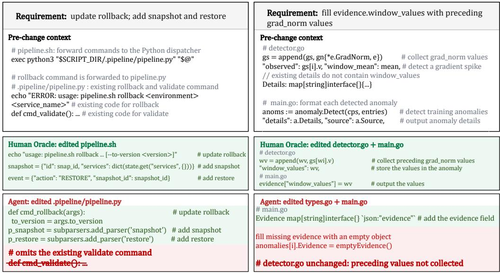  
(b) Agents rewrite the output field but omit the code that produces its data.  
Figure 1: Two examples of requirement focus misalignment. (a) Unrelated code modification: the agent rewrites a shared dispatcher and omits the existing validate() command. (b) Missing update: the agent adds the output field but omits the code that collects its values.

❷ Missing update. In Figure 1(b), the requirement asks each detected anomaly to include an evidence object. For a gradient spike, evidence.window values records up to five preceding gradient-norm values. The values are collected in detector.go and formatted for output in main.go. The human-written oracle updates both components. However, the agent modifies only the output-related code in types.go and main.go and omits the update to detector.go. Consequently, the output contains the evidence field, but window values remains empty.

The two examples show two forms of requirement focus misalignment: unrelated code modifications and missing updates. Across failed interaction rounds after Round 1, 55.16% of source-file modifications occur outside the modification target files specified by the human-written oracle (see Appendix B for the experimental details). The finding motivates RepoTrace, which helps code agents identify the code elements corresponding to the current requirement.

## 3 RELATED WORK

## 3.1 CODE AGENTS IN MULTI-ROUND INTERACTIONS

Code agents have demonstrated strong capabilities in software engineering tasks. Commercial products such as Claude Code, Codex and Kimi Code (Anthropic, 2026; OpenAI, 2026; Moonshot AI, 2026) bring agentic coding into daily development practice. From function-level HumanEval (Chen et al., 2021), to repository-level SWE-bench (OpenAI, 2024; Deng et al., 2025), to long-horizon tasks like Terminal-Bench (Merrill et al., 2026), code agents continuously achieve high scores. Many existing benchmarks focus on single-round, one-shot code generation, where software maintenance and evolution remain important throughout the software life cycle (Lehman, 1980; Lientz et al., 1978). However, recent studies show that code agents tend to degrade as the number of interaction rounds increases. Laban et al. (2025) finds that top-tier models lose roughly 39% of their average success rate compared to single-round settings, and Rawal et al. (2025) reports a 20%-27% average drop in correct-and-secure outputs across 32 models. Similarly, SlopCodeBench reports that no agent solves all tasks, where the best agent passes only 14.8% of checkpoints, and 77% of trajectories exhibit structural erosion, while 75.5% suffer from verbosity (Orlanski et al., 2026). Complementary studies report consistent findings, including declining accuracy under iterative refinement, low completion rates under stepwise requirement refinement, instruction forgetting, and progressive faithfulness loss to emergent specifications (Wang et al., 2026; Zhan et al., 2025; Wang et al., 2025; Yan et al., 2026).

## 3.2 REQUIREMENTS TRACING AND REPOSITORY-LEVEL CODE UNDERSTANDING

Requirements traceability refers to the ability to describe and follow the life of a requirement (Gotel & Finkelstein, 1994), which is an active research topic in software engineering. Recent studies explore the combination of LLMs with structured methods for requirements tracing. TraceDev proposes a multi-agent framework that links requirements, design models, and code in a heterogeneous traceability graph to explicitly maintain consistency among software artifacts (Chen et al., 2026). RAG-based methods further recover requirement trace links in a largely domain-agnostic manner (Hey et al., 2025; Fuchß et al., 2025). Existing studies demonstrate the potential of language models in requirements tracing and the impact analysis of change (Etezadi et al., 2025). However, they don’t consider how requirement-artifact consistency should be maintained as requirements evolve over multiple rounds of development.

Meanwhile, repository-level code understanding is another key research direction. GraphCoder proposes the code context graph (CCG), which structures information such as control flow and data dependencies into a graph to improve context retrieval for repository-level code completion (Liu et al., 2024). CodexGraph and RANGER organize repositories as knowledge graphs, supporting graph queries and natural-language retrieval (Liu et al., 2025; Shah et al., 2025). Most recently, LocAgent and DyRetriever allow agents to navigate or perform multi-hop reasoning along dependency graphs, achieving low-cost code localization and context retrieval (Chen et al., 2025; Liu et al., 2026b). Existing methods enhance the understanding of code structure from different angles (Luo et al., 2025). However, they primarily target static repositories or one-shot generation, without considering how repository structure should be maintained and updated during multi-round interactions.

## 4 REPOTRACE

We propose RepoTrace, a requirement-driven repository understanding harness for code agents in multi-round interactions. To address requirement focus misalignment, RepoTrace combines repository structure with requirement semantics before code modification. The agent receives the current requirement together with structural dependencies and information about code elements associated with prior requirements.

Figure 2 illustrates the framework. At round t, RepoTrace takes the current code repository $R _ { t }$ and the natural-language requirement $r _ { t }$ . The following subsections introduce three steps: $\bullet$ how RepoTrace constructs a structural representation $G _ { t }$ of the repository; $\otimes$ how RepoTrace extracts requirement entities $Q _ { t }$ using the current requirement, the structural representation $G _ { t } ,$ and prior requirement records; and ❸ how RepoTrace combines $G _ { t }$ and $Q _ { t }$ to construct a requirement-code correspondence message $M _ { t }$ , maintain requirement tracing across rounds.

## 4.1 REPOSITORY STRUCTURE ANALYSIS

Structural representation. Let $V _ { t }$ denote the set of source files collected from $R _ { t } ,$ and let $E _ { t }$ denote the collected directed file relations. A relation $( u , v ) \in E _ { t }$ indicates that file u refers to code in file v. The representation $G _ { t }$ contains these file and relation sets, an index that associates symbols with their defining files, and file-level structural weights. To obtain $G _ { t }$ , we first extract the relations and symbol index, then compute the structural weights. We also compare $G _ { t }$ with the previous representation to identify structural changes across rounds.

Code relations. To obtain the file relations and symbol index, RepoTrace collects source-file paths, import declarations, symbol definitions, and candidate call sites from $R _ { t }$ . Specifically, we record $( u , v )$ when file u imports code from file v or contains a candidate call site whose name matches a symbol defined in $v .$ . We resolve repository-local imports and aggregate matched calls into file relations. These relations provide an approximate structural view, and the symbol index connects names in a requirement to repository files.

Structural weights. To identify core files that may affect dependent files, we compute two structural scores from code relations. We apply PageRank (Page et al., 1999) to the file graph formed by nodes $V _ { t }$ and relations from $E _ { t }$ whose endpoints are both in $V _ { t }$ . We also compute the fan-in of each file, defined as the number of distinct files that refer to it. PageRank captures the structural importance of files in the dependency graph, while fan-in measures how many files directly depend on each file. We use PageRank to prioritize files included in the LLM prompt and to order examples of dependent files. We use fan-in to select files referenced by multiple files and to rank the existing-file overview in the agent context. Two scores expose structural dependencies without assuming that structurally important files require modification.

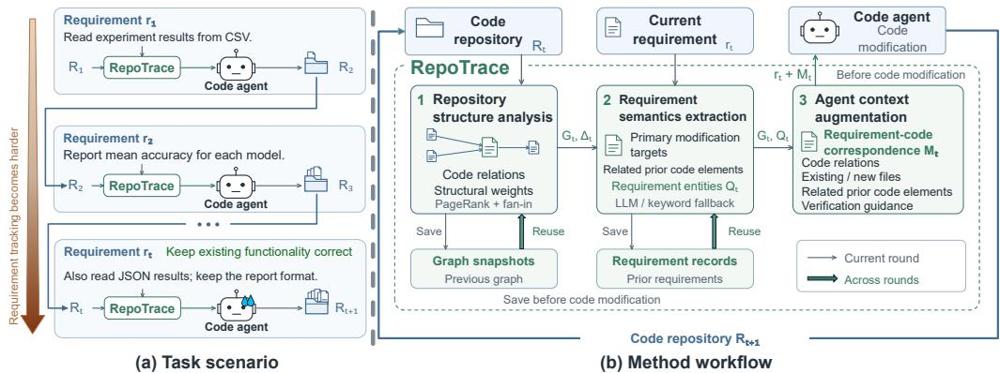  
Figure 2: Overview of RepoTrace in multi-round interactions. Left: an illustrative sequence of requirements for the same code repository. Right: before each code modification, RepoTrace analyzes repository structure, extracts requirement semantics, and constructs a requirement-code correspondence message $M _ { t }$ for the code agent.

Structural changes. To reflect code modifications across rounds, RepoTrace reconstructs $G _ { t }$ from the current repository before processing each requirement. To identify what has changed, we compare $G _ { t }$ with the most recent retained representation $G _ { \mathrm { p r e v } }$ , whose file and relation sets are $V _ { \mathrm { p r e v } }$ and $E _ { \mathrm { p r e v } }$ . We summarize structural changes as

$$
\Delta _ { t } = \left( V _ { t } \setminus V _ { \mathrm { p r e v } } , \ V _ { \mathrm { p r e v } } \setminus V _ { t } , \ E _ { t } \setminus E _ { \mathrm { p r e v } } , \ E _ { \mathrm { p r e v } } \setminus E _ { t } \right) .\tag{1}
$$

The four components record added files, removed files, added relations, and removed relations, respectively. For the first round, the previous file and relation sets are empty. This summary provides structural changes observed before the current modification, including changes made during preceding rounds. The analysis produces the current structural representation $G _ { t }$ and the change summary $\Delta _ { t }$ for requirement semantics extraction. For specific examples, see Appendix A.1.

## 4.2 REQUIREMENT SEMANTICS EXTRACTION

Building on $G _ { t }$ and $\Delta _ { t } .$ , RepoTrace analyzes the current requirement $r _ { t }$ and prior requirements $r _ { < t }$ in order to identify candidate primary modification targets and potentially affected code elements. To connect $r _ { t }$ with $r _ { < t }$ , RepoTrace retains a history $\mathcal { H } _ { < t }$ of earlier requirement records, including their extracted code elements and summaries. RepoTrace combines $r _ { t } , G _ { t } , \Delta _ { t }$ , and $\mathcal { H } _ { < t }$ to produce a structured record of requirement entities:

$$
Q _ { t } = \mathrm { E x t r a c t } \big ( r _ { t } , G _ { t } , \Delta _ { t } , \mathcal { H } _ { < t } \big ) .\tag{2}
$$

The record $Q _ { t }$ contains candidate target files and symbols, behavior constraints, potentially affected prior code elements, and a requirement summary. These fields represent two roles: candidate pri mary modification targets and potentially affected prior code elements.

❶ For LLM-based extraction, RepoTrace calls an LLM to analyze the current requirement, a list of files ranked by PageRank, symbol-to-file associations, and a bounded summary of recent requirement records. When prior records exist, RepoTrace also includes a compact summary of $\Delta _ { t }$ in the prompt. The LLM extracts the requirement entities and returns the structured record $Q _ { t }$ . ❷ If no LLM is configured or extraction fails, a keyword fallback matches file paths and identifiers in $r _ { t }$ against the repository index. The fallback compares these matches with historical targets to distinguish newly identified targets from potentially affected prior code elements without using $\Delta _ { t }$ . In both paths, the records retain associations between requirements and code elements across rounds. For specific examples, see Appendix A.2.

## 4.3 AGENT CONTEXT AUGMENTATION ACROSS ROUNDS

The requirement semantics extraction produces $Q _ { t }$ , which identifies candidate primary modification targets and potentially affected prior code elements. RepoTrace combines this requirement-specific information with the structural representation $G _ { t }$ to construct a requirement-code correspondence message for the code agent. To maintain requirement tracing across rounds, RepoTrace also retains the current structural representation and requirement record for use in subsequent rounds.

Requirement-code correspondence. The structural representation $G _ { t }$ describes code relations, while $Q _ { t }$ identifies candidate code elements associated with the current and prior requirements. To provide the code agent with context for the current requirement, we select information from both to construct the requirement-code correspondence message:

$$
M _ { t } = \mathrm { C o m p o s e } ( G _ { t } , Q _ { t } ) , \qquad \widetilde { r } _ { t } = r _ { t } \circ M _ { t } ,\tag{3}
$$

where ◦ denotes text concatenation. The message combines four types of information: code relations for files with high fan-in and selected direct dependents; an overview of existing files and candidate new files; potentially affected prior code elements; and verification guidance. We identify candidate new files by comparing the target paths in $Q _ { t }$ with $V _ { t }$ . The verification guidance asks the agent to build and test the modified repository and suggests a command based on the programming languages in the repository. The message uses selected fields of $Q _ { t }$ , rather than reproducing the entire extraction record. The code agent receives the original requirement with this supplemental context and retains responsibility for code modification and verification.

Maintaining records across rounds. To reuse the current analysis in later rounds, RepoTrace stores the current graph representation and appends the current requirement record to its history after constructing $M _ { t }$ and before the code agent executes. The agent then modifies the repository, whose state is observed as $R _ { t + 1 }$ at the next round. At that round, RepoTrace reconstructs the repository structure, compares it with the retained graph, and reuses prior requirement records during extraction, repeating the three steps for the next requirement. Graph snapshots and requirement records therefore describe prior analyses, rather than verified completion states. For specific examples, see Appendix A.3.

## 5 EXPERIMENTS

To evaluate the effectiveness of RepoTrace, we conduct experiments with multiple code agents on multi-round software tasks. In this section, we introduce the benchmarks, baselines, models, and evaluation metrics. We then present the experimental results and analysis.

## 5.1 EXPERIMENTAL SETUP

Benchmarks. We evaluate code agents on EvoCode-Bench (Shen et al., 2026), which contains 26 stateful software engineering tasks and 227 evaluated rounds across six technical domains, including ML/MLOps, data engineering, systems and code, scientific computing, testing and automation, and infrastructure and security. Each task contains 5-15 rounds, with the same workspace and agent session preserved across rounds. Each round introduces a new requirement and uses cumulative test cases to verify the current and previous active requirements. A round receives a reward only when all test cases pass.

Baselines and Models. We integrate RepoTrace into two agent harnesses, Terminus-2 (Harbor Framework Team, 2026b) and Claude Code (Anthropic, 2026), within the Harbor agent environment (Harbor Framework Team, 2026a). We evaluate four models: GLM-5.2 (GLM, 2026), DeepSeek-V4-Pro (DeepSeek-AI, 2026), MiniMax-M3 (Lai et al., 2026), and Qwen3.7-Max (Qwen Team, 2026). We access all models via API. All API configurations (e.g., temperature, top-k, and thinking effort) use the default settings.

Evaluation Metrics. We follow the evaluation setting of EvoCode-Bench (Shen et al., 2026).

1) Mean per-round reward (MPR) ↑ measures the fraction of passed rounds, where a round is counted as passed only when all test cases pass. The reward is averaged across all tasks.

Table 1: Main results and token usage on EvoCode-Bench.
<table><tr><td></td><td>MPR↑</td><td>FCR↑</td><td>PTR↑</td><td>HTR↓</td><td>TCS ↑</td><td>IT(M) ↓</td><td>OT(M) ↓</td></tr><tr><td>DeepSeek-V4-Pro</td><td>14.14</td><td>11.54</td><td>3.85</td><td>92.31</td><td>61.74</td><td>441.33</td><td>12.51</td></tr><tr><td>w/ RepoTrace</td><td>36.39</td><td>34.62</td><td>15.38</td><td>61.54</td><td>73.63</td><td>319.48</td><td>16.92</td></tr><tr><td>GLM-5.2 w/ RepoTrace</td><td>16.19 36.18</td><td>3.85 30.77</td><td>3.85 7.69</td><td>88.46 61.54</td><td>47.52 77.33</td><td>98.26 175.62</td><td>7.62 12.30</td></tr><tr><td>MiniMax-M3</td><td>23.42</td><td>23.08</td><td>7.69</td><td>73.08</td><td>61.46</td><td></td><td></td></tr><tr><td>w/ RepoTrace</td><td>28.33</td><td>15.38</td><td>7.69</td><td>73.08</td><td>76.76</td><td>726.66 1445.57</td><td>5.89 7.99</td></tr><tr><td>Qwen3.7-Max</td><td></td><td></td><td></td><td></td><td></td><td></td><td></td></tr><tr><td>w/ RepoTrace</td><td>11.87 11.36</td><td>7.69 3.85</td><td>0.00 0.00</td><td>92.31 92.31</td><td>67.37 66.06</td><td>227.49 275.64</td><td>7.89 9.07</td></tr></table>

2) Final-round completion rate (FCR) ↑ measures the average test case completion rate of the final round across all tasks. The test cases are cumulative, so completing the final-round test cases means that all requirements in the requirement chain are satisfied.

3) Perfect-task rate (PTR) ↑ measures the fraction of tasks in which a single attempt passes every round.

4) Hard-task rate (HTR) ↓ measures the fraction of tasks whose per-task score is at most 0.5.

5) Test Case Score (TCS) ↑ measures the average test case completion rate of the entire dataset.

6) Input / Output Tokens (IT / OT) ↓ measure the total number of input / output tokens used across all rounds of all tasks in the dataset, expressed in millions of tokens (M).

## 5.2 RQ1: TO WHAT EXTENT DOES REPOTRACE IMPROVE PERFORMANCE ACROSS DIFFERENT MODELS?

To answer RQ1, we evaluate four representative models with and without RepoTrace on EvoCode-Bench, in order to verify whether RepoTrace improves model performance on multi-round software engineering tasks. Table 1 reports the results.

RepoTrace brings improvement on stronger models that can effectively exploit repository-level guidance, while the benefit is limited for models that struggle to utilize it. On DeepSeek-V4-Pro, RepoTrace raises MPR from 14.14 to 36.39 (+22.25, about 2.57×), with FCR and PTR improving by about 3× and 4× respectively. This shows that the traced repository-level guidance translates into both higher per-round success and more fully completed tasks. The benefit is limited for Qwen3.7- Max, suggesting that the advantage scales with the model’s ability to exploit the injected guidance. The extra token cost is acceptable. On DeepSeek-V4-Pro, RepoTrace reduces IT from 441.33M to 319.48M (−27.61%) while tripling MPR, since repository-level guidance prunes redundant exploration of the codebase. Considering that OT rises only moderately across all models and IT even decreases on the strongest performer, we regard the overall token overhead as acceptable. Overall, RepoTrace improves model performance on EvoCode-Bench with an acceptable efficiency cost.

## 5.3 RQ2: TO WHAT EXTENT DOES REPOTRACE IMPROVE PERFORMANCE ACROSS DIFFERENT HARNESSES?

Table 2: RepoTrace across agent harnesses on EvoCode-Bench.
<table><tr><td>Agent</td><td>MPR↑</td><td>FCR↑</td><td>PTR↑</td><td>HTR↓</td><td>TCS ↑</td><td>IO↓</td><td>OT↓</td></tr><tr><td>Terminus-2 w/ RepoTrace</td><td>14.14</td><td>11.54</td><td>3.85</td><td>92.31</td><td>61.74</td><td>441.33</td><td>12.51</td></tr><tr><td></td><td>36.39</td><td>34.62</td><td>15.38</td><td>61.54</td><td>73.63</td><td>319.48</td><td>16.92</td></tr><tr><td>Claude Code</td><td>44.65</td><td>42.31</td><td>19.23</td><td>57.69</td><td>91.14</td><td>842.06</td><td>7.99</td></tr><tr><td>w/ RepoTrace</td><td>54.87</td><td>46.15</td><td>26.92</td><td>50.00</td><td>93.02</td><td>675.36</td><td>9.44</td></tr></table>

To answer RQ2, we evaluate RepoTrace on two harnesses (i.e., Terminus-2 and Claude Code, both driven by DeepSeek-V4-Pro) to verify whether the effectiveness of RepoTrace generalizes across different agent harnesses. Table 2 reports the results.

RepoTrace improves performance across different harnesses. On the weaker Terminus-2, RepoTrace raises MPR from 14.14 to 36.39 (about 2.57×) and PTR from 3.85 to 15.38 (about 4×). On Claude Code, RepoTrace further improves MPR from 44.65 to 54.87 (+10.22 points), suggesting that the repository-level context extracted by RepoTrace complements the context extracted by the harness (see RQ4 and Appendix A). Token efficiency improves consistently as well when using

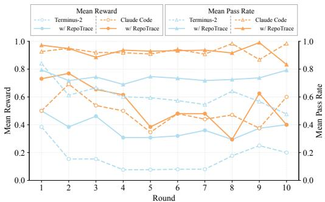  
(a) Mean Reward and Mean Pass Rate

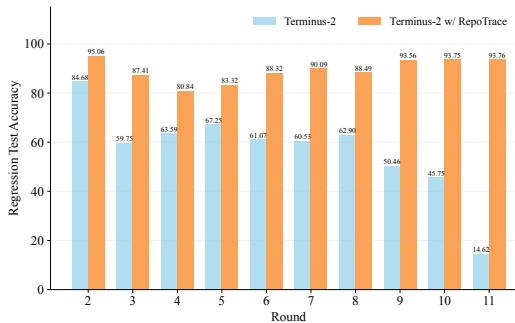  
(b) Regression Test Accuracy

Figure 3: Results of DeepSeek-V4-Pro on EvoCode-Bench using Terminus-2 and Claude Code, with and without RepoTrace. (a) Mean reward (left axis) and mean pass rate (right axis) over 10 rounds: the average reward and the average fraction of test cases passed per round, each averaged over tasks. (b) Regression test accuracy in multi-round interactions: for each round i $\in \{ 2 , \ldots , 1 1 \}$ we report the mean pass rate over all test cases belonging to rounds $1 , \ldots , i - 1$ , averaged over 26 tasks. Higher values indicate fewer regression errors.  
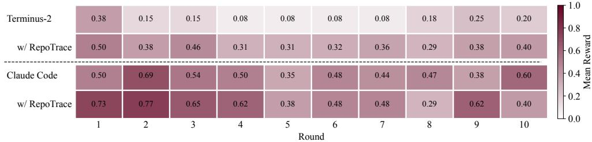  
Figure 4: Heatmap of the per-round mean reward for each harness-RepoTrace combination.

DeepSeek-V4-Pro: IT decreases by 27.61% on Terminus-2 and by 19.80% on Claude Code, while OT rises only slightly on both harnesses. Overall, RepoTrace brings consistent improvement across harnesses at an acceptable efficiency cost.

## 5.4 RQ3: HOW DOES REPOTRACE’S IMPROVEMENT VARY ACROSS ROUNDS?

To answer RQ3, we analyze the per-round behavior of DeepSeek-V4-Pro on EvoCode-Bench under both harnesses over 10 rounds. Figure 3 reports the per-round mean reward, mean pass ratio, and the regression errors on earlier rounds’ test cases, and Figure 4 visualizes the per-round mean reward of each harness–RepoTrace combination.

RepoTrace mitigates error accumulation and regression across rounds. On Terminus-2, vanilla collapses after the first round, dropping from 0.38 in round 1 to 0.08 ∼ 0.15 in rounds 2 to 7. In contrast, RepoTrace maintains a mean reward between 0.29 and 0.50 and leads in all 10 rounds. The regression results further confirm this gap. Vanilla’s pass rate on the test cases of earlier rounds degrades from 84.68 at round 2 to only 14.62 at round 11, while RepoTrace keeps this rate above 80 in every round. Averaged over rounds 2 to 11, RepoTrace improves this pass rate from 57.06 to 89.46 (+32.40 points, a 56.78% relative improvement), which means fewer regression errors. Overall, the benefit of RepoTrace persists as rounds advance, with a steady improvement in both harnesses.

## 5.5 RQ4: HOW DOES REPOTRACE IMPROVE REQUIREMENT TRACING?

In RQ4, we use a case study to further examine how RepoTrace improves requirement tracing. JobForge is a nine-round software task from EvoCode-Bench. A code agent incrementally develops a Go command-line tool as new requirements arrive. Round 6 adds the schedule subcommand. Round 7 adds the critical subcommand for critical-path analysis while requiring existing functionality to remain correct. We compare Vanilla and RepoTrace trajectories produced with the same requirement chain, model, and execution environment. We independently replayed both trajectories and confirmed their outcomes. Figure 5 compares the code modifications under the two settings.

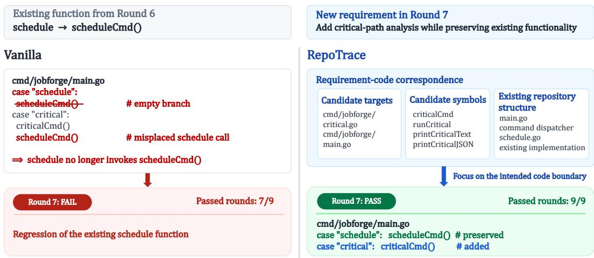  
Figure 5: Case study of RepoTrace on JobForge. In the Vanilla setting, adding the critical subcommand breaks the existing schedule dispatch. In the RepoTrace setting, the requirementcode correspondence guides the agent to add an independent critical branch while preserving the schedule function, satisfying both the current and prior requirements.

RepoTrace aligns code modifications focused on the current requirement and reduces unintended changes to existing functionality. ❶ In the Vanilla, the agent added critical to the shared command dispatcher but left the existing schedule branch without a call to scheduleCmd(). The command dispatcher routes each subcommand to its implementation. The missing call therefore broke the scheduling functionality introduced in Round 6. ❷ In the RepoTrace, the requirement-code correspondence identified cmd/jobforge/critical.go and cmd/jobforge/main.go as candidate primary modification targets, and criticalCmd and related critical-path functions as candidate symbols. The repository structure also showed the existing schedule implementation. Using the correspondence, the agent added a separate dispatch branch for critical and preserved the existing schedule → scheduleCmd() relation. Overall, RepoTrace combines requirement semantics with repository structure to identify primary modification targets and preserve existing functionality, reducing requirement focus misalignment.

## 6 DISCUSSION

In this section, we discuss 1) the applicability of RepoTrace and 2) the role of requirements in agentic software engineering.

As a requirement-driven repository understanding method, RepoTrace can be extended to different harnesses through the requirement-code correspondence produced by RepoTrace. Both humans and code agents can modify the correspondence, allowing RepoTrace to work with different harnesses without directly modifying their execution process. Deeper integration (e.g., using hooks) may provide more control but reduce the range of applicable RepoTrace. Supporting a wider range of harnesses while maintaining effective integration remains an open problem.

Requirements play a central role in agentic software engineering. Code agents need to translate requirements into code changes and retain previous requirements as the software evolves. As the interaction horizon grows, agents may get lost, focus on the most recent requirement, and miss requirements addressed in earlier rounds. Therefore, maintaining requirements throughout software development can help agents preserve their objectives while making new changes. More broadly, requirements provide a persistent source of objectives for agents to build on their previous experience, which is important for RSI.

## 7 CONCLUSION AND FUTURE WORK

We present RepoTrace, a requirement-driven repository understanding harness that improves requirement tracing in multi-round agent interactions. RepoTrace helps code agents focus on relevant code and preserve existing functionality across interactions. In future work, we plan to: 1) explore how to manage and abstract requirement changes through structured representations, as with code, and 2) study how RepoTrace can help promote RSI.

## AI USE STATEMENT

In preparing this manuscript, we use LLMs to assist with writing and coding. Specifically, LLMs improve clarity, grammar, and phrasing, ensuring the text is concise and readable. The use of LLMs does not influence the technical contributions or the interpretation of experimental findings. All content edited by LLMs was carefully checked by at least two authors.

## REFERENCES

Anthropic. 2026 agentic coding trends report. Technical report, Anthropic, 2026. URL https://resources.anthropic.com/hubfs/2026%20Agentic%20Coding% 20Trends%20Report.pdf.

Anthropic. Claude code. Product documentation, 2026. URL https://docs.anthropic. com/en/docs/claude-code/overview.

Hongyu Pei Breivold, Ivica Crnkovic, and Magnus Larsson. Software architecture evolution through evolvability analysis. Journal ofSystems and Software, 85(11):2574–2592, 2012.

Nicholas Carlini, Keane Lucas, Evyatar Ben Asher, Newton Cheng, Hasnain Lakhani, David Forsythe, and Kyla Guru. Evaluating and mitigating the growing risk of llm-discovered 0-days. Technical report, Anthropic, 2026. URL https://www.anthropic.com/research/ zero-days. Nicholas Carlini, Keane Lucas, and Evyatar Ben Asher contributed equally.

Mark Chen, Jerry Tworek, Heewoo Jun, Qiming Yuan, Henrique Ponde de Oliveira Pinto, Jared´ Kaplan, Harri Edwards, Yuri Burda, Nicholas Joseph, Greg Brockman, Alex Ray, Raul Puri, Gretchen Krueger, Michael Petrov, Heidy Khlaaf, Girish Sastry, Pamela Mishkin, Brooke Chan, Scott Gray, Nick Ryder, Mikhail Pavlov, Alethea Power, Lukasz Kaiser, Mohammad Bavarian, Clemens Winter, Philippe Tillet, Felipe Petroski Such, Dave Cummings, Matthias Plappert, Fotios Chantzis, Elizabeth Barnes, Ariel Herbert-Voss, William Hebgen Guss, Alex Nichol, Alex Paino, Nikolas Tezak, Jie Tang, Igor Babuschkin, Suchir Balaji, Shantanu Jain, William Saunders, Christopher Hesse, Andrew N. Carr, Jan Leike, Joshua Achiam, Vedant Misra, Evan Morikawa, Alec Radford, Matthew Knight, Miles Brundage, Mira Murati, Katie Mayer, Peter Welinder, Bob McGrew, Dario Amodei, Sam McCandlish, Ilya Sutskever, and Wojciech Zaremba. Evaluating large language models trained on code. CoRR, abs/2107.03374, 2021.

Mingyu Chen, Yakun Zhang, Zihao Xie, Yixing Luo, Jinrui Xu, Cuiyun Gao, Kaiqi Zhao, and Yunming Ye. Tracedev: A traceability-driven multi-agent framework for requirement-to-code development. CoRR, abs/2607.18886, 2026.

Zhaoling Chen, Robert Tang, Gangda Deng, Fang Wu, Jialong Wu, Zhiwei Jiang, Viktor K. Prasanna, Arman Cohan, and Xingyao Wang. Locagent: Graph-guided LLM agents for code localization. In ACL (1), pp. 8697–8727. Association for Computational Linguistics, 2025.

DeepSeek-AI. Deepseek-v4: Towards highly efficient million-token context intelligence. CoRR, abs/2606.19348, 2026.

Xiang Deng, Jeff Da, Edwin Pan, Yannis Yiming He, Charles Ide, Kanak Garg, Niklas Lauffer, Andrew Park, Nitin Pasari, Chetan Rane, Karmini Sampath, Maya Krishnan, Srivatsa Kundurthy, Sean Hendryx, Zifan Wang, Chen Bo Calvin Zhang, Noah Jacobson, Bing Liu, and Brad Kenstler. Swe-bench pro: Can AI agents solve long-horizon software engineering tasks? CoRR, abs/2509.16941, 2025.

Romina Etezadi, Sallam Abualhaija, Chetan Arora, and Lionel C. Briand. Llm-driven cost-effective requirements change impact analysis. CoRR, abs/2511.00262, 2025.

Dominik Fuchß, Tobias Hey, Jan Keim, Haoyu Liu, Niklas Ewald, Tobias Thirolf, and Anne Koziolek. Lissa: Toward generic traceability link recovery through retrieval- augmented generation. In ICSE, pp. 1396–1408. IEEE, 2025.

GLM. GLM-5: from vibe coding to agentic engineering. CoRR, abs/2602.15763, 2026.

Orlena C. Z. Gotel and Anthony C. W. Finkelstein. An analysis of the requirements traceability problem. In Proceedings of the 1st International Conference on Requirements Engineering (ICRE), pp. 94–101, 1994. doi: 10.1109/ICRE.1994.292398.

Fei Gu, Zi Liang, Jiahao Ma, and Hongzong Li. The matthew effect of ai programming assistants: A hidden bias in software evolution. In International Conference on Learning Representations, volume 2026, pp. 68445–68470, 2026.

Harbor Framework Team. Harbor: A framework for evaluating and optimizing agents and models in container environments. Open-source evaluation framework, 2026a. URL https://github. com/harbor-framework/harbor.

Harbor Framework Team. Terminus-2. Harbor reference agent documentation, 2026b. URL https://harborframework.com/docs/agents/terminus-2.

Tobias Hey, Dominik Fuchß, Jan Keim, and Anne Koziolek. Requirements traceability link recovery via retrieval-augmented generation. In REFSQ, volume 15588 of Lecture Notes in Computer Science, pp. 381–397. Springer, 2025.

Yonghui Huang, Lin Ma, Amjed Tahir, Qian Zhang, Liwen Xiao, and Lysa Xiao. Regression accumulation in multi-turn LLM programming conversations. CoRR, abs/2607.01855, 2026.

Philippe Laban, Hiroaki Hayashi, Yingbo Zhou, and Jennifer Neville. Llms get lost in multi-turn conversation. CoRR, abs/2505.06120, 2025.

Xunhao Lai, Weiqi Xu, Yufeng Yang, Qiaorui Chen, Yang Xu, Lunbin Zeng, Xiaolong Li, Haohai Sun, Haichao Zhu, Vito Zhang, Jinkai Hu, Jiayao Li, Rui Gao, Zekun Li, Songquan Zhu, Jingkai Zhou, and Pengyu Zhao. Minimax sparse attention, 2026. URL https://arxiv.org/abs/ 2606.13392.

Meir M Lehman. Programs, life cycles, and laws of software evolution. Proceedings of the IEEE, 68(9):1060–1076, 1980.

Bennet P Lientz, E. Burton Swanson, and Gail E Tompkins. Characteristics of application software maintenance. Communications ofthe ACM, 21(6):466–471, 1978.

Changzhi Liu, Yilun Liu, Sikuan Yan, Volker Tresp, and Yunpu Ma. Mendel godel machine: Recur-¨ sive self-improving coding agents via comparative evolution. CoRR, abs/2608.07645, 2026a.

Wei Liu, Ailun Yu, Daoguang Zan, Bo Shen, Wei Zhang, Haiyan Zhao, Zhi Jin, and Qianxiang Wang. Graphcoder: Enhancing repository-level code completion via coarse-to-fine retrieval based on code context graph. In ASE, pp. 570–581. ACM, 2024.

Xiangyan Liu, Bo Lan, Zhiyuan Hu, Yang Liu, Zhicheng Zhang, Fei Wang, Michael Qizhe Shieh, and Wenmeng Zhou. Codexgraph: Bridging large language models and code repositories via code graph databases. In NAACL (Long Papers), pp. 142–160. Association for Computational Linguistics, 2025.

Zhongxin Liu, Zhonghao Jiang, Zhifan Ye, Haoye Wang, Jiakun Liu, and Xiaoxue Ren. Effective and efficient context retrieval via partial dependency graph for repository-level code generation. CoRR, abs/2608.01927, 2026b.

Jane Luo, Xin Zhang, Steven Liu, Jie Wu, Yiming Huang, Yangyu Huang, Chengyu Yin, Ying Xin, Jianfeng Liu, Yuefeng Zhan, Hao Sun, Qi Chen, Scarlett Li, and Mao Yang. RPG: A repository planning graph for unified and scalable codebase generation. CoRR, abs/2509.16198, 2025.

Muhammad Maaz, Liam DeVoe, Zac Hatfield-Dodds, and Nicholas Carlini. Finding bugs across the python ecosystem with claude and property-based testing. Technical report, Anthropic, 2026. URL https://www.anthropic.com/research/property-based-testing.

Mike A. Merrill, Alexander Glenn Shaw, Nicholas Carlini, Boxuan Li, Harsh Raj, Ivan Bercovich, Lin Shi, Jeong Yeon Shin, Thomas Walshe, Estefany Kelly Buchanan, Junhong Shen, Guanghao Ye, Haowei Lin, Jason Poulos, Maoyu Wang, Marianna Nezhurina, Jenia Jitsev, Di Lu, Orfeas Menis-Mastromichalakis, Zhiwei Xu, Zizhao Chen, Yue Liu, Robert Zhang, Leon Liangyu Chen, Anurag Kashyap, Jan-Lucas Uslu, Jeffrey Li, Jianbo Wu, Minghao Yan, Song Bian, Vedang Sharma, Ke Sun, Steven Dillmann, Akshay Anand, Andrew Lanpouthakoun, Bardia Koopah, Changran Hu, Etash Kumar Guha, Gabriel H. S. Dreiman, Jiacheng Zhu, Karl Krauth, Li Zhong, Niklas Muennighoff, Robert Amanfu, Shangyin Tan, Shreyas Pimpalgaonkar, Tushar Aggarwal, Xiangning Lin, Xin Lan, Xuandong Zhao, Yiqing Liang, Yuanli Wang, Zilong Wang, Changzhi Zhou, David Heineman, Hange Liu, Harsh Trivedi, John Yang, Junhong Lin, Manish Shetty, Michael Yang, Nabil Omi, Negin Raoof, Shanda Li, Terry Yue Zhuo, Wuwei Lin, Yiwei Dai, Yuxin Wang, Wenhao Chai, Shang Zhou, Dariush Wahdany, Ziyu She, Jiaming Hu, Zhikang Dong, Yuxuan Zhu, Sasha Cui, Ahson Saiyed, Arinbjorn Kolbeinsson, Jesse Hu, Christo-¨ pher Michael Rytting, Ryan Marten, Yixin Wang, Alex Dimakis, Andy Konwinski, and Ludwig Schmidt. Terminal-bench: Benchmarking agents on hard, realistic tasks in command line interfaces. CoRR, abs/2601.11868, 2026.

Moonshot AI. Kimi code, 2026. URL https://kimi.com/code. Accessed: 2026-09-07.

OpenAI. Introducing SWE-bench verified. https://openai.com/index/ introducing-swe-bench-verified/, August 2024.

OpenAI. Codex. Product documentation, 2026. URL https://openai.com/codex.

Gabriel Orlanski, Devjeet Roy, Alexander Yun, Changho Shin, Alex Gu, Albert Ge, Dyah Adila, Frederic Sala, and Aws Albarghouthi. Slopcodebench: Benchmarking how coding agents degrade over long-horizon iterative tasks. CoRR, abs/2603.24755, 2026.

Lawrence Page, Sergey Brin, Rajeev Motwani, and Terry Winograd. The pagerank citation ranking : Bringing order to the web. In The Web Conference, 1999. URL https://api. semanticscholar.org/CorpusID:1508503.

Qwen Team. Qwen3.7: The agent frontier, May 2026. URL https://qwen.ai/blog?id= qwen3.7.

Ruchit Rawal, Jeffrey Yang Fan Chiang, Chihao Shen, Jeffery Siyuan Tian, Aastha Mahajan, Tom Goldstein, and Yizheng Chen. Benchmarking correctness and security in multi-turn code generation. CoRR, abs/2510.13859, 2025.

Pratik Shah, Rajat Ghosh, Aryan Singhal, and Debojyoti Dutta. RANGER - repository-level agent for graph-enhanced retrieval. CoRR, abs/2509.25257, 2025.

Haiyang Shen, Xuanzhong Chen, Wendong Xu, Yun Ma, Liang Chen, and Kuan Li. Evocode-bench: Evaluating coding agents in multi-turn iterative interactions. CoRR, abs/2605.24110, 2026.

Theodore R. Sumers, Shunyu Yao, Karthik Narasimhan, and Thomas L. Griffiths. Cognitive architectures for language agents. Trans. Mach. Learn. Res., 2024, 2024.

Ningzhi Tang, Chaoran Chen, Gelei Xu, Yiyu Shi, Yu Huang, Collin McMillan, Tao Dong, and Toby Jia-Jun Li. How coding agents fail their users: A large-scale analysis of developer-agent misalignment in 20,574 real-world sessions. CoRR, abs/2605.29442, 2026.

Peiding Wang, Li Zhang, Fang Liu, Lin Shi, Minxiao Li, Bo Shen, and An Fu. Codeif-bench: Evaluating instruction-following capabilities of large language models in interactive code generation. CoRR, abs/2503.22688, 2025.

Sizhe Wang, Zhengren Wang, Dongsheng Ma, Yongan Yu, Rui Ling, Zhiyu Li, Feiyu Xiong, and Wentao Zhang. Codeflowbench: A multi-turn, iterative benchmark for complex code generation. In ACL (1), pp. 4369–4402. Association for Computational Linguistics, 2026.

Lu Yan, Xuan Chen, and Xiangyu Zhang. When the specification emerges: Benchmarking faithfulness loss in long-horizon coding agents. CoRR, abs/2603.17104, 2026.

Fu-Qing Yang. Thinking on the development of software engineering technology. Journal of software, 16(1):1–7, 2005.

Zexun Zhan, Shuzheng Gao, Ruida Hu, and Cuiyun Gao. Sr-eval: Evaluating llms on code generation under stepwise requirement refinement. CoRR, abs/2509.18808, 2025.

Jenny Zhang, Shengran Hu, Cong Lu, Robert Lange, and Jeff Clune. Darwin godel machine: open-¨ ended evolution of self-improving agents. In International Conference on Learning Representations, volume 2026, pp. 104223–104294, 2026.

Tailin Zhou. Hierarchical self-improvement: A framework for task-specific evolvable agent harnesses. CoRR, abs/2608.08466, 2026.

## A SPECIFIC EXAMPLES OF REPOTRACE

We use JobForge Round 7 to illustrate the three steps in Section 4: repository structure analysis, requirement semantics extraction, and agent context augmentation across rounds. JobForge is a Go command-line tool developed over multiple rounds. Round 6 introduces the schedule subcommand. In Round 7, the requirement $r _ { 7 }$ asks for a critical subcommand that reports the longest dependency chain by job count and preserves all existing behavior. The following examples connect this requirement to the structural representation $G _ { 7 }$ , requirement entities $Q _ { 7 }$ , and requirement-code correspondence message $M _ { 7 }$

## A.1 REPOSITORY STRUCTURE ANALYSIS

Following Section 4.1, the structural representation describes the repository before the current code modification. Figure 6(a) lists the 13 source files in $V _ { 7 } ,$ including main.go and schedule.go. All listed paths share the prefix cmd/jobforge/. The structural change summary $\Delta _ { 7 }$ records schedule.go as an added file relative to the preceding snapshot. This entry captures a changeJobForge Round 7: saved structure and extracted entities observed before Round 7, rather than a file proposed for the current requirement.

## JobForge Round 7: saved structure and extracted entities

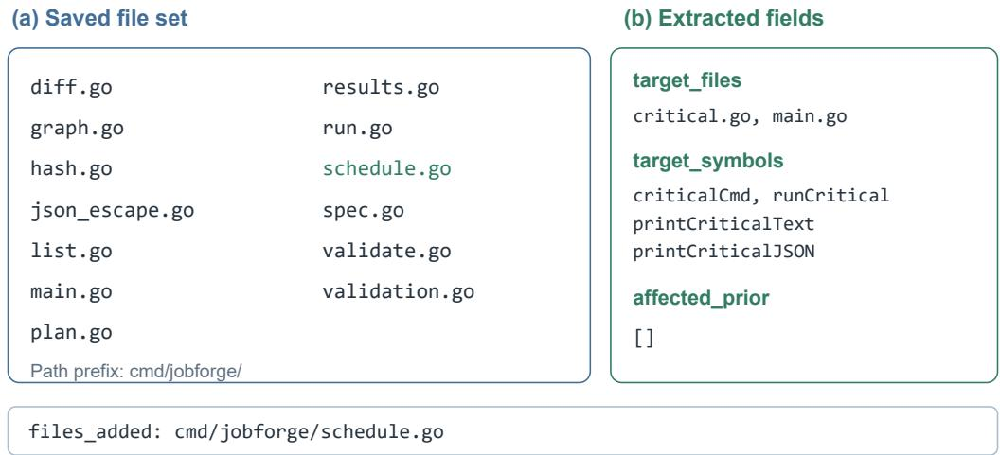  
Figure 6: Repository structure and selected requirement entities for JobForge Round 7. Panel (a) files\_added: cmd/jshows the source-file set $V _ { 7 }$ orge/schedule.go, and panel (b) shows candidate targets and potentially affected prior code elements from $Q _ { 7 }$ . The bottom row shows the added-file entry in $\Delta _ { 7 }$ . These records distinguish the existing schedule.go file from the candidate new file critical.go.

## A.2 REQUIREMENT SEMANTICS EXTRACTION

To identify code elements associated with $r _ { 7 }$ , the extraction step uses the inputs defined in Section 4.2: the current requirement, repository structure, structural changes, and prior requirement records. Figure 7 shows how the reference prompt organizes these inputs. The file lists and symbolto-file associations summarize $G _ { t } ;$ {instruction} supplies $r _ { t } ;$ and {prev block} supplies $H _ { < t }$ and $\Delta _ { t }$ when prior records exist. The requested JSON fields correspond to the candidate target files and symbols, behavior constraints, potentially affected prior code elements, and summary in $Q _ { t }$

For JobForge Round 7, the saved extraction record identifies critical.go and main.go as candidate target files, together with symbols such as criticalCmd (Figure 6(b)). The behavior con straints specify the critical-path output and require all existing subcommands to remain unchanged. The affected prior field is empty: no specific prior code elements are listed in that field. The preservation requirement is therefore represented by a behavior constraint, rather than by an explicit list of affected prior code elements. These fields provide the requirement-specific information used in the next step.

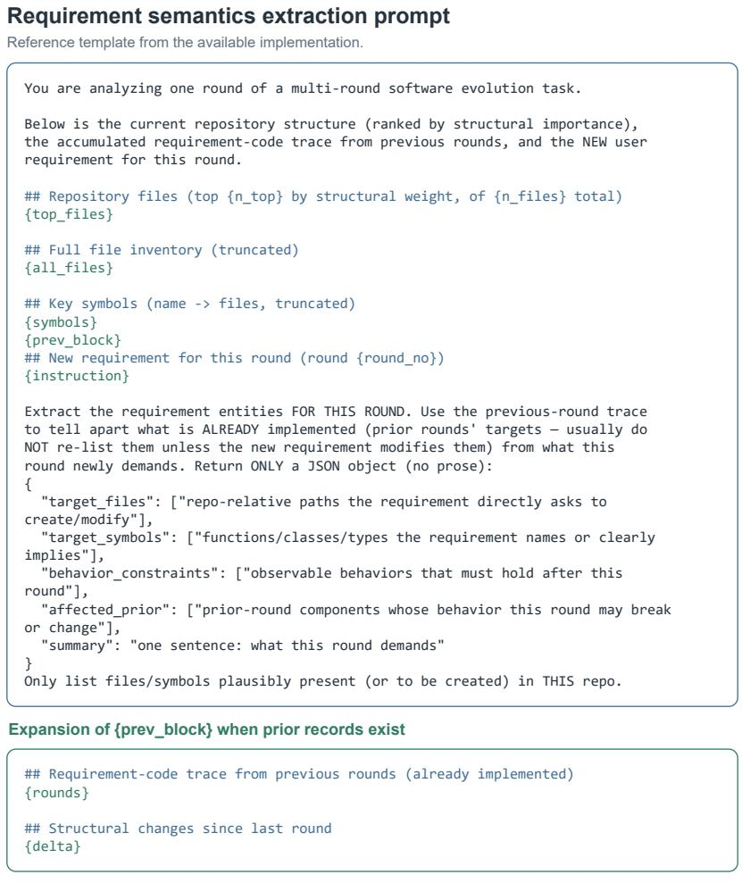  
Wording preserved; line wrapping and Python brace escaping adjusted for display.  
Figure 7: Reference prompt for requirement semantics extraction in Section 4.2. The upper box organizes the extraction inputs and specifies the fields of $Q _ { t }$ . The lower box expands {prev block} with prior requirement records and structural changes. The template wording is retained; line wrapping and Python brace escaping are adjusted for display.

## A.3 AGENT CONTEXT AUGMENTATION ACROSS ROUNDS

The correspondence message connects the candidate targets in $Q _ { 7 }$ to the repository described by $G _ { 7 }$ , illustrating the role of $M _ { t }$ in Section 4.3. Figure 8 shows excerpts from the actual Round 7 message. Comparing the target paths with V7 identifies critical.go as a candidate new file and main.go as an existing file. The message thus distinguishes creating the requested implementation from modifying existing code.

To retain the context of earlier requirements, the recorded message also includes the Round 6 scheduling requirement and its candidate targets, schedule.go and main.go. Together with the constraint that existing subcommands remain unchanged, this history reminds the agent to preserve scheduling behavior when adding critical. The verification guidance asks the agent to check that affected code still builds and preserves existing behavior. The complete message appears verbatim in the first user input of the Round 7 agent trajectory, alongside the current requirement.

This example shows how prior requirement records supplement the current requirement before code modification. As described in Section 4.3, RepoTrace retains graph snapshots and requirement records for subsequent rounds. These records preserve earlier analyses; they do not certify that the agent has completed a requirement or passed its tests.

## Message actually supplied to the code agent

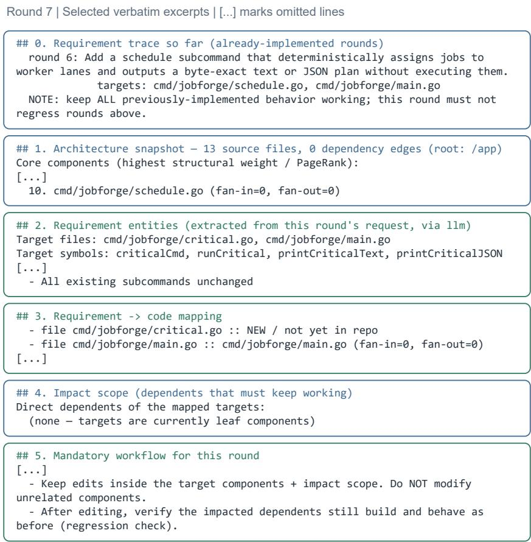  
Source: round\_7\_message.md; exact text also present in trajectory.json.  
Figure 8: Excerpts from the requirement-code correspondence message $M _ { 7 }$ supplied to the code agent. The message includes prior requirements, repository structure, candidate targets, existing/new-file mappings, and verification guidance. Ellipses mark omitted lines. The empty impact list reflects $E _ { 7 } = \varnothing ;$ ; the original phrase leaf components does not establish the absence of source-code dependencies.

## B SETTING FOR REQUIREMENT FOCUS MISALIGNMENT ANALYSIS

We systematically analyze 2,656 agent trajectories from EvoCode-Bench. Following the terminology used in the main text, each agent trajectory denotes the interaction trace associated with one model–task round. These trajectories cover 26 multi-round software evolution tasks and 12 code models.

For each trajectory at round r, we define Ar as the set of source-code paths modified by the agent and $O _ { r }$ as the set modified by the benchmark-provided oracle implementation. We statically extract $A _ { r }$ from mutation operations recorded in the agent trajectory and extract $O _ { r }$ from the corresponding solve.sh and solution artifacts. File paths are normalized relative to the repository root and deduplicated within each round. We retain source files written in Go, Python, JavaScript/TypeScript, Java, C/C++, Rust, Ruby, PHP, and shell. Tests, third-party dependencies, build outputs, caches, temporary files, and common documentation files are excluded using fixed path-based rules.

Before computing the aggregate metric, we apply a conservative parsing-quality filter. The static parser resolves concrete file paths for 19,431 of the 19,926 detected mutation-related command instances, corresponding to a parsing coverage of 97.52%. We exclude any trajectory containing an unresolved mutation operation because its extracted modification set may be incomplete. This excludes 143 trajectories. One additional trajectory is excluded because its trajectory artifact is unavailable, leaving 2,512 trajectories with reliably extracted path sets.

The main analysis focuses on failed trajectories and excludes Round 1, which often involves repository initialization and has a qualitatively different modification scope from subsequent evolution rounds. This selection results in 1,846 trajectories. We measure file-level deviation from the oracle modification scope as

$$
{ \mathrm { O f f O r a c l e } } = { \frac { \sum _ { r } | A _ { r }  \setminus O _ { r } | } { \sum _ { r } | A _ { r } | } } .\tag{4}
$$

Under this setting, 2,132 of the 3,865 agent-modified source-file instances fall outside the oracle modification scope, yielding an off-oracle ratio of 55.16%.

This metric measures disagreement with the modification scope of the benchmark reference implementation; it does not assume that the oracle provides the only valid implementation. The analysis is path-based and does not distinguish content-equivalent, whitespace-only, or comment-only writes. It also cannot verify whether every statically detected command successfully modified the workspace. We therefore report 55.16% as a corpus-level static estimate rather than a full-corpus replay ground truth. In a 30-trajectory calibration, the static and replay estimates under the same failed-trajectory, non-Round-1 setting are 32.26% and 34.29%, respectively.

## C HTML REPORT OF REPOSITORY CHANGES ACROSS ROUNDS

We provide an HTML report of the JobForge trajectory in the Supplementary Material. The report organizes repository snapshots by round and displays candidate targets, extracted symbols, potentially affected prior code elements, and added files alongside file and function-call diagrams. Readers can browse the report in a web browser. Code agents equipped with file or browser tools can inspect the same HTML artifact. The supplied report is a static document that supports inspection of the recorded changes.

Figure 9 shows excerpts from Rounds 6–8. The file count increases from 12 to 13 and then 14. In Round 6, schedule.go appears as a candidate target. In Round 7, schedule.go appears in the added-file record, and critical.go becomes a candidate target. In Round 8, critical.go appears in the added-file record. These entries distinguish the targets of a current requirement from file additions observed in a subsequent snapshot. See the Supplementary Material for the complete nine-round report.

<table><tr><td rowspan=1 colspan=1>Round6PASS12 files 73 calledgessrc=llm</td><td rowspan=2 colspan=1>targets: cmd/jobforge/schedule.go, cmd/jobforge/main.gosymbols: scheduleCmd, runScheduleaffected_prior: cmd/jobforge/main.go (subcommand registration and flag setup)files_added: cmd/jobforge/diff.go(a) Round 6: 12 files; schedule . go is a candidate target.</td></tr><tr><td rowspan=1 colspan=1></td></tr><tr><td rowspan=1 colspan=1>Round7PASS13 files ·83 calledgessrc=llm</td><td rowspan=2 colspan=1>targets: cmd/jobforge/critical.go, cmd/jobforge/main.gosymbols: criticalCmd, runCritical, printCriticalText, printCriticalJSONaffected_prior: (none)files_added: cmd/jobforge/schedule.go(b) Round 7: 13 files; s chedule . go appears as an added file.</td></tr><tr><td rowspan=1 colspan=1></td></tr><tr><td rowspan=1 colspan=1>Round8PASS14 files ·92 calledgessrc=llm</td><td rowspan=1 colspan=1>targets: cmd/jobforge/plan.go, cmd/jobforge/ancestors.go,cmd/jobforge/main.gosymbols: PrintPlanText, ancestorsCmd, runAncestors, printAncestorsText,printAncestorsJSONaffected_prior: cmd/jobforge/plan.go (PrintPlanText)files_added: cmd/jobforge/critical.go</td></tr></table>

(c) Round 8: 14 files; critical.go appears as an added file.  
Figure 9: Cropped screenshots of three consecutive records in the supplementary HTML report. The report combines extraction fields with function-call graphs re-collected from a reconstructed agent workspace. Its call-edge counts therefore describe the supplementary reconstruction, not the saved file-relation sets in Appendix A.1.

Figures 10 and 11 show corresponding file-level details from the reconstructed function-call diagrams. The outer boxes group functions by file. Solid arrows denote cross-file calls, and dashed arrows denote calls within a file. The screenshots retain the original labels and show local regions of the larger diagrams; some cross-file arrows continue beyond the crop boundaries.

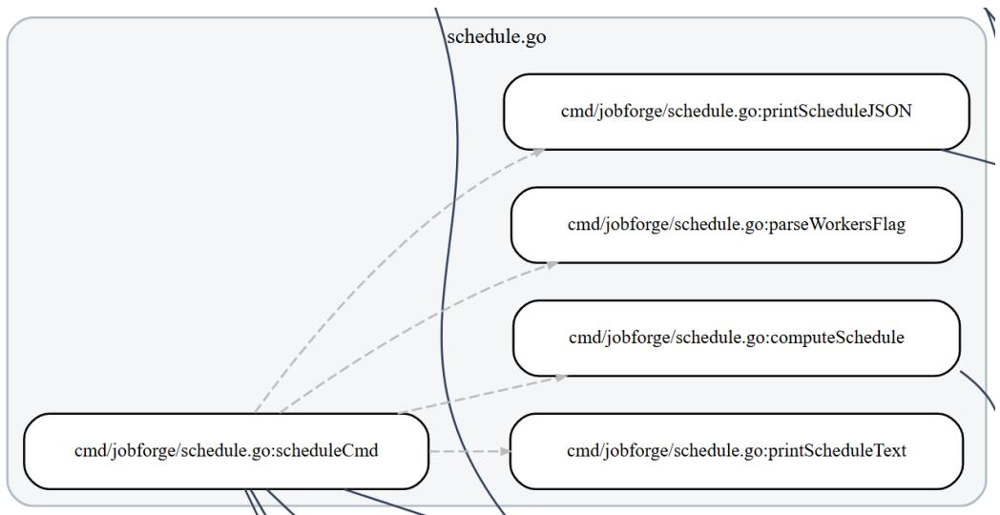  
Figure 10: The schedule.go region of the Round 7 HTML diagram. The screenshot shows scheduleCmd and functions for parsing worker settings, computing the schedule, and formatting output. This file corresponds to the added-file entry in Figure 9(b).

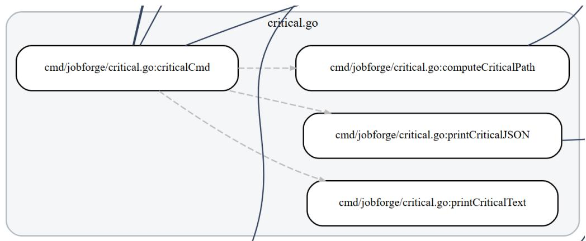  
Figure 11: The critical.go region of the Round 8 HTML diagram. This file corresponds to the added-file entry in Figure 9(c). The full diagram, including connections to other files, is available in the supplementary HTML report.

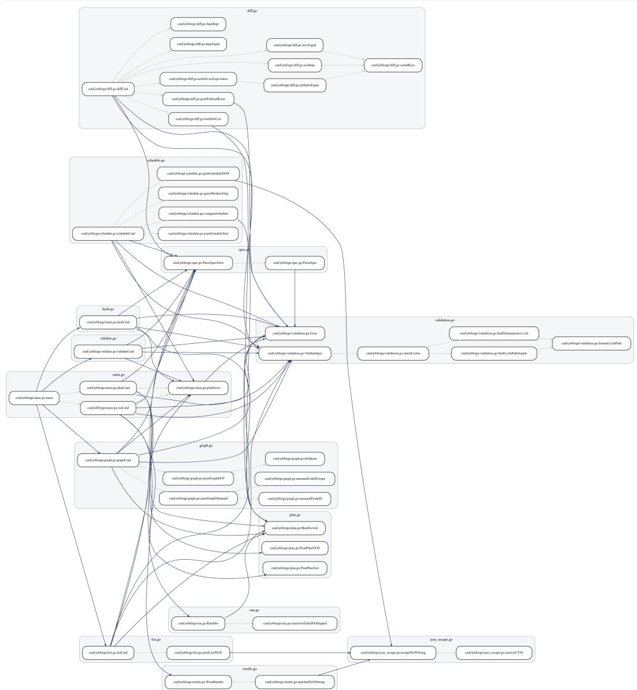  
Figure 12: The overall repository structure and function-call graph for Round 7 in the supplementary HTML report.