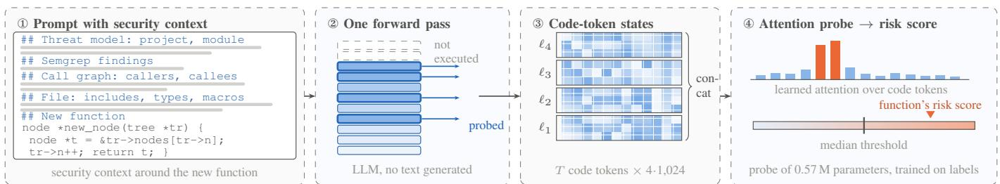
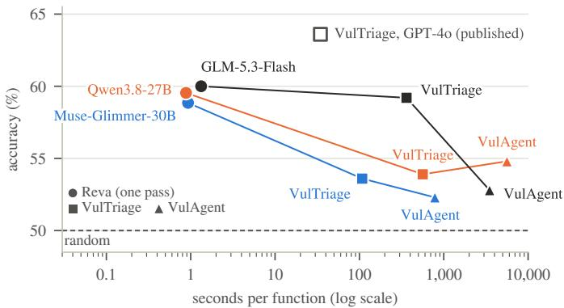
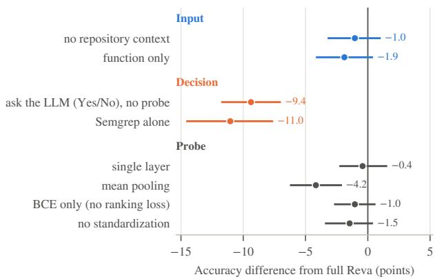

# REVA: Real-Time Vulnerability Detection through Contextual Probing of Large Language Models

Amine Lbath, Massih-Reza Amini,

Université Grenoble Alpes, CNRS, France

Abstract—A vulnerability costs more to fix the later it is discovered in the software lifecycle. As coding agents now generate code faster than developers can review it, software needs a stronger first line of defense that screens each new function in real time, as it is generated. LLM agents have recently become capable of finding real-world vulnerabilities by working as a security expert would: they run analysis tools, explore the surrounding code, test hypotheses and weigh the evidence before forming their own judgement. This reasoning, however, spans many model calls, so that each verdict takes minutes of compute, far too long to keep pace with code generation. Faster AI-based detectors, which fine-tune deep learning models or prompt an LLM for a direct verdict, are considerably less accurate: they judge a function without the context an agent gathers, and an LLM’s generated verdict has proven unreliable in prior work even when some of that context is given.

We present REVA (REal-time Vulnerability Analysis), an AI vulnerability detector that brings the security context and code understanding components behind agentic detectors into a single forward pass of an LLM. For each new function, REVA provides the LLM with a pre-computed threat model of its module, along with lightweight static analysis findings and call-graph information. Rather than asking the LLM for a verdict, REVA lets a trained probe read the LLM’s internal representations of the function in this context. On PrimeVul’s held-out test set, REVA on GLM-5.3-Flash reaches 60.0% accuracy in about one second per function. This matches VulTriage (59.2%), the state-of-the-art agentic function-level detector in the literature, run on the same LLM, while being over 250 times faster and less than a tenth as costly. On the same prompt, the probe is 14% to 17% more accurate than the LLM’s own direct verdict. Across three open LLMs, REVA is at least as accurate as VulTriage, and about 10% more accurate on two of them. These results suggest that an LLM’s internal representations already encode much of what agentic detectors obtain through reasoning.

Index Terms—vulnerability detection, large language models, internal representations, probing, coding agents

## I. INTRODUCTION

The cost of remediating a vulnerability grows the later it is discovered in the software lifecycle [1]. Vulnerabilities are therefore cheapest to fix when they are detected as the code is written. Coding agents now generate code faster than developers can review it, which calls for a first line of defense that screens each new function in real time, as it is generated.

Static analyzers run in real time, but at the scale of agentgenerated code, they produce more reports than developers can review, many of them false positives [2], [3]. LLM agents have recently become capable of finding real-world vulnerabilities [4], [5] by combining such tools with their own analysis of the code, and agentic detectors bring this approach to function-level detection. VulTriage [6], the state of the art in the function-level detection literature, and VulAgent [7] enrich the prompt with retrieved vulnerability knowledge and program facts, and VulTrial [8] lets several agents debate a verdict. This reasoning, however, spans several model calls, which amounts to minutes per function. Faster AI-based detectors, which fine-tune deep learning models or prompt an LLM for a direct verdict, reduce this latency but are considerably less accurate [9]–[11].

REVA is designed to close this gap between speed and improved accuracy. Instead of letting the LLM gather context through multiple rounds of tool calls, REVA assembles it in the prompt, including a threat model of the function’s module, its static analysis findings, its call graph and its file. Instead of reasoning towards a verdict, the LLM then processes this prompt in a single forward pass without generating text, and a small probe trained on labeled functions maps its internal representations of the code tokens to a risk score. This second choice builds on evidence that LLMs encode knowledge that their answers do not express, for example about the truth of a statement [12]–[14] or the correctness of their own answers [15], [16], and that chain-of-thought explanations are not always faithful to the underlying computation [17].

We evaluate REVA on PrimeVul [9], a high-quality dataset of vulnerable C and C++ functions paired with benign versions of the same functions, which spans 651 projects and 121 vulnerability types (CWEs). On its held-out test set, REVA on GLM-5.3-Flash [18] is on par with VulTriage and more accurate than VulAgent run on the same LLM, in about one second per function, over 250 times faster than VulTriage. On two other open LLMs, it is 9% to 13% more accurate than both agentic detectors.

This paper makes three contributions: (i) we propose REVA, a vulnerability detector that combines targeted security context with a probe on an LLM’s internal representations, in a single forward pass per function; (ii) we compare it with state-of the-art agentic function-level detectors run on the same three LLMs, on PrimeVul’s held-out test set, in terms of accuracy, cost and robustness; and (iii) we outline a research agenda towards detectors that screen every function as coding agents generate it and escalate likely vulnerabilities to more capable agents that construct a proof of vulnerability.

## II. BACKGROUND AND RELATED WORK

LLM-based vulnerability detection. LLMs in non-agentic settings typically struggle to tell a vulnerable function from its benign counterpart: on PrimeVul [9], GPT-4 with chain-ofthought labels both versions correctly in only 12.9% of the pairs, and LLMs asked for a verdict in non-agentic settings, often reason inconsistently about security [19], [20]. REVA instead reads the LLM’s internal representations rather than its answer or reasoning.

  
Fig. 1. Overview of REVA on a vulnerable function from LibRaw (CVE-2020-35530). ① The prompt combines the function with its security context. ② The LLM processes the prompt in one forward pass, up to the deepest of four probed layers. ③ The hidden states of the code tokens are kept at each probed layer. ④ An attention probe pools them into a risk score.

Agentic detectors. Recent detectors improve accuracy by adding knowledge and reasoning steps. VulTriage retrieves CWE descriptions and verbalizes control- and data-flow facts [6], VulAgent lets specialized agents propose and validate hypotheses against the project’s code [7], and VulTrial stages a debate between agents [8]. Their cost grows with each call, and their context can exceed the LLM’s context window. REVA instead pre-loads the key parts of this context into the prompt and replaces the multi-step reasoning with a single probed forward pass.

Probing LLM internal representations. Probes are small classifiers trained on a model’s hidden states [21]. For code, linear probes indicates some capability to separate secure from insecure code on toy datasets [22], [23], and predict whether generated code will be insecure or incorrect [24], [25]. These probes read the code alone, whereas REVA probes real-world functions read with targeted security context.

Pitfalls of vulnerability benchmarks. Detectors can exploit spurious features of their datasets, such as code metrics or semantics unrelated to the vulnerability [26], [27]. Such a detector tends to classify a vulnerable function and its benign counterpart with the same label, which share these features. We therefore score each function independently, then check whether the two versions of each pair receive their correct labels.

## III. CONTEXTUAL PROBING WITH REVA

In REVA, an LLM reads a new function with its security context in one forward pass, and a probe maps the hidden states of the code tokens to a risk score (Fig. 1).

① Prompt with security context. The prompt contains the new function and the context around it, in labeled sections (Fig. 1). A threat model, built once per project by a workflow of LLM agents over the entire software, describes the project (summary, attacker-controlled inputs, trust boundaries) and the module that contains the function (role, inputs that reach it, typical sinks and guards). The prompt adds the Semgrep [28] findings for the function, its call sites and the signatures of the helpers it calls, and the includes, types, macros and sibling functions of its file, extracted with tree-sitter from the repository. It is available for 84% of the training functions; otherwise the prompt has the function and its Semgrep findings only. The median prompt has 3,840 tokens, 601 of them code.

② One forward pass. The LLM processes the prompt in one forward pass that stops after the deepest of four probed layers, so the remaining layers are never run and it generates no output token. We probe intermediate layers, which probing studies often find most informative [21]: four evenly spaced layers from 38% to 85% of the depth of the LLM, selected by cross-validation.

③ Code-token states. At each probed layer, REVA keeps only the hidden states of the function’s tokens. Each state is normalized and projected to 1,024 dimensions, and the four layers are concatenated.

④ Attention probe. A probe with 8 attention heads pools the token states into one risk score. It has 0.57 M parameters and is trained on PrimeVul’s training functions. Its loss combines a per-function classification term with a term that ranks each vulnerable function above its benign counterpart. These pairs serve only in training: REVA scores each function on its own.

Use in practice. The LLM and Semgrep’s rules are loaded once at startup, so they don’t have to be booted for each new analysis, and each project’s threat model is built ahead of time. For each new function, REVA extracts its context, runs Semgrep, builds the prompt, runs the pass and applies the probe. With Muse-Glimmer-30B on one H200 GPU, this takes 0.93 s per function, 0.46 s of which is context extraction.

## IV. PRELIMINARY RESULTS

We evaluate REVA through three research questions:

RQ1: How accurate is REVA compared with agentic detectors running on the same LLM?

RQ2: How much computation does REVA save?

RQ3: Which parts of REVA matter, and is its accuracy robust to leakage and selection?

## A. Experimental Setup

Dataset and metrics. PrimeVul [9] pairs each vulnerable C/C++ function with a benign version of the same function. It has 3,789 training, 480 validation and 435 test pairs. Following [9], we count the pairs in which both versions are labeled correctly (P-C), both are flagged (P-V), both are cleared (P-B), or the labels are reversed (P-R). Our main metric is accuracy over all functions, each scored independently.

  
Fig. 2. Accuracy versus time per function on the PrimeVul test set, one color per LLM. Functions without a verdict count as benign. Hollow marker: VulTriage on GPT-4o, as reported.

Protocol. We made every design choice on the training and validation sets only. Cross-validation (CV) accuracy covers five folds of the training set, with all functions of a commit in the same fold, and the validation set, scored by a probe trained on the full training set. The test set stayed unseen during development and was scored only with the final configuration.

LLMs. We use three open-weight LLMs: Muse-Glimmer-30B [29], Qwen3.8-27B [30] and GLM-5.3-Flash [18], a larger mixture-of-experts model. On GLM-5.3-Flash, the agentic detectors use the FP8 version of the LLM and REVA an exact BF16 conversion, which leaves its cross-validation accuracy unchanged (66.2% vs. 65.9%).

Baselines. We run VulAgent and VulTriage on their released code, using the same LLMs as REVA. A function is failed when the detector returns no verdict, usually because the reasoning exceeds the token limit. We compare all methods over all functions, counting failed functions as benign. Published GPT 4o results are given for context.

## B. RQ1: Accuracy

On GLM-5.3-Flash, REVA reaches 60.0% accuracy (95% CI [57.8, 62.2]), against 59.2% for VulTriage and 52.8% for VulAgent run on the same LLM (Table I). Over all test functions, REVA is 0.8 points above VulTriage (CI [−2.1, +3.8]) and 7.2 points above VulAgent (CI [+4.4, +10.3]). On Qwen3.8-27B and Muse-Glimmer-30B, REVA is 5.1 to 6.7 points more accurate than both agentic detectors, and all four confidence intervals exclude zero.

Beyond accuracy, REVA also compares favorably with VulTriage, the state-of-the-art function-level agentic detector, when both run on the same LLM. On all three LLMs, REVA has a lower false positive rate (FPR) and inverts the labels of fewer pairs (P-R), and on two of them it labels more pairs entirely correctly (P-C). REVA thus not only matches or exceeds VulTriage in accuracy, but also separates vulnerable from benign functions more reliably, which suggests that the probe captures the vulnerability itself rather than surface features that a vulnerable function shares with its secured counterpart.

  
Fig. 3. Change in validation accuracy of REVA on Muse-Glimmer-30B when one component is removed or replaced, with paired 95% confidence intervals.

Fig. 2 summarizes this trade-off. On each LLM, REVA is at least as accurate as both agentic detectors while being 100 to 6,000 times faster. Its accuracy also varies little across LLMs, by 1.1 points against 5.6 for VulTriage, so that REVA on Muse-Glimmer-30B matches VulTriage on GLM-5.3-Flash, the LLM on which VulTriage performs best. The signal read by the probe is therefore present in all three LLMs, whereas the accuracy of the agentic detectors depends on how well each LLM reasons about the code. VulTriage on GPT-4o reports a higher accuracy (63.6%), but we were unable to replicate these results.

Answer to RQ1: From a single forward pass, REVA matches or exceeds both function-level agentic detectors on all three LLMs. It is significantly more accurate in five of the six same-LLM comparisons and has fewer false positives than VulTriage on every LLM.

## C. RQ2: Computational Cost

End to end, REVA takes 0.88 s to 1.33 s per function, against 108 s to 5,614 s for the agentic detectors on the same LLMs. Although these times, measured under parallel load, overstate single-request latency, the token counts confirm the gap. REVA reads about 3,100 to 3,400 tokens per function and generates none, whereas the agentic detectors process 3 to 70 times more tokens, many of them generated. As REVA needs the LLM’s hidden states, it cannot run behind an API. On a rented H200 GPU, it screens 1,000 functions for \$0.9 to \$1.3, against \$9 to \$61 for VulTriage and \$63 to \$307 for VulAgent at the public API rates of the same LLMs.

Answer to RQ2: REVA screens a function in about one second, against minutes for the agentic detectors, at 10 to 360 times lower cost on the same LLM, and returns a score for every function.

## D. RQ3: Ablation and Robustness

We ablate each component of REVA on the Muse-Glimmer-30B validation set (Fig. 3). Asking the same LLM for a Yes/No verdict on the same prompt, instead of probing it, reduces accuracy to chance. On the test set, it stays 7.4 to 8.7 points below the probe, and Semgrep, Cppcheck and Flawfinder alone are also at chance (50.8% to 51.3%). The LLM’s internal representations thus carry information that neither its verdict nor the static-analysis findings provide alone. Within the probe, replacing attention pooling by a plain average of the token states lowers accuracy by 4.2 points, which suggests that the evidence of a vulnerability lies in a few tokens. Using a single layer, omitting the standardization or dropping the ranking term lowers accuracy by 0.4 to 1.5 points, and removing the repository context or keeping only the function by 1.0 and 1.9 points, none of which is significant. On PrimeVul’s short functions, the function alone thus carries most of the signal; we expect the context to matter more for interprocedural vulnerabilities.

TABLE I  
ACCURACY AND COST OF REVA AND AGENTIC DETECTORS ON THE PRIMEVUL TEST SET. TOKENS: MEAN INPUT AND OUTPUT TOKENS PER FUNCTION, IN THOUSANDS. TIME: MEDIAN SECONDS PER FUNCTION. CI: PAIR-BOOTSTRAP INTERVAL ON ACCURACY. COST: USD PER 1,000 FUNCTIONS, FOR REVA ON ONE RENTED H200 GPU AT \$3.50 PER HOUR, AND FOR THE AGENTIC DETECTORS AT PUBLIC API RATES PER MILLION INPUT/OUTPUT TOKENS (MUSE-GLIMMER-30B \$0.35/\$1.50, QWEN3.8-27B \$0.40/\$3.00, GLM-5.3-FLASH \$0.15/\$0.50). FPR: SHARE OF NON-VULNERABLE FUNCTIONS FLAGGED. –: NOT REPORTED.
<table><tr><td>Method and LLM</td><td>Calls</td><td>Tokens (k)</td><td>Time (s)</td><td>Cost ($)</td><td>FPR</td><td>Accuracy</td><td>95% CI</td><td>P-C</td><td>P-R</td></tr><tr><td>REVA (ours)</td><td></td><td></td><td></td><td></td><td></td><td></td><td></td><td></td><td></td></tr><tr><td>Muse-Glimmer-30B</td><td>1</td><td>3.2 / 0</td><td>0.93</td><td>0.9</td><td>41.1</td><td>58.9</td><td>[56.8, 61.0]</td><td>20.2</td><td>2.5</td></tr><tr><td>Qwen3.8-27B</td><td>1</td><td>3.4 / 0</td><td>0.88</td><td>0.9</td><td>40.5</td><td>59.5</td><td>[57.4, 61.7]</td><td>22.1</td><td>3.0</td></tr><tr><td>GLM-5.3-Flash</td><td>1</td><td>3.1 / 0</td><td>1.33</td><td>1.3</td><td>40.0</td><td>60.0</td><td>[57.8, 62.2]</td><td>22.3</td><td>2.3</td></tr><tr><td>Muse-Glimmer-30B + GLM-5.3-Flash</td><td>2</td><td>6.3 / 0</td><td>1.78</td><td>1.7</td><td>39.3</td><td>60.7</td><td>[58.5, 62.9]</td><td>23.2</td><td>1.8</td></tr><tr><td>VulTriage [6]</td><td></td><td></td><td></td><td></td><td></td><td></td><td></td><td></td><td></td></tr><tr><td>Muse-Glimmer-30B</td><td></td><td>6.2 / 4.8</td><td>108</td><td>9.4</td><td>75.6</td><td>53.6</td><td>[51.5, 55.7]</td><td>14.0</td><td>6.9</td></tr><tr><td>Qwen3.8-27B</td><td>33</td><td>8.0 / 19.4</td><td>564</td><td>61.4</td><td>75.4</td><td>53.9</td><td>[51.6, 56.2]</td><td>16.1</td><td>8.3</td></tr><tr><td>GLM-5.3-Flash</td><td>3</td><td>6.2 / 24.7</td><td>362</td><td>13.3</td><td>46.0</td><td>59.2</td><td>[56.7, 61.6]</td><td>26.0</td><td>7.6</td></tr><tr><td>GPT-4o (published, not reproducible)</td><td>3</td><td></td><td>34.5</td><td></td><td>54.3</td><td>63.6</td><td></td><td>33.8</td><td>6.7</td></tr><tr><td>VulAgent [7]</td><td></td><td></td><td></td><td></td><td></td><td></td><td></td><td></td><td></td></tr><tr><td>Muse-Glimmer-30B</td><td>9.2</td><td>34.1 / 33.8</td><td>785</td><td>62.6</td><td>64.1</td><td>52.2</td><td>[50.0, 54.4]</td><td>13.3</td><td>9.0</td></tr><tr><td>Qwen3.8-27B</td><td>9.2</td><td>37.4 / 97.3</td><td>5,614</td><td>306.9</td><td>32.2</td><td>54.5</td><td>[52.0, 57.0]</td><td>20.2</td><td>11.3</td></tr><tr><td>GLM-5.3-Flash</td><td>9.3</td><td>35.8 /  184.8</td><td>3,495</td><td>97.8</td><td>19.8</td><td>52.8</td><td>[50.5, 54.9]</td><td>14.3</td><td>8.7</td></tr><tr><td>GPT-40 (published)</td><td>8.8</td><td>- / 7.0</td><td></td><td></td><td>36.7</td><td>58.4</td><td></td><td>26.6</td><td>10.1</td></tr><tr><td>VulTrial [8]</td><td></td><td></td><td></td><td></td><td></td><td></td><td></td><td></td><td></td></tr><tr><td>GPT-4o (published)</td><td></td><td></td><td></td><td></td><td>52.6</td><td>53.6</td><td></td><td>18.6</td><td>11.5</td></tr></table>

Leakage and selection on the evaluation data can inflate probing results [21], [31]. When no project appears in both training and evaluation folds, cross-validation accuracy drops by only 1.3 to 2.7 points, so most of what the probe learns transfers to unseen projects. Likewise, choosing the four probed layers on the training folds only, instead of on all development data, changes accuracy by less than half a point, so the layer choice does not inflate the results. Accuracy is, however, 6 points lower on the test set than in cross-validation (60.0% against 66.2% for GLM-5.3-Flash). As PrimeVul splits its data chronologically, this gap likely reflects the shift towards newer code, which cross-validation does not capture.

Answer to RQ3: The probe is essential. A direct verdict from the same LLM falls to chance, and replacing attention pooling by an average of the token states costs 4.2 points, whereas the repository context has no significant effect on PrimeVul. Accuracy largely holds on unseen projects.

## V. FUTURE PLANS

Step 1: Complete the comparison. We will run both agentic detectors and REVA on larger open LLMs. We will also test whether reading the internal representations after a short selfgenerated analysis adds information. Success criterion: REVA matches or exceeds them on the same LLM at every scale.

Step 2: Calibrated screening in coding agents. We will learn a project- and function-dependent threshold, and integrate REVA into a coding-agent loop that escalates only high-risk functions to an agentic detector or a proof-of-vulnerability check [32]. Success criterion: for a given budget of escalations, the loop finds more vulnerabilities than the agentic detector alone.

Step 3: Generalization beyond PrimeVul. We will evaluate on other datasets [33]–[35], on interprocedural vulnerabilities [32], [36] and on vulnerabilities disclosed after each LLM’s training cutoff, and study fine-tuning the LLM with the same objective. Success criterion: REVA keeps its accuracy on vulnerabilities the LLM cannot have seen.

## VI. CONCLUSION

REVA detects vulnerabilities by probing an LLM’s internal representations of a function and its security context in a single forward pass. On PrimeVul’s held-out test set, it matches or exceeds agentic detectors run on the same LLM, with fewer false positives, in about one second per function and at a small fraction of their cost. An LLM’s internal representations thus carry more information about vulnerabilities than its verdicts, and reading them enables real-time screening of every function as it is written.

## REFERENCES

[1] B. Boehm and V. R. Basili, “Software defect reduction top 10 list,” Computer, vol. 34, no. 1, pp. 135–137, 2001.

[2] B. Johnson, Y. Song, E. Murphy-Hill, and R. Bowdidge, “Why don’t software developers use static analysis tools to find bugs?” in Proc. 35th IEEE/ACM Int. Conf. on Software Engineering (ICSE), 2013, pp. 672–681.

[3] X. Du, J. Feng, Y. Zou, W. Xu, J. Ma, W. Zhang, S. Liu, X. Peng, and Y. Lou, “Reducing false positives in static bug detection with LLMs: An empirical study in industry,” arXiv preprint arXiv:2601.18844, 2026.

[4] Z. Wang, T. Shi, J. He, M. Cai, J. Zhang, and D. Song, “CyberGym: Evaluating AI agents’ real-world cybersecurity capabilities at scale,” in Proc. Int. Conf. on Learning Representations (ICLR), 2026.

[5] DARPA, “AI Cyber Challenge (AIxCC),” https://www.darpa.mil/research/ programs/ai-cyber, 2025, Semifinal at DEF CON 2024, final at DEF CON 2025.

[6] W. Tang, X. Zhang, J. Liu, J. Xiao, X. Xiao, J. Yang, Y. Ma, Z. Liu, Z. Li, Z. Wang, W. Luo, Q. Li, L. Wang, and P. Xiangli, “VulTriage: Triple-path context augmentation for LLM-based vulnerability detection,” arXiv preprint arXiv:2605.09461, 2026.

[7] Z. Wang, G. Li, J. Li, H. Zhu, and Z. Jin, “VulAgent: Hypothesisvalidation driven multi-agent architecture for vulnerability detection,” in Findings of the Association for Computational Linguistics: ACL 2026, 2026, pp. 18 598–18 616.

[8] R. Widyasari, M. Weyssow, I. C. Irsan, H. W. Ang, F. Liauw, E. L. Ouh L. K. Shar, H. J. Kang, and D. Lo, “Let the trial begin: A mock-court approach to vulnerability detection using LLM-based agents,” in Proc. 48th IEEE/ACM Int. Conf. on Software Engineering (ICSE), 2026.

[9] Y. Ding, Y. Fu, O. Ibrahim, C. Sitawarin, X. Chen, B. Alomair, D. Wagner, B. Ray, and Y. Chen, “Vulnerability detection with code language models: How far are we?” in Proc. 47th IEEE/ACM Int. Conf. on Software Engineering (ICSE), 2025.

[10] X.-C. Wen, Y. Yang, C. Gao, Y. Xiao, and D. Ye, “Boosting vulnerability detection of LLMs via curriculum preference optimization with synthetic reasoning data,” in Findings of the Association for Computational Linguistics: ACL 2025, 2025, pp. 8935–8949.

[11] O. Ovadia, E. Ben Zaken, E. Guttman, and O. Moreno Kadosh, “MiST: Mid-training LLMs for cybersecurity,” arXiv preprint arXiv:2609.18496, 2026.

[12] A. Azaria and T. Mitchell, “The internal state of an LLM knows when it’s lying,” in Findings of the Association for Computational Linguistics: EMNLP 2023, 2023.

[13] C. Burns, H. Ye, D. Klein, and J. Steinhardt, “Discovering latent knowledge in language models without supervision,” in Proc. Int. Conf. on Learning Representations (ICLR), 2023.

[14] S. Marks and M. Tegmark, “The geometry of truth: Emergent linear structure in large language model representations of true/false datasets,” in Proc. Conf. on Language Modeling (COLM), 2024.

[15] H. Orgad, M. Toker, Z. Gekhman, R. Reichart, I. Szpektor, H. Kotek, and Y. Belinkov, “LLMs know more than they show: On the intrinsic representation of LLM hallucinations,” in Proc. Int. Conf. on Learning Representations (ICLR), 2025.

[16] S. Kadavath, T. Conerly, A. Askell et al., “Language models (mostly) know what they know,” arXiv preprint arXiv:2207.05221, 2022.

[17] M. Turpin, J. Michael, E. Perez, and S. R. Bowman, “Language models don’t always say what they think: Unfaithful explanations in chainof-thought prompting,” in Advances in Neural Information Processing Systems (NeurIPS), 2023.

[18] Z.ai, “GLM-5.3-Flash,” https://huggingface.co/zai-org/GLM-5.3-Flash, 2026.

[19] S. Ullah, M. Han, S. Pujar, H. Pearce, A. Coskun, and G. Stringhini, “LLMs cannot reliably identify and reason about security vulnerabilities (yet?): A comprehensive evaluation, framework, and benchmarks,” in Proc. IEEE Symposium on Security and Privacy (S&P), 2024.

[20] B. Steenhoek, M. M. Rahman, M. K. Roy, M. S. Alam, H. Tong, S. Das, E. T. Barr, and W. Le, “To err is machine: Vulnerability detection challenges LLM reasoning,” in Proc. 47th IEEE/ACM Int. Conf. on Software Engineering (ICSE), 2025.

[21] Y. Belinkov, “Probing classifiers: Promises, shortcomings, and advances,” Computational Linguistics, vol. 48, no. 1, pp. 207–219, 2022.

[22] W. Yu, R. Mangal, T. Zhuo, M. Fredrikson, and C. S. Pasareanu, “A mixture of linear corrections generates secure code,” arXiv preprint arXiv:2507.09508, 2025.

[23] A. Khatri, “Probing the prefill: Detecting code vulnerabilities via latent activations,” arXiv preprint arXiv:2608.16970, 2026.

[24] A. Sternfeld, A. Kucharavy, and L. Dolamic, “Minimal prompt perturbations lead to code vulnerabilities: Prompt fragility and hidden-state signals in coding LLMs,” arXiv preprint arXiv:2605.29737, 2026.

[25] C. Di Cicco, “Code correctness is linearly decodable from LLM hidden states before generation,” arXiv preprint arXiv:2606.14530, 2026.

[26] N. Risse and M. Böhme, “Uncovering the limits of machine learning for automatic vulnerability detection,” in Proc. 33rd USENIX Security Symposium, 2024.

[27] F. Weissberg, L. Pirch, E. Imgrund, J. Möller, T. Eisenhofer, and K. Rieck, “LLM-based vulnerability discovery through the lens of code metrics,” in Proc. 48th IEEE/ACM Int. Conf. on Software Engineering (ICSE), 2026.

[28] Semgrep, Inc., “Semgrep: Lightweight static analysis for many languages,” https://semgrep.dev, 2026.

[29] Meta, “Muse-Glimmer-30B,” https://huggingface.co/meta-models/ Muse-Glimmer-30B, 2026.

[30] Qwen Team, “Qwen3.8-27B,” https://huggingface.co/Qwen/Qwen3. 8-27B, 2026.

[31] J. Hewitt and P. Liang, “Designing and interpreting probes with control tasks,” in Proc. Conf. on Empirical Methods in Natural Language Processing (EMNLP), 2019.

[32] A. Lbath, M. Suri, A. Delaitre, V. Okun, M.-R. Amini, R. D. Sriram, and D. Manocha, “CyberForge: Verified vulnerability injection at repository level for cybersecurity agent training,” arXiv preprint arXiv:2608.06471, 2026.

[33] J. He and M. Vechev, “Large language models for code: Security hardening and adversarial testing,” in Proc. ACM SIGSAC Conf. on Computer and Communications Security (CCS), 2023.

[34] Y. Chen, Z. Ding, L. Alowain, X. Chen, and D. Wagner, “DiverseVul: A new vulnerable source code dataset for deep learning based vulnerability detection,” in Proc. 26th Int. Symp. on Research in Attacks, Intrusions and Defenses (RAID), 2023.

[35] A. Lbath, M.-R. Amini, A. Delaitre, and V. Okun, “AVIATOR: Towards AI-agentic vulnerability injection workflow for high-fidelity, large-scale code security dataset,” arXiv preprint arXiv:2508.20866, 2025.

[36] A. Lbath, “Toward scalable automated repository-level datasets for software vulnerability detection,” arXiv preprint arXiv:2603.17974, 2026.