# RSIV-Harness: A Recursive Self-Improvement Harness Framework for Open-Domain Conversational Text-to-Visualization

Jiawei Lu1, Chen Zhang1, Jinwei Lu1, Yuanwei Song1, Yuanfeng Song, Raymond Chi-Wing Wong2

1The Hong Kong Polytechnic University, Hong Kong, China

2The Hong Kong University of Science and Technology, Hong Kong, China

## Abstract

Users often request charts without knowing which database or table holds the relevant data. Such requests may be ambiguous, and users may ask follow-up questions to deepen their analysis or iteratively refine existing charts. A useful assistant must therefore discover relevant data sources among heterogeneous databases, ask clarifying questions when needed, and track evolving user intent while preserving constraints established in earlier turns. Yet recent text-to-visualization agents typically rely on static agent harnesses that are predefined and remain unchanged despite recurring failures across tasks. To address this limitation, we introduce RSIV-Harness, which keeps the language model weights fixed and applies Recursive Self-Improvement to revise the surrounding harness from the agent’s own failure traces. To balance flexible selfimprovement with stability, we introduce a four-layer framework that evaluates proposed harness revisions through anchor and mem ory checks, refining those that pass and restoring the best validated harness otherwise. We further introduce ODAC-Vis, a benchmark with 640 tasks for Open-Domain, Ambiguous, and Conversational text-to-visualization that jointly evaluates open-domain data discovery, ambiguity resolution, multi-turn visualization refinement, and executable chart generation. Experiments show that a single round of RSIV-Harness improves all six evaluation metrics relative to the seed harness, with particularly large gains in executability (+28.02 points) and chart structure (+34.01 points), demonstrating the ability to learn from task-solving experience and turn recurring failures across tasks into substantial performance improvements.

## CCS Concepts

• Computing methodologies → Natural language processing; Multi-agent systems; • Information systems → Database query processing.

## Keywords

open-domain visualization, text-to-visualization, conversational agents, benchmark, self-evolving harness

Jiawei Lu1, Chen Zhang1, Jinwei Lu1, Yuanwei Song1, Yuanfeng Song, Raymond Chi-Wing Wong2. 2018. RSIV-Harness: A Recursive Self-Improvement

Harness Framework for Open-Domain Conversational Text-to-Visualization. In Proceedings ofMake sure to enter the correct conference title from your rights confirmation email (Conference acronym ’XX). ACM, New York, NY, USA, 14 pages. https://doi.org/XXXXXXX.XXXXXXX

## 1 Introduction

While extensive research on natural language interfaces for automated visualization within the database and data mining community [4, 5, 14, 19, 25, 36, 40, 42], recent agent systems increasingly wrap large language models in an agent harness [8, 10, 11]: a surrounding layer of system rules, tool interfaces, and control policies that govern schema access, SQL generation, and chart rendering. Industrial and academic agents [13, 33] show that such harnesses can coordinate retrieval, query planning, execution feedback, and visualization. Yet most harnesses are authored once and kept fixed after deployment, while public benchmarks still largely assume a known target database and a well specified single-turn request [4, 19, 42]. These gaps limit deployment in enterprise data lakes and rigorous measurement of open-domain conversational text-to-visualization.

Benchmark and task coverage. In enterprise data lakes, analysts often begin without a known target database, must resolve ambiguous requests through dialogue, and iterate on SQL and charts over multiple turns before trusting the output (Figure 1). Existing benchmarks address these needs only in isolation: opendomain and cross-database text-to-SQL [5, 36], controlled ambiguity in conversational querying [18, 28], and multi-turn text-tovisualization [4, 19, 27, 32]. To our knowledge, no public benchmark integrates them for end-to-end evaluation with executable query and chart supervision throughout the dialogue.

Deployment and adaptation. State-of-the-art visualization agents improve reliability through fixed multi-stage workflows or within-task execution feedback [14, 25]. Three adaptation problems therefore remain. First, recurring failure modes such as premature code generation, schema search misuse, and cross-database boundary violations persist across tasks because the harness is not revised from accumulated traces. Second, improving reliability often requires retraining or replacing the base model rather than evolving the surrounding harness under fixed weights. Third, learning from failed tasks may introduce regressions, causing the harness to fail on tasks it previously solved correctly.

Our solution. We introduce ODAC-Vis and RSIV-Harness as a co-designed benchmark and method response. RSIV-Harness keeps the language model weights fixed. It revises only the surrounding harness: the system surrounding the model, including its prompt, tool, memory, skill, and middleware. At each turn, an inner loop either clarifies the request or generates a visualization program, and retries with observed errors within a bounded budget. An outer loop evaluates failure traces on a stratified training sample and proposes a revision of the harness. Rather than following predefined edit rules, the outer loop autonomously determines which harness components to revise and how, guided by observed failure patterns. To prevent such open-ended evolution from degrading previously acquired capabilities, we introduce a four-layer stability framework that accepts revisions only when they satisfy both validation-anchor and regression-memory checks, reverting to the best validated harness otherwise. We establish formal guarantees that accepted revisions refresh protected records, rejected revisions preserve those records and restore the champion, the best validation score remains nondecreasing, and regression on sampled protected records stays bounded. To evaluate this experience-driven evolution under realistic open-domain conversational visualization challenges, we further introduce ODAC-Vis, a benchmark for Open Domain, Ambiguous, and Conversational text-to-visualization. ODAC-Vis jointly eval uates source discovery across a fully exposed database collection, ambiguity resolution, and multi-turn visualization refinement, with domain-held-out evaluation and executable query-and-chart supervision at each code-generating turn. Together, ODAC-Vis provides a unified testbed for these interconnected challenges, while RSIV-Harness enables agents to learn from recurring task failures and improve their behavior across tasks.

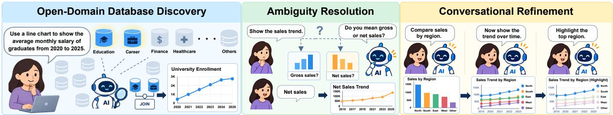  
Figure 1: Three challenges in real-world text-to-visualization. The assistant agent needs to discover relevant databases, resolve ambiguous requests before charting, and refine the chart across dialogue turns.

Contributions. Our work makes four main contributions:

• ODAC-Vis Benchmark. We present the first benchmark in which agents must generate visualizations without being given the target database or table, clarify ambiguous requests, and support follow-up refinement.

• RSIV-Harness Method. We propose a recursive self improvement framework that enables agents to evolve from their own task-solving experience. An inner ReAct loop handles conversational visualization tasks, while an outer loop evaluates execution traces, identifies recurring failures across tasks, and autonomously proposes targeted revisions to the surrounding harness.

• Stability Rules & Formal Guarantees. We develop a fourlayer stability rule framework to ensure stable evolution without restricting how harness revisions are proposed. We formally guarantee protected-memory updates upon acceptance, champion restoration without memory modification upon rejection, nondecreasing champion validation scores, and bounded regression on sampled protected records.

• Empirical Study. Extensive experiments on held-out domains show that a single round ofrecursive self-improvement improves all six evaluation metrics over the seed harness. Cross-backbone transfer and ablation studies further examine the generality of these improvements and the contributions of individual components. These findings demonstrate that agents can turn accumulated task failures into substantial improvements on previously unseen tasks.

## 2 Related Work

This work is closely related to conversational text-to-visualization and to recursive self-improvement of agent harnesses. In this section, we review the prior literature in these two main directions.

## 2.1 Text-to-Visualization and Conversational Data Access

Natural language (NL) interfaces for visualization (Vis) have progressed from direct code generation [22] to curated benchmarks and agentic pipelines. Early text-to-vis datasets such as nvBench and VisEval [4, 19] provide large-scale NL-Vis pairs, enabling automatic validity and readability checks but not source discovery over a full database collection. Subsequent work extends coverage along three largely separate axes. Ambiguity-aware benchmarks such as nvBench 2.0 and CLARITY [18, 28] inject lexical, schema, or value ambiguity into querying, yet still assume a specified schema and stop at SQL execution. Complementary models improve robustness to lexical and phrasal variability [15] and to ambiguity in interactive text-to-visualization [16, 37]. Multi-turn visualization datasets including Dial-NVBench, Text2Vis, and PMVisBench [27, 32, 38] support conversational refinement or progressive intent elaboration, but provide fixed table or schema context rather than opendomain routing across heterogeneous sources. CoVis studies neural and LLM-driven multi-turn interactions for conversational textto-visualization [31], and FeVisQA studies free-form question answering over data visualizations [30]. On the querying side, crossdomain semantic parsing benchmarks such as Spider, BIRD, SParC, and CoSQL [9, 40–42] establish standard splits for schema generalization and multi-turn SQL dialogue, while TACO [5] moves toward unspecified databases and cross-database SQL composition. Text-to-NoSQL translation extends natural-language querying to non-relational stores [12]. None of these resources jointly evaluate open-domain source discovery, typed ambiguity resolution, executable query and chart supervision, and multi-turn conversational interactions, which motivates our ODAC-Vis benchmark.

Visualization agents improve reliability through staged workflows and within-task validation rather than cross-task adaptation. nvAgent decomposes processing, composition, and validation in a fixed collaborative workflow [25], and MultiVis-Agent adds logic rules for bounded tool use and cross-modal refinement [13, 14]. Open-domain SQL systems such as Abacus-SQL combine retrieval with multi-turn query generation [36], and recent agentic NL2SQL frameworks employ multi-agent decomposition, rewriting, and execution-grounded repair [1–3, 20, 26, 33, 34]. These systems nonetheless ship with prompts, tools, and control policies fixed before deployment and do not revise the surrounding harness from recurring failures observed across tasks.

## 2.2 Agent Harnesses and Recursive Self-Improvement

LLM agents are increasingly mediated by a surrounding harness: system rules, tool interfaces, middleware, and control policies that govern how a frozen model interacts with an environment [8, 10, 11]. Industrial and academic text-to-SQL agents instantiate such harnesses through schema retrieval, query planning, execution feedback, and validator loops [14, 25, 33, 34], yet most are hand engineered once and left unchanged after release.

Recursive self-improvement has recently been studied along three complementary lines. Weight-centric RSI agents such as AREX [17] alternate an inner task loop with an outer audit-andrefine loop, but sustain gains through agentic mid-training and reinforcement learning over model parameters rather than deploymenttime harness edits. Harness-evolution methods keep the base model frozen and instead revise prompts, tools, and control programs from execution traces [6, 10, 23, 43, 44], including test-time program search, weakness-driven proposal with regression testing, and observability-driven component editing; yet they neither support clarification over open database collections nor regressionvalidated harness commits for coupled query-and-chart execution in multi-turn dialogue. Inference-time self-correction methods such as Reflexion, Self-Refine, and DSPy [7, 21, 29] improve individual trajectories through verbal feedback, iterative drafting, or compiled prompt pipelines, but do not commit persistent harness revisions validated across a task distribution. RSIV-Harness addresses these gaps by learning from recurring failures across tasks to autonomously evolve the agent harness, while using regression-aware checks to preserve previously successful behaviors.

## 3 The ODAC-Vis Benchmark

## 3.1 Overview and Motivation

We introduce ODAC-Vis, a benchmark for Open Domain, Ambiguous, and Conversational text-to-visualization. Each task simulates an analyst who requests a chart in natural language without naming a target database, may need to clarify underspecified intent, and may refine the analysis or the chart over subsequent turns. The benchmark exposes all 206 SQLite databases from the Spider test collection [41] and requires a model to discover relevant sources, compose SQL when multiple databases are needed, and emit executable Python that queries data and renders a Plotly chart.

Open domain and cross-domain. Unlike prior text-to-vis datasets that bind each instance to a known table or schema [4, 19, 27, 32], ODAC-Vis treats the full database collection as visible at inference time while keeping the gold target as one or more specific databases per task. Models must route to the correct sources without being told which database to open, and cross-database tasks require SQL-only composition through ATTACH, temporary tables, joins, semi-joins, unions, or scalar subqueries rather than post-hoc Python merges. Evaluation uses a domain-held-out split: domains seen during training never appear in validation or test, so success requires generalization rather than memorizing a fixed schema catalog. Complexity is stratified into single-table (30%), single-database join (50%), and cross-database (20%) tiers within each split.

Ambiguity. Each task contains one to three ambiguity points drawn from eight template-defined types. Data semantics:

• Column selection: “Show revenue” when both gross and net sales columns are valid measures.

• Aggregation granularity: “Show the trend” when the request can be grouped by month or by quarter.

• Filter logic: “Top performers” when ranking by revenue or by profit, or when conjunctive and disjunctive filters difer.

• Unit scale: “Plot sales” when values may be shown in raw units, millions, or percentages.

## Visualization semantics:

• Chart type: “Visualize growth” when a line chart (trend) and a bar chart (comparison) are both reasonable.

• Encoding mapping: “Highlight categories” when color or point size could encode the same dimension.

• Axis label: “Show enrollment” when the y-axis may label counts or normalized rates.

• Interactivity: “Make it filterable” when filtering by dropdown selection or brush interaction is intended.

Every ambiguity is backed by at least two schema-supported alternatives that yield distinguishable query or chart outcomes, and each is resolved through a clarification question followed by a user reply that uniquely selects one alternative. Dialogues never expose database or table names during clarification.

Conversational structure. Tasks follow one of two scenarios, which set the analytical role of the dialogue. In drilldown, later requests deepen the current analysis. In iterate, later requests revise the current chart. Ambiguity is placed independently of that role. Each task contains one to three ambiguity points on randomly chosen request turns other than the final turn, so clarification may open the dialogue or arise during a later drilldown or iteration. A turn that contains an ambiguity requires the model to ask the user a clarification question on that turn. On the next turn the user answers the question, and the model writes the visualization code for user’s intent. A turn without ambiguity requires the model to write the visualization code directly. Conversations are capped at eight user–assistant exchanges. The two scenarios appear in equal proportion within each split.

## 3.2 Dataset Construction Methodology

ODAC-Vis was constructed through a principled, LLM-assisted pipeline with expert validation, prioritizing quality, coverage, and faithfulness in open-domain, ambiguity-aware, multi-turn conversational text-to-visualization scenarios. The detailed construction process of ODAC-Vis is described below:

Step 1: Cross-domain split. Spider provides 206 independent SQLite databases and 139 domains. Domains are assigned to splits as atomic units: roughly 15 domains are held out exclusively for test, while the remaining domains supply train and validation tasks in a 5:1 ratio. Within every split we enforce independent quotas over the Cartesian product of scenario and complexity tier, so evaluation is not skewed toward a single dialogue pattern or query dificulty. All databases referenced by a cross-database task belong to domains in the same split. At inference time the agent may access the full database collection $\mathcal { D } = \{ d _ { 1 } , \ldots , d _ { 2 0 6 } \}$ , while task gold specifies a target subset $B ^ { \star } ( t ) \subseteq { \mathcal { D } }$ without naming it in user dialogue; heldout test domains never appear in train or validation. The released benchmark contains $N { = } 6 4 0$ tasks. Each construction slot is indexed by $u \ = \ ( s , \sigma , \tau ) \ \in \ { \mathrm { S } } ,$ where $s \in S$ is the data split, $\sigma \in \Sigma$ the conversational scenario, and $\tau \in \mathcal T$ the query-complexity tier, with

$$
{ \mathsf { S } } = S \times \Sigma \times { \mathcal { T } } , \qquad | { \mathsf { S } } | = | S | \cdot | \Sigma | \cdot | { \mathcal { T } } | .\tag{1}
$$

We target the following marginal proportions over these dimensions: train:validation:test in 14:3:3 (approximately 70:15:15, yield ing 448/96/96 tasks at �=640), equal weights on the two scenarios in $\Sigma ,$ and complexity tiers in T in a global 3:5:2 ratio (30/50/20% single-table, single-database join, and cross-database). Slot counts are obtained by nested proportional rounding:

$$
Q [ s , \sigma , \tau ] = \mathrm { A l l o c } ( \mathrm { A l l o c } ( \mathrm { A l l o c } ( N , \ r _ { S } ) [ s ] , \ r _ { \Sigma } ) [ \sigma ] , \ r _ { \mathcal { T } } ) [ \tau ] ,\tag{2}
$$

where $Q [ s , \sigma , \tau ]$ is the number of tasks allocated to slot $( s , \sigma , \tau )$ $r _ { S } , r _ { \Sigma }$ , and �T are non-negative integer weight vectors over splits, scenarios, and tiers, and Alloc(�, �) maps a total � and weights � to integer counts that sum to � by largest-remainder rounding. Applying Eq. (2) top-down first fixes the split sizes, then balances scenarios within each split, and finally assigns complexity tiers within each scenario cell, so every marginal target is met without favoring a single dialogue pattern or query dificulty.

Step 2: Cross-database tasks. About 20% of tasks require evidence from more than one Spider database, yet the collection provides no predefined links between files. We model the collection as a composability graph $G = ( \mathcal { D } , \Pi )$ whose nodes are databases and whose edges are composition plans $\pi \ : = \ : ( \rho , B , \kappa )$ , where $\rho$ is a SQL relation type, $B \subseteq { \mathcal { D } }$ the participating databases, and � an executable program skeleton [5]. Candidate plans are generated from schema overlap and then filtered in three stages. First, relation-specific generators produce a candidate set

$$
\Pi ^ { ( 0 ) } = \bigcup _ { \rho \in { \mathcal R } } \Pi _ { \rho } ^ { ( 0 ) } , \qquad { \mathcal R } = \{ { \mathrm { E Q U I } } \lrcorner { \mathrm { J O I N } } , { \mathrm { S E M I } } \lrcorner { \mathrm { J O I N } } , { \mathrm { U N I O N } } , { \mathrm { S U B Q } } \} .\tag{3}
$$

Equi-join candidates are retained only if they pass a staged quality test on name similarity, value overlap, coverage, key uniqueness, and join expansion:

$$
\Pi _ { \scriptscriptstyle \mathrm { E Q U I \_ J ^ { \mathrm { O I N } } } } = \bigcup _ { \theta \in \Theta } \Big \{ \pi \in \Pi _ { \scriptscriptstyle \mathrm { E Q U I \_ J ^ { \mathrm { O I N } } } } ^ { ( 0 ) } \Big | \operatorname { Q u a l i t y } ( \pi , \theta ) = 1 \Big \} ,\tag{4}
$$

where $\Theta =$ {strict, relaxed1, relaxed2} denotes progressively relaxed thresholds. Next, every candidate must survive an execution probe that materializes the skeleton on the reserved databases:

$$
\Pi = \Bigl \{ \pi \in \Pi ^ { ( 0 ) } \Big | \operatorname { P r o b e } ( \kappa , B ) \neq \bot \Bigr \} .\tag{5}
$$

Finally, only plans whose databases lie in the same split are eligible for construction in that split:

$$
\Pi _ { s } = \Big \{ \pi \in \Pi \Big | B ( \pi ) \subseteq \mathcal { D } _ { s } \Big \} ,\tag{6}
$$

$$
| \Pi _ { s } | \ \ge \ \alpha \sum _ { \sigma \in \Sigma } Q [ s , \sigma , \mathrm { c R O s s \_ D B } ] ,\tag{7}
$$

with $\mathcal { D } _ { s }$ the databases reachable from domains in split � and $\alpha { = } 3$ a safety margin used during split planning. Cross-database gold is sampled as $\pi \sim \mathrm { U n i f } ( \Pi _ { s } )$ and realized in SQL via ATTACH; postquery pandas transforms are restricted to unary cleaning on the final result set.

This keeps cross-database gold faithful to real schema overlap rather than hand-written Python merges, and it aligns the bench mark with the SQL-only composition protocol used in open-domain text-to-SQL evaluation.

Step 3: Task generation. We build tasks with a chart-centric hybrid of templates and LLMs. Templates sample query intents, ambiguity points, and scenario-specific follow-ups from schema metadata, compile each sample into structured query, cleaning, and chart specifications together with executable SQL and Plotly code, and discard instances that fail execution or ambiguity checks. An LLM (DeepSeek-V4.1-Flash [35]) then paraphrases the verified slots into natural dialogue. For drilldown, templates also sample a follow-up analysis path after the initial chart; for iterate, the target chart and iteration request are fixed first and clarification turns are inserted afterward. Each task contains at most eight user–assistant turns, and ambiguity points are injected at randomly chosen request-bearing turns. Dialogue length and ambiguity count are coupled so that one ambiguity uses three or four turns, two use five or six, and three use seven or eight; adjacent ambiguity turns are separated by at least one non-ambiguous round:

$$
\begin{array} { r } { \mathcal { A } ( T , k ) = \Big \{ \{ a _ { 1 } , . . . , a _ { k } \} \subseteq \{ 1 , . . . , T - 1 \} \Big | a _ { i + 1 } - a _ { i } \geq 2 \Big \} . } \end{array}\tag{8}
$$

For each ambiguity turn, templates construct at least two schemasupported alternatives whose raw-result, cleaned-result, and chart fingerprints are pairwise distinct, so clarification changes the downstream gold rather than surface wording alone. Global occurrence targets over the eight ambiguity types are matched to task schedules by a unit-capacity bipartite max-flow assignment that fixes one primary type per task and forbids repeating a type within a dialogue. A final validator rejects dialogues that violate the clarify-and-code grammar in Section 3.1.

Step 4: Gold artifacts and validation. Every code turn is released with a structured artifact that links natural language to its specifications, executable program, and reference chart, while each ambiguity point retains all viable alternatives and the resolved path. Duplicate trajectories are removed and an expert check confirms overall dataset quality before release. These annotations ground the evaluation protocols in Section 5.

Table 1: Comparison of ODAC-Vis with existing benchmarks.
<table><tr><td>Dataset</td><td>Scale</td><td>Domain</td><td>Target</td><td>Open- domain</td><td>Cross- domain</td><td>Multi-turn dialogue</td><td>Typed ambiguity</td><td>Cross- databaseª</td></tr><tr><td>Text2Vis [27]</td><td>1985 NLQs</td><td>103</td><td>Python</td><td>X</td><td>X</td><td>√</td><td>√</td><td>X</td></tr><tr><td>nvBench 2.0 [18]</td><td>7,878 NLQs</td><td>153</td><td>Vega-Lite</td><td>X</td><td>X</td><td>X</td><td>√</td><td>X</td></tr><tr><td>TACO [5]</td><td>14,500 NLQs</td><td>31</td><td>SQL</td><td>√</td><td>X</td><td>X</td><td>√</td><td>√</td></tr><tr><td>Dial-NVBench [32]</td><td>7,244 dialogues</td><td>105</td><td>VQL</td><td>X</td><td>X</td><td>√</td><td>X</td><td>X</td></tr><tr><td>CoSQL [40]</td><td>3,007 dialogues</td><td>138</td><td>SQL</td><td>X</td><td>√</td><td>√</td><td>√</td><td>X</td></tr><tr><td>MultiVis-Bench [14]</td><td>1,202 NLQs</td><td>105</td><td>Python</td><td>X</td><td>X</td><td>X</td><td>X</td><td>X</td></tr><tr><td>ODAC-VIs</td><td>640 dialogues</td><td>139</td><td>Python</td><td>√</td><td>√</td><td>√</td><td>√</td><td>√</td></tr></table>

a Cross-database: whether tasks require composing evidence from more than one database through executable SQL.

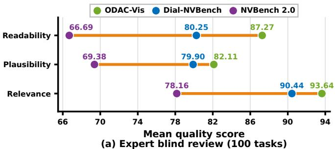

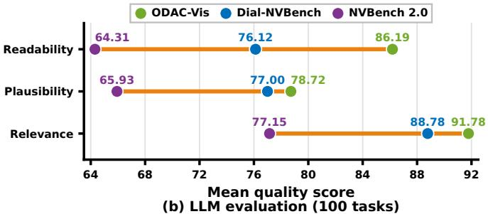  
Figure 2: Mean dataset quality scores for ODAC-Vis, Dial-NVBench, and NVBench 2.0 on 100 randomly sampled tasks per benchmark. Panel (a) reports expert blind review; panel (b) reports LLM evaluation with the same three dimensions.

## 3.3 Benchmark Statistics

Table 2 summarizes the released ODAC-Vis corpus. The benchmark contains 640 multi-turn tasks over 206 Spider databases and 139 domains, stratified partitioned into 448 train, 96 validation, and 96 test instances. Rather than maximizing instance count alone, the ODAC-Vis prioritizes distributional control: every split preserves balanced scenario and complexity quotas, validation and test are held to equal size for stable anchor evaluation, and test domains are disjoint from train and validation so that success requires locating the right sources rather than memorizing a fixed schema catalog. Most tasks remain short enough for interactive analysis, yet the corpus deliberately retains longer clarify-and-code trajectories and a full cross-section of typed ambiguities so that models cannot succeed through single-turn chart guessing alone.

Table 1 situates ODAC-Vis against six representative text-tovisualization and data-access benchmarks. Existing resources typically isolate one deployment challenge at a time: single-turn textto-vis sets assume a known table or database; conversational benchmarks add dialogue but keep the schema fixed; ambiguity-aware corpora annotate alternative encodings without requiring clarification turns; and open-domain text-to-SQL benchmarks such as TACO [5] evaluate cross-database retrieval and composition in SQL alone, without executable chart supervision. ODAC-Vis is designed to stress-test the full analyst workflow in one benchmark: models must discover target sources from a fully exposed 206-database collection under a domain-held-out split, resolve typed ambiguities through clarify dialogue, compose evidence across databases when needed, and emit verified Python programs with reference charts at every code turn. To our knowledge, it is the only corpus in the comparison that jointly supports Python chart generation, open-domain access, cross-domain evaluation, multi-turn dialogue, verified ambiguity gold, and cross-database SQL composition.

## 3.4 Dataset Quality Analysis

Benchmark comparisons are only meaningful when the underlying supervision is faithful to the stated task. We therefore conduct a controlled quality audit of ODAC-Vis together with two widely used text-to-visualization resources: Dial-NVBench [32], which models multi-turn visualization dialogue over a fixed given table or schema, and NVBench 2.0 [18], which injects ambiguity into the request and retains multiple valid chart specifications per request.

Each instance receives three independent scores on a 0–100 scale:

• Relevance: whether the gold answer targets the analysis implied by the request.

• Plausibility: whether the answer satisfies stated constraints and forms a coherent query or chart specification.

• Readability: presentation quality of the answer text and, when applicable, the reference chart.

The audit applies this rubric to the gold supervision in each corpus as follows:

Table 2: Scale statistics of ODAC-Vis.
<table><tr><td colspan="5">SCALE AND SPLIT</td></tr><tr><td>Tasks</td><td>640</td><td>Tables</td><td></td><td>1,056</td></tr><tr><td>Train / val / test</td><td>448 / 96 / 96</td><td></td><td>Visible databases</td><td>206 15</td></tr><tr><td>Domains</td><td></td><td>139</td><td>Test domains</td><td></td></tr><tr><td colspan="5">COMPLEXITY TIERS</td></tr><tr><td>Single-table</td><td></td><td></td><td>192 30.0%</td><td></td></tr><tr><td>Single-db join</td><td></td><td></td><td>32050.0%</td><td></td></tr><tr><td>Cross-database</td><td></td><td></td><td>12820.0%</td><td></td></tr><tr><td colspan="5">DOMAINS USED PER SPLIT</td></tr><tr><td>Train split</td><td>124</td><td>Val split</td><td></td><td>96</td></tr><tr><td>Test split</td><td></td><td></td><td>Domains per task (med./mean) 1.0 / 1.2</td><td></td></tr><tr><td colspan="5">CONVERSATION SCENARIOS</td></tr><tr><td>Drilldown</td><td></td><td></td><td>320 50.0%</td><td></td></tr><tr><td>Iterate</td><td></td><td></td><td>32050.0%</td><td></td></tr><tr><td colspan="5">USER-ASSISTANT TURN COUNT</td></tr><tr><td>3 turns</td><td></td><td></td><td>27042.2%</td><td></td></tr><tr><td>4 turns</td><td></td><td></td><td>116 18.1%</td><td></td></tr><tr><td>5 turns</td><td></td><td></td><td>155 24.2%</td><td></td></tr><tr><td>6 turns</td><td></td><td></td><td>36 5.6%</td><td></td></tr><tr><td>7 turns</td><td></td><td></td><td>45 7.0%</td><td></td></tr><tr><td>8 turns</td><td></td><td></td><td>18 2.8%</td><td></td></tr><tr><td colspan="5">TASKS CONTAINING AMBIGUITY TYPE</td></tr><tr><td>Column selection</td><td></td><td></td><td>120 18.8%</td><td></td></tr><tr><td>Aggregation granularity</td><td></td><td></td><td>119 18.6%</td><td></td></tr><tr><td>Filter logic</td><td></td><td></td><td>12018.8%</td><td></td></tr><tr><td>Unit scale</td><td></td><td></td><td>12018.8%</td><td></td></tr><tr><td>Chart type</td><td></td><td></td><td>12018.8%</td><td></td></tr><tr><td>Encoding mapping</td><td></td><td></td><td>12018.8%</td><td></td></tr><tr><td>Axis label</td><td></td><td></td><td>12018.8%</td><td></td></tr><tr><td>Interactivity</td><td></td><td></td><td>12018.8%</td><td></td></tr></table>

• ODAC-Vis: multi-turn clarification and code turns, with reference charts produced from verified executable code.

• Dial-NVBench: conversational question–answer trajectories toward the final visualization goal.

• NVBench 2.0: natural-language requests against gold Vega-Lite specifications and rendered reference charts when multiple valid encodings are annotated.

We randomly sample 100 tasks from each benchmark with a fixed seed so that both evaluators inspect the same instances. Two experts conduct a blind review using the shared rubric described above, with dataset identity and task provenance concealed. An LLM evaluator (DeepSeek-V4.1-Flash) applies the same dimensions with structured prompts and returns a score together with a short rationale for each task. Both protocols score one instance at a time along a single dimension, yielding three judgments per task.

Figure 2 summarizes the mean scores. ODAC-Vis attains the highest quality across all dimensions, reaching 93.6/82.1/87.3 under expert review and 91.8/78.7/86.2 under LLM evaluation. Both evaluation modes agree on the relative ordering of the three corpora. The advantage of ODAC-Vis is most visible on readability, where execution-validated reference charts and typed ambiguity resolution yield clearer supervision than alternative gold encodings in NVBench 2.0. These results support the release of ODAC-Vis as a benchmark suited to evaluating open-domain, ambiguity-aware, multi-turn conversational text-to-visualization models.

## 3.5 Illustrative Example

Figure 3 shows one task of ODAC-Vis. The user states a chart request and does not name a database. The model first judges whether the request is ambiguous. The opening request already fixes the analysis: a bar chart of the average height for each hometown. Because the measure, the grouping, and the chart type are all specified, no clarification is required. The model locates the database that can answer the request, retrieves the corresponding rows, and writes visualization code that renders the chart.

Later turns may revise the chart from the previous round (iterate) or ask a deeper question about the same analysis (drilldown). In this example the user asks to replace the bar chart with a line chart. The chart type is fixed, but the measure is not. The model therefore asks whether the trend of height is intended. After the user clarifies that the measure should be weight, the model retrieves that column and renders the line chart.

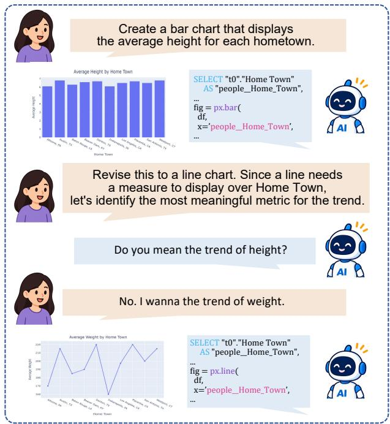  
Figure 3: An illustrative task of ODAC-Vis. The first request is unambiguous, so the model retrieves the relevant data and writes a bar chart. A later iteration leaves the measure unspecified; the model asks a clarification question and emits the line chart after the user selects weight.

## 4 RSIV-Harness

ODAC-Vis requires an agent to find the relevant sources in an exposed database collection. If the request is ambiguous, the agent must resolve that ambiguity in dialogue before it returns an executable chart. RSIV-Harness meets that task with a language model whose weights stay fixed and a harness that is revised from the agent’s own traces.

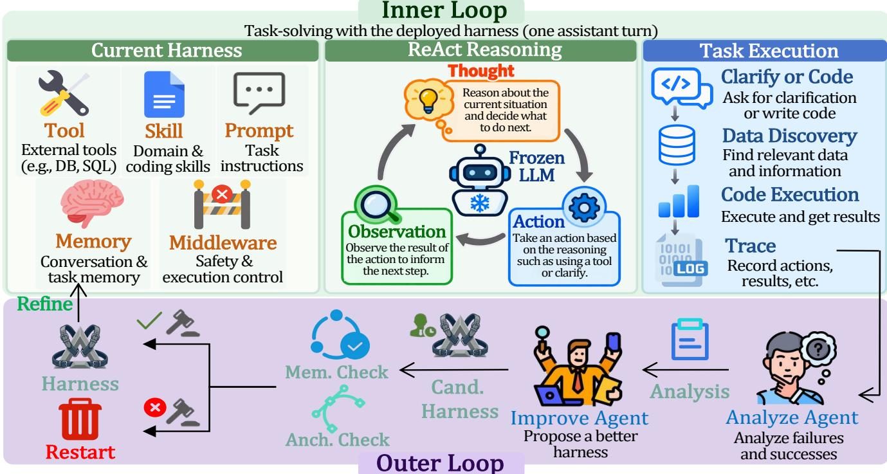  
Figure 4: Architecture of RSIV-Harness. The inner task-solving loop answers one assistant turn under the deployed harness, and the outer self-improvement loop revises that harness from traces accumulated across tasks.

This section proceeds from the architecture to the inner loop, then to the outer self-improvement loop, and finally to the four layer stability rules and the theorems that follow from them.

## 4.1 Design Philosophy and Architecture Overview

Existing visualization systems still face a fundamental limit that blocks practical deployment. A traditional pipeline fixes its proce dure before the first request, so a failure that keeps recurring can be removed only by rewriting that procedure or by retraining the model. Harness agents improve on this design: a frozen model can choose its next action from the observation it has just received. The harness that governs the choice is nevertheless fixed at deployment, so the agent stays rigid and has little flexibility once the scenario grows more complex than the behavior written for it. To address this limitation, we propose RSIV-Harness, which keeps the harness as the acting layer of a frozen model and adds self-improvement that revises the harness from failures accumulated across tasks.

RSIV-Harness implements a hierarchical, bi-level recursive selfimprovement process, comprising an inner task-solving loop and an outer self-improvement loop (Fig. 4). The inner loop answers one assistant turn by following the harness that is currently deployed. The outer loop reads the traces of many such turns and proposes a revision of that harness. A four-layer stability rule framework then accepts or rejects the revision before it can replace the deployed harness. The inner loop therefore supplies the evidence, the outer loop turns that evidence into a candidate, and the rules decide which harness the next inner loop will use. Self-improvement starts from a minimal harness, leaves the outer loop free to choose what to refine and how to refine it, and uses the refine, restart, anchor check, and memory check rules as the hard constraints that keep this freedom stable.

## 4.2 Inner Task Loop

The inner loop follows the ReAct pattern [39] and incrementally constructs an answer by analyzing the current request, invoking the registered tools, integrating the returned observations, and determining the next step. The policy is parameterized by the current harness �, while the model weights stay fixed. Consider one assistant turn of a task �. After � steps the interaction trajectory is

$$
\begin{array} { r } { h _ { t } = \left[ \left( m _ { i } , a _ { i } , o _ { i } \right) \right] _ { i = 1 } ^ { t } , } \end{array}\tag{9}
$$

where $m _ { i }$ is a short decision summary, $a _ { i }$ is the action, and $o _ { i }$ is the observation returned by the environment.

The harness defines a policy $\pi _ { H }$ and an environment operator $\mathcal { T } _ { H }$ . Writing $\bar { h } _ { t }$ for the context shown to the policy, the next step is

$$
( m _ { t + 1 } , a _ { t + 1 } ) = \pi _ { H } ( x , \bar { h } _ { t } ) , \qquad o _ { t + 1 } = \mathcal { T } _ { H } ( a _ { t + 1 } ) ,\tag{10}
$$

and the trajectory grows by concatenation,

$$
h _ { t + 1 } = h _ { t } \oplus \big ( m _ { t + 1 } , a _ { t + 1 } , o _ { t + 1 } \big ) .\tag{11}
$$

Each step emits one action from a closed set. The action requests one registered tool, or it terminates the turn with a clarification. A tool request names one member of the registered set T (�).

The inner loop stops when a legal clarification or a finished program has been produced, or when �(�) policy steps have been used. Middleware, once a version introduces it, may replace the raw trajectory by a shorter efective context. If the latest refresh occurred at step $\tau \leq t _ { i }$

$$
\begin{array} { r } { \bar { h } _ { t } = z _ { \tau } \oplus \left[ \left( m _ { i } , a _ { i } , o _ { i } \right) \right] _ { i = \tau + 1 } ^ { t } , \qquad z _ { \tau } = f _ { H } ( h _ { \tau } ) , } \end{array}\tag{12}
$$

and $\bar { h } _ { t } = h _ { t }$ when no refresh has occurred. The refreshed state retains the observations that later steps still need, including evidence that ruled a source out. This is the role of autonomous context update, specialized here to schema evidence and dialogue state. Until middleware exists, the policy conditions on the raw trajectory.

A clarification ends the turn when it satisfies the dialogue rule. A chart program is checked and then executed in the sandbox. A failed execution is kept as the evidence for the next repair. Let $e _ { < j }$ be the execution failures observed before the �-th generation inside the same turn, and define

$$
p _ { j } = \mathrm { P r } ( \operatorname { e x e c } _ { - } \mathrm { o k } \mid e _ { < j } ) .\tag{13}
$$

The harness allows at most $K ( H )$ repairs after the first generation, so the turn may execute the program at most $K ( H ) + 1$ times. The probability that some attempt is executable is

$$
q \big ( K ( H ) \big ) = 1 - \prod _ { j = 0 } ^ { K ( H ) } ( 1 - p _ { j } ) .\tag{14}
$$

Each repair is conditioned on the concrete error of the previous attempt and reuses the source evidence already stored in $h _ { t }$ . The repair rewrites the program attempt and leaves � as it was. Section 4.3 defines the separate map that revises the harness.

## 4.3 Outer Self-Improvement Loop

The outer loop treats the harness as the state of a recursive operator. Let � be a training panel drawn once from the train split, stratified on the factors reported in Section 5.1.1, and then reused for every round. Let � (�) be the task success rate of �� on a fixed validation anchor. A task contributes to this rate only when every assistant turn takes the reference stance and completes, and every goldcode turn both executes and yields a result table equivalent to the reference table under the execution-equivalence comparator of (44). Because the panel and the anchor stay fixed, a change in � is attributable to the harness.

One round begins from the trace of the current harness,

$$
\tau ( H ) = \mathrm { E v a l u a t e } ( \pi _ { H } , S ) .\tag{15}
$$

Analysis reads �(�) together with the verdict set R of the candidate rejected in the previous round. It groups traces that break the same part of the task contract, and only then asks a proposal model to interpret a bounded sample of each group. We write the resulting assessment as

$$
g ( H ) = G \big ( \tau ( H ) , \mathcal { R } \big ) = \big ( \mathcal { P } , \mathcal { I } \big ) .\tag{16}
$$

Here $\mathcal { P }$ is a bounded memory of protected train records $( x , t , d , b )$ consisting of a task, turn, metric, and the baseline score achieved by a committed harness; I is the set of unresolved failure clusters. Records are admitted at score 1 for stance, executability, routing, and execution accuracy, at a positive score for clarification quality, and at score 0.75 or above for chart structure. The proposal is

$$
H ^ { \prime } = \mathrm { I m p r o v e } ( g ( H ) , H ) ,\tag{17}
$$

and it contains at most � edits. Each edit names the component it changes and the failure evidence it is meant to address. A legal proposal is then tested by the stability rules of Section 4.4.

The candidate is then submitted to the commit rule of Section 4.4. Let $H ^ { \star }$ be the committed harness with the best anchor score, and let � be that score. Write $Q$ for the stratified regression sample defined below, and abbreviate the commit predicate by

$$
\mathrm { A c c e p t } ( H ^ { \prime } ) = 1 \big [ \mathrm { M C } ( H ^ { \prime } ) = 1 \wedge \mathrm { A C } ( H ^ { \prime } ) = 1 \big ] ,\tag{18}
$$

where MC is the memory check and AC is the anchor check defined in Section 4.4. The recursive operator is

$$
H _ { n + 1 } = \Phi ( H _ { n } ) = { \left\{ \begin{array} { l l } { H _ { n } ^ { \prime } } & { { \mathrm { i f ~ } } \mathrm { A c c e p t } ( H _ { n } ^ { \prime } ) = 1 , } \\ { H _ { n } ^ { \star } } & { { \mathrm { o t h e r w i s e } } . } \end{array} \right. }\tag{19}
$$

The seed is $H _ { 0 }$ . On acceptance, eligible protected records from the new version are folded into the bounded memory after the deployed harness has been evaluated again on �,

$$
\mathcal { P } _ { n + 1 } = \mathrm { R e f r e s h } _ { C } \big ( \mathcal { P } _ { n } , \mathcal { A } ( H _ { n + 1 } ) \big ) .\tag{20}
$$

Here A(�) is the set of eligible protected records observed under �, and � is the memory capacity. The next analysis can then attend to the clusters that remain in I. On rejection, Φ restores $H _ { n } ^ { \star }$ . The candidate is archived with its verdict, and that verdict becomes R for the following round. A subsequent acceptance clears R. Rejection is the harness-level restart rule: the failed revision is withdrawn, and the reason for the failure is retained. Acceptance is the refine rule: verified protected records stay in $\mathcal { P } _ { : }$ , and the next round focuses on what I still contains. The champion score � is replaced only when the accepted anchor score is strictly larger, so � never decreases. A commit inside the factor $\left( 1 - \varepsilon \right)$ still become the current harness.

Algorithm 1 records the order in which these steps are executed. The seed is evaluated on � before any candidate is proposed, and the bounded protected-record memory is filled from that evaluation. The seed is also scored on the anchor, which initializes � and $H ^ { \star }$ After every commit or rejection, the harness left in place is evaluated again on �. That new trace is the input to the next application of Φ. New protected records enter the regression memory only from this post-decision evaluation, and only when the round committed.

## 4.4 Stability Rule-Enhanced Evolution

One contribution of the method is to keep self-improvement at its greatest freedom while using rules to guarantee the stability of that evolution. We propose a four-layer stability rule framework and provide the theoretical guarantees that follow from it.

4.4.1 Four-Layer Stability Rule. The framework has four layers, written $\mathcal { R } = \{ R F , R S , A C , M C \}$ . A candidate that passes the anchor check and the memory check is refined into the deployed harness. Every other candidate, by contrast, restarts the deployed harness from the current champion.

Refine rules (RF): protected progress. An accepted candidate stays deployed, its eligible protected records refresh the bounded memory, and the next round attends to the clusters that are still open.

Algorithm 1 Recursive self-improvement of the harness.   
Require: seed �0, panel �, anchor $S _ { \mathrm { v a l } }$   
Require: tolerances $\varepsilon , \delta ,$ memory capacity �, edit budget �, rounds �   
1: Evaluate $\pi _ { H _ { 0 } }$ on � and seed P with A (� )   
2: $B \gets V ( H _ { 0 } ) \mathrm { ~ o n ~ } S _ { \mathrm { v a l } } ; H ^ { \star } \gets H _ { 0 } ; \mathcal { R } \gets 0$   
3: for $n = 0 , 1 , . . . , N - 1 { \bf d o }$   
4: $g ( H _ { n } ) \gets G ( \tau ( H _ { n } ) , \mathcal { R } )$   
5: �′ ← Improve $g ( H _ { n } ) , H _ { n } )$ ⊲ at most � edits   
6: Draw a stratified sample � from $\mathcal { P }$   
7: if MC(�′) = 0 then   
8: Reject $H ^ { \prime } ; H _ { n + 1 }  H ^ { \star }$   
9: R ← {verdict of �′ }   
10: else if $\begin{array} { r } { \mathrm { A C } ( H ^ { \prime } ) = 0 } \end{array}$ then   
11: Reject $H ^ { \prime } ; H _ { n + 1 }  H ^ { \star }$   
12: R ← {verdict of �′ }   
13: else   
14: Commit $H _ { n + 1 }  H ^ { \prime }$ and clear R   
15: if $V ( H ^ { \prime } ) > B$ then   
16: $B  V ( H ^ { \prime } ) ; H ^ { \star }  H ^ { \prime }$   
17: end if   
18: end if   
19: $\tau ( H _ { n + 1 } )  \mathrm { E v a l u a t e } ( \pi _ { H _ { n + 1 } } , S )$   
20: if $H _ { n + 1 }$ was committed then   
21: Absorb $\mathcal { A } ( H _ { n + 1 } )$ into P up to capacity �   
22: end if   
23: end forreturn $H ^ { \star }$

(i) RF-Rule 1: Protected-record refresh. Eligible records of the accepted harness are added to the bounded memory. Define the refresh map used in (20) by

$$
\operatorname { R e f r e s h } _ { C } ( { \mathcal { P } } , A ) = \operatorname { C a p } _ { C } { \big ( } \operatorname { M e r g e } ( { \mathcal { P } } , A ) { \big ) } ,\tag{21}
$$

where Merge keys records by task, turn, and dimension and retains the stored baseline for an existing key, while $\mathrm { C a p } _ { C }$ applies the deterministic capacity-� retention policy. On $\operatorname { A c c e p t } ( H _ { n } ^ { \prime } ) = 1$

$$
\mathcal { P } _ { n + 1 } = \mathrm { R e f r e s h } _ { C } \big ( \mathcal { P } _ { n } , \mathcal { A } ( H _ { n + 1 } ) \big ) ,\tag{22}
$$

where ${ \mathcal { A } } ( H )$ is the set of eligible turn–metric records observed under the given harness �.

(ii) RF-Rule 2: Residual focus. The next assessment reads the protected-record memory and the clusters that remain unresolved.

$$
G \bigl ( \tau ( H _ { n + 1 } ) , \emptyset \bigr ) = \bigl ( \mathcal { P } _ { n + 1 } , { \mathcal { I } } _ { n + 1 } \bigr ) ,\tag{23}
$$

where $\tau ( H _ { n + 1 } )$ is the trace of the deployed harness on the training panel and ${ \cal { I } } _ { n + 1 }$ is the set of failure clusters still open after (22).

(iii) RF-Rule 3: Feedback reset. Acceptance clears the rejection verdict that the previous round stored.

$$
{ \mathcal R } _ { n + 1 } = \emptyset \qquad \mathrm { i f } \qquad \mathrm { A c c e p t } ( H _ { n } ^ { \prime } ) = 1 ,\tag{24}
$$

where $\mathcal { R } _ { n + 1 }$ is the verdict set supplied to the next call of �.

Restart rules (RS).. A rejected candidate is withdrawn from deployment. Its rejection reason is retained for the next analysis.

(i) RS-Rule 1: Champion restoration. Rejection returns the deployed harness to the champion.

$$
H _ { n + 1 } = H _ { n } ^ { \star } \mathrm { ~ i f ~ } \mathrm { A c c e p t } ( H _ { n } ^ { \prime } ) = 0 ,\tag{25}
$$

where $H _ { n } ^ { \star }$ is the committed harness whose anchor score equals the champion value $B _ { n }$

(ii) RS-Rule 2: Verdict retention. The failed check is passed to the next assessment.

$$
\mathcal { R } _ { n + 1 } = \{ v ( H _ { n } ^ { \prime } ) \} \qquad \mathrm { i f } \qquad \mathrm { A c c e p t } ( H _ { n } ^ { \prime } ) = 0 ,\tag{26}
$$

where �(�′) records which predicate failed and which sampled records regressed.

(iii) RS-Rule 3: Frozen memory. A rejected candidate adds no solved task.

$$
\begin{array} { r } { \mathcal { P } _ { n + 1 } = \mathcal { P } _ { n } \qquad \mathrm { i f } \qquad \operatorname { A c c e p t } ( H _ { n } ^ { \prime } ) = 0 . } \end{array}\tag{27}
$$

Anchor check rules (AC): validation floor. A candidate may be refined only when its score on the fixed validation anchor stays close to the best committed score.

(i) AC-Rule 1: Relative admission. The anchor test compares the candidate with the current champion.

$$
\mathrm { A C } ( H ^ { \prime } ) = 1 \big [ V ( H ^ { \prime } ) \geq \left( 1 - \varepsilon \right) B \big ] ,\tag{28}
$$

where �(�) is the task success rate of $\pi _ { H }$ on the fixed anchor, � is the champion score, and � ∈ [0, 1] is the tolerance. Let $j \in \left\{ { 1 , \dots , \ell } \right\}$ index the bounded remediation cycles within one outer round, where ℓ is the maximum number of candidate cycles. An anchor failure returns control to Analyze with its verdict, and becomes a terminal rejection only in the last cycle:

$$
\mathrm { A C } ( H _ { n , j } ^ { \prime } ) = 0 \implies \left\{ \begin{array} { l l } { g _ { n , j + 1 } = G \big ( \tau ( H _ { n } ^ { \star } ) , \{ v _ { \mathrm { A C } } ( H _ { n , j } ^ { \prime } ) \} \big ) , } & { j < \ell , } \\ { \mathrm { R e j e c t } _ { \mathrm { A C } } ( n ) , } & { j = \ell . } \end{array} \right.\tag{29}
$$

(ii) AC-Rule 2: Strict champion update. The champion score increases only when an accepted candidate strictly exceeds it.

$$
B _ { n } = \left\{ \begin{array} { l l } { V ( H _ { n } ^ { \prime } ) } & { \mathrm { i f ~ } \mathrm { A c c e p t } ( H _ { n } ^ { \prime } ) = 1 \mathrm { ~ a n d ~ } V ( H _ { n } ^ { \prime } ) > B _ { n - 1 } , } \\ { B _ { n - 1 } } & { \mathrm { o t h e r w i s e } . } \end{array} \right.\tag{30}
$$

Thus $H ^ { \star }$ changes only in the first branch, while $B _ { n } \geq B _ { n - 1 }$ (iii) AC-Rule 3: Band deployment. An accepted candidate becomes the current harness even when it does not set a new champion.

$$
H _ { n + 1 } = H _ { n } ^ { \prime } \qquad \mathrm { w h e n e v e r } \qquad \mathrm { A c c e p t } ( H _ { n } ^ { \prime } ) = 1 ,\tag{31}
$$

whereas $H _ { n } ^ { \star }$ is updated only by (30). A later restart therefore returns directly to the champion, which may itself difer from the harness deployed inside the band.

Memory check rules (MC): protected records. The regression memory blocks a commit that degrades too many sampled turn–metric achievements of committed harnesses.

(i) MC-Rule 1: Stratified sample. The sample cycles through the groups represented in the memory. Let Γ(P) be the set of all nonempty triples of metric dimension, dialogue scenario, and complexity tier represented in $\mathcal { P } .$

$$
Q = { \mathrm { C y c l e } } { \big ( } { \mathcal { P } } , \Gamma ( { \mathcal { P } } ) { \big ) } ,\tag{32}
$$

where Cycle takes one record from each group in turn until the sample budget is filled. A group is visited again only after every nonempty group has contributed.

(37)

(ii) MC-Rule 2: Regression bound. A sampled record $\boldsymbol { r } = ( x , t , d , b )$ regresses when the candidate’s score $s _ { d } ( H ^ { \prime } ; x , t )$ falls below its stored baseline �.

$$
\mathrm { R e g } _ { Q } ( H ^ { \prime } ) = \sum _ { ( x , t , d , b ) \in Q } \mathbf { 1 } \big [ s _ { d } ( H ^ { \prime } ; x , t ) < b \big ] ,\tag{33}
$$

$$
\begin{array} { r } { \mathrm { M C } ( H ^ { \prime } ) = 1 \big [ \mathrm { R e g } _ { Q } ( H ^ { \prime } ) \leq \delta \big ] , } \end{array}\tag{34}
$$

where $\delta$ is a nonnegative integer tolerance. The predicate MC is the memory conjunct of (18). A memory failure, for its part, follows the same bounded return to Analyze, with the regressed records included in its verdict:

$$
\begin{array} { r } { \mathrm { M C } ( H _ { n , j } ^ { \prime } ) = 0 \implies \left\{ \begin{array} { l l } { g _ { n , j + 1 } = G \big ( \tau ( H _ { n } ^ { \star } ) , \{ v _ { \mathrm { M C } } ( H _ { n , j } ^ { \prime } ) \} \big ) , } & { j < \ell , } \\ { \mathrm { R e j e c t } _ { \mathrm { M C } } ( n ) , } & { j = \ell . } \end{array} \right. } \end{array}\tag{35}
$$

Thus neither check terminates the round after its first failure. The round is rejected only if all ℓ remediation cycles fail.

(iii) MC-Rule 3: Seeded growth. The memory exists before any candidate is proposed, and it is refreshed only through a refine step.

$$
\mathcal { P } _ { 0 } = \mathrm { C a p } _ { C } \big ( \mathcal { A } ( H _ { 0 } ) \big ) ,\tag{36}
$$

and $\mathcal { P } _ { n + 1 }$ follows (22) after acceptance and (27) after rejection.

4.4.2 Theoretical Guarantees. The stability rules constrain which evolutionary update may be deployed. Let an evolution context be

$$
C = ( H , \mathcal { P } , \mathcal { I } , B , \mathcal { R } ) ,
$$

where � is the current harness, P the bounded protected-record memory, I the open clusters, � the champion score, and $\mathcal { R } \ =$ {��, ��, ��, ��} the rule set. Throughout, � takes values in [0, 1].

Formal theorems. The framework yields four guarantees.

(i) Theorem 1 (Protected-record refresh). If a candidate is accepted, the bounded memory is refreshed with eligible records from the deployed harness and the stored rejection is cleared:

$$
\mathrm { A c c e p t } ( H _ { n } ^ { \prime } ) = 1 \implies \mathcal { P } _ { n + 1 } = \mathrm { R e f r e s h } _ { C } \left( \mathcal { P } _ { n } , \mathcal { A } ( H _ { n + 1 } ) \right) \wedge \mathcal { R } _ { n + 1 } = \emptyset .
$$

Proof sketch. RF-Rule 1 gives (22). RF-Rule 3 gives $\mathcal { R } _ { n + 1 } = \emptyset$ RF-Rule 2 then instantiates the next assessment as $G ( \tau ( H _ { n + 1 } ) , \emptyset ) =$ $( \mathcal { P } _ { n + 1 } , \mathcal { I } _ { n + 1 } )$ , so the open set passed forward is ${ \mathcal { I } } _ { n + 1 }$

(ii) Theorem 2 (Restart invariance). Ifa candidate is rejected, deployment returns to the champion, the protected-record memory is unchanged, and the rejection verdict is retained:

$$
\mathrm { A c c e p t } ( H _ { n } ^ { \prime } ) = 0 \implies H _ { n + 1 } = H _ { n } ^ { \star } \wedge \mathcal { P } _ { n + 1 } = \mathcal { P } _ { n } \wedge \mathcal { R } _ { n + 1 } = \{ v ( H _ { n } ^ { \prime } ) \} .\tag{38}
$$

Proof sketch. RS-Rule 1 is (25), hence $H _ { n + 1 } = H _ { n } ^ { \star }$ . RS-Rule 3 is (27), hence $\mathcal { P } _ { n + 1 } = \mathcal { P } _ { n }$ . RS-Rule 2 is (26), hence $\mathcal { R } _ { n + 1 } = \{ v ( H _ { n } ^ { \prime } ) \}$ The next call is therefore $G ( \tau ( H _ { n } ^ { \star } ) , \{ v ( H _ { n } ^ { \prime } ) \} )$

(iii) Theorem 3 (Anchor monotonicity). The champion score is nondecreasing, and the harness left in deployment stays above the anchorfloor ofthat score:

$$
B _ { n } \geq B _ { n - 1 } \qquad \mathrm { a n d } \qquad V ( \tilde { H } _ { n } ) \geq ( 1 - \varepsilon ) B _ { n } ,\tag{39}
$$

where ${ \tilde { H } } _ { n }$ denotes the harness deployed at the end of round �.

Proof sketch. From (30), the two branches are $B _ { n } = V ( H _ { n } ^ { \prime } ) >$ $B _ { n - 1 }$ and $B _ { n } = B _ { n - 1 }$ , so $B _ { n } \geq B _ { n - 1 }$ . Since $V \in [ 0 , 1 ]$ , the sequence $\left( B _ { n } \right)$ is bounded. Let Accept $( H _ { n } ^ { \prime } ) = 1$ . AC-Rule 1 yields $V ( H _ { n } ^ { \prime } ) \geq$ $( 1 - \varepsilon ) B _ { n - 1 }$ , and (31) sets $\tilde { H } _ { n } = H _ { n } ^ { \prime }$ . If $V ( H _ { n } ^ { \prime } ) > B _ { n - 1 }$ , then $B _ { n } =$

$V ( H _ { n } ^ { \prime } )$ and $V ( \tilde { H } _ { n } ) = B _ { n } \ge ( 1 - \varepsilon ) B _ { n } . \mathrm { I f } V ( H _ { n } ^ { \prime } ) \le B _ { n - 1 } $ , then $B _ { n } =$ $B _ { n - 1 }$ and $V ( { \tilde { H } } _ { n } ) \geq ( 1 - \varepsilon ) B _ { n } .$ Let Accept $\left( H _ { n } ^ { \prime } \right) = 0 $ . RS-Rule 1 sets $\tilde { H } _ { n } = H _ { n } ^ { \star }$ with $V ( H _ { n } ^ { \star } ) = B _ { n }$ , hence $V ( \tilde { H } _ { n } ) = B _ { n } \geq ( 1 - \varepsilon ) B _ { n }$ (iv) Theorem 4 (Anti-oscillation). Acceptance implies that the stratified regression count does not exceed the memory tolerance:

$$
\mathrm { A c c e p t } ( H ^ { \prime } ) = 1 \implies \mathrm { R e g } _ { Q } ( H ^ { \prime } ) \leq \delta .\tag{40}
$$

Proof sketch. Expand (18) to $\mathrm { M C } ( H ^ { \prime } ) = 1 \land \mathrm { A C } ( H ^ { \prime } ) = 1$ . Substitute (34) to obtain $\mathrm { R e g } _ { O } ( H ^ { \prime } ) \leq \delta . \mathrm { B y } \left( 3 2 \right) , Q = \mathrm { C y c l e } ( \mathcal { P } , \Gamma ( \mathcal { P } ) )$ emits one element of each $\gamma \in \Gamma ( \mathcal { P } )$ before repeating any group. Therefore, whenever $| \Gamma ( \mathcal { P } ) | > 1$ , the count in (33) is not computed on a single metric–scenario–tier group. MC-Rule 3 initializes $\mathcal { P } _ { 0 } = \mathrm { C a p } _ { C } ( \mathcal { A } ( H _ { 0 } ) )$ ) before the first proposal, so the same bound applies to the protected seed records retained in memory.

## 5 Experiments

## 5.1 Experimental Setup

5.1.1 Dataset. All experiments use ODAC-Vis. We use the train split to drive the outer loop of RSIV-Harness. The stratified training panel � contains 48 tasks from train only domains. Their failure traces are analyzed to propose harness edits. The anchor check evaluates every candidate on a panel of 48 validation tasks. Each panel contains one task for every combination of the three dificulty tiers, the eight ambiguity types, and the two conversation scenarios. All of the test split is reserved exclusively for final evaluation. It comprises 96 tasks over 15 held-out domains that never appear in train or validation, so reported scores measure open-domain source discovery, ambiguity handling, and multi-turn chart generation rather than memorization of a fixed schema catalog. All baselines and evolved harness variants are evaluated on this test split under model history: each turn conditions on the model’s own prior assistant outputs within the same task.

5.1.2 Baselines. We compare RSIV-Harness against four progressively more sophisticated baselines: direct prompting, static harnesses, ReAct, and MultiVis-Agent:

• Direct Prompt. A single LLM call per turn with no tool access. The model receives the full schema catalog together with the conversation history and NLQ of this turn.

• Static Harnesses. The minimal seed harness $H _ { 0 }$ of RSIV-Harness, held fixed and never evolved. A seed already fitted to ODAC-Vis would contaminate the attribution of every later edit, since a gain could no longer be separated from the seed. The minimal seed forces every component the outer loop adds to earn its place against measured traces.

• ReAct [39]. An ReAct baseline equipped with carefully designed, task-specific tools. At each turn, it runs a thoughtaction-observation loop.

• MultiVis-Agent [14]. A state-of-the-art multi-agent system for text-to-visualization, adapted to ODAC-Vis task with minimal modifications.

• RSIV-Harness (Ours). Our Proposed method. An inner ReAct loop clarifies the request or generates a visualization program, while an outer loop improves the harness from traces under a four-layer stability rule framework.

5.1.3 Evaluation Metrics. To evaluate visualization generation systems, particularly those handling open-domain, ambiguity-aware, multi-turn conversational tasks like RSIV-Harness, we adopt the following metrics. Let $\mathcal { T }$ be the assistant turns in the evaluation split. For turn $t , y _ { t }$ is the gold stance and $\hat { y } _ { t }$ is the predicted stance. Write $C = \{ t \in \mathcal { T } : y _ { t } = \mathrm { c o d e } \}$ and $Q = \{ t \in \mathcal T : y _ { t } = \mathrm { c l a r i f y } \}$

• Executability tests whether the emitted program can be run to completion. It isolates basic viability before asking whether the analysis is correct:

$$
\mathrm { E x e c } = \frac { 1 0 0 } { | C | } \sum _ { t \in C } \mathbf { 1 } \big [ \mathrm { R u n } ( \hat { p } _ { t } ) \big ] ,\tag{41}
$$

where $\hat { p } _ { t }$ is the predicted program and Run $\left( \hat { p } _ { t } \right) = 1$ when a valid predicted program runs to completion.

• Database Routing Accuracy checks whether the program accesses exactly the target databases for the task. In an open domain setting, retrieving the wrong source can yield a fluent but irrelevant chart even when the code runs successfully. Let $D ( \hat { p } _ { t } )$ be the set of databases accessed by the prediction, and $D _ { t } ^ { \star }$ the gold target set:

$$
{ \mathrm { R o u t e } } = { \frac { 1 0 0 } { | C | } } \sum _ { t \in C } { 1 } \Big [ D ( \hat { p } _ { t } ) = D _ { t } ^ { \star } \Big ] .\tag{42}
$$

• Stance Accuracy measures whether an agent chooses the appropriate response mode—clarification or executable code— at each assistant turn. Because downstream dialogue and prediction depend on this decision, stance errors can invalidate an otherwise plausible program or chart:

$$
\mathrm { S t a n c e } = \frac { 1 0 0 } { \left| \mathcal { T } \right| } \sum _ { t \in \mathcal { T } } \mathbf { 1 } \big [ \hat { y } _ { t } = y _ { t } \big ] .\tag{43}
$$

• Execution Accuracy compares the tabular results pro- duced by the ground-truth and predicted programs, determining whether the pre- dicted SQL returns the same result as the ground-truth SQL:

$$
\mathrm { E x A c c } = \frac { 1 0 0 } { | C | } \sum _ { t \in C } \mathbf { 1 } \big [ \exists \pi : \pi ( \hat { R } _ { t } ) \equiv R _ { t } ^ { \star } \big ] ,\tag{44}
$$

where $R _ { t } ^ { \star }$ and $\hat { R } _ { t }$ are the gold and predicted tables.

• Clarification Quality evaluates how well predicted clarifi cation questions recover the intended ambiguity resolution. A completed clarification is compared with the gold clarification and any annotated alternatives. For each � ∈ {1, 2, 3, 4}, modified �-gram precision is

$$
\displaystyle { p _ { n } = \frac { \sum _ { g \in \mathrm { G r a m } _ { n } ( h ) } \operatorname* { m i n } ( c _ { h } ( g ) , c _ { \mathcal { R } } ^ { \operatorname* { m a x } } ( g ) \big ) } { \sum _ { g \in \mathrm { G r a m } _ { n } ( h ) } c _ { h } ( g ) } , }\tag{45}
$$

where ℎ is the predicted clarification, $\mathcal { R }$ is the reference set, �ℎ (�) counts occurrences of $g$ in $h ,$ and $c _ { \mathcal { R } } ^ { \operatorname* { m a x } } ( g )$ is the maximum reference count of ${ \mathit { g } } ;$ otherwise

$$
\mathrm { B L E U - 4 } ( h , \mathcal { R } ) = 1 0 0 \cdot \exp \Bigl ( \frac { 1 } { 4 } \sum _ { n = 1 } ^ { 4 } \log p _ { n } \Bigr ) ,\tag{46}
$$

without a brevity penalty. The reported score is the mean turn-level BLEU-4,

$$
\mathrm { C l a r i f y } = { \frac { 1 } { | Q | } } \sum _ { t \in Q } s _ { t } ,\tag{47}
$$

Table 3: Overall results on the ODAC-Vis test split across diferent methods.
<table><tr><td>Method</td><td>Model</td><td>Executability</td><td>Route. Stance Exec Acc. Clarify Chart</td></tr><tr><td rowspan="2">Direct Prompt</td><td>DeepSeek</td><td>81.32 57.59</td><td>62.25 31.91 4.32 52.23</td></tr><tr><td>GPT</td><td>63.04 44.36</td><td>61.00 24.51 3.02 47.46</td></tr><tr><td rowspan="2">Static Harnesses</td><td>DeepSeek</td><td>64.98 48.25</td><td>51.25 24.51 3.72 41.46</td></tr><tr><td>GPT</td><td>51.75 30.35</td><td>54.00 26.07 2.02 42.01</td></tr><tr><td rowspan="2">ReAct</td><td>DeepSeek</td><td>79.38 57.59</td><td>64.25 27.24 3.93 49.57</td></tr><tr><td>GPT</td><td>65.76 44.75</td><td>61.75 21.40 2.27 50.37</td></tr><tr><td rowspan="2">MultiVis- Agent</td><td>DeepSeek</td><td>58.75 56.81</td><td>56.25 26.85 0.60 44.08</td></tr><tr><td>GPT</td><td>53.70 50.97</td><td>58.25 25.29 0.97 40.39</td></tr><tr><td rowspan="2">RSIV- Harness</td><td>DeepSeek</td><td>93.00 62.26</td><td>67.00 31.52</td><td>5.15 75.47</td></tr><tr><td>GPT</td><td>61.09 49.42</td><td>61.50 25.29</td><td>3.74 50.36</td></tr></table>

where $s _ { t } = \mathrm { B L E U } \ – 4 ( h _ { t } , \mathcal { R } _ { t } )$ when the prediction clarifies and $s _ { t } = 0$ otherwise.

• Chart Structure compares the figure produced by the predicted program with the gold figure. Each figure is reduced to a signature $( M , X , Y , c , a _ { x } , a _ { y } , I , R )$ : � is the mark types; � and � are the per-trace role sequences of the � and � encodings; � holds when the figure has multiple traces or a legend group; $a _ { x }$ and $a _ { y }$ are the axis titles; � is the set of interaction kinds; and � is the multiset of plotted rows.

$$
\begin{array} { l } { \mathrm { S t r u c t } = \displaystyle \frac { 1 } { 8 } \big ( { \boldsymbol 1 } [ { \boldsymbol M } = \hat { \boldsymbol M } ] + { \boldsymbol 1 } [ { \boldsymbol X } = \hat { \boldsymbol X } ] } \\ { ~ + { \boldsymbol 1 } [ { \boldsymbol Y } = \hat { \boldsymbol Y } ] + { \boldsymbol 1 } [ c = \hat { c } ] + \alpha _ { x } + \alpha _ { y } } \\ { ~ + J ( I , \hat { I } ) + { \boldsymbol 1 } [ R \equiv \hat { R } ] \big ) , } \end{array}\tag{48}
$$

where $\alpha _ { x } = \mathrm { T i t l e } ( a _ { x } , \hat { a } _ { x } )$ and $\boldsymbol { \alpha } _ { y } = \mathrm { T i t l e } ( \boldsymbol { a } _ { y } , \boldsymbol { \hat { a } _ { y } } )$ . The reported score averages the turn values,

$$
{ \mathrm { C h a r t } } = { \frac { 1 0 0 } { | C | } } \sum { \mathrm { S t r u c t } }\tag{49}
$$

5.1.4 Implementation Details. We first perform one self-improvement round of RSIV-Harness with DeepSeek-V4.1-Flash. After this round, we freeze the selected evolved harness and use the same unchanged harness to evaluate the test split with DeepSeek-V4.1-Flash and GPT-6 Luna [24]. No further evolution or backbone specific adaptation is performed for GPT-6 Luna. All models used by RSIV-Harness and the baselines use their default hyperparameter settings, including temperature and top-p.

## 5.2 Results and Analysis

5.2.1 Overall Results. Table 3 shows that RSIV-Harness obtains the strongest DeepSeek results on five of the six metrics. Relative to the best competing method in each column, it improves executability by 11.68 points, database routing by 4.67 points, stance accuracy by 2.75 points, clarification quality by 0.83 points, and chart structure by 23.24 points. Its execution accuracy of 31.52 is only 0.39 points below Direct Prompt. The comparison with the static harness isolates the efect of evolution more directly. Recursive improvement raises the six metrics by 28.02, 14.01, 15.75, 7.01,

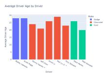  
(a) Ground Truth

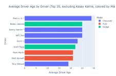  
(b) Direct Prompt

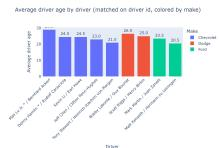  
(c) �0

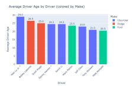  
(d) MultiVis-Agent

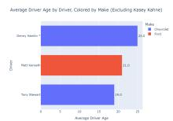  
(e) ReAct

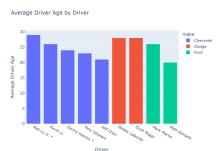  
(f) RSIV-Harness  
Figure 5: Case study on a ODAC-Vis task. The user asks for average driver age by driver, and chooses color by make. Direct Prompt and ReAct change the plotted ages and drivers. $H _ { 0 }$ concatenates names from the two sources, and MultiVis-Agent changes the bar heights. RSIV-Harness successfully matches user requirements.

Table 4: Ablation of RSIV-Harness on the ODAC-Vis test split. The first variant removes the stability rules. The re- maining variants add one evolved component to $H _ { 0 } .$
<table><tr><td>Method</td><td>Exec.</td><td>Route.</td><td>Stance</td><td>Exec Acc.</td><td>Clarify</td><td>Chart</td></tr><tr><td>RSIV-HARNESS</td><td>93.00</td><td>62.26</td><td>67.00</td><td>31.52</td><td>5.15</td><td>75.47</td></tr><tr><td>- w/o. rule</td><td>83.27</td><td>59.14</td><td>64.50</td><td>28.02</td><td>2.41</td><td>65.94</td></tr><tr><td>H0</td><td>51.36</td><td>48.25</td><td>51.25</td><td>24.51</td><td>3.72</td><td>41.46</td></tr><tr><td>+ prompt only</td><td>87.94</td><td>62.26</td><td>64.00</td><td>29.96</td><td>3.76</td><td>71.13</td></tr><tr><td>+ tool only</td><td>84.82</td><td>62.26</td><td>65.25</td><td>27.63</td><td>2.84</td><td>66.67</td></tr><tr><td>+ memory only</td><td>85.99</td><td>59.92</td><td>64.00</td><td>26.85</td><td>2.56</td><td>67.69</td></tr><tr><td>+ skill only</td><td>85.99</td><td>60.70</td><td>64.00</td><td>29.18</td><td>2.29</td><td>69.47</td></tr><tr><td>+ middleware only</td><td>90.66</td><td>56.03</td><td>66.50</td><td>30.35</td><td>2.07</td><td>72.41</td></tr></table>

1.43, and 34.01 points in table order. These gains show that adapting the harness around fixed model weights improves not only program viability, but also source selection, dialogue decisions, and the structure of the final chart.

5.2.2 Impact ofLLM Backbone. The GPT results test whether a harness evolved only with DeepSeek can transfer to another back bone without further optimization. Compared with the static GPT harness, the frozen evolved harness improves five of six metrics. The gains are 9.34 points in executability, 19.07 in database routing, 7.50 in stance accuracy, 1.72 in clarification quality, and 8.35 in chart structure. Execution accuracy is 0.78 points lower. The transferred system is nevertheless slightly below the strongest GPT baseline on most individual metrics. The deficits are 4.67 points for executability, 1.55 for routing, 0.25 for stance, 0.78 for execution accuracy, and 0.01 for chart structure. It achieves the best clarification score at 3.74. These results demonstrate the applicability of RSIV Harness across open-source and proprietary LLM backbones, with harness improvements learned from one model remaining transferable to another without adaptation, although some performance gains remain dependent on the model used during evolution.

## 5.3 Ablation Study

5.3.1 Stability Rule Analysis. To isolate the efect of stability rules, we repeat one round ofharness evolution with DeepSeek-V4.1-Flash after removing the stability rule framework, keeping all other settings unchanged. The resulting harness is then frozen and evaluated on the test split using the same model. As shown in Table 4, removing the stability rules leads to performance degradation across all six metrics: executability drops by 9.73 points, database routing by 3.12, stance accuracy by 2.50, execution accuracy by 3.50, clarification quality by 2.74, and chart structure by 9.53. The largest declines occur in executability and chart structure, while the reductions in routing, stance, and clarification quality indicate that the framework contributes to multiple aspects of conversational visualization rather than merely filtering invalid programs. These results highlight the importance of stability rules in guiding harness evolution, helping preserve previously successful behaviors while enabling improvements from accumulated task failures.

5.3.2 Harness Component Analysis. To assess component contributions, we replace each component of the $H _ { 0 }$ with its evolved counterpart—prompt, tool, memory, skill, or middleware—while keeping the others unchanged. Table 4 reveals complementary strengths. The evolved prompt improves routing (62.26), clarification (3.76), and chart structure (71.13), while the tool interface supports routing (62.26) and stance accuracy (65.25). Memory benefits routing (59.92) and chart structure (67.69), whereas skills improve execution accuracy (29.18) and chart structure (69.47). Middleware achieves the best single-component results in executability (90.66), stance accuracy (66.50), execution accuracy (30.35), and chart structure (72.41), highlighting the role of control flow and execution feedback. The complete harness still exceeds every single component variant in five metrics. The combined result therefore arises from coordination among components rather than from one isolated edit.

## 5.4 Case Study

We present a cross-database visualization task involving two carracing databases joined by driver ID to demonstrate the capabilities of RSIV-Harness. The user first requests a bar chart of average driver age, then excludes Kasey Kahne and uses color to encode vehicle make. The reference chart (Figure 5a) therefore contains nine drivers across three makes. Direct Prompt and Re-Act distort the ages and chart orientation, with ReAct omitting six drivers. $H _ { 0 }$ incorrectly concatenates driver names across sources. MultiVis-Agent keeps the nine names but shifts the ages, for example drawing Bobby Labonte at 26.5 rather than 28. In contrast, RSIV-Harness preserves the correct drivers, ages, and make-based encoding, closely matching the reference chart. This demonstrates its ability to integrate cross-database evidence while respecting multi-turn refinements.

## 6 Conclusion

We presented ODAC-Vis and RSIV-Harness as a benchmark and method for open domain conversational text to visualization. ODAC-Vis evaluates source discovery, ambiguity resolution, and multi turn chart refinement under held out domains. RSIV-Harness improves the harness around a fixed language model through recursive analysis of failure traces. Its stability rules provide explicit guarantees for protected record refresh, champion restoration, anchor monotonicity, and bounded regression. On the test split, a single round of recursive self-improvement improves the DeepSeek-based harness across all six evaluation metrics. The same frozen harness also transfers competitively to GPT-6 Luna. Ablations further show that the stability rules improve all reported metrics and that the harness components make complementary contributions. These findings establish harness evolution as a practical path for improving conversational visualization agents.

## References

[1] Olena Bogdanov, Yeunji Jung, Chandra Dhir, Pareekshitreddy Gaddam, Saurabh Jain, Lakshmi Tumati, Vijay Parthasarathy, and Anup Shirgaonkar. 2026. AgentNLQ: A General-Purpose Agent for Natural Language to SQL. arXiv:2605.19010 [cs.AI] https://arxiv.org/abs/2605.19010

[2] Jipeng Cen, Jiaxin Liu, Zhixu Li, and Jingjing Wang. 2025. SQLFixAgent: towards semantic-accurate text-to-SQL parsing via consistency-enhanced multiagent collaboration. In Proceedings ofthe Thirty-Ninth AAAI Conference on Artificial Intelligence and Thirty-Seventh Conference on Innovative Applications of Artificial Intelligence and Fifteenth Symposium on Educational Advances in Artificial Intelligence (AAAI’25/IAAI’25/EAAI’25). AAAI Press, Article 6, 9 pages. doi:10.1609/aaai.v39i1.31979

[3] Daojun Chen, Xi Wang, Shenyuan Ren, Qingzhi Ma, Pengpeng Zhao, and An Liu. 2026. GBV-SQL: Guided Generation and SQL2Text Back-Translation Validation for Multi-Agent Text2SQL. In Proceedings of the 64th Annual Meeting of the Association for Computational Linguistics (Volume 1: Long Papers), Maria Liakata, Viviane P. Moreira, Jiajun Zhang, and David Jurgens (Eds.). Association for Computational Linguistics, San Diego, California, United States, 18391–18406. doi:10.18653/v1/2026.acl-long.837

[4] Nan Chen, Yuge Zhang, Jiahang Xu, Kan Ren, and Yuqing Yang. 2025. VisEval: A Benchmark for Data Visualization in the Era of Large Language Models. IEEE Transactions on Visualization and Computer Graphics 31, 1 (2025), 1301–1311. doi:10.1109/TVCG.2024.3456320

[5] Chao Deng, Ju Fan, Yuyu Luo, Qinliang Xue, Meihao Fan, Yuxin Zhang, Min Zhang, Xiaofeng Jia, Jing Zhang, and Xiaoyong Du. 2026. TACO: A Benchmark for Open-Domain Text-to-SQL with Ambiguous and Cross-Database Queries. Proc. VLDB Endow. 19, 6 (May 2026), 1386–1399. doi:10.14778/3797919.3797942

[6] Hanghui Guo, Weijie Shi, Zhangze Chen, Shengxiang Xu, Yishu Wang, Yimei Zhang, Wangze Ni, Jia Zhu, and Shimin Di. 2026. DREvo: Distilling Recalibrated Historical Experience for Harness Self-Evolution. arXiv:2607.26722 [cs.MA] https://arxiv.org/abs/2607.26722

[7] Omar Khattab, Arnav Singhvi, Paridhi Maheshwari, Zhiyuan Zhang, Keshav Santhanam, Sri Vardhamanan, Saiful Haq, Ashutosh Sharma, Thomas T. Joshi, Hanna Moazam, Heather Miller, Matei Zaharia, and Christopher Potts. 2023. DSPy: Compiling Declarative Language Model Calls into Self-Improving Pipelines. arXiv:2310.03714 [cs.CL] https://arxiv.org/abs/2310.03714

[8] Yoonho Lee, Roshen Nair, Qizheng Zhang, Kangwook Lee, Omar Khattab, and Chelsea Finn. 2026. Meta-Harness: End-to-End Optimization of Model Harnesses. arXiv:2603.28052 [cs.AI] https://arxiv.org/abs/2603.28052

[9] Jinyang Li, Binyuan Hui, Ge Qu, Jiaxi Yang, Binhua Li, Bowen Li, Bailin Wang, Bowen Qin, Ruiying Geng, Nan Huo, Xuanhe Zhou, Chenhao Ma, Guoliang Li, Kevin Chang, Fei Huang, Reynold Cheng, and Yongbin Li. 2023. Can LLM Already Serve as A Database Interface? A BIg Bench for Large-Scale Database Grounded Text-to-SQLs. In Advances in Neural Information Processing Systems, A. Oh, T. Naumann, A. Globerson, K. Saenko, M. Hardt, and S. Levine (Eds.), Vol. 36. Curran Associates, Inc., 42330–42357. doi:10.52202/075280-1835

[10] Jiahang Lin, Shichun Liu, Chengjun Pan, Lizhi Lin, Shihan Dou, Zhiheng Xi, Xuanjing Huang, Hang Yan, Zhenhua Han, Tao Gui, and Yu-Gang Jiang. 2026. Agentic Harness Engineering: Observability-Driven Automatic Evolution of Coding-Agent Harnesses. arXiv:2604.25850 [cs.CL] https://arxiv.org/abs/2604. 25850

[11] Zewen Liu, Zhan Shi, Yisi Sang, Bing He, Minhua Lin, Tianxin Wei, Dakuo Wang, Benoit Dumoulin, Wei Jin, and Hanqing Lu. 2026. Adaptive Auto-Harness: Sustained Self-Improvement for Agentic System Deployment on Open-Ended

Task Streams. arXiv:2606.01770 [cs.LG] https://arxiv.org/abs/2606.01770

[12] Jinwei Lu, Jiawei Lu, Chen Zhang, Zhiqian Qin, Haodi Zhang, Yuanfeng Song, and Raymond Chi-Wing Wong. 2026. Bridging the Gap: Enabling Natural Language Queries for NoSQL Databases through Text-to-NoSQL Translation. arXiv:2502.11201 [cs.DB] https://arxiv.org/abs/2502.11201

[13] Jinwei Lu, Jiawei Lu, Chen Zhang, Yuanfeng Song, and Raymond Chi-Wing Wong. 2026. Demonstration of MultiVis-Agent: Interactively Generating Reliable Visualizations via Logic-Rule Agents. In Companion ofthe International Conference on Management of Data (India) (SIGMOD Companion ’26). Association for Computing Machinery, New York, NY, USA, 98–101. doi:10.1145/3788853.3801584

[14] Jinwei Lu, Yuanfeng Song, Chen Zhang, and Raymond Chi-Wing Wong. 2026. MultiVis-Agent: A Multi-Agent Framework with Logic Rules for Reliable and Comprehensive Cross-Modal Data Visualization. Proc. ACM Manag. Data 4, 1, Article 56 (April 2026), 25 pages. doi:10.1145/3786670

[15] Jinwei Lu, Yuanfeng Song, Haodi Zhang, Chen Jason Zhang, Kaishun Wu, and Raymond Chi-Wing Wong. 2025. Towards Robustness of Text-to-Visualization Translation Against Lexical and Phrasal Variability. In 2025 IEEE 41st International Conference on Data Engineering (ICDE). 793–806. doi:10.1109/ICDE65448.2025. 00065

[16] Jinwei Lu, Wenxin Xu, Yuanfeng Song, Haodi Zhang, Chen Jason Zhang, Kaishun Wu, Xiaoyong Wei, and Raymond Chi-Wing Wong. 2026. Towards Robust and Interactive Text-to-Visualization Translation: Enhancing Model Robustness and Mitigating Ambiguity in Natural Language Queries. The VLDB Journal 35, 5 (2026), 49.

[17] Shuqi Lu, Chaofan Li, Kun Luo, Zhang Zhang, Hui Wang, Hongwang Xiao, Lei Xiong, Jiahao Wang, Sen Wang, Xiyan Jiang, Wanli Li, Yuyang Hu, Hongjin Qian, Bingyu Yan, Jianlyu Chen, Ziyi Xia, Yingxia Shao, Kang Liu, Zhicheng Dou, Di He, Chaozhuo Li, Qiwei Ye, Zhongyuan Wang, and Zheng Liu. 2026. AREX: Towards a Recursively Self-Improving Agent for Deep Research. arXiv:2607.21461 [cs.AI] https://arxiv.org/abs/2607.21461

[18] Tianqi Luo, Chuhan Huang, Leixian Shen, Boyan Li, Shuyu Shen, Wei Zeng, Nan Tang, and Yuyu Luo. 2025. nvBench 2.0: Resolving Ambiguity in Textto-Visualization through Stepwise Reasoning. In Advances in Neural Information Processing Systems, D. Belgrave, C. Zhang, H. Lin, R. Pascanu, P. Koniusz, M. Ghassemi, and N. Chen (Eds.), Vol. 38, Main Conference. Curran Associates, Inc. doi:10.52202/085713-4172

[19] Yuyu Luo, Nan Tang, Guoliang Li, Chengliang Chai, Wenbo Li, and Xuedi Qin. 2021. Synthesizing Natural Language to Visualization (NL2VIS) Benchmarks from NL2SQL Benchmarks. In Proceedings ofthe 2021 International Conference on Management of Data (Virtual Event, China) (SIGMOD ’21). Association for Computing Machinery, New York, NY, USA, 1235–1247. doi:10.1145/3448016. 3457261

[20] Zhensheng Luo, Sai Wu, Yuan Qiu, Chang Yao, Gang Chen, and Xiu Tang. 2026. QBridge: Bridging Natural Language and SQL via Gold Query Rewriting with Agentic Refinement. In Proceedings of the 64th Annual Meeting of the Association for Computational Linguistics (Volume 1: Long Papers), Maria Liakata, Viviane P. Moreira, Jiajun Zhang, and David Jurgens (Eds.). Association for Computational Linguistics, San Diego, California, United States, 8915–8933. doi:10.18653/v1/ 2026.acl-long.402

[21] Aman Madaan, Niket Tandon, Prakhar Gupta, Skyler Hallinan, Luyu Gao, Sarah Wiegrefe, Uri Alon, Nouha Dziri, Shrimai Prabhumoye, Yiming Yang, Shashank Gupta, Bodhisattwa Prasad Majumder, Katherine Hermann, Sean Welleck, Amir Yazdanbakhsh, and Peter Clark. 2023. Self-Refine: Iterative Refinement with Self-Feedback. In Advances in Neural Information Processing Systems, A. Oh, T. Naumann, A. Globerson, K. Saenko, M. Hardt, and S. Levine (Eds.), Vol. 36. Curran Associates, Inc., 46534–46594. doi:10.52202/075280-2019

[22] Paula Maddigan and Teo Susnjak. 2023. Chat2VIS: Generating Data Visualizations via Natural Language Using ChatGPT, Codex and GPT-3 Large Language Models. IEEE Access 11 (2023), 45181–45193. doi:10.1109/ACCESS.2023.3274199

[23] Jun Nie, Yonggang Zhang, Jun Song, Qianshu Cai, Dahai Yu, Yike Guo, Xinmei Tian, and Bo Han. 2026. TTHE: Test-Time Harness Evolution. arXiv:2607.08124 [cs.SE] https://arxiv.org/abs/2607.08124

[24] OpenAI. 2026. Introducing GPT-6 Sol and Luna. https://openai.com/index/ introducing-gpt-6-sol-and-luna/

[25] Geliang Ouyang, Jingyao Chen, Zhihe Nie, Yi Gui, Yao Wan, Hongyu Zhang, and Dongping Chen. 2025. nvAgent: Automated Data Visualization from Natural Language via Collaborative Agent Workflow. In Proceedings of the 63rd Annual Meeting ofthe Association for Computational Linguistics (Volume 1: Long Papers), Wanxiang Che, Joyce Nabende, Ekaterina Shutova, and Mohammad Taher Pilehvar (Eds.). Association for Computational Linguistics, Vienna, Austria, 19534– 19567. doi:10.18653/v1/2025.acl-long.960

[26] Mohammadreza Pourreza and Davood Rafiei. 2023. DIN-SQL: Decomposed In-Context Learning of Text-to-SQL with Self-Correction. In Advances in Neural Information Processing Systems, A. Oh, T. Naumann, A. Globerson, K. Saenko, M. Hardt, and S. Levine (Eds.), Vol. 36. Curran Associates, Inc., 36339–36348. doi:10.52202/075280-1577

[27] Mizanur Rahman, Md Tahmid Rahman Laskar, Shafiq Joty, and Enamul Hoque. 2025. Text2Vis: A Challenging and Diverse Benchmark for Generating Multi modal Visualizations from Text. In Proceedings ofthe 2025 Conference on Empirical Methods in Natural Language Processing, Christos Christodoulopoulos, Tanmoy Chakraborty, Carolyn Rose, and Violet Peng (Eds.). Association for Computational Linguistics, Suzhou, China, 31849–31874. doi:10.18653/v1/2025.emnlp-main.1622

[28] Tabinda Sarwar, Farhad Moghimifar, Cong Duy Vu Hoang, Xiaoxiao Ma, Shawn Chang Xu, Fahimeh Saleh, Poorya Zaremoodi, Avirup Sil, and Katrin Kirchhof. 2026. CLARITY: A Framework and Benchmark for Conversational Language Ambiguity and Unanswerability in Interactive NL2SQL Systems. In Proceedings ofthe 64th Annual Meeting ofthe Association for Computational Linguistics (Volume 6: Industry Track), Yunyao Li, Georg Rehm, and Mei Tu (Eds.). Association for Computational Linguistics, San Diego, California, USA, 1218– 1250. doi:10.18653/v1/2026.acl-industry.86

[29] Noah Shinn, Federico Cassano, Ashwin Gopinath, Karthik Narasimhan, and Shunyu Yao. 2023. Reflexion: language agents with verbal reinforcement learning. In Advances in Neural Information Processing Systems, A. Oh, T. Naumann, A. Globerson, K. Saenko, M. Hardt, and S. Levine (Eds.), Vol. 36. Curran Associates, Inc., 8634–8652. doi:10.52202/075280-0377

[30] Yuanfeng Song, Jinwei Lu, Yuanwei Song, Caleb Chen Cao, Raymond Chi-Wing Wong, and Haodi Zhang. 2025. FeVisQA: Free-Form Question Answering over Data Visualizations. In 2025 IEEE 41st International Conference on Data Engineering (ICDE). 2726–2739. doi:10.1109/ICDE65448.2025.00205

[31] Yuanfeng Song, Jinwei Lu, and Raymond Chi-Wing Wong. 2026. CoVis: Neural and LLM-Driven Multi-Turn Interactions for Conversational Text-to: Visualization Generation. The VLDB Journal 35, 1 (2026), 3.

[32] Yuanfeng Song, Xuefang Zhao, and Raymond Chi-Wing Wong. 2024. Marrying Dialogue Systems with Data Visualization: Interactive Data Visualization Generation from Natural Language Conversations. In Proceedings ofthe 30th ACM SIGKDD Conference on Knowledge Discovery and Data Mining (Barcelona, Spain) (KDD ’24). Association for Computing Machinery, New York, NY, USA, 2733-2744. doi:10.1145/3637528.3671935

[33] Shayan Talaei, Mohammadreza Pourreza, Yu-Chen Chang, Azalia Mirhoseini, and Amin Saberi. 2024. CHESS: Contextual Harnessing for Eficient SQL Synthesis. arXiv:2405.16755 [cs.LG] https://arxiv.org/abs/2405.16755

[34] Bing Wang, Changyu Ren, Jian Yang, Xinnian Liang, Jiaqi Bai, LinZheng Chai, Zhao Yan, Qian-Wen Zhang, Di Yin, Xing Sun, and Zhoujun Li. 2025. MAC-SQL: A Multi-Agent Collaborative Framework for Text-to-SQL. In Proceedings ofthe 31st International Conference on Computational Linguistics, Owen Rambow, Leo Wanner, Marianna Apidianaki, Hend Al-Khalifa, Barbara Di Eugenio, and Steven Schockaert (Eds.). Association for Computational Linguistics, Abu Dhabi, UAE, 540–557. https://aclanthology.org/2025.coling-main.36

[35] Anyi Xu, B Li, Bangcai Lin, Bing Xue, BingCheng Xian, Bingzheng Xu, Bochao Wu, Bowei Zhang, Boyi Deng, CC Yu, et al. 2026. Deepseek-v4. 1-flash: Pushing the limits of kv cache compression. arXiv preprint arXiv:2609.19969 (2026).

[36] Keyan Xu, Dingzirui Wang, Xuanliang Zhang, Qingfu Zhu, and Wanxiang Che. 2025. Abacus-SQL: A Text-to-SQL System Empowering Cross-Domain and Open Domain Database Retrieval. In Proceedings ofthe 63rd Annual Meeting ofthe Association for Computational Linguistics (Volume 3: System Demonstrations), Pushkar Mishra, Smaranda Muresan, and Tao Yu (Eds.). Association for Compu tational Linguistics, Vienna, Austria, 118–128. doi:10.18653/v1/2025.acl-demo.12

[37] Wenxin Xu, Jinwei Lu, Hwanhee Kim, Chen Jason Zhang, Xiao-Yong Wei, Haoyang Li, and Yuanfeng Song. 2026. VisInteract: Towards Dynamic Inter active Text-to-Visualization under Imperfect Queries. arXiv:2609.15182 [cs.AI] https://arxiv.org/abs/2609.15182

[38] Wenxin Xu, Chen Jason Zhang, Xiaoyong Wei, Haoyang Li, Hwanhee Kim, Yuanfeng Song, and Raymond Chi-Wing Wong. 2026. Towards Reliable Agentic Progressive Text-to-Visualization with Verification Rules. arXiv:2605.29692 [cs.DB] https://arxiv.org/abs/2605.29692

[39] Shunyu Yao, Jefrey Zhao, Dian Yu, Nan Du, Izhak Shafran, Karthik Narasimhan, and Yuan Cao. 2023. ReAct: Synergizing Reasoning and Acting in Language Models. In International Conference on Learning Representations (ICLR).

[40] Tao Yu, Rui Zhang, Heyang Er, Suyi Li, Eric Xue, Bo Pang, Xi Victoria Lin, Yi Chern Tan, Tianze Shi, Zihan Li, Youxuan Jiang, Michihiro Yasunaga, Sungrok Shim, Tao Chen, Alexander Fabbri, Zifan Li, Luyao Chen, Yuwen Zhang, Shreya Dixit, Vincent Zhang, Caiming Xiong, Richard Socher, Walter Lasecki, and Dragomir Radev. 2019. CoSQL: A Conversational Text-to-SQL Challenge Towards Cross-Domain Natural Language Interfaces to Databases. In Proceedings of the 2019 Conference on Empirical Methods in Natural Language Processing and the 9th International Joint Conference on Natural Language Processing (EMNLP-IJCNLP), Kentaro Inui, Jing Jiang, Vincent Ng, and Xiaojun Wan (Eds.). Association for Computational Linguistics, Hong Kong, China, 1962–1979. doi:10.18653/v1/D19- 1204

[41] Tao Yu, Rui Zhang, Kai Yang, Michihiro Yasunaga, Dongxu Wang, Zifan Li, James Ma, Irene Li, Qingning Yao, Shanelle Roman, Zilin Zhang, and Dragomir Radev. 2018. Spider: A Large-Scale Human-Labeled Dataset for Complex and Cross-Domain Semantic Parsing and Text-to-SQL Task. In Proceedings ofthe 2018 Conference on Empirical Methods in Natural Language Processing, Ellen Rilof,

David Chiang, Julia Hockenmaier, and Jun’ichi Tsujii (Eds.). Association for Computational Linguistics, Brussels, Belgium, 3911–3921. doi:10.18653/v1/D18- 1425

[42] Tao Yu, Rui Zhang, Michihiro Yasunaga, Yi Chern Tan, Xi Victoria Lin, Suyi Li, Heyang Er, Irene Li, Bo Pang, Tao Chen, Emily Ji, Shreya Dixit, David Proctor, Sungrok Shim, Jonathan Kraft, Vincent Zhang, Caiming Xiong, Richard Socher, and Dragomir Radev. 2019. SParC: Cross-Domain Semantic Parsing in Context. In Proceedings ofthe 57th Annual Meeting ofthe Association for Computational Linguistics, Anna Korhonen, David Traum, and Lluís Màrquez (Eds.). Association for Computational Linguistics, Florence, Italy, 4511–4523. doi:10.18653/v1/P19- 1443

[43] Hangfan Zhang, Shao Zhang, Kangcong Li, Chen Zhang, Yang Chen, Yiqun Zhang, Lei Bai, and Shuyue Hu. 2026. Self-Harness: Harnesses That Improve Themselves. arXiv:2606.09498 [cs.CL] https://arxiv.org/abs/2606.09498

[44] Congjie Zheng, Chuanyi Xue, Bin Liang, Jun Yang, and Changshui Zhang. 2026. SEAGym: An Evaluation Environment for Self-Evolving LLM Agents. arXiv:2606.17546 [cs.AI] https://arxiv.org/abs/2606.17546