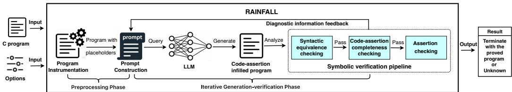
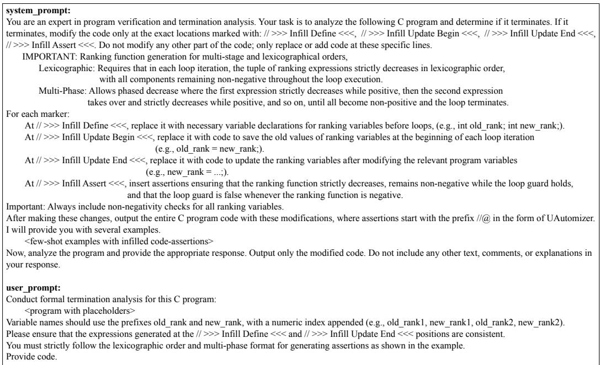
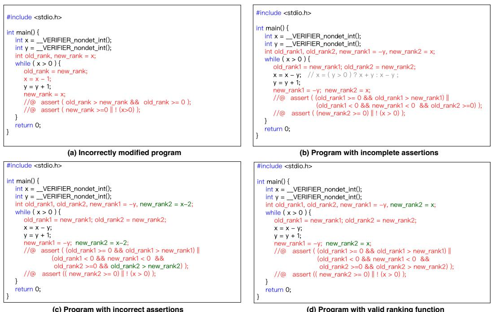
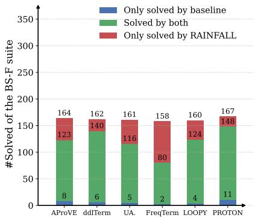
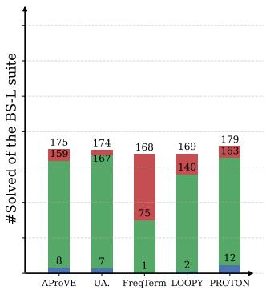
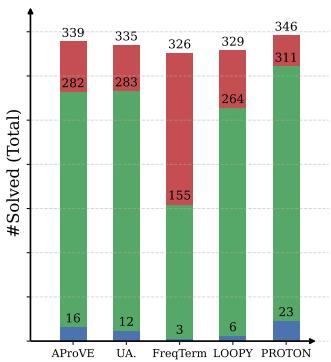
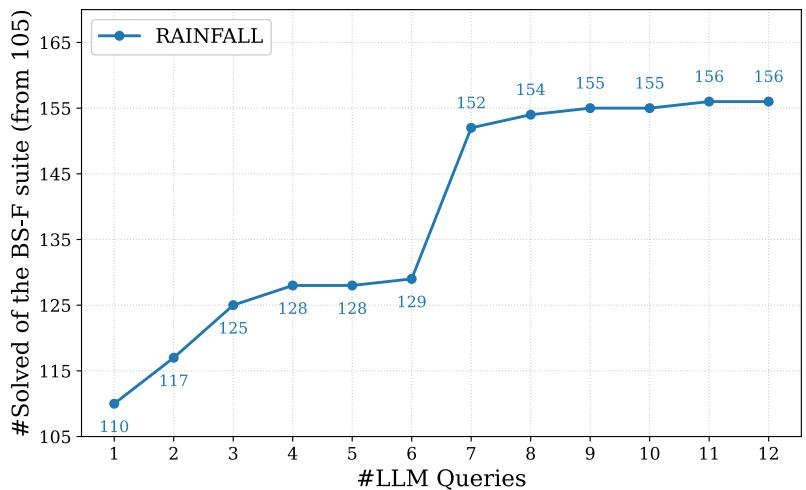

# Ranking Function Generation with LLMs for Termination

RONGKANG LI<sup>∗</sup>, Key Laboratory of System Software (Chinese Academy of Sciences), China, Institute of S<sub>o</sub>ft<sub>wa</sub>r<sub>e,</sub> Chin<sub>ese</sub> A<sub>ca</sub>d<sub>e</sub>m<sub>y o</sub>f S<sub>c</sub>i<sub>e</sub>n<sub>ces,</sub> Chin<sub>a, a</sub>nd Uni<sub>ve</sub>r<sub>s</sub>it<sub>y o</sub>f Chin<sub>ese</sub> A<sub>ca</sub>d<sub>e</sub>m<sub>y o</sub>f S<sub>c</sub>i<sub>e</sub>n<sub>ces,</sub> Chin<sub>a</sub> JIAXIN HU<sup>†</sup>, Key Laboratory of System Software (Chinese Academy of Sciences), China, Institute of S<sub>o</sub>ft<sub>wa</sub>r<sub>e,</sub> Chin<sub>ese</sub> A<sub>ca</sub>d<sub>e</sub>m<sub>y o</sub>f S<sub>c</sub>i<sub>e</sub>n<sub>ces,</sub> Chin<sub>a, a</sub>nd Uni<sub>ve</sub>r<sub>s</sub>it<sub>y o</sub>f Chin<sub>ese</sub> A<sub>ca</sub>d<sub>e</sub>m<sub>y o</sub>f S<sub>c</sub>i<sub>e</sub>n<sub>ces,</sub> Chin<sub>a</sub> TAOLUE CHEN, School of Computing and Mathematical Sciences, Birkbeck, University of London, UK YONG LI<sup>‡</sup>, Key Laboratory of System Software (Chinese Academy of Sciences), China, Institute of Software, Chin<sub>ese</sub> A<sub>ca</sub>d<sub>e</sub>m<sub>y o</sub>f S<sub>c</sub>i<sub>e</sub>n<sub>ces,</sub> Chin<sub>a, a</sub>nd Uni<sub>ve</sub>r<sub>s</sub>it<sub>y o</sub>f Chin<sub>ese</sub> A<sub>ca</sub>d<sub>e</sub>m<sub>y o</sub>f S<sub>c</sub>i<sub>e</sub>n<sub>ces,</sub> Chin<sub>a</sub> FU SONG<sup>§¶</sup>, Key Laboratory of System Software (Chinese Academy of Sciences), China, Institute of S<sub>o</sub>ft<sub>wa</sub>r<sub>e,</sub> Chin<sub>ese</sub> A<sub>ca</sub>d<sub>e</sub>m<sub>y o</sub>f S<sub>c</sub>i<sub>e</sub>n<sub>ces,</sub> Chin<sub>a, a</sub>nd Uni<sub>ve</sub>r<sub>s</sub>it<sub>y o</sub>f Chin<sub>ese</sub> A<sub>ca</sub>d<sub>e</sub>m<sub>y o</sub>f S<sub>c</sub>i<sub>e</sub>n<sub>ces,</sub> Chin<sub>a</sub> ZHILIN WU, Key Laboratory of System Software (Chinese Academy of Sciences), China, Institute of S<sub>o</sub>ft<sub>wa</sub>r<sub>e,</sub> Chin<sub>ese</sub> A<sub>ca</sub>d<sub>e</sub>m<sub>y o</sub>f S<sub>c</sub>i<sub>e</sub>n<sub>ces,</sub> Chin<sub>a, a</sub>nd Uni<sub>ve</sub>r<sub>s</sub>it<sub>y o</sub>f Chin<sub>ese</sub> A<sub>ca</sub>d<sub>e</sub>m<sub>y o</sub>f S<sub>c</sub>i<sub>e</sub>n<sub>ces,</sub> Chin<sub>a</sub>

Rankin<sub>g</sub> functions are a fundamental techni<sub>q</sub>ue for <sub>p</sub>rovin<sub>g</sub> loo<sub>p</sub> termination<sub>,</sub> but constructin<sub>g</sub> them manuall<sub>y</sub> is challen<sub>g</sub>in<sub>g</sub> and re<sub>q</sub>uires substantial ex<sub>p</sub>ertise. Existin<sub>g</sub> automated a<sub>pp</sub>roaches are limited when handlin<sub>g,</sub> f<sub>or</sub> i<sub>ns</sub>t<sub>ance,</sub> <sub>non</sub>li<sub>near</sub> <sub>up</sub>d<sub>a</sub>t<sub>es</sub> <sub>an</sub>d <sub>comp</sub>l<sub>ex</sub> <sub>con</sub>t<sub>ro</sub>l fl<sub>ows</sub> i<sub>n</sub> <sub>rea</sub>l<sub>-wor</sub>ld <sub>programs.</sub> M<sub>eanw</sub>hil<sub>e,</sub> l<sub>arge</sub> l<sub>anguage</sub> models (LLMs) have recentl<sub>y</sub> demonstrated remarkable ca<sub>p</sub>abilities across a wide ran<sub>g</sub>e of software en<sub>g</sub>ineerin<sub>g</sub> tasks. Motivated b<sub>y</sub> these advances<sub>,</sub> we ex<sub>p</sub>lore LLM-based rankin<sub>g</sub> function <sub>g</sub>eneration for <sub>p</sub>rovin<sub>g</sub> loo<sub>p</sub> termination<sub>,</sub> a ke<sub>y</sub> com<sub>p</sub>onent of establishin<sub>g</sub> total <sub>p</sub>ro<sub>g</sub>ram correctness.

We propose RAINFALL, a neuro-symbo<sup>l</sup>ic <sup>f</sup>ramewor<sup>k</sup> w<sup>h</sup>ic<sup>h</sup> <sup>f</sup>o<sup>ll</sup>ows t<sup>h</sup>e generate-veri<sup>f</sup>y-re<sup>fi</sup>ne paradigm and tig<sup>h</sup>t<sup>l</sup>y integrates LLMs wit<sup>h</sup> symbo<sup>l</sup>ic veri<sup>fi</sup>cation. RAINFALL <sup>f</sup>ormu<sup>l</sup>ates ran<sup>k</sup>ing <sup>f</sup>unction synt<sup>h</sup>esis as a code-com<sub>p</sub>letion task b<sub>y</sub> insertin<sub>g</sub> <sub>p</sub>laceholders into the in<sub>p</sub>ut <sub>p</sub>ro<sub>g</sub>ram and constrainin<sub>g</sub> the LLM to fill f<sub>our pre</sub>d<sub>e</sub>fi<sub>ne</sub>d <sub>s</sub>l<sub>o</sub>t<sub>s</sub> f<sub>or eac</sub>h l<sub>oop.</sub> Th<sub>e comp</sub>l<sub>e</sub>t<sub>e</sub>d <sub>program</sub> i<sub>s</sub> th<sub>en c</sub>h<sub>ec</sub>k<sub>e</sub>d b<sub>y a sym</sub>b<sub>o</sub>li<sub>c ver</sub>ifi<sub>er.</sub> If

Authors’ Contact Information: Ron<sub>g</sub>kan<sub>g</sub> Li, Ke<sub>y</sub> Laborator<sub>y</sub> of S<sub>y</sub>stem Software (Chinese Academ<sub>y</sub> of Sciences), Beijin<sub>g</sub>, C<sup>h</sup>ina an<sup>d</sup> Institute o<sup>f</sup>So<sup>f</sup>tware, C<sup>h</sup>inese Aca<sup>d</sup>emy o<sup>f</sup>Sciences, Beijing, C<sup>h</sup>ina, <sup>l</sup>irong<sup>k</sup>ang25@mai<sup>l</sup>s.ucas.ac.cn an<sup>d</sup> University of Chinese Academy of Sciences, Beijing, China; Jiaxin Hu, Key Laboratory of System Software (Chinese Academy of Sciences), Beijing, C<sup>h</sup>ina an<sup>d</sup> Institute o<sup>f</sup> So<sup>f</sup>tware, C<sup>h</sup>inese Aca<sup>d</sup>emy o<sup>f</sup> Sciences, Beijing, C<sup>h</sup>ina, <sup>h</sup>jx18061369179@126.com an<sup>d</sup> University o<sup>f</sup> C<sup>h</sup>inese Aca<sup>d</sup>emy o<sup>f</sup> Sciences, Beijing, C<sup>h</sup>ina; Tao<sup>l</sup>ue C<sup>h</sup>en, Sc<sup>h</sup>oo<sup>l</sup> o<sup>f</sup> Computing an<sup>d</sup> Mat<sup>h</sup>ematica S<sub>c</sub>i<sub>ences,</sub> Bi<sub>r</sub>kb<sub>ec</sub>k<sub>,</sub> U<sub>n</sub>i<sub>vers</sub>it <sub>o</sub>f L<sub>on</sub>d<sub>on,</sub> L<sub>on</sub>d<sub>on,</sub> UK<sub>,</sub> t<sub>.c</sub>h<sub>en@</sub>bbk<sub>.ac.u</sub>k<sub>;</sub> Y<sub>on</sub> Li<sub>,</sub> K<sub>e</sub> L<sub>a</sub>b<sub>ora</sub>t<sub>or o</sub>f S <sub>s</sub>t<sub>em</sub> S<sub>o</sub>ft<sub>ware</sub> (Chinese Academy of Sciences), Beijing, China and Institute of Software, Chinese Academy of Sciences, Beijing, China, <sup>l</sup>iyong@ios.ac.cn an<sup>d</sup> University o<sup>f</sup> C<sup>h</sup>inese Aca<sup>d</sup>emy o<sup>f</sup> Sciences, Beijing, C<sup>h</sup>ina; Fu Song, Key La<sup>b</sup>oratory o<sup>f</sup> System Software (Chinese Academy of Sciences), Beijing, China and Institute of Software, Chinese Academy of Sciences, Beijing, C<sup>h</sup>ina, song<sup>f</sup>u@ios.ac.cn an<sup>d</sup> University o<sup>f</sup> C<sup>h</sup>inese Aca<sup>d</sup>emy o<sup>f</sup> Sciences, Beijing, C<sup>h</sup>ina; Z<sup>h</sup>i<sup>l</sup>in Wu, Key La<sup>b</sup>oratory o<sup>f</sup> S<sub>y</sub>stem Software (Chinese Academ<sub>y</sub> of Sciences), Beijin<sub>g</sub>, China and Institute of Software, Chinese Academ<sub>y</sub> of Sciences, Beijing, C<sup>h</sup>ina, wuz<sup>l</sup>@ios.ac.cn an<sup>d</sup> University o<sup>f</sup> C<sup>h</sup>inese Aca<sup>d</sup>emy o<sup>f</sup> Sciences, Beijing, C<sup>h</sup>ina.

<sub>ver</sub>ifi<sub>ca</sub>ti<sub>on succee</sub>d<sub>s, a va</sub>lid <sub>ran</sub>ki<sub>ng</sub> f<sub>unc</sub>ti<sub>on</sub> i<sub>s o</sub>bt<sub>a</sub>i<sub>ne</sub>d<sub>; o</sub>th<sub>erw</sub>i<sub>se,</sub> th<sub>e ver</sub>ifi<sub>er</sub>’<sub>s</sub> di<sub>agnos</sub>ti<sub>cs are</sub> t<sub>rans</sub>l<sub>a</sub>t<sub>e</sub>d i<sub>n</sub>t<sub>o na</sub>t<sub>ura</sub>l<sub>-</sub>l<sub>anguage</sub> f<sub>ee</sub>db<sub>ac</sub>k th<sub>a</sub>t <sub>gu</sub>id<sub>es</sub> it<sub>era</sub>ti<sub>ve re</sub>fi<sub>nemen</sub>t <sub>o</sub>f th<sub>e</sub> LLM’<sub>s ou</sub>t<sub>pu</sub>t<sub>.</sub>

We eva<sup>l</sup>uate RAINFALL on two pub<sup>l</sup>ic benc<sup>h</sup>mar<sup>k</sup> suites comprising 358 terminating C programs. Using MiniMax V2.7, RAINFALL synt<sup>h</sup>esizes veri<sup>fi</sup>ab<sup>l</sup>e ran<sup>k</sup>ing <sup>f</sup>unctions <sup>f</sup>or 323 programs (90.22%), outper<sup>f</sup>orming a<sup>ll</sup> promising base<sup>l</sup>ines. In particu<sup>l</sup>ar, it so<sup>l</sup>ves 12 more programs t<sup>h</sup>an PROTON 2.1, t<sup>h</sup>e best-per<sup>f</sup>orming base<sup>l</sup>ine and winner o<sup>f</sup>t<sup>h</sup>e SV-COMP 2026 Termination category. Furt<sup>h</sup>ermore, combining RAINFALL wit<sup>h</sup> PROTON 2.1 increases the success rate to 96.65% (346/358 <sub>p</sub>ro<sub>g</sub>rams). We also conduct ablation stud<sub>y</sub> confirmin<sub>g</sub> individua <sub>con</sub>t<sub>r</sub>ib<sub>u</sub>ti<sub>ons o</sub>f <sub>p</sub>l<sub>ace</sub>h<sub>o</sub>ld<sub>er con</sub>t<sub>rac</sub>t<sub>s,</sub> f<sub>ew-s</sub>h<sub>o</sub>t <sub>examp</sub>l<sub>es, sym</sub>b<sub>o</sub>li<sub>c ver</sub>ifi<sub>ca</sub>ti<sub>on, an</sub>d di<sub>agnos</sub>ti<sub>c</sub> i<sub>n</sub>f<sub>orma</sub>ti<sub>on</sub> <sup>f</sup>eedbac<sup>k</sup>. Experiments across LLMs <sup>f</sup>urt<sup>h</sup>er con<sup>fi</sup>rm t<sup>h</sup>e e<sup>f</sup>ectiveness o<sup>f</sup> RAINFALL.

Our results su<sub>gg</sub>est a <sub>g</sub>eneric<sub>,</sub> sound framework for rankin<sub>g</sub>-function s<sub>y</sub>nthesis and<sub>,</sub> be<sub>y</sub>ond termination<sub>,</sub> LLM<sub>-ass</sub>i<sub>s</sub>t<sub>e</sub>d <sub>syn</sub>th<sub>es</sub>i<sub>s o</sub>f f<sub>orma</sub>ll<sub>y c</sub>h<sub>ec</sub>k<sub>a</sub>bl<sub>e</sub> li<sub>veness cer</sub>tifi<sub>ca</sub>t<sub>es,</sub> b<sub>o</sub>th <sub>o</sub>f <sub>w</sub>hi<sub>c</sub>h <sub>represen</sub>t <sub>new</sub> di<sub>rec</sub>ti<sub>ons o</sub>f software en<sub>g</sub>ineerin<sub>g</sub> research.

CCS Concepts: • Software and its engineering → Software verification; • Theory of computation → Automated reasoning; Logic and verification; • Computing methodologies → Knowledge representation and reasoning.

Additional Ke<sub>y</sub> Words and Phrases: Pro<sub>g</sub>ram termination<sub>,</sub> Software verification<sub>,</sub> Lar<sub>g</sub>e lan<sub>g</sub>ua<sub>g</sub>e model<sub>,</sub> Rankin<sub>g</sub> f<sub>unc</sub>ti<sub>on</sub>

ACM Reference Format:

Ron<sub>g</sub>kan<sub>g</sub> Li, Jiaxin Hu, Taolue Chen, Yon<sub>g</sub> Li, Fu Son<sub>g</sub>, and Zhilin Wu. 2026. Rankin<sub>g</sub> Function Generation with LLMs for Termination. 1, 1 (October 2026), 24 <sub>p</sub>a<sub>g</sub>es. htt<sub>p</sub>s://doi.or<sub>g</sub>/10.1145/nnnnnnn.nnnnnnn

## 1 Introduction

Pro<sub>g</sub>ram termination is a fundamental liveness <sub>p</sub>ro<sub>p</sub>ert<sub>y</sub> for ensurin<sub>g</sub> software reliabilit<sub>y</sub> and total correctness [38], and <sub>p</sub>la<sub>y</sub>s an im<sub>p</sub>ortant role in software verification [10, 35, 79]. While <sub>p</sub>ro<sub>g</sub>ram termination is undecidable in <sub>g</sub>eneral [81], automated techni<sub>q</sub>ues have been develo<sub>p</sub>ed over the <sub>y</sub>ears to <sub>p</sub>rove termination for man<sub>y</sub> classes of <sub>p</sub>ro<sub>g</sub>rams. A standard a<sub>pp</sub>roach is to s<sub>y</sub>nthesize <sub>a</sub> <sub>ran</sub>ki<sub>ng</sub> f<sub>unc</sub>ti<sub>on</sub> th<sub>a</sub>t <sub>maps</sub> <sub>program</sub> <sub>s</sub>t<sub>a</sub>t<sub>es</sub> t<sub>o</sub> <sub>a</sub> <sub>we</sub>ll<sub>-</sub>f<sub>oun</sub>d<sub>e</sub>d <sub>se</sub>t <sub>suc</sub>h th<sub>a</sub>t th<sub>e</sub> f<sub>unc</sub>ti<sub>on</sub> <sub>va</sub>l<sub>ue</sub> <sub>s</sub>t<sub>r</sub>i<sub>c</sub>tl<sub>y</sub> d<sub>ecreases w</sub>ith <sub>eac</sub>h l<sub>oop</sub> it<sub>era</sub>ti<sub>on an</sub>d i<sub>s</sub> b<sub>oun</sub>d<sub>e</sub>d b<sub>e</sub>l<sub>ow</sub> b<sub>y a cons</sub>t<sub>an</sub>t<sub>.</sub> Th<sub>e ex</sub>i<sub>s</sub>t<sub>ence o</sub>f such a function (referred to as a valid rankin<sub>g</sub> function) <sub>g</sub>uarantees that the loo<sub>p</sub> can execute onl<sub>y</sub> fi<sub>n</sub>it<sub>e</sub>l<sub>y</sub> <sub>many</sub> ti<sub>mes</sub> <sub>w</sub>h<sub>en</sub> th<sub>e</sub> b<sub>oun</sub>d <sub>en</sub>t<sub>a</sub>il<sub>s</sub> th<sub>e</sub> t<sub>erm</sub>i<sub>na</sub>ti<sub>on</sub> <sub>o</sub>f th<sub>e</sub> l<sub>oop.</sub>

Cl<sub>ass</sub>i<sub>ca</sub>l <sub>sym</sub>b<sub>o</sub>li<sub>c</sub> t<sub>ec</sub>h<sub>n</sub>i<sub>ques</sub> f<sub>or ran</sub>ki<sub>ng</sub> f<sub>unc</sub>ti<sub>on syn</sub>th<sub>es</sub>i<sub>s</sub> t<sub>yp</sub>i<sub>ca</sub>ll<sub>y</sub> f<sub>ormu</sub>l<sub>a</sub>t<sub>e</sub> th<sub>e pro</sub>bl<sub>em as</sub> constraint solvin<sub>g</sub> over <sub>p</sub>redefined <sub>p</sub>arameterized rankin<sub>g</sub> tem<sub>p</sub>lates<sub>,</sub> such as linear ex<sub>p</sub>ressions<sub>,</sub> lexico<sub>g</sub>ra<sub>p</sub>hic orders, or multi<sub>p</sub>hase combinations [13, 15, 21, 47, 57, 62, 76, 77]. Instantiatin<sub>g</sub> the rankin<sub>g</sub> tem<sub>p</sub>late with a satisf<sub>y</sub>in<sub>g</sub> assi<sub>g</sub>nment <sub>g</sub>ives rise to a rankin<sub>g</sub> function. While these <sub>approac</sub>h<sub>es</sub> h<sub>ave</sub> b<sub>een</sub> l<sub>arge</sub>l<sub>y</sub> <sub>success</sub>f<sub>u</sub>l<sub>,</sub> th<sub>e</sub>i<sub>r</sub> <sub>e</sub>f<sub>ec</sub>ti<sub>veness</sub> h<sub>eav</sub>il<sub>y</sub> d<sub>epen</sub>d<sub>s</sub> <sub>on</sub> th<sub>e</sub> <sub>ava</sub>il<sub>a</sub>bilit<sub>y</sub> <sub>o</sub>f suitable tem<sub>p</sub>lates. In <sub>p</sub>ractice<sub>,</sub> desi<sub>g</sub>nin<sub>g</sub> new rankin<sub>g</sub> tem<sub>p</sub>lates for diverse loo<sub>p p</sub>ro<sub>g</sub>rams remains challen<sub>g</sub>in<sub>g</sub> and continues to be an active area of research (cf., e.<sub>g</sub>. [62]). In <sub>g</sub>eneral, classical a<sub>pp</sub>roaches often re<sub>q</sub>uire substantial manual efort or ex<sub>p</sub>ensive tem<sub>p</sub>late ex<sub>p</sub>loration<sub>,</sub> which limits th<sub>e</sub>i<sub>r sca</sub>l<sub>a</sub>bilit<sub>y an</sub>d d<sub>egree o</sub>f <sub>au</sub>t<sub>oma</sub>ti<sub>on.</sub>

To address these limitations<sub>,</sub> recent work has ex<sub>p</sub>lored levera<sub>g</sub>in<sub>g</sub> machine learnin<sub>g,</sub> <sub>p</sub>articularl<sub>y</sub> (<sub>p</sub>re-trained) Lar<sub>g</sub>e Lan<sub>g</sub>ua<sub>g</sub>e Models (LLMs), to <sub>g</sub>enerate rankin<sub>g</sub> functions. This is motivated b<sub>y</sub> the remarkable ca<sub>p</sub>abilities in assistin<sub>g</sub> software develo<sub>p</sub>ment tasks [26, 45, 51, 78, 84], includin<sub>g</sub> s<sub>p</sub>ecification and loo<sub>p</sub> invariant <sub>g</sub>eneration [24, 33, 36, 41, 44, 54, 56, 64, 65, 68, 69, 71, 72, 75].

For instance, [8, 40] train neural networks as candidate rankin<sub>g</sub> functions, which are subse-<sub>q</sub>uentl<sub>y</sub> verified via SMT solvin<sub>g</sub> to ensure soundness. These techni<sub>q</sub>ues heavil<sub>y</sub> rel<sub>y</sub> on the <sub>q</sub>ualit<sub>y</sub> and <sub>q</sub>uantit<sub>y</sub> of execution traces for trainin<sub>g</sub> neural networks. [39] trains neural networks to simultaneousl<sub>y</sub> re<sub>p</sub>resent rankin<sub>g</sub> functions and inductive invariants. Unlike earlier a<sub>pp</sub>roaches<sub>,</sub> th<sub>ey</sub> d<sub>o</sub> <sub>no</sub>t <sub>requ</sub>i<sub>re</sub> <sub>execu</sub>ti<sub>on</sub> t<sub>races.</sub> I<sub>ns</sub>t<sub>ea</sub>d<sub>,</sub> th<sub>e</sub> <sub>neura</sub>l <sub>ne</sub>t<sub>wor</sub>k<sub>s</sub> <sub>are</sub> t<sub>ra</sub>i<sub>ne</sub>d th<sub>roug</sub>h <sub>a</sub> <sub>sequence</sub> <sub>o</sub>f

MILP solvin<sub>g</sub> in a counterexam<sub>p</sub>le-<sub>g</sub>uided inductive s<sub>y</sub>nthesis loo<sub>p</sub> and are desi<sub>g</sub>ned for hardware verification rather than <sub>p</sub>rovin<sub>g</sub> termination of software <sub>p</sub>ro<sub>g</sub>rams. Note that the decision variant <sub>o</sub>f MILP i<sub>s</sub> NP-<sub>co</sub>m<sub>p</sub>l<sub>e</sub>t<sub>e.</sub>

PROTON 2.1 [73] <sup>fi</sup>ne-tunes t<sup>h</sup>e L<sup>l</sup>ama-3.2-1B-Instruct mode<sup>l</sup> to generate candidate ran<sup>k</sup>ing functions. Its efectiveness, however, is limited b<sub>y</sub> the relativel<sub>y</sub> small model size (1B-<sub>p</sub>arameter), the sma<sup>ll</sup>-sca<sup>l</sup>e <sup>fi</sup>ne-tuning dataset (321 programs) and t<sup>h</sup>e restricted reasoning context. LOOPY [53], in contrast<sub>, p</sub>rom<sub>p</sub>ts LLMs to <sub>g</sub>enerate loo<sub>p</sub> invariants and candidate rankin<sub>g</sub> functions directl<sub>y</sub> from natural-lan<sub>g</sub>ua<sub>g</sub>e definitions, and then identifies valid candidates usin<sub>g</sub> Frama-C [12]. As an earl<sub>y</sub> attempt, LOOPY primari<sup>l</sup>y <sup>f</sup>ocuses on <sup>l</sup>oop invariant generation and on<sup>l</sup>y uti<sup>l</sup>izes t<sup>h</sup>e <sup>f</sup>eedbac<sup>k</sup> <sub>p</sub>roduced b<sub>y</sub> Frama-C to re<sub>p</sub>air incorrect invariants. When a candidate rankin<sub>g</sub> function is incorrect<sub>,</sub> LOOPY initiates a new interaction wit<sup>h</sup> t<sup>h</sup>e LLM wit<sup>h</sup>out incorporating t<sup>h</sup>e veri<sup>fi</sup>cation <sup>f</sup>eedbac<sup>k</sup>. A<sup>l</sup>t<sup>h</sup>oug<sup>h</sup> LOOPY <sup>h</sup>as demonstrated t<sup>h</sup>e potentia<sup>l</sup> o<sup>f</sup> LLMs <sup>f</sup>or ran<sup>k</sup>ing <sup>f</sup>unction generation, its efectiveness remains limited. Even after embeddin<sub>g</sub> ex<sub>p</sub>ert knowled<sub>g</sub>e (i.e., natural lan<sub>g</sub>ua<sub>g</sub>e description o<sup>f</sup> <sup>l</sup>exicograp<sup>h</sup>ic and mu<sup>l</sup>ti-p<sup>h</sup>ase ran<sup>k</sup>ing <sup>f</sup>unctions) into prompts, LOOPY on<sup>l</sup>y so<sup>l</sup>ves 181 out o<sup>f</sup> 281 benc<sup>h</sup>mar<sup>k</sup>s, muc<sup>h f</sup>ewer t<sup>h</sup>an t<sup>h</sup>e state-o<sup>f</sup>-t<sup>h</sup>e-art symbo<sup>l</sup>ic base<sup>l</sup>ine UAutomizer [48], <sub>w</sub>hi<sub>c</sub>h <sub>so</sub>l<sub>ves</sub> 236 b<sub>enc</sub>h<sub>mar</sub>k<sub>s.</sub>

T<sup>h</sup>ere are two major c<sup>h</sup>a<sup>ll</sup>enges in e<sup>f</sup>ective<sup>l</sup>y <sup>l</sup>everaging LLM <sup>f</sup>or ran<sup>k</sup>ing <sup>f</sup>unction generation.

• Challenge 1: limited LLM capability. LLMs generate outputs based on statistical patterns l<sub>earne</sub>d f<sub>rom</sub> t<sub>ra</sub>i<sub>n</sub>i<sub>ng</sub> d<sub>a</sub>t<sub>a.</sub> A<sub>s</sub> t<sub>ra</sub>i<sub>n</sub>i<sub>ng</sub> d<sub>a</sub>t<sub>a</sub> <sub>usua</sub>ll<sub>y</sub> <sub>cons</sub>i<sub>s</sub>t<sub>s</sub> <sub>o</sub>f l<sub>arge-sca</sub>l<sub>e</sub> <sub>na</sub>t<sub>ura</sub>l l<sub>anguage</sub> text and code cor<sub>p</sub>ora<sub>,</sub> LLMs t<sub>yp</sub>icall<sub>y</sub> <sub>p</sub>erform well on tasks such as natural lan<sub>g</sub>ua<sub>g</sub>e <sub>p</sub>rocessin<sub>g</sub> and code <sub>g</sub>eneration. In contrast<sub>,</sub> rankin<sub>g</sub> functions are relativel<sub>y</sub> underex<sub>p</sub>lored and is not su<sub>pp</sub>orted b<sub>y</sub> lar<sub>g</sub>e or re<sub>p</sub>resentative trainin<sub>g</sub> datasets. Conse<sub>q</sub>uentl<sub>y,</sub> LLMs ma<sub>y</sub> have limited ca<sub>p</sub>abilit<sub>y</sub> in reasonin<sub>g</sub> about rankin<sub>g</sub> functions and often stru<sub>gg</sub>le with com<sub>p</sub>licated <sub>or su</sub>btl<sub>e</sub> d<sub>e</sub>fi<sub>n</sub>iti<sub>ons expresse</sub>d i<sub>n na</sub>t<sub>ura</sub>l l<sub>anguage.</sub> I<sub>n</sub>d<sub>ee</sub>d<sub>, ou</sub>t<sub>-o</sub>f<sub>-</sub>th<sub>e-</sub>b<sub>ox</sub> Ll<sub>ama-</sub>1B f<sub>a</sub>il<sub>e</sub>d t<sub>o</sub> s<sub>y</sub>nthesize valid rankin<sub>g</sub> functions even for trivial <sub>p</sub>ro<sub>g</sub>rams [73].

• Challenge 2: identifying and resolving incorrect outputs. Despite the promising perf<sub>ormance o</sub>f LLM<sub>s</sub> f<sub>or co</sub>d<sub>e genera</sub>ti<sub>on,</sub> th<sub>ey</sub> f<sub>requen</sub>tl<sub>y genera</sub>t<sub>e</sub> i<sub>ncorrec</sub>t <sub>co</sub>d<sub>e, o</sub>ft<sub>en</sub> d<sub>ue</sub> to limited reasonin<sub>g</sub> context. A <sub>p</sub>articular serious issue is hallucinations [86] where LLMs <sub>g</sub>enerate out<sub>p</sub>uts that a<sub>pp</sub>ear <sub>p</sub>lausible but fail to satisf<sub>y</sub> the intended s<sub>p</sub>ecification [23, 43]. F<sub>o</sub>r in<sub>s</sub>t<sub>a</sub>n<sub>ce,</sub> GPT-4 h<sub>as</sub> b<sub>ee</sub>n <sub>s</sub>h<sub>ow</sub>n t<sub>o ge</sub>n<sub>e</sub>r<sub>a</sub>t<sub>e</sub> in<sub>co</sub>m<sub>p</sub>l<sub>e</sub>t<sub>e asse</sub>rti<sub>o</sub>n<sub>s as pos</sub>t-<sub>co</sub>nditi<sub>o</sub>n<sub>s so</sub> that bu<sub>ggy p</sub>ro<sub>g</sub>rams do not violate them [36]. We indeed observe similar behavior in our ex<sub>p</sub>eriments<sub>,</sub> hi<sub>g</sub>hli<sub>g</sub>htin<sub>g</sub> the develo<sub>p</sub>ment of techni<sub>q</sub>ues that can efectivel<sub>y</sub> identif<sub>y</sub> and <sub>correc</sub>t <sub>suc</sub>h <sub>su</sub>btl<sub>e errors w</sub>ith <sub>m</sub>i<sub>n</sub>i<sub>ma</sub>l i<sub>n</sub>t<sub>erac</sub>ti<sub>on over</sub>h<sub>ea</sub>d<sub>.</sub>

Our work. To tackle these challenges, we propose a neuro-symbolic framework, RAINFALL (RAnkIN<sub>g</sub> Function <sub>g</sub>enerAtion with LLm), within the <sub>g</sub>enerate-verif<sub>y</sub>-refine <sub>p</sub>aradi<sub>g</sub>m, which combines the <sub>g</sub>enerative ca<sub>p</sub>abilities of modern LLMs with the ri<sub>g</sub>or of s<sub>y</sub>mbolic techni<sub>q</sub>ues. This integration enab<sup>l</sup>es RAINFALL to discover ric<sup>h</sup>er termination arguments and prove termination <sup>f</sup>or <sub>a</sub> b<sub>roa</sub>d<sub>er c</sub>l<sub>ass o</sub>f l<sub>oop programs.</sub> W<sub>e remar</sub>k th<sub>a</sub>t LLM fi<sub>ne-</sub>t<sub>un</sub>i<sub>ng cou</sub>ld <sub>a</sub>l<sub>so</sub> b<sub>e a</sub>d<sub>op</sub>t<sub>e</sub>d<sub>, as</sub> d<sub>emon-</sub> strated by PROTON 2.1. We avoid <sup>fi</sup>ne-tuning because it is not on<sup>l</sup>y cost- and resource-intensive, but also re<sub>q</sub>uires lar<sub>g</sub>e-scale<sub>,</sub> hi<sub>g</sub>h-<sub>q</sub>ualit<sub>y</sub> trainin<sub>g</sub> datasets<sub>,</sub> which otherwise risks overfittin<sub>g</sub>.

Speci<sup>fi</sup>ca<sup>ll</sup>y, to address t<sup>h</sup>e <sup>fi</sup>rst c<sup>h</sup>a<sup>ll</sup>enge, RAINFALL <sup>fi</sup>rst trans<sup>f</sup>orms t<sup>h</sup>e synt<sup>h</sup>esis o<sup>f</sup> ran<sup>k</sup>ing functions into a code-assertion <sub>g</sub>eneration <sub>p</sub>roblem<sub>,</sub> motivated b<sub>y</sub> the observation that LLMs are <sub>ve</sub>r<sub>y</sub> <sub>e</sub>f<sub>ec</sub>ti<sub>ve</sub> in <sub>co</sub>d<sub>e</sub> <sub>a</sub>nd <sub>spec</sub>ifi<sub>ca</sub>ti<sub>o</sub>n <sub>ge</sub>n<sub>e</sub>r<sub>a</sub>ti<sub>o</sub>n<sub>.</sub> Thi<sub>s</sub> tr<sub>a</sub>n<sub>s</sub>f<sub>o</sub>rm<sub>a</sub>ti<sub>o</sub>n <sub>avo</sub>id<sub>s</sub> r<sub>equ</sub>irin<sub>g</sub> LLM<sub>s</sub> t<sub>o</sub> inter<sub>p</sub>ret com<sub>p</sub>licated definitions of rankin<sub>g</sub> functions and im<sub>p</sub>roves the <sub>q</sub>ualit<sub>y</sub> of the <sub>g</sub>enerated <sub>can</sub>did<sub>a</sub>t<sub>e ran</sub>ki<sub>ng</sub> f<sub>unc</sub>ti<sub>ons.</sub> S<sub>econ</sub>d<sub>, we em</sub>b<sub>e</sub>d <sub>exper</sub>t k<sub>now</sub>l<sub>e</sub>d<sub>ge a</sub>b<sub>ou</sub>t t<sub>erm</sub>i<sub>na</sub>ti<sub>on argumen</sub>t<sub>s</sub> (e.<sub>g</sub>., lexico<sub>g</sub>ra<sub>p</sub>hic and multi-<sub>p</sub>hase rankin<sub>g</sub> functions) with few-shot exam<sub>p</sub>les into structured <sub>p</sub>rom<sub>p</sub>ts which can enhance the reasonin<sub>g</sub> abilit<sub>y</sub> and in-context learnin<sub>g</sub> of LLMs for code-assertion <sub>g</sub>enerat<sup>i</sup>on.

T<sub>o a</sub>dd<sub>ress</sub> th<sub>e secon</sub>d <sub>c</sub>h<sub>a</sub>ll<sub>enge, we presen</sub>t <sub>a sym</sub>b<sub>o</sub>li<sub>c ver</sub>ifi<sub>ca</sub>ti<sub>on p</sub>i<sub>pe</sub>li<sub>ne w</sub>hi<sub>c</sub>h <sub>c</sub>h<sub>ec</sub>k<sub>s</sub> whether the LLM out<sub>p</sub>uts satisf<sub>y</sub> the re<sub>q</sub>uired correctness criteria<sub>,</sub> thereb<sub>y p</sub>rovidin<sub>g</sub> soundness <sub>g</sub>uarantees. In this <sub>p</sub>i<sub>p</sub>eline<sub>,</sub> we first ensure that the LLM does not modif<sub>y</sub> the ori<sub>g</sub>inal <sub>p</sub>ro<sub>g</sub>ram b<sub>y</sub> a<sub>pp</sub>l<sub>y</sub>in<sub>g</sub> a li<sub>g</sub>htwei<sub>g</sub>ht<sub>,</sub> s<sub>y</sub>ntactic e<sub>q</sub>uivalence check. This ste<sub>p p</sub>revents <sub>p</sub>otential cheatin<sub>g</sub> where th<sub>e</sub> LLM <sub>mo</sub>difi<sub>es</sub> th<sub>e program an</sub>d <sub>genera</sub>t<sub>es asser</sub>ti<sub>ons</sub> th<sub>a</sub>t h<sub>o</sub>ld <sub>on</sub>l<sub>y</sub> i<sub>n</sub> th<sub>e mo</sub>difi<sub>e</sub>d <sub>vers</sub>i<sub>on.</sub> Aft<sub>er</sub> thi<sub>s, we c</sub>h<sub>ec</sub>k th<sub>e comp</sub>l<sub>e</sub>t<sub>eness o</sub>f th<sub>e genera</sub>t<sub>e</sub>d <sub>co</sub>d<sub>e-asser</sub>ti<sub>on s</sub>t<sub>a</sub>t<sub>emen</sub>t<sub>s requ</sub>i<sub>re</sub>d t<sub>o</sub> i<sub>n</sub>d<sub>uce</sub> a rankin<sub>g</sub> function (e.<sub>g</sub>., whether assertions include strict decrease, non-ne<sub>g</sub>ativit<sub>y</sub> and termination conditions). Without these conditions, valid rankin<sub>g</sub> functions cannot be extracted even if the <sub>p</sub>ro<sub>g</sub>ram satisfies the assertions (e.<sub>g</sub>., an LLM out<sub>p</sub>uts true as the assertion, which would not be useful). Finall<sub>y</sub>, we verif<sub>y</sub> whether the <sub>p</sub>ro<sub>g</sub>ram satisfies the assertions via safet<sub>y</sub> checkin<sub>g</sub>. To re<sub>p</sub>air incorrect o<sub>u</sub>t<sub>pu</sub>ts with minimal interactions<sub>,</sub> we re-<sub>p</sub>rom<sub>p</sub>t LLMs b<sub>y</sub> incor<sub>p</sub>oratin<sub>g</sub> fine <sub>g</sub>rained dia<sub>g</sub>nostic information (e.<sub>g</sub>., the detected <sub>p</sub>ro<sub>g</sub>ram modification, missin<sub>g</sub> rankin<sub>g</sub> function conditions, or counterexam<sub>p</sub>le <sub>p</sub>roduced b<sub>y</sub> the safet<sub>y</sub> verifier). The corres<sub>p</sub>ondin<sub>g</sub> rankin<sub>g</sub> functions <sub>can</sub> th<sub>en</sub> b<sub>e</sub> <sub>ex</sub>t<sub>rac</sub>t<sub>e</sub>d <sub>an</sub>d <sub>use</sub>d <sub>as</sub> <sub>a</sub> <sub>w</sub>it<sub>ness</sub> t<sub>o</sub> <sub>program</sub> t<sub>erm</sub>i<sub>na</sub>ti<sub>on.</sub> R<sub>emar</sub>k th<sub>a</sub>t <sub>we</sub> d<sub>o</sub> <sub>no</sub>t <sub>copy</sub> the LLM-<sub>g</sub>enerated code-assertions into the ori<sub>g</sub>inal <sub>p</sub>ro<sub>g</sub>ram and then verif<sub>y</sub> them usin<sub>g</sub> the l<sub>a</sub>t<sub>er c</sub>h<sub>ec</sub>k<sub>s</sub> b<sub>ecause suc</sub>h <sub>co</sub>d<sub>e-asser</sub>ti<sub>ons</sub> t<sub>yp</sub>i<sub>ca</sub>ll<sub>y canno</sub>t i<sub>n</sub>d<sub>uce a va</sub>lid <sub>ran</sub>ki<sub>ng</sub> f<sub>unc</sub>ti<sub>on an</sub>d <sub>su</sub>b<sub>sequen</sub>t <sub>c</sub>h<sub>ec</sub>k<sub>s</sub> <sub>wou</sub>ld i<sub>ncur</sub> <sub>su</sub>b<sub>s</sub>t<sub>an</sub>ti<sub>a</sub>l <sub>compu</sub>t<sub>a</sub>ti<sub>ona</sub>l <sub>over</sub>h<sub>ea</sub>d<sub>.</sub>

We eva<sup>l</sup>uate RAINFALL on two pub<sup>l</sup>ic benc<sup>h</sup>mar<sup>k</sup> suites comprising 358 terminating C programs. Using MiniMax (V2.7) [5], RAINFALL generates veri<sup>fi</sup>ab<sup>l</sup>e ran<sup>k</sup>ing <sup>f</sup>unctions <sup>f</sup>or 323 programs (90.22%), outper<sup>f</sup>orming six state-o<sup>f</sup>-t<sup>h</sup>e-art too<sup>l</sup>s suc<sup>h</sup> as AProVE [66] (78.77%), UAutomizer (79.05%), LOOPY (73.74%) and PROTON 2.1 (86.87%). Ab<sup>l</sup>ation studies con<sup>fi</sup>rm t<sup>h</sup>at <sup>f</sup>ormu<sup>l</sup>ating ran<sup>k</sup>ingf<sub>unc</sub>ti<sub>on</sub> <sub>syn</sub>th<sub>es</sub>i<sub>s</sub> <sub>as</sub> <sub>a</sub> <sub>co</sub>d<sub>e-asser</sub>ti<sub>on</sub> <sub>genera</sub>ti<sub>on</sub> t<sub>as</sub>k<sub>,</sub> t<sub>oge</sub>th<sub>er</sub> <sub>w</sub>ith f<sub>ew-s</sub>h<sub>o</sub>t <sub>examp</sub>l<sub>es</sub> <sub>an</sub>d diagnostic in<sup>f</sup>ormation <sup>f</sup>eedbac<sup>k</sup> is critica<sup>l</sup> to t<sup>h</sup>is per<sup>f</sup>ormance. We <sup>f</sup>urt<sup>h</sup>er s<sup>h</sup>ow t<sup>h</sup>at RAINFALL remains efective across LLMs (e.<sub>g</sub>., <sub>p</sub>roved more <sub>p</sub>ro<sub>g</sub>rams in less time usin<sub>g</sub> GPT V5.5 [4] and Claude-O<sub>p</sub>us V4.7 [2]) and com<sub>p</sub>lements other tools (e.<sub>g</sub>., a 96.65% success rate, solvin<sub>g</sub> 346 tasks w<sup>h</sup>en combined wit<sup>h</sup> t<sup>h</sup>e symbo<sup>l</sup>ic counterpart o<sup>f</sup> PROTON 2.1).

This <sub>p</sub>a<sub>p</sub>er focuses on s<sub>y</sub>nthesizin<sub>g</sub> rankin<sub>g</sub> functions for <sub>p</sub>rovin<sub>g</sub> termination of loo<sub>p</sub> <sub>p</sub>ro<sub>g</sub>rams usin<sub>g</sub> three common classes of rankin<sub>g</sub> functions. More broadl<sub>y,</sub> however<sub>,</sub> our <sub>p</sub>romisin<sub>g</sub> results <sub>p</sub>oint toward a <sub>g</sub>eneric<sub>,</sub> sound framework for rankin<sub>g</sub>-function s<sub>y</sub>nthesis and<sub>,</sub> be<sub>y</sub>ond termination<sub>,</sub> LLM<sub>-ass</sub>i<sub>s</sub>t<sub>e</sub>d <sub>syn</sub>th<sub>es</sub>i<sub>s o</sub>f f<sub>orma</sub>ll<sub>y c</sub>h<sub>ec</sub>k<sub>a</sub>bl<sub>e</sub> li<sub>veness cer</sub>tifi<sub>ca</sub>t<sub>es,</sub> b<sub>o</sub>th <sub>o</sub>f <sub>w</sub>hi<sub>c</sub>h <sub>represen</sub>t f<sub>ron</sub>ti<sub>ers</sub> of software en<sub>g</sub>ineerin<sub>g</sub> research.

Fi<sub>rs</sub>t<sub>,</sub> th<sub>e</sub> f<sub>ramewor</sub>k <sub>na</sub>t<sub>ura</sub>ll<sub>y</sub> <sub>accommo</sub>d<sub>a</sub>t<sub>es</sub> <sub>new</sub> <sub>c</sub>l<sub>asses</sub> <sub>o</sub>f <sub>ran</sub>ki<sub>ng</sub> f<sub>unc</sub>ti<sub>ons.</sub> R<sub>a</sub>th<sub>er</sub> th<sub>an</sub> d<sub>eve</sub>l<sub>op</sub>i<sub>ng spec</sub>i<sub>a</sub>li<sub>ze</sub>d <sub>syn</sub>th<sub>es</sub>i<sub>s a</sub>l<sub>gor</sub>ith<sub>ms</sub> f<sub>or eac</sub>h <sub>new c</sub>l<sub>ass, one can ex</sub>t<sub>en</sub>d th<sub>e s</sub>t<sub>ruc</sub>t<sub>ure</sub>d <sub>promp</sub>t<sub>s</sub> <sub>w</sub>ith d<sub>oma</sub>i<sub>n</sub> k<sub>now</sub>l<sub>e</sub>d<sub>ge</sub> <sub>an</sub>d f<sub>ew-s</sub>h<sub>o</sub>t <sub>examp</sub>l<sub>es,</sub> <sub>w</sub>hil<sub>e</sub> <sub>a</sub>d<sub>ap</sub>ti<sub>ng</sub> <sub>on</sub>l<sub>y</sub> th<sub>e</sub> <sub>sym</sub>b<sub>o</sub>li<sub>c</sub> <sub>ver</sub>i<sub>-</sub> fication sta<sub>g</sub>e to the corres<sub>p</sub>ondin<sub>g</sub> <sub>p</sub>roof obli<sub>g</sub>ations. This substantiall<sub>y</sub> lowers the en<sub>g</sub>ineerin<sub>g</sub> efort re<sub>q</sub>uired to su<sub>pp</sub>ort richer rankin<sub>g</sub>-function tem<sub>p</sub>lates.

Second<sub>,</sub> rankin<sub>g</sub> functions have alread<sub>y</sub> been <sub>g</sub>eneralized be<sub>y</sub>ond loo<sub>p</sub> termination<sub>,</sub> servin<sub>g</sub> as certificates for software <sub>p</sub>ro<sub>g</sub>ress <sub>p</sub>ro<sub>p</sub>erties [30] and, more recentl<sub>y</sub>, as neural certificates for liveness properties o<sup>f</sup> <sup>h</sup>ardware designs [39]. In t<sup>h</sup>is broader setting, RAINFALL i<sup>ll</sup>ustrates a promising neuro-s<sub>y</sub>mbolic methodolo<sub>gy</sub> in which LLMs <sub>p</sub>ro<sub>p</sub>ose ex<sub>p</sub>ressive candidate <sub>p</sub>roof artifacts<sub>,</sub> while <sub>sym</sub>b<sub>o</sub>li<sub>c</sub> <sub>ver</sub>ifi<sub>ca</sub>ti<sub>on</sub> <sub>guaran</sub>t<sub>ees</sub> <sub>soun</sub>d<sub>ness</sub> th<sub>roug</sub>h <sub>va</sub>lid<sub>a</sub>ti<sub>on</sub> <sub>an</sub>d it<sub>era</sub>ti<sub>ve</sub> <sub>re</sub>fi<sub>nemen</sub>t<sub>.</sub> Th<sub>e</sub> <sub>s</sub>t<sub>rong</sub> empirica<sup>l</sup> per<sup>f</sup>ormance o<sup>f</sup> RAINFALL, toget<sup>h</sup>er wit<sup>h</sup> its comp<sup>l</sup>ementarity wit<sup>h</sup> existing symbo<sup>l</sup>ic termination tools<sub>,</sub> su<sub>gg</sub>ests that LLM-assisted certificate s<sub>y</sub>nthesis could extend be<sub>y</sub>ond termination to the verification of <sub>p</sub>ro<sub>g</sub>ress<sub>,</sub> fairness<sub>,</sub> res<sub>p</sub>onse<sub>,</sub> and other tem<sub>p</sub>oral <sub>p</sub>ro<sub>p</sub>erties of software s<sub>y</sub>stems.

Fi<sub>na</sub>ll<sub>y, a</sub>lth<sub>oug</sub>h thi<sub>s paper cons</sub>id<sub>ers on</sub>l<sub>y uncon</sub>diti<sub>ona</sub>l t<sub>erm</sub>i<sub>na</sub>ti<sub>on,</sub> th<sub>e same</sub> f<sub>ramewor</sub>k could <sub>p</sub>otentiall<sub>y</sub> be extended to infer termination conditions b<sub>y</sub> inte<sub>g</sub>ratin<sub>g</sub> recent advances in conditional termination anal<sub>y</sub>sis [52].

Summary. This paper makes the following contributions:

• A new <sub>p</sub>ers<sub>p</sub>ective that reformulates rankin<sub>g</sub>-function s<sub>y</sub>nthesis as a code-assertion <sub>g</sub>eneration task<sub>,</sub> enablin<sub>g</sub> a seamless inte<sub>g</sub>ration of LLM <sub>g</sub>eneration with sound s<sub>y</sub>mbolic techni<sub>q</sub>ues.

• A novel neuro-s<sub>y</sub>mbolic framework within the <sub>g</sub>enerate-verif<sub>y</sub>-refine <sub>p</sub>aradi<sub>g</sub>m, which combi<sub>nes</sub> <sub>exper</sub>t k<sub>now</sub>l<sub>e</sub>d<sub>ge,</sub> f<sub>ew-s</sub>h<sub>o</sub>t <sub>examp</sub>l<sub>es,</sub> <sub>sym</sub>b<sub>o</sub>li<sub>c</sub> <sub>c</sub>h<sub>ec</sub>ki<sub>ng,</sub> <sub>an</sub>d di<sub>agnos</sub>ti<sub>c</sub> i<sub>n</sub>f<sub>orma</sub>ti<sub>on</sub> to <sub>g</sub>uide <sub>g</sub>eneration<sub>,</sub> su<sub>pp</sub>ress hallucinations and ensure soundness.

• An extensive eva<sup>l</sup>uation s<sup>h</sup>owing t<sup>h</sup>at RAINFALL outper<sup>f</sup>orms six state-o<sup>f</sup>-t<sup>h</sup>e-art too<sup>l</sup>s incl<sub>u</sub>din<sub>g</sub> LLM-based ones and to<sub>p</sub>-3 tools of SV-COMP 2026 termination cate<sub>g</sub>or<sub>y</sub>.

Structure. Section 2 reviews the basic definition of rank functions. Section 3 reviews the related wor<sup>k</sup>, w<sup>h</sup>ic<sup>h</sup> a<sup>l</sup>so introduces more tec<sup>h</sup>nica<sup>l</sup> bac<sup>k</sup>ground. Section 4 presents t<sup>h</sup>e RAINFALL approac<sup>h</sup>. S<sub>ec</sub>ti<sub>on</sub> 5 <sub>repor</sub>t<sub>s</sub> th<sub>e exper</sub>i<sub>men</sub>t<sub>a</sub>l <sub>resu</sub>lt<sub>s an</sub>d di<sub>scusses po</sub>t<sub>en</sub>ti<sub>a</sub>l th<sub>rea</sub>t<sub>s</sub> t<sub>o</sub> th<sub>e va</sub>lidit<sub>y o</sub>f th<sub>e wor</sub>k<sub>.</sub> Finall<sub>y,</sub> Section 6 concludes the <sub>p</sub>a<sub>p</sub>er.

## 2 Preliminaries

In this section<sub>,</sub> we <sub>p</sub>rovide back<sub>g</sub>round on <sub>p</sub>ro<sub>g</sub>ram termination<sub>,</sub> includin<sub>g</sub> well-founded relations <sub>an</sub>d <sub>ran</sub>ki<sub>ng</sub> f<sub>unc</sub>ti<sub>ons.</sub>

A bin<sub>a</sub>r<sub>y</sub> r<sub>e</sub>l<sub>a</sub>ti<sub>o</sub>n $R \subseteq W \times W$ over the set � is well-founded if each non-empty subset $W ^ { \prime } \subseteq W$ has an �-minimal element<sub>,</sub> i.e.<sub>,</sub> there exists $\boldsymbol { x } ^ { \prime } \in W ^ { \prime }$ <sub>suc</sub>h th<sub>a</sub>t $( x , x ^ { \prime } ) \notin R$ f<sub>or eac</sub>h $\boldsymbol { x } \in { \boldsymbol { W } } ^ { \prime }$ <sub>.</sub> Int<sub>u</sub>iti<sub>ve</sub>l<sub>y,</sub> this means that no infinite descendin<sub>g</sub> chain with res<sub>p</sub>ect to � exists. The relation < over natural <sub>num</sub>b<sub>ers</sub> i<sub>s</sub> <sub>we</sub>ll<sub>-</sub>f<sub>oun</sub>d<sub>e</sub>d<sub>.</sub> I<sub>n</sub> <sub>prac</sub>ti<sub>ce,</sub> <sub>one</sub> <sub>may</sub> <sub>a</sub>l<sub>so</sub> <sub>cons</sub>id<sub>er</sub> d<sub>oma</sub>i<sub>ns</sub> <sub>suc</sub>h <sub>as</sub> th<sub>e</sub> <sub>se</sub>t <sub>o</sub>f fi<sub>n</sub>it<sub>e-</sub> <sub>prec</sub>i<sub>s</sub>i<sub>on</sub> fl<sub>oa</sub>ti<sub>ng-po</sub>i<sub>n</sub>t <sub>num</sub>b<sub>ers, or</sub> th<sub>e se</sub>t <sub>o</sub>f <sub>ra</sub>ti<sub>ona</sub>l <sub>num</sub>b<sub>ers, over w</sub>hi<sub>c</sub>h th<sub>e re</sub>l<sub>a</sub>ti<sub>on</sub> < i<sub>s</sub> <sub>a</sub>l<sub>so we</sub>ll<sub>-</sub>f<sub>oun</sub>d<sub>e</sub>d<sub>.</sub> I<sub>n</sub> thi<sub>s wor</sub>k<sub>, we</sub> d<sub>eno</sub>t<sub>e</sub> b<sub>y</sub> K <sub>a se</sub>t <sub>o</sub>f <sub>num</sub>b<sub>ers over w</sub>hi<sub>c</sub>h th<sub>e re</sub>l<sub>a</sub>ti<sub>on</sub> < i<sub>s</sub> <sub>we</sub>ll<sub>-</sub>f<sub>oun</sub>d<sub>e</sub>d<sub>, an</sub>d d<sub>eno</sub>t<sub>e</sub> b<sub>y</sub> ${ \mathbb K } _ { \ge 0 }$ th<sub>e</sub> <sub>su</sub>b<sub>se</sub>t <sub>o</sub>f K <sub>w</sub>h<sub>ose</sub> <sub>e</sub>l<sub>emen</sub>t<sub>s</sub> <sub>are</sub> <sub>nonnega</sub>ti<sub>ve.</sub>

In this <sub>p</sub>a<sub>p</sub>er<sub>,</sub> we focus on <sub>p</sub>ro<sub>g</sub>rams with a sin<sub>g</sub>le while-loo<sub>p</sub>. Pro<sub>g</sub>rams with multi<sub>p</sub>le or nested l<sub>oops</sub> <sub>can</sub> b<sub>e</sub> h<sub>an</sub>dl<sub>e</sub>d b<sub>y</sub> <sub>re</sub>d<sub>uc</sub>i<sub>ng</sub> t<sub>o</sub> <sub>a</sub> <sub>se</sub>t <sub>o</sub>f <sub>s</sub>i<sub>ng</sub>l<sub>e</sub> l<sub>oop</sub> <sub>programs</sub> $[ 2 2 , 4 9 ]$ <sub>, an</sub>d f<sub>or-</sub>l<sub>oops can</sub> b<sub>e eas</sub>il<sub>y</sub> t<sub>rans</sub>f<sub>orme</sub>d i<sub>n</sub>t<sub>o</sub> <sub>w</sub>hil<sub>e-</sub>l<sub>oops.</sub> Th<sub>e</sub> <sub>execu</sub>ti<sub>ons</sub> <sub>o</sub>f <sub>suc</sub>h <sub>programs</sub> <sub>can</sub> b<sub>e</sub> <sub>mo</sub>d<sub>e</sub>l<sub>e</sub>d <sub>as</sub> bi<sub>nary</sub> <sub>re</sub>l<sub>a</sub>ti<sub>ons</sub> over <sub>p</sub>ro<sub>g</sub>ram states. Let �® denote the vector of all <sub>p</sub>ro<sub>g</sub>ram variables $( x _ { 1 } , \ldots , x _ { n } ) ^ { T }$ , <sup>re</sup>p<sup>resentin</sup>g t<sup>h</sup>e current <sub>p</sub>ro<sub>g</sub>ram state, w<sup>h</sup>ere $n \geq 1$ . (Note that the <sub>p</sub>ro<sub>g</sub>ram variables ma<sub>y</sub> have diferent t<sub>yp</sub>es.) A<sub>s a co</sub>n<sub>ve</sub>nti<sub>o</sub>n<sub>, we w</sub>rit<sub>e</sub> $\vec { x } ^ { \prime } = ( x _ { 1 } ^ { \prime } , \ldots , x _ { n } ^ { \prime } ) ^ { T }$ f<sub>or</sub> th<sub>e</sub> <sub>var</sub>i<sub>a</sub>bl<sub>es</sub> i<sub>n</sub> th<sub>e</sub> <sub>nex</sub>t <sub>program</sub> <sub>s</sub>t<sub>a</sub>t<sub>e.</sub>

Definition 1. A program is modeled as a transition system $\mathcal { P } : = ( S , I , R )$ , where � denotes the countable (possibly infinite) set of program states, $I \subseteq S$ represents the set of initial states, and $R \subseteq S \times S$ defines the transition relation over program states.

For <sub>p</sub>ro<sub>g</sub>ram verification<sub>,</sub> the sets �<sub>,</sub> �<sub>,</sub> and � are t<sub>yp</sub>icall<sub>y</sub> re<sub>p</sub>resented as <sub>p</sub>redicates over the <sub>p</sub>ro<sub>g</sub>ram variables ${ \vec { x } } ,$ <sub>y</sub>ieldin<sub>g</sub> $I ( \vec { x } ) , S ( \vec { x } )$ <sub>an</sub>d $R ( \vec { x } , \vec { x } ^ { \prime } )$ , res<sub>p</sub>ectivel<sub>y</sub>. (We also identif<sub>y</sub> these <sub>p</sub>redicates with the corres<sub>p</sub>ondin<sub>g</sub> sets of <sub>p</sub>ro<sub>g</sub>ram states when the context is clear.) Intuitivel<sub>y</sub>, the initial <sub>s</sub>t<sub>a</sub>t<sub>es</sub> <sub>represen</sub>t th<sub>e</sub> <sub>reac</sub>h<sub>a</sub>bl<sub>e</sub> <sub>program</sub> <sub>s</sub>t<sub>a</sub>t<sub>es</sub> b<sub>e</sub>f<sub>ore</sub> <sub>en</sub>t<sub>er</sub>i<sub>ng</sub> th<sub>e</sub> l<sub>oop,</sub> <sub>an</sub>d <sub>eac</sub>h <sub>pa</sub>i<sub>r</sub> $( s , s ^ { \prime } ) \in R$ indicates that executin<sub>g</sub> one (loo<sub>p</sub>) iteration from the <sub>p</sub>ro<sub>g</sub>ram state � results in the <sub>p</sub>ro<sub>g</sub>ram state $s ^ { \prime }$ . For the sake of <sub>p</sub>resentation<sub>,</sub> intermediate <sub>p</sub>ro<sub>g</sub>ram states in each iteration are not modeled ex<sub>p</sub>licitl<sub>y</sub>.

A computation of the program $\mathcal { P }$ is either a finite or an infinite se<sub>q</sub>uence $\pi = s _ { 0 } , s _ { 1 } , s _ { 2 } , \cdots$ <sub>o</sub>f <sub>p</sub>ro<sub>g</sub>ram states suc<sup>h</sup> t<sup>h</sup>at $s _ { 0 } \in I$ <sub>an</sub>d $( s _ { i } , s _ { i + 1 } ) \in R$ f<sub>or</sub> <sub>a</sub>ll $i \geq 0 , \Lambda$ p<sup>ro</sup>g<sup>ram</sup> $\mathcal { P }$ is terminating if all its com<sub>p</sub>utations are finite.

A standard a<sub>pp</sub>roach for <sub>p</sub>rovin<sub>g</sub> termination of $\mathcal { P }$ is to s<sub>y</sub>nthesize a rankin<sub>g</sub> function that ma<sub>p</sub>s <sub>program</sub> <sub>s</sub>t<sub>a</sub>t<sub>es</sub> t<sub>o</sub> <sub>e</sub>l<sub>emen</sub>t<sub>s</sub> <sub>o</sub>f <sub>a</sub> <sub>we</sub>ll<sub>-</sub>f<sub>oun</sub>d<sub>e</sub>d <sub>se</sub>t <sub>suc</sub>h th<sub>a</sub>t th<sub>e</sub> <sub>va</sub>l<sub>ue</sub> <sub>s</sub>t<sub>r</sub>i<sub>c</sub>tl<sub>y</sub> d<sub>ecreases</sub> <sub>a</sub>l<sub>ong</sub> <sub>every</sub> t<sub>rans</sub>iti<sub>on.</sub> Si<sub>nce we</sub>ll<sub>-</sub>f<sub>oun</sub>d<sub>e</sub>d <sub>se</sub>t<sub>s a</sub>d<sub>m</sub>it <sub>no</sub> i<sub>n</sub>fi<sub>n</sub>it<sub>e</sub> d<sub>escen</sub>di<sub>ng c</sub>h<sub>a</sub>i<sub>ns,</sub> th<sub>e ex</sub>i<sub>s</sub>t<sub>ence o</sub>f <sub>suc</sub>h <sub>a</sub> rankin<sub>g</sub> function <sub>g</sub>uarantees that ever<sub>y</sub> com<sub>p</sub>utation of $\mathcal { P }$ <sub>mus</sub>t b<sub>e</sub> fi<sub>n</sub>it<sub>e w</sub>h<sub>en</sub> th<sub>e</sub> l<sub>ower</sub> b<sub>oun</sub>d <sub>en</sub>t<sub>a</sub>il<sub>s</sub> th<sub>e</sub> t<sub>erm</sub>i<sub>na</sub>ti<sub>on</sub> <sub>o</sub>f th<sub>e</sub> l<sub>oop</sub> $( \mathrm { i . e . } _ { }$ , ne<sub>g</sub>ation of the loo<sub>p</sub> <sub>g</sub>uard).

## 2.1 Common Classes of Ranking Functions

We recall three common classes of rankin<sub>g</sub> functions [62].

Definition 2. A single ranking function for a program $\mathcal { P }$ is a function $f : S \mapsto \mathbb { K } _ { \geq 0 }$ such that there exists a constant $\varepsilon > 0$ satisfying thatfor each $( s , s ^ { \prime } ) \in R , f ( s ) - f ( s ^ { \prime } ) \geq \varepsilon .$

Intuitively, � maps each program state $\vec { x }$ t<sub>o</sub> <sub>a</sub> <sub>va</sub>l<sub>ue</sub> $f ( { \vec { x } } )$ which strictl<sub>y</sub> decreases (b<sub>y</sub> at least $\varepsilon > 0 )$ after each iteration. Since � strictly decreases and is bounded below by 0, the relation $<$ i<sub>s</sub> <sub>we</sub>ll<sub>-</sub>f<sub>oun</sub>d<sub>e</sub>d <sub>over</sub> $\mathbb { K } ,$ th<sub>e</sub> l<sub>oop</sub> <sub>w</sub>ith <sub>guar</sub>d $\phi$ can execute onl<sub>y</sub> finitel<sub>y</sub> man<sub>y</sub> iterations when $f ( s ) < 0$ <sub>en</sub>t<sub>a</sub>il<sub>s</sub> $\neg \phi$ <sub>.</sub> Th<sub>ere</sub>f<sub>ore,</sub> $f$ <sub>se</sub>r<sub>ves</sub> <sub>as</sub> <sub>a</sub> <sub>w</sub>itn<sub>ess</sub> t<sub>o</sub> <sub>p</sub>r<sub>og</sub>r<sub>a</sub>m t<sub>e</sub>rmin<sub>a</sub>ti<sub>o</sub>n<sub>.</sub>

However<sub>,</sub> sin<sub>g</sub>le rankin<sub>g</sub> functions are not alwa<sub>y</sub>s suficient<sub>,</sub> or eas<sub>y</sub> to construct. For exam-<sub>p</sub>le<sub>,</sub> consider the <sub>p</sub>ro<sub>g</sub>ram $\mathcal { P }$ in Fi<sub>g</sub>ure 1. For brevit<sub>y</sub>, we omit (1) the declaration extern int $\mathrm { ~ \ -- ~ } \mathsf { V E R I F I E R } .$ \_nondet\_int(void) which returns a nondeterministic inte<sub>g</sub>er, and (2) the efects of i<sub>n</sub>t<sub>eger</sub> <sub>over</sub>fl<sub>ow</sub> <sub>an</sub>d <sub>un</sub>d<sub>er</sub>fl<sub>ow</sub> <sub>w</sub>h<sub>en</sub> <sub>reason</sub>i<sub>ng</sub> <sub>a</sub>b<sub>ou</sub>t th<sub>e</sub> t<sub>erm</sub>i<sub>na</sub>ti<sub>on</sub> <sub>o</sub>f $\mathcal { P }$ <sub>.</sub> Thi<sub>s</sub> f<sub>o</sub>ll<sub>ows</sub> f<sub>rom</sub> <sub>p</sub>rior work [15, 19, 57, 62, 76], since termination is otherwise undefined. Such issues are t<sub>yp</sub>icall<sub>y</sub> <sub>a</sub>dd<sub>resse</sub>d <sub>separa</sub>t<sub>e</sub>l<sub>y</sub> b<sub>y sa</sub>f<sub>e</sub>t<sub>y ver</sub>ifi<sub>ca</sub>ti<sub>on.</sub>

W<sub>e c</sub>l<sub>a</sub>i<sub>m</sub> th<sub>a</sub>t $\mathcal { P }$ alwa<sub>y</sub>s terminates (assumin<sub>g</sub> no inte<sub>g</sub>er overflow occurs). Intuitivel<sub>y</sub>, once <sub>�</sub> becomes <sub>p</sub>ositive<sub>, �</sub> strictl<sub>y</sub> decreases in ever<sub>y</sub> subse<sub>q</sub>uent iteration. Since <sub>�</sub> cannot decrease i<sub>n</sub>d<sub>e</sub>fi<sub>n</sub>it<sub>e</sub>l<sub>y</sub> <sub>w</sub>hil<sub>e</sub> <sub>sa</sub>ti<sub>s</sub>f<sub>y</sub>i<sub>ng</sub> th<sub>e</sub> l<sub>oop</sub> <sub>guar</sub>d $x > 0$ <sub>,</sub> th<sub>e</sub> l<sub>oop</sub> <sub>mus</sub>t <sub>even</sub>t<sub>ua</sub>ll<sub>y</sub> t<sub>erm</sub>i<sub>na</sub>t<sub>e.</sub> N<sub>ever</sub>th<sub>e</sub>l<sub>ess,</sub> there exists no single linear ranking function of the form $f ( x , y ) = a x + b y + c$ <sub>, w</sub>h<sub>ere</sub> $a , b$ <sub>an</sub>d <sub>�</sub> <sub>are cons</sub>t<sub>an</sub>t<sub>s,</sub> th<sub>a</sub>t <sub>proves</sub> th<sub>e</sub> t<sub>erm</sub>i<sub>na</sub>ti<sub>on o</sub>f $\mathcal { P }$ <sub>, s</sub>i<sub>nce suc</sub>h <sub>a</sub> f<sub>unc</sub>ti<sub>on may</sub> f<sub>a</sub>il t<sub>o s</sub>t<sub>r</sub>i<sub>c</sub>tl<sub>y</sub> d<sub>ecrease</sub> <sub>a</sub>t <sub>eve</sub>r<sub>y</sub> it<sub>e</sub>r<sub>a</sub>ti<sub>o</sub>n<sub>.</sub>

T<sub>o see</sub> thi<sub>s,</sub> l<sub>e</sub>t th<sub>e curren</sub>t <sub>program s</sub>t<sub>a</sub>t<sub>e</sub> b<sub>e</sub> $( x , y )$ . After one iteration<sub>,</sub> the <sub>p</sub>ro<sub>g</sub>ram state is u<sub>p</sub>dated to $\left( x - y , y + 1 \right)$ <sub>.</sub> W<sub>e</sub> h<sub>ave</sub> th<sub>a</sub>t $f ( x , y ) - f ( x - y , y + 1 ) = ( a x + b y + c ) - ( a ( x - y ) + b ( y + 1 ) + c ) = a y - b ( y - y )$

• When $a \neq 0 ,$ <sub>,</sub> f<sub>or</sub> $f$ t<sub>o</sub> b<sub>e</sub> <sub>a</sub> <sub>va</sub>lid <sub>ran</sub>ki<sub>ng</sub> f<sub>unc</sub>ti<sub>on,</sub> it h<sub>o</sub>ld<sub>s</sub> th<sub>a</sub>t $a y - b > 0$ f<sub>or</sub> <sub>a</sub>ll <sub>program</sub> states satisf<sub>y</sub>in<sub>g</sub> the loo<sub>p</sub> <sub>g</sub>uard<sub>,</sub> includin<sub>g</sub> $\textstyle y = { \frac { b } { a } }$ <sub>an</sub>d $x = 2$ <sub>.</sub> B<sub>u</sub>t th<sub>en</sub> <sub>we</sub> h<sub>ave</sub> $a y - b = 0$ contradicting Definition 2 since � does not strictly decrease at every iteration.

• When $a = 0 _ { \mathrm { { i } } }$ <sub>,</sub> we re<sub>q</sub>uire that $- b \geq \varepsilon$ f<sub>or some</sub> $\varepsilon > 0$ accordin<sub>g</sub> to Definition 2. It means that $b < 0$ <sub>.</sub> H<sub>owever,</sub> f<sub>or</sub> <sub>a</sub> fi<sub>xe</sub>d <sub>va</sub>l<sub>ue</sub> $c ,$ <sub>,</sub> <sub>we</sub> h<sub>ave</sub> $f ( x , y ) = b y + c < 0$ <sub>w</sub>h<sub>en</sub> $y > - { \frac { c } { b } }$ <sub>, w</sub>hi<sub>c</sub>h contradicts the re<sub>q</sub>uirement $f ( x , y ) \geq 0$ in D<sub>e</sub>finiti<sub>o</sub>n 2<sub>.</sub>

H<sub>e</sub>n<sub>ce,</sub> th<sub>e</sub> t<sub>e</sub>rmin<sub>a</sub>ti<sub>o</sub>n <sub>o</sub>f $\mathcal { P }$ cannot be <sub>p</sub>roved b<sub>y</sub> an<sub>y</sub> sin<sub>g</sub>le linear rankin<sub>g</sub> functions. In contrast<sub>,</sub> this <sub>p</sub>ro<sub>g</sub>ram admits a multi<sub>p</sub>hase rankin<sub>g</sub> function.

Definition 3. A multiphase ranking function is a vector $\vec { f } ( \vec { x } ) : = ( f _ { 1 } ( \vec { x } ) , \ldots , f _ { k } ( \vec { x } ) )$ of single ranking functions that decrease in successive phases of a loop execution. In particular, $f _ { 1 } ( \vec { x } )$ decreases until its value becomes negative; afterwards, $f _ { 2 } ( \vec { x } )$ starts to decrease until it becomes negative, and so on for the remaining components. Such a function $\vec { f } ( \vec { x } )$ is typically referred to as a �-phase ranking function.

A<sub>s eac</sub>h <sub>p</sub>h<sub>ase a</sub>d<sub>m</sub>it<sub>s a s</sub>t<sub>r</sub>i<sub>c</sub>tl<sub>y</sub> d<sub>ecreas</sub>i<sub>ng ran</sub>ki<sub>ng</sub> f<sub>unc</sub>ti<sub>on an</sub>d th<sub>e num</sub>b<sub>er o</sub>f <sub>p</sub>h<sub>ases</sub> i<sub>s</sub> fi<sub>n</sub>it<sub>e,</sub> multi<sub>p</sub>hase rankin<sub>g</sub> functions can witness <sub>p</sub>ro<sub>g</sub>ram termination with the loo<sub>p</sub> <sub>g</sub>uard $\phi$ <sub>w</sub>h<sub>en</sub> $f _ { k } ( { \vec { x } } ) < 0$ <sub>en</sub>t<sub>a</sub>il<sub>s</sub> $\neg \phi .$ . For instance<sub>,</sub> consider the 2-<sub>p</sub>hase rankin<sub>g</sub> function ${ \vec { f } } ( x , y ) = ( - y , x )$ f<sub>or</sub> th<sub>e</sub> p<sup>ro</sup>g<sup>ram</sup> $\mathcal { P }$ in Fi<sub>g</sub>ure 1. The first com<sub>p</sub>onent $- y$ strictl<sub>y</sub> decreases after ever<sub>y</sub> iteration because <sub>�</sub> is incremented b<sub>y</sub> one<sub>,</sub> while the second com<sub>p</sub>onent <sub>�</sub> ma<sub>y</sub> increase durin<sub>g</sub> this <sub>p</sub>hrase. Once $y > 0$ $( \mathrm { i . e . , } - y < 0 )$ , the first com<sub>p</sub>onent −<sub>�</sub> strictl<sub>y</sub> decreases, while the second com<sub>p</sub>onent � be<sub>g</sub>ins to <sub>s</sub>t<sub>r</sub>i<sub>c</sub>tl<sub>y</sub> d<sub>ecrease</sub> <sub>un</sub>til th<sub>e</sub> l<sub>oop</sub> <sub>even</sub>t<sub>ua</sub>ll<sub>y</sub> t<sub>erm</sub>i<sub>na</sub>t<sub>es.</sub>

```c
int main () {
2 int x = __VERIFIER_nondet_int ();
3 int y = __VERIFIER_nondet_int ();
4 // >>> Infill Define <<<
5 while ( x > 0 ) {
6 // >>> Infill Update Begin <<<
7 x = x - y ;
8 y = y + 1;
9 // >>> Infill Update End <<<
10 // >>> Infill Assert <<<
11 }
12 return 0; }
```  
Fig. 1. An example (terminating) loop program $\mathcal { P } _ { \cdot }$

We now introduce another class of rankin<sub>g</sub> functions<sub>,</sub> i.e.<sub>,</sub> lexico<sub>g</sub>ra<sub>p</sub>hic rankin<sub>g</sub> functions.

Definition 4. A lexicographic ranking function is a vector $\vec { f } ( \vec { x } ) : = ( f _ { 1 } ( \vec { x } ) , \ldots , f _ { k } ( \vec { x } ) )$ of single ranking functions that maps a program state $\vec { x }$ to a tuple of values which is required to strictly decrease with respect to the lexicographic order after each loop iteration. $\Vec { f } ( \Vec { x } )$ is commonly referred to as a �-lexicographic ranking function.

Th<sub>e</sub> l<sub>ex</sub>i<sub>cograp</sub>hi<sub>c</sub> <sub>or</sub>d<sub>er</sub> <sub>ensures</sub> th<sub>a</sub>t th<sub>e</sub> <sub>sequence</sub> <sub>o</sub>f <sub>program</sub> <sub>s</sub>t<sub>a</sub>t<sub>es</sub> i<sub>s</sub> <sub>we</sub>ll<sub>-</sub>f<sub>oun</sub>d<sub>e</sub>d <sub>an</sub>d th<sub>ere</sub>f<sub>ore</sub> witnesses termination of the <sub>p</sub>ro<sub>g</sub>ram with the loo<sub>p g</sub>uard $\phi ,$ <sub>prov</sub>id<sub>e</sub>d th<sub>a</sub>t $\vee _ { i = 1 } ^ { k } f _ { i } ( \vec { x } ) < 0$ <sub>en</sub>t<sub>a</sub>il<sub>s</sub> $\neg \phi .$ . For instance<sub>,</sub> consider the 2-lexico<sub>g</sub>ra<sub>p</sub>hic rankin<sub>g</sub> function ${ \vec { f } } ( x , y ) = ( y \leq 0 \ ? - y : - 1 , x )$ f<sub>or</sub> <sup>the</sup> p<sup>ro</sup>g<sup>ram</sup> $\mathcal { P }$ in Fi<sub>gu</sub>r<sub>e</sub> 1<sub>.</sub> Wh<sub>e</sub>n $y \le 0$ <sub>,</sub> th<sub>e</sub> fi<sub>rs</sub>t <sub>componen</sub>t $\mathrm { i } s - y$ <sub>, an</sub>d th<sub>us</sub> th<sub>e</sub> l<sub>ex</sub>i<sub>cograp</sub>hi<sub>c</sub> <sub>va</sub>l<sub>ue</sub> $( - y , x )$ strictl<sub>y</sub> decreases after ever<sub>y</sub> iteration<sub>,</sub> because <sub>�</sub> is incremented b<sub>y</sub> one. Once $y > 0$ $( \mathrm { i . e . , } - y < 0 )$ , the first com<sub>p</sub>onent remains to be −1, and the second com<sub>p</sub>onent � be<sub>g</sub>ins to strictl<sub>y</sub> d<sub>ecrease</sub> <sub>un</sub>til th<sub>e</sub> l<sub>oop</sub> <sub>even</sub>t<sub>ua</sub>ll<sub>y</sub> t<sub>erm</sub>i<sub>na</sub>t<sub>es.</sub>

## 3 Related Work

B<sub>e</sub>f<sub>ore</sub> <sub>presen</sub>ti<sub>ng</sub> <sub>our</sub> <sub>approac</sub>h<sub>,</sub> <sub>we</sub> b<sub>r</sub>i<sub>e</sub>fl<sub>y</sub> <sub>rev</sub>i<sub>ew</sub> <sub>re</sub>l<sub>a</sub>t<sub>e</sub>d <sub>wor</sub>k f<sub>or</sub> <sub>so</sub>ft<sub>ware</sub> <sub>programs,</sub> <sub>w</sub>hi<sub>c</sub>h <sub>a</sub>l<sub>so</sub> <sub>prov</sub>id<sub>es</sub> <sub>necessary</sub> b<sub>ac</sub>k<sub>groun</sub>d<sub>.</sub>

Single ranking function synthesis. The most standard approach to proving program termination is via rankin<sub>g</sub> functions that decrease alon<sub>g</sub> ever<sub>y</sub> loo<sub>p</sub> iteration. Podelski and R<sub>y</sub>balchenko [76] <sub>g</sub>ave a com<sub>p</sub>lete method for s<sub>y</sub>nthesizin<sub>g</sub> linear rankin<sub>g</sub> functions on linear loo<sub>p</sub>s. Later work relaxes the strict decrease re<sub>q</sub>uirement, e.<sub>g</sub>., b<sub>y</sub> eventual linear rankin<sub>g</sub> functions [11]. These a<sub>pp</sub>roaches t<sub>yp</sub>icall<sub>y</sub> reduce the s<sub>y</sub>nthesis <sub>p</sub>roblem to constraint solvin<sub>g</sub> (via, e.<sub>g</sub>., Farkas’ lemma), b<sub>u</sub>t are limited in ex<sub>p</sub>ressi<sub>v</sub>eness.

Template-based ranking function synthesis. Template-based approaches synthesize ranking f<sub>unc</sub>ti<sub>ons</sub> b<sub>y re</sub>d<sub>uc</sub>i<sub>ng</sub> th<sub>e pro</sub>bl<sub>em</sub> t<sub>o cons</sub>t<sub>ra</sub>i<sub>n</sub>t <sub>so</sub>l<sub>v</sub>i<sub>ng over pre</sub>d<sub>e</sub>fi<sub>ne</sub>d t<sub>emp</sub>l<sub>a</sub>t<sub>es.</sub> F<sub>or a c</sub>h<sub>osen</sub> <sub>ran</sub>ki<sub>ng</sub> f<sub>unc</sub>ti<sub>on c</sub>l<sub>ass, a parame</sub>t<sub>er</sub>i<sub>ze</sub>d t<sub>emp</sub>l<sub>a</sub>t<sub>e w</sub>ith <sub>un</sub>k<sub>nown coe</sub>fi<sub>c</sub>i<sub>en</sub>t<sub>s</sub> i<sub>s</sub> fi<sub>xe</sub>d<sub>, an</sub>d <sub>syn</sub>th<sub>es</sub>i<sub>s</sub> <sub>amoun</sub>t<sub>s</sub> t<sub>o</sub> fi<sub>n</sub>di<sub>ng coe</sub>fi<sub>c</sub>i<sub>en</sub>t <sub>va</sub>l<sub>ues</sub> th<sub>a</sub>t <sub>sa</sub>ti<sub>s</sub>f<sub>y</sub> th<sub>e requ</sub>i<sub>re</sub>d <sub>con</sub>diti<sub>ons.</sub> C<sub>ommon</sub> t<sub>emp</sub>l<sub>a</sub>t<sub>es</sub> i<sub>nc</sub>l<sub>u</sub>d<sub>e</sub> linear [62], multi<sub>p</sub>hase [15], and lexico<sub>g</sub>ra<sub>p</sub>hic rankin<sub>g</sub> functions [9, 14, 19, 20], as introduced in Section 2. For exam<sub>p</sub>le<sub>,</sub> to s<sub>y</sub>nthesize a sin<sub>g</sub>le linear rankin<sub>g</sub> function for a loo<sub>p</sub> with <sub>g</sub>uard $\phi ,$ one <sub>can</sub> <sub>use</sub> <sub>an</sub> <sub>a</sub>fi<sub>ne</sub> t<sub>emp</sub>l<sub>a</sub>t<sub>e</sub> $f ( { \vec { x } } ) = { \vec { a } } \cdot { \vec { x } } + c$ <sub>,</sub> <sub>w</sub>h<sub>ere</sub> $\vec { a }$ <sub>an</sub>d <sub>�</sub> <sub>are</sub> <sub>un</sub>k<sub>nown.</sub> Th<sub>e</sub> <sub>syn</sub>th<sub>es</sub>i<sub>s</sub> t<sub>as</sub>k <sub>re</sub>d<sub>uces</sub> to determinin<sub>g</sub> �® and � such that the rankin<sub>g</sub> function conditions hold for all <sub>p</sub>ro<sub>g</sub>ram transitions <sub>an</sub>d $f ( \vec { x } ) < 0 \implies \neg \phi$ . Leike and Heizmann [62] reduce the s<sub>y</sub>nthesis <sub>p</sub>roblem of common rankin<sub>g</sub> f<sub>u</sub>nctions abo<sub>v</sub>e to sol<sub>v</sub>in<sub>g</sub> nonlinear constraints <sub>v</sub>ia SMT. More ex<sub>p</sub>ressi<sub>v</sub>e tem<sub>p</sub>lates ma<sub>y</sub> <sub>u</sub>se <sub>p</sub>ol<sub>y</sub>nomial or rational ex<sub>p</sub>ressions<sub>,</sub> or multi<sub>p</sub>le com<sub>p</sub>onents as in multi<sub>p</sub>hase and lexico<sub>g</sub>ra<sub>p</sub>hic <sub>ran</sub>ki<sub>ng</sub> f<sub>unc</sub>ti<sub>ons.</sub> Th<sub>us,</sub> th<sub>e</sub> <sub>e</sub>f<sub>ec</sub>ti<sub>veness</sub> <sub>o</sub>f t<sub>emp</sub>l<sub>a</sub>t<sub>e-</sub>b<sub>ase</sub>d <sub>me</sub>th<sub>o</sub>d<sub>s</sub> d<sub>epen</sub>d<sub>s</sub> h<sub>eav</sub>il<sub>y</sub> <sub>on</sub> <sub>c</sub>h<sub>oos</sub>i<sub>ng</sub> <sub>su</sub>it<sub>a</sub>bl<sub>e</sub> t<sub>emp</sub>l<sub>a</sub>t<sub>es,</sub> <sub>a</sub> t<sub>as</sub>k th<sub>a</sub>t <sub>a</sub>li<sub>gns</sub> <sub>we</sub>ll <sub>w</sub>ith th<sub>e</sub> <sub>s</sub>t<sub>reng</sub>th<sub>s</sub> <sub>o</sub>f LLM<sub>s.</sub>

Data-driven techniques. Some learning-based approaches predict termination without formal <sub>g</sub>uarantees [10], while others ado<sub>p</sub>t a learn-and-check <sub>p</sub>aradi<sub>g</sub>m [63, 74, 83, 85]. Neural a<sub>pp</sub>roaches, in <sub>p</sub>articular, learn candidate functions from execution traces and validate them usin<sub>g</sub> SMT [8, 40]. H<sub>owever,</sub> th<sub>ese me</sub>th<sub>o</sub>d<sub>s re</sub>l<sub>y</sub> h<sub>eav</sub>il<sub>y on</sub> th<sub>e ava</sub>il<sub>a</sub>bilit<sub>y o</sub>f hi<sub>g</sub>h<sub>-qua</sub>lit<sub>y execu</sub>ti<sub>on</sub> d<sub>a</sub>t<sub>a.</sub>

Other symbolic approaches. Alternative approaches reason about transition relations and exploit transition invariants. Ke<sub>y</sub> techni<sub>q</sub>ues include size-chan<sub>g</sub>e anal<sub>y</sub>sis [61], refinement [25, 31], variance anal<sub>y</sub>sis [16, 55, 77], abstract inter<sub>p</sub>retation [34], tem<sub>p</sub>oral reasonin<sub>g</sub> [59, 60], and inter<sub>p</sub>rocedural summarization [27]. Some techni<sub>q</sub>ues further address com<sub>p</sub>lex data structures, e.<sub>g</sub>., hea<sub>p</sub>s [17], <sub>p</sub>ointers [31], and lists [50].

Termination checking tools. AProVE [66] uses integer transition systems (ITS) and integrates KoAT [67] <sup>f</sup>or in<sup>f</sup>erring comp<sup>l</sup>exity bounds o<sup>f</sup> ITS. Bot<sup>h</sup> UAutomizer [29, 49] and T2 (and its predecessor Terminator) [22, 31, 32] iterative<sup>l</sup>y prove termination by ana<sup>l</sup>yzing cyc<sup>l</sup>es; UAutomizer emp<sup>l</sup>oys automata-based reasoning to discover new cyc<sup>l</sup>es, w<sup>h</sup>i<sup>l</sup>e T2 reduces t<sup>h</sup>e prob<sup>l</sup>em to sa<sup>f</sup>ety c<sup>h</sup>ec<sup>k</sup>ing. FreqTerm [37] enumerates candidate ran<sup>k</sup>ing <sup>f</sup>unctions, w<sup>h</sup>ereas ddlTerm [85] adopts a data-driven approac<sup>h</sup> to <sup>l</sup>earn <sup>l</sup>oop bounds. PROTON 2.1 [73] <sup>l</sup>everages <sup>fi</sup>ne-tuned LLMs to <sup>h</sup>and<sup>l</sup>e cases not so<sup>l</sup>ved by PROTON 1.1.2 [70], a bounded mode<sup>l</sup> c<sup>h</sup>ec<sup>k</sup>ing-based too<sup>l</sup>. Ot<sup>h</sup>er too<sup>l</sup>s inc<sup>l</sup>ude DynamiTe [58] and FuncTion [82]. Re<sup>l</sup>ated wor<sup>k</sup> a<sup>l</sup>so addresses non-termination [28, 42, 46] and LLM-based <sub>p</sub>rediction [80], which is not our focus.

  
Fig. 2. An overview of RAINFALL.

## 4 Our Approach

Figure 2 i<sup>ll</sup>ustrates t<sup>h</sup>e overa<sup>ll</sup> wor<sup>kfl</sup>ow o<sup>f</sup> RAINFALL. Given a C program P and resource constraints (e.g., budgets on LLM queries and execution time), RAINFALL aims to synt<sup>h</sup>esize a ran<sup>k</sup>ing <sup>f</sup>unction � within these limits to prove the termination by generating a verified program $\mathcal { P } _ { \mathsf { p r o v e d } }$ <sub>.</sub> If <sub>success</sub>f<sub>u</sub>l<sub>,</sub> RAINFALL out<sub>p</sub>uts Terminate alon<sub>g</sub> with the LLM-<sub>g</sub>enerated and s<sub>y</sub>mbolicall<sub>y</sub> verified <sub>p</sub>ro<sub>g</sub>ram $\mathcal { P } _ { \mathsf { p r o v e d } }$ as a certificate of termination; otherwise it returns Unknown.

RAINFALL consists of two main phases: preprocessing and iterative generation-verification. In the preprocessing phase (cf. Section 4.1), RAINFALL performs program instrumentation and prompt construction. It first automatically instruments P by inserting four predefined code and assertion <sub>p</sub>l<sub>ace</sub>h<sub>o</sub>ld<sub>ers</sub> <sub>a</sub>t <sub>se</sub>l<sub>ec</sub>t<sub>e</sub>d l<sub>oca</sub>ti<sub>ons</sub> f<sub>or</sub> <sub>eac</sub>h l<sub>oop,</sub> <sub>resu</sub>lti<sub>ng</sub> i<sub>n</sub> <sub>an</sub> i<sub>ns</sub>t<sub>rumen</sub>t<sub>e</sub>d <sub>program</sub> $\mathcal { P } _ { \mathrm { i n s t r } }$ <sub>.</sub> Thi<sub>s</sub> reduces rankin<sub>g</sub> function s<sub>y</sub>nthesis to a code-assertion <sub>g</sub>eneration <sub>p</sub>roblem on $\mathcal { P } _ { \mathrm { i n s t r } }$ . Next<sub>,</sub> it <sup>constructs</sup> <sup>a</sup> <sup>structured</sup> p<sup>rom</sup>p<sup>t</sup> $M _ { \mathrm { i n i t } }$ b<sub>ase</sub>d <sub>on</sub> $\mathcal { P } _ { \mathrm { i n s t r } }$ <sub>, na</sub>t<sub>ura</sub>l l<sub>anguage</sub> d<sub>escr</sub>i<sub>p</sub>ti<sub>ons an</sub>d f<sub>ew-s</sub>h<sub>o</sub>t exam<sub>p</sub>les of rankin<sub>g</sub> functions<sub>,</sub> and <sub>q</sub>ueries the LLM accordin<sub>g</sub>l<sub>y</sub>.

In t<sup>h</sup>e iterative generation-veri<sup>fi</sup>cation p<sup>h</sup>ase (c<sup>f</sup>. Section 4.2), RAINFALL genera<sup>ll</sup>y a<sup>l</sup>ternates between symbolic verification and prompt construction with diagnostic feedback. It first queries th<sub>e</sub> LLM <sub>w</sub>ith th<sub>e</sub> initi<sub>a</sub>l <sub>p</sub>r<sub>o</sub>m<sub>p</sub>t $M _ { \mathrm { i n i t } }$ (from the <sub>p</sub>re<sub>p</sub>rocessin<sub>g</sub> <sub>p</sub>hase), to <sub>p</sub>roduce a candidate p<sup>ro</sup>g<sup>ram</sup> $\mathcal { P } _ { \mathrm { c a n d } }$ b<sub>y</sub> i<sub>n</sub>filli<sub>ng</sub> th<sub>e</sub> <sub>co</sub>d<sub>e</sub>/<sub>asser</sub>ti<sub>on</sub> <sub>p</sub>l<sub>ace</sub>h<sub>o</sub>ld<sub>ers.</sub> D<sub>esp</sub>it<sub>e</sub> th<sub>e</sub> <sub>s</sub>t<sub>ruc</sub>t<sub>ure</sub>d <sub>promp</sub>t<sub>,</sub> $\mathcal { P } _ { \mathrm { c } }$ and ma<sub>y</sub> still be incorrect or incom<sub>p</sub>lete<sub>,</sub> and thus is anal<sub>y</sub>zed b<sub>y</sub> a s<sub>y</sub>mbolic verification <sub>p</sub>i<sub>p</sub>eline.

  
Fig. 3. Initial prompt template.

The symbolic verification pipeline comprises three components: syntactic equivalence checking, <sub>w</sub>hi<sub>c</sub>h <sub>ensures</sub> th<sub>a</sub>t th<sub>e</sub> <sub>or</sub>i<sub>g</sub>i<sub>na</sub>l <sub>co</sub>d<sub>e</sub> i<sub>n</sub> $\mathcal { P }$ is not modified by the LLM; code-assertion completeness checking, which verifies that the generated assertions cover strict decrease, non-negativity, and termination conditions; and assertion checking, which validates the correctness of these assertions. $\operatorname { I f } { \mathcal { P } } _ { \mathtt { c a n d } }$ <sub>passes a</sub>ll th<sub>ree c</sub>h<sub>ec</sub>k<sub>s,</sub> th<sub>e</sub> LLM<sub>-genera</sub>t<sub>e</sub>d <sub>co</sub>d<sub>e-asser</sub>ti<sub>ons</sub> i<sub>n</sub>d<sub>uce a va</sub>lid <sub>ran</sub>ki<sub>ng</sub> f<sub>unc</sub>ti<sub>on</sub> �, and RAINFALL returns $\mathcal { P } _ { \mathrm { c a n d } }$ as $\mathcal { P } _ { \mathsf { p r o v e d } }$ <sub>.</sub> Oth<sub>e</sub>r<sub>w</sub>i<sub>se,</sub> di<sub>ag</sub>n<sub>os</sub>ti<sub>c</sub> inf<sub>o</sub>rm<sub>a</sub>ti<sub>o</sub>n i<sub>s</sub> in<sub>co</sub>r<sub>po</sub>r<sub>a</sub>t<sub>e</sub>d int<sub>o</sub> th<sub>e</sub> $M _ { \mathrm { i n i t } }$ <sub>,</sub> leadin<sub>g</sub> to the <sub>p</sub>rom<sub>p</sub>t $M _ { \mathsf { f b } }$ for the subse<sub>q</sub>uent iteration (a new interaction with the LLM <sub>us</sub>in<sub>g</sub> $M _ { \mathsf { f b } } )$ <sub>,</sub> to refine the LLM out<sub>p</sub>ut. This <sub>p</sub>rocess re<sub>p</sub>eats until a valid rankin<sub>g</sub> function is f<sub>oun</sub>d<sub>, or</sub> th<sub>e resource</sub> b<sub>u</sub>d<sub>ge</sub>t i<sub>s ex</sub>h<sub>aus</sub>t<sub>e</sub>d<sub>.</sub>

## 4.1 Preprocessing

The <sub>g</sub>oal of the <sub>p</sub>re<sub>p</sub>rocessin<sub>g</sub> <sub>p</sub>hase is to instrument the in<sub>p</sub>ut <sub>p</sub>ro<sub>g</sub>ram P with <sub>p</sub>laceholders to be i<sub>n</sub>fill<sub>e</sub>d b<sub>y</sub> th<sub>e</sub> LLM<sub>,</sub> <sub>an</sub>d t<sub>o</sub> b<sub>u</sub>ild <sub>an</sub> i<sub>n</sub>iti<sub>a</sub>l <sub>promp</sub>t th<sub>a</sub>t <sub>gu</sub>id<sub>es</sub> th<sub>e</sub> LLM i<sub>n</sub> filli<sub>ng</sub> th<sub>e</sub> <sub>p</sub>l<sub>ace</sub>h<sub>o</sub>ld<sub>ers</sub> <sub>so as</sub> t<sub>o o</sub>bt<sub>a</sub>i<sub>n a va</sub>lid <sub>ran</sub>ki<sub>ng</sub> f<sub>unc</sub>ti<sub>on</sub> $f .$

Program Instrumentation. We first construct the abstract syntax tree (AST) $\mathcal { T }$ o<sup>f</sup> t<sup>h</sup>e <sub>p</sub>ro<sub>g</sub>ram P and identif<sub>y</sub> all loo<sub>p</sub> structures (e.<sub>g</sub>., while and for loo<sub>p</sub>s) b<sub>y</sub> traversin<sub>g</sub> T. All for-loo<sub>p</sub>s are t<sub>rans</sub>f<sub>orme</sub>d i<sub>n</sub>t<sub>o</sub> <sub>equ</sub>i<sub>va</sub>l<sub>en</sub>t <sub>w</sub>hil<sub>e-</sub>l<sub>oops.</sub> F<sub>or</sub> <sub>eac</sub>h l<sub>oop,</sub> <sub>we</sub> i<sub>nser</sub>t f<sub>our</sub> <sub>pre</sub>d<sub>e</sub>fi<sub>ne</sub>d <sub>p</sub>l<sub>ace</sub>h<sub>o</sub>ld<sub>ers</sub> <sub>a</sub>t th<sub>e</sub> d<sub>es</sub>i<sub>gna</sub>t<sub>e</sub>d l<sub>oca</sub>ti<sub>ons, w</sub>hi<sub>c</sub>h <sub>are</sub> t<sub>o</sub> b<sub>e</sub> i<sub>n</sub>fill<sub>e</sub>d b<sub>y</sub> th<sub>e</sub> LLM <sub>w</sub>ith <sub>co</sub>d<sub>e an</sub>d <sub>asser</sub>ti<sub>ons.</sub> M<sub>ore</sub> <sub>p</sub>recisel<sub>y</sub>, as illustrated in Fi<sub>g</sub>ure 1 and Fi<sub>g</sub>ure 4(a), we introduce the followin<sub>g</sub> four <sub>p</sub>laceholders f<sub>or</sub> <sub>eac</sub>h l<sub>oop:</sub>

$/ / > > >$ Infill Define $< < < :$ Pl<sub>ace</sub>d b<sub>e</sub>f<sub>ore</sub> th<sub>e</sub> l<sub>oop</sub> t<sub>o</sub> d<sub>ec</sub>l<sub>are aux</sub>ili<sub>ary var</sub>i<sub>a</sub>bl<sub>es requ</sub>i<sub>re</sub>d b<sub>y</sub> the rankin<sub>g</sub> function (e.<sub>g</sub>., variables old\_rank and new\_rank are declared to record the <sub>ran</sub>ki<sub>ng va</sub>l<sub>ue</sub> f<sub>rom</sub> th<sub>e prev</sub>i<sub>ous</sub> it<sub>era</sub>ti<sub>on an</sub>d th<sub>e curren</sub>t <sub>ran</sub>ki<sub>ng va</sub>l<sub>ue,</sub> i<sub>.e.,</sub> b<sub>e</sub>f<sub>ore an</sub>d <sub>a</sub>ft<sub>er</sub> each loop iteration). Such auxiliary variables are referred to as ghost variables.

$/ / \mathrm { \Sigma } > > >$ Infill Update Begin $< < < :$ Pl<sub>ace</sub>d <sub>a</sub>t th<sub>e</sub> b<sub>eg</sub>i<sub>nn</sub>i<sub>ng o</sub>f th<sub>e</sub> l<sub>oop</sub> b<sub>o</sub>d<sub>y</sub> t<sub>o</sub> i<sub>nser</sub>t statements that store the current rankin<sub>g</sub> value before the start of the current iteration (e.<sub>g</sub>., old\_rank=new\_rank assi<sub>g</sub>nin<sub>g</sub> the current value to the variable old\_rank re<sub>p</sub>resentin<sub>g</sub> the <sub>p</sub>revious value).

$/ / \mathrm { \Sigma } > > >$ Infill Update End $< < < :$ Pl<sub>ace</sub>d <sub>a</sub>t th<sub>e en</sub>d <sub>o</sub>f th<sub>e</sub> l<sub>oop</sub> b<sub>o</sub>d<sub>y</sub> t<sub>o</sub> i<sub>nser</sub>t <sub>s</sub>t<sub>a</sub>t<sub>emen</sub>t<sub>s</sub> that u<sub>p</sub>date the current rankin<sub>g</sub> value after the current loo<sub>p</sub> iteration (e.<sub>g</sub>., new\_rank=x u<sub>p</sub>dates new\_rank accordin<sub>g</sub> to the value of the variable x).

$/ / \mathrm { \Sigma } > > >$ Infill Assert $< < < :$ Pl<sub>ace</sub>d <sub>a</sub>t th<sub>e en</sub>d <sub>o</sub>f th<sub>e</sub> l<sub>oop</sub> b<sub>o</sub>d<sub>y</sub> t<sub>o</sub> i<sub>nser</sub>t <sub>asser</sub>ti<sub>ons</sub> th<sub>a</sub>t <sub>en</sub>f<sub>orce</sub> th<sub>e s</sub>t<sub>r</sub>i<sub>c</sub>t d<sub>ecrease an</sub>d <sub>non-nega</sub>ti<sub>v</sub>it<sub>y o</sub>f th<sub>e ran</sub>ki<sub>ng va</sub>l<sub>ue, as we</sub>ll <sub>as</sub> t<sub>erm</sub>i<sub>na</sub>ti<sub>on o</sub>f the loo<sub>p</sub> (e.<sub>g</sub>., assert(old\_rank>new\_rank) enforces the strict decrease).

B<sub>y</sub> th<sub>ese</sub> <sub>p</sub>l<sub>ace</sub>h<sub>o</sub>ld<sub>ers,</sub> <sub>we</sub> <sub>res</sub>t<sub>r</sub>i<sub>c</sub>t th<sub>e</sub> LLM t<sub>o</sub> <sub>ac</sub>t <sub>as</sub> <sub>a</sub> <sub>cons</sub>t<sub>ra</sub>i<sub>ne</sub>d <sub>s</sub>l<sub>o</sub>t fill<sub>er</sub> <sub>ra</sub>th<sub>er</sub> th<sub>an</sub> <sub>a</sub> f<sub>ree-</sub>f<sub>orm</sub> code <sub>g</sub>enerator<sub>,</sub> aimin<sub>g</sub> to <sub>p</sub>revent unintended modifications to other <sub>p</sub>arts of the <sub>p</sub>ro<sub>g</sub>ram lo<sub>g</sub>ic <sub>an</sub>d <sub>en</sub>h<sub>ance</sub> th<sub>e</sub> <sub>pre</sub>di<sub>c</sub>t<sub>a</sub>bilit<sub>y</sub> <sub>an</sub>d <sub>re</sub>li<sub>a</sub>bilit<sub>y</sub> <sub>o</sub>f th<sub>e</sub> <sub>genera</sub>t<sub>e</sub>d <sub>resu</sub>lt<sub>s.</sub> Th<sub>e</sub> <sub>resu</sub>lti<sub>ng</sub> i<sub>ns</sub>t<sub>rumen</sub>t<sub>e</sub>d <sub>p</sub>ro<sub>g</sub>ram is denoted as $\mathcal { P } _ { \mathrm { i n s t r } }$

Initial Prompt Construction. To guide the LLM in correctly infilling the placeholders, as illustrated in Fi<sub>g</sub>ure 3<sub>,</sub> we construct a structured <sub>p</sub>rom<sub>p</sub>t $M _ { \mathrm { i n i t } }$ <sub>,</sub> <sub>cons</sub>i<sub>s</sub>ti<sub>ng</sub> <sub>o</sub>f th<sub>e</sub> f<sub>o</sub>ll<sub>ow</sub>i<sub>ng</sub> f<sub>our</sub> k<sub>ey</sub> p<sup>arts:</sup>

• System Role: Specifies that the current task is to synthesize a ranking function for termination <sub>ana</sub>l<sub>ys</sub>i<sub>s o</sub>fC <sub>programs</sub> b<sub>y</sub> filli<sub>ng</sub> th<sub>e</sub> f<sub>our pre</sub>d<sub>e</sub>fi<sub>ne</sub>d <sub>p</sub>l<sub>ace</sub>h<sub>o</sub>ld<sub>ers</sub> f<sub>or eac</sub>h l<sub>oop.</sub> It f<sub>ur</sub>th<sub>ermore</sub> <sub>emp</sub>h<sub>as</sub>i<sub>zes</sub> <sub>s</sub>t<sub>r</sub>i<sub>c</sub>t <sub>p</sub>l<sub>ace</sub>h<sub>o</sub>ld<sub>er</sub> <sub>rep</sub>l<sub>acemen</sub>t <sub>ru</sub>l<sub>es:</sub> <sub>on</sub>l<sub>y</sub> th<sub>e</sub> <sub>pre</sub>d<sub>e</sub>fi<sub>ne</sub>d <sub>p</sub>l<sub>ace</sub>h<sub>o</sub>ld<sub>ers</sub> <sub>may</sub> b<sub>e</sub> <sub>rep</sub>l<sub>ace</sub>d<sub>,</sub> <sub>an</sub>d <sub>a</sub>ll <sub>o</sub>th<sub>er</sub> <sub>par</sub>t<sub>s</sub> <sub>o</sub>f th<sub>e</sub> <sub>program</sub> <sub>mus</sub>t <sub>rema</sub>i<sub>n</sub> <sub>unc</sub>h<sub>ange</sub>d<sub>.</sub>

• Semantic Mode Definition: Encodes domain knowledge (e.g., decreasing conditions for lexico-<sub>g</sub>ra<sub>p</sub>hic and multi<sub>p</sub>hase rankin<sub>g</sub> functions) in natural lan<sub>g</sub>ua<sub>g</sub>e, <sub>g</sub>uidin<sub>g</sub> the LLM to correctl<sub>y</sub> ca<sub>p</sub>ture the semantics of com<sub>p</sub>lex termination ar<sub>g</sub>uments.

• Few-shot Examples: Provides fully instantiated programs including variable declarations, <sub>up</sub>d<sub>a</sub>t<sub>e</sub> <sub>s</sub>t<sub>a</sub>t<sub>emen</sub>t<sub>s</sub> <sub>an</sub>d <sub>asser</sub>ti<sub>ons.</sub> Th<sub>ese</sub> <sub>examp</sub>l<sub>es</sub> ill<sub>us</sub>t<sub>ra</sub>t<sub>e</sub> th<sub>e</sub> <sub>expec</sub>t<sub>e</sub>d <sub>ou</sub>t<sub>pu</sub>t f<sub>orma</sub>t <sub>an</sub>d im<sub>p</sub>licitl<sub>y</sub> conve<sub>y</sub> common <sub>p</sub>atterns of rankin<sub>g</sub> function s<sub>y</sub>nthesis via code-assertion fillin<sub>g,</sub> t<sup>h</sup>ere<sup>b</sup><sub>y</sub> <sup>i</sup>m<sub>p</sub>rov<sup>i</sup>n<sub>g</sub> <sub>g</sub>enerat<sup>i</sup>on accurac<sub>y</sub>.

• Instrumented Program: The placeholder-instrumented program $\mathcal { P } _ { \mathrm { i n s t r } }$ <sub>p</sub>roduced in the <sub>p</sub>re<sub>p</sub>rocessin<sub>g p</sub>hase<sub>,</sub> servin<sub>g</sub> as the concrete context for <sub>g</sub>eneration.

The resultin<sub>g</sub> <sub>p</sub>rom<sub>p</sub>t $M _ { \mathrm { i n i t } }$ is used to <sub>q</sub>uer<sub>y</sub> the LLM<sub>,</sub> which often <sub>g</sub>enerates a valid rankin<sub>g</sub> f<sub>unc</sub>ti<sub>on</sub> b<sub>y</sub> filli<sub>ng</sub> th<sub>e</sub> <sub>p</sub>l<sub>ace</sub>h<sub>o</sub>ld<sub>ers.</sub> H<sub>owever,</sub> i<sub>ncorrec</sub>t <sub>or</sub> i<sub>ncomp</sub>l<sub>e</sub>t<sub>e</sub> <sub>genera</sub>ti<sub>ons</sub> <sub>may</sub> <sub>s</sub>till <sub>ar</sub>i<sub>se;</sub> <sub>suc</sub>h <sub>cases</sub> <sub>w</sub>ill b<sub>e</sub> h<sub>an</sub>dl<sub>e</sub>d b<sub>y</sub> th<sub>e</sub> <sub>su</sub>b<sub>sequen</sub>t it<sub>era</sub>ti<sub>ve</sub> <sub>genera</sub>ti<sub>on-ver</sub>ifi<sub>ca</sub>ti<sub>on</sub> <sub>p</sub>h<sub>ase.</sub>

## 4.2 Iterative Generation-Verification

This <sub>p</sub>hase re<sub>p</sub>eatedl<sub>y q</sub>ueries the LLM and verifies the LLM-<sub>g</sub>enerated candidate <sub>p</sub>ro<sub>g</sub>ram $\mathcal { P } _ { \mathrm { c a n d } }$ via a desi<sub>g</sub>nated s<sub>y</sub>mbolic verification <sub>p</sub>i<sub>p</sub>eline<sub>,</sub> until $\mathcal { P } _ { \mathrm { c a n d } }$ satisfies the re<sub>q</sub>uired correctness criteria (i.e., a valid rankin<sub>g</sub> function is found) or the resource bud<sub>g</sub>et is exhausted. This <sub>p</sub>rocess be<sub>g</sub>ins b<sub>y</sub> <sub>q</sub>uer<sub>y</sub>in<sub>g</sub> the LLM usin<sub>g</sub> $M _ { \mathrm { i n i t } }$ and iterativel<sub>y</sub> refines the LLM out<sub>p</sub>ut b<sub>y</sub> incor<sub>p</sub>oratin<sub>g</sub> dia<sub>g</sub>nostic f<sub>ee</sub>db<sub>ac</sub>k <sub>ex</sub>t<sub>rac</sub>t<sub>e</sub>d f<sub>rom</sub> th<sub>e sym</sub>b<sub>o</sub>li<sub>c ver</sub>ifi<sub>ca</sub>ti<sub>on p</sub>i<sub>pe</sub>li<sub>ne</sub> i<sub>n</sub>t<sub>o</sub> th<sub>e promp</sub>t f<sub>or</sub> th<sub>e su</sub>b<sub>sequen</sub>t iteration.

We first describe the three components of the symbolic verification pipeline, namely, syntactic equivalence checking, code-assertion completeness checking and assertion checking. We f<sub>ur</sub>th<sub>er</sub> <sub>exp</sub>l<sub>a</sub>i<sub>n</sub> h<sub>ow</sub> th<sub>e</sub>i<sub>r</sub> di<sub>agnos</sub>ti<sub>c</sub> f<sub>ee</sub>db<sub>ac</sub>k i<sub>s</sub> i<sub>ncorpora</sub>t<sub>e</sub>d i<sub>n</sub>t<sub>o</sub> th<sub>e</sub> <sub>promp</sub>t t<sub>o</sub> <sub>re</sub>fi<sub>ne</sub> th<sub>e</sub> LLM <sup>out</sup>p<sup>ut.</sup>

(d) Program with valid ranking function

Ranking Function Generation with LLMs for Termination

  
(c) Program with incorrect assertions  
Fig. 4. Demonstration of RAINFALL on the program in Figure 1.

4.2.1 Syntactic Equivalence Checking. While the prompt $M _ { \mathrm { i n i t } }$ ex<sub>p</sub>licitl<sub>y</sub> restricts the LLM to be a <sub>s</sub>l<sub>o</sub>t fill<sub>er an</sub>d di<sub>sa</sub>ll<sub>ows mo</sub>difi<sub>ca</sub>ti<sub>ons</sub> t<sub>o</sub> th<sub>e program</sub> l<sub>og</sub>i<sub>c, our exper</sub>i<sub>men</sub>t<sub>s s</sub>h<sub>ow</sub> th<sub>a</sub>t th<sub>e</sub> LLM <sub>may</sub> <sub>s</sub>till <sub>mo</sub>dif<sub>y</sub> th<sub>e</sub> <sub>co</sub>d<sub>e</sub> i<sub>n</sub> $\mathcal { P } _ { \mathrm { i n s t r } }$ in <sub>p</sub>r<sub>ac</sub>ti<sub>ce.</sub>

F<sub>o</sub>r in<sub>s</sub>t<sub>a</sub>n<sub>ce, w</sub>h<sub>e</sub>n <sub>que</sub>r<sub>y</sub>in<sub>g</sub> th<sub>e</sub> LLM <sub>w</sub>ith $M _ { \mathrm { i n i t } }$ on the instrumented <sub>p</sub>ro<sub>g</sub>ram in Fi<sub>g</sub>ure 1<sub>,</sub> the <sub>mo</sub>d<sub>e</sub>l <sub>ma enera</sub>t<sub>e a can</sub>did<sub>a</sub>t<sub>e ran</sub>ki<sub>n</sub> f<sub>unc</sub>ti<sub>on</sub> b filli<sub>n</sub> th<sub>e</sub> f<sub>our</sub> l<sub>ace</sub>h<sub>o</sub>ld<sub>ers, as s</sub>h<sub>own</sub> i<sub>n</sub> Fi<sub>g</sub>ure 4(a). We hi<sub>g</sub>hli<sub>g</sub>ht the instantiated <sub>p</sub>laceholders and the modified statement in red. In the first slot, two variables old\_rank and new\_rank are declared to record the <sub>p</sub>revious and current rankin<sub>g</sub> values, res<sub>p</sub>ectivel<sub>y</sub>, initializin<sub>g</sub> new\_rank with x. In the second slot, the assi<sub>g</sub>nment old\_rank=new\_rank is inserted to store the rankin<sub>g</sub> value before the iteration. In the third slot, the rankin<sub>g</sub> value is u<sub>p</sub>dated after the loo<sub>p</sub> bod<sub>y</sub> via new\_rank=x. In the fourth slot, two assertions are inserted: the first enforces strict decrease and non-ne<sub>g</sub>ativit<sub>y</sub> (i.e., old\_rank>new\_rank and old\_rank>=0), while the second encodes termination b<sub>y</sub> assertin<sub>g</sub> that if the rankin<sub>g</sub> value becomes ne<sub>g</sub>ative, the loo<sub>p</sub> <sub>g</sub>uard must be false (i.e., (new\_rank>=0)||!(x>0)).

These code-assertions indeed induce a sin<sub>g</sub>le rankin<sub>g</sub> function $f ( x , y ) = x $ <sub>, w</sub>hi<sub>c</sub>h i<sub>s va</sub>lid f<sub>or</sub> the <sub>p</sub>ro<sub>g</sub>ram in Fi<sub>g</sub>ure 4(a), and would therefore <sub>p</sub>ass the subse<sub>q</sub>uent com<sub>p</sub>leteness checkin<sub>g</sub> and assertion checkin<sub>g</sub>. However, the statement x=x-y in the ori<sub>g</sub>inal <sub>p</sub>ro<sub>g</sub>ram code is incorrectl<sub>y</sub> replaced by x=x-1, meaning that � is not a valid ranking function for the original program.

To detect such incorrect outputs, we adopt a lightweight syntactic equivalence checking to ensure th<sub>a</sub>t th<sub>e or</sub>i<sub>g</sub>i<sub>na</sub>l <sub>co</sub>d<sub>e</sub> i<sub>n</sub> $\mathcal { P }$ is not modified b<sub>y</sub> the LLM. We b<sub>u</sub>ild ASTs for both the ori<sub>g</sub>inal <sub>p</sub>ro<sub>g</sub>ram $\mathcal { P }$ and the LLM-<sub>g</sub>enerated <sub>p</sub>ro<sub>g</sub>ram $\mathcal { P } _ { \mathrm { c a n d } }$ (after removin<sub>g</sub> the code-assertions inserted b<sub>y</sub> the LLM), <sub>an</sub>d <sub>compare</sub> th<sub>em</sub> f<sub>or</sub> <sub>equ</sub>i<sub>va</sub>l<sub>ence.</sub> $\mathcal { P } _ { \mathrm { c a n d } }$ <sub>p</sub>roceeds to the next checkin<sub>g</sub> if it <sub>p</sub>asses this e<sub>q</sub>uivalence checkin<sub>g;</sub> otherwise<sub>,</sub> dia<sub>g</sub>nostic information is fed back to refine the LLM out<sub>p</sub>ut.

We do not consider semantic equivalence checking as it is computationally expensive and, in our settin<sub>g,</sub> LLMs rarel<sub>y</sub> <sub>g</sub>enerate semanticall<sub>y</sub> e<sub>q</sub>uivalent <sub>p</sub>ro<sub>g</sub>rams when the <sub>p</sub>ro<sub>g</sub>ram code is modified. Moreover<sub>,</sub> we do not embed LLM-<sub>g</sub>enerated code-assertions into the ori<sub>g</sub>inal <sub>p</sub>ro<sub>g</sub>ram $\mathcal { P }$ since such code-assertions t<sub>yp</sub>icall<sub>y</sub> cannot induce a valid rankin<sub>g</sub> function for $\mathcal { P }$ <sub>an</sub>d <sub>su</sub>b<sub>sequen</sub>t <sub>asser</sub>ti<sub>on c</sub>h<sub>ec</sub>ki<sub>ng wou</sub>ld i<sub>ncur su</sub>b<sub>s</sub>t<sub>an</sub>ti<sub>a</sub>l <sub>compu</sub>t<sub>a</sub>ti<sub>ona</sub>l <sub>over</sub>h<sub>ea</sub>d<sub>.</sub>

4.2.2 Code-Assertion Completeness Checking. In practice, as observed in our experiments, the LLM ma<sub>y g</sub>enerate incom<sub>p</sub>lete code-assertions. For instance<sub>,</sub> when <sub>q</sub>uer<sub>y</sub>in<sub>g</sub> the LLM with either $M _ { \mathrm { i n i } } .$ t <sub>or</sub> th<sub>e</sub> di<sub>agnos</sub>ti<sub>c</sub> f<sub>ee</sub>db<sub>ac</sub>k <sub>augmen</sub>t<sub>e</sub>d <sub>promp</sub>t $M _ { \mathrm { f b } }$ on the instrumented <sub>p</sub>ro<sub>g</sub>ram in Fi<sub>g</sub>ure 1<sub>,</sub> the model ma enerate the candidate rankin function shown in Fi ure 4(b). In the first slot, four variables old\_rank1, old\_rank2, new\_rank1 and new\_rank2 are declared, with new\_rank1 and new\_rank2 initialized to $- y$ <sub>an</sub>d <sub>�,</sub> <sub>respec</sub>ti<sub>ve</sub>l<sub>y.</sub> Th<sub>e</sub> <sub>secon</sub>d <sub>an</sub>d thi<sub>r</sub>d <sub>s</sub>l<sub>o</sub>t<sub>s</sub> <sub>up</sub>d<sub>a</sub>t<sub>e</sub> th<sub>ese</sub> <sub>var</sub>i<sub>a</sub>bl<sub>es.</sub> I<sub>n</sub> th<sub>e</sub> f<sub>our</sub>th <sub>s</sub>l<sub>o</sub>t<sub>,</sub> t<sub>wo asser</sub>ti<sub>ons are</sub> i<sub>nser</sub>t<sub>e</sub>d t<sub>o enco</sub>d<sub>e a</sub> 2<sub>-p</sub>h<sub>ase ran</sub>ki<sub>ng</sub> f<sub>unc</sub>ti<sub>on</sub> $( f _ { 1 } , f _ { 2 } )$ <sub>, w</sub>h<sub>ere</sub> th<sub>e</sub> fi<sub>rs</sub>t <sub>en</sub>f<sub>orces</sub> th<sub>e s</sub>t<sub>r</sub>i<sub>c</sub>t d<sub>ecrease an</sub>d <sub>non-nega</sub>ti<sub>v</sub>it<sub>y o</sub>f $f _ { 1 }$ (with <sub>p</sub>revious and current values stored in old\_rank1 and new\_rank1), and, once $f _ { 1 }$ becomes ne<sub>g</sub>ative<sub>,</sub> enforces non-ne<sub>g</sub>ativit<sub>y</sub> of $f _ { 2 }$ (with values stored in old\_rank2 and new\_rank2); the second assertion encodes termination when $f _ { 2 }$ becomes ne<sub>g</sub>ative.

At fi<sub>rs</sub>t <sub>g</sub>l<sub>ance,</sub> th<sub>ese asser</sub>ti<sub>ons appear</sub> t<sub>o</sub> i<sub>n</sub>d<sub>uce</sub> th<sub>e</sub> f<sub>o</sub>ll<sub>ow</sub>i<sub>ng</sub> 2<sub>-p</sub>h<sub>ase ran</sub>ki<sub>ng</sub> f<sub>unc</sub>ti<sub>on</sub>

$$
f ( x , y ) = ( f _ { 1 } ( x , y ) , f _ { 2 } ( x , y ) ) = ( - y , x )
$$

<sub>an</sub>d <sub>wou</sub>ld <sub>pass</sub> th<sub>e asser</sub>ti<sub>on c</sub>h<sub>ec</sub>ki<sub>ng.</sub> H<sub>owever,</sub> th<sub>e</sub> fi<sub>rs</sub>t <sub>asser</sub>ti<sub>on</sub> i<sub>s</sub> i<sub>ncomp</sub>l<sub>e</sub>t<sub>e:</sub> it f<sub>a</sub>il<sub>s</sub> t<sub>o en</sub>f<sub>orce</sub> <sub>s</sub>t<sub>r</sub>i<sub>c</sub>t d<sub>ecrease o</sub>f $f _ { 2 }$ <sub>a</sub>ft<sub>er</sub> $f _ { 1 }$ becomes ne<sub>g</sub>ative. As a result<sub>,</sub> the non-terminatin<sub>g p</sub>ro<sub>g</sub>ram obtained <sup>b</sup><sub>y</sub> re<sub>p</sub><sup>l</sup>ac<sup>i</sup>n<sub>g</sub> $\mathsf { x } { = } \mathsf { x } { - } \mathsf { y }$ <sub>w</sub>ith $x = ( y > 0 ) ? x + y : x - y$ still satisfies both assertions, as −<sub>�</sub> strictl<sub>y</sub> decreases while <sub>�</sub> strictl<sub>y</sub> increases when <sub>�</sub> $\jmath \neq 0$

T<sub>o</sub> d<sub>e</sub>t<sub>ec</sub>t <sub>suc</sub>h i<sub>ncomp</sub>l<sub>e</sub>t<sub>e</sub> <sub>ou</sub>t<sub>pu</sub>t<sub>s,</sub> <sub>we</sub> <sub>per</sub>f<sub>orm</sub> <sub>co</sub>d<sub>e-asser</sub>ti<sub>on</sub> <sub>comp</sub>l<sub>e</sub>t<sub>eness</sub> <sub>c</sub>h<sub>ec</sub>ki<sub>ng</sub> <sub>as</sub> f<sub>o</sub>ll<sub>ows:</sub>

Checking the first slot. We first check the completeness of the ghost variable declarations in the fi<sub>rs</sub>t <sub>s</sub>l<sub>o</sub>t<sub>.</sub> W<sub>e</sub> id<sub>en</sub>tif<sub>y a</sub>ll d<sub>ec</sub>l<sub>are</sub>d <sub>g</sub>h<sub>os</sub>t <sub>var</sub>i<sub>a</sub>bl<sub>es</sub> b<sub>y pars</sub>i<sub>ng</sub> th<sub>e</sub> d<sub>ec</sub>l<sub>ara</sub>ti<sub>ons an</sub>d <sub>par</sub>titi<sub>on</sub> th<sub>em</sub> into two sets $G = \{ g _ { 1 } , \cdots , g _ { n } \}$ <sub>an</sub>d $G ^ { \prime } = \{ g _ { 1 } ^ { \prime } , \cdots , g _ { m } ^ { \prime } \}$ <sub>,</sub> de<sub>p</sub>endin<sub>g</sub> on whether the<sub>y</sub> are initialized or not. Here<sub>,</sub> $G$ re<sub>p</sub>resents the com<sub>p</sub>onents of the <sub>p</sub>revious rankin<sub>g</sub> value (i.e., before the start of the current iteration), while $G ^ { \prime }$ <sub>represen</sub>t<sub>s</sub> th<sub>e</sub> <sub>componen</sub>t<sub>s</sub> <sub>o</sub>f th<sub>e</sub> <sub>curren</sub>t <sub>ran</sub>ki<sub>ng</sub> <sub>va</sub>l<sub>ue</sub> $( g _ { i } ^ { \prime }$ i<sub>s</sub> initi<sub>a</sub>liz<sub>e</sub>d <sub>w</sub>ith $e _ { i }$ f<sub>or</sub> $1 \leq i \leq m )$ . We re<sub>q</sub>uire that there is a one-to-one corres<sub>p</sub>ondence between $G$ <sub>an</sub>d $G ^ { \prime }$ <sub>so</sub> <sub>we</sub> <sub>c</sub>h<sub>ec</sub>k <sub>w</sub>h<sub>e</sub>th<sub>er</sub> th<sub>ey</sub> h<sub>ave</sub> th<sub>e</sub> <sub>same</sub> <sub>car</sub>di<sub>na</sub>lit<sub>y,</sub> i<sub>.e.,</sub> $m = n ;$ <sub>;</sub> <sub>o</sub>th<sub>erw</sub>i<sub>se,</sub> th<sub>e</sub> d<sub>ec</sub>l<sub>ara</sub>ti<sub>ons</sub> <sub>are</sub> i<sub>ncomp</sub>l<sub>e</sub>t<sub>e.</sub> W<sub>.</sub>l<sub>.o.g., we assume</sub> th<sub>a</sub>t f<sub>or eac</sub>h $1 \leq i \leq m , g _ { i }$ <sub>an</sub>d $g _ { i } ^ { \prime }$ <sub>recor</sub>d th<sub>e</sub> �<sub>-</sub>th <sub>componen</sub>t <sub>o</sub>f th<sub>e</sub> <sub>ran</sub>ki<sub>ng</sub> <sub>va</sub>l<sub>ue,</sub> <sub>es</sub>t<sub>a</sub>bli<sub>s</sub>h<sub>e</sub>d b<sub>y</sub> th<sub>e</sub> <sub>one-</sub>t<sub>o-one</sub> <sub>correspon</sub>d<sub>ence.</sub>

Checking the second slot. We then check the completeness of the statements in the second <sub>s</sub>l<sub>o</sub>t b<sub>y pars</sub>i<sub>ng</sub> th<sub>e</sub> fill<sub>e</sub>d <sub>s</sub>t<sub>a</sub>t<sub>emen</sub>t<sub>s.</sub> Th<sub>ese s</sub>t<sub>a</sub>t<sub>emen</sub>t<sub>s s</sub>h<sub>ou</sub>ld <sub>ass</sub>i<sub>gn</sub> th<sub>e prev</sub>i<sub>ous va</sub>l<sub>ues</sub> f<sub>rom</sub> th<sub>e</sub> <sub>curren</sub>t <sub>ones</sub> b<sub>e</sub>f<sub>ore</sub> th<sub>e</sub> <sub>curren</sub>t l<sub>oop</sub> it<sub>era</sub>ti<sub>on,</sub> $\mathsf { i . e . , } g _ { i } = g _ { i } ^ { \prime }$ f<sub>or a</sub>ll $1 \leq i \leq n ;$ <sub>o</sub>th<sub>erw</sub>i<sub>se,</sub> th<sub>e</sub> <sub>up</sub>d<sub>a</sub>t<sub>es</sub> <sub>a</sub>t th<sub>e</sub> b<sub>eg</sub>i<sub>nn</sub>i<sub>ng o</sub>f th<sub>e</sub> l<sub>oop</sub> b<sub>o</sub>d<sub>y are</sub> i<sub>ncomp</sub>l<sub>e</sub>t<sub>e.</sub>

Checking the third slot. Next, we check the completeness of the statements in the third slot by <sub>pars</sub>i<sub>ng</sub> th<sub>e</sub> fill<sub>e</sub>d <sub>s</sub>t<sub>a</sub>t<sub>emen</sub>t<sub>s</sub> t<sub>oo.</sub> Th<sub>ese</sub> <sub>s</sub>t<sub>a</sub>t<sub>emen</sub>t<sub>s</sub> <sub>s</sub>h<sub>ou</sub>ld <sub>up</sub>d<sub>a</sub>t<sub>e</sub> th<sub>e</sub> <sub>curren</sub>t <sub>ran</sub>ki<sub>ng</sub> <sub>va</sub>l<sub>ues</sub> <sub>a</sub>ft<sub>er</sub> exec<sub>u</sub>tin<sub>g</sub> the c<sub>u</sub>rrent loo<sub>p</sub> iteration<sub>,</sub> i.e.<sub>,</sub> $g _ { i } ^ { \prime } = e _ { i }$ f<sub>or a</sub>ll $1 \leq i \leq k$ (the same ex<sub>p</sub>ressions $\boldsymbol { e } _ { i } { } ^ { \prime }$ ’<sub>s</sub> <sub>as</sub> i<sub>n</sub> th<sub>e</sub> first slot); otherwise, the u<sub>p</sub>dates at the end of the loo<sub>p</sub> bod<sub>y</sub> are incom<sub>p</sub>lete.

Checking the fourth slot. Finally, we check the completeness of the assertions, ensuring that the<sub>y</sub> ca<sub>p</sub>ture the strict decrease<sub>,</sub> non-ne<sub>g</sub>ativit<sub>y</sub> and termination conditions re<sub>q</sub>uired b<sub>y</sub> the tar<sub>g</sub>et <sub>c</sub>l<sub>ass</sub> <sub>o</sub>f <sub>ran</sub>ki<sub>ng</sub> f<sub>unc</sub>ti<sub>ons.</sub> Thi<sub>s</sub> <sub>c</sub>h<sub>ec</sub>ki<sub>ng</sub> i<sub>s</sub> <sub>muc</sub>h i<sub>nvo</sub>l<sub>ve</sub>d <sub>an</sub>d d<sub>epen</sub>d<sub>s</sub> <sub>on</sub> th<sub>e</sub> <sub>c</sub>l<sub>asses</sub> <sub>o</sub>f <sub>ran</sub>ki<sub>ng</sub> functions. Let bc denote the loo<sub>p</sub> <sub>g</sub>uard.

• Sim<sub>p</sub>le rankin<sub>g</sub> function: To induce a sim<sub>p</sub>le rankin<sub>g</sub> function, there should be onl<sub>y</sub> two <sub>g</sub>host <sub>var</sub>i<sub>a</sub>bl<sub>es</sub> $g _ { 1 }$ <sub>an</sub>d $g _ { 1 } ^ { \prime }$ , name<sup>l</sup><sub>y</sub>, $n = m = 1$ . Therefore<sub>,</sub> we check if LLM-<sub>g</sub>enerated out<sub>p</sub>uts assert th<sub>e</sub> f<sub>o</sub>ll<sub>ow</sub>i<sub>ng</sub> th<sub>ree</sub> <sub>pre</sub>di<sub>ca</sub>t<sub>es:</sub>

Stri<sub>c</sub>t d<sub>ec</sub>r<sub>ease co</sub>nditi<sub>o</sub>n: $g _ { 1 } > g _ { 1 } ^ { \prime }$

N<sub>o</sub>n-n<sub>ega</sub>ti<sub>v</sub>it<sub>y</sub> <sub>co</sub>nditi<sub>o</sub>n: $g _ { 1 } \geq 0$

$$
g _ { 1 } ^ { \prime } \geq 0 \vee ! b c
$$

Followin<sub>g</sub> <sub>p</sub>rior work (e.<sub>g</sub>., [62]), we fix lower bounds of rankin<sub>g</sub> function com<sub>p</sub>onents to 0, th<sub>us</sub> <sub>a</sub>d<sub>op</sub>t th<sub>e</sub> t<sub>erm</sub> “<sub>non-nega</sub>ti<sub>v</sub>it<sub>y</sub>”<sub>.</sub> W<sub>e</sub> <sub>no</sub>t<sub>e</sub> th<sub>a</sub>t <sub>our</sub> <sub>approac</sub>h <sub>can</sub> <sub>genera</sub>li<sub>ze</sub> t<sub>o</sub> <sub>any</sub> <sub>cons</sub>t<sub>an</sub>t l<sub>ower</sub> b<sub>oun</sub>d<sub>s.</sub>

For exam<sub>p</sub>le, the assertions in Fi<sub>g</sub>ure 4(a) with the loo<sub>p</sub> <sub>g</sub>uard $x > 0$ <sub>con</sub>f<sub>orm</sub> t<sub>o</sub> th<sub>e</sub> f<sub>o</sub>ll<sub>ow</sub>i<sub>ng</sub> <sub>p</sub>redicates

$$
0 1 \mathrm { d } _ { - } \mathsf { r a n k } ~ > ~ \mathsf { n e w } _ { - } \mathsf { r a n k } , ~ \mathsf { o 1 d } _ { - } \mathsf { r a n k } ~ > = 0 , \mathrm { a n d } ~ \mathsf { n e w } _ { - } \mathsf { r a n k } > = 0 \quad | \mathsf { \Omega } | ~ : ( \mathsf { x } > 0 )
$$

Thus<sub>,</sub> it is com<sub>p</sub>lete for a sin<sub>g</sub>le rankin<sub>g</sub> function.

• Multi<sub>p</sub>hase rankin<sub>g</sub> function: It can onl<sub>y</sub> induce a �-<sub>p</sub>hase rankin<sub>g</sub> function with $k = n > 1$ Th<sub>ere</sub>f<sub>ore,</sub> <sub>we</sub> <sub>c</sub>h<sub>ec</sub>k if LLM<sub>-genera</sub>t<sub>e</sub>d <sub>ou</sub>t<sub>pu</sub>t<sub>s</sub> <sub>asser</sub>t th<sub>e</sub> f<sub>o</sub>ll<sub>ow</sub>i<sub>ng</sub> t<sub>wo</sub> <sub>pre</sub>di<sub>ca</sub>t<sub>es:</sub>

$$
\begin{array}{c} \small \mathrm { S t r i c t ~ d e c r e a s e }  \\ { \mathrm { a n d ~ n o n - n e g a t i v i t y } } \\ { \mathrm { c o n d i t i o n s : } } \\ { \mathrm { c o n d i t i o n s : } } \end{array} \quad \left\{ \begin{array} { r l } { \left( g _ { 1 } \leq 0 \ \& \& \& \ g _ { 1 } ^ { \prime } \right) \mid \mid } \\ { \left( g _ { 1 } < 0 \ \& \& \& \ g _ { 1 } ^ { \prime } < 0 \ \& \& \mathcal { g } _ { 2 } ^ { \prime } \right) \mid \mid } \\ { \vdots } \\ { \left( \begin{array} { r l } { \phantom { - } g _ { 1 } < 0 \ \& \& \mathcal { g } _ { 1 } ^ { \prime } < 0 \ \& \mathcal { g } _ { 1 } ^ { \prime } } \\ & { \cdots } \\ & { \cdots } \end{array} \right) } \\ { \left( \begin{array} { r l } { \phantom { - } g _ { n - 1 } < 0 \ \& \mathcal { g } _ { n - 1 } ^ { \prime } < 0 \ \& \mathcal { g } _ { 2 } ^ { \prime } } \\ { \phantom { - } g _ { n } \geq 0 \ \& \mathcal { g } _ { n } > g _ { n } ^ { \prime } } \end{array} \right) } \end{array} \right\}
$$

T<sub>e</sub>rmin<sub>a</sub>ti<sub>o</sub>n <sub>co</sub>nditi<sub>o</sub>n: $g _ { n } ^ { \prime } \ge 0 \left| \right| ! b c$

For exam<sub>p</sub>le, the assertions in Fi<sub>g</sub>ure 4(c) and Fi<sub>g</sub>ure 4(d) the loo<sub>p</sub> <sub>g</sub>uard is $x > 0$ <sub>an</sub>d $n = m = 2$ conform to the followin<sub>g p</sub>redicates, but the assertions in Fi<sub>g</sub>ure 4(b) does not:

$$
( \mathsf { o l d \_ r a n k } 1 ) \mathsf { = } \mathsf { 0 \& \mathsf { o l d \_ r a n k } } 1 \mathsf { > } \mathsf { n e w \_ r a n k } 1 ) \mathsf { \vdash } \mathsf { I n e w \_ r a n k } 1 ) \mathsf { \vdash } \mathsf { I n e w \_ r a n k } 1 \mathsf { \Pi }
$$

$$
\begin{array} { r } { ( \circ \mathrm { 1 d } _ { - } \mathsf { r a n k } \mathsf { 1 } < \theta \& \mathsf { a } \& \mathsf { n e w } _ { - } \mathsf { r a n k } \mathsf { 1 } < \theta \& \mathsf { a } \& \mathsf { o l d } _ { - } \mathsf { r a n k } 2 > = \theta \& \mathsf { a } \& \mathsf { o l d } _ { - } \mathsf { r a n k } 2 > \mathsf { n e w } _ { - } \mathsf { r a n k } 2 ) } \\ { \mathrm { a n d } \mathsf { n e w } _ { - } \mathsf { r a n k } 2 > = \theta \mid | \mathsf { \xi } \mathsf { 1 } ( \mathsf { x } > \theta ) ~ } \end{array}
$$

Thus, the <sub>p</sub>ro<sub>g</sub>rams in Fi<sub>g</sub>ure 4(c) and Fi<sub>g</sub>ure 4(d) are com<sub>p</sub>lete for a 2-<sub>p</sub>hase rankin<sub>g</sub> function <sub>w</sub>hil<sub>e</sub> th<sub>e o</sub>th<sub>er one</sub> i<sub>s no</sub>t

• Lexico<sub>g</sub>ra<sub>p</sub>hic rankin<sub>g</sub> function: It can onl<sub>y</sub> induce a �-lexico<sub>g</sub>ra<sub>p</sub>hic rankin<sub>g</sub> function with $k = n > 1$ <sub>.</sub> Th<sub>ere</sub>f<sub>ore,</sub> <sub>we</sub> <sub>c</sub>h<sub>ec</sub>k if LLM<sub>-genera</sub>t<sub>e</sub>d <sub>ou</sub>t<sub>pu</sub>t<sub>s</sub> <sub>asser</sub>t th<sub>e</sub> f<sub>o</sub>ll<sub>ow</sub>i<sub>ng</sub> th<sub>ree</sub> <sub>pre</sub>di<sub>ca</sub>t<sub>es:</sub>

Stri<sub>c</sub>t d<sub>ec</sub>r<sub>ease co</sub>nditi<sub>o</sub>n:

$$
\left\{ \begin{array} { c } { \left( g _ { 1 } > g _ { 1 } ^ { \prime } \right) \mid \mid } \\ { \left( g _ { 1 } = = g _ { 1 } ^ { \prime } \& \& g _ { 2 } > g _ { 2 } ^ { \prime } \right) \mid \mid } \\ { \vdots } \\ { \left( g _ { 1 } = = g _ { 1 } ^ { \prime } \& \& \dots \& \& g _ { n - 1 } = = g _ { n - 1 } ^ { \prime } \ \& \& g _ { n } > g _ { n } ^ { \prime } \right) } \\ { \widehat { \left( g _ { 1 } = \widehat { \sigma } _ { \widehat { \sigma } } ^ { \prime } \otimes \mathcal { E } \& \dots \ \& \mathcal { E } \& g _ { n } \overset { . . . } { \widehat { \sigma } } _ { \widehat { \sigma } } ^ { \prime } \otimes \mathcal { E } \& g _ { n } > g _ { n } ^ { \prime } \right) } } \end{array} \right\}
$$

N<sub>o</sub>n-n<sub>ega</sub>ti<sub>v</sub>it<sub>y co</sub>nditi<sub>o</sub>n:

$$
g _ { 1 } > = 0 ~ \& \& ~ \cdot \cdot ~ \& \& ~ g _ { n } > = 0
$$

T<sub>e</sub>rmin<sub>a</sub>ti<sub>o</sub>n <sub>co</sub>nditi<sub>o</sub>n:

$$
( g _ { 1 } ^ { \prime } > = 0 ~ \& \& ~ \cdots ~ \& \& ~ g _ { n } ^ { \prime } > = 0 ) ~ | | ~ ! b c
$$

We note that the strict decrease and termination conditions are suficient for lexico<sub>g</sub>ra<sub>p</sub>hic <sub>ran</sub>ki<sub>ng</sub> f<sub>unc</sub>ti<sub>ons</sub> t<sub>o</sub> b<sub>e comp</sub>l<sub>e</sub>t<sub>e,</sub> b<sub>ecause</sub> if th<sub>e</sub> l<sub>oop</sub> d<sub>oes no</sub>t t<sub>erm</sub>i<sub>na</sub>t<sub>e,</sub> th<sub>en</sub> �<sub>� a</sub>l<sub>ways</sub> h<sub>o</sub>ld<sub>s</sub> (i.e., !�� is false), the condition $( g _ { 1 } ^ { \prime } > = 0 ~ \& \& ~ \cdots ~ \& \& ~ g _ { n } ^ { \prime } > = 0 )$ <sub>w</sub>ill <sub>even</sub>t<sub>ua</sub>ll<sub>y</sub> b<sub>e v</sub>i<sub>o</sub>l<sub>a</sub>t<sub>e</sub>d<sub>.</sub> W<sub>e</sub> re<sub>q</sub>uire LLMs to also <sub>g</sub>enerate the non-ne<sub>g</sub>ativit<sub>y</sub> condition so that our <sub>p</sub>rom<sub>p</sub>ts are inde<sub>p</sub>endent <sub>upon</sub> th<sub>e c</sub>l<sub>asses o</sub>f <sub>ran</sub>ki<sub>ng</sub> f<sub>unc</sub>ti<sub>ons.</sub>

If th<sub>e</sub> LLM<sub>-genera</sub>t<sub>e</sub>d <sub>asser</sub>ti<sub>ons</sub> d<sub>o</sub> <sub>no</sub>t <sub>con</sub>f<sub>orm</sub> t<sub>o</sub> <sub>any</sub> <sub>o</sub>f th<sub>ese</sub> f<sub>orms,</sub> th<sub>ey</sub> <sub>are</sub> d<sub>eeme</sub>d i<sub>ncomp</sub>l<sub>e</sub>t<sub>e,</sub> and dia<sub>g</sub>nostic feedback is <sub>g</sub>enerated and incor<sub>p</sub>orated into the <sub>p</sub>rom<sub>p</sub>t. Otherwise<sub>,</sub> $\mathcal { P } _ { \mathrm { c a n d } }$ <sub>p</sub>rocee<sup>d</sup>s to assertion checkin<sub>g</sub>.

4.2.3 Assertion Checking. Both the equivalence checking and completeness checking are purely syntactic. To ensure soundness, a semantic assertion checking is therefore required.

F<sub>o</sub>r in<sub>s</sub>t<sub>a</sub>n<sub>ce, w</sub>h<sub>e</sub>n <sub>que</sub>r<sub>y</sub>in<sub>g</sub> th<sub>e</sub> LLM <sub>w</sub>ith <sub>e</sub>ith<sub>e</sub>r $M _ { \mathrm { i n i t } }$ <sub>or</sub> th<sub>e</sub> di<sub>agnos</sub>ti<sub>c</sub> f<sub>ee</sub>db<sub>ac</sub>k <sub>augmen</sub>t<sub>e</sub>d p<sup>rom</sup>p<sup>t</sup> $M _ { \mathrm { f b } }$ on the instrumented <sub>p</sub>ro<sub>g</sub>ram in Fi<sub>g</sub>ure 1<sub>,</sub> the model ma<sub>y g</sub>enerate the candidate rankin<sub>g</sub> function in Fi<sub>g</sub>ure 4(c). This <sub>p</sub>ro<sub>g</sub>ram is similar to the one in Fi<sub>g</sub>ure 4(b), aimin<sub>g</sub> to <sub>enco</sub>d<sub>e</sub> <sub>a</sub> 2<sub>-p</sub>h<sub>ase</sub> <sub>ran</sub>ki<sub>ng</sub> f<sub>unc</sub>ti<sub>on</sub> $f ( x , y ) = ( - y , x - 2 )$ i<sub>ns</sub>t<sub>ea</sub>d <sub>o</sub>f $f ( x , y ) = ( - y , x )$ , where (1) old\_rank2>new\_rank2 is inserted in the first assertion to enforce strict decrease of $f _ { 2 }$ once $f _ { 1 }$ becomes ne<sub>g</sub>ative, and (2) old\_rank2 = x is chan<sub>g</sub>ed to $\mathsf { o l d \_ r a n k } 2 \ = \ \mathsf { x } { - } 2$ . (These chan<sub>g</sub>es are hi<sub>g</sub>hli<sub>g</sub>hted in <sub>g</sub>reen.) This <sub>p</sub>ro<sub>g</sub>ram <sub>p</sub>asses both the e<sub>q</sub>uivalence and code-assertion com<sub>p</sub>leteness <sub>c</sub>h<sub>ec</sub>k<sub>s.</sub> H<sub>owever, a</sub>lth<sub>oug</sub>h $f ( x , y ) = ( - y , x - 2 )$ <sub>g</sub>enerall<sub>y</sub> is a 2-<sub>p</sub>hase rankin<sub>g</sub> function<sub>,</sub> the <sub>componen</sub>t<sub>s</sub> <sub>o</sub>f th<sub>e</sub> <sub>ran</sub>ki<sub>ng</sub> <sub>va</sub>l<sub>ue</sub> <sub>are</sub> <sub>no</sub>t l<sub>ower-</sub>b<sub>oun</sub>d<sub>e</sub>d b<sub>y</sub> 0<sub>,</sub> th<sub>us</sub> i<sub>s</sub> <sub>no</sub>t <sub>a</sub> <sub>va</sub>lid <sub>ran</sub>ki<sub>ng</sub> f<sub>unc</sub>ti<sub>on</sub> for the ori<sub>g</sub>inal <sub>p</sub>ro<sub>g</sub>ram in Fi<sub>g</sub>ure 1.

Semantic assertion checkin<sub>g</sub> is thus necessar<sub>y</sub> to verif<sub>y</sub> the LLM-<sub>g</sub>enerated code-assertions as a valid rankin<sub>g</sub> function. S<sub>p</sub>ecificall<sub>y,</sub> the <sub>p</sub>ro<sub>g</sub>ram $\mathcal { P } _ { \mathrm { c a n d } }$ i<sub>s ver</sub>ifi<sub>e</sub>d <sub>us</sub>i<sub>ng a sa</sub>f<sub>e</sub>t<sub>y ver</sub>ifi<sub>er</sub> $( \mathbf { e . g . }$ UAutomizer). Intuitive<sup>l</sup>y, t<sup>h</sup>is step c<sup>h</sup>ec<sup>k</sup>s w<sup>h</sup>et<sup>h</sup>er t<sup>h</sup>e origina<sup>l</sup> program $\mathcal { P }$ t<sub>erm</sub>i<sub>na</sub>t<sub>es un</sub>d<sub>er</sub> th<sub>e</sub> <sub>can</sub>did<sub>a</sub>t<sub>e</sub> <sub>ran</sub>ki<sub>ng</sub> f<sub>unc</sub>ti<sub>on</sub> i<sub>n</sub>d<sub>uce</sub>d b<sub>y</sub> th<sub>e</sub> <sub>co</sub>d<sub>e-asser</sub>ti<sub>ons</sub> i<sub>n</sub> $\mathcal { P } _ { \mathrm { c a n d } }$ . This <sub>p</sub>roced<sub>u</sub>re is so<sub>u</sub>nd because (1) the e<sub>q</sub>uivalence checkin<sub>g</sub> ensures that the ori<sub>g</sub>inal code of $\mathcal { P }$ i<sub>s no</sub>t <sub>mo</sub>difi<sub>e</sub>d i<sub>n</sub> $\mathcal { P } _ { \mathtt { c a n d } }$ and (2) the com<sub>p</sub>leteness checkin<sub>g</sub> ensures that all the re<sub>q</sub>uired code-assertions have been <sub>p</sub>ro<sub>p</sub>erl<sub>y</sub> in<sub>s</sub>t<sub>a</sub>nti<sub>a</sub>t<sub>e</sub>d in $\mathcal { P } _ { \mathrm { c a n d } }$ . Conse<sub>q</sub>uentl<sub>y,</sub> if the assertions are valid in $\mathcal { P } _ { \mathrm { c a n d } }$ <sub>,</sub> th<sub>ey co</sub>ll<sub>ec</sub>ti<sub>ve</sub>l<sub>y</sub> i<sub>n</sub>d<sub>uce a</sub> valid rankin<sub>g</sub> function for <sub>p</sub>rovin<sub>g</sub> termination of $\mathcal { P }$

$\operatorname { I f } { \mathcal { P } } _ { \mathtt { c a n d } }$ <sub>p</sub>asses this check, RAINFALL out<sub>p</sub>uts Terminate to<sub>g</sub>ether with the <sub>p</sub>ro<sub>g</sub>ram $\mathcal { P } _ { \mathrm { c a n d } }$ <sub>,</sub> <sub>w</sub>hi<sub>c</sub>h <sub>serves</sub> <sub>as</sub> <sub>a</sub> <sub>cer</sub>tifi<sub>ca</sub>t<sub>e</sub> <sub>o</sub>f t<sub>erm</sub>i<sub>na</sub>ti<sub>on</sub> f<sub>or</sub> $\mathcal { P }$ . Otherwise<sub>,</sub> a counterexam<sub>p</sub>le is t<sub>yp</sub>icall<sub>y</sub> re<sub>p</sub>orted by t<sup>h</sup>e sa<sup>f</sup>ety veri<sup>fi</sup>er and <sup>f</sup>ed bac<sup>k</sup> to improve t<sup>h</sup>e prompt. For instance, UAutomizer reported SAT when verif<sub>y</sub>in<sub>g</sub> the <sub>p</sub>ro<sub>g</sub>ram in Fi<sub>g</sub>ure 4(c), returnin<sub>g</sub> the violated assertion to<sub>g</sub>ether with a <sub>coun</sub>t<sub>erexamp</sub>l<sub>e,</sub> i<sub>.e., a sequence o</sub>f <sub>s</sub>t<sub>a</sub>t<sub>emen</sub>t<sub>s</sub> l<sub>ea</sub>di<sub>ng</sub> t<sub>o</sub> th<sub>e v</sub>i<sub>o</sub>l<sub>a</sub>t<sub>e</sub>d <sub>asser</sub>ti<sub>on, a</sub>l<sub>ong w</sub>ith th<sub>e</sub> corres<sub>p</sub>ondin<sub>g p</sub>ro<sub>g</sub>ram states. In this case<sub>,</sub> the in<sub>p</sub>ut is $( x = 1 , y = 1 )$ an<sup>d</sup> t<sup>h</sup>e <sub>p</sub>ro<sub>g</sub>ram executes

$$
( x = 1 , y = 1 ) \to ( x = 0 , y = 2 ) ,
$$

with corres<sub>p</sub>ondin<sub>g</sub> rankin<sub>g</sub> values

$$
( - y = - 1 , x - 2 = - 1 ) , ( - y = - 2 , x - 2 = - 2 ) .
$$

W<sub>e o</sub>b<sub>serve</sub> th<sub>a</sub>t <sub>a</sub>lth<sub>oug</sub>h th<sub>e secon</sub>d <sub>asser</sub>ti<sub>on</sub> i<sub>s no</sub>t <sub>v</sub>i<sub>o</sub>l<sub>a</sub>t<sub>e</sub>d<sub>,</sub> th<sub>e</sub> fi<sub>rs</sub>t <sub>asser</sub>ti<sub>on</sub> i<sub>s v</sub>i<sub>o</sub>l<sub>a</sub>t<sub>e</sub>d <sub>a</sub>t state $( x = 0 , y = 2 )$ <sub>w</sub>ith <sub>ran</sub>ki<sub>ng</sub> <sub>va</sub>l<sub>ue</sub> $\left( - y = - 2 , x - 2 = - 2 \right)$ , since neither old\_rank1 >=0 nor old\_rank2 >=0 holds.

When <sub>q</sub>uer<sub>y</sub>in<sub>g</sub> the LLM with the counterexam<sub>p</sub>le au<sub>g</sub>mented <sub>p</sub>rom<sub>p</sub>t $M _ { \mathsf { f b } }$ <sub>,</sub> th<sub>e</sub> <sub>mo</sub>d<sub>e</sub>l <sub>genera</sub>t<sub>es</sub> the <sub>p</sub>ro<sub>g</sub>ram shown in Fi<sub>g</sub>ure 4(d). This <sub>p</sub>ro<sub>g</sub>ram <sub>p</sub>asses all three checks and induces the valid 2-<sub>p</sub>hase rankin<sub>g</sub> function $f ( x , y ) = ( - y , x )$ <sub>,</sub> which is now suficient to <sub>p</sub>rove termination of $\mathcal { P }$ <sub>.</sub> Th<sub>e</sub> k<sub>ey</sub> dif<sub>erence</sub> i<sub>s</sub> th<sub>a</sub>t th<sub>e secon</sub>d <sub>componen</sub>t i<sub>n</sub> th<sub>e ran</sub>ki<sub>ng</sub> f<sub>unc</sub>ti<sub>on</sub> i<sub>s c</sub>h<sub>ange</sub>d f<sub>rom</sub> $x - 2$ to � so that it is lower-bounded b<sub>y</sub> 0 and the termination assertion enforces that new\_rank2 $< ~ 0$ <sub>en</sub>t<sub>a</sub>il<sub>s</sub> !(x>0). Conse<sub>q</sub>uentl<sub>y</sub>, RAINFALL out<sub>p</sub>uts Terminate alon<sub>g</sub> with the verified <sub>p</sub>ro<sub>g</sub>ram $\mathcal { P } _ { \mathsf { p r o v e d } }$ thereb<sub>y</sub> com<sub>p</sub>letin<sub>g</sub> the rankin<sub>g</sub> function <sub>g</sub>eneration and verification task.

4.2.4 Prompt Augment with Diagnostic Information Feedback. To address the issues identified by the checks<sub>,</sub> we au<sub>g</sub>ment the initial <sub>p</sub>rom<sub>p</sub>t $M _ { \mathrm { i n i t } }$ with the incorrectl<sub>y g</sub>enerated <sub>p</sub>ro<sub>g</sub>ram $\mathcal { P } _ { \mathrm { c a n d } }$ <sub>an</sub>d th<sub>e</sub> <sub>correspon</sub>di<sub>ng</sub> di<sub>agnos</sub>ti<sub>c</sub> i<sub>n</sub>f<sub>orma</sub>ti<sub>on.</sub> Thi<sub>s</sub> <sub>com</sub>bi<sub>ne</sub>d t<sub>ex</sub>t f<sub>orms</sub> <sub>a</sub> <sub>comp</sub>l<sub>e</sub>t<sub>e</sub> <sub>con</sub>t<sub>ex</sub>t f<sub>or</sub> th<sub>e</sub> next new interaction with the LLM. The dia<sub>g</sub>nostic information is tailored to each t<sub>yp</sub>e of check. For s<sub>y</sub>ntactic e<sub>q</sub>uivalence checkin<sub>g,</sub> it re<sub>p</sub>orts mismatched statements with their locations. For code-assertion com<sub>p</sub>leteness checkin<sub>g,</sub> it hi<sub>g</sub>hli<sub>g</sub>hts the incorrect/incom<sub>p</sub>lete variable declarations <sub>an</sub>d <sub>co</sub>d<sub>e w</sub>ithi<sub>n eac</sub>h <sub>p</sub>l<sub>ace</sub>h<sub>o</sub>ld<sub>er s</sub>l<sub>o</sub>t<sub>.</sub> F<sub>or asser</sub>ti<sub>on c</sub>h<sub>ec</sub>ki<sub>ng,</sub> it <sub>prov</sub>id<sub>es</sub> th<sub>e</sub> l<sub>oca</sub>ti<sub>on o</sub>f th<sub>e v</sub>i<sub>o</sub>l<sub>a</sub>t<sub>e</sub>d <sub>asser</sub>ti<sub>on a</sub>l<sub>ong w</sub>ith <sub>a coun</sub>t<sub>erexamp</sub>l<sub>e, as repor</sub>t<sub>e</sub>d b<sub>y</sub> th<sub>e un</sub>d<sub>er</sub>l<sub>y</sub>i<sub>ng sa</sub>f<sub>e</sub>t<sub>y ver</sub>ifi<sub>er.</sub>

For exam<sub>p</sub>le, the e<sub>q</sub>uivalence checkin<sub>g</sub> on the <sub>p</sub>ro<sub>g</sub>ram in Fi<sub>g</sub>ure 4(a) ma<sub>y</sub> <sub>p</sub>roduce dia<sub>g</sub>nostic i<sub>n</sub>f<sub>orma</sub>ti<sub>on suc</sub>h <sub>as</sub> “th<sub>e s</sub>t<sub>a</sub>t<sub>emen</sub>t <sub>x=x-</sub>1 <sub>a</sub>t l<sub>oca</sub>ti<sub>on</sub> 10 i<sub>n</sub> th<sub>e genera</sub>t<sub>e</sub>d <sub>program m</sub>i<sub>sma</sub>t<sub>c</sub>h<sub>es w</sub>ith the statement x=x-<sub>y</sub> at location 10 in the ori<sub>g</sub>inal <sub>p</sub>ro<sub>g</sub>ram.” The com<sub>p</sub>leteness checkin<sub>g</sub> on the <sub>p</sub>ro<sub>g</sub>ram in Fi<sub>g</sub>ure 4(b) ma<sub>y</sub> re<sub>p</sub>ort: “the first assertion misses the strict decreasin<sub>g</sub> condition for the variables old\_rank2 and new\_rank2.” The assertion checkin<sub>g</sub> on the <sub>p</sub>ro<sub>g</sub>ram in Fi<sub>g</sub>ure 4(c) ma<sub>y</sub> <sub>y</sub>i<sub>e</sub>ld<sub>:</sub> “W<sub>e use</sub>d UA<sub>u</sub>t<sub>om</sub>i<sub>zer, an</sub>d it f<sub>oun</sub>d <sub>a coun</sub>t<sub>erexamp</sub>l<sub>e</sub> d<sub>emons</sub>t<sub>ra</sub>ti<sub>ng</sub> th<sub>a</sub>t <sub>our program</sub> i<sub>s</sub> incorrect. CounterExam<sub>p</sub>leResult [Line: xx]: assertion can be violated. We found a FailurePath: · · · ”. If the safet<sub>y</sub> verifier fails to <sub>p</sub>rove or dis<sub>p</sub>rove the assertions (e.<sub>g</sub>., it re<sub>p</sub>orts Unknown or runs out of execution time), the dia<sub>g</sub>nostic information is “We used UAutomizer which re<sub>p</sub>orts Unknown/runs <sub>ou</sub>t <sub>o</sub>f ti<sub>me.</sub>”

## 5 Evaluation

We imp<sup>l</sup>ement RAINFALL using C<sup>l</sup>ang [1] <sup>f</sup>or AST construction and manipu<sup>l</sup>ation, and UAutomizer as t<sup>h</sup>e bac<sup>k</sup>end sa<sup>f</sup>ety veri<sup>fi</sup>er. RAINFALL can con<sup>fi</sup>gure, e.g., LLM mode<sup>l</sup>, t<sup>h</sup>e number o<sup>f</sup> so<sup>l</sup>ving attem<sub>p</sub>ts<sub>,</sub> and the number of iterations in the <sub>g</sub>eneration-verification <sub>p</sub>hase.

We systematica<sup>ll</sup>y eva<sup>l</sup>uate RAINFALL to answer t<sup>h</sup>e <sup>f</sup>o<sup>ll</sup>owing researc<sup>h</sup> questions (RQs):

• RQ1 (E<sup>f</sup>ectiveness): How does RAINFALL compare wit<sup>h</sup> state-o<sup>f</sup>-t<sup>h</sup>e-art termination ana<sup>l</sup>ysis t<sub>oo</sub>l<sub>s</sub> i<sub>n</sub> t<sub>erms o</sub>f <sub>e</sub>f<sub>ec</sub>ti<sub>veness</sub>?

• RQ2 (Ablation study): What are the individual contributions of placeholder contracts, few-<sub>s</sub>h<sub>o</sub>t <sub>examp</sub>l<sub>es,</sub> <sub>sym</sub>b<sub>o</sub>li<sub>c</sub> <sub>ver</sub>ifi<sub>ca</sub>ti<sub>on,</sub> <sub>an</sub>d di<sub>agnos</sub>ti<sub>c</sub> i<sub>n</sub>f<sub>orma</sub>ti<sub>on</sub> f<sub>ee</sub>db<sub>ac</sub>k?

• RQ3 (Impact o<sup>f</sup> LLMs): How robust is RAINFALL across di<sup>f</sup>erent LLMs?

Benchmark. We consider two pub<sup>l</sup>ic benc<sup>h</sup>mar<sup>k</sup> suites provided by LOOPY and FreqTerm, denoted b<sub>y</sub> BS-L and BS-F, res<sub>p</sub>ectivel<sub>y</sub>. BS-L consists of 188 terminatin<sub>g</sub> C <sub>p</sub>ro<sub>g</sub>rams (after dedu<sub>p</sub>licatin<sub>g</sub> 93 <sub>p</sub>ro<sub>g</sub>rams with identical ASTs but diferent lines of code), while BS-F contains 170 terminatin<sub>g</sub> C <sub>p</sub>ro<sub>g</sub>rams<sub>,</sub> after removin<sub>g</sub> a non-terminatin<sub>g</sub> instance. These benchmarks were ori<sub>g</sub>inall<sub>y</sub> collected from the termination cate<sub>g</sub>or<sub>y</sub> of SV-COMP<sub>,</sub> coverin<sub>g</sub> a ran<sub>g</sub>e of t<sub>yp</sub>ical loo<sub>p p</sub>atterns<sub>,</sub> includin<sub>g</sub> linear, non-linear and conditional branches. (Note that one of them uses a for-loo<sub>p</sub>, which is transformed into an e<sub>q</sub>uivalent while-loo<sub>p</sub>.) We do not evaluate on the entire SV-COMP Termination b<sub>enc</sub>h<sub>mar</sub>k<sub>s</sub> <sub>ma</sub>i<sub>n</sub>l<sub>y</sub> b<sub>ecause</sub> <sub>o</sub>f th<sub>e</sub> hi<sub>g</sub>h t<sub>o</sub>k<sub>en</sub> <sub>cos</sub>t <sub>o</sub>f LLM<sub>-</sub>b<sub>ase</sub>d <sub>exper</sub>i<sub>men</sub>t<sub>s.</sub> N<sub>ever</sub>th<sub>e</sub>l<sub>ess,</sub> th<sub>e</sub> selected benchmarks are suficiently large and diverse for a meaningful evaluation. In particular, ddl term [85] (ICSE 2022) eva<sup>l</sup>uates exc<sup>l</sup>usive<sup>l</sup>y on t<sup>h</sup>e BS-F benc<sup>h</sup>mar<sup>k</sup> suite; simi<sup>l</sup>ar<sup>l</sup>y, CondTerm [52] (ICSE 2026) uses onl<sub>y</sub> the 170 terminatin<sub>g</sub> <sub>p</sub>ro<sub>g</sub>rams from BS-F.

We use both BS-L and BS-F to answer RQ1, but only BS-F for RQ2 and RQ3 due to the high t<sub>o</sub>k<sub>en</sub> <sub>cos</sub>t <sub>o</sub>f <sub>exper</sub>i<sub>men</sub>t<sub>s.</sub>

Baselines. We consider six representative base<sup>l</sup>ines: UAutomizer, ddlTerm, FreqTerm, AProVE, PROTON, and LOOPY. T<sup>h</sup>ese too<sup>l</sup>s encompass a ric<sup>h</sup> variety o<sup>f</sup> termination proving approac<sup>h</sup>es. Notab<sup>l</sup>y, PROTON, UAutomizer and AProVE ran<sup>k</sup> among t<sup>h</sup>e top t<sup>h</sup>ree too<sup>l</sup>s in t<sup>h</sup>e Termination Cate<sub>g</sub>or<sub>y</sub> of SV-COMP 2026 [18].

LLMs. We use MiniMax (V2.7) [5] to answer RQ1 and RQ2. For RQ3, we additionally consider Dee<sub>p</sub>Seek (V4 Pro) [3], Qwen-Plus (V3.6) [7], Claude O<sub>p</sub>us (V4.7) [2] and GPT (V5.5) [4]. All models are accessed via the O<sub>p</sub>enRouter <sub>p</sub>latform [6], exce<sub>p</sub>t for Dee<sub>p</sub>Seek, which is accessed via its oficial API<sub>.</sub> F<sub>or a</sub>ll <sub>mo</sub>d<sub>e</sub>l<sub>s, we use</sub> th<sub>e</sub> d<sub>e</sub>f<sub>au</sub>lt <sub>se</sub>tti<sub>ngs</sub> f<sub>or max</sub>i<sub>mum</sub> t<sub>o</sub>k<sub>en</sub> li<sub>m</sub>it<sub>s an</sub>d t<sub>empera</sub>t<sub>ure</sub> i<sub>n</sub> thi<sub>n</sub>ki<sub>ng mo</sub>d<sub>e.</sub>

Evaluation metrics. We report the number of programs for which termination is successfully <sub>p</sub>roved (denoted b<sub>y</sub> #Solved). We also measure the avera<sub>g</sub>e number of in<sub>p</sub>ut and out<sub>p</sub>ut tokens (#inTok and #outTok) used b<sub>y</sub> each model <sub>p</sub>er benchmark, and their avera<sub>g</sub>e cost (in USD) based <sub>on</sub> th<sub>e</sub> <sub>o</sub>fi<sub>c</sub>i<sub>a</sub>l <sub>pr</sub>i<sub>c</sub>i<sub>ng</sub> <sub>a</sub>ft<sub>er</sub> di<sub>scoun</sub>t<sub>.</sub>

Table 1. Results of comparison over baselines (RQ 1), where the report time is the average time computed over the overall execution time of solved programs includes LLM latency and multiple verification atempts.
<table><tr><td rowspan="2">Tool</td><td colspan="2">BS-F (170)</td><td colspan="2">BS-L (188)</td><td colspan="2">Total (358)</td></tr><tr><td>#Solved</td><td>Time(s)</td><td>#Solved</td><td>Time(s)</td><td>#Solved</td><td>Time(s)</td></tr><tr><td>AProVE</td><td>123</td><td>23.52</td><td>159</td><td>18.33</td><td>282</td><td>20.59</td></tr><tr><td>ddITerm</td><td>140</td><td>62.95</td><td>N/A</td><td>N/A</td><td>N/A</td><td>N/A</td></tr><tr><td>UAutomizer</td><td>116</td><td>11.50</td><td>167</td><td>5.26</td><td>283</td><td>7.82</td></tr><tr><td>FreqTerm</td><td>80</td><td>78.66</td><td>75</td><td>28.36</td><td>155</td><td>54.32</td></tr><tr><td>LOOPY</td><td>124</td><td>976.13</td><td>140</td><td>785.94</td><td>264</td><td>875.27</td></tr><tr><td>PROTON</td><td>148</td><td>148.65</td><td>163</td><td>130.46</td><td>311</td><td>139.12</td></tr><tr><td>PRO-LLM</td><td>11</td><td>52.26</td><td>4</td><td>46.11</td><td>15</td><td>50.62</td></tr><tr><td>RAINFALL</td><td>156</td><td>461.54</td><td>167</td><td>501.79</td><td>323</td><td>482.35</td></tr></table>

Budgets. The solving time for each program is limited to 1,800 seconds (wall-clock time) for tools wit<sup>h</sup>out LLMs. For too<sup>l</sup>s wit<sup>h</sup> LLMs (i.e., RAINFALL, LOOPY and PROTON), we on<sup>l</sup>y restrict eac<sup>h</sup> safet<sub>y</sub> verification task to 60 seconds and LLM <sub>q</sub>ueries to 12 times (unless otherwise stated):

• RAINFALL: 2 so<sup>l</sup>ving attempts×6 LLM queries/attempt;

• LOOPY: 6 so<sup>l</sup>ving attempts×2 LLM queries/attempt;

• PROTON: 12 so<sup>l</sup>ving attempts×1 LLM query/attempt.

All ex<sub>p</sub>eriments were conducted on a machine with an Intel(R) Xeon(R) Platinum 8368Q CPU (76 cores, 2.60 GHz) and runnin<sub>g</sub> Ubuntu 22.04.5 LTS, with 1024 GiB of RAM available for evaluation.

## 5.1 RQ1: Efectiveness

To answer RQ1, we compare RAINFALL against a<sup>ll</sup> six base<sup>l</sup>ines, as we<sup>ll</sup> as t<sup>h</sup>e <sup>fi</sup>ne-tuned LLM used in PROTON (denoted as PRO-LLM). Resu<sup>l</sup>ts are s<sup>h</sup>own in Tab<sup>l</sup>e 1, wit<sup>h</sup> average time computed <sub>over</sub> th<sub>e</sub> <sub>overa</sub>ll <sub>execu</sub>ti<sub>on</sub> ti<sub>me</sub> <sub>o</sub>f <sub>so</sub>l<sub>ve</sub>d <sub>programs</sub> i<sub>nc</sub>l<sub>u</sub>d<sub>es</sub> LLM l<sub>a</sub>t<sub>ency</sub> <sub>an</sub>d <sub>mu</sub>lti<sub>p</sub>l<sub>e</sub> <sub>ver</sub>ifi<sub>ca</sub>ti<sub>on</sub> attempts. Note: (1) ddlTerm requires instrumented programs, but provides such instrumentation on<sup>l</sup>y <sup>f</sup>or BS-F. T<sup>h</sup>us, we do not eva<sup>l</sup>uate ddlTerm on BS-L. (2) FreqTerm origina<sup>ll</sup>y supports t<sup>h</sup>ree CHC solvers (Fre<sub>q</sub>Horn, $\mu Z$ and S<sub>p</sub>acer). However, due to version com<sub>p</sub>atibilit<sub>y</sub> issues between FreqTerm and t<sup>h</sup>e so<sup>l</sup>vers, we can on<sup>l</sup>y run it wit<sup>h</sup> FreqHorn.

Overa<sup>ll</sup>, RAINFALL outper<sup>f</sup>orms a<sup>ll</sup> base<sup>l</sup>ines, so<sup>l</sup>ving t<sup>h</sup>e <sup>l</sup>argest number o<sup>f</sup> tas<sup>k</sup>s across bot<sup>h</sup> benc<sup>h</sup>mar<sup>k</sup> suites. In particu<sup>l</sup>ar, RAINFALL so<sup>l</sup>ves 12 more tas<sup>k</sup>s t<sup>h</sup>an PROTON, t<sup>h</sup>e best-per<sup>f</sup>orming base<sup>l</sup>ine and winner o<sup>f</sup> t<sup>h</sup>e SV-COMP 2026 Termination Category. PRO-LLM so<sup>l</sup>ves on<sup>l</sup>y 11 tas<sup>k</sup>s on BS-F and 4 on BS-L, a<sup>ll</sup> o<sup>f</sup> w<sup>h</sup>ic<sup>h</sup> are a<sup>l</sup>ready so<sup>l</sup>vab<sup>l</sup>e by PROTON wit<sup>h</sup>out invo<sup>k</sup>ing its <sup>fi</sup>netuned LLM. Compared to t<sup>h</sup>e LLM-based too<sup>l</sup> LOOPY, w<sup>h</sup>ic<sup>h</sup> uses t<sup>h</sup>e same LLM (i.e., MiniMax) to generate ran<sup>k</sup>ing <sup>f</sup>unctions instead o<sup>f</sup> code-assertions, RAINFALL so<sup>l</sup>ves 59 additiona<sup>l</sup> tas<sup>k</sup>s. In terms o<sup>f</sup> e<sup>fi</sup>ciency, RAINFALL not on<sup>l</sup>y so<sup>l</sup>ves more tas<sup>k</sup>s but a<sup>l</sup>so requires <sup>f</sup>ewer LLM queries t<sup>h</sup>an LOOPY.

As expected, RAINFALL is s<sup>l</sup>ower t<sup>h</sup>an t<sup>h</sup>e ot<sup>h</sup>er base<sup>l</sup>ines due to t<sup>h</sup>e over<sup>h</sup>ead o<sup>f</sup> remote LLM queries. We <sup>l</sup>ater s<sup>h</sup>ow t<sup>h</sup>at RAINFALL can ac<sup>h</sup>ieve bot<sup>h h</sup>ig<sup>h</sup>er e<sup>f</sup>ectiveness and substantia<sup>ll</sup>y lower r<sub>u</sub>ntime when <sub>p</sub>aired with more advanced LLMs s<sub>u</sub>ch as GPT and Cla<sub>u</sub>de-O<sub>pu</sub>s.

Figure 5 depicts t<sup>h</sup>e distributions o<sup>f</sup> tas<sup>k</sup>s so<sup>l</sup>ved exc<sup>l</sup>usive<sup>l</sup>y by RAINFALL, exc<sup>l</sup>usive<sup>l</sup>y by eac<sup>h</sup> b<sub>ase</sub>li<sub>ne, an</sub>d b<sub>y</sub> b<sub>o</sub>th<sub>.</sub> W<sub>e o</sub>b<sub>serve</sub> th<sub>a</sub>t

• t<sup>h</sup>e majority o<sup>f</sup> programs are proved by bot<sup>h</sup> RAINFALL and t<sup>h</sup>e base<sup>l</sup>ine,

• RAINFALL unique<sup>l</sup>y so<sup>l</sup>ves signi<sup>fi</sup>cant<sup>l</sup>y more programs t<sup>h</sup>an any base<sup>l</sup>ine, • combining RAINFALL wit<sup>h</sup> t<sup>h</sup>e base<sup>l</sup>ines yie<sup>l</sup>ds t<sup>h</sup>e best resu<sup>l</sup>ts. In particu<sup>l</sup>ar, t<sup>h</sup>e best combination (RAINFALL+PROTON) proves 167 (out o<sup>f</sup> 170 programs) on BS-F and 179 (out o<sup>f</sup> 188 <sub>p</sub>ro<sub>g</sub>rams) on BS-L, for a total of 346 out of 358 <sub>p</sub>ro<sub>g</sub>rams.





  
Fig. 5. Distributions of solved tasks, where UA.=UAutomizer.

We manua<sup>ll</sup>y ana<sup>l</sup>yze t<sup>h</sup>e 14 unso<sup>l</sup>ved programs in BS-F by RAINFALL.

• For 3 programs, MiniMax generates correct loop bounds instead ofranking functions; although <sub>su</sub>fi<sub>c</sub>i<sub>en</sub>t f<sub>or</sub> <sub>prov</sub>i<sub>ng</sub> t<sub>erm</sub>i<sub>na</sub>ti<sub>on,</sub> th<sub>ese</sub> f<sub>a</sub>ll <sub>ou</sub>t<sub>s</sub>id<sub>e</sub> th<sub>e</sub> <sub>scope</sub> <sub>o</sub>f <sub>our</sub> <sub>approac</sub>h <sub>an</sub>d f<sub>a</sub>il i<sub>n</sub> th<sub>e</sub> iterati<sub>v</sub>e <sub>g</sub>eneration-<sub>v</sub>erification <sub>p</sub>hase.

• For 4 <sub>p</sub>ro<sub>g</sub>rams, MiniMax returns none under the initial <sub>p</sub>rom<sub>p</sub>t.

• For 5 programs, UAutomizer runs out o<sup>f</sup> time (60s).

• For t<sup>h</sup>e remaining 2 programs, RAINFALL <sup>f</sup>ai<sup>l</sup>s a<sup>f</sup>ter using 12 LLM queries.

Among t<sup>h</sup>ese 14 programs, 10 are so<sup>l</sup>ved by RAINFALL using GPT and 1 is so<sup>l</sup>ved by increasing t<sup>h</sup>e sa<sup>f</sup>ety veri<sup>fi</sup>cation timeout to 100 seconds. As a resu<sup>l</sup>t, RAINFALL equipped wit<sup>h</sup> MiniMax and GPT can so<sup>l</sup>ve 167 out o<sup>f</sup> 170 programs in tota<sup>l</sup>, matc<sup>h</sup>ing t<sup>h</sup>e best combination RAINFALL (MiniMax)+PROTON. Furt<sup>h</sup>ermore, RAINFALL (GPT)+PROTON can so<sup>l</sup>ve 169 programs, w<sup>h</sup>i<sup>l</sup>e RAINFALL(MiniMax+GPT)+PROTON so<sup>l</sup>ves a<sup>ll</sup> 170 programs.

## 5.2 RQ2: Ablation Study

To answer RQ2, we <sup>fi</sup>rst eva<sup>l</sup>uate RAINFALL on BS-F wit<sup>h</sup> and wit<sup>h</sup>out <sup>f</sup>ew-s<sup>h</sup>ot examp<sup>l</sup>es, using a sing<sup>l</sup>e MiniMax query per tas<sup>k</sup>. Wit<sup>h</sup> <sup>f</sup>ew-s<sup>h</sup>ot examp<sup>l</sup>es, RAINFALL so<sup>l</sup>ves 110 tas<sup>k</sup>s, compared to 70 without<sub>,</sub> demonstratin<sub>g</sub> their efectiveness in <sub>g</sub>uidin<sub>g</sub> the code-assertion <sub>g</sub>eneration.

T<sub>o</sub> f<sub>ur</sub>th<sub>er</sub> <sub>un</sub>d<sub>ers</sub>t<sub>an</sub>d th<sub>e</sub> <sub>ro</sub>l<sub>e</sub> <sub>o</sub>f f<sub>ew-s</sub>h<sub>o</sub>t <sub>examp</sub>l<sub>es</sub> <sub>an</sub>d <sub>assess</sub> <sub>our</sub> <sub>sym</sub>b<sub>o</sub>li<sub>c</sub> <sub>ver</sub>ifi<sub>ca</sub>ti<sub>on</sub> <sub>p</sub>i<sub>pe</sub>li<sub>ne,</sub> <sub>we</sub> <sub>coun</sub>t th<sub>e</sub> <sub>num</sub>b<sub>er</sub> <sub>o</sub>f <sub>errors</sub> <sub>repor</sub>t<sub>e</sub>d b<sub>y</sub> th<sub>e</sub> th<sub>ree</sub> <sub>c</sub>h<sub>ec</sub>k<sub>s</sub> <sub>w</sub>h<sub>en</sub> <sub>ana</sub>l<sub>yz</sub>i<sub>ng</sub> <sub>a</sub>ll 170 <sub>programs.</sub> Th<sub>e</sub> <sub>resu</sub>lt<sub>s</sub> <sub>s</sub>h<sub>ow</sub> th<sub>a</sub>t <sub>w</sub>hil<sub>e</sub> f<sub>ew-s</sub>h<sub>o</sub>t <sub>examp</sub>l<sub>es</sub> <sub>re</sub>d<sub>uce</sub> th<sub>e</sub> <sub>num</sub>b<sub>er</sub> <sub>o</sub>f <sub>errors,</sub> th<sub>e</sub> <sub>p</sub>i<sub>pe</sub>li<sub>ne</sub> i<sub>s</sub> <sub>s</sub>till essential for filterin<sub>g</sub> and dia<sub>g</sub>nosin<sub>g</sub> invalid LLM out<sub>p</sub>uts.

Without few-shot exam<sub>p</sub>les<sub>,</sub> s<sub>y</sub>ntactic e<sub>q</sub>uivalence<sub>,</sub> code-assertion com<sub>p</sub>leteness and assertion <sub>c</sub>h<sub>ec</sub>ki<sub>ngs repor</sub>t 5<sub>,</sub> 38 <sub>an</sub>d 17 <sub>errors, respec</sub>ti<sub>ve</sub>l<sub>y.</sub> With f<sub>ew-s</sub>h<sub>o</sub>t <sub>examp</sub>l<sub>es,</sub> th<sub>e num</sub>b<sub>ers</sub> d<sub>rop</sub> t<sub>o</sub> 4<sub>,</sub> 9 and 7<sub>,</sub> res<sub>p</sub>ectivel<sub>y,</sub> indicatin<sub>g</sub> that few-shot exam<sub>p</sub>les im<sub>p</sub>rove the <sub>q</sub>ualit<sub>y</sub> of LLM out<sub>p</sub>uts but do not eliminate all invalid ones. Under the full setting of 2 solving attempts×6 LLM queries/attempt <sub>w</sub>ith f<sub>ew-s</sub>h<sub>o</sub>t <sub>examp</sub>l<sub>es,</sub> th<sub>e</sub> th<sub>ree c</sub>h<sub>ec</sub>k<sub>s repor</sub>t 10<sub>,</sub> 9 <sub>an</sub>d 15 <sub>errors</sub> i<sub>n</sub> t<sub>o</sub>t<sub>a</sub>l<sub>, respec</sub>ti<sub>ve</sub>l<sub>y.</sub> Th<sub>ese</sub> resu<sup>l</sup>ts <sup>h</sup>ig<sup>hl</sup>ig<sup>h</sup>t t<sup>h</sup>at t<sup>h</sup>e symbo<sup>l</sup>ic veri<sup>fi</sup>cation pipe<sup>l</sup>ine is a critica<sup>l</sup> component o<sup>f</sup> RAINFALL.

To understand the im<sub>p</sub>act of the number of LLM <sub>q</sub>ueries and solvin<sub>g</sub> attem<sub>p</sub>ts<sub>,</sub> we count the <sub>num</sub>b<sub>er</sub> <sub>o</sub>f <sub>so</sub>l<sub>ve</sub>d <sub>programs</sub> <sub>as</sub> <sub>a</sub> f<sub>unc</sub>ti<sub>on</sub> i<sub>n</sub> th<sub>e</sub> <sub>num</sub>b<sub>er</sub> <sub>o</sub>f LLM <sub>quer</sub>i<sub>es</sub> <sub>un</sub>d<sub>er</sub> th<sub>e</sub> f<sub>u</sub>ll <sub>se</sub>tti<sub>ng</sub> <sub>o</sub>f 2 solvin<sub>g</sub> attem<sub>p</sub>ts<sub>,</sub> each with 6 LLM <sub>q</sub>ueries<sub>,</sub> usin<sub>g</sub> few-shot exam<sub>p</sub>les. The results are shown in Fi<sub>g</sub>ure 6, where the <sub>y</sub>-axis (res<sub>p</sub>. x-axis) re<sub>p</sub>resents the number of <sub>p</sub>roved <sub>p</sub>ro<sub>g</sub>rams (res<sub>p</sub>. LLM queries). Reca<sup>ll</sup> t<sup>h</sup>at LOOPY direct<sup>l</sup>y prompts LLMs to generate ran<sup>k</sup>ing <sup>f</sup>unctions, proved 124 <sub>p</sub>ro<sub>g</sub>rams in BS-F (cf. Table 1) usin<sub>g</sub> 12 LLM <sub>q</sub>ueries which dro<sub>p</sub>s to 107 when limited to 6 LLM queries, t<sup>h</sup>e <sup>l</sup>east number o<sup>f</sup> LLM queries required by LOOPY.

  
Fig. 6. Number of solved instances along with LLM queries.

• First, the number of <sub>p</sub>roved <sub>p</sub>ro<sub>g</sub>rams increases steadil<sub>y</sub> with the number of LLM <sub>q</sub>ueries, and rapid<sup>l</sup>y exceeds 124. RAINFALL so<sup>l</sup>ved 129 programs, 22 more t<sup>h</sup>an LOOPY, using 6 LLM queries; and so<sup>l</sup>ved 156 programs, 32 more t<sup>h</sup>an LOOPY, using 12 LLM queries. T<sup>h</sup>ese resu<sup>l</sup>ts <sub>con</sub>fi<sub>rm</sub> th<sub>e e</sub>f<sub>ec</sub>ti<sub>veness o</sub>f <sub>our p</sub>l<sub>ace</sub>h<sub>o</sub>ld<sub>er con</sub>t<sub>rac</sub>t<sub>s an</sub>d it<sub>era</sub>ti<sub>ve genera</sub>ti<sub>on-ver</sub>ifi<sub>ca</sub>ti<sub>on</sub> <sup>strate</sup>gy<sup>.</sup>

• Second, within each solvin<sub>g</sub> attem<sub>p</sub>t (<sub>q</sub>ueries 1–6 and 7–12), the number of solved <sub>p</sub>ro<sub>g</sub>rams <sub>g</sub>rows ra<sub>p</sub>idl<sub>y</sub> durin<sub>g</sub> the first few <sub>q</sub>ueries before <sub>g</sub>raduall<sub>y</sub> <sub>p</sub>lateauin<sub>g</sub>. This su<sub>gg</sub>ests that it<sub>era</sub>ti<sub>ve</sub> f<sub>ee</sub>db<sub>ac</sub>k <sub>ena</sub>bl<sub>es</sub> th<sub>e</sub> LLM t<sub>o</sub> <sub>correc</sub>t <sub>many</sub> <sub>errors,</sub> <sub>w</sub>hil<sub>e</sub> th<sub>e</sub> <sub>rema</sub>i<sub>n</sub>i<sub>ng</sub> <sub>unso</sub>l<sub>ve</sub>d <sub>p</sub>ro<sub>g</sub>rams re<sub>q</sub>uire more substantial reasonin<sub>g</sub> than incremental refinement can <sub>p</sub>rovide.

• Third, restartin<sub>g</sub> the solvin<sub>g</sub> attem<sub>p</sub>t <sub>p</sub>roduces another shar<sub>p</sub> increase in solved <sub>p</sub>ro<sub>g</sub>rams, indicating t<sup>h</sup>at a <sup>f</sup>res<sup>h</sup> generation trajectory can overcome <sup>l</sup>imitations o<sup>f</sup> t<sup>h</sup>e previous re<sup>fi</sup>nement <sub>process</sub> <sub>an</sub>d <sub>exp</sub>l<sub>ore</sub> <sub>a</sub>lt<sub>erna</sub>ti<sub>ve</sub> <sub>ran</sub>ki<sub>ng-</sub>f<sub>unc</sub>ti<sub>on</sub> <sub>can</sub>did<sub>a</sub>t<sub>es.</sub>

## 5.3 RQ3: Impact of LLMs

To answer RQ3, we eva<sup>l</sup>uate RAINFALL on BS-F using <sup>f</sup>our additiona<sup>l</sup> LLM beyond MiniMax. T<sup>h</sup>e resu<sup>l</sup>ts are presented in Tab<sup>l</sup>e 2. Overa<sup>ll</sup>, RAINFALL outper<sup>f</sup>orms a<sup>ll</sup> base<sup>l</sup>ines wit<sup>h</sup> most LLMs. T<sup>h</sup>e on<sup>l</sup>y exception is RAINFALL(Qwen-P<sup>l</sup>us), w<sup>h</sup>ic<sup>h</sup> per<sup>f</sup>orms worse t<sup>h</sup>an ddlTerm and PROTON d<sub>esp</sub>it<sub>e</sub> hi<sub>g</sub>h<sub>e</sub>r t<sub>o</sub>k<sub>e</sub>n <sub>usage a</sub>nd l<sub>o</sub>n<sub>ge</sub>r r<sub>u</sub>ntim<sub>e.</sub> Am<sub>o</sub>n<sub>g</sub> th<sub>e eva</sub>l<sub>ua</sub>t<sub>e</sub>d m<sub>o</sub>d<sub>e</sub>l<sub>s,</sub> GPT <sub>a</sub>nd Cl<sub>au</sub>d<sub>e</sub>-O<sub>pus</sub> solve the lar<sub>g</sub>est number of <sub>p</sub>ro<sub>g</sub>rams and achieve the lowest avera<sub>g</sub>e time (over all 170 <sub>p</sub>ro<sub>g</sub>rams). Moreover, we observe that Claude-O<sub>p</sub>us incurs substantiall<sub>y</sub> hi<sub>g</sub>her cost (over 3 times that of GPT).

A<sup>l</sup>t<sup>h</sup>oug<sup>h</sup> RAINFALL(Qwen-P<sup>l</sup>us) per<sup>f</sup>orms worse t<sup>h</sup>an ddlTerm and PROTON, Tab<sup>l</sup>e 3 s<sup>h</sup>ows t<sup>h</sup>at RAINFALL consistent<sup>l</sup>y improves a<sup>ll</sup> base<sup>l</sup>ines across a<sup>ll</sup> LLMs, wit<sup>h</sup> GPT ac<sup>h</sup>ieving t<sup>h</sup>e best overa<sup>ll</sup> per<sup>f</sup>ormance. T<sup>h</sup>ese resu<sup>l</sup>ts con<sup>fi</sup>rm t<sup>h</sup>e robustness o<sup>f</sup> RAINFALL across di<sup>f</sup>erent LLMs. Whil<sub>e</sub> GPT <sub>an</sub>d Cl<sub>au</sub>d<sub>e-</sub>O<sub>pus are more e</sub>f<sub>ec</sub>ti<sub>ve an</sub>d <sub>e</sub>fi<sub>c</sub>i<sub>en</sub>t<sub>, we</sub> d<sub>o no</sub>t <sub>use</sub> th<sub>em w</sub>h<sub>en answer</sub>i<sub>ng</sub> RQ1 and RQ2 due to their high cost.

Table 2. Results of RAINFALL using more LLMs (RQ3), where the report time is the average time computed over the overall execution time of programs including solved and unsolved. Note that model sizes for proprietary LLMs are not publicly disclosed.
<table><tr><td>Model</td><td>Size</td><td>#Solved</td><td>#inTok</td><td>#outTok</td><td>Cost(USD)</td><td>Time(s)</td></tr><tr><td>Claude-Opus</td><td>N/A</td><td>160</td><td>3600</td><td>10741</td><td>0.287</td><td>95.10</td></tr><tr><td>DeepSeek</td><td>1.6T</td><td>156</td><td>2286</td><td>18659</td><td>0.017</td><td>522.70</td></tr><tr><td>GPT</td><td>N/A</td><td>163</td><td>2065</td><td>2668</td><td>0.090</td><td>54.81</td></tr><tr><td>MiniMax</td><td>230B</td><td>156</td><td>2778</td><td>32004</td><td>0.039</td><td>581.83</td></tr><tr><td>Qwen-Plus</td><td>397B</td><td>138</td><td>7109</td><td>38132</td><td>0.077</td><td>741.94</td></tr></table>

Table 3. Results of baseline+RAINFALL.
<table><tr><td>Baseline</td><td>Sole</td><td>Claude-Opus</td><td>DeepSeek</td><td>GPT</td><td>MiniMax</td><td>Qwen-Plus</td></tr><tr><td>AProVE</td><td>123</td><td>162</td><td>162</td><td>165</td><td>164</td><td>159</td></tr><tr><td>ddlTerm</td><td>140</td><td>164</td><td>161</td><td>164</td><td>162</td><td>157</td></tr><tr><td>UAutomizer</td><td>116</td><td>161</td><td>159</td><td>164</td><td>161</td><td>155</td></tr><tr><td>FreqTerm</td><td>80</td><td>162</td><td>158</td><td>164</td><td>158</td><td>143</td></tr><tr><td>LOOPY</td><td>124</td><td>163</td><td>160</td><td>166</td><td>160</td><td>148</td></tr><tr><td>PROTON</td><td>148</td><td>167</td><td>167</td><td>169</td><td>167</td><td>164</td></tr></table>

## 5.4 Threats to validity

Our approac<sup>h</sup> re<sup>l</sup>ies on bot<sup>h</sup> t<sup>h</sup>ird-party sa<sup>f</sup>ety veri<sup>fi</sup>ers and LLMs. We use UAutomizer [49] as t<sup>h</sup>e <sub>sa</sub>f<sub>e</sub>t<sub>y ver</sub>ifi<sub>er</sub> b<sub>ecause</sub> it h<sub>as</sub> b<sub>een ac</sub>ti<sub>ve</sub>l<sub>y ma</sub>i<sub>n</sub>t<sub>a</sub>i<sub>ne</sub>d f<sub>or over a</sub> d<sub>eca</sub>d<sub>e an</sub>d <sub>ran</sub>k<sub>e</sub>d fi<sub>rs</sub>t <sub>overa</sub>ll in SV-COMP from 2023 to 2026.<sup>1</sup> Altho<sub>ug</sub>h other safet<sub>y</sub> verifiers co<sub>u</sub>ld be inte<sub>g</sub>rated into o<sub>u</sub>r f<sub>ramewor</sub>k<sub>,</sub> th<sub>e</sub> <sub>overa</sub>ll <sub>e</sub>f<sub>ec</sub>ti<sub>veness</sub> <sub>may</sub> <sub>vary</sub> d<sub>epen</sub>di<sub>ng</sub> <sub>on</sub> th<sub>e</sub> <sub>ver</sub>ifi<sub>er</sub> <sub>emp</sub>l<sub>oye</sub>d<sub>.</sub>

To mitigate t<sup>h</sup>e impact o<sup>f</sup> LLMs, we eva<sup>l</sup>uate RAINFALL using a diverse set o<sup>f</sup> bot<sup>h</sup> open-source and proprietary mode<sup>l</sup>s. RAINFALL outper<sup>f</sup>orms a<sup>ll</sup> base<sup>l</sup>ines wit<sup>h</sup> most LLMs; t<sup>h</sup>e on<sup>l</sup>y exception is Qwen-P<sup>l</sup>us, <sup>f</sup>or w<sup>h</sup>ic<sup>h</sup> RAINFALL per<sup>f</sup>orms worse t<sup>h</sup>an ddlTerm and PROTON. Nevert<sup>h</sup>e<sup>l</sup>ess, RAINFALL consistent<sup>l</sup>y improves upon a<sup>ll</sup> base<sup>l</sup>ines across a<sup>ll</sup> eva<sup>l</sup>uated LLMs.

We eva<sup>l</sup>uate RAINFALL on two pub<sup>l</sup>ic benc<sup>h</sup>mar<sup>k</sup> suites, and its e<sup>f</sup>ectiveness may di<sup>f</sup>er on ot<sup>h</sup>er benchmarks or real-world <sub>p</sub>ro<sub>g</sub>rams. Because modern LLMs are t<sub>yp</sub>icall<sub>y</sub> trained on lar<sub>g</sub>e cor<sub>p</sub>ora <sub>con</sub>t<sub>a</sub>i<sub>n</sub>i<sub>ng</sub> <sub>pu</sub>bli<sub>c</sub>l<sub>y</sub> <sub>ava</sub>il<sub>a</sub>bl<sub>e</sub> <sub>co</sub>d<sub>e,</sub> th<sub>ese</sub> b<sub>enc</sub>h<sub>mar</sub>k<sub>s</sub> <sub>may</sub> h<sub>ave</sub> b<sub>een</sub> i<sub>nc</sub>l<sub>u</sub>d<sub>e</sub>d i<sub>n</sub> th<sub>e</sub>i<sub>r</sub> t<sub>ra</sub>i<sub>n</sub>i<sub>ng</sub> data<sub>,</sub> raisin<sub>g</sub> the <sub>p</sub>ossibilit<sub>y</sub> of benchmark contamination. We miti<sub>g</sub>ate this concern b<sub>y</sub> s<sub>y</sub>nthesizin<sub>g</sub> <sub>co</sub>d<sub>e</sub> <sub>asser</sub>ti<sub>ons</sub> <sub>ra</sub>th<sub>er</sub> th<sub>an</sub> di<sub>rec</sub>tl<sub>y</sub> <sub>genera</sub>ti<sub>ng</sub> <sub>ran</sub>ki<sub>ng</sub> f<sub>unc</sub>ti<sub>ons.</sub> T<sub>o</sub> th<sub>e</sub> b<sub>es</sub>t <sub>o</sub>f <sub>our</sub> k<sub>now</sub>l<sub>e</sub>d<sub>ge,</sub> no pub<sup>l</sup>ic benc<sup>h</sup>mar<sup>k</sup> contains t<sup>h</sup>e code assertions used by our <sup>f</sup>ramewor<sup>k</sup>. Eva<sup>l</sup>uating RAINFALL <sub>on</sub> <sub>a</sub>dditi<sub>ona</sub>l b<sub>enc</sub>h<sub>mar</sub>k <sub>su</sub>it<sub>es</sub> <sub>an</sub>d <sub>rea</sub>l<sub>-wor</sub>ld <sub>programs</sub> <sub>rema</sub>i<sub>ns</sub> <sub>an</sub> i<sub>mpor</sub>t<sub>an</sub>t di<sub>rec</sub>ti<sub>on</sub> f<sub>or</sub> f<sub>u</sub>t<sub>ure</sub> <sub>wor</sub>k<sub>.</sub>

## 6 Conclusion

We presented RAINFALL, a nove<sup>l</sup> neuro-symbo<sup>l</sup>ic <sup>f</sup>ramewor<sup>k</sup> <sup>f</sup>or ran<sup>k</sup>ing <sup>f</sup>unction synt<sup>h</sup>esis. Our a<sub>pp</sub>roaches formulates rankin<sub>g</sub> function s<sub>y</sub>nthesis as a code-assertion <sub>g</sub>eneration <sub>p</sub>roblem usin<sub>g</sub> dedicated <sub>p</sub>laceholders<sub>,</sub> enablin<sub>g</sub> seamless inte<sub>g</sub>ration of modern LLMs within an iterative <sub>g</sub>enerate-<sub>ver</sub>if<sub>y-re</sub>fi<sub>ne wor</sub>kfl<sub>ow.</sub> W<sub>e s</sub>h<sub>owe</sub>d th<sub>a</sub>t i<sub>ncorpora</sub>ti<sub>ng exper</sub>t k<sub>now</sub>l<sub>e</sub>d<sub>ge o</sub>f <sub>ran</sub>ki<sub>ng</sub> f<sub>unc</sub>ti<sub>ons,</sub> few-shot exam<sub>p</sub>les and dia<sub>g</sub>nostic information into <sub>p</sub>rom<sub>p</sub>ts can si<sub>g</sub>nificantl<sub>y</sub> enhance <sub>g</sub>eneration accurac<sub>y</sub>. To ensure soundness<sub>,</sub> we develo<sub>p</sub>ed a s<sub>y</sub>mbolic verification <sub>p</sub>i<sub>p</sub>eline tailored to our LLMgenerated code-assertion. Experimenta<sup>l</sup> resu<sup>l</sup>ts s<sup>h</sup>ow t<sup>h</sup>at RAINFALL outper<sup>f</sup>orms state-o<sup>f</sup>-t<sup>h</sup>e-art baselines and com<sub>p</sub>lements existin<sub>g</sub> s<sub>y</sub>mbolic termination anal<sub>y</sub>sis tools.

More broadl<sub>y,</sub> this work demonstrates the <sub>p</sub>romise of combinin<sub>g</sub> the <sub>g</sub>enerative ca<sub>p</sub>abilities of LLMs with the formal ri<sub>g</sub>or of s<sub>y</sub>mbolic verification for rankin<sub>g</sub>-function s<sub>y</sub>nthesis. As LLMs continue to im<sub>p</sub>rove<sub>,</sub> we ex<sub>p</sub>ect this neuro-s<sub>y</sub>mbolic <sub>p</sub>aradi<sub>g</sub>m to become an increasin<sub>g</sub>l<sub>y</sub> efective a<sub>pp</sub>roach to automated termination <sub>p</sub>rovin<sub>g</sub>.

## Data Availability Statement

All f<sub>ew-s</sub>h<sub>o</sub>t <sub>examp</sub>l<sub>es,</sub> th<sub>e</sub> <sub>comp</sub>l<sub>e</sub>t<sub>e</sub> <sub>promp</sub>t<sub>s</sub> <sub>an</sub>d <sub>source</sub> <sub>co</sub>d<sub>e</sub> <sub>w</sub>ill b<sub>e</sub> <sub>open-source</sub>d <sub>soon.</sub>

## References

[1] 2026. Clan<sub>g</sub>. htt<sub>p</sub>s://clan<sub>g</sub>.llvm.or<sub>g</sub>.

[2] 2026. Claude-O<sub>p</sub>us V4.7. htt<sub>p</sub>s://www.anthro<sub>p</sub>ic.com/claude/o<sub>p</sub>us.

[3] 2026. Dee<sub>p</sub>Seek V4 Pro. htt<sub>p</sub>s://www.dee<sub>p</sub>seek.com/en.

[4] 2026. GPT V5.5. htt<sub>p</sub>s://o<sub>p</sub>enai.com.

[5] 2026. MiniMax V2.7. htt<sub>p</sub>s://www.minimax.io.

[6] 2026. O<sub>p</sub>enRouter: The Unified Interface For LLMs. htt<sub>p</sub>s://o<sub>p</sub>enrouter.ai.

[7] 2026. Qwen-Plus V3.6. htt<sub>p</sub>s://<sub>q</sub>wen.ai.

[8] Alessandro Abate, Mirco Giacobbe, and Diptarko Roy. 2021. Learning Probabilistic Termination Proofs. In Proceedings ofthe 33rd International Conference on Computer Aided Verification (CAV) Vol. 12760. 3–26. doi:10.1007/978-3-030- 81688-9<sub>\_</sub>1

[9] Christo<sub>p</sub>he Alias, Alain Darte, Paul Feautrier, and Laure Gonnord. 2010. Multi-dimensional Rankin<sub>g</sub>s, Pro<sub>g</sub>ram Termination, and Complexity Bounds of Flowchart Programs. In Proceedings of the 17th International Symposium on Static Analysis (SAS), Vol. 6337. 117–133. doi:10.1007/978-3-642-15769-1\_8

[10] Yoav Alon and Cristina David. 2022. Using graph neural networks for program termination. In Proceedings ofthe 30th ACM Joint European Software Engineering Conference and Symposium on the Foundations of Software Engineering (ESEC/FSE). 910–921. doi:10.1145/3540250.3549095

[11] Roberto Bagnara and Fred Mesnard. 2013. Eventual linear ranking functions. In Proceedings ofthe 15th International Symposium on Principles and Practice ofDeclarative Programming (PPDP). 229–238. doi:10.1145/2505879.2505884

[12] Patrick Baudin, Fran ois Bobot, David Bühler, Loïc Correnson, Florent Kirchner, Nikolai Kosmatov, André Maroneze, Valentin Perrelle, Vir<sub>g</sub>ile Prevosto, Julien Si<sub>g</sub>noles, and Nick<sub>y</sub> Williams. 2021. The do<sub>gg</sub>ed <sub>p</sub>ursuit of bu<sub>g</sub>-free C programs: the Frama-C software analysis platform. Commun. ACM 64, 8 (2021), 56–68. doi:10.1145/3470569

[13] Amir M Ben-Amram and Samir Genaim. 2013. On the linear ranking problem for integer linear-constraint loops. ACM SIGPLAN Notices 48, 1 (2013), 51–62.

[14] Amir M. Ben-Amram and Samir Genaim. 2014. Ranking Functions for Linear-Constraint Loops. J. ACM 61, 4 (2014), 26:1–26:55. doi:10.1145/2629488

[15] Amir M. Ben-Amram and Samir Genaim. 2017. On Multiphase-Linear Ranking Functions. In Proceedings of the 29th International Conference on Computer Aided Verification (CAV), Vol. 10427. 601–620. doi:10.1007/978-3-319-63390-9\_32

[16] Josh Berdine, Aziem Chawdhar<sub>y</sub>, B<sub>y</sub>ron Cook, Dino Distefano, and Peter W. O’Hearn. 2007. Variance anal<sub>y</sub>ses from invariance analyses. In Proceedings of the 34th ACM SIGPLAN-SIGACT Symposium on Principles of Programming Languages (POPL). ACM, 211–224. doi:10.1145/1190216.1190249

[17] Josh Berdine, B<sub>y</sub>ron Cook, Dino Distefano, and Peter W. O’Hearn. 2006. Automatic Termination Proofs for Pro<sub>g</sub>rams with Shape-Shifting Heaps. In Proceedings ofthe 18th International Conference on Computer Aided Verification (CAV) Vol. 4144. 386–400. doi:10.1007/11817963<sub>\_</sub>35

[18] Dirk Be<sub>y</sub>er and Jan Strejcek. 2026. Evaluatin<sub>g</sub> Software Verifiers for C, Java, and SV-LIB - (Re<sub>p</sub>ort on SV-COMP 2026). In Proceedings of the 32nd International Conference on Tools and Algorithms for the Construction and Analysis of Systems (TACAS), Part II. Springer, 461–502. doi:10.1007/978-3-032-22749-2\_23 https://github.com/sosy-lab/sv-benchmarks.

[19] Aaron R. Bradley, Zohar Manna, and Henny B. Sipma. 2005. Linear Ranking with Reachability. In Proceedings ofthe 17th International Conference on Computer Aided Verification (CAV), Vol. 3576. 491–504. doi:10.1007/11513988\_48

[20] Aaron R. Bradley, Zohar Manna, and Henny B. Sipma. 2005. The Polyranking Principle. In Proceedings ofthe 32nd International Colloquium on Automata, Languages and Programming (ICALP), Vol. 3580. Springer, 1349–1361. doi:10. 1007/11523468<sub>\_</sub>109

[21] Aaron R Bradley, Zohar Manna, and Henny B Sipma. 2005. Termination analysis of integer linear loops. In Proceedings ofthe 16th International Conference on Concurrency Theory (CONCUR), Vol. 3653. 488–502. doi:10.1007/11539452\_37

[22] Marc Brockschmidt, B<sub>y</sub>ron Cook, Samin Ishtia<sub>q</sub>, Heid<sub>y</sub> Khlaaf, and Nir Piterman. 2016. T2: Tem<sub>p</sub>oral Pro<sub>p</sub>ert<sub>y</sub> Verification. In Proceedings ofthe 22nd International Conference on Tools and Algorithms for the Construction and Analysis ofSystems (TACAS), Vol. 9636. 387–393. doi:10.1007/978-3-662-49674-9\_22

[23] Yuhan Cao, Zian Chen, Kun Quan, Zilian<sub>g</sub> Zhan<sub>g</sub>, Yu Wan<sub>g</sub>, Xiaonin<sub>g</sub> Don<sub>g</sub>, Ye<sub>q</sub>i Fen<sub>g</sub>, Guanzhon<sub>g</sub> He, Jin<sub>g</sub>chen<sub>g</sub> Huan<sub>g</sub>, Jianhao Li, Yixuan Tan, Jiafu Tan<sub>g</sub>, Yilin Tan<sub>g</sub>, Junlei Wu, Qian<sub>y</sub>u Xiao, Can Zhen<sub>g</sub>, Shouchen Zhou, Yuxian<sub>g</sub> Zh<sub>u,</sub> Yimin<sub>g</sub> H<sub>ua</sub>n<sub>g,</sub> Ti<sub>a</sub>n Xi<sub>e, a</sub>nd Ti<sub>a</sub>nxin<sub>g</sub> H<sub>e.</sub> 2025<sub>.</sub> C<sub>a</sub>n LLM<sub>s</sub> G<sub>e</sub>n<sub>e</sub>r<sub>a</sub>t<sub>e</sub> R<sub>e</sub>li<sub>a</sub>bl<sub>e</sub> T<sub>es</sub>t C<sub>ase</sub> G<sub>e</sub>n<sub>e</sub>r<sub>a</sub>t<sub>o</sub>r<sub>s</sub>? A St<sub>u</sub>d<sub>y o</sub>n Competition-Level Programming Problems. CoRR abs/2506.06821 (2025). arXiv:2506.06821 doi:10.48550/ARXIV.2506. 06821

[24] Saikat Chakrabort<sub>y</sub>, Shuvendu K. Lahiri, Sarah Fakhour<sub>y</sub>, Akash Lal, Madanlal Musuvathi, Aseem Rasto<sub>g</sub>i, Adit<sub>y</sub>a S<sub>e</sub>nthiln<sub>a</sub>th<sub>a</sub>n<sub>,</sub> R<sub>a</sub>h<sub>u</sub>l Sh<sub>a</sub>rm<sub>a, a</sub>nd Nikhil S<sub>wa</sub>m<sub>y.</sub> 2023<sub>.</sub> R<sub>a</sub>nkin<sub>g</sub> LLM-G<sub>e</sub>n<sub>e</sub>r<sub>a</sub>t<sub>e</sub>d L<sub>oop</sub> In<sub>va</sub>ri<sub>a</sub>nt<sub>s</sub> f<sub>o</sub>r Pr<sub>og</sub>r<sub>a</sub>m Verification. In Findings ofthe Association for Computational Linguistics, Vol. EMNLP 2023. 9164–9175. doi:10.18653 V1/2023<sub>.</sub>FINDINGS-EMNLP<sub>.</sub>614

[25] Aziem Chawdhar<sub>y</sub>, B<sub>y</sub>ron Cook, Sumit Gulwani, Mool<sub>y</sub> Sa<sub>g</sub>iv, and Hon<sub>g</sub>seok Yan<sub>g</sub>. 2008. Rankin<sub>g</sub> Abstractions. In Proceedings ofthe 17th European Symposium on Programming (ESOP). 148–162. doi:10.1007/978-3-540-78739-6\_13

[26] Bei Chen, Fen<sub>g</sub>ji Zhan<sub>g</sub>, Anh N<sub>g</sub>u<sub>y</sub>en, Dao<sub>g</sub>uan<sub>g</sub> Zan, Ze<sub>q</sub>i Lin, Jian-Guan<sub>g</sub> Lou, and Weizhu Chen. 2023. CodeT: Code Generation with Generated Tests. In The 11th International Conference on Learning Representations, ICLR. OpenRe view.net.

[27] Hon<sub>g</sub>-Yi Chen, Cristina David, Daniel Kroenin<sub>g</sub>, Peter Schrammel, and Björn Wachter. 2018. Bit-Precise Procedure-Modular Termination Analysis. ACM Trans. Program. Lang. Syst. 40, 1 (2018), 1:1–1:38. doi:10.1145/3121136

[28] Hon<sub>g</sub> Yi Chen, B<sub>y</sub>ron Cook, Carsten Fuhs, Kaustubh Nimkar, and Peter W. O’Hearn. 2014. Provin<sub>g</sub> Nontermination via Safety. In Proceedings ofthe 20th International Conference on Tools and Algorithms for the Construction and Analysis ofSystems (TACAS), Erika <sup>Á</sup>brahám and Klaus Havelund (Eds.). Springer, 156–171. doi:10.1007/978-3-642-54862-8\_11

[29] Yu-Fang Chen, Matthias Heizmann, Ondrej Lengál, Yong Li, Ming-Hsien Tsai, Andrea Turrini, and Lijun Zhang. 2018. Advanced automata-based algorithms for program termination checking. In Proceedings ofthe 39th ACM SIGPLAN Conference on Programming Language Design and Implementation (PLDI). 135–150. doi:10.1145/3192366.3192405

[30] B<sub>y</sub>ron Cook, Alexe<sub>y</sub> Gotsman, Andreas Podelski, Andre<sub>y</sub> R<sub>y</sub>balchenko, and Moshe Y. Vardi. 2007. Provin<sub>g</sub> that programs eventually do something good. In Proceedings ofthe 34th ACM SIGPLAN-SIGACT Symposium on Principles of Programming Languages (POPL), Martin Hofmann and Matthias Felleisen (Eds.). ACM, 265–276. doi:10.1145/1190216. 1190257

[31] Byron Cook, Andreas Podelski, and Andrey Rybalchenko. 2006. Termination proofs for systems code. In Proceedings of the ACM SIGPLAN 2006 Conference on Programming Language Design and Implementation (PLDI), Michael I. Schwartzbach and Thomas Ball (Eds.). ACM, 415–426. doi:10.1145/1133981.1134029

[32] Byron Cook, Abigail See, and Florian Zuleger. 2013. Ramsey vs. Lexicographic Termination Proving. In Proceedings of the 19th International Conference on Tools and Algorithms for the Construction and Analysis ofSystems (TACAS), Nir Piterman and Scott A. Smolka (Eds.). S<sub>p</sub>rin<sub>g</sub>er, 47–61. doi:10.1007/978-3-642-36742-7\_4

[33] Matthias Cosler, Christo<sub>p</sub>her Hahn, Daniel Mendoza, Frederik Schmitt, and Caroline Tri<sub>pp</sub>el. 2023. nl2s<sub>p</sub>ec: Interactivel<sub>y</sub> Translating Unstructured Natural Language to Temporal Logics with Large Language Models. In Proceedings of the 35th International Conference on Computer Aided Verification (CAV), Vol. 13965. 383–396.

[34] Patrick Cousot and Radhia Cousot. 2012. An abstract interpretation framework for termination. In Proceedings of the 39th ACM SIGPLAN-SIGACT Symposium on Principles of Programming Languages (POPL). ACM, 245–258. doi:10.1145/2103656.2103687

[35] Vija<sub>y</sub> Victor D’Silva, Daniel Kroenin<sub>g</sub>, and Geor<sub>g</sub> Weissenbacher. 2008. A Surve<sub>y</sub> of Automated Techni<sub>q</sub>ues for Formal Software Verification. IEEE Trans. Comput. Aided Des. Integr. Circuits Syst. 27, 7 (2008), 1165–1178. doi:10.1109/TCAD. 2008.923410

[36] Madeline Endres, Sarah Fakhour<sub>y</sub>, Saikat Chakrabort<sub>y</sub>, and Shuvendu K. Lahiri. 2024. Can Lar<sub>g</sub>e Lan<sub>g</sub>ua<sub>g</sub>e Models Transform Natural Language Intent into Formal Method Postconditions? Proc. ACM Softw. Eng. 1, FSE (2024), 1889–1912. doi:10.1145/3660791

[37] Grigory Fedyukovich, Yueling Zhang, and Aarti Gupta. 2018. Syntax-Guided Termination Analysis. In Proceedings of the 30th International Conference on Computer Aided Verification (CAV), Vol. 10981. 124–143. doi:10.1007/978-3-319- 96145-3<sub>\_</sub>7

[38] Robert W. Floyd. 1967. Assigning Meanings to Programs. In Proceedings ofthe Symposia on Applied Mathematics. 19–32.

[39] Mirco Giacobbe, Daniel Kroenin<sub>g</sub>, Abhinandan Pal, and Michael Tautschni<sub>g</sub>. 2025. Let a Neural Network be Your Invariant. In Annual Conference on Neural Information Processing Systems (NeurIPS).

[40] Mirco Giacobbe, Daniel Kroenin , and Julian Parsert. 2022. Neural termination anal sis. In Proceedings ofthe 30th ACM Joint European Software Engineering Conference and Symposium on the Foundations ofSoftware Engineering (ESEC/FSE). 633–645. doi:10.1145/3540250.3549120

[41] Geor<sub>g</sub>e Granberr<sub>y</sub>, Wolf<sub>g</sub>an<sub>g</sub> Ahrendt, and Moa Johansson. 2024. S<sub>p</sub>ecif<sub>y</sub> What? Enhancin<sub>g</sub> Neural S<sub>p</sub>ecification Synthesis by Symbolic Methods. In Proceedings of the 19th International Conference on Integrated Formal Methods (IFM), V<sub>o</sub>l<sub>.</sub> 15234<sub>.</sub> 307<sub>–</sub>325<sub>.</sub>

[42] Ashutosh Gu<sub>p</sub>ta, Thomas A. Henzin<sub>g</sub>er, Ru<sub>p</sub>ak Majumdar, Andre<sub>y</sub> R<sub>y</sub>balchenko, and Ru-Gan<sub>g</sub> Xu. 2008. Provin<sub>g</sub> non-termination. In Proceedings of the 35th ACM SIGPLAN-SIGACT Symposium on Principles of Programming Languages (POPL), George C. Necula and Philip Wadler (Eds.). ACM, 147–158. doi:10.1145/1328438.1328459

[43] Thilo Hagendorf. 2024. Deception abilities emerged in large language models. Proceedings of the National Academy of Sciences 121, 24 (2024), e2317967121.

[44] Christo<sub>p</sub>her Hahn, Frederik Schmitt, Julia J. Tillman, Niklas Metz<sub>g</sub>er, Julian Siber, and Bernd Finkbeiner. 2022. Forma Specifications from Natural Language. CoRR abs/2206.01962 (2022).

[45] Yewei Han and Chen Lyu. 2025. Multi-stage guided code generation for Large Language Models. Eng. Appl. Artif. Intell. 139 (2025) 109491. doi:10.1016/J.ENGAPPAI.2024.109491

[46] Zhilei Han and Fei He. 2023. Data-driven Recurrent Set Learning For Non-termination Analysis. In Proceedings of the 45th IEEE/ACM International Conference on Software Engineering (ICSE). IEEE, 1303–1315. doi:10.1109/ICSE48619.2023.00115

[47] William R Harris, Akash Lal, Aditya V Nori, and Sriram K Rajamani. 2010. Alternation for termination. In International Static Analysis Symposium. Springer, 304–319.

[48] Matthias Heizmann, Yu-Fan<sub>g</sub> Chen, Daniel Dietsch, Marius Greitschus, Jochen Hoenicke, Yon<sub>g</sub> Li, Alexander Nutz, Betim Musa, C<sup>h</sup>ristian Sc<sup>h</sup>i<sup>ll</sup>ing, Tanja Sc<sup>h</sup>in<sup>dl</sup>er, an<sup>d</sup> An<sup>d</sup>reas Po<sup>d</sup>e<sup>l</sup>s<sup>k</sup>i. 2018. U<sup>l</sup>timate Automizer an<sup>d</sup> t<sup>h</sup>e Searc<sup>h</sup> for Perfect Interpolants - (Competition Contribution). In Proceedings ofthe 24th International Conference on Tools and Algorithmsfor the Construction and Analysis ofSystems (TACAS), Vol. 10806. 447–451. doi:10.1007/978-3-319-89963-3\_30

[49] Matthias Heizmann, Jochen Hoenicke, and Andreas Podelski. 2014. Termination Anal<sub>y</sub>sis b<sub>y</sub> Learnin<sub>g</sub> Terminatin<sub>g</sub> Programs. In Proceedings ofthe 26th International Conference on Computer Aided Verification (CAV), Vol. 8559. 797–813. doi:10.1007/978-3-319-08867-9<sub>\_</sub>53

[50] Jera Hensel and Jürgen Giesl. 2023. Proving Termination ofC Programs with Lists. In Proceedings ofthe 29th International Conference on Automated Deduction (CADE), Vol. 14132. 266–285. doi:10.1007/978-3-031-38499-8\_16

[51] Xin<sub>y</sub>i Hou, Yanjie Zhao, Yue Liu, Zhou Yan<sub>g</sub>, Kailon<sub>g</sub> Wan<sub>g</sub>, Li Li, Xia<sub>p</sub>u Luo, David Lo, John Grund<sub>y</sub>, and Hao<sub>y</sub>u Wan . 2024. Lar e Lan ua e Models for Software En ineerin : A S stematic Literature Review. ACM Trans. Softw. Eng. Methodol. 33, 8 (2024), 220:1–220:79. doi:10.1145/3695988

[52] Biting Huang, Zhilei Han, and Fei He. 2026. Accurate Inference of Termination Conditions. In Proceedings ofthe 48th IEEE/ACM International Conference on Software Engineering. 1–13. doi:10.1145/3744916.3764568

[53] Adharsh Kamath, Nausheen Mohammed, Adit<sub>y</sub>a Senthilnathan, Saikat Chakrabort<sub>y</sub>, Pantazis Deli<sub>g</sub>iannis, Shuvendu K La<sup>h</sup>iri, A<sup>k</sup>as<sup>h</sup> La<sup>l</sup>, Aseem Rastogi, Su<sup>bh</sup>ajit Roy, an<sup>d</sup> Ra<sup>h</sup>u<sup>l</sup> S<sup>h</sup>arma. 2024. Leveraging LLMs <sup>f</sup>or program veri<sup>fi</sup>cation. In Formal Methods in Computer-Aided Design (FMCAD). 107–118.

[54] Adharsh Kamath, Adit<sub>y</sub>a Senthilnathan, Saikat Chakrabort<sub>y</sub>, Pantazis Deli<sub>g</sub>iannis, Shuvendu K. Lahiri, Akash Lal, Aseem Rastogi, Su<sup>bh</sup>ajit Roy, an<sup>d</sup> Ra<sup>h</sup>u<sup>l</sup> S<sup>h</sup>arma. 2023. Fin<sup>d</sup>ing In<sup>d</sup>uctive Loop Invariants using Large Language Models. CoRR abs/2311.07948 (2023). doi:10.48550/ARXIV.2311.07948

[55] Daniel Kroenin<sub>g</sub>, Natasha Shar<sub>yg</sub>ina, Aliaksei Tsitovich, and Christo<sub>p</sub>h M. Winterstei<sub>g</sub>er. 2010. Termination Anal<sub>y</sub>sis with Compositional Transition Invariants. In Proceedings ofthe 22nd International Conference on Computer Aided Verification. 89–103. doi:10.1007/978-3-642-14295-6\_9

[56] Shuvendu K. Lahiri. 2024. Evaluatin<sub>g</sub> LLM-driven User-Intent Formalization for Verification-Aware Lan<sub>g</sub>ua<sub>g</sub>es. In Formal Methods in Computer-Aided Design. IEEE, 142–147. doi:10.34727/2024/ISBN.978-3-85448-065-5 19

[57] Daniel Larraz, Albert Oliveras, Enric Rodrí<sub>g</sub>uez-Carbonell, and Albert Rubio. 2013. Provin<sub>g</sub> termination of im<sub>p</sub>erative programs using Max-SMT. In Formal Methods in Computer-Aided Design. IEEE, 218–225.

[58] Ton Chanh Le, Timos Antono<sub>p</sub>oulos, Parisa Fathololumi, Eric Koskinen, and ThanhVu N<sub>g</sub>u<sub>y</sub>en. 2020. D<sub>y</sub>namiTe: dynamic termination and non-termination proofs. Proc. ACM Program. Lang. 4, OOPSLA (2020), 189:1–189:30. doi:10. 1145/3428257

[59] Ton Chanh Le, Cristian Gher<sub>g</sub>hina, A<sub>q</sub>uinas Hobor, and Wei-N<sub>g</sub>an Chin. 2014. A Resource-Based Lo<sub>g</sub>ic for Termination and Non-termination Proofs. In Proceedings ofthe 16th International Conference on Formal Engineering Methods (ICFEM). S<sub>p</sub>rin<sub>g</sub>er<sub>,</sub> 267–283. doi:10.1007/978-3-319-11737-9<sub>\_</sub>18

[60] Ton Chanh Le, Shen<sub>g</sub>chao Qin, and Wei-N<sub>g</sub>an Chin. 2015. Termination and non-termination s<sub>p</sub>ecification inference. In Proceedings ofthe 36th ACM SIGPLAN Conference on Programming Language Design and Implementation (PLDI), David Grove and Ste<sub>p</sub>hen M. Blackburn (Eds.). ACM, 489–498. doi:10.1145/2737924.2737993

[61] Chin Soon Lee, Neil D. Jones, and Amir M. Ben-Amram. 2001. The size-chan<sub>g</sub>e <sub>p</sub>rinci<sub>p</sub>le for <sub>p</sub>ro<sub>g</sub>ram termination. In Proceedings of the 28th ACM SIGPLAN-SIGACT Symposium on Principles of Programming Languages (POPL). ACM, 81–92. doi:10.1145/360204.360210

[62] Jan Leike and Matthias Heizmann. 2015. Ranking Templates for Linear Loops. Log. Methods Comput. Sci. 11, 1 (2015). doi:10.2168/LMCS-11(1:16)2015

[63] Yi Li, Xie Li, Yon<sub>g</sub> Li, Xuechao Sun, Andrea Turrini, and Lijun Zhan<sub>g</sub>. 2022. S<sub>y</sub>nthesizin<sub>g</sub> rankin<sub>g</sub> functions for loo<sub>p</sub> programs via SVM. Theor. Comput. Sci. 935 (2022), 1–20. doi:10.1016/J.TCS.2022.07.002

[64] Yue Chen Li, Stefan Zetzsche, and Siva Soma<sub>yy</sub>ajula. 2025. Dafn<sub>y</sub> as Verification-Aware Intermediate Lan<sub>g</sub>ua<sub>g</sub>e for Code Generation. arXiv:2501.06283 [cs.SE]

[65] Ye Liu, Yue Xue, Dao<sub>y</sub>uan Wu, Yu<sub>q</sub>ian<sub>g</sub> Sun, Yi Li, Miaolei Shi, and Yan<sub>g</sub> Liu. 2025. Pro<sub>p</sub>ert<sub>y</sub>GPT: LLM-driven Formal Verification of Smart Contracts through Retrieval-Augmented Property Generation. In Proceedings ofthe 32nd Annual Network and Distributed System Security Symposium (NDSS).

[66] Nils Lommen and Jürgen Giesl. 2025. AProVE(KoAT+LoAT) - (Competition Contribution). In Proceedings ofthe 31st International Conference on Tools and Algorithms for the Construction and Analysis ofSystems (TACAS), Vol. 15698. 205–211. doi:10.1007/978-3-031-90660-2<sub>\_</sub>13

[67] Nils Lommen and Jür<sub>g</sub>en Giesl. 2026. Modular Automatic Com<sub>p</sub>lexit<sub>y</sub> Anal<sub>y</sub>sis of Recursive Inte<sub>g</sub>er Pro<sub>g</sub>rams. In Proceedings ofthe 34th European Symposium on Programming on Programming Languages and Systems (ESOP).

[68] Lezhi Ma, Shan<sub>gq</sub>in<sub>g</sub> Liu, Lei Bu, Shan<sub>g</sub>ru Li, Yida Wan<sub>g</sub>, and Yan<sub>g</sub> Liu. 2024. S<sub>p</sub>ecEval: Evaluatin<sub>g</sub> Code Com<sub>p</sub>rehension in Large Language Models via Program Specifications. CoRR abs/2409.12866 (2024).

[69] Lezhi Ma, Shan<sub>gq</sub>in<sub>g</sub> Liu, Yi Li, Xiaofei Xie, and Lei Bu. 2025. S<sub>p</sub>ecGen: Automated Generation of Formal Pro<sub>g</sub>ram Specifications via Large Language Models. In Proceedings ofthe 47th IEEE/ACM International Conference on Software Engineering (ICSE). IEEE, 16–28. doi:10.1109/ICSE55347.2025.00129

[70] Ravindra Metta, Hrishikesh Karmarkar, Kumar Madhukar, R. Venkatesh, and Su<sub>p</sub>ratik Chakrabort<sub>y</sub>. 2024. PROTON: PRObes for Termination Or Not (Competition Contribution). In Proceedings ofthe 30th International Conference on Tools and Algorithms for the Construction and Analysis of Systems (TACAS). 393–398. doi:10.1007/978-3-031-57256-2\_27

[71] Md Rakib Hossain Misu, Cristina V. Lo<sub>p</sub>es, Iris Ma, and James Noble. 2024. Towards AI-Assisted S<sub>y</sub>nthesis of Verified Dafny Methods. Proc. ACM Softw. Eng. 1, FSE (2024), 812–835.

[72] Eric Mu<sub>g</sub>nier, Emmanuel Ana<sub>y</sub>a Gonzalez, Ranjit Jhala, Nadia Polikar<sub>p</sub>ova, and Yuan<sub>y</sub>uan Zhou. 2024. Laurel: Generating Dafny Assertions Using Large Language Models. CoRR abs/2405.16792 (2024).

[73] Di<sub>g</sub>anta Mukho<sub>p</sub>adh<sub>y</sub>a<sub>y</sub>, Ravindra Metta, Hrishikesh Karmarkar, and Kumar Madhukar. 2025. PROTON 2.1: S<sub>y</sub>nthesizing ranking functions via fine-tuned locally hosted LLM (competition contribution). In International Conference on Tools and Algorithms for the Construction and Analysis ofSystems. 242–247.

[74] Aditya V. Nori and Rahul Sharma. 2013. Termination proofs from tests. In Proceedings ofthe Joint Meeting ofthe European Software Engineering Conference and the ACM SIGSOFTSymposium on the Foundations ofSoftware Engineering (ESEC/FSE). ACM, 246–256. doi:10.1145/2491411.2491413

[75] Muhammad A. A. Pirzada, Giles Re<sub>g</sub>er, Ahmed Bha<sub>y</sub>at, and Lucas C. Cordeiro. 2024. LLM-Generated Invariants for Bounded Model Checking Without Loop Unrolling. In Proceedings ofthe 39th IEEE/ACM International Conference on Automated Software Engineering. 1395–1407.

[76] Andreas Podelski and Andre<sub>y</sub> R<sub>y</sub>balchenko. 2004. A com<sub>p</sub>lete method for the s<sub>y</sub>nthesis of linear rankin<sub>g</sub> functions. In International Workshop on Verification, Model Checking, and Abstract Interpretation. Springer, 239–251.

[77] Andreas Podelski and Andrey Rybalchenko. 2005. Transition predicate abstraction and fair termination. In Proceedings of the 32nd ACM SIGPLAN-SIGACT Symposium on Principles of Programming Languages (POPL). ACM, 132–144. doi:10.1145/1040305.1040317

[78] Merlijn Sevenhuijsen, Khashayar Etemadi, and Mattias Nyberg. 2025. VeCoGen: Automating Generation of Formally Verified C Code With Large Language Models. In Proceedings of the 13th IEEE/ACM International Conference on Formal Methods in Software Engineering. 101–112. doi:10.1109/FORMALISE66629.2025.00017

[79] Xiuhan Shi, Xiaofei Xie, Yi Li, Yao Zhan<sub>g</sub>, Sen Chen, and Xiaohon<sub>g</sub> Li. 2022. Lar<sub>g</sub>e-scale anal<sub>y</sub>sis of non-termination bugs in real-world OSS projects. In Proceedings of the 30th ACM Joint European Software Engineering Conference and Symposium on the Foundations ofSoftware Engineering (ESEC/FSE). 256–268. doi:10.1145/3540250.3549129

[80] Oren Sultan, Jordi Armen<sub>g</sub>ol-Esta<sub>p</sub>é, Pascal Kesseli, Julien Vane<sub>g</sub>ue, Dafna Shahaf, Yossi Adi, and Peter W. O’Hearn. 2026. LLMs versus the Halting Problem: Revisiting Program Termination Prediction. CoRR abs/2601.18987 (2026). <sub>a</sub>rXi<sub>v</sub>:2601<sub>.</sub>18987 d<sub>o</sub>i:10<sub>.</sub>48550/ARXIV<sub>.</sub>2601<sub>.</sub>18987

[81] Alan Mathison Turing et al. 1936. On computable numbers, with an application to the Entscheidungsproblem. J. of Math 58, 345-363 (1936), 5.

[82] Caterina Urban. 2015. FuncTion: An Abstract Domain Functor for Termination - (Com<sub>p</sub>etition Contribution). In Proceedings ofthe 21st International Conference on Tools and Algorithms for the Construction and Analysis ofSystems (TACAS). Springer, 464–466. doi:10.1007/978-3-662-46681-0\_46

[83] Caterina Urban, Arie Gurfinkel, and Temes<sub>g</sub>hen Kahsai. 2016. S<sub>y</sub>nthesizin<sub>g</sub> Rankin<sub>g</sub> Functions from Bits and Pieces. In Proceedings ofthe 22nd International Conference on Tools and Algorithms for the Construction and Analysis ofSystems (TACAS). S ringer, 54–70. doi:10.1007/978-3-662-49674-9\_4

[84] Haoze Wu, Clark W. Barrett, and Nina Narod<sub>y</sub>tska. 2024. Lemur: Inte<sub>g</sub>ratin<sub>g</sub> Lar<sub>g</sub>e Lan<sub>g</sub>ua<sub>g</sub>e Models in Automated Program Verification. In The 12th International Conference on Learning Representations.

[85] Rongchen Xu, Jianhui Chen, and Fei He. 2022. Data-driven loop bound learning for termination analysis. In Proceedings ofthe 44th International Conference on Software Engineering. 499–510. doi:10.1145/3510003.3510220

[86] Zi<sub>y</sub>ao Zhan<sub>g</sub>, Chon<sub>g</sub> Wan<sub>g</sub>, Yanlin Wan<sub>g</sub>, Enshen<sub>g</sub> Shi, Yuchi Ma, Wanjun Zhon<sub>g</sub>, Jiachi Chen, Min<sub>g</sub>zhi Mao, and Zibin Zheng. 2025. LLM Hallucinations in Practical Code Generation: Phenomena, Mechanism, and Mitigation. Proc. ACM Softw. Eng. 2, ISSTA (2025), 481–503. doi:10.1145/3728894

R<sub>ece</sub>i<sub>ve</sub>d XX XXXX 20XX<sub>;</sub> r<sub>ev</sub>i<sub>se</sub>d XX XXXX 20XX<sub>;</sub> <sub>accep</sub>t<sub>e</sub>d XX XXXX 20XX