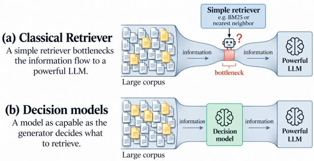
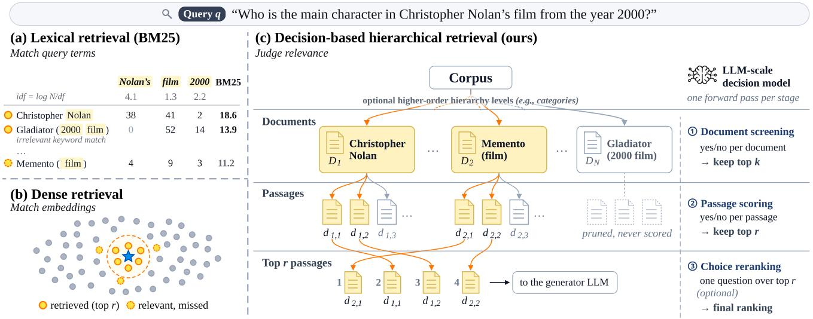
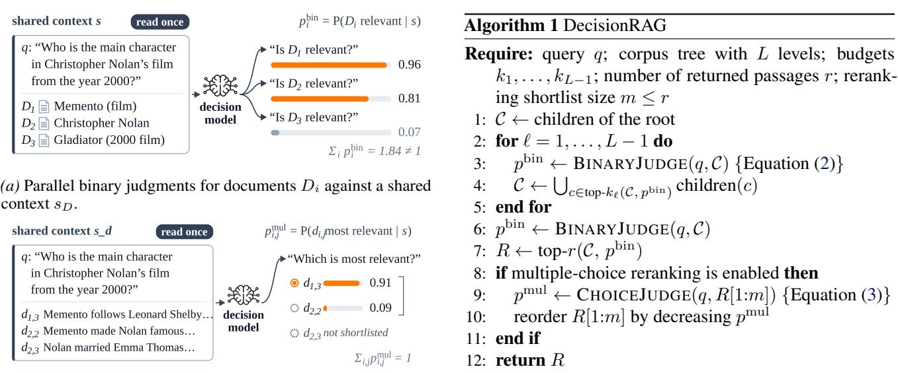
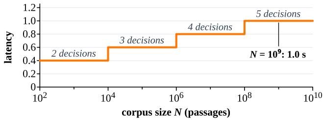
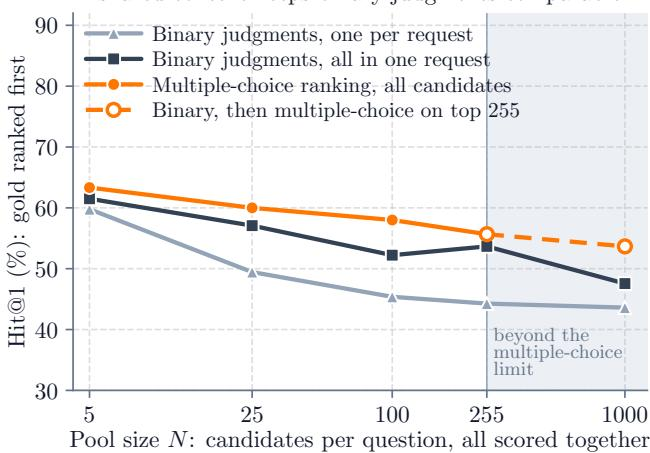
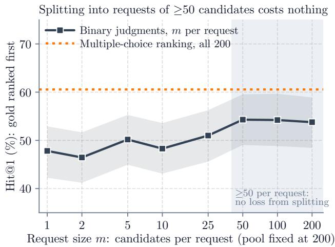
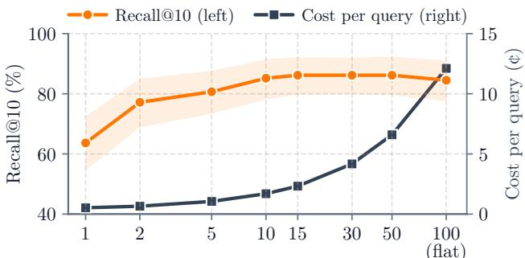

# Retriever-Free Retrieval: Navigating Documents with Decision Models

Chao Wan \* 1 Paul Junger ¨ \* 1 Beixi Du 1 Bodong Liu 1 Navaneetha Krishnan 2 Kilian Q. Weinberger 1 2

## Abstract

While language models have become dramatically more capable, retrieval still largely relies on lexical matching or similarity in fixed embedding spaces. This creates a capability asymmetry: what the retriever fails to find, even the strongest generator cannot recover. We propose DecisionRAG, which brings the capabilities of pretrained language models to retrieval using decision models that jointly evaluate candidate branches in a single forward pass, without generating any tokens, and show that judging candidates in a shared context makes their relevance estimates comparable. Like a person browsing a library, DecisionRAG navigates the corpus’s inherent structure from broad topics down to individual passages, deciding at each level which branches are worth exploring. Without task-specific training or a first-stage retriever, DecisionRAG outperforms dense retrieval with an 8B reranker by 13.8 R@1 points on MultiDoc2Dial and 17.4 Hit@1 points on Natural Questions. Across four benchmarks, including a corpus of 2.68 million Wikipedia paragraphs, retrieval takes just 0.7–1.8 seconds per query.

## 1. Introduction

Retrieval-augmented generation (RAG) has become a core component of modern language-model pipelines (Lewis et al., 2020; Guu et al., 2020; Gao et al., 2023b). By fetching evidence from an external corpus at inference time, RAG gives a model access to up-to-date information it never saw during training (Lewis et al., 2020; Vu et al., 2024) and grounds its responses in verifiable sources (Shuster et al., 2021; Gao et al., 2023a).

Yet, while the language generation models have become dramatically more capable (OpenAI, 2026; Anthropic, 2026), the retrievers that decide what they see have not kept pace.

  
Figure 1. Capability asymmetry: a simple retriever bottlenecks a powerful LLM (a); decision models level the playing field (b).

Most retrieval systems still score each passage via heuristics based on term frequencies like BM25 (Robertson & Zaragoza, 2009), or by nearest neighbors in a fixed embedding space (Karpukhin et al., 2020; Izacard et al., 2022; Zhang et al., 2025). This creates a striking capability asymmetry between the retriever and the generation model (Figure 1): whatever the retriever misses, no amount of generator capability can recover (Barnett et al., 2024).

Ideally, a model as capable as the generator would decide what to retrieve. Agentic approaches let an LLM navigate the corpus step by step (Yao et al., 2023; Chen et al., 2023; Jin et al., 2025), but generating many tokens at every step in an agentic loop makes them too slow and costly for many applications (Jeong et al., 2024; Yang et al., 2026). Rerankers offer a cheaper middle ground (Nogueira & Cho, 2019; Sun et al., 2023; Reddy et al., 2024), but they can only reorder what a first-stage retriever has already returned.

Decision models have emerged as a new paradigm to leverage the power of pretrained language models quickly without sampling any tokens (TypeSafe AI, 2026; OpenAI, 2026; Li & Wagle, 2026). Given a context and a set of questions, a decision model such as Jev (TypeSafe AI, 2026) returns, for each question, a probability distribution over its answer options (for a yes/no question, P(yes)), answering many questions in parallel against a shared context in a single forward pass. This makes them a natural fit for retrieval, bringing the capability of LLMs to the choice of what to retrieve. Furthermore, scoring the candidates jointly makes their decisions comparable with one another (Chen et al., 2025; Gupta et al., 2025). Using decision models to choose what to retrieve thus promises to level the playing field

## between the retriever and generator.

We propose DecisionRAG, which retrieves by navigating instead of searching (Figure 2). Most corpora have an inherent structure of topics, documents, sections, and passages, which humans exploit to find information efficiently (Pirolli & Card, 1999). DecisionRAG leverages this structure through hierarchical decisions (Geva & Berant, 2018; Liu et al., 2021): at each level, a decision model jointly evaluates candidates to identify the most promising branches, progressively narrowing the search from broad categories (e.g. topics or document titles) down to individual passages. Each decision requires only a single forward pass without generating any tokens, keeping retrieval fast even for large corpora. DecisionRAG thus brings the capabilities of pretrained language models directly to retrieval, without a first-stage retriever at query time, a precomputed index, or task-specific training.

We evaluate DecisionRAG on four benchmarks spanning multi-turn dialogue (Feng et al., 2021; Katsis et al., 2025), scenario-based questions (Sun et al., 2022), and opendomain search over 2.68 million Wikipedia paragraphs (Kwiatkowski et al., 2019; Wang et al., 2024). Without task-specific training, DecisionRAG outperforms dense retrieval with an 8B reranker by 13.8 R@1 points on MultiDoc2Dial and 17.4 Hit@1 points on Natural Questions. Judging candidates in a shared context contributes to these gains, improving accuracy by up to 7.7 points over independent judgments (Section 6.1). Despite harnessing the capabilities of a language model at every stage, Decision-RAG retrieves in just 0.7–1.8 seconds at a cost of 0.2–2.3 cents per query. Compared with an LLM that generates navigation decisions over the same hierarchy token-by-token, it achieves comparable accuracy with 34–145 lower latency (Section 6.3). Training a dedicated 8B decision model on in-domain data further raises R@1 on MultiDoc2Dial to 60.7, surpassing the best compared published task-trained retriever by 5.7 points and suggesting substantial headroom as decision models improve.

## 2. Related Work

Traditional retrieval methods, including BM25 (Robertson & Zaragoza, 2009) and dense retrievers (Karpukhin et al., 2020), rank passages using lexical matching or learned embedding similarity. Neural reranking methods refine these rankings using language-model-based relevance estimates. Cross-encoders evaluate individual query–passage pairs (Nogueira et al., 2020), while LLM-based rerankers perform listwise ranking by generating permutations (Sun et al., 2023) or iteratively selecting candidates from subsets (Zhuang et al., 2024; Li et al., 2026). Although reranking can improve retrieval quality, it remains limited by the candidate recall of the initial retrieval stage.

An alternative line of work integrates language models directly into the retrieval process. Agentic approaches interleave reasoning with the use of search-engines to iteratively identify relevant evidence (Yao et al., 2023; Jin et al., 2025). Other methods use hierarchical representations to guide retrieval. MemWalker navigates a hierarchy of summaries constructed from long documents (Chen et al., 2023), while PageIndex uses document tables of contents for LLMguided navigation (VectifyAI, 2025). LATTICE extends hierarchical navigation to corpus-level retrieval, constructing a semantic tree and using LLM-generated relevance assessments to select branches at each level (Gupta et al., 2026). These approaches require generating tokens sequentially at each retrieval step, which can incur substantial latency when navigation involves multiple rounds of reasoning.

Recent work has explored more efficient approaches to language-model-based ranking. FIRST derives listwise rankings from the logits of a single generated identifier (Reddy et al., 2024), while ICR and BlockRank extract ranking signals from attention patterns over jointly presented candidates (Chen et al., 2025; Gupta et al., 2025). Decision models offer another approach to evaluating multiple candidates without generating tokens (TypeSafe AI, 2026; OpenAI, 2026). Given a shared context and a set of questions, these models produce probability distributions over the answer options of each question in a single forward pass. This enables parallel relevance judgments over multiple candidates, with each candidate evaluated against the same contextual information.

Hierarchical retrieval has also been studied as a means of reducing the search space in large document collections. DocQN learns to navigate document trees using reinforcement learning (Geva & Berant, 2018), while dense hierarchical retrieval progressively selects documents and passages using trained encoders (Liu et al., 2021). RAPTOR constructs a hierarchy of recursively generated summaries to support retrieval at different levels of abstraction (Sarthi et al., 2024). Related work has also highlighted the importance of document-level context for passage retrieval (Wang et al., 2024; Xu et al., 2025; Zhang et al., 2026).

DecisionRAG combines hierarchical retrieval with nongenerative relevance judgments. It uses existing document structure where available and constructs document groups otherwise (Section 4.1). Unlike conventional reranking pipelines, DecisionRAG does not require a first-stage retriever to construct a candidate pool. Unlike LLM-guided hierarchical search, it evaluates candidates at each level through parallel relevance judgments in a single forward pass, without generating tokens.

  
Figure 2. Retrieval by matching versus retrieval by decisions. (a) BM25 and (b) dense retrieval match query terms or embeddings and can miss the relevant page. (c) DecisionRAG walks the corpus hierarchy: a decision model judges all candidates of a level in one forward pass, keeping the top k documents and then the top r passages; pruned documents are never expanded. Term frequencies, IDF values, BM25 scores, and rankings in panel (a) are illustrative.

## 3. Method

## 3.1. Problem Formulation

We consider a corpus $\mathcal { D } = \{ D _ { 1 } , . . . , D _ { N } \}$ , where each document $D _ { i }$ consists of passages $d _ { i 1 } , \ldots , d _ { i M _ { i } }$ Given a query $q ,$ which may include the preceding dialogue turns, our goal is to retrieve the passages containing the evidence needed to answer it. (Figure 2) More generally, we view the corpus as a tree whose leaves are passages and whose internal nodes group them at increasing granularity, such as help centers, topic clusters, documents, or section headings. Each node has a short textual description: the text itself for a passage, the title for a document, and a one-sentence summary for a cluster. We call each depth of the tree a level and each round of requests to the decision model a stage; most levels take one stage, and the final reranking is a stage of its own. As a running example, we use the query

$$
\begin{array} { c } { { W h o ~ i s ~ t h e ~ m a i n ~ c h a r a c t e r ~ i n ~ C h r i s t o p h e r ~ N o l a n " s } } \\ { { f l m ~ f r o m ~ t h e ~ y e a r 2 0 0 0 ? } } \end{array}\tag{1}
$$

which can be answered by the Wikipedia corpus.

## 3.2. Relevance Judgments with Decision Models

Decision models such as Jev (TypeSafe AI, 2026) and OpenAI’s decision model (OpenAI, 2026) evaluate questions against a context and return probabilities over predefined answer options, without autoregressive generation. We use two of their inference modes, parallel binary judgments and multiple-choice judgments, both against a shared context s (Figure 3).

Parallel binary judgments. Given a shared context s and a set of binary questions ${ \mathcal { Q } } = \{ Q _ { 1 } , \ldots , Q _ { n } \}$ , the decision model evaluates all questions in parallel in a single forward pass. For each question $Q _ { i } ,$ , it produces a probability of answering “Yes”,

$$
p _ { i } ^ { \mathrm { b i n } } = P ( \mathrm { Y e s } \mid s , Q _ { i } ) .\tag{2}
$$

Each question is evaluated against the same context, but its answer probabilities are normalized only over “Yes” and $\mathbf { \ddot { \Delta } } ^ { 6 6 } \mathbf { N } \mathbf { 0 } ^ { 7 }$ , not across questions. Thus, the resulting scores need not sum to one. Binary judgments therefore impose no limit on the number of candidates beyond the model’s context length; larger levels are split across parallel requests (Section 3.4).

Multiple-choice judgments. Given a context $s ,$ a question Q, and a set of answer options $\mathcal { A } = \{ a _ { 1 } , \ldots , a _ { m } \}$ , the decision model produces a probability distribution over the options,

$$
p _ { i } ^ { \mathrm { m u l } } = P ( a _ { i } \mid s , Q , { \mathcal A } ) , \qquad \sum _ { i = 1 } ^ { m } p _ { i } ^ { \mathrm { m u l } } = 1 .\tag{3}
$$

Unlike parallel binary judgments, multiple-choice judgments evaluate the answer options as competing alternatives within a single decision. The number of answer options is limited (255 for Jev), so we apply this mode only to the top candidates from the binary judgments.

  
(b) Multiple-choice reranking of the top passages from the binary judgments against the same shared context s; the probabilities sum to one.  
Figure 3. The two judgment modes of a decision model, each against a shared context that the model reads once.

Judging candidates in a shared context. Because every question sees the same context, each probability is formed in view of the alternatives: a candidate that would look relevant on its own receives a lower P(Yes) when a clearly better one is present. The shared context thus puts the individual probabilities into perspective, making them comparable across candidates. Our ablations support this: scoring candidates together rather than separately improves R@1 on MultiDoc2Dial by 7.7 points and Hit@1 on Natural Questions by 6.5 points (Sections 6.1 and 6.2). They also show where the comparison matters: splitting a pool into smaller requests lowers Hit@1 but leaves R@10 unchanged. Scores from separate requests therefore suffice for screening, where recall counts, whereas the final ranking benefits from one shared request.

## 3.3. Hierarchical Retrieval

Rather than scoring every passage in the corpus individually, DecisionRAG progressively narrows the search space by traversing a corpus hierarchy. At each level, a decision model evaluates the candidates under consideration and retains the most promising ones for further exploration. Candidates not selected are pruned, and their descendants are never evaluated.

We illustrate this process in Figure 2 (c) using the running example in Equation (1).

Document screening. We first evaluate candidate documents using parallel binary judgments (Equation (2)). The shared context $s _ { D }$ contains the query and descriptions of all candidate documents, while each binary question asks whether a particular document is worth exploring for the query. As illustrated in Figure 3a, the model evaluates all candidates in a single forward pass, assigning each a relevance score. In our running example, the pages for Christopher Nolan and Memento (film) are retained, while Gladiator (2000 film) is discarded despite the latter’s keyword overlaps with the query. We retain the top k documents according to their relevance scores and prune the remaining branches.

Passage scoring. We next expand the retained documents into their passages and evaluate them using parallel binary judgments (Equation (2)). The shared context s now contains the query and all candidate passages, allowing the model to assess their relevance in view of one another, so that their probabilities are directly comparable (Section 3.2). We rank the passages by their binary relevance scores and keep the top r across all selected documents. On Natural Questions, where the paragraph stage spans 30 pages, each paragraph’s score is first multiplied by its page’s (Appendix B.5). In our running example, a passage from Memento (film) describing its protagonist, Leonard Shelby, provides the evidence needed to answer the query.

Optional passage reranking. To refine the final ranking, we optionally apply a multiple-choice judgment over the top m  r passages selected by binary scoring (Equation (3)). The choice context lists only these m passages (Appendix B.6). Their choice probabilities determine their order, while the remaining passages retain their binary ranking. We use m = 20, except on Natural Questions, where m = 5. On MTRAG, we instead promote only the highestprobability choice to rank one, preserving the relative order of all other passages. As illustrated in Figure 3b, the model compares the shortlisted passages as competing alternatives

within a single decision.

Binary judgments suit the inner levels: they have no option limit, run in parallel, and favor recall, which matters while the search narrows. The multiple-choice judgment is reserved for the end, where it compares the top passages from the binary judgments directly and sharpens the top rank (Section 6.4). Algorithm 1 summarizes the procedure for a hierarchy of any depth.

Budgets and pruning. Pruning is irreversible: a branch dropped at one level is not revisited for this query. The budgets $k _ { \ell }$ therefore lean towards recall, trading coverage for cost (Section 6.6). A budget can also be a probability threshold, e.g., keeping a runner-up help center whenever the top score is below 0.8 (Appendix B.2).

## 3.4. Hierarchy Construction and Scaling

Higher-order hierarchies. The document–passage hierarchy is only the simplest instance of DecisionRAG. For larger corpora, documents can be organized into higherorder groups, such as topics, categories, or products, using existing corpus structure or grouping related documents. The same procedure then applies recursively: at each level, parallel binary judgments identify promising groups, and only their children are evaluated at the next level. For example, when searching the full Wikipedia corpus, one could traverse categories related to films and Christopher Nolan before reaching the individual page for Memento. Thus, DecisionRAG extends to deeper hierarchies without requiring all documents to be evaluated at once. When a corpus lacks such structure, a hierarchy can be built offline by clustering document embeddings, e.g., with recursive k-means (Nister´ & Stewenius´ , 2006) or scalable agglomerative clustering (Bateni et al., 2017; Monath et al., 2021; Dhulipala et al., 2023), as we do for Natural Questions (Section 4.1). The tree need not be uniform: on MTRAG, a heading level is inserted only below pages with more than 60 passages.

Levels too large for one request. A level may hold more candidates than fit into one request; on Natural Questions, the 150 retained clusters contain about 17,500 page titles. We then split the level into parallel requests, each with its own shared context. This costs little: the benefit of the shared context levels off at about 50 candidates per request (Section 6.2), and pooled scores suffice for screening. Where the top candidates of a split level should be compared more closely, we rescore them in one request, as for the top 50 pages on MTRAG (Appendix B.4).

Combining with a retriever. DecisionRAG needs no firststage retriever, but it can use one: adding the top passages of a dense retriever to the final candidates recovers evidence that pruning discarded (+ dense candidates; Section 5.1).

Scaling with corpus size. Because all candidates of a level are judged in parallel, latency depends on how many levels the hierarchy has, not on how many passages the corpus holds. Assume a roughly balanced hierarchy in which every node groups at most b children, e.g., topics of 100 documents with 100 passages each. Every additional level then multiplies the number of reachable passages by up to $b ,$ so a corpus of $N$ passages needs about $\lceil \log _ { b } N \rceil$ levels. Each level adds one sequential decision, so the latency per query is

$$
T ( N ) \approx t _ { \mathrm { r e q } } \lceil \log _ { b } N \rceil ,\tag{4}
$$

where $t _ { \mathrm { r e q } } \approx 0 . 2 \mathrm { s }$ is the latency of one request. With $b = 1 0 0$ , even $1 0 ^ { 9 }$ passages need only five decisions, about one second (Figure 4). Cost, in contrast, grows with the number ofjudgments: b children for each of the k nodes kept per level. Equation (4) bounds the sequential depth rather than the total compute, but because each level keeps only its top k nodes, no level scores more than k b candidates.

  
Figure 4. Analytical model: sequential stages grow with the depth of the hierarchy, not the size of the corpus. Theoretic latency per query (Equation (4), b = 100), assuming a balanced hierarchy and enough serving capacity to judge every level in parallel: each 100 more passages adds one level, i.e., one more sequential decision ( 0.2 s).

## 4. Experimental Setup

We evaluate DecisionRAG on four benchmarks, ranging from help-center dialogues over 413 pages to open-domain questions over 108,626 Wikipedia pages (Table 1). Unless stated otherwise, we use the pretrained Jev decision model (TypeSafe’s Jev 1.13, typesafe/jev-1.13) (TypeSafe AI, 2026), without task-specific fine-tuning or a conventional first-stage retriever. We also evaluate task-trained, open-weight decision models in Section 5.3.

## 4.1. Datasets and Corpus Construction

MultiDoc2Dial (Feng et al., 2021) contains goal-oriented dialogues grounded in US government documentation. ConditionalQA (Sun et al., 2022) contains scenario-based questions about UK government guidance, often requiring evidence from multiple paragraphs. MTRAG (Katsis et al., 2025) evaluates conversational retrieval over technical documentation; we use its IBM Cloud subset. Natural Questions (Kwiatkowski et al., 2019) contains real search queries

Table 1. Overview of the four retrieval benchmarks: MultiDoc2Dial (Feng et al., 2021), ConditionalQA (Sun et al., 2022), MTRAG (Katsis et al., 2025) and Natural Questions (Kwiatkowski et al., 2019) in its DAPR version (Wang et al., 2024).
<table><tr><td>Dataset</td><td>Corpus hierarchy</td><td>Evaluation set</td><td>Gold evidence</td></tr><tr><td>MultiDoc2Dial</td><td>4 centers / 413 pages / 4,110 passages</td><td>4,201 turns</td><td>1 passage</td></tr><tr><td>ConditionalQA</td><td>652 pages / 58,483 paragraphs</td><td>285 questions (271 labeled)</td><td>1–22 paragraphs</td></tr><tr><td>MTRAG (IBM Cloud)</td><td>172 products / 8,578 pages / 72,442 passages</td><td>205 turns (188 labeled)</td><td>1–7 passages</td></tr><tr><td>Natural Questions (DAPR)</td><td>1,000 clusters / 108,626 pages / 2.68M paragraphs</td><td>500 test questions</td><td>1–3 paragraphs</td></tr></table>

grounded in Wikipedia.

For the first three datasets, we construct corpus hierarchies from the existing document structure and metadata. For Natural Questions, whose Wikipedia corpus lacks a hierarchy above the page, we cluster pages into 1,000 groups using k-means over e5-base-v2 embeddings (Wang et al., 2022) of page titles and first sentences. Each cluster is described by a one-sentence summary generated by Qwen3-8B (Team, 2025) from its page titles.

## 4.2. Retrieval Configurations

We select dataset-specific navigation hierarchies and retention budgets using separate design sets (Appendix A.5). For conversational benchmarks, we include the last six dialogue turns and maintain the notepad described in Appendix B.

On MultiDoc2Dial, we navigate a help center page passage hierarchy, retaining the top ten pages and scoring their passages alongside those from up to two notepad pages.

On ConditionalQA, we use a page  paragraph hierarchy, retaining the top three pages and jointly scoring their paragraphs.

On MTRAG, we use a page  heading  passage hierarchy, scoring all page titles in parallel, jointly rescoring the top 50 pages, and retaining the top ten. For long pages, we select relevant headings before scoring their passages.

On Natural Questions, we navigate a cluster  page paragraph hierarchy, retaining 150 of the 1,000 clusters, evaluating paragraphs from the top 30 pages.

All DecisionRAG (Jev) configurations finish with multiplechoice ranking of the top 20 passages (top five for Natural Questions); on MTRAG, only the selected passage is promoted to rank one. The + dense candidates variant adds the dense top 20 passages (top ten on ConditionalQA) to the final candidate pool. Additional routing rules and implementation details are provided in Appendix B.

We also evaluate task-trained decision models based on Qwen3-Base at 1.7B, 4B, and 8B parameters (Section 5.3). Architecture and training details are provided in Appendix G.

## 4.3. Baselines

We compare DecisionRAG with retrieval methods used without task-specific fine-tuning, as well as task-trained methods where available. The baselines are grouped as follows:

First-stage retrieval. We compare against BM25 with stemming and stopword removal, SPLADE++ (Formal et al., 2022), and Qwen3-Embedding-8B (Zhang et al., 2025). On ConditionalQA and MTRAG, the appendix also reports SPLADE-v3 with a DistilBERT encoder (Lassance et al., 2024) (Tables 11 and 12).

Reranking. We evaluate bge-reranker-v2-m3 (Chen et al., 2024; BAAI, 2024) and Qwen3-Reranker-8B on the top 100 passages retrieved by Qwen3-Embedding-8B. We also evaluate GPT-5 (OpenAI, 2026) with low reasoning effort, reranking the top 20 dense candidates using a RankGPTstyle prompt (Sun et al., 2023).

Published reference results. We include the Multi-Doc2Dial authors’ fine-tuned DPR (Karpukhin et al., 2020; Feng et al., 2021) and DPR with cross-encoder (Zhang et al., 2026), as well as the ELSER retrieval results released with MTRAG (Katsis et al., 2025). These results are included as references rather than rerun under our evaluation setup.

## 4.4. Evaluation Metrics and Protocol

We denote Recall@k as R@k and report conventional retrieval metrics on corresponding benchmarks in Table 2. Additional metrics are reported in the appendix (Appendix C).

To assess downstream question answering, we use Qwen3.5- 27B to answer each query from a system’s top five passages. We report exact match on ConditionalQA and Natural Questions and LLM-judged answer acceptance on MTRAG, whose references are long replies (Appendix C.1).

Confidence intervals are paired bootstrap 95% intervals (10,000 resamples of whole dialogues, conversations or questions). We also measure per-query cost and online latency (Appendix F).

Table 2. Retrieval without task-specific training on four benchmarks (%).
<table><tr><td></td><td colspan="2">MultiDoc2Dial</td><td colspan="2">ConditionalQA</td><td colspan="2">MTRAG</td><td colspan="3">Natural Questions</td></tr><tr><td>Method</td><td>R@1</td><td>R@10</td><td>Hit@1</td><td>R@10</td><td>R@5</td><td>nDCG@5</td><td>Hit@1</td><td>R@10</td><td>nDCG@10</td></tr><tr><td>Conventional retrieval pipelines</td><td></td><td></td><td></td><td></td><td></td><td></td><td></td><td></td><td></td></tr><tr><td>BM25</td><td>20.6</td><td>56.4</td><td>24.7</td><td>35.0</td><td>18.8</td><td>30.9</td><td>16.4</td><td>42.3</td><td>28.4</td></tr><tr><td>SPLADE++</td><td>24.4</td><td>58.8</td><td>28.4</td><td>38.3</td><td>27.8</td><td>47.1</td><td>36.0</td><td>74.6</td><td>54.5</td></tr><tr><td>Dense</td><td>27.9</td><td>70.9</td><td>47.2</td><td>54.0</td><td>26.0</td><td>46.5</td><td>46.2</td><td>87.2</td><td>66.0</td></tr><tr><td>Dense top-100 + BGE</td><td>22.8</td><td>63.9</td><td>53.1</td><td>60.6</td><td>14.5</td><td>25.3</td><td>54.8</td><td>88.7</td><td>71.7</td></tr><tr><td>Dense top-100 + Qwen3-Reranker</td><td>33.6</td><td>81.1</td><td>64.6</td><td>67.2</td><td>32.5</td><td>56.5</td><td>48.0</td><td>89.0</td><td>69.0</td></tr><tr><td>LLM-based listwise reranking</td><td></td><td></td><td></td><td></td><td></td><td></td><td></td><td></td><td></td></tr><tr><td>Dense top-20 + GPT-5</td><td>47.5</td><td>78.6</td><td>73.4</td><td>64.0</td><td>31.8</td><td>59.4</td><td>60.8</td><td>88.9</td><td>74.6</td></tr><tr><td>Decision-based retrieval (ours)</td><td></td><td></td><td></td><td></td><td></td><td></td><td></td><td></td><td></td></tr><tr><td>DecisionRAG (Jev)</td><td>47.4</td><td>83.6</td><td>69.7</td><td>71.9</td><td>34.2</td><td>62.3</td><td>65.4</td><td>86.7</td><td>76.0</td></tr><tr><td>DecisionRAG (Jev) + dense candidates</td><td>48.5</td><td>84.7</td><td>73.4</td><td>76.3</td><td>36.6</td><td>65.0</td><td>66.4</td><td>88.9</td><td>77.6</td></tr></table>

Dense: Qwen3-Embedding-8B; BGE: bge-reranker-v2-m3. Rerankers rerank the dense top 100, GPT-5 the dense top 20. + dense candidates adds the dense top 20 (top 10 on ConditionalQA) to its last stage. Natural Questions: all 2.68M paragraphs are searched. ‡MTRAG: gold and GPT-5-judged relevant passages, identical texts counted once (Appendix A.3); conventional baselines use their best input, the last turn (BGE: six turns).

## 5. Results

We evaluate DecisionRAG across four benchmarks, comparing its retrieval quality against conventional retrieval and reranking pipelines. We further assess downstream answer quality, the effects of task-specific training, and online latency and cost.

## 5.1. Retrieval Effectiveness

Without task-specific training or a conventional retrieval index, DecisionRAG substantially outperforms dense retrieval with an 8B reranker (Table 2): On MultiDoc2Dial, it improves R@1 by 13.8 percentage points, and on Natural Questions, it improves Hit@1 by 17.4 points.

Natural Questions also shows that DecisionRAG needs no ready-made hierarchy: Wikipedia’s 108,626 pages, far too many for one top level, are simply clustered into 1,000 groups (Section 4.1). DecisionRAG then reads only 16% of the page titles. Any corpus can be given a hierarchy this way, with a number of sequential stages that grows only logarithmically with its size (Equation (4) and Section 6.6).

Even when using a strong language model such as GPT-5 to rerank the dense retrieval results, DecisionRAG achieves comparable or higher rank-one accuracy on MultiDoc2Dial and Natural Questions (65.4 versus 60.8). It also improves ConditionalQA R@10 (71.9 versus 64.0) and MTRAG R@5 (34.2 versus 31.8), although GPT-5 achieves higher ConditionalQA Hit@1 (73.4 versus 69.7). On MTRAG, whose annotated evidence was collected with ELSER, we judge the top five passages of every system, and DecisionRAG ranks first among all eighteen, including last-turn and rewrittenquery baselines (R@5 34.2 versus 32.5 for the best baseline; Appendix A.3 and Table 12).

DecisionRAG can also complement dense retrieval by incorporating dense-retrieved passages into its final ranking stage. This combination improves R@10 from 83.6 to 84.7 on MultiDoc2Dial, from 71.9 to 76.3 on ConditionalQA, and from 86.7 to 88.9 on Natural Questions. These gains suggest that the two approaches recover complementary evidence and can be effectively combined.

## 5.2. Retrieval-Augmented Generation

Table 3. Answer quality of one generator (Qwen3.5-27B) given each system’s top five passages (%): exact match, and on MTRAG the share of replies judged correct (188 labeled turns). Qwen3-RR: Qwen3-Reranker-8B; NQ: Natural Questions.

<table><tr><td>Retrieval</td><td>ConditionalQA MTRAG EM Judged</td><td>NQ EM</td></tr><tr><td>None</td><td>1.8</td><td>6.4 26.9</td></tr><tr><td>Dense</td><td>43.5</td><td>31.4 53.0</td></tr><tr><td>Dense top-100 + Qwen3-RR</td><td>45.4</td><td>39.4 52.4</td></tr><tr><td>Dense top-20 + GPT-5</td><td>44.3</td><td>34.054.5</td></tr><tr><td>DecisionRAG (Jev)</td><td>46.9</td><td>44.1 54.2</td></tr><tr><td>+ dense candidates</td><td>47.6</td><td>47.3 54.8</td></tr><tr><td>Gold passages</td><td>49.4</td><td>60.1 65.3</td></tr></table>

We next ask whether the retrieved evidence improves downstream answers. We provide each method’s top five passages to the same generator model, Qwen3.5-27B (Section 4.4 and Table 3). The largest improvement occurs on MTRAG, where DecisionRAG increases judged answer correctness from 39.4% with Qwen3-Reranker to 44.1%. Adding dense candidates raises correctness further to 47.3%, compared with 34.0% for GPT-5 reranking. This configuration also achieves the highest exact match on Natural Questions (54.8%) and ConditionalQA (47.6%), where it approaches the performance ceiling set by the gold passages

(49.4%).

## 5.3. Learning a Retrieval Judge

The retrieval framework also supports task-trained, openweight decision models. We adapt Qwen3-8B using Multi-Doc2Dial training data (Appendix G). The resulting model achieves 60.7 R@1 on MultiDoc2Dial, exceeding the strongest published task-trained retriever by 5.7 points (Table 4). This demonstrates that the decision-based retrieval framework is not limited to the pretrained Jev model and can benefit from task-specific adaptation.

Table 4. Retrieval with task-trained methods (%).
<table><tr><td></td><td colspan="2">MultiDoc2Dial</td></tr><tr><td>Method</td><td>R@1</td><td>R@10</td></tr><tr><td>Task-trained conventional retrieval</td><td></td><td></td></tr><tr><td>DPR (Feng et al., 2021)P</td><td>49.0</td><td>80.0</td></tr><tr><td>SFRe2g (Zhang et al., 2026)P</td><td>55.0</td><td>83.2</td></tr><tr><td colspan="3">Task-trained decision-based retrieval (ours)</td></tr><tr><td>DecisionRAG (8B trained)</td><td>60.7</td><td>85.8</td></tr></table>

pPublished results, not reruns.

## 5.4. Latency and Cost

Table 5. Median latency (seconds) and API cost per query. DecisionRAG rows are live, one query at a time, without reused answers; GPT-5 covers reranking only. Dense top-100 + Qwen3- RR is served locally on one NVIDIA RTX A6000. Qwen3-RR: Qwen3-Reranker-8B; NQ: Natural Questions.
<table><tr><td colspan="3">MD2D CQA MTRAG NQ</td></tr><tr><td>Median latency (s)</td><td></td><td></td></tr><tr><td>Dense top-100 + Qwen3-RR Dense top-20 + GPT-5</td><td>7.5 3.3 11.8 14.4</td><td>14.3 5.8 12.2 15.0</td></tr><tr><td>DecisionRAG (Jev) + dense candidates</td><td>0.68 0.82 0.70 0.85</td><td>1.76 1.73 1.73 1.64</td></tr><tr><td>API cost per query (¢)</td><td></td><td></td></tr><tr><td>Dense top-20 + GPT-5</td><td>1.401.20</td><td>1.901.40</td></tr><tr><td>DecisionRAG (Jev)</td><td>0.22 0.29</td><td>1.73 2.33</td></tr><tr><td>+ dense candidates</td><td>0.23 0.29</td><td>1.75 2.33</td></tr></table>

Finally, we measure retrieval latency and API cost (Table 5 and Appendix F). Under the measured serving configurations, DecisionRAG completes retrieval in 0.68–1.76 seconds per query, compared with 3.3–14.3 seconds for dense retrieval with Qwen3-Reranker-8B on one GPU and 11.8–15.0 seconds for GPT-5 reranking.

API costs range from 0.22¢ per query on MultiDoc2Dial to 2.33¢ on Natural Questions. Despite the much larger Natural Questions corpus, its measured latency is comparable to MTRAG (1.73 versus 1.76 seconds), illustrating how hierarchical structures can reduce retrieval latency (Equation (4)).

## 6. Understanding DecisionRAG

What makes decision-based retrieval effective? We examine how shared context sharpens relevance judgments, when multiple-choice ranking helps, and how navigation strategies and budgets trade off retrieval quality against efficiency.

## 6.1. Scoring Candidates in a Shared Context

A central design choice of DecisionRAG is to judge candidates against a shared context rather than independently. For Natural Questions design questions, we build pools of 5 to 1,000 candidates from the gold paragraph and hard negatives retrieved by BM25, SPLADE-v3, and e5 (Figure 5). Sharedcontext binary judgments consistently outperform scoring each candidate in a separate request, and multiple-choice ranking performs best within its 255-option limit. Beyond that limit, multiple-choice ranking of the binary top 255 retains much of this advantage: 53.7% Hit@1 with 1,000 candidates versus 47.6% for binary judgments alone.

A shared context keeps binary judgments comparable  
  
Figure 5. Hit@1 on Natural Questions as the candidate pool grows, with all N candidates scored in one request (150 questions).

The advantage carries over to the full pipeline: on Multi-Doc2Dial, scoring the passages of all selected pages together rather than page by page raises R@1 from 36.7% to 44.4% (+7.7 points, 95% CI: [3.3, 12.2]; Appendix D.1).

## 6.2. Request Size

In a shared context, each probability is formed in view of the alternatives: a candidate that would look relevant on its own receives a lower P(Yes) when a clearly better one is present. The shared context thus puts the individual probabilities into perspective, making them comparable across candidates. We analyze how this calibration improves as the number of candidates in the context increases.

To this end, we fix the pool at 200 candidates and split it into requests of varying sizes (Figure 6). Hit@1 increases from

47.8% when each candidate is scored separately to 54.3% with 50 candidates per request, with little further improvement for larger requests, so large pools can be split into parallel requests of about 50 candidates without loss. Multiplechoice ranking of all 200 candidates reaches 60.6%, another 6.8 points above binary judgments of all 200 in one request (95% CI: [2.5, 11.0]).

  
Figure 6. Hit@1 on Natural Questions when a fixed pool of 200 candidates is split into requests of m candidates and ranked together (289 questions; band: 95% interval).

## 6.3. Decisions versus Generation

Prior work also navigates hierarchies with language models, but lets a generative LLM decide at each level via generating tokens (Chen et al., 2023; VectifyAI, 2025; Gupta et al., 2026). To isolate the effect of deciding by parallel judgments instead of generation, we keep DecisionRAG’s hierarchy and budgets fixed and replace its decision model by GPT-5 (low reasoning effort), which reads the candidates of each level and writes out the numbers of those to keep, in the style of LATTICE (Gupta et al., 2026). On ConditionalQA it selects 3 of the 652 pages and ranks their paragraphs; on Natural Questions it selects 150 of the 1,000 clusters (when it lists fewer, we ask for the rest in the same conversation), then 30 pages from their titles, and ranks the paragraphs of the top pages as DecisionRAG does.

Generating the decisions token-by-token brings no consistent gain in accuracy (Table 6): GPT-5 leads DecisionRAG by 4.1 Hit@1 points on ConditionalQA, a gap that adding dense candidates closes, and trails it by 6.0 points on Natural Questions, while being 34 to 145 times slower and 21 to 25 times more expensive, because it must read and reason over every candidate of a level before naming them sequentially token-by-token.

Table 6. The same hierarchy, decided by generation versus decisions. Latency: median seconds per query; cost: cents per query. Natural Questions: the first 100 test questions of Table 2.
<table><tr><td></td><td>Hit@1</td><td>R@10</td><td>S</td><td>¢</td></tr><tr><td>ConditionalQA</td><td></td><td></td><td></td><td></td></tr><tr><td>GPT-5, generative</td><td>73.8</td><td>73.6</td><td>28.2</td><td>6.1</td></tr><tr><td>DecisionRAG + dense candidates</td><td>69.7</td><td>71.9</td><td>0.82</td><td>0.29</td></tr><tr><td></td><td>73.4</td><td>76.3</td><td>0.85</td><td>0.29</td></tr><tr><td>Natural Questions</td><td></td><td></td><td></td><td></td></tr><tr><td>GPT-5, generative</td><td>59.0</td><td>82.5</td><td>250.8</td><td>57.2</td></tr><tr><td>DecisionRAG</td><td>65.0</td><td>86.5</td><td>1.73</td><td>2.33</td></tr><tr><td>+ dense candidates</td><td>64.0</td><td>88.5</td><td>1.64</td><td>2.33</td></tr></table>

## 6.4. Does Multiple-Choice Ranking Improve Retrieval?

After the binary judgments, DecisionRAG optionally applies multiple-choice ranking to the top candidates to refine the final ranking. We examine whether this additional step improves retrieval beyond parallel binary judgments alone.

On MultiDoc2Dial and ConditionalQA design data, we compare configurations with and without multiple-choice ranking while keeping the candidate pool and preceding binary judgments fixed. Multiple-choice ranking improves Multi-Doc2Dial R@1 from 50.1% to 51.3% and ConditionalQA Hit@1 from 71.9% to 76.5% (Table 7). Both configurations include additional dense retrieval candidates.

Table 7. Multiple-choice ranking on design data (%; Multi-Doc2Dial: 1,832 turns, ConditionalQA: 285 questions). Multiplechoice ranking reorders the top 20 passages, with only these passages in its context (Appendix B.6).
<table><tr><td>Dataset Metric</td><td>only</td><td>Binary + Multiple- choice</td></tr><tr><td>MultiDoc2Dial R@1</td><td>50.1</td><td>51.3</td></tr><tr><td>ConditionalQA Hit@1</td><td>71.9</td><td>76.5</td></tr><tr><td></td><td></td><td></td></tr></table>

The additional request takes 0.12–0.15 seconds and increases API cost by 4–33%, making multiple-choice ranking a cheap final step that sharpens the top rank.

## 6.5. Navigation versus Reranking

Do the gains come from navigating the hierarchy or from the decision model itself? We give Jev the top 100 passages of dense retrieval (Qwen3-Embedding-8B) and score them as DecisionRAG’s last stage does: binary judgments in one shared context, followed by multiple-choice ranking of the top 20 (top five on Natural Questions). We compare this reranker with DecisionRAG.

Navigating the hierarchy outperforms reranking the retriever’s candidates (Table 8): Hit@1 rises by 7.7 points on ConditionalQA (95% CI: [2.6, 13.3]) and by 7.0 points on Natural Questions ([3.4, 10.8]), while MultiDoc2Dial and MTRAG are level. Even without any retrieval index, DecisionRAG (Table 2) improves Hit@1 over the reranker by 6.0 points on Natural Questions ([2.4, 9.8]) and by 4.0 points on ConditionalQA. This holds although the dense top 100 contains the gold evidence more often than the navigated candidates (Natural Questions: 98.4% versus 94.0%; ConditionalQA: 98.5% versus 91.1%): when both contain it, navigation ranks it first more often (70.1% versus 61.9% and 76.7% versus 67.3%), plausibly because it presents whole pages in reading order rather than isolated passages.

Table 8. Jev reranking the dense top 100 versus DecisionRAG with dense candidates, both using the same dense index (%). MD2D: MultiDoc2Dial, seeded sample of 1,000 validation turns; CQA: ConditionalQA; MTRAG: official labels; NQ: Natural Questions.
<table><tr><td colspan="2"></td><td>Dense top-100 + Jev Rerank</td><td>DecisionRAG + dense candidates</td></tr><tr><td colspan="2">MD2D</td><td>49.9</td><td>51.2</td></tr><tr><td rowspan="3">CQA</td><td>R@1 R@10</td><td>86.6</td><td>85.6</td></tr><tr><td>Hit@1</td><td>65.7</td><td>73.4</td></tr><tr><td>R@10</td><td>68.2</td><td>76.3</td></tr><tr><td rowspan="2">MTRAG</td><td>R@5</td><td>38.3</td><td>38.7</td></tr><tr><td>nDCG@5</td><td>36.8</td><td>35.7</td></tr><tr><td rowspan="3">NQ</td><td>Hit@1</td><td>59.4</td><td>66.4</td></tr><tr><td>nDCG@10</td><td>72.2</td><td>77.6</td></tr><tr><td></td><td></td><td></td></tr></table>

## 6.6. Navigation Budget and Hierarchy

Finally, we examine how the navigation budget affects retrieval.

Pruning at the top level is what keeps navigation cheap on large corpora, but it is also where evidence can be lost: a page in a discarded cluster can never be retrieved. We investigate how many clusters must be kept to match the recall of scoring every page directly, varying the share of the 1,000 Natural Questions clusters that DecisionRAG keeps up to flat scoring of all 108,626 page titles (Figure 7). Recall@10 rises steeply up to about 10% of the clusters and then stays level: keeping 15% matches flat scoring (86.2% versus 84.5%) at a fifth of the cost (2.3¢ versus 12.1¢ per query) and a third of the latency (1.7 versus 4.5 seconds). Below 5%, the cluster holding the gold page is often discarded, and recall@10 falls to 63.7% at 1%.

The same trade-off appears one level down, in the page budget. On MultiDoc2Dial, we increase the number of newly retained pages from three to ten, keeping the remaining configuration fixed. R@10 improves from 81.0% to 83.6%, while R@1 increases only from 46.9% to 47.4% (Table 9). The larger budget increases API cost by 83% and median latency by 28%. Exploring more pages therefore primarily improves evidence coverage, with diminishing returns for the top-ranked passage.

  
Clusters kept at the top level (% of 1,000, log scale)  
Figure 7. Recall@10 (left axis) and Jev cost per query (right axis) on Natural Questions as the top level keeps more and more clusters. First 100 test questions of Table 2; band: 95% interval.

Table 9. Page budget on MultiDoc2Dial (validation, with multiplechoice ranking).
<table><tr><td>New pages</td><td>R@1 (%)</td><td>R@10 (%)</td><td>API cost (¢/query)</td><td>Median time (s)</td></tr><tr><td>3</td><td>46.9</td><td>81.0</td><td>0.12</td><td>0.53</td></tr><tr><td>10</td><td>47.4</td><td>83.6</td><td>0.22</td><td>0.68</td></tr></table>

## 7. Limitations

DecisionRAG relies on a corpus hierarchy whose structure and node descriptions allow the decision model to identify relevant branches. Poorly organized documents or uninformative descriptions can therefore hurt retrieval quality. Moreover, navigation prunes branches irreversibly, so relevant passages may be missed if their ancestors are discarded; we show that larger exploration budgets and complementary dense retrieval can mitigate this.

## 8. Conclusion

We introduced DecisionRAG, which brings the capabilities of large language models into retrieval by navigating corpus hierarchies with non-generative decisions. At each level, candidates are evaluated jointly in a shared context, allowing their relevance to be judged in view of one another. By progressively narrowing the search space, DecisionRAG retrieves relevant evidence with a number of sequential decisions that grows only logarithmically with corpus size under a balanced hierarchy. As decision models improve, retrieval can inherit their capabilities directly.

## Acknowledgements

This work was supported by the National Science Foundation (NSF) under grants OAC-2118310 and IIS-2530143, through the AI Research Institutes program (Award No. DMR-2433348), by NewYork-Presbyterian for the NYP-Cornell Cardiovascular AI Collaboration, and by arXiv.

## References

Anthropic. Claude Opus 5.5. https://www. anthropic.com/claude, 2026.

BAAI. bge-reranker-v2-m3. Hugging Face model card, 2024. URL https://huggingface.co/BAAI/ bge-reranker-v2-m3.

Barnett, S., Kurniawan, S., Thudumu, S., Brannelly, Z., and Abdelrazek, M. Seven failure points when engineering a retrieval augmented generation system. In CAIN, pp. 194–199. ACM, 2024.

Bateni, M., Behnezhad, S., Derakhshan, M., Hajiaghayi, M., Kiveris, R., Lattanzi, S., and Mirrokni, V. S. Affinity clustering: Hierarchical clustering at scale. In NIPS, pp. 6864–6874, 2017.

Chen, H., Pasunuru, R., Weston, J., and Celikyilmaz, A. Walking down the memory maze: Beyond context limit through interactive reading. CoRR, abs/2310.05029, 2023.

Chen, J., Xiao, S., Zhang, P., Luo, K., Lian, D., and Liu, Z. M3-embedding: Multi-linguality, multifunctionality, multi-granularity text embeddings through self-knowledge distillation. In ACL (Findings), volume ACL 2024 of Findings ofACL, pp. 2318–2335. Association for Computational Linguistics, 2024.

Chen, S., Gutierrez, B. J., and Su, Y. Attention in large language models yields efficient zero-shot re-rankers. In ICLR. OpenReview.net, 2025.

Dhulipala, L., Lacki, J., Lee, J., and Mirrokni, V. Terahac: Hierarchical agglomerative clustering of trillion-edge graphs. Proc. ACM Manag. Data, 1(3):221:1–221:27, 2023.

Feng, S., Patel, S. S., Wan, H., and Joshi, S. Multidoc2dial: Modeling dialogues grounded in multiple documents. In EMNLP (1), pp. 6162–6176. Association for Computational Linguistics, 2021.

Formal, T., Lassance, C., Piwowarski, B., and Clinchant, S. From distillation to hard negative sampling: Making sparse neural IR models more effective. In SIGIR, pp. 2353–2359. ACM, 2022.

Gao, T., Yen, H., Yu, J., and Chen, D. Enabling large language models to generate text with citations. In EMNLP, pp. 6465–6488. Association for Computational Linguistics, 2023a.

Gao, Y., Xiong, Y., Gao, X., Jia, K., Pan, J., Bi, Y., Dai, Y., Sun, J., Guo, Q., Wang, M., and Wang, H. Retrievalaugmented generation for large language models: A survey. CoRR, abs/2312.10997, 2023b.

Geva, M. and Berant, J. Learning to search in long documents using document structure. In COLING, pp. 161– 176. Association for Computational Linguistics, 2018.

Gupta, N., You, C., Bhojanapalli, S., Kumar, S., Dhillon, I. S., and Yu, F. X. Scalable in-context ranking with generative models. In NeurIPS, 2025.

Gupta, N., Chang, W., Bui, N., Hsieh, C., and Dhillon, I. S. Llm-guided hierarchical search for end-to-end reasoning intensive retrieval. Trans. Mach. Learn. Res., 2026, 2026.

Guu, K., Lee, K., Tung, Z., Pasupat, P., and Chang, M. Retrieval augmented language model pre-training. In ICML, volume 119 of Proceedings of Machine Learning Research, pp. 3929–3938. PMLR, 2020.

Izacard, G., Caron, M., Hosseini, L., Riedel, S., Bojanowski, P., Joulin, A., and Grave, E. Unsupervised dense information retrieval with contrastive learning. Trans. Mach. Learn. Res., 2022, 2022.

Jeong, S., Baek, J., Cho, S., Hwang, S. J., and Park, J. C. Adaptive-rag: Learning to adapt retrieval-augmented large language models through question complexity. In NAACL-HLT, pp. 7036–7050. Association for Computational Linguistics, 2024.

Jin, B., Zeng, H., Yue, Z., Wang, D., Zamani, H., and Han, J. Search-r1: Training llms to reason and leverage search engines with reinforcement learning. CoRR, abs/2503.09516, 2025.

Karpukhin, V., Oguz, B., Min, S., Lewis, P., Wu, L., Edunov, S., Chen, D., and Yih, W. Dense passage retrieval for open-domain question answering. In EMNLP (1), pp. 6769–6781. Association for Computational Linguistics, 2020.

Katsis, Y., Rosenthal, S., Fadnis, K., Gunasekara, C., Lee, Y., Popa, L., Shah, V., Zhu, H., Contractor, D., and Danilevsky, M. mtrag: A multi-turn conversational benchmark for evaluating retrieval-augmented generation systems. Trans. Assoc. Comput. Linguistics, 13:784–808, 2025.

Kwiatkowski, T., Palomaki, J., Redfield, O., Collins, M., Parikh, A. P., Alberti, C., Epstein, D., Polosukhin, I., Devlin, J., Lee, K., Toutanova, K., Jones, L., Kelcey, M., Chang, M., Dai, A. M., Uszkoreit, J., Le, Q., and Petrov, S. Natural questions: a benchmark for question answering research. Trans. Assoc. Comput. Linguistics, 7:452–466, 2019.

Lassance, C., Dejean, H., Formal, T., and Clinchant,´ S. Splade-v3: New baselines for SPLADE. CoRR, abs/2403.06789, 2024.

Lewis, P., Perez, E., Piktus, A., Petroni, F., Karpukhin, V., Goyal, N., Kuttler, H., Lewis, M., Yih, W., Rockt¨ aschel,¨ T., Riedel, S., and Kiela, D. Retrieval-augmented generation for knowledge-intensive NLP tasks. In NeurIPS, 2020.

Li, H., Yu, C., Leelanupab, T., Koopman, B., and Zuccon, G. Whole-pool setwise reranking with long-context language models. CoRR, abs/2606.01782, 2026.

Li, Y. and Wagle, J. LLM-as-Jev: LLMs are already Jev-Style decision models – when and how to Fine-Tune them. arXiv preprint arXiv:2610.02076, 2026. URL https://arxiv.org/abs/2610.02076.

Liu, Y., Hashimoto, K., Zhou, Y., Yavuz, S., Xiong, C., and Yu, P. S. Dense hierarchical retrieval for opendomain question answering. In EMNLP (Findings), volume EMNLP 2021 of Findings of ACL, pp. 188–200. Association for Computational Linguistics, 2021.

Monath, N., Dubey, K. A., Guruganesh, G., Zaheer, M., Ahmed, A., McCallum, A., Mergen, G., Najork, M., Terzihan, M., Tjanaka, B., Wang, Y., and Wu, Y. Scalable hierarchical agglomerative clustering. In KDD, pp. 1245– 1255. ACM, 2021.

Nister, D. and Stew´ enius, H. Scalable recognition with´ a vocabulary tree. In CVPR (2), pp. 2161–2168. IEEE Computer Society, 2006.

Nogueira, R. and Cho, K. Passage re-ranking with BERT. CoRR, abs/1901.04085, 2019.

Nogueira, R., Jiang, Z., Pradeep, R., and Lin, J. Document ranking with a pretrained sequence-to-sequence model. In EMNLP (Findings), volume EMNLP 2020 of Findings of ACL, pp. 708–718. Association for Computational Linguistics, 2020.

OpenAI. GPT-6 Luna decisions model. OpenRouter model openai/gpt-6-luna-decisions, snapshot 2026- 10-06, 2026.

OpenAI. Openai GPT-5 system card. CoRR, abs/2601.03267, 2026.

Pirolli, P. and Card, S. Information foraging. Psychological Review, 106(4):643–675, 1999.

Reddy, R. G., Doo, J., Xu, Y., Sultan, M. A., Swain, D., Sil, A., and Ji, H. FIRST: faster improved listwise reranking with single token decoding. In EMNLP, pp. 8642–8652. Association for Computational Linguistics, 2024.

Robertson, S. E. and Zaragoza, H. The probabilistic relevance framework: BM25 and beyond. Found. Trends Inf. Retr., 3(4):333–389, 2009.

Rosenthal, S., Katsis, Y., Shah, V., He, L., Popa, L., and Danilevsky, M. MTRAG-UN: A benchmark for open challenges in multi-turn RAG conversations. In ACL (Findings), pp. 10363–10369. Association for Computational Linguistics, 2026.

Sarthi, P., Abdullah, S., Tuli, A., Khanna, S., Goldie, A., and Manning, C. D. RAPTOR: recursive abstractive processing for tree-organized retrieval. In ICLR. OpenReview.net, 2024.

Shuster, K., Poff, S., Chen, M., Kiela, D., and Weston, J. Retrieval augmentation reduces hallucination in conversation. In EMNLP (Findings), volume EMNLP 2021 of Findings ofACL, pp. 3784–3803. Association for Computational Linguistics, 2021.

Sun, H., Cohen, W. W., and Salakhutdinov, R. Conditionalqa: A complex reading comprehension dataset with conditional answers. In ACL (1), pp. 3627–3637. Association for Computational Linguistics, 2022.

Sun, W., Yan, L., Ma, X., Wang, S., Ren, P., Chen, Z., Yin, D., and Ren, Z. Is chatgpt good at search? investigating large language models as re-ranking agents. In EMNLP, pp. 14918–14937. Association for Computational Linguistics, 2023.

Team, Q. Qwen3 technical report. CoRR, abs/2505.09388, 2025.

TypeSafe AI. Jev 1.13: a decision model. https:// openrouter.ai/typesafe/jev-1.13, 2026.

VectifyAI. PageIndex: Document index for reasoningbased RAG. Software repository, 2025. URL https: //github.com/VectifyAI/PageIndex.

Vu, T., Iyyer, M., Wang, X., Constant, N., Wei, J. W., Wei, J., Tar, C., Sung, Y., Zhou, D., Le, Q. V., and Luong, T. Freshllms: Refreshing large language models with search engine augmentation. In ACL (Findings), volume ACL 2024 of Findings ofACL, pp. 13697–13720. Association for Computational Linguistics, 2024.

Wang, K., Reimers, N., and Gurevych, I. DAPR: A benchmark on document-aware passage retrieval. In ACL (1), pp. 4313–4330. Association for Computational Linguistics, 2024.

Wang, L., Yang, N., Huang, X., Jiao, B., Yang, L., Jiang, D., Majumder, R., and Wei, F. Text embeddings by weakly-supervised contrastive pre-training. CoRR, abs/2212.03533, 2022.

Xu, L., Feng, C., Zhang, K., Zhengyong, L., Xu, W., and Meng, F. Equipping retrieval-augmented large language models with document structure awareness. In EMNLP

(Findings), pp. 24608–24631. Association for Computational Linguistics, 2025.

Yang, T., Yao, Z., Jin, B., Cui, L., Li, Y., Wang, G., Liu, X., and Neiswanger, W. Demystifying and enhancing the efficiency of large language model based search agents. In ICLR. proceedings.iclr.cc, 2026.

Yao, S., Zhao, J., Yu, D., Du, N., Shafran, I., Narasimhan, K. R., and Cao, Y. React: Synergizing reasoning and acting in language models. In ICLR. OpenReview.net, 2023.

Zhang, Y., Li, M., Long, D., Zhang, X., Lin, H., Yang, B., Xie, P., Yang, A., Liu, D., Lin, J., Huang, F., and Zhou, J. Qwen3 embedding: Advancing text embedding and reranking through foundation models. CoRR, abs/2506.05176, 2025.

Zhang, Y., Fu, H., Zhang, X., and Nguyen, C. Structures facilitate retrieve, rerank, and generate. CoRR, abs/2606.03247, 2026.

Zhuang, S., Zhuang, H., Koopman, B., and Zuccon, G. A setwise approach for effective and highly efficient zeroshot ranking with large language models. In SIGIR, pp. 38–47. ACM, 2024.

## A. Dataset and Corpus Details

## A.1. MultiDoc2Dial

MultiDoc2Dial (Feng et al., 2021) contains goal-oriented dialogues grounded in 488 documents from four US government help centers. We build a help-center–page–passage hierarchy from the dataset’s metadata. Help centers are given by the domain field, and documents sharing a title after removing the #1/#2 part suffix form one page, giving 413 pages. We use the benchmark’s official structure-based segmentation into 4,110 passages.

Passages are represented by their full text and their page and parent-heading path, pages by their titles and section headings, and the four help centers by one-line descriptions written manually from their names. We evaluate on the official validation split (661 dialogues, 4,201 turns). Each turn has one gold passage containing the grounding span of the agent’s response. The released test split provides no usable evaluation examples.

## A.2. ConditionalQA

ConditionalQA (Sun et al., 2022) contains scenario-based questions about UK government guidance whose answers may depend on several conditions and paragraphs. Its corpus contains 652 guides. We recover their structure from the HTML headings (h1, h2) and extract 58,483 paragraph-level units from p, li and tr elements. Pages are represented by their titles and top-level part headings, and paragraphs are grouped under their heading paths. Retrieval searches the full corpus rather than assuming the relevant guide is known. We evaluate on the 285 questions of the labeled development split, 271 o which have annotated evidence (about four paragraphs on average).

## A.3. MTRAG–IBM Cloud

We use the IBM Cloud subset of MTRAG (Katsis et al., 2025), with 8,578 documentation pages and 72,442 passages, keeping the benchmark’s document files and passage chunks. Pages are grouped into 172 products by the first path segment after /docs/ in their URLs. Because the corpus does not preserve HTML markup, we recover section headings from the text layout (short lines separated by blank lines). Pages are represented by their titles and recovered headings, and passages by their text and heading. Product descriptions are built automatically from the product name, the opening of its landing page and three page titles.

The held-out evaluation set contains 26 human-written conversations with 205 turns, 188 of which have annotated evidence (one to seven gold passages).

Expanded relevance judgments. MTRAG’s gold passages were selected from the annotators’ ELSER retrieval sessions, so relevant passages that ELSER did not surface cannot be gold. We therefore add LLM-judged relevant passages to the gold passages. For each turn, we pool the top five passages of all 18 systems evaluated on MTRAG, including released ELSER and the last-turn and rewritten-query baselines, together with the gold passages, representing identical texts once. GPT-5 receives the conversation, the reference reply and the shuffled candidates, without knowing which system retrieved them, and grades each passage as needed for the answer (2), related but insufficient (1) or unrelated (0). Grade-2 passages are added to the relevance set, and all original gold passages are kept. GPT-5 grades 87.9% of the gold passages as needed. The expanded labels reduce the dependence on ELSER. Table 12 compares all systems.

## A.4. Natural Questions

We use the DAPR version (Wang et al., 2024) of Natural Questions (Kwiatkowski et al., 2019), whose corpus splits 108,626 Wikipedia pages into 2,682,017 paragraphs. We evaluate on a fixed random sample of 500 of the 3,610 questions in DAPR’s test split, which is drawn from NQ’s development set. A question’s gold paragraphs (one to three) lie on a single page. Since Wikipedia has no structure above the page, we cluster the pages into 1,000 groups with k-means over e5-base-v2 embeddings (Wang et al., 2022) of each page’s title and first sentence. Groups hold 15 to 350 pages (median 106). Each group is described by one sentence that Qwen3-8B writes from its page titles (Appendix B.5). Pages are represented by their titles and paragraphs by their text, grouped under their page title.

## A.5. Design Sets and Configuration Selection

Retrieval configurations (candidate representations, routing rules and retention budgets) are selected on design sets that are disjoint from the evaluation sets. Selection does not update the parameters of Jev. MultiDoc2Dial uses samples of its training split and ConditionalQA 300 training questions. MTRAG has no training split, so we use 50 synthetic IBM Cloud conversations (292 turns) and 131 IBM Cloud turns from MTRAG-UN (Rosenthal et al., 2026), whose conversations are disjoint from the evaluation set.

## B. Retrieval Configuration Details

## B.1. Candidate Representations and Questions

At each stage, the judge receives a context containing the query and the numbered candidate descriptions, followed by one yes/no question per candidate. Candidates are listed in document order and grouped under their parent pages where applicable. Each stage builds a new context; probabilities from earlier stages are not included. Conversational queries contain the six most recent dialogue turns.

For conversational retrieval, the page and passage questions are “Is the information the agent needs for its next reply on Page n?” and “Should the agent’s next reply be based on Passage n?” For ConditionalQA and Natural Questions, they are “Is the information needed to answer the user’s question on Page n?” and “Does Paragraph n contain information needed to answer the user’s question?”

## B.2. MultiDoc2Dial and the Conversational Notepad

The routing context describes the four help centers, with one question per center. We keep the highest-scoring center, the runner-up if the top probability is below 0.8, and the center of the most recently retrieved page. The page stage scores the pages of the kept centers and keeps ten. All passages of these pages, plus those of the two most recent notepad pages, are scored in one shared context.

The notepad, used on MultiDoc2Dial and MTRAG, lists distinct page identifiers by most recent retrieval. After each turn, the page of the top-ranked passage moves to the front. The page-stage context lists the notepad pages. The notepad is built only from the system’s own retrieval decisions, never from gold evidence, and previously retrieved passages are neither marked nor excluded.

## B.3. ConditionalQA

The page stage scores all 652 guides in one request and keeps three, whose paragraphs are scored together under their heading paths.

## B.4. MTRAG

The main configuration scores pages directly instead of routing through products. In a first pass, all 8,578 page titles are split into parallel requests under the input-size limit, keeping each product’s pages together, and the top 50 pages by pooled score are kept. Because these scores come from different contexts, a second pass rescores the 50 together with their product names and headings, and keeps ten.

Pages with more than 60 passages pass through an extra stage that scores their headings and keeps the top eight. At most 60 passages of these headings, in document order, continue to the passage stage.

## B.5. Natural Questions

Each cluster is described by Qwen3-8B, given its page titles (most typical first, at most 300) and the prompt: “Write one sentence (at most 30 words) describing what the pages in this group are about. Name the main kinds of subjects it covers, including the less typical ones, so that a reader can tell whether a given Wikipedia page would belong to this group.” The judge scores the 1,000 cluster descriptions in eight parallel requests, asking for each whether “the page with the information needed to answer the user’s question [is] likely in Topic n”, and keeps 150 clusters. Their page titles, about 17,500 per question, are scored in parallel requests of at most 20k tokens. The paragraph stage scores all paragraphs of the top three pages, the first ten of pages ranked 4–10 and the first three of pages ranked 11–30 in one shared context, about 230 paragraphs per question. Each paragraph’s probability is multiplied by its page’s.

## B.6. Multiple-Choice Ranking

The multiple-choice question follows binary scoring. Its answer options are the top 20 candidates by P(yes) (top five on Natural Questions), and its context lists only these candidates, in reading order and formatted as in binary scoring. On MultiDoc2Dial, ConditionalQA and Natural Questions, the choice probabilities reorder the shortlist, and all other candidates keep their binary order. On MTRAG, only the highest-probability choice moves to rank one. Compared with a choice request over the full binary context, the shorter context changes retrieval by at most one point on every dataset and shortens the MTRAG choice request from 0.30–0.37 to 0.14 seconds. Retrieval without the choice step is evaluated in Section 6.4.

## C. Full Benchmark Results

The tables below extend Table 2 with secondary metrics, published reference results, task-trained systems and the full MTRAG comparison; cost and latency are in Table 5 and Appendix F. Rows named as in Table 2 are the same configurations. A dash denotes a result or measurement that is unavailable, never a zero. Open-weight judge results are in Table 17.

Table 10. MultiDoc2Dial validation (4,201 turns), passage recall by passage ID (%). Dense: Qwen3-Embedding-8B; BGE: bge-reranker v2-m3. †Published results, not rerun.

<table><tr><td>Method</td><td>R@1</td><td>R@5</td><td>R@10</td></tr><tr><td>Conventional retrieval pipelines</td><td></td><td></td><td></td></tr><tr><td>BM25 (Feng et al., 2021)†</td><td>19.6</td><td>41.9</td><td>50.8</td></tr><tr><td>BM25 (ours)</td><td>20.6</td><td>46.8</td><td>56.4</td></tr><tr><td>SPLADE++</td><td>24.4</td><td></td><td>58.8</td></tr><tr><td>Dense</td><td>27.9</td><td>60.4</td><td>70.9</td></tr><tr><td>Dense top-100 + BGE</td><td>22.8</td><td>52.8</td><td>63.9</td></tr><tr><td>Dense top-100 + Qwen3-Reranker</td><td>33.6</td><td>71.8</td><td>81.1</td></tr><tr><td>LLM-based listwise reranking</td><td></td><td></td><td></td></tr><tr><td>Dense top-20 + GPT-5⁸</td><td>47.5</td><td>73.7</td><td>78.6</td></tr><tr><td>Task-trained retrieval</td><td></td><td></td><td></td></tr><tr><td>DPR fine-tuned (Feng et al., 2021)†</td><td>49.0</td><td>72.3</td><td>80.0</td></tr><tr><td>DPR + cross-encoder (Zhang et al., 2026)†</td><td>55.0</td><td>78.3</td><td>83.2</td></tr><tr><td>DecisionRAG (8B trained), 3 pages</td><td>60.7</td><td>82.7</td><td>85.8</td></tr><tr><td>DecisionRAG (8B trained), 10 pages</td><td>60.8</td><td>86.1</td><td>90.0</td></tr><tr><td>Decision-based retrieval (ours)</td><td></td><td></td><td></td></tr><tr><td>DecisionRAG (Jev)</td><td>47.4</td><td>76.2</td><td>83.6</td></tr><tr><td>DecisionRAG (Jev) + dense candidates</td><td>48.5</td><td>77.6</td><td>84.7</td></tr></table>

sSeeded sample of 1,000 turns, on which the main row reaches 49.9 / 77.4 / 83.9.   
Cost and latency are in Tables 5 and 15.

Table 11. ConditionalQA development set, retrieval from all 652 pages (%). Page metrics use 285 questions and paragraph metrics the 271 questions with evidence. The paragraph column shows Hit@1 above R@1 / R@5 / R@10. nDCG@10 uses DAPR’s relevance judgments (Wang et al., 2024). Dense and BGE as in Table 10.
<table><tr><td>Method</td><td>Page Hit@1 / 3 / 10</td><td>Paragraph Hit@1; R@ 1 / 5 / 10</td><td>nDCG@10 (DAPR)</td></tr><tr><td>Conventional retrieval pipelines</td><td></td><td></td><td></td></tr><tr><td>BM25 + headings</td><td>51.6 / 74.0 / 89.1</td><td>24.7 8.9 / 24.6 / 35.0</td><td>27.5</td></tr><tr><td>SPLADE-v3 (DistilBERT)</td><td>62.5 / 80.4 / 94.0</td><td>26.9 12.1 / 26.9 / 34.1</td><td>28.1</td></tr><tr><td>SPLADE++</td><td>61.4 /81.4 / 91.9</td><td>28.4 12.1 / 28.3 / 38.3</td><td>31.2</td></tr><tr><td>Dense</td><td>74.7 / 88.4 / 96.1</td><td>47.2 21.0 / 43.2 / 54.0</td><td>47.6</td></tr><tr><td>Dense top-100 + BGE</td><td>72.3 / 88.8 / 96.5</td><td>53.1 22.1 / 48.9 / 60.6</td><td>53.5</td></tr><tr><td>Dense top-100 + Qwen3-Reranker</td><td>68.8 / 78.9 / 95.4</td><td>64.6 29.3 / 54.8 / 67.2</td><td>62.2</td></tr><tr><td>LLM-based listwise reranking</td><td></td><td></td><td></td></tr><tr><td>Dense top-20 + GPT-5</td><td></td><td>73.4 30.4 / 57.6 / 64.0</td><td>63.4</td></tr><tr><td>Task-trained retrieval</td><td></td><td></td><td></td></tr><tr><td>DecisionRAG (8B trained), 3 pages</td><td></td><td>75.3 28.4 / 66.7 / 78.8</td><td>75.7</td></tr><tr><td>DecisionRAG (8B trained), 5 pages</td><td></td><td>77.1 29.9 / 67.7 / 80.2</td><td></td></tr><tr><td>Decision-based retrieval (ours)</td><td></td><td></td><td>77.3</td></tr><tr><td>DecisionRAG (Jev)</td><td></td><td>69.7 27.3 / 59.4 / 71.9</td><td></td></tr><tr><td>DecisionRAG (Jev), 5 pages</td><td>74.0 / 90.2 / 97.5</td><td>71.6 28.3 / 61.3 / 73.2</td><td>67.5</td></tr><tr><td>DecisionRAG (Jev) + dense candidates</td><td></td><td>73.4 29.9 / 63.2 / 76.3</td><td>71.2</td></tr></table>

The top-100 rerankers rerank the dense top 20 pages for the page column. Cost and latency are in Tables 5 and 15.

MTRAG. Table 12 compares all systems against the gold and judged-relevant passages of Appendix A.3. DecisionRAG’s R@5 exceeds released ELSER by 7.6 points (95% interval [2.2, 13.1]), last-turn SPLADE-v3 by 6.8 [1.9, 12.3] and six-turn Qwen3-Reranker by 5.8 [1.9, 9.6]; it is also ahead of last-turn Qwen3-Reranker and GPT-5 reranking.

Table 12. MTRAG, 188 labeled turns, against gold and judged-relevant passages (%); identical texts count once. The remaining nine systems (BM25, dense, SPLADE and BGE variants) trail DecisionRAG by 10 to 20 R@5 points.
<table><tr><td>System</td><td>R@5</td><td>nDCG@5</td></tr><tr><td>DecisionRAG + dense candidates</td><td>36.6</td><td>65.0</td></tr><tr><td>DecisionRAG</td><td>34.2</td><td>62.3</td></tr><tr><td>Dense + Qwen3-Reranker, last turn</td><td>32.5</td><td>56.5</td></tr><tr><td>Dense top-20 + GPT-5</td><td>31.8</td><td>59.4</td></tr><tr><td>Dense + Qwen3-Reranker, six turns</td><td>28.4</td><td>50.9</td></tr><tr><td>SPLADE++, last turn</td><td>27.8</td><td>47.1</td></tr><tr><td>SPLADE-v3, last turn</td><td>27.4</td><td>47.8</td></tr><tr><td>ELSER (released, rewritten query)</td><td>26.6</td><td>46.4</td></tr><tr><td>Dense, last turn</td><td>26.0</td><td>46.5</td></tr></table>

## C.1. Retrieval-augmented generation

The generator is Qwen3.5-27B (FP8 weights, thinking disabled, greedy decoding), served with vLLM. Its input is a short task instruction, the passages numbered in each system’s rank order, and the query: the user’s situation and question on ConditionalQA, the question on Natural Questions, and the last six turns on MTRAG. It answers ConditionalQA with “Answer:” followed by yes, no, a short phrase or “not answerable” (optionally with conditions), Natural Questions with a phrase of at most five words, and MTRAG with a reply that says when the passages do not contain the answer. Exact match uses the standard answer normalization; the Natural Questions references are the short answers of NQ-open, available for 334 of the 500 questions. The judge is the same model, shown the query, the reference answer(s) and the generated answer, and asked whether the answer is correct (for MTRAG, consistent with the reference response, and a refusal on unanswerable turns). Part of the generations and verdicts were produced by the same model through the OpenRouter API instead of our local deployment; on 200 prompts answered by both, answer quality matched and the verdicts agreed on 96.5%.

## D. Additional Analyses

## D.1. Shared context and conversational memory

The configurations in Table 13 use 297 turns from 50 complete training dialogues, six-turn input, title-only page descriptions, ten newly selected pages, no help-center routing and no choice step, so their scores are not comparable to the main results. Separate scoring builds one context per page, containing the conversation, the page title and its passages with their heading paths; shared scoring lists the passages of all kept pages in one context, grouped by page. Both rank passages by P(yes) for “Should the agent’s next reply be based on Passage n?”. Own notepad is the page memory of Appendix B.2, built by each configuration from its own decisions. Paired R@1 differences, resampling whole dialogues, are +4.0 [0.7, 8.0] for adding the notepad and +7.7 [3.3, 12.2] for shared over separate scoring with notepads.

Table 13. MultiDoc2Dial passage context and page memory on 297 design turns (%).
<table><tr><td>Passage context</td><td>Notepad</td><td>R@1</td><td>R@5</td><td>R@10</td></tr><tr><td>Separate</td><td>None</td><td>32.7</td><td>54.5</td><td>63.6</td></tr><tr><td>Separate</td><td>Own</td><td>36.7</td><td>61.3</td><td>70.4</td></tr><tr><td>Shared</td><td>Own</td><td>44.4</td><td>69.7</td><td>76.8</td></tr></table>

## D.2. Remaining retrieval errors

Given the gold page, passage scoring on MultiDoc2Dial design turns reaches 62.7 R@1 and 94.3 R@5. On the ConditionalQA development set, the three-page configuration without multiple-choice ranking misses the gold page for 8.5% of evidence-labeled questions, ranks a paragraph from another page first for 9.6%, and ranks another paragraph of the gold page first for 13.7%. Passage ranking thus remains a substantial source of error even when navigation reaches the relevant page.

## D.3. Dense candidates and multiple-choice ranking

\+ dense candidates adds the top 20 dense-retrieved passages (top 10 on ConditionalQA) to the navigated candidates, removes duplicates, and groups all candidates by page and section in reading order. Multiple-choice ranking either reorders the top 20 (order) or moves only its pick to rank one (top1). Table 14 reports the design-set comparisons, at three pages on MultiDoc2Dial and ConditionalQA and ten pages on MTRAG-UN. The design sets are 1,832 turns from 300 MultiDoc2Dial training dialogues, the 285 of the 300 ConditionalQA design questions that have paragraph evidence, and 86 labeled MTRAG-UN turns, one per conversation. ∆ is the difference in the primary metric to the configuration with neither component, with an unadjusted paired 95% interval. With larger page budgets (ten pages on MultiDoc2Dial, five on ConditionalQA) the gains shrink: at most +0.6 R@1 on MultiDoc2Dial, with every interval containing zero, and at mos +4.2 Hit@1 on ConditionalQA.

Table 14. Last-stage design comparisons (%). Primary metric: R@1 (MultiDoc2Dial), Hit@1 (ConditionalQA), R@5 (MTRAG-UN).
<table><tr><td>Configuration</td><td>Primary</td><td>R@10</td><td>∆ primary [95% CI]</td></tr><tr><td>MultiDoc2Dial</td><td></td><td></td><td></td></tr><tr><td>3pages</td><td>48.2</td><td>82.5</td><td></td></tr><tr><td>3 pages + dense 20</td><td>50.1</td><td>86.1</td><td>+1.9 [+0.9, +3.0]</td></tr><tr><td>3 pages + dense 20 + multiple-choice</td><td>51.3</td><td>86.6</td><td>+3.1 [+1.5, +4.7]</td></tr><tr><td>ConditionalQA</td><td></td><td></td><td></td></tr><tr><td>3 pages</td><td>71.2</td><td>74.1</td><td></td></tr><tr><td>3 pages + dense 10</td><td>71.9</td><td>76.5</td><td>+0.7 [−1.4, +2.8]</td></tr><tr><td>3 pages + dense 10 + multiple-choice</td><td>76.5</td><td>78.0</td><td>+5.3 [+1.1, +9.5]</td></tr><tr><td>MTRAG-UN</td><td></td><td></td><td></td></tr><tr><td>10 pages</td><td>52.3</td><td>56.4</td><td></td></tr><tr><td>10 pages + dense 20</td><td>57.8</td><td>66.2</td><td>+5.5 [+0.0, +11.4]</td></tr><tr><td>10 pages + dense 20 + multiple-choice (top1)</td><td>57.5</td><td>66.2</td><td>+5.2 [−0.3, +11.2]</td></tr></table>

## E. Evaluation Sensitivity

We rescore the retrieval results under two alternative relevance definitions.

## E.1. Identical passages under different IDs

A retrieved passage can repeat the gold text under a different ID. We group passages by their text after whitespace normalization (and lowercasing for MTRAG), map retrieved and gold IDs to these groups, and keep only the first occurrence of each group in a ranking, so duplicate copies cannot create multiple hits.

Text matching raises MultiDoc2Dial R@1 to 55.8 for DecisionRAG (57.0 with dense candidates) and to 40.3 for dense retrieval with Qwen3-Reranker; the ordering of systems is unchanged.

## E.2. ConditionalQA under DAPR relevance judgments

DAPR provides alternative relevance judgments for ConditionalQA, evaluated with nDCG@10 (Wang et al., 2024) (last column of Table 11). On the same 271 questions, DecisionRAG’s nDCG@10 exceeds dense retrieval with Qwen3-Reranker by +5.3 points (95% interval [1.3, 9.2]) and GPT-5 by +4.0 [0.3, 7.8], and its DAPR R@10 exceeds GPT-5 by +8.2 [4.0, 12.3]. With dense candidates, nDCG@10 rises to 71.2.

## F. Latency and Cost

DecisionRAG timing. Timing runs call the live API without reading cached answers, process one query at a time with up to eight concurrent requests within a query, and run from an AMD EPYC 9745 client. The timer covers complete retrieval, including retries and waiting, and starts after initialization (corpus loading); no warm-up query is discarded, and quantiles are computed from per-query totals. Each stage waits for the preceding one; the choice request follows the binary request over the top candidates only and adds 0.12 to 0.15 seconds. Rows with dense candidates (H) load saved dense candidates and exclude dense encoding and search, so they are not end-to-end latencies. MultiDoc2Dial timing uses 48 turns from eight complete training dialogues, each configuration with its own notepad; ConditionalQA uses 50 development questions, MTRAG 24 turns from three human conversations, and Natural Questions the first 100 of its 500 test questions. All rows were measured from the same client, the MultiDoc2Dial rows in a later session; small differences between live runs can reflect provider variation. The main MTRAG configuration sends the first page pass as requests of at most 10k tokens instead of 150k (about 40 parallel requests instead of three); on the 188 held-out turns this leaves R@5 and nDCG@5 unchanged (paired differences 0.7 and 0.2 points, intervals containing zero) and reduces median latency from 3.09 to 1.76 seconds.

Table 15. Online timing per query. n: timed queries; W: complete retrieval after initialization; H: retrieval and scoring with saved dense candidates; R: GPT-5 listwise reranking of the saved dense top 20, API only.
<table><tr><td>Dataset</td><td>Configuration</td><td>Scope</td><td>n</td><td>p50/p95 (s)</td><td>API ¢/query</td></tr><tr><td>MultiDoc2Dial</td><td>DecisionRAG (Jev)</td><td>W</td><td>48</td><td>0.68/0.91</td><td>0.22</td></tr><tr><td></td><td>+ dense candidates</td><td>H</td><td>48</td><td>0.70/1.16</td><td>0.23</td></tr><tr><td></td><td>Dense top-20 + GPT-5</td><td>R</td><td>1,000</td><td>11.8/23.3</td><td>1.40</td></tr><tr><td>ConditionalQA</td><td>DecisionRAG (Jev)</td><td>W</td><td>50</td><td>0.82/1.02</td><td>0.29</td></tr><tr><td></td><td>+ dense candidates</td><td>H</td><td>50</td><td>0.85/1.13</td><td>0.29</td></tr><tr><td></td><td>Dense top-20 + GPT-5</td><td>R</td><td>285</td><td>14.4/31.4</td><td>1.20</td></tr><tr><td>MTRAG</td><td>DecisionRAG (Jev)</td><td>W</td><td>24</td><td>1.76/2.26</td><td>1.73</td></tr><tr><td></td><td>+ dense candidates</td><td>H</td><td>24</td><td>1.73/2.64</td><td>1.75</td></tr><tr><td></td><td>Dense top-20 + GPT-5</td><td>R</td><td>188</td><td>12.2/20.8</td><td>1.90</td></tr><tr><td>Natural Questions</td><td>DecisionRAG (Jev)</td><td>W</td><td>100</td><td>1.73/2.54</td><td>2.33</td></tr><tr><td></td><td>+ dense candidates</td><td>H</td><td>100</td><td>1.64/2.23</td><td>2.33</td></tr><tr><td></td><td>Dense top-20 + GPT-5</td><td>R</td><td>500</td><td>15.0/23.8</td><td>1.40</td></tr></table>

Baseline timing. Locally served baselines (Table 16) are timed per query after model and index loading and warm-up, with GPU synchronization, on an RTX 3090 (BM25 on CPU). Dense top-100 + Qwen3-Reranker is timed on one RTX A6000 on seeded samples of 48, 50, 24 and 100 queries (MultiDoc2Dial, ConditionalQA, MTRAG, Natural Questions): query encoding with Qwen3-Embedding-8B, exact top-100 search over the corpus vectors (2.68M on Natural Questions), and reranking of the 100 candidates in batches of up to 32,768 padded tokens. Reranking accounts for nearly all of its latency; encoding and search take 0.05–0.08 seconds. GPT-5 (low reasoning effort) reranks 20 saved dense candidates with up to 16 API calls in flight; its timing and cost (rows R in Table 15) exclude dense retrieval and use a seeded sample of 1,000 validation turns on MultiDoc2Dial and the full evaluation sets elsewhere. Because hardware and samples differ across systems, latency ratios are not controlled speedups.

Table 16. Median latency of the locally served baselines (seconds per query, RTX 3090 unless noted; BM25 on CPU), including encoding and search. BM25 on ConditionalQA indexes headings with the paragraphs; MTRAG uses the six-turn input.
<table><tr><td>System</td><td>MultiDoc2Dial</td><td>ConditionalQA</td><td>MTRAG</td></tr><tr><td>BM25</td><td>0.001</td><td>0.001</td><td>0.008</td></tr><tr><td>SPLADE-v3 (DistilBERT)</td><td></td><td>0.117</td><td>0.298</td></tr><tr><td>SPLADE++</td><td></td><td>0.090</td><td>0.177</td></tr><tr><td>Dense</td><td>0.066</td><td>0.047</td><td>0.116</td></tr><tr><td>Dense top-100 + Qwen3-Reranker (A6000)</td><td>7.51</td><td>3.33</td><td>14.33</td></tr></table>

Offline preprocessing. Offline indexing is excluded from all online measurements. Encoding the corpus with Qwen3- Embedding-8B took 180 s for MultiDoc2Dial, 781 s for ConditionalQA and 9,215 s for MTRAG on an RTX 3090; SPLADE++ and SPLADE-v3 took 317 s and 243 s for MTRAG. DecisionRAG encodes no passages. Only on Natural Questions does building the hierarchy require an offline pass: embedding each page’s title and first sentence with e5-base-v2 for clustering and describing the 1,000 clusters with Qwen3-8B (Appendix A.4).

## G. Open-Weight Judge Training

Model. The open-weight judges are Qwen3-Base models (1.7B, 4B and 8B) whose language-model head is replaced by a scoring head. Each candidate is posed as its own question with the answer options “no” and “yes”, appended to the shared context. All questions start at the position right after the context and cannot attend to each other, so the judgments of different candidates depend only on the shared context, as in Equation (2). The head projects the hidden states of the question’s end token and of each option’s end token into a common space, scales their cosine similarity by a learned inverse temperature (capped at 100), and normalizes over the question’s options with a softmax; P(yes) is the probability of “yes”. Training minimizes the cross-entropy over the options. In the general and MultiDoc2Dial-only checkpoints, the end tokens of a question’s two options can also attend to each other; the LoRA checkpoint does not use this link.

General training. The general models are trained on a mixture of public multiple-choice and classification datasets, including reading comprehension (RACE, QuALITY), science and commonsense question answering (SciQ, ARC, CommonsenseQA, HellaSwag), natural language inference (MNLI), intent and topic classification, and dialogue, tool-use and web-navigation decisions (MultiWOZ, xLAM, Mind2Web). The label of each example is the dataset’s gold option; the alternatives are its own distractors or, for classification, a random subset of the class labels. The mixture contains no MultiDoc2Dial or ConditionalQA data.

Retrieval training data. MultiDoc2Dial training examples are generated from its training split with the routing, page and passage stages of the navigation; 3% of training dialogues are held out for monitoring. The generator simulates the notepad with a gold page with probability 0.65, includes the gold page among three candidates with probability 0.85, and adds a second help-center negative stage with probability 0.17; identical-text copies of the gold passage are never used as negatives. ConditionalQA examples are built by the navigation’s own page and paragraph stages, so their inputs match those at inference. A page-stage example lists all 652 pages with “yes” for the gold page; a paragraph-stage example lists every paragraph of five candidate pages with “yes” for the evidence paragraphs. The gold page’s rank among the five candidates is drawn from Jev’s page-stage ranks on the 300 ConditionalQA design questions, and the remaining candidates are the top BM25 pages; when the gold page is not drawn, all paragraphs are negatives. Paragraphs whose exact text appears as evidence on another page are not asked, and questions without evidence contribute only a page-stage example. Questions on 10% of the training pages are held out for monitoring.

Optimization. The fine-tuning runs on retrieval data use AdamW $( \beta _ { 1 } = 0 . 9 , \beta _ { 2 } = 0 . 9 5$ , no weight decay), gradient clipping at 1.0, 50 warm-up steps and cosine decay to 10% of the peak learning rate. The MD2D-only model trains the head alone for 200 steps (learning rate $1 0 ^ { - 3 } )$ and then the full model for one epoch; general MD2D continues from the general 8B checkpoint for one epoch without the head-only phase. Both use learning rates of $1 0 ^ { - 5 }$ (backbone) and $1 0 ^ { - 4 }$ (head), a maximum context of 32,768 tokens and packed rows of 40,960 tokens; overlong passage-stage records (5.5%) are dropped rather than truncated. The DecisionRAG (8B trained) model reported in Table 4 instead continues the general 8B model with LoRA (rank 64, $\alpha = 1 2 8$ , on the attention and MLP projections of every layer) and a fully trained head, both at learning rate $1 0 ^ { - 4 }$ , for one epoch over 30% of the MultiDoc2Dial training dialogues (a seeded sample) and all ConditionalQA training examples, with rows of 65,536 tokens.

Results. The LoRA model is the only checkpoint evaluated on both datasets; the checkpoints trained on MultiDoc2Dial alone reach higher MultiDoc2Dial recall (Table 17). All models are evaluated with the retrieval configurations of Appendix B, ranking by their binary judgments.

Table 17. Open-weight judges (%). General: trained without MultiDoc2Dial or ConditionalQA data; $+ M D 2 D + C Q A \ ( L o R A )$ : the DecisionRAG (8B trained) model of Table 4.
<table><tr><td>MultiDoc2Dial validation</td><td></td><td></td><td></td><td></td></tr><tr><td>Judge / training</td><td>Pages</td><td>R@1</td><td>R@5</td><td>R@10</td></tr><tr><td>1.7B / general</td><td>3</td><td>20.5</td><td>38.3</td><td>44.2</td></tr><tr><td>1.7B / general</td><td>10</td><td>12.8</td><td>28.7</td><td>36.3</td></tr><tr><td>4B / general</td><td>3</td><td>28.5</td><td>52.9</td><td>59.8</td></tr><tr><td>4B / general</td><td>10</td><td>21.9</td><td>47.2</td><td>56.5</td></tr><tr><td>8B / general</td><td>3</td><td>40.4</td><td>66.0</td><td>71.9</td></tr><tr><td>8B / general</td><td>10</td><td>37.3</td><td>65.3</td><td>73.0</td></tr><tr><td>8B / MD2D only</td><td>3</td><td>63.1</td><td>84.2</td><td>86.6</td></tr><tr><td>8B / MD2D only</td><td>10</td><td>64.3</td><td>87.6</td><td>91.3</td></tr><tr><td>8B / general → MD2D</td><td>3</td><td>63.5</td><td>84.1</td><td>86.4</td></tr><tr><td>8B / general → MD2D</td><td>10</td><td>65.8</td><td>87.9</td><td>91.2</td></tr><tr><td>8B  $/ \mathrm { \bar { \ g e n e r a l } + M D 2 D + C Q A ( L o R A ) }$ </td><td>3</td><td>60.7</td><td>82.7</td><td>85.8</td></tr><tr><td>8B  $/ \mathrm { g e n e r a l } + \mathrm { M D } 2 \mathrm { D } + \mathrm { C Q A } \left( \mathrm { L o R A } \right)$ </td><td>10</td><td>60.8</td><td>86.1</td><td>90.0</td></tr></table>

<table><tr><td colspan="5">ConditionalQA development (271 questions with evidence)</td></tr><tr><td>Judge / training</td><td>Pages</td><td>Hit@1</td><td>R@5</td><td>R@10</td></tr><tr><td>8B / general</td><td>3</td><td>35.4</td><td>36.6</td><td>44.5</td></tr><tr><td>8B / general</td><td>5</td><td>38.4</td><td>37.3</td><td>45.5</td></tr><tr><td>8B  $/ \mathrm { g e n e r a l } + \mathrm { M D } 2 \mathrm { D } + \mathrm { C Q A } \left( \mathrm { L o R A } \right)$ </td><td>3</td><td>75.3</td><td>66.7</td><td>78.8</td></tr><tr><td> $\mathrm { 8 B / g e n e r a l + M D 2 D + C Q A ( L o R A ) }$ </td><td>5</td><td>77.1</td><td>67.7</td><td>80.2</td></tr></table>