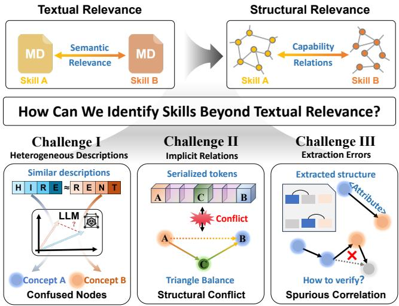
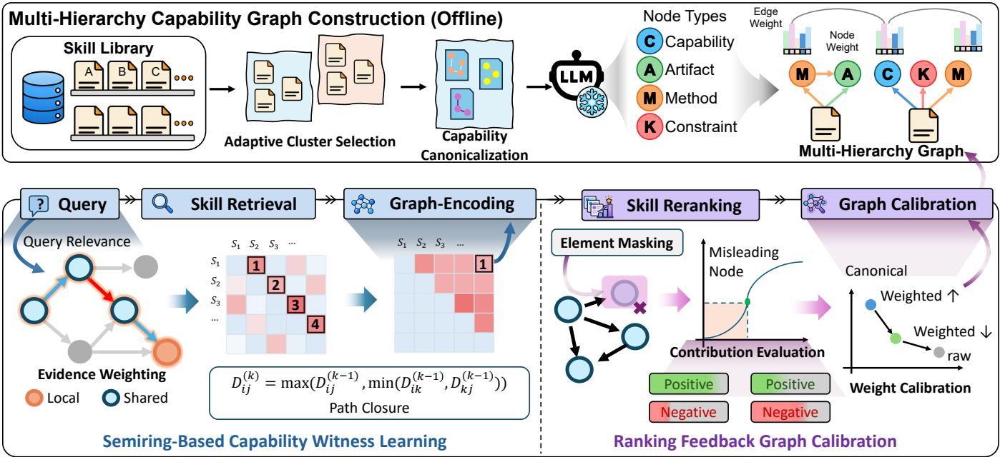
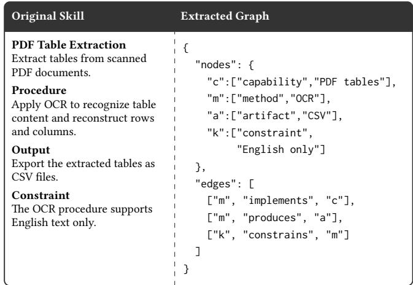
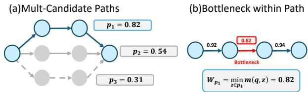
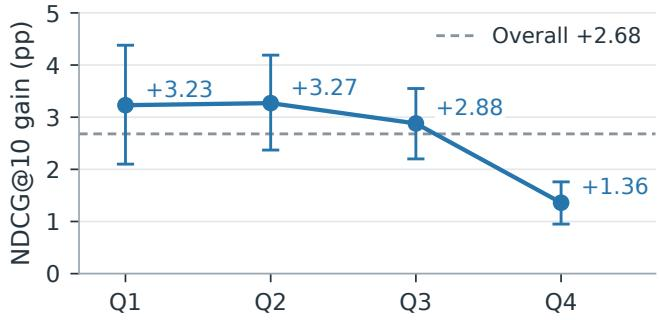
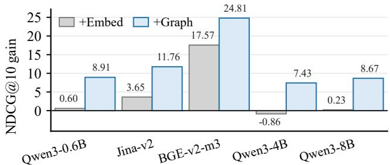
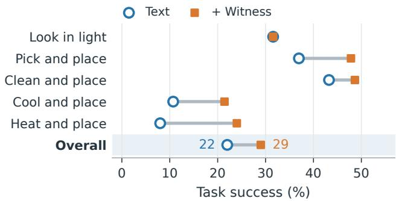

# SKALOS: Learning to Distinguish Similar Skills with Capability Graphs

Wenhan Xiao1 Ziwei Zhang1,\* Xingcheng Fu2 Chuanyue Yu3

Haonan Yuan4 Qingyun Sun1 Runhua Xu1 Jianxin Li1

1Beihang University, Beijing, China 2Guangxi Normal University, Guilin, China

3Nankai University, Tianjin, China 4Tsinghua University, Beijing, China

{xiaowenhan, zwzhang, sunqy, runhua, lijx}@buaa.edu.cn

fuxc@gxnu.edu.cn yuchuanyue@mail.nankai.edu.cn

yuanhn@mail.tsinghua.edu.cn

## Abstract

Skills provide LLM agents with reusable procedural knowledge, making appropriate skill selection essential for reliable agent behavior. As skill libraries expand, distinguishing semantically similar candidates becomes increasingly dificult. Existing methods encode or rewrite skill descriptions for relevance-based ranking, yet heterogeneous descriptions can obscure capability diferences. To address this challenge, we propose SKALOS, a graph-native reranker that compares skills via explicit capability evidence. Its multi-hierarchy graph aligns equivalent expressions across skills while preserving skill-specific capability evidence. Since individually relevant capability elements may not jointly support a query, semiring-based capability witness learning scores each branch by its weakest evidence, checks joint support for the extracted re quirements within one implementation, and selects the strongest alternative. To reduce the influence of extraction errors, we develop ranking-feedback graph calibration that adjusts unreliable evidence for candidate comparison. Experiments on SkillRet show that SKALOS improves NDCG@10 by 2.68 percentage points over a matched text-only reranker. Witness-guided skill selection also increases ALFWorld task success rate from 22% to 29%.

## CCS Concepts

• Information systems → Retrieval models and ranking; • Mathematics of computing → Graph algorithms.

## Keywords

Agent skills, Skill reranking, Capability graphs, LLM agents

## 1 Introduction

Web agents rely on reusable skills to turn user requests into executable workflows across heterogeneous tools and services. Selecting suitable skills requires matching their procedures, outputs, and usage constraints to the requested workflow, since similar descriptions can correspond to diferent execution capabilities [2, 19, 29, 43]. Within this seting, skills provide reusable procedural knowl edge that guides how agents use available tools and services. By retaining established methods for reuse across tasks, skill libraries support the accumulation ofagent capabilities and reduce the need to derive procedures from scratch [34]. As these libraries expand, selecting appropriate skills becomes increasingly important. Recent advances in skill retrieval and reranking address this need through specialized models and richer skill descriptions, improving access to relevant candidates in large libraries [5, 18, 41].

  
Figure 1: Three challenges in capability-aware skill selection: heterogeneous descriptions, implicit relations in text, and errors in extracted structures.

Despite these advances, relevance alone is insuficient for selecting among semantically similar skills. Candidates may receive similar relevance scores even when their evidence supports diferent requirements through separate procedures, rather than jointly within one implementation. Heterogeneous descriptions also obscure shared capabilities and meaningful implementation diferences. The central challenge is therefore not merely to retrieve related descriptions, but to establish a common basis for comparing the capability evidence of easily confused candidates.

Recent studies atempt to expose skill structure by extracting workflows, dependencies, and relations from skill documents [1, 7, 21]. Recent skill graphs primarily organize dependencies and execution relationships across skills, clarifying how skills can be combined or invoked rather than how semantically similar candidates can be distinguished. Moreover, extracting structure does not by itself resolve how equivalent evidence should be compared, how its relations should be used, or how extraction errors should be handled. Figure 1 illustrates three resulting challenges.

Challenge I: Heterogeneous descriptions. Skills developed by diferent authors often express equivalent capabilities through diferent terminology and sentence structures. When encoded as text, equivalent evidence may receive diferent representations and ranking scores; prior work also shows that tool-selection preferences are sensitive to textual descriptions [8]. This moti vates aligning equivalent phrases across skill documents [6, 33]. However, alignment should not erase meaningful implementation diferences: two skills may share a broad capability while difering in methods, outputs, or constraints that determine their suitability for a task. The challenge is to align equivalent capabilities while retaining the details that distinguish skill implementations.

Challenge II: Implicit relations. A skill may mention all the op erations and outputs relevant to a task, yet provide no single procedure that meets all of the task’s requirements. Text-based representations encode these relations through word order and context, making their interpretation sensitive to wording, ordering, and templates [9, 28]. The presence of individually relevant ele ments therefore does not establish capability completeness: their supporting relations and implementation boundaries also mater. The challenge is to determine whether the extracted requirements are jointly supported within one implementation, without combining evidence from separate procedures.

Challenge III: Extraction errors. Extracting and canonicalizing capability evidence from skill documents may introduce incorrect node mappings or unsupported relations [6, 37]. Incorrect mappings can obscure skill-specific distinctions, while unsupported relations can introduce misleading capability evidence. Calibrating such evidence is dificult because ranking labels identify preferred skills without specifying the contribution of each extracted node or relation. Moreover, evidence irrelevant to a particular query may still be correctly extracted. The challenge is to suppress unreliable structure while retaining useful capability evidence.

To address these challenges, we propose SKALOS, a graph native reranker that uses textual relevance and structural support to compare candidate skills. First, our graph aligns shared capabil ities and retains local evidence specific to each skill. Next, witness learning scores each branch by its weakest evidence, checks joint requirement coverage within one implementation, and selects the strongest valid alternative. Finally, graph calibration adjusts node representations and relation weights by ranking feedback ob tained via element masking. Experiments on SkillRet demonstrate improved skill reranking across multiple rerankers and robustness to structural perturbations, and controlled ALFWorld tasks confirm the downstream value of witness-guided skill selection.

The witness tests whether one procedure jointly supports the query, rather than treating a union of relevant elements as complete evidence. Calibration then controls how strongly uncertain nodes and relations influence candidate ranking. These stages preserve the distinction between textual relevance, structural support, and evidence reliability throughout skill comparison.

Our contributions are summarized as follows:

• We design a multi-hierarchy capability graph that makes heterogeneous skills comparable while preserving their distinctive implementation evidence.

• We propose a graph-native skill reranking framework that integrates relation-aware graph modeling with semiring based capability witness learning.

• We develop ranking-feedback graph calibration to limit the influence of unreliable evidence during skill selection.

## 2 Related Work

## 2.1 Text-Based Skill Retrieval and Reranking

Recent work addresses large-scale skill selection through specialized text embeddings and retrieve-and-rerank pipelines, using skill descriptions to match queries with candidate skills [5, 18, 41]. Related tool-retrieval methods also exploit specialized retrieval models and library hierarchies to improve candidate selection [30, 40]. Despite these advances, text-based matching leaves internal capability relations implicit in the input sequence. Equivalent evidence expressed through diferent descriptions may therefore receive different representations, consistent with findings that tool-selection preferences are sensitive to textual descriptions [8]. High semantic relevance alone does not explicitly establish whether a candidate jointly supports the required methods, artifacts, and constraints.

## 2.2 Retrieval-Augmented Generation

RAG retrieves and organizes external evidence for generation [10, 12, 24, 26]. Retrieval augmentation also supports access to agent skills [32], while skill graphs model how multiple skills can be combined [1, 20, 21]. SKALOS tests whether one candidate implementation jointly supports the query requirements.

## 2.3 Structured Skill Representation

Existing structured approaches to skill selection operate at diferent levels. Inter-skill graph methods represent skills as nodes and encode dependencies, compatibility, and procedural relations to support retrieval and composition [1, 20, 21]. Their structural information primarily describes how skills relate to one another and can be organized into task-relevant combinations. Our focus is the internal capability composition of individual candidates, where semantically similar skills may difer in the methods, artifacts, and constraints they can jointly support.

Other methods expose capability distinctions through discriminative text or retrieval supervision derived from structure [7, 35]. They enrich textual representations or training signals with capability information. SKALOS instead uses capability relations directly in candidate scoring, making joint requirement support within one implementation an explicit ranking signal.

Complementary research on extraction and canonicalization supports relation recovery and alignment of heterogeneous expressions [6, 16, 33, 37]. However, extraction errors and mistaken merges can distort the evidence used for candidate comparison. The remaining challenge is to align capability evidence across candidates, retain implementation-specific distinctions, and assess joint support when the extracted structure is imperfect.

## 3 Method

Figure 2 presents the three stages of SKALOS. Graph construction aligns equivalent capability expressions and retains the evidence specific to each skill. Witness learning checks joint requirement coverage within one implementation, scores its branches by their weakest evidence, and selects the strongest alternative. Graph calibration uses ranking feedback to adjust unreliable evidence before scoring candidate skills against the query requirements.

  
Figure 2: Overview of SKALOS. Multi-hierarchy capability graphs organize shared and skill-specific evidence; semiring-based witness learning aggregates requirement-covering branches anchored to one implementation; ranking-feedback graph cali bration adjusts unreliable evidence used for skill reranking.

## 3.1 Multi-Hierarchy Capability Graphs

Our graph aligns equivalent capability expressions to compare sim ilar skills, while preserving the methods, outputs, and constraints that distinguish individual implementations. Its shared and local layers retain both common references and skill-specific evidence. Figure 3 illustrates the four node types and three typed relations extracted from a skill document.

Capability canonicalization. To align heterogeneous expressions within a finite canonical node bank, we perform clusterscoped capability canonicalization. Skills are first grouped in the embedding space, with the cluster count adaptively selected ac cording to compactness, separation, and cluster size [25]. Within each cluster, we extract capability, method, artifact, and constraint expressions and consolidate semantically equivalent expressions of the same type [6, 16]. Canonicalizing expressions separately within each cluster and node type reduces the risk of merging expressions with diferent contextual meanings or semantic roles. These nodes provide a common basis for comparing diferently worded skill descriptions.

Shared and local evidence. Canonicalization reveals both recurring nodes used by multiple skills and nodes specific to a single skill. Although recurring nodes expose common capabilities, skill-specific nodes may capture precisely the implementation details that distinguish otherwise similar candidates. Removing them would make these candidates less distinguishable. We place recurring nodes in a shared layer and skill-specific nodes in a local layer, preserving both common references and implementation details.

  
Figure 3: A constructed skill graph with four node types and three typed relations. Its OCR method produces CSV tables under an English-only constraint.

Multi-hierarchy graph. We organize the shared and local evidence in a multi-hierarchy graph. Skills may contain similar elements but connect them diferently, making typed relations necessary for comparing their implementations. We encode these con nections through typed relations, including REQUIRES, sUPPORTs implements, pRoduces, and constRains, making implementation relationships explicit for subsequent comparison. For a candidate skill �, we denote the resulting graph by $G _ { s } = ( V _ { s } , E _ { s } )$ . Each typed edge has an inverse view with the same relation identity; $E _ { s } ^ { \pm }$ denotes this augmented edge set.

## 3.2 Semiring-Based Capability Witnesses

A skill may contain several highly relevant elements without providing a jointly supported implementation. Additive aggregation can conceal a missing requirement behind other strong matches, while selecting a single strong path may bypass a necessary branch. Moreover, evidence belonging to diferent implementations should not be assembled into one apparently complete witness. We therefore introduce capability witness learning to require joint coverage within one implementation while retaining alternative implemen tations as competing sources of support.

Let $\mathcal { R } _ { q } = \left\{ r _ { 1 } , \ldots , r _ { K } \right\}$ denote the typed capability requirements expressed by query $q ,$ such as its required capability, method, artifact, and constraint. Requirement phrases are aligned to the canon ical node bank by type-constrained query–node matching; types not specified by the query are not forced into the witness. The witness treats extracted requirements as mandatory conjunctions; optional, disjunctive, and preference-based requests are outside this definition. The typed graph induces a set $\mathcal { I } ( s )$ of method-anchored realizations, each containing one method anchor and its schemacompatible supporting nodes. A capability witness is a set of supporting branches that covers every $\boldsymbol { r } \in \mathcal { R } _ { q }$ within one $I \in { \mathcal { I } } ( s ) ;$ branches assigned to diferent realizations are never combined.

Graph encoding. Relation-aware message passing combines node-text, type, and layer information to encode the candidate graph [27]. A query-conditioned scoring head assigns each node or relation � an evidence strength $m ( q , z ) ~ \in ~ [ 0 , 1 ]$ , computed from its current element representation and sigmoid-normalized before witness aggregation. These scores weight each branch in the Max–Min computation. Ranking feedback calibrates these node representations and relation weights (Section 3.3).

Graph-aware score. The frozen encoder embeds queries, skills, and nodes. The reranker uses a hidden dimension of 128, two relation-aware layers, and a dropout rate of 0.15. Its score is:

$$
S _ { G } ( q , s , G _ { s } ) = f _ { \theta } \big ( \mathbf { q } , \mathbf { t } _ { s } , \mathbf { p } _ { q } ( G _ { s } ) , \phi ( q , G _ { s } ) , \mathbf { b } ( q , s ) \big ) .\tag{1}
$$

Here $\mathbf { t } _ { s }$ represents skill text; ${ \bf p } _ { q }$ concatenates query-atentive, max, and mean graph pooling; $\phi$ contains witness, branch, node-match, typed-edge, and atention summaries; and b contains first-stage features. The two-layer GELU MLP outputs $S _ { G }$ . Graph and retrieval scores are normalized within each pool and fused with $\alpha = 0 . 7 0$

Witness operationalization. We extract query requirements and match same-type canonical nodes (Appendix $\phantom { + } \Lambda . 2 ) ;$ ; unmatched requirements remain uncovered. The extractor assigns each alternative procedure an implementation ID, retained by its node and edge occurrences. Canonical nodes share representations while retaining these IDs. Paths stay within one realization and cannot traverse another method anchor. The witness and branch scores enter $\phi ( q , G _ { s } )$ as auxiliary evidence for skill reranking.

Max–Min witness semiring. We follow semiring graph reasoning [42] and score branches using the Max–Min operations � $\ u \ u \partial b = \operatorname* { m a x } ( a , b )$ and � $\mathbf { \otimes } b = \operatorname* { m i n } ( a , b )$ . The requirement and realization aggregations below enforce joint coverage. The min operator limits each supporting branch by its weakest node or relation, while the max operator selects the strongest alternative branch for the same requirement. A second minimum then enforces conjunction across all requirements covered by one realization, and a final maximum selects among alternative realizations.

  
Figure 4: Max–Min path scoring: each branch is limited by its weakest node or relation.

For a realization �, let $\mathcal { P } _ { I } ( r )$ contain the schema-valid paths from its method anchor to nodes that support requirement �. The botleneck score of the strongest supporting branch for � is:

$$
B ( q , r , I ) = \operatorname* { m a x } _ { p \in \mathcal { P } _ { I } ( r ) } \operatorname* { m i n } _ { z \in \mathcal { P } } m ( q , z ) ,\tag{2}
$$

where $B ( q , r , I ) = 0$ when no such branch exists. We then require the same realization to cover the complete requirement set and select the strongest valid realization:

$$
\begin{array} { r } { W _ { I } ( q , s ) = \underset { r \in \mathcal { R } _ { q } } { \operatorname* { m i n } } B ( q , r , I ) , } \\ { W ( q , s ) = \underset { I \in \mathcal { I } ( s ) } { \operatorname* { m a x } } W _ { I } ( q , s ) . } \end{array}\tag{3}
$$

Thus, a missing requirement makes the realization-level witness zero, strong evidence for one requirement cannot compensate for weak evidence for another, and branches from diferent realizations cannot be combined.

Query-conditioned semiring path closure. For each realiza tion �, closure uses its schema-compatible edges � [22] and the path restrictions in Appendix A.3. For nodes �� and $\nu _ { j }$ in �, define:

$$
[ \mathbf { A } _ { q , I } ] _ { i j } = \bigoplus _ { r : ( \nu _ { i } , r , \nu _ { j } ) \in E _ { I } ^ { \pm } } \left( m ( q , \nu _ { i } ) \otimes m ( q , ( \nu _ { i } , r , \nu _ { j } ) ) \otimes m ( q , \nu _ { j } ) \right) ,\tag{4}
$$

where parallel typed relations are combined by ⊕. Matrix multiplication over the Max–Min semiring is defined as follows:

$$
[ \mathbf { A } \otimes \mathbf { B } ] _ { i j } = \bigoplus _ { k } \left( \mathbf { A } _ { i k } \otimes \mathbf { B } _ { k j } \right) = \operatorname* { m a x } _ { k } \operatorname* { m i n } \left( \mathbf { A } _ { i k } , \mathbf { B } _ { k j } \right) .\tag{5}
$$

Consequently, the $( i , j )$ entry of $\mathbf { A } _ { q , I } ^ { \otimes \ell }$ gives the strongest botleneck value among all length-ℓ paths from �� to ��. Using � = 4 yields the

SKALOS: Learning to Distinguish Similar Skills with Capability Graphs

truncated closure:

$$
\mathbf { A } _ { q , I } ^ { \left( \leq L \right) } = \mathbf { A } _ { q , I } \oplus \mathbf { A } _ { q , I } ^ { \otimes 2 } \oplus \cdots \oplus \mathbf { A } _ { q , I } ^ { \otimes L } .\tag{6}
$$

For illustration only, with unrestricted path lengths, let $D _ { i j } ^ { ( 0 ) } ~ =$ $[ \mathbf { A } _ { q , I } ] _ { i j }$ and let $D _ { i j } ^ { ( k ) }$ denote the best botleneck value when only $\nu _ { 1 } , \ldots , \nu _ { k }$ may be used as intermediate nodes. This closure admits the dynamic-programming recurrence:

$$
D _ { i j } ^ { ( k ) } = \operatorname* { m a x } \Bigl ( D _ { i j } ^ { ( k - 1 ) } , \operatorname* { m i n } \Bigl ( D _ { i k } ^ { ( k - 1 ) } , D _ { k j } ^ { ( k - 1 ) } \Bigr ) \Bigr ) ,\tag{7}
$$

illustrating botleneck extension and alternative selection. In practice, $B ( q , r , I )$ uses the truncated, schema-valid paths above, with a zero-edge branch for a matched method anchor; Equation 3 then enforces requirement conjunction and realization selection.

Diferentiable relaxation. Because strict min and max operations yield sparse gradients, we use a log-sum-exp approximation for the minimum within each branch:

$$
\operatorname { S o f t M i n } _ { \tau } ( x _ { 1 } , \dots , x _ { n } ) = - \tau \log \left( \frac { 1 } { n } \sum _ { i = 1 } ^ { n } \exp \left( - \frac { x _ { i } } { \tau } \right) \right) .\tag{8}
$$

The remaining extrema are relaxed analogously and approach min and max as $\tau \  \ 0 .$ . Incomplete realizations are hard-masked to zero and excluded from smooth aggregation; if none fully covers the requirements, the skill witness is zero.

Capability witness objective. For a positive skill $s ^ { + }$ and � hard negatives $\{ s _ { i } ^ { - } \} _ { i = 1 } ^ { M }$ , define $\Delta _ { i } = W ( q , s ^ { + } ) - W ( q , s _ { i } ^ { - } )$ . We optimize the capability witness loss:

$$
\mathcal { L } _ { \mathrm { w i t n e s s } } = \frac { 1 } { M } \sum _ { i = 1 } ^ { M } \log \left( 1 + \exp ( \gamma _ { w } - \Delta _ { i } ) \right) ,\tag{9}
$$

where $\gamma _ { w }$ is the witness margin. This objective encourages a positive skill to provide a stronger requirement-covering witness than semantically similar hard negatives.

## 3.3 Ranking-Feedback Graph Calibration

Extracted capability graphs may contain incorrect mappings or relations that distort candidate ranking. We use ranking feedback to estimate each element’s contribution to candidate discrimination and calibrate its influence. This connects evidence calibration to the skill-selection objective. Earlier graph-learning methods jointly refine structure and representations [4, 14]; preferencebased tool retrieval learns to reflect the preferences ofdownstream models [23]. We distinguish two signals: structural reliability, a query-independent estimate of document support for a mapping or relation, and query relevance, which measures the element’s usefulness for a particular query.

Element masking and contribution evaluation. Document support and query relevance alone do not reveal whether an element helps distinguish a positive skill from a semantically similar hard negative. Masking each element reveals its contribution: the change in ranking margin supervises how strongly it should influ ence each positive–negative candidate comparison.

Given a query �, a positive skill $s ^ { + }$ , and a hard negative � , let ${ \cal M } ( q , s ^ { + } , s ^ { - } ; G )$ denote their margin under the Graph-Aware Score.

To estimate the contribution of a graph element �, we temporarily mask it and measure the change in the margin:

$$
u _ { q , z } = M ( q , s ^ { + } , s ^ { - } ; G ) - M ( q , s ^ { + } , s ^ { - } ; G \setminus z ) .\tag{10}
$$

A positive $u _ { q , z }$ means that masking � weakens the correct ranking and that � provides useful ranking evidence. A negative value means that removing � improves the margin, indicating that the element may be noisy or misleading. This ranking utility is not itself a label of extraction correctness.

We convert masking utility into a bounded contribution target and incorporate a query-relevance prior to regularize calibration:

$$
\mathcal { L } _ { \mathrm { a t t r i b u t i o n } } = \frac { 1 } { \left| Z _ { s } \right| } \sum _ { z \in Z _ { s } } \mathrm { B C E } ( g _ { q , z } , y _ { q , z } ) .\tag{11}
$$

Here, $y _ { q , z }$ combines normalized masking utility with the queryrelevance prior and is treated as a stop-gradient target. Target construction details are provided in Appendix A.2. Ranking feedback can therefore adjust how much each extracted node or relation contributes without immediately rewriting the discrete graph.

Weight calibration. An element may be unhelpful because its extracted structure is unreliable or because it is irrelevant to the current query. Treating these cases identically would suppress valid information that may be useful for other queries. We therefore distinguish document support from query relevance when weighting graph elements.

For each element �, a structural MLP estimates confidence $r _ { z }$ from document support. Shared-node features compare canonical and raw representations; edge features encode endpoints and relation type. A query-conditioned MLP estimates relevance $a _ { q , z }$ . Their product, $g _ { q , z } \ = \ r _ { z } a _ { q , z } ,$ weights the element’s contribution. Low query relevance alone does not imply a structural error. We interpre $x _ { z }$ as a query-independent structural confidence prior and evaluate its empirical association with extraction errors in Section B.4.

Graph calibration. A questionable canonical mapping should not erase the original information that distinguishes a skill, and an unreliable relation should not dominate its representation. Learned calibration signals therefore adjust node representations and relation weights within the extracted graph.

For shared nodes, calibration interpolates between the canonical mapping and the original extracted representation:

$$
\mathbf { h } _ { q , \nu } ^ { \prime } = ( 1 - \rho _ { q , \nu } ) \mathbf { h } _ { \nu } ^ { \mathrm { c a n o n } } + \rho _ { q , \nu } \mathbf { h } _ { \nu } ^ { \mathrm { r a w } } ,\tag{12}
$$

where $\rho _ { q , \nu } \in [ 0 , 1 ]$ controls the interpolation toward the raw representation, increasing as canonical grounding weakens and querydependent importance grows. Reliable mappings retain the unified representation; unreliable mappings fall back toward the raw node and preserve local skill information. Edge reliability and query relevance control relation-aware propagation through $g _ { q , e }$ . The calibrated representations and relation weights determine the updated strengths �(�, �) used in reranking and witness scoring.

## 3.4 Training and Inference

Let $\Delta _ { i } ^ { S } = S _ { G } ( q , s ^ { + } , G ^ { + } ) - S _ { G } ( q , s _ { i } ^ { - } , G _ { i } ^ { - } )$ denote the Graph-Aware Score diference between a positive skill and the �-th hard negative.

Table 1: Retrieval and reranking on SkillRet (percentages). Meta denotes skill metadata. Underlines mark the best publishedprotocol reranker; matched comparisons appear in a separate group.
<table><tr><td>Method</td><td>Skill input</td><td>Model size</td><td>NDCG@5</td><td>NDCG@10</td><td>Recall@10</td><td>Comp.@10</td></tr><tr><td>RAG retrieval baselines</td><td></td><td></td><td></td><td></td><td></td><td></td></tr><tr><td>Naive-RAG</td><td>Full SKILL.md</td><td></td><td>56.46</td><td>59.10</td><td>67.18</td><td>52.09</td></tr><tr><td>HippoRAG 2</td><td>Full SKILL.md</td><td></td><td>44.80</td><td>47.15</td><td>55.55</td><td>39.23</td></tr><tr><td>RAPTOR</td><td>Full SKILL.md</td><td></td><td>59.23</td><td>62.16</td><td>69.08</td><td>53.35</td></tr><tr><td>General-purpose rerankers</td><td></td><td></td><td></td><td></td><td></td><td></td></tr><tr><td>jina-reranker-v2</td><td>Meta</td><td>0.3B</td><td>69.92</td><td>73.14</td><td>83.93</td><td>73.06</td></tr><tr><td>bge-reranker-v2-m3</td><td>Meta</td><td>0.6B</td><td>53.99</td><td>59.79</td><td>77.53</td><td>62.60</td></tr><tr><td>Qwen3-Reranker-0.6B</td><td>Meta</td><td>0.6B</td><td>72.84</td><td>75.81</td><td>85.86</td><td>75.48</td></tr><tr><td>Qwen3-Reranker-4B</td><td>Meta</td><td>4.0B</td><td>73.24</td><td>76.20</td><td>86.18</td><td>76.09</td></tr><tr><td>Qwen3-Reranker-8B</td><td>Meta</td><td>8.0B</td><td>73.21</td><td>76.09</td><td>86.48</td><td>76.53</td></tr><tr><td>Skill-specific rerankers</td><td></td><td></td><td></td><td></td><td></td><td></td></tr><tr><td>SkillRet-Reranker-0.6B</td><td>Meta</td><td>0.6B</td><td>80.71</td><td>82.18</td><td>87.61</td><td>78.95</td></tr><tr><td>SkillRouter-Reranker-0.6B</td><td>Full SKILL.md</td><td>0.6B</td><td>81.37</td><td>82.92</td><td>87.69</td><td>78.35</td></tr><tr><td>R3-Reranker-0.6B</td><td>Full SKILL.md</td><td>0.6B</td><td>80.44</td><td>81.93</td><td>87.15</td><td>78.39</td></tr><tr><td>Graph-based related work SkillDAG</td><td>Full SKILL.md</td><td></td><td>75.59</td><td>77.19</td><td>83.39</td><td>71.72</td></tr><tr><td>Matched internal baselines</td><td></td><td></td><td></td><td></td><td></td><td></td></tr><tr><td>SkillRet-Embedding-0.6B (baseline)</td><td>Meta</td><td>0.6B</td><td>75.57</td><td>78.03</td><td>85.42</td><td>75.09</td></tr><tr><td>Text-only Pairwise Reranker</td><td>Meta</td><td></td><td>80.98</td><td>84.07</td><td>93.39</td><td>87.41</td></tr><tr><td>Full SKILL.md Reranker</td><td>Full SKILL.md</td><td></td><td>79.75</td><td>83.06</td><td>93.24</td><td>87.22</td></tr><tr><td>Graph-as-Text Reranker</td><td>Meta + Graph Text</td><td></td><td>81.10</td><td>84.09</td><td>93.17</td><td>86.66</td></tr><tr><td>SKALOS</td><td>Meta + Graph</td><td>2.0M + frozen 0.6B</td><td>84.33</td><td>86.76</td><td>94.57</td><td>89.59</td></tr></table>

The pairwise ranking loss is defined as follows:

$$
\mathcal { L } _ { \mathrm { r a n k } } = \frac { 1 } { M } \sum _ { i = 1 } ^ { M } \log \left( 1 + \exp ( - \Delta _ { i } ^ { S } ) \right) .\tag{13}
$$

We train the graph reranker with the combined objective:

$$
\mathcal { L } _ { \mathrm { g r a p h } } = \mathcal { L } _ { \mathrm { r a n k } } + \lambda _ { w } \mathcal { L } _ { \mathrm { w i t n e s s } } .\tag{14}
$$

We then freeze its parameters and train a lightweight graphcalibration module using the masking-derived atribution objec tive. At inference, calibration is applied to the candidate graph before the frozen reranker and witness scorer are evaluated, keeping calibration and witness scoring active throughout inference.

Initialization uses 63,259 training queries, followed by graph native updates on 1,000 queries and 8,120 pairs. Negatives come exclusively from the top-20 pool: half are the highest-ranked non relevant candidates, and the rest are sampled from the remaining non-relevant candidates. Calibration collects 11,914 masking exam ples from 1,000 training queries, keeping the reranker frozen.

At inference time, the learned Graph-Aware Score is combined with the first-stage retrieval score using a fixed coeficient �:

$$
S _ { \mathrm { f i n a l } } ( q , s ) = ( 1 - \alpha ) \tilde { S } _ { \mathrm { r e t } } ( q , s ) + \alpha \tilde { S } _ { G } ( q , s , G _ { s } ) .\tag{15}
$$

Both scores are normalized within each candidate pool. The wit ness supplies an auxiliary signal of joint requirement coverage within one implementation.

## 4 Experiments

We evaluate SKALOS through six research questions:

• RQ1: How well does SKALOS rerank skills?

• RQ2: Do gains transfer across rerankers?

• RQ3: Which skill representation yields the best reranking performance?

• RQ4: How much does each component contribute?

• RQ5: Can feedback detect and correct graph errors?

• RQ6: Do witnesses improve agent task success?

## 4.1 Experimental Setup

The frozen SkillRet-Embedding-0.6B retriever [5] supplies the top 20 candidate skills for reranking. SKALOS has about 2.0M trainable parameters: 1.999M for reranking and 1,089 for calibration. The text encoder remains frozen. A frozen Qwen2.5-7B-Instruct model extracts skill graphs ofline and requirements from each query. The reranker is initialized on the full oficial training split, then finetuned as detailed in Appendix A.2. We fix the fusion weight at 0.70 using training data. Evaluation metrics are reported as percentages.

Baselines. We compare SKALOS with a broad set of representative baselines, including SkillRet-Embedding-0.6B and SkillRet-Reranker-0.6B [5]; general-purpose rerankers (Jina [15], BGE [3, 17], and Qwen3 [39]); skill-specific rerankers (SkillRouter [41] and R3 [36]); the graph-based SkillDAG [1]; and full-corpus RAG meth ods (Naive-RAG, HippoRAG 2 [11], and RAPTOR [26]). Matched baselines represent each skill using metadata, its full document, serialized capability nodes, or a serialized graph with the same frozen encoder, top-20 pools, and training protocol.

Datasets. We evaluate on SkillRet [5], a skill-retrieval bench mark with 63,259 training queries, 4,997 test queries, and binary relevance labels. For downstream generalization, we additionally use ALFWorld [31] household tasks.

Metrics. We follow earlier evaluations [1, 5, 36, 41] and report NDCG@5/10 for ranking quality [13], Recall@10, and Completeness@10. These metrics evaluate ranking quality and the coverage of relevant skills. All metrics are averaged across evaluation queries; detailed metric definitions and significance tests are reported in Appendix A.1.

## 4.2 Main Results

To answer RQ1, Table 1 reports overall results. On the matched candidate pool, SKALOS outperforms the text-only, full-document, and graph-as-text rerankers on all four metrics; published and fullcorpus RAG scores are reference-only because their protocols dif fer. Using full documents does not improve performance over using metadata alone, and serialized graph text yields litle gain. SKA-LOS instead tests how capability evidence fits together.

All three matched comparisons yield positive paired-bootstrap 95% confidence intervals for NDCG@10 gains, with Holm-adjusted � < 0.001 (Appendix B.1).

First-stage ambiguity. We group all 4,997 test queries by the gap between their top two first-stage scores (Figure 5). SKALOS gains 3.23 and 3.27 NDCG@10 points in Q1 and Q2, respectively, versus 1.36 in Q4. Smaller gaps indicate first-stage ambiguity, not capability insuficiency; baseline dificulty also varies. Intervals are estimated from 5,000 paired bootstraps over the full set of test queries.

  
Figure 5: NDCG@10 gains by score-gap quartile (Q1: small est gap). Error bars show 95% CIs.

## 4.3 Cross-Reranker Generalization

For RQ2, five rerankers span diferent architectures and model sizes, each with a separately trained graph module. On common top-20 pools, Base uses re-evaluated reranker scores; +Embed and +Graph fuse these with first-stage embedding scores and the corresponding Graph-Aware Score, respectively.

  
Figure 6: NDCG@10 gains from embedding fusion (+Embed) and graph augmentation (+Graph) across base rerankers.

Figure 6 shows that +Graph improves NDCG@10 by 7.43–24.81 points over Base and by 7.24–8.45 points over +Embed. These consistent gains indicate that embedding-score fusion alone does not explain the improvement. Full results appear in Appendix B.2.

## 4.4 Skill Representation Comparison

To answer RQ3, we compare metadata, full-document, serializednode, and serialized-graph inputs against explicit graph modeling.

Table 2: Comparison of skill representations.
<table><tr><td>Method</td><td>NDCG@10</td><td>Recall@10</td><td>Comp.@10</td></tr><tr><td>First-stage Retrieval</td><td>78.03</td><td>85.42</td><td>75.09</td></tr><tr><td>Text-only Pairwise Reranker</td><td>84.07</td><td>93.39</td><td>87.41</td></tr><tr><td>Full SKILL.md Reranker</td><td>83.06</td><td>93.24</td><td>87.22</td></tr><tr><td>Node-as-Text Reranker</td><td>84.21</td><td>93.48</td><td>87.43</td></tr><tr><td>Graph-as-Text Reranker</td><td>84.09</td><td>93.17</td><td>86.66</td></tr><tr><td>SKALOS</td><td>86.76</td><td>94.57</td><td>89.59</td></tr></table>

SKALOS exceeds Node-as-Text, the strongest alternative in Table 2, by 2.55 NDCG@10 points.

We directly test requirement coverage with 93 source-disjoint skills. Each four-candidate pool has one complete implementation and three similar negatives: one omits an artifact, one omits a constraint, and one splits evidence across implementations. We apply 10% node and relation dropout.

Table 3: Requirement-coverage stress test after removing 10% of graph nodes and relations.
<table><tr><td>Method</td><td>NDCG@4</td><td>Pair Acc.</td><td>Margin</td></tr><tr><td>Text Reranker</td><td>94.97</td><td>95.40</td><td>0.0129</td></tr><tr><td>Witness</td><td>97.27</td><td>97.53</td><td>0.0391</td></tr></table>

The witness gains 2.29 NDCG@4 points, with a 95% CI of [1.54, 3.09] from source-clustered bootstraps. It also widens the positive–negative margin (Table 3). This controlled test checks joint support within a single procedure and complements the relevance-based SkillRet evaluation.

## 4.5 Component Ablation Studies

To answer RQ4, we retrain each ablation with the same data and su pervision. W/O Graph retains query, skill-text, and first-stage features but removes graph pooling, summaries, and witnesses; other variants disable only the named channel.

Table 4: Component ablation results.
<table><tr><td>Setting</td><td>NDCG@10</td><td>Recall@10</td><td>Comp.@10</td></tr><tr><td>SKALOS</td><td>86.76</td><td>94.57</td><td>89.59</td></tr><tr><td>W/O Graph</td><td>83.32</td><td>92.67</td><td>86.48</td></tr><tr><td>W/O Edge</td><td>80.35</td><td>93.00</td><td>86.58</td></tr><tr><td>W/O Relation Type</td><td>81.23</td><td>93.34</td><td>87.26</td></tr><tr><td>W/O Node Type</td><td>81.77</td><td>92.96</td><td>86.62</td></tr><tr><td>W/O Hierarchy</td><td>80.83</td><td>93.12</td><td>86.96</td></tr><tr><td>W/O Attention</td><td>79.26</td><td>92.03</td><td>84.86</td></tr><tr><td>W/O Witness</td><td>84.07</td><td>90.70</td><td>82.95</td></tr><tr><td>W/O Graph Calib.</td><td>84.28</td><td>88.29</td><td>78.48</td></tr><tr><td>W/O Text</td><td>26.38</td><td>50.35</td><td>33.93</td></tr></table>

Every removal hurts performance (Table 4). Removing graphderived signals lowers NDCG@10 by 3.44 points; edge, type, and witness ablations further support relational and conjunctive modeling. Removing calibration from the original extracted graphs lowers NDCG@10 by 2.48 points.

Removing the witness also reduces Recall@10 from 94.57 to 90.70 and Completeness@10 from 89.59 to 82.95. Its efect therefore extends beyond ordering quality to retrieval coverage in the fixed pool. These labels identify relevant skills without certifying executable support; the separate coverage stress test provides the controlled check of implementation consistency.

## 4.6 Ranking-Feedback Graph Calibration

To answer RQ5, we introduce test-time extraction errors by replacing a query-relevant shared-node label with a plausible same-type label from its cluster. We measure detection by AUPRC, error Recall@20%, and Enrichment@20% (1× is random selection); definitions appear in Appendix B.4.

Table 5: Error detection under evidence corruption.
<table><tr><td>Corruption</td><td>AUPRC</td><td>Recall@20%</td><td>Enrichment@20%</td></tr><tr><td>25%</td><td> $0 . 7 9 9 \pm 0 . 0 1 5$ </td><td> $7 8 . 3 \% \pm 1 . 9 \%$ </td><td> $( 3 . 9 2 \pm 0 . 0 9 ) \times$ </td></tr><tr><td>50%</td><td> $0 . 5 9 3 \pm 0 . 0 0 4$ </td><td> $5 7 . 6 \% \pm 0 . 7 \%$ </td><td> $( 2 . 8 8 \pm 0 . 0 4 ) \times$ </td></tr><tr><td>75%</td><td> $0 . 3 6 9 \pm 0 . 0 1 4$ </td><td> $3 7 . 9 \% \pm 1 . 8 \%$ </td><td> $( 1 . 8 9 \pm 0 . 0 9 ) \times$ </td></tr><tr><td>Random</td><td>0.090</td><td>20.0%</td><td>1.00×</td></tr></table>

Table 5 shows that the lowest-confidence nodes are enriched 3.92× and 2.88× for inserted errors at 25% and 50% corruption; detection weakens but remains above random at 75%.

We also introduce errors identified by human inspection of extracted graphs. “Budget” is the targeted error fraction and “Perturbed” the realized fraction. Pair and score recovery measure reductions in deviations from clean ranking margins and candidate scores. W/O Atribution Loss replaces masking utility with the relevance prior; W/O Graph Calibration bypasses correction.

Table 6: Calibration under human-annotated errors. Error budgets and recovery scores are percentages.
<table><tr><td>Setting</td><td>Perturbed (%)</td><td>Enrich. @20% (×)</td><td>Pair rec. (%)</td><td>Score rec. (%)</td></tr><tr><td>Full (10%)</td><td>9.89</td><td>3.078</td><td>34.38</td><td>32.42</td></tr><tr><td>Full (20%)</td><td>20.10</td><td>3.029</td><td>33.58</td><td>32.45</td></tr><tr><td>Full (30%)</td><td>30.45</td><td>2.944</td><td>35.38</td><td>32.01</td></tr><tr><td>W/O Attr. (20%)</td><td>20.10</td><td>一</td><td>29.60</td><td>29.33</td></tr></table>

Table 6 shows that error enrichment remains near 3× random selection across budgets, while calibration recovers 33.58–35.38% of pair-margin and 32.01–32.45% of score deviations. Removing attribution loss reduces recovery by 3.98 and 3.12 percentage points at the 20% budget, confirming the additional value of ranking feedback beyond query relevance. Without graph calibration, these deviations remain uncorrected.

Scoring cost. With cached text embeddings and graph inputs, SKALOS scores a top-20 pool in 134.85 ms, or 146.97 ms with edge augmentation. Peak GPU memory, including the graph cache, is 181.64 and 184.16 MiB, respectively. Edge augmentation introduces only 12.12 ms additional latency and 2.52 MiB memory overhead, indicating modest computational overhead for richer structural evidence. These timings cover scoring alone and exclude extraction (Appendix A.5).

## 4.7 Agent Execution Generalization

To answer RQ6, each ALFWorld task pairs a valid skill with three textually similar negatives that corrupt one critical requirement. The selected skill guides the same Qwen2.5-7B controller; success is ALFWorld’s completion signal.

  
Figure 7: ALFWorld task success by task family.

Overall, witness selection succeeds on 58/200 tasks (29%) versus 44/200 (22%) for text relevance. The paired outcomes include 18 witness-only and four text-only successes, giving an exact twosided McNemar test $\mathnormal { p } = 0 . 0 0 4$ (Appendix B.3).

## 5 Conclusion

SKALOS reranks skills using explicit capability evidence. Its graph aligns heterogeneous descriptions while retaining skill-specific details; witness learning checks joint requirement support within one implementation; and calibration limits the influence of unreliable evidence. SKALOS gains 2.68 NDCG@10 points over the matched text-only reranker and raises controlled ALFWorld success from 22% to 29%. Gains across five rerankers and the component ablations support the utility of the proposed framework. Controlled perturbations further show that ranking feedback helps recover scores and margins distorted by extraction errors. These results suggest that requirement coverage, implementation consistency, and evidence reliability provide complementary signals for distinguishing semantically similar skills. Future work will extend witness modeling to optional and disjunctive requirements and evaluate these extensions with more diverse skills and broader agent execution setings.

## References

[1] Tong Bai, Zhenglin Wan, Pengfei Zhou, Xingrui Yu, Yang You, and Ivor W Tsang. 2026. SkillDAG: Self-Evolving Typed Skill Graphs for LLM Skill Selection at Scale. arXiv preprint arXiv:2606.03056 (2026).

[2] Hongru Cai, Yongqi Li, Wenjie Wang, Fengbin Zhu, Xiaoyu Shen, Wenjie Li, and Tat-Seng Chua. 2025. Large Language Models Empowered Personalized Web Agents. In Proceedings ofthe ACM on Web Conference 2025, WWW2025, Sydney, NSW, Australia, 28 April 2025- 2 May 2025, Guodong Long, Michale Blumestein, Yi Chang, Liane Lewin-Eytan, Zi Helen Huang, and Elad Yom-Tov (Eds.). ACM 198–215. doi:10.1145/3696410.3714842

[3] Jianlyu Chen, Shitao Xiao, Peitian Zhang, Kun Luo, Defu Lian, and Zheng Liu. 2024. M3-Embedding: Multi-Linguality, Multi-Functionality, Multi-Granularity Text Embeddings Through Self-Knowledge Distillation. In Findings of the Association for Computational Linguistics: ACL 2024, Lun-Wei Ku, Andre Martins, and Vivek Srikumar (Eds.). Association for Computational Linguistics, Bangkok, Thailand, 2318–2335. doi:10.18653/v1/2024.findings-acl.137

[4] Yu Chen, Lingfei Wu, and Mohammed Zaki. 2020. Iterative deep graph learning for graph neural networks: Beter and robust node embeddings. Advances in neural information processing systems 33 (2020), 19314–19326.

[5] Hongcheol Cho, Ryangkyung Kang, and Youngeun Kim. 2026. SkillRet: A large-scale benchmark for skill retrieval in LLM agents. arXiv preprint arXiv:2605.05726 (2026).

[6] Sarthak Dash, Gaetano Rossiello, Nandana Mihindukulasooriya, Sugato Bagchi, and Alfio Gliozzo. 2021. Open knowledge graphs canonicalization using varia tional autoencoders. In Proceedings of the 2021 conference on empirical methods in natural language processing. 10379–10394.

[7] Lihui Ding, Zihan Guo, Bingwei Lu, Chenyu Zhou, Yuanjian Zhou, Weinan Zhang, Jianghao Lin, and Dongdong Ge. 2026. Skill2Query: Exploiting Skill Structure to Generate Pseudo-Queries for Agent Skill Retrieval. arXiv preprint arXiv:2608.16071 (2026).

[8] Kazem Faghih, Wenxiao Wang, Yize Cheng, Siddhant Bharti, Gaurang Sriramanan, Sriram Balasubramanian, Parsa Hosseini, and Soheil Feizi. 2025. Tool preferences in agentic LLMs are unreliable. In Proceedings ofthe 2025 Conference on Empirical Methods in Natural Language Processing. 20965–20980.

[9] Bahare Fatemi, Jonathan Halcrow, and Bryan Perozzi. 2024. Talk like a graph: Encoding graphs for large language models. In International conference on learn ing representations, Vol. 2024. 43909–43934.

[10] Bernal J Gutiérrez, Yiheng Shu, Yu Gu, Michihiro Yasunaga, and Yu Su. 2024. Hipporag: Neurobiologically inspired long-term memory for large language models. Advances in neural information processing systems 37 (2024), 59532– 59569.

[11] Bernal Jiménez Gutiérrez, Yiheng Shu, Weijian Qi, Sizhe Zhou, and Yu Su. 2025. From RAG to Memory: Non-Parametric Continual Learning for Large Language Models. In Proceedings of the 42nd International Conference on Machine Learning, Aarti Singh, Maryam Fazel, Daniel Hsu, Simon Lacoste-Julien, Felix Berkenkamp, Tegan Maharaj, Kiri Wagstaf, and Jerry Zhu (Eds.), Vol. 267. 21497–21515.

[12] Xiaoxin He, Yijun Tian, Yifei Sun, Nitesh V Chawla, Thomas Laurent, Yann Le-Cun, Xavier Bresson, and Bryan Hooi. 2024. G-retriever: Retrieval-augmented generation for textual graph understanding and question answering. Advances in Neural Information Processing Systems 37 (2024), 132876–132907.

[13] Kalervo Järvelin and Jaana Kekäläinen. 2002. Cumulated gain-based evaluation of IR techniques. ACM Transactions on Information Systems (TOIS) 20, 4 (2002), 422–446.

[14] Wei Jin, Yao Ma, Xiaorui Liu, Xianfeng Tang, Suhang Wang, and Jiliang Tang. 2020. Graph structure learning for robust graph neural networks. In Proceedings of the 26th ACM SIGKDD international conference on knowledge discovery & data mining. 66–74.

[15] Jina AI. 2024. jina-reranker-v2-base-multilingual. https://huggingface.co/jinaai/ jina-reranker-v2-base-multilingual. Hugging Face model card.

[16] Katikapalli Subramanyam Kalyan and Sivanesan Sangeetha. 2020. Medical concept normalization in user-generated texts by learning target concept embeddings. In Proceedings of the 11th international workshop on health text mining and information analysis. 18–23.

[17] Chaofan Li, Zheng Liu, Shitao Xiao, Yingxia Shao, and Defu Lian. 2024. Llama2vec: Unsupervised adaptation of large language models for dense retrieval. In Proceedings of the 62nd Annual Meeting of the Association for Computational Linguistics (Volume 1: Long Papers). 3490–3500.

[18] Fangzhou Li, Pagkratios Tagkopoulos, and Ilias Tagkopoulos. 2025. Skillflow: Scalable and eficient agent skill retrieval system. arXiv preprint arXiv:2504.06188 (2025).

[19] Xiaoxi Li, Wenxiang Jiao, Jiarui Jin, Guanting Dong, Jiajie Jin, Yinuo Wang, Hao Wang, Yutao Zhu, Ji-Rong Wen, Yuan Lu, and Zhicheng Dou. 2026. DeepAgent: A General Reasoning Agent with Scalable Toolsets. In Proceedings ofthe ACM Web Conference 2026, WWW2026, Dubai, United Arab Emirates, originally scheduled for April 13-17, 2026, rescheduled for June 29 - July 3, 2026, Hakim Hacid, Yoelle Maarek, Francesco Bonchi, Ido Guy, and Emine Yilmaz (Eds.). ACM, 2219– 2230. doi:10.1145/3774904.3792460

[20] Zhiyuan Li, Linyuan Gao, Xuechun Ding, Hongwei Chen, Yuan Wu, and Yi Chang. 2026. CaSKG: Counterfactual-Causal Skill Graphs for Scalable Agent Skill Retrieval. arXiv preprint arXiv:2608.25500 (2026).

[21] Dawei Liu, Zongxia Li, Hongyang Du, Xiyang Wu, Shihang Gui, Yongbei Kuang, and Lichao Sun. 2026. Graph-of-Skills: Dependency-Aware Structural Retrieval for Massive Agent Skills. arXiv preprint arXiv:2604.05333 (2026).

[22] Mehryar Mohri. 2002. Semiring frameworks and algorithms for shortestdistance problems. Journal of Automata, Languages and Combinatorics 7, 3 (2002), 321–350.

[23] Lorenzo Molfeta, Giacomo Frisoni, Nicolò Monaldini, and Gianluca Moro. 2025. PORTS: Preference-Optimized Retrievers for Tool Selection with Large Language Models. In Proceedings of the 2025 Conference on Empirical Methods in Natural Language Processing. 10018–10041.

[24] Boci Peng, Yun Zhu, Yongchao Liu, Xiaohe Bo, Haizhou Shi, Chuntao Hong, Yan Zhang, and Siliang Tang. 2025. Graph Retrieval-Augmented Generation: A Survey. ACM Transactions on Information Systems 44, 2, Article 35 (2025), 52 pages. doi:10.1145/3777378

[25] Peter J Rousseeuw. 1987. Silhouetes: a graphical aid to the interpretation and validation of cluster analysis. Journal of computational and applied mathematics 20 (1987), 53–65.

[26] Parth Sarthi, Salman Abdullah, Aditi Tuli, Shubh Khanna, Anna Goldie, and Christopher Manning. 2024. Raptor: Recursive abstractive processing for treeorganized retrieval. In International Conference on Learning Representations, Vol. 2024. 32628–32649.

[27] Michael Schlichtkrull, Thomas N Kipf, Peter Bloem, Rianne Van Den Berg, Ivan Titov, and Max Welling. 2018. Modeling relational data with graph convolu tional networks. In European semantic web conference. Springer, 593–607.

[28] Melanie Sclar, Yejin Choi, Yulia Tsvetkov, and Alane Suhr. 2024. Quantifying Language Models’ Sensitivity to Spurious Features in Prompt Design or: How I learned to start worrying about prompt formating. In International Conference on Learning Representations, Vol. 2024. 25055–25083.

[29] Zhengliang Shi, Shen Gao, Lingyong Yan, Yue Feng, Xiuyi Chen, Zhumin Chen, Dawei Yin, Suzan Verberne, and Zhaochun Ren. 2025. Tool Learning in the Wild: Empowering Language Models as Automatic Tool Agents. In Proceedings ofthe ACMon Web Conference 2025, WWW2025, Sydney, NSW, Australia, 28 April 2025- 2 May 2025, Guodong Long, Michale Blumestein, Yi Chang, Liane Lewin-Eytan, Zi Helen Huang, and Elad Yom-Tov (Eds.). ACM, 2222–2237. doi:10.1145/ 3696410.3714825

[30] Zhengliang Shi, Yuhan Wang, Lingyong Yan, Pengjie Ren, Shuaiqiang Wang, Dawei Yin, and Zhaochun Ren. 2025. Retrieval models aren’t tool-savvy: Benchmarking tool retrieval for large language models. In Findings ofthe Association for Computational Linguistics: ACL 2025. 24497–24524.

[31] Mohit Shridhar, Xingdi Yuan, Marc-Alexandre Côté, Yonatan Bisk, Adam Trischler, and Mathew Hausknecht. 2020. Alfworld: Aligning text and embodied environments for interactive learning. arXiv preprint arXiv:2010.03768 (2020).

[32] Weihang Su, Jianming Long, Qingyao Ai, Qiaozhi He, Yichen Tang, Changyue Wang, Yiteng Tu, Yingbo Wang, and Yiqun Liu. 2026. Skill retrieval augmentation for agentic ai. arXiv preprint arXiv:2604.24594 (2026).

[33] Shikhar Vashishth, Prince Jain, and Partha Talukdar. 2018. Cesi: Canonicalizing open knowledge bases using embeddings and side information. In Proceedings ofthe 2018 World Wide Web Conference. 1317–1327.

[34] Guanzhi Wang, Yuqi Xie, Yunfan Jiang, Ajay Mandlekar, Chaowei Xiao, Yuke Zhu, Linxi Fan, and Anima Anandkumar. 2023. Voyager: An open-ended embodied agent with large language models. arXiv preprint arXiv:2305.16291 (2023).

[35] Zifei Wang, Wei Wen, Qiang Ji, and Ruizhi Qiao. 2026. Skills Know Their Neighbors: Cluster-Contrastive Capability Pages for Skill Retrieval. arXiv preprint arXiv:2608.04482 (2026).

[36] Zifei Wang, Wei Wen, Qiang Ji, Ruizhi Qiao, and Xing Sun. 2026. Skill Is Not Document: A Query-Conditional Benchmark and Two-Stage Retriever for LLM Agent Skill Routing. arXiv preprint arXiv:2606.03565 (2026).

[37] Hongbin Ye, Ningyu Zhang, Hui Chen, and Huajun Chen. 2022. Generative knowledge graph construction: A review. In Proceedings of the 2022 conference on empirical methods in natural language processing. 1–17.

[38] Yuxiang Zhang, Xin Fan, Junjie Wang, Chongxian Chen, Fan Mo, Tetsuya Sakai, and Hayato Yamana. 2024. Data-eficient massive tool retrieval: A reinforcement learning approach for query-tool alignment with language models. In Proceedings ofthe 2024 Annual International ACM SIGIR Conference on Research and Development in Information Retrieval in the Asia Pacific Region. 226–235.

[39] Yanzhao Zhang, Mingxin Li, Dingkun Long, Xin Zhang, Huan Lin, Baosong Yang, Pengjun Xie, An Yang, Dayiheng Liu, Junyang Lin, et al. 2025. Qwen3 embedding: Advancing text embedding and reranking through foundation models. arXiv preprint arXiv:2506.05176 (2025).

[40] Yuanhang Zheng, Peng Li, Wei Liu, Yang Liu, Jian Luan, and Bin Wang. 2024. Toolrerank: Adaptive and hierarchy-aware reranking for tool retrieval. In Proceedings of the 2024 joint international conference on computational linguistics, language resources and evaluation (LREC-COLING 2024). 16263–16273.

[41] YanZhao Zheng, ZhenTao Zhang, Chao Ma, YuanQiang Yu, JiHuai Zhu, Yong Wu, Tianze Xu, Baohua Dong, Hangcheng Zhu, Ruohui Huang, and Gang Yu. 2026. SkillRouter: Skill Routing for LLM Agents at Scale. arXiv:2603.22455 [cs.LG] https://arxiv.org/abs/2603.22455

[42] Zhaocheng Zhu, Zuobai Zhang, Louis-Pascal Xhonneux, and Jian Tang. 2021. Neural bellman-ford networks: A general graph neural network framework for link prediction. Advances in neural information processing systems 34 (2021), 29476–29490.

[43] Luyao Zhuang, Qinggang Zhang, Huachi Zhou, Yujing Zhang, and Xiao Huang. 2026. LoSemB: Logic-Guided Semantic Bridging for Inductive Tool Retrieval. In Proceedings ofthe ACM Web Conference 2026, WWW 2026, Dubai, United Arab Emirates, originally scheduled for April 13-17, 2026, rescheduled for June 29 - July 3, 2026, Hakim Hacid, Yoelle Maarek, Francesco Bonchi, Ido Guy, and Emine Yilmaz (Eds.). ACM, 3835–3846. doi:10.1145/3774904.3792336

## A Reproducibility

## A.1 Evaluation Protocol and Ranking Metrics

Controlled reranking uses the frozen SkillRet-Embedding-0.6B encoder and its top-20 candidate pool on all 4,997 test queries. Public baselines retain published protocols; RAG methods retrieve from the full corpus and are not matched comparisons. Feedback diagnostics use separate 300-query evaluations.

Ranking metrics. Using binary relevance labels, NDCG@� discounts gain at rank � by $1 / \log _ { 2 } ( i + 1 )$ and normalizes it by ideal gain [13]. Recall@� is the fraction of labeled relevant skills retrieved in the top �. Completeness@� equals one only when the top � contains every labeled relevant skill [38]. It measures retrieval coverage without certifying capability suficiency. We report query-level averages as percentages.

## A.2 Model and Optimization Details

Graph construction. The ofline Qwen2.5-7B-Instruct extractor uses deterministic decoding and validated JSON, extracting four node types before predicting typed edges with exact node endpoints; invalid output receives one format-repair pass. Within each cluster, the frozen encoder embeds raw phrases. Phrases of the same type merge at cosine similarity $\ge ~ 0 . 8 6 .$ Query requirements use the same frozen typed extractor and matching configuration; unmatched requirements remain uncovered. Nodes supported by at least two skills enter the shared layer; single-skill nodes remain local to preserve evidence specific to each candidate.

Optimization. All graph-reranker parameters remain trainable during initialization and graph-native updates. Negatives are drawn exclusively from the top-20 pool: half are the highestranked non-relevant candidates, and the rest are sampled from the remaining non-relevant candidates.

Table 7: Capability-graph cluster and node statistics.
<table><tr><td>Split</td><td>Clusters</td><td>Skills/cluster</td><td> $\mathrm { C a p . }$ </td><td>Method</td><td>Art.</td><td>Const.</td></tr><tr><td>Train</td><td>100</td><td>101.23</td><td>420.87</td><td>19.25</td><td>17.95</td><td>20.03</td></tr><tr><td>Test</td><td>95</td><td>70.11</td><td>298.88</td><td>14.58</td><td>13.15</td><td>14.40</td></tr></table>

Table 8 summarizes these setings.

Table 8: Hyperparameters for graph-reranker training.
<table><tr><td>Component</td><td>Hyperparameter</td><td>Value</td></tr><tr><td>Text encoder</td><td>Status</td><td>Frozen</td></tr><tr><td>Graph encoding</td><td>Hidden size / layers / dropout</td><td>128 / 2 / 0.15</td></tr><tr><td>Optimization</td><td>Optimizer / weight decay</td><td> $\mathrm { A d a m W } / 1 0 ^ { - 4 }$ </td></tr><tr><td>Initialization</td><td>Gradient clip / accumulation</td><td>1.0 / 8</td></tr><tr><td></td><td>Epochs / LR / max negatives</td><td> $3 / 5 { \times } 1 0 ^ { - 4 } / 8$ </td></tr><tr><td>Graph training</td><td>Epochs / LR / max negatives</td><td> $2 / 1 0 ^ { - 4 } / 4$ </td></tr><tr><td></td><td>Queries / training pairs</td><td>1,000 / 8,120</td></tr><tr><td>Ranking / witness</td><td> $\gamma _ { r } / \lambda _ { w } / \gamma _ { w } / \tau$ </td><td>0 / 0.05 / 0.05 / 0.10</td></tr><tr><td>Calibration</td><td>Queries / masking examples</td><td>1,000 / 11,914</td></tr><tr><td></td><td>LR / utility-prior mix / blend</td><td>3×10−3 / 0.8-0.2 / 0.70</td></tr><tr><td></td><td>Utility scale Q0.75(|u|)</td><td>4.145</td></tr><tr><td>Score fusion</td><td>α</td><td>0.70</td></tr><tr><td>Reproducibility</td><td>Random seed</td><td>42</td></tr></table>

Graph-calibration module. We freeze the trained reranker and collect 11,914 masking examples from 1,000 training queries. The utility scale derived from these examples is $\tau _ { a } = Q _ { 0 . 7 5 } ( | u | ) =$ 4.145. The 1,089-parameter calibrator uses AdamW at $3 \times { 1 0 } ^ { - 3 }$ for at most 200 epochs (patience 20). Let $s _ { \nu } ^ { \mathrm { s t r } }$ and $s _ { q , \nu } ^ { \mathrm { r e l } }$ denote the presigmoid outputs of the structural-confidence and query-relevance networks, so $r _ { \nu } = \sigma ( s _ { \nu } ^ { \mathrm { s t r } } )$ and $a _ { q , \nu } = \sigma ( s _ { q , \nu } ^ { \mathrm { r e l } } )$ . Before frozen reranking and witness scoring, shared-node representations are updated with $\eta = 0 . 7 0$

$$
\begin{array} { l } { { \displaystyle { \rho } _ { q , \nu } = \frac { \eta } { 2 } \sigma ( - s _ { \nu } ^ { \mathrm { s t r } } ) \left[ 1 + \sigma ( s _ { q , \nu } ^ { \mathrm { r e l } } ) \right] , } } \\ { { \displaystyle { \bf { h } } _ { q , \nu } ^ { \prime } = { \bf { h } } _ { \nu } ^ { \mathrm { c a n o n } } + \rho _ { q , \nu } \left( { \bf { h } } _ { \nu } ^ { \mathrm { r a w } } - { \bf { h } } _ { \nu } ^ { \mathrm { c a n o n } } \right) } . } \end{array}\tag{16}
$$

We construct the atribution target as:

$$
\begin{array} { l } { \displaystyle \hat { u } _ { q , z } = \frac { 1 + \mathrm { c l i p } ( u _ { q , z } / \tau _ { a } , - 1 , 1 ) } { 2 } , } \\ { \displaystyle y _ { q , z } = 0 . 8 \hat { u } _ { q , z } + 0 . 2 \bar { a } _ { q , z } . } \end{array}\tag{17}
$$

The node-relevance prior uses frozen encoder embeddings:

$$
\bar { a } _ { q , \nu } = \frac { 1 + \cos ( \mathbf { q } , \mathbf { h } _ { \nu } ^ { \mathrm { c a n o n } } ) } { 2 } .\tag{18}
$$

Target weights are fixed; gradients do not pass through the target.

## A.3 Witness Instantiation and Scope

Implementation IDs are retained on node and edge occurrences; canonical sharing preserves their membership. Each realization has a single method anchor; paths stay within that realization.

Witness computation. Paths stay within one implementation and use at most four declared or inverse typed edges. Allowed relations include implements, pRoduces, and constRains; a matched method anchor permits a zero-edge branch. The complete relation schema and traversal checks are provided in the accompanying code. Incomplete realizations are excluded from smooth aggregation. If all realizations are incomplete, the witness is zero.

## A.4 Statistical Protocol

Confidence intervals. With saved per-query predictions, we draw 5,000 same-size query bootstraps (seed 20260908). The 2.5th and 97.5th percentiles of their mean scores give the 95% CI. Paired gains resample identical IDs for both systems and are absolute percentage-point diferences.

Significance tests. We apply two-sided Wilcoxon signed-rank tests to per-query diferences, using Prat zero handling and family wise Holm correction, with NDCG@10 as the primary metric.

Run variation. Mean ± SD summarizes run variation using sample denominator � − 1; bootstrap CIs describe query uncertainty for a fixed model. Two main-model seeds are reported separately, without seed-level CIs. Table 9 lists both runs.

Table 9: SKALOS results for two training seeds.
<table><tr><td>Metric</td><td>Seed 42</td><td>Seed 43</td><td>Mean ± SD</td></tr><tr><td>NDCG@5</td><td>84.331</td><td>84.560</td><td> $8 4 . 4 4 6 \pm 0 . 1 6 2$ </td></tr><tr><td>NDCG@10</td><td>86.758</td><td>87.032</td><td> $8 6 . 8 9 5 \pm 0 . 1 9 4$ </td></tr><tr><td>Recall@10</td><td>94.568</td><td>94.959</td><td> $9 4 . 7 6 4 \pm 0 . 2 7 6$ </td></tr><tr><td>Comp.@10</td><td>89.591</td><td>90.353</td><td> $8 9 . 9 7 2 \pm 0 . 5 3 9$ </td></tr></table>

## A.5 Implementation and Online Eficiency

Table 10 times 300 queries after 20 warm-ups with per-query GPU synchronization on a V100-SXM2 (32 GB), Xeon Gold 6148, and 128 GiB RAM, using PyTorch 2.4.0/CUDA 12.1. It compares base and edge-augmented graphs.

Eficiency metrics. We measure reranker scoring latency per candidate pool using precomputed text embeddings and graph inputs. P95 denotes the 95th percentile of per-query scoring latency, and QPS measures scoring throughput. GPU memory reports peak allocation of the scoring workload, including the graph cache.

Table 10: Witness scoring eficiency for two graph inputs, using precomputed text embeddings.
<table><tr><td>Graph</td><td>Mean (ms)</td><td>P95 (ms)</td><td>QPS</td><td>Memory (MiB)</td></tr><tr><td>Base</td><td>134.85</td><td>155.60</td><td>7.42</td><td>181.64</td></tr><tr><td>Augmented</td><td>146.97</td><td>168.47</td><td>6.80</td><td>184.16</td></tr></table>

Full-evaluation records. Table 11 reports historical scoring logs for 4,986 queries with precomputed embeddings, separately from the current 4,997-query evaluation.

## A.6 Training and Ofline Construction Costs

Ofline graph construction. Table 12 reports clustering and graph-extraction costs for both corpora.

Table 11: Graph-scoring latency from full evaluation with precomputed embeddings.
<table><tr><td>Model/run</td><td>Time (s)</td><td>ms/query</td><td>QPS</td></tr><tr><td>Base reranker</td><td>446</td><td>89.45</td><td>11.18</td></tr><tr><td>Witness, run 1</td><td>623</td><td>124.95</td><td>8.00</td></tr><tr><td>Witness, run 2</td><td>674</td><td>135.18</td><td>7.40</td></tr></table>

Latency and throughput are computed from logged elapsed times. Witness runs are separate evaluation records, not independent training seeds.

Table 12: Ofline capability-graph construction cost.
<table><tr><td>Split</td><td>Stage</td><td>Total</td><td>Median/Skill</td><td>P95/Skill</td></tr><tr><td>Train</td><td>Clustering</td><td>128.96 min</td><td></td><td></td></tr><tr><td>Train</td><td>Graph extraction</td><td>23.21 h</td><td>24.34 s</td><td>38.47 s</td></tr><tr><td>Test</td><td>Clustering</td><td>64.63 min</td><td></td><td></td></tr><tr><td>Test</td><td>Graph extraction</td><td>24.25 h</td><td>22.80 s</td><td>28.00 s</td></tr></table>

Model and training costs. Table 13 separates initialization on all 63,259 queries from the 1,000-query graph update and subsequent calibration; parameter counts exclude the frozen encoder.

Table 13: Trainable model size and recorded training cost.
<table><tr><td>Component</td><td>Parameters</td><td>Checkpoint</td><td>Training record</td></tr><tr><td>Base graph reranker</td><td>0.916M</td><td>3.51 MiB</td><td>33.68 h (3 epochs)</td></tr><tr><td>Graph-native reranker</td><td>1.999M</td><td>7.65 MiB</td><td>6.07 min (2 epochs)</td></tr><tr><td>Graph-calibration module</td><td>1,089</td><td>9.70 KiB</td><td>65.7 min (200 epochs)</td></tr></table>

## B Robustness and Additional Analyses

## B.1 Main-Result Uncertainty

Paired NDCG@10 gains over matched baselines range from 2.672 to 3.703 points, with positive CI lower bounds and Holm-adjusted $\textstyle p < 0 . 0 0 1$ (Table 14).

Table 14: Paired NDCG@10 gains of SKALOS over matched internal baselines on all 4,997 test queries.
<table><tr><td>Comparator</td><td>Gain</td><td>95% CI</td><td>Holm p</td></tr><tr><td>Text-only</td><td>2.684</td><td>[2.263, 3.103]</td><td>&lt; 0.001</td></tr><tr><td>Full SKILL.md</td><td>3.703</td><td>[3.257, 4.174]</td><td>&lt; 0.001</td></tr><tr><td>Graph-as-Text</td><td>2.672</td><td>[2.237, 3.095]</td><td>&lt; 0.001</td></tr></table>

## B.2 Cross-Reranker Generalization

In Table 15, Base denotes each reranker’s scores re-evaluated on the common top-20 pools. +Embed fuses them with embedding retrieval scores; +Graph fuses them with a Graph-Aware Score trained separately for that reranker on SkillRet. These Base scores difer from the published-protocol results in Table 1.

All ten gains have positive 95% CI lower bounds and Holmadjusted $\textstyle p < 0 . 0 0 1$

Table 15: Graph augmentation results (NDCG@10).
<table><tr><td>Reranker</td><td>Base</td><td>+Graph</td><td>Δ</td></tr><tr><td>Qwen3-0.6B</td><td>79.06</td><td>87.97</td><td>+8.91</td></tr><tr><td>Jina-v2</td><td>75.91</td><td>87.67</td><td>+11.76</td></tr><tr><td>BGE-v2-m3</td><td>59.79</td><td>84.60</td><td>+24.81</td></tr><tr><td>Qwen3-4B</td><td>81.10</td><td>88.53</td><td>+7.43</td></tr><tr><td>Qwen3-8B</td><td>80.11</td><td>88.78</td><td>+8.67</td></tr></table>

Table 16: Paired cross-reranker gains on NDCG@10.
<table><tr><td>Model</td><td>Contrast</td><td>Gain</td><td>95% CI</td><td>Holm p</td></tr><tr><td>Qwen3-0.6B</td><td>vs. Base</td><td>8.913</td><td>[8.223, 9.599]</td><td>&lt; .001</td></tr><tr><td></td><td>vs. +Embed</td><td>8.312</td><td>[7.584, 9.046]</td><td>&lt; .001</td></tr><tr><td>Jina-v2</td><td>vs. Base</td><td>11.758</td><td> $[ 1 1 . 0 3 3 , 1 2 . 4 8 9 ]$ </td><td>&lt;.001</td></tr><tr><td></td><td>vs. +Embed</td><td>8.106</td><td>[7.369, 8.862]</td><td>&lt; .001</td></tr><tr><td>BGE-v2-m3</td><td>vs. Base</td><td>24.805</td><td>[23.973, 25.660]</td><td>&lt;.001</td></tr><tr><td></td><td>vs. +Embed</td><td>7.236</td><td>[6.473, 7.995]</td><td>&lt; .001</td></tr><tr><td>Qwen3-4B</td><td>vs. Base</td><td>7.427</td><td>[6.742, 8.091]</td><td>&lt; .001</td></tr><tr><td></td><td>vs. +Embed</td><td>8.289</td><td>[7.546, 9.036]</td><td>&lt; .001</td></tr><tr><td>Qwen3-8B</td><td>vs. Base</td><td>8.671</td><td>[7.995, 9.333]</td><td>&lt; .001</td></tr><tr><td></td><td>vs. +Embed</td><td>8.446</td><td>[7.696, 9.160]</td><td>&lt; .001</td></tr></table>

## B.3 Controlled Agent-Execution Protocol

We use all 200 distinct ALFWorld valid\_train task directories, none used for selector training; Table 17 gives task-family counts.

Table 17: ALFWorld execution success by task family. Text and + Witness report successful task counts.
<table><tr><td>Task family</td><td>Tasks</td><td>Text</td><td>+ Witness</td></tr><tr><td>Look in light</td><td>19</td><td>6</td><td>6</td></tr><tr><td>Pick and place</td><td>46</td><td>17</td><td>22</td></tr><tr><td>Clean and place</td><td>37</td><td>16</td><td>18</td></tr><tr><td>Cool and place</td><td>28</td><td>3</td><td>6</td></tr><tr><td>Heat and place</td><td>25</td><td>2</td><td>6</td></tr><tr><td>Pick two and place</td><td>45</td><td>0</td><td>0</td></tr><tr><td>Total</td><td>200</td><td>44</td><td>58</td></tr></table>

Each task has one valid skill and three fixed hard negatives retaining most text but corrupting a critical method, artifact, or constraint. Text Relevance uses the text reranker; + Capability Witness adds the requirement-covering Max–Min signal over this con trolled structure.

Both conditions share candidates and a Qwen2.5-7B controller with deterministic decoding, a 30-step limit, and the same instruction to follow the selected skill’s method, outcome, and constraint. Only ALFWorld’s task-completion signal counts as success.

Paired outcomes are 18 witness-only and 4 text-only successes, 40 joint successes, and 138 joint failures (exact two-sided McNemar $\mathnormal { p } = 0 . 0 0 4 )$ . The controlled negatives test the witness mechanism, not unconstrained deployment.

## B.4 Feedback-Based Error Detection

Controlled corruption. We sample 300 test queries (seed 101) and replace one query-relevant shared node per target graph with a plausible same-type cluster alternative. The 25%, 50%, and 75% setings give the probability of also replacing its raw-text label, re moving a clean cue. Two model seeds (42, 43) crossed with three corruption seeds (201–203) give six runs (Table 18).

Detection metrics. Inserted errors are positives; nodes rank by $1 - c _ { z } .$ , where $c _ { z } = r _ { z }$ is query-independent structural confidence, not relevance. AUPRC is average precision over pooled node records per run. If � nodes contain � errors and reviewing the lowest-confidence � finds �, we compute:

$$
{ \mathrm { R e c a l l } } @ 2 0 \% = { \frac { T } { E } } , \qquad { \mathrm { E n r i c h m e n t } } @ 2 0 \% = { \frac { T / K } { E / N } } .\tag{19}
$$

Here $K \ = \ \lceil 0 . 2 N \rceil ;$ boundary ties receive expected random tiebreaking contribution. Random selection has about 20% recall and 1× enrichment; random AUPRC is 0.090, near error prevalence.

Within-Graph AUC pools error–clean pairs within each query– skill graph (half credit to ties; 0.5 is random). Threshold F1 uses confidence below 0.50 to predict errors.

Table 18: Error detection under raw-evidence corruption. Columns indicate corruption levels; values are mean ± SD.
<table><tr><td>Metric</td><td>25%</td><td>50%</td><td>75%</td></tr><tr><td>AUPRC</td><td> $0 . 7 9 9 \pm 0 . 0 1 5$ </td><td> $0 . 5 9 3 \pm 0 . 0 0 4$ </td><td> $0 . 3 6 9 \pm 0 . 0 1 4$ </td></tr><tr><td>Recall@20%</td><td> $7 8 . 3 \% \pm 1 . 9 \%$ </td><td> $5 7 . 6 \% \pm 0 . 7 \%$ </td><td> $3 7 . 9 \% \pm 1 . 8 \%$ </td></tr><tr><td>Enrichment@20%</td><td> $( 3 . 9 2 \pm 0 . 0 9 ) \times$ </td><td> $( 2 . 8 8 \pm 0 . 0 4 ) \times$ </td><td> $( 1 . 8 9 \pm 0 . 0 9 ) \times$ </td></tr><tr><td>Within-graph AUC</td><td> $0 . 8 7 5 \pm 0 . 0 2 4$ </td><td> $0 . 7 3 8 \pm 0 . 0 2 5$ </td><td> $0 . 6 0 9 \pm 0 . 0 3 2$ </td></tr><tr><td>Threshold F1</td><td> $0 . 8 4 5 \pm 0 . 0 1 3$ </td><td> $0 . 6 6 2 \pm 0 . 0 1 2$ </td><td> $0 . 4 1 1 \pm 0 . 0 1 6$ </td></tr></table>

Despite stronger raw-evidence corruption, every seting retains enrichment above 1× and within-graph AUC above 0.5.

Recovery diagnostics. Two diagnostic runs (seeds 42 and 43) use 500 training queries and 300 test queries (Table 19). Their 10%, 20%, and 30% budgets specify the fraction of eligible shared nodes selected for error injection. These budgets difer from the probabilities used to corrupt raw labels above. Candidate-score error is the mean absolute deviation from clean-graph scores on matched query–candidate pairs; margin error uses each query’s highest-positive minus highest-negative score. For either error $E ,$ recovery is:

$$
{ \mathrm { R e c o v e r y } } ( \% ) = 1 0 0 \frac { E _ { \mathrm { p e r t u r b e d } } - E _ { \mathrm { c a l i b r a t e d } } } { E _ { \mathrm { p e r t u r b e d } } } .\tag{20}
$$

Zero denotes no reduction, 100% complete recovery, and negative values larger deviations. Negligible initial error returns zero. Enrichment uses the error-prevalence ratio above; its review budget is rounded down, with a minimum of one node.

Table 19: Calibration recovery and attribution ablation, with mean ± SD across two recorded runs.
<table><tr><td>Metric</td><td>Full 10%</td><td>Full 20%</td><td>Full 30%</td><td>W/O Attr. 20%</td></tr><tr><td>Perturbed (%)</td><td> $9 . 8 9 \pm 1 . 2 0 $ </td><td> $2 0 . 1 0 \pm 0 . 9 8$ </td><td> $3 0 . 4 5 \pm 1 . 0 9$ </td><td> $2 0 . 1 0 \pm 0 . 9 8$ </td></tr><tr><td>Enrich.@20%</td><td> $3 . 0 7 8 \pm 0 . 1 8 0$ </td><td> $3 . 0 2 9 \pm 0 . 0 0 1$ </td><td> $2 . 9 4 4 \pm 0 . 0 5 6$ </td><td></td></tr><tr><td>Pair rec. (%)</td><td> $3 4 . 3 8 \pm 0 . 8 5$ </td><td> $3 3 . 5 8 \pm 5 . 0 8$ </td><td> $3 5 . 3 8 \pm 4 . 3 2$ </td><td> $2 9 . 6 0 \pm 4 . 1 9$ </td></tr><tr><td>Score rec. (%)</td><td> $3 2 . 4 2 \pm 0 . 7 1$ </td><td> $3 2 . 4 5 \pm 4 . 4 3$ </td><td> $3 2 . 0 1 \pm 2 . 7 4$ </td><td> $2 9 . 3 3 \pm 3 . 1 6$ </td></tr></table>