# SPARTA: A Sparse Ternary LLM Accelerator with Adaptive Attention and Unified Datapath for Long-Context Edge Inference

Yanzhen Zhou∗, Zhengyu Han∗, Qunyou Liu†, Zheyu Yan∗, Weihong Xu∗‡, Cheng Zhuo∗

∗Zhejiang University †Veloxis AI ‡Corresponding author

{yanzhenzhou, zhengyu.han, zyan2, wh.xu, czhuo}@zju.edu.cn, liuqun1006@gmail.com

Abstract—Large language models (LLMs) are increasingly deployed on edge devices, where limited memory capacity and bandwidth constrain both model size and inference efficiency. Recent ternary LLMs with 1.58-bit weights substantially reduce model memory footprint, largely eliminating weight storage as the primary bottleneck. As context lengths grow, however, the bottleneck shifts to the key-value (KV) cache and attention, whose memory traffic increases linearly with sequence length and dominates long-context inference. Existing LLM accelerators mostly handle ternary linear layers and attention with separate datapaths, resulting in inefficient end-to-end execution and costly hardware overhead. To address these challenges, we propose SPARTA, a sparse ternary LLM accelerator for efficient longcontext edge inference. SPARTA is built on three key techniques: (1) SPARTA features a phase-aware sparse dataflow that jointly exploits heterogeneous sparsity across compute-bound prefill and memory-bound decode. (2) We design a unified compute fabric in SPARTA to map ternary SpMM/SpMV and bit-serial attention onto a shared processing-element, efficiently exploiting both zeroweight and zero-bit sparsity. (3) To improve the efficiency of long-context inference, we propose an adaptive attention engine with two-stage selection. It first applies coarse-grained page-level Top-k selection to reduce K-cache accesses, and then performs fine-grained token-level Top-p pruning to further minimize Vcache traffic. Across SOTA ternary LLMs, SPARTA reduces KV traffic by 4.1–4.8× over full attention and 1.3–1.5× over a SOTA sparse-attention scheme with task-dependent quality loss. Against an NVIDIA Jetson AGX Orin GPU, SPARTA achieves 3.9× higher generation throughput and 8.3× higher end-to-end energy efficiency on average; against an AMD Ryzen 7 9700X CPU, the improvements are 5.0× and 81.7×, respectively. Against SOTA LLM accelerators, SPARTA achieves 1.6–12.0× higher throughput than FIGLUT, TeLLMe, and MCBP, 2.0–4.2× higher energy efficiency, and 1.3–51.4× higher area efficiency.

## I. INTRODUCTION

Large language models (LLMs) have achieved remarkable proficiency in open-ended dialogue, code generation, mathematical reasoning, and long-document understanding [1, 2], with recent advances extending to multi-modal perception and generation. LLM deployment is increasingly migrating from the cloud to the edge, where personal assistants, in-vehicle copilots, and robots run inference locally to protect private data, avoid network latency, and eliminate token costs [3, 4]. However, edge devices impose stringent memory, bandwidth, and power constraints, which become particularly severe for long-context inference.

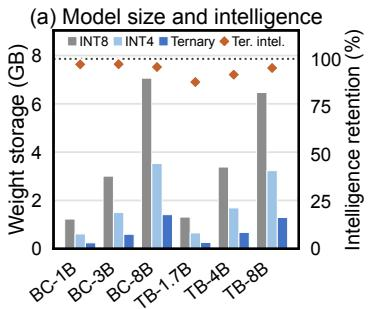

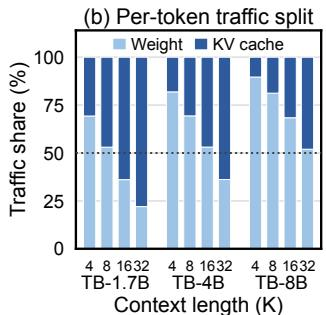  
Fig. 1: (a) Weight storage and intelligence retention vs. fullprecision base models; (b) per-token weight and KV traffic.

Model weights and attention are the two dominant memory bottlenecks in long-context edge inference. Prior work reduces model size through low-bit quantization [5–9], while LUTbased designs accelerate mixed-precision execution [10]. As shown in Fig. 1(a), recent ternary LLMs [4, 11–13] further compress weights to 1.58 bits using {−1, 0, +1} while preserving 88–97% of full-precision intelligence with only one-fifth of the storage of 8-bit models. Their ternary arithmetic also replaces multiplication with add, subtract, or skip operations. However, as the context grows to tens of thousands of tokens, the KV cache scales linearly and dominates per-token memory traffic, as shown in Fig. 1(b). Ternary quantization therefore alleviates weight traffic but exposes KV cache traffic as the new dominant bottleneck.

As summarized in Table I, existing LLM accelerators [14– 19] optimize only subsets of the end-to-end inference pipeline and fall short in three key aspects:

(1) Limited exploitation of heterogeneous sparsity across inference phases: Ternary LLMs exhibit multiple forms of sparsity, including static zero-weight sparsity [18], bit-level sparsity in attention computation [14], and dynamic attention sparsity [20]. Meanwhile, prefill is dominated by computebound SpMM (sparse–dense matrix multiplication), whereas decode is dominated by memory-bound SpMV (sparse matrix– vector multiplication) and repeated accesses to weights and the KV cache. Existing ternary accelerators mainly optimize either ternary linear computation [15, 16, 21] or sparse attention [17], but fail to jointly exploit these complementary sparsities. This leads to suboptimal end-to-end inference efficiency.

(2) Limited datapath unification for sparse ternary inference: Ternary LLMs exhibit substantial precision heterogeneity: linear layers use {−1, 0, +1} weights, whereas attention requires multi-bit computation to preserve model quality. Existing designs [16, 17, 21] typically employ lookup table-based ternary matrix-multiplication engines. However, these LUT-based PEs are optimized for dense ternary computation and cannot efficiently support sparse SpMM and SpMV at the same time. As a result, they fail to exploit the abundant zero-weight sparsity in ternary LLMs and often require separate datapaths for linear layers and attention [19, 22].

TABLE I: Comparison of LLM accelerators.
<table><tr><td>Design</td><td>Precision</td><td>Linear</td><td>Attention</td><td>Efficiency</td><td>Max Seq.</td></tr><tr><td>MCBP [14]</td><td>W8/A8</td><td>Sparse</td><td>Sparse (Top-k)</td><td>Medium</td><td>8K</td></tr><tr><td>Vec-LUT [15]</td><td>W1.58/A8</td><td>Dense</td><td>Dense</td><td>Low</td><td></td></tr><tr><td>TeLLMe [16]</td><td>W1.58/A8</td><td>Dense</td><td>Dense</td><td>Low</td><td>1K</td></tr><tr><td>TENET [17]</td><td>W1.58/A8</td><td>Dense</td><td>Sparse (Static)</td><td>Medium</td><td>1.5K</td></tr><tr><td>VitaLLM [19]</td><td>W1.58/A8</td><td>Dense</td><td>Sparse (Top-k)</td><td>Medium</td><td>4K</td></tr><tr><td>SPARTA</td><td>W1.58/A8</td><td>Sparse</td><td>Sparse (Adaptive)</td><td>High</td><td>32K</td></tr></table>

(3) Inefficient sparse attention for long-context inference: Prior accelerators support either dense [16, 21], fixedpattern [17], or Top-k [14, 19, 23] attention, making them poorly suited to long contexts. Fixed-pattern [17, 24] schemes cannot capture input-dependent attention sparsity, while fixed Top-k selection [14, 19, 23] imposes a rigid token budget. A small budget may discard important tokens, whereas a large budget introduces redundant KV-cache accesses. Consequently, existing schemes cannot adapt the selected KV set to the highly variable attention distributions across layers, heads, and inputs.

To address these limitations, we present SPARTA, a sparse ternary LLM accelerator for long-context edge inference. SPARTA systematically exploits heterogeneous sparsity across inference phases and kernels. As shown in Table I, SPARTA is, to the best of our knowledge, the first accelerator to efficiently support sequence lengths beyond 8K.

We make the following contributions:

• Sparse Dataflow for Ternary LLMs: We identify complementary sparsity across ternary weights, attention bit patterns, and KV accesses. We propose a phase-aware sparse dataflow that jointly exploits these sparsity opportunities across inference phases, enabling efficient long-context inference under edge resource constraints.

• Unified Datapath for Sparse Inference: We formulate ternary SpMM/SpMV and bit-serial QK/PV as a common outer-product conditional-accumulation primitive. Then, we propose a shared compute fabric design with a unified datapath for various sparsity patterns. The proposed design can be reused to accelerate compute-bound prefill, memory bound decode, ternary linear layers, and sparse attention, while benefiting from sparsity.

• Adaptive Sparse Attention: To improve long-sequence inference efficiency, we propose a two-stage adaptive attention scheme that combines coarse-grained page-level Top-k selection with fine-grained token-level Top-p pruning to progressively reduce K and V traffic. We address the implementation complexity with an adaptive sparse attention engine that integrates a bitonic Top-k selector and a streaming-histogram Top-p engine to efficiently realize the

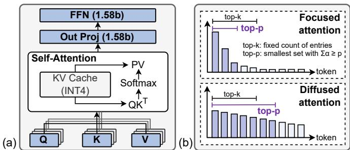  
Fig. 2: (a) Decoder block of ternary LLMs; (b) Content-aware sparse attention.

proposed dataflow.

• Key Results: Across SOTA ternary LLMs [12, 25], SPARTA reduces KV traffic by 4.1–4.8×, with task-dependent quality loss. Compared with an NVIDIA Jetson AGX Orin GPU, SPARTA achieves 3.9× higher generation throughput and 8.3× higher end-to-end energy efficiency; the corresponding gains over an AMD Ryzen 7 9700X CPU are 5.0× and 81.7×. Against SOTA LLM accelerators [10, 14, 16, 17], SPARTA achieves 1.6–12.0× higher throughput than FIGLUT, TeLLMe, and MCBP, and 2.0–4.2× higher energy efficiency across prefill and decode.

## II. BACKGROUND AND MOTIVATION

## A. Ternary LLM Inference

Autoregressive inference has compute-bound prefill and memory-bound decode [26]. Each decode token streams weights and accesses a sequence-growing KV cache. Fig. 2(a) shows 1.58-bit ternary linear weights and INT4 KV cache for attention calculation.

Linear Layer. Ternary constrains linear-layer weights to $\{ - 1 , 0 , + 1 \}$ with FP16-comparable accuracy [11, 12]. It cuts FP16 weight traffic by roughly 10× and replaces MACs with add, subtract, or skip. The sparsity in weights enables zero skipping, thereby enabling more efficient inference.

Attention and KV-Cache. Though linear weights can be quantized to ternary values, the attention remains at higher precision to ensure model accuracy. QServe, KIVI, and KVQuant compress KV caches to about 4 bits [27–29], while MCBP and PADE use INT8 $Q K ^ { \mathsf { T } } / P V$ with FP16 nonlinear operations [14, 30]. For a decode query q over N cached tokens, the dense attention is computed as follows:

$$
\alpha _ { i } = \frac { \exp \left( q ^ { \mathsf { T } } k _ { i } / \sqrt { D } \right) } { \sum _ { j = 1 } ^ { N } \exp \left( q ^ { \mathsf { T } } k _ { j } / \sqrt { D } \right) } , \qquad o = \sum _ { i = 1 } ^ { N } \alpha _ { i } v _ { i } .\tag{1}
$$

Eq. (1) scores every cached key and combines every value. Thus, KV-cache quantization reduces bytes per entry, but dense attention still need to access all KV data and incurs quadratic complexity.

## B. Sparse Attention

Sparse attention instead reduces the number of KV entries accessed. Fixed-pattern methods retain query-independent sinks and local windows [17, 31]. They are hardware-friendly but

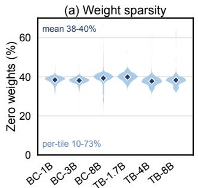

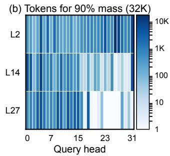  
Fig. 3: (a) Sparsity ratios of ternary LLMs; (b) median tokens covering 90% attention mass per head (BitCPM-3B, 32K).

may discard distant and relevant tokens, thus creating accuracy loss under long context.

To address this issue, content-aware Top-k in Fig. 2(b) selects a fixed-size set by exact or estimated relevance:

$$
\mathrm { T o p - } k : \quad \mathcal { T } _ { k } \in \underset { \mathcal { T } \subseteq \{ 1 , \ldots , N \} } { \arg \operatorname* { m a x } } \sum _ { i \in \mathcal { T } } \tilde { s } _ { i } ,\tag{2}
$$

Here, $\tilde { s } _ { i }$ is the relevance score and $\mathcal { T } _ { k }$ is the retained set. Quest applies Top-k at the KV-page level [23]. Its fixed budget is predictable, but may over-fetch focused attention or discard useful context under diffused attention scores.

Top-p is more adaptive to the distributions of attention scores. It removes the fixed-budget constraint by selecting the smallest set covering a target probability mass:

$$
\mathrm { T o p } \cdot p : \quad \mathcal { T } _ { p } \in \underset { \mathbb { Z } \subseteq \{ 1 , \dots , N \} } { \arg \operatorname* { m i n } } \ | \mathbb { Z } | \quad \mathrm { s . t . } \quad \sum _ { i \in \mathbb { Z } } \alpha _ { i } \geq p .\tag{3}
$$

Here, $\alpha _ { i }$ is the normalized probability from Eq. (1) and $\mathcal { T } _ { p }$ is the retained set. Twilight combines coarse filtering with probability mass-based Top-p pruning [20], adapting the retained count to each query. This adaptivity saves KV accesses but requires runtime selection and irregular data movement.

## C. Challenges and Opportunities

C1: Efficient Prefill and Decode Dataflows for Ternary LLMs. LLM inference exhibits computational heterogeneity across inference phases: prefill is dominated by computebound GEMM with high weight reuse, whereas decode is memory-bound due to GEMV and multi-head attention (MHA) that repeatedly stream model weights and the growing KV cache [32–34]. Although ternary LLMs greatly reduce weight storage, they introduce multiple sparsity opportunities, including zero-valued ternary weights, sparse bits in attention computation, and highly skewed attention distributions, as shown in Fig. 3. Significant fractions of ternary weights and sparse attention values contribute no effective computation, while attention sparsity can eliminate up to 90% of token accesses at long contexts. However, existing accelerators mostly accelerate ternary linear layers and sparse attention separately [16–18, 35–37]. They do not coordinate these complementary sparsities across prefill and decode, leaving end-to-end optimization opportunities unexploited.

Solution: We propose a phase-aware sparse dataflow in SPARTA that systematically exploits heterogeneous sparsity across prefill and decode. By jointly leveraging ternary-weight sparsity, bit-level sparsity, and adaptive attention sparsity, the proposed dataflow improves end-to-end efficiency for longcontext ternary LLM inference.

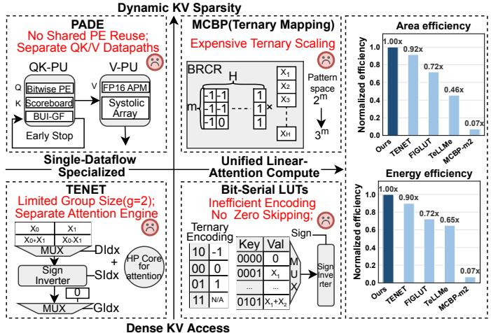  
Fig. 4: Design-space limitations of existing LLM accelerator PEs and normalized area and energy efficiency comparisons.

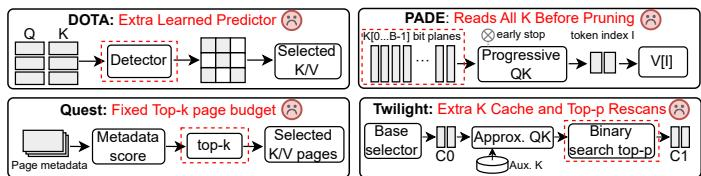  
Fig. 5: Tradeoffs of prior sparse-attention paths: an extra learned predictor, key scoring over the full context, a fixed Top-k page budget, or an extra K cache with repeated Top-p scans.

C2: Unified Datapath and Efficient PE Design. Ternary LLM inference introduces operator-level precision and datapath heterogeneity: linear layers use ternary weights, whereas attention uses multi-bit operands with sparse Q/P bit planes. Fig. 4 summarizes how existing PEs target this heterogeneity. PADE fuses predictor-free sparsity discovery with attention execution, leaving projections and FFNs to the GPU [30]. TENET/TeLLMe use ternary LUTs [16, 17], while FIGLUT/MCBP use binary-plane or base-3 mappings [10, 14]. These designs do not share one datapath across ternary GEMM/GEMV and multi-bit QK/PV.

Solution: SPARTA maps ternary GEMM/GEMV and bit-serial QK/PV to one conditional-accumulation datapath. It skips zero weights and zero Q/P bits, while bank-local accumulation and conflict FIFOs handle irregular accesses without LUT or pattern reconstruction. Compared with TENET and TeLLMe, the PE design in SPARTA achieves up to 2.2× higher area efficiency and 1.5× higher energy efficiency, as shown in Fig. 4. Adapting MCBP’s binary patterns to ternary weights via positive/negative passes reduces area but increases cycles; area and estimated energy efficiencies are only 7.3% and 6.8% of SPARTA’s.

C3: Adaptive Sparse Attention for Long-Context Inference. As context lengths grow, KV-cache accesses dominate decode traffic (Fig. 1(b)), making sparse attention critical. However, fixed Top-k selection cannot accommodate the highly variable attention sparsity across layers, heads, and inputs. As shown in Fig. 3(b), the number of tokens covering 90% of attention mass varies by three orders of magnitude, causing fixed budgets to either waste KV accesses or lose important tokens. Top-p selection addresses this limitation by dynamically adjusting the retained tokens based on each attention distribution [20, 38]. Efficient adaptation, however, must avoid offsetting its traffic savings with selection overhead. As summarized in Fig. 5, prior designs make different tradeoffs: DOTA trains a lightweight predictor, PADE avoids a predictor by scoring keys bit-serially with early termination, Quest bounds K traffic with a fixed page budget, and Twilight estimates Top-p from an extra lowprecision K cache [20, 23, 30, 39].

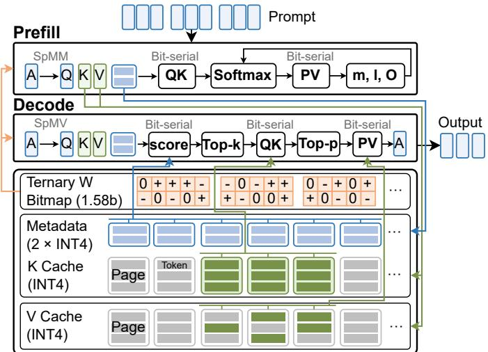  
Fig. 6: Overview of the prefill and decode dataflows.

Solution: We propose an adaptive sparse attention with twostage selection for efficient long-context attention. The proposed attention scheme is composed of a page-level Top-k selection and a histogram-based Top-p selection to adaptively prune KV traffic. We also present the low-complexity architecture to implement the adaptive sparse attention on area-constrained hardware.

## III. SPARTA DATAFLOW

## A. Phase-aware Sparse Dataflow

Prefill exposes token parallelism and weight reuse, whereas single-token decode repeatedly streams model weights and the growing KV cache [26]. Supporting both phases requires exploiting zero ternary weights and sparse Q/P bits in computation, while converting query-dependent attention sparsity into fewer K/V accesses [14, 18, 20]. Coordinating these opportunities without phase- or operator-specific paths is the central dataflow challenge. Fig. 6 illustrates how SPARTA integrates these mechanisms across prefill and decode. The unified sparse execution in Section III-B maps linear and attention computation onto a unified execution path, while the adaptive attention with two-stage selection in Section III-C progressively reduces KV cache traffic.

Prefill. The prompt is partitioned into fixed-size chunks to bound the on-chip working set. Within each Transformer layer, bitmap-compressed ternary weights are reused across the tokens in each chunk for the QKV projections, output projection, and FFN. The generated K/V vectors are quantized to INT4 and appended to the paged cache. Each completed K page also records a signed INT4 minimum and maximum per feature as compact metadata for decode.

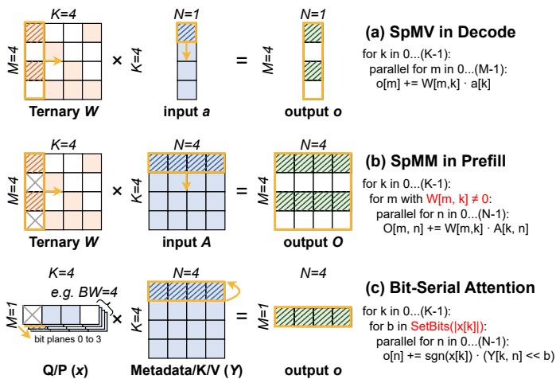  
Fig. 7: Unified dataflows for ternary SpMM/SpMV and bitserial attention.

Prefill attention scans the cached K/V chunks using online Softmax [40, 41]. Only the running maximum, normalizer, and output accumulator (m, ℓ, O) persist across chunks, bounding the on-chip attention state while producing the exact result. Decode. After the prompt is consumed, each generated token triggers one decode pass through the model. The linear layers stream weights for the new activation vector. Attention first selects pages from metadata, computes exact candidate QK scores for tokens in those pages, prunes the resulting tokens by probability mass, and finally fetches the retained V data for PV.

## B. Unified Sparse Execution for Linear and Attention

Ternary linear layers and multi-bit attention expose sparsity in different operand representations. Linear layers contain static zero weights, whereas bit-serial attention contains zero bits across the Q and P bit planes; both eliminate vector updates that do not contribute to the result. Existing accelerators typically specialize in one class of operations or use separate datapaths for the two [10, 16, 17, 30], limiting their ability to exploit both forms of sparsity within a unified design. Supporting both on one compute structure is difficult because ternary SpMM/SpMV encodes each update with a ternary weight, while QK/PV decomposes multi-bit Q/P coefficients into shifted bit-plane updates and maps parallel lanes to different dimensions.

For the shared dataflow, neither the dot-product nor the row-wise organization is well suited to the compute structure. In a dot-product dataflow, each lane computes one output, so varying nonzero counts make lanes finish at different times, and every output requires a separate reduction. A row-wise dataflow completes one output row at a time, but sparse column indices cause irregular accesses to dense-matrix rows and limit their reuse. SPARTA therefore adopts an outer-product dataflow, which provides regular vector updates and reuses the selected operand across multiple lanes.

Fig. 7 shows how SPARTA maps all three operators to the outer-product dataflow. At each outer-product step, a selected vector operand v is optionally scaled by a power of two and added to or subtracted from an accumulator state z:

$$
\mathbf { z }  \mathbf { z } + s 2 ^ { b } \mathbf { v } , \qquad s \in \{ - 1 , + 1 \} .\tag{4}
$$

In ternary SpMM, each nonzero weight updates a vector of output columns, while SpMV uses one activation to update multiple output rows; both derive s from the ternary weight and use $b = 0 .$ . Bit-serial attention decomposes each multi-bit coefficient into a sequence of shifted vector updates. In Fig. 7(c), $x _ { b , k } \in \{ 0 , 1 \}$ denotes bit b of the magnitude $| x _ { k } | \colon x$ represents Q during page and QK scoring, and P during PV; Y is the corresponding metadata, K, or V operand. Metadata scoring and QK derive s from the query sign and b from its set-bit position. PV represents each normalized probability with 16 fixed-point probability bits (P-bits); every set-bit position supplies $b ,$ with $s = + 1$ . Although the vector operands and lane meanings differ, every operator is expressed as the same conditional vector update. This common execution model removes the need for operator-specific accumulation datapaths; Section IV-B details the hardware and lane mappings.

## C. Adaptive Sparse Attention with Two-Stage Selection

The goal of adaptive sparse attention is to reduce KV traffic with low selection overhead. Top-k bounds K traffic but cannot adapt its fixed budget to different attention score distributions [23, 42]. Top-p adapts to the candidate attention distribution but requires exact QK scores and thus cannot reduce K reads [20]. Combining them allows Top-k to prune K pages first and Top-p to further prune V tokens.

Let N denote the total number of cached tokens for the current query, and let $\rho _ { k }$ be the fraction retained by page-level Top-k. The selected pages form a candidate set T with $| \mathcal { T } | =$ $\rho _ { k } N$ tokens, including the mandatory sink and recent pages. Top-p further retains a set $\mathcal { R } \subseteq \mathcal { T }$ , where $\rho _ { p } = | \mathcal { R } | / ( \rho _ { k } N )$ is the retained fraction among the candidates. The page budget is $k = \lceil \rho _ { k } \lceil N / 1 6 \rceil \rceil$ , e.g., 512 pages for a 32K-token context at $\rho _ { k } = 1 / 4$ , the largest configuration the selector supports.

Twilight demonstrates the effectiveness of hierarchical Topk+Top-p pruning [20] on GPU. Pruner requires an additional low-precision K scoring pass. SPARTA redesigns this path for native paged-INT4 execution: compact metadata selects K pages, and the resulting candidate QK scores directly drive Top-p. To quantify the resulting traffic savings, we count one token’s KV vectors as one traffic unit. The traffic C under dense, Top-k-only, and Top-k+Top-p attention is:

$$
\begin{array} { c } { { C _ { \mathrm { d e n s e } } = 2 N , } } \\ { { C _ { k } = \displaystyle \frac { N } { 8 } + 2 \rho _ { k } N , } } \\ { { C _ { k + p } = \displaystyle \frac { N } { 8 } + ( 1 + \rho _ { p } ) \rho _ { k } N . } } \end{array}\tag{5}
$$

Here, the $N / 8$ term reads two metadata extrema per channel for every 16-token page. Top-k-only attention reads both K and

Algorithm 1 Two-stage Top-k + Top-p decode attention   
Require: Query q; page metadata; page budget $k ;$ mass target p   
Ensure: Sparse attention output o   
1: Score all pages using Eq. (6)   
2: Select G within the total budget $k ;$ form $\tau ;$ gather only $K [ \mathcal { T } ]$   
3: Compute exact candidate QK scores for $t \in { \bar { \tau } }$ and find m   
4: Quantize each $\Delta _ { t } ;$ accumulate H and record $b _ { t }$   
5: Scan H to obtain $b ^ { \star }$ and retained tokens R   
6: Gather only $V [ \mathcal { R } ]$   
7: Compute o using Eq. (8)

V for all $\rho _ { k } N$ candidates. Adding Top-p leaves the K traffic unchanged but reduces V traffic to $\rho _ { p } \rho _ { k } N$

These traffic savings translate into speedup only if Topp selection is itself hardware-efficient. The main challenge is finding the mass threshold over $\rho _ { k } N$ candidate scores. Twilight[20] uses binary search and rescans the candidates L times, requiring $O ( \rho _ { k } N L )$ work; its stopping tolerance of $1 0 ^ { - 5 }$ allows up to $L = 1 7$ full scans of normalized attention weights. In contrast, SPARTA streams the candidate masses into a fixed B-bin histogram and scans only the bins for the threshold, reducing the work to $O ( \rho _ { k } N + B )$ with fixed-size on-chip state. Algorithm 1 summarizes the resulting decode flow.

K Page Selection with Top-k. Let $K _ { g , d } ^ { \mathrm { m i n } }$ and $K _ { g , d } ^ { \mathrm { m a x } }$ be the signed INT4 extrema of key dimension d in page g. For query q, the page score and selected page set are

$$
\begin{array} { r l } & { \hat { \boldsymbol s } _ { g } = \displaystyle \sum _ { d = 0 } ^ { D - 1 } \operatorname* { m a x } \left( q _ { d } K _ { g , d } ^ { \operatorname* { m i n } } , q _ { d } K _ { g , d } ^ { \operatorname* { m a x } } \right) , } \\ & { \mathcal { G } = \mathcal { G } _ { \mathrm { k e e p } } \cup \mathrm { T o p K } _ { k - | \mathcal { G } _ { \mathrm { k e e p } } | } \left( \left\{ \hat { \boldsymbol s } _ { g } : g \notin \mathcal { G } _ { \mathrm { k e e p } } \right\} \right) , } \end{array}\tag{6}
$$

where $\mathcal { G } _ { \mathrm { k e e p } }$ contains the mandatory sink and recent pages, which count toward the total budget k. For $k \geq | \mathcal { G } _ { \mathrm { k e e p } } |$ , it gives $| { \mathcal { G } } | = k .$ Because each key element lies between its page extrema, $\mathbf { q } ^ { \mathsf { T } } \mathbf { k } _ { g , t } \leq \hat { s } _ { g }$ for every token t in page g. Thus, page selection only reads metadata and K vectors are fetched only after their pages enter G, forming the candidate set $\mathcal { T } =$ $\textstyle \bigcup _ { g \in { \mathcal { G } } }$ tokens(g) with $| \mathcal { T } | = \rho _ { k } N$

V Token Selection with Top-p. After gathering $K [ \mathcal { T } ]$ , SPARTA computes the exact candidate QK score $s _ { t } = \mathbf { q } ^ { \mathsf { T } } \mathbf { k } _ { t } / \sqrt { D }$ of every candidate token. It then quantizes their exponential masses into the ordered histogram used for threshold search. Let $m \ = \ \operatorname* { m a x } _ { t \in \mathcal { T } } s _ { t }$ be the largest candidate score and $\Delta _ { t } \ = \ m - s _ { t } \ \ge \ 0$ be token $t \mathbf { \bar { s } }$ gap from that maximum. A smaller gap indicates a larger attention weight. The quantizer maps this gap to a histogram bin $b _ { t } = Q ( \Delta _ { t } )$ , with bin 0 closest to the maximum, and the exponential LUT returns the token’s approximate unnormalized Softmax mass $\mu _ { t } = \mathrm { E x p L U T } ( b _ { t } ) \approx e ^ { - \Delta _ { t } }$ . The mass histogram and crossing bin are

$$
\begin{array} { l } { H _ { b } = \displaystyle \sum _ { t \in \mathcal T : b _ { t } = b } \mu _ { t } , } \\ { b ^ { \star } = \displaystyle \operatorname* { m i n } \left\{ b : \sum _ { j = 0 } ^ { b } H _ { j } \geq p \sum _ { j } H _ { j } \right\} , } \\ { \mathcal { R } = \{ t \in \mathcal T : b _ { t } \leq b ^ { \star } \} . } \end{array}\tag{7}
$$

(b) Shared Fabric  
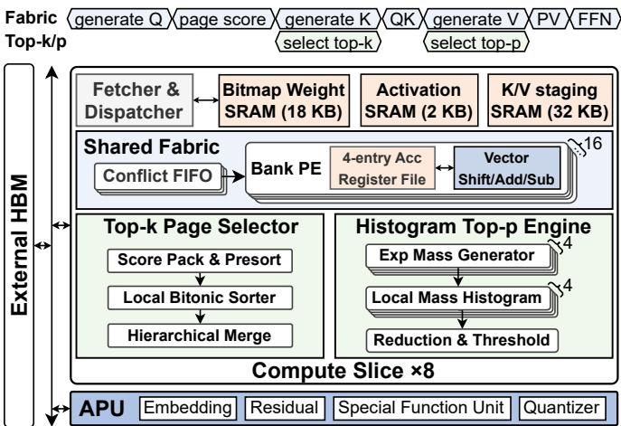  
Fig. 8: Architecture overview of SPARTA.

Here, $H _ { b }$ is the total candidate mass in bin b. The bins are scanned from high scores to low scores, starting at bin 0, and their masses are accumulated until the running sum reaches or exceeds p times the total mass within T. The bin where this crossing occurs is $b ^ { \star }$ . The retained set R includes every token from bin 0 through $b ^ { \star }$ , conservatively meeting the candidate-set histogram mass target. The target p is normalized over T only, and Top-p never revisits pages excluded by Top-k. Only V [R] is gathered, and PV renormalizes over the retained mass:

$$
\mathbf { o } = { \frac { \sum _ { t \in \mathcal { R } } \mu _ { t } \mathbf { v } _ { t } } { \sum _ { t \in \mathcal { R } } \mu _ { t } } } .\tag{8}
$$

Grouped-Query Attention. All evaluated models use GQA, where G query heads share one KV head $( G ~ = ~ 2 – 1 6 )$ Independent per-head selection would multiply the K traffic of a group by up to $G ,$ so SPARTA performs one page Top-k per KV group: each head converts its page scores $\hat { s } _ { g }$ into a probability distribution over pages with a Softmax, and the group keeps the k pages with the largest total probability across its heads. The heads share $\tau$ and its K reads, Top-p remains per head, and V is gathered for the union of the retained sets. MQA is the single-group case.

## IV. SPARTA ARCHITECTURE AND HARDWARE

## A. Architecture Overview

SPARTA implements the aforementioned dataflow mainly through two key hardware components. First, a shared compute fabric implements the unified sparse kernels (SpMM, SpMV, and sparse attention), eliminating separate operator-specific modules. Second, it includes an adaptive sparse attention engine with a fixed-size Bitonic Top-k page selector and a streaming histogram Top-p engine.

Fig. 8 shows the top-level architecture of SPARTA, consisting of eight identical compute slices connected to external HBM2. The slices operate in parallel on independent attention-head and output-tile partitions. Each slice contains the shared fabric (Section IV-B), the adaptive sparse attention engine (Section IV-C), operand buffers, and an activation-processing unit (APU). A fetcher and dispatcher stage three operand streams from HBM into per-slice SRAM: bitmap-compressed ternary weights, INT8 activations/queries, and packed-INT4 K/V data with their page extrema. The APU handles embedding, residual, special-function, and quantization operations.

(a) Operator-to-Request Mapping  
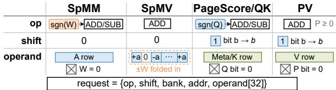

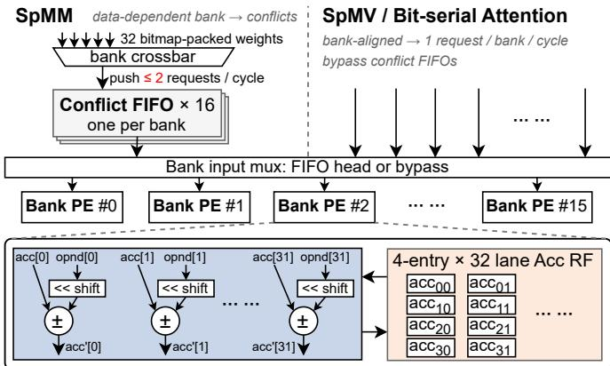  
Fig. 9: Operator-to-request mapping and the shared fabric.

The timing diagram at the top of Fig. 8 highlights inter-stage parallelism during decode. Because sink and recent pages are always retained (Section III-C), K and V generation for the new token proceed in parallel with page Top-k and histogram Top-p selection, respectively. Section V-C quantifies these overlaps.

## B. Shared Fabric for Unified Sparse Execution

SpMM, SpMV, and attention share the conditional update in Eq. (4), but expose sparsity along different dimensions. To preserve these sparsity opportunities on one fabric, SPARTA represents each effective vector update with a common request containing an opcode, a shift amount, a target bank and accumulator address, and an operand vector, as shown in Fig. 9(a). The controller selects one request stream to drive the fabric until the operation completes. Switching between operations therefore changes only the request interpretation, while the PE array and output path remain unchanged.

Ternary SpMM. Each nonzero weight generates an ADD or SUB request according to its sign, with zero shift and an activation row as the operand; the lanes map to output columns. Let $s _ { w }$ denote the fraction of zero weights (about 40%), and let $P$ and L be the numbers of PEs and lanes per PE in one compute slice, respectively. Emitting requests only for nonzero weights reduces the ideal SpMM cycle complexity from O(MKN/(PL)) to $\mathcal { O } ( ( 1 - s _ { w } ) M K N / ( P L ) )$ , yielding an ideal speedup of $1 / ( 1 - s _ { w } ) \approx 1 . 6 7 \times$

Ternary SpMV. For an activation scalar a, a SpMV request uses ADD with zero shift, while its operand vector folds each ternary weight into the broadcast activation as +a, 0, or −a; the lanes map to output rows. SpMV retains its bank-aligned group schedule, so its ideal cycle complexity remains $\mathcal { O } ( M K / ( P L ) )$ ), but gating zero-weight lanes reduces the useful arithmetic work from O(MK) to $\mathcal { O } ( ( 1 - s _ { w } ) M K )$ .

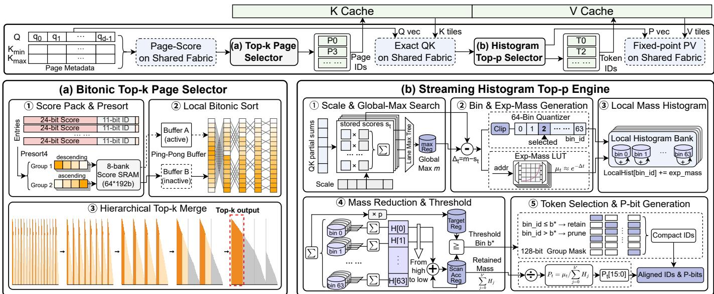  
Fig. 10: Two-stage sparse-attention selectors: (a) Bitonic page Top-k; (b) histogram token Top-p.

Bit-serial Attention. Page scoring and QK encode the query sign as ADD/SUB and each set Q bit as a shift, with metadata or K rows as operands. PV uses ADD with each set P bit as a shift and V rows as operands. Let $s _ { q }$ and $s _ { p }$ be the zero-bit fractions of the $B _ { q } { \mathrm { - } } { \mathrm { b i t } }$ queries and $B _ { p } { \mathrm { - } } \mathrm { b i t }$ probabilities, and let D denote the attention-head dimension. Issuing requests only for set bits reduces the ideal QK and PV cycle complexities to $\mathcal { O } ( ( 1 - s _ { q } ) B _ { q } \rho _ { k } N D / ( P L ) )$ and $\mathcal { O } ( ( 1 - s _ { p } ) B _ { p } | \mathcal { R } | D / ( P L ) )$ ); with $s _ { q }$ ≈ 69% and $s _ { p } \approx 8 3 \%$ , this yields 3.2× and 5.7× speedups, respectively.

As shown in Fig. 9(b), skipping zero weights makes the SpMM request stream irregular. Because each surviving weight determines its own destination, multiple requests may target the same bank in one cycle. A bank crossbar routes the requests by destination, and each bank uses a conflict FIFO that can accept up to 2 requests per cycle. The two enqueue ports allow the bitmap decoder to continue issuing requests while each FIFO drains one request per cycle. SpMV and bit-serial attention retain bank-aligned request streams with at most one request per bank per cycle; they therefore bypass the conflict FIFOs and enter the bank input mux directly.

The PE datapath in Fig. 9(b) uses P = 16 PEs and L = 32 accumulation lanes per PE, together with a 4-entry accumulator register file. Each request identifies a target PE and accumulator address. The corresponding partial sum remains in the local accumulator register file and is emitted directly when complete. Section V-D evaluates the choices of P, L, and the conflict-FIFO depth.

## C. Adaptive Sparse Attention Engine

Dataflow. The upper lane of Fig. 10 summarizes the complete sparse-attention dataflow. The shared fabric first computes metadata-based page scores, and the Top-k selector returns page IDs for K gathering. Exact QK scores over the gathered K tiles then feed the Top-p engine, which selects token IDs, generates P-bits, and triggers V gathering. Finally, the resulting P-bits and gathered V tiles drive PV on the shared fabric.

Bitonic Top-k Page Selector. Page-level Top-k must rank a page-score stream that grows with context length. As shown in Fig. 10(a), SPARTA time-multiplexes a fixed-size Bitonic sorter, so a longer context increases the number of iterations rather than the sorter size.

Selection proceeds in three stages. Score Pack & Presort ( 1 ) pairs each score with its page ID, presorts every four entries, and writes them to the score SRAM. Local Bitonic Sort ( 2 ) uses two ping-pong buffers and a small sorting network to process one window at a time. Finally, Hierarchical Top-k Merge ( 3 ) combines the sorted windows. All page scores are buffered in a 2048-entry page-score SRAM, so no rate matching is needed. Bitonic merges grow sorted runs up to the 512-entry selector capacity, reading one run in reverse (the descending window in Fig. 10(a)); beyond that, each merge keeps only the top half of its output.

The sorter is reused across all windows and merge levels. Non-power-of-two page counts are padded with invalid entries that always rank below valid pages. Entries are ordered by score, with the smaller page ID selected when two scores are equal. Each gathered K tile is staged locally and reused across the set Q bits; unselected pages generate no HBM requests. Streaming Histogram Top-p Engine. Top-p must find a variable-size token set whose cumulative probability reaches the target p. Software usually finds the threshold by sorting or repeatedly scanning all candidate scores, which is costly in hardware. SPARTA instead quantizes the exponential masses into a fixed-resolution histogram and finds the threshold with two fixed passes over 64 bins. Fig. 10(b) shows the resulting five-step engine.

As partial sums for the exact candidate QK scores arrive,

Scale & Global-Max Search $\textcircled{1}$ applies the quantization scales, stores each final score $s _ { t }$ , and reduces the lane maxima to the global maximum m. Because each bin ID is defined relative to m, the final histogram cannot be updated before the global maximum is known. Bin & Exp-Mass Generation ( 2 ) therefore rereads the stored scores, quantizes each gap $m - s _ { t }$ into one of 64 ordered bins, and uses the exponential-mass LUT to obtain $\mu _ { t } \approx e ^ { s _ { t } - m }$ . Four parallel mass-generation lanes feed four local histogram banks, avoiding simultaneous updates to one histogram SRAM. Local Mass Histogram ( 3 ) accumulates each $\mu _ { t }$ into its local bin. The histogram, LUT, and reducer are fixed-size, and the candidate-score buffer is sized for the 8192-candidate maximum; only the latency of scaling and binning the candidate scores (steps 1 and 2 ) grows with the number of candidates.

Mass Reduction & Threshold ( 4 ) reduces the per-bank histograms into the global bin masses $H _ { b } .$ . One bin pass computes the total mass and the target $p \sum _ { b } H _ { b } . \mathrm { ~ A ~ }$ second pass scans from bin 0 toward lower scores until the cumulative mass reaches the target, producing $b ^ { \star }$ and the retained mass $\textstyle \sum _ { j = 0 } ^ { b ^ { \star } } H _ { j }$ . Token Selection & P-bit Generation ( 5 ) applies $b _ { t } \leq b ^ { \star }$ and compacts the survivors into aligned token-ID/Pbit pairs, with the P-bits encoding their normalized masses. A lookahead gather prefetches only V[R] and buffers the returned tiles until PV consumes them; the V of a token is skipped only when no head in its KV group retains it.

Section V-D evaluates both design tradeoffs: the Top-k window size balances latency and sorter area, while the Top-p histogram resolution balances threshold-search latency, SRAM footprint, and implementation complexity.

## V. EVALUATION

## A. Experimental Setup

Models and Workload. We evaluate six ternary LLMs from two model families: BitCPM-1B/3B/8B [25] and Ternary-Bonsai-1.7B/4B/8B [12]. Algorithmic quality is measured by perplexity on WikiText-2 [43] and PG19 [44] and by task scores on seven generative benchmarks. GovReport [45], QMSum [46], and MultiNews [47] cover long-context summarization, while GSM8K [48], MBPP [49], IFEval [50], and CoQA [51] cover short-context reasoning, code generation, instruction following, and question answering.

Quantization. All quantizers are symmetric without zeropoints: activations and queries use per-token INT8 scales, P uses 16-bit fixed point, and the KV cache uses INT4. BitCPM uses per-token scales for both K and V, while Bonsai follows KIVI [28] with per-channel K scales and per-token V scales. Algorithm Baselines. Model accuracy evaluations follow the settings in Twilight [20]. The dense baseline performs full attention under the same numerical formats, while Quest [23] is used as the page-level Top-k baseline.

Hardware Baselines. We compare the end-to-end inference performance of SPARTA against recent edge LLM accelerators on CPU, GPU, FPGA, and ASIC platforms as follows:

• CPU and GPU. We evaluate an AMD Ryzen 7 9700X CPU using the llama.cpp [3] SIMD backend with eight threads and an NVIDIA Jetson AGX Orin configured at 50 W. The CPU system has 64 GB of dual-channel DDR5- 4800 memory with 76.8 GB/s peak bandwidth, while the Jetson has 64 GB of LPDDR5 memory with 204.8 GB/s peak bandwidth. Both platforms run the Bonsai and BitCPM models with dense attention and an FP16 KV cache; we additionally report the Jetson with an INT4 KV cache. In this comparison, the energy of SPARTA includes HBM, whereas CPU energy is the RAPL package power and Jetson energy is measured on its module power rails.

TABLE II: Hardware configuration of SPARTA.
<table><tr><td rowspan=1 colspan=1>Component</td><td rowspan=1 colspan=1>Configuration</td></tr><tr><td rowspan=1 colspan=1>Technology and Freq.</td><td rowspan=1 colspan=1>28 nm, 1 GHz</td></tr><tr><td rowspan=1 colspan=1>Organization</td><td rowspan=1 colspan=1>8 Compute Slices; 16 PEs/Slice; 32 Lanes/PE</td></tr><tr><td rowspan=1 colspan=1>Selection Engines</td><td rowspan=1 colspan=1>64-entry Top-k window; 64-bin Top-p histogram</td></tr><tr><td rowspan=1 colspan=1>On-chip Buffer</td><td rowspan=1 colspan=1>144 KiB weights; 16 KiB Q tiles; 280 KiB K/Vstaging; 384 KiB QK scores; 256 KiB mass/scale/P-bit state; 16.25 KiB selection state</td></tr><tr><td rowspan=1 colspan=1>External Memory</td><td rowspan=1 colspan=1>HBM2, 8×128-bit HBM channels @2 GHz, 8 GB</td></tr></table>

• ASIC and FPGA. SPARTA hardware is compared to the following ASIC and FPGA baselines: FIGLUT [10], TENET [17], TeLLMe [16], MCBP [14], FACT [52], Energon [53], and LUT-DLA [54]. For FIGLUT, TeLLMe, TENET, and MCBP, we reproduce each linear PE in RTL using our 28-nm flow and scale it to its published width (e.g., 16 TENET cores of 32×64). For MCBP, we map ternary weights onto its binary patterns with sequential positive/negative passes, which is more area- and energyefficient than a direct ternary mapping. Designs without sparse attention use our dense attention datapath. TENET’s sliding window (up to 1.5K tokens) and MCBP’s BGPP apply within their published ranges; attention is dense beyond them. All share HBM2 and run at 1 GHz, except TENET at 500 MHz. Energy includes on-chip and HBM dynamic energy; Table V lists on-chip power only.

Hardware Simulation. We implement SPARTA with the configuration in Table II using SystemVerilog and synthesize the design with Synopsys Design Compiler using a commercial 28-nm library. The area and energy of on-chip SRAM are estimated by CACTI [55]. A trace-driven cycle-level simulator, calibrated against per-stage RTL cycle counts, evaluates endto-end performance. Its input traces record the pages selected by Top-k and the tokens kept by Top-p at each decode step of model inference. The simulator converts them into HBM2 reads, page-granular for metadata and K and token-granular for V, and charges them at a sustained HBM2 bandwidth that we validate by replaying the same address traces in Ramulator2 [56]. HBM2 access energy is 4 pJ/bit [57].

## B. Algorithm Evaluation

We evaluate the adaptive sparse attention algorithm from three perspectives: parameter sensitivity, quality across models and tasks, and reductions in computation and KV traffic.

Sparse Attention Parameters. Fig. 11 sweeps the Top-k pageretention ratio $\rho _ { k }$ from 1/16 to $1 / 2$ and the Top-p threshold $p$ from 0.80 to 0.95. Across all six models, $\rho _ { k }$ is the primary quality knob: reducing the page budget generally increases perplexity, while increasing p tends to recover quality within each budget. $\mathrm { A t } \ \rho _ { k } = 1 / 4$ and $p = 0 . 9 0$ , four models remain within 1.3% of their dense baselines, and the worst degradation among the remaining models is 4.0%. We therefore adopt $\rho _ { k } = 1 / 4$ and $p = 0 . 9 0$ as the default parameters.

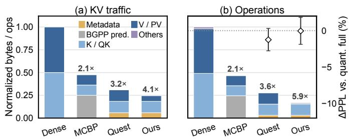

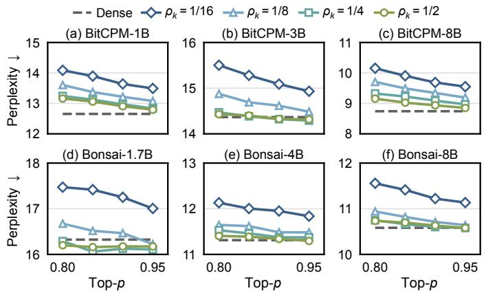

Fig. 11: Perplexity under different Top-k and Top-p settings. TABLE III: Quality comparison with dense attention.
<table><tr><td>Model</td><td>Config</td><td>GovR</td><td>QMS</td><td>MNw</td><td>GSM8K</td><td>MBPP</td><td>IFE</td><td>CoQA</td><td>GMean</td><td>|∆|</td></tr><tr><td>BitCPM-1B</td><td>Dense</td><td>25.9</td><td>21.2</td><td>25.3</td><td>50.8</td><td>42.4 64.1</td><td></td><td>54.1</td><td>37.4</td><td></td></tr><tr><td></td><td>Ours</td><td>21.3</td><td>20.8</td><td>21.7</td><td>50.2</td><td>42.0 65.1</td><td></td><td>54.6</td><td>35.61.88</td><td></td></tr><tr><td>BitCPM-3B</td><td>Dense</td><td>25.9</td><td>22.4</td><td>25.7</td><td>67.9</td><td>15.6 68.4</td><td></td><td>34.4</td><td>32.4</td><td></td></tr><tr><td></td><td>Ours</td><td>23.8</td><td>22.3</td><td>23.9</td><td>67.6</td><td>16.4 68.4</td><td></td><td>35.7</td><td>32.00.36</td><td></td></tr><tr><td>BitCPM-8B</td><td>Dense</td><td>27.1</td><td>23.6</td><td>25.6</td><td>62.5</td><td>56.2 69.1</td><td></td><td>73.1</td><td>43.4</td><td></td></tr><tr><td></td><td>Ours</td><td>22.8</td><td>22.4</td><td>21.9</td><td>68.8</td><td>55.4 68.4</td><td></td><td>73.0</td><td>41.5 1.89</td><td></td></tr><tr><td>Bonsai-1.7B Dense</td><td></td><td>31.4</td><td>21.4</td><td>24.7</td><td>40.6</td><td>26.2 70.6</td><td></td><td>35.0</td><td>33.1</td><td></td></tr><tr><td></td><td>Ours</td><td>28.3</td><td>20.5</td><td>19.7</td><td>39.7</td><td>26.8 70.8</td><td></td><td>34.6</td><td></td><td>31.4 1.75</td></tr><tr><td>Bonsai-4B</td><td>Dense</td><td>32.0</td><td>20.1</td><td>23.3</td><td>79.8</td><td>47.2 74.5</td><td></td><td>44.8</td><td>40.8</td><td></td></tr><tr><td></td><td>Ours</td><td>30.0</td><td>24.1</td><td>23.9</td><td>80.4</td><td>47.2</td><td>72.6</td><td>44.2</td><td>41.5</td><td>0.66</td></tr><tr><td>Bonsai-8B</td><td>Dense</td><td>33.2</td><td>20.5</td><td>25.7</td><td>72.3</td><td>43.6 80.8</td><td></td><td>52.7</td><td>42.1</td><td></td></tr><tr><td></td><td>Ours</td><td>27.9</td><td>22.0</td><td>19.2</td><td>72.9</td><td>43.4 81.0</td><td></td><td>53.2</td><td></td><td>39.92.21</td></tr></table>

GMean is the geometric mean of seven task scores; |∆| is its absolute change. GSM8K uses strict EM, MBPP pass@1, IFE prompt-level strict accuracy, and CoQA F1. Short contexts disable Top-k.

Quality across Models and Tasks. Table III shows the quality of the selected operating point across model scales and task types. Bonsai-4B slightly improves over its dense baseline, whereas the loss is larger on long-document summarization such as GovReport and MultiNews: one page set must serve all heads of a KV group, so pages needed by only a few heads may fall outside the budget, and Top-p cannot recover pages excluded by Top-k. Retrieval-style tasks are similarly sensitive, which is a limitation of the fixed page budget. Short contexts contain too few pages for page-level Top-k to provide a useful tradeoff: pruning half of the pages causes a large quality loss, while retaining more pages leaves little KV traffic to save. We therefore disable Top-k for short-context tasks but retain Top-p where quality permits.

Computation and Data Traffic Reduction. Fig. 12 shows that $\rho _ { k }$ determines the quality–efficiency tradeoff, while p provides finer adjustment within each candidate fraction. A smaller $\rho _ { k }$ yields larger traffic and operation reductions but sharply increases perplexity, whereas $\rho _ { k } \ge 1 / 4$ remains within the dense confidence band across the tested Top-p thresholds. At the default $\rho _ { k } = 1 / 4$ and $p = 0 . 9 0$ , Fig. 13 shows that the two stages provide complementary savings: Top-k reduces K traffic, while Top-p further reduces V traffic and PV computation. They together reduce KV traffic by 4.1× and operations by 5.9×. Quest achieves only 3.2× traffic reduction, and MCBP provides smaller savings after its predictor overhead is included [14]. The Top-p engine accounts for only 4.2% of the remaining operations. Twilight [20] needs an extra low-precision K pass, which reads 2.1× more KV bytes per head than SPARTA at 8K (1.02× with an INT4 auxiliary cache).

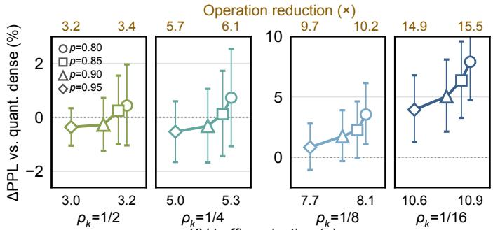  
KV traffic reduction (×)  
Fig. 12: Quality–efficiency tradeoff of sparse attention for BitCPM-3B on WikiText-2 at 8K context length.  
Fig. 13: Reductions in KV traffic and operations under different attention schemes for BitCPM-3B at an 8K context length.

## C. Hardware Performance

Comparison to CPU and GPU. Fig. 14 compares SPARTA with the CPU and GPU baselines. SPARTA consistently outperforms both commodity platforms across four models. Compared with the GPU, SPARTA improves geometric-mean generation throughput by 3.9× and end-to-end energy efficiency by 8.3×. The corresponding improvements over the CPU are 5.0× and 81.7×. With an INT4 KV cache, the Jetson becomes slower at long contexts because llama.cpp dequantizes the cache before attention, and the gains of SPARTA rise to 4.8× and 9.1×. Over the CPU, the throughput gain of SPARTA is largest on QMSum, the longest-context task, because more K/V accesses can be eliminated. Over the GPU, BitCPM gains least on QMSum because its two KV heads keep dense KV reads small. Both baselines use dense attention, so these gains combine architectural and sparse-attention benefits.

Performance Breakdown. Fig. 15 shows SPARTA’s latency breakdown across linear layers and the three attention stages for different context lengths and models.

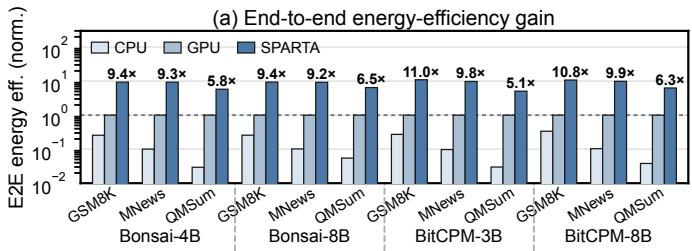

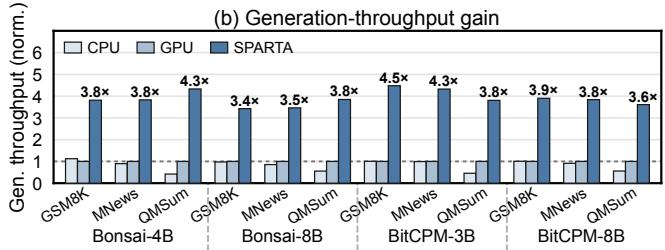  
Fig. 14: End-to-end energy efficiency and throughput.

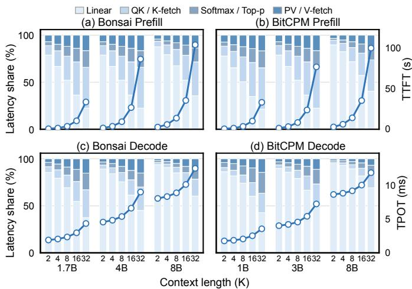  
Fig. 15: Latency breakdown by model and context length.

Prefill. The latency bottleneck shifts from linear layers to attention as the context grows. Projection and FFN overhead grows linearly with prompt length, whereas dense attention grows quadratically. Consequently, the average linear-layer share falls from about 82% at 2K to 28% at 32K. At the same context length, larger models retain a higher linear-layer share because projection and FFN work grows with model width.

Decode. Decode similarly shifts from linear-layer computation toward attention as the context grows. The linear work per generated token remains fixed for a given model, while attention must process an increasing number of cached tokens, reaching 31–63% of TPOT at 32K. Fig. 16(a) shows that two-stage sparse attention is 4.0–6.2× faster than dense attention (normalized to each model’s dense attention at 8K). Fig. 16(b) draws the stage overlap of Fig. 8 to scale: Top-k selection fully covers K generation except for Bonsai at 8K, and Top-p selection covers V generation in all cases.

HBM Transfer Granularity. Fig. 17 models decode KV reads in Ramulator2 as 32-byte HBM2 transactions (a 64-bit pseudo channel with burst length 4): metadata and K are fetched per selected page, while V is gathered per surviving token (Token

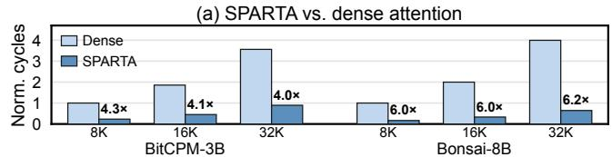

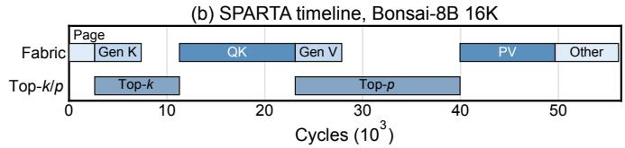  
Fig. 16: Decode attention speedup and stage overlap.

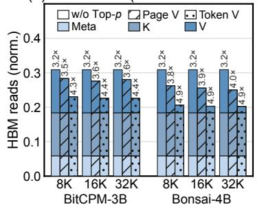

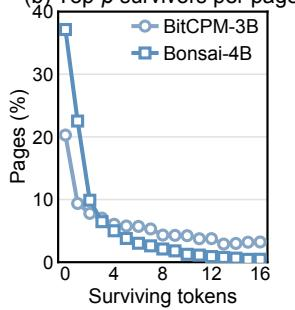  
Fig. 17: Decode HBM read traffic simulated with Ramulator2.

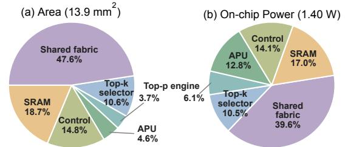  
Fig. 18: Area and average on-chip power breakdown.

V) as two transactions per 64-byte vector. The transferred bytes are therefore only 1.4–1.7% above the analytical bytes of the selected metadata and tokens. As shown in Fig. 17(a), Top-k reduces reads by 3.2× at all lengths, and Top-p raises the reduction to 4.3–4.4× for BitCPM-3B and 4.9× for Bonsai-4B. Only 20–27% and 37–47% of the selected pages are fully pruned (Fig. 17(b)), so fetching whole V pages (Page V) would retain only 3.5–3.6× and 3.8–4.0×.

Area and Power. Fig. 18 reports a total area of 13.9 mm2 and average on-chip power of 1.40 W. The shared fabric accounts for 47.6% of the area and 39.6% of the power because it is replicated across eight compute slices and executes all linear and attention operations. In comparison, the Top-k and Top-p engines together occupy 14.3% of the area and 16.6% of the power, keeping the hardware cost of two-stage selection low.

## D. Design Space Exploration

We sweep the conflict-FIFO depth, fabric parallelism, Top-k window, and Top-p histogram resolution.

Conflict-FIFO Depth. A shallow FIFO frequently stalls SpMM when multiple nonzero weights target the same bank, whereas a deeper FIFO increases register cost. Fig. 19(a) shows that throughput rises quickly and then saturates. A depth of 8 reaches 96.7% of the depth-32 throughput with only one quarter of the entries, so we set the conflict-FIFO depth to 8.

(a) Conflict-FIFO depth  
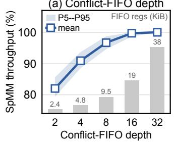

(b) Fabric parallelism  
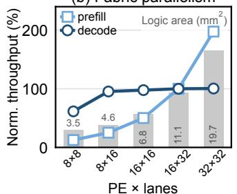

Fig. 19: Fabric parameter sensitivity.  
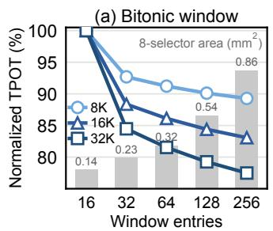

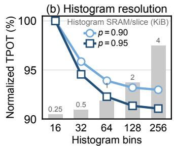  
Fig. 20: Selection-engine parameter sensitivity.

Fabric Parallelism. Fig. 19(b) reveals different scaling behavior across inference phases. Prefill continues to benefit from additional lanes, while bandwidth-bound decode saturates much earlier. We select 16 PEs with 32 lanes: reducing the lanes to 16 halves prefill throughput, whereas increasing to 32 PEs adds 78% logic area without reducing decode latency.

Bitonic Top-k Window. A larger sorting window reduces the number of merge iterations but rapidly increases comparator area. Relative to the 16-entry baseline in Fig. 20(a), a 64-entry window reduces TPOT by 8.8%, 13.9%, and 18.5% at sequence lengths of 8K, 16K, and 32K, respectively. Increasing the window to 128 entries provides only another 1.1–2.3 percentage points of reduction, while the selector area increases from 0.32 to 0.54 mm2. We therefore use 64 entries.

Histogram Resolution. More histogram bins improve the Top-p threshold estimate but increase both threshold-search latency and SRAM cost. Relative to the 16-bin baseline in Fig. 20(b), 64 bins reduce TPOT by 6.1% at $p = 0 . 9 0$ and 7.7% at $p = 0 . 9 5$ . Increasing to 128 bins provides less than one additional percentage point of reduction while doubling the histogram SRAM from 1 to 2 KiB per compute slice. The 64-bin result is also statistically indistinguishable from exact Top-p in the quality sweep, so we use 64 bins. Replacing the histogram with Twilight’s binary-search threshold on the same fabric slows attention by 2.0–3.0× and TPOT by 1.1–1.8×.

## E. Ablation Studies

Algorithmic Ablation. Starting from full attention, Table IV cumulatively enables page-level Top-k, exact Top-p, and the 64-bin histogram Top-p. Sparse selection preserves perplexity across models, datasets, and context lengths: the final config uration differs from full attention by at most 0.61 PPL. The histogram engine also closely matches exact Top-p, changing perplexity by at most 0.10. The retained candidate fraction $\rho _ { p }$ is only 2.9–10.9%, and it decreases from 8K to 32K. The histogram approximation therefore adds negligible quality loss while retaining fewer tokens at longer contexts.

TABLE IV: Sparse-attention quality ablation.
<table><tr><td>Model</td><td>Data</td><td>Len</td><td> $\rho _ { p }$ </td><td>Full</td><td></td><td>+Top-k +Exact Top-p +Hist. Top-p</td><td></td></tr><tr><td rowspan="3">BitCPM-3B</td><td rowspan="2">WT2</td><td>8K</td><td>6.0%</td><td>14.37</td><td>14.19</td><td>14.34</td><td>14.36</td></tr><tr><td>32K</td><td>5.0%</td><td>16.52</td><td>16.43</td><td>16.35</td><td>16.39</td></tr><tr><td rowspan="2">PG19</td><td>8K</td><td>7.3%</td><td>16.93</td><td>17.49</td><td>17.64</td><td>17.54</td></tr><tr><td></td><td>32K</td><td>6.5%</td><td>16.81</td><td>16.46</td><td>16.26</td><td>16.30</td></tr><tr><td rowspan="4">Bonsai-4B</td><td rowspan="2">WT2</td><td>8K</td><td>4.3%</td><td>11.31</td><td>11.36</td><td>11.42</td><td>11.46</td></tr><tr><td>32K</td><td>2.9%</td><td>10.56</td><td>10.48</td><td>10.58</td><td>10.56</td></tr><tr><td rowspan="2">PG19</td><td>8K</td><td>4.7%</td><td>16.62</td><td>16.73</td><td>16.96</td><td>16.88</td></tr><tr><td>32K</td><td>3.3%</td><td>21.29</td><td>20.85</td><td>20.93</td><td>20.85</td></tr><tr><td rowspan="3">BitCPM-8B</td><td rowspan="2">WT2</td><td>8K</td><td>9.7%</td><td>8.74</td><td>8.82</td><td>9.03</td><td>9.05</td></tr><tr><td>32K</td><td>8.2%</td><td>9.40</td><td>9.56</td><td>9.79</td><td>9.77</td></tr><tr><td rowspan="2">PG19</td><td>8K</td><td>10.9%</td><td>11.75</td><td>11.86</td><td>12.08</td><td>12.08</td></tr><tr><td rowspan="2"></td><td>32K</td><td>10.1%</td><td>11.35</td><td>11.53</td><td>11.54</td><td>11.51</td></tr></table>

$\rho _ { p }$ is the fraction of Top-k candidates retained by Top-p.

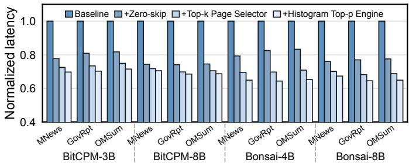  
Fig. 21: Cumulative end-to-end latency ablation.

Hardware Ablation. We evaluate every configuration on the same prompts with a fixed output length of 512 tokens and report normalized end-to-end latency. Fig. 21 shows that each mechanism consistently reduces latency across all model– dataset pairs. Zero-weight skipping provides the largest initial gain by eliminating ineffective ternary computation. The Top-k page selector then reduces K-cache accesses, and the histogram Top-p engine further reduces V traffic and PV computation. At the geometric mean, these three steps reduce latency by 22%, 9%, and 5% relative to the preceding configuration, yielding a cumulative 1.48× speedup. Zero-weight skipping mainly shortens the compute-bound prefill (TTFT −29%), whereas Top-k and Top-p act only in decode, where they reduce TPOT by 26% and 16%.

## F. Comparison with SOTA LLM Accelerators

Throughput and Energy. Fig. 22 compares SPARTA with FIGLUT, TeLLMe, TENET, and MCBP [10, 14, 16, 17] under different prefill–decode lengths. Throughput and energy per token are both normalized to the geometric mean of SPARTA within each phase.

Prefill. Prefill remains compute-bound across the evaluated prompt lengths, so the relative throughput ordering is stable. At the geometric mean, SPARTA achieves 1.6×, 2.3×, and 8.8× higher throughput than FIGLUT, TeLLMe, and MCBP, and 2.0–4.2× higher energy efficiency than all four designs. Bitmap-compressed zero-weight skipping explains the gain over FIGLUT, while the separate dense-attention engines of FIGLUT and TeLLMe consume 73–76% of their prefill energy. TENET occupies about 7× the chip area of SPARTA; at equal area, SPARTA is 3.1× faster.

(a) Prefill stage: throughput and energy  
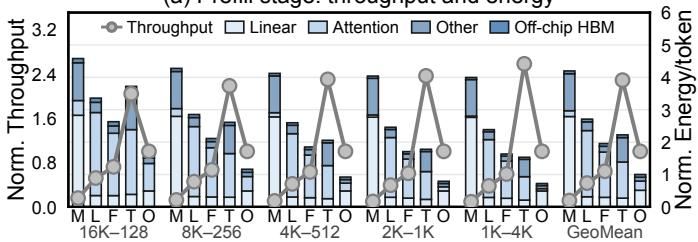

(b) Decoding stage: throughput and energy  
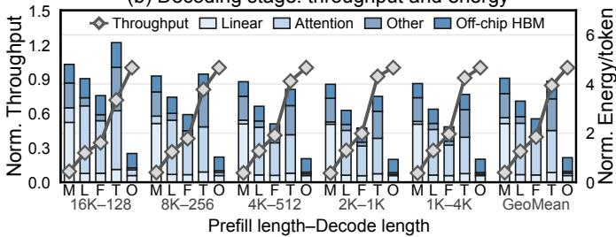  
M: MCBP; L: TeLLMe; F: FIGLUT; T: TENET; O: Ours  
Fig. 22: Throughput and energy efficiency comparison.

TABLE V: Summary and comparison with SOTA works.
<table><tr><td>Design</td><td></td><td>Tech. Freq.</td><td>Area</td><td></td><td>Thpt. Energy eff. [nm] [GHz] [mm2] [GOPS] [GOPS/W] [GOPS/mm2]</td><td>Area eff.</td></tr><tr><td colspan="7">Sparse-attention accelerators</td></tr><tr><td>Energon [53]ª</td><td>45</td><td>1.0</td><td>1.63</td><td>1,153</td><td>7,206</td><td>709</td></tr><tr><td>FACT [52]</td><td>28</td><td>0.5</td><td>6.03</td><td>928</td><td>2,754</td><td>154</td></tr><tr><td colspan="7">Linear-layer accelerators</td></tr><tr><td>FIGLUT [10]b</td><td>28</td><td>0.1</td><td>7.34</td><td>140</td><td>470</td><td>19.1</td></tr><tr><td>LUT-DLA [54]c</td><td>28</td><td>0.3</td><td>3.64</td><td>2,765</td><td>5,600</td><td>759</td></tr><tr><td colspan="7">End-to-end LLM accelerators</td></tr><tr><td>TENET [17]d</td><td>28</td><td>0.5</td><td>91.0</td><td>40,960</td><td>7,186</td><td>450</td></tr><tr><td>Ourse</td><td>28</td><td>1.0</td><td>13.9</td><td>13,653</td><td>9,752</td><td>982</td></tr></table>

aScaled to 28 nm. bOur reproduction. cDesign 3. d16 STL + 4 HP cores of 32×64. e40% weight sparsity.

Decode. The gains over the dense-attention baselines grow as the KV cache expands because two-stage selection reduces both K and V accesses. At the geometric mean, SPARTA achieves 2.5×, 3.7×, 1.2×, and 12.0× higher throughput than FIGLUT, TeLLMe, TENET, and MCBP, and 2.6×, 3.3×, 4.1×, and 4.2× higher energy efficiency. The gain over TENET rises from 1.1× at short prompts to 1.4× at 16K, where most of the context lies beyond its 1.5K-token window. MCBP prunes attention with its BGPP predictor, so its gap stays nearly constant (10.6–12.6×); 56% of its decode energy goes to linear layers and only 6% to attention.

Hardware Efficiency. Table V compares the reported metrics by acceleration scope. The sparse-attention and linear-layer accelerators are optimized for partial inference pipelines, whereas SPARTA leverages the sparsity in both linear and attention layers across prefill and decode phases. SPARTA achieves 1.4–20.7× higher energy efficiency and 1.3–51.4× higher area efficiency than the compared designs. TENET pairs dedicated ternary linear (STL) cores with separate attention (HP) cores and thus represents heterogeneous designs; SPARTA achieves 1.4× its energy efficiency and 2.2× its area efficiency.

## VI. RELATED WORK

Ternary and Low-Bit Acceleration. Bit-Pragmatic exploits activation bit sparsity, Bit-Tactical schedules nonzero weights with activation matching, and Laconic pairs effectual bits from both operands [58–60]. SPARTA adopts their zero-bit skipping for the Q/P operand, but each set bit drives a shifted selectadd update of a whole K/V vector on the same datapath that runs ternary weights. FIGLUT/LUT Tensor Core use lookup tables; MCBP reuses bit-slice patterns [10, 14, 61]. TENET, TeLLMe, and TOM specialize ternary linear execution [16– 18]. BitMoD supports mixed datatypes with bit-serial exponent alignment, normalization, and dequantization [22]; SPARTA keeps integer operands, so its update needs only shifts and additions. VitaLLM partially reuses BoothFlex, but TINT cannot execute multi-bit attention, limiting resource reallocation as workloads change [19]. SPARTA shares integer select-add updates across ternary linear and Q/P-expanded attention.

KV-Cache Compression and Sparse Attention. Existing schemes reduce KV precision [27–29]; eviction methods retain compact subsets [31, 62–65]; query-time methods predict relevant entries [66–69]. Accelerators approximate or predict sparse QK work [35–37, 39, 52, 53, 70, 71]; PADE fuses sparsity discovery with execution [30]. MInference/LServe sparsify prefill or both phases; Quest, Double Sparsity, and Twilight provide page Top-k, channel/token sparsity, and hierarchical Top-p [20, 23, 42, 72, 73]. VitaLLM selects token Top-k from leading-one approximations [19]; SPARTA uses metadata-based page Top-k followed by exact candidate QK and token Top-p.

Prefill–Decode and Attention Dataflows. Serving systems split phases or schedule chunked prefill [32– 34]. FlexGen/PagedAttention manage memory; FlashInfer/FlashAttention optimize attention kernels and I/O [41, 74– 78]. FLAT/FuseMax optimize spatial QK–Softmax–PV [79, 80]. SPARTA instead time-multiplexes prefill SpMM, decode SpMV, and sparse QK/PV on one fabric.

## VII. CONCLUSION

This paper presented SPARTA, a sparse ternary LLM accelerator for long-context edge inference. SPARTA unifies ternary linear computation and adaptive sparse attention on a shared compute fabric, jointly exploiting zero-weight, bit level, and query-dependent KV sparsity across both prefill and decode. Its two-stage adaptive attention further reduces KV-cache traffic with a quality–traffic tradeoff that depends on the task. Experimental results demonstrate that SPARTA significantly improves throughput and energy efficiency over CPUs, GPUs, and SOTA LLM accelerators, enabling efficient long-context inference for ternary LLMs on edge devices.

[1] Hugo Touvron, Louis Martin, Kevin Stone, Peter Albert, Amjad Almahairi, Yasmine Babaei, Nikolay Bashlykov, Soumya Batra, Prajjwal Bhargava, Shruti Bhosale, Dan Bikel, Lukas Blecher, Cristian Canton Ferrer, Moya Chen, Guillem Cucurull, David Esiobu, Jude Fernandes, Jeremy Fu, Wenyin Fu, Brian Fuller, Cynthia Gao, Vedanuj Goswami, Naman Goyal, Anthony Hartshorn, Saghar Hosseini, Rui Hou, Hakan Inan, Marcin Kardas, Viktor Kerkez, Madian Khabsa, Isabel Kloumann, Artem Korenev, Punit Singh Koura, Marie-Anne Lachaux, Thibaut Lavril, Jenya Lee, Diana Liskovich, Yinghai Lu, Yuning Mao, Xavier Martinet, Todor Mihaylov, Pushkar Mishra, Igor Molybog, Yixin Nie, Andrew Poulton, Jeremy Reizenstein, Rashi Rungta, Kalyan Saladi, Alan Schelten, Ruan Silva, Eric Michael Smith, Ranjan Subramanian, Xiaoqing Ellen Tan, Binh Tang, Ross Taylor, Adina Williams, Jian Xiang Kuan, Puxin Xu, Zheng Yan, Iliyan Zarov, Yuchen Zhang, Angela Fan, Melanie Kambadur, Sharan Narang, Aurelien Rodriguez, Robert Stojnic, Sergey Edunov, and Thomas Scialom. Llama 2: Open foundation and fine-tuned chat models. arXiv preprint arXiv:2307.09288, 2023.

[2] Mark Chen, Jerry Tworek, Heewoo Jun, Qiming Yuan, Henrique Ponde de Oliveira Pinto, Jared Kaplan, Harri Edwards, Yuri Burda, Nicholas Joseph, Greg Brockman, Alex Ray, Raul Puri, Gretchen Krueger, Michael Petrov, Heidy Khlaaf, Girish Sastry, Pamela Mishkin, Brooke Chan, Scott Gray, Nick Ryder, Mikhail Pavlov, Alethea Power, Lukasz Kaiser, Mohammad Bavarian, Clemens Winter, Philippe Tillet, Felipe Petroski Such, Dave Cummings, Matthias Plappert, Fotios Chantzis, Elizabeth Barnes, Ariel Herbert-Voss, William Hebgen Guss, Alex Nichol, Alex Paino, Nikolas Tezak, Jie Tang, Igor Babuschkin, Suchir Balaji, Shantanu Jain, William Saunders, Christopher Hesse, Andrew N. Carr, Jan Leike, Josh Achiam, Vedant Misra, Evan Morikawa, Alec Radford, Matthew Knight, Miles Brundage, Mira Murati, Katie Mayer, Peter Welinder, Bob McGrew, Dario Amodei, Sam McCandlish, Ilya Sutskever, and Wojciech Zaremba. Evaluating large language models trained on code. arXiv preprint arXiv:2107.03374, 2021.

[3] Georgi Gerganov. llama.cpp: LLM inference in C/C++. GitHub, 2023. URL https://github.com/ggml-org/llama.cpp.

[4] MiniCPM Team, Chaojun Xiao, Yuxuan Li, Xu Han, Yuzhuo Bai, Jie Cai, Haotian Chen, Wentong Chen, Xin Cong, Ganqu Cui, Ning Ding, Shengda Fan, Yewei Fang, Zixuan Fu, Wenyu Guan, Yitong Guan, Junshao Guo, Yufeng Han, Bingxiang He, Yuxiang Huang, Baoxi Ji, Cunliang Kong, Qiuzuo Li, Siyuan Li, Wenhao Li, Xin Li, Yanghao Li, Yishan Li, Zhen Li, Dan Liu, Biyuan Lin, Yankai Lin, Xiang Long, Quanyu Lu, Yaxi Lu, Peiyan Luo, Hongya Lyu, Litu Ou, Yinxu Pan, Lushi Pu, Zekai Qu, Qundong Shi, Zijun Song, Jiayuan Su, Zhou Su, Ao Sun, Xianghui Sun, Peijun Tang, Fangzheng Wang, Feng Wang, Shuo Wang, Yudong Wang, Zheng Wang, Yesai Wu, Zhenyu Xiao, Jie Xie, Zihao Xie, Xiaoyue Xu, Yukun Yan, Jiarui Yuan, Jinqian Zhang, Kaihuo Zhang, Lei Zhang, Linyue Zhang, Xueren Zhang, Yudi Zhang, Hengyu Zhao, Weilin Zhao, Weilun Zhao, Yuanqian Zhao, Zhi Zheng, Chuyue Zhou, Ge Zhou, Jie Zhou, Wei Zhou, Yanghao Zhou, Zihan Zhou, Zixuan Zhou, Zhiyuan Liu, Guoyang Zeng, Chao Jia, Dahai Li, and Maosong Sun. MiniCPM4: Ultra efficient LLMs on end devices. arXiv preprint arXiv:2506.07900, 2025.

[5] Elias Frantar, Saleh Ashkboos, Torsten Hoefler, and Dan Alistarh. GPTQ: Accurate post-training quantization for generative pretrained transformers. arXiv preprint arXiv:2210.17323, 2022.

[6] Ji Lin, Jiaming Tang, Haotian Tang, Shang Yang, Wei-Ming Chen, Wei-Chen Wang, Guangxuan Xiao, Xingyu Dang, Chuang Gan, and Song Han. Awq: Activation-aware weight quantization for on-device llm compression and acceleration. Proceedings of machine learning and systems, 6:87–100, 2024.

[7] Guangxuan Xiao, Ji Lin, Mickael Seznec, Hao Wu, Julien Demouth, and Song Han. Smoothquant: Accurate and efficient posttraining quantization for large language models. In International conference on machine learning, pages 38087–38099. PMLR, 2023.

[8] Yilong Zhao, Chien-Yu Lin, Kan Zhu, Zihao Ye, Lequn Chen, Size Zheng, Luis Ceze, Arvind Krishnamurthy, Tianqi Chen, and Baris Kasikci. Atom: Low-bit quantization for efficient and accurate llm serving. Proceedings of Machine Learning and Systems, 6:196–209, 2024.

[9] Tim Dettmers, Ruslan Svirschevski, Vage Egiazarian, Denis Kuznedelev, Elias Frantar, Saleh Ashkboos, Alexander Borzunov, Torsten Hoefler, and Dan Alistarh. SpQR: A sparse-quantized representation for near-lossless LLM weight compression. arXiv preprint arXiv:2306.03078, 2023.

[10] Gunho Park, Hyeokjun Kwon, Jiwoo Kim, Jeongin Bae, Baeseong Park, Dongsoo Lee, and Youngjoo Lee. FIGLUT: An energy-efficient accelerator design for FP-INT GEMM using look-up tables. In 2025 IEEE International Symposium on High Performance Computer Architecture (HPCA), pages 1098–1111. IEEE, 2025.

[11] Shuming Ma, Hongyu Wang, Lingxiao Ma, Lei Wang, Wenhui Wang, Shaohan Huang, Li Dong, Ruiping Wang, Jilong Xue, and Furu Wei. The era of 1-bit LLMs: All large language models are in 1.58 bits. arXiv preprint arXiv:2402.17764, 2024.

[12] Prism ML. Ternary bonsai: 1.58-bit language models at 8b, 4b, and 1.7b scale. Technical report, Prism ML, April 2026. URL https://github.com/PrismML-Eng/Bonsai-demo/blob/main/ ternary-bonsai-8b-whitepaper.pdf.

[13] Hong Huang, Decheng Wu, Qiangqiang Hu, Guanghua Yu, Jinhai Yang, Jianchen Zhu, Xue Liu, and Dapeng Wu. Sherry: Hardware-efficient 1.25-bit ternary quantization via fine-grained sparsification. In Proceedings of the 64th Annual Meeting of the Association for Computational Linguistics (Volume 1: Long Papers), pages 11186–11204, 2026.

[14] Huizheng Wang, Zichuan Wang, Zhiheng Yue, Yousheng Long, Taiquan Wei, Jianxun Yang, Yang Wang, Chao Li, Shaojun Wei, Yang Hu, and Shouyi Yin. MCBP: A memory-compute efficient LLM inference accelerator leveraging bit-slice-enabled sparsity and repetitiveness. In Proceedings of the 58th IEEE/ACM International Symposium on Microarchitecture, pages 1592– 1608, 2025.

[15] Xiangyu Li, Chengyu Yin, Weijun Wang, Jianyu Wei, Ting Cao, and Yunxin Liu. Vec-LUT: Vector table lookup for parallel ultra-low-bit LLM inference on edge devices. In Proceedings of the 24th Annual International Conference on Mobile Systems, Applications and Services, pages 216–230, 2026.

[16] Ye Qiao, Zhiheng Chen, Yifan Zhang, Yian Wang, and Sitao Huang. TeLLMe: An energy-efficient ternary LLM accelerator for prefilling and decoding on edge FPGAs. arXiv preprint arXiv:2504.16266, 2025.

[17] Zhirui Huang, Rui Ma, Shijie Cao, Ran Shu, Ian Wang, Ting Cao, Chixiao Chen, and Yongqiang Xiong. TENET: An efficient sparsity-aware LUT-centric architecture for ternary LLM inference on edge. arXiv preprint arXiv:2509.13765, 2025.

[18] Hongyi Guan, Yijia Zhang, Wenqiang Wang, Yizhao Gao, Shijie Cao, Chen Zhang, and Ningyi Xu. ToM: A ternary read-only memory accelerator for LLM-powered edge intelligence. arXiv preprint arXiv:2602.20662, 2026.

[19] Zi-Wei Lin and Tian-Sheuan Chang. VitaLLM: A versatile, ultra-compact ternary LLM accelerator with dependency-aware scheduling. arXiv preprint arXiv:2604.27396, 2026.

[20] Chaofan Lin, Jiaming Tang, Shuo Yang, Hanshuo Wang, Tian Tang, Boyu Tian, Ion Stoica, Song Han, and Mingyu Gao. Twilight: Adaptive attention sparsity with hierarchical top-p pruning. Advances in Neural Information Processing Systems, 38:119406–119432, 2026.

[21] Jinheng Wang, Hansong Zhou, Ting Song, Shijie Cao, Yan Xia, Ting Cao, Jianyu Wei, Shuming Ma, Hongyu Wang, and Furu Wei. BitNet.cpp: Efficient edge inference for ternary LLMs. In Proceedings of the 63rd Annual Meeting of the Association for Computational Linguistics (Volume 1: Long Papers), pages 9305–9322, 2025.

[22] Yuzong Chen, Ahmed F. AbouElhamayed, Xilai Dai, Yang Wang, Marta Andronic, George A. Constantinides, and Mohamed S. Abdelfattah. BitMoD: Bit-serial mixture-of-datatype LLM acceleration. arXiv preprint arXiv:2411.11745, 2025.

[23] Jiaming Tang, Yilong Zhao, Kan Zhu, Guangxuan Xiao, Baris Kasikci, and Song Han. Quest: Query-aware sparsity for efficient long-context LLM inference. arXiv preprint arXiv:2406.10774, 2024.

[24] Manzil Zaheer, Guru Guruganesh, Kumar Avinava Dubey, Joshua Ainslie, Chris Alberti, Santiago Ontanon, Philip Pham, Anirudh Ravula, Qifan Wang, Li Yang, and Amr Ahmed. Big Bird: Transformers for longer sequences. Advances in neural information processing systems, 33:17283–17297, 2020.

[25] BitCPM Team. BitCPM-CANN: Native 1.58-bit large language model training on ascend NPU. Technical report, OpenBMB, 2026. URL https://github.com/OpenBMB/MiniCPM/blob/main/ docs/BitCPM CANN.pdf.

[26] Reiner Pope, Sholto Douglas, Aakanksha Chowdhery, Jacob Devlin, James Bradbury, Jonathan Heek, Kefan Xiao, Anselm Levskaya, and Jeff Dean. Efficiently scaling transformer inference. In Proceedings of Machine Learning and Systems (MLSys), 2023.

[27] Yujun Lin, Haotian Tang, Shang Yang, Zhekai Zhang, Guangxuan Xiao, Chuang Gan, and Song Han. QServe: W4A8KV4 quantization and system co-design for efficient LLM serving. Proceedings of Machine Learning and Systems, 7, 2025.

[28] Zirui Liu, Jiayi Yuan, Hongye Jin, Shaochen Zhong, Zhaozhuo Xu, Vladimir Braverman, Beidi Chen, and Xia Hu. KIVI: A tuning-free asymmetric 2bit quantization for KV cache. In International Conference on Machine Learning (ICML), 2024.

[29] Coleman Hooper, Sehoon Kim, Hiva Mohammadzadeh, Michael W Mahoney, Yakun S Shao, Kurt Keutzer, and Amir Gholami. KVQuant: Towards 10 million context length LLM inference with KV cache quantization. Advances in Neural Information Processing Systems, 37:1270–1303, 2024.

[30] Huizheng Wang, Hongbin Wang, Zichuan Wang, Zhiheng Yue, Yang Wang, Chao Li, Yang Hu, and Shouyi Yin. PADE: A predictor-free sparse attention accelerator via unified execution and stage fusion. In 2026 IEEE International Symposium on High Performance Computer Architecture (HPCA), pages 1–19. IEEE, 2026.

[31] Guangxuan Xiao, Yuandong Tian, Beidi Chen, Song Han, and Mike Lewis. Efficient streaming language models with attention sinks. In International Conference on Learning Representations, volume 2024, pages 21875–21895, 2024.

[32] Pratyush Patel, Esha Choukse, Chaojie Zhang, Aashaka Shah, ´Inigo Goiri, Saeed Maleki, and Ricardo Bianchini. Splitwise:˜ Efficient generative llm inference using phase splitting. In 2024 ACM/IEEE 51st Annual International Symposium on Computer Architecture (ISCA), pages 118–132. IEEE, 2024.

[33] Yinmin Zhong, Shengyu Liu, Junda Chen, Jianbo Hu, Yibo Zhu, Xuanzhe Liu, Xin Jin, and Hao Zhang. {DistServe}: Disaggregating prefill and decoding for goodput-optimized large language model serving. In 18th USENIX Symposium on Operating Systems Design and Implementation (OSDI 24), pages 193–210, 2024.

[34] Amey Agrawal, Nitin Kedia, Ashish Panwar, Jayashree Mohan, Nipun Kwatra, Bhargav Gulavani, Alexey Tumanov, and Ramachandran Ramjee. Taming {Throughput-Latency} tradeoff in {LLM} inference with {Sarathi-Serve}. In 18th USENIX

symposium on operating systems design and implementation (OSDI 24), pages 117–134, 2024.

[35] Hanrui Wang, Zhekai Zhang, and Song Han. SpAtten: Efficient sparse attention architecture with cascade token and head pruning. In 2021 IEEE international symposium on high-performance computer architecture (HPCA), pages 97–110. IEEE, 2021.

[36] Liqiang Lu, Yicheng Jin, Hangrui Bi, Zizhang Luo, Peng Li, Tao Wang, and Yun Liang. Sanger: A co-design framework for enabling sparse attention using reconfigurable architecture. In MICRO-54: 54th Annual IEEE/ACM International Symposium on Microarchitecture, pages 977–991, 2021.

[37] Huizheng Wang, Jiahao Fang, Xinru Tang, Zhiheng Yue, Jinxi Li, Yubin Qin, Sihan Guan, Qinze Yang, Yang Wang, Chao Li, Yang Hu, and Shouyi Yin. SOFA: A compute-memory optimized sparsity accelerator via cross-stage coordinated tiling. In 2024 57th IEEE/ACM International Symposium on Microarchitecture (MICRO), pages 1247–1263. IEEE, 2024.

[38] Ari Holtzman, Jan Buys, Li Du, Maxwell Forbes, and Yejin Choi. The curious case of neural text degeneration. arXiv preprint arXiv:1904.09751, 2019.

[39] Zheng Qu, Liu Liu, Fengbin Tu, Zhaodong Chen, Yufei Ding, and Yuan Xie. DOTA: Detect and omit weak attentions for scalable transformer acceleration. In Proceedings of the 27th ACM International Conference on Architectural Support for Programming Languages and Operating Systems, pages 14–26, 2022.

[40] Maxim Milakov and Natalia Gimelshein. Online normalizer calculation for Softmax. arXiv preprint arXiv:1805.02867, 2018.

[41] Tri Dao, Dan Fu, Stefano Ermon, Atri Rudra, and Christopher Re. FlashAttention: Fast and memory-efficient exact attention´ with IO-awareness. Advances in neural information processing systems, 35:16344–16359, 2022.

[42] Shuo Yang, Ying Sheng, Joseph E Gonzalez, Ion Stoica, and Lianmin Zheng. Post-training sparse attention with double sparsity. arXiv preprint arXiv:2408.07092, 2024.

[43] Stephen Merity, Caiming Xiong, James Bradbury, and Richard Socher. Pointer sentinel mixture models. In International Conference on Learning Representations (ICLR), 2017. URL https://openreview.net/forum?id=Byj72udxe.

[44] Jack W. Rae, Anna Potapenko, Siddhant M. Jayakumar, Chloe Hillier, and Timothy P. Lillicrap. Compressive transformers for long-range sequence modelling. In International Conference on Learning Representations (ICLR), 2020. URL https://openreview. net/forum?id=SylKikSYDH.

[45] Luyang Huang, Shuyang Cao, Nikolaus Parulian, Heng Ji, and Lu Wang. Efficient attentions for long document summarization. In Proceedings of the 2021 Conference of the North American Chapter of the Association for Computational Linguistics: Human Language Technologies, pages 1419–1436. Association for Computational Linguistics, 2021. doi: 10.18653/v1/2021. naacl-main.112. URL https://aclanthology.org/2021.naacl-main. 112/.

[46] Ming Zhong, Da Yin, Tao Yu, Ahmad Zaidi, Mutethia Mutuma, Rahul Jha, Ahmed Hassan Awadallah, Asli Celikyilmaz, Yang Liu, Xipeng Qiu, and Dragomir Radev. QMSum: A new bench mark for query-based multi-domain meeting summarization. In Proceedings ofthe 2021 Conference ofthe North American Chapter ofthe Associationfor Computational Linguistics: Human Language Technologies, pages 5905–5921. Association for Computational Linguistics, 2021. doi: 10.18653/v1/2021.naacl-main.472. URL https://aclanthology.org/2021.naacl-main.472/.

[47] Alexander Fabbri, Irene Li, Tianwei She, Suyi Li, and Dragomir Radev. Multi-News: A large-scale multi-document summarization dataset and abstractive hierarchical model. In Proceedings of the 57th Annual Meeting of the Association for Computational Linguistics, pages 1074–1084. Association for Computational Linguistics, 2019. doi: 10.18653/v1/P19-1102.

URL https://aclanthology.org/P19-1102/.

[48] Karl Cobbe, Vineet Kosaraju, Mohammad Bavarian, Mark Chen, Heewoo Jun, Lukasz Kaiser, Matthias Plappert, Jerry Tworek, Jacob Hilton, Reiichiro Nakano, Christopher Hesse, and John Schulman. Training verifiers to solve math word problems. arXiv preprint arXiv:2110.14168, 2021. URL https://arxiv.org/ abs/2110.14168.

[49] Jacob Austin, Augustus Odena, Maxwell Nye, Maarten Bosma, Henryk Michalewski, David Dohan, Ellen Jiang, Carrie Cai, Michael Terry, Quoc V. Le, and Charles Sutton. Program synthesis with large language models. arXiv preprint arXiv:2108.07732, 2021. URL https://arxiv.org/abs/2108.07732.

[50] Jeffrey Zhou, Tianjian Lu, Swaroop Mishra, Siddhartha Brahma, Sujoy Basu, Yi Luan, Denny Zhou, and Le Hou. Instructionfollowing evaluation for large language models. arXiv preprint arXiv:2311.07911, 2023. URL https://arxiv.org/abs/2311.07911.

[51] Siva Reddy, Danqi Chen, and Christopher D. Manning. CoQA: A conversational question answering challenge. Transactions of the Association for Computational Linguistics, 7:249–266, 2018. doi: 10.1162/tacl a 00266. URL https://api.semanticscholar.org/ CorpusID:52055325.

[52] Yubin Qin, Yang Wang, Dazheng Deng, Zhiren Zhao, Xiaolong Yang, Leibo Liu, Shaojun Wei, Yang Hu, and Shouyi Yin. FACT: FFN-attention co-optimized transformer architecture with eager correlation prediction. In Proceedings of the 50th Annual International Symposium on Computer Architecture, pages 1–14, 2023.

[53] Zhe Zhou, Junlin Liu, Zhenyu Gu, and Guangyu Sun. Energon: Toward efficient acceleration of transformers using dynamic sparse attention. IEEE Transactions on Computer-Aided Design of Integrated Circuits and Systems, 42(1):136–149, 2022.

[54] Guoyu Li, Shengyu Ye, Chunyun Chen, Yang Wang, Fan Yang, Ting Cao, Cheng Liu, Mohamed M. Sabry Aly, and Mao Yang. LUT-DLA: Lookup table as efficient extreme low-bit deep learning accelerator. In 2025 IEEE International Symposium on High Performance Computer Architecture (HPCA), pages 671–684. IEEE, 2025.

[55] Rajeev Balasubramonian, Andrew B. Kahng, Naveen Muralimanohar, Ali Shafiee, and Vaishnav Srinivas. CACTI 7: New tools for interconnect exploration in innovative off-chip memories. ACM Transactions on Architecture and Code Optimization, 14(2):14:1–14:25, 2017. doi: 10.1145/3085572. URL https://doi.org/10.1145/3085572.

[56] Haocong Luo, Yahya Can Tugrul, F. Nisa Bostancı, Ataberk˘ Olgun, A. Giray Yaglık˘ c¸ı, and Onur Mutlu. Ramulator 2.0: A modern, modular, and extensible DRAM simulator. IEEE Computer Architecture Letters, 23(1):112–116, 2024.

[57] Mike O’Connor, Niladrish Chatterjee, Donghyuk Lee, John Wilson, Aditya Agrawal, Stephen W. Keckler, and William J. Dally. Fine-grained DRAM: Energy-efficient DRAM for extreme bandwidth systems. In Proceedings of the 50th Annual IEEE/ACM International Symposium on Microarchitecture, pages 41–54. Association for Computing Machinery, 2017. doi: 10.1145/3123939.3124545. URL https://doi.org/10.1145/ 3123939.3124545.

[58] Jorge Albericio, Alberto Delmas, Patrick Judd, Sayeh Sharify,´ Gerard O’Leary, Roman Genov, and Andreas Moshovos. Bit-Pragmatic deep neural network computing. In Proceedings of the 50th annual IEEE/ACM international symposium on microarchitecture, pages 382–394, 2017. doi: 10.1145/3123939.3123982.

[59] Alberto Delmas Lascorz, Patrick Judd, Dylan Malone Stu-´ art, Zissis Poulos, Mostafa Mahmoud, Sayeh Sharify, Milos Nikolic, Kevin Siu, and Andreas Moshovos. Bit-Tactical: A software/hardware approach to exploiting value and bit sparsity in neural networks. In Proceedings of the Twenty-Fourth International Conference on Architectural Support for Programming Languages and Operating Systems, pages 749–763,

2019. doi: 10.1145/3297858.3304041.

[60] Sayeh Sharify, Alberto Delmas Lascorz, Mostafa Mahmoud,´ Milos Nikolic, Kevin Siu, Dylan Malone Stuart, Zissis Poulos, and Andreas Moshovos. Laconic deep learning inference acceleration. In 2019 ACM/IEEE 46th Annual International Symposium on Computer Architecture (ISCA), pages 304–317, 2019. doi: 10.1145/3307650.3322255.

[61] Zhiwen Mo, Lei Wang, Jianyu Wei, Zhichen Zeng, Shijie Cao, Lingxiao Ma, Naifeng Jing, Ting Cao, Jilong Xue, Fan Yang, and Mao Yang. LUT tensor core: A software-hardware co-design for LUT-based low-bit LLM inference. In Proceedings of the 52nd Annual International Symposium on Computer Architecture, pages 514–528, 2025.

[62] Zhenyu Zhang, Ying Sheng, Tianyi Zhou, Tianlong Chen, Lianmin Zheng, Ruisi Cai, Zhao Song, Yuandong Tian, Christopher Re, Clark Barrett, Zhangyang “Atlas” Wang, and Beidi ´ Chen. H2o: Heavy-hitter oracle for efficient generative inference of large language models. Advances in Neural Information Processing Systems, 36:34661–34710, 2023.

[63] Yuhong Li, Yingbing Huang, Bowen Yang, Bharat Venkitesh, Acyr Locatelli, Hanchen Ye, Tianle Cai, Patrick Lewis, and Deming Chen. Snapkv: Llm knows what you are looking for before generation. Advances in Neural Information Processing Systems, 37:22947–22970, 2024.

[64] Muhammad Adnan, Akhil Arunkumar, Gaurav Jain, Prashant J Nair, Ilya Soloveychik, and Purushotham Kamath. Keyformer: Kv cache reduction through key tokens selection for efficient generative inference. Proceedings of Machine Learning and Systems, 6:114–127, 2024.

[65] Zefan Cai, Yichi Zhang, Bofei Gao, Yuliang Liu, Yucheng Li, Tianyu Liu, Keming Lu, Wayne Xiong, Yue Dong, Junjie Hu, and Wen Xiao. Pyramidkv: Dynamic kv cache compression based on pyramidal information funneling. arXiv preprint arXiv:2406.02069, 2024.

[66] Luka Ribar, Ivan Chelombiev, Luke Hudlass-Galley, Charlie Blake, Carlo Luschi, and Douglas Orr. Sparq attention: Bandwidth-efficient llm inference. arXiv preprint arXiv:2312.04985, 2023.

[67] Prajwal Singhania, Siddharth Singh, Shwai He, Soheil Feizi, and Abhinav Bhatele. Loki: Low-rank keys for efficient sparse attention. Advances in Neural Information Processing Systems, 37:16692–16723, 2024.

[68] Di Liu, Meng Chen, Baotong Lu, Huiqiang Jiang, Zhenhua Han, Qianxi Zhang, Qi Chen, Chengruidong Zhang, Bailu Ding, Kai Zhang, Chen Chen, Fan Yang, Yuqing Yang, and Lili Qiu. Retrievalattention: Accelerating long-context llm inference via vector retrieval. Advances in Neural Information Processing Systems, 38:54358–54385, 2026.

[69] Yizhao Gao, Zhichen Zeng, Dayou Du, Shijie Cao, Peiyuan Zhou, Jiaxing Qi, Junjie Lai, Hayden Kwok-Hay So, Ting Cao, Fan Yang, and Mao Yang. Seerattention: Learning intrinsic sparse attention in your llms. arXiv preprint arXiv:2410.13276, 2024.

[70] Tae Jun Ham, Sung Jun Jung, Seonghak Kim, Young H Oh, Yeonhong Park, Yoonho Song, Jung-Hun Park, Sanghee Lee, Kyoung Park, Jae W Lee, and Deog-Kyoon Jeong. Aˆ 3: Accelerating attention mechanisms in neural networks with approximation. In 2020 IEEE International Symposium on High Performance Computer Architecture (HPCA), pages 328–341. IEEE, 2020.

[71] Tae Jun Ham, Yejin Lee, Seong Hoon Seo, Soosung Kim, Hyunji Choi, Sung Jun Jung, and Jae W Lee. ELSA: Hardware-software co-design for efficient, lightweight self-attention mechanism in neural networks. In 2021 ACM/IEEE 48th Annual International Symposium on Computer Architecture (ISCA), pages 692–705. IEEE, 2021.

[72] Huiqiang Jiang, Yucheng Li, Chengruidong Zhang, Qianhui Wu,

Xufang Luo, Surin Ahn, Zhenhua Han, Amir H Abdi, Dongsheng Li, Chin-Yew Lin, Yuqing Yang, and Lili Qiu. Minference 1.0: Accelerating pre-filling for long-context llms via dynamic sparse attention. Advances in Neural Information Processing Systems, 37:52481–52515, 2024.

[73] Shang Yang, Junxian Guo, Haotian Tang, Qinghao Hu, Guangxuan Xiao, Jiaming Tang, Yujun Lin, Zhijian Liu, Yao Lu, and Song Han. Lserve: Efficient long-sequence llm serving with unified sparse attention. Proceedings of Machine Learning and Systems, 7, 2025.

[74] Ying Sheng, Lianmin Zheng, Binhang Yuan, Zhuohan Li, Max Ryabinin, Beidi Chen, Percy Liang, Christopher Re, Ion Stoica,´ and Ce Zhang. FlexGen: High-throughput generative inference of large language models with a single GPU. In International Conference on Machine Learning (ICML), pages 31094–31116. PMLR, 2023.

[75] Woosuk Kwon, Zhuohan Li, Siyuan Zhuang, Ying Sheng, Lianmin Zheng, Cody Hao Yu, Joseph Gonzalez, Hao Zhang, and Ion Stoica. Efficient memory management for large language model serving with PagedAttention. In Proceedings of the 29th symposium on operating systems principles, pages 611–626, 2023.

[76] Zihao Ye, Lequn Chen, Ruihang Lai, Wuwei Lin, Yineng Zhang, Stephanie Wang, Tianqi Chen, Baris Kasikci, Vinod Grover, Arvind Krishnamurthy, and Luis Ceze. Flashinfer: Efficient and customizable attention engine for llm inference serving. Proceedings of Machine Learning and Systems, 7, 2025.

[77] Tri Dao. FlashAttention-2: Faster attention with better parallelism and work partitioning. In International Conference on Learning Representations, volume 2024, pages 35549–35562, 2024. URL https://arxiv.org/abs/2307.08691.

[78] Ke Hong, Guohao Dai, Jiaming Xu, Qiuli Mao, Xiuhong Li, Jun Liu, Kangdi Chen, Yuhan Dong, and Yu Wang. FlashDecod ing++: Faster large language model inference on GPUs. arXiv preprint arXiv:2311.01282, 2023.

[79] Sheng-Chun Kao, Suvinay Subramanian, Gaurav Agrawal, Amir Yazdanbakhsh, and Tushar Krishna. FLAT: An optimized dataflow for mitigating attention bottlenecks. In Proceedings of the 28th ACM International Conference on Architectural Support for Programming Languages and Operating Systems, Volume 2, pages 295–310, 2023.

[80] Nandeeka Nayak, Xinrui Wu, Toluwanimi O. Odemuyiwa, Michael Pellauer, Joel S. Emer, and Christopher W. Fletcher. FuseMax: Leveraging extended einsums to optimize attention accelerator design. In 2024 57th IEEE/ACM International Symposium on Microarchitecture (MICRO), pages 1458–1473. IEEE, 2024. doi: 10.1109/MICRO61859.2024.00107.

## VIII. AI USE

The authors designed the architecture and experiments and are responsible for all content of this manuscript. Claude (Anthropic) and Codex (OpenAI) assisted in drafting and editing the text and in writing analysis and plotting scripts. The authors reviewed, revised, and verified all AI-assisted content before including it in the manuscript.