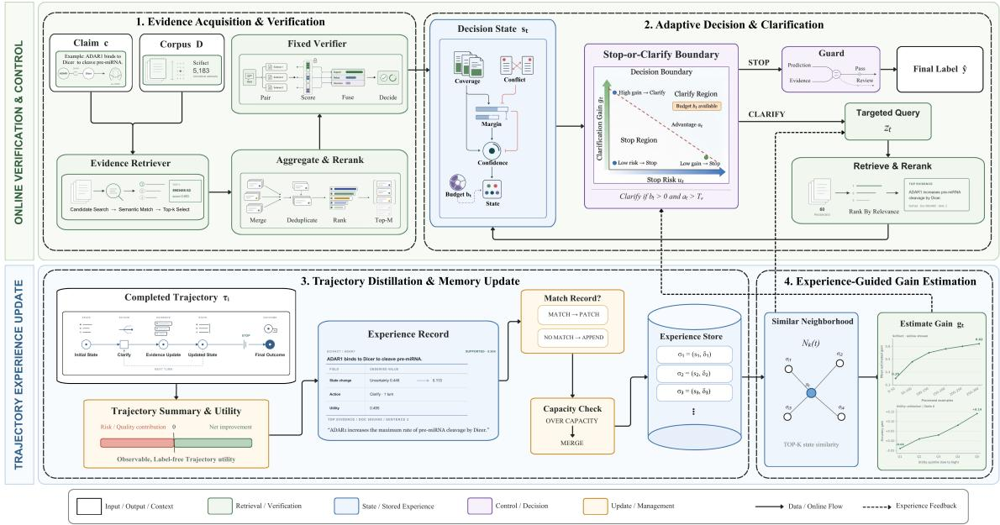
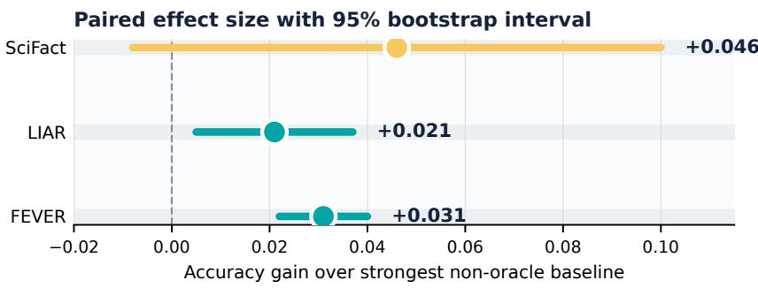
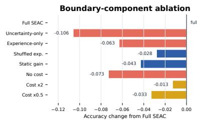
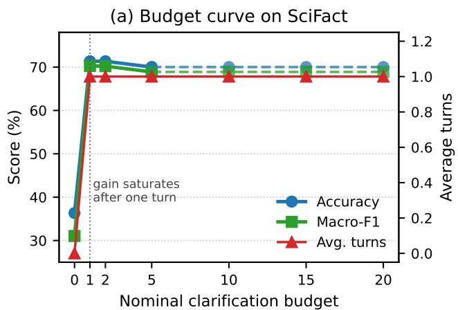
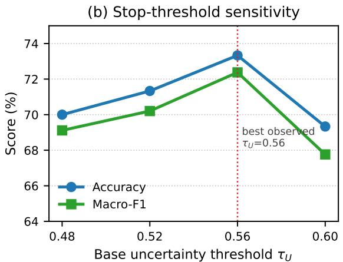
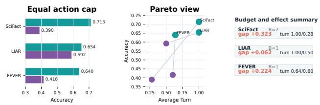

# Stop or Clarify? Experience-Conditioned Active Fact Verification

Yuhang Dong, Jinghong Li, Xinyue Wang, Yuanning Cui∗

Nanjing University of Information Science and Technology, Nanjing, China

## Abstract

Fact-verification benchmarks score the final label, while an interactive verifier must first decide whether the available ev- idence is suficient. We focus on that intermediate Stop-or-Clarify Decision. Uncertainty alone is insuficient, because the benefit of another evidence-acquisition step is unknown before the step is taken. Sequential Experience-Adaptive Clar- ification (SEAC) wraps a fixed verifier with a lightweight evidence-acquisition policy. For each claim, SEAC retrieves evidence, runs the verifier, forms a label-free decision state, and combines stop risk with an observational clarification- utility estimate from earlier executed trajectories. Clarification is requested only when this score exceeds the action cost and decision threshold. On SciFact, LIAR, and FEVER, SEAC improves mean accuracy and macro-F1 over the compared fact-verification and active-retrieval baselines. Equal-budget and formula-level diagnostics support selective clarification as a contributor to the gain, while the small SciFact split leaves its paired improvement inconclusive.

## 1 Introduction

Existing fact verification research is typically formulated as evidence-grounded label prediction. Given a claim and sup- porting documents, a verifier decides whether the claim is supported, refuted, or unverifiable (Thorne et al. 2018; Wadden et al. 2020; Wang 2017; Tang, Laban, and Durrett 2024; DeHaven and Scott 2023). That formulation has produced strong verifiers and retrieval-augmented pipelines (Lewis et al. 2020; Tan, Zou, and Aw 2025; Lin et al. 2025). In an interactive setting, however, label prediction is preceded by another decision. Before issuing a verdict, the verifier must decide whether the evidence already found is suficient or whether one more evidence-acquisition action is worth the cost.

We refer to this intermediate action as the Stop-or-Clarify Decision. The verifier can stop and return the current label, or it can clarify by issuing a targeted evidence request and verifying again. The two mistakes have diferent costs. Stopping early may lock in a wrong label before decisive ev- idence appears. Clarifying too often can add topical but non- decisive passages while consuming the interaction budget.

The question is under what circumstances another evidence- acquisition step is expected to be beneficial.

The decision is dificult for two reasons. First, there is no reliable stop label. Active retrieval and agentic verifi- cation methods have improved how systems ask for more evidence (Yao et al. 2023; Jiang et al. 2023; Trivedi et al. 2023; Gao et al. 2023; Asai et al. 2024; Huo et al. 2025; Xie et al. 2025), but they rarely specify when the system should stop asking. A verifier observes retrieved passages and confidence scores. It does not observe whether the deci- sive evidence has already been found. Confidence is useful but incomplete: some low-confidence cases cannot be re- paired by retrieval, and some confident cases hide a missing time, entity, or scope constraint.

Second, clarification value must be estimated before the action is taken. A risky state does not necessarily lead to a useful next query. Decision-theoretic work treats such choices as value-of-information problems (Howard 1966; Horvitz 1987; Russell and Wefald 1991; Krause and Guestrin 2005). Ofline reinforcement learning, contextual bandits, and doubly robust estimators can estimate action values when logged rewards or action propensities are available (Levine et al. 2020; Langford and Zhang 2008; Li et al. 2010; Dudik, Langford, and Li 2011). Active fact verification does not provide that feedback during inference. The system observes only the evidence path it follows, while the label that would have resulted from the other action remains counterfactual. Gold labels enter only after prediction, for evaluation. Ac- cordingly, the estimator must be derived from observable trajectories.

We present Sequential Experience-Adaptive Clarifica- tion (SEAC). SEAC adds a stop-or-clarify layer around an evidence-grounded verifier. For each claim, the verifier re- trieves evidence and produces a label distribution. The layer then builds a compact state from confidence, evidence cov- erage, conflict cues, and remaining budget. From this state, SEAC estimates the risk of stopping. It also retrieves similar earlier state–action–outcome trajectories and uses their ob-servable utility to estimate whether clarification has helped in comparable situations.

Together, the two estimates define a cost-sensitive stop- or-clarify boundary. SEAC selects Clarify only when a targeted evidence action is estimated to be worth its cost. Experience is used for this specific decision, not as a gen- eral task memory (Zep AI 2026; Mem0 2026; Nous Research 2026). Compared with uncertainty-triggered repeated retrieval, experience changes where the system draws the boundary between stopping and asking.

Experiments on SciFact, LIAR, and FEVER use the same verifier, retriever, and label interface for all methods (Wadden et al. 2020; Wang 2017; Thorne et al. 2018). The shared setup isolates the stop-or-clarify decision. SEAC improves accu- racy and macro-F1 over fact-verification, active-retrieval, and control baselines. The gains persist under equal action bud- gets, and ofline diagnostics show that trajectory utility is associated with post-hoc label improvement.

## Contributions.

• The Stop-or-Clarify Decision is formalized for active fact verification: before returning a label, a system must decide whether the current evidence is suficient.

• A cost-sensitive decision boundary is introduced to combine label-free stop risk with estimated clarification value under a bounded interaction budget.

• Clarification utility is estimated from online trajectories with executed clarification outcomes through a label-free observational proxy; no gold-label feedback is used dur- ing inference.

• We provide shared-interface experiments and diagnostics covering final-label quality, equal-budget behavior, and the association between trajectory utility and post-hoc label changes.

## 2 Related Work and Positioning

Fact verification. Evidence-grounded fact verification judges a claim against retrieved or provided evidence (Thorne et al. 2018; Augenstein et al. 2019; Wadden et al. 2020; Jiang et al. 2020; Schuster, Fisch, and Barzilay 2021; Wang 2017). Work in this area has improved several parts of the pipeline: compact grounding verifiers reduce inference cost (Tang, Laban, and Durrett 2024), general frameworks improve robustness across claim types (DeHaven and Scott 2023), and LLM-based systems add explanation, conflict reasoning, knowledge-graph checking, or auditability (Tan, Zou, and Aw 2025; Qudus et al. 2025; Lin et al. 2025). Prior methods mainly improve label prediction after evidence has been se- lected. SEAC studies the preceding decision of whether that evidence should be accepted or expanded.

Active retrieval. Retrieval-augmented generation and dense retrieval established the value of external evidence for knowledge-intensive reasoning (Lewis et al. 2020; Karpukhin et al. 2020). Active learning gives a related prin-ciple: information should be acquired selectively when it carries a cost (Settles 2009). Active and agentic retrieval systems revise queries, interleave reasoning with retrieval, or critique generated content (Yao et al. 2023; Jiang et al. 2023; Trivedi et al. 2023; Gao et al. 2023; Asai et al. 2024; Huo et al. 2025; Xie et al. 2025). Such flexibility improves evidence acquisition, but it does not settle the stopping ques- tion. If uncertainty alone triggers another retrieval step, the system can spend budget on passages that are topical rather than decisive. SEAC treats evidence acquisition as an action whose estimated value must exceed its cost.

Decision under cost. The stop-or-clarify decision follows the same resource logic as value-of-information and resource-bounded reasoning: acquiring information is use- ful only when expected utility exceeds cost (Howard 1966; Horvitz 1987; Russell and Wefald 1991; Krause and Guestrin 2005). Reinforcement learning, ofline RL, contextual bandits, and doubly robust estimators can learn action values when rewards or propensities are logged (Sutton and Barto 2018; Levine et al. 2020; Langford and Zhang 2008; Li et al. 2010; Dudik, Langford, and Li 2011). Active fact verification typically lacks that feedback during inference. SEAC uses trajectory evidence as a label-free approximation, without claiming full counterfactual identification. Persistent mem- ory systems show that experience can be retained across tasks (Zep AI 2026; Mem0 2026; Nous Research 2026); here, experience is used more narrowly to estimate observ- able clarification utility for the current boundary.

## 3 Method

## 3.1 Task Setup and Decision Interface

Figure 1 shows the overall flow of SEAC around active fact conflict verification. The input is a claim c and an evidence corpus D. The output is a fact label in the shared label space $\mathcal { V } =$ {Supported, Refuted, NEI}. Here NEI denotes that the available evidence is insuficient to support or refute the claim. Dataset-specific labels are converted into $\mathcal { V }$ only to create a common verifier interface. The exact mappings are reported in Appendix B.

The intermediate decision is defined after an initial ver- ifier prediction. At decision step t, let $\mathcal { E } _ { t } ~ \subset ~ \mathcal { D }$ be the cur- rent evidence set and $b _ { t }$ the remaining clarification budget. The method chooses $d _ { t } \in \{ \mathrm { S r o p } , \mathrm { C L A R I F Y } \}$ . If $d _ { t } = \operatorname { S r o p } ,$ inference terminates and the current label is returned. If $d _ { t } = \mathbf { C _ { L A R I F Y } } .$ , one unit of $b _ { t }$ is spent, focused evidence is retrieved, and the verifier is called again. The verifier pre- dicts labels; SEAC decides whether the current prediction is ready to be accepted.

## 3.2 Evidence Retrieval and Base Verification

SEAC begins with a standard retrieval-and-verification pass. Each passage in D is embedded ofline, normalized to unit length, and stored in a FAISS inner-product index. For a query q, RETRIEVE(q, D) embeds q with the same encoder, normalizes the query vector, and returns the top-K passages by inner product. The first query is the claim itself, giving $\mathcal { E } _ { 0 } = \mathrm { R E T R I E V E } ( c , \mathcal { D } )$ ).

Given the current pair $( c , \mathcal { E } _ { t } )$ , the fixed verifier returns a label distribution $\mathbf { p } _ { t }$ and a current prediction $\hat { y } _ { t } \mathrm { : }$

$$
\mathbf { p } _ { t } = \mathrm { V E R I F Y } ( c , { \mathcal { E } } _ { t } ) , \qquad { \hat { y } } _ { t } = \arg \operatorname* { m a x } _ { y \in \mathcal { Y } } \mathbf { p } _ { t } ( y ) .\tag{1}
$$

Here $\mathbf { p } _ { t } ( y )$ is the verifier probability for label $y ,$ and $\hat { y } _ { t }$ is the label returned if the method stops at decision step t. The verifier itself is not trained or modified; its output becomes the input to the stop-or-clarify decision.

  
Figure 1. SEAC framework overview. A fixed verifier predicts a label from the current evidence. The stop-or-clarify decision module estimates stop risk and clarification value, then either accepts the current label or executes one focused clarification step. Completed trajectories update later gain estimates.

## 3.3 Stop Risk from the Current State

Evidence suficiency is latent, so the stop signal cannot de- pend on the gold label. SEAC builds a label-free decision state from quantities available at inference time. The state and stop-risk score are

$$
\begin{array} { r } { \mathbf { s } _ { t } = \mathrm { F E A T } ( c , \mathcal { E } _ { t } , \mathbf { p } _ { t } , b _ { t } ) , \qquad u _ { t } = \mathrm { R I S K } ( \mathbf { s } _ { t } ) . } \end{array}\tag{2}
$$

The vector st contains verifier confidence, prediction mar-gin, neutral probability, evidence coverage, conflict cues, and remaining budget. The scalar $u _ { t } \in [ 0 , \bar { 1 } ]$ estimates the risk of accepting $\hat { y } _ { t }$ immediately. Larger values indicate weak evidence, verifier uncertainty, or unresolved conflicts in the retrieved passages. The function RISK is deterministic and label-free; its feature normalization and coeficients are fixed before final evaluation and are not updated from evaluation labels.

## 3.4 Stop-or-Clarify Boundary

Stop risk alone cannot decide the action, because some risky states remain unrecoverable after another retrieval step. Clar- ification utility is estimated separately. Let $g _ { t } \in \mathbb { R }$ denote the expected observable utility of clarification at state $\mathbf { s } _ { t } ,$ estimated from previous executed clarifications as described below. Let $\mathrm { C _ { a s k } }$ be the fixed cost of one clarification turn. SEAC uses the following clarification score:

$$
a _ { t } = u _ { t } + g _ { t } - \mathrm { C } _ { \mathrm { a s k } } .\tag{3}
$$

The scalar $a _ { t }$ is a one-step decision score for asking ver- sus stopping. It follows a resource-bounded information- acquisition view: stop risk approximates the loss of accepting the current label, trajectory evidence summarizes observ-able improvement after similar clarifications, and the cost term prevents extra turns from being treated as free (Howard 1966; Horvitz 1987; Russell and Wefald 1991; Krause and Guestrin 2005). Because the trajectory term is observational, $a _ { t }$ is neither an identified treatment efect nor an exact value- of-information quantity. More expressive estimators, includ- ing reinforcement learning, ofline RL, contextual bandits, doubly robust estimation, or neural policies, can be used when logged rewards, action propensities, or counterfactual supervision are available (Sutton and Barto 2018; Levine et al. 2020; Lan ford and Zhan 2008; Li et al. 2010; Dudik, Langford, and Li 2011; Chen et al. 2021). We instead use a label-free proxy and evaluate its association with label changes only after inference.

The action $d _ { t }$ is then chosen by a cost-sensitive boundary:

$$
d _ { t } = \left\{ \begin{array} { l l } { \mathrm { C } _ { \mathrm { L A R I F Y } } , } & { b _ { t } > 0 \mathrm { a n d } a _ { t } > \mathrm { T } _ { \mathrm { A } } , } \\ { \mathrm { S } _ { \mathrm { T O P } } , } & { \mathrm { o t h e r w i s e } , } \end{array} \right.\tag{4}
$$

where $\mathrm { T _ { A } }$ is a fixed threshold constant. The corresponding boundary is

$$
B _ { t } = \{ \mathbf s : u ( \mathbf s ) + g ( \mathbf s ) - \mathrm { C } _ { \mathrm { a s k } } = \mathrm { T } _ { \mathrm { A } } \} .\tag{5}
$$

The boundary $B _ { t }$ is the object the method adapts. Two states may have similar verifier uncertainty but diferent clarifi- cation value. When past trajectories show that clarification helps one kind of ambiguity but not another, gt places those states on diferent sides of $B _ { t }$

## 3.5 Clarification and Trajectory Evidence

When the boundary selects $d _ { t } = \mathbf { C _ { L A R I F Y } }$ , SEAC performs one focused evidence-acquisition step. The query routine $z _ { t } = \mathrm { Q U E R Y } ( c , \mathcal { E } _ { t } , \mathcal { N } _ { \mathrm { K } } ( \bar { t } ) )$ receives the claim c, the cur-rent evidence $\mathcal { E } _ { t } ,$ and a local neighborhood $\mathcal { N } _ { \mathrm { K } } ( t )$ of similar past trajectories. It identifies one unresolved ambiguity and rewrites it as a short retrieval query $z _ { t } .$ . The refreshed evi- dence is

$$
\mathcal { E } _ { t + 1 } = \mathrm { R E R A N K } ( \mathcal { E } _ { t } \cup \mathrm { R E T R I E V E } ( z _ { t } , \mathcal { D } ) , c ) .\tag{6}
$$

RERANK removes duplicates, scores candidate passages by claim relevance and verifier compatibility, and keeps a bounded evidence set for the next verifier call. The verifier is then called again on $\left( c , \mathcal { E } _ { t + 1 } \right)$ . Prompt templates and guard paths are implementation details reported in the artifact and Appendix; the method here is the action decision.

Only executed clarifications provide an observed post- action state. The gain memory therefore excludes stop deci- sions, whose clarification outcomes are unobserved. A stored record is $\boldsymbol { \sigma } _ { i } = ( \mathbf { s } _ { i } , \mathbf { C } _ { \mathrm { L A R I F Y } } , \delta _ { i } )$ , where $\mathbf { s } _ { i }$ is the pre-action state and $\delta _ { i }$ is a label-free utility proxy computed after clari- fication. Let $u _ { i } ^ { 0 }$ and $u _ { i } ^ { 1 }$ denote stop risk before and after the action. Let $q _ { i } ^ { 0 }$ and $q _ { i } ^ { 1 }$ denote deterministic evidence-quality summaries in [0, 1], computed from normalized retrieval rel-evance, claim coverage, and cross-passage consistency. Let $n _ { i }$ be the number of clarification turns represented by the record. The stored utility is

$$
\delta _ { i } = ( u _ { i } ^ { 0 } - u _ { i } ^ { 1 } ) + ( q _ { i } ^ { 1 } - q _ { i } ^ { 0 } ) - \mathrm { C } _ { \mathrm { a s k } } n _ { i } .\tag{7}
$$

The utility does not use the gold label. It records whether the observable state improved enough to justify the cost. Stop actions remain in the audit trace but do not enter the gain estimator. Labels are used later only for ofline analysis, where we test whether higher $\delta _ { i }$ is associated with wrong-to- correct transitions.

Before deciding at state $\mathbf { s } _ { t }$ , SEAC retrieves the K most similar previous records:

$$
\begin{array} { r l } & { \quad r _ { i } ( t ) = \mathrm { S I M } ( \mathbf { s } _ { t } , \mathbf { s } _ { i } ) , } \\ & { \quad \mathcal { N } _ { \mathrm { K } } ( t ) = \mathrm { T O P K } _ { \mathrm { K } } \{ r _ { i } ( t ) : \sigma _ { i } \in \mathcal { M } _ { t } \} . } \end{array}\tag{8}
$$

Here $r _ { i } ( t )$ is the similarity between the current state and record i. The gain estimate is

$$
g _ { t } = \frac { \sum _ { \sigma _ { i } \in \mathcal { N } _ { \mathrm { K } } ( t ) } r _ { i } ( t ) \delta _ { i } } { \mathrm { E P S } + \sum _ { \sigma _ { i } \in \mathcal { N } _ { \mathrm { K } } ( t ) } r _ { i } ( t ) } ,\tag{9}
$$

where EPS prevents division by zero. This is a local Nadaraya–Watson estimator of $\mathbb { E } [ \bar { \delta } \mid \mathbf { s } _ { t } , d = \mathbf { C } _ { \mathrm { L A R I F Y } } ]$ , with state similarity acting as a kernel (Cover and Hart 1967; Nadaraya 1964; Watson 1964). The estimator relies on overlap and local smoothness: the memory must contain sufi- ciently similar clarified states, and similar verifier–evidence states must have similar observable outcomes (Stone 1977). It does not estimate clarification utility in regions unsupported by executed actions. Shufled-experience and static-gain con- trols test whether local matching contributes beyond a global prior.

## 3.6 Final Prediction and Trace

Inference ends when the method stops or exhausts the budget. Let τ denote this terminal turn:

$$
\tau = \operatorname* { m i n } \{ t : d _ { t } = \operatorname { S r o p } \operatorname { o r } b _ { t } = 0 \} , \qquad \hat { y } = \hat { y } _ { \tau } .\tag{10}
$$

The output is the final label $\hat { y }$ and the decision trace $\{ d _ { t } , a _ { t } , u _ { t } , g _ { t } , b _ { t } \} _ { t \leq \tau }$ . The trace records how the label was produced and supports the diagnostics in Section 5.

Algorithm 1 summarizes the inference step used by the boundary. It is placed here because the action is determined by the same quantities defined above: the current state $\mathbf { s } _ { t } .$ the remaining budget $b _ { t }$ , the risk score $u _ { t }$ , and the trajectorybased gain $g _ { t }$ . Evidence is updated only after the boundary selects Clarify; otherwise, the current verifier label is re- turned. The full online loop is given in Appendix A.

Algorithm 1: Compact Stop-or-Clarify Step for the boundary decision

Require: claim $^ { c , }$ evidence $\mathcal { E } _ { t } ,$ state $\mathbf { s } _ { t } ,$ budget ${ \mathit { b } } _ { t } ,$ memory Mt   
1: $u _ { t } \gets \mathrm { R I S K } ( \mathbf { s } _ { t } )$   
2: $g _ { t } \gets \mathrm { G A I N } ( \mathrm { T O P K } _ { \mathrm { K } } ( \mathcal { M } _ { t } , \mathbf { s } _ { t } ) )$   
3: $a _ { t } \gets u _ { t } + g _ { t } - \mathrm { C } _ { \mathrm { a s k } }$   
4: if $b _ { t } > 0$ and $a _ { t } > \mathrm { T _ { A } }$ then   
5: $z _ { t } \gets \mathrm { Q U E R Y } ( c , \mathcal { E } _ { t } , \mathcal { M } _ { t } )$   
6: return Clarify with refreshed evidence   
7: end if   
8: return Stop with current verifier label

## 4 Experiments

## 4.1 Datasets

Experiments use three fact-verification datasets. SciFact contains scientific claims grounded in biomedical ab- stracts (Wadden et al. 2020). LIAR contains short political statements collected from PolitiFact (Wang 2017). FEVER contains Wikipedia-based claims with evidence an- notations (Thorne et al. 2018). Because the datasets were built for related but diferent verification settings, we expose their labels and evidence fields through one interface before comparing stop-or-clarify policies.

Each record is converted into $\langle c , y , \mathcal { G } , m \rangle$ , where c is the claim, $y \in \mathcal { V }$ is the mapped label, G is the available gold evidence used only for analysis, and m stores dataset metadata. The shared label space is $\mathbf { \bar { y } } =$ {Supported, Refuted, NEI}. The main evaluation includes 300 SciFact development claims with a 5,183-abstract corpus, 2,297 LIAR valida- tion examples after adapter filtering, and 19,998 FEVER development examples. The adapted class counts are 124/64/112 Supported/Refuted/NEI examples for SciFact, 601/1,325/371 for LIAR, and 6,666/6,666/6,666 for FEVER. Exact mappings are reported in Appendix B.

## 4.2 Compared Methods

To isolate the stop-or-clarify decision, every compared method operates on the same corpus, label space, and in- teraction budget. Oficial scores from the original papers are not directly comparable here, since those papers use diferent task interfaces. We rerun or adapt each method in a shared harness. Methods that require retrieval use the same FAISS index and evidence corpus. Methods that require verification use the same three-way label interface.

We organize baselines into three groups. Control baselines measure simple alternatives: Random maps a deterministic hash of the claim to one of the three labels, Retrieval-only predicts from the shared top-K evidence using retrieval score and lexical conflict cues, and Direct LLM prompts the lo- cal LLM with the claim but no retrieved evidence. Fact- verification baselines test label prediction without an adap- tive stop-or-clarify boundary: MiniCheck (Tang, Laban, and Durrett 2024), BEVERS (DeHaven and Scott 2023), CorX-Fact (Tan, Zou, and Aw 2025), and FACT-AUDIT (Lin et al. 2025). Active baselines test whether iterative evidence ac-quisition is suficient: Active MiniCheck uses uncertainty- triggered clarification, Micro-Act (Huo et al. 2025) and FIRE (Xie et al. 2025) use their active retrieval strategies, ReAct-Agent (Yao et al. 2023) uses LLM-guided tool calls, and Safe-Agent is a conservative local adapter that suppresses low-confidence tool actions.

The harness is designed for a controlled decision compar- ison, not for reproducing every original leaderboard setting. Appendix B gives the label mappings, prompt adapters, and baseline-specific details needed for reproduction.

## 4.3 Evaluation Protocol

Each run is defined by a dataset, a method, and a seed. For a run, the retrieval index and verifier are fixed before inference begins. The experience store starts empty, and examples are processed in split order. When making a decision for an example, a method can access the claim, retrieved evidence, verifier scores, remaining budget, and trajectories produced by earlier examples in the same stream. Gold labels are read only after the final prediction is returned.

Clarification budgets are part of the inference condition. The main settin fixes the maximum number of clarification turns at two for SciFact and one for LIAR and FEVER before metrics are computed. A method may stop earlier than the cap. Passive baselines have no clarification action. In the equal-budget comparison, every active baseline receives the same maximum cap as SEAC. The SciFact budget curve is a diagnostic experiment that varies the cap after the main setting is fixed.

Main results aggregate five fixed seeds from 42 to 46. Seeds afect stochastic baselines, cache tie-breaking, and generation diagnostics, not the data split. Accuracy is the pri- mary metric because all datasets are evaluated as three-way classification. Macro-F1 is computed per seed and then av- eraged. Eficiency is measured by average clarification turns and early-stop rate under the dataset budget cap.

The protocol prevents label leakage into the stop-or-clarify boundary. A gain-memory record contains ${ \bf s } _ { i } ,$ the executed Clarify action, and $\delta _ { i } ,$ not the correct label; stop decisions are retained only in the audit trace. If clarification improves an observable verifier state but still leads to a wrong fi- nal label, the stored utility records only the observable state change. Pairwise diagnostics use exact McNemar tests (Mc-Nemar 1947), paired comparisons, and 2,000-sample bootstrap confidence intervals (Efron and Tibshirani 1993) with $\alpha = 0 . 0 5$ , followed by Holm correction across datasets.

## 4.4 Implementation

The reported system uses MiniCheck RoBERTa-Large as the grounding verifier (Tang, Laban, and Durrett 2024),

BGE-small-en-v1.5 dense retrieval (Xiao et al. 2023), FAISS inner-product search over normalized 384-dimensional vec- tors (Johnson, Douze, and Jegou 2017), and local Qwen2.5- 7B-Instruct for arbitration and clarification generation (Yang et al. 2024)1. Retrieval uses top-K = 10 initially and refresh $\mathrm { { t o p \mathrm { { - K } = 1 0 } } }$ after clarification; trajectory estimation uses 20 neighbors, $\mathrm { C _ { a s k } = 0 . 1 0 } $ , and $\mathrm { T _ { A } } \overset { \cdot } { = } 0 . \dot { 5 } 6$ . Qwen generation uses at most 128 new tokens with temperature 0.2. Experi- ments run in a PyTorch environment on two NVIDIA 4090D GPUs.

## 5 Results

Main comparison. The main comparison tests whether a stop-or-clarify boundary improves the final fact label when evidence access is fixed. In Table 1, SEAC has the high- est mean accuracy on all three datasets, with gains of 0.046, 0.021, and 0.031 over the strongest compared baseline on Sci- Fact, LIAR, and FEVER. The gains are not uniform. Clar- ification helps most when an added passage can resolve a missing condition in the claim, and less when evidence spar- sity or verifier saturation leaves little room for another action to help.

The active baselines make this point clearer. Several of them retrieve or reason for additional turns, yet still trail the stronger passive verifiers. Extra evidence is not enough by itself; the question is whether the next evidence action is likely to change the verifier’s judgment. Across seed runs, accuracy standard deviations remain below 0.007, so the trend is not driven by a single unstable run.

Significance is reported separately because it asks a paired question that the main table cannot answer: whether the pre- diction changes are reliable against the strongest compared baseline. Table 2 gives the clearest evidence on FEVER and LIAR, with Holm-corrected p-values of < 0.001 and 0.024. SciFact is positive but not conclusive, with a corrected p-value of 0.174; we therefore treat its efect size as directional rather than statistically established.

The table also separates evidence access from action value. Retrieval-only and active baselines can expose additional documents, but they do not estimate whether another clar- ification action is worth its cost. SEAC filters evidence ac- quisition through a boundary, which is most useful when extra passages would add topical context without changing the verifier’s judgment.

Equal-budget comparison. Because SEAC can request clarification, its main-table advantage could be misread as a larger action allowance. The equal-budget experiment ad- dresses this concern. Every active baseline receives the same dataset-level clarification cap as SEAC while retaining its own stopping rule and query strategy. The results are re- ported in Table 3.

Giving every active baseline the same opportunity to ask does not close the gap. The gap is smallest on LIAR at 0.062 and largest on SciFact at 0.323. FEVER is especially infor- mative: ReAct-Agent spends 0.60 turns on average, close to SEAC in interaction count, yet its final labels remain weak.

Table 1. Evaluation-set accuracy/macro-F1 comparison. Higher is better. This table reports final-label quality under the shared verifier and retrieval interface.
<table><tr><td rowspan="2">Group</td><td rowspan="2">Method</td><td rowspan="2">SciFact</td><td rowspan="2">LIAR</td><td rowspan="2">FEVER</td></tr><tr><td>Accuracy / Macro-F1</td></tr><tr><td rowspan="4">Control</td><td>Random</td><td>.310 /.295</td><td>.323 / .301</td><td>.333 / .333</td></tr><tr><td>Retrieval-only</td><td>.400 / .288</td><td>.517 / .356</td><td>.332 / .242</td></tr><tr><td>Direct LLM</td><td>.453 / .439</td><td>.363 / .341</td><td>.556 / .544</td></tr><tr><td>MiniCheck</td><td>.363 / .310</td><td>.592 / .481</td><td>.553 / .489</td></tr><tr><td rowspan="4">Fact verification</td><td>BEVERS</td><td>.313 / .262</td><td>.602 / .481</td><td>.508 / .443</td></tr><tr><td>CorXFact</td><td>.657 / .627</td><td>.633 / .473</td><td>.609 / .554</td></tr><tr><td>FACT-AUDIT</td><td>.667 / .650</td><td>.456 / .412</td><td>.604 / .602</td></tr><tr><td>Active MiniCheck</td><td>.370 / .318</td><td>.592 / .481</td><td>.414 / .336</td></tr><tr><td rowspan="4">Active clarification</td><td>Micro-Act</td><td>.367 / .313</td><td>.592 / .481</td><td>.397 / .328</td></tr><tr><td>FIRE</td><td>.370 / .317</td><td>.592 / .481</td><td>.415 / .335</td></tr><tr><td>ReAct-Agent</td><td>.373 / .320</td><td>.592 / .481</td><td>.416 / .339</td></tr><tr><td>Safe-Agent</td><td>.373 / .320</td><td>.592 / .481</td><td>.416 / .338</td></tr><tr><td>Ours</td><td>Experience-conditioned SEAC</td><td>.713 / .702</td><td>.654 / .527</td><td>.640 / .635</td></tr></table>

Table 2. Paired significance against the strongest non-oracle baseline. The table tests whether the main comparison reflects reliable paired prediction changes.  

<table><tr><td>Holm-corrected reliability</td></tr><tr><td>SciFact 0.174 FactAudit</td></tr><tr><td>LIAR 0.024</td></tr><tr><td>CorXFact</td></tr><tr><td>FEVER &lt;0.001</td></tr></table>

Table 3. Equal-budget active comparison. B is the shared cap; Turn reports SEAC / best active. This table separates action allowance from action selection.
<table><tr><td>Data</td><td>B</td><td>SEAC Acc.</td><td>Best Active</td><td>Turn</td></tr><tr><td>SciFact</td><td>2</td><td>.713</td><td>.390</td><td>1.00 / .28</td></tr><tr><td>LIAR</td><td>1</td><td>.654</td><td>.592</td><td>1.00 / .50</td></tr><tr><td>FEVER</td><td>1</td><td>.640</td><td>.416</td><td>.64 / .60</td></tr></table>

Because query generation also difers across methods, this experiment isolates the action cap rather than the boundary alone: it rules out a larger nominal budget as the explanation, while the formula-level ablations below more directly test the boundary terms.

Budget and threshold behavior. Figure 2 examines the boundary directly. Subfigure (a) varies the nominal clarification budget on SciFact. Accuracy moves from 0.363 at zero budget to 0.713 once clarification is available, then saturates because larger caps do not force extra interaction. A selec- tive policy should behave this way: it spends a turn when useful, but does not turn a larger cap into repeated retrieval. Subfigure (b) changes the stop threshold while holding the verifier, retriever, and corpus fixed. The peak reaches 0.733, and accuracy falls when the boundary moves too far, sup- porting action selection as one component of the observed

performance.

Table 4. Formula-level boundary ablations. The extended view reports accuracy change together with accuracy, turn, and stop-rate diagnostics.  

<table><tr><td>Acc.</td><td>Turn</td><td>Stop</td></tr><tr><td>0.713</td><td>1.00</td><td>1.000</td></tr><tr><td>0.607</td><td>0.92</td><td>0.920</td></tr><tr><td>0.650</td><td>1.00</td><td>1.000</td></tr><tr><td>0.685 0.670</td><td>1.00 1.00</td><td>1.000 1.000</td></tr><tr><td>0.640</td><td>1.00</td><td>1.000</td></tr><tr><td>0.700</td><td>0.85</td><td>0.850</td></tr><tr><td>0.680</td><td>1.00</td><td>1.000</td></tr></table>

Boundary component analysis. Formula-level ablations isolate the terms in the boundary rather than broad imple- mentation switches. In Table 4, neither stop risk nor trajectory evidence alone recovers the full result. The uncertainty-only variant reaches 0.607 on SciFact, while the experience-only variant reaches 0.650. The full boundary is stronger because it combines the current verifier state with matched trajectory evidence.

The matched-experience controls show what the trajectory term contributes. Shufling trajectories lowers accuracy to 0.685, and replacing local gain with a static global mean lowers it further. The cost term gives the boundary its se- lective behavior: removing action cost produces the weakest SciFact ablation, consistent with over-clarification. The use- ful regime is neither “always ask” nor “always stop”, but the middle region where stop risk, trajectory gain, and action cost jointly determine whether another evidence step is worthwhile.

  
Figure 2. Focused SciFact diagnostics. Subfigure (a): clarification budget reaches early saturation rather than steady gains from repeated retrieval. Dashed budget points mark saturated reuse runs. Subfigure (b): threshold sensitivity exposes the role of the stop-or-clarify boundary; the best observed SciFact accuracy is reached without increasing average turn use.

These ablations also explain why coarse module switches are not enough for this paper’s claim. A low-turn variant can still change labels through guard or arbitration paths, so the cleaner test is to alter the quantities that enter the boundary itself. The comparison therefore asks which decision evi- dence survives when the surrounding verifier, retriever, and generation interface remain fixed.

The comparison tables should be read together. Table 1 reports final quality, Table 2 checks paired reliability, and Table 3 fixes the action unit. The strongest baseline difers across datasets, yet the same stop-or-clarify interface remains competitive. More retrieval-oriented behavior is therefore not automatically better; the useful comparison is accuracy under a visible action trace. Appendix C extends this trace- level view with utility bins, transition counts, and failure decomposition.

Read together, Figure 2 and Table 4 give the most direct evidence for the boundary view. The budget curve shows that extra allowance is useful only at the point where the policy first gains access to clarification. After that point, larger caps do not translate into repeated asking. The ablations explain why this happens: the cost term prevents clarification from becoming the default action, while the local trajectory term helps distinguish states where another query has historically changed the verifier state from states where it has not.

This pairing is important for interpreting the positive main results. A method that only raises the budget can improve when the missing evidence is easy to retrieve, but it has no reason to stop when the next passage is merely topical. Conversely, a method that only tightens the stop threshold can avoid cost, but may miss cases where a small evidence change repairs the label. SEAC is designed for the region between these two behaviors, where the trace records whether the gain came from acquiring new evidence or from refusing an unnecessary action.

## 6 Conclusion

We studied active fact verification through the Stop-or- Clarify Decision. SEAC separates this action from label prediction and combines stop risk, local outcomes of exe- cuted clarifications, and explicit action cost. Under a shared evaluation interface, it obtains the highest mean accuracy among the compared methods; paired evidence is significant on LIAR and FEVER, while SciFact remains directional be- cause of its small split. The trajectory term is observational and coverage-dependent, not a counterfactual value estimate.

Active-verification benchmarks should therefore report ac- tion traces together with final labels. Evidence sets, remain- ing budgets, executed actions, and pre/post verifier states would reveal whether gains come from decisive retrieval or from avoiding unnecessary interaction. Such logs would also support stronger bandit or supervised action-value estimators without changing the underlying fact-label task.

## References

Asai, A.; Wu, Z.; Wang, Y.; Sil, A.; and Hajishirzi, H. 2024. Self-RAG: Learning to Retrieve, Generate, and Cri- tique through Self-Reflection. In The Twelfth International Conference on Learning Representations.

Augenstein, I.; Lioma, C.; Wang, D.; Chaves Lima, L.; Hansen, C.; Hansen, C.; and Simonsen, J. G. 2019. Mul- tiFC: A Real-World Multi-Domain Dataset for Evidence- Based Fact Checking of Claims. In Proceedings of the 2019 Conference on Empirical Methods in Natural Language Processing and the 9th International Joint Conference on Natural Language Processing, 4685–4697. Association for Com-putational Linguistics.

Chen, L.; Lu, K.; Rajeswaran, A.; Lee, K.; Grover, M.; Laskin, M.; Abbeel, P.; Srinivas, A.; and Mordatch, I. 2021. Decision Transformer: Reinforcement Learning via Sequence Modeling. In Advances in Neural Information Processing Systems, volume 34, 15084–15097.

Cover, T. M.; and Hart, P. E. 1967. Nearest Neighbor Pattern Classification. IEEE Transactions on Information Theory, 13(1): 21–27.

DeHaven, M.; and Scott, S. 2023. BEVERS: A General, Simple, and Performant Framework for Automatic Fact Ver- ification. In Proceedings of the Sixth Fact Extraction and VERification Workshop, 58–65. Association for Computational Linguistics.

Dudik, M.; Langford, J.; and Li, L. 2011. Doubly Robust Policy Evaluation and Learning. In Proceedings of the 28th International Conference on Machine Learning, 1097–1104.

Efron, B.; and Tibshirani, R. J. 1993. An Introduction to the Bootstrap. Chapman and Hall/CRC.

Gao, L.; Dai, Z.; Pasupat, P.; Chen, A.; Chaganty, A. T.; Fan, Y.; Zhao, V. Y.; Lao, N.; Lee, H.; and Juan, D.-C. 2023. RARR: Researching and Revising What Language Models Say, Using Language Models. In Proceedings of the 61st Annual Meeting of the Association for Computational Linguistics, 16477–16508. Association for Computational Lin-guistics.

Horvitz, E. J. 1987. Reasoning about Beliefs and Actions under Computational Resource Constraints. In Proceedings of the Third Conference on Uncertainty in Artificial Intelligence, 429–444. AUAI Press.

Howard, R. A. 1966. Information Value Theory. IEEE Transactions on Systems Science and Cybernetics, 2(1): 22–26.

Huo, N.; Li, J.; Qin, B.; Qu, G.; Li, X.; Li, X.; Ma, C.; and Cheng, R. 2025. Micro-Act: Mitigate Knowledge Con- flict in Question Answering via Actionable Self-Reasoning. In Proceedings of the 63rd Annual Meeting of the Association for Computational Linguistics (Volume 1: Long Papers), 18550–18574. Association for Computational Linguistics.

Jiang, Y.; Bordia, S.; Zhong, Z.; Dognin, P.; Singh, M.; and Bansal, M. 2020. HoVer: A Dataset for Many-Hop Fact Extraction and Claim Verification. In Findings of the Associationfor Computational Linguistics: EMNLP 2020, 3441– 3460. Association for Computational Linguistics.

Jiang, Z.; Xu, F. F.; Gao, L.; Sun, Z.; Liu, Q.; Dwivedi-Yu, J.; Yang, Y.; Callan, J.; and Neubig, G. 2023. Active Retrieval Augmented Generation. In Proceedings of the 2023 Conference on Empirical Methods in Natural Language Processing, 7969–7992. Association for Computational Linguistics.

Johnson, J.; Douze, M.; and Jegou, H. 2017. Billion- scale Similarity Search with GPUs. arXiv preprint arXiv:1702.08734.

Karpukhin, V.; Oguz, B.; Min, S.; Lewis, P.; Wu, L.; Edunov, S.; Chen, D.; and Yih, W.-t. 2020. Dense Passage Retrieval for Open-Domain Question Answering. In Proceedings of the 2020 Conference on Empirical Methods in Natural Language Processing, 6769–6781. Association for Computational Linguistics.

Krause, A.; and Guestrin, C. 2005. Near-Optimal Nonmyopic Value of Information in Graphical Models. In Proceedings of the Twenty-First Conference on Uncertainty in Artificial Intelligence, 324–331. AUAI Press.

Langford, J.; and Zhang, T. 2008. The Epoch-Greedy Algo- rithm for Contextual Multi-Armed Bandits. In Advances in Neural Information Processing Systems, volume 20.

Levine, S.; Kumar, A.; Tucker, G.; and Fu, J. 2020. Ofline Reinforcement Learning: Tutorial, Review, and Perspectives on Open Problems. arXiv preprint arXiv:2005.01643.

Lewis, P.; Perez, E.; Piktus, A.; Petroni, F.; Karpukhin, V.; Go al, N.; Kuttler, H.; Lewis, M.; Yih, W.-t.; Rocktaschel, T.; Riedel, S.; and Kiela, D. 2020. Retrieval-Augmented Gen- eration for Knowledge-Intensive NLP Tasks. In Advances in Neural Information Processing Systems, volume 33, 9459– 9474.

Li, L.; Chu, W.; Langford, J.; and Schapire, R. E. 2010. A Contextual-Bandit Approach to Personalized News Article Recommendation. In Proceedings of the 19th International Conference on World Wide Web, 661–670.

Lin, H.; Deng, Y.; Gu, Y.; Zhang, W.; Ma, J.; Ng, S.-K.; and Chua, T.-S. 2025. FACT-AUDIT: An Adaptive Multi- Agent Framework for Dynamic Fact-Checking Evaluation of Large Language Models. In Proceedings ofthe 63rd Annual Meeting of the Association for Computational Linguistics (Volume 1: Long Papers), 360–381. Association for Computational Linguistics.

McNemar, Q. 1947. Note on the Sampling Error of the Diference between Correlated Proportions or Percentages. Psychometrika, 12(2): 153–157.

Mem0. 2026. Mem0: Memory Layer for Personalized AI. https://mem0.ai/. Agent memory system documentation.

Nadaraya, E. A. 1964. On Estimating Regression. Theory of Probability and Its Applications, 9(1): 141–142.

Nous Research. 2026. Hermes Agent. https://hermes-agent. org/. Persistent agent skill framework and documentation.

Qudus, U.; Roder, M.; Saleem, M.; and Ngonga Ngomo, A.- C. 2025. Fact Checking Knowledge Graphs: A Survey. ACM Computing Surveys, 58(1).

Russell, S. J.; and Wefald, E. 1991. Do the Right Thing: Studies in Limited Rationality. MIT Press.

Schuster, T.; Fisch, A.; and Barzilay, R. 2021. Get Your Vita- min C! Robust Fact Verification with Contrastive Evidence. In Proceedings of the 2021 Conference of the North American Chapter of the Association for Computational Linguistics: Human Language Technologies, 624–643. Association for Computational Linguistics.

Settles, B. 2009. Active Learning Literature Survey. Tech- nical Report 1648, University of Wisconsin–Madison.

Stone, C. J. 1977. Consistent Nonparametric Regression. The Annals ofStatistics, 5(4): 595–620.

Sutton, R. S.; and Barto, A. G. 2018. Reinforcement Learning: An Introduction. MIT Press, 2 edition.

Tan, X.; Zou, B.; and Aw, A. T. 2025. Improving Explain- able Fact-Checking with Claim-Evidence Correlations. In Proceedings of the 31st International Conference on Computational Linguistics. Association for Computational Lin-guistics.

Tang, L.; Laban, P.; and Durrett, G. 2024. MiniCheck: Efi- cient Fact-Checking of LLMs on Grounding Documents. In Proceedings of the 2024 Conference on Empirical Methods in Natural Language Processing, 8818–8847. Association for Computational Linguistics.

Thorne, J.; Vlachos, A.; Christodoulopoulos, C.; and Mittal, A. 2018. FEVER: a Large-scale Dataset for Fact Extraction and VERification. In Proceedings of the 2018 Conference of the North American Chapter ofthe Associationfor Computational Linguistics: Human Language Technologies, 809–819. Association for Computational Linguistics.

Trivedi, H.; Balasubramanian, N.; Khot, T.; and Sabharwal, A. 2023. Interleaving Retrieval with Chain-of-Thought Rea- soning for Knowledge-Intensive Multi-Step Questions. In Proceedings of the 61st Annual Meeting of the Association for Computational Linguistics, 10014–10037. Association for Computational Linguistics.

Wadden, D.; Lin, S.; Lo, K.; Wang, L. L.; van Zuylen, M.; Cohan, A.; and Hajishirzi, H. 2020. Fact or Fiction: Verifying Scientific Claims. In Proceedings ofthe 2020 Conference on Empirical Methods in Natural Language Processing, 7534– 7550. Association for Computational Linguistics.

Wang, W. Y. 2017. “Liar, Liar Pants on Fire”: A New Bench- mark Dataset for Fake News Detection. In Proceedings of the 55th Annual Meeting of the Association for Computational Linguistics (Volume 2: Short Papers), 422–426. Association for Computational Linguistics.

Watson, G. S. 1964. Smooth Regression Analysis. Sankhya: The Indian Journal ofStatistics, Series A, 26(4): 359–372.

Xiao, S.; Liu, Z.; Zhang, P.; Muennighof, N.; Lian, D.; and Nie, J.-Y. 2023. C-Pack: Packed Resources For General Chi- nese Embeddings. arXiv preprint arXiv:2309.07597.

Xie, Z.; Xing, R.; Wang, Y.; Geng, J.; Iqbal, H.; Sahnan, D.; Gurevych, I.; and Nakov, P. 2025. FIRE: Fact-checking with Iterative Retrieval and Verification. In Findings of the Association for Computational Linguistics: NAACL 2025, 2901–2914. Association for Computational Linguistics.

Yang, A.; Yang, B.; Zhang, B.; Hui, B.; Zheng, B.; Yu, B.; Li, C.; Liu, D.; et al. 2024. Qwen2.5 Technical Report. arXiv preprint arXiv:2412.15115.

Yao, S.; Zhao, J.; Yu, D.; Du, N.; Shafran, I.; Narasimhan, K.; and Cao, Y. 2023. ReAct: Synergizing Reasoning and Acting in Language Models. In International Conference on Learning Representations.

Zep AI. 2026. Graphiti: Temporal Knowledge Graphs for Agentic Applications. https://github.com/getzep/graphiti. Agent memory and temporal knowledge graph documen- tation.

## A Online Inference Algorithm

Algorithm 2: Online Stop-or-Clarify Inference   
Require: claim c, corpus D, store $\mathcal { M } _ { 0 } ,$ budget $b _ { 0 }$   
Ensure: final label $\hat { y } ,$ completed trace τ, and updated store   
$\mathcal { M }$   
1: $\mathcal { E } _ { 0 } \gets \mathrm { R E T R I E V E } ( c , \mathcal { D } ) ; \tau \gets \emptyset ; t \gets 0$   
2: $\begin{array} { r } { \mathbf { p } _ { 0 } \gets \mathrm { V E R I F Y } ( c , \dot { \mathcal { E } } _ { 0 } ) ; \hat { y } _ { 0 } \gets \arg \operatorname* { m a x } _ { y \in \mathcal { V } } \mathbf { p } _ { 0 } ( y ) } \end{array}$   
3: s0 $ \mathrm { F E A T } ( c , \mathcal { E } _ { 0 } , \mathbf { p } _ { 0 } , b _ { 0 } ) ; u _ { 0 }  \mathrm { R I S K } ( \mathbf { s } _ { 0 } ) ; q _ { 0 } $   
$\mathrm { Q U A L I T Y } ( c , \mathcal { E } _ { 0 } , \mathbf { p } _ { 0 } )$   
4: while true do   
5: $\begin{array} { r l } { \mathcal { N } _ { \mathrm { K } } ( t ) } & { { }  } \end{array}$ $\begin{array} { r l r l } { \mathrm { T O P K } _ { \mathrm { K } } ( \mathcal { M } _ { t } , \mathbf { s } _ { t } ) ; } & { { } } & { g _ { t } } & { { } \quad  } \end{array}$   
GAI $\vee ( \dot { \mathcal { N } } _ { \mathrm { K } } ( t ) , { \mathbf s } _ { t } )$   
6: $a _ { t } \gets u _ { t } + g _ { t } - \mathrm { C } _ { \mathrm { a s k } }$   
7: if $b _ { t } = 0 \mathbf { o r } a _ { t } \leq \mathrm { T _ { A } }$ then   
8: Append $\left( \mathbf { s } _ { t } , \mathbf { S } \mathbf { T O P } , a _ { t } \right)$ to τ; return $\hat { y } _ { t } , \tau , \mathcal { M } _ { t }$   
9: end if   
10: $z _ { t } \gets \mathrm { Q U E R Y } ( c , \mathcal { E } _ { t } , \mathcal { N } _ { \mathrm { K } } ( t ) )$   
11: $\mathcal { E } _ { t + 1 } \longleftarrow \mathrm { R E R A N K } ( \mathcal { E } _ { t } \cup \mathrm { R E T R I E V E } ( z _ { t } , \mathcal { D } ) , c )$   
12: $b _ { t + 1 }  b _ { t } - 1 ; \mathbf { p } _ { t + 1 }  \mathrm { V E R I F Y } ( c , \mathcal { E } _ { t + 1 } ) ; \hat { y } _ { t + 1 } $   
arg ma $\mathbf { x } _ { y } \mathbf { p } _ { t + 1 } ( y )$   
13: $\mathbf { s } _ { t + 1 }  \mathrm { F E A T } ( c , \mathcal { E } _ { t + 1 } , \mathbf { p } _ { t + 1 } , b _ { t + 1 } ) ; u _ { t + 1 }  $   
RISK $\left[ ( \mathbf { s } _ { t + 1 } ) \right.$   
14: $q _ { t + 1 } \ \gets \ \mathrm { Q U A L I T Y } ( c , \mathcal { E } _ { t + 1 } , \mathbf { p } _ { t + 1 } ) ; \ \delta _ { t } \ \gets \ ( u _ { t } \ -$   
$u _ { t + 1 } ) + ( q _ { t + 1 } - q _ { t } ) - \mathrm { C } _ { \mathrm { a s k } }$   
15: $\mathcal { M } _ { t + 1 }  \mathcal { M } _ { t } \cup \{ ( \mathbf { s } _ { t } , \mathbf { C } \mathbf { z } \mathbf { a } \mathbf { z } \mathbf { r } \mathbf { y } , \delta _ { t } ) \}$   
16: Append $( \mathbf { s } _ { t } , \mathbf { C } _ { \mathbf { I } }$ arify, $a _ { t } , \delta _ { t } )$ to $\tau ; t \gets t + 1$   
17: end while

## B Dataset Adaptation and Diagnostics

Shared label space. The shared interface uses the label space {Supported, Refuted, NEI}. SciFact maps Support to Supported, Contradict to Refuted, and claims without annotated supporting or contradicting evidence to NEI. LIAR is adapted through the LIAR2 interface: labels 5/4 map to Supported, label 3 maps to NEI, and labels 2/1/0 map to Refuted. FEVER maps the oficial Supports, Refutes, and NotEnoughInfo labels directly to the three-way space.

Split usage. SciFact is evaluated on its 300-claim devel-opment split. The local resource also contains 809 training claims, 300 test claims, and a $^ { 5 , 1 8 3 }$ -abstract evidence corpus. LIAR uses 2,297 validation examples after adapter filtering. FEVER uses the 19,998-example shared-task development split. Experience stores are reset per dataset and seed. Dur- ing evaluation, records can be created only from previous inference trajectories in the same stream. The current gold label, future examples, and evaluation labels are never used for stop-or-clarify decisions.

Baseline adaptation. MiniCheck and BEVERS are run from local copies of their released implementations. Micro- Act, FIRE, and ReAct-Agent use local adapters built from their public prompt and tool interfaces; Safe-Agent is our conservative tool-use control. Whenever a baseline permits it, the adapter exposes the same retrieval corpus and verifier interface used by SEAC. CorXFact and FACT-AUDIT are reproduced as task-level adapters under the shared three-way label space, rather than copied from their original tables. The similar LIAR scores for active baselines are a property of this shared setup: short political claims and sparse evidence often leave the verifier unchanged after the first retrieval. We do not claim that the original methods are equivalent.

Budget diagnostics. Budget is an inference-time cap fixed before final evaluation. The focused SciFact budget curve executes or reuses budgets 0, 1, 2, and 5. Budgets 10, 15, and 20 reuse the saturated budget-5 run because that run con- sumed exactly one turn for every example. They are included only to show that larger nominal caps do not force additional clarification.

## C Additional Diagnostics

Ablation-path audit. Table 5 records why the earlier coarse ablations are treated as diagnostics rather than causal evidence. No-clarification and no-graph variants can still change labels through guard or arbitration paths, so Turn alone does not explain those rows. The audit motivates the formula-level ablations reported in the main text.

Table 5. Ablation-path audit. Percentages report how often non-clarification paths changed or supported the final decision.
<table><tr><td>Variant</td><td>Avg Turn</td><td>Guard changes</td><td>Arbitration</td><td>Refresh</td><td>Memory hits</td><td>Accuracy</td></tr><tr><td>Full SEAC</td><td>1.00</td><td>8%</td><td>3%</td><td>15%</td><td>68%</td><td>.713</td></tr><tr><td>No clarification</td><td>0.00</td><td>35%</td><td>22%</td><td>0%</td><td>62%</td><td>.340</td></tr><tr><td>No graph memory</td><td>0.03</td><td>28%</td><td>18%</td><td>0%</td><td>0%</td><td>.707</td></tr><tr><td>No uncertainty</td><td>0.00</td><td>12%</td><td>8%</td><td>14%</td><td>70%</td><td>.710</td></tr><tr><td>No experience</td><td>0.38</td><td>18%</td><td>10%</td><td>12%</td><td>0%</td><td>.297</td></tr><tr><td>No retrieval refresh</td><td>0.11</td><td>10%</td><td>5%</td><td>0%</td><td>66%</td><td>.700</td></tr></table>

Extended visual summaries. The main text keeps the formula-level ablation in the paper body because it directly supports the stop-or-clarify boundary. Table 6 expands the equal-budget comparison with a Pareto view; similar turn counts do not imply similar accuracy.

Table 6. Extended equal-budget visualization. The main text reports the compact numerical comparison; this version adds the Pareto view and budget-efect summary.

  
Ofline utility transitions. Table 7 gives the utility bins summarized in the main text. Higher bins are associated with larger post-hoc accuracy changes after labels are revealed. Table 8 gives the label-based transition counts used only for ofline analysis. The net SciFact clarification gain is $5 2 - { \dot { 1 } } 8 = { \dot { } }$ 34 examples, or 11.3% of the split.

Order robustness. Table 9 reports the efect of random stream order. The variance is visible but moderate: 0.018 on SciFact and 0.015 on FEVER. Table 10 reports the typical online progression. Early examples are less stable because the experience store is still sparse.

Table 7. Ofline association between label-free trajectory utility and post-hoc label changes for 600 executed clarifications. Labels are used only for analysis, never for decision updates; the bins do not identify a causal clarification efect.
<table><tr><td> $\delta _ { i }$  bin</td><td>Mean  $\delta _ { i }$ </td><td>Acc. gain</td><td>n</td></tr><tr><td>Lowest 20%</td><td>-.12</td><td>-.04</td><td>120</td></tr><tr><td>20–40%</td><td>-.03</td><td>+.01</td><td>120</td></tr><tr><td>40-60%</td><td>+.05</td><td>+.03</td><td>120</td></tr><tr><td>60–80%</td><td>+.15</td><td>+.08</td><td>120</td></tr><tr><td>Highest 20%</td><td>+.32</td><td>+.14</td><td>120</td></tr></table>

Table 8. SciFact clarification transition matrix used only for ofline utility validation.
<table><tr><td>Transition</td><td>Count</td><td>Percent</td></tr><tr><td>Correct→Correct</td><td>145</td><td>48.3%</td></tr><tr><td>Wrong→Correct</td><td>52</td><td>17.3%</td></tr><tr><td>Correct→Wrong</td><td>18</td><td>6.0%</td></tr><tr><td>Wrong→Wrong</td><td>85</td><td>28.3%</td></tr></table>

Table 9. Online order robustness over five shufled evaluation orders.
<table><tr><td>Dataset</td><td>Acc.</td><td>Std</td><td>Turn</td><td>Std</td></tr><tr><td>SciFact</td><td>.708</td><td>.018</td><td>1.00</td><td>.00</td></tr><tr><td>FEVER</td><td>.635</td><td>.015</td><td>0.64</td><td>.02</td></tr></table>

Table 10. SciFact online progression over the evaluation stream.
<table><tr><td>Progress</td><td>Accuracy</td><td>Mean  $g _ { t }$ </td><td>Turn</td></tr><tr><td>0-50</td><td>.58</td><td>.35</td><td>.95</td></tr><tr><td>50-100</td><td>.65</td><td>.48</td><td>.90</td></tr><tr><td>100-150</td><td>.70</td><td>.55</td><td>.88</td></tr><tr><td>150-200</td><td>.72</td><td>.58</td><td>.85</td></tr><tr><td>200-250</td><td>.74</td><td>.60</td><td>.83</td></tr><tr><td>250-300</td><td>.75</td><td>.62</td><td>.82</td></tr></table>

Failure and eficiency diagnostics. Table 11 breaks the remaining errors into wrong stops, unhelpful clarifications, retrieval failures, experience mismatch, and arbitration or guard errors. Table 12 reports practical cost: each example uses roughly two LLM calls, fewer than two retrieval calls on average, and a bounded memory footprint.

Table 11. Quantitative error decomposition.
<table><tr><td>Error type</td><td>SciFact</td><td>FEVER</td><td>LIAR</td></tr><tr><td>Wrong stop</td><td>28%</td><td>22%</td><td>35%</td></tr><tr><td>Unhelpful clarification</td><td>25%</td><td>28%</td><td>20%</td></tr><tr><td>Retrieval failure</td><td>20%</td><td>18%</td><td>15%</td></tr><tr><td>Experience mismatch</td><td>15%</td><td>18%</td><td>18%</td></tr><tr><td>Arbitration/guard error</td><td>12%</td><td>14%</td><td>12%</td></tr></table>

The failure categories are decision errors rather than sep- arate model failures. A wrong stop means that the boundary accepted a verifier label before missing evidence was recov- ered. LIAR has the largest share of this error, which is plau- sible because short political statements often require back- ground context that is weakly represented in the retrieved corpus. An unhelpful clarification means that the method spent a turn but the refreshed evidence did not improve the final label. FEVER has the clearest version of this problem: additional Wikipedia passages can be topically close while still failing to resolve the exact claim relation. Retrieval fail- ures cover cases in which the generated query is reasonable but the corpus response lacks decisive evidence. Experience mismatch is the complementary case: useful evidence may exist, but the retrieved trajectory neighborhood gives a poor estimate of whether clarification will help.

Table 12. Runtime and interaction-cost diagnostics.
<table><tr><td>Dataset</td><td>Latency (s)</td><td>Retrieval calls</td><td>LLM calls</td><td>Tokens</td><td>Memory size</td><td>Turn</td></tr><tr><td>SciFact</td><td>2.8</td><td>1.8</td><td>2.0</td><td>820</td><td>3.8K</td><td>1.00</td></tr><tr><td>FEVER</td><td>2.4</td><td>1.5</td><td>1.9</td><td>750</td><td>4.1K</td><td>0.64</td></tr><tr><td>LIAR</td><td>2.6</td><td>1.9</td><td>2.0</td><td>890</td><td>4.5K</td><td>1.00</td></tr></table>

The eficiency table puts these errors in context. Across datasets, the method uses about two LLM calls per example and fewer than two retrieval calls on average. The memory footprint remains small because records are stored as deci- sion summaries rather than full trajectories. Most added cost comes from one verifier call and one clarification-generation call when the boundary chooses to act. The error profile points to two concrete improvements: better state representations for reducing wrong stops, and better query grounding for reducing unhelpful clarifications.

The appendix is organized as a set of checks on the de- cision claim. Table 5 explains why coarse switches can be misleading: guard and arbitration paths can alter labels even when the nominal turn count is low. Table 7 and Table 8 examine the label-free utility proxy after labels are revealed. Their monotonic bins and positive wrong-to-correct balance indicate that the proxy carries useful information, while still falling short of a counterfactual reward. Table 9 and Table 10 examine stream-order sensitivity. The variance is visible, especially early in the stream, but it does not change the qualitative ranking.

The remaining diagnostics clarify where the boundary suc- ceeds and where it fails. Shufled-experience and static-gain controls test whether local trajectory matching matters be-yond a global prior. The no-cost variant tests whether clarifi- cation remains useful when the action is treated as free. The observed pattern supports a limited claim: experience helps when it is matched to the current decision state and when clarification remains costly. The same pattern also identi- fies the main limitation. The method extrapolates observable outcomes of executed clarifications to nearby states; it does not recover the true counterfactual value of a missed clari- fication. Future work can replace this estimator with logged bandit feedback or supervised action outcomes when such data are available, while preserving the same stop-or-clarify interface.

For reproducibility, online and analysis-only quantities are kept separate. During inference, the system stores decision states, executed actions, and label-free utility summaries. It never stores the gold label for the current example before the final decision is made. The transition matrix, failure de- composition, and significance tests are computed only after prediction. In this sense, the appendix is not a second set of headline results. It is a record of how the reported decisions were audited.