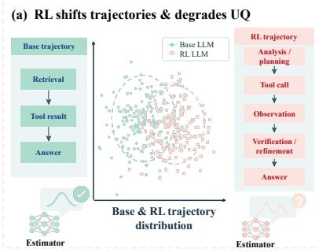
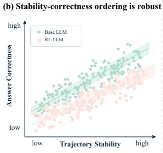
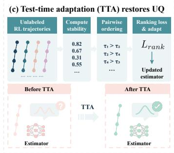
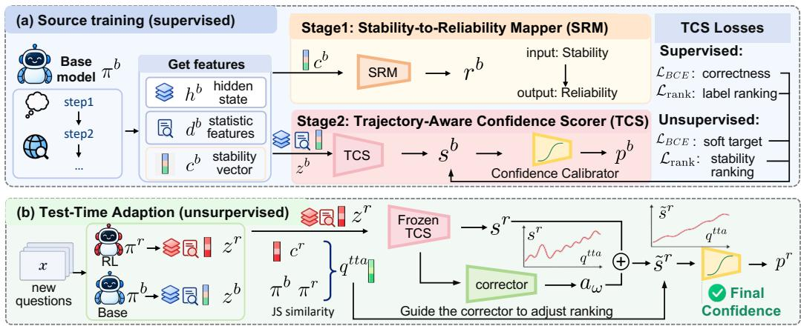
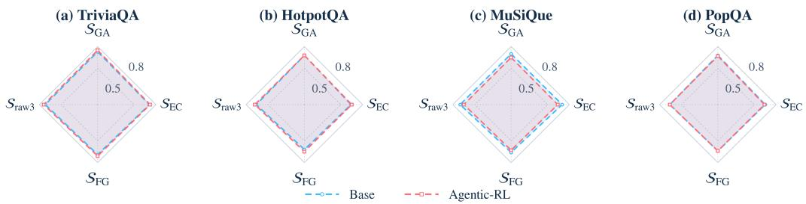
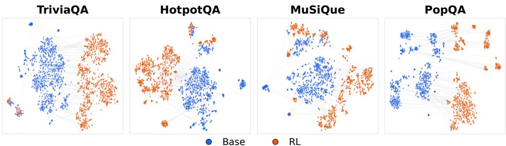
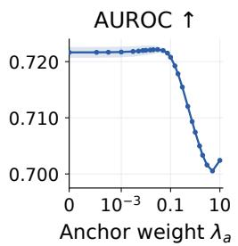
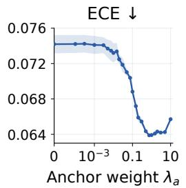
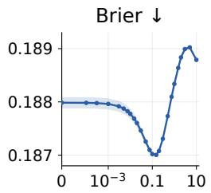
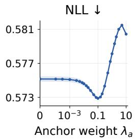

# TEST-TIME CONFIDENCE ADAPTATION UNDER RL-INDUCED TRAJECTORY SHIFT

Zhenzhen Ren1,2 Xiaoqing Zhang2,3 GuoBiao Li1 Bowen Fang4 Yanxi Wang2,5 Xinpeng Zhang1,6 Ke Han7

1Fudan University 2Zhongguancun Academy 3Renmin University of China 4Institute of Automation, Chinese Academy of Sciences 5Beijing Normal University 6Shanghai University 7Queen Mary University of London

## ABSTRACT

Trajectory-based confidence estimation has shown promising performance for large language models (LLMs) by leveraging rich signals from their reasoning processes. However, we find that such confidence estimators can degrade substantially after agentic reinforcement learning (Agentic RL) as it induces substantial shifts in the reasoning trajectories. More importantly, despite these shifts, we uncover a reliability structure that is largely preserved across Base and RL models: more stable trajectories remain more likely to produce correct answers. This preserved relationship provides a transferable, label-free reliability signal for post-RL confidence adaptation. Building on this finding, we propose StaR-TTA, a stability-guided framework for label-free test-time confidence adaptation. StaR-TTA jointly learns from correctness supervision and stability-derived reliability supervision on labeled Base trajectories, establishing the connection between trajectory stability and answer reliability. At test time, it reuses stability-induced reliability rankings from unlabeled RL trajectories to adapt confidence scores to the shifted trajectory distribution, without requiring target correctness labels. Across four QA benchmarks, StaR-TTA achieves an average AUROC of 0.721, with consistent improvements across unseen datasets, model families and scales, and different Agentic RL algorithms.

  
Figure 1: (a) Agentic RL shifts reasoning trajectories and degrades uncertainty quantification (UQ). (b) Stability-correctness ordering remains highly positive after RL. (c) Stability-guided test-time adaptation restores reliable confidence estimation. Using unlabeled RL trajectories, we exploit trajectory stability to construct pairwise ordering and adapt a confidence estimator at test time with a ranking loss, leading to more reliable confidence estimates.

## 1 INTRODUCTION

Reliable confidence estimation is essential for deploying large language models (LLMs) in realworld applications, particularly for reasoning tasks where plausible outputs can still be incorrect (Xiao et al., 2025; de Oliveira et al., 2025; Tian et al., 2023; Turpin et al., 2023; Guan et al., 2026; Xiao et al., 2026). Recent approaches increasingly estimate confidence from reasoning trajectories, which reveal how a model arrives at its answer (Khanmohammadi et al., 2025; Subramani et al., 2025). Meanwhile, LLMs are increasingly optimized through agentic reinforcement learning (Agentic RL), which can substantially reshape their reasoning and tool-use behavior (Cui et al., 2026; Wei et al., 2026; Jin et al., 2025c; Singh et al., 2025; Matsutani et al., 2026). This raises a critical question: do confidence estimators learned from a base model remain reliable after Agentic RL?

We find that they often do not. Confidence estimators that perform well on Base-model trajectories can degrade substantially when directly transferred to their RL-trained counterparts. Through controlled analysis, we identify post-RL trajectory shift as an important source of this degradation: even with tool results and final answers controlled, replacing RL trajectories with their Base counterparts recovers a substantial portion of the lost confidence-ranking performance. Retraining requires post-RL correctness labels, while direct transfer suffers from trajectory shift. We therefore ask: can a confidence estimator adapt to post-RL trajectory shift without target correctness labels?

Our key observation is that, although Agentic RL shifts trajectories, it does not destroy all reliability structure. Across both Base and RL models, trajectory stability remains positively associated with answer correctness: answers that remain more stable under repeated sampling are consistently more likely to be correct. Crucially, unlike correctness labels, trajectory stability can be obtained directly from model outputs without human annotation. This creates a useful supervision bridge across the RL shift: correctness labels can ground the stability-reliability relationship on the source model, while stability remains available as a label-free reliability signal after RL.

Building on this insight, we propose StaR-TTA, a label-free test-time confidence adaptation framework via Stability Ranking. During source training, StaR-TTA jointly learns from correctness supervision and stability-derived reliability supervision, explicitly aligning confidence scores with the reliability ordering induced by trajectory stability. At test time, correctness labels are unavailable, but the preserved stability–correctness relationship provides a transferable supervisory signal. StaR TTA extracts stability from unlabeled RL trajectories, constructs reliability rankings, and uses them to adapt the confidence scorer to the shifted trajectory distribution while preserving the sourcelearned confidence scale. The adapted scores are then mapped to correctness probabilities by a frozen confidence calibrator. In this way, the same stability-based reliability structure learned alongside correctness on the source model becomes the supervision for label-free adaptation after RL.

Extensive experiments on four QA benchmarks show that StaR-TTA consistently improves post-RL confidence estimation, achieving an average AUROC of 0.721. Its gains persist across unseen datasets, different model families and scales, and different Agentic RL algorithms, demonstrating the strong generalization of our method.

Our contributions are summarized as follows:

• We reveal that confidence estimation can degrade substantially after Agentic RL, and identify post-RL trajectory shift as an important contributor to the failure of trajectory-based confidence estimators.

• We uncover a transferable reliability structure under RL-induced trajectory shift: despite substantial changes in reasoning trajectories, the relationship between trajectory stability and answer correctness is largely preserved across Base and RL models.

• We propose StaR-TTA, a label-free test-time confidence adaptation framework that learns stability-based reliability from source correctness supervision and reuses the preserved reliability ordering to adapt confidence estimation to unlabeled post-RL trajectories.

• Extensive experiments show that StaR-TTA consistently improves post-RL confidence estimation and generalizes effectively across models, datasets, and Agentic RL algorithms.

## 2 RELATED WORK

Confidence Estimation. Confidence estimation predicts the probability that an LLM answer is correct (Kadavath et al., 2022). P(True) provides a self-evaluated signal (Kadavath et al., 2022). Beyond self-evaluation, CCPS (Khanmohammadi et al., 2025) predicts correctness from hidden-state perturbation features, while MICE (Subramani et al., 2025) uses logit-lens comparisons between intermediate and final predictions for tool-using agents. At the process level, HTC (Zhang et al., 2026b) estimates answer confidence for tool-using agents, whereas P(Suficient) (Zhang et al., 2026a) probes whether accumulated multi-turn information is sufficient for answering correctly. DACA (Luo et al., 2026) instead calibrates post-trained model confidence through agreement and disagreement with its pre-trained counterpart, without correctness labels. These methods exploit hidden representations, intermediate predictions, trajectory behavior, and so on, but how reliably these signals transfer under model and trajectory distribution shifts remains an open question.

Agentic Reinforcement Learning. Agentic reinforcement learning (Agentic RL) trains LLM policies through multi-step interactions with environments, tools, or other agents, using trajectory-level rewards (Cui et al., 2026; Wei et al., 2026). Common training algorithms include Proximal Policy Optimization (PPO) and Group Relative Policy Optimization (GRPO) (Ouyang et al., 2022; Havrilla et al., 2024; Guo et al., 2025; Shao et al., 2024). Unlike supervised fine-tuning on fixed reasoning traces, Agentic RL lets models learn when to reason, search, verify, and use tools through interaction. For example, Search-R1 (Jin et al., 2025b) trains a base LLM to interleave reasoning with search, issue multiple queries, and incorporate retrieved evidence before answering. It uses multiturn rollouts, retrieved-token masking, and outcome-based rewards without step-level annotations. Other work applies Agentic RL to self-reflection and verification (Guo et al., 2025), tool use (Singh et al., 2025), and search without supervised reasoning traces (Chen et al., 2025). These methods can change action patterns, tool use behaviors, reasoning structure, and hidden representations, shifting the trajectory distributions on which confidence estimators rely.

## 3 CONFIDENCE DEGRADATION UNDER RL-INDUCED TRAJECTORY SHIFT

## 3.1 CONFIDENCE ESTIMATION DEGRADES AFTER AGENTIC RL

We first examine whether confidence estimators learned on a Base LLM remain reliable after Agentic RL. Table 1 reports AUROC on NQ before and after RL. MICE-LR, MICE-RF, and CCPS explicitly exploit fine-grained trajectory information, while HTC summarizes structural properties of agent trajectories; DACA and P(Suficient) rely less directly on trajectory representations. MICE-LR and MICE-RF drop by 23.5% and 27.7%, while CCPS drops by 34.1%. In contrast, DACA remains nearly un-

<table><tr><td>Method</td><td>Base RL AUROC↑ AUROC↑</td><td>Relative drop (%)</td></tr><tr><td>MICE-LR</td><td>0.741 0.567</td><td>23.5</td></tr><tr><td>MICE-RF</td><td>0.773 0.559</td><td>27.7</td></tr><tr><td>HTC</td><td>0.765 0.675</td><td>11.8</td></tr><tr><td>CCPS</td><td>0.745 0.491</td><td>34.1</td></tr><tr><td>DACA</td><td>0.659 0.656</td><td>0.5</td></tr><tr><td>P(Sufficient)</td><td>0.627 0.689</td><td>-9.9</td></tr></table>

Table 1: Base-to-RL confidence transfer on NQ.

changed and P(Suficient) improves. These results reveal a clear vulnerability: confidence estimators that exploit trajectory information can suffer substantial degradation in confidence ranking after transfer to an RL-trained model. This motivates us to examine whether changes in the underlying trajectories are responsible for the degradation.

## 3.2 ISOLATING THE EFFECT

To isolate the source of this degradation, we progressively control three factors that can change after Agentic RL: tool results, final answers, and reasoning trajectories. The results are summarized in Table 2.

<table><tr><td>Method</td><td>Tool control</td><td>Answer control</td><td>replay</td><td>Trajectory Recovery (%)</td></tr><tr><td>MICE-LR</td><td> $5 6 7 \left( - . 1 7 4 \right)$ </td><td>.514(−.110)</td><td> $. 5 6 3 \ : ( + . 0 4 9 )$ </td><td>44.5</td></tr><tr><td></td><td></td><td></td><td>MICE-RF .559 (−.215) .577 (−.087) .623 (+.045)</td><td>51.9</td></tr><tr><td>CCPS</td><td>.491(−.255)</td><td> $. 4 9 8 \left( - . 1 3 3 \right)$ </td><td> $. 5 1 3 _ { \textrm { ( + . 0 1 5 ) } }$ </td><td>11.1</td></tr></table>

Table 2: Controlled AUROC analysis on NQ.

Under tool control, we replace RL tool results with their corresponding Base-model results, yet substantial AUROC gaps remain. Under answer control, we further restrict evaluation to examples for which the Base and RL models produce identical tool results and final answers. The degradation still persists. Finally, under trajectory replay, we keep the controlled tool results and final answers fixed but replace the RL reasoning trajectory with its Base-model counterpart. This recovers 44.5%, 51.9%, and 11.1% of the remaining AUROC loss for MICE-LR, MICE-RF, and CCPS, respectively. These results show that changes in tools or final answers alone cannot explain the transfer failure. Instead, the shift in reasoning trajectories itself contributes substantially to the degradation of trajectory-based confidence estimation.

Figure 2: Overview of our method. (a) Firstly, an SRM model is trained to capture the relationship between trajectory stability and correctness. Then a scorer (TCS) is optimized, followed by a calibrator (CC) to convert scores into calibrated probabilities. (b) At test time, we adapt the results of TCS to Agentic-RL trajectories. We extract stability signals from both Agentic-RL and Base trajectories and use this information to adjust the score while keeping TCS and CC fixed .  
  
Figure 3: AUROC of sampling-stability signals for answer correctness.

This raises a key challenge: if the trajectory distribution changes after RL, what reliability information remains transferable from the Base model?

## 3.3 STABILITY–CORRECTNESS ASSOCIATION IS LARGELY PRESERVED AFTER AGENTIC RL

Despite the substantial trajectory shift, we find that not all reliability information is lost. In particular, the relationship between trajectory stability and answer correctness remains informative after Agentic RL. For each trajectory, we fix the prefix before final-answer generation and only sample multiple short answers without repeating interactions. We characterize their stability using three complementary signals: $S _ { \mathrm { G A } } .$ , the fraction of sampled short answers matching the original answer; SEC, the concentration of the sampled short answer distribution; and $ { S _ { \mathrm { F G } } }$ , the frequency gap between the two most common answers. We further consider their equal-weight average, $ { S _ { \mathrm { r a w 3 } } }$

Figure 3 evaluates each stability signal as a predictor of answer correctness on both Base and RL trajectories. Across all four datasets, the stability signals achieve AUROC well above 0.5 under both Base and Agentic-RL models, while $ { S _ { \mathrm { r a w 3 } } }$ consistently reaches around 0.7–0.8. This predictive ability is largely retained after Agentic RL despite substantial trajectory shifts. Thus, despite substantial trajectory shifts after Agentic RL, more stable trajectories remain more likely to produce correct answers. This observation provides a transferable reliability signal across the RL-induced trajectory shift. Unlike correctness labels, trajectory stability can be obtained directly from unlabeled model outputs. This motivates us to leverage stability-derived reliability ordering as label-free supervision to adapt confidence estimation to post-RL trajectories.

## 4 METHOD

Our analysis in Sec. 3 shows that Agentic RL substantially shifts trajectory representations, while trajectory stability remains predictive of correctness. Based on this finding, we propose StaR-TTA, which uses stability as a transferable reliability signal for post-RL confidence adaptation.

As illustrated in Figure 2, StaR-TTA jointly learns from correctness and stability-derived reliability supervision on labeled Base trajectories. At test time, stability-induced rankings provide label-free supervision for adapting confidence scores to RL trajectories, mitigating the impact of trajectory shift on confidence estimation.

## 4.1 PROBLEM SETUP

We study confidence transfer from a Base LLM $M _ { b }$ to its Agentic-RL counterpart $M _ { r }$ . Given a question $q _ { i }$ (hereafter, we omit the subscript i unless otherwise specified), model $M _ { m } ,$ , where m $\in \{ b , r \}$ , generates an interaction trajectory $\tau ^ { m } = M _ { m } ( q )$ containing its reasoning process, tool interactions, and final answer $a ^ { m }$ . Let $y ^ { \bar { m } } \in \{ 0 , 1 \}$ denote the correctness of $a ^ { \bar { m } }$ , and let $p ^ { m } = P ( y ^ { m } = 1 \mid q , \tau ^ { m } )$ denote its confidence. During source training, correctness labels $y ^ { b }$ are available for Base-model trajectories, whereas target correctness labels $y ^ { r }$ are unavailable at test time. Our goal is to adapt a Base-trained confidence estimator to the post-RL trajectory distribution using only signals derived from unlabeled target trajectories.

## 4.2 STABILITY-GROUNDED SOURCE CONFIDENCE LEARNING

Trajectory representation. We represent each trajectory using internal, interaction, and stability features. We extract a 64-D hidden representation $h ^ { \bar { m } }$ at the answer-generation position and a 24-D descriptor $d ^ { m }$ of trajectory statistics, including tool interactions, invalid actions, and other related statistics. To measure stability without repeated agent rollouts, we fix the trajectory prefix before final-answer generation and sample five short answers. After answer normalization, we compute support $S _ { \mathrm { G A } } ^ { m } \stackrel { \textstyle = } { = } f ^ { m } ( a ^ { m } )$ , entropy concentration $\begin{array} { r } { \begin{array} { l l l } { \quad S _ { \mathrm { E C } } ^ { m } = 1 + \sum _ { a : f ^ { m } ( a ) > 0 } f ^ { m } ( a ) \log f ^ { m } ( a ) / } \end{array} } \end{array}$ log 5, and frequency gap $S _ { \mathrm { F G } } ^ { m } ~ = ~ f _ { ( 1 ) } ^ { m } - { f _ { ( 2 ) } ^ { m } }$ , where $f ^ { m } ( a )$ is the empirical answer frequency, $a ^ { m }$ is the original final answer, and $f _ { ( 1 ) } ^ { m } , f _ { ( 2 ) } ^ { \dot { m } }$ are the two largest frequencies (zero-padded). Let $c ^ { m } =$ $[ S _ { \mathrm { G A } } ^ { m } , S _ { \mathrm { E C } } ^ { m } , S _ { \mathrm { F G } } ^ { m } ] \in \mathbb { R } ^ { 3 }$ . The complete representation is

$$
z ^ { m } = [ h ^ { m } ; d ^ { m } ; c ^ { m } ] \in \mathbb { R } ^ { 9 1 } .
$$

Stability-to-Reliability Mapper. Stability is available without correctness labels but provides only an indirect reliability signal. We therefore use labeled Base trajectories to learn a Stabilityto-Reliability Mapper (SRM),

$$
\begin{array} { r } { r ^ { b } = M _ { \phi } ( c ^ { b } ) = \sigma ( w ^ { \top } c ^ { b } + b ) , \qquad \mathcal { L } _ { \mathrm { S R M } } = \mathrm { B C E } ( r ^ { b } , y ^ { b } ) . } \end{array}
$$

The SRM learns how the three stability signals relate to correctness.

Trajectory-Aware Confidence Scorer. To estimate the confidence from trajectory signals, we train a Trajectory-Aware Confidence Scorer (TCS).

$$
s ^ { b } = g _ { \theta } ( z ^ { b } )
$$

using both correctness and SRM-derived reliability supervision. Correctness provides direct supervision through BCE and pairwise ranking, while the SRM provides a transferable reliability ordering. We use index i and j to represent different source trajectories:

$$
\mathcal { P } _ { y } = \{ ( i , j ) : y _ { i } ^ { b } = 1 , \ y _ { j } ^ { b } = 0 \} , \qquad \mathcal { P } _ { r } = \{ ( i , j ) : r _ { i } ^ { b } - r _ { j } ^ { b } > \delta \} .
$$

For either pair set ${ \mathcal P } _ { \mathrm { { s } } }$ we define

$$
\mathcal { L } _ { \mathrm { r a n k } } ( \mathcal { P } ) = \frac { 1 } { | \mathcal { P } | } \sum _ { ( i , j ) \in \mathcal { P } } \log ( 1 + \exp [ - ( s _ { i } ^ { b } - s _ { j } ^ { b } ) ] ) .
$$

The source objective is

$$
\mathcal { L } _ { \mathrm { s c o r e } } = \underbrace { \mathrm { B C E } ( \sigma ( s _ { i } ^ { b } ) , y _ { i } ^ { b } ) + \lambda _ { h } \mathcal { L } _ { \mathrm { r a n k } } ( \mathcal { P } _ { y } ) } _ { \mathrm { c o r r e c t u e s s ~ s u p e r v i s i o n } } + \underbrace { \lambda _ { r } \mathcal { L } _ { \mathrm { r a n k } } ( \mathcal { P } _ { r } ) + \lambda _ { s } \mathrm { B C E } ( \sigma ( s _ { i } ^ { b } ) , r _ { i } ^ { b } ) } _ { \mathrm { s t a b i l i t y - d e r i v e d ~ s u p e r v i s i o n } } .
$$

This joint training connects correctness-based confidence estimation with the stability-derived reliability signal available after RL.

Finally, we freeze the TCS and fit a monotonic Confidence Calibrator (CC) on Base-model scores and correctness labels:

$$
p _ { i } ^ { b } = C _ { \psi } ( s _ { i } ^ { b } ) = \sigma ( \alpha s _ { i } ^ { b } + \beta ) , \qquad \alpha > 0 ,
$$

This converts the TCS score into a probability of correctness while preserving its ranking.

## 4.3 STABILITY-GUIDED TEST-TIME CONFIDENCE ADAPTATION

Directly applying the Base-trained TCS to RL trajectories yields $s ^ { r } = g _ { \theta } ( z ^ { r } )$ , whose reliability can degrade under RL-induced trajectory shift. Although trajectory stability remains predictive of correctness, it is only an indirect reliability signal and cannot serve as a calibrated confidence estimate. We therefore use stability as adaptation supervision: it specifies how confidence scores should be reordered after RL, while the source-trained TCS provides the initial confidence estimate.

Target reliability ranking. RL stability alone characterizes the consistency of the post-RL model, but does not capture how strongly its behavior has changed from the Base model. We therefore complement $c ^ { r }$ with Base–RL answer agreement. Given sampled-answer distributions $\pi ^ { b }$ and $\pi ^ { r }$ , we compute

$$
A = 1 - \frac { \mathrm { J S D } ( \pi ^ { b } , \pi ^ { r } ) } { \log 2 } ,
$$

and construct the label-free target reliability signal

$$
q ^ { \mathrm { t t a } } = \frac { S _ { \mathrm { G A } } ^ { r } + S _ { \mathrm { E C } } ^ { r } + S _ { \mathrm { F G } } ^ { r } + A } { 4 } .
$$

Rather than treating $q ^ { \mathrm { t t a } }$ as confidence, we use it only to infer relative reliability. Specifically,

$$
{ \mathcal { P } } _ { \mathrm { t t a } } = \{ ( i , j ) : q _ { i } ^ { \mathrm { t t a } } - q _ { j } ^ { \mathrm { t t a } } > \delta _ { \mathrm { t t a } } \} , \qquad t _ { i j } = \sigma \biggl ( \frac { q _ { i } ^ { \mathrm { t t a } } - q _ { j } ^ { \mathrm { t t a } } } { T } \biggr ) ,
$$

where $i , j$ index different target trajectories and $t _ { i j }$ emphasizes larger reliability gaps.

Trajectory-conditioned residual adaptation. A direct correction based only on $q ^ { \mathrm { t t a } }$ would apply similar adjustments to samples with similar stability, despite potentially different trajectory shifts. Instead, we use the stability-induced ordering to supervise an instance-dependent correction con ditioned on the TCS trajectory representation. Specifically, we freeze the TCS and optimize a lightweight linear corrector $a _ { \omega } \mathrm { : }$

$$
\tilde { s } ^ { r } = s ^ { r } + a _ { \omega } ( e ^ { r } ) ,
$$

where $e ^ { r }$ is the intermediate TCS representation. The residual formulation preserves the sourcetrained score while allowing trajectory-specific adaptation.

We use $i , j$ to index trajectories and optimize

$$
\mathcal { L } _ { \mathrm { t t a } } = \underbrace { \frac { 1 } { | \mathcal { P } _ { \mathrm { t t a } } | } \sum _ { ( i , j ) \in \mathcal { P } _ { \mathrm { t t a } } } \mathrm { B C E } \big ( \sigma ( \tilde { s } _ { i } ^ { r } - \tilde { s } _ { j } ^ { r } ) , t _ { i j } \big ) } _ { \mathrm { s t a b i l i t y - g u i d e d ~ a d a p t a t i o n } } + \underbrace { \frac { \lambda _ { a } } { N } \sum _ { i } ( \tilde { s } _ { i } ^ { r } - s _ { i } ^ { r } ) ^ { 2 } } _ { \mathrm { s o u r c e - s c o r e ~ p r e s e r v a t i o n } } .
$$

The ranking term adapts confidence ordering to the target reliability structure, whereas the anchoring term prevents noisy stability supervision from overriding the correctness information learned on the source model. Only $a _ { \omega }$ is updated during adaptation, while both LLMs, the SRM, TCS, and CC remain frozen. After adapting $a _ { \omega }$ on a small set of unlabeled target samples, we freeze the corrector and apply the resulting confidence estimator to all subsequent RL trajectories without further optimization. For a new trajectory, the adapted score and final confidence are computed as

$$
\tilde { s } ^ { r } = s ^ { r } + a _ { \omega ^ { * } } ( e ^ { r } ) , \qquad p ^ { r } = C _ { \psi } ( \tilde { s } ^ { r } ) ,
$$

where $\omega ^ { * }$ denotes the adapted corrector parameters.

Table 3: Main results of confidence estimation on the RL model’s test trajectories.
<table><tr><td>Method</td><td colspan="4">TriviaQA</td><td colspan="4">HotpotQA</td><td colspan="4">MuSiQue</td><td colspan="4">PopQA</td></tr><tr><td></td><td>AUROC† ECE↓ Brier† NLL↓</td><td></td><td></td><td></td><td></td><td>AUROC↑ ECE↓ Brier↓ NLL↓</td><td></td><td></td><td>AUROC↑</td><td></td><td>ECE↓ Brier↓</td><td>NLL↓</td><td>AUROC↑</td><td>ECE↓ Brier↓ NLL↓</td><td></td><td></td></tr><tr><td>DACA</td><td>.668</td><td>.027</td><td>.223</td><td>.638</td><td>.613</td><td>.155</td><td>.243</td><td>.679</td><td>.625</td><td>.310</td><td>.229</td><td>.650</td><td>.680</td><td>.110</td><td>.244</td><td>.681</td></tr><tr><td>P(Sufficient)</td><td>.661</td><td>.331</td><td>.337</td><td>1.131</td><td>.636</td><td>.526</td><td>.498</td><td>1.551</td><td>.648</td><td>.643</td><td>.551</td><td>1.584</td><td>.641</td><td>.459</td><td>.446</td><td>1.382</td></tr><tr><td>HTC</td><td>.653</td><td>.289</td><td>.316</td><td>.989</td><td>.507</td><td>.175</td><td>.268</td><td>.738</td><td>.721</td><td>.081</td><td>.132</td><td>.423</td><td>.678</td><td>.328</td><td>.334</td><td>.937</td></tr><tr><td>MICE-LR</td><td>.675</td><td>.125</td><td>.232</td><td>.670</td><td>.640</td><td>.112</td><td>.234</td><td>.662</td><td>.623</td><td>.054</td><td>.135</td><td>.443</td><td>.595</td><td>.282</td><td>.321</td><td>.882</td></tr><tr><td>MICE-RF</td><td>.629</td><td>.046</td><td>.229</td><td>.651</td><td>.615</td><td>.048</td><td>.219</td><td>.629</td><td>.610</td><td>.064</td><td>.136</td><td>.442</td><td>.590</td><td>.119</td><td>.254</td><td>.702</td></tr><tr><td>CCPS</td><td>.420</td><td>.405</td><td>.429</td><td>1.335</td><td>.438</td><td>.205</td><td>.284</td><td>.920</td><td>.494</td><td>.114</td><td>.149</td><td>.534</td><td>.425</td><td>.306</td><td>.357</td><td>1.407</td></tr><tr><td>Ours</td><td>.800</td><td>.054.181</td><td></td><td>.542</td><td>.715</td><td></td><td>.041 .200</td><td>.582</td><td>.672</td><td>.120.145</td><td></td><td>.532</td><td>.696</td><td>.061 .223</td><td></td><td>.635</td></tr></table>

  
Figure 4: t-SNE visualization of the H64 hidden representations for Base and RL.

## 5 EXPERIMENTS

## 5.1 EXPERIMENTAL SETUP

We use Qwen2.5-3B (Qwen et al., 2024) as our test model and Search-R1 (Jin et al., 2025a) as the Agentic RL framework. We evaluate effectiveness on TriviaQA (Joshi et al., 2017), HotpotQA (Yang et al., 2018), MuSiQue (Trivedi et al., 2021), and PopQA (Mallen et al., 2023). For crossdataset generalization, we train on TriviaQA and test on NQ, 2WikiMultiHopQA (Ho et al., 2020), and Bamboogle (Press et al., 2023). We also test different model scales and families using Qwen2.5- 7B-Instruct (Qwen et al., 2024) and Llama-3.2-3B-Instruct (Meta AI, 2024); and different RL algorithms: PPO (Havrilla et al., 2024), GRPO (Guo et al., 2025). We compare with five baselines: CCPS (Khanmohammadi et al., 2025), MICE (Subramani et al., 2025), HTC (Zhang et al., 2026b), P(Sufficient) (Zhang et al., 2026a), and DACA (Luo et al., 2026). MICE-LR and MICE-RF share internal features but use logistic regression and random forests, respectively. We report AUROC fo ranking, ECE for calibration, and Brier score and NLL for probability quality (Fawcett, 2005; Guo et al., 2017; Brier, 1950; Gneiting & Raftery, 2007). We set $\lambda _ { a } = 0 . 1 , \lambda _ { \mathrm { h } } = 0 . 5 , \lambda _ { r } = 1 . 0$ , and $\lambda _ { s } = 0 . 5$ (details can be accessed in Appendix A.3.1 and Appendix A.3.2).

## 5.2 MAIN RESULTS

We evaluate confidence transfer in Table 3. For each dataset, we train the confidence estimators on Base-LLM trajectories and evaluate them on Agentic RL trajectories. Across four datasets, our method achieves the best average performance: AUROC (0.721), ECE (0.069), Brier (0.187), and NLL (0.573). In terms of AUROC, only HTC outperforms our method on the MuSiQue dataset. Appendix A.4 compares the performance on both Base and RL trajectories, indicating that the poor performance of baselines is mainly due to the shift of Agentic RL. We further visualize the representation shift induced by Agentic RL. Fig. 4 shows that the Base and RL representations occupy visibly different regions of the feature space, indicating that RL training alters the internal representation adopted by the confidence estimator. We further report the baseline that directly uses stability information; the results are shown in Appendix A.2, which indicate that stability provides useful information but stability alone is insufficient. These results show that our method improves both confidence ranking and probability estimation under the influence of Agentic RL.

Table 4: Cross-dataset generalization of confidence estimation.
<table><tr><td>Method</td><td colspan="4">TriviaQA</td><td colspan="4">2WikiMultiHopQA</td><td colspan="4">Bamboogle</td><td colspan="4">NQ</td></tr><tr><td></td><td>AUROC↑</td><td>ECE↓ Brier↓</td><td></td><td>NLL</td><td>AUROC↑ ECE↓ Brier+ NLL↓</td><td></td><td></td><td></td><td>AUROC† ECE↓ Brier† NLL↓</td><td></td><td></td><td></td><td>AUROC^↑</td><td>ECE↓ Brier↓</td><td></td><td>NLL↓</td></tr><tr><td>HTC</td><td>.653</td><td>.289</td><td>.316</td><td>.989</td><td>.482</td><td>.289</td><td></td><td>.337 1.333</td><td>.531</td><td>.212</td><td>.270</td><td>.909</td><td>.672</td><td>.131</td><td>.239</td><td>.737</td></tr><tr><td>MICE-LR</td><td>.675</td><td>.125</td><td>.232</td><td>.670</td><td>.502</td><td>.299</td><td>.346</td><td>.948</td><td>.585</td><td>.399</td><td>.379</td><td>1.027</td><td>.653</td><td>.271</td><td>.302</td><td>.837</td></tr><tr><td>MICE-RF</td><td>.629</td><td>.046</td><td>.229</td><td>.651</td><td>.503</td><td>.132</td><td>.268</td><td>.732</td><td>.520</td><td>.243</td><td>.289</td><td>.787</td><td>.607</td><td>.136</td><td>.250</td><td>.693</td></tr><tr><td>CCPS</td><td>.420</td><td>.405</td><td>.429</td><td>1.335</td><td>.453</td><td>.261</td><td>.324</td><td>1.368</td><td>.524</td><td>.220</td><td>.277</td><td>1.793</td><td>.491</td><td>.256</td><td>.320</td><td>1.791</td></tr><tr><td>DACA</td><td>.668</td><td>.027</td><td>.223</td><td>.638</td><td>.509</td><td>.072</td><td>.247</td><td>.686</td><td>.556</td><td>.218</td><td>.249</td><td>.692</td><td>.623</td><td>.165</td><td>.258</td><td>.710</td></tr><tr><td>P(Sufficient)</td><td>.661</td><td>.331</td><td>.337</td><td>1.131</td><td>.530</td><td>.373</td><td>.392</td><td>1.088</td><td>.653</td><td>.478</td><td>.432</td><td>1.204</td><td>.663</td><td>.485</td><td>.462</td><td>1.417</td></tr><tr><td>Ours</td><td>.800</td><td>.054 .181</td><td></td><td>.542</td><td>.621</td><td></td><td>.087 .240</td><td>.673</td><td>.677</td><td></td><td>.204 .243</td><td>.686</td><td>.748</td><td></td><td>.099 .209</td><td>.605</td></tr></table>

Table 5: Cross-model generalization: Llama-3.2-3B-Instruct with PPO .
<table><tr><td></td><td colspan="4">TriviaQA</td><td colspan="4">HotpotQA</td><td colspan="4">MuSiQue</td><td colspan="4">PopQA</td></tr><tr><td>Method</td><td>AUROC↑ ECE↓ Brier↓ NLL↓</td><td></td><td></td><td></td><td></td><td>AUROC† ECE↓ Brier NLL↓</td><td></td><td></td><td>AUROC↑</td><td>ECE↓ Brier↓ NLL↓</td><td></td><td></td><td>AUROC↑1</td><td></td><td>ECE↓ Brier↓ NLL↓</td><td></td></tr><tr><td>HTC</td><td>.683</td><td>.114</td><td>.233</td><td>.669</td><td>.631</td><td>.071</td><td>.202</td><td>.596</td><td>.688</td><td>.103</td><td>.090</td><td>.313</td><td>.611</td><td>.211</td><td>.274</td><td>.896</td></tr><tr><td>MICE-LR</td><td>.730</td><td>.047</td><td>.202</td><td>.593</td><td>.663</td><td>.108</td><td>.208</td><td>.597</td><td>.651</td><td>.071</td><td>.085</td><td>.300</td><td>.700</td><td>.098</td><td>.218</td><td>.622</td></tr><tr><td>MICE-RF</td><td>.715</td><td>.029</td><td>.202</td><td>.587</td><td>.681</td><td>.097</td><td>.197</td><td>.569</td><td>.661</td><td>.069</td><td>.080</td><td>.286</td><td>.713</td><td>.103</td><td>.212</td><td>.601</td></tr><tr><td>CCPS</td><td>.707</td><td>.105</td><td>.210</td><td>.607</td><td>.686</td><td>.126</td><td>.201</td><td>.580</td><td>.652</td><td>.103</td><td>.087</td><td>.308</td><td>.691</td><td>.083</td><td>.213</td><td>.619</td></tr><tr><td>DACA</td><td>.772</td><td>.204</td><td>.237</td><td>.943</td><td>.583</td><td>.152</td><td>.234</td><td>.661</td><td>.682</td><td>.394</td><td>.265</td><td>.753</td><td>.752</td><td>.297</td><td>.319</td><td>1.076</td></tr><tr><td>P(Sufficient)</td><td>.609</td><td>.135</td><td>.254</td><td>.703</td><td>.652</td><td>.285</td><td>.323</td><td>.982</td><td>.564</td><td>.354</td><td>.222</td><td>.634</td><td>.615</td><td>.064</td><td>.234</td><td>.659</td></tr><tr><td>Ours</td><td>.833</td><td>.047 .167</td><td></td><td>.503</td><td>.746</td><td>.074 .179</td><td></td><td>.528</td><td>.744</td><td>.045</td><td></td><td>5.074 .260</td><td>.830</td><td>.093 .174</td><td></td><td>.516</td></tr></table>

## 5.3 GENERALIZATION ANALYSIS

## 5.3.1 GENERALIZATION ACROSS DATASETS

We evaluate cross-dataset generalization in Table 4. We train the estimator on Base-LLM trajectories from TriviaQA and evaluate it on Agentic RL trajectories from 2WikiMultiHopQA, Bamboogle, and NQ, with TriviaQA serving as an in-domain reference. Our method achieves the highest AU-ROC and the lowest Brier score and NLL on all four datasets. It also achieves the lowest ECE on Bamboogle and NQ. These results demonstrate strong cross-dataset generalization.

## 5.3.2 GENERALIZATION ACROSS MODELS

We evaluate generalization across different model families using Llama-3.2-3B-Instruct (Table 5). We retrain the confidence estimator on the new model, while keeping all other configurations fixed. On Llama-3.2-3B-Instruct, we achieve the best AUROC, Brier score, and NLL on TriviaQA, HotpotQA, MuSiQue, and PopQA, with AUROC gains of 5.6–7.8 percentage points over the strongest baseline. We also evaluate generalization across model scales using Qwen2.5-7B-Instruct (Table 6) to test our metod. Under the 7B backbone, StaR-TTA achieves the highest AUROC on all fou datasets, exceeding the strongest baseline by 1.1–10.2 percentage points, and obtains the lowes Brier score and NLL. These results demonstrate the effectiveness of our method across LLM scales and families.

## 5.3.3 GENERALIZATION ACROSS RL ALGORITHMS

Finally, we verify that our findings are not specific to the PPO algorithm used for Agentic RL training. Table 7 reports results on GRPO algorithms, while keeping the same Base LLM and evaluation protocol. We achieve the best AUROC on all four datasets (0.756 on TriviaQA, 0.724 on HotpotQA, 0.676 on MuSiQue, and 0.750 on PopQA), improving over the strongest baseline by 3.4 to 9.2 points, and additionally attain the best Brier and NLL on HotpotQA, MuSiQue, and PopQA. These results confirm that trajectory shift is a general phenomenon of RL training and that trajectory-based confidence estimation consistently benefits across different RL algorithms.

## 5.4 ABLATION STUDIES

## 5.4.1 EFFECT OF TEST-TIME ADAPTION

Table 6: Cross-model generalization: Qwen2.5-7B-Instruct with PPO.
<table><tr><td>Method</td><td colspan="4">TriviaQA</td><td colspan="4">HotpotQA</td><td colspan="4">MuSiQue</td><td colspan="4">PopQA</td></tr><tr><td></td><td>AUROC↑</td><td>ECE↓ Brier↓</td><td></td><td>NLL↓</td><td></td><td>AUROC↑ ECE↓ Brier↓ NLL↓</td><td></td><td></td><td>AUROC↑</td><td>ECE↓</td><td>Brier↓</td><td>NLL</td><td>AUROC↑</td><td>ECE↓ Brier↓ NLL↓</td><td></td><td></td></tr><tr><td>HTC</td><td>.717</td><td>.355</td><td>.353</td><td>2.684</td><td>.647</td><td>.152</td><td>.246</td><td>.710</td><td>.794</td><td>.149</td><td>.161</td><td>.477</td><td>.697</td><td>.075</td><td>.220</td><td>.630</td></tr><tr><td>MICE-LR</td><td>.641</td><td>.064</td><td>.220</td><td>.639</td><td>.614</td><td>.096</td><td>.236</td><td>.657</td><td>.673</td><td>.041</td><td>.140</td><td>.440</td><td>.581</td><td>.068</td><td>.242</td><td>.674</td></tr><tr><td>MICE-RF</td><td>.669</td><td>.036</td><td>.209</td><td>.607</td><td>.629</td><td>.087</td><td>.228</td><td>.638</td><td>.645</td><td>.061</td><td>.146</td><td>.456</td><td>.652</td><td>.059</td><td>.227</td><td>.639</td></tr><tr><td>CCPS</td><td>.655</td><td>.059</td><td>.202</td><td>.587</td><td>.659</td><td>.078</td><td>.224</td><td>.631</td><td>.672</td><td>.087</td><td>.147</td><td>.458</td><td>.625</td><td>.146</td><td>.253</td><td>.697</td></tr><tr><td>DACA</td><td>.725</td><td>.265</td><td>.268</td><td>2.005</td><td>.657</td><td>.372</td><td>.379</td><td>1.823</td><td>.697</td><td>.315</td><td>.314</td><td>1.155</td><td>.676</td><td>.389</td><td>.387</td><td>2.679</td></tr><tr><td>P(Sufficient)</td><td>.750</td><td>.258</td><td>.267</td><td>1.603</td><td>.704</td><td>.363</td><td>.371</td><td>2.249</td><td>.730</td><td>.369</td><td>.362</td><td>1.991</td><td>.691</td><td>.380</td><td>.381</td><td>2.487</td></tr><tr><td>Ours</td><td>.822</td><td></td><td>.112 .180</td><td>.539</td><td>.769</td><td>.081</td><td>.197</td><td>.569</td><td>.805</td><td>.038</td><td>.121</td><td>.382</td><td>.799</td><td>.103</td><td>.193</td><td>.567</td></tr></table>

Table 7: Generalization across RL algorithms: Qwen2.5-3B with GRPO.
<table><tr><td></td><td colspan="4">TriviaQA</td><td colspan="4">HotpotQA</td><td colspan="4">MuSiQue</td><td colspan="4">PopQA</td></tr><tr><td>Method</td><td>AUROC↑</td><td>↑ ECE↓ Brier↓ NLL↓</td><td></td><td></td><td></td><td>AUROC† ECE↓ Brier↓ NLL↓</td><td></td><td></td><td>AUROC↑</td><td>ECE↓</td><td>Brier↓</td><td>NLL</td><td>AUROC↑</td><td></td><td>ECE↓ Brier↓ NLL↓</td><td></td></tr><tr><td>HTC</td><td>.663</td><td>.321</td><td>.331</td><td>1.171</td><td>.422</td><td>.245</td><td>.274</td><td>1.039</td><td>.551</td><td>.844</td><td>.767</td><td>2.479</td><td>.636</td><td></td><td>.579 .570</td><td>2.613</td></tr><tr><td>MICE-LR</td><td>.640</td><td>.150</td><td>.251</td><td>.716</td><td>.624</td><td>.149</td><td>.230</td><td>.657</td><td>.567</td><td>.051</td><td>.052</td><td>.217</td><td>.524</td><td>.267</td><td>.327</td><td>.890</td></tr><tr><td>MICE-RF</td><td>.564</td><td>.080</td><td>.244</td><td>.681</td><td>.605</td><td>.068</td><td>.204</td><td>.593</td><td>.587</td><td>.079</td><td>.057</td><td>.234</td><td>.521</td><td>.112</td><td>.254</td><td>.701</td></tr><tr><td>CCPS</td><td>.425</td><td>.536</td><td>.546</td><td>4.192</td><td>.437</td><td>.259</td><td>.275</td><td>1.661</td><td>.483</td><td>.210</td><td>.104</td><td>.434</td><td>.467</td><td>.318</td><td>.354</td><td>2.919</td></tr><tr><td>DACA</td><td>.692</td><td>.093</td><td>.232</td><td>.655</td><td>.611</td><td>.244</td><td>.261</td><td>.716</td><td>.642</td><td>.465</td><td>.263</td><td>.718</td><td>.697</td><td>.134</td><td>.252</td><td>.696</td></tr><tr><td>P(Sufficient)</td><td>.647</td><td>.368</td><td>.370</td><td>1.343</td><td>.632</td><td>.631</td><td>.604</td><td>2.091</td><td></td><td>Balaset .840Seth8</td><td></td><td></td><td>AUROC↑.6ECE↓·5Brler↓504LL.713</td><td></td><td></td><td></td></tr><tr><td>Ours</td><td>.756</td><td>.052</td><td>.199</td><td>.585</td><td>.724</td><td></td><td>.114.192</td><td>.567</td><td> $\overline { { { \bf { 1 } } \ P { \bf 1 } \otimes \ Q { \bf 1 } \Phi } } ^ { \bf 0 4 2 } / \mathrm { c }$ </td><td></td><td>048</td><td></td><td> $\mathbf { . 1 9 9 } _ { 8 0 1 8 } . 7 \hat { 5 } . 0 4 5 5 . 9 9 7 \% 2 9 4 5 . 3 8 \hat { 5 } 9 6$ </td><td></td><td></td><td></td></tr></table>

We compare the full method with a variant that removes TTA and directly maps the original student scores through the same frozen calibrator. Table 8 reports the actual metrics for both settings. TTA improves AUROC on HotpotQA, MuSiQue, and PopQA, while slightly reducing it on TriviaQA. The average AUROC increases by approximately 1.73 percentage points. Average Brier score and NLL also improve, whereas average ECE increases

<table><tr><td>w/TTA</td><td>0.8000 0.0535 0.1808 0.5421</td></tr><tr><td>HotpotQA w/o TTA</td><td>0.7112 0.0349 0.1997 0.5828</td></tr><tr><td>w/TTA</td><td>0.7154 0.0409 0.1996 0.5824</td></tr><tr><td>MuSiQue w/o TTA</td><td>0.6296 0.1212 0.1478 0.5503</td></tr><tr><td>w/ TTA</td><td>0.6721 0.1198 0.1450 0.5316</td></tr><tr><td>PopQA w/o TTA</td><td>0.6714 0.0600 0.2273 0.6464</td></tr><tr><td>w/ TTA</td><td>0.6956 0.0610 0.2226 0.6354</td></tr><tr><td>Average w/o TTA</td><td>0.7035 0.0654 0.1885 0.5795</td></tr><tr><td>w/ TTA</td><td>0.7208 0.0688 0.18700.5729</td></tr></table>

Table 8: Effect of removing TTA.

slightly. These results show that TTA mainly benefits confidence ranking, with mixed effects on calibration. We also report ablation results on external descriptors dm, stability vectors $c _ { i } ^ { m } , q ^ { \mathrm { t t a } }$ , and our training loss in Appendix A.1, where we find removing any of them will decrease the performance.

## 5.4.2 TTA SAMPLE EFFICIENCY

Our TTA procedure uses stability-based pairwise rankings to adjust confidence scores. More unlabeled target questions can provide more informative comparisons and make results more reliable. We therefore vary the number of questions used for adaptation, as shown in Table 9. With only a small number of adaptation samples (e.g., N = 2 or N = 4), the results become unstable and even decrease. Performance gradually recovers and stabilizes as we increase the number of unlabeled questions for adaptation. The average AUROC rises from 0.7035 without TTA to 0.7155 with 64 questions. We can find that only a small number of samples (e.g., 64) during TTA is sufficient.

<table><tr><td>N Average Trivia</td><td>Hotpot MuSiQue PopQA</td></tr><tr><td>0 0.7035 0.8018</td><td>0.7112 0.6296 0.6714</td></tr><tr><td>1 0.7035 0.8018</td><td>0.7112 0.6296</td></tr><tr><td>0.6306 0.7537 0.5125</td><td>0.6714 0.6383 0.6181</td></tr><tr><td>2 4 0.6680 0.7828 0.5744</td><td>0.6671 0.6477</td></tr><tr><td>8 0.7089 0.7911</td><td>0.6839 0.6683</td></tr><tr><td>0.7072 0.7914 0.6893</td><td>0.6924 0.6703 0.6779</td></tr><tr><td>12 16 0.7056 0.7943 0.6811</td><td>0.6734 0.6738</td></tr><tr><td>32 0.7120 0.8002</td><td>0.7112 0.6709 0.6658</td></tr><tr><td>0.8014 0.7151</td><td>0.6734 0.6723</td></tr><tr><td>64 0.7155 All 0.7208 0.80000.7154</td><td>0.6721 0.6956</td></tr></table>

Table 9: AUROC under different TTA sample sizes.

These results suggest that additional unlabeled examples improve the reliability of ranking-based adaptation, with diminishing gains as the sample budget increases. We further analyze the additional cost introduced by our method in Appendix A.5. The results show that the stability signal only introduces an extra token overhead of merely 0.8%.

## 6 CONCLUSION

We studied why confidence estimators trained on Base LLM trajectories degrade after Agentic RL. We find that RL-induced trajectory shifts account for a substantial fraction of the degradation. Despite this shift, trajectory stability remains predictive of answer correctness in both Base and RL models. This preserved relationship motivates StaR-TTA, a label-free method that adjusts confidence scores on Agentic RL trajectories at test time. Across four datasets, StaR-TTA achieves an average AUROC of 0.721. It also generalizes across datasets, model families, and PPO- or GRPOtrained agents. These results suggest that StaR-TTA may provide a useful starting point for further research on confidence estimation in Agentic-RL trained LLM agents.

## AI USE STATEMENT

In this work, we used generative AI tools for providing feedback on research methodology. Additionally, we used generative AI tools for edit a research paper to improve readability. We have reviewed all AI-assisted work. We checked LLM-generated feedback and we manually polished the content generated by the LLM. We take responsibility for the final content of this work, including text, claims or artifacts produced with the aid of generative AI.

## REFERENCES

G. W. Brier. Verification of forecasts expressed in terms of probability. Monthly Weather Review, 78, 1950.

Mingyang Chen, Linzhuang Sun, Tianpeng Li, Haoze Sun, Yijie Zhou, Chenzheng Zhu, Haofen Wang, Jeff Z Pan, Wen Zhang, Huajun Chen, et al. Learning to reason with search for llms via reinforcement learning. arXiv preprint arXiv:2503.19470, 2025.

Fangming Cui, Ruixiao Zhu, Cheng Fang, Sunan Li, and Jiahong Li. Rethinking agentic reinforcement learning in large language models. arXiv preprint arXiv:2604.27859, 2026.

Rodrigo de Oliveira, Matthew Garber, James M Gwinnutt, Emaan Rashidi, Jwu-Hsuan Hwang, William Gilmour, Jay Nanavati, Khaldoun Zine El Abidine, and Christina DeFilippo Mack. A study of calibration as a measurement of trustworthiness of large language models in biomedical natural language processing. JAMIA open, 8(4):ooaf058, 2025.

Tom Fawcett. An introduction to roc analysis. Pattern Recognition Letters, 27(8):861–874, 2005.

Tilmann Gneiting and Adrian E. Raftery. Strictly proper scoring rules, prediction, and estimation. Publications ofthe American Statistical Association, 102(March):359–378, 2007.

Jiannan Guan, Qiguang Chen, Libo Qin, Dengyun Peng, Jinhao Liu, Liangyu Huo, Jian Xie, and Wanxiang Che. Beware of reasoning overconfidence: Pitfalls in the reasoning process for multisolution tasks. In Proceedings of the AAAI Conference on Artificial Intelligence, volume 40, pp. 30843–30851, 2026.

Chuan Guo, Geoff Pleiss, Yu Sun, and Kilian Q. Weinberger. On calibration of modern neural networks. 2017.

Daya Guo, Dejian Yang, Haowei Zhang, Junxiao Song, Peiyi Wang, Qihao Zhu, Runxin Xu, Ruoyu Zhang, Shirong Ma, Xiao Bi, et al. Deepseek-r1: Incentivizing reasoning capability in llms via reinforcement learning. arXiv preprint arXiv:2501.12948, 2025.

Alex Havrilla, Yuqing Du, Sharath Chandra Raparthy, Christoforos Nalmpantis, Jane Dwivedi-Yu, Maksym Zhuravinskyi, Eric Hambro, Sainbayar Sukhbaatar, and Roberta Raileanu. Teaching large language models to reason with reinforcement learning. arXiv preprint arXiv:2403.04642, 2024.

Xanh Ho, Anh Khoa Duong Nguyen, Saku Sugawara, and Akiko Aizawa. Constructing a multi-hop qa dataset for comprehensive evaluation of reasoning steps. 2020.

Bowen Jin, Hansi Zeng, Zhenrui Yue, Jinsung Yoon, Sercan Arik, Dong Wang, Hamed Zamani, and Jiawei Han. Search-r1: Training llms to reason and leverage search engines with reinforcement learning. 2025a.

Bowen Jin, Hansi Zeng, Zhenrui Yue, Jinsung Yoon, Sercan Arik, Dong Wang, Hamed Zamani, and Jiawei Han. Search-r1: Training llms to reason and leverage search engines with reinforcement learning. arXiv preprint arXiv:2503.09516, 2025b.

Jiahe Jin, Abhijay Paladugu, and Chenyan Xiong. Beneficial reasoning behaviors in agentic search and effective post-training to obtain them. arXiv preprint arXiv:2510.06534, 2025c.

Mandar Joshi, Eunsol Choi, Daniel Weld, and Luke Zettlemoyer. Triviaqa: A large scale distantly supervised challenge dataset for reading comprehension. 2017.

Saurav Kadavath, Tom Conerly, Amanda Askell, Tom Henighan, Dawn Drain, Ethan Perez, Nicholas Schiefer, Zac Hatfield-Dodds, Nova DasSarma, Eli Tran-Johnson, et al. Language models (mostly) know what they know. arXiv preprint arXiv:2207.05221, 2022.

Reza Khanmohammadi, Erfan Miahi, Mehrsa Mardikoraem, Simerjot Kaur, Ivan Brugere, Charese Smiley, Kundan S Thind, and Mohammad M Ghassemi. Calibrating llm confidence by probing perturbed representation stability. In Proceedings of the 2025 Conference on Empirical Methods in Natural Language Processing, pp. 10459–10525, 2025.

Beier Luo, Shuoyuan Wang, Sharon Li, and Hongxin Wei. Your pre-trained llm is secretly an unsupervised confidence calibrator. Advances in Neural Information Processing Systems, 38: 163514–163543, 2026.

Alex Mallen, Akari Asai, Victor Zhong, Rajarshi Das, Daniel Khashabi, and Hannaneh Hajishirzi. When not to trust language models: Investigating effectiveness of parametric and non-parametric memories. In Proceedings of the 61st Annual Meeting of the Association for Computational Linguistics (Volume 1: Long Papers), pp. 9802–9822, Toronto, Canada, July 2023. Association for Computational Linguistics. doi: 10.18653/v1/2023.acl-long.546. URL https://aclanthology.org/2023.acl-long.546/.

Kohsei Matsutani, Shota Takashiro, Gouki Minegishi, Takeshi Kojima, Yusuke Iwasawa, and Yutaka Matsuo. Rl squeezes, sft expands: A comparative study of reasoning llms. In International Conference on Learning Representations, volume 2026, pp. 141482–141526, 2026.

Meta AI. Llama 3.2: Revolutionizing edge ai and vision with open, customizable models. Meta AI Blog, September 2024. URL https://ai.meta.com/blog/ llama-3-2-connect-2024-vision-edge-mobile-devices/. Accessed: 2026- 09-14.

Long Ouyang, Jeffrey Wu, Xu Jiang, Diogo Almeida, Carroll Wainwright, Pamela Mishkin, Chong Zhang, Sandhini Agarwal, Katarina Slama, Alex Ray, et al. Training language models to follow instructions with human feedback. Advances in neural information processing systems, 35: 27730–27744, 2022.

Ofir Press, Muru Zhang, Sewon Min, Ludwig Schmidt, Noah Smith, and Mike Lewis. Measuring and narrowing the compositionality gap in language models. Findings of the Association for Computational Linguistics: EMNLP 2023, 2023.

Qwen, An Yang, Baosong Yang, Beichen Zhang, Binyuan Hui, Bo Zheng, Bowen Yu, Chengyuan Li, Dayiheng Liu, Fei Huang, Haoran Wei, Huan Lin, Jian Yang, Jianhong Tu, Jianwei Zhang, Jianxin Yang, Jiaxi Yang, Jingren Zhou, Junyang Lin, Kai Dang, Keming Lu, Keqin Bao, Kexin Yang, Le Yu, Mei Li, Mingfeng Xue, Pei Zhang, Qin Zhu, Rui Men, Runji Lin, Tianhao Li, Tianyi Tang, Tingyu Xia, Xingzhang Ren, Xuancheng Ren, Yang Fan, Yang Su, Yichang Zhang, Yu Wan, Yuqiong Liu, Zeyu Cui, Zhenru Zhang, and Zihan Qiu. Qwen2.5 technical report. arXiv preprint arXiv:2412.15115, 2024. doi: 10.48550/arXiv.2412.15115. URL https://arxiv. org/abs/2412.15115.

Zhihong Shao, Peiyi Wang, Qihao Zhu, Runxin Xu, Junxiao Song, Xiao Bi, Haowei Zhang, Mingchuan Zhang, YK Li, Yang Wu, et al. Deepseekmath: Pushing the limits of mathematical reasoning in open language models, 2024. URL https://arxiv. org/abs/2402.03300, 2(3):5, 2024.

Joykirat Singh, Raghav Magazine, Yash Pandya, and Akshay Nambi. Agentic reasoning and tool integration for llms via reinforcement learning. arXiv preprint arXiv:2505.01441, 2025.

Nishant Subramani, Jason Eisner, Justin Svegliato, Benjamin Van Durme, Yu Su, and Sam Thomson. Mice for cats: Model-internal confidence estimation for calibrating agents with tools. In Proceedings of the 2025 Conference of the Nations of the Americas Chapter of the Association for Computational Linguistics: Human Language Technologies (Volume 1: Long Papers), pp. 12362–12375, 2025.

Katherine Tian, Eric Mitchell, Allan Zhou, Archit Sharma, Rafael Rafailov, Huaxiu Yao, Chelsea Finn, and Christopher D Manning. Just ask for calibration: Strategies for eliciting calibrated confidence scores from language models fine-tuned with human feedback. In Proceedings ofthe 2023 Conference on Empirical Methods in Natural Language Processing, pp. 5433–5442, 2023.

H. Trivedi, Niranjan Balasubramanian, Tushar Khot, and Ashish Sabharwal. Musique: Multihop questions via single-hop question composition. Transactions ofthe Associationfor Computational Linguistics, 10:539–554, 2021.

Miles Turpin, Julian Michael, Ethan Perez, and Samuel Bowman. Language models don’t always say what they think: Unfaithful explanations in chain-of-thought prompting. Advances in Neural Information Processing Systems, 36:74952–74965, 2023.

Tianxin Wei, Ting-Wei Li, Zhining Liu, Xuying Ning, Ze Yang, Jiaru Zou, Zhichen Zeng, Ruizhong Qiu, Xiao Lin, Dongqi Fu, et al. Agentic reasoning for large language models. arXiv preprint arXiv:2601.12538, 2026.

Quan Xiao, Debarun Bhattacharjya, Balaji Ganesan, Radu Marinescu, Katsiaryna Mirylenka, Nhan H Pham, Michael Glass, and Junkyu Lee. The consistency hypothesis in uncertainty quantification for large language models. arXiv preprint arXiv:2506.21849, 2025.

Zeguan Xiao, Diyang Dou, Boya Xiong, Yun Chen, and Guanhua Chen. Enhancing uncertainty estimation in llms with expectation of aggregated internal belief. In Proceedings of the AAAI Conference on Artificial Intelligence, volume 40, pp. 34043–34051, 2026.

Zhilin Yang, Peng Qi, Saizheng Zhang, Yoshua Bengio, William W Cohen, Ruslan Salakhutdinov, and Christopher D Manning. Hotpotqa: A dataset for diverse, explainable multi-hop question answering. 2018.

Caiqi Zhang, Ruihan Yang, Xiaochen Zhu, Chengzu Li, Tiancheng Hu, Yijiang River Dong, Deqing Yang, and Nigel Collier. Confidence estimation for llms in multi-turn interactions. In Findings of the Associationfor Computational Linguistics: ACL 2026, pp. 25661–25676, 2026a.

Jiaxin Zhang, Caiming Xiong, and Chien-Sheng Wu. Agentic confidence calibration. arXiv preprint arXiv:2601.15778, 2026b.

## A APPENDIX

## A.1 ABLATION STUDIES

To analyze the contribution of different components in our framework, we conduct ablation studies on both the trajectory representation and the test-time adaptation strategy. For trajectory feature construction, we incorporate three types of signals: internal representations $h ^ { m }$ , external descriptors $d ^ { m }$ , and stability vectors $c ^ { m }$ . Since using hidden-layer representations $h ^ { m }$ as trajectory features is a natural choice, we further investigate whether the additional stability and statistical signals provide complementary benefits.

Table 10: Independent ablations of Scorer input features. Each ablation removes only one feature group.
<table><tr><td>Dataset</td><td>Setting</td><td>AUROC↑</td><td>ECE↓</td><td>Brier↓</td><td>NLL↓</td></tr><tr><td>TriviaQA</td><td>w/o Stability input  $c ^ { m }$ </td><td>0.7413</td><td>0.1529</td><td>0.2250</td><td>0.6408</td></tr><tr><td></td><td>w/o Statistics  $d ^ { \hat { m } }$ </td><td>0.7871</td><td>0.0473</td><td>0.1850</td><td>0.5526</td></tr><tr><td></td><td>Ours</td><td>0.8000</td><td>0.0535</td><td>0.1808</td><td>0.5421</td></tr><tr><td>HotpotQA</td><td>w/o Stability input  $c ^ { m }$ </td><td>0.6170</td><td>0.1222</td><td>0.2337</td><td>0.6679</td></tr><tr><td></td><td>w/o Statistics  $d ^ { \hat { m } }$ </td><td>0.6992</td><td>0.0724</td><td>0.2079</td><td>0.6030</td></tr><tr><td></td><td>Ours</td><td>0.7154</td><td>0.0409</td><td>0.1996</td><td>0.5824</td></tr><tr><td>MuSiQue</td><td>w/o Stability input  $c ^ { m }$ </td><td>0.6578</td><td>0.1241</td><td>0.1478</td><td>0.5422</td></tr><tr><td></td><td>w/o Statistics  $d ^ { \hat { m } }$ </td><td>0.6659</td><td>0.1061</td><td>0.1411</td><td>0.5024</td></tr><tr><td></td><td>Ours</td><td>0.6721</td><td>0.1198</td><td>0.1450</td><td>0.5316</td></tr><tr><td>PopQA</td><td>w/o Stability input  $c ^ { m }$ </td><td>0.6645</td><td>0.2693</td><td>0.3009</td><td>0.8716</td></tr><tr><td></td><td>w/o Statistics  $d ^ { \hat { m } }$ </td><td>0.6675</td><td>0.0311</td><td>0.2259</td><td>0.6438</td></tr><tr><td></td><td>Ours</td><td>0.6956</td><td>0.0610</td><td>0.2226</td><td>0.6354</td></tr></table>

During TTA, we construct $q ^ { \mathrm { t t a } }$ to guide the ranking-based adaptation, which leverages both the stability vector $c ^ { m }$ and the agreement between Agentic-RL and Base trajectories. This differs from the training stage, where only $c ^ { m }$ is used. Therefore, we examine whether introducing the Base–RL agreement brings additional improvements.

During training, we use correctness and ranking losses based on ground-truth labels, along with two corresponding losses constructed from label-free stability signals. We further conduct ablation experiments to assess the individual contributions of these four loss terms.

## A.1.1 SCORER INPUT FEATURES

We independently remove stability features, and the 24-dimensional interaction statistics from the TCS input. Each ablation retains the other input features and follows the same source-training and calibration protocol. Stability signals remain available to the SRM, training losses, and TTA. Table 10 shows that removing stability inputs worsens all four metrics on every dataset. Removing interaction statistics also lowers AUROC on all four datasets, although ECE improves on three datasets and MuSiQue obtains lower Brier score and NLL. These results support retaining both feature groups, while showing that their benefits vary across metrics.

## A.1.2 BASE–RL AGREEMENT DURING ADAPTATION

Table 11: Effect of removing Base–RL JS agreement from TTA.
<table><tr><td>Dataset</td><td>Setting</td><td>AUROC↑</td><td>ECE↓</td><td>Brier↓</td><td>NLL↓</td></tr><tr><td rowspan="2">TriviaQA</td><td>w/o JS agreement</td><td>0.8000</td><td>0.0521</td><td>0.1816</td><td>0.5441</td></tr><tr><td>Ours</td><td>0.8000</td><td>0.0535</td><td>0.1808</td><td>0.5421</td></tr><tr><td rowspan="2">HotpotQA</td><td>w/o JS agreement</td><td>0.7067</td><td>0.0402</td><td>0.2022</td><td>0.5885</td></tr><tr><td>Ours</td><td>0.7154</td><td>0.0409</td><td>0.1996</td><td>0.5824</td></tr><tr><td rowspan="2">MuSiQue</td><td>w/o JS agreement</td><td>0.6743</td><td>0.1198</td><td>0.1449</td><td>0.5310</td></tr><tr><td>Ours</td><td>0.6721</td><td>0.1198</td><td>0.1450</td><td>0.5316</td></tr><tr><td rowspan="2">PopQA</td><td>w/o JS agreement</td><td>0.6927</td><td>0.0633</td><td>0.2238</td><td>0.6383</td></tr><tr><td>Ours</td><td>0.6956</td><td>0.0610</td><td>0.2226</td><td>0.6354</td></tr></table>

We remove Base–RL JS agreement from the target quality signal and use only the mean RL stability, $q ^ { \mathrm { t t a } } = S _ { \mathrm { r a w 3 } }$ , where $S _ { \mathrm { r a w 3 } }$ is the equal-weight average of the stability vector. The SRM, confidence calibrator, and other TTA settings remain unchanged. As shown in Table 11, removing agreement lowers AUROC on HotpotQA and PopQA, while leaving TriviaQA nearly unchanged and slightly improving MuSiQue. Brier score and NLL increase on TriviaQA, HotpotQA, and PopQA. These results indicate that Base–RL agreement provides useful information beyond RL stability, although its benefit varies across datasets.

Table 12: Ablation of individual training losses on PopQA. Average degradation denotes the mean relative degradation across the four metrics compared with the full method.
<table><tr><td>Setting</td><td>AUROC↑</td><td></td><td></td><td></td><td>Average degradation</td></tr><tr><td>w/o Label BCE</td><td>0.6952</td><td>ECE↓ 0.1151</td><td>Brier↓ 0.2372</td><td>NLL↓ 0.6659</td><td>(%)↓ 25.03</td></tr><tr><td>w/o Label Ranking</td><td>0.6886</td><td>0.0647</td><td>0.2248</td><td>0.6408</td><td>2.23</td></tr><tr><td>w/o Stability Ranking</td><td>0.7180</td><td>0.1131</td><td>0.2250</td><td>0.6457</td><td>21.22</td></tr><tr><td>w/o SRM BCE</td><td>0.6972</td><td>0.0634</td><td>0.2223</td><td>0.6345</td><td>0.86</td></tr><tr><td>Full method</td><td>0.6956</td><td>0.0610</td><td>0.2226</td><td>0.6354</td><td>0.00</td></tr></table>

## A.1.3 TRAINING LOSS ABLATION

To examine the contribution of each training loss, we remove one loss term at a time and evaluate the resulting variants on PopQA. Table 12 reports the average relative degradation across the four metrics, using the full method as the reference. Removing Label BCE produces the largest average degradation of 25.03%, followed by removing Stability Ranking at 21.22%. These results suggest that combining direct correctness supervision with stability-based ranking supervision is important for the aggregate performance of the confidence estimator. Removing Label Ranking and SRM BCE leads to smaller average degradations of 2.23% and 0.86%, respectively, indicating more modest contributions under this aggregate measure. Although the effects differ in magnitude, all ablated variants exhibit positive average degradation, supporting the combined training objective in this setting.

## A.2 DIRECT CONFIDENCE ESTIMATION FROM STABILITY

We investigate whether stability signals alone suffice for confidence estimation, potentially providing a simpler alternative to our full framework. We compare five stability-only predictors, each using the three-dimensional stability vector with no hidden layers: logistic regression, probit regression, complementary log-log regression, a sigmoid output trained with Brier loss, and ridge regression with predictions clipped to the probability range. Each predictor is trained on labeled Base LLM trajectories, with regularization selected by Base-validation NLL, and evaluated on the RL test trajectories. Table 13 reports equal-weight averages over TriviaQA, HotpotQA, MuSiQue, and PopQA. Our method achieves the best average performance on all four metrics, supporting the integration of stability signals with trajectory information.

Table 13: Confidence estimation averaged equally across four datasets.
<table><tr><td>Method</td><td>AUROC↑</td><td>ECE↓</td><td>Brier↓</td><td>NLL↓</td></tr><tr><td>Logistic regression</td><td>0.6803</td><td>0.0783</td><td>0.1950</td><td>0.5811</td></tr><tr><td>Probit regression</td><td>0.6807</td><td>0.0781</td><td>0.1958</td><td>0.5855</td></tr><tr><td>Complementary log-log</td><td>0.6802</td><td>0.0791</td><td>0.1953</td><td>0.5825</td></tr><tr><td>Sigmoid (Brier loss)</td><td>0.6821</td><td>0.0736</td><td>0.1942</td><td>0.5775</td></tr><tr><td>Clipped ridge regression</td><td>0.6803</td><td>0.0699</td><td>0.1944</td><td>0.5782</td></tr><tr><td>Ours</td><td>0.7208</td><td>0.0688</td><td>0.1870</td><td>0.5729</td></tr></table>

## A.3 HYPERPARAMETER ANALYSIS

## A.3.1 ROBUSTNESS TO THE ANCHORING WEIGHT

During TTA, the corrector is trained with a ranking loss and an anchoring loss. The ranking loss encourages scores to follow the stability-based ordering, while the anchoring loss limits their deviation from the initial student scores. Their balance is controlled by $\lambda _ { a }$ in $\begin{array} { r } { \dot { \mathcal { L } } _ { \mathrm { t t a } } = \mathcal { L } _ { \mathrm { r a n k } } + \lambda _ { a } \mathcal { L } _ { \mathrm { a n c h o r } } , } \end{array}$ . A smaller weight allows stronger corrections, whereas a larger weight favors the original predictions. Figure 5 varies $\lambda _ { a }$ while keeping the other settings fixed on training set. AUROC peaks near 0.03, while Brier score and NLL reach their lowest values around 0.1–0.15. Larger weights generally reduce AUROC and eventually worsen Brier score and NLL, although ECE remains lower. We use $\lambda _ { a } = 0 . 1$ as a compromise between ranking and probability quality.

  
Anchor weight $\lambda _ { a }$

  
Figure 5: Sensitivity to the anchoring weight $\lambda _ { a } .$ . Curves show the equal-weight average over four datasets.

## A.3.2 ROBUSTNESS TO TRAINING LOSS WEIGHTS

In our experiments, we set $\lambda _ { \mathrm { h } } ~ = ~ 0 . 5 , ~ \lambda _ { r } ~ = ~ 1 . 0 $ , and $\lambda _ { s } ~ = ~ 0 . 5 .$ . To assess robustness to these hyperparameters, we substantially vary each weight individually: doubling $\lambda _ { \mathrm { h } }$ to 1.0, reducing $\lambda _ { r }$ to 0.2, and doubling $\lambda _ { s }$ to 1.0, while keeping all other settings fixed. As shown in Table 14, the mean absolute change across the three perturbations and four evaluation metrics is below 0.003, suggesting that our method is relatively insensitive to the tested variations in loss weights.

Table 14: Robustness to training loss weightss.
<table><tr><td> $\lambda _ { \mathrm { h } }$ </td><td> $\lambda _ { r }$ </td><td> $\lambda _ { s }$ </td><td>AUROC↑</td><td>ECE↓</td><td>Brier↓</td><td>NLL↓</td><td>Change</td></tr><tr><td>0.5</td><td>1.0</td><td>0.5</td><td>0.7208</td><td>0.0688</td><td>0.1870</td><td>0.5729</td><td></td></tr><tr><td>1.0↑</td><td>1.0</td><td>0.5</td><td>0.7227</td><td>0.0656</td><td>0.1860</td><td>0.5662</td><td>-0.0023</td></tr><tr><td>0.5</td><td>0.2↓</td><td>0.5</td><td>0.7229</td><td>0.0711</td><td>0.1870</td><td>0.5785</td><td>+0.0025</td></tr><tr><td>0.5</td><td>1.0</td><td>1.0↑</td><td>0.7193</td><td>0.0710</td><td>0.1879</td><td>0.5786</td><td>+0.0018</td></tr></table>

## A.4 CONFIDENCE ESTIMATION ON BASE AND RL TRAJECTORIES

Table 15 compares confidence estimation on held-out Base and RL trajectories. We evaluate our source-trained TCS and frozen calibrator on Base trajectories, and report the full TTA method on RL trajectories. Several baselines achieve strong performance on Base trajectories but deteriorate substantially when transferred to RL trajectories. For example, CCPS achieves AUROC values of 0.7868 on TriviaQA and 0.7329 on HotpotQA before transfer, which drop to 0.4197 and 0.4381 after transfer. Similarly, MICE-LR and MICE-RF exhibit lower AUROC on RL trajectories across all four datasets, despite their strong performance on Base trajectories. These comparisons show existing estimators can successfully estimate confidence on held-out trajectories from the Base model, yet their learned confidence signals become less reliable after Agentic RL changes the trajectory distribution.

## A.5 COST ANALYSIS

We distinguish standard source training and confidence scoring from the additional costs of stability estimation and test-time adaptation. At test time, we freeze TCS and CC then update only a linear corrector using unlabeled target examples. Paired Base and RL trajectories are required only for training the corrector. Once corrector is trained, confidence scoring uses RL trajectories alone, without running the Base model on subsequent questions. Table 9 shows that 64 adaptation examples improve average AUROC from 0.7035 to 0.7155, compared with 0.7208 using all available examples. Thus, a small adaptation subset can provide useful gains while limiting the cost of Base-model execution. Other confidence estimators may need to perform retraining on a large collection of RL trajectories (e.g., tens of thousands). Without this retraining, they undergo substantial performance degradation.

Table 15: Confidence estimation on Base and RL test trajectories.
<table><tr><td rowspan="2">Method</td><td colspan="4">Base trajectories</td><td colspan="4">RL trajectories</td></tr><tr><td>AUROC↑</td><td>ECE↓</td><td>Brier↓</td><td>NLL↓</td><td>AUROC↑</td><td>ECE↓</td><td>Brier↓</td><td>NLL↓</td></tr><tr><td>TriviaQA</td><td></td><td></td><td></td><td></td><td></td><td></td><td></td><td></td></tr><tr><td>DACA^†</td><td>0.6979</td><td>0.2257</td><td>0.2625</td><td>0.7223</td><td>0.6675</td><td>0.0265</td><td>0.2232</td><td>0.6376</td></tr><tr><td>P(Sufficient)†</td><td>0.6815</td><td>0.4786</td><td>0.4497</td><td>1.3340</td><td>0.6605</td><td>0.3306</td><td>0.3372</td><td>1.1313</td></tr><tr><td>HTC</td><td>0.7976</td><td>0.0162</td><td>0.1765</td><td>0.5391</td><td>0.6529</td><td>0.2887</td><td>0.3161</td><td>0.9893</td></tr><tr><td>MICE-LR</td><td>0.7723</td><td>0.0223</td><td>0.1871</td><td>0.5540</td><td>0.6754</td><td>0.1249</td><td>0.2324</td><td>0.6703</td></tr><tr><td>MICE-RF</td><td>0.7885</td><td>0.0301</td><td>0.1812</td><td>0.5312</td><td>0.6290</td><td>0.0461</td><td>0.2294</td><td>0.6506</td></tr><tr><td>CCPS</td><td>0.7868</td><td>0.0224</td><td>0.1813</td><td>0.5370</td><td>0.4197</td><td>0.4045</td><td>0.4286</td><td>1.3352</td></tr><tr><td>Ours</td><td>0.7840</td><td>0.0210</td><td>0.1806</td><td>0.5371</td><td>0.8000</td><td>0.0535</td><td>0.1808</td><td>0.5421</td></tr><tr><td>HotpotQA</td><td></td><td></td><td></td><td></td><td></td><td></td><td></td><td></td></tr><tr><td>DACA†</td><td>0.6517</td><td>0.3868</td><td>0.2737</td><td>0.7441</td><td>0.6128</td><td>0.1547</td><td>0.2432</td><td>0.6793</td></tr><tr><td>P(Sufficient)†</td><td>0.6496</td><td>0.6698</td><td>0.5740</td><td>1.6223</td><td>0.6363</td><td>0.5262</td><td>0.4983</td><td>1.5509</td></tr><tr><td>HTC</td><td>0.7397</td><td>0.0304</td><td>0.1104</td><td>0.3619</td><td>0.5067</td><td>0.1750</td><td>0.2684</td><td>0.7382</td></tr><tr><td>MICE-LR</td><td>0.7268</td><td>0.0321</td><td>0.1146</td><td>0.3726</td><td>0.6403</td><td>0.1122</td><td>0.2341</td><td>0.6623</td></tr><tr><td>MICE-RF</td><td>0.7530</td><td>0.0504</td><td>0.1101</td><td>0.3571</td><td>0.6149</td><td>0.0475</td><td>0.2190</td><td>0.6292</td></tr><tr><td>CCPS</td><td>0.7329</td><td>0.0347</td><td>0.1098</td><td>0.3634</td><td>0.4381</td><td>0.2048</td><td>0.2842</td><td>0.9195</td></tr><tr><td>Ours</td><td>0.7482</td><td>0.0293</td><td>0.1084</td><td>0.3551</td><td>0.7154</td><td>0.0409</td><td>0.1996</td><td>0.5824</td></tr><tr><td>MuSiQue</td><td></td><td></td><td></td><td></td><td></td><td></td><td></td><td></td></tr><tr><td>DACA†</td><td>0.6813</td><td>0.4619</td><td>0.2616</td><td>0.7165</td><td>0.6253</td><td>0.3103</td><td>0.2285</td><td>0.6497</td></tr><tr><td>P(Sufficient)†</td><td>0.6402</td><td>0.7456</td><td>0.6080</td><td>1.6726</td><td>0.6475</td><td>0.6425</td><td>0.5505</td><td>1.5842</td></tr><tr><td>HTC</td><td>0.7055</td><td>0.0186</td><td>0.0314</td><td>0.1398</td><td>0.7209</td><td>0.0808</td><td>0.1317</td><td>0.4229</td></tr><tr><td>MICE-LR</td><td>0.7026</td><td>0.0174</td><td>0.0331</td><td>0.1428</td><td>0.6231</td><td>0.0540</td><td>0.1350</td><td>0.4434</td></tr><tr><td>MICE-RF</td><td>0.6618</td><td>0.0409</td><td>0.0368</td><td>0.1599</td><td>0.6101</td><td>0.0637</td><td>0.1360</td><td>0.4420</td></tr><tr><td>CCPS</td><td>0.6640</td><td>0.0337</td><td>0.0345</td><td>0.1540</td><td>0.4936</td><td>0.1140</td><td>0.1485</td><td>0.5337</td></tr><tr><td>Ours</td><td>0.7610</td><td>0.0088</td><td>0.0303</td><td>0.1293</td><td>0.6721</td><td>0.1198</td><td>0.1450</td><td>0.5316</td></tr><tr><td>PopQA</td><td></td><td></td><td></td><td></td><td></td><td></td><td></td><td></td></tr><tr><td>DACA†</td><td>0.6420</td><td>0.2220</td><td>0.2519</td><td>0.6987</td><td>0.6804</td><td>0.1098</td><td>0.2438</td><td>0.6806</td></tr><tr><td>P(Sufficient)†</td><td>0.6615</td><td>0.5181</td><td>0.4706</td><td>1.3192</td><td>0.6405</td><td>0.4589</td><td>0.4459</td><td>1.3821</td></tr><tr><td>HTC</td><td>0.7439</td><td>0.0658</td><td>0.1766</td><td>0.5338</td><td>0.6779</td><td>0.3277</td><td>0.3337</td><td>0.9366</td></tr><tr><td>MICE-LR</td><td>0.7361</td><td>0.0477</td><td>0.1830</td><td>0.5431</td><td>0.5953</td><td>0.2816</td><td>0.3211</td><td>0.8815</td></tr><tr><td>MICE-RF</td><td>0.7937</td><td>0.0384</td><td>0.1636</td><td>0.4918</td><td>0.5903</td><td>0.1186</td><td>0.2539</td><td>0.7015</td></tr><tr><td>CCPS</td><td>0.7432</td><td>0.0392</td><td>0.1803</td><td>0.5307</td><td>0.4249</td><td>0.3060</td><td>0.3573</td><td>1.4068</td></tr><tr><td>Ours</td><td>0.7311</td><td>0.0643</td><td>0.1791</td><td>0.5347</td><td>0.6956</td><td></td><td>0.06100.22260.6354</td><td></td></tr></table>

For stability estimation, we fix each trajectory prefix and sample five short final answers, avoiding repeated reasoning and tool calls. We estimate the additional answer tokens cost using 100 randomly selected Base trajectories per dataset. As reported in Table 16, the five answers contain 46.1 tokens on average, or approximately 9.2 tokens per answer, compared with 5,824 tokens in the original trajectory. The resulting 0.8% ratio measures the token increment from answer resampling.

## A.6 EXPERIMENTAL DETAILS

The source-training/source-validation/RL-test counts are 1,502/475/11,122 for TriviaQA, 1,486/478/6,687 for HotpotQA, 1,458/457/1,755 for MuSiQue, and 1,475/463/11,712 for PopQA. As for 64-dimensional hidden representation, we use layers 28 and 36 for Qwen2.5-3B, and layers 24 and 28 for Qwen2.5-7B-Instruct and Llama-3.2-3B-Instruct. The SRM uses three-input logistic regression. The TCS is a two-branch MLP with two hidden layers per branch, whose scalar outputs are summed. It is trained using AdamW with learning rate $\mathrm { i 0 ^ { - 3 } }$ , weight decay $1 0 ^ { - 4 }$ , batch size 128, and source-ranking threshold 0.3. The CC uses Platt scaling, $p = \sigma ( a s + b )$ , fitted on source

Table 16: Token usage of original trajectories and five sampled answers.
<table><tr><td>Dataset</td><td>Total original tokens</td><td>Five answers tokens</td><td>Five answers / Total original (%)</td></tr><tr><td></td><td></td><td>45.0</td><td>0.9</td></tr><tr><td>TriviaQA HotpotQA</td><td>5,034.5 5,289.3</td><td>45.8</td><td>0.9</td></tr><tr><td>MuSiQue</td><td>6,330.2</td><td>47.0</td><td>0.7</td></tr><tr><td>PopQA</td><td>6,642.5</td><td>46.8</td><td>0.7</td></tr><tr><td>Overall</td><td>5,824.1</td><td>46.1</td><td>0.8</td></tr></table>

OOF scores. We sample five terminal answers with temperature $1 . 0 , \mathrm { t o p } { - p } = 0 . 9 , \mathrm { t o p } { - k } = 5 0$ . The corrector is a zero-initialized 288 → 1 linear layer which is trained for 20 Adam steps with learning rate 0.03. We judge whether the answer is correct by using exact match against any reference after lowercasing, removing punctuation and articles, and normalizing whitespace.