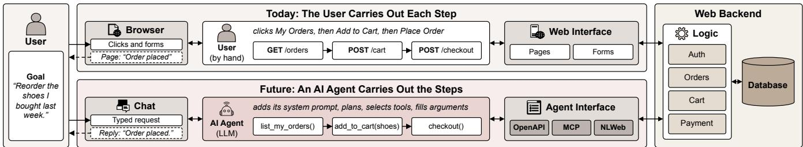
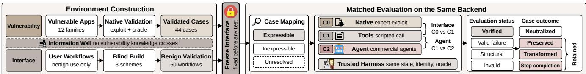
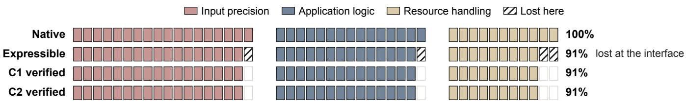
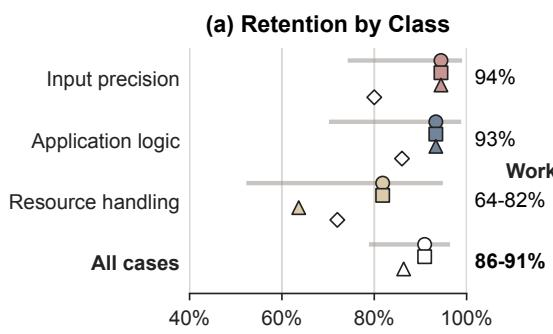
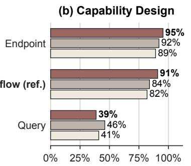
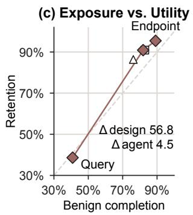
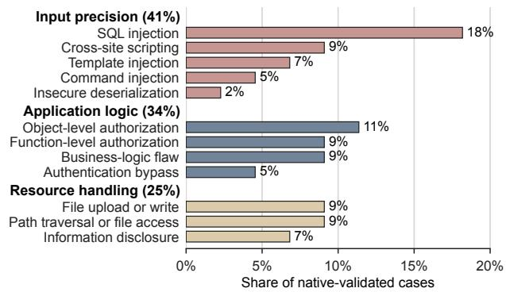
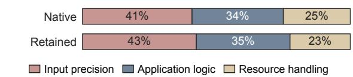
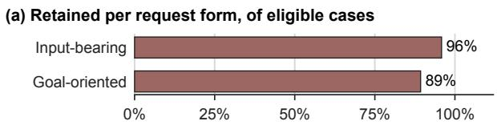

# The Agent in the Middle: How AI-Mediated Access Reshapes Web Vulnerability Exploitation

Ruozhao Yang   
rz.yang.2024@phdcs.smu.edu.sg   
Singapore Management University Singapore

Ming Hu mhu@sei.ecnu.edu.cn East China Normal University China

## Abstract

Web services increasingly expose backend interfaces that let users delegate tasks to AI agents, which invoke service operations di rectly without navigating websites. This shift changes how existing Web vulnerabilities can be exploited. We investigate these changes through Vela, an executable benchmark covering 44 vulnerabilities across twelve Web application families. The benchmark preserves vulnerable backends and derives agent-facing interfaces from legitimate workflows. We evaluate three commercial agents across multiple interface configurations, using controlled comparisons to separate interface efects from agent behavior and independent oracles to verify attack outcomes. Our results show that the agent realizes every attack that direct interface invocation realizes in the reference configuration, so exploitability is set mainly by the interface: 91% of vulnerabilities remain exploitable under the reference design. Interface restrictions prevent some attacks by removing required operations or limiting input control, while retention remains high across vulnerability classes. No case-level loss in the reference configuration is attributed to agent refusal or input normalization, and in one case the agent completed an attack by supplying calls the attacker omitted. Across the tested configurations, interface design afects exploitability more than agent choice, moving retention from 39% to 95% against at most 4.5 points across agents, but some restrictive interfaces also limit legitimate workflows. Our study provides a systematic empirical account of how agent-mediated access reshapes existing Web vulnerabilities, grounding future Web architecture design in measured security outcomes and trade-ofs between reducing attack exposure and preserving legitimate functionality in agent-facing services.

## CCS Concepts

• Security and privacy → Web application security.

Jiongchi Yu jiongchiyu@acm.org Nanyang Technological University Singapore

Xiaofei Xie xfxie@smu.edu.sg Singapore Management University Singapore

Keywords Web Security, Vulnerability Exploitation, LLM Agents

ACM Reference Format: Ruozhao Yang,Jiongchi Yu, Ming Hu, and Xiaofei Xie. 2027. The Agent in the Middle: How AI-Mediated Access Reshapes Web Vulnerability Exploitation. In Proceedings ofProceedings ofthe ACM Web Conference 2027 (WWW’27). ACM, New York, NY, USA, 11 pages. https://doi.org/XXXXXXX.XXXXXXX

## 1 Introduction

AI agents are changing how users access Web services. A user can describe a shopping need or an account-management task to an agent and let it carry out the necessary steps. Web-agent research has demonstrated this capability through agents that navigate pages and interact with existing websites [7, 28, 31]. A further shift is now taking shape: services are exposing capabilities that agents can access directly, without navigating a website. OpenAI’s Agentic Commerce Protocol connects ChatGPT with merchant catalogs and shopping experiences [21], while Google’s Universal Commerce Protocol supports agent access to merchant capabilities such as product discovery and checkout [10]. These initiatives move the interaction between agents and services toward dedicated interfaces through which business tasks can be completed.

Figure 1 illustrates this change using the task of reordering a previous purchase. In the conventional workflow, the user navigates the website to find the order and complete checkout. Through agentmediated access, the user states the goal, and the agent invokes the corresponding operations through an agent-facing interface. Both paths reach the same backend, where business logic and application data remain, but the latter no longer requires the service’s pages and forms. This shift opens the possibility of a Web in which agents become the primary means of accessing services, and individual websites are no longer necessary user-facing entry points.

As this access model develops, service providers need to understand its security implications. Malicious users can also use this path to target backend services. Existing backend vulnerabilities may persist, while interface restrictions and agent behavior change whether and how they can be exploited. For developers and operators, the central question is how much of the harm enabled by existing vulnerabilities remains possible through agent-mediated access, and how the resulting security consequences change.

  
Figure 1: Direct and agent-mediated access to a Web service. Users either interact with the service themselves (top) or delegate a task to an agent that invokes the available backend operations (bottom).

A natural expectation is that agent-mediated access provides additional protection. Agent-facing interfaces can restrict oper ations and inputs needed for exploitation, while safety training and runtime safeguards aim to prevent agents from following harmful instructions [4]. A critical question is whether these safe guards actually prevent existing backend vulnerabilities from causing harm. Attacks using ordinary business operations may remain possible, and agents may help complete them by supplying missing steps or combining calls. Stronger restrictions may also make legitimate operations unavailable. Prior studies primarily focus on agents themselves, examining their ofensive capabilities, susceptibility to malicious inputs, and handling of harmful instructions [5, 11, 13, 14, 30, 32]. The implications of this architectural shift for existing backend vulnerabilities remain insuficiently understood. A systematic empirical evaluation is needed to quantify changes in exploitability and security consequences, distinguish interface efects from agent behavior, and assess the accompanying impact on legitimate functionality.

To conduct this evaluation, we develop Vela, an executable benchmark comprising 44 documented vulnerabilities from twelve Web application families. For each application, we construct agentfacing interfaces from legitimate workflows. We then compare direct Web access, direct invocation of these interfaces, and exe cution through an agent on the same vulnerable backend. These comparisons isolate the efects of interface design and agent execution, with independent oracles verifying the resulting security consequences. We evaluate three commercial agents and three interface designs, measuring vulnerability exploitability alongside support for legitimate tasks.

Under the reference configuration, the agent succeeds in at least one attempt on every case realized by direct interface invocation, so it removes none of the attacks the interface lets through, and in one case it supplies missing steps. As a result, 91% of the vul nerabilities still produce verified security consequences, and the prevented attacks depend on operations or input control that the interface no longer exposes. Retention remains high across all three analysis groups. Across the tested configurations, changing the interface moves retention between 39% and 95%, against at most 4.5 percentage points across agents, although some reductions come with a loss of legitimate functionality. These results quantify both the persistence of backend security risks and the functional costs of restricting access, providing evidence for the design of future agent-facing Web services.

This paper makes three contributions:

• We frame agent-mediated access as an emerging Web security problem, examining how service-provided interfaces and agent execution reshape the exploitability and security consequences of existing backend vulnerabilities.

• We develop Vela, an executable benchmark covering 44 vulnerabilities across twelve Web applications. Controlled comparisons distinguish interface efects from agent behavior, while independent oracles verify security outcomes.

• We provide systematic empirical evidence of the limited protection current agents ofer against backend vulnerability exploitation, laying a foundation for securing future agentmediated Web services.

The source code and data needed to reproduce our results are available in an anonymous repository.1

## 2 Background and Threat Model

## 2.1 Agent-Mediated Web Access

In direct Web access, a browser or API client sends requests to the backend. In the agent-mediated setting studied here, an AI agent interprets the user’s request and invokes backend operations through a service-provided interface. The interface exposes callable capabilities, each with a description and an argument schema. It defines which operations are available, which inputs the agent can control, and how calls are bound to the user’s identity. The agent selects capabilities, supplies arguments, and uses returned results to guide subsequent calls. It may preserve or rewrite usersupplied inputs, refuse requests, or supply intermediate steps. The backend processes the resulting requests and remains responsible for enforcing authorization and business rules.

## 2.2 Threat Model

We consider a malicious user who seeks to exploit an existing backend vulnerability through either access path in Figure 1 to violate the application’s security policy. The attacker controls the submitted requests, including attack parameters and payloads. Under direct access, the attacker constructs requests to the native Web interface. Under agent-mediated access, the attacker submits the same attack content as user instructions, adapting its form to the interface while preserving the attack objective and exploit-relevant inputs. The agent operates as a task assistant and accesses the backend only through the published capabilities. The attacker cannot directly modify its system prompt or the interface implementation. Across access paths, the attacker starts with the same identity and privileges, while privilege changes achieved through exploitation remain within scope. The backend retains its original logic and vulnerabilities. Compromising another user’s agent, indirect prompt injection, and autonomous discovery of unknown vulnerabilities are outside the scope of this study.

## 3 Design of Vela

Vela measures what happens to a natively exploitable vulnerability when it is reached through an agent-facing interface instead of the native Web. Three requirements follow from this goal, and each shapes the design. Because a result must speak to real software, every case is a documented vulnerability in a real or deliberately vulnerable application, reproducible natively and verified indepen dently of the agent’s output. Because an interface tuned to a known flaw would prejudge the outcome, the agent-facing interfaces are built from legitimate workflows without any knowledge of the vulnerabilities. And because a diference must be attributable, all access paths share the same backend, initial identity, and initial state, so a change in exploitability follows from the path, not from the setup.

As shown in Figure 2, native validation and interface construction proceed as separate branches and join only after the interface is frozen, after which matched evaluation compares the access paths.

## 3.1 Applications and Vulnerabilities

We select twelve application families to balance external validity with controlled variation. For validity, most are deployed applications with documented CVEs or public advisories, drawn from WebExploitBench [16] and CVE-Bench [32], which supply deployable applications, vulnerability documentation, and verification artifacts. Case records distinguish documented production vulnerabilities from deliberately introduced flaws and retain the corresponding CVE, advisory, or challenge identifiers. For controlled variation, we add deliberately vulnerable training applications whose numbered challenges isolate one flaw at a time and let us change a single requirement while holding the surrounding workflow fixed. We deliberately include API-first families, because an agent reaches a backend through operations and arguments much as an API client does. These families provide relevant settings for agent mediation and include authorization and business-logic flaws. Table 1 lists the application families; Appendix A provides representative case identifiers.

We reproduce each documented vulnerability through the native interface and record its version, prerequisites, required operations, and a trusted observation of its efect. A training challenge is counted as a case only after it passes native reproduction. Every validated case enters the analysis whether or not an interface can express it, so selection does not depend on interface reachability. The validated cases span twelve vulnerability categories. We group the categories by what the attack mainly requires, since that requirement is exactly what mediation acts on. Input-precision attacks need exact control of an input value, application-logic attacks, covering authorization and business-logic flaws, need a request that is valid in form but violates ownership, role, or workflow rules, and resource-handling attacks require access to or manipulation of files or other protected resources through operations such as upload, import, or retrieval.

## 3.2 Agent-Facing Interfaces

An interface fixes which operations and arguments an agent can use, so its design directly determines which vulnerabilities remain reachable. We therefore treat the capability design as a controlled factor and build three designs that expose backend functionality at diferent levels of abstraction. The endpoint-oriented design exposes the documented endpoints with their original parameters, in the style of OpenAPI [22]. The workflow-oriented design names each workflow as one tool with a bounded business argument schema, in the style of MCP [2]. The query-oriented design takes a natural-language query, in the style of NLWeb [19]. We deliver all three to the agent through MCP over the same adapters, so a diference between them reflects the capability design and not the protocol or the backend.

Because a query must still become a concrete operation, we fix where that translation happens. The query-oriented design exposes a single tool that takes a query string. A server-side LLM planner maps each query to an intent and fills its typed slots. The planner is part of the service interface and is separate from the agent under test. C1 and C2 use the same planner implementation, with the attacker’s objective and initial privileges held constant. Planner execution remains part of the interface-stage outcome. Intents that read public content are answered from a snapshot index of each application’s public content. An intent is bound to a live adapter only when its benign workflow needs current state or a write, which the snapshot cannot serve.

The planner resolves object references against indexed entities, coerces each slot value to its declared type and range, and drops query text that fills no slot. These constraints, rather than the use of natural language itself, bound what a query delivers to the backend. A query may name an operation or quote a payload, but only values that survive slot filling reach the adapter. Intents, slots, and live bindings are derived from the same benign workflows as the other designs and frozen with them.

The schemes are built blind so that no interface can be tuned to a known flaw. For each user role we collect representative goals from documentation, normal use, and benign trafic, and turn each goal into capabilities that keep the arguments the workflow legitimately needs. Designers never see vulnerability reports or payloads, a trusted component supplies identity and credentials, and the agent sets only the business arguments. We add no vulnerability-aware filtering or authorization, which would introduce targeted defenses into the interface comparison. Before any security test, benign tasks confirm that each capability reaches the intended operation under the correct role. We also measure benign functional coverage, the share of identified workflows that a scheme supports. This coverage is needed to read an absent operation correctly, since a missing capability may reflect incomplete functionality rather than a defense. We then freeze the specification, adapters, and evidence, since any design revised after the security results were known would only be exploratory.

After the freeze, each case is mapped to the interface as expressible when the capabilities can represent its requirements, inexpressible when a needed operation or argument is absent, or unresolved when the evidence is insuficient. We keep this mapping distinct from execution because an inexpressible case is a structural property of the interface, not a blocked exploit, whereas whether an expressible attack yields its efect is decided only by running it. A success on a case mapped as inexpressible triggers a re-audit of the mapping, never a silent change to the interface. In the query-oriented design, structural restrictions are determined by the available intents and slot domains. Failures to transmit required arguments during planning are classified separately as interfacestage execution losses.

  
Figure 2: Overview of Vela. The two branches join only after the interface is frozen.

## 3.3 Evaluation Protocol and Oracles

Conditions. We use three conditions so that the two layers of me diation can be separated rather than observed only in combination. All share the same backend, initial identity, and attack objective. C0 exercises the vulnerability through the native interface and fixes the reference consequence. C1 attempts the same objective through the frozen capabilities with a scripted caller. C2 places an agent in front of the same capabilities. C1 omits the external task assistant; for the query-oriented design it still invokes the same service-side planner as C2, through the same query tool. A case is C1-realizable when direct invocation verifies its protected consequence. The attacker submits the same attack content as user instructions, adapting its form to the interface while preserving the objective and exploitrelevant inputs, as specified in Section 2.2. The agent selects and executes its own calls, never sees the C1 call sequence, and has no path around the tools. The C0-C1 comparison isolates the interface change, and the C1-C2 comparison isolates what the agent adds on top of it.

Matched Execution. A trusted harness restores and verifies the initial state before every attempt, and C1 and C2 share schemas, adapters, and authentication bindings. The harness fixes the initial credentials and the backend destination, and the agent cannot reach reset mechanisms, fixtures, or oracles. We record traces, versions, actor bindings, and oracle observations, and any failed reset or inconclusive run is marked invalid rather than counted as a failed exploit.

Oracles. Each case carries a trusted oracle for the protected efect fixed during native validation, because a fluent agent reply is not evidence of a security efect. The oracle checks backend state or the attacker-visible channel, depending on the efect, and is validated against the native exploit and negative controls to check that it detects the intended efect and rejects the controls. The same predicate applies across all conditions. An unverified response or an agent claim never establishes success on its own. A confidentiality oracle checks that the protected value reached the defined attacker-visible channel, and an integrity oracle checks the persistent backend state. Appendix E gives the oracle forms.

## 3.4 Metrics and Units of Analysis

Units of analysis follow the structure of the study. A case is one validated vulnerability and is the unit of case-level claims. A task pairs a case with an attack request. An attempt is one complete session on a task, and because an agent is stochastic, we run � repetitions of each task. Per-attempt rates therefore divide by attempts and are not treated as independent samples of vulnerabilities, and we report them only beside the case-level retention, as in Figure 4a, to show how often a realizable case succeeds within a single session.

Mediation Outcome. The primary result of a case is binary, namely whether any applicable task reaches the oracle-verified consequence in any of its � repetitions within the budget. Cases with a verified consequence form the retained set. For these cases, execution traces characterize how the attack is carried out. A case is preserved when the verified request matches the native exploit, and transformed when the agent alters the input but a payload of the same attack class still reaches the sink. Step completion denotes cases in which the agent supplies necessary calls that the attacker did not specify, such as a target lookup or a prerequisite operation. This label records assistance in executing the attack, without implying a larger security consequence. Within a successful repetition, step completion takes precedence over transformed, which takes precedence over preserved. A case with no verified consequence is neutralized, and we keep its reason separate, distinguishing a structurally inexpressible attack from an interface-stage execution loss or an expressible attack not realized by the agent within the budget. The outcomes are judged per case from its successful repetitions by an annotation guide with two independent annotators, whose agreement on the outcome labels of the 40 retained reference cases is Cohen’s � = 0.89. When repetitions of a case difer in outcome, the case takes the label of the majority of its successful repetitions, and a tie is broken toward the label closer to the native exploit, in the order preserved, transformed, step completion.

Reported Quantities. The primary metric is consequence retention, the share of validated cases whose protected efect is verified through a given path. We report it over all native-validated cases and over the C1-realizable subset, distinguishing interface-stage attrition from losses under agent mediation, and break it down by analysis group. Retention records whether a case succeeds at least once within the tested attempts; per-attempt success records how consistently it succeeds. Because restrictions can also remove legitimate operations, we read retention beside the benign functional coverage of Section 3.2, a workflow-level share over all 50 identified benign workflows, and benign task completion, an attempt-level share over the same fixed set. Its denominator is 50�, and its numerator counts successful workflow executions within the budget. Unsupported workflows remain in the denominator and contribute no completions. These two measures distinguish the functionality an interface exposes from the functionality successfully delivered through the agent. Because the benchmark is purposive rather than a random sample of the Web, we report results as percentages, give the underlying counts alongside them, and treat class-level diferences as descriptive. Where we compare paired conditions, we add an exact McNemar test and report the paired C1/C2 matrix (Appendix D) rather than inferring from marginal counts.

Table 1: Applications, case provenance, and number of native-validated cases retained under the reference configuration.
<table><tr><td>Family</td><td>Source</td><td></td><td>Cases Retained</td></tr><tr><td>crAPI</td><td>OWASP crAPI (challenges)</td><td>4</td><td>4</td></tr><tr><td>Juice Shop</td><td>OWASP Juice Shop (challenges)</td><td>5</td><td>5</td></tr><tr><td>PrestaShop</td><td>WebExploitBench + CVE-Bench</td><td>5</td><td>5</td></tr><tr><td>SIYUCMS</td><td>WebExploitBench</td><td>6</td><td>6</td></tr><tr><td>JetLinks</td><td>WebExploitBench</td><td>5</td><td>5</td></tr><tr><td>Dolibarr</td><td>CVE-Bench</td><td>2</td><td>2</td></tr><tr><td>SuiteCRM</td><td>CVE-Bench</td><td>1</td><td>1</td></tr><tr><td>WordPress</td><td>CVE-Bench (plugin CVEs)</td><td>11</td><td>10</td></tr><tr><td>Moodle</td><td>Security advisory</td><td>1</td><td>0</td></tr><tr><td>Nextcloud</td><td>Security advisory</td><td>1</td><td>0</td></tr><tr><td>Cacti</td><td>CVE-Bench</td><td>2</td><td>2</td></tr><tr><td>Zabbix</td><td>CVE-Bench</td><td>1</td><td>0</td></tr><tr><td colspan="2">Total</td><td>44</td><td>40 (91%)</td></tr></table>

## 4 Evaluation

We evaluate Vela through three research questions. Each uses a reference configuration, Claude Code with the workflow-oriented design, and varies at most one factor. RQ1 asks to what extent natively exploitable vulnerabilities stay exploitable under agent mediation and how this difers across vulnerability classes. RQ2 fixes the capability design and asks how much the choice of agent changes exploitability and through which behaviors an agent loses a case. RQ3 fixes the agent and asks how the capability design changes exploitability and at what cost to legitimate functionality.

## 4.1 Experiment Setup

Benchmark and Conditions. We run all 44 native-validated cases from the twelve application families of Section 3.1, comprising 18 input-precision, 15 application-logic, and 11 resource-handling cases (Appendix A). Every case is evaluated under the three conditions of Section 3.3. C0 reproduces the native exploit and fixes both the case set and its reference consequence, and C1 and C2 share one frozen implementation of each capability design. Table 1 summarizes the applications and case provenance.

Agents and Capability Designs. RQ2 compares three commercial agents, Claude Code [3] (v2.1.310, Claude Opus 5.5), Codex [20] (CLI v0.164.0, GPT-6.1 Sol), and Grok Build [27] (v1.0.67, Grok 4.7), each pinned at its October 2026 release with its default backing model. Every agent keeps the vendor’s default system prompt with no added security instruction, since neither the attacker nor the service controls it under our threat model, and runs non-interactively, with tool-call approvals granted by the harness. Such approvals ask the user to confirm the agent’s actions, and here the user is the attacker. Its built-in shell, file, and Web tools are disabled, so the tools under test are its only path to the application. RQ3 compares the three capability designs of Section 3.2, implemented as one tool per documented operation (endpoint-oriented), one tool per workflow with a bounded business argument schema (workfloworiented), and one query tool whose server-side planner maps each query to an intent over a snapshot index or a live adapter (queryoriented). All three reach the agent as an MCP server over the same adapters, with diferent operations and arguments exposed to the agent. Benign functional coverage and task completion are read against a fixed set of 50 identified benign workflows across the twelve families, collected before any security test. Task completion uses all 50 workflows as its denominator across repetitions, including workflows that an interface does not support, as defined in Section 3.4. The reference configuration pairs Claude Code with the workflow-oriented design. RQ1 runs on it, and RQ2 and RQ3 each change one factor.

Requests and Procedure. Before execution we fix the applicable attack requests and their exact wording for each case, following Section 2.2. Requests preserve the original attack objective and exploit-relevant inputs while adapting their form to agent-mediated access. We distinguish input-bearing requests containing crafted values from goal-oriented requests stating the intended malicious outcome, applying each form where it preserves the case’s attack requirements. A case is attempted under every applicable form, an inapplicable form never counts as a failure, and a case is retained if any applicable request succeeds in at least one repetition. Each C2 task is repeated � = 5 times under caps of 15 tool calls, 30,000 tokens, and 5 minutes per attempt, whereas C1 receives one scripted pass with the validated inputs, submitted as queries for the query-oriented design. The harness restores the application from a verified snapshot before every attempt. Only an oracle-verified efect counts as success, and a refusal counts as a valid failure only when the oracle confirms that no efect occurred. A budget sweep shows that doubling every cap recovers no additional case under the reference configuration (Appendix C).

## 4.2 Exploitability under Mediation (RQ1)

Of the native-validated cases, 91% are expressible through the workflow-oriented interface, and both direct invocation (C1) and the agent (C2) reach the oracle-verified efect in all of them (Figure 3). Retention is therefore 91% of all native cases and 100% of the expressible subset. The remaining 9% are inexpressible because a needed operation or argument is not exposed, and no case remains unresolved. C1 and C2 agree on every case (exact McNemar $p = 1 . 0 )$ , so all case-level attrition is structural.

The 91% figure reflects what the reference interface exposes, and RQ3 shows that other designs move it between 39% and 95%. The C1–C2 agreement, by contrast, is not implied by the design, since

  
Figure 3: Native-validated cases at each stage under the reference configuration. Each square is one case. The right column gives the share of all native-validated cases and names the layer at which cases are lost.

C2 is where the agent can refuse or rewrite the request. Even for input-precision payloads and goal-oriented requests that state the malicious outcome, no case-level loss is attributed to refusal or input normalization (Section 4.3).

Retention stays high across vulnerability classes (Figure 4a): 17/18 input-precision, 14/15 application-logic, and 9/11 resourcehandling cases. Given these group sizes, the gap is descriptive. It traces to the interface, since resource-handling attacks need opera tions such as upload, import, or retrieval, and missing operations or arguments account for two of the four inexpressible cases. In the retained cases, fixed identity and routing determine who acts and where, while the exposed business arguments still carry exploitrelevant values to the vulnerable handler.

Finding 1: Agent mediation removes exploitability only where the interface does. In the reference configuration, 91% oftested vulnerabilities remain exploitable, the agent realizes every case that direct invocation realizes, and all case-level losses arise from interface restrictions on required operations or input control.

Of the retained cases, 35 are preserved, 4 transformed, where the agent rewrote a non-essential input such as an outer file name while a payload of the same class still reached the sink, and one exhibits step completion. Input-bearing and goal-oriented requests yield identical retention on cases eligible for both (Appendix B).

The single step-completion case concerns crAPI’s refund-eligibility flaw (Challenge 8 [23]), where a customer can obtain a refund through an order-status update without returning the item. The request specified only the submission; the agent looked up the order and initiated the return first, and the oracle verified the credit. Re playing only the submission produced no credit (Appendix C), while the complete C1 sequence succeeds, so the agent reached nothing the interface forbids but spared the attacker from specifying the prerequisite steps in the request.

Finding 2: In 4 of the 40 retained cases, the agent rewrote non-essential inputs while the malicious payload stayed efective, and in one case it supplied the calls needed to complete an attack. Input rewriting by the agent is thus not a reliable barrier, and its multi-step execution can complete attacks that the attacker specifies only partially.

## 4.3 Impact of the Agent (RQ2)

To isolate the agent, we hold the workflow-oriented design fixed and run tasks with Claude Code, Codex, and Grok Build (Figure 4a,c). All share a C1 baseline, so a C1-realizable case that an agent fails to reach across its attempts is lost at the agent layer. We label each such loss from its traces as a refusal, an input normalization that removes the attack, or a malformed or abandoned call, and read retention beside benign task completion, since lower attack rates matter only if the agent completes legitimate tasks.

The three agents retain 86-91% of consequences (38–40 of 44) while completing 76-83% of benign task attempts. The choice of agent moves retention by at most 4.5 percentage points (two cases), no agent neutralizes a class, and each loses at most 2 of the 40 realizable cases (Table 2). Across the tested requests, all three largely carry the attacks through to backend execution. Claude Code and Codex lose no realizable case to refusal, input normalization, or execution failure. Each leaves 10% of its retained cases transformed, including changes to a non-essential outer file name on a package-import attack. Grok Build loses 5% of the realizable cases to malformed or abandoned calls in multi-step resource-handling workflows and leaves 8% of its retained cases transformed. Similar execution errors occur in its benign runs, whose completion rate is 76%. Doubling the caps recovers one of its two lost cases (Appendix C), showing budget sensitivity in one observed loss. Its lower retention accompanies lower benign completion, with no case-level losses attributed to selective refusal. Claude Code and Codex tie on retention and difer by one percentage point in completion. Because the underlying models are opaque and the losses are few, these observations do not establish a specific internal cause or a reliable security ranking.

Finding 3: Execution failures account for the observed case-level differences in exploitability across agents. Similar failures also disrupt legitimate tasks, linking lower attack success to reduced task reliability without observed gains from selective rejection of malicious requests.

## 4.4 Impact of the Interface (RQ3)

We then hold Claude Code fixed and vary only the capability design (Figure 4b,c), reading retention beside benign coverage and task completion. The query-oriented design uses a fixed planner and snapshot index, and any contrast holds for our implementations rather than for the standards themselves.

The endpoint-oriented design retains 95% ofconsequences (42/44) at 92% benign coverage (46/50), the workflow-oriented reference 91% (40/44) at 84% (42/50), and the query-oriented design 39% (17/44) at 46% (23/50); task completion is 89%, 82%, and 41%, respectively. The design thus moves retention by 56.8 percentage points, against at most 4.5 across agents, but narrowing the surface removes exploit paths and useful operations together. The one-factor sweeps do not measure agent-by-design interactions, and another agent may behave diferently under the query-oriented design.

  
Figure 4: Retention by class and the one-factor sweeps around the reference configuration (Claude Code, workflow-oriented). (a) Retention per class and agent, with the 95% Wilson interval and per-attempt success for Claude Code. (b) Retention, benign coverage, and benign completion per capability design. Completion is measured over all 50 benign workflows across repetitions. (c) Retention against benign completion, where the workflow diamond also marks Claude Code.

Finding 4: Interface design changes exploitability more than agent choice in the tested configurations. The largest reductions in attack exposure accompany substantial losses of legitimate functionality, making functional coverage essential to interpreting apparent security improvements of an interface.

Most of the diference occurs at the interface stage. The endpointoriented design makes 98% of cases expressible with almost no subsequent loss. For the query-oriented design, 24 of its 27 losses (55% of all cases) occur at the interface stage, where no intent reaches the required operation or slot filling fails to transmit the required argument; the other 3 are C1-realizable cases that Claude Code fails to exploit. To control for workflow coverage, we examine the 21 workflows (42%) that all three designs support, fixed before any attack result, which correspond to 17 cases. The ordering holds: the designs retain 16, 15, and 9 cases (94%, 88%, and 53%). The two workflow-oriented losses here have a supported workflow but an unexposed operation or argument. Of the 8 query-oriented losses, 6 reach the relevant intent but lose the attack argument in slot filling, and 2 are Claude Code failures. The gap therefore reflects argument delivery through typed slots rather than natural-language access as such, conditional on our slot schema, planner, and request set.

Finding 5: Supporting the same legitimate workflows does not imply delivering the same attack inputs to the backend. Argument constraints and query-planner behavior can prevent tested attacks from reaching their efect even when the legitimate workflows remain available.

## 5 Discussion

## 5.1 Implications for Agent-Facing Web Services

Preserving Legitimate Functionality. As agents become a pri mary entry point to Web services, interface restrictions determine which tasks users can delegate. Our results show that lower exploitability can accompany the removal of legitimate workflows. The comparison on shared workflows shows that an operation can remain available while attack inputs fail to reach the backend. In the query-oriented design, these losses reflect both slot constraints and planner execution. This distinction motivates interface designs that preserve required business functions and constrain inputs according to their intended use. Agent safeguards require a similar distinction between rejecting harmful actions and failing to execute tasks. The execution failures observed in RQ2 afected both attacks and legitimate tasks, providing little basis for treating lower attack success alone as stronger protection.

Authorization Granularity. Exposing a capability for a legitimate business task leaves open which users may apply it to which objects and under what conditions. A capability for retrieving orders, for example, still requires checks on the caller’s access to the requested order. Binding calls to a user identity establishes who acts; object-level authorization and business rules determine what that user may do. Agent-facing interfaces can support these checks by binding identity-dependent arguments and limiting unnecessary input control. The backend must enforce the corresponding policy on each request, including requests expressed through valid business arguments. As services move beyond website navigation, these rules must remain efective across every interface exposing the operation.

Agent-Generated Call Sequences. The single step-completion case shows that an agent can supply prerequisite calls omitted from a user’s request and thereby complete an attack. The security implications of delegation thus extend to the sequence the agent constructs during execution. Each call may invoke an ordinary business operation, while the resulting sequence violates a rule governing eligibility, ordering, or repeated execution. This motivates enforcing workflow rules against the current application state throughout execution. Checks on the initial instruction or the availability of individual tools alone cannot establish whether the completed workflow is authorized.

## 5.2 Implications for Security Evaluation

Evaluating an agent-facing service requires explaining why an attack fails and what legitimate functionality remains available. An unavailable operation, an unsuccessful agent run, and an enforced authorization check have diferent implications for service design.

Aggregate attack success can obscure these diferences. The comparisons in this study show the value of testing what an interface permits independently of agent execution and verifying the result ing efects on the application. Reading these outcomes alongside benign coverage and completion helps distinguish reduced exposure through functionality removal from restrictions that preserve the intended task.

Future evaluations should also examine the call sequences agents generate and repeat measurements as models and interfaces evolve. An agent update may recover an execution failure that previously prevented an attack, while an interface update may expose a missing operation or argument. Broader comparisons across agent– interface combinations would clarify whether the efects observed in our separate sweeps persist when both layers change.

## 5.3 Threats to Validity

Representativeness. The benchmark covers 44 documented vulnerabilities across twelve application families, with cases drawn from production applications and deliberately vulnerable environments. It supports controlled comparisons of known defects, but does not estimate their prevalence across deployed Web services.

Interface Construction. Retention depends on how much an interface exposes, and we built the interfaces ourselves, so the 91% reference figure is not an estimate for deployed services. We derive them blind from benign workflows, freeze them before any security test (Section 3.2), report benign coverage beside retention, and give a range across three designs (39% to 95%) rather than a single point. The query-oriented results additionally depend on our planner and slot constraints, and other implementations may expose diferent operations or preserve diferent attack inputs.

Execution and Measurement. Observed exploitability depends on the tested requests, agent versions, and execution budgets. A security-oriented system prompt or approval by a party other than the user may change agent-layer outcomes and is not tested. Caselevel retention records success in at least one repetition and does not imply consistent success across attempts. Failures remain specific to the tested conditions, as illustrated by the case recovered with a larger budget. Independent oracles verify predefined security consequences; they do not enumerate every possible harm. Our one-factor comparisons identify diferences around the reference configuration, while interactions between agents and interface designs remain to be evaluated. The results apply to capability-based access under the stated threat model; browser-driven access and attacks that compromise the agent require separate investigation.

## 6 Related Work

Agents as Web Attackers. A growing body of work measures whether LLM agents can exploit Web vulnerabilities on their own. Benchmarks such as WebExploitBench [16], CVE-Bench [32], and PACEbench [18] deploy vulnerable applications as isolated targets, and studies show that agents can hack live websites and exploit disclosed one-day vulnerabilities from their descriptions [8, 9]. Re lated systems configure models for penetration testing and exploit construction [6, 12]. These studies examine agents’ vulnerabilitydiscovery and exploitation capabilities under diferent levels ofprior knowledge and access. We reuse such environments as a source of validated cases but study a diferent setting, in which a human attacker who already knows the attack reaches the same backend through a default-configured agent and an agent-facing interface. The question is not whether the agent can find or build an exploit but whether this mediation carries a known one through.

Attacks on LLM Agents. A parallel line treats the agent itself as the target. Direct and indirect prompt injection can override an LLM-integrated application [11, 17], benchmarks measure how often tool-using agents follow injected instructions [5, 30], and emulated sandboxes expose unsafe agent behavior at scale [24]. Agent-in-the-middle attacks intercept messages between cooperating agents [? ], whereas our agent in the middle sits between a user and a backend. AgentHarm evaluates harmful-task execution [1], while ST-WebAgentBench evaluates safety and policy adherence during business tasks [15]. BrowserART studies whether refusal training transfers to browser agents [14], and the Cybersecurity Refusal Framework examines refusals in cyber tasks in relation to operational context [13]. Our study complements these evaluations by comparing access paths to the same vulnerable backend, separating interface efects from the external agent’s execution, and measuring the accompanying loss of legitimate functionality. We submit requests that preserve the attack objective and exploitrelevant inputs to a task assistant and verify the resulting backend consequences with independent oracles.

Agent-Facing Web Access. Agents increasingly act over real Web interfaces, from grounded interaction environments [28, 31] to generalist agents on live sites [7], built on reasoning-and-acting and tool-use methods [25, 29]. Access schemes such as OpenAPI descriptions, MCP [2], and NLWeb [19], together with commerce protocols such as UCP [26], define how services expose functionality to these agents. Security analyses of MCP catalog threats such as malicious tool descriptions [? ], and prompt-to-SQL injection shows that an LLM-integrated Web application can relay attacker input into database queries [? ]. This literature describes how agentmediated access works and the risks it adds, whereas we measure its security consequence for existing vulnerabilities through matched access paths and oracle-verified efects.

## 7 Conclusion

We presented Vela, a benchmark that compares native access, direct capability invocation, and agent-mediated execution on the same vulnerable backends under independent oracles, separating the efect ofthe agent-facing interface from that ofthe agent. Across 44 cases, the agent removed none of the attacks the reference interface let through, and 91% of the vulnerabilities retained their native consequence. The capability design shifted retention far more than the choice of agent, from 95% under an endpoint-oriented design to 39% under a query-oriented one, though the latter also lowered benign coverage to 46%. As agent-facing interfaces become a common path to the Web, what each capability exposes, rather than the agent, is the main lever on exposure in our implementation, with the admissible argument domain of each capability as the most promising refinement to test.

## Ethical Considerations

We exercise vulnerabilities only in applications that we deploy and control, inside isolated environments with synthetic accounts and synthetic data, and we test no live service and no third party. The work involves no human subjects or personal data, and the vulnerabilities come from existing public benchmarks and disclosed advisories, so we report no new vulnerabilities and make no disclosure claims. Our findings concern how agents and interfaces handle known exploits rather than a flaw in a specific product. A characterization of which attacks survive agent mediation could inform misuse, but we judge its defensive value to outweigh this risk, since it helps interface designers and testers close exposed paths. The released artifact reproduces only these public cases in isolated deployments and contains no new exploit.

## References

[1] Maksym Andriushchenko, Alexandra Souly, Mateusz Dziemian, Derek Duenas, Maxwell Lin, Justin Wang, Dan Hendrycks, Andy Zou, Zico Kolter, Matt Fredrik son, et al. 2025. Agentharm: A benchmark for measuring harmfulness of llm agents. In International Conference on Learning Representations, Vol. 2025. 79185– 79220.

[2] Anthropic. 2024. Model Context Protocol. https://modelcontextprotocol.io. Open specification, introduced November 2024.

[3] Anthropic. 2025. Claude Code. https://github.com/anthropics/claude-code. Pro prietary, distributed as a binary.

[4] Anthropic. 2026. How we contain Claude across products. Retrieved May 25, 2026 from https://www.anthropic.com/engineering/how-we-contain-claude

[5] Edoardo Debenedetti, Jie Zhang, Mislav Balunović, Luca Beurer-Kellner, Marc Fischer, and Florian Tramèr. 2024. AgentDojo: A Dynamic Environment to Evaluate Prompt Injection Attacks and Defenses for LLM Agents. In Advances in Neural Information Processing Systems (NeurIPS), Datasets and Benchmarks Track, Vol. 37.

[6] Gelei Deng, Yi Liu, Víctor Mayoral-Vilches, Peng Liu, Yuekang Li, Yuan Xu, Tianwei Zhang, Yang Liu, Martin Pinzger, and Stefan Rass. 2024. PentestGPT: Evaluating and Harnessing Large Language Models for Automated Penetration Testing. In Proceedings of the 33rd USENIX Security Symposium (USENIX Security). 847–864.

[7] Xiang Deng, Yu Gu, Boyuan Zheng, Shijie Chen, Samuel Stevens, Boshi Wang, Huan Sun, and Yu Su. 2023. Mind2Web: Towards a Generalist Agent for the Web. In Advances in Neural Information Processing Systems (NeurIPS).

[8] Richard Fang, Rohan Bindu, Akul Gupta, and Daniel Kang. 2024. LLM Agents can Autonomously Exploit One-day Vulnerabilities. arXiv:2404.08144.

[9] Richard Fang, Rohan Bindu, Akul Gupta, Qiusi Zhan, and Daniel Kang. 2024. LLM Agents can Autonomously Hack Websites. arXiv:2402.06664.

[10] Google. 2026. Under the Hood: Universal Commerce Protocol (UCP). Retrieved January 11, 2026 from https://developers.googleblog.com/under-the-hood-universalcommerce-protocol-ucp

[11] Kai Greshake, Sahar Abdelnabi, Shailesh Mishra, Christoph Endres, Thorsten Holz, and Mario Fritz. 2023. Not What You’ve Signed Up For: Compromising Real-World LLM-Integrated Applications with Indirect Prompt Injection. In Proceedings of the 16th ACM Workshop on Artificial Intelligence and Security (AISec). 79–90.

[12] Andreas Happe and Jürgen Cito. 2023. Getting pwn’d by AI: Penetration Testing with Large Language Models. In Proceedings of the 31st ACM Joint European Software Engineering Conference and Symposium on the Foundations of Software Engineering (ESEC/FSE).

[13] Eliot Krzysztof Jones, Mateusz Dziemian, Matt Fredrikson, and J Zico Kolter. 2026. A New Framework for Cybersecurity Refusals in AI Agents. arXiv preprint arXiv:2606.02644 (2026).

[14] Priyanshu Kumar, Elaine Lau, Saranya Vijayakumar, Tu Trinh, Scale Red Team, Elaine Chang, Vaughn Robinson, Sean Hendryx, Shuyan Zhou, Matt Fredrikson, et al. 2024. Refusal-trained llms are easily jailbroken as browser agents. arXiv preprint arXiv:2410.13886 (2024).

[15] Ido Levy, Sami Marreed, Alon Oved, Avi Yaeli, Segev Shlomov, et al. 2026. St webagentbench: A benchmark for evaluating safety and trustworthiness in web agents. In International Conference on Learning Representations, Vol. 2026. 122213– 122255.

[16] Fengyu Liu, Jiarun Dai, Yihe Fan, Wuyuao Mai, Ziao Li, Bofei Chen, Jie Zhang, Zheng Lou, Bocheng Xiang, Qiyi Zhang, Xudong Pan, Geng Hong, Yuan Zhang, and Min Yang. 2026. AgentCyberRange: Benchmarking Frontier AI Systems in Realistic Cyber Ranges. arXiv preprint arXiv:2606.14295.

[17] Yi Liu, Gelei Deng, Yuekang Li, Kailong Wang, Tianwei Zhang, Yepang Liu, Haoyu Wang, Yan Zheng, and Yang Liu. 2023. Prompt Injection Attack against LLM-integrated Applications. arXiv:2306.05499.

[18] Zicheng Liu, Lige Huang, Jie Zhang, Dongrui Liu, Yuan Tian, and Jing Shao. 2026. PACEbench: A Framework for Evaluating Practical AI Cyber-Exploitation Capabilities. In International Conference on Learning Representations (ICLR).

[19] Microsoft. 2025. NLWeb: Natural Language Interfaces for Websites. https:// github.com/nlweb-ai/NLWeb. Open-source project announced at Microsoft Build 2025. Each instance also serves as an MCP server.

[20] OpenAI. 2025. Codex CLI. https://github.com/openai/codex. Apache-2.0.

[21] OpenAI. 2026. Powering Product Discovery in ChatGPT. Retrieved March 24, 2026 from https://openai.com/index/powering-product-discovery-in-chatgpt/

[22] OpenAPI Initiative. 2024. OpenAPI Specification v3.1.1. https://spec.openapis. org/oas/v3.1.1.html.

[23] OWASP Foundation. [n. d.]. crAPI: Challenges. https://github.com/OWASP/ crAPI/blob/b5fc307f3e5f875809b095b771108ef342a33724/docs/challenges.md. Challenge 8; accessed 26 October 2026.

[24] Yangjun Ruan, Honghua Dong, Andrew Wang, Silviu Pitis, Yongchao Zhou, Jimmy Ba, Yann Dubois, Chris J. Maddison, and Tatsunori Hashimoto. 2024. Iden tifying the Risks of LM Agents with an LM-Emulated Sandbox. In International Conference on Learning Representations (ICLR).

[25] Timo Schick, Jane Dwivedi-Yu, Roberto Dessì, Roberta Raileanu, Maria Lomeli, Eric Hambro, Luke Zettlemoyer, Nicola Cancedda, and Thomas Scialom. 2023. Toolformer: Language models can teach themselves to use tools. Advances in neural information processing systems 36 (2023), 68539–68551.

[26] Shopify and Google. 2026. Universal Commerce Protocol (UCP). https://ucp.dev. Open specification for agent-mediated commerce.

[27] xAI. 2026. Grok Build. https://github.com/xai-org/grok-build. Apache-2.0.

[28] Shunyu Yao, Howard Chen, John Yang, and Karthik Narasimhan. 2022. WebShop: Towards Scalable Real-World Web Interaction with Grounded Language Agents. In Advances in Neural Information Processing Systems (NeurIPS).

[29] Shunyu Yao, Jefrey Zhao, Dian Yu, Nan Du, Izhak Shafran, Karthik Narasimhan, and Yuan Cao. 2023. ReAct: Synergizing Reasoning and Acting in Language Models. In International Conference on Learning Representations (ICLR).

[30] Qiusi Zhan, Zhixiang Liang, Zifan Ying, and Daniel Kang. 2024. InjecAgent: Benchmarking Indirect Prompt Injections in Tool-Integrated Large Language Model Agents. In Findings ofthe Association for Computational Linguistics (ACL).

[31] Shuyan Zhou, Frank F. Xu, Hao Zhu, Xuhui Zhou, Robert Lo, Abishek Sridhar, Xianyi Cheng, Tianyue Ou, Yonatan Bisk, Daniel Fried, Uri Alon, and Graham Neubig. 2024. WebArena: A Realistic Web Environment for Building Autonomous Agents. In International Conference on Learning Representations (ICLR).

[32] Yuxuan Zhu, Antony Kellermann, Dylan Bowman, Philip Li, Akul Gupta, Adarsh Danda, Richard Fang, Conner Jensen, Eric Ihli, Jason Benn, Jet Geronimo, Avi Dhir, Sudhit Rao, Kaicheng Yu, Twm Stone, and Daniel Kang. 2025. CVE-Bench: A Benchmark for AI Agents’ Ability to Exploit Real-World Web Application Vulnerabilities. In Proceedings ofthe 42nd International Conference on Machine Learning (ICML).

## A Benchmark Composition

Table 1 in Section 4.1 summarizes the application families and case provenance. Figure 5 shows the vulnerability categories and their analysis groups. A training challenge is not an independent CVE and is admitted only after successful native reproduction.

Representative identifiers include Dolibarr CVE-2024-5314 and CVE-2024-5315, SuiteCRM CVE-2024-36412, Nextcloud CVE-2026- 45281, Cacti CVE-2024-25641 and CVE-2024-34340, Zabbix CVE-2024-22120, PrestaShop CVE-2024-34716, and Moodle MSA-26-0044. The WordPress family draws on eleven plugin CVEs, including the Web Directory Free SQL injection CVE-2024-3552 and the Hash Form file-upload RCE CVE-2024-5084, each of which needs its own workflow and interface mapping.

  
Figure 5: Share of native-validated cases by vulnerability category, grouped and coloured by analysis group.

## B Additional Results

Figure 6 complements RQ1 under the reference configuration. Inputbearing requests succeed in 96% of their eligible cases and goaloriented ones in 89%; these use diferent eligible sets. On the cases eligible for both forms, case-level retention is identical. Mediation also leaves the class mix nearly unchanged. Resource-handling cases fall from 25% of the native set to 23% of the retained set, consistent with the interface-level losses reported in Section 4.2.

  
(b) Class mix before and after mediation  
Figure 6: Reference configuration. (a) Share of eligible cases retained per request form. (b) Analysis-group shares among native and retained cases.

Table 2 breaks down the agent sweep of RQ2 by outcome kind. No case-level loss is attributed to refusal or input normalization, and the only agent-layer losses are Grok Build’s malformed or abandoned calls in multi-step resource-handling workflows.

Table 2: Agent-layer outcomes on 40 C1-realizable cases un- der the workflow-oriented design.
<table><tr><td></td><td>Claude Code</td><td>Codex</td><td>Grok Build</td></tr><tr><td>Transformed cases</td><td>4</td><td>4</td><td>3</td></tr><tr><td>Lost at the agent</td><td>0</td><td>0</td><td>2</td></tr><tr><td>Refusal</td><td>0</td><td>0</td><td>0</td></tr><tr><td>Input normalization</td><td>0</td><td>0</td><td>0</td></tr><tr><td>Malformed or abandoned</td><td>0</td><td>0</td><td>2</td></tr></table>

## C Mechanism Controls and Sensitivity

Each control isolates one link among the interface, the agent, and the request, and states what its result implies for attribution.

Argument Replay. For each case realized by C2, we replay the agent-generated arguments of the calls specified by the attacker, in order, from the same verified snapshot through a scripted caller. This control tests whether the specified calls sufice without the agent’s additional steps. Under the reference configuration, replay reproduces the efect in all realizable cases except the crAPI stepcompletion case. Its C2 sequence comprises an order lookup, return initiation, and return submission. Replaying only the requested submission leaves the balance unchanged, whereas the complete sequence credits it. The primary C1 baseline includes the prerequisite calls and also succeeds. This contrast identifies the dependence on the calls supplied by the agent.

Input-Bearing and Goal-Oriented Requests. We compare requests that preserve the attack objective and relevant inputs on the cases eligible for both forms. The two forms yield identical case-level retention on this shared subset.

Request Phrasing. We vary ordinary wording while keeping the attack objective and exploit-relevant inputs fixed. Across 3 paraphrases per case, the outcome is unchanged in 95% of cases, indicating stability under these tested wording changes.

Budget Sweep. We vary the caps on calls, tokens, and time. Doubling each cap recovers no additional case under the reference configuration and one under Grok Build. One of Grok Build’s two case-level losses is therefore sensitive to the execution budget.

Direct-Caller Baseline. For the step-completion case, the successful sequence contains 3 calls, 2 of which the attacker did not specify. A caller restricted to the requested submission omits these prerequisites, whereas the complete C1 sequence includes them and succeeds. This control measures step completion through the additional calls supplied by the agent.

Interface-Comparable Subset. We compare agents on the C1-realizable cases under the fixed workflow-oriented interface. Retention is 100% under the reference configuration, and the crossagent spread stays within 5 percentage points. These diferences arise during agent execution on a shared set ofcases already realized by direct invocation.

## D Paired Conditions and Case Mapping

Table 3 gives the paired C1/C2 outcome of every configuration over its C1-realizable subset. These paired tables exclude interface-stage losses, including structural restrictions and query-planner execution losses. No case in the tested configurations succeeds under C2 without C1. The anonymous artifact repository provides the percase workflow and interface mapping, C1 result, five C2 results per applicable request, oracle evidence index, and invalid-run records.

Table 3: Paired C1/C2 outcomes on each configuration’s C1- realizable subset (�), excluding interface-stage losses. ✓ and × denote verified and unverified outcomes; � is the exact two-sided McNemar �-value.
<table><tr><td>Configuration</td><td>n</td><td>C1√C2√</td><td>C1√C2×</td><td>C1× C2×</td><td>p</td></tr><tr><td>Claude Code, workflow 40</td><td></td><td>40</td><td>0</td><td>0</td><td>1.0</td></tr><tr><td>Codex, workflow</td><td>40</td><td>40</td><td>0</td><td>0</td><td>1.0</td></tr><tr><td>Grok Build, workflow</td><td>40</td><td>38</td><td>2</td><td>0</td><td>0.50</td></tr><tr><td>Claude Code, endpoint</td><td>43</td><td>42</td><td>1</td><td>0</td><td>1.0</td></tr><tr><td>Claude Code, query</td><td>20</td><td>17</td><td>3</td><td>0</td><td>0.25</td></tr></table>

## E Oracle and Case Records

For a confidentiality violation, the oracle marks the protected status of synthetic data and checks that the attacker-visible channel returned it. Presence of the value in the backend alone is not enough. For an integrity violation, it compares persistent state before and after the attempt. Other efects use trusted observations such as file state or application event records. Each case record stores the native reproduction, negative controls, the oracle predicate, actor and ownership assertions, reset receipts, and per-condition traces.

Each executed attempt is classified as a verified success, a valid failure, or an invalid run. Structural inexpressibility is recorded at the case-mapping stage. Failed resets, incompatible configurations, and inconclusive observations are invalid and are reported separately. An invalid attempt is rerun from a fresh snapshot up to 2 times, and in the reference configuration 2.7% of the C2 attempts were invalid, all of which were valid on the first rerun. An invalid run never counts as an exploitation failure.