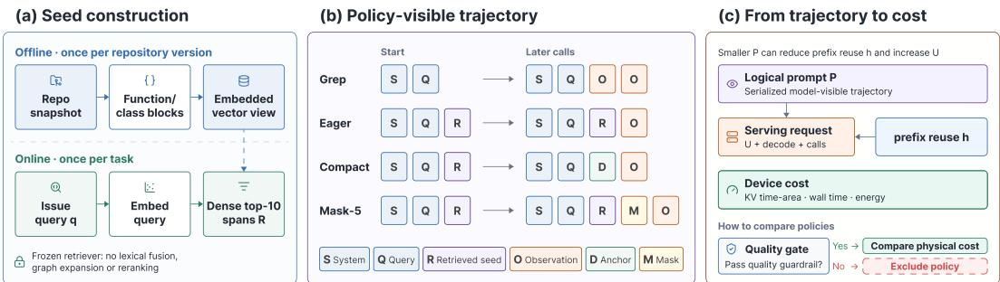
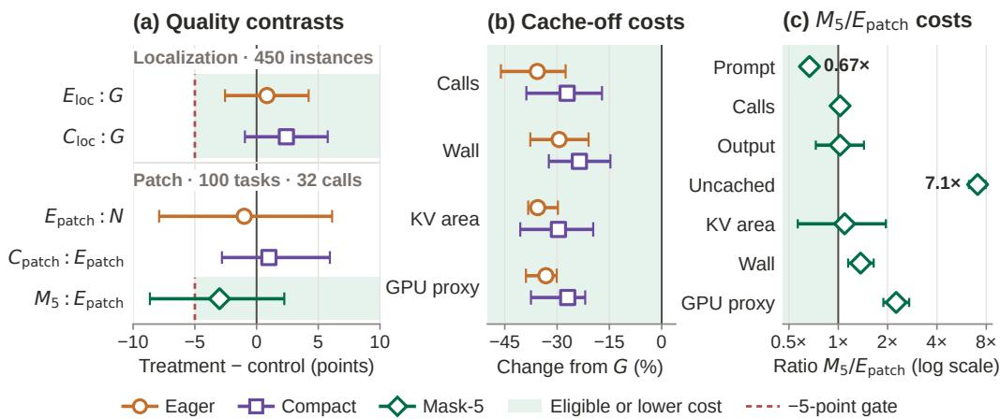

# The Physical Cost of Context: Quality-Constrained Resource Accounting for Coding Agents

Zhongming Yu1 Yitong Ma1 Hengjia Yu1 Boqin Yuan1 Xiangye Lin2 Hejia Zhang1 Jishen Zhao1

1University of California, San Diego 2University of Massachusetts Amherst

## Abstract

Coding agents resend a growing context on every model call, and context policies are usually judged by the prompt tokens they save. Executed work also depends on call count and prefix reuse: a caching runtime prefills only the tokens after the longest cached prefix. A shorter prompt can therefore cost more if it rewrites cached history. Our quality-gated protocol splits executed prefill into logical prompt minus reused prefix and measures KV residency, time, and energy. On 450 localization cases derived from SWE-rebench V2, preloading ten retrieved blocks (EAGER) and adding anchored history compaction (COMPACT) both pass a five-point non-inferiority gate. In a separate 900-cell study, EAGER cuts model calls by 35.7% and the GPU-energy proxy by 33.2% against on-demand search (GREP); COMPACT saves nothing further. Enabling prefix caching leaves EAGER’s prompt volume similar (+8.3%; its 95% CI spans zero) but cuts its uncached prefill by 67.7%. Deleting history can turn a token saving into extra work. With mini-SWE-agent on 100 SWE-bench Verified instances, keeping only the last five observations (MASK-5) cuts EAGER’s prompt volume by 33.3% but loses 135.9k reusable tokens per task. Uncached prefill rises by 608.5%, the energy proxy by 125.6%, and the policy misses the quality gate. Policies thus save physical work by shortening the trajectory and can multiply it by editing reusable history.

## 1 Introduction

Repository localization maps an issue report to files, classes, and functions. Retrieval methods rank files using report–code similarity, structure, and history [1–3]. Modern agents combine iterative retrieval [4], structure-aware search [5–7], or graph navigation [8–11].

These agents repeatedly search, read, and reassess the retrieved source. A ReAct-style loop [12] turns a short issue report into a trajectory of tool outputs and intermediate hypotheses. Larger contexts may improve evidence coverage, but every retained observation can add input processing before decoding (prefill) and occupy the model’s key–value (KV) cache on later turns. On a local device, model weights, KV cache, retrieval services, and the host process also share one memory and power budget.

Many context-management studies report tokens, task success, or provider cost [13–17]. Token counts do not determine physical cost: equal reductions in logical tokens can correspond to different amounts of executed prefill, depending on request boundaries and prefix reuse [18, 19]. On a unified-memory device, model and host allocations also share one pool [20], so we track host allocation, paging, and latency together.

Our agent returns answer blocks for an issue-like query. A frozen retrieval-augmented generation (RAG) path can insert ten retrieved code blocks before the first turn. We ask when logical-token savings predict physical savings, and when cache or trajectory effects break that prediction.

  
Figure 1: Experimental boundary from repository to device. (a) Frozen dense retrieval selects top-10 blocks R. (b) Policies alter evidence delivery and visible history. (c) Request and prefix-reuse boundaries translate logical prompt $P$ into uncached work U and device cost, which we compare only after checking quality.

Measuring this path (Figure 1) raises three challenges. C1: Trajectory attribution. Evidence supply, delivery time, and history retention can each change what the agent does next. Matched contrasts hold the other mechanisms fixed, and we treat the resulting trajectory as an outcome of the policy. C2: Logical-to-physical translation. A policy changes both the number of requests and prefix reuse within each request. Logical tokens can therefore order policies differently from uncached prefill, KV occupancy, latency, or energy. C3: Quality-constrained comparison. A resource comparison must first bound task-quality loss.

We study four fixed context policies on an NVIDIA DGX Spark: GREP, EAGER, COMPACT, and MASK-5. They differ in when retrieved evidence arrives and which observations stay visible. We make two contributions:

1. A quality-gated physical-accounting protocol. The protocol combines paired task-quality bounds with model calls, uncached prefill, KV time-area, wall time, and idle-subtracted GPU energy. It charges failures, reports index construction separately, and decomposes executed prefill into logical input minus reused prefixes.

2. A controlled policy analysis. Byte-identical candidates separate evidence delivery from history reduction. On 450 real-issue localization cases derived from SWE-rebench V2, both preload policies satisfy the quality gate. Instrumented runs show that eager evidence saves work by avoiding calls, anchored reduction adds no saving beyond EAGER, and repeated observation masking can erase prompt savings, consistent with reduced prefix reuse.

## 2 Context as a Resource-Control Problem

## 2.1 Two Paths from Context to Cost

A context policy changes both the requests an agent makes and the prefixes its runtime can reuse. Serving runtimes such as vLLM and SGLang keep the KV entries of earlier requests; when a new request begins with a cached token prefix, the runtime reuses those entries and prefills only the remaining suffix [21, 22]. Editing an early token therefore forces every later token to be recomputed. Let $n _ { p }$ be the number of model requests under policy $p , \ell _ { p , t }$ the logical prompt tokens in request t, and $h _ { p , t }$ the tokens served from a reusable prefix. Aggregate logical and executed input work satisfy

$$
T _ { \mathrm { p r o m p t } } ( p ) = \sum _ { t = 1 } ^ { n _ { p } } \ell _ { p , t } , \qquad T _ { \mathrm { u n c a c h e d } } ( p ) = T _ { \mathrm { p r o m p t } } ( p ) - \sum _ { \stackrel { t = 1 } { T _ { \mathrm { h i t } } ( p ) } } ^ { n _ { p } } { h _ { p , t } } .\tag{1}
$$

For a treatment–control contrast, $\Delta T _ { \mathrm { u n c a c h e d } } = \Delta T _ { \mathrm { p r o m p t } } - \Delta T _ { \mathrm { h i t } }$ . Prompt savings therefore increase executed prefill when a policy loses more reusable tokens than it removes. Because $n _ { p }$ also depends on the policy, fewer calls can reduce total work even when each call is no cheaper. We use this decomposition to distinguish trajectory effects from runtime-reuse effects.

## 2.2 Frozen Code-RAG Supply Path

Following RAG [23], each snapshot is compiled offline into CodeNib function/class blocks [24] and encoded by a revision-pinned Qwen3-Embedding-0.6B model [25]. The same encoder maps the issue query, and dense search returns ten spans. We exclude lexical fusion, graph expansion, and reranking.

Query encoding and search count toward each preload task; compilation is amortized separately. Hashes verify byte-identical preload inputs, and GREP keeps the same tools without a seed (Figure 1a–b).

## 2.3 Policy Algebra

Let $\sigma \in$ {loc, patch} identify the agent scaffold. For scaffold $\sigma ,$ let $S _ { \sigma }$ be its system prompt and $H _ { \sigma , t } = ( a _ { 1 } , o _ { 1 } , \ldots , a _ { t } , o _ { t } )$ its canonical action–observation history. An experimental arm is $p = ( \sigma , e , r )$ , where $e \in \{ \emptyset , R _ { 1 0 } \}$ is the evidence supplied before the first turn and r controls visible serialization. With M denoting the compiled repository index and $R _ { 1 0 } = R _ { 1 0 } ( q ; M _ { E } )$ , the visible state and the serialized model input are

$$
V _ { \sigma , t } ^ { ( e ) } = q \oplus e \oplus H _ { \sigma , t } , \qquad P _ { \sigma , t } ^ { ( e , r ) } = S _ { \sigma } \oplus r \Big ( V _ { \sigma , t } ^ { ( e ) } \Big ) ,\tag{2}
$$

where $\oplus$ denotes serialization. Policies retain the raw $H _ { \sigma , t }$ for audit and change only its model-visible serialization.

Three deterministic context-serialization operators cover the tested designs:

$$
\begin{array} { r l } & { I \Big ( V _ { \sigma , t } ^ { ( e ) } \Big ) = V _ { \sigma , t } ^ { ( e ) } , } \\ & { A _ { \sigma } \Big ( V _ { \sigma , t } ^ { ( R _ { 1 0 } ) } \Big ) = \{ { V _ { \sigma , t } ^ { ( R _ { 1 0 } ) } } , \begin{array} { l l } { t < \tau , } \\ { D _ { \tau , \sigma } \oplus H _ { \sigma , \tau + 1 : t } , } \end{array} } & { t \geq \tau ,  } \\ & { L _ { 5 } \Big ( V _ { \mathrm { p a t c h } , t } ^ { ( R _ { 1 0 } ) } \Big ) = q \oplus R _ { 1 0 } \oplus H _ { \mathrm { p a t c h } , t } [ o _ { i }  \mu ( | o _ { i } | ) \mathrm { f o r } i \leq t - 5 ] . } \end{array}\tag{3}
$$

Here $\tau$ is the first successful source read. The scaffold-specific anchor $D _ { \tau , \sigma }$ contains the task query exactly once, the successful read, and a bounded pre-rewrite assessment. Following SWE-agent’s LastNObservations [26], $L _ { 5 }$ keeps actions and tool IDs but replaces older outputs with line-count markers. Neither invokes a model. $A _ { \sigma }$ rewrites once; $L _ { 5 }$ rewrites whenever an observation leaves the window. Both can change later actions and invalidate reuse, so total saving depends on $n _ { p }$ and $T _ { \mathrm { h i t } } ( p )$ in Equation (1).

The arm definitions are therefore

$$
\begin{array} { r l } & { G = ( \mathrm { l o c } , \emptyset , I ) , \quad N = ( \mathrm { p a t c h } , \emptyset , I ) , } \\ & { E _ { \sigma } = ( \sigma , R _ { 1 0 } , I ) , \quad C _ { \sigma } = ( \sigma , R _ { 1 0 } , A _ { \sigma } ) , \quad M _ { 5 } = ( \mathrm { p a t c h } , R _ { 1 0 } , L _ { 5 } ) . } \end{array}\tag{4}
$$

Thus $\mathcal { P } _ { \mathrm { l o c } } = \{ G , E _ { \mathrm { l o c } } , C _ { \mathrm { l o c } } \}$ and $\mathcal { P } _ { \mathrm { p a t c h } } = \{ N , E _ { \mathrm { p a t c h } } , C _ { \mathrm { p a t c h } } , M _ { 5 } \}$ . Informally, GREP (G, localization) and native mini-SWE-agent $( N$ , patching) start from the issue alone and keep their full history. EAGER $( E _ { \sigma } )$ prepends the ten retrieved spans and also keeps the full history. COMPACT $( C _ { \sigma } )$ matches EAGER until the first successful source read, then replaces the candidate list and exploratory history with a short anchor. MASK- $. 5 \ ( M _ { 5 } )$ keeps every action but shortens each tool output older than the latest five to a placeholder, so once the window fills, every request rewrites an observation that the previous request had already sent. Within a study, seeded arms receive byte-identical $R _ { 1 0 }$ The $C _ { \sigma } - E _ { \sigma }$ contrast estimates the end-to-end effect of the anchor rewrite; $M _ { 5 } - E _ { \mathrm { p a t c h } }$ estimates masking. Contrasts against G or N also add the retrieved evidence, so they combine delivery with any retention change. We do not pool absolute resources across Tables 1 and 2.

## 2.4 Quality-Constrained Resource Objective

For each gated treatment $p ,$ let $Q ( p )$ denote its task-quality endpoint and let $c ( p )$ denote its registered control. We use answer-block Recall@5 for localization and official resolved rate for patch generation. Let

$$
{ \bf R } ( p ) = ( T _ { \mathrm { p r o m p t } } , T _ { \mathrm { o u t p u t } } , N _ { \mathrm { r e q } } , T _ { \mathrm { u n c a c h e d } } , L _ { \mathrm { T T F T } } , L _ { \mathrm { w a l l } } , K _ { f } , K _ { \mathrm { m a x } } , U _ { \mathrm { m a x } } , E _ { \mathrm { g p u } } )\tag{5}
$$

collect logical prompt and output tokens, requests, uncached-prefill tokens, time to first token, wall time, integrated and peak KV occupancy, peak unified-memory pressure, and sampled GPU energy. Here $K _ { f } ,$ the KV time-area, integrates allocated KV bytes over wall time (GiB·s); unlike $K _ { \mathrm { m a x } } ,$ it does not let one long failed request define an arm. With LCB.95 denoting the lower endpoint of a paired 95% interval obtained by resampling whole repositories, a policy is eligible only if

$$
\mathrm { L C B . 9 5 } [ Q ( p ) - Q ( c ( p ) ) ] > - \epsilon , \qquad \epsilon = 0 . 0 5 .\tag{6}
$$

The control is GREP for the two localization treatments and EAGER for the MASK-5 patch contrast. The constraint is applied after each experiment to decide which policies enter the cost comparison; it does not act at runtime. Failed tasks remain in denominators and server resource totals, including requests without a serialized cell. We also report cost per successful endpoint so a cheap failure does not appear efficient.

## 3 Evaluation

Questions. The RQs map to Section 1. RQ1 (C1/C3) asks which delivery and retention policies satisfy the quality gate and how they change the agent trajectory. RQ2 (C2) asks when the logicaltoken ordering survives translation into prefill, KV occupancy, latency, memory, and energy. A same-model prefix-cache intervention isolates prefix reuse. RQ3 (C1/C3) tests whether the token– work relationship recurs in an external agent scaffold with official patch grading.

Localization Cohorts. Two disjoint cohorts share the CodeNib runner, retriever, policies, model, and Recall@5 endpoint. The synthesis cohort supports repeated device measurement; the SWErebench-derived cohort powers the quality gate.

The resource cohort comes from the frozen codenib-synthesis test split [24]. It contains 25 pinned repository snapshots, five each for Python, Go, Rust, TypeScript/JavaScript, and C/C++. Category-balanced round robin selects four of six issue-like query types per snapshot: behavioral, file hint, module hint, symbol hint, reasoning, and traversal. The resulting 100 tasks have function/class answer blocks for Recall@5; three policy repetitions produce 900 cells. Bootstrap draws retain each repository’s tasks, repetitions, and policy outcomes: the 300 cells per arm form 25 independent groups. The dataset labels its queries LLM-curated and LLM-judged but omits both model identifiers; we make no claim about human-authored issue distributions.

The powered quality cohort is derived from SWE-rebench V2 [27], a public GitHub issue–patch collection. Before model calls, we select 450 Python issues from distinct repositories. Eligible cases have an applicable gold patch, at most 5,000 tracked Python files, and a base-visible function/class block touched by the patch. We use those blocks as localization targets, separately from the SWE-bench Verified patch study. Variance from the 100-task instrumented pilot gives a maximum requirement of 441 independent cases, rounded to 450. One run per policy yields 1,350 cells and powers quality only; physical costs use the 100-task cohort. We do not pool the cohorts.

Localization Stack and Host. All localization studies, comprising the 450-instance quality cohort, 900-cell resource matrix, and cache intervention, use the same Qwen3.6-35B-A3B-FP8 revision (35B total, 3B active) [28] with vLLM [21]. We set temperature to zero, cap context at 65,536 tokens, and admit one measured request at a time. Prefix caching is disabled in the resource matrix; the mechanism study toggles only that flag. A revision-pinned Qwen3-Embedding-0.6B server supplies every dense top-10. The host is a DGX Spark with an NVIDIA GB10 SoC and 128 GB coherent unified memory [20]. Appendix A records exact revisions, serving versions, memory reservations, and telemetry metadata.

Cache Mechanism Study. RQ2 toggles one vLLM prefix-cache flag over the same 100 localization tasks. Model, runtime, decoder, task order, and revision remain fixed, yielding 600 cells and 25 paired repositories per policy and regime. Resets and salts restrict reuse to each four-query block; an audit confirms that the serving commands of the two regimes differ only in that flag.

External Patch Study and Stack Boundary. A repository-balanced seeded hash selects 100 SWE-bench Verified instances across all 12 Python repositories [29, 30], without inspecting gold patches, tests, or outcomes. Mini-SWE-agent [31] v2.4.6 uses its official prompt, bash interface, and submission protocol. A separately deployed SGLang RadixAttention stack [22] uses DFlash speculative decoding with eight draft tokens [32]; Appendix A gives both checkpoint revisions. We compare MINI, EAGER, COMPACT, and MASK-5; the three seeded arms receive identical top-10 candidates. Each arm gets one trajectory, 32 calls, 1,800 seconds, temperature zero, and no reference-patch access. The stricter-than-upstream call cap makes resolved rate a fixed-budget endpoint.

The external target and serving stack differ from localization, so we compare policies only within each stack. This study tests whether the pattern recurs; it cannot separate the effects of target model, scaffold, and runtime.

The revision-pinned official harness scores every attempt. Empty patches and failures remain in the denominator. Generation and retrieval enter resource totals; AMD64 grading does not. Eight shards repeat each arm order twice, with a Radix-cache reset per policy–shard block.

Controls. Localization arms share the base prompt, tools, 16-turn limit, and decoder. A repositorylevel Latin square interleaves repetitions. The patch study uses the declared four-arm rotation. Each measured block follows an unmeasured warm-up and idle window; failed requests remain charged.

Measurements. Agent traces provide prompt tokens, completion, calls, and wall time. Server counters provide generation, prefill, TTFT, latency, and KV usage. We report successful server calls per attempted task; “per call” always divides by that server counter. One-second KV sampling gives time-integrated occupancy; SGLang counters also separate device hits from uncached prefill and confirm DFlash activity. We compute the GPU-energy proxy by trapezoidally integrating sampled nvidia-smi power.draw over the run and subtracting the pre-run mean idle power multiplied by the run duration. It is not whole-system energy. Unified host memory comes from /proc/meminfo and cgroups. Prompt, wall time, and agent calls are per cell. Server counters, KV time-area, and power are aggregated per policy–shard block in the primary and external patch studies, and per policy–repository block in the same-model cache study.

Analysis. Full answer-block Recall@5 defines localization success. A 10,000-draw paired bootstrap averages repetitions and resamples 25 repository groups. The 450-case cohort has one instance per repository, so its two resampling views coincide; SWE-bench draws instead resample 12 source repositories. Wall-time intervals use 25 groups. Block-level counters resample three disjoint shards while retaining repetitions. The instrumented study lacked prospective power analysis. We report build cost separately as $C _ { \mathrm { b u i l d } } / n$

## 4 Results

The powered quality study attempted 1,350 cells on 450 instances. Separately, the instrumented primary attempted 900 cells; its three runtime failures are analyzed below. Every attempted cell remains in its study denominator.

## 4.1 RQ1: Quality-Eligible Policies and Shorter Trajectories

Across 450 localization cases derived from SWE-rebench V2, one per repository, the frozen retriever reaches .431 Recall@5 and .548 Recall@10. Agent Recall@5 is .470, .478, and .494 for GREP, EAGER, and COMPACT (Table 1). Nonconforming outputs remain in the denominator and score zero.

For EAGER, the paired difference is +0.8 points; its lower 95% endpoint is −2.6 and clears the −5-point gate. COMPACT differs by +2.4 points, with lower endpoint −0.9. It meets the same criterion (Figure 2a).

In the instrumented primary, EAGER saves 46.3k prompt tokens per task, or 33.9%; the paired interval ranges from 28.8k to 65.4k saved. COMPACT saves 28.2% across all attempts. Its 99 runtime-complete pairs save 39.8k tokens on average, with endpoints at 21.6k and 58.0k saved. The useful comparison for history reduction is COMPACT against its retrieval-matched EAGER control. COMPACT uses 8.5% more prompt tokens, 13.3% more calls, 8.2% more wall time, and 9.4% more energy. Its requests are not longer: dividing prompt volume by successful calls gives at most 10.3k tokens per call for COMPACT and 10.8k for EAGER. Prefix caching is off in this matrix, so the extra calls account for the gap. The anchor drops the remaining candidates, and the agent may search again for evidence that EAGER still shows; traces do not label call intent, so this attribution remains open.

  
Figure 2: Quality gates and resource effects. (a) Quality contrasts $\Delta Q _ { p : c } = Q ( p ) - Q ( c )$ for localization $( n = 4 5 0$ instances) and patch generation $( n = 1 0 0 , 3 2$ -call budget); only $E _ { \mathrm { l o c } } { : } G , C _ { \mathrm { l o c } } { : } G$ and $M _ { \mathrm { { 5 } } } { : } E _ { \mathrm { { p a t c h } } }$ face the gate. (b) Cache-off effects relative to G; wall resamples 25 repositories and the other metrics resample three run-block shards. (c) $M _ { \mathrm { 5 } } / E _ { \mathrm { p a t c h } }$ resource ratios over eight paired shards. $G / N$ receive no retrieved seed. Whiskers are paired-bootstrap 95% intervals.

Table 1: Localization-only profile for $\mathcal { P } _ { \mathrm { l o c } } = \{ G , E , C \}$ . Quality uses 450 instances; resources use the 100-task, three-repeat cache-off study. ${ \bf \dot { \Psi } } ^ { \mathrm { c } } \mathrm { e u l l } ^ { \mathrm { , } \mathrm { , } }$ means recall one. Parenthesized changes are relative to G (green: reduction); failures remain charged. Per-full-recall rows divide by the full-recall rate of the 100-task instrumented study.
<table><tr><td>Metric</td><td>GREP control</td><td>EAGER vs. G</td><td>COMPACT Vs. G</td></tr><tr><td colspan="4">Task quality</td></tr><tr><td>Recall@5</td><td>.470</td><td>.478</td><td>.494</td></tr><tr><td>Full@5</td><td>.307</td><td>.318</td><td>.329</td></tr><tr><td>Format success</td><td>.904</td><td>.976</td><td>.987</td></tr><tr><td>Runtime completion</td><td>1.000</td><td>1.000</td><td>1.000</td></tr><tr><td colspan="4">Resource per attempted task</td></tr><tr><td>Prompt ktok</td><td>136.8</td><td>90.5 (-33.9%)</td><td>98.2 (-28.2%)</td></tr><tr><td>Successful server calls</td><td>13.02</td><td>8.38 (-35.7%)</td><td>9.49 (-27.1%)</td></tr><tr><td>Wall seconds</td><td>68.32</td><td>48.22 (-29.4%)</td><td>52.20 (-23.6%)</td></tr><tr><td>KV GiB·s</td><td>25.88</td><td>16.67 (–35.6%)</td><td>18.21 (-29.6%)</td></tr><tr><td>GPU-proxy kJ</td><td>2.007</td><td>1.340 (-33.2%)</td><td>1.466 (-27.0%)</td></tr><tr><td colspan="4">Resource per full-recall localization</td></tr><tr><td>Prompt ktok/full</td><td>204.2</td><td>133.7 (-34.5%)</td><td>151.9 (-25.6%)</td></tr><tr><td>GPU-proxy kJ/full</td><td>3.00</td><td>1.98 (-34.0%)</td><td>2.27 (-24.3%)</td></tr></table>

## 4.2 RQ2: Physical Savings Follow Fewer Calls

For all four primary cost metrics, the intervals for both policies exclude zero (Figure 2b). Normalizing energy by full-recall localizations yields 3.00, 1.98, and 2.27 kJ for GREP, EAGER, and COMPACT. The quality-adjusted ordering therefore matches the per-attempt ordering (Table 1).

Aggregate energy divided by wall time stays within 27.7–29.3 W in the primary and 25.2–26.0 W in the SGLang stack, so energy mainly tracks duration; calls, uncached prefill, and KV time-area show why costs differ. Mean TTFT varies by less than 2%, and latency per successful call rises from 5.218 to 5.721 seconds (EAGER) and 5.468 (COMPACT), so the task-time saving comes from fewer calls. Peak-KV and system-memory changes are too noisy to support a capacity claim (Appendix A).

Table 2: Patch-generation-only profile for $\mathcal { P } _ { \mathrm { p a t c h } } .$ mini-SWE-agent on 100 SWE-bench Verified instances under a 32-call budget. Resources are generation-only means per attempt; parenthesized changes use the baseline under each arm (green: reduction; red: increase).
<table><tr><td>Metric</td><td>MINI control</td><td>EAGER vs. N</td><td>COMPACT vs. E</td><td>MASK-5 vs. E</td></tr><tr><td colspan="5">Task outcome (of 100 attempts)</td></tr><tr><td>Resolved</td><td>30</td><td>29</td><td>30</td><td>26</td></tr><tr><td>Submitted / call-capped</td><td>45/55</td><td>44/56</td><td>45/ 55</td><td>40 / 60</td></tr><tr><td colspan="5">Generation resource per attempt</td></tr><tr><td>Prompt ktok</td><td>220.7</td><td>225.6 (+2.2%)</td><td>210.8 (-6.5%)</td><td>150.5 (-33.3%)</td></tr><tr><td>Model calls</td><td>26.13</td><td>25.66 (-1.8%)</td><td>25.84 (+0.7%)</td><td>26.33 (+2.6%)</td></tr><tr><td>Uncached ktok</td><td>9.8</td><td>10.0 (+1.4%)</td><td>12.2 (+22.0%)</td><td>70.8 (+608.5%)</td></tr><tr><td>KV frac.·s</td><td>2.94</td><td>3.25 (+10.6%)</td><td>2.69 (-17.2%)</td><td>3.55 (+9.4%)</td></tr><tr><td>Wall seconds</td><td>120.2</td><td>122.7 (+2.0%)</td><td>116.6 (-5.0%)</td><td>167.9 (+36.9%)</td></tr><tr><td>GPU-proxy kJ</td><td>1.833</td><td>1.956 (+6.7%)</td><td>1.917 (-2.0%)</td><td>4.412 (+125.6%)</td></tr></table>

Failures. One MicroPython COMPACT task fails in all repetitions because 61,441 prompt plus 4,096 output tokens exceed the server’s context limit by one; KV memory never runs out. The headline retains its 1.204M failed-request tokens: 98.2k per attempt and 28.2% savings. Removing that charge gives 95.1k over 297 completed cells and 30.5% savings.

Build Cost and Cache Isolation. Compiling the 25 repository indexes takes 767.7 seconds and 36.1 kJ, producing 147,387 chunks in 731 MB. At ten queries per snapshot, amortization adds 3.07 seconds and 0.144 kJ per query; at 100 queries its energy share is below 1.1%.

In the 600-cell cache intervention, turning caching on changes EAGER’s logical prompt by +8.3% (95% CI [−5.7, +24.7]) but its uncached prefill by −67.7% ([−71.0, −63.8]). The planned $\mathrm { C } _ { \mathrm { l o c } } -$ $E _ { \mathrm { l o c } }$ cache interaction is −7.1k uncached tokens per task; its 95% interval runs from −17.3k to +2.3k. The wall interaction is +0.1 seconds, ranging from −5.4 to +5.7. Both interaction intervals include zero. The same-model cache-on COMPACT contrast against GREP is −38.2% uncached prefill, so the +5.2% increase in the exploratory Qwen3.8/SGLang stack (Table 4) does not reproduce.

## 4.3 RQ3: Token Savings Reverse under External Retention

Audits confirm that all 100 no-seed cells received no seed and all 300 preload cells match the frozen candidate and query hashes. Thus EAGER–MASK-5 changes observation visibility with retrieval fixed. Table 2 accounts for every trajectory as a submission or a 32-call cap, and no infrastructure failure enters the result. Across 12 source repositories, MASK-5 resolves 26/100 attempts versus 29/100 for EAGER. Its paired difference is −3.0 points. The lower 95% endpoint, −8.6, crosses the −5-point gate, so it does not meet the non-inferiority rule (Figure 2a). Masking activates at median call 6. By Equation (1), MASK-5 removes 75.1k logical prompt tokens per attempt but loses 135.9k device-hit tokens, adding 60.8k uncached tokens. Cached prefixes serve about 96% of EAGER’s prompt but 53% of MASK-5’s. Aggregate prompt volume changes by −33.3% and uncached prefill by +608.5%; both directions hold across all eight paired shards. Calls change by +2.6%, wall time by +36.9%, and the GPU-energy proxy by +125.6%. The prefill inversion is consistent with reduced prefix-cache reuse after repeated history edits. Trajectory changes may also contribute to the observed resource differences.

## 5 Implications for Resource-Aware Context Management

Separate Evidence Delivery from Retention (C1). Eager uses the fewest resources among eligible localization arms. The anchor remains eligible but adds no saving, because shorter requests do not offset its additional calls.

Measure Prefix Reuse (C2). Equation (1) also locates the break-even point for history deletion: a policy lowers uncached prefill only if it removes more logical tokens than reused ones. MASK-5 removes 75.1k and loses 135.9k. As a first-order estimate, if a runtime served a fraction $\rho$ of the hits observed here in both arms, masking would change uncached prefill by $- 7 5 . 1 \mathrm { k } + 1 3 5 . 9 \mathrm { k } \cdot \rho$ tokens per attempt, which turns positive above $\rho \approx 0 . 5 5 . \mathrm { A t } \rho = 0 .$ , without a prefix cache, masking would save prefill; batching or cache pressure that evicts prefixes lowers $\rho$ and with it the masking penalty. Reports should therefore expose request count, prefix reuse, and uncached prefill alongside prompt volume.

Constrain Quality Before Comparing Resources (C3). Apply Equation (6) before interpreting resource differences. $E _ { \mathrm { l o c } }$ and $C _ { \mathrm { l o c } }$ meet it against G, while $M _ { 5 }$ does not meet it against $E _ { \mathrm { p a t c h } } ;$ ; token count alone would favor the policy that the gate excludes. Other patch contrasts remain descriptive.

## 6 Related Work

Repository Localization and Agent Context. BugLocator first combined report–code similarity with development history [1]; BLUiR then indexed code structure explicitly [2], and learning-to-rank incorporated API, history, and method features [3]. RepoCoder moved repository retrieval into an iterative generation loop [4], while RepoBench measured broader repository context [33]. SWE-bench made localization an upstream step in executable issue resolution [29]. AutoCodeRover exposed AST-aware search [5]; Agentless used hierarchical file-to-function localization [6]. LocAgent, CoSIL, RepoGraph, and CodexGraph navigate repository code graphs [8–11]; OrcaLoca prioritizes search actions and prunes context by code distance [7]. We adopt the resulting function/class endpoint, freeze retrieval, and study the resources used to deliver and retain evidence.

Static prompt compression precedes long-horizon agent memory [13, 14]. Later policies externalize memory, mask or summarize observations, prune lines, and maintain structured state [15–17, 34–36]. Repository compression also varies by task [37].

Runtime Context and KV Reuse. PagedAttention allocates KV blocks; RadixAttention, Prompt Cache, RAGCache, and CacheBlend reuse state [18, 19, 21, 22, 38]. CacheGen transfers compressed state, while $_ \mathrm { H _ { 2 } O }$ , StreamingLLM, and SnapKV retain selected tokens [39–42]. ContextPilot aligns reusable context; Stream2LLM models updates that invalidate cache [43, 44]. KV compression can also lengthen outputs and latency [45]. We measure how context policies interact with this reuse.

Resource-Aware Evaluation. Green AI and HELM motivate cost-aware, multi-metric evaluation; Zeus measures GPU energy directly [46–48]. Our protocol adds a prespecified quality gate, uncached prefill, and KV time-area to these metrics and charges failures and index construction.

## 7 Limitations and Conclusion

Results cover two stacks on one DGX Spark serving one request at a time; batching, cache pressure, and cloud GPUs remain untested. The Spark exposes no application-clock or power-limit control (power.limit=N/A), so clocks were not pinned; Latin-square interleaving spreads drift across policies, and average power stays nearly constant across arms. Server, KV, and energy intervals use only three shards. Quality and detailed cost come from different localization cohorts (450 and 100 tasks), so no single issue set carries both measurements. The patch study covers 100 Python tasks from 12 repositories, with physical intervals over eight shards. Powered localization has one trajectory per policy per repository. The 32-call patch cap measures fixed-budget performance, not unrestricted SWE-bench ability. We test four fixed policies; MASK-5 fixes the window at five observations, following the SWE-agent reference. Window sweeps, LLM summarization, learned pruning, and external memory remain unmeasured, although Equation (1) applies to each. Mini-SWE-agent lacks observation tags; SGLang reports only full-attention KV occupancy. Our GPU proxy omits CPU, host-memory, and whole-system energy. On-device execution retains source privacy, but cheaper misuse and incorrect patches remain risks requiring sandboxing and human review.

Conclusion. A context policy changes both what the agent does and how much of its prompt the runtime can reuse. Early evidence saved work by avoiding calls, while repeated observation masking turned a 33.3% prompt saving into a 608.5% rise in uncached prefill. Resource comparisons should measure executed work and admit only policies that pass a quality gate.

## References

[1] Jian Zhou, Hongyu Zhang, and David Lo. Where should the bugs be fixed? More accurate information retrieval-based bug localization based on bug reports. In Proceedings ofthe 34th International Conference on Software Engineering, pages 14–24, 2012. doi: 10.1109/ICSE. 2012.6227210. URL https://doi.org/10.1109/ICSE.2012.6227210.

[2] Ripon K. Saha, Matthew Lease, Sarfraz Khurshid, and Dewayne E. Perry. Improving bug localization using structured information retrieval. In Proceedings of the 28th IEEE/ACM International Conference on Automated Software Engineering, pages 345–355, 2013. doi: 10.1109/ASE.2013.6693093. URL https://doi.org/10.1109/ASE.2013.6693093.

[3] Xin Ye, Razvan Bunescu, and Chang Liu. Learning to rank relevant files for bug reports using domain knowledge. In Proceedings of the 22nd ACM SIGSOFT International Symposium on Foundations ofSoftware Engineering, pages 689–699, 2014. doi: 10.1145/2635868.2635874. URL https://doi.org/10.1145/2635868.2635874.

[4] Fengji Zhang, Bei Chen, Yue Zhang, Jacky Keung, Jin Liu, Daoguang Zan, Yi Mao, Jian-Guang Lou, and Weizhu Chen. RepoCoder: Repository-level code completion through iterative retrieval and generation. In Proceedings of the 2023 Conference on Empirical Methods in Natural Language Processing, pages 2471–2484, 2023. doi: 10.18653/v1/2023.emnlp-main.151. URL https://aclanthology.org/2023.emnlp-main.151/.

[5] Yuntong Zhang, Haifeng Ruan, Zhiyu Fan, and Abhik Roychoudhury. AutoCodeRover: Autonomous program improvement. In Proceedings of the 33rd ACM SIGSOFT International Symposium on Software Testing and Analysis, pages 1592–1604, 2024. doi: 10.1145/3650212.3680384. URL https://doi.org/10.1145/3650212.3680384.

[6] Chunqiu Steven Xia, Yinlin Deng, Soren Dunn, and Lingming Zhang. Demystifying LLMbased software engineering agents. Proceedings ofthe ACM on Software Engineering, 2(FSE): 801–824, 2025. doi: 10.1145/3715754. URL https://doi.org/10.1145/3715754.

[7] Zhongming Yu, Hejia Zhang, Yujie Zhao, Hanxian Huang, Matrix Yao, Ke Ding, and Jishen Zhao. OrcaLoca: An LLM agent framework for software issue localization. In Proceedings of the 42nd International Conference on Machine Learning, volume 267 of Proceedings of Machine Learning Research, pages 73416–73436. PMLR, 2025. URL https://proceedings. mlr.press/v267/yu25x.html.

[8] Zhaoling Chen, Xiangru Tang, Gangda Deng, Fang Wu, Jialong Wu, Zhiwei Jiang, Viktor Prasanna, Arman Cohan, and Xingyao Wang. LocAgent: Graph-guided LLM agents for code localization. In Proceedings ofthe 63rd Annual Meeting ofthe Associationfor Computational Linguistics, pages 8697–8727, 2025. doi: 10.18653/v1/2025.acl-long.426. URL https: //aclanthology.org/2025.acl-long.426/.

[9] Zhonghao Jiang, Xiaoxue Ren, Meng Yan, Wei Jiang, Yong Li, and Zhongxin Liu. Issue localization via LLM-driven iterative code graph searching. In 2025 40th IEEE/ACM International Conference on Automated Software Engineering (ASE), pages 3034–3045, 2025. doi: 10.1109/ ASE63991.2025.00249. URL https://doi.org/10.1109/ASE63991.2025.00249.

[10] Siru Ouyang, Wenhao Yu, Kaixin Ma, Zilin Xiao, Zhihan Zhang, Mengzhao Jia, Jiawei Han, Hongming Zhang, and Dong Yu. RepoGraph: Enhancing AI software engineering with repository-level code graph. In International Conference on Learning Representations, 2025. URL https://openreview.net/forum?id=dw9VUsSHGB.

[11] Xiangyan Liu, Bo Lan, Zhiyuan Hu, Yang Liu, Zhicheng Zhang, Fei Wang, Michael Qizhe Shieh, and Wenmeng Zhou. CodexGraph: Bridging large language models and code repositories via code graph databases. In Proceedings of the 2025 Conference of the Nations of the Americas Chapter of the Association for Computational Linguistics: Human Language Technologies (Volume 1: Long Papers), pages 142–160, 2025. doi: 10.18653/v1/2025.naacl-long.7. URL https://aclanthology.org/2025.naacl-long.7/.

[12] Shunyu Yao, Jeffrey Zhao, Dian Yu, Nan Du, Izhak Shafran, Karthik R. Narasimhan, and Yuan Cao. ReAct: Synergizing reasoning and acting in language models. In International Conference on Learning Representations, 2023. URL https://openreview.net/forum? id=WE\_vluYUL-X.

[13] Huiqiang Jiang, Qianhui Wu, Chin-Yew Lin, Yuqing Yang, and Lili Qiu. LLMLingua: Compressing prompts for accelerated inference of large language models. In Proceedings of the 2023 Conference on Empirical Methods in Natural Language Processing, pages 13358–13376, 2023. doi: 10.18653/v1/2023.emnlp-main.825. URL https://aclanthology.org/2023. emnlp-main.825/.

[14] Huiqiang Jiang, Qianhui Wu, Xufang Luo, Dongsheng Li, Chin-Yew Lin, Yuqing Yang, and Lili Qiu. LongLLMLingua: Accelerating and enhancing LLMs in long context scenarios via prompt compression. In Proceedings of the 62nd Annual Meeting of the Association for Computational Linguistics, pages 1658–1677, 2024. doi: 10.18653/v1/2024.acl-long.91. URL https://aclanthology.org/2024.acl-long.91/.

[15] Yuan-An Xiao, Pengfei Gao, Chao Peng, and Yingfei Xiong. Reducing cost of LLM agents with trajectory reduction. Proceedings ofthe ACM on Software Engineering, 3(FSE):1241–1263, 2026. doi: 10.1145/3797084. URL https://doi.org/10.1145/3797084.

[16] Tobias Lindenbauer, Igor Slinko, Ludwig Felder, Egor Bogomolov, and Yaroslav Zharov. The complexity trap: Simple observation masking is as efficient as LLM summarization for agent context management. In Fourth Workshop on Deep Learningfor Code, NeurIPS, 2025. URL https://openreview.net/forum?id=OHVzruJl5k.

[17] Yuhang Wang, Yuling Shi, Mo Yang, Rongrui Zhang, Shilin He, Heng Lian, Yuting Chen, Siyu Ye, Kai Cai, and Xiaodong Gu. SWE-Pruner: Self-adaptive context pruning for coding agents. arXiv:2601.16746, 2026. URL https://arxiv.org/abs/2601.16746.

[18] In Gim, Guojun Chen, Seung-seob Lee, Nikhil Sarda, Anurag Khandelwal, and Lin Zhong. Prompt cache: Modular attention reuse for low-latency inference. In Proceedings of Machine Learning and Systems, volume 6, 2024. URL https://proceedings.mlsys.org/paper\_files/paper/2024/hash/ a66caa1703fe34705a4368c3014c1966-Abstract-Conference.html.

[19] Jiayi Yao, Hanchen Li, Yuhan Liu, Siddhant Ray, Yihua Cheng, Qizheng Zhang, Kuntai Du, Shan Lu, and Junchen Jiang. CacheBlend: Fast large language model serving for RAG with cached knowledge fusion. In Proceedings of the Twentieth European Conference on Computer Systems, pages 94–109, 2025. doi: 10.1145/3689031.3696098. URL https: //doi.org/10.1145/3689031.3696098.

[20] NVIDIA. DGX Spark user guide and hardware overview. NVIDIA documentation, 2026. URL https://docs.nvidia.com/dgx/dgx-spark/. Accessed 2026-08-17.

[21] Woosuk Kwon, Zhuohan Li, Siyuan Zhuang, Ying Sheng, Lianmin Zheng, Cody Hao Yu, Joseph E. Gonzalez, Hao Zhang, and Ion Stoica. Efficient memory management for large language model serving with PagedAttention. In Proceedings of the 29th Symposium on Operating Systems Principles, pages 611–626, 2023. doi: 10.1145/3600006.3613165.

[22] Lianmin Zheng, Liangsheng Yin, Zhiqiang Xie, Chuyue Sun, Jeff Huang, Cody Hao Yu, Shiyi Cao, Christos Kozyrakis, Ion Stoica, Joseph E. Gonzalez, Clark Barrett, and Ying Sheng. SGLang: Efficient execution of structured language model programs. In Advances in Neural Information Processing Systems, volume 37, 2024. URL https://arxiv.org/abs/2312. 07104.

[23] Patrick Lewis, Ethan Perez, Aleksandra Piktus, Fabio Petroni, Vladimir Karpukhin, Naman Goyal, Heinrich Küttler, Mike Lewis, Wen-tau Yih, Tim Rocktäschel, Sebastian Riedel, and Douwe Kiela. Retrieval-augmented generation for knowledge-intensive NLP tasks. In Advances in Neural Information Processing Systems, volume 33, pages 9459–9474, 2020. URL https://proceedings.neurips.cc/paper/2020/hash/ 6b493230205f780e1bc26945df7481e5-Abstract.html.

[24] Zhongming Yu, Hengjia Yu, Boqin Yuan, Shuting Zhao, Yizhao Chen, Aryan Dokania, Mihir Jagtap, Jiayu Chang, Yitong Ma, Yash Jayswal, Wentao Ni, Hejia Zhang, Zhaoling Chen, Gangda Deng, and Jishen Zhao. CodeNib: A multi-view data system for serving repository context to coding agents. arXiv:2607.25431, 2026. URL https://arxiv.org/abs/2607. 25431.

[25] Qwen Team. Qwen3-Embedding-0.6B model card. Hugging Face model card, 2025. URL https://huggingface.co/Qwen/Qwen3-Embedding-0.6B. Accessed 2026-08-17.

[26] John Yang, Carlos E. Jimenez, Alexander Wettig, Kilian Lieret, Shunyu Yao, Karthik Narasimhan, and Ofir Press. SWE-agent: Agent–computer interfaces enable automated software engineering. In Advances in Neural Information Processing Systems, volume 37, pages 50528–50652, 2024. URL https://proceedings.neurips.cc/paper\_files/paper/ 2024/hash/5a7c947568c1b1328ccc5230172e1e7c-Abstract-Conference.html.

[27] Ibragim Badertdinov, Maksim Nekrashevich, Anton Shevtsov, and Alexander Golubev. SWErebench V2: Language-agnostic SWE task collection at scale. arXiv:2602.23866, 2026. URL https://arxiv.org/abs/2602.23866.

[28] Qwen Team. Qwen3.6-35B-A3B-FP8 model card. Hugging Face model card, 2026. URL https://huggingface.co/Qwen/Qwen3.6-35B-A3B-FP8. Accessed 2026-08-17.

[29] Carlos E. Jimenez, John Yang, Alexander Wettig, Shunyu Yao, Kexin Pei, Ofir Press, and Karthik Narasimhan. SWE-bench: Can language models resolve real-world GitHub issues? In International Conference on Learning Representations, 2024.

[30] OpenAI. Introducing SWE-bench Verified. OpenAI blog, 2024. URL https://openai.com/ index/introducing-swe-bench-verified/. Accessed 2026-10-21.

[31] SWE-agent Team. mini-SWE-agent. GitHub repository, 2025. URL https://github.com/ SWE-agent/mini-swe-agent. Accessed 2026-10-21.

[32] Jian Chen, Yesheng Liang, and Zhijian Liu. DFlash: Block diffusion for flash speculative decoding. arXiv:2602.06036, 2026. URL https://arxiv.org/abs/2602.06036.

[33] Tianyang Liu, Canwen Xu, and Julian McAuley. RepoBench: Benchmarking repositorylevel code auto-completion systems. In International Conference on Learning Representations, 2024. URL https://proceedings.iclr.cc/paper\_files/paper/2024/hash/ d191ba4c8923ed8fd8935b7c98658b5f-Abstract-Conference.html.

[34] Charles Packer, Vivian Fang, Shishir G. Patil, Kevin Lin, Sarah Wooders, and Joseph E. Gonzalez. MemGPT: Towards LLMs as operating systems. arXiv:2310.08560, 2023. URL https://arxiv.org/abs/2310.08560.

[35] Shukai Liu, Bo Jiang, Jian Yang, Yizhi Li, Jinyang Guo, Xianglong Liu, and Bryan Dai. Context as a tool: Context management for long-horizon SWE-agents. In Findings ofthe Association for Computational Linguistics: ACL 2026, pages 20604–20617, 2026. doi: 10.18653/v1/2026. findings-acl.1032. URL https://aclanthology.org/2026.findings-acl.1032/.

[36] Peiding Wang, Li Zhang, Fang Liu, Chongyang Tao, and Yinghao Zhu. CodeMEM: AST-guided adaptive memory for repository-level iterative code generation. In Findings ofthe Association for Computational Linguistics: ACL 2026, pages 16903–16917, 2026. doi: 10.18653/v1/2026. findings-acl.834. URL https://aclanthology.org/2026.findings-acl.834/.

[37] Jia Feng, Zhanyue Qin, Cuiyun Gao, Ruiqi Wang, Chaozheng Wang, Yingwei Ma, and Xiaoyuan Xie. On the effectiveness of context compression for repository-level tasks: An empirical investigation. arXiv:2604.13725, 2026. URL https://arxiv.org/abs/2604.13725.

[38] Chao Jin, Zili Zhang, Xuanlin Jiang, Fangyue Liu, Shufan Liu, Xuanzhe Liu, and Xin Jin. RAGCache: Efficient knowledge caching for retrieval-augmented generation. ACM Transactions on Computer Systems, 44(1), 2025. doi: 10.1145/3768628. URL https://doi.org/10. 1145/3768628.

[39] Yuhan Liu, Hanchen Li, Yihua Cheng, Siddhant Ray, Yuyang Huang, Qizheng Zhang, Kuntai Du, Jiayi Yao, Shan Lu, Ganesh Ananthanarayanan, Michael Maire, Henry Hoffmann, Ari Holtzman, and Junchen Jiang. CacheGen: KV cache compression and streaming for fast large language model serving. In Proceedings ofthe ACM SIGCOMM 2024 Conference, pages 38–56, 2024. doi: 10.1145/3651890.3672274. URL https://doi.org/10.1145/3651890.3672274.

[40] Zhenyu Zhang, Ying Sheng, Tianyi Zhou, Tianlong Chen, Lianmin Zheng, Ruisi Cai, Zhao Song, Yuandong Tian, Christopher Ré, Clark Barrett, Zhangyang Wang, and Beidi Chen. H2O: Heavy-hitter oracle for efficient generative inference of large language models. In Advances in Neural Information Processing Systems, volume 36, 2023. URL https://proceedings.neurips.cc/paper\_files/paper/2023/hash/ 6ceefa7b15572587b78ecfcebb2827f8-Abstract-Conference.html.

[41] Guangxuan Xiao, Yuandong Tian, Beidi Chen, Song Han, and Mike Lewis. Efficient streaming language models with attention sinks. In International Conference on Learning Representations, 2024. URL https://openreview.net/forum?id=NG7sS51zVF.

[42] Yuhong Li, Yingbing Huang, Bowen Yang, Bharat Venkitesh, Acyr Locatelli, Hanchen Ye, Tianle Cai, Patrick Lewis, and Deming Chen. SnapKV: LLM knows what you are looking for before generation. In Advances in Neural Information Processing Systems, volume 37, 2024. URL https://proceedings.neurips.cc/paper\_files/paper/2024/ hash/28ab418242603e0f7323e54185d19bde-Abstract-Conference.html.

[43] Yinsicheng Jiang, Yeqi Huang, Liang Cheng, Cheng Deng, Xuan Sun, and Luo Mai. ContextPilot: Fast long-context inference via context reuse. In Proceedings of Machine Learning and Systems, volume 8, pages 1639–1655, 2026. URL https://proceedings.mlsys.org/paper\_files/paper/2026/hash/ 0131 6 02 00 03 3320176 8 A C .

[44] Rajveer Bachkaniwala, Chengqi Luo, Richard So, Divya Mahajan, and Kexin Rong. Stream2LLM: Overlap context streaming and prefill for reduced time-to-firsttoken. In Proceedings of Machine Learning and Systems, volume 8, pages 2201– 2217, 2026. URL https://proceedings.mlsys.org/paper\_files/paper/2026/hash/ 3b3889d313ba9476c12c2d77ea66b24f-Abstract-Conference.html.

[45] Wei Gao, Xinyu Zhou, Peng Sun, Tianwei Zhang, and Yonggang Wen. Rethinking key-value cache compression techniques for large language model serving. In Proceedings of Machine Learning and Systems, volume 7, 2025. URL https://proceedings.mlsys.org/paper\_files/paper/2025/hash/ 26289c647c6828e862e271ca3c490486-Abstract-Conference.html.

[46] Roy Schwartz, Jesse Dodge, Noah A. Smith, and Oren Etzioni. Green AI. Communications of the ACM, 63(12):54–63, 2020. doi: 10.1145/3381831. URL https://doi.org/10.1145/ 3381831.

[47] Percy Liang, Rishi Bommasani, Tony Lee, Dimitris Tsipras, Dilara Soylu, Michihiro Yasunaga, Yian Zhang, Deepak Narayanan, Yuhui Wu, et al. Holistic evaluation of language models. Transactions on Machine Learning Research, 2023. URL https://openreview.net/forum? id=iO4LZibEqW.

[48] Jie You, Jae-Won Chung, and Mosharaf Chowdhury. Zeus: Understanding and optimizing GPU energy consumption of DNN training. In 20th USENIX Symposium on Networked Systems Design and Implementation, pages 119–139, 2023. URL https://www.usenix. org/conference/nsdi23/presentation/you.

[49] Qwen Team. Qwen3.8-27B-FP8 model card. Hugging Face model card, 2026. URL https: //huggingface.co/Qwen/Qwen3.8-27B-FP8. Accessed 2026-08-19.

## A Frozen Protocol and Artifact Notes

The primary configuration pins the implementation commit, two dataset revisions, task-selection rule, model endpoint, decoding parameters, and policy definitions. Before each run, the artifact captures the host, driver, kernel, Python packages, serving command, model identity, current processes, and repository status. Raw agent outputs and telemetry are immutable; derived tables are regenerated from them.

Table 3 records the execution metadata captured with the frozen runs. Application clocks and a configurable device power limit were not available in the capture: nvidia-smi reported power.limit=N/A. The study therefore makes no clock-stability claim.

Table 3: Frozen execution metadata. Readable versions and abbreviated revisions are shown here; the artifact manifest records full revisions and integrity checks.
<table><tr><td>Field</td><td>Captured value</td></tr><tr><td>Host</td><td>NVIDIA GB10, 128 GB unified memory, aarch64</td></tr><tr><td>OS / driver</td><td>Ubuntu 24.04.4 LTS; kernel 6.17.0-1026-nvidia; NVIDIA driver 580.159.03; CUDA 13.0</td></tr><tr><td>Primary target</td><td>Qwen3.6-35B-A3B-FP8, revision 95a723d08a94</td></tr><tr><td>Primary runtime</td><td>vLLM0.19.2rc1.dev134+gfe9c3d6c5</td></tr><tr><td>Cache intervention</td><td>Same Qwen3.6/vLLM stack; treatment adds only --enable-prefix-caching, with a reset before each policy-repository block</td></tr><tr><td>External target</td><td>Qwen3.8-27B-FP8 [49], revision 017b9c7af6b5</td></tr><tr><td>External runtime</td><td>SGLang0.0.0.dev1+gc0b6474b4; image</td></tr><tr><td>Draft model</td><td>codenib/sglang-dflash2:c14312a6-cu130-arm64</td></tr><tr><td>Retriever</td><td>Qwen3.8-27B-DFlash2, revision dedf8df68adf; eight draft tokens</td></tr><tr><td>Agent code</td><td>Qwen3-Embedding-0.6B, revision 97b0c614be4d; vLLM runtime above CodeNib revision 88e88b38b978</td></tr><tr><td>External scaffold</td><td>mini-SWE-agent v2.4.6 (a83f cae82d2a); official SWE-bench harness (7a21e0577295)</td></tr><tr><td>Observation masking</td><td>SWE-agent LastN0bservations reference (3ea751c087f3); last n = 5, polling = 1</td></tr><tr><td>Power samples</td><td>nvidia-smi power. draw, nominal 1 s interval; 30 s primary/E2E and 5 s cache-intervention</td></tr><tr><td>Idle baseline</td><td>pre-run idle windows Primary: mean 12.278 W, range 10.932–12.735 W over 27 blocks; exploratory cached stack: mean 12.085 W, range 11.529–12.354 W over nine blocks. Cache-intervention and external-E2E energy</td></tr><tr><td>Resident services</td><td>use the corresponding per-block pre-run mean retained in each telemetry artifact. Xorg and GNOME Shell; target and embedding servers. No other client accessed either endpoint during formal blocks.</td></tr></table>

The run sequence is: (1) rebuild or verify repository artifacts; (2) validate the three arms on two tasks and audit compaction traces; (3) perform unmeasured model warm-up; (4) execute three repository shards in rotated policy order; (5) repeat the rotation twice; and (6) bootstrap paired task differences by repository. A shard is invalidated if another client uses the model endpoint, the model process restarts, telemetry has a gap longer than two sampling intervals, or memory pressure triggers swapping. Invalidated shards remain disclosed before reruns; no shard is deleted.

The post-run audit resolves and verifies all 897 persisted traces. It retains a failed status for the other three cells because the exception serializer omits their preload-candidate hash along with the final trace record. Those are the same disclosed context-limit failures; their task and candidate set remain fixed by the selection manifest. We preserve this secondary audit failure without rewriting raw artifacts.

For energy, samples $( t _ { i } , P _ { i } )$ are integrated as

$$
E _ { \mathrm { r a w } } = \sum _ { i } { \frac { P _ { i } + P _ { i + 1 } } { 2 } ( t _ { i + 1 } - t _ { i } ) } , \qquad E _ { \mathrm { p r o x y } } = E _ { \mathrm { r a w } } - \bar { P } _ { \mathrm { i d l e } } \Delta t .\tag{7}
$$

Negative idle-subtracted values remain measurement noise in the statistical input; no sample is silently clipped. Whole-system energy requires an external power meter and is outside the primary protocol.

Formal primary and exploratory matrices consume 14.11 and 4.23 measured device-hours, respectively. Compilation adds 0.213 hours. The same-model cache intervention adds 7.90 device-hours across 150 telemetry blocks, while external mini-SWE-agent generation adds 14.65 device-hours across 32 blocks. Their idle-subtracted GPU-energy proxies are 0.183 and 0.281 kWh, respectively. These two added studies therefore account for 22.55 device-hours and 0.464 kWh; official SWE-bench grading is excluded. The accounting excludes model-server residency and other uninstrumented development. A normal DGX Spark graphics session (Xorg and the desktop compositor) remained resident throughout; the idle window captures that background. Only the agent target and embedding containers issued compute requests during formal shards, and neither endpoint received an external client request.

For the exploratory cached-stack probe, all nine Radix-cache resets return HTTP 200, all 300 cells complete, the maximum one-second telemetry gap is 1.16 seconds, and no request queues or swap growth occur. Each arm records nonzero DFlash verification calls. The four-task smoke test is not used as paper evidence.

The external E2E protocol uses the same cached target, draft model, retrieval service, and 65,536- token server limit. It runs MINI, EAGER, COMPACT, and MASK-5 over eight near-equal shards. Every arm occupies each order position twice, and the Radix cache is reset before every policy–shard block. The generation limit is 32 model calls. Official AMD64 grading is excluded from generation-resource totals, while empty patches and test failures remain in the 100-instance denominator.

One pre-execution sandbox check rejected an empty, uninitialized Astropy gitlink. We quarantined and invalidated its entire 13-cell EAGER block, including 277 requests and 20.8 measured minutes, then repeated the block after a fresh cache reset. The recovery permits only revision-bound gitlinks whose worktree directories are empty and uninitialized; networking remains disabled. Artifactpreserved copies of the failed cell, discarded telemetry, run manifest, predictions, and original pipeline status remain outside every aggregate.

Table 4: Exploratory external SGLang stack (100 tasks, one repetition). Prompt and uncached-prefill values are SGLang counters per attempted task; KV is integrated normalized full-attention-pool occupancy; energy is the same idle-subtracted GPU proxy as in the main paper.
<table><tr><td>Policy</td><td>Recall@5</td><td>Prompt</td><td>Uncached</td><td> ${ \mathrm { R e q . } }$ </td><td>Wall</td><td>KV %·s</td><td>kJ</td></tr><tr><td>GREP</td><td>.772</td><td>98.779k</td><td>18.245k</td><td>10.34</td><td>56.76</td><td>165.8</td><td>1.474</td></tr><tr><td>EAGER</td><td>.800</td><td>68.456k</td><td>13.749k</td><td>7.15</td><td>42.71</td><td>118.9</td><td>1.080</td></tr><tr><td>COMPACT</td><td>.802</td><td>84.226k</td><td>19.192k</td><td>8.87</td><td>52.16</td><td>133.8</td><td>1.362</td></tr></table>

Table 5: Per-successful-server-call decomposition. Final is the fraction of captured trace calls that produce the final answer; output and TTFT use aggregate server counters. E2E/call is mean server end-to-end latency per successful model request. In this table, uncached prefill is reported only for the exploratory SGLang rows. These ratios are descriptive, not paired estimates.
<table><tr><td>Regime</td><td>Policy</td><td>Final %</td><td>Output/call</td><td>Uncached/call</td><td>TTFT s</td><td>E2E/call s</td></tr><tr><td rowspan="3">Primary</td><td>GREP</td><td>7.9</td><td>160.4</td><td></td><td>2.288</td><td>5.218</td></tr><tr><td>EAGER</td><td>12.0</td><td>190.2</td><td></td><td>2.312</td><td>5.721</td></tr><tr><td>COMPACT</td><td>10.7</td><td>182.3</td><td>一</td><td>2.244</td><td>5.468</td></tr><tr><td rowspan="3">Exploratory (SGLang)</td><td>GREP</td><td>9.7</td><td>126.2</td><td>1.765k</td><td>4.049</td><td>5.410</td></tr><tr><td>EAGER</td><td>14.0</td><td>137.7</td><td>1.923k</td><td>4.161</td><td>5.840</td></tr><tr><td>COMPACT</td><td>11.3</td><td>126.5</td><td>2.164k</td><td>4.288</td><td>5.692</td></tr></table>

Table 5 decomposes output, time to first token, and latency per successful server call, and Table 6 lists the 25 pinned repository snapshots. Percentages in the main text and figures use unrounded counters. Displayed table entries are rounded only after division.

The artifact also records compilation time and energy. For an assumed n queries against one snapshot, amortized cost is reported as $C _ { \mathrm { q u e r y } } + C _ { \mathrm { b u i l d } } / n$ for n ∈ {1, 10, 100, 1000}.

Assets and Licenses. Apache-2.0 covers the agent code, the CodeNib synthesis dataset, and the primary Qwen checkpoint; the pinned CodeNib base dataset is MIT-licensed. The Qwen3.8 target and DFlash draft checkpoints also use Apache-2.0, and the SWE-rebench V2 dataset is CC-BY-4.0. Each of the 25 evaluated repositories retains its individual upstream license and pinned

Table 6: Repository snapshots used by the frozen localization matrix, five per language group (Py: Python; TS/JS: TypeScript/JavaScript). Revisions are abbreviated; the artifact manifest stores full commits.
<table><tr><td>Repository</td><td>Lang.</td><td>Commit</td><td>Repository</td><td>Lang.</td><td>Commit</td></tr><tr><td>astropy/astropy</td><td>Py</td><td>0df94ff70979</td><td>tokio-rs/tokio</td><td>Rust</td><td>ab53bf0c4727</td></tr><tr><td>matplotlib/matplotlib</td><td>Py</td><td>6786f437df54</td><td>uutils/coreutils</td><td>Rust</td><td>a40884758329</td></tr><tr><td>pydata/xarray</td><td>Py</td><td>45c0a114e2b7</td><td>axios/axios</td><td>TS/JS</td><td>c6cce43cd944</td></tr><tr><td>scikit-learn/scikit-learn</td><td>Py</td><td>97523985b39e</td><td>babel/babel</td><td>TS/JS</td><td>35116224d21e</td></tr><tr><td>sympy/sympy</td><td>Py</td><td>d7c304511569</td><td>facebook/docusaurus</td><td>TS/JS</td><td>5e9e1d051b22</td></tr><tr><td>caddyserver/caddy</td><td>Go</td><td>4512be49a9fa</td><td>preactjs/preact</td><td>TS/JS</td><td>c77e6284c199</td></tr><tr><td>gin-gonic/gin</td><td>Go</td><td>9f598a31aafb</td><td>vuejs/core</td><td>TS/JS</td><td>67d6596d40b1</td></tr><tr><td>gohugoio/hugo</td><td>Go</td><td>9c4e14eb4f89</td><td>fmtlib/fmt</td><td>C/C++</td><td>840ec8569ddb</td></tr><tr><td>hashicorp/terraform</td><td>Go</td><td>047c1af0b4a9</td><td>jqlang/jq</td><td>C/C++</td><td>98f709d0c1fd</td></tr><tr><td>prometheus/prometheus</td><td>Go</td><td>9f57f14d6c5e</td><td>micropython/micropython</td><td>C/C++</td><td>b0ba151102a6</td></tr><tr><td>astral-sh/ruff</td><td>Rust</td><td>b2a0d68d70ee</td><td>redis/redis</td><td>C/C++</td><td>94b9072e44af</td></tr><tr><td>nushell/nushell</td><td>Rust</td><td>fb34a4fc6c9c</td><td>valkey-io/valkey</td><td>C/C++</td><td>4de8cf3567b4</td></tr><tr><td>sharkdp/bat</td><td>Rust</td><td>2be3a14a7e2c</td><td></td><td></td><td></td></tr></table>

commit. To avoid relicensing source-derived index contents, the artifact can distribute manifests and rebuild scripts without bundling the compiled vectors. Code and artifacts are released at https://github.com/sysevol-ai/CodeNib.