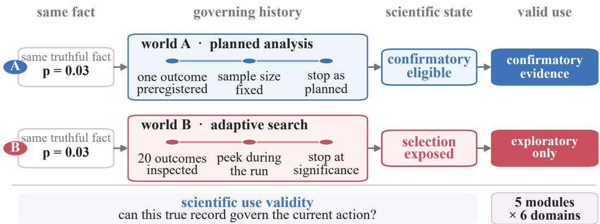
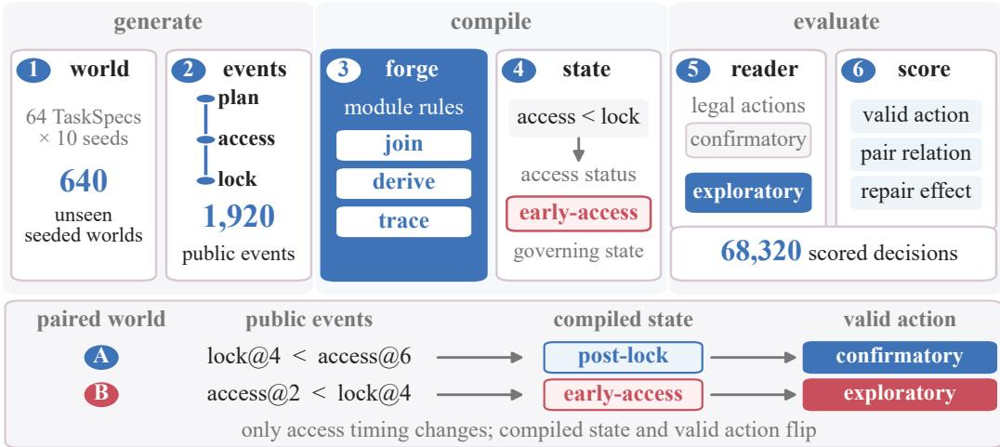
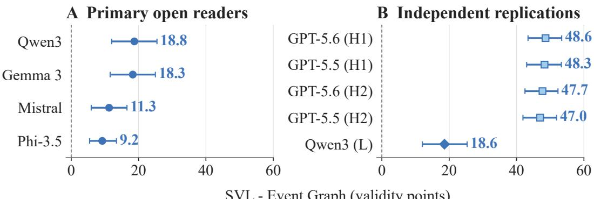
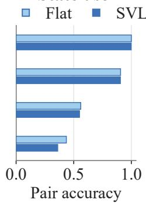
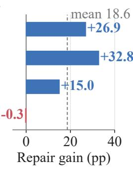

# The Right Fact, the Wrong Decision: SciValidityBench for Scientific Agent Memory

Yuexi Pan1,2 Yongchao Chen1∗

1Tsinghua University

2University of Science and Technology of China

panyuexi@mail.ustc.edu.cn chenyongchao@mail.tsinghua.edu.cn

§ GitHub: SciValidityBench/SciValidityBench

€ Website: scivaliditybench.github.io/SciValidityBench

## ABSTRACT

Most agent-memory benchmarks frame long-term memory as retrieval: can an agent recover the relevant record from a long and evolving history? Scientific agents face a stricter problem: a correctly remembered fact may still be invalid to use. The same reported test result can support confirmation when the outcome and stopping rule were fixed in advance, yet only exploration when the outcome was selected from twenty inspected results. We call this scientific use validity: whether remembered evidence is eligible to influence a decision under the state governing its interpretation. We introduce SCIVALIDITYBENCH, an executable benchmark factory with 64 TaskSpecs spanning five validity modules and six scientific domains. TaskSpecs couple generated experimental histories with scientific-state definitions, programmatic decision oracles, controlled interventions, and automatic scoring. The SCISTATEFORGE compiler–reader framework turns distributed histories into explicit decision-governing state. Counterfactual pairs and targeted corruption–repair controls then test whether models use those dependencies and localize failures. Across four model families, compiled scientific state improves valid decision-making by 9.2–18.8 percentage points over a generic Event Graph. Retrieval alone does not reproduce this cross-family gain, while content-identical flat and typed views show that the improvement comes from exposing governing state rather than a particular graph serialization. SciValidityBench thus shifts memory evaluation from finding the right fact to deciding whether that fact should control the decision.

## 1 INTRODUCTION

An agent can recover the right fact from a laboratory history and still make the wrong scientific decision. Existing long-term-memory benchmarks probe long conversations, incremental interactions, state updates, selective forgetting, and on-policy personalization (Maharana et al., 2024; Wu et al., 2025; Hu et al., 2026; Jiayang et al., 2026). Yet their central question remains whether an agent can preserve, retrieve, or revise the relevant information. Scientific agents face a second question: is that information eligible to govern the current decision?

Consider two notebooks that both truthfully report $p = 0 . 0 3$ . In one, the researcher preregistered the outcome, fixed the sample size, and followed the stopping rule. In the other, the researcher inspected twenty outcomes and stopped after one crossed the significance threshold. The number is identical, but its evidential status differs: the former may support a confirmatory claim, whereas the latter remains exploratory. Preregistration fixes the analysis plan before observation, while selective-inference methods account for data-dependent selection (Nosek et al., 2018; Fithian et al., 2017). Better retrieval cannot resolve this distinction because the governing information is distributed across the analysis plan, outcome family, access history, and stopping rule. Returning the correct value without these dependencies can make an agent more confidently wrong.

We call this missing evaluation object scientific use validity (Figure 1): whether remembered evidence may influence an action under the scientific state governing its interpretation. This problem also arises when an outcome is viewed before a plan is locked, identically named measurements use different constructs, a blank denotes failure rather than zero, or sunk costs influence a prospective choice. Each case links a locally correct record to a decision through state elsewhere in the history. Scientific memory must therefore reconstruct the governing state, not merely retain the record.

  
Figure 1: The right fact can license different decisions. Retrieval alone cannot distinguish the two worlds because the reported value is identical. SCIVALIDITYBENCH evaluates whether an agent reconstructs the cross-record state that determines how the evidence may be used. This is the distinction between remembering a result and using it validly.

This question is complementary to recent benchmarks for scientific agents. Scientific-agent benchmarks test broad capabilities, controlled tools, and open-ended or executable research workflows (Bragg et al., 2026; Panigrahi et al., 2026; Kon et al., 2026), while process evaluations show that final-answer accuracy can conceal unsupported reasoning (Shao et al., 2026). They do not isolate whether a memory reader uses the state that licenses a particular decision. Structured memory may score higher because of retrieval, added information, formatting, prompt length, or answer preference. One correct answer alone cannot distinguish these causes.

We introduce SCIVALIDITYBENCH, an executable benchmark factory built to make this distinction measurable. Each TaskSpec binds a generated history, scientific-state definition, legal actions, programmatic oracle, controlled interventions, and automatic scorer. The resulting 64 tasks cover five validity mechanisms across machine learning, A/B testing, clinical research, bioinformatics, systems, and causal inference. Domains change the scientific surface and event generator, while mechanisms declare governing state, interventions, and oracles through the same interface. At the center of the benchmark is SCISTATEFORGE, a compiler–reader pipeline that turns distributed experimental histories into explicit, decision-governing scientific state. We compare complete raw events, fixed BM25 retrieval, a generic Event Graph, a flat compiled-state view, and a typed scientific-state ledger. Counterfactual worlds hold all non-target information fixed while changing one decisive state value. Targeted corruption removes oracle-required state. Exact and edit-matched irrelevant repairs distinguish genuine state use from answer preference, generic text perturbation, and irrelevant-history interference.

Across four locked model families, compiled scientific state improves TaskSpec-balanced valid decision-making by 9.2–18.8 percentage points over a generic Event Graph. BM25 retrieval does not reproduce this cross-family gain, and content-identical flat and typed compiled views show that the central benefit comes from exposing governing state rather than from a particular graph serialization. Exact target repair exceeds matched irrelevant repair by 18.6 validity points on average. The resulting behavior identifies missing state use, representation-sensitive shortcuts, and irrelevant memory interference rather than collapsing them into a single accuracy score. Our contributions are threefold:

1. Scientific use validity. We formalize the gap between recovering a correct record and deciding whether it may govern an action, then instantiate that distinction across five validity mechanisms with explicit state dependencies.

2. An executable benchmark factory. Sixty-four TaskSpecs across six domains share generators, state contracts, legal actions, programmatic oracles, interventions, and scorers, allowing new scientific settings to reuse the same evaluation interface.

3. Causal diagnosis and evidence. Paired worlds, targeted corruption, exact repair, and edit-matched irrelevant repair separate genuine state use from retrieval and answer preference. Compiled state beats Event Graph by 9.2–18.8 points across four model families.

## 2 RELATED WORK

Agent memory: from recalling facts to using them in action. Persistent-memory agents consolidate and selectively retain experience in external stores (Park et al., 2023; Packer et al., 2024). Mem0 extends this pattern to scalable deployments (Chhikara et al., 2025), and surveys map the design space (Zhang et al., 2025). Benchmarks cover long-range and cross-session recall (Maharana et al., 2024; Wu et al., 2025; Tan et al., 2025; Tavakoli et al., 2026), continual adaptation and forgetting (Hu et al., 2026; Jiayang et al., 2026; Uddin et al., 2026), and memory-grounded action (He et al., 2026; Zhao et al., 2026; Wu et al., 2026). Recent designs span feedback-driven declarative and procedural adaptation, joint personal and system memory, episode-level knowledge versus execution demands, and hidden user-state recovery (Ai et al., 2026; Ma et al., 2026b; Wang et al., 2026b; Ma et al., 2026a). STALE, CAME-Bench, and Mem2ActBench target stale facts, contextual applicability, and historical tool constraints (Chao et al., 2026; Yang et al., 2026; Shen et al., 2026). These benchmarks measure recall and downstream utility. SCIVALIDITYBENCH holds the focal record fixed and varies the nonlocal conditions for its use, testing the content–state–action relation.

Scientific reasoning and scientific-agent benchmarks. Surveys chart scientific-agent stages, maturity, and reliability (Wang et al., 2026a). Benchmarks cover knowledge and problem solving (Wang et al., 2024; Laurent et al., 2024), data-driven discovery (Majumder et al., 2025; Gu et al., 2024; Chen et al., 2025), and controlled or end-to-end research environments (Bragg et al., 2026; Panigrahi et al., 2026; Kon et al., 2026). Scientific-memory work treats full-paper recall as budgeted restoration, while StatefulDiscovery externalizes investigation state for claim calibration (Sheverev et al., 2026; Chen et al., 2026a). These systems score completion, restoration, or discovery quality. We fix the history and action space, then test whether governing state permits evidence use.

Provenance and scientific validity. PROV traces entities, activities, and agents (Moreau & Missier, 2013), but traceability alone does not establish admissibility. Preregistration fixes the analysis plan before observation (Nosek et al., 2018), while selective inference accounts for data-dependent selection (Fithian et al., 2017). Data leakage can also invalidate claims when evaluation or artifact history is ignored (Kapoor & Narayanan, 2023). We turn this principle into five mechanisms and test whether readers reconstruct and obey the state governing valid use.

Behavioral and counterfactual diagnosis. MemFail isolates summarization, storage, and retrieval failures (Garg et al., 2026), while MemTrace follows memory evolution (Deng et al., 2026). CausalFlow and Causal Agent Replay intervene on execution traces (Bonagiri et al., 2026; Shah, 2026). CheckList probes behavioral failures, whereas contrast sets probe local decision boundaries (Ribeiro et al., 2020; Gardner et al., 2020). SeekBench separates answers from epistemic process (Shao et al., 2026), and explicit state need not be mechanistically faithful (Chen et al., 2026b). Our interventions target scientific state through one-value paired worlds, targeted corruption, and exact versus edit-matched irrelevant repair.

## 3 SCIVALIDITYBENCH

## 3.1 WHY SCIENTIFIC USE REQUIRES GLOBAL STATE

A scientific notebook is an event trace, not yet a decision state. It may faithfully record plans, runs, observations, access operations, and previous choices while leaving their joint implication unstated. We call that cross-record implication global scientific state: the collection of constraints that determines which evidence may be combined, compared, interpreted as missing, disclosed, or allowed to influence a prospective action. “Global” refers to its scope across the history rather than to an unbounded summary of everything that occurred.

This object separates three questions that are often conflated. Factuality asks whether a recorded payload is correct. Provenance establishes where the item came from and how it was produced. Use validity concerns what that authentic record is licensed to support under the governing dependencies. A verified measurement can therefore remain real and traceable while being ineligible for pooling, confirmation, or resource allocation. The benchmark targets this last relation without weakening the first two. The same payload can therefore license different actions in otherwise paired histories.

Formally, let $E _ { \mathrm { p u b } } ( w )$ denote the visible canonical-event history of world $w .$ A TaskSpec τ declares a deterministic compiler $C _ { \tau }$ , which produces the decision-governing state

$$
G _ { \tau } ( w ) = C _ { \tau } ( E _ { \mathrm { p u b } } ( w ) ) .\tag{1}
$$

It also provides a finite action space $\boldsymbol { A } _ { \ u { \tau } }$ and a programmatic oracle $O _ { \tau } ( G _ { \tau } ( w ) ) \in \mathcal { A } _ { \tau }$ . For an agent decision ${ \widehat { a } } ,$ scientific use validity is

$$
U ( \widehat { a } , w , \tau ) = \mathbf { 1 } [ \widehat { a } = O _ { \tau } ( G _ { \tau } ( w ) ) ] .\tag{2}
$$

The measured object is consequently a state-conditioned action, rather than recovery of an isolated span.

## 3.2 WHAT A TASKSPEC SPECIFIES

The basic unit of SCIVALIDITYBENCH is an executable TaskSpec, not a fixed natural-language question. We write its functional contract as

$$
\tau = \langle D _ { \tau } , W _ { \tau } , C _ { \tau } , A _ { \tau } , O _ { \tau } , I _ { \tau } , S _ { \tau } \rangle ,
$$

where $D _ { \tau }$ is a domain adapter, $W _ { \tau }$ is a seeded world generator, $C _ { \tau }$ defines scientific-state compilation, $\mathbf { \mathcal { A } } _ { \tau }$ lists legal decisions, $O _ { \tau }$ returns the valid choice, $I _ { \tau }$ constructs controlled interventions, and $S _ { \tau }$ scores responses and diagnostic relations. The stored specification additionally fixes its version, episode schedule, visibility rules, budgets, corruption operators, and data-split policy. One template can thus instantiate many reproducible worlds while preserving the same scientific rule. Appendix A summarizes catalog coverage, contract fields, and one representative decision pattern from each module.

This contract turns an abstract validity concern into a complete test: the generator creates the history, the compiler identifies what governs its use, the model selects among declared actions, and code determines whether that selection is legitimate. No free-form judge is needed for the primary outcome. Stable identifiers and canonical serialization bind every score to the exact events and state from which it was derived.

Two orthogonal extension axes. The specification factorizes scientific surface from validity mechanism. To add a domain, a developer supplies new entities, units, artifacts, and event language through $D _ { \tau }$ while reusing an existing state rule. To introduce a new module, one declares its governing variables, compiler relations, oracle, and interventions while retaining the common domain and scoring interfaces. This separation makes the suite a benchmark factory rather than a collection of unrelated datasets.

## 3.3 HOW SCISTATEFORGE COMPILES SCIENTIFIC STATE

SCISTATEFORGE realizes the TaskSpec contract as a compiler–reader pipeline (Figure 2). Its central operation is not summarization: it derives explicit, source-linked state from dependencies distributed across the trace.

1. Instantiate a scientific world. Given a TaskSpec and seed, the domain adapter generates a multiepisode history with a hidden world state and a reproducible public trajectory. Scientific surfaces vary by domain, but every trajectory uses the same event vocabulary: PLAN, RUN, OBSERVE, ACCESS, WRITE, RETRIEVE, and DECIDE.

2. Canonicalize the history. Each event receives a stable identifier, actor, sequence position, referenced objects, versioned payload, visibility, cost, and provenance. This normalized layer provides byte-stable replay and prevents domain-specific formatting from changing the underlying scientific world.

3. Compile governing relations. Module reducers map public events into a Scientific State Graph (SSG). Its nodes represent objects such as plans, observations, constructs, access records, absences, costs, and decisions. Typed edges materialize relations including SELECTED FROM, STOPPED AFTER, SEALED UNTIL, COMPARABLE WITH, ABSENT BECAUSE, and RELEVANT TO. Derived fields retain links to the events that justify them. They add no new observations while making the scientific consequences of public evidence explicit.

  
Figure 2: The SCISTATEFORGE pipeline. A domain-specific history is normalized, compiled into decision-governing state, rendered for a model, and scored by an executable oracle. The worked pair changes one scientific-state condition while keeping the task semantics fixed.

This step is what distinguishes SCISTATEFORGE from a generic Event Graph. The latter preserves what happened and connects events through sequence or shared objects. The compiler additionally resolves what those occurrences mean for the pending decision. Its flat SSG and typed Scientific Validity Ledger renderings expose identical public nodes, attributes, and relations, allowing representation to change without silently changing the compiled content.

Figure 2 gives a concrete pass. The paired worlds contain the same event types, but A records lock@4 before access@6, whereas B records access@2 before lock@4. The Blind Memory reducer joins those timestamps, derives a post-lock or early-access status, and maps it to the corresponding confirmatory or exploratory action. Each derived value remains linked to the events that support it. The compiler terminates at this source-linked state. The reader still selects from the legal actions, and the TaskSpec oracle scores that selection. Compilation therefore resolves a cross-event scientific dependency rather than retrieving a different fact or executing the decision. Across the final catalog, 64 executable TaskSpecs crossed with ten unseen seeds instantiate 640 seeded worlds and expose 1,920 public event records.

4. Render, decide, and score. Oracle-only generator state remains with the validator. The reader receives a projection derived from the public history together with the current request and legal actions. Its choice is checked by the TaskSpec oracle, and the run emits both an item-level validity score and the identifiers needed for paired or repair-based diagnosis. Appendix B gives the canonical event schema, deterministic passes, and exact memory-view definitions.

## 3.4 FIVE MODULES ACROSS SIX SCIENTIFIC DOMAINS

The catalog contains 64 versioned TaskSpecs spanning five validity modules and six scientific domains. Table 1 shows that the modules are different mechanisms of one construct: whether the current scientific state licenses the proposed use of a locally correct record.

Domains supply scientific settings rather than duplicate module definitions. Machine learning contributes datasets, checkpoints, seeds, and metric implementations; A/B testing uses variants, traffic slices, endpoints, and scheduled looks; clinical research supplies protocols, cohorts, outcomes, and censoring records. Bioinformatics introduces assays, samples, replicate structure, and pipeline versions; systems research uses hardware, workloads, runtime logs, and benchmark configurations; causal inference instantiates exposures, estimands, adjustment sets, and identification choices. These scientific surfaces are summarized in Table 2.

This decomposition provides breadth without turning the suite into six unrelated collections. Inferen tial Ledger, Construct Drift, and Absence Algebra appear in every domain. Blind Memory and Sunk Cost are instantiated in selected settings where their operational stories are most direct. Because world generation is seeded, each TaskSpec yields controlled variation beneath the same decision contract rather than repeating one memorized answer. Cross-domain instances also resist surface shortcuts: one validity rule appears through different entities and terminology, while one scientific setting hosts multiple decision mechanisms.

Table 1: Five modules, one use-validity construct. Each module isolates a distinct reason why a true record may or may not govern an action.
<table><tr><td>Module</td><td>Governing information</td><td>Invalid use under test</td></tr><tr><td>Inferential Ledger</td><td>Search family, stopping rule, predeclared analysis scope, and</td><td>Promoting an adaptively selected or repeatedly consumed result to confirmation</td></tr><tr><td>Blind Memory</td><td>evidence consumption Plan lock, disclosure time, and authorized access roles</td><td>Treating an outcome seen too early as an uncontaminated confirmatory analysis</td></tr><tr><td>Construct Drift</td><td>Metric definition, population, replicate meaning, and version relation</td><td>Pooling measurements that share a name but are only convertible or incommensurate</td></tr><tr><td>Absence Algebra</td><td>Attempt status, instrument outcome, censoring, and detection</td><td>Collapsing not-run, failure, censoring, and confirmed zero into one kind of blank</td></tr><tr><td></td><td>mechanism</td><td></td></tr><tr><td>Sunk Cost</td><td>of historical investment</td><td>Prospective value and the relevance Allowing irrecoverable past effort to alter a decision with identical future payoffs</td></tr></table>

Table 2: Six domain surfaces. The adapter changes scientific objects and language while the module retains the governing validity primitive.
<table><tr><td>Domain</td><td>Scientific surface</td><td>Domain</td><td>Scientific surface</td></tr><tr><td>Machine</td><td>Datasets, checkpoints, seeds,</td><td>A/B testing</td><td>Variants, traffic slices, endpoints, scheduled looks</td></tr><tr><td>learning Clinical research</td><td>metric implementations Protocols, cohorts, outcomes,</td><td>Bioinformatics</td><td>Assays, samples, replicates,</td></tr><tr><td>Systems</td><td>censoring records Hardware, workloads, runtime logs, benchmark configurations</td><td>Causal inference</td><td>pipeline versions Exposures, estimands, adjustment sets, identification choices</td></tr></table>

## 3.5 INTERVENTIONS AND PROGRAMMATIC DIAGNOSIS

Correct actions alone cannot establish that a reader used the intended state. SciValidityBench therefore builds diagnostic interventions into the benchmark unit.

State-changing counterfactuals. For each TaskSpec-defined pair, I changes one decisive public value while holding the TaskSpec, seed, surface form, legal actions, and non-target information fixed. The contract declares whether the oracle relation must flip or remain invariant. A model that repeats the same choice in a flip pair may have succeeded on one side through answer preference rather than state use.

Corruption and matched repair. Graph operators can omit, unlink, relabel, merge, duplicate, or inject a specific node or relation. Exact repair applies the inverse patch and restores the target graph, including its canonical hash. An edit-matched irrelevant repair leaves the decisive damage in place while modifying an unrelated location with the same operation signature. Recovery unique to the exact repair supports dependence on the intended scientific state. Equal recovery from both repairs instead indicates a generic text or structure effect.

Scoring beyond a leaderboard. The scorer records legal-action validity, the paired answer relation, and repair behavior from deterministic contracts. These outputs distinguish four useful failure patterns: failure to track the decisive value, a stable answer bias, sensitivity to irrelevant history, and inability to exploit a restored state. The benchmark consequently measures performance and supplie a causal behavioral account of where that performance comes from.

Together, canonical events, declarative TaskSpecs, domain adapters, explicit state compilation, and reversible interventions turn scientific use validity into a reusable evaluation interface. The resulting pipeline can expand to a new scientific setting without redefining the construct, or to a new validity mechanism without rebuilding the surrounding evaluation stack. Every extension retains the same

diagnostic guarantees: executable scoring, state-changing pairs, and repair at a known causal location.   
Breadth therefore does not trade away failure interpretability.

## 4 EXPERIMENTS

Our evaluation follows a three-step evidence chain. We first measure whether explicit scientific state improves valid decisions across independently executed readers. Retrieval, input length, generic graph structure, and typed serialization then test alternative explanations. Module effects, counterfactual pairs, and targeted repair respectively locate the benefit, verify state-dependent behavior, and diagnose failure.

## 4.1 EXPERIMENTAL SETUP

Primary matrix. The main evaluation contains all 64 program-valid TaskSpecs. Ten unseen seeds instantiate each specification for four open model families: Qwen3-14B, Gemma-3-12B-IT, Mistral-7B-Instruct-v0.3, and Phi-3.5-mini-instruct (Yang et al., 2025; Gemma Team et al., 2025; Jiang et al., 2023; Abdin et al., 2024). Crossing those factors with five memory views produces $6 4 \times 1 0 \times 4 \times 5 = 1 2$ ,800 original decisions. Flat SSG and typed SVL additionally receive one statechanging companion world per task–seed–reader, adding 5,120 counterfactual decisions. Completion is outcome-independent: invalid JSON, illegal actions, and unparsable answers count as invalid decisions. Across the six frozen evaluation matrices reported in Appendix C, the final suite contains 68,320 scored decisions, of which 17,920 belong to the primary matrix.

Representations and controls. Raw Events exposes the full public sequence. A fixed BM25 retriever selects at most five request-relevant event chunks. Event Graph preserves every public event and object but connects them only through generic sequence and mention edges. The two compiled conditions reveal the same public nodes, attributes, and governing relations: Flat SSG serializes them as records, whereas SVL uses a typed ledger. The prompt shell, current request, legal actions, seed, checkpoint, and temperature-zero decoding remain fixed within each comparison. Models are served with vLLM and return one action from the legal choice set (Kwon et al., 2023).

Outcomes and uncertainty. The primary measure is valid-action rate under the TaskSpec oracle. For every representation contrast, we first average paired seed differences within a TaskSpec and then weight all 64 specifications equally. Reported 95% intervals use 20,000 TaskSpec bootstrap resamples. Counterfactual relation accuracy tests whether two answers obey the required flip or invariance. Repair specificity compares restoring the damaged target with an edit-matched change at an irrelevant location. These diagnostics complement the valid-action rate by measuring how readers use the state behind each decision. Appendix C details models, matrices, and estimands.

## 4.2 COMPILED STATE IMPROVES VALIDITY ACROSS SETTINGS

The primary matrix yields a consistent separation between scientific-state compilation and generic event organization. As shown in Table 3, typed SVL exceeds Event Graph by 18.8, 18.3, 11.3, and 9.2 validity points for Qwen, Gemma, Mistral, and Phi, respectively. All four 95% intervals remain above zero. Figure 3A summarizes the pattern. The result survives an exact-overlap audit. Removing 22 tasks leaves gains of 8.3–14.8 points for every reader across the remaining 42 tasks (Appendix D, Table 17).

Event Graph stays close to Raw Events despite containing all public events and their basic relations. Compilation materializes consequences such as COMPARABLE WITH, ABSENT BECAUSE, or

Table 3: Compiled state improves valid decisions across four model families. Each absolute-rate cell contains all 64 TaskSpecs at ten unseen seeds. The final column first averages paired seed differences within each TaskSpec and then weights TaskSpecs equally.
<table><tr><td>Model</td><td>Raw</td><td>BM25</td><td>Event</td><td>Flat</td><td>SVL</td><td>SVL—Event (95% CI)</td></tr><tr><td>Qwen3-14B</td><td>0.798</td><td>0.802</td><td>0.794</td><td>0.991</td><td>0.981</td><td>+0.188 [+0.120, +0.255]</td></tr><tr><td>Gemma-3-12B</td><td>0.733</td><td>0.719</td><td>0.719</td><td>0.903</td><td>0.902</td><td>+0.183 [+0.116, +0.250]</td></tr><tr><td>Mistral-7B</td><td>0.556</td><td>0.586</td><td>0.566</td><td>0.692</td><td>0.678</td><td>+0.113 [+0.059, +0.166]</td></tr><tr><td>Phi-3.5-mini</td><td>0.480</td><td>0.475</td><td>0.478</td><td>0.609</td><td>0.570</td><td>+0.092 [+0.055, +0.134]</td></tr></table>

  
SVL - Event Graph (validity points)  
Figure 3: Main effect and independent replications. Panel A reports the TaskSpec-balanced primary contrast. Panel B shows the same contrast in two hosted seed blocks (H1/H2) and a local Qwen3-14B replication (L).

STOPPED AFTER. The reader no longer has to reconstruct those cross-record dependencies from sequence alone. The 9.2–18.8 point gain comes from exposing the scientific relations that govern the current decision, not from organizing the same event history as a generic graph.

Flat SSG isolates compiled content from ledger syntax. It reaches 0.991/0.903/0.692/0.609 across the four readers, slightly above typed SVL in every row. Both renderings disclose identical nodes, attributes, and governing relations, so their shared improvement comes from the compiled scientific state. The small Flat–SVL differences show that readers vary in how they consume the same state.

Independent executions reproduce the contrast in Figure 3B. Hosted runs yield 47.0–48.6 point advantages across two readers and two seed blocks, with positive intervals throughout. An independent Qwen replication produces an 18.6-point gain [12.0, 25.3], while Flat and typed SVL remain within five points. The direction persists across model identities and serving stacks. Appendices D and H give full results and replications.

## 4.3 WHAT DRIVES THE GAIN?

Retrieval does not reproduce the cross-family pattern. BM25 raises Mistral by 3.0 points and Qwen by 0.3, but lowers the other two readers. Event Graph is the longest view for every tokenizer yet remains close to Raw Events. The shorter compiled projections lead instead, tying performance to explicit governing relations rather than retrieval depth or context length

The source-level matrix changes one canonical public value before constructing any view. Matched Source exposes the complete derived-free fact closure and exactly matches Flat SSG’s full-chat token count. Across 12 balanced design families, Flat SSG exceeds Event Graph for every reader (Table 4). Scientific-relation compilation remains beneficial after the shared upstream intervention.

Exact token matching separates compilation from presentation. Flat outperforms Matched Source by 19.4 points for Qwen and 19.3 for Mistral, changes Gemma by 1.1, and trails it by 29.5 for Phi. Typed SVL is effectively tied with Flat for Qwen and Mistral but improves Gemma by 24.0 points and Phi by 48.8. The common advantage lies in compiled state. The easiest serialization depends on the reader.

Table 4: Source- and serialization-level controls reveal reader-specific mechanisms. Effects are balanced over 12 design families, with 95% family-resampling intervals. Matched Source and Flat SSG have exactly equalized full-chat token counts.
<table><tr><td>Model</td><td>Flat—Event Graph</td><td>Flat—Matched Source</td><td>SVL-Flat</td></tr><tr><td>Qwen3-14B</td><td>+0.174 [+0.056, +0.300]</td><td>+0.194 [+0.066, +0.335]</td><td>+0.003 [+0.000, +0.010]</td></tr><tr><td>Gemma-3-12B</td><td>+0.133 [+0.000, +0.273]</td><td>+0.011 [-0.136, +0.162]</td><td>+0.240 [+0.125, +0.356]</td></tr><tr><td>Mistral-7B</td><td>+0.207 [+0.078, +0.347]</td><td>+0.193 [+0.064, +0.333]</td><td>-0.005 [-0.023, +0.009]</td></tr><tr><td>Phi-3.5-mini</td><td>+0.189 [+0.045, +0.375]</td><td>-0.295 [-0.460, -0.099]</td><td>+0.488 [+0.276, +0.696]</td></tr></table>

## 4.4 WHERE COMPILATION HELPS AND WHETHER READERS USE STATE

Benefits concentrate in particular module–reader combinations (Figure 4A). Blind Memory rises by 21.3–52.5 points across the four readers, and Inferential Ledger improves in every family. Absence Algebra primarily benefits Mistral. Sunk Cost is unchanged for Mistral and Phi but lower for Qwen and Gemma. The aggregate effect therefore reflects structured heterogeneity rather than a uniform catalog-wide lift.

Module effects locate where compilation helps. Paired worlds test whether the decisive state actually governs behavior. Counterfactual pairs hold task surface, graph structure, legal choices, and non-target information fixed while changing one public value. Relation accuracy scores the oracle-declared flip or invariance, so a fortunate answer on one side does not count as state tracking.

Panel B reveals a sharper hierarchy than single-world accuracy. For Flat SSG/typed SVL, relation accuracy reaches 1.000/0.998 for Qwen and 0.906/0.905 for Gemma, then falls to 0.561/0.550 for Mistral and 0.436/0.361 for Phi. Stronger readers convert explicit state into counterfactually consistent behavior. Weaker ones often retain stable answer preferences.

Panel C supplies an independent localization test. Exact restoration exceeds an edit-matched irrelevant repair by 26.9 points for Qwen, 32.8 for Gemma, and 15.0 for Mistral, but changes Phi by −0.3 points. The four-reader mean is 18.6. Cross-domain corruption fingerprints are stable for five of six operators in Qwen and Gemma, versus two for Mistral and one for Phi. High relation accuracy and stable fingerprints coincide in the stronger readers, whereas Mistral and Phi show weaker tracking and less specific recovery. The contrast distinguishes damage to a governing relation from a broader failure to use compiled state. Appendices E and F give complete diagnostic results.

A Module gain (pp)
<table><tr><td rowspan=2 colspan=1>Qwen3Gemma 3</td><td rowspan=1 colspan=1>+25.0</td><td rowspan=1 colspan=1>+52.5</td><td rowspan=1 colspan=1>+25.0</td><td rowspan=1 colspan=1>0.0</td><td rowspan=1 colspan=1>-15.0</td></tr><tr><td rowspan=1 colspan=1>+25.8</td><td rowspan=1 colspan=1>+50.0</td><td rowspan=1 colspan=1>+23.3</td><td rowspan=1 colspan=1>0.0</td><td rowspan=1 colspan=1>-16.3</td></tr><tr><td rowspan=1 colspan=1>Mistral</td><td rowspan=1 colspan=1>+7.5</td><td rowspan=1 colspan=1>+21.3</td><td rowspan=1 colspan=1>+0.8</td><td rowspan=1 colspan=1>+30.0</td><td rowspan=1 colspan=1>0.0</td></tr><tr><td rowspan=1 colspan=1>Phi-3.5</td><td rowspan=1 colspan=1>+14.6</td><td rowspan=1 colspan=1>+30.0</td><td rowspan=1 colspan=1>0.0</td><td rowspan=1 colspan=1>0.0</td><td rowspan=1 colspan=1>0.0</td></tr><tr><td rowspan=1 colspan=1></td><td rowspan=1 colspan=5>Ledger BlindDrift Absence Sunk</td></tr></table>

B State use  

C Target repair  
  
Figure 4: State-use and failure diagnosis. Panel A reports module-level validity gains (SVL−Event Graph, percentage points) and shows where compilation helps. Value pairs test whether behavior follows a changed state. Target and matched repairs distinguish restoration of the governing information from a generic edit effect. All panels use a shared reader order and Panel A labels every module–reader contrast.

## 5 CONCLUSION

Scientific memory must recover a true record and determine whether it is licensed for the current decision. SCIVALIDITYBENCH makes this scientific-use validity executable through 64 TaskSpecs spanning five mechanisms and six domains, while SCISTATEFORGE compiles distributed histories into source-linked decision state. Across four model families, compiled state improves valid-action selection over Event Graph by 9.2–18.8 points. The advantage persists after removing exact state–action overlaps and cannot be reproduced by retrieval, longer inputs, or generic graph structure. Counterfactual pairs and matched repairs distinguish genuine state dependence from answer preference and localize failures, shifting memory evaluation from retaining facts to reconstructing the conditions under which they may be compared, promoted, or acted upon. TaskSpecs separate scientific surfaces from validity rules for agents writing laboratory histories.

## AI USE STATEMENT

Generative AI tools were used only to polish the manuscript’s language, including grammar, clarity, and style. They did not determine the research ideas, methods, experimental design, implementation, data, analysis, or conclusions. The authors reviewed and verified the complete manuscript and take full responsibility for all of its content.

## ETHICS STATEMENT

The benchmark uses procedurally generated histories and fictitious clinical scenarios. It involves no human participants, patient records, personal data, or confidential information. No human-subjects research was conducted, so IRB review was not required. The authors take responsibility for the ethical use and release of the benchmark, experiments, and associated materials.

## REPRODUCIBILITY STATEMENT

The appendices document the TaskSpec contracts, memory-view definitions, evaluation settings, programmatic scoring, and diagnostic interventions. The public GitHub repository provides the final 64-TaskSpec catalog, deterministic generators spanning six domains, the SciStateForge compiler, all five evaluated memory views, counterfactual and corruption/repair operators, executable examples, and release tests. Every benchmark world is generated deterministically from a TaskSpec and seed, and oracle-only state is excluded from model-visible inputs.

## REFERENCES

Marah Abdin, Jyoti Aneja, Hany Awadalla, Ahmed Awadallah, Ammar Ahmad Awan, Nguyen Bach, Amit Bahree, Arash Bakhtiari, Jianmin Bao, Harkirat Behl, Alon Benhaim, Misha Bilenko, Johan Bjorck, Sebastien Bubeck, Martin Cai, Qin Cai, Vishrav Chaudhary, Dong Chen, Dongdong´ Chen, Weizhu Chen, Yen-Chun Chen, Yi-Ling Chen, Hao Cheng, Parul Chopra, Xiyang Dai, Matthew Dixon, Ronen Eldan, Victor Fragoso, Jianfeng Gao, Mei Gao, Min Gao, Amit Garg, Allie Del Giorno, Abhishek Goswami, Suriya Gunasekar, Emman Haider, Junheng Hao, Russell J. Hewett, Wenxiang Hu, Jamie Huynh, Dan Iter, Sam Ade Jacobs, Mojan Javaheripi, Xin Jin, Nikos Karampatziakis, Piero Kauffmann, Mahoud Khademi, Dongwoo Kim, Young Jin Kim, Lev Kurilenko, James R. Lee, Yin Tat Lee, Yuanzhi Li, Yunsheng Li, Chen Liang, Lars Liden, Xihui Lin, Zeqi Lin, Ce Liu, Liyuan Liu, Mengchen Liu, Weishung Liu, Xiaodong Liu, Chong Luo, Piyush Madan, Ali Mahmoudzadeh, David Majercak, Matt Mazzola, Caio Cesar Teodoro Mendes,´ Arindam Mitra, Hardik Modi, Anh Nguyen, Brandon Norick, Barun Patra, Daniel Perez-Becker, Thomas Portet, Reid Pryzant, Heyang Qin, Marko Radmilac, Liliang Ren, Gustavo de Rosa, Corby Rosset, Sambudha Roy, Olatunji Ruwase, Olli Saarikivi, Amin Saied, Adil Salim, Michael Santacroce, Shital Shah, Ning Shang, Hiteshi Sharma, Yelong Shen, Swadheen Shukla, Xia Song, Masahiro Tanaka, Andrea Tupini, Praneetha Vaddamanu, Chunyu Wang, Guanhua Wang, Lijuan Wang, Shuohang Wang, Xin Wang, Yu Wang, Rachel Ward, Wen Wen, Philipp Witte, Haiping Wu, Xiaoxia Wu, Michael Wyatt, Bin Xiao, Can Xu, Jiahang Xu, Weijian Xu, Jilong Xue, Sonali Yadav, Fan Yang, Jianwei Yang, Yifan Yang, Ziyi Yang, Donghan Yu, Lu Yuan, Chenruidong Zhang, Cyril Zhang, Jianwen Zhang, Li Lyna Zhang, Yi Zhang, Yue Zhang, Yunan Zhang, and Xiren Zhou. Phi-3 technical report: A highly capable language model locally on your phone, 2024. URL https://arxiv.org/abs/2404.14219.

Qingyao Ai, Yichen Tang, Changyue Wang, Jianming Long, Weihang Su, and Yiqun LIU. MemoryBench: A benchmark for memory and continual learning in LLM systems. In Forty-third International Conference on Machine Learning, 2026. URL https://openreview.net/ forum?id=If4X4W2HWx.

Akash Bonagiri, Devang Borkar, Gerard Janno Anderias, Setareh Rafatirad, and Houman Homayoun. CausalFlow: Causal attribution and counterfactual repair for LLM agent failures, 2026. URL https://arxiv.org/abs/2605.25338.

Jonathan Bragg, Mike D’Arcy, Nishant Balepur, Dan Bareket, Bhavana Dalvi, Sergey Feldman, Dany Haddad, Jena D. Hwang, Peter Jansen, Varsha Kishore, Bodhisattwa Prasad Majumder, Aakanksha Naik, Sigal Rahamimov, Kyle Richardson, Amanpreet Singh, Harshit Surana, Aryeh Tiktinsky, Rosni Vasu, Guy Wiener, Chloe Anastasiades, Stefan Candra, Jason Dunkelberger, Dan Emery, Rob

Evans, Malachi Hamada, Regan Huff, Rodney Kinney, Matt Latzke, Jaron Lochner, Ruben Lozano-Aguilera, Cecile Nguyen, Smita Rao, Amber Tanaka, Brooke Vlahos, Peter Clark, Doug Downey, Yoav Goldberg, Ashish Sabharwal, and Daniel S. Weld. AstaBench: Rigorous benchmarking of AI agents with a scientific research suite, 2026. URL https://arxiv.org/abs/2510.21652.

Hanxiang Chao, Yihan Bai, Rui Sheng, Tianle Li, and Yushi Sun. STALE: Can LLM agents know when their memories are no longer valid?, 2026. URL https://arxiv.org/abs/ 2605.06527.

Jiayao Chen, Shi Liu, and Linyi Yang. StatefulDiscovery: Evidence-calibrated claim formation in open-ended scientific discovery, 2026a. URL https://arxiv.org/abs/2606.11851.

Yihang Chen, Pin Qian, Su Wang, Chong Peng, Huan Xu, Shuaiting Li, and Yiqi Sun. Explicit state elicitation is not enough: A controlled audit of memory-policy classification, 2026b. URL https://arxiv.org/abs/2608.17247.

Ziru Chen, Shijie Chen, Yuting Ning, Qianheng Zhang, Boshi Wang, Botao Yu, Yifei Li, Zeyi Liao, Chen Wei, Zitong Lu, Vishal Dey, Mingyi Xue, Frazier N. Baker, Benjamin Burns, Daniel Adu-Ampratwum, Xuhui Huang, Xia Ning, Song Gao, Yu Su, and Huan Sun. ScienceAgentBench: Toward rigorous assessment of language agents for datadriven scientific discovery. In Y. Yue, A. Garg, N. Peng, F. Sha, and R. Yu (eds.), International Conference on Learning Representations, volume 2025, pp. 96934–96990, 2025. URL https://proceedings.iclr.cc/paper\_files/paper/2025/file/ f12b4df26344f3be803c06b555252efe-Paper-Conference.pdf.

Prateek Chhikara, Dev Khant, Saket Aryan, Taranjeet Singh, and Deshraj Yadav. Mem0: Building production-ready AI agents with scalable long-term memory, 2025. URL https:// arxiv.org/abs/2504.19413.

Xinle Deng, Ruobin Zhong, Hujin Peng, Xiaoben Lu, Yanzhe Wu, Guang Li, Buqiang Xu, Yunzhi Yao, Jizhan Fang, Haoliang Cao, Junjie Guo, Yuan Yuan, Ziqing Ma, Yuanqiang Yu, Rui Hu, Baohua Dong, Hangcheng Zhu, and Ningyu Zhang. MemTrace: Tracing and attributing errors in large language model memory systems, 2026. URL https://arxiv.org/abs/2605.28732.

William Fithian, Dennis Sun, and Jonathan Taylor. Optimal inference after model selection, 2017. URL https://arxiv.org/abs/1410.2597.

Matt Gardner, Yoav Artzi, Victoria Basmov, Jonathan Berant, Ben Bogin, Sihao Chen, Pradeep Dasigi, Dheeru Dua, Yanai Elazar, Ananth Gottumukkala, Nitish Gupta, Hannaneh Hajishirzi, Gabriel Ilharco, Daniel Khashabi, Kevin Lin, Jiangming Liu, Nelson F. Liu, Phoebe Mulcaire, Qiang Ning, Sameer Singh, Noah A. Smith, Sanjay Subramanian, Reut Tsarfaty, Eric Wallace, Ally Zhang, and Ben Zhou. Evaluating models’ local decision boundaries via contrast sets. In Trevor Cohn, Yulan He, and Yang Liu (eds.), Findings of the Association for Computational Linguistics: EMNLP 2020, pp. 1307–1323, Online, November 2020. Association for Computational Linguistics. doi: 10.18653/v1/2020.findings-emnlp.117. URL https://aclanthology.org/2020.findings-emnlp.117/.

Ishir Garg, Neel Kolhe, Dawn Song, and Xuandong Zhao. MemFail: Stress-testing failure modes of LLM memory systems, 2026. URL https://arxiv.org/abs/2605.26667.

Gemma Team, Aishwarya Kamath, Johan Ferret, Shreya Pathak, Nino Vieillard, Ramona Merhej, Sarah Perrin, Tatiana Matejovicova, Alexandre Rame, Morgane Rivi´ ere, Louis Rouillard, Thomas\` Mesnard, Geoffrey Cideron, Jean bastien Grill, Sabela Ramos, Edouard Yvinec, Michelle Casbon, Etienne Pot, Ivo Penchev, Gael Liu, Francesco Visin, Kathleen Kenealy, Lucas Beyer, Xiaohai¨ Zhai, Anton Tsitsulin, Robert Busa-Fekete, Alex Feng, Noveen Sachdeva, Benjamin Coleman, Yi Gao, Basil Mustafa, Iain Barr, Emilio Parisotto, David Tian, Matan Eyal, Colin Cherry, Jan-Thorsten Peter, Danila Sinopalnikov, Surya Bhupatiraju, Rishabh Agarwal, Mehran Kazemi, Dan Malkin, Ravin Kumar, David Vilar, Idan Brusilovsky, Jiaming Luo, Andreas Steiner, Abe Friesen, Abhanshu Sharma, Abheesht Sharma, Adi Mayrav Gilady, Adrian Goedeckemeyer, Alaa Saade, Alex Feng, Alexander Kolesnikov, Alexei Bendebury, Alvin Abdagic, Amit Vadi, Andras´ Gyorgy, Andr¨ e Susano Pinto, Anil Das, Ankur Bapna, Antoine Miech, Antoine Yang, Antonia´ Paterson, Ashish Shenoy, Ayan Chakrabarti, Bilal Piot, Bo Wu, Bobak Shahriari, Bryce Petrini, Charlie Chen, Charline Le Lan, Christopher A. Choquette-Choo, CJ Carey, Cormac Brick, Daniel

Deutsch, Danielle Eisenbud, Dee Cattle, Derek Cheng, Dimitris Paparas, Divyashree Shivakumar Sreepathihalli, Doug Reid, Dustin Tran, Dustin Zelle, Eric Noland, Erwin Huizenga, Eugene Kharitonov, Frederick Liu, Gagik Amirkhanyan, Glenn Cameron, Hadi Hashemi, Hanna Klimczak Plucinska, Harman Singh, Harsh Mehta, Harshal Tushar Lehri, Hussein Hazimeh, Ian Ballantyne,´ Idan Szpektor, Ivan Nardini, Jean Pouget-Abadie, Jetha Chan, Joe Stanton, John Wieting, Jonathan Lai, Jordi Orbay, Joseph Fernandez, Josh Newlan, Ju yeong Ji, Jyotinder Singh, Kat Black, Kathy Yu, Kevin Hui, Kiran Vodrahalli, Klaus Greff, Linhai Qiu, Marcella Valentine, Marina Coelho, Marvin Ritter, Matt Hoffman, Matthew Watson, Mayank Chaturvedi, Michael Moynihan, Min Ma, Nabila Babar, Natasha Noy, Nathan Byrd, Nick Roy, Nikola Momchev, Nilay Chauhan, Noveen Sachdeva, Oskar Bunyan, Pankil Botarda, Paul Caron, Paul Kishan Rubenstein, Phil Culliton, Philipp Schmid, Pier Giuseppe Sessa, Pingmei Xu, Piotr Stanczyk, Pouya Tafti, Rakesh Shivanna, Renjie Wu, Renke Pan, Reza Rokni, Rob Willoughby, Rohith Vallu, Ryan Mullins, Sammy Jerome, Sara Smoot, Sertan Girgin, Shariq Iqbal, Shashir Reddy, Shruti Sheth, Siim Poder, Sijal Bhatnagar,˜ Sindhu Raghuram Panyam, Sivan Eiger, Susan Zhang, Tianqi Liu, Trevor Yacovone, Tyler Liechty, Uday Kalra, Utku Evci, Vedant Misra, Vincent Roseberry, Vlad Feinberg, Vlad Kolesnikov, Woohyun Han, Woosuk Kwon, Xi Chen, Yinlam Chow, Yuvein Zhu, Zichuan Wei, Zoltan Egyed, Victor Cotruta, Minh Giang, Phoebe Kirk, Anand Rao, Kat Black, Nabila Babar, Jessica Lo, Erica Moreira, Luiz Gustavo Martins, Omar Sanseviero, Lucas Gonzalez, Zach Gleicher, Tris Warkentin, Vahab Mirrokni, Evan Senter, Eli Collins, Joelle Barral, Zoubin Ghahramani, Raia Hadsell, Yossi Matias, D. Sculley, Slav Petrov, Noah Fiedel, Noam Shazeer, Oriol Vinyals, Jeff Dean, Demis Hassabis, Koray Kavukcuoglu, Clement Farabet, Elena Buchatskaya, Jean-Baptiste Alayrac, Rohan Anil, Dmitry, Lepikhin, Sebastian Borgeaud, Olivier Bachem, Armand Joulin, Alek Andreev, Cassidy Hardin, Robert Dadashi, and Leonard Hussenot. Gemma 3 technical report,´ 2025. URL https://arxiv.org/abs/2503.19786.

Ken Gu, Ruoxi Shang, Ruien Jiang, Keying Kuang, Richard-John Lin, Donghe Lyu, Yue Mao, Youran Pan, Teng Wu, Jiaqian Yu, Yikun Zhang, Tianmai M. Zhang, Lanyi Zhu, Mike A Merrill, Jeffrey Heer, and Tim Althoff. BLADE: Benchmarking language model agents for data-driven science. In Yaser Al-Onaizan, Mohit Bansal, and Yun-Nung Chen (eds.), Findings ofthe Associationfor Computational Linguistics: EMNLP 2024, pp. 13936–13971, Miami, Florida, USA, November 2024. Association for Computational Linguistics. doi: 10.18653/v1/2024.findings-emnlp.815. URL https://aclanthology.org/2024.findings-emnlp.815/.

Zexue He, Yu Wang, Churan Zhi, Yuanzhe Hu, Tzu-Ping Chen, Lang Yin, Ze Chen, Tong Arthur Wu, Siru Ouyang, Zihan Wang, Jiaxin Pei, Julian McAuley, Yejin Choi, and Alex Pentland. MemoryArena: Benchmarking agent memory in interdependent multi-session agentic tasks, 2026. URL https://arxiv.org/abs/2602.16313.

Yuanzhe Hu, Yu Wang, and Julian McAuley. Evaluating memory in LLM agents via incremental multi-turn interactions. In The Fourteenth International Conference on Learning Representations, 2026. URL https://openreview.net/forum?id=DT7JyQC3MR.

Albert Q. Jiang, Alexandre Sablayrolles, Arthur Mensch, Chris Bamford, Devendra Singh Chaplot, Diego de las Casas, Florian Bressand, Gianna Lengyel, Guillaume Lample, Lucile Saulnier, Lelio Renard Lavaud, Marie-Anne Lachaux, Pierre Stock, Teven Le Scao, Thibaut Lavril, Thomas´ Wang, Timothee Lacroix, and William El Sayed. Mistral 7B, 2023. URL´ https://arxiv.org/ abs/2310.06825.

Cheng Jiayang, Dongyu Ru, Lin Qiu, Yiyang Li, Xuezhi Cao, Yangqiu Song, and Xunliang Cai. AMemGym: Interactive memory benchmarking for assistants in long-horizon conversations. In C. Vondrick, B. Hariharan, C. Raffel, L. Pinto, D. Yang, and A. Faust (eds.), International Conference on Learning Representations, volume 2026, pp. 4413–4446, 2026. URL https://proceedings.iclr.cc/paper\_files/paper/2026/file/ 0856bc553d3e3b9827e5140d0ad3bf8d-Paper-Conference.pdf.

Sayash Kapoor and Arvind Narayanan. Leakage and the reproducibility crisis in machinelearning-based science. Patterns, 4(9):100804, 2023. ISSN 2666-3899. doi: 10.1016/ j.patter.2023.100804. URL https://www.sciencedirect.com/science/article/ pii/S2666389923001599.

Patrick Tser Jern Kon, Qiuyi Ding, Jiachen Liu, Xinyi Zhu, Jingjia Peng, Jiarong Xing, Yibo Huang, Yiming Qiu, Jayanth Srinivasa, Myungjin Lee, Mosharaf Chowdhury, Matei

Zaharia, and Ang Chen. EXP-Bench: Can AI conduct AI research experiments? In C. Vondrick, B. Hariharan, C. Raffel, L. Pinto, D. Yang, and A. Faust (eds.), International Conference on Learning Representations, volume 2026, pp. 120555–120604, 2026. URL https://proceedings.iclr.cc/paper\_files/paper/2026/file/ c411f5b2d9c55f1685e72db224ad8b0e-Paper-Conference.pdf.

Woosuk Kwon, Zhuohan Li, Siyuan Zhuang, Ying Sheng, Lianmin Zheng, Cody Hao Yu, Joseph Gonzalez, Hao Zhang, and Ion Stoica. Efficient memory management for large language model serving with PagedAttention. In Proceedings of the 29th Symposium on Operating Systems Principles, SOSP ’23, pp. 611–626, New York, NY, USA, 2023. Association for Computing Machinery. ISBN 9798400702297. doi: 10.1145/3600006.3613165. URL https://doi.org/ 10.1145/3600006.3613165.

Jon M. Laurent, Joseph D. Janizek, Michael Ruzo, Michaela M. Hinks, Michael J. Hammerling, Siddharth Narayanan, Manvitha Ponnapati, Andrew D. White, and Samuel G. Rodriques. LAB-Bench: Measuring capabilities of language models for biology research, 2024. URL https: //arxiv.org/abs/2407.10362.

Enze Ma, Yufan Zhou, Wei-Chieh Huang, Jie Yang, Huanhuan Ma, Zixuan Wang, Chengze Li, Chunyu Miao, Philip S. Yu, and Zhen Wang. MemAudit: Auditing long-term agent memory via hidden user-state recovery, 2026a. URL https://arxiv.org/abs/2606.24595.

Zihang Ma, Jinyi Liu, Hongyao Tang, Yi Ma, Ruitao Wang, Yifu Yuan, YAN ZHENG, and Jianye HAO. Benchmarking continual agent memory for online learning, transfer, and forgetting. In ICLR 2026 Workshop on Lifelong Agents: Learning, Aligning, Evolving, 2026b. URL https: //openreview.net/forum?id=MSXbrNExax.

Adyasha Maharana, Dong-Ho Lee, Sergey Tulyakov, Mohit Bansal, Francesco Barbieri, and Yuwei Fang. Evaluating very long-term conversational memory of LLM agents. In Lun-Wei Ku, Andre Martins, and Vivek Srikumar (eds.), Proceedings ofthe 62nd Annual Meeting ofthe Association for Computational Linguistics (Volume 1: Long Papers), pp. 13851–13870, Bangkok, Thailand, August 2024. Association for Computational Linguistics. doi: 10.18653/v1/2024.acl-long.747. URL https://aclanthology.org/2024.acl-long.747/.

Bodhisattwa Prasad Majumder, Harshit Surana, Dhruv Agarwal, Bhavana Dalvi Mishra, Abhijeetsingh Meena, Aryan Prakhar, Tirth Vora, Tushar Khot, Ashish Sabharwal, and Peter Clark. DiscoveryBench: Towards data-driven discovery with large language models. In Y. Yue, A. Garg, N. Peng, F. Sha, and R. Yu (eds.), International Conference on Learning Representations, volume 2025, pp. 4556–4579, 2025. URL https://proceedings.iclr.cc/paper\_files/paper/ 2025/file/0d70af566e69f1dfb687791ecf955e28-Paper-Conference.pdf.

Luc Moreau and Paolo Missier. PROV-DM: The PROV data model. W3C Recommendation, April 2013. URL https://www.w3.org/TR/2013/REC-prov-dm-20130430/.

Brian A. Nosek, Charles R. Ebersole, Alexander C. DeHaven, and David T. Mellor. The preregistration revolution. Proceedings ofthe National Academy ofSciences, 115(11):2600–2606, 2018. doi: 10.1073/pnas.1708274114. URL https://www.pnas.org/doi/abs/10.1073/ pnas.1708274114.

Charles Packer, Sarah Wooders, Kevin Lin, Vivian Fang, Shishir G. Patil, Ion Stoica, and Joseph E. Gonzalez. MemGPT: Towards LLMs as operating systems, 2024. URL https://arxiv.org/ abs/2310.08560.

Siba Smarak Panigrahi, Jovana Videnovic, and Maria Brbic. HeurekaBench: A benchmarking ´ framework for AI co-scientist. In C. Vondrick, B. Hariharan, C. Raffel, L. Pinto, D. Yang, and A. Faust (eds.), International Conference on Learning Representations, volume 2026, pp. 11029–11061, 2026. URL https://proceedings.iclr.cc/paper\_files/paper/ 2026/file/12d25b1673452b017fe9c866d9f494a0-Paper-Conference.pdf.

Joon Sung Park, Joseph O’Brien, Carrie Jun Cai, Meredith Ringel Morris, Percy Liang, and Michael S. Bernstein. Generative agents: Interactive simulacra of human behavior. In Proceedings of the 36th Annual ACM Symposium on User Interface Software and Technology, UIST ’23, New York, NY, USA, 2023. Association for Computing Machinery. ISBN 9798400701320. doi: 10.1145/3586183.3606763. URL https://doi.org/10.1145/3586183.3606763.

Marco Tulio Ribeiro, Tongshuang Wu, Carlos Guestrin, and Sameer Singh. Beyond accuracy: Behavioral testing of NLP models with CheckList. In Dan Jurafsky, Joyce Chai, Natalie Schluter, and Joel Tetreault (eds.), Proceedings ofthe 58th Annual Meeting ofthe Associationfor Computational Linguistics, pp. 4902–4912, Online, July 2020. Association for Computational Linguistics. doi: 10.18653/v1/2020.acl-main.442. URL https://aclanthology.org/2020.aclmain.442/.

Jaineet Shah. Causal agent replay: Counterfactual attribution for LLM-agent failures, 2026. URL https://arxiv.org/abs/2606.08275.

Jiaqi Shao, Yuxiang Lin, Munish Prasad Lohani, Yufeng Miao, and Bing Luo. Do LLM agents know how to ground, recover, and assess? evaluating epistemic competence in information-seeking agents. In The Fourteenth International Conference on Learning Representations, 2026. URL https://openreview.net/forum?id=r0L9GwlnzP.

Yiting Shen, Kun Li, Wei Zhou, and Songlin Hu. Mem2ActBench: A benchmark for evaluating long-term memory utilization in task-oriented autonomous agents. In Maria Liakata, Viviane P. Moreira, Jiajun Zhang, and David Jurgens (eds.), Proceedings of the 64th Annual Meeting of the Associationfor Computational Linguistics (Volume 1: Long Papers), pp. 8173–8190, San Diego, California, United States, July 2026. Association for Computational Linguistics. ISBN 979-8- 89176-390-6. doi: 10.18653/v1/2026.acl-long.370. URL https://aclanthology.org/ 2026.acl-long.370/.

Maksim Sheverev, David Finkelstein, and Sergey Nikolenko. Beyond memory leaderboards: Evaluating scientific memory as budgeted context restoration, 2026. URL https://arxiv.org/ abs/2607.16848.

Haoran Tan, Zeyu Zhang, Chen Ma, Xu Chen, Quanyu Dai, and Zhenhua Dong. MemBench: Towards more comprehensive evaluation on the memory of LLM-based agents. In Wanxiang Che, Joyce Nabende, Ekaterina Shutova, and Mohammad Taher Pilehvar (eds.), Findings ofthe Associationfor Computational Linguistics: ACL 2025, pp. 19336–19352, Vienna, Austria, July 2025. Association for Computational Linguistics. ISBN 979-8-89176-256-5. doi: 10.18653/v1/2025.findings-acl.989. URL https://aclanthology.org/2025.findings-acl.989/.

Mohammad Tavakoli, Alireza Salemi, Carrie Ye, Mohamed Abdalla, Hamed Zamani, and J Ross Mitchell. Beyond a Million Tokens: Benchmarking and Enhancing Long-Term Memory in LLMs. In International Conference on Learning Representations, 2026. URL https:// mlanthology.org/iclr/2026/tavakoli2026iclr-beyond/.

Md Nayem Uddin, Kumar Shubham, Eduardo Blanco, Chitta Baral, and Gengyu Wang. From recall to forgetting: Benchmarking long-term memory for personalized agents. In Maria Liakata, Viviane P. Moreira, Jiajun Zhang, and David Jurgens (eds.), Findings of the Association for Computational Linguistics: ACL 2026, pp. 26814–26841, San Diego, California, United States, July 2026. Association for Computational Linguistics. ISBN 979-8-89176-395-1. doi: 10.18653/v1/2026.findingsacl.1337. URL https://aclanthology.org/2026.findings-acl.1337/.

Xiaoxuan Wang, Ziniu Hu, Pan Lu, Yanqiao Zhu, Jieyu Zhang, Satyen Subramaniam, Arjun R Loomba, Shichang Zhang, Yizhou Sun, and Wei Wang. SciBench: Evaluating college-level scientific problem-solving abilities of large language models. In Ruslan Salakhutdinov, Zico Kolter, Katherine Heller, Adrian Weller, Nuria Oliver, Jonathan Scarlett, and Felix Berkenkamp (eds.), Proceedings of the 41st International Conference on Machine Learning, volume 235 of Proceedings ofMachine Learning Research, pp. 50622–50649. PMLR, 21–27 Jul 2024. URL https://proceedings.mlr.press/v235/wang24z.html.

Xinming Wang, Jian Xu, Sheng Lian, Yi Chen, Haiyang Guo, Fei Zhu, Yuanqi Shao, Minsi Ren, Hongzhu Yi, Aslan H. Feng, Hongming Yang, Tailin Wu, Han Hu, Shiming Xiang, Xu-Yao Zhang, and Cheng-Lin Liu. The hitchhiker’s guide to autonomous research: A survey of scientific agents. IEEE Transactions on Pattern Analysis and Machine Intelligence, pp. 1–20, 2026a. doi: 10.1109/ TPAMI.2026.3721500. URL https://doi.org/10.1109/TPAMI.2026.3721500.

Yuyao Wang, Zhongjian Zhang, Mo Chi, Kaichi Yu, Yuhan Li, Miao Peng, Bing Tong, Chen Zhang, Yan Zhou, and Jia Li. EvoMemBench: Benchmarking agent memory from a self-evolving perspective, 2026b. URL https://arxiv.org/abs/2605.18421.

Di Wu, Hongwei Wang, Wenhao Yu, Yuwei Zhang, Kai-Wei Chang, and Dong Yu. LongMemEval: Benchmarking chat assistants on long-term interactive memory. In Y. Yue, A. Garg, N. Peng, F. Sha, and R. Yu (eds.), International Conference on Learning Representations, volume 2025, pp. 86809–86836, 2025. URL https://proceedings.iclr.cc/paper\_files/paper/ 2025/file/d813d324dbf0598bbdc9c8e79740ed01-Paper-Conference.pdf.

Di Wu, Zixiang Ji, Asmi Kawatkar, Bryan Kwan, Jia-Chen Gu, Nanyun Peng, and Kai-Wei Chang. LongMemEval-V2: Evaluating long-term agent memory toward experienced colleagues, 2026. URL https://arxiv.org/abs/2605.12493.

An Yang, Anfeng Li, Baosong Yang, Beichen Zhang, Binyuan Hui, Bo Zheng, Bowen Yu, Chang Gao, Chengen Huang, Chenxu Lv, Chujie Zheng, Dayiheng Liu, Fan Zhou, Fei Huang, Feng Hu, Hao Ge, Haoran Wei, Huan Lin, Jialong Tang, Jian Yang, Jianhong Tu, Jianwei Zhang, Jianxin Yang, Jiaxi Yang, Jing Zhou, Jingren Zhou, Junyang Lin, Kai Dang, Keqin Bao, Kexin Yang, Le Yu, Lianghao Deng, Mei Li, Mingfeng Xue, Mingze Li, Pei Zhang, Peng Wang, Qin Zhu, Rui Men, Ruize Gao, Shixuan Liu, Shuang Luo, Tianhao Li, Tianyi Tang, Wenbiao Yin, Xingzhang Ren, Xinyu Wang, Xinyu Zhang, Xuancheng Ren, Yang Fan, Yang Su, Yichang Zhang, Yinger Zhang, Yu Wan, Yuqiong Liu, Zekun Wang, Zeyu Cui, Zhenru Zhang, Zhipeng Zhou, and Zihan Qiu. Qwen3 technical report, 2025. URL https://arxiv.org/abs/2505.09388.

Ruozhen Yang, Yucheng Jiang, Yueqi Jiang, Priyanka Kargupta, Yunyi Zhang, and Jiawei Han. Grounding agent memory in contextual intent. In Maria Liakata, Viviane P. Moreira, Jiajun Zhang, and David Jurgens (eds.), Findings of the Association for Computational Linguistics: ACL 2026, pp. 12008–12042, San Diego, California, United States, July 2026. Association for Computational Linguistics. ISBN 979-8-89176-395-1. doi: 10.18653/v1/2026.findings-acl.584. URL https://aclanthology.org/2026.findings-acl.584/.

Zeyu Zhang, Quanyu Dai, Xiaohe Bo, Chen Ma, Rui Li, Xu Chen, Jieming Zhu, Zhenhua Dong, and Ji-Rong Wen. A survey on the memory mechanism of large language model-based agents. ACM Trans. Inf. Syst., 43(6), September 2025. ISSN 1046-8188. doi: 10.1145/3748302. URL https://doi.org/10.1145/3748302.

Yujie Zhao, Boqin Yuan, Junbo Huang, Haocheng Yuan, Zhongming Yu, Haozhou Xu, Lanxiang Hu, Abhilash Shankarampeta, Zimeng Huang, Wentao Ni, Yuandong Tian, and Jishen Zhao. AMA-Bench: Evaluating long-horizon memory for agentic applications, 2026. URL https: //arxiv.org/abs/2602.22769.

## A BENCHMARK DESIGN DETAILS

## A.1 CATALOG COVERAGE

The benchmark contains 64 executable TaskSpecs spanning five scientific-use validity modules and six domains. Modules define why a record may or may not govern a decision. Domains determine the scientific objects, units, and event language used to express that rule. This factorization allows either axis to expand without redesigning the evaluation interface. The resulting coverage is summarized in Table 5.

Table 5: Module–domain coverage of the 64 TaskSpecs. Inferential Ledger, Construct Drift, and Absence Algebra cover all six domains. Blind Memory and Sunk Cost use domains where their interventions have a direct operational interpretation.
<table><tr><td>Module</td><td>ML</td><td>A/B</td><td>Clinical</td><td>Bioinfo.</td><td>Systems</td><td>Causal</td><td>Total</td></tr><tr><td>Inferential</td><td>4</td><td>4</td><td>4</td><td>4</td><td>4</td><td>4</td><td>24</td></tr><tr><td>Blind</td><td>2</td><td>2</td><td>2</td><td>0</td><td>0</td><td>2</td><td>8</td></tr><tr><td>Construct</td><td>2</td><td>2</td><td>2</td><td>2</td><td>2</td><td>2</td><td>12</td></tr><tr><td>Absence</td><td>2</td><td>2</td><td>2</td><td>2</td><td>2</td><td>2</td><td>12</td></tr><tr><td>Sunk Cost</td><td>2</td><td>2</td><td>0</td><td>2</td><td>2</td><td>0</td><td>8</td></tr><tr><td>Total</td><td>12</td><td>12</td><td>10</td><td>10</td><td>10</td><td>10</td><td>64</td></tr></table>

## A.2 EXECUTABLE TASKSPEC CONTRACT

A TaskSpec is a program that produces a reproducible family of scientific worlds, not a fixed natural-language question. It contains every component needed to generate a history, compile the decision-governing state, intervene on that state, and score the resulting action. Table 6 specifies the shared executable interface.

Table 6: Executable TaskSpec contract. The components map a generated history to compiled state, controlled interventions, valid actions, and diagnostic scores.
<table><tr><td>Component</td><td>Output</td><td>Function</td></tr><tr><td>Domain adapter Dτ</td><td>Entities, units, and event language</td><td>Changes the scientific surface while preserving the validity primitive</td></tr><tr><td>World generator Wτ</td><td>Hidden state and public his- tory</td><td>Uses a declared seed and version to produce reproducible event sequences</td></tr><tr><td>State compiler  $C _ { \tau }$ </td><td>Public nodes, attributes,</td><td>Derives decision-governing state only from model-visible records</td></tr><tr><td>Action space  $A _ { \tau }$ </td><td>and relations Finite legal decisions</td><td>Fixes the response contract before evaluation</td></tr><tr><td>Oracle Óτ</td><td>Valid action</td><td>Computes the answer from the governing state without a free-form model judge</td></tr><tr><td>Intervention  $I _ { \tau }$ </td><td>Counterfactual and cor- rupted worlds</td><td>Changes a decisive value or state component under a de- clared relation</td></tr><tr><td>Scorer Sτ</td><td>Validity and diagnostic out- comes</td><td>Measures action validity, pair consistency, and repair speci- ficity</td></tr></table>

The stored specification also fixes its schema version, episode schedule, visibility policy, legal choices, prompt surface, corruption operators, and data split. Before model execution, validators reject a counterfactual whose oracle relation is inconsistent and a repair that does not reconstruct the target state.

## A.3 REPRESENTATIVE MODULE EXAMPLES

Table 7 instantiates the common interface once per module, highlighting the state relation that changes or preserves the valid decision.

Table 7: One decision pattern per validity module. Each example uses the same generator– compiler–oracle interface while changing the state relation that licenses the action.
<table><tr><td>Module</td><td>Decisive scientific state</td><td>Decision change</td></tr><tr><td>Inferential</td><td>Whether the result followed the declared</td><td>Confirmation becomes exploratory after adap-</td></tr><tr><td>Ledger</td><td>search family and stopping rule</td><td>tive selection</td></tr><tr><td>Blind Memory</td><td>Whether outcome access occurred before the analysis plan was locked</td><td>A confirmatory analysis becomes compro- mised after premature access</td></tr><tr><td>Construct Drift</td><td>Whether two identically named measure- ments share a comparable definition</td><td>Results may be pooled only when their con- structs are equivalent or validly converted</td></tr><tr><td>Absence Algebra</td><td>Whether a missing record means not run, failure, censoring, or a true zero</td><td>The next action changes among initiating, re- peating, censor-aware analysis, and recording</td></tr><tr><td>Sunk Cost</td><td>Whether historical investment is relevant to prospective value</td><td>zero The preferred project remains unchanged when only irrecoverable past effort changes</td></tr></table>

## B SCISTATEFORGE COMPILATION AND MEMORY VIEWS

## B.1 CANONICAL EVENT LAYER

SciStateForge first converts domain-specific histories into a shared event layer. Domain payloads remain versioned data rather than being embedded in free-form notebook prose. Table 8 lists the normalized fields that every domain supplies.

Table 8: Canonical event fields. Normalization makes domain histories replayable before scientificstate relations are derived.
<table><tr><td>Field</td><td>Role</td></tr><tr><td>Stable identifiers Sequence and visibil- ity</td><td>Bind the world, episode, event, actor, and referenced objects Determine event order and when a record becomes public</td></tr><tr><td>Versioned payload Cost and provenance Event type</td><td>Store domain values under a declared schema Retain resource use and the source that produced the event Normalize PLAN, RUN, OBSERVE, ACCESS, WRITE, RETRIEVE, and DECIDE</td></tr></table>

## B.2 DETERMINISTIC COMPILATION

For a world w and TaskSpec τ , the compiler performs four passes:

1. validate and order the public canonical events $E _ { \mathrm { p u b } } ( w )$

2. instantiate typed objects for plans, observations, constructs, access records, absences, costs, and pending decisions;

3. derive governing relations such as SELECTED FROM, STOPPED AFTER, SEALED UNTIL, COM-PARABLE WITH, ABSENT BECAUSE, and RELEVANT TO;

4. project public nodes and relations into a model-facing view while retaining links from derived fields to their supporting events.

The resulting state $G _ { \tau } ( w ) = C _ { \tau } ( E _ { \mathrm { p u b } } ( w ) )$ is a deterministic closure over the visible history. It introduces no new observation: the compiler makes cross-record consequences explicit while keeping oracle-only generator state outside the reader input.

## B.3 MEMORY-VIEW DEFINITIONS

The five views in Table 9 progressively separate raw history, retrieval, generic event structure, and compiled scientific state.

Input length does not track representation quality: the median counts in Table 10 shows that Event Graph is the longest view for every reader.

Table 9: Five primary memory views. Flat SSG and typed SVL expose the same compiled nodes, attributes, and relations. Event Graph preserves all source events but omits scientific-state derivation.
<table><tr><td>View</td><td>Model-visible content</td><td>Controlled question</td></tr><tr><td>Raw Events</td><td>Complete ordered public event se- quence</td><td>Can the reader derive the valid action directly from the full history?</td></tr><tr><td>BM25 Events</td><td>Top five request-relevant event chunks</td><td>Does conventional retrieval recover the governing evidence?</td></tr><tr><td>Event Graph</td><td>All public events and objects with generic sequence and mention</td><td>Does organizing events as a graph recover use valid- ity?</td></tr><tr><td>Flat SSG</td><td>edges Every public compiled node, at- tribute, and relation as flat records</td><td>What changes when decision-governing state is ex- plicit without graph syntax?</td></tr><tr><td>Typed SVL</td><td>The same compiled content as typed nodes and relations</td><td>How does a structured scientific ledger affect different readers?</td></tr></table>

Table 10: Median input tokens in the primary representation matrix. Each model–view cell contains 640 prompts. Token counts use the reader’s own tokenizer. Event Graph is longest for every model.
<table><tr><td>Model</td><td>Raw</td><td>BM25</td><td>Event Graph</td><td>Flat SSG</td><td>SVL</td></tr><tr><td>Qwen3-14B</td><td>631</td><td>718</td><td>1,044</td><td>460</td><td>439</td></tr><tr><td>Gemma-3-12B</td><td>678</td><td>775</td><td>1,112</td><td>498</td><td>468</td></tr><tr><td>Mistral-7B</td><td>790</td><td>902</td><td>1,326</td><td>598</td><td>568</td></tr><tr><td>Phi-3.5-mini</td><td>798</td><td>909</td><td>1,344</td><td>613</td><td>580</td></tr></table>

## C EXPERIMENTAL DETAILS

## C.1 READERS AND EVALUATION MATRICES

The open-weight evaluation uses Qwen3-14B, Gemma-3-12B-IT, Mistral-7B-Instruct-v0.3, and Phi-3.5-mini-instruct. Each model is served alone through vLLM with deterministic decoding and the same choice-only output contract. Invalid JSON, illegal choices, refusals, and unparsable responses remain invalid decisions rather than being resampled.

Table 11 connects each evaluation matrix to its scientific question and reports the number of model decisions.

Table 11: Evaluation matrices. Each matrix targets a distinct question: representation quality, state use, failure localization, generalization, or source-level control.
<table><tr><td>Purpose</td><td>Tasks</td><td></td><td>Seeds Readers</td><td>Conditions</td><td>Decisions</td></tr><tr><td>Primary tions and value pairs</td><td>representa-</td><td>64</td><td>10</td><td>4 Five original views plus compan- ion worlds for the two compiled</td><td>17,920</td></tr><tr><td>Corruption and repair</td><td></td><td>24</td><td>6</td><td>views 4 Intact, corrupted, exact repair, and matched irrelevant repair</td><td>4,896</td></tr><tr><td>Additional policies</td><td>memory</td><td>24</td><td>10</td><td>4 Seven memory conditions</td><td>6,720</td></tr><tr><td>Independent replication</td><td>hosted</td><td>64</td><td>Two blocks</td><td>2 Primary representation contrasts</td><td>17,920</td></tr><tr><td>Independent replication</td><td>Qwen</td><td>64</td><td>Matched</td><td>1 Original views and value pairs</td><td>4,480</td></tr><tr><td>Source and serializa- tion controls</td><td></td><td>64</td><td>4</td><td>4 Eight views over two source worlds</td><td>16,384</td></tr></table>

## C.2 ESTIMANDS AND UNCERTAINTY

For views a and $b ,$ the analysis averages paired seed differences within TaskSpec t,

$$
\bar { d } _ { m , t } = \frac { 1 } { \vert S \vert } \sum _ { s \in S } \left( U _ { m , t , s , a } - U _ { m , t , s , b } \right) ,
$$

and then weights TaskSpecs equally. The reported 95% intervals use 20,000 TaskSpec resamples. Family-balanced controls instead weight the 12 module–design families equally and resample those families.

For counterfactual pairs, relation accuracy tests whether the reader’s two actions obey the required flip or invariance. Both-world validity requires the oracle action on each side. Repair specificity subtracts recovery after an edit-matched irrelevant change from recovery after restoring the damaged target.

## C.3 SCORING AND COMPLETION

All program-valid tasks in a scheduled matrix enter its denominator. The scorer records action validity, parse status, pair relation, TaskSpec version, and the model-visible input. Infrastructure retries do not replace a terminal model response, preventing the evaluation from retaining only easy-to-parse or successful outputs.

## D COMPLETE REPRESENTATION RESULTS

## D.1 ABSOLUTE RATES AND PAIRED CONTRASTS

Compiled views lead Event Graph for every open reader. Flat SSG is slightly higher than typed SVL in this matrix, indicating that their shared scientific state drives the cross-family improvement. Table 12 reports absolute validity. Table 13 gives the paired representation effects.

Table 12: Original-world validity over all 64 TaskSpecs and ten seeds. Each model–view cell contains 640 decisions.
<table><tr><td>Model</td><td>Raw</td><td>BM25</td><td>Event Graph</td><td>Flat SSG</td><td>SVL</td></tr><tr><td>Qwen3-14B</td><td>0.798</td><td>0.802</td><td>0.794</td><td>0.991</td><td>0.981</td></tr><tr><td>Gemma-3-12B</td><td>0.733</td><td>0.719</td><td>0.719</td><td>0.903</td><td>0.902</td></tr><tr><td>Mistral-7B</td><td>0.556</td><td>0.586</td><td>0.566</td><td>0.692</td><td>0.678</td></tr><tr><td>Phi-3.5-mini</td><td>0.480</td><td>0.475</td><td>0.478</td><td>0.609</td><td>0.570</td></tr></table>

Table 13: TaskSpec-balanced representation contrasts. Intervals come from 20,000 TaskSpec resamples. Retrieval does not reproduce the cross-family compiled-state advantage.
<table><tr><td>Model</td><td>BM25-Raw</td><td>Event-Raw</td></tr><tr><td>Qwen3-14B</td><td>+0.003 [-0.003, +0.011]</td><td>-0.005 [-0.013, +0.000]</td></tr><tr><td>Gemma-3-12B</td><td>-0.014 [-0.031, -0.002]</td><td>-0.014 [-0.033, +0.002]</td></tr><tr><td>Mistral-7B</td><td>+0.030 [+0.005, +0.059]</td><td>+0.009 [-0.023, +0.044]</td></tr><tr><td>Phi-3.5-mini</td><td>-0.005 [-0.016, +0.003]</td><td>-0.002 [-0.011, +0.006]</td></tr><tr><td>Model</td><td>SVL-Event</td><td>SVL-Flat</td></tr><tr><td>Qwen3-14B</td><td>+0.188 [+0.120, +0.255]</td><td>-0.009 [-0.023, +0.000]</td></tr><tr><td>Gemma-3-12B</td><td>+0.183 [+0.116, +0.250]</td><td>-0.002 [-0.005, +0.000]</td></tr><tr><td>Mistral-7B</td><td>+0.113 [+0.059, +0.166]</td><td>-0.014 [-0.055, +0.028]</td></tr><tr><td>Phi-3.5-mini</td><td>+0.092 [+0.055, +0.134]</td><td>-0.039 [-0.070, -0.014]</td></tr></table>

## D.2 MODULE AND DOMAIN STRUCTURE

Blind Memory and Inferential Ledger consistently reward explicit governing relations. Sunk Cost instead tests whether a reader can suppress an irrelevant historical investment. Exposing more structured history does not guarantee an improvement when the reader remains attracted to that distractor. The complete reader–module matrix appears in Table 14.

Table 14: Validity by reader, module, and representation. Each cell uses ten seeds and every primary TaskSpec in the corresponding module.
<table><tr><td>Model</td><td>Module</td><td>Raw</td><td>BM25</td><td>Event</td><td>Flat</td><td>SVL</td></tr><tr><td>Qwen3-14B</td><td>Inferential</td><td>0.750</td><td>0.750</td><td>0.750</td><td>1.000</td><td>1.000</td></tr><tr><td>Qwen3-14B</td><td>Blind</td><td>0.512</td><td>0.512</td><td>0.475</td><td>1.000</td><td>1.000</td></tr><tr><td>Qwen3-14B</td><td>Construct</td><td>0.750</td><td>0.767</td><td>0.750</td><td>1.000</td><td>1.000</td></tr><tr><td>Qwen3-14B</td><td>Absence</td><td>1.000</td><td>1.000</td><td>1.000</td><td>1.000</td><td>1.000</td></tr><tr><td>Qwen3-14B</td><td>Sunk Cost</td><td>1.000</td><td>1.000</td><td>1.000</td><td>0.925</td><td>0.850</td></tr><tr><td>Gemma-3-12B</td><td>Inferential</td><td>0.633</td><td>0.625</td><td>0.617</td><td>0.875</td><td>0.875</td></tr><tr><td>Gemma-3-12B</td><td>Blind</td><td>0.500</td><td>0.500</td><td>0.500</td><td>1.000</td><td>1.000</td></tr><tr><td>Gemma-3-12B</td><td>Construct</td><td>0.808</td><td>0.750</td><td>0.767</td><td>1.000</td><td>1.000</td></tr><tr><td>Gemma-3-12B</td><td>Absence</td><td>1.000</td><td>1.000</td><td>1.000</td><td>1.000</td><td>1.000</td></tr><tr><td>Gemma-3-12B</td><td>Sunk Cost</td><td>0.750</td><td>0.750</td><td>0.750</td><td>0.600</td><td>0.588</td></tr><tr><td>Mistral-7B</td><td>Inferential</td><td>0.500</td><td>0.500</td><td>0.554</td><td>0.704</td><td>0.629</td></tr><tr><td>Mistral-7B</td><td>Blind</td><td>0.500</td><td>0.500</td><td>0.500</td><td>0.512</td><td>0.713</td></tr><tr><td>Mistral-7B</td><td>Construct</td><td>0.750</td><td>0.750</td><td>0.742</td><td>0.750</td><td>0.750</td></tr><tr><td>Mistral-7B</td><td>Absence</td><td>0.550</td><td>0.708</td><td>0.500</td><td>0.842</td><td>0.800</td></tr><tr><td>Mistral-7B</td><td>Sunk Cost</td><td>0.500</td><td>0.500</td><td>0.500</td><td>0.525</td><td>0.500</td></tr><tr><td>Phi-3.5-mini</td><td>Inferential</td><td>0.496</td><td>0.500</td><td>0.487</td><td>0.650</td><td>0.633</td></tr><tr><td>Phi-3.5-mini</td><td>Blind</td><td>0.500</td><td>0.500</td><td>0.512</td><td>1.000</td><td>0.812</td></tr><tr><td>Phi-3.5-mini</td><td>Construct</td><td>0.600</td><td>0.567</td><td>0.600</td><td>0.600</td><td>0.600</td></tr><tr><td>Phi-3.5-mini</td><td>Absence</td><td>0.300</td><td>0.300</td><td>0.300</td><td>0.350</td><td>0.300</td></tr><tr><td>Phi-3.5-mini</td><td>Sunk Cost</td><td>0.500</td><td>0.500</td><td>0.500</td><td>0.500</td><td>0.500</td></tr></table>

The typed-SVL minus Event Graph contrast is positive in all 24 reader–domain cells. Clinical and causal cells produce the largest gains for Qwen and Gemma, while Mistral peaks in bioinformatics. These descriptive differences partly reflect the catalog’s unequal module mix and do not isolate a causal domain effect. Phi’s effects are smaller but remain positive across the six domains (Table 15).

Table 15: Typed SVL minus Event Graph by scientific domain. TaskSpecs are equally weighted within each reader–domain cell.
<table><tr><td>Model</td><td>ML</td><td>A/B</td><td>Clinical</td><td>Bioinfo.</td><td>Systems</td><td>Causal</td></tr><tr><td>Qwen3-14B</td><td>+0.183</td><td>+0.183</td><td>+0.250</td><td>+0.120</td><td>+0.120</td><td>+0.270</td></tr><tr><td>Gemma-3-12B</td><td>+0.192</td><td>+0.167</td><td>+0.260</td><td>+0.110</td><td>+0.120</td><td>+0.250</td></tr><tr><td>Mistral-7B</td><td>+0.100</td><td>+0.100</td><td>+0.090</td><td>+0.190</td><td>+0.070</td><td>+0.130</td></tr><tr><td>Phi-3.5-mini</td><td>+0.092</td><td>+0.108</td><td>+0.110</td><td>+0.060</td><td>+0.070</td><td>+0.110</td></tr></table>

## D.3 DEPENDENCE AND SHORTCUT SENSITIVITIES

Equal family weighting and leave-one-family-out analysis retain positive effects for all readers. This prevents a large template family from dominating the catalog-wide estimate. Table 16 reports both estimates.

Table 16: Sensitivity to design-family dependence. Effects weight 12 module–design families equally. The final column is the range obtained by leaving out one family at a time. LOGO denotes leave-one-family-out.
<table><tr><td>Model</td><td>Families</td><td>Positive</td><td>Effect</td><td>95% interval</td><td>Family LOGO</td></tr><tr><td>Qwen3-14B</td><td>12</td><td>5</td><td>+0.188</td><td>[+0.033, +0.342]</td><td>[+0.155, +0.232]</td></tr><tr><td>Gemma-3-12B</td><td>12</td><td>6</td><td>+0.181</td><td>[+0.025, +0.336]</td><td>[+0.151, +0.227]</td></tr><tr><td>Mistral-7B</td><td>12</td><td>6</td><td>+0.112</td><td>[+0.017, +0.217]</td><td>[+0.083, +0.134]</td></tr><tr><td>Phi-3.5-mini</td><td>12</td><td>4</td><td>+0.099</td><td>[+0.021, +0.194]</td><td>[+0.064, +0.108]</td></tr></table>

Some TaskSpecs contain a public state value whose literal string equals a legal choice. Removing all 22 such tasks leaves 42 tasks without this equality. Every reader retains a positive typed-SVL minus Event Graph effect, ruling out direct value copying as the explanation for the main pattern (Table 17).

Table 17: Exact-choice-overlap sensitivity. The primary contrast is recomputed after removing all tasks with literal equality between a compiled state value and a legal action. LOTO denotes leave-one-task-out.
<table><tr><td>Model</td><td>Tasks</td><td>Positive</td><td>Effect</td><td>95% interval</td><td>LOTO range</td></tr><tr><td>Qwen3-14B</td><td>42</td><td>12</td><td>+0.143</td><td>[+0.083, +0.214]</td><td>[+0.134, +0.146]</td></tr><tr><td>Ġemma-3-12B</td><td>42</td><td>13</td><td>+0.148</td><td>[+0.081, +0.219]</td><td>[+0.137, +0.151]</td></tr><tr><td>Mistral-7B</td><td>42</td><td>22</td><td>+0.131</td><td>[+0.057, +0.202]</td><td>[+0.122, +0.146]</td></tr><tr><td>Phi-3.5-mini</td><td>42</td><td>12</td><td>+0.083</td><td>[+0.043, +0.126]</td><td>[+0.076, +0.085]</td></tr></table>

## E COUNTERFACTUAL STATE-USE EVALUATION

## E.1 PAIR CONSTRUCTION

A companion world changes one decisive public value while preserving the TaskSpec, seed, request, legal choices, surface language, and non-target information. The oracle states whether the correct action must flip or remain invariant. Relation accuracy is one only when the reader’s two actions obey that requirement.

This test is stricter than scoring the worlds separately. Repeating exploratory, for example, may be correct on the contaminated side of an Inferential Ledger pair but cannot count as state tracking when the clean side requires confirm. Conversely, a Sunk Cost pair can change past investment while requiring an invariant action.

## E.2 AGGREGATE AND MODULE-LEVEL RESULTS

Table 18 compares single-world validity, both-world validity, and relation accuracy for the two compiled views.

Table 18: Aggregate state-use metrics over 640 pairs per reader–compiled-view cell. Both-valid requires correct actions on both sides. Relation accuracy also recognizes valid invariance.
<table><tr><td>Model</td><td>Flat relation acc.</td><td>SVL relation acc.</td><td>Flat both-valid</td><td>SVL both-valid</td></tr><tr><td>Qwen3-14B</td><td>1.000</td><td>0.998</td><td>0.991</td><td>0.981</td></tr><tr><td>Gemma-3-12B</td><td>0.906</td><td>0.905</td><td>0.856</td><td>0.855</td></tr><tr><td>Mistral-7B</td><td>0.561</td><td>0.550</td><td>0.442</td><td>0.412</td></tr><tr><td>Phi-3.5-mini</td><td>0.436</td><td>0.361</td><td>0.327</td><td>0.270</td></tr></table>

Qwen follows the required relation almost perfectly in both compiled views, and Gemma remains above 0.90. Mistral and Phi show a larger gap between single-world validity and state-dependent consistency. The module breakdown localizes these differences: Mistral benefits from the typed Blind representation but remains weak on Inferential pairs. Phi’s Sunk Cost relation accuracy is 1.000 in both views, but both-world validity is only 0.500, so this invariant-pair score alone does not establish correct state use. Phi also fails most Absence pairs (Table 19).

## F CORRUPTION AND REPAIR DIAGNOSTICS

## F.1 REVERSIBLE STATE INTERVENTIONS

Each corruption applies one TaskSpec-compatible edit to the compiled state. The operator has a deterministic inverse and an edit signature used to create a size-matched irrelevant repair. Table 20 defines the six edit types.

The 24-task matrix contains 60 compatible TaskSpec–operator pairs. Each task–seed–reader contributes one shared intact baseline, while each compatible pair adds three intervention worlds: target corruption, exact target repair, and a matched edit at an unrelated location. Thus the matrix contains 24 × 6 × 4 + 60 × 6 × 4 × 3 = 4,896 decisions. Exact repair restores the original canonical state. The matched condition leaves the decisive damage in place, separating recovery caused by the governing information from recovery caused by a generic edit.

Table 19: Counterfactual relation accuracy and both-world validity by module. Each cell reports Flat/SVL. Module sizes are 240/80/120/120/80 pairs in the displayed order.
<table><tr><td>Model</td><td>Infer.</td><td>Blind</td><td>Construct</td><td>Absence</td><td>Sunk</td></tr><tr><td colspan="6">Relation accuracy (Flat/SVL)</td></tr><tr><td>Qwen3-14B</td><td>1.000/1.000</td><td>1.000/1.000</td><td>1.000/1.000</td><td>1.000/1.000</td><td>1.000/0.988</td></tr><tr><td>Gemma-3-12B</td><td>0.750/0.750</td><td>1.000/1.000</td><td>1.000/1.000</td><td>1.000/1.000</td><td>1.000/0.988</td></tr><tr><td>Mistral-7B</td><td>0.408/0.263</td><td>0.013/0.388</td><td>0.500/0.500</td><td>1.000/1.000</td><td>1.000/0.975</td></tr><tr><td>Phi-3.5-mini</td><td>0.300/0.275</td><td>0.988/0.613</td><td>0.300/0.300</td><td>0.100/0.000</td><td>1.000/1.000</td></tr><tr><td colspan="6">Both-world validity (Flat/SVL)</td></tr><tr><td>Qwen3-14B</td><td>1.000/1.000</td><td>1.000/1.000</td><td>1.000/1.000</td><td>1.000/1.000</td><td>0.925/0.850</td></tr><tr><td>Gemma-3-12B</td><td>0.750/0.750</td><td>1.000/1.000</td><td>1.000/1.000</td><td>1.000/1.000</td><td>0.600/0.588</td></tr><tr><td>Mistral-7B</td><td>0.408/0.263</td><td>0.013/0.388</td><td>0.500/0.500</td><td>0.683/0.600</td><td>0.525/0.475</td></tr><tr><td>Phi-3.5-mini</td><td>0.300/0.275</td><td>0.988/0.613</td><td>0.150/0.150</td><td>0.000/0.000</td><td>0.500/0.500</td></tr></table>

Table 20: Six reversible scientific-state corruptions. An operator is used only when the TaskSpec assigns it a defined scientific interpretation.
<table><tr><td>Operator</td><td>State change</td></tr><tr><td>Omit</td><td>Remove one target node and its incident relations</td></tr><tr><td>Unlink</td><td>Remove a governing relation while retaining both endpoints</td></tr><tr><td>Relabel</td><td>Replace a target type or relation label with an incompatible one</td></tr><tr><td>Merge</td><td>Collapse two distinct scientific objects into one identity</td></tr><tr><td>Duplicate</td><td>Add a second copy that creates ambiguous identity or evidence use</td></tr><tr><td>Inject</td><td>Add a plausible but irrelevant node or relation</td></tr></table>

## F.2 REPAIR SPECIFICITY AND OPERATOR FINGERPRINTS

Table 21 contrasts exact and irrelevant repair for each reader and module.

Table 21: Exact target repair minus matched irrelevant repair. Module columns reveal where the reader-specific recovery originates.
<table><tr><td>Model</td><td>Overall</td><td>Infer.</td><td>Blind</td><td>Construct</td><td>Absence</td><td>Sunk</td></tr><tr><td>Qwen3-14B</td><td>+0.269</td><td>+0.000</td><td>+0.500</td><td>+0.681</td><td>+0.833</td><td>-0.333</td></tr><tr><td>Gemma-3-12B</td><td>+0.328</td><td>+0.000</td><td>+0.500</td><td>+0.667</td><td>+0.875</td><td>+0.083</td></tr><tr><td>Mistral-7B</td><td>+0.150</td><td>+0.007</td><td>+0.438</td><td>+0.000</td><td>+0.667</td><td>+0.000</td></tr><tr><td>Phi-3.5-mini</td><td>-0.003</td><td>-0.021</td><td>+0.042</td><td>+0.000</td><td>+0.000</td><td>+0.000</td></tr></table>

Exact repair restores 26.9 points for Qwen, 32.8 for Gemma, and 15.0 for Mistral relative to a matched irrelevant edit. Phi changes by -0.3 points. Blind and Absence damage are recoverable in the first three readers, whereas Sunk Cost and Inferential repairs expose weaker or reader-specific dependence.

For each operator, a ten-dimensional vector records target-versus-corrupted and target-versus-matched effects across the five modules. Missing module–domain cells contribute zeros. For each operator, we compute the centroid over nonzero domain vectors and report the mean cosine to that centroid. All-zero vectors are omitted, and an operator with fewer than two nonzero vectors receives 0.0. Cross-domain cosine similarity measures whether the resulting failure pattern is stable (Table 22).

Qwen and Gemma retain stable fingerprints for five operators, Mistral for Omit and Relabel, and Phi for Omit. Value pairs and repairs thus answer different questions: the former tests whether an intact reader follows a changed state; the latter asks whether restoring a damaged component selectively recovers valid decisions.

Table 22: Cross-domain corruption-fingerprint stability. A star marks cosine similarity of at least 0.50.
<table><tr><td>Model</td><td>Inject</td><td>Merge</td><td>Omit</td><td>Relabel</td><td>Unlink</td><td>Duplicate</td></tr><tr><td>Qwen3-14B</td><td>1.000*</td><td>1.000*</td><td>1.000*</td><td>0.789*</td><td>0.866*</td><td>0.000</td></tr><tr><td>Gemma-3-12B</td><td>0.942*</td><td>1.000*</td><td>1.000*</td><td>0.789*</td><td>1.000*</td><td>0.000</td></tr><tr><td>Mistral-7B</td><td>0.000</td><td>0.000</td><td>0.809*</td><td>0.830*</td><td>0.000</td><td>0.000</td></tr><tr><td>Phi-3.5-mini</td><td>0.000</td><td>0.000</td><td>0.628*</td><td>0.000</td><td>0.397</td><td>0.333</td></tr></table>

## G SOURCE AND SERIALIZATION CONTROLS

## G.1 UPSTREAM INTERVENTION DESIGN

The source-control evaluation changes one decisive value in the canonical public record before constructing any model input. Both worlds are then rendered as Raw Events, BM25 Events, Event Graph, Matched Source, Flat SSG, typed SVL, Opaque Flat, and Opaque SVL. Every view therefore inherits the same source pair, oracle relation, seed, request, and legal choices.

Matched Source exposes the complete public source-fact closure while forbidding compiler-derived fields. Neutral padding equalizes its full-chat token count with Flat SSG separately for every reader, TaskSpec, seed, and world. Opaque views replace state values, relation names, and action labels through a TaskSpec-specific codebook shared across both worlds and serializations. The two controls isolate compiled relations from input length and familiar scientific terminology. Table 23 reports the five contrasts needed to separate these explanations.

Table 23: Source- and serialization-level contrasts. Effects are balanced across 12 module–design families. Brackets give 95% family-resampling intervals. Matched Source and Flat SSG have equal full-chat token counts.
<table><tr><td>Reader</td><td>Flat-Event</td><td>Flat—Matched Source</td><td>Opaque Flat—Event</td></tr><tr><td>Qwen3-14B</td><td>+0.174 [+0.056, +0.300]</td><td>+0.194 [+0.066, +0.335]</td><td>+0.099 [−0.066, +0.257]</td></tr><tr><td>Gemma-3-12B</td><td>+0.133 [+0.000, +0.273]</td><td>+0.011 [-0.136, +0.162]</td><td>+0.280 [+0.153, +0.405]</td></tr><tr><td>Mistral-7B</td><td>+0.207 [+0.078, +0.347]</td><td>+0.193 [+0.064, +0.333]</td><td>+0.115 [+0.031, +0.215]</td></tr><tr><td>Phi-3.5-mini</td><td>+0.189 [+0.045, +0.375]</td><td>-0.295 [-0.460, -0.099]</td><td>+0.550 [+0.439, +0.668]</td></tr><tr><td>Reader</td><td colspan="2">SVL-Flat</td><td>Opaque SVL—Opaque Flat</td></tr><tr><td>Qwen3-14B</td><td colspan="2">+0.003 [+0.000, +0.010]</td><td>-0.085 [-0.167, -0.019]</td></tr><tr><td>Gemma-3-12B</td><td colspan="2">+0.240 [+0.125, +0.356]</td><td>-0.017[-0.087, +0.035]</td></tr><tr><td>Mistral-7B</td><td colspan="2">-0.005 [-0.023, +0.009]</td><td>-0.029 [−0.072, +0.000]</td></tr><tr><td>Phi-3.5-mini</td><td colspan="2">+0.488 [+0.276, +0.696]</td><td>-0.024[-0.049, -0.003]</td></tr></table>

Flat SSG remains above Event Graph for every reader after the shared upstream intervention. Under exact length matching, Flat also outperforms Matched Source for Qwen and Mistral and remains similar for Gemma. These controls separate the benefit of materialized scientific relations from retrieval depth and context length.

## H INDEPENDENT REPLICATIONS AND BROADER MEMORY POLICIES

## H.1 HOSTED-READER REPLICATION

Two hosted readers were evaluated on two independently generated seed blocks. The compiledstate advantage is positive in all four reader–block combinations, ranging from 47.0 to 48.6 points (Table 24).

## H.2 INDEPENDENT QWEN REPLICATION

A 4,480-decision independent Qwen evaluation reproduces the open-weight result. Typed SVL exceeds Event Graph by 18.6 points, while Flat SSG and typed SVL remain within one point (Table 25).

Table 24: Independent hosted-reader replication. Brackets give 95% TaskSpec-resampling intervals. Flat SSG and typed SVL differ by at most 2.3 points.
<table><tr><td>Data block</td><td>Reader</td><td>Typed SVL—Event Graph</td><td>Flat-Typed SVL</td><td>BM25-Raw</td></tr><tr><td>Block 1</td><td>gpt-5.6-sol</td><td>+0.486 [+0.434, +0.534]</td><td>-0.011 [-0.022, -0.002]</td><td>-0.053 [-0.083, -0.027]</td></tr><tr><td>Block 1</td><td>gpt-5.5</td><td>+0.483 [+0.430, +0.533]</td><td>-0.009 [-0.025, +0.002]</td><td>-0.028 [-0.052, -0.008]</td></tr><tr><td>Block 2</td><td>gpt-5.6-sol</td><td>+0.477 [+0.425, +0.523]</td><td>-0.023 [-0.052, -0.002]</td><td>-0.039 [-0.070, -0.009]</td></tr><tr><td>Block 2</td><td>gpt-5.5</td><td>+0.470 [+0.419, +0.519]</td><td>-0.013 [-0.028, -0.002]</td><td>-0.022 [-0.039, -0.006]</td></tr></table>

Table 25: Independent Qwen replication. Brackets give 95% TaskSpec-resampling intervals.
<table><tr><td>Reader</td><td>Typed SVL—Event Graph</td><td>Flat-Typed SVL</td><td>BM25-Raw</td></tr><tr><td>Qwen3-14B</td><td>+0.186 [+0.120, +0.253]</td><td>+0.009 [+0.000, +0.023]</td><td>+0.008 [+0.000, +0.019]</td></tr></table>

## H.3 ADDITIONAL MEMORY-POLICY EVALUATION

An independently constructed 24-TaskSpec set spans all five modules and six domains. Across four open readers and ten unseen seeds, it produces 6,720 decisions. SVL exceeds the mean of BM25, summary, selective, and provenance memory by 28.5, 29.9, 14.4, and 11.1 points for Qwen, Gemma, Mistral, and Phi. The TaskSpec-resampling intervals remain positive for every reader (Table 26).

Table 26: TaskSpec-balanced effect against the four conventional memory policies. The effect compares SVL with the mean of BM25, summary, selective, and provenance conditions.
<table><tr><td>Reader</td><td>Effect</td><td>95% interval</td><td>Positive tasks</td><td>Leave-one-task-out range</td></tr><tr><td>Qwen3-14B</td><td>+0.285</td><td>[+0.228, +0.335]</td><td>20/24</td><td>[+0.279, +0.298]</td></tr><tr><td>Gemma-3-12B</td><td>+0.299</td><td>[+0.238, +0.354]</td><td>20/24</td><td>[+0.291, +0.312]</td></tr><tr><td>Mistral-7B</td><td>+0.144</td><td>[+0.051, +0.238]</td><td>12/24</td><td>[+0.129, +0.160]</td></tr><tr><td>Phi-3.5-mini</td><td>+0.111</td><td>[+0.060, +0.167]</td><td>10/24</td><td>[+0.102, +0.116]</td></tr></table>

Table 27 decomposes the same comparison by validity module.

Table 27: Module-level effects on the additional TaskSpec set. Entries use the same SVL-versusconventional-memory contrast as Table 26.
<table><tr><td>Reader</td><td>Inferential</td><td>Blind</td><td>Construct</td><td>Absence</td><td>Sunk Cost</td></tr><tr><td>Qwen3-14B</td><td>+0.292</td><td>+0.306</td><td>+0.375</td><td>+0.406</td><td>+0.000</td></tr><tr><td>Gemma-3-12B</td><td>+0.304</td><td>+0.306</td><td>+0.392</td><td>+0.444</td><td>+0.000</td></tr><tr><td>Mistral-7B</td><td>+0.100</td><td>-0.150</td><td>+0.429</td><td>+0.219</td><td>+0.000</td></tr><tr><td>Phi-3.5-mini</td><td>+0.000</td><td>+0.300</td><td>+0.246</td><td>+0.000</td><td>+0.000</td></tr></table>

Construct Drift and Absence Algebra yield the largest extension effects. Sunk Cost is tied because its correct operation is to suppress irrelevant history, not expose more of it. Mistral’s negative Blind effect alongside its large Construct gain further demonstrates an interaction between representation, reader capability, and validity rule.

The structural audit in Table 28 explains which scientific objects and governing relations remain available under each policy.

Provenance preserves every node but none of the required governing edges. Evidence-Carrying Memory (ECM) retains 88.6% of nodes and scores 55.6% on Endpoints, the fraction of missing required edges with both endpoints visible (1.0 when none are missing). The behavioral results measure whether each reader can exploit the structure that remains.

## I OBSERVED BOUNDARIES AND EXTENSIONS

The best serialization varies by reader even when compiled content is fixed. Flat and typed views are nearly equivalent for Qwen and Mistral in the source-control evaluation, whereas typed SVL substantially improves Gemma and Phi. Scientific-memory evaluation should therefore vary both state content and reader-facing representation. Single-world validity can overstate state use. Mistral and Phi retain moderate validity on compiled views while their counterfactual relation accuracy fall well below Qwen and Gemma. Paired interventions separate sensitivity to the decisive value from an action that is merely plausible in one world.

Table 28: Structural content preserved by each memory policy. The audit covers 480 TaskSpec– seed worlds. SVL is the only view that retains all nodes, governing relations, and complete relation endpoints.
<table><tr><td>Policy</td><td>Nodes</td><td>Edges</td><td>Node recall</td><td>Edge recall</td><td>Required-edge recall</td><td>Endpoints</td></tr><tr><td>None</td><td>0.00</td><td>0.00</td><td>0.000</td><td>0.000</td><td>0.000</td><td>0.000</td></tr><tr><td>BM25</td><td>2.65</td><td>0.68</td><td>0.601</td><td>0.246</td><td>0.186</td><td>0.000</td></tr><tr><td>Summary</td><td>2.25</td><td>0.67</td><td>0.510</td><td>0.271</td><td>0.111</td><td>0.000</td></tr><tr><td>Selective</td><td>1.58</td><td>0.42</td><td>0.379</td><td>0.167</td><td>0.111</td><td>0.000</td></tr><tr><td>Provenance</td><td>4.46</td><td>1.04</td><td>1.000</td><td>0.368</td><td>0.000</td><td>1.000</td></tr><tr><td>ECM</td><td>3.96</td><td>1.04</td><td>0.886</td><td>0.368</td><td>0.000</td><td>0.556</td></tr><tr><td>SVL</td><td>4.46</td><td>2.75</td><td>1.000</td><td>1.000</td><td>1.000</td><td>1.000</td></tr></table>

More retained history is not always beneficial. Sunk Cost tasks require the reader to exclude past effort when future payoffs are unchanged. Future compilers should represent relevance and exclusion constraints, not only add facts and relations. The six domains provide controlled surfaces for shared validity rules. Longer histories, multimodal records, laboratory handoffs, and field-specific simulators can broaden ecological coverage without changing the TaskSpec oracle or intervention interface. Learned ingestion and memory-writing systems can be evaluated by comparing their induced state and downstream decisions with these contracts.