# UTA: UNIVERSAL TRAINING ADAPTIVE LEARNING RATE DECAY

Anda Tang   
the State Key Lab of General AI   
School of Intelligence Science and Technology   
Peking University   
Beijing, China   
tanganda@pku.edu.cn   
Xuanlin Yang   
the State Key Lab of General AI   
School of Intelligence Science and Technology   
Peking University   
Beijing, China   
2401112159@stu.pku.edu.cn   
Zhouchen Lin ∗   
the Pazhou Laboratory (Huangpu)   
the State Key Lab of General AI   
School of Intelligence Science and Technology   
the Institute for Artificial Intelligence   
Peking University   
Beijing, China   
zlin@pku.edu.cn   
Junjie Wang   
the State Key Lab of General AI   
School of Intelligence Science and Technology   
Peking University   
Beijing, China   
wangjunjie25@stu.pku.edu.cn   
Cong Fang   
the State Key Lab of General AI   
School of Intelligence Science and Technology   
Peking University   
Beijing, China   
fangcong@pku.edu.cn

## ABSTRACT

Learning rate decay (LRD) is critical for training high-performance models, yet most designs remain empirically driven. Although the Universal Budget Aware (UBA) LRD offers a theoretical framework, its reliance on SGD dynamics limits its applicability to modern Adam-type optimizers and leaves its key ‘optimization difficulty parameter’ opaque. To bridge this gap, we propose the Universal Training Adaptive (UTA) LRD. Unlike UBA’s fixed offline trajectory anchored solely to iterations, UTA treats LRD as a closed-loop shape-and-scale problem. By continuous-time formulation, UTA is training-state adaptive with segment-wise optimal shape. This adaptivity links external iterations with internal training states, enabling a near-optimal path in both progression shape and learning rate (LR) scale, a property unattainable by other LRDs, including UBA. Empirically, we demonstrate consistent improvements across language models (LLaMA 60M to 1B) and vision models (ResNet50, ViT-B) on ImageNet with plug-and-play ease and negligible overhead. Extensive ablation studies further confirm UTA’s robustness across dimensions, including peak LR, final decay ratio, its parameter φ0, component efficacy and generalization to fine-tuning scenarios, underscoring its practical implementability.

## 1 INTRODUCTION

The learning rate decay (LRD) plays a fundamental role in training high-performance deep learning models (Tang et al., 2026; Tissue et al., 2025; Li et al., 2025). Its design directly governs the convergence behavior, generalization capability, and final performance of models across a wide spectrum of tasks and architectures. Notably, the influence of LRDs becomes even more pronounced in resource-constrained or time-sensitive scenarios, where the number of training iterations is limited (Hagele et al.¨ , 2024; Tang et al., 2026). These advantages underscore the practical importance of LRDs not only as a tuning parameter but as an essential lever for sustainable and scalable model development.

Research in this area has evolved along two main lines. A line of work (He et al., 2016; Smith, 2017; Smith & Topin, 2019; Li et al., 2019a; Chen et al., 2022; Pan et al., 2022a; Zhai et al., 2022; Hagele et al.¨ , 2024; Hu et al., 2024) focus on designing LRDs primarily through empirically driven approaches, effectively enhancing accuracy. Another line of research is theoretically driven, mainly seeking to establish frameworks and scaling laws for LRDs to provide theoretical explanation for phenomena (Pan et al., 2022b; Defazio et al., 2023; Tissue et al., 2025; Li et al., 2025; Luo et al., 2025; Tang et al., 2026). Notably, Tang et al. propose a theoretically grounded LRD called UBA (Tang et al., 2026) to narrow this gap. This framework adopts a min-max formulation that accounts for robustness to variations in loss landscape curvature, thereby guaranteeing performance under worst-case conditions. The UBA LRD mitigates heuristic design while maintaining strong and consistent performance across diverse tasks, architectures, model scales, and training budgets. Consequently, it removes the costly trial-and-error process typically required to select an appropriate LRD for a given network and training setup.

Despite its merits, UBA remains confined to its design framework which is analyzed in the context of Stochastic Gradient Descent (SGD). It raises questions about its generalization to adaptive optimizers such as Adam (Kingma & Ba, 2014). Moreover, although UBA establishes a connection to optimiza tion difficulty via the local Hessian, its pivotal parameter φ is itself invariant to the internal dynamics of networks. Thus it lacks real-time feedback from the training state. This disconnect between the predetermined LRD and the dynamic training trajectory represents a key limitation in current practice. These limitations prompt a natural question:

Can we explain the pivotal parameter φ in universal budget aware LRD, further closing the gap between principle and practice?

In this work, we take a step toward this goal by extending the theoretical foundation of UBA to the Adam optimizer, aiming to combine theoretical soundness with practical, state-aware adaptability.

To achieve this, we propose the Universal Training LR under Adaptive moment estimation (UTA) LRD. First, it is theoretically grounded, built upon a principled robust optimization framework. Moreover, it is dynamically training adaptive, adjusting stepwise learning rates (LRs) based on the real-time optimizer states during training. This stands in contrast to LRDs that predefine a fixed curve for LR variation. Additionally, it is inherently optimizer-agnostic. Although this paper focuses on its implementation with the Adam, the underlying framework generalizes to other optimizers.

To solve this extended optimization problem, we introduce a segment-wise continuous analysis. This approach offers three advantages. First, it yields the optimal shape of LRD curve. Second, it naturally gives rise to the concept, intrinsic time, defined as the cumulative LR effort. This quantity establishes a mapping between the external world of physical iteration count and an internal world of model optimization, serving as a more faithful measure of training progress. The continuous analysis further describes the energy evolution of optimization progress along intrinsic time, which gives the dynamic setting of the proposed LRD. Consequently, the derived LRD is near-optimal in shape and energy-calibrated in scale. Practically, the proposed LRD is plug-and-play, requiring minimal modification to existing model architectures or training pipelines, thus enabling easy adoption across diverse deep-learning frameworks.

Empirically, UTA delivers consistent improvements across both language (LLaMA-60M to 1B) and vision (ResNet50, ViT-B on ImageNet) tasks. Moreover, comprehensive ablation studies substantiate its practical advantages: (i) robustness to hyper-parameters including peak LR, final decay ratio, and φ ; (ii) the effect of its state-aware mechanism; and (iii) effective generalization to parameter-efficient fine-tuning scenarios.

## Main contributions:

• We propose UTA, a novel generalized LRD framework, which extends the principled UBA framework from SGD to adaptive optimizers, such as AdamW, thereby overcoming a key limitation of prior work that restricts its applicability.

• We introduce the concept of intrinsic time as a unified measure of training progress, establishing a mapping from external iteration counts to internal optimization dynamics. This perspective not only reveals the fundamental nature of UBA’s pivotal parameter φ by identifying it as the scale of intrinsic time, but also provides a principled foundation for dynamically determining the LRs.

• We construct a theoretically grounded mechanism that combines a segment-wise analysis and an intrinsic-time-based energy evolution, coupling the optimal LRD shape with real-time optimization states.

• We conduct extensive experiments across language (LLaMA-60M to 1B) and vision (ResNet50, ViT-B on ImageNet) tasks, along with comprehensive ablations on hyperparameter sensitivity, dynamic component efficacy, automatic LR methods, and fine-tuning transferability. These results confirm UTA’s consistent performance gains, robustness, and plug-and-play deployability with negligible overhead.

The remainder of this paper is organized as follows. Section 2 is the preliminary. Section 3 presents the methodology. Section 4 reports experimental results. Section 5 concludes with a discussion and directions for future work. A comprehensive review of related work is provided in Appendix J. Theoretical properties is provided in Appendix G.

## 2 PRELIMINARY

Robust optimization of learning rate. Let $f ( W , \xi )$ denote a neural network parameterized by parameters $W \in \mathbb { R } ^ { N }$ on the data $\xi , \xi$ denotes the data sampling on the dataset $D ,$ and let $\mathcal { F }$ be a function class that incorporates the variation in multiple factors, such as the network structures and data sets. Let L be the loss function, T be a maximum number of training iterations, and t be the current learning step. UBA (Tang et al., 2026) establishes a robust optimization framework for learning rate (ROLR) under SGD, formulated as:

$$
\begin{array} { r l } { \underset { \eta _ { 1 } , \eta _ { 2 } , \ldots , \eta _ { T - 1 } } { \operatorname* { m i n } } \underset { f \in \mathcal { F } } { \operatorname* { m a x } } } & { \mathcal { L } ( f ( W _ { T } , \xi ) ) , } \\ { s . t . } & { W _ { t + 1 } = W _ { t } - \eta _ { t } \nabla \mathcal { L } ( f ( W _ { t } , \xi ) ) , } \end{array}\tag{1}
$$

where $t = 0 , 1 , 2 , \cdots , T - 1$ . This min-max formulation guarantees performance in worst-case scenarios. However, this formulation constrains the feasible region to the standard gradient update process, limiting its direct compatibility with adaptive optimizers like Adam.

UBA-equivalent family. This family, as defined in Definition 2.1, encapsulates the optimal LRDs for gradient descent under a robust analysis (Tang et al., 2026). Specifically, considering the k-th segment $[ T _ { k } , T _ { k + 1 } ]$ with length $\dot { \Delta } T _ { k }$ , the optimal learning rate at the t-th step is given by the following instance of the UBA-equivalent family $\eta _ { t } ~ : = ~ g _ { a , b } ( \varphi , \theta _ { t , k } )$ , where $\theta _ { t , k } \ : = \ \left( \left[ 2 \left( t - T _ { k } \right) - 1 \right] \pi / 2 \left( T _ { k + 1 } - T _ { k } \right) \right) + \left( k - 1 \right) \pi$ , the range parameters $a ~ = ~ \eta _ { \mathrm { m i n } } ^ { ( k ) }$ and $b = \eta _ { \mathrm { m a x } } ^ { ( k ) }$ correspond to the minimal and the maximal step sizes, respectively. $( k - 1 ) \pi$ introduces a phase shift across segments. The parameter $\varphi$ controls the curvature of the LRD, related to optimization difficulty by the Hessian of local minima. However, $\varphi$ is static and expertise prior-driven. Definition 2.1 (UBA-equivalent family). For a curvature parameter $\varphi > 0$ , range parameters $b , a \geq 0$ a step index t and a period parameter $k ,$ the UBA-equivalentfamily is defined as

$$
g _ { a , b } ( \varphi , \theta _ { t , k } ) : = b + a \frac { 2 \left[ 1 + \cos ( \theta _ { t , k } ) \right] } { 2 \varphi + ( 2 - \varphi ) \left[ 1 + \cos ( \theta _ { t , k } ) \right] } .\tag{2}
$$

## 3 METHODOLOGY

## 3.1 PROBLEM STATEMENT

We extend the ROLR equation 1 to a generalized update rule governed by optimizer-specific dynamics. The global min-max view is

$$
\begin{array} { r l } & { \underset { \eta _ { 1 } , \eta _ { 2 } , \ldots , \eta _ { T - 1 } } { \operatorname* { m i n } } \underset { f \in \mathcal { F } } { \operatorname* { m a x } } \ \mathcal { L } \left( f ( W _ { T } , \xi ) \right) } \\ & { \quad \mathrm { s . t . } \quad W _ { t + 1 } = W _ { t } - \eta _ { t } \cdot P ( t ) \nabla \mathcal { L } ( W ( t ) , \xi ) , } \end{array}\tag{3}
$$

where $P ( t )$ captures the optimizer-specific state dynamics, such as scaling or preconditioning, and may be chosen to represent different optimization algorithms within the same generalized framework. For instance, SGD corresponds to $\begin{array} { r } { P ( t ) = I . } \end{array}$ . Adam is recovered by defining $P ( t )$ such that $P ( t ) \nabla \mathcal { L } ( W ( t ) ) = m _ { t } / ( \sqrt { v _ { t } } + \epsilon )$ , where $m _ { t }$ and $v _ { t }$ are the first and second moment estimates following Adam update rules. Other adaptive methods like AdaGrad or Conda (?) can be represented analogously through appropriate definitions of $P ( t )$ based on their state variables. This paper primarily focuses on the case where $P ( t )$ implements the Adam dynamics (See details in Appendix C).

## 3.2 SEGMENT-WISE CONTINUOUS ANALYSIS

There is a challenge in solving the problem equation 3 due to the exponential moving averages nature of the optimization process, where the loss landscape and gradient statistics of Adam evolve over time.

To capture this nature yet retain tractability, we analyze training dynamics through their continuoustime limit rather than discrete updates following prior work (Li et al., 2017; 2019b; 2020; 2021; 2025). This perspective offers crucial advantages. First, we can make small segment-wise approximation of Adam by preconditioned GD. In detail, we partition the problem into $K$ segments $[ T _ { k } , T _ { k + 1 } )$ , assuming local approximations for the curvature in each segment.

Segment-wise decomposition. We partition the training horizon $[ 0 , \mathcal { T } ]$ into K segments $0 = T _ { 0 } <$ $\overset { \triangledown } { T _ { 1 } } < \dots < T _ { K } = \mathcal { T }$ , and focus on the k-th segment $[ T _ { k } , T _ { k + 1 } ]$ . For ease of theoretical analysis, we transition from the discrete interval $[ T _ { k } , T _ { k + 1 } ]$ to a continuous representation. The local dynamics could be approximately analyzed, allowing us to model Adam as a preconditioned gradient flow with bounded approximation error (will be further explained in Paragraph Optimal Shape of Problem Solution3.2). Consequently, the adaptive Adam updates can be analyzed through the simpler lens of preconditioned gradient descent within each short segment.

Definition 3.1 (intrinsic time). For a segment $[ T _ { k } , T _ { k + 1 } )$ , define $\begin{array} { r } { U _ { k } : = \int _ { T _ { k } } ^ { T _ { k + 1 } } \eta ( t ) } \end{array}$ dt, where $\eta ( \tau )$ denotes the continuous-time learning rate.

Intrinsic time. We introduce a key reparameterization of the training timeline via a continuous change of variables. The quantity $U _ { k }$ has a natural interpretation as a time reparameterization. Consider the mapping $\begin{array} { r } { t = \dot { T } ( \tau ) : = \dot { \int _ { T _ { k } } ^ { \tau } \eta ( z ) \mathrm { d } z } } \end{array}$ , which transforms physical time (iteration index τ ) into an intrinsic time t that reflects the internal optimization progress of model. Thus, $U _ { k }$ represents the total intrinsic duration of the segment, providing a more accurate measure of training advancement than the raw iteration count.

Optimal shape of problem solution. We characterize the optimal shape of the stepsizes within each segment of Problem 3. Lemma D.1 controls the segment radius in terms of the intrinsic time $U _ { k }$ Lemma D.3 shows that on such short segments Adam bias-corrected momentum mˆ tracks the true gradient with a small error. These results validate a piecewise preconditioned gradient approximation and enable Theorem 3.2, which identifies the UBA-equivalent family as the optimal segment-wise stepsize shape.

Theorem 3.2 (Optimal UBA-equivalent shape on a segment). Consider the min-max problem $3$ on segment k, and assume that the step sizes are constrained to lie in the interval $[ \eta _ { \mathrm { m i n } } ^ { ( k ) } , \eta _ { \mathrm { m a x } } ^ { ( k ) } ]$ . There exists an optimal shape of step sizes that minimizes the worst-case loss. This optimal shape belongs to the UBA-equivalentfamilyfor some curvature parameter $\varphi _ { k } > 0$

The proof can be found in Appendix D.

For segment $k ,$ Theorem 3.2 specifies that the shape of the optimal step sizes is a member of UBAequivalent Family. However, the precise shape of the LRD remains unknown since the key factor $\varphi$ is still free. To close this gap, in the next subsection, we determine the overall scale by introducing the intrinsic time, i.e., $\begin{array} { r } { U _ { k } : = \int _ { T _ { k } } ^ { T _ { k + 1 } } \eta ( \tau ) \ d t } \end{array}$ dτ, to specify $\varphi$ and completing the optimal LRD.

## 3.3 REGULARIZED ENERGY EVOLUTION VIA INTRINSIC TIME

This section establishes a theoretical control for scales of segment-wise LRD. We first model the training dynamics within each segment as a stochastic dynamical system following (Li et al., 2020; 2025). From this stochastic differential equations (SDEs) formulation, we derive a bias-variance-style upper bound on the expected energy evolution (Theorem 3.3). Minimizing this bound naturally leads to regularized problems: the ℓ -regularized formulation (Corollary 3.4) under a bounded LR constraint; the ℓ -regularized surrogate (Corollary 3.5) under a near-constant step-size approximation. Both problems admit explicit-form solutions, which yields the optimal intrinsic time $U _ { k } ^ { * }$ . This solution inspires us to design the quantity that governs the scale of the UBA-shaped LR throughout the segment (see Appendix E for details).

Denote $\nabla \mathcal { L } ( W _ { t } ) = \mathbb { E } _ { \xi _ { t } } \nabla \mathcal { L } ( W _ { t } , \xi _ { t } )$ , we have $\nabla \mathcal { L } ( W _ { t } , \xi _ { t } ) = \nabla \mathcal { L } ( W _ { t } ) + \delta _ { t }$ , where the gradient noise $\delta _ { t }$ satisfies $\mathbb { E } ( \delta _ { t } ) ~ = ~ 0$ . Since the segment is short, the stochastic preconditioned gradient flow can be modeled in accordance with SGD noise (Li et al., 2025) scaling by $\mathrm { d } W ( t ) =$ $- \eta ( t ) P ( t ) \nabla \mathcal { L } ( W ( t ) ) \mathrm { d } t + \mathbf { \eta } \eta ( t ) P ( t ) \Sigma ^ { 1 / 2 } \mathrm { d } B ( t )$ , where $W ( t )$ is the weight parameter, $\Sigma \succeq 0$ is the covariance of the gradient noise and $B ( t )$ is a standard Brownian motion (see Appendix E for details).

Under a quadratic expansion measurement, we define the energy function between the t-th step weights and local minimum within segment $\begin{array} { r } { E ( t ) : = \frac 1 2 \| e ( t ) \| ^ { 2 } , e ( t ) : = H _ { k } ^ { 1 / 2 } \left( W ( t ) - \bar { W } ^ { ( k ) } \right) H _ { k } ^ { 1 / 2 } } \end{array}$ , where $H _ { k }$ is the abbreviation for $H _ { f } ^ { ( k ) }$ , the Hessian matrix at local minima (the precise construction is detailed in Appendix E).

With the above setup, we obtain the following bias-variance-style bound expressed in terms of the intrinsic time.

Theorem 3.3. Consider the k-th segment $[ T _ { k } , T _ { k + 1 } ]$ and the preconditioned stochastic gradientflow equation 21, the expected energy at the segment end satisfies the bias–variance bound

$$
\mathbb { E } [ E ( T _ { k + 1 } ) ] \ \leq \ \mathbb { E } [ E ( T _ { k } ) ] e ^ { - 2 \nu _ { \ell } ^ { ( k ) } U _ { k } } + \ \frac { 1 } { 2 } \alpha \int _ { T _ { k } } ^ { T _ { k + 1 } } \eta ^ { 2 } ( t ) d t ,\tag{4}
$$

where $\begin{array} { r l r } { \alpha } & { { } : = } & { \operatorname* { s u p } _ { t \in [ T _ { k } , T _ { k + 1 } ] } \mathrm { t r } ( H _ { k } ^ { 1 / 2 } P ( t ) \Sigma P ( t ) H _ { k } ^ { 1 / 2 } ) } \end{array}$ is the noise intensity bound, and $\lambda _ { \operatorname* { m i n } } ( M ( t ) ) \ge \nu _ { \ell } ^ { ( k ) } > 0 , M ( t ) : = H _ { k } ^ { 1 / 2 } P ( t ) H _ { k } ^ { 1 / 2 }$ is the spectral lower bound.

The proof can be found in Appendix E.

Corollary 3.4 (ℓ -regularized intrinsic-time problem). Under Theorem 3.3 and the constraint $0 \leq$ $\eta ( t ) ~ \leq$ ηmax on $[ T _ { k } ^ { - } , T _ { k + 1 } ]$ , the intrinsic-time selection problem reduces to the ℓ1-regularized problem,

$$
\operatorname* { m i n } _ { U \in [ 0 , \eta _ { \operatorname* { m a x } } \Delta T _ { k } ] } \Big \{ \mathbb { E } [ E ( T _ { k } ) ] e ^ { - 2 \nu _ { \ell } ^ { ( k ) } U } + \frac { 1 } { 2 } \alpha \eta _ { \operatorname* { m a x } } U \Big \} .\tag{5}
$$

Its minimizer admits the closed form min $\begin{array} { r } { \biggl ( \operatorname* { m a x } \left( 0 , \frac { 1 } { 2 \nu _ { \ell } ^ { ( k ) } } \ln \left( \frac { 4 \nu _ { \ell } ^ { ( k ) } \mathbb { E } [ E ( T _ { k } ) ] } { \alpha \eta _ { \operatorname* { m a x } } } \right) \right) , \eta _ { \operatorname* { m a x } } \Delta T _ { k } \biggr ) \biggr ) . } \end{array}$

The proof can be found in Appendix E.

Corollary $3 . 5 ~ ( \ell _ { 2 }$ surrogate via near-constant stepsizes). Under Theorem 3.3 and continuity of UBA-shape function, the intrinsic-time selection problem can be approximated as ℓ2-regularized problem,

$$
\operatorname* { m i n } _ { U _ { k } \in [ 0 , \eta _ { \operatorname* { m a x } } \Delta T _ { k } ] } \mathbb { E } [ E ( T _ { k } ) ] e ^ { - 2 \nu _ { \ell } ^ { ( k ) } U _ { k } } + \frac { 1 } { 2 } \alpha \frac { U _ { k } ^ { 2 } } { \Delta T _ { k } } ,\tag{6}
$$

The minimizer is given by the Lambert-W (Corless et al., 1996) expression min $\left( \operatorname* { m a x } \left( 0 , \bar { U } \right) , \eta _ { \operatorname* { m a x } } \Delta T _ { k } \right)$ , where $\begin{array} { r } { \bar { U } : = \frac { 1 } { 2 \nu _ { \ell } ^ { ( k ) } } W \left( \frac { 2 ( \nu _ { \ell } ^ { ( k ) } ) ^ { 2 } \mathbb { E } [ E ( T _ { k } ) ] \Delta T _ { k } } { \alpha } \right) } \end{array}$

The proof can be found in Appendix E.

A computable plug-in estimate of $U _ { k } ^ { * }$ . Both closed-form solutions for $U _ { k } ^ { * }$ in Corollaries 3.4 and 3.5 are dominated by the ratio $\frac { \nu _ { \ell } ^ { ( k ) } \mathbb { E } [ E ( T _ { k } ) ] } { \alpha }$ . We retain this dominant part to preserve the leadingorder asymptotic behavior of the theoretical solutions while relying only on quantities observable during training.

Since $\nu _ { \ell } ^ { ( k ) } , \mathbb { E } [ E ( T _ { k } ) ]$ , and α are not directly observable, we adopt a plug-in estimate with measurable surrogates. The energy term is approximated by the current training loss, $\mathbb { E } [ E ( T _ { k } ) ] \approx \mathcal { L } ( W _ { T _ { k } } )$ following the local quadratic definition of $E .$ . The spectral lower bound is approximated by the Adam preconditioned gradient, $\begin{array} { r } { \nu _ { \ell } ^ { ( k ) } T _ { k } \approx \frac { 2 E ( T _ { k } ) } { \parallel \hat { m } _ { t } / ( \sqrt { \hat { v } _ { t } } + \epsilon ) \parallel ^ { 2 } } } \end{array}$ . The noise intensity α is treated as a tunable hyperparameter. A direct substitution yields an inverse-quadratic dependence on the preconditioned update norm, which becomes numerically unstable when $\lVert \cdot \rVert$ is small. We therefore replace $\lVert \cdot \rVert ^ { - 2 }$ with the surrogate $( 1 + \Vert { \cdot } \Vert ) ^ { - 1 }$ , which preserves monotonicity and asymptotic behavior while remaining bounded in (0, 1]. This gives the stabilized plug-in estimate

$$
U _ { t } ^ { * } = 1 / \bigg ( 1 + \sqrt { \varphi _ { 0 } / 2 } \left\| \frac { \hat { m } _ { t } } { \sqrt { \hat { v } _ { t } } + \epsilon } \right\| \bigg ) ,\tag{7}
$$

where $\varphi _ { 0 }$ is a hyper-parameter and $\begin{array} { r } { U _ { k } ^ { * } = \operatorname* { i n f } _ { t \in [ T _ { k } , T _ { k + 1 } ) } 1 / ( 1 + \sqrt { \varphi _ { 0 } / 2 } \left. \frac { \hat { m } _ { t } } { \sqrt { \hat { v } _ { t } } + \epsilon } \right. ) } \end{array}$ . This estimate preserves the dominant asymptotic behavior of the theoretical solutions while depending only on quantities available in standard adaptive optimizers (see Appendix E for details).

## 3.4 DERIVED LRD

The optimal solution of problem equation 3 is given by a member of UBA-equivalent family (Defini tion 2.1) where $\varphi _ { k }$ is unknown. In this subsection, we complete the UTA design by matching the energy-optimal intrinsic time $U _ { t } ^ { * }$ equation 7, with the intrinsic time implied by the UBA-equivalent shape , i.e., $\begin{array} { r } { U _ { \varphi _ { k } } = \int _ { T _ { k } } ^ { T _ { k + 1 } } g _ { a , b } \left( \varphi , \theta _ { t , k } \right) } \end{array}$ dt. Concretely, for the desired parameterization of the shape, such as fixing $b = \eta _ { \mathrm { m i n } } ^ { ( k ) }$ and $a = \left( \eta _ { \mathrm { m a x } } ^ { ( k ) } - \eta _ { \mathrm { m i n } } ^ { ( k ) } \right)$ , solving for $\varphi _ { t }$ under iteration-wise extension, we obtain the scalar equation $U _ { \varphi _ { t } } = U _ { t } ^ { * }$ (the details of integral are in Appendix F). Then we have $\begin{array} { r } { \varphi _ { t } = \varphi _ { 0 } \left. \frac { \hat { m } _ { t } } { \sqrt { \hat { v } _ { t } } + \epsilon } \right. ^ { 2 } } \end{array}$ . This yields a per-segment effective LRD that is (i) near-optimal in shape for $^ { 3 , }$ by Theorem 3.2, and (ii) energy-calibrated in scale, by subsection 3.3. Furthermore, we extend the LRD on entire horizon and keep a controlled approximation for the original dynamics (see Appendix F). The derived LRD on the entire horizon [0, T] admits the explicit form

$$
\eta ( t ) = g _ { a , b } ( \varphi _ { t } , \theta ( t ) ) ,\tag{8}
$$

where $\begin{array} { r } { a = \eta _ { \mathrm { m i n } } , b = \eta _ { \mathrm { m a x } } - \eta _ { \mathrm { m i n } } , \theta ( t ) : = \frac { \pi \cdot t } { T } } \end{array}$ , the curvature parameter $\begin{array} { r } { \varphi _ { t } = \varphi _ { 0 } \left. \frac { \hat { m } _ { t } } { \sqrt { \hat { v } _ { t } } + \epsilon } \right. ^ { 2 } } \end{array}$

## 3.5 COMPLEXITY ANALYSIS

The computational overhead of UTA is negligible in practice. Each update involves merely 8-16 scalar arithmetic operations and a single norm computation. The cost is orders of magnitude lower than the FLOPs required for standard forward and backward propagation in modern neural networks.

## 4 EXPERIMENTS

We conduct a systematic evaluation of the proposed LRD along three key axes of diversity: (i) model architecture, covering both convolutional (ResNet(He et al., 2016)) and attention-based (ViT(Dosovitskiy et al., 2020)) vision models, as well as language models (LLaMA); (ii) task modality, encompassing vision and language tasks; and (iii) training scale, covering the large-scale training (ImageNet and LLM pre-training from 60M to 1B). This multi-faceted evaluation is designed to rigorously assess the generality, robustness, and scalability of our method.

Baselines. Our baseline selection is informed by recent systematic evaluations of LRDs. The study (Tang et al., 2026) performs comprehensive empirical comparisons of LRDs. It shows that the UBA is a consistently top-performing LRD, and identifies cosine and linear decay as competitive approaches. Accordingly, we include UBA (Tang et al., 2026) as a strong latest baseline, and include Cosine(CS) (Loshchilov & Hutter, 2017) and Linear decay(LD) (Li et al., 2019a) as representative classical baselines in our evaluation. To further strengthen the comparison, we also include the WSD (Zhai et al., 2022; Hu et al., 2024) LRD, a widely used and empirically validated strategy in large-scale language model pre-training, as an additional strong baseline representative of modern practices. The LRD-specific hyper-parameters and details are provided in Appendix H.1 and H.2.

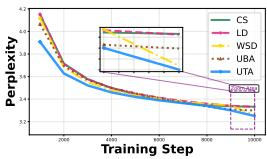  
(a) LLaMA-60M.

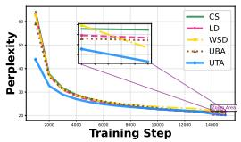  
(b) LLaMA-130M.

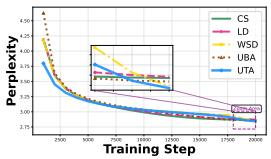

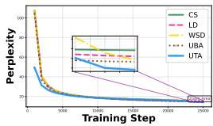  
(c) LLaMA-350M.

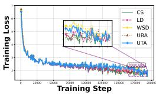  
(e) ImageNet-ResNet50

(d) LLaMA-1B.  
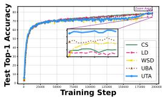  
(f) ImageNet-ResNet50.

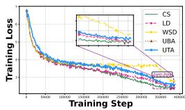  
(g) ImageNet-ViT-B.

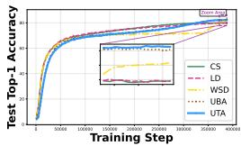  
(h) ImageNet-ViT-B.  
Figure 1: Training curves of LLaMA models, ResNet-50 and ViT-B.

Experimental details. All baselines follow the same standard configurations as established in prior work on LLaMA (Lialin et al., 2023; Zhao et al., 2024), ResNet (Wightman et al., 2021), and ViT (Touvron et al., 2021; Yu et al., 2022), ensuring a fair comparison. These configurations are widely adopted defaults that have been empirically validated as the baseline.

A key advantage of UTA lies in its parameter φ . While an optimal $\varphi _ { 0 }$ can further improve model performance, we intentionally fix its value across all tasks and architectures to ensure fair evaluation (Appendix H.2).

Comprehensive experimental details, such as computational resources, configurations, implementation specifics, are elaborated in Appendix H. Our implementation strictly follows the PyTorch official API. It is inherited from the base class torch.optim.lr\_LRDr.LRDcheduler. This design ensures native compatibility with the optimizer in torch.optim. Fully functional, production-ready code is publicly released (see Appendix H for link and implement details).

## 4.1 PERFORMANCE ON LANGUAGE TASK WITH LLAMA

We evaluate on four scales of the LLaMA architecture: 60M, 130M, 350M, and 1B parameters. For each model, we consider four distinct training budgets: 10K, 15K, 20K, and 25K training steps, covering regimes from extremely limited to moderately long training. To provide a granular view of the optimization dynamics, we report the validation perplexity at around 30%, 60%, and 100% of the total budget for each scale (e.g., for 1B model, at 8k, 16k, and final 25k steps). Performance is measured by validation perplexity, which directly reflects the model generative uncertainty and language modeling quality. Results are summarized in Tab. 1.

UTA consistently outperforms all baselines across model scales and most training checkpoints. This is not merely a marginal improvement at the final step, but a systematic acceleration throughout the entire training process. Firstly, UTA exhibits remarkably fast convergence in the early stages. At the 30% checkpoint, UTA achieves the lowest perplexity across all model sizes. These earlystage gains demonstrate UTA’s ability to establish a proper initial trajectory, which is critical for large-scale training where early decisions profoundly impact final performance. Most critically, UTA achieves best final perplexity across all four model scales, with absolute improvements from 0.23 (60M), 0.67 (130M), 0.08 (350M) and 0.30 (1B) perplexity units over the best baseline. Although the absolute final gains range from 0.23 to 0.67 perplexity, the relative improvement becomes increasingly meaningful as model size grows. Because for large-scale foundation models, even a 0.2-unit reduction in perplexity translates into a statistically significant leap in generation quality and reliability. We analyze that these consistent gains may be attributed to (i) near-optimal in shape by Theorem 3.2, and (ii) energy-calibrated in scale by subsection 3.3. It gives UTA the ability to dynamically balance exploration and stabilization during training.

Table 1: Perplexity $( e ^ { \mathrm { v a l i d a t i o n l o s s } } )$ on LLaMA 60M, 130M, 350M and 1B models. Lower is better (↓).
<table><tr><td rowspan="2">LRD</td><td>Model</td><td colspan="3">60M</td><td colspan="3">130M</td><td colspan="3">350M</td><td colspan="3">1B</td></tr><tr><td>Step</td><td>3k</td><td>6k</td><td>final</td><td>5k</td><td>10k</td><td>final</td><td>7k</td><td>14k</td><td>final</td><td>8k</td><td>16k</td><td>final</td></tr><tr><td>CS</td><td></td><td>35.79</td><td>29.91</td><td>28.03</td><td>27.12</td><td>22.71</td><td>21.76</td><td>22.03</td><td>18.24</td><td>17.62</td><td>20.14</td><td>16.32</td><td>15.41</td></tr><tr><td>LD</td><td></td><td>35.76</td><td>30.34</td><td>27.99</td><td>26.60</td><td>22.71</td><td>21.43</td><td>22.16</td><td>18.72</td><td>17.68</td><td>19.96</td><td>16.49</td><td>15.10</td></tr><tr><td>WSD</td><td></td><td>34.80</td><td>30.03</td><td>26.03</td><td>27.05</td><td>23.71</td><td>20.83</td><td>22.41</td><td>19.66</td><td>17.25</td><td>20.60</td><td>17.94</td><td>14.94</td></tr><tr><td>UBA</td><td></td><td>35.48</td><td>30.30</td><td>27.01</td><td>27.18</td><td>23.18</td><td>21.12</td><td>22.24</td><td>18.68</td><td>17.42</td><td>19.78</td><td>16.41</td><td>14.83</td></tr><tr><td>UTA</td><td></td><td>33.72</td><td>29.57</td><td>25.80</td><td>25.74</td><td>22.83</td><td>20.16</td><td>22.14</td><td>19.58</td><td>17.17</td><td>19.56</td><td>16.97</td><td>14.53</td></tr></table>

Table 2: ImageNet test top-1 Acc. (%) of different LRDs on ResNet50 and ViT-B for 300 epochs. Higher values indicates better performance (↑). Best results in bold.
<table><tr><td>LRD</td><td>CS</td><td>LD</td><td>WSD</td><td>UBA</td><td>UTA</td></tr><tr><td>ResNet-50</td><td> $7 8 . 3 4 _ { \pm 0 . 0 2 4 }$ </td><td> $7 7 . 9 0 { \scriptstyle \pm 0 . 0 2 8 }$ </td><td> $7 8 . 3 0 { \scriptstyle \pm 0 . 0 2 4 }$ </td><td> $7 8 . 3 8 _ { \pm 0 . 0 1 4 }$ </td><td> $7 8 . 7 3 _ { \pm 0 . 0 2 9 }$ </td></tr><tr><td>ViT-B</td><td> $7 9 . 9 2 _ { \pm 0 . 0 5 7 }$ </td><td> $7 9 . 9 6 _ { \pm 0 . 1 0 4 }$ </td><td> $8 1 . 1 4 _ { \pm 0 . 0 4 8 }$ </td><td> $8 2 . 0 5 _ { \pm 0 . 0 4 1 }$ </td><td> $\mathbf { 8 2 . 3 0 _ { \pm 0 . 0 3 7 } }$ </td></tr></table>

We also illustrate the perplexity evolution in Fig. 1. All curves show a characteristic rapid initial descent followed by gradual convergence. UTA consistently outperforms throughout training, demonstrating both faster initial convergence and superior final performance, while WSD and UBA exhibit competitive performance. These patterns align with theoretical expectations in Appendix G .

Moreover, we emphasize that the observed performance gains are not simply due to an increased average LR. In our experiments, the average LR of the WSD baseline was notably higher than that of our UTA, yet UTA still achieves better perplexity. The advantage stems from the optimal selection of intrinsic time in UTA, which promotes more effective learning and reduces the accumulation of noise during training, by Theorem G.2. This leads to improved generalization, ultimately resulting in superior model performance across different scales.

## 4.2 PERFORMANCE ON VISION TASK IMAGENET

We further validate the generalization of UTA on the ImageNet classification benchmark using ResNet-50 and ViT-B architectures. This selection tests generalization across model depth, width, and fundamental architectural biases. Fig. 1e, 1f, 1g and 1h depict training curves of ResNet-50 and ViT-B on ImageNet under different LRDs. For both architectures, UTA consistently achieves the highest final accuracy. UBA demonstrates competitive performance, while WSD and CS show similar but suboptimal convergence. Tab. 2 reports the test top-1 accuracy. UTA consistently achieves the highest accuracy across both models. Specifically, it improves ResNet-50 accuracy to 78.73%, outperforming the strongest baseline UBA (78.38%) by 0.35%. For ViT-B, UTA reaches 82.30%, surpassing the competitive UBA LRD (82.05%) by 0.25%. These gains are statistically meaningful given the scale and complexity of ImageNet. These consistent outperformance demonstrates that UTA generalizes beyond language modeling to vision tasks. It offers a robust and architecture-agnostic advantage in large-scale, real-world training scenarios, generalizing beyond language modeling to vision tasks.

## 4.3 ABLATION STUDY

Peak LR sensitivity analysis. To address the concern that a fixed peak LR may disadvantage baselines with different optimal LRs, we conduct a LR sweep on LLaMA-60M and 130M (Tab. 3). As expected, optimal peak LRs vary across LRDs. Nevertheless, under each LRD’s optimal LR, UTA consistently outperforms all baselines on both scales. On 60M, UTA achieves a best perplexity of 25.80, surpassing the best baseline UBA (26.26) by 0.46 and WSD (26.03) by 0.23. On 130M, UTA’s advantage is more pronounced, achieving 20.16, which outperforms WSD (20.82) by 0.66 and UBA (20.78) by 0.62. These margins, while modest in absolute terms, are meaningful in the context of language modeling validation loss.

Table 3: Perplexity $( e ^ { \mathrm { v a l i d a t i o n l o s s } } )$ of LLaMA-60M and LLaMA-130M under different peak LRs. Lower is better.
<table><tr><td>Model</td><td>LRD</td><td> $5 \times 1 0 ^ { - 4 }$ </td><td> $1 \times 1 0 ^ { - 3 }$ </td><td> $3 \times 1 0 ^ { - 3 }$ </td><td> $5 \times 1 0 ^ { - 3 }$ </td><td> $7 \times 1 0 ^ { - 3 }$ </td><td> $1 \times 1 0 ^ { - 2 }$ </td><td>Best from LR Sweep</td></tr><tr><td rowspan="5">60M</td><td>CS</td><td>32.61</td><td>28.03</td><td>26.91</td><td>26.91</td><td>26.31</td><td>26.57</td><td>26.31</td></tr><tr><td>LD</td><td>32.83</td><td>27.99</td><td>26.80</td><td>26.77</td><td>26.25</td><td>26.46</td><td>26.25</td></tr><tr><td>WSD</td><td>29.40</td><td>26.03</td><td>26.56</td><td>26.34</td><td>26.06</td><td>26.28</td><td>26.03</td></tr><tr><td>UBA</td><td>30.65</td><td>27.01</td><td>26.51</td><td>26.42</td><td>26.26</td><td>26.57</td><td>26.26</td></tr><tr><td>UTA</td><td>29.28</td><td>25.80</td><td>26.86</td><td>27.00</td><td>25.81</td><td>27.11</td><td>25.80</td></tr><tr><td rowspan="5">130M</td><td>CS</td><td>一</td><td>21.76</td><td>21.32</td><td>20.94</td><td>21.27</td><td>一</td><td>20.94</td></tr><tr><td>LD</td><td></td><td>21.43</td><td>21.18</td><td>20.90</td><td>21.24</td><td>一</td><td>20.90</td></tr><tr><td>WSD</td><td>一</td><td>20.83</td><td>21.16</td><td>20.82</td><td>21.39</td><td>一</td><td>20.82</td></tr><tr><td>UBA</td><td></td><td>21.12</td><td>20.78</td><td>21.25</td><td>21.92</td><td>一</td><td>20.78</td></tr><tr><td>UTA</td><td></td><td>20.16</td><td>21.36</td><td>21.65</td><td>22.39</td><td>一</td><td>20.16</td></tr></table>

Parameter analysis of $\varphi _ { 0 } .$ . We analyze UTA’s sensitivity to $\varphi _ { 0 }$ (equation 7) on LLaMA-60M and 130M (Tab.s 7–8). UTA exhibits robustness. On 60M, it achieves perplexity below 26.10 for 7 out of 10 tested values, with variation of only 0.24 across a 10-fold range; on 130M, performance remains nearly flat (20.63–20.67) across $\varphi _ { 0 } \in [ 0 . 1 5 , 0 . 5 ]$ . Performance improves modestly as $\varphi _ { 0 }$ decreases, consistent with our theory that smaller $\varphi _ { 0 }$ yields larger intrinsic steps. Crucially, UTA demonstrates a broader effective range than UBA, which degrades for $\varphi _ { 0 } < 0 . 5$ . We attribute this to UTA’s adaptive mechanism, which dynamically compensates for suboptimal $\varphi _ { 0 }$ choices, a capability absent in UBA. These results confirm that UTA is both performant and easy to use.

The effect of final LR in decay. Regarding the LRD implementations, some practices use decay to 10% of the peak LR, while others use 0%. Thus, we ablate the final LR ratio (10% vs. 0%) on LLaMA-60M and 130M (Tab. 5). Results show that decaying to 0% underperforms 10% across all methods and scales. Specifically, on 130M, LD degrades from 21.43 to 21.89, and UTA from 20.16 to 20.68. This suggests that aggressive decay prematurely saturates optimization under our moderate training budgets. Importantly, UTA remains the top performer under both 0% and 10% decay, surpassing the best baseline by 0.16 (60M) and 0.32 (130M). This confirms that UTA is robust to the choice of final LR, and that the default 10% decay setting does not unfairly advantage UTA.

The role of dynamic state-Aware mechanism. To validate the component efficacy of the dynamic mechanism in our UTA LRD, we conduct an ablation study comparing the full version (Ours-Full) against a static variant (Ours-Static). We conduct the ablation study on the CIFAR100-ResNet34, ImageNet-ResNet50, LLaMA60M and 130M. In the static variant, the dynamic part is removed. All other hyper-parameters and training settings remain identical. As shown in Tab. 9, UTA (Full) consistently outperforms its static counterpart. Moreover, the improvement is pronounced, suggesting that the dynamic state adaptation mechanism is a crucial component for LRD performance. More details and analyses can be found in Appendix I.3 and I.3.

Comparison with automatic LR methods. We additionally compare UTA against automatic LR methods, such as D-Adaptation (Defazio & Mishchenko, 2023) and Prodigy (Mishchenko & Defazio, 2023), which adjust LRs dynamically without predefined schedule shapes, in contrast to our main baselines. Results on LLaMA-60M, 130M, and 350M reported in Tab. 10 in Appendix. UTA matches D-Adaptation on 60M and outperforms it on 130M and 350M by 0.49 and 0.47, respectively. Against Prodigy, UTA achieves consistent improvements of 1.57, 1.10, and 0.80 across the three scales. We attribute UTA’s advantage to its shape design, which explicitly accounts for the training horizon, unlike methods that rely solely on gradient statistics.

Parameter-efficient fine-tuning scenario. To demonstrate that our LRD generalizes beyond fullparameter training, we evaluate it in a parameter-efficient fine-tuning (PEFT) scenario. We apply UTA to fine-tune a ViT-B model on CIFAR-100 and OxfordPets , using LoRA(Hu et al., 2022) (r = 16) as the PEFT method. Tab. 12 demonstrates UTA effectiveness in PEFT settings. UTA outperforms UBA on CIFAR100 and OxfordPets. These results confirm that UTA generalizes effectively to parameter-constrained optimization (see details in Appendix I.3).

## 5 CONCLUSION

We introduced UTA, a novel LRD framework that bridges the gap between theoretically principled shape design and practical, state-aware adaptation. Methodologically, UTA extends the ROLR from SGD to adaptive optimizers, particularly AdamW, overcoming a key limitation of prior work. Through the concept of intrinsic time and energy-calibrated adaptation, UTA automatically determines the LR in response to real-time optimization states. Experiments on vision and language models confirm that UTA consistently outperforms existing LRDs with minimal overhead. Comprehensive ablations confirm its robustness to hyper-parameters (peak LR, final decay ratio, φ ), the necessity of its dynamic mechanism, and its superiority over automatic LR methods. Overall, UTA not only delivers a plug-and-play LRD solution but also advances the broader understanding of state dependent optimization. In the future, potential extensions include adapting the framework to optimizers such as Conda (Wang et al., 2025) and SOAP (Vyas et al., 2025). Moreover, the optimal amplitude of LR fluctuations remains an open problem. A rigorous analysis could help choosing optimal fluctuation range, further improve model performance.

## REFERENCES

John Chen, Cameron Wolfe, and Tasos Kyrillidis. Rex: Revisiting budgeted training with an improved schedule. Proceedings of Machine Learning and Systems, 4:64–76, 2022.

Robert M Corless, Gaston H Gonnet, David EG Hare, David J Jeffrey, and Donald E Knuth. On the lambert w function. Advances in Computational mathematics, 5(1):329–359, 1996.

Ekin D Cubuk, Barret Zoph, Jonathon Shlens, and Quoc V Le. Randaugment: Practical automated data augmentation with a reduced search space. In Proceedings of the IEEE/CVF conference on computer vision and pattern recognition workshops, pp. 702–703, 2020.

Aaron Defazio and Konstantin Mishchenko. Learning-rate-free learning by d-adaptation. In International conference on machine learning, pp. 7449–7479. PMLR, 2023.

Aaron Defazio, Ashok Cutkosky, Harsh Mehta, and Konstantin Mishchenko. Optimal linear decay learning rate schedules and further refinements. arXiv preprint arXiv:2310.07831, 2023.

Alexey Dosovitskiy, Lucas Beyer, Alexander Kolesnikov, Dirk Weissenborn, Xiaohua Zhai, Thomas Unterthiner, Mostafa Dehghani, Matthias Minderer, Georg Heigold, Sylvain Gelly, et al. An image is worth 16x16 words: Transformers for image recognition at scale. arXiv preprint arXiv:2010.11929, 2020.

Alex Hagele, Elie Bakouch, Atli Kosson, Leandro Von Werra, Martin Jaggi, et al. Scaling laws¨ and compute-optimal training beyond fixed training durations. Advances in Neural Information Processing Systems, 37:76232–76264, 2024.

Kaiming He, Xiangyu Zhang, Shaoqing Ren, and Jian Sun. Deep residual learning for image recognition. In Proceedings of the IEEE conference on computer vision and pattern recognition, pp. 770–778, 2016.

Edward J Hu, Yelong Shen, Phillip Wallis, Zeyuan Allen-Zhu, Yuanzhi Li, Shean Wang, Lu Wang, Weizhu Chen, et al. Lora: Low-rank adaptation of large language models. ICLR, 1(2):3, 2022.

Shengding Hu, Yuge Tu, Xu Han, Chaoqun He, Ganqu Cui, Xiang Long, Zhi Zheng, Yewei Fang, Yuxiang Huang, Weilin Zhao, et al. Minicpm: Unveiling the potential of small language models with scalable training strategies. arXiv preprint arXiv:2404.06395, 2024.

Diederik P Kingma and Jimmy Ba. Adam: A method for stochastic optimization. arXiv preprint arXiv:1412.6980, 2014.

Atli Kosson, Bettina Messmer, and Martin Jaggi. Rotational equilibrium: How weight decay balances learning across neural networks. arXiv preprint arXiv:2305.17212, 2023.

Binghui Li, Fengling Chen, Zixun Huang, Lean Wang, and Lei Wu. Functional scaling laws in kernel regression: Loss dynamics and learning rate schedules. Advances in Neural Information Processing Systems, 2025.

Mengtian Li, Ersin Yumer, and Deva Ramanan. Budgeted training: Rethinking deep neural network training under resource constraints. arXiv preprint arXiv:1905.04753, 2019a.

Qianxiao Li, Cheng Tai, et al. Stochastic modified equations and adaptive stochastic gradient algorithms. In International Conference on Machine Learning, pp. 2101–2110. PMLR, 2017.

Qianxiao Li, Cheng Tai, et al. Stochastic modified equations and dynamics of stochastic gradient algorithms i: Mathematical foundations. Journal of Machine Learning Research, 20(40):1–47, 2019b.

Zhiyuan Li, Kaifeng Lyu, and Sanjeev Arora. Reconciling modern deep learning with traditional optimization analyses: The intrinsic learning rate. Advances in Neural Information Processing Systems, 33:14544–14555, 2020.

Zhiyuan Li, Sadhika Malladi, and Sanjeev Arora. On the validity of modeling SGD with stochastic differential equations (SDEs). Advances in Neural Information Processing Systems, 34:12712– 12725, 2021.

Vladislav Lialin, Sherin Muckatira, Namrata Shivagunde, and Anna Rumshisky. Stack more layers differently: High-rank training through low-rank updates. 2023.

Aixin Liu, Bei Feng, Bing Xue, Bingxuan Wang, Bochao Wu, Chengda Lu, Chenggang Zhao, Chengqi Deng, Chenyu Zhang, Chong Ruan, et al. Deepseek-v3 technical report. arXiv preprint arXiv:2412.19437, 2024.

Jingyuan Liu, Jianlin Su, Xingcheng Yao, Zhejun Jiang, Guokun Lai, Yulun Du, Yidao Qin, Weixin Xu, Enzhe Lu, Junjie Yan, et al. Muon is scalable for LLM training. arXiv preprint arXiv:2502.16982, 2025.

Ilya Loshchilov and Frank Hutter. SGDR: Stochastic gradient descent with warm restarts. In International Conference on Learning Representations, 2017.

Kairong Luo, Haodong Wen, Shengding Hu, Zhenbo Sun, Zhiyuan Liu, Maosong Sun, Kaifeng Lyu, and Wenguang Chen. A multi-power law for loss curve prediction across learning rate schedules. In International Conference on Learning Representations, 2025.

Konstantin Mishchenko and Aaron Defazio. Prodigy: An expeditiously adaptive parameter-free learner. arXiv preprint arXiv:2306.06101, 2023.

Rui Pan, Shizhe Diao, Jianlin Chen, and Tong Zhang. Extremebert: A toolkit for accelerating pretraining of customized bert. arXiv preprint arXiv:2211.17201, 2022a.

Rui Pan, Haishan Ye, and Tong Zhang. Eigencurve: Optimal learning rate schedule for SGD on quadratic objectives with skewed hessian spectrums. In International Conference on Learning Representations, 2022b.

Colin Raffel, Noam Shazeer, Adam Roberts, Katherine Lee, Sharan Narang, Michael Matena, Yanqi Zhou, Wei Li, and Peter J Liu. Exploring the limits of transfer learning with a unified text-to-text transformer. Journal of machine learning research, 21(140):1–67, 2020.

Fabian Schaipp, Alexander Hagele, Adrien Taylor, Umut Simsekli, and Francis Bach. The surprising¨ agreement between convex optimization theory and learning-rate scheduling for large model training. arXiv preprint arXiv:2501.18965, 2025.

Leslie N Smith. Cyclical learning rates for training neural networks. In 2017 IEEE winter conference on applications of computer vision, pp. 464–472. IEEE, 2017.

Leslie N Smith and Nicholay Topin. Super-convergence: Very fast training of neural networks using large learning rates. In Artificial intelligence and machine learningfor multi-domain operations applications, volume 11006, pp. 369–386. SPIE, 2019.

Anda Tang, Yiming Dong, Yutao Zeng, Zhouchen Lin, et al. Stepsize anything: A unified learning rate schedule for budgeted-iteration training. Advances in Neural Information Processing Systems, 38:150160–150209, 2026.

Kimi Team, Yifan Bai, Yiping Bao, Guanduo Chen, Jiahao Chen, Ningxin Chen, Ruijue Chen, Yanru Chen, Yuankun Chen, Yutian Chen, et al. Kimi k2: Open agentic intelligence. arXiv preprint arXiv:2507.20534, 2025.

Howe Tissue, Venus Wang, and Lu Wang. Scaling law with learning rate annealing. Advances in Neural Information Processing Systems, 2025.

Hugo Touvron, Matthieu Cord, Matthijs Douze, Francisco Massa, Alexandre Sablayrolles, and Herve´ Jegou. Training data-efficient image transformers & distillation through attention. In´ International conference on machine learning, pp. 10347–10357. PMLR, 2021.

Nikhil Vyas, Depen Morwani, Rosie Zhao, Itai Shapira, David Brandfonbrener, Lucas Janson, and Sham Kakade. Soap: Improving and stabilizing shampoo using adam for language modeling. In International Conference on Learning Representations, volume 2025, pp. 93423–93444, 2025.

Junjie Wang, Pan Zhou, Yiming Dong, Huan Li, Jia Li, Xun Zhou, Qicheng Lao, Cong Fang, and Zhouchen Lin. Conda: Column-normalized adam for training large language models faster. arXiv preprint arXiv:2509.24218, 2025.

Kaiyue Wen, Zhiyuan Li, Jason Wang, David Hall, Percy Liang, and Tengyu Ma. Understanding warmup-stable-decay learning rates: A river valley loss landscape perspective. arXiv preprint arXiv:2410.05192, 2024.

Ross Wightman, Hugo Touvron, and Herve J ´ egou. Resnet strikes back: An improved training ´ procedure in timm. arXiv preprint arXiv:2110.00476, 2021.

Weihao Yu, Mi Luo, Pan Zhou, Chenyang Si, Yichen Zhou, Xinchao Wang, Jiashi Feng, and Shuicheng Yan. Metaformer is actually what you need for vision. In Proceedings ofthe IEEE/CVF conference on computer vision and pattern recognition, pp. 10819–10829, 2022.

Sangdoo Yun, Dongyoon Han, Seong Joon Oh, Sanghyuk Chun, Junsuk Choe, and Youngjoon Yoo. Cutmix: Regularization strategy to train strong classifiers with localizable features. In Proceedings of the IEEE/CVF international conference on computer vision, pp. 6023–6032, 2019.

Xiaohua Zhai, Alexander Kolesnikov, Neil Houlsby, and Lucas Beyer. Scaling vision transformers. In Proceedings of the IEEE/CVF conference on computer vision and pattern recognition, pp. 12104–12113, 2022.

Hongyi Zhang, Moustapha Cisse, Yann N Dauphin, and David Lopez-Paz. mixup: Beyond empirical risk minimization. arXiv preprint arXiv:1710.09412, 2017.

Jiawei Zhao, Zhenyu Zhang, Beidi Chen, Zhangyang Wang, Anima Anandkumar, and Yuandong Tian. Galore: Memory-efficient LLM training by gradient low-rank projection. arXiv preprint arXiv:2403.03507, 2024.

Pan Zhou, Xingyu Xie, Zhouchen Lin, Kim-Chuan Toh, and Shuicheng Yan. Win: Weight-decayintegrated nesterov acceleration for faster network training. Journal of Machine Learning Research, 25(83):1–74, 2024.

## CONTENTS

1 Introduction 1   
2 Preliminary 3   
3 Methodology 3   
3.1 Problem statement 3   
3.2 Segment-wise continuous analysis 4   
3.3 Regularized energy evolution via intrinsic time 5   
3.4 Derived LRD 6   
3.5 Complexity analysis . 6   
4 Experiments 6   
4.1 Performance on language task with LLaMA 7   
4.2 Performance on vision task ImageNet 8   
4.3 Ablation study . 8   
5 Conclusion 10   
A Notation 15   
B Assumption 17   
C Problem statement 17   
D Optimal shape of problem solution 18   
E Regularized energy evolution via intrinsic time 20   
F Derived LRD 25   
G Theoretical analysis 29   
G.1 Functional scaling laws for LRDs 29   
G.2 Analytical framework for our LRD 29   
H Experimental implementation details 32   
H.1 Baselines 32   
H.2 LRD setting 33   
H.3 Model architectures and hyper-parameters 33   
H.4 Hardware and software environment 34   
H.5 Datasets . 34   
H.6 Code and reproducibility 34   
I Experimental results 35   
I.1 Performance on language model-LLaMA 35   
I.2 Performance on ImageNet 35   
I.3 Ablation study . 37   
I.4 Discussion of UTA characteristics 41   
J Related work 41

## APPENDIX

## A NOTATION

For ease of reference, we summarize the main notation used throughout the paper.

## Optimization and training.

<table><tr><td>Symbol</td><td>Meaning</td></tr><tr><td> $W \in \mathbb { R } ^ { N }$ </td><td>model parameters (a single vector)</td></tr><tr><td>t</td><td>current training step (physical iteration index)</td></tr><tr><td> $T$ </td><td>total number of training iterations</td></tr><tr><td> $\tau$ </td><td>training horizon,  $[ 0 , \tau ]$ </td></tr><tr><td> $\mathcal { L } ( \cdot )$ </td><td>training loss function</td></tr><tr><td> $\xi$ </td><td>data sample;  $\xi _ { t }$  denotes the sample at step t</td></tr><tr><td> $D$ </td><td>training dataset</td></tr><tr><td> $\mathcal { F }$ </td><td>function class (network structures, datasets, etc.)</td></tr><tr><td> $f ( W , \xi )$ </td><td>neural network parameterized by  $W$  on data  $\xi$ </td></tr><tr><td> $\nabla \mathcal { L } ( W _ { t } )$ </td><td>full gradient at step t</td></tr><tr><td> $\nabla \mathcal { L } ( W _ { t } , \xi _ { t } )$ </td><td>stochastic gradient at step t</td></tr><tr><td> $\delta _ { t }$ </td><td>gradient noise,  $\delta _ { t } : = \nabla \mathcal { L } ( W _ { t } , \xi _ { t } ) - \nabla \mathcal { L } ( W _ { t } )$ </td></tr></table>

## Optimizer and learning rate.

<table><tr><td>Symbol</td><td>Meaning</td></tr><tr><td> $\eta _ { t }$ </td><td>learning rate at step t</td></tr><tr><td> $\eta ( \cdot )$ </td><td>continuous-time learning rate</td></tr><tr><td>ηmin, ηmax</td><td>minimum and maximum learning rates</td></tr><tr><td> $\eta _ { \mathrm { m i n } } ^ { ( k ) } , \eta _ { \mathrm { m a x } } ^ { ( k ) }$ </td><td>range parameters on segment k</td></tr><tr><td> $\phi ( \cdot )$ </td><td>learning rate decay (LRD) as a function of physical time</td></tr><tr><td> $P ( t )$ </td><td>optimizer-specific preconditioner  $( { \bf e . g . } , P ( t ) = I$  for SGD)</td></tr><tr><td> $m , v _ { t }$ </td><td>first and second moment estimates in Adam</td></tr><tr><td> $\hat { m } _ { t } , \hat { v } _ { t }$ </td><td>bias-corrected moments in Adam</td></tr><tr><td> $\beta _ { 1 } , \beta _ { 2 }$ </td><td>Adam momentum coefficients</td></tr><tr><td> $\epsilon$ </td><td>small constant for numerical stability</td></tr><tr><td> $\lambda$ </td><td>weight decay coefficient</td></tr><tr><td> $B$ </td><td>batch size</td></tr></table>

Segments and intrinsic time.

<table><tr><td>Symbol</td><td>Meaning</td></tr><tr><td> $K$ </td><td>number of segments</td></tr><tr><td> $[ T _ { k } , T _ { k + 1 } ]$ </td><td>the k-th segment</td></tr><tr><td> $\Delta T _ { k }$ </td><td>segment length,  $\Delta T _ { k } : = T _ { k + 1 } - T _ { k }$ </td></tr><tr><td> $k$ </td><td>segment index; under iteration-wise extension, k coincides with t</td></tr><tr><td> $U _ { k }$ </td><td> $\begin{array} { r } { , U _ { k } : = \int _ { T _ { k } } ^ { T _ { k + 1 } } \eta ( t ) \mathrm { d } t } \end{array}$  intrinsic time of segment k,</td></tr><tr><td> $U _ { t } ^ { * }$ </td><td>energy-optimal intrinsic time at step t</td></tr><tr><td> $\bar { T } ( \tau )$ </td><td>intrinsic-time reparameterization,  $\begin{array} { r } { \bar { T } ( \tau ) : = \int _ { T _ { k } } ^ { \tau } \eta ( z ) \mathrm { d } z } \end{array}$ </td></tr><tr><td> $\bar { T } ^ { - 1 } ( t )$ </td><td>inverse intrinsic-time map</td></tr><tr><td> $\varphi$ </td><td>curvature parameter of the UBA-equivalent family</td></tr><tr><td> $\varphi _ { k } , \varphi _ { t }$ </td><td>curvature parameter on segment k / at step t</td></tr><tr><td> $\varphi _ { 0 }$ </td><td>hyper-parameter in the UTA plug-in estimate</td></tr><tr><td> $\psi$ </td><td>normalized intrinsic time,  $\psi : = U _ { k } ^ { * } / \Delta T _ { k }$ </td></tr><tr><td> $\theta _ { t , k }$ </td><td>phase variable of the UBA-equivalent family</td></tr><tr><td> $\theta ( t )$ </td><td>phase variable in the global UTA LRD</td></tr></table>

## Energy evolution and curvature.

<table><tr><td>Symbol</td><td>Meaning</td></tr><tr><td> $\bar { W } ^ { ( k ) }$ </td><td>local minimum in segment k</td></tr><tr><td> $H _ { k }$ </td><td>Hessian at the local minimum,  $H _ { k } : = H _ { f } ^ { ( k ) }$ </td></tr><tr><td> $E ( t )$ </td><td> $E ( t ) : = \frac { 1 } { 2 } \| e ( t ) \| ^ { 2 }$  energy function,</td></tr><tr><td> $e ( t )$ </td><td>transformed deviation,  $\boldsymbol { e } ( t ) ^ { \top } : = H _ { k } ^ { 1 / 2 } ( W ( t ) - \bar { W } ^ { ( k ) } )$ </td></tr><tr><td> $\nu _ { \ell } ^ { ( k ) }$ </td><td>spectral lower bound of  $H _ { k } ^ { 1 / 2 } P ( t ) H _ { k } ^ { 1 / 2 }$ </td></tr><tr><td> $\alpha$ </td><td>noise intensity bound</td></tr><tr><td> $\Sigma$ </td><td>covariance of the gradient noise</td></tr><tr><td> $B ( t )$ </td><td>standard Brownian motion</td></tr><tr><td> $\mu ( t )$ </td><td>integrating factor in the SDE analysis</td></tr><tr><td> $\varepsilon$ </td><td>target accuracy in the plug-in estimate</td></tr></table>

## Functional scaling law (FSL).

## Baselines and models.

<table><tr><td>Symbol</td><td>Meaning</td></tr><tr><td> $M$ </td><td>model size (number of parameters)</td></tr><tr><td> $\beta$ </td><td>model capacity exponent</td></tr><tr><td> $s$ </td><td>task difficulty exponent</td></tr><tr><td> $\mathcal { E } _ { t }$ </td><td>expected loss at intrinsic training time t</td></tr><tr><td> $\sigma ^ { 2 }$ </td><td>label noise variance</td></tr><tr><td> $\kappa ( \cdot )$ </td><td>forgetting kernel</td></tr><tr><td> $e ( t )$ </td><td>learning term,  $e ( t ) : = ( 1 + t ) ^ { - s }$ </td></tr><tr><td> $\gamma ( \cdot )$ </td><td>noise intensity as a function of intrinsic time</td></tr><tr><td> $T _ { \mathrm { m a x } }$ </td><td>total number of training steps in the FSL analysis</td></tr><tr><td> $T _ { 1 } , T _ { 2 }$ </td><td>durations of the stable and decay stages in the UTA FSL analysis</td></tr><tr><td> $a , b$ </td><td> $a : = \frac { 1 } { 2 } ( \eta _ { \mathrm { m a x } } + \eta _ { \mathrm { m i n } } ) , b : = \frac { 1 } { 2 } ( \eta _ { \mathrm { m a x } } - \eta _ { \mathrm { m i n } } )$  auxiliary constants,</td></tr><tr><td> $\hat { a } , \hat { b }$ </td><td>scaled constants in the noise-term estimate</td></tr><tr><td> $\eqsim$ </td><td>equivalence up to a constant factor</td></tr><tr><td>UBA</td><td>Universal Budget Aware LRD</td></tr><tr><td>UTA</td><td>Universal Training Adaptive LRD</td></tr><tr><td>CS</td><td>cosine decay LRD</td></tr><tr><td>LD</td><td>linear decay LRD</td></tr><tr><td>WSD</td><td>warmup-stable-decay LRD</td></tr><tr><td>LLaMA-60M/130M/350M/1B</td><td>model scales used in the language experiments</td></tr><tr><td>ResNet-50</td><td>convolutional vision backbone</td></tr><tr><td>ViT-B</td><td>vision transformer backbone</td></tr><tr><td>LoRA</td><td>low-rank adaptation for PEFT</td></tr><tr><td>PEFT</td><td>parameter-efficient fine-tuning</td></tr></table>

## B ASSUMPTION

We adopt assumptions including local quadratic(inherited from the framework (Tang et al., 2026)) and continuous-time (standard for analyzing optimizer dynamics (Li et al., 2017; 2025)) . These assumptions provide intuition and design principles that motivate UTA in Section 3.

We also know that deep learning training landscapes are often highly non-convex and dynamic, so these assumptions may not fully reflect real-world behavior. Importantly, UTA’s robust optimization formulation mitigates approximation errors by optimizing for worst-case scenarios. This ensures the method remains effective even when assumptions are partially violated, as supported by our empirical results.

## C PROBLEM STATEMENT

Let $f ( W , \xi )$ denote neural network parameterized by parameters $W \in \mathbb { R } ^ { N }$ on the data $\xi . \xi$ denote the data sampling on the dataset $D ,$ and let $\mathcal { F }$ be a function class. Let $\mathcal { L }$ be the loss function, $T$ be a maximum number of training iterations, and t be the current learning step.

We seek learning rates $\{ \eta _ { t } \} _ { t = 0 } ^ { T - 1 }$ that minimize loss of worst-case among the training process under a generalized update rule governed by optimizer-specific dynamics. The global min-max view is

$$
\begin{array} { r l } & { \underset { \eta _ { 1 } , \eta _ { 2 } , \ldots , \eta _ { T - 1 } } { \operatorname* { m i n } } \underset { f \in \mathcal { F } } { \operatorname* { m a x } } \ \mathcal { L } ( f ( W _ { T } , \xi ) ) } \\ & { \quad \mathrm { s . t . } \quad W _ { t + 1 } = W _ { t } - \eta _ { t } \cdot P ( t ) \nabla \mathcal { L } ( W ( t ) ) , } \end{array}\tag{9}
$$

where $P ( t )$ captures the optimizer-specific state dynamics, such as scaling or preconditioning, and may be chosen to represent different optimization algorithms within the same generalized framework. For instance, SGD corresponds to $\begin{array} { r } { P ( t ) = I . } \end{array}$ . Adam is recovered by defining $P ( t )$ such that $P ( t ) \nabla \mathcal { L } ( W ( t ) ) = m _ { t } / ( \sqrt { v _ { t } } + \epsilon )$ , where $m _ { t }$ and $v _ { t }$ are the first and second moment estimates following Adam update rules. Other adaptive methods like RMSProp or AdaGrad can be represented analogously through appropriate definitions of $P ( t )$ based on their state variables. This paper primarily focuses on the case where $P ( t )$ implements the Adam dynamics.

This paper specializes the framework to the Adam optimizer for two compelling reasons. First, the unique $\dot { P } ( t )$ of Adam encapsulates a complex yet representative interplay of momentum and adaptive scaling mechanisms. It combines first-moment momentum with second-moment adaptive scaling, represents a complex and widely-used class of optimization dynamics. Second, as the default optimizer in much of current deep learning practice, its performance is of paramount practical importance. Analyzing Adam thus serves as a highly relevant and sufficiently comprehensive case study for our theory. Then the optimization problem is as follows,

$$
\begin{array} { r l } & { \underset { \eta _ { 1 } , \eta _ { 2 } , \ldots , \eta _ { T - 1 } } { \operatorname* { m i n } } \ \underset { f \in \mathcal { F } } { \operatorname* { m a x } } \ \mathcal { L } ( f ( W _ { T } , \xi ) ) } \\ & { \mathrm { s . t . } \quad W _ { t + 1 } = W _ { t } - \eta _ { t } \cdot \frac { \hat { m } _ { t } } { \sqrt { \hat { v } _ { t } } + \epsilon } , } \end{array}\tag{10}
$$

where $m _ { t } = \beta _ { 1 } m _ { t - 1 } + ( 1 - \beta _ { 1 } ) \nabla \mathcal { L } ( W _ { t } ) , \quad v _ { t } = \beta _ { 2 } v _ { t - 1 } + ( 1 - \beta _ { 2 } ) \nabla \mathcal { L } ( W _ { t } ) ^ { \odot 2 }$ , and $\begin{array} { r l } { \hat { m } _ { t } } & { { } = } \end{array}$ ${ m _ { t } } / ( 1 - \beta _ { 1 } ^ { t } ) , \hat { v } _ { t } = { v _ { t } } / ( 1 - \beta _ { 2 } ^ { t } )$ denote the bias-corrected moments, ⊙ is the element-wise operation.

## D OPTIMAL SHAPE OF PROBLEM SOLUTION

Lemma D.1. Under the generalized gradient flow $\dot { W } ( \tau ) = - \eta ( \tau ) P ( \tau ) \nabla \mathcal { L } ( W ( \tau ) )$ ), where $P ( \tau )$ denotes precondition. For all $t \in [ T _ { k } , \breve { T } _ { k + 1 } ]$

$$
\begin{array} { r } { \| W ( t ) - W ( T _ { k } ) \| \le U _ { k } \cdot C _ { P } ^ { ( k ) } \cdot G _ { k } \le \eta _ { \operatorname* { m a x } , k } \Delta T _ { k } \cdot C _ { P } ^ { ( k ) } \cdot G _ { k } , } \end{array}\tag{11}
$$

where $\begin{array} { r l r l r } { G _ { k } } & { : = } & { \operatorname* { s u p } _ { \tau \in [ T _ { k } , T _ { k + 1 } ) } \Vert \nabla \mathcal { L } ( W ( \tau ) ) \Vert , } & { C _ { P } ^ { ( k ) } } & { : = } & { \operatorname* { s u p } _ { \tau \in [ T _ { k } , T _ { k + 1 } ) } \Vert P ( \tau ) \Vert } \end{array}$ , ηmax,k := $\mathrm { s u p } _ { t \in [ T _ { k } , T _ { k + 1 } ] } \eta ( t )$

This Lemma shows that segment radius can be controlled by segment length.

Proof. By integrating the flow $\dot { W } ( \tau ) = - \eta ( \tau ) P ( \tau ) \nabla \mathcal { L } ( W ( \tau ) )$ , we have

$$
W ( t ) - W ( T _ { k } ) = \int _ { T _ { k } } ^ { t } \dot { W } ( s ) \mathrm { d } s ,\tag{12}
$$

so

$$
\| W ( t ) - W ( T _ { k } ) \| \leq \int _ { T _ { k } } ^ { t } \eta ( \tau ) \| P ( \tau ) \nabla \mathcal { L } ( W ( \tau ) ) \| \mathrm { d } \tau \leq U _ { k } \cdot C _ { P } ^ { ( k ) } \cdot G _ { k } , \qquad t \in [ T _ { k } , T _ { k + 1 } ) ,\tag{13}
$$

The segment-radius bound then follows from the triangle inequality: $\| W ( t ) - \bar { W } ^ { ( k ) } \| \leq \| W ( t ) -$ $W ( T _ { k } ) \| + \| W ( T _ { k } ) - \bar { W } ^ { ( k ) } \| \le V _ { k } \Delta T _ { k } + U _ { k } \cdot C _ { P } ^ { ( k ) } \cdot G _ { k }$ □

Assumption D.2 (Locally Lipschitz gradients). On the segment $[ T _ { k } , T _ { k + 1 } )$ , the gradient is Lipschitz with constant $L _ { g } ^ { ( k ) } , \mathrm { i . e . , } \forall W , W ^ { \prime } \in \{ W ( \tau ) : \tau \in [ T _ { k } , T _ { k + 1 } ) \} , \| \dot { \nabla } \mathcal { L } ( W ) - \nabla \mathcal { L } ( W ^ { \prime } ) \| \le L _ { g } ^ { ( k ) } \| W - \| \nabla L _ { g } ^ { ( k ) } \| _ { L ^ { 1 } ( W ) } \| _ { L ^ { 1 } ( W ) } \| _ { L ^ { 1 } ( W ) } \le \| X _ { g } \| _ { L ^ { 1 } ( W ) } ,$ $W ^ { \prime } \|$

Combining Assumption D.2 with equation 11, we obtain the segment-wise gradient drift bound

$$
\begin{array} { r l } & { \underset { \tau \in [ T _ { k } , T _ { k + 1 } ) } { \operatorname* { s u p } } \Vert \nabla \mathcal { L } ( W ( \tau ) ) - \nabla \mathcal { L } ( W ( T _ { k } ) ) \Vert } \\ & { \leq L _ { g } ^ { ( k ) } \underset { \tau \in [ T _ { k } , T _ { k + 1 } ) } { \operatorname* { s u p } } \Vert W ( \tau ) - W ( T _ { k } ) \Vert \leq L _ { g } ^ { ( k ) } G _ { k } C _ { P } ^ { ( k ) } U _ { k } . } \end{array}\tag{14}
$$

Since $U _ { k } \le \Delta T _ { k } \cdot \operatorname* { m a x } _ { t \in [ T _ { k } , T _ { k + 1 } ) } \eta _ { t }$ , if the segment is sufficiently small, the difference of gradients can be bounded.

Lemma D.3. On segment $[ T _ { k } , T _ { k + 1 } )$ with $\Delta T _ { k } : = T _ { k + 1 } - T _ { k }$ , let mˆ t be the bias-corrected first moment in Adam and assume:(1) the gradient along the trajectory is ${ \cal L } _ { g } ^ { ( k ) }$ -Lipschitz in time;(2) the gradient norm is bounded by $G _ { k } , i . e . , \mathsf { \breve { \| } } \nabla \mathcal { L } _ { t } \| \le G _ { k }$ for all $t \in [ T _ { k } , T _ { k + 1 } )$ .

Then the bias-corrected momentum $\hat { m } _ { t }$ tracks the true gradient $\nabla { \mathcal { L } } _ { t }$ with a segment-wise error bound

$$
\| \nabla \mathcal { L } _ { t } - \hat { m } _ { t } \| \le L _ { g } ^ { ( k ) } C _ { P } ^ { ( k ) } G _ { k } \cdot \Delta T _ { k } \cdot \operatorname* { m a x } _ { t \in [ T _ { k } , T _ { k + 1 } ) } \eta _ { t } \frac { \beta _ { 1 } } { 1 - \beta _ { 1 } } .\tag{15}
$$

Proof. It is noted that the first-order moment $\hat { m } _ { t }$ is a convex combination of recent gradients as follows,

$$
\hat { m } _ { t } = \sum _ { i = 0 } ^ { t - 1 } \frac { ( 1 - \beta _ { 1 } ) \beta _ { 1 } ^ { i } } { 1 - \beta _ { 1 } ^ { t } } \nabla \mathcal { L } _ { ( } t - i ) , \quad \sum _ { i = 0 } ^ { t - 1 } \frac { ( 1 - \beta _ { 1 } ) \beta _ { 1 } ^ { i } } { 1 - \beta _ { 1 } ^ { t } } = 1 .\tag{16}
$$

Combining with equation 14, we have

$$
\begin{array} { r l } { \| \nabla \mathcal { L } _ { t } - \hat { m } _ { t } \| = \left\| \nabla \mathcal { L } _ { t } - \displaystyle \sum _ { i = 0 } ^ { t - 1 } \frac { ( 1 - \beta _ { 1 } ) \beta _ { 1 } ^ { i } } { 1 - \beta _ { 1 } ^ { i } } \nabla \mathcal { L } _ { ( t } - i ) \right\| } & { } \\ & { = \left\| \displaystyle \sum _ { i = 0 } ^ { t - 1 } \frac { ( 1 - \beta _ { 1 } ) \beta _ { 1 } ^ { i } } { 1 - \beta _ { 1 } ^ { i } } ( \nabla \mathcal { L } _ { t } - \nabla \mathcal { L } _ { ( t } - i ) ) \right\| } \\ & { \leq \displaystyle \sum _ { i = 0 } ^ { t - 1 } \frac { ( 1 - \beta _ { 1 } ) \beta _ { 1 } ^ { i } } { 1 - \beta _ { 1 } ^ { i } } \cdot L _ { \sigma } ^ { ( k ) } G _ { k } \cdot \Delta T _ { k } \cdot \displaystyle \operatorname* { m a x } _ { t \in [ T _ { k } , T _ { k } ] + 1 } ^ { \operatorname* { m a x } } \eta _ { t } \cdot i } \\ & { = L _ { \sigma } ^ { ( k ) } C _ { P } ^ { ( k ) } G _ { k } \cdot \Delta T _ { k } \cdot \displaystyle \operatorname* { m a x } _ { t \in [ T _ { k } , T _ { k } ] + 1 } \eta _ { t } \cdot \frac { ( 1 - \beta _ { 1 } ) } { 1 - \beta _ { 1 } ^ { k } } \frac { \beta _ { 1 } } { ( 1 - \beta _ { 1 } ) ^ { 2 } } + ( l - 1 ) \beta _ { 1 } ^ { k + 1 } } \\ & { \leq L _ { \sigma } ^ { ( k ) } C _ { P } ^ { ( k ) } G _ { k } \cdot \Delta T _ { k } \cdot \displaystyle \operatorname* { m a x } _ { t \in [ T _ { k } , T _ { k } ] + 1 } ^ { \operatorname* { m a x } } \eta _ { 1 } \frac { \beta _ { 1 } } { 1 - \beta _ { 1 } } . } \end{array}\tag{17}
$$

It yields the claim. Hence on a short segment, $\hat { m } _ { t }$ ≈ $\nabla { \mathcal { L } } _ { t }$

Theorem 3.2 [Optimal UBA-equivalent shape on a segment] Consider the min-max problem 10 on segment k, and assume that the step sizes are constrained to lie in the interval $[ \eta _ { \mathrm { m i n } } ^ { ( k ) } , \eta _ { \mathrm { m a x } } ^ { ( k ) } ]$ . There exists an optimal shape ofstep sizes that minimizes the worst-case loss. This optimal shape belongs to the UBA-equivalent family for some curvature parameter $\varphi _ { k } > 0$

Proof. By Lemma D.3, it makes precise the intuition that on a short and smooth segment the Adam momentum is close to the current gradient.

The bound

$$
\varepsilon _ { g } ^ { ( k ) } : = L _ { g } ^ { ( k ) } C _ { P } ^ { ( k ) } G _ { k } \cdot \Delta T _ { k } \operatorname* { m a x } _ { t \in [ T _ { k } , T _ { k + 1 } ) } \eta _ { t } \frac { \beta _ { 1 } } { 1 - \beta _ { 1 } } .\tag{18}
$$

depends linearly on the segment length $\Delta T _ { k }$ and on the maximal stepsize on the segment. Thus, by choosing $\Delta T _ { k }$ small and avoiding excessively large $\eta _ { t }$ , we can make $\varepsilon _ { g } ^ { ( k ) }$ small. In other words, on sufficiently short segments we may treat the Adam momentum $\hat { m } _ { t }$ as a perturbation of the true gradient $\nabla { \mathcal { L } } _ { t }$ , with a perturbation norm controlled by $\varepsilon _ { g } ^ { ( k ) }$

Thus, by Lemma D.3 and following the local quadratic modeling in prior work (Tang et al., 2026), we can approximate the constraint in UBA framework(Tang et al., 2026) as follows,

$$
W _ { t + 1 } - \bar { W } ^ { ( k ) } \approx ( I - \eta _ { t } P _ { t } H _ { k } ) ( W _ { t } - \bar { W } ^ { ( k ) } ) ,
$$

where $\begin{array} { r } { P _ { t } : = \frac { 1 } { \sqrt { \hat { v } _ { t } } + \epsilon } } \end{array}$ . Denote $P _ { t } H _ { k } : = \bar { H _ { k } }$ , by iteratively applying this equation, we obtain

$$
W _ { T _ { k + 1 } } - \bar { W } ^ { ( k ) } = \left( I - \eta _ { T _ { k + 1 } - 1 } \bar { H } _ { k } \right) \cdot \cdot \cdot \left( I - \eta _ { T _ { k } + 1 } \bar { H } _ { k } \right) \left( W _ { T _ { k } + 1 } - \bar { W } ^ { ( k ) } \right) .\tag{19}
$$

Since the matrix $\bar { H _ { k } } \in \mathbb { R } ^ { N \times N }$ possesses N eigenvalues $\lambda _ { 1 } ^ { ( k ) } ( f ( \xi ) ) , \lambda _ { 2 } ^ { ( k ) } ( f ( \xi ) ) , \cdots , \lambda _ { N } ^ { ( k ) } ( f ( \xi ) )$ abbreviated as ${ \lambda } _ { i } ^ { ( k ) }$ , which satisfy $\lambda _ { l } ^ { ( k ) } \leq \lambda _ { i } ^ { ( k ) } ( f ( \xi ) ) \leq \lambda _ { u } ^ { ( k ) }$ for all i. Here, ${ \lambda } _ { l } ^ { ( k ) }$ and ${ \lambda } _ { u } ^ { ( k ) }$ denote the bounds on the non-zero eigenvalues of the $\bar { H _ { k } }$ of optimum in k-th segment. Moreover, there exist N linearly independent eigenvectors $u _ { 1 } ^ { ( k ) } ( f ( \xi ) ) , u _ { 2 } ^ { ( k ) } ( f ( \xi ) ) , \cdots , u _ { N } ^ { ( k ) } ( f ( \xi ) )$ abbreviated as $u _ { i } ^ { ( k ) }$ , which can form the basis for the N dimension vector space. Then we have $\begin{array} { r l } { \bar { H _ { k } } u _ { i } ^ { ( k ) } = \lambda _ { i } ^ { ( k ) } { u _ { i } ^ { ( k ) } } } & { { } ( i = 1 } \end{array}$ $1 , 2 , \cdots , N )$ and the initial deviation from the optimal solution can be expressed as $W _ { T _ { k } } - \bar { W } ^ { ( k ) } =$ $\sum _ { i = 1 } ^ { N } s _ { i } ^ { ( k ) } u _ { i } ^ { ( k ) }$ where $s _ { i } ^ { ( k ) }$ are the coefficients corresponding to the eigenvector components. Thus, we

obtain

$$
\begin{array} { r l r } {  {  W _ { T _ { k + 1 } } - \bar { W } ^ { ( k ) }   _ { 2 } ^ { 2 } = \sum _ { i = 1 } ^ { N } ( s _ { i } ^ { ( k ) } ) ^ { 2 } \| u _ { i } ^ { ( k ) } \| _ { 2 } ^ { 2 } { [ \prod _ { t = 1 } ^ { T _ { k + 1 } } ( 1 - \eta _ { t } \lambda _ { i } ^ { ( k ) } ) ] } ^ { 2 } } } \\ & { } & { \leq \sum _ { i = 1 } ^ { N } ( s _ { i } ^ { ( k ) } ) ^ { 2 } \| u _ { i } ^ { ( k ) } \| _ { 2 } ^ { 2 } \underset { \lambda _ { i } ^ { ( k ) } \leq \lambda _ { i } ^ { ( k ) } \leq \lambda _ { i } ^ { ( k ) } } { \operatorname* { m a x } } [ \prod _ { t = 1 + T _ { k } } ^ { T _ { k + 1 } } ( 1 - \eta _ { t } \lambda _ { i } ^ { ( k ) } ) ] ^ { 2 } } \\ & { } & { = \underset { \lambda _ { i } ^ { ( k ) } \leq \lambda _ { i } ^ { ( k ) } \leq \lambda _ { i } ^ { ( k ) } } { \operatorname* { m a x } } [ \prod _ { t = 1 + T _ { k } } ^ { T _ { k + 1 } } ( 1 - \eta _ { t } \lambda _ { i } ^ { ( k ) } ) ] ^ { 2 } \| W _ { T _ { k } } - \bar { W } ^ { ( k ) } \| _ { 2 } ^ { 2 } } \end{array}\tag{20}
$$

We observe that this formulation shares the same optimization form as the UBA framework(Tang et al., 2026). Thus, in each short segment, the problem equation 10 reduces to UBA problem. The solution of problem equation 10 belongs to the UBA-equivalent family. □

## E REGULARIZED ENERGY EVOLUTION VIA INTRINSIC TIME

Denote $\mathbb { E } _ { \xi _ { t } } \nabla \mathcal { L } ( W _ { t } , \xi _ { t } ) = \nabla \mathcal { L } ( W _ { t } )$ , we have $\nabla \mathcal { L } ( W _ { t } , \xi _ { t } ) = \nabla \mathcal { L } ( W _ { t } ) + \delta _ { t }$ , where the gradient noise $\delta _ { t }$ satisfies $\mathbb { E } ( \delta _ { t } ) = 0$ . Since the segment is short, the stochastic preconditioned gradient flow be modeled in accordance with SGD noise (Li et al., 2025) scaling by

$$
\mathrm { d } W ( t ) = - \eta ( t ) P ( t ) \nabla \mathcal { L } ( W ( t ) ) \mathrm { d } t + \eta ( t ) P ( t ) \Sigma ^ { 1 / 2 } \mathrm { d } B ( t ) ,\tag{21}
$$

where $W ( t )$ is the weight parameter, $\eta ( t ) \geq 0 , P ( t ) \succ 0$ is diagonal, and $\Sigma \succeq 0$ is the covariance of the gradient noise and $B ( t )$ is a standard Brownian motion.

According to the second-order necessary condition for the strict minimum $\bar { W } ^ { ( k ) }$ , this approximation is achieved through the positive semi-definite Hessian matrix $H _ { f } ^ { ( k ) } ( \xi ) ~ \in ~ \mathbb { R } ^ { N \times N }$ $H _ { k } ~ \succeq ~ 0$ . By quadratic expansion, the loss function can be formulated as $\mathcal { L } ( f ( \bar { W } ^ { ( k ) } , \xi ) ) \ +$ $\begin{array} { r l } { \nabla \mathcal { L } ( f ( \hat W ^ { ( k ) } , \xi ) ) \left( W _ { T _ { k + 1 } } - \hat W ^ { ( k ) } \right) \ + \ \frac { 1 } { 2 } \left( W _ { T _ { k + 1 } } - \hat W ^ { ( k ) } \right) ^ { \top } H _ { f } ^ { ( k ) } ( \xi ) \left( W _ { T _ { k + 1 } } - \hat W ^ { ( k ) } \right) } & { { } \left( k + 1 \right) \left( W _ { T _ { k + 1 } } - \hat W ^ { ( k ) } \right) } \end{array}$ $1 , 2 , \cdots , K )$ . Since the neural networks possess sufficient capacity to fit the data, the loss at the optimal point can be made negligible. Thus the term $\mathcal { L } ( f ( \bar { W } ^ { ( k ) } , \xi ) )$ can be reasonably neglected. In addition, the first-order condition $\nabla \mathcal { L } ( f ( \bar { W } ^ { ( k ) } , \xi ) ) = 0$ at the optimal point $\bar { W } ^ { ( k ) }$ . Thus the loss function can be measured by ${ \textstyle \frac { 1 } { 2 } } \left( W _ { T _ { k + 1 } } - \bar { W } ^ { ( k ) } \right) ^ { \top } H _ { f } ^ { ( k ) } ( \xi ) \left( W _ { T _ { k + 1 } } - \bar { W } ^ { ( k ) } \right) \quad ( k = 1 , 2 , \cdots , K )$

Under this quadratic expansion measurement, we define the energy function between the t-th step weights and local minimum within segment

$$
E ( t ) : = \frac 1 2 \| e ( t ) \| ^ { 2 } , \qquad e ( t ) : = H _ { k } ^ { 1 / 2 } \left( W ( t ) - \bar { W } ^ { ( k ) } \right) .\tag{22}
$$

with the above assumption, we have

Theorem 3.3 [Bias-variance-style upper bound via intrinsic time] Consider the k-th segment $[ T _ { k } , T _ { k + 1 } ]$ and the preconditioned stochastic gradient flow equation 21, the expected energy at the segment end satisfies the bias–variance bound

$$
\mathbb { E } [ E ( T _ { k + 1 } ) ] \ \leq \ \underbrace { \mathbb { E } [ E ( T _ { k } ) ] e ^ { - 2 \nu _ { \ell } ^ { ( k ) } U _ { k } } } _ { b i a s ( c o n t r a c t i o n ) } + \ \underbrace { \frac { 1 } { 2 } \alpha \int _ { T _ { k } } ^ { T _ { k + 1 } } \eta ( t ) ^ { 2 } d t } _ { \nu a r i a n c e ( n o i s e a c c u m u l a t i o n ) } .\tag{23}
$$

where $\begin{array} { r l r } { \alpha } & { { } : = } & { \operatorname* { s u p } _ { t \in [ T _ { k } , T _ { k + 1 } ] } \mathrm { t r } ( H _ { k } ^ { 1 / 2 } P ( t ) \Sigma P ( t ) H _ { k } ^ { 1 / 2 } ) } \end{array}$ is the noise intensity bound, and $\lambda _ { \operatorname* { m i n } } ( M ( t ) ) \ge \nu _ { \ell } ^ { ( k ) } > 0 , M ( t ) : = H _ { k } ^ { 1 / 2 } P ( t ) H _ { k } ^ { 1 / 2 }$ is the spectral lower bound.

Proof. According to equation 21 and local quadratic approximation $\begin{array} { r l } { \nabla \mathcal { L } ( W ( t ) ) } & { { } = } \end{array}$ $H _ { k } \left( W ( t ) - \bar { W } ^ { ( k ) } \right)$ , we have

$$
\begin{array} { l } { \displaystyle \mathrm { d } e ( t ) = H _ { k } ^ { 1 / 2 } \mathrm { d } W ( t ) } \\ { \displaystyle = - \eta ( t ) H _ { k } ^ { 1 / 2 } P ( t ) H _ { k } \left( W ( t ) - \bar { W } ^ { ( k ) } \right) \mathrm { d } t + \eta ( t ) H _ { k } ^ { 1 / 2 } P ( t ) \Sigma ^ { 1 / 2 } \mathrm { d } B ( t ) } \\ { \displaystyle = - \eta ( t ) H _ { k } ^ { 1 / 2 } P ( t ) H _ { k } ^ { 1 / 2 } e ( t ) \mathrm { d } t + \eta ( t ) H _ { k } ^ { 1 / 2 } P ( t ) \Sigma ^ { 1 / 2 } \mathrm { d } B ( t ) . } \end{array}\tag{24}
$$

Consider $E ( t )$ as a function of e(t)and apply the Ito formula:ˆ

$$
\mathrm { d } E ( t ) = \nabla _ { e } E ( t ) ^ { \top } \mathrm { d } e ( t ) + \frac { 1 } { 2 } \mathrm { t r } \left[ \mathrm { d } e ( t ) \mathrm { d } e ( t ) ^ { \top } \nabla _ { e } ^ { 2 } E ( t ) \right] ,\tag{25}
$$

where $\nabla _ { e } E ( t ) = e ( t )$ and $\nabla _ { e } ^ { 2 } E ( t ) = I$

Substituting equation 24 into equation 25, the first term is

$$
\begin{array} { r } { \nabla _ { e } E ( t ) ^ { \top } \mathrm { d } e ( t ) = e ( t ) ^ { \top } \left[ - \eta ( t ) H _ { k } ^ { 1 / 2 } P ( t ) H _ { k } ^ { 1 / 2 } e ( t ) \mathrm { d } t + \eta ( t ) H _ { k } ^ { 1 / 2 } P ( t ) \Sigma ^ { 1 / 2 } \mathrm { d } B ( t ) \right] } \\ { = - \eta ( t ) e ( t ) ^ { \top } H _ { k } ^ { 1 / 2 } P ( t ) H _ { k } ^ { 1 / 2 } e ( t ) \mathrm { d } t + \eta ( t ) e ( t ) ^ { \top } H _ { k } ^ { 1 / 2 } P ( t ) \Sigma ^ { 1 / 2 } \mathrm { d } B ( t ) . } \end{array}\tag{26}
$$

For the part in second term

$$
\mathrm { d } e ( t ) \mathrm { d } e ( t ) ^ { \top } = \left[ - \eta ( t ) H _ { k } ^ { 1 / 2 } P ( t ) H _ { k } ^ { 1 / 2 } e ( t ) \mathrm { d } t \right. + \left. \eta ( t ) H _ { k } ^ { 1 / 2 } P ( t ) \Sigma ^ { 1 / 2 } \mathrm { d } B ( t ) \right]\tag{27}
$$

$$
\cdot \left[ - \eta ( t ) H _ { k } ^ { 1 / 2 } P ( t ) H _ { k } ^ { 1 / 2 } e ( t ) \mathrm { d } t + \eta ( t ) H _ { k } ^ { 1 / 2 } P ( t ) \Sigma ^ { 1 / 2 } \mathrm { d } B ( t ) \right] ^ { \intercal }\tag{28}
$$

$$
= \Big [ \eta ( t ) H _ { k } ^ { 1 / 2 } P ( t ) \Sigma ^ { 1 / 2 } \mathrm { d } B ( t ) \Big ] \Big [ \eta ( t ) H _ { k } ^ { 1 / 2 } P ( t ) \Sigma ^ { 1 / 2 } \mathrm { d } B ( t ) \Big ] ^ { - }\tag{29}
$$

$$
= \eta ^ { 2 } ( t ) H _ { k } ^ { 1 / 2 } P ( t ) \Sigma ^ { 1 / 2 } \mathrm { d } B ( t ) \mathrm { d } B ( t ) ^ { \top } \Sigma ^ { 1 / 2 \top } P ( t ) ^ { \top } \left( H _ { k } ^ { 1 / 2 } \right) ^ { \top }\tag{30}
$$

$$
= \eta ^ { 2 } ( t ) H _ { k } ^ { 1 / 2 } P ( t ) \Sigma P ( t ) ^ { \top } H _ { k } ^ { 1 / 2 } \mathrm { d } t .\tag{31}
$$

The second equality is because multiplication rules in stochastic differential form. In addition, The second equality is because $\mathrm { d } B ( t ) \mathrm { d } B ( t ) ^ { \top } = I \mathrm { d } t$ . Hence

$$
\frac { 1 } { 2 } \mathrm { t r } \left[ \mathrm { d } e ( t ) \mathrm { d } e ( t ) ^ { \top } \nabla _ { e } ^ { 2 } E ( t ) \right] = \frac { 1 } { 2 } \eta ^ { 2 } ( t ) \mathrm { t r } \left[ P ( t ) \Sigma P ( t ) ^ { \top } H _ { k } \right] \mathrm { d } t .\tag{32}
$$

Putting together

$$
\begin{array} { r } { \mathrm { d } E ( t ) = \left[ - \eta ( t ) e ( t ) ^ { \top } H _ { k } ^ { 1 / 2 } P ( t ) H _ { k } ^ { 1 / 2 } e ( t ) \right. } \\ { \left. ~ + \frac { 1 } { 2 } \eta ^ { 2 } ( t ) \mathrm { t r } \left( P ( t ) \Sigma P ( t ) ^ { \top } H _ { k } \right) \right] \mathrm { d } t } \\ { ~ + \eta ( t ) e ( t ) ^ { \top } H _ { k } ^ { 1 / 2 } P ( t ) \Sigma ^ { 1 / 2 } \mathrm { d } B ( t ) . } \end{array}\tag{33}
$$

Taking expectations, the martingale term has zero mean, yielding

$$
\begin{array} { r l } & { \frac { \mathrm { d } } { \mathrm { d } t } \mathbb { E } [ E ( t ) ] = - \eta ( t ) \mathbb { E } \left[ e ( t ) ^ { \top } H _ { k } ^ { 1 / 2 } P ( t ) H _ { k } ^ { 1 / 2 } e ( t ) \right] } \\ & { ~ + \frac { 1 } { 2 } \eta ( t ) ^ { 2 } \mathrm { t r } \left( P ( t ) \Sigma P ( t ) ^ { \top } H _ { k } \right) . } \end{array}\tag{34}
$$

Since $P ( t )$ is symmetric positive definite and $H _ { k } ^ { 1 / 2 }$ is symmetric positive semi-definite, there exists eigenvalue lower bound of $\nu _ { \ell } ^ { ( k ) } > 0$ of $H _ { k } ^ { 1 / 2 } P ( t ) H _ { k } ^ { 1 / 2 }$ such that

$$
e ( t ) ^ { \top } H _ { k } ^ { 1 / 2 } P ( t ) H _ { k } ^ { 1 / 2 } e ( t ) \ : \geq \ : \nu _ { \ell } ^ { ( k ) } \| e ( t ) \| ^ { 2 } , \qquad \forall t \in [ T _ { k } , T _ { k + 1 } ) .\tag{35}
$$

Therefore

$$
\frac { d } { d t } \mathbb { E } [ E ( t ) ] \leq - 2 \eta ( t ) \nu _ { \ell } ^ { ( k ) } \mathbb { E } [ E ( t ) ] + \frac { 1 } { 2 } \alpha \eta ( t ) ^ { 2 } ,\tag{36}
$$

where we denote $\alpha = \mathrm { t r } \left( P ( t ) \Sigma P ( t ) ^ { \top } H _ { k } \right)$

Solving the linear inequality via an integrating factor $\begin{array} { r } { \mu ( t ) \ : = \ \exp \left( \int _ { T _ { k } } ^ { t } \eta ( \tau ) \nu _ { \ell } ^ { ( k ) } \mathrm { d } \tau \right) } \end{array}$ ， $t \in$ $[ T _ { k } , T _ { k + 1 } ]$

$$
\frac { \mathrm { d } } { \mathrm { d } t } \mu ( t ) = \nu _ { \ell } ^ { ( k ) } \eta ( t ) \mu ( t ) .\tag{37}
$$

Multiplying $\mu ( t )$ to equation 36, i.e., $\begin{array} { r } { \mu ( t ) \frac { \mathrm { d } } { \mathrm { d } t } \mathbb { E } [ E ( t ) ] + 2 \eta ( t ) \nu _ { \ell } ^ { ( k ) } \mu ( t ) \mathbb { E } [ E ( t ) ] \leq \frac { 1 } { 2 } \alpha \eta ( t ) ^ { 2 } \mu ( t ) } \end{array}$ ,we have

$$
\frac { \mathrm { d } } { \mathrm { d } t } [ \mu ( t ) \mathbb { E } [ E ( t ) ] ] \leq \frac { 1 } { 2 } \alpha \eta ( t ) ^ { 2 } \mu ( t ) .\tag{38}
$$

Integrate from $T _ { k }$ to $T _ { k + 1 }$ , we have

$$
\mu ( T _ { k + 1 } ) \mathbb { E } [ E ( T _ { k + 1 } ) ] - \mu ( T _ { k } ) \mathbb { E } [ E ( T _ { k } ) ] \leq { \frac { 1 } { 2 } } \alpha \int _ { T _ { k } } ^ { T _ { k + 1 } } \eta ( t ) ^ { 2 } \mu ( t ) \mathrm { d } t .\tag{39}
$$

Since $\mu ( T _ { k } ) = 1$ and $\begin{array} { r } { U _ { k } = \int _ { T _ { k } } ^ { T _ { k + 1 } } \eta ( \tau ) \ d t { } } \end{array}$ dτ , we have

$$
\mathbb { E } [ E ( T _ { k + 1 } ) ] \le \mathbb { E } [ E ( T _ { k } ) ] e ^ { - 2 \nu _ { \ell } ^ { ( k ) } U _ { k } } + \frac { 1 } { 2 } \alpha e ^ { - \nu _ { \ell } ^ { ( k ) } U _ { k } } \int _ { T _ { k } } ^ { T _ { k + 1 } } \eta ( t ) ^ { 2 } \mu ( t ) \mathrm { d } t .\tag{40}
$$

In typical network training, the learning rate satisfies $\eta ( t ) > 0$ . Consequently, we have $\mu ( t ) : =$ exp $\begin{array} { r } { \left( \int _ { T _ { k } } ^ { t } \eta ( \tau ) \nu _ { \ell } ^ { ( k ) } \mathrm { d } \tau \right) \le \exp \left( \nu _ { \ell } ^ { ( k ) } U _ { k } \right) } \end{array}$ , which is equation 23. □

Corollary 3.4 [ℓ1-regularized intrinsic-time problem] Under Theorem 3.3 and the constraint $0 \leq$ $\eta ( t ) \ \leq \ \eta _ { \mathrm { m a x } }$ on $[ T _ { k } ^ { - } , T _ { k + 1 } ] ;$ , the intrinsic-time selection problem reduces to the $\ell _ { 1 } { - } r e g u l a r i z e d$ problem,

$$
\operatorname* { m i n } _ { U \in [ 0 , \eta _ { \operatorname* { m a x } } \Delta T _ { k } ] } \Big \{ \mathbb { E } [ E ( T _ { k } ) ] e ^ { - 2 \nu _ { \ell } ^ { ( k ) } U } + \frac { 1 } { 2 } \alpha \eta _ { \operatorname* { m a x } } U \Big \} .\tag{41}
$$

The unconstrained minimizer admits the closedform

$$
U _ { k } ^ { * } = \frac { 1 } { 2 \nu _ { \ell } ^ { ( k ) } } \ln \left( \frac { 4 \nu _ { \ell } ^ { ( k ) } \mathbb { E } [ E ( T _ { k } ) ] } { \alpha \eta _ { \operatorname* { m a x } } } \right) .\tag{42}
$$

The constrained minimizer is followed by clamping to $[ 0 , \eta _ { \mathrm { m a x } } \Delta T _ { k } ]$

Proof. Since $0 \leq \eta ( t ) \leq \eta _ { \mathrm { m a x } }$ , we have $\eta ( t ) ^ { 2 } \leq \eta _ { \mathrm { m a x } } \eta ( t )$ , hence

$$
\int \eta ( t ) ^ { 2 } d t \leq \eta _ { \mathrm { m a x } } \int \eta ( t ) \mathrm { d } t = \eta _ { \mathrm { m a x } } U _ { k } .\tag{43}
$$

Substituting equation 43 into equation $^ { 2 3 }$ , we arrive at the simplified bound

$$
\mathbb { E } [ E ( T _ { k + 1 } ) ] \le \mathbb { E } [ E ( T _ { k } ) ] e ^ { - 2 \nu _ { \ell } ^ { ( k ) } U _ { k } } + \frac { 1 } { 2 } \alpha \eta _ { \mathrm { m a x } } U _ { k } .\tag{44}
$$

Consequently, selecting $U _ { k }$ by minimizing the upper bound equation 44 reduces to the $\ell _ { 1 }$ -regularized problem

$$
\operatorname* { m i n } _ { U \in [ 0 , \eta _ { \operatorname* { m a x } } \Delta T _ { k } ] } \Big \{ \mathbb { E } [ E ( T _ { k } ) ] e ^ { - 2 \nu _ { \ell } ^ { ( k ) } U } + \frac { 1 } { 2 } \alpha \eta _ { \operatorname* { m a x } } U \Big \} .\tag{45}
$$

Differentiating the objective in equation $4 5$ gives the condition $\begin{array} { r } { 2 \nu _ { \ell } ^ { ( k ) } \mathbb { E } [ E ( T _ { k } ) ] e ^ { - 2 \nu _ { \ell } ^ { ( k ) } U } = \frac { 1 } { 2 } \alpha \eta _ { \mathrm { m a x } } , } \end{array}$ Then it gives the explicit form optimal intrinsic time,

$$
\hat { U } _ { k } ^ { * } = \frac { 1 } { 2 \nu _ { \ell } ^ { ( k ) } } \ln \left( \frac { 4 \nu _ { \ell } ^ { ( k ) } \mathbb { E } [ E ( T _ { k } ) ] } { \eta _ { \operatorname* { m a x } } \alpha } \right) .\tag{46}
$$

Note that $U _ { k } \in [ 0 , \eta _ { \operatorname* { m a x } } \left( T _ { k + 1 } - T _ { k } \right) ]$ , therefore the actual $U _ { k } ^ { * }$ is obtained by clamping $\hat { U } _ { k } ^ { * }$ . It rearranges to equation 42. □

Corollary $3 . 5 \ [ \ell _ { 2 }$ surrogate via near-constant stepsizes] Under Theorem 3.3 and continuity ofUBAshape function, the intrinsic-time selection problem can be approximated as ℓ2-regularized problem,

$$
\operatorname* { m i n } _ { U _ { k } \in [ 0 , \eta _ { \operatorname* { m a x } } \Delta T _ { k } ] } \mathbb { E } [ E ( T _ { k } ) ] e ^ { - 2 \nu _ { \ell } ^ { ( k ) } U _ { k } } + \frac { 1 } { 2 } \alpha \frac { U _ { k } ^ { 2 } } { \Delta T _ { k } } ,\tag{47}
$$

whose minimizer is given by the Lambert-W expression

$$
U _ { k } ^ { * } = \frac { 1 } { 2 \nu _ { \ell } ^ { ( k ) } } W \left( \frac { 2 ( \nu _ { \ell } ^ { ( k ) } ) ^ { 2 } \mathbb { E } [ E ( T _ { k } ) ] \Delta T _ { k } } { \alpha } \right) ,\tag{48}
$$

followed by clamping to $[ 0 , \eta _ { \mathrm { m a x } } \Delta T _ { k } ]$

Proof. Given the continuity of UBA-shape function, the stepsize on a short segment k is slowly varying so that $\eta ( t ) \approx \bar { \eta } _ { k } : = U _ { k } / \Delta T _ { k }$ . Then

$$
\int _ { T _ { k } } ^ { T _ { k + 1 } } \eta ( t ) ^ { 2 } \mathrm { d } t \approx \frac { U _ { k } ^ { 2 } } { \Delta T _ { k } } .\tag{49}
$$

Under Theorem 3.3, substituting into equation 23 yields the $\ell _ { 2 }$ -regularized objective

$$
\operatorname* { m i n } _ { U _ { k } \in [ 0 , \eta _ { \operatorname* { m a x } } \Delta T _ { k } ] } \mathbb { E } [ E ( T _ { k } ) ] e ^ { - 2 \nu _ { \ell } ^ { ( k ) } U _ { k } } + \frac { 1 } { 2 } \alpha \frac { U _ { k } ^ { 2 } } { \Delta T _ { k } } ,\tag{50}
$$

Differentiating equation 50 with respect to $U _ { k }$ gives

$$
J _ { k } ( U _ { k } ) = - 2 \nu _ { \ell } ^ { ( k ) } \mathbb { E } [ E ( T _ { k } ) ] e ^ { \left( - 2 \nu _ { \ell } ^ { ( k ) } U _ { k } \right) } + \frac { \alpha } { \Delta T _ { k } } U _ { k } .\tag{51}
$$

Setting $J _ { k } ( U _ { k } ) = 0$ yields

$$
\frac { \alpha } { \Delta T _ { k } } U _ { k } = 2 \nu _ { \ell } ^ { ( k ) } \mathbb { E } [ E ( T _ { k } ) ] e ^ { \left( - 2 \nu _ { \ell } ^ { ( k ) } U _ { k } \right) } .\tag{52}
$$

Multiplying both sides of equation 52 by $2 \nu _ { \ell } ^ { ( k ) } e ^ { \left( 2 \nu _ { \ell } ^ { ( k ) } U _ { k } \right) }$ leads to

$$
2 \nu _ { \ell } ^ { ( k ) } \frac { \alpha } { \Delta T _ { k } } U _ { k } e ^ { \left( 2 \nu _ { \ell } ^ { ( k ) } U _ { k } \right) } = 2 \nu _ { \ell } ^ { ( k ) } \nu _ { \ell } ^ { ( k ) } \mathbb { E } [ E ( T _ { k } ) ] .\tag{53}
$$

The above equation becomes

$$
\left( 2 \nu _ { \ell } ^ { ( k ) } U _ { k } \right) e ^ { \left( 2 \nu _ { \ell } ^ { ( k ) } U _ { k } \right) } = \frac { 2 \left( \nu _ { \ell } ^ { ( k ) } \right) ^ { 2 } \mathbb { E } [ E ( T _ { k } ) ] \Delta T _ { k } } { \alpha } .\tag{54}
$$

By definition of the Lambert W function, $\begin{array} { r } { 2 \nu _ { \ell } ^ { ( k ) } U _ { k } = W \left( \frac { 2 \left( \nu _ { \ell } ^ { ( k ) } \right) ^ { 2 } \mathbb { E } [ E ( T _ { k } ) ] \Delta T _ { k } } { \alpha } \right) } \end{array}$ , and thus

$$
U _ { k } ^ { * } = \frac { 1 } { 2 \nu _ { \ell } ^ { ( k ) } } W \left( \frac { 2 ( \nu _ { \ell } ^ { ( k ) } ) ^ { 2 } \mathbb { E } [ E ( T _ { k } ) ] \Delta T _ { k } } { \alpha } \right) ,\tag{55}
$$

which is equation 48.

A computable plug-in estimate of $U _ { k } ^ { * }$ . Both closed-form solutions in equation 42 and equation 48 depend on the quantities $\nu _ { \ell } ^ { ( k ) } , \mathbb { E } [ E ( T _ { k } ) ]$ , and $\alpha .$ . Direct estimation of these quantities is computationally expensive. We therefore derive a plug-in estimate based on measurable surrogates.

For the $\ell _ { 1 }$ solution equation 42, the logarithmic term is dominated by the ratio $\nu _ { \ell } ^ { ( k ) } \mathbb { E } [ E ( T _ { k } ) ] / \alpha$ . For the $\ell _ { 2 }$ solution equation 48, using the first-order approximation $\dot { W ( x ) } \approx x$ for small $x ,$ , we obtain $\begin{array} { r } { U _ { k } ^ { * } \approx \frac { \nu _ { \ell } ^ { ( k ) } \mathbb { E } [ E ( T _ { k } ) ] \Delta T _ { k } } { \alpha } } \end{array}$ . Both solutions share the common dominant factor

$$
\nu _ { \ell } ^ { ( k ) } \mathbb { E } [ E ( T _ { k } ) ]\tag{56}
$$

Recall that the energy function is defined as the local quadratic surrogate of the true loss $\mathcal { L } \mathrm { : ~ }$

$$
E ( t ) : = \frac { 1 } { 2 } \| H _ { k } ^ { 1 / 2 } ( W ( t ) - \bar { W } ^ { ( k ) } ) \| ^ { 2 } \approx \mathcal { L } ( W ( t ) ) - \mathcal { L } ( \bar { W } ^ { ( k ) } ) \approx \mathcal { L } ( W ( t ) ) ,\tag{57}
$$

where the last approximation follows from the assumption that the loss at the local minimum $\mathcal { L } ( \bar { W } ^ { ( k ) } )$ is negligible. Under this identification, $E$ and $\mathcal { L }$ are used interchangeably in the following derivations.

For the symmetric positive semidefinite Hessian $H _ { k } = \nabla ^ { 2 } \mathcal { L } ( \bar { W } ^ { ( k ) } )$ , the Rayleigh–Ritz variational formula characterizes its smallest positive eigenvalue as

$$
\nu _ { \ell } ^ { ( k ) } = \lambda _ { \mathrm { m i n } } ^ { + } ( H _ { k } ) = \operatorname* { m i n } _ { v \perp \mathrm { k e r } ( H _ { k } ) } \frac { v ^ { T } H _ { k } v } { \parallel v \parallel ^ { 2 } } .\tag{58}
$$

Consequently, for any update direction $\Delta W$

$$
\Delta W ^ { T } H _ { k } \Delta W \geq \nu _ { \ell } ^ { ( k ) } \Vert \Delta W \Vert ^ { 2 } .\tag{59}
$$

Let the actual parameter update be $\Delta W _ { k } = W _ { k + 1 } - W _ { k } = d _ { k }$ , where $d _ { k } : = \hat { m } _ { t } / ( \sqrt { \hat { v } _ { t } } + \epsilon )$ is the normalized Adam update direction. Using the quadratic expansion of $E$ around $\bar { W } ^ { ( k ) }$ , the single-step energy decrease satisfies

$$
\Delta E _ { k } : = E ( W _ { k } ) - E ( W _ { k + 1 } ) \approx \frac { 1 } { 2 } \nu _ { \ell } ^ { ( k ) } \| \Delta W _ { k } \| ^ { 2 } .\tag{60}
$$

Substituting $\Delta W _ { k } = d _ { k }$ yields

$$
\nu _ { \ell } ^ { ( k ) } \approx \frac { 2 \Delta E _ { k } } { \| d _ { k } \| ^ { 2 } } ,\tag{61}
$$

where ≈ denotes less-than or approximately less-than.

Summing the single-step decrease over $k = 0 , \ldots , T _ { k } - 1$ gives

$$
\nu _ { \ell } ^ { ( k ) } \sum _ { i = 0 } ^ { T _ { k } - 1 } \lVert \Delta W _ { i } \rVert ^ { 2 } \approx \sum _ { i = 0 } ^ { T _ { k } - 1 } \Delta E _ { i } = | E ( T _ { k } ) - E ( 0 ) | .\tag{62}
$$

Assuming the curvature $\nu _ { \ell } ^ { ( k ) }$ varies slowly within the segment and that the update directions satisfy $\lVert \Delta W _ { i } \rVert \approx \lVert d _ { k } \rVert$ for i near $\breve { T } _ { k }$ , we obtain

$$
\nu _ { \ell } ^ { ( k ) } T _ { k } \| d _ { k } \| ^ { 2 } \approx | E ( T _ { k } ) - E ( 0 ) | .\tag{63}
$$

For large $T _ { k }$ , the initial energy $E ( 0 )$ is negligible compared with $E ( T _ { k } )$ , so

$$
\nu _ { \ell } ^ { ( k ) } E ( T _ { k } ) \approx \frac { | E ( T _ { k } ) - E ( 0 ) | E ( T _ { k } ) } { T _ { k } \| d _ { k } \| ^ { 2 } } .\tag{64}
$$

Since $| E ( T _ { k } ) - E ( 0 ) | E ( T _ { k } )$ is related to loss function and the loss decrease, which is a small amount. Let $T _ { k }$ denote the number of steps required to reach a target accuracy ε, so that $T _ { k }$ ≈ $\left( \left. E ( T _ { k } ) - E ( 0 ) \right. E ( T _ { k } ) \right) / \varepsilon$ . Substituting this relation gives

$$
\frac { \nu _ { \ell } ^ { ( k ) } E ( T _ { k } ) } { \alpha } \approx \frac { 1 } { \alpha } \cdot \frac { \varepsilon } { \| d _ { k } \| ^ { 2 } } .\tag{65}
$$

The quadratic form obtained above, i.e.,

$$
\frac { \nu _ { \ell } ^ { ( k ) } E ( T _ { k } ) } { \alpha } \approx \frac { 1 } { \alpha } \cdot \frac { \varepsilon } { \| d _ { k } \| ^ { 2 } } ,\tag{66}
$$

provides a theoretically characterization of the dominant factor. However, when employed as a plug-in estimate for the intrinsic-time scale $U _ { k } ^ { * }$ in the UBA framework, the inverse quadratic dependence on $\| d _ { k } \|$ may lead to numerical instability when $\| d _ { k } \|$ becomes small, as the estimate can grow arbitrarily large without saturation.

To address this issue while preserving the qualitative behavior of the original estimate, we replace the quadratic inverse $\| d _ { k } \| ^ { - 2 }$ with the reciprocal-linear surrogate $( 1 + \| \boldsymbol d _ { k } \| ) ^ { - 1 }$ . This substitution is justified by the following considerations: 1)Monotonicity preservation: Both forms are strictly decreasing functions of $\lVert d _ { k } \rVert$ , ensuring that larger updates correspond to smaller intrinsic-time scales. 2) Asymptotic consistency: 3) Numerical stability: The reciprocal-linear form is naturally bounded in (0, 1], preventing unbounded growth when $\| d _ { k } \|$ approaches zero, which is crucial for robust estimation in practice. Thus, we obtain

$$
\frac { \nu _ { \ell } ^ { ( k ) } E ( T _ { k } ) } { \alpha } \approx \frac { 1 } { 1 + C \| d _ { k } \| } ,\tag{67}
$$

where $C : = \sqrt { \varepsilon / ( \alpha ) }$ absorbs the constants.

We set C as a hyper-parameter, for the consistency of the initial $\varphi _ { 0 }$ This yields the stabilized plug-in estimate

$$
U _ { t } ^ { * } = \frac { 1 } { 1 + \sqrt { \varphi _ { 0 } / 2 } \left\| \frac { \hat { m } _ { t } } { \sqrt { \hat { v } _ { t } } + \epsilon } \right\| }\tag{68}
$$

for the intrinsic-time energy scale.

## F DERIVED LRD

Since the optimal solution of problem equation 3 within each short segment is given by a member of UBA-equivalent family (Definition equation 2.1), $U _ { k }$ is a deterministic function of the segmentspecific shape parameters such as $\eta _ { \mathrm { m i n } } ^ { ( k ) } , \dot { \eta _ { \mathrm { m a x } } }$ and $\varphi _ { k }$

To finalize the design, we calibrate the scale of the UTA LRD by matching two forms of intrinsic time:

• The energy-optimal intrinsic time $U _ { k } ^ { * }$ equation 7 from regularized energy evolution analysis (Subsection 3.3).

• The intrinsic time implied by the UBA-equivalent shape in Definition equation 2.1, i.e., $\begin{array} { r } { U _ { \varphi _ { k } } = \int _ { T _ { k } } ^ { T _ { k + 1 } } g _ { a , b } \left( \varphi , \theta _ { t , k } \right) \mathrm { d } t . } \end{array}$

Concretely, for desired parameterization of the shape, such as fixing $\textit { b } = \ \eta _ { \mathrm { m i n } } ^ { ( k ) }$ and $a =$ $\left( \eta _ { \mathrm { m a x } } ^ { ( k ) } - \eta _ { \mathrm { m i n } } ^ { ( k ) } \right)$ , solving for $\varphi _ { k }$ , we solve the scalar equation

$$
U _ { \varphi _ { k } } = U _ { k } ^ { * } ,\tag{69}
$$

which uniquely determines the remaining free parameter on the segment. This yields a per-segment effective LRD that is (i) near-optimal in shape for problem equation 3, by Theorem 3.2, and (ii) energy-calibrated in scale, by subsection 3.3.

Next, we solve the matching equation equation 69 and derive the explicit form of the parameter $\varphi _ { k }$ Without loss of generality, set $\eta _ { \mathrm { m a x } } ^ { ( k ) } = 1$ and $\eta _ { \mathrm { m i n } } ^ { ( k ) } = 0$ , we proceed as follows:

Theorem F.1. For a given energy-optimal intrinsic time $U _ { k } ^ { * }$ , there exists an explicit solution of φk to matching $U _ { \varphi _ { k } } = U _ { k } ^ { * }$ , expressed analytically as

$$
\varphi _ { k } = \frac { 2 \left( 1 - \psi \right) ^ { 2 } } { \psi ^ { 2 } } ,\tag{70}
$$

where

$$
\psi = \frac { U _ { k } ^ { * } } { \Delta T _ { k } } .\tag{71}
$$

Proof. Without loss of generality, let $\eta _ { \mathrm { m a x } } ^ { ( k ) } = 1 \mathrm { a n d } \eta _ { \mathrm { m i n } } ^ { ( k ) } = 0$ . By definition of $\theta _ { k } ( t )$ and $\tau : = t - T _ { k }$ we have

$$
\frac { d \theta _ { k } } { d \tau } = \frac { \pi } { \Delta T _ { k } } , \qquad d \tau = \frac { \Delta T _ { k } } { \pi } d \theta _ { k } .
$$

Thus

$$
\int _ { T _ { k } } ^ { T _ { k + 1 } } \eta _ { k } ( t ) \mathrm { d } t = \int _ { 0 } ^ { \Delta T _ { k } } \eta _ { k } ( T _ { k } + \tau ) \mathrm { d } \tau = \frac { \Delta T _ { k } } { \pi } \int _ { 0 } ^ { \pi } g _ { k } ( \theta ) \mathrm { d } \theta ,\tag{72}
$$

where

$$
g _ { k } ( \theta ) : = \frac { 2 ( 1 + \cos ( \theta + ( k - 1 ) \pi ) ) } { 2 \varphi _ { k } + ( 2 - \varphi _ { k } ) ( 1 + \cos ( \theta + ( k - 1 ) \pi ) ) } .\tag{73}
$$

Using cos $( \theta + ( k - 1 ) \pi ) = ( - 1 ) ^ { k - 1 }$ cos θ and the substitution $\theta ^ { \prime } = \pi - \theta$ (so that cos $\theta ^ { \prime } = - \cos \theta$ and the integration limits remain $[ 0 , \pi ] )$ ), one checks that

$$
\int _ { 0 } ^ { \pi } g _ { k } ( \theta ) { \bf d } \theta = \int _ { 0 } ^ { \pi } g _ { 1 } ( \theta ) { \bf d } \theta = : I ( \varphi _ { k } ) ,\tag{74}
$$

so the accumulated step $U _ { k }$ is independent of k and it suffices to compute

$$
I ( \varphi ) = \int _ { 0 } ^ { \pi } { \frac { 2 ( 1 + \cos \theta ) } { 2 \varphi + ( 2 - \varphi ) ( 1 + \cos \theta ) } } \mathrm { d } \theta .\tag{75}
$$

Let $a : = \varphi + 2$ and $b : = 2 - \varphi _ { : }$ , so that

$$
I ( \varphi ) = \int _ { 0 } ^ { \pi } { \frac { 2 ( 1 + \cos \theta ) } { a + b \cos \theta } } \mathrm { d } \theta .\tag{76}
$$

We decompose

$$
\begin{array} { c } { { \displaystyle \int _ { 0 } ^ { \pi } \displaystyle \frac { 1 + \cos \theta } { a + b \cos \theta } d \theta = \displaystyle \int _ { 0 } ^ { \pi } \displaystyle \frac { 1 } { a + b \cos \theta } \mathrm { d } \theta + \displaystyle \int _ { 0 } ^ { \pi } \displaystyle \frac { \cos \theta } { a + b \cos \theta } \mathrm { d } \theta } } \\ { { : = I _ { 1 } + I _ { 2 } . } } \end{array}\tag{77}
$$

$$
\begin{array} { l } { \displaystyle \int _ { 0 } ^ { \pi } \displaystyle \frac { \mathrm { d } \theta } { a + b \cos \theta } = \displaystyle \frac { 2 } { \sqrt { a ^ { 2 } - b ^ { 2 } } } \arctan \left( \sqrt { \displaystyle \frac { a - b } { a + b } } \tan \frac \theta 2 \right) \displaystyle \bigg \vert _ { 0 } ^ { \pi } , } \\ { \displaystyle \quad = \displaystyle \frac { \pi } { \sqrt { a ^ { 2 } - b ^ { 2 } } } . } \end{array}\tag{78}
$$

Since

$$
I _ { 2 } = \frac { \pi } { b } - \frac { a } { b } I _ { 1 } ,\tag{79}
$$

and using the standard integral $\textstyle \int _ { 0 } ^ { \pi } \mathrm { d } \theta / ( a + b \cos \theta ) = \pi / \sqrt { a ^ { 2 } - b ^ { 2 } }$ for $a > | b |$ |, we have

$$
\begin{array} { l } { \displaystyle \int _ { 0 } ^ { \pi } \displaystyle \frac { 1 + \cos \theta } { a + b \cos \theta } { \mathrm { { d } } \theta } = \displaystyle \frac { \pi } { \sqrt { a ^ { 2 } - b ^ { 2 } } } + \left( \displaystyle \frac { \pi } { b } - \displaystyle \frac { a \pi } { b \sqrt { a ^ { 2 } - b ^ { 2 } } } \right) , } \\ { = \pi \left( \displaystyle \frac { 2 - \sqrt { 2 \varphi } } { 4 - 2 \varphi } \right) . } \end{array}\tag{80}
$$

Since $a ^ { 2 } - b ^ { 2 } = 8 \varphi$ , we obtain

$$
I ( \varphi ) = 2 \left[ { \frac { \pi } { b } } + \left( 1 - { \frac { a } { b } } \right) { \frac { \pi } { \sqrt { a ^ { 2 } - b ^ { 2 } } } } \right] = \pi { \frac { 2 - \sqrt { 2 \varphi } } { 2 - \varphi } } .\tag{81}
$$

Substituting this into equation 72 yields

$$
U _ { k } = \Delta T _ { k } \frac { 2 - \sqrt { 2 \varphi _ { k } } } { 2 - \varphi _ { k } } .\tag{82}
$$

Substituting the optimal $U _ { k } ^ { * }$ in each segment into equation $^ { 8 2 }$ gives

$$
\varphi _ { k } = \frac { 2 \left( 1 - \psi \right) ^ { 2 } } { \psi ^ { 2 } } ,\tag{83}
$$

where

$$
\psi = \frac { U _ { k } ^ { * } } { \Delta T _ { k } } .\tag{84}
$$

Therefore, substituting the derived $\varphi _ { k }$ from Theorem F.1 into the UBA-equivalent family (Definition equation 2.1), match the iteration-wise extended formula $\varphi _ { t }$ (under iteration-wise framework, $\Delta T _ { k } = 1 )$ with the scale by equation 68, we obtain the optimal step size at $t \in [ T _ { k } , T _ { k + 1 } ]$ on segment k as follows:

$$
\eta _ { k } ( t ) = \frac { 2 ( 1 + \cos \theta _ { k } ( t ) ) } { 2 \varphi _ { k } + ( 2 - \varphi _ { k } ) ( 1 + \cos \theta _ { k } ( t ) ) } ,\tag{85}
$$

where

$$
\theta _ { k } ( t ) : = \frac { \pi ( t - T _ { k } ) } { \Delta T _ { k } } + ( k - 1 ) \pi ,
$$

and the curvature parameter is obtained by substituting the plug-in estimate $\begin{array} { r } { U _ { t } ^ { * } = \frac { 1 } { 1 + \sqrt { \varphi _ { 0 } / 2 } \left\| \frac { \hat { m } _ { t } } { \sqrt { \hat { v } _ { t } } + \epsilon } \right\| } } \end{array}$

into the matching solution $\begin{array} { r } { \varphi _ { t } = \frac { 2 ( 1 - U _ { t } ^ { * } ) ^ { 2 } } { ( U _ { t } ^ { * } ) ^ { 2 } } } \end{array}$ from Theorem F.1, which simplifies to the closed form

$$
\varphi _ { t } = \varphi _ { 0 } \left\| \frac { \hat { m } _ { t } } { \sqrt { \hat { v } _ { t } } + \epsilon } \right\| ^ { 2 } .\tag{86}
$$

Global LRD by segment-wise UTA. The above derivation specifies an optimal segment-wise shape $\eta _ { k } ( t )$ under a locally approximation on $[ T _ { k } , T _ { k + 1 } ]$ . We extend it to a learning-rate LRD on the entire horizon [0, T] by concatenation:

$$
\eta ( t ) : = \eta _ { k } ( t ) , \qquad t \in [ T _ { k } , T _ { k + 1 } ] , \quad k = 1 , \ldots , K .\tag{87}
$$

This yields a well-defined global LRD whose shape is min-max optimal within each segment and whose scale is calibrated by matching the intrinsic time $U _ { k } ^ { * }$

Proposition F.2. Consider the segment dynamics on $[ T _ { k } , T _ { k + 1 } )$ , the end-of-segment state satisfies

$$
\begin{array} { r } { \| W _ { T _ { k + 1 } } - \bar { W } ^ { ( k ) } \| { \leq \rho _ { k } \| W _ { T _ { k } } - \bar { W } ^ { ( k ) } \| + \Big ( \varepsilon _ { \zeta } ^ { ( k ) } + \eta _ { \operatorname* { m a x } } \varepsilon _ { M } ^ { ( k ) } \| W _ { T _ { k } } - \bar { W } ^ { ( k ) } \| \Big ) \Delta T _ { k } \rho _ { k } } , } \end{array}\tag{88}
$$

where $\begin{array} { r } { \eta _ { \operatorname* { m a x } } : = \operatorname* { m a x } _ { t \in [ T _ { k } , T _ { k + 1 } ) } \eta _ { t } , \rho _ { k } : = \| \prod _ { t = T _ { k } } ^ { T _ { k + 1 } - 1 } ( I - \eta _ { t } \bar { H _ { k } } ) \| , \bar { W } ^ { ( k ) } } \end{array}$ is the local minimum in k-th segment. $\varsigma _ { t }$ is an additive perturbation collecting by (i) local quadratic residuals and (ii) momentum or preconditioner approximation errors. Throughout the segment we assume, $\| M _ { t } - \bar { H _ { k } } \| \leq \varepsilon _ { M } ^ { ( k ) }$ and $\| \varsigma _ { t } \| \le \varepsilon _ { \varsigma } ^ { ( k ) }$ , where $M _ { t }$ denotes the preconditioned Hessian estimate used at each step.

Proof. In the ideal segment-wise steady model, the dynamic can be estimated by segment-wise $\bar { H _ { k } }$ for each segment, as equation 19,

$$
W _ { T _ { k + 1 } } - \bar { W } ^ { ( k ) } = \left( I - \eta _ { T _ { k + 1 } - 1 } \bar { H } _ { k } \right) \cdot \cdot \cdot \left( I - \eta _ { T _ { k } + 1 } \bar { H } _ { k } \right) \left( W _ { T _ { k } + 1 } - \bar { W } ^ { ( k ) } \right) .\tag{89}
$$

In a real system, the true segment dynamics on $[ T _ { k } , T _ { k + 1 } )$ is

$$
W _ { t + 1 } - \bar { W } ^ { ( k ) } = \left( I - \eta _ { t } M _ { t } \right) \Bigl ( W _ { t } - \bar { W } ^ { ( k ) } \Bigr ) + \varsigma _ { t } , \qquad t \in [ T _ { k } , T _ { k + 1 } ) ,\tag{90}
$$

where $M _ { t } \succeq 0$ and $M _ { t } = \bar { H _ { k } } + \Delta M _ { t }$ , and $\varsigma _ { t }$ is an additive perturbation collecting by (i) local quadratic residuals and (ii) momentum or preconditioner approximation errors.

Substitute $M _ { t } = \bar { H _ { k } } + \Delta M _ { t }$ into equation 90:

$$
W _ { t + 1 } - \bar { W } ^ { ( k ) } = \left( I - \eta _ { t } \bar { H } _ { k } \right) \bigg ( W _ { t } - \bar { W } ^ { ( k ) } \bigg ) + \hat { \varsigma } _ { t } , \qquad t \in [ T _ { k } , T _ { k + 1 } ) ,\tag{91}
$$

where $\hat { \varsigma } _ { t } : = \varsigma _ { t } - \eta _ { t } \Delta M _ { t } \left( W _ { t } - \bar { W } ^ { ( k ) } \right)$

Iterating equation 91 over the segment gives

$$
W _ { T _ { k + 1 } } - \bar { W } ^ { ( k ) } = A _ { k } \left( W _ { T _ { k } } - \bar { W } ^ { ( k ) } \right) + \sum _ { t = T _ { k } } ^ { T _ { k + 1 } - 1 } \left( \prod _ { s = t + 1 } ^ { T _ { k + 1 } - 1 } ( I - \eta _ { s } \bar { H } _ { k } ) \right) \hat { \varsigma } _ { t } ,\tag{92}
$$

where $A _ { k }$ is defined as

$$
A _ { k } : = \prod _ { t = T _ { k } } ^ { T _ { k + 1 } - 1 } ( I - \eta _ { t } \bar { H _ { k } } ) , \qquad \rho _ { k } : = \| A _ { k } \| .\tag{93}
$$

Taking norms in equation 92 yields

$$
\| W _ { T _ { k + 1 } } - \bar { W } ^ { ( k ) } \| \leq \| A _ { k } \| \cdot \| W _ { T _ { k } } - \bar { W } ^ { ( k ) } \| + \displaystyle \sum _ { t = T _ { k } } ^ { T _ { k + 1 } - 1 } \left\| \displaystyle \prod _ { s = t + 1 } ^ { T _ { k + 1 } - 1 } ( I - \eta _ { s } \bar { H } _ { k } ) \right\| \cdot \| \hat { \varsigma } _ { t } \| .\tag{94}
$$

By definition $\| A _ { k } \| = \rho _ { k }$ , it gives,

$$
\begin{array} { r } { \| { W _ { T _ { k + 1 } } } - { \bar { W } ^ { ( k ) } } \| \le \rho _ { k } \| { W _ { T _ { k } } } - { \bar { W } ^ { ( k ) } } \| + \Delta { T _ { k } } \rho _ { k } \| \hat { \varsigma } _ { t } \| . } \end{array}\tag{95}
$$

By definition $\hat { \varsigma } _ { t } : = \varsigma _ { t } - \eta _ { t } \Delta M _ { t } \left( W _ { t } - \bar { W } ^ { ( k ) } \right)$ and triangle inequality,

$$
\lVert \hat { \varsigma } _ { t } \rVert \leq \lVert \varsigma _ { t } \rVert + \eta _ { t } \lVert \Delta M _ { t } \rVert \cdot \lVert W _ { t } - \bar { W } ^ { ( k ) } \rVert .
$$

Assume that for $t \in [ T _ { k } , T _ { k + 1 } ) , \| \Delta M _ { t } \| \leq \varepsilon _ { M } ^ { ( k ) }$ and $\| \varsigma _ { t } \| \le \varepsilon _ { \varsigma } ^ { ( k ) }$ . We have

$$
\begin{array} { r } { \| \hat { \varsigma } _ { t } \| \leq \varepsilon _ { \varsigma } ^ { ( k ) } + \eta _ { \operatorname* { m a x } } \varepsilon _ { M } ^ { ( k ) } R _ { k } . } \end{array}\tag{96}
$$

where $\begin{array} { r } { R _ { k } : = \operatorname* { m a x } _ { t \in [ T _ { k } , T _ { k + 1 } ] } \Vert W _ { t } - \bar { W } ^ { ( k ) } \Vert } \end{array}$ is the segment radius.

Substituting this into equation 95 gives

$$
\begin{array} { r } { \| W _ { T _ { k + 1 } } - \bar { W } ^ { ( k ) } \| \leq \rho _ { k } \| W _ { T _ { k } } - \bar { W } ^ { ( k ) } \| + \Big ( \varepsilon _ { \zeta } ^ { ( k ) } + \eta _ { \operatorname* { m a x } } \varepsilon _ { M } ^ { ( k ) } \| W _ { T _ { k } } - \bar { W } ^ { ( k ) } \| \Big ) \Delta T _ { k } \rho _ { k } . } \end{array}
$$

This shows the deviation from the segment prediction is controlled by $( \varepsilon _ { \varsigma } ^ { ( k ) } , \varepsilon _ { M } ^ { ( k ) } )$ and the segment length $\Delta T _ { k }$ □

Thus, concatenating segment-wise near-optimal LRDs (which minimize $\rho _ { k } )$ yields a global LRD whose deviation from the prediction vanishes as $\Delta T _ { k } \to 0$ and $( \varepsilon _ { \varsigma } ^ { ( k ) } , \varepsilon _ { M } ^ { ( k ) } ) \to 0$

Corollary F.3. Under the conditions of Proposition F.2, the concatenated LRD $\eta ( t ) = \eta _ { k } ( t )$ for $t \in [ T _ { k } , \dot { T } _ { k + 1 } )$ yields the global bound

$$
\left\| u _ { T } \right\| \leq { \bigg ( } \prod _ { k = 1 } ^ { K } \rho _ { k } { \bigg ) } \left\| u _ { 0 } \right\| + \sum _ { i = 1 } ^ { K } { \bigg ( } \Delta _ { i } \prod _ { j = i + 1 } ^ { K } \rho _ { j } { \bigg ) } ,\tag{97}
$$

where $\begin{array} { r } { \rho _ { k } : = \| \prod _ { t = T _ { k } } ^ { T _ { k + 1 } - 1 } ( I - \eta _ { t } \bar { H _ { k } } ) \| } \end{array}$ and $\Delta _ { k } : = \left( \varepsilon _ { \varsigma } ^ { ( k ) } + \eta _ { \operatorname* { m a x } } \varepsilon _ { M } ^ { ( k ) } \| W _ { T _ { k } } - \bar { W } ^ { ( k ) } \| \right) \Delta T _ { k } \rho _ { k }$ is the segment-wise accumulated perturbation term in Proposition F.2. In particular, when $\Delta _ { k }$ is small (short segments), minimizing $\rho _ { k }$ segment-wise yields a near-optimal global contraction.

Justification of concatenation. Proposition F.2 and Corollary F.3 further show that under mild nonstationarity, the concatenated LRD remains near-optimal, with deviation controlled by the segment length, curvature and preconditioner drift. The segment length $\Delta T _ { k }$ controls the approximation error. Shorter segments yield smaller trajectory radius $R _ { k }$ and smaller curvature drift. Hence, the piecewise construction becomes more accurate as max $\Delta T _ { k }$ decreases. Consequently, to achieve the best possible approximation within our framework, we set the segment length to its limit value, $\Delta T _ { k } = \bar { 1 }$ . This implies that each segment corresponds to a single optimization step, thereby equating the segment index k with the time index t (so that, for instance, $\varphi _ { k }$ becomes $\varphi _ { t } )$ . The resulting final UTA LRD is therefore defined per time step as follows.

Derived UTA LRD. Although the parameters $( \eta _ { \mathrm { m i n } } ^ { ( k ) } , \eta _ { \mathrm { m a x } } ^ { ( k ) } , \varphi _ { k } )$ may vary across segments, the LRD on every segment belongs to the same UBA-equivalent function family. Therefore, the resulting global LRD equation 87 is a piecewise UBA LRD on [0, T]. To avoid discontinuities at segment boundaries, we set the starting endpoint of the next segment to match the ending value of the previous segment, $\eta _ { \mathrm { m i n } } ^ { ( k ) } : = \eta _ { \mathrm { m a x } } ^ { ( k + 1 ) }$ for decay LRDs ( analogously for increasing LRDs). This keeps η(t) continuous on $[ 0 , T ]$ while preserving the segment-wise optimal shape.

The derived LRD on the entire horizon [0, T] admits the closed form

$$
\eta ( t ) = g _ { a , b } ( \varphi , \theta ( t ) ) = \eta _ { \mathrm { m i n } } + ( \eta _ { \mathrm { m a x } } - \eta _ { \mathrm { m i n } } ) \frac { 2 ( 1 + \cos \theta ( t ) ) } { 2 \varphi _ { t } + ( 2 - \varphi _ { t } ) ( 1 + \cos \theta ( t ) ) } ,\tag{98}
$$

where $\begin{array} { r } { a = \eta _ { \mathrm { m i n } } , b = \eta _ { \mathrm { m a x } } - \eta _ { \mathrm { m i n } } , \theta ( t ) : = \frac { \pi ( t ) } { T } } \end{array}$ , the curvature parameter $\varphi _ { t }$ is determined by the exact intrinsic-time matching condition

$$
\varphi _ { t } = \varphi _ { 0 } \left\| \frac { \hat { m } _ { t } } { \sqrt { \hat { v } _ { t } } + \epsilon } \right\| ^ { 2 } .\tag{99}
$$

## G THEORETICAL ANALYSIS

## G.1 FUNCTIONAL SCALING LAWS FOR LRDS

To theoretically validate the effectiveness of the UTA, we analyze it under the framework of the Functional Scaling Law(FSL) (Li et al., 2025). This FSL theory characterizes how the entire loss trajectory scales with training resources under given LRD. Formally, for a model with capacity exponent $\beta$ and task difficulty $s ,$ the expected loss $\mathcal { E } _ { t }$ at intrinsic training time t follows:

$$
\mathcal { E } _ { t } \gtrsim \underbrace { M ^ { - s \beta } } _ { \mathrm { m o d e l } } + \underbrace { e ( t ) } _ { \mathrm { m o d e l } } + \underbrace { \int _ { 0 } ^ { t } { K ( t - z ) [ e ( z ) + \sigma ^ { 2 } ] \gamma ( z ) \mathrm { d } z } } _ { \mathrm { n o i s e ~ a c c u m u l a t i o n } } ,\tag{100}
$$

where M denotes model size, $\sigma ^ { 2 }$ is label noise, $\kappa ( \cdot )$ is a forgetting kernel that decays as $\kappa ( t ) : =$ $( 1 + t ) ^ { - \left( 2 - \frac { 1 } { \beta } \right) } , e ( t ) : = ( 1 + t ) ^ { - s }$ denotes the learning term, and $\gamma ( z )$ encapsulates the joint effect of learning rate and batch size LRD. In addition, the notation ≂ denotes equivalence up to a constant factor.

The FSL reveals that different learning rate decays fundamentally affect training efficiency through two competing mechanisms: (i) accumulating sufficient intrinsic time $t = \breve { \int _ { 0 } ^ { \tau } } \eta ( r )$ dr for signal learning, and (ii) controlling noise injection via the LRD-dependent term $\gamma ( z )$ . This framework has enabled rigorous comparison of LRD strategies, establishing that WSD achieves strictly better scaling efficiency than both constant and exponential decay LRDs (Li et al., 2025).

## G.2 ANALYTICAL FRAMEWORK FOR OUR LRD

Given the widespread adoption of cosine LRD and the fact that the cosine function forms a core component of our proposed LRD approach, we first analyze the theoretical effect of the cosine LRD.

Within the functional scaling law framework, the model error term is determined solely by model capacity. Therefore, the differences between LRDs manifest in the model learning term and noise accumulation term. Analysis reveals that: (i) Compared to cosine LRD, UTA achieves smaller values in both terms, provides superior control of expected loss $\mathcal { E } _ { t }$ at intrinsic training time. (ii) Compared to WSD FSL (Li et al., 2025), UTA exhibits equivalent scaling behavior since its model learning and noise accumulation terms are of the same order.

Our analysis proceeds through the following sequence of steps. First, we formulate the learning rate decay in physical time $\phi ( \tau )$ . Next, we compute the transformation to the intrinsic time $\bar { T } ( \tau ) \stackrel { = } { = }$ $\begin{array} { r l } {  { \int _ { 0 } ^ { \tau } \phi ( z ) \mathrm { d } z } } \end{array}$ and examine its properties, thereby circumventing the need for an explicit inverse function. We then express the noise intensity $\gamma ( z )$ within the intrinsic time coordinate. Finally, we substitute these results into the FSL formulation to derive both the signal learning term $e ( t )$ and the noise accumulation term $\begin{array} { r } { \int _ { 0 } ^ { t } \mathcal { K } ( t - z ) [ e ( z ) + \sigma ^ { 2 } ] \gamma ( z ) \mathrm { d } z } \end{array}$

Since cosine function is a part of our LRD function, we first analyze the theoretical efficiency of cosine learning rate decay.

Theorem G.1 (Cosine LRD under FSL). Under the FSL assumptions and in the hard-learning regime $s \leq 1 - 1 / \beta ,$ , consider the cosine-annealed learning-rate LRD

$$
\phi _ { \mathrm { c o s } } ( \tau ) = \eta _ { \mathrm { m i n } } + \frac { 1 } { 2 } ( \eta _ { \mathrm { m a x } } - \eta _ { \mathrm { m i n } } ) ( 1 + \cos ( \pi \tau / T _ { \mathrm { m a x } } ) ) , \qquad \tau \in [ 0 , T _ { \mathrm { m a x } } ] ,
$$

where $T _ { \mathrm { m a x } }$ is the total training step number. Let $\begin{array} { r } { \bar { T } ( \tau ) = \int _ { 0 } ^ { \tau } \phi _ { \mathrm { c o s } } ( r ) } \end{array}$ dr be the intrinsic time and $\bar { T } ( T _ { \mathrm { m a x } } )$ thefinal intrinsic time. Then the FSL risk satisfies theform

$$
\mathcal { E } _ { t } \simeq M ^ { - s \beta } + ( 1 + a T _ { \operatorname* { m a x } } ) ^ { - s } + \frac { \sigma ^ { 2 } } { B } \left[ ( a - b T _ { \operatorname* { m a x } } ) + b \frac { \operatorname* { m i n } \{ M , ( a T _ { \operatorname* { m a x } } ) ^ { 1 / \beta } \} } { a T _ { \operatorname* { m a x } } } \right] ,\tag{101}
$$

where B denotes the batch size, $a = \textstyle \frac { 1 } { 2 } \left( \eta _ { \mathrm { m a x } } + \eta _ { \mathrm { m i n } } \right) , b = \textstyle \frac { 1 } { 2 } \left( \eta _ { \mathrm { m a x } } - \eta _ { \mathrm { m i n } } \right) .$

Proof. By direct integration,

$$
\bar { T } ( \tau ) = \int _ { 0 } ^ { \tau } \phi _ { \mathrm { c o s } } ( r ) \mathrm { d } r = a \tau + b \frac { T _ { \mathrm { m a x } } } { \pi } \sin ( \pi \tau / T _ { \mathrm { m a x } } ) ,
$$

with $\begin{array} { r } { a = \frac { 1 } { 2 } ( \eta _ { \mathrm { m a x } } + \eta _ { \mathrm { m i n } } ) , b = \frac { 1 } { 2 } ( \eta _ { \mathrm { m a x } } - \eta _ { \mathrm { m i n } } ) } \end{array}$ . Hence the final intrinsic time is $\bar { T } ( T _ { \mathrm { m a x } } ) = a T _ { \mathrm { m a x } }$ Since sin(·) is bounded, from the pointwise bounds $\eta _ { \mathrm { m i n } } \le \phi _ { \mathrm { c o s } } ( \tau ) \le \eta _ { \mathrm { m a x } }$ we obtain

$$
\eta _ { \mathrm { m i n } } \tau \leq \bar { T } ( \tau ) \leq \eta _ { \mathrm { m a x } } \tau , \qquad 0 \leq \tau \leq T ,\tag{102}
$$

which guarantees monotonicity and gives the corresponding inverse bounds

$$
\frac { t } { \eta _ { \mathrm { m a x } } } \leq \bar { T } ^ { - 1 } ( t ) \leq \frac { t } { \eta _ { \mathrm { m i n } } } .\tag{103}
$$

Then, under the Theorem 4.4 and Assumption 5.1 in FSL rules (Li et al., 2025), the FSL can be simplified to

$$
\mathcal { E } _ { t } \gtrsim M ^ { - s \beta } + e ( t ) + \frac { \sigma ^ { 2 } } { B }  { N } \left( \phi \right) ,
$$

where $\begin{array} { r } { e ( t ) : = ( 1 + t ) ^ { - s } , \mathcal { N } [ \gamma ] : = \int _ { 0 } ^ { t } \mathcal { K } _ { M } ( t - z ) \phi ( \bar { T } ^ { - 1 } ( t ) ) } \end{array}$ dz. It gives the signal term as

$$
e ( t ) = ( 1 + a T _ { \operatorname* { m a x } } ) ^ { - s } .
$$

Moreover, the forgetting kernel can be approximated as

$$
{ \cal K } _ { M } ( t ) \approx \sum _ { j = 1 } ^ { M } j ^ { - 2 \beta } e ^ { - 2 j ^ { - \beta } t } \approx \int _ { 1 } ^ { M } x ^ { - 2 \beta } e ^ { - 2 x ^ { - \beta } t } \mathrm { d } x \approx \int _ { M ^ { - \beta } } ^ { 1 } u ^ { 1 - 1 / \beta } e ^ { - 2 u t } \mathrm { d } u .
$$

In addition, the noise intensity $\gamma$ within the intrinsic time coordinate is $\begin{array} { r } { \gamma ( t ) = \frac { \phi _ { \mathrm { c o s } } ( \bar { T } ^ { - 1 } ( t ) ) } { B } } \end{array}$ , and $\begin{array} { r } { a + b ( 1 - \frac { \pi t } { T _ { \operatorname* { m a x } } } ) \le \phi ( \bar { T } ^ { - 1 } ( t ) ) \le a + b ( \pi - \frac { \pi t } { T _ { \operatorname* { m a x } } } ) } \end{array}$

It gives $N \left( \phi \right)$ as

$$
\begin{array} { r l } { \int _ { 0 } ^ { 1 } { \kappa _ { x , u } ( T - \varepsilon ) \phi _ { \mathrm { o m } } ( \lambda ) d \nu } [ \int _ { 0 } ^ { \pi } \int _ { \mathrm { d } \nu \sim \pi } ^ { 1 } { \nu _ { x } } ^ { 1 - 1 / \ell } e ^ { - 2 \nu \lambda ( T - \varepsilon ) } \mathrm { d } n ( \hat { a } - \hat { b } \hat { a } ) \mathrm { d } \ell  } \\ & { = \int _ { \mathcal { M } _ { - } ^ { - } } ^ { 1 } \mu ^ { 1 - 1 / \ell } e ^ { - 2 \nu \lambda T } ( \int _ { 0 } ^ { \mathcal { C } } e ^ { 2 a ( \hat { a } \nu  ( \hat { b } - \hat { b } \ell ) \mathrm { d } \ell ) } \mathrm { d } u } \\ & { = \int _ { \mathcal { M } _ { - } ^ { - } } ^ { 1 } \nu ^ { 1 - 1 / \ell } e ^ { - 2 \nu T } [ \frac { \hat { a } } { 2 \pi } ( e ^ { 2 \nu \sigma T } - 1 ) - \frac { \hat { b } } { 2 \pi } ( T e ^ { 2 \alpha T } - \frac { e ^ { 2 \nu \sigma T } - 1 } { 2 \pi } ) ] \mathrm { d } u } \\ & { = \int _ { \mathcal { M } _ { - } ^ { - } } ^ { 1 } [ \frac { \hat { a } } { 2 \pi ^ { 1 / \mathcal { P } } } - \frac { \hat { a } e ^ { - 2 \nu T } } { 2 \pi ^ { 1 / \mathcal { D } } } - \frac { \hat { b } V } { 2 \pi ^ { 1 / \mathcal { D } } } + \frac { \hat { b } ( 1 - e ^ { - 2 \nu \sigma T } ) } { 4 \pi ^ { 1 + 1 / \mathcal { D } } } ] \mathrm { d } u } \\ &  = \int _ { \mathcal { M } _ { - } ^ { - } } ^ { 1 } [ \frac { \hat { a } - \hat { b } T } { 2 \pi ^ { 1 / \mathcal { P } } } - \frac  \hat { b } ( 1 - \hat { b } T + \hat { b } T ) e ^  - 2 \nu T \end{array}
$$

where $\begin{array} { r } { \hat { a } : = \pi \eta _ { \mathrm { m a x } } = ( a + b ) \pi \mathrm { , } \hat { b } = \frac { 1 } { 2 } \left( \eta _ { \mathrm { m a x } } - \eta _ { \mathrm { m i n } } \right) = b \frac { \pi } { T _ { \mathrm { m a x } } } } \end{array}$ and total intrinsic time $\bar { T } ( T _ { \mathrm { m a x } } ) =$ $a T _ { \mathrm { m a x } }$

Then, according to Lemma F.5 and Lemma F.6 in FSL (Li et al., 2025), the noise term can be estimated as

$$
N \left( \phi \right) \approx \left[ \eta _ { \mathrm { m a x } } - \frac { 1 } { 2 } \left( \eta _ { \mathrm { m a x } } ^ { 2 } - \eta _ { \mathrm { m i n } } ^ { 2 } \right) \right] \pi + \frac { 1 } { 2 } \left( \eta _ { \mathrm { m a x } } - \eta _ { \mathrm { m i n } } \right) \pi \frac { \mathrm { m i n } \{ M , \left( a T _ { \mathrm { m a x } } \right) ^ { 1 / \beta } \} } { a T _ { \mathrm { m a x } } } ,
$$

which gives

$$
\mathcal { E } _ { t } \simeq M ^ { - s \beta } + \left( 1 + a T _ { \operatorname* { m a x } } \right) ^ { - s } + \frac { \sigma ^ { 2 } } { B } \left[ \left( a + b - \frac { a b } { 2 } \right) \pi + b \pi \frac { \operatorname* { m i n } \{ M , \left( a T _ { \operatorname* { m a x } } \right) ^ { 1 / \beta } \} } { a T _ { \operatorname* { m a x } } } \right] .
$$

Combining these contributions yields equation 101.

Theorem G.2. Under the FSL assumptions and in the hard-learning regime $s \leq 1 - 1 / \beta .$ . Let $\begin{array} { r } { \bar { T } ( \tau ) = \int _ { 0 } ^ { \tau } \phi ( r ) } \end{array}$ dr be the intrinsic time and $\bar { T } ( T _ { \mathrm { m a x } } )$ the final intrinsic time. When a sufficiently small $\varphi _ { k }$ is sufficiently small that causes the LRD to maintain a consistently high learning rate over a prolonged duration, analogous to WSD-like period, the FSL risk satisfies the form

$$
\mathcal { E } _ { t } \asymp M ^ { - s \beta } + \left[ \frac { 2 - \sqrt { 2 \varphi } } { 2 - \varphi } ( T _ { 1 } + T _ { 2 } ) \right] ^ { - s } + \frac { \sigma ^ { 2 } } { B } \left[ \left( a + b - \frac { a b } { 2 } \right) \pi + b \pi \frac { \operatorname* { m i n } \{ M , \left( c \frac { 2 - \sqrt { 2 \varphi } } { 2 - \varphi } T _ { 2 } \right) ^ { 1 / \beta } \} } { a T _ { 2 } } \right] .
$$

where B denotes the batch size.

Proof. According to equation 72, it yields the integration of our proposed LRD in k-th segment,

$$
U _ { k } = \eta _ { \mathrm { m i n } } ^ { ( k ) } \Delta T _ { k } + \left( \eta _ { \mathrm { m a x } } ^ { ( k ) } - \eta _ { \mathrm { m i n } } ^ { ( k ) } \right) \Delta T _ { k } \frac { 2 - \sqrt { 2 \varphi _ { k } } } { 2 - \varphi _ { k } } .
$$

$\begin{array} { r } { \mathbf { A } \mathbf { s } \ \frac { 2 - \sqrt { 2 \varphi _ { k } } } { 2 - \varphi _ { k } } } \end{array}$ decreases from 1 to $0 , \mathrm { a }$ sufficiently small $\varphi _ { k }$ causes the LRD to maintain a consistently high learning rate over a prolonged duration, analogous to the stable period observed in WSD (Hu et al., 2024). Assume that when $\varphi _ { k } \leq { \mathrm { Z } }$ , the learning rate enters a stable phase, $\mathrm { i . e . , E } ( \eta _ { t } ) =$ $\begin{array} { r } { \frac { 2 - \sqrt { 2 \varphi } } { 2 - \varphi } \eta _ { \mathrm { m a x } } . } \end{array}$ where $r \leq 1$ is a constant close to 1; when $\varphi _ { k } > Z$ , the learning rate decay enters a phase of significant decay. Let $T _ { 1 } : = | T _ { \varphi _ { k } \le \mathrm { Z } } |$ denote the duration of stable stage, $T _ { 2 } : = T _ { \mathrm { m a x } } - T _ { \varphi _ { k } > \mathrm { Z } }$ denote the duration of this pronounced decay stage.

For $T _ { 1 }$ stage, since $\begin{array} { r } { \mathbb { E } ( \eta _ { t } ) = \frac { 2 - \sqrt { 2 \varphi } } { 2 - \varphi } \eta _ { \mathrm { m a x } } } \end{array}$ , according to FSL of constant LRD,

$$
\mathcal { E } _ { t } \gtrsim M ^ { - s \beta } + ( \frac { 2 - \sqrt { 2 \varphi } } { 2 - \varphi } \eta _ { \mathrm { m a x } } T _ { 1 } ) ^ { - s } + \frac { \frac { 2 - \sqrt { 2 \varphi } } { 2 - \varphi } \eta _ { \mathrm { m a x } } \sigma ^ { 2 } } { B } .
$$

For $T _ { 2 }$ stage, we analyze the case where $\varphi _ { k }$ is invariant with k. Denote $\varphi _ { k } \equiv \varphi$ and $K _ { \tau } = \{ K : \tau \in$ $( T _ { K } , T _ { K + 1 } ] \} . \mathrm { I f } \eta _ { \mathrm { m a x } } ^ { ( k ) } = \eta _ { \mathrm { m i n } } ^ { ( k ) } + \epsilon$ where ϵ is a very small constant, and $\Delta T _ { k } = 1$ , it gives

$$
\begin{array} { r l } & { \bar { T } ( \tau ) = \displaystyle \sum _ { k = 1 } ^ { K _ { \tau } } \eta _ { \mathrm { m i n } } ^ { ( k ) } \Delta T _ { k } + \big ( \eta _ { \mathrm { m a x } } ^ { ( k ) } - \eta _ { \mathrm { m i n } } ^ { ( k ) } \big ) \Delta T _ { k } \frac { 2 - \sqrt { 2 \varphi } } { 2 - \varphi } } \\ & { \quad = \displaystyle \frac { \tau } { 2 } \left[ \left( \eta _ { \mathrm { m i n } } ^ { ( 1 ) } + \eta _ { \mathrm { m i n } } ^ { ( K _ { \tau } ) } \right) + \left( \eta _ { \mathrm { m a x } } ^ { ( 1 ) } + \eta _ { \mathrm { m a x } } ^ { ( K _ { \tau } ) } - \eta _ { \mathrm { m i n } } ^ { ( 1 ) } + \eta _ { \mathrm { m i n } } ^ { ( K _ { \tau } ) } \right) \frac { 2 - \sqrt { 2 \varphi } } { 2 - \varphi } \right] } \\ & { \quad \approx c \frac { 2 - \sqrt { 2 \varphi } } { 2 - \varphi } \tau , } \end{array}
$$

where c is a constant and $c \leq \eta _ { \mathrm { m a x } }$ . Thus we have

$$
\tau = { \bar { T } } ^ { - 1 } ( t ) = { \frac { 2 - \varphi } { c \left( 2 - { \sqrt { 2 \varphi } } \right) } } t .
$$

Furthermore, the total intrinsic time is

$$
\bar { T } ( T _ { \mathrm { m a x } } ) \approx c \frac { 2 - \sqrt { 2 \varphi } } { 2 - \varphi } T _ { \mathrm { m a x } } .
$$

In addition, since

$$
\phi = \eta _ { \mathrm { m i n } } ^ { ( k ) } + \big ( \eta _ { \mathrm { m a x } } ^ { ( k ) } - \eta _ { \mathrm { m i n } } ^ { ( k ) } \big ) \frac { 2 ( 1 + \cos \theta _ { k } ( t ) ) } { 2 \varphi _ { k } + ( 2 - \varphi _ { k } ) ( 1 + \cos \theta _ { k } ( t ) ) } ,\tag{104}
$$

where $\begin{array} { r } { \theta _ { k } ( t ) : = \frac { \pi ( t - T _ { k } ) } { \Delta T _ { k } } + ( k - 1 ) \pi } \end{array}$ , we have the LRD-adjusted function in intrinsic time is given by

$$
\phi \left( \hat { T } ^ { - 1 } ( t ) \right) = \eta _ { \mathrm { m i n } } ^ { ( k ) } + \left( \eta _ { \mathrm { m a x } } ^ { ( k ) } - \eta _ { \mathrm { m i n } } ^ { ( k ) } \right) \frac { 2 ( 1 + \cos \hat { \theta } _ { k } ( t ) ) } { 2 \varphi _ { k } + ( 2 - \varphi _ { k } ) ( 1 + \cos \hat { \theta } _ { k } ( t ) ) } .
$$

where $\begin{array} { r } { \hat { \theta } _ { k } ( t ) : = \frac { \pi \Big ( \frac { 2 - \varphi } { c \big ( 2 - \sqrt { 2 \varphi } \big ) } ( t - T _ { k } ) \Big ) } { \Delta T _ { k } } + ( k - 1 ) \pi } \end{array}$

Similar to the proof in Theorem G.1, the noise intensity $\gamma$ within the intrinsic time coordinate is $\begin{array} { r } { \gamma ( t ) = \frac { \phi _ { \mathrm { c o s } } ( \bar { T } ^ { - 1 } ( t ) ) } { B } } \end{array}$ , and $\begin{array} { r } { a + b ( 1 - \frac { 2 - \varphi } { c \left( 2 - \sqrt { 2 \varphi } \right) } \frac { t \pi } { \Delta T _ { k } } ) \le \phi ( \bar { T } ^ { - 1 } ( t ) ) \le a + b ( \pi - \frac { 2 - \varphi } { c \left( 2 - \sqrt { 2 \varphi } \right) } \frac { t \pi } { \Delta T _ { k } } ) } \end{array}$ . The noise term can be estimated as

$$
N \left( \phi \right) \approx \left[ \eta _ { \mathrm { m a x } } - \frac { 1 } { 2 } \left( \eta _ { \mathrm { m a x } } ^ { 2 } - \eta _ { \mathrm { m i n } } ^ { 2 } \right) \right] \pi + \frac { 1 } { 2 } \left( \eta _ { \mathrm { m a x } } - \eta _ { \mathrm { m i n } } \right) \pi \frac { \operatorname* { m i n } \{ M , ( c \frac { 2 - \sqrt { 2 \varphi } } { 2 - \varphi } T _ { 2 } ) ^ { 1 / \beta } \} } { a T _ { 2 } } ,
$$

which gives

$$
\mathcal { E } _ { t } \asymp M ^ { - s \beta } + ( 1 + c \frac { 2 - \sqrt { 2 \varphi } } { 2 - \varphi } T _ { 2 } ) ^ { - s } + \frac { \sigma ^ { 2 } } { B } \left[ \left( a + b - \frac { a b } { 2 } \right) \pi + b \pi \frac { \operatorname* { m i n } \{ M , \left( c \frac { 2 - \sqrt { 2 \varphi } } { 2 - \varphi } T _ { 2 } \right) ^ { 1 / \beta } \} } { a T _ { \operatorname* { m a x } } } \right] .
$$

Following the Theorem 5.4 in FSL (Li et al., 2025), the FSL risk of entire training dynamic under our proposed LRD is as follow

$$
\mathcal { E } _ { t } \asymp M ^ { - s \beta } + \left[ \frac { 2 - \sqrt { 2 \varphi } } { 2 - \varphi } \left( T _ { 1 } + T _ { 2 } \right) \right] ^ { - s } + \frac { \sigma ^ { 2 } } { B } \left[ \left( a + b - \frac { a b } { 2 } \right) \pi + b \pi \frac { \operatorname* { m i n } \{ M , \left( c \frac { 2 - \sqrt { 2 \varphi } } { 2 - \varphi } T _ { 2 } \right) ^ { 1 / \beta } \} } { a T _ { 2 } } \right] .
$$

## H EXPERIMENTAL IMPLEMENTATION DETAILS

## H.1 BASELINES

We detail the baselines as follows,

• Cosine LRD, originally proposed for SGD with restarts (Loshchilov & Hutter, 2017), has become a de facto standard in modern deep learning and large scale model training due to its smooth transition and robust performance (Loshchilov & Hutter, 2017; Schaipp et al., 2025). The LRD follows

$$
\eta _ { t } = \eta _ { m i n } + \frac { 1 } { 2 } \big ( \eta _ { 0 } - \eta _ { m i n } \big ) \big ( 1 + \cos ( \frac { t \pi } { T } ) \big ) ,
$$

where $T$ is total iterations, $\eta _ { 0 }$ and $\eta _ { \mathrm { m i n } }$ are the initial and final learning rates. Its widespread adoption in modern deep learning and large language models establishes it as an essential classical baseline.

• Linear decay LRD represents the simplest form of LRDd annealing, providing a transparent and easily interpretable comparison point. Following the implementation in (Li et al., 2019a), we define

$$
\eta _ { t } = \eta _ { 0 } \times ( 1 - t / T ) ,
$$

where $T$ is total iterations, after an optional warmup phase. Despite its simplicity, linear decay remains competitive in resource-constrained scenarios (Li et al., 2019a) and serves as an important baseline for assessing whether more complex LRDs provide meaningful advantages over straightforward linear reduction.

• WSD LRD exemplifies modern empirical practices in large-scale model training, particularly for language models (Zhai et al., 2022; Hu et al., 2024). The LRD comprises three distinct phases, (1)Warmup phase: linear ramp from $\eta _ { \mathrm { s t a r t } }$ to $\eta _ { \mathrm { p e a k } }$ over $T _ { \mathrm { w a r m u p } } ; ( 2 )$ Stable phase: maintain $\eta _ { \mathrm { p e a k } }$ for $T _ { \mathrm { s t a b l e } }$ steps. (3) Decay phase: Linear or exponential decay to $\eta _ { \mathrm { m i n } }$ (we use the WSD LRDr with 10% steps in the decay phase following previous works (Hu et al., 2024; Hagele et al.¨ , 2024)). Its empirical success in large language models makes WSD a critical baseline for evaluating LRDs in realistic large-scale scenarios.

• UBA LRD is a theoretically principled and empirically strong latest baseline. It derives from a min-max problem on optimization dynamics. The LRD takes the form:

$$
\eta _ { t } = \left( \eta _ { \operatorname* { m a x } } - \eta _ { \operatorname* { m i n } } \right) \frac { 2 \left[ 1 + \cos \left( \frac { \left[ 2 \left( t - T _ { k } \right) - 1 \right] \pi } { 2 \left( T _ { k + 1 } - T _ { k } \right) } \right) \right] } { 2 \varphi + \left( 2 - \varphi \right) \left[ 1 + \cos \left( \frac { \left[ 2 \left( t - T _ { k } \right) - 1 \right] \pi } { 2 \left( T _ { k + 1 } - T _ { k } \right) } \right) \right] } + \eta _ { \operatorname* { m i n } } ,
$$

where $\varphi$ is a hyper-parameter. We use the default setting (Tang et al., 2026), fixing the $\varphi = 0 . 5$ . Recent systematic evaluations (Tang et al., 2026) rank UBA among the topperforming LRDs across diverse architectures and tasks, making it a particularly strong benchmark for theoretical LRDs.

## H.2 LRD SETTING

For our UTA LRD, we fix the unique hyper-parameter $\varphi _ { 0 } = 0 . 1 5$ . For UBA LRD, we use the default setting (Tang et al., 2026), fixing the $\varphi = 0 . 5$ . For WSD LRD, we use 10% steps in the decay phase following the setting in previous works (Hu et al., 2024; Hagele et al. ¨ , 2024).

## H.3 MODEL ARCHITECTURES AND HYPER-PARAMETERS

Settings on LLaMA Following Lialin et al. (2023) and Zhao et al. (2024), we pretrain vanilla LLaMA models from scratch on the C4 dataset (Raffel et al., 2020). We consider four model scales with 60M, 130M, 350M, and 1B parameters. For each scale, we evaluate four training budgets of 10K, 15K, 20K, and 25K steps. The corresponding architectural hyperparameters and token budgets are summarized in Tab. 4. Across all experiments, we set the batch size to 512 and the maximum sequence length to 1024, and train the models using AdamW with $\beta _ { 1 } / \beta _ { 2 } = 0 . 9 / 0 . 9 5$ . We use a peak learning rate of 1e-3 for the 60M–350M models, and 5e-4 for the 1B model. For a fair comparison across LRDs, we apply a learning rate warmup over the first 10% of training steps for all experiments, and enforce a minimum learning rate equal to 10% of the peak learning rate for all LRDrs. Since UTA has the phase drift mechanism that keeps ascending phase at early stage, we also preserve its original warmup-like behavior.

Table 4: LLaMA architecture hyper-parameters for evaluation. Data amounts are specified in tokens.
<table><tr><td>Params</td><td>Hidden Dim</td><td>Intermediate Dim</td><td>Heads</td><td>Layers</td><td>Training Steps</td><td>Data amount (Tokens)</td></tr><tr><td>60M</td><td>512</td><td>1376</td><td>8</td><td>8</td><td>10k</td><td>5.2B</td></tr><tr><td>130M</td><td>768</td><td>2048</td><td>12</td><td>12</td><td>15k</td><td>7.9B</td></tr><tr><td>350M</td><td>1024</td><td>2736</td><td>16</td><td>24</td><td>20k</td><td>10.5B</td></tr><tr><td>1B</td><td>2048</td><td>5461</td><td>24</td><td>32</td><td>25k</td><td>13.1B</td></tr></table>

Settings on ResNet. For ResNet, we adopt the A2 training recipe introduced by the work Wightman et al. (2021), which employs stronger data augmentation and has been shown to substantially improve ResNet performance. The augmentation pipeline includes random cropping, random horizontal flipping, Mixup $( \alpha = 0 . 1 )$ , CutMix $( \alpha = 1 . 0 )$ applied with 50% probability, and RandAugment $( \bar { M } = \mathsf { \bar { 7 } } , N = \mathsf { \bar { 2 } }$ , MSTD = 0.5). For all experiments, We train the model 300 epochs with 2048 batch size. For training loss, we use a binary cross-entropy loss. We use AdamW with a weight decay of 0.05 and $\beta _ { 1 } / \beta _ { 2 } = \mathsf { \bar { 0 } } . 9 / 0 . 9 9 9$ , and set the peak learning rate to 1e-3. Following Win (Zhou et al., 2024), we incorporate a 5-epoch warmup phase for all baseline LRDs, starting from an initial learning rate of 1e-8. For LRDs that natively include an ascending phase (e.g., the WSD), we preserve their original warmup-like behavior during that period. Since UTA has the phase drift mechanism that keeps ascending phase at early stage, we also preserve its original warmup-like behavior. Additionally, we apply a 10-epoch cooldown phase at the end of training, with a minimum learning rate of 1e-5.

Settings on ViT. For ViT, we follow the widely-used official training setting of ViTs described in the work (Touvron et al., 2021; Yu et al., 2022). For this setting, data augmentation consists of random crop, horizontal flipping with probability, Mixup with parameter 0.8 (Zhang et al., 2017), CutMix with parameter 1.0 and probability 0.5 (Yun et al., 2019), RandAugment (Cubuk et al., 2020) with M = 9, N = 2 and MSTD = 0.5, and Random Erasing with parameter p = 0.25. For all experiments, We train the models under 300 epochs with 1024 batch size. For training loss, we use cross entropy loss. We use the AdamW optimizer with a weight decay of 0.1 and $\beta _ { 1 } / \beta _ { 2 } = 0 . 9 / 0 . 9 9 9$ . The peak learning rate is set to 1e-3. Additionally, We adopt the same warmup and cooldown settings for baselines as in the ResNet experiments.

## H.4 HARDWARE AND SOFTWARE ENVIRONMENT

All experiments are conducted on hardware consisting of NVIDIA H800.

## H.5 DATASETS

C4. C4 dataset is a colossal, cleaned version of Common Crawl’s web crawl corpus, which is mainly intended to pre-train language models and word representations (Raffel et al., 2020). To best simulate the practical pre-training scenario, we train without data repetition over a sufficiently large amount of data.

ImageNet. To assess the scalability of our LRD on more demanding and realistic visual recognition tasks, we perform extensive experiments on the ImageNet dataset. Widely recognized as the de-facto benchmark for large-scale image classification, ImageNet comprises approximately 1.28 million training images and 50,000 validation images spanning 1,000 diverse classes, and is accompanied by an official, standardized data split.

CIFAR100. CIFAR-100 is a widely recognized benchmark for evaluating the performance and efficiency of deep learning models. The dataset consists of 60,000 color images, each with a resolution of 32×32 pixels, categorized into 100 fine-grained classes. These classes are further organized into 20 super-classes, with each class containing 600 images. Every image is annotated with both a fine label, indicating its specific class, and a coarse label, indicating its super-class).

## H.6 CODE AND REPRODUCIBILITY

Our implementation strictly follows the PyTorch official API, i.e. it is inherited from the base class

torch.optim.lr\_LRDr.LRDcheduler.

It maintains full compatibility with all

torch.optim

optimizers. The complete production-ready code is publicly available.

The code of UBA LRD is available at https://anonymous.4open.science/r/ UTA-LRD-7B39/UTA.py.

We conduct an extensive evaluation comprising 40-60 experimental runs, requiring approximately 5000 H800 GPU-hours. It is a substantial commitment for a single-study paper (context: DeepSeek-V3 consumed 3M H800 GPU-hours). This computational scale ensures statistically reliable conclusions and validates the robustness and scalability of our findings. The systematic, large-scale validation on a modern Transformer architecture provides strong evidence for UTA’s practical utility and impact in real-world training scenarios.

## I EXPERIMENTAL RESULTS

## I.1 PERFORMANCE ON LANGUAGE MODEL-LLAMA

We evaluate on four scales of the LLaMA architecture: 60M, 130M, 350M, and 1B parameters. Performance is measured by perplexity on a held-out validation set, which directly reflects the model’s generative uncertainty and language modeling quality.

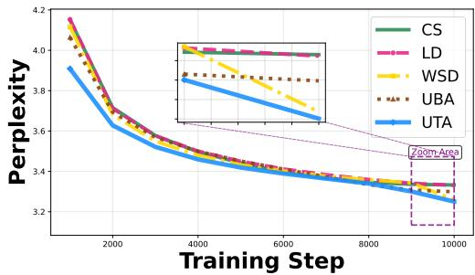  
(a) Perplexity of LLaMA-60M.

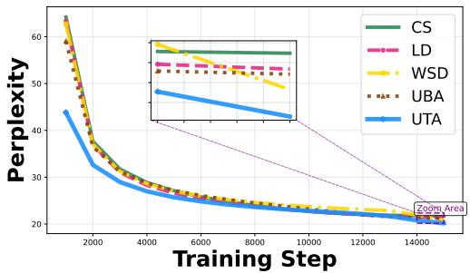  
(b) Perplexity of LLaMA-130M.

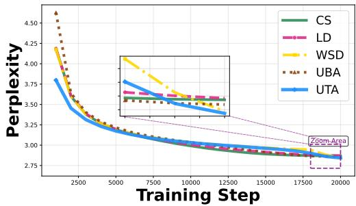  
(c) Perplexity of LLaMA-350M.

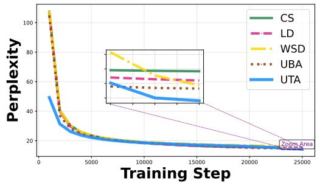  
(d) Perplexity of LLaMA-350M.  
Figure 2: Perplexity curves of LLaMA models.

Table 5: Perplexity (evalidation loss) on LLaMA models. Lower is better (↓). ‘D-10’ and ‘D-0’ denote final learning rates decaying to 10% and 0% of the peak rate, respectively.

<table><tr><td rowspan="2">LRD</td><td>LLaMA Model Size</td></tr><tr><td>60M 130M D-10 D-0 D-10 D-0</td></tr><tr><td>CS 28.03</td><td>28.27 21.76 21.99</td></tr><tr><td>LD</td><td>27.99 28.21 21.43 21.89</td></tr><tr><td>WSD</td><td>26.03 26.93 20.83 21.18</td></tr><tr><td>UBA</td><td>27.01 27.23 21.12 21.00</td></tr><tr><td>UTA (Ours)</td><td>25.80 26.77 20.16 20.68</td></tr></table>

## I.2 PERFORMANCE ON IMAGENET

We further validate the generalization of UTA on the ImageNet classification benchmark using ResNet-50 and ViT-B architectures. This selection tests generalization across model depth, width, and fundamental architectural biases. Tab. 6 reports the test top-1 accuracy. UTA consistently achieves the highest accuracy across both models. Specifically, it improves ResNet-50 accuracy to 78.73%, outperforming the strongest baseline UBA (78.38%) by 0.35%. For ViT-B, UTA reaches 82.30%, surpassing the competitive UBA LRD (82.05%) by 0.25%. These gains are statistically meaningful given the scale and complexity of ImageNet These consistent outperformance demonstrate that UTA generalizes beyond language modeling to vision tasks. It has robust and architecture-agnostic advantage in large-scale, real-world training scenarios. and generalizes beyond language modeling to vision tasks.

Table 6: ImageNet test top-1 Acc. (%) of different LRDs on ResNet50 and ViT-B under 300 epochs. Higher values indicates better performance (↑). Best results in bold.
<table><tr><td>LRD</td><td>ResNet-50</td><td>ViT-B</td></tr><tr><td>CS</td><td> $7 8 . 3 4 _ { \pm 0 . 0 2 4 }$ </td><td> $7 9 . 9 2 _ { \pm 0 . 0 5 7 }$ </td></tr><tr><td>LD</td><td> $7 7 . 9 0 { \scriptstyle \pm 0 . 0 2 8 }$ </td><td> $7 9 . 9 6 { \scriptstyle \pm 0 . 1 0 4 }$ </td></tr><tr><td>WSD</td><td> $7 8 . 3 0 { \scriptstyle \pm 0 . 0 2 4 }$ </td><td> $8 1 . 1 4 _ { \pm 0 . 0 4 8 }$ </td></tr><tr><td>UBA</td><td> $7 8 . 3 8 _ { \pm 0 . 0 1 4 }$ </td><td> $8 2 . 0 5 _ { \pm 0 . 0 4 1 }$ </td></tr><tr><td>UTA (Ours)</td><td> $7 8 . 7 3 _ { \pm 0 . 0 2 9 }$ </td><td> $\mathbf { 8 2 . 3 0 _ { \pm 0 . 0 3 7 } }$ </td></tr></table>

We also plot the training loss and validation accuracy across training steps for LRDs on ImageNet using ResNet-50 and ViT-B models in Fig. 3. A key and consistent observation is that while our proposed UTA LRDr does not always achieve the lowest training loss, it attains the highest final validation accuracy. Specifically, the training loss curves in Fig. 3(a) and (c) show that, unlike empirically tuned LRDs, such as CS and LD, that aggressively push training loss to very low values, UTA maintains a steady descent accompanied by moderate fluctuations. Its training loss is never the absolute minimum. This is not a sign of inadequate optimization, but a direct consequence of the robust-optimization design of UTA equation 3. Derived from a min-max framework that minimizes the learning rate impact under worst-case conditions, UTA implicitly introduces a regularization effect that prevents over-fitting to the training data. Consequently, although training loss is not minimized as aggressively, UTA consistently surpasses all baselines on validation accuracy as training progresses, demonstrating enhanced generalization rooted in its robust formulation.

Moreover, the learning rate trajectory of UTA exhibits noticeable fine-grained fluctuations, more pronounced than those of static or predefined LRDs. These fluctuations are not noise. They reflect a state-aware, active adaptation mechanism that responds to the internal dynamics of training. By dynamically adjusting the learning rate according to local landscape stability, UTA achieves a more robust optimization trajectory, ultimately leading to superior generalization performance.

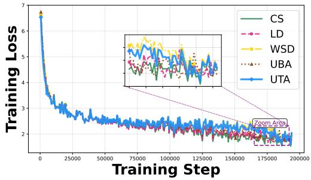  
(a) Training Loss on ImageNet-ResNet50

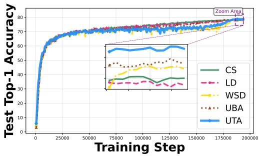

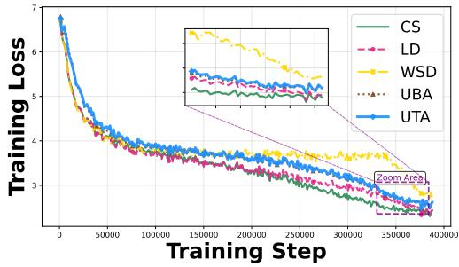  
(c) Training Loss on ImageNet-ViT-B.

(b) Validation Accuracy on ImageNet-ResNet50.  
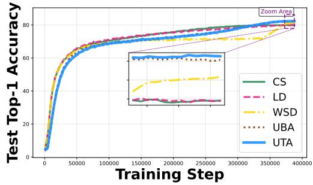  
(d) Validation Accuracy on ImageNet-ViT-B.  
Figure 3: Training loss and validation accuracy on ImageNet using ResNet50 and ViT-B.

Table 7: Cross-φ0 ablation studies: Perplexity of LLaMA-60M using UTA under different $\varphi _ { 0 }$
<table><tr><td rowspan="2">Network</td><td colspan="9">UTA</td></tr><tr><td> $\scriptstyle \varphi _ { 0 } = 0 . 0 1$ </td><td> $\varphi _ { 0 } { = } 0 . 0 5$ </td><td> $\scriptstyle \varphi _ { 0 } = 0 . 1$ </td><td> $\varphi _ { 0 } { = } 0 . 1 5$ </td><td> $\varphi _ { 0 } { = } 0 . 2$ </td><td> $\varphi _ { 0 } = 0 . 2 5$ </td><td> $\varphi _ { 0 } { = } 0 . 5$ </td><td> $\varphi _ { 0 } = 1$ </td><td> $\varphi _ { 0 } = 2 . 5$ </td><td> $\varphi _ { 0 } = 5$ </td></tr><tr><td>LLaMA-60M</td><td>26.18</td><td>25.94</td><td>25.85</td><td>25.81</td><td>25.80</td><td>25.80</td><td>25.92</td><td>26.04</td><td>26.39</td><td>26.78</td></tr></table>

Table 8: Cross-φ0 ablation studies: Perplexity of LLaMA-130M using UTA under different $\varphi _ { 0 }$
<table><tr><td rowspan="2">Network</td><td colspan="5">UTA</td></tr><tr><td> $\varphi _ { 0 } { = } 0 . 1 5$ </td><td> $\varphi _ { 0 } { = } 0 . 2$ </td><td> $\varphi _ { 0 } = 0 . 2 5$ </td><td> $\varphi _ { 0 } { = } 0 . 5$ </td><td> $\varphi _ { 0 } = 2 . 5$ </td></tr><tr><td>LLaMA-130M</td><td>20.63</td><td>20.65</td><td>20.66</td><td>20.67</td><td>20.99</td></tr></table>

## I.3 ABLATION STUDY

Peak LR sensitivity analysis. To make a fair comparison, our main experiments used a fixed peak LR across all LRDs. Although these configurations are widely adopted defaults that have been empirically validated by prior works, to prevent peak LR from disadvantaging certain baselines if their optimal peak LRs differ, we conduct a systematic learning rate sweep on LLaMA-60M and 130M models. For 60M, we sweep peak LRs from $5 \times 1 0 ^ { - 4 } \mathrm { t o } \mathrm { 1 } ^ { \sim } \times 1 0 ^ { - 2 } \phantom { 0 }$ ; for 130M, from $1 \times 1 0 ^ { - 3 }$ to $7 \times 1 0 ^ { - 3 }$ . All LRDs are trained under the same step budgets as in the main experiments, and we report perplexity $( e ^ { \mathrm { v a l i d a t i o n l o s s } } )$ for direct comparison. Results are summarized in Tab. 3.

First, Optimal peak LRs differ across LRDs. As expected, we observe that different LRDs indeed favor different peak learning rates. On LLaMA-60M, CS, LD and UBA achieve their best at $7 \times 1 0 ^ { - 3 }$ WSD at $1 \times 1 0 ^ { - 3 }$ , while UTA achieves its best jointly at $1 \times 1 0 ^ { - 3 }$ and $7 \times 1 0 ^ { - 3 }$ with a perplexity of 25.80. On LLaMA-130M, CS and LD peak at $\mathrm { \dot { 5 } \times 1 \mathrm { \dot { 0 } ^ { - 3 } } }$ , WSD also at $5 \times 1 0 ^ { - 3 }$ , whereas UBA and UTA achieve their best at $3 \times 1 0 ^ { - 3 }$ and $1 \times 1 0 ^ { - 3 }$ , respectively. This confirms that a fixed LR across all LRDs is not ideal and underscores the necessity of per-LRD tuning for fair comparison.

Second, UTA achieves the best overall performance under its optimal LR. When comparing the best result per LRD (reported in the “Best from LR Sweep” column), UTA consistently outperforms all baselines on both model scales. On 60M, UTA reaches a best perplexity of 25.80, surpassing the best baseline WSD (26.03) by 0.23 and UBA (26.26) by 0.46. On 130M, UTA achieves 20.16, outperforming WSD (20.82) by 0.66 and UBA (20.78) by 0.62. These margins, while modest in absolute terms, are consistent and non-trivial in the context of language modeling validation loss.

Parameter analysis of $\varphi _ { 0 }$ In this subsection, we perform a sensitivity analysis of the hyperparameter $\varphi _ { 0 } \in \{ 0 . 0 1 , 0 . 0 5 , 0 . 1 , 0 . 1 5 , 0 . 2 0 . 2 5 , 0 . 5 , 1 . 0 , 2 . 5 , 5 \}$ in equation 7 , which controls the variation speed of learning rate. To efficiently identify general parameter trends at low cost, then verify their scalability and robustness on larger models. We further examine $\varphi _ { 0 } \in \{ 0 . 1 , 0 . 1 5 , 0 . 2 0 . 2 5 , 2 . 5 \}$ on a larger 130M model. We narrow the range of $\varphi _ { 0 }$ to focus computational resources on the most promising intervals, filtering out ineffective values identified in the initial broad search. The results on LLaMA-60M listed in Tab. 7. The results on LLaMA-130M listed in Tab. 8).

Our sensitivity analysis reveals three key findings. First, UTA exhibits remarkable robustness to $\varphi _ { 0 }$ over a wide range. On LLaMA-60M, UTA achieves perplexity below 26.0 for 7 out of 10 tested $\varphi _ { 0 }$ values (0.05 through 0.5), and the performance variation across this broad range is remarkably small, spanning only 25.80 to 25.92. Even at the extremes $( \varphi _ { 0 } = 0 . 0 1$ and $\varphi _ { 0 } = 5 )$ , the degradation remains modest (26.18 and 26.78, respectively). On LLaMA-130M, UTA maintains perplexity between 20.63 and 20.67 across $\varphi _ { 0 } \in [ 0 . 1 5 , 0 . 5 ]$ , which is a variation of merely 0.04, and only degrades to 20.99 at $\varphi _ { 0 } = 2 . 5$ . This flat response surface indicates that UTA’s performance is largely insensitive to the choice of $\varphi _ { 0 } ,$ a desirable property for practical deployment where extensive hyper-parameter tuning is often computationally prohibitive.

Second, the performance trend aligns with our theoretical interpretation. $\mathbf { A s } \ \varphi _ { 0 }$ decreases from 0.5 to 0.15, performance improves slightly (from 25.92 to 25.80 on 60M, and from 20.67 to 20.63 on 130M). This is consistent with our continuous-time analysis: a smaller $\varphi _ { 0 }$ corresponds to a larger intrinsic step $U ^ { * }$ , enabling more thorough exploration of the loss landscape. However, the gains saturate beyond $\varphi _ { 0 } = 0 . 1 5$ , suggesting that once the intrinsic step is sufficiently large, further expansion yields diminishing returns—a phenomenon that aligns with the diminishing sensitivity predicted by our theoretical framework.

Third, and most importantly, UTA demonstrates significantly superior robustness compared to the baseline UBA. While both methods share a similar functional form of the learning rate decay, UBA exhibits a much narrower effective range: its performance declines sharply for $\varphi _ { 0 } < 0 . 5 ,$ and further reduction beyond this point brings little improvement or even degradation. In contrast, UTA maintains strong performance across a 10-fold wider range of $\varphi _ { 0 }$ (from 0.05 to 0.5 on 60M), with a performance spread of only 0.24, compared to UBA’s much larger degradation outside its narrow optimal region. We attribute this advantage to UTA’s learning rate adaptation mechanism, which dynamically adjusts the intrinsic time scale in response to optimization geometry, allowing the optimizer to fully exploit the expanded exploration capacity afforded by larger ${ \bar { U } } ^ { * }$ while automatically compensating when $\varphi _ { 0 }$ is suboptimal. This adaptive coupling between the learning rate and the preconditioned gradient norm, which is absent in UBA, ensures that increased intrinsic time translates effectively into improved convergence and generalization, regardless of the specific $\varphi _ { 0 }$ choice.

Overall, this sensitivity analysis confirms that UTA is not only performant but also robust and easy to use: it achieves near-optimal performance across a broad spectrum of $\varphi _ { 0 }$ values, substantially reducing the burden of hyper-parameter tuning compared to both UBA and other schedule-based methods.

The effect of final LR in decay Regarding the LRD implementations, some practices use decay to 10% of the peak LR, some use 0%. To investigate whether this choice affects performance. We conduct this ablation on LLaMA-60M and 130M models, comparing both settings for all LRD methods. Results are reported in Tab. 5 in Appendix.

We observe that decaying to 0% consistently yields worse perplexity than decaying to 10% across nearly all methods and model scales. For instance, on LLaMA-130M, linear decay degrades from 21.43 to 21.89 (0.46), and even our UTA increases from 20.16 to 20.68 (0.52) when using 0% decay. Aggressively decaying the learning rate to zero prematurely reduces the model’s ability to adapt, as the optimizer enters a near-stagnant regime before the model has fully converged.

Importantly, regardless of the decay ratio, UTA consistently outperforms all baselines. Under the 0% setting, UTA achieves 26.77 on 60M and 20.68 on 130M, still surpassing the best baselines (WSD at 26.93 and UBA at 21.00) by margins of 0.16 and 0.32, respectively. This confirms that our main conclusions are robust to the choice of final learning rate, and that the default 10% decay setting does not unfairly advantage UTA.

The role of dynamic state-aware mechanism To validate the contribution of the dynamic mechanism in our UTA LRD, we conduct an ablation study comparing the full version (Ours-Full) against a static variant (Ours-Static). We conduct the ablation study on the CIFAR-100 dataset with a ResNet-34 architecture. The CIFAR-100 dataset with ResNet-34 provides a balanced testbed. It is sufficiently complex to reveal LRD differences yet computationally tractable for ablation studies. We intentionally keep all other factors identical to isolate the dynamic mechanism’s effect. In the static variant, the dynamic part is removed. All other hyper-parameters and training settings remain identical.

Table 9: Ablation Study: Impact of Dynamic State-Aware Mechanism.
<table><tr><td></td><td>Ours-Static</td><td>Ours-Full</td><td>Improvement</td></tr><tr><td>CIFAR100-ResNet34(↑)</td><td>76.86</td><td>77.81</td><td>0.95</td></tr><tr><td>ImageNet-ResNet50(↑)</td><td>78.23</td><td>78.55</td><td>0.32</td></tr><tr><td>LLaMA60M(↓)</td><td>27.38</td><td>26.78</td><td>0.60</td></tr><tr><td>LLaMA130M(↓)</td><td>21.02</td><td>20.15</td><td>0.87</td></tr></table>

Comparison with automatic LR methods. While our primary baselines focus on LRDs, another line of LR research is automatic LR methods such as D-Adaptation (Defazio & Mishchenko, 2023) and Prodigy (Mishchenko & Defazio, 2023). These methods dynamically adjust the learning rate during training without predefined schedules. Although these methods are not the main focus of our work, we conduct a comparison to position UTA against them.

Specifically, we evaluate D-Adaptation and Prodigy on LLaMA-60M, 130M, and 350M under a fixed 10K-step training budget, following their default hyperparameter configurations. Results are reported in Tab. 10. As shown, UTA consistently outperforms both automatic schedulers across all three model scales, achieving average perplexity reductions of 1.2 and 0.9 over D-Adaptation and Prodigy, respectively. We hypothesize that UTA’s advantage stems from its schedule-aware shape design, which explicitly accounts for the remaining training horizon, whereas automatic methods rely solely on gradient statistics and may lack such long-term planning capability.

Given the clear superiority of UTA and the high computational cost of scaling automatic methods to larger models, we exclude the 1B model from this comparison and focus our main experiments on carefully designed schedule baselines.

Table 10: Perplexity (evalidation loss) comparison between automatic LR methods (D-Adaptation, Prodigy) and our UTA on LLaMA models. Lower is better (↓).
<table><tr><td>Method</td><td>60M</td><td>130M</td><td>350M</td></tr><tr><td>D-Adaptation</td><td>25.80</td><td>20.65</td><td>17.64</td></tr><tr><td>Prodigy</td><td>27.37</td><td>21.26</td><td>17.97</td></tr><tr><td>UTA (Ours)</td><td>25.80</td><td>20.16</td><td>17.17</td></tr></table>

Curvature alignment between UTA and UBA. We observe that UTA belongs to UBA family, and the effective scale of UTA hyperparameter is modulated by the RMS norm of the preconditioned update (approximately 0.2) (Liu et al., 2025; Kosson et al., 2023), whereas UBA’s hyperparameter φ acts directly. To isolate and evaluate the contribution of UTA’s state-adaptive mechanism—independent of hyperparameter scaling—we conduct a parameter-alignment experiment. This ensures that the underlying trend of the learning-rate curve is comparable between UTA and UBA, allowing us to directly attribute performance differences to UTA’s dynamic fluctuations.

Specifically, we align the effective learning-rate scales by setting $\varphi$ for UBA and $\varphi _ { 0 }$ for UTA such that $\varphi \approx \varphi _ { 0 } \times 0 . 2$ . We then train models under identical settings and compare both the macroscopic learning rate trajectories and the final performance. The results are listed in Tab. 11 and plotted in Fig. 4.

The results confirm that after parameter alignment, UTA and UBA produce LRD with nearly identical macroscopic shapes. However, UTA consistently achieves superior final accuracy. This performance gain can be directly attributed to the fine-grained, state-dependent fluctuations unique to UTA, which are absent in the static UBA curve. These fluctuations act as a form of online regularization, allowing the optimizer to navigate the loss landscape more robustly.

Table 11: Curvature alignment between UTA and UBA.
<table><tr><td colspan="4"> $\mathrm { U B A } ( \varphi = 0 . 0 3 )$   $\mathrm { U T A } ( \varphi _ { 0 } = 0 . 1 5 )$ </td></tr><tr><td>ImageNet-ResNet50(↑)</td><td>78.47</td><td>78.64</td><td>Improvement 0.17</td></tr><tr><td>LLaMA130M(↓)</td><td>21.08</td><td>20.15</td><td>0.93</td></tr><tr><td>LLaMA1B(↓)</td><td>14.81</td><td>14.53</td><td>0.28</td></tr></table>

Generalization to parameter-efficient fine-tuning To demonstrate the versatility of UTA beyond full-parameter optimization, we evaluate it in parameter-efficient fine-tuning (PEFT) scenarios. PEFT presents distinct challenges: only a small subset of parameters (e.g., LoRA adapters) are updated, creating a different optimization landscape where learning-rate scheduling may have amplified effects.

Experimental Setup. We fine-tune a pre-trained ViT-B model on two datasets: (1) CIFAR-100 (generic object classification) and (2) OxfordPets (fine-grained pet breed classification). We employ LoRA with rank r = 16 applied to the query, key and value projections in attention layers, and dense layer. We compare UTA against the baseline UBA LRD. All methods use the same total training budget (10 epochs), batch size, and optimizer AdamW setting such as 0.01 weight decay.

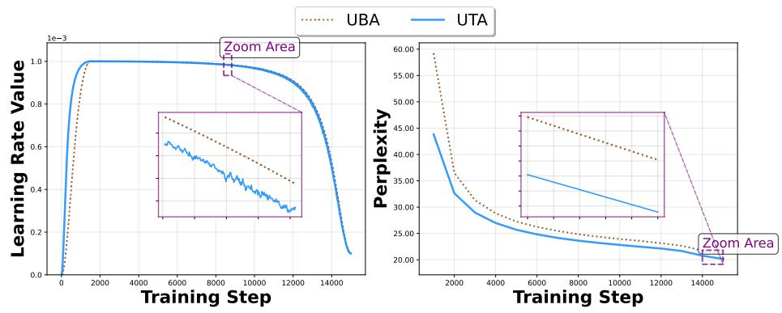

(a) LLaMA-130M.  
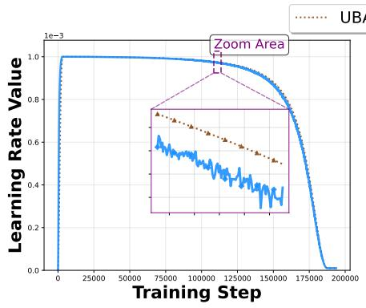

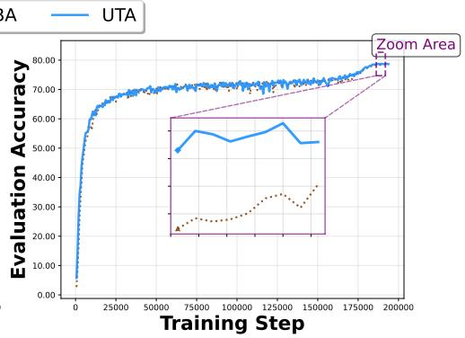  
(b) ImageNet-ResNet50.  
Figure 4: Curvature alignment between UTA and UBA.

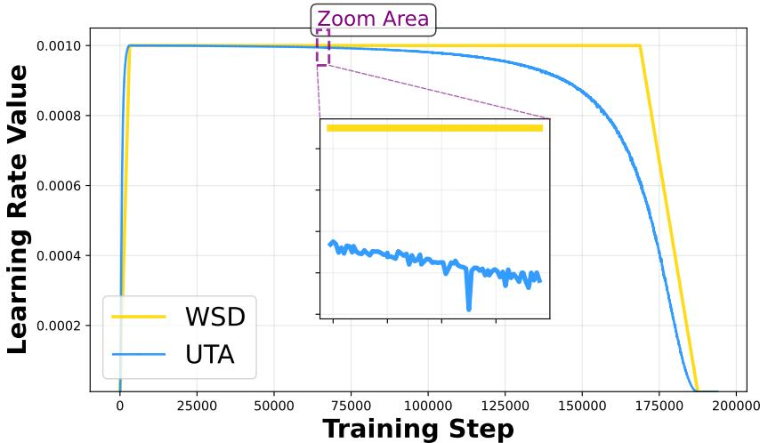  
Figure 5: The learning rate curve in UTA LRD across training steps.

Table 12: UTA for LoRA with ViT-B.
<table><tr><td>Network</td><td>Dataset</td><td>CS</td><td>LD</td><td>WSD</td><td>UBA</td><td>UTA</td></tr><tr><td rowspan="2">ViT-B</td><td>CIFAR100</td><td>91.93</td><td>92.45</td><td>92.62</td><td>92.58</td><td>92.81</td></tr><tr><td>OxfordPets</td><td>92.59</td><td>92.67</td><td>92.86</td><td>93.05</td><td>93.43</td></tr></table>

## I.4 DISCUSSION OF UTA CHARACTERISTICS

To illustrate the characteristics of UTA in practice, we plot its learning rate trajectory during the training of ImageNet-ResNet50 in Fig. 5.

Three key observations emerge.

(i) Overall Trajectory. The general shape of UTA closely resembles that of the widely adopted WSD. It exhibits a prolonged stable-like phase followed by decay. Notably, however, the duration of the stable phase and and the decay rate are automatically determined by UTA, rather than being preset by hyperparameters.

(ii) Although the average learning rate of WSD is higher than that of UTA, UTA consistently achieves better performance. This confirms that the performance gains are not merely due to a higher average learning rate, but stem from UTA being near-optimal in both shape and scale, a property grounded in the preceding methodological and theoretical analysis.

(iii) Training Adaptive Fluctuations. Unlike most conventional LRDs that follow a static, predefined curve, UTA introduces fine-grained fluctuations in the learning rate. These adjustments are driven by real-time feedback from the training state, reflecting the optimizer’s internal dynamics. This responsiveness demonstrates UTA’s strong adaptive capability in practical training scenarios.

## J RELATED WORK

The LRD plays a crucial role in deep learning, and prior research has investigated a wide range of approaches. Step LRD is a typical instance that reduces the learning rate by a decay factor after a predefined number of epochs (He et al., 2016). A common enhancement is the warmup phase, which gradually raises the learning rate early in training to stabilize optimization (He et al., 2016). Then Loshchilov et al. (Loshchilov & Hutter, 2017) propose the cosine LRD, which is widely regarded as the de-facto standard choice in large-scale model training (Loshchilov & Hutter, 2017; Schaipp et al., 2025). To improve the performance under budgeted training scenarios, some LRDs include the cyclical LRD (Smith, 2017), alternative LRD under budgeted training setting (Li et al., 2019a) and REX LRD (Chen et al., 2022), yet there is no consensus on the optimal choice.

Recently, research in this area has evolved along two main lines. A line of work focus on designing LRD primarily through empirically driven approaches, and effectively enhance accuracy. Pan et al. (Pan et al., 2022a) introduce elastic step decay LRD to accelerate the pre-training for Berts. As an alternative on large model training, Warmup-Stable-Decay (WSD) LRD (Zhai et al., 2022; Hu et al., 2024) uses an extended constant learning rate phase before late-stage decay. It has become popular in LLM pre-training (Hagele et al. ¨ , 2024; Hu et al., 2024) and is deployed in training industrial-scale LLMs such as DeepSeek-V3 (Liu et al., 2024) and Kimi-K2 (Team et al., 2025). Yet its mechanism remains unclear, recent works (Wen et al., 2024; Schaipp et al., 2025; Li et al., 2025) offer some insights, showing that the advantage of WSD can be explained and quantified through scaling efficiency comparisons with other LRDs.

Another line of research is more theoretically driven, seeking to establish principled frameworks and scaling laws for designing or analyzing LRD. Pan et al. (Pan et al., 2022b) propose Eigencurve, and demonstrate that it has minimax-optimal convergence on skewness Hessian quadratic objectives. Defazio et al. (Defazio et al., 2023) establish optimal linear decay LRD and refinements through rigorous mathematical derivation. Some studies (Tissue et al., 2025; Li et al., 2025; Luo et al., 2025) establish scaling law with LRD, providing theoretical explanation for empirical results observed in this area. Recently, Tang et al. propose a theoretically grounded LRD called UBA LRD (Tang et al., 2026), derives from a constructed UBA framework. This framework adopts a min-max formulation that explicitly accounts for robustness to variations in loss landscape curvature, thereby guaranteeing performance under worst-case conditions. The UBA LRD eliminates the need for heuristic design while maintaining strong and consistent performance across diverse tasks, architectures, model scales, and training budgets. Consequently, it removes the costly trial-and-error process typically required to select an appropriate LRD for a given network and training setup.