# Uncovering the Turing Test’s Latent Signal: Indistinguishability as a Reward

Emanuele Rimoldi1,2 Riccardo Neumarker1,3 Tomaso Poggio1 Daniel Mitropolsky1,4 1MIT 2EPFL 3ETH Zurich 4Tufts

{erimoldi,rneumk,tpoggio,mitropol}@mit.edu

## Abstract

Can a model learn by trying to fool another model? We show that it can. Inspired by the Turing Test and its recent generalization to arbitrary distinguishers, we introduce a domain-based teacher-Turing-Test, in which a stronger teacher model serves as both the target of imitation and the distinguisher, and a weaker student model is trained to make the teacher attribute responses to itself. We use this self-attribution (or fooling) probability as a reinforcement learning reward, without ever providing the student ground-truth answers, nor requiring the teacher to generate responses. We test our approach independently in four domains with verifiable answers: CommonsenseQA (reasoning), GSM8K (mathematics), KodCode (programming), and Spider (SQL), training a Qwen2.5-1.5B student/imitator model using DeepSeek V4 Flash as teacher/distinguisher. Beyond improving at passing the Turing Test, the student improves on independent, held-out evaluations in all domains and runs. To probe why being mistaken for the teacher can improve capability, our analyses reveal that self-attribution is associated with correctness – substantially more than formatting changes – and that it rewards partial correctness. Our results demonstrate a new, simple teacher-student training paradigm with a private and/or high-cost teacher. They also suggest that indistinguishability need not merely measure behavior – it can also be a mechanism for learning.

## 1 Introduction

In 1950, Alan Turing introduced the Turing Test (Turing, 1950) – an Artificial Intelligence (AI) system passes the Turing Test if a human judge cannot reliably distinguish, in a text-based conversation, between the AI system and another human. In this work, we ask: can the Turing Test serve as an objective for training? We take as a starting point two very recent papers. The first uses reinforcement learning (RL) with a Turing-Test-based reward to train a student language model (LM) to produce human-like responses (Wang et al., 2026). A concurrent paper introduces a novel Generalized Turing Test (GTT) (Mitropolsky et al., 2026) in which the distinguisher and target of imitation of the Turing Test can be an arbitrary LM in place of a human. In this framework, an LM A “passes the Turing Test against an LM B” if B cannot distinguish between itself and A imitating B.

Can the Turing Test against a stronger “teacher” LM be used as an RL-objective to successfully train a student model? This contains two questions. Will the student become better at fooling the distinguisher? The second, and deeper, question is whether in doing so, the student will actually become more intelligent in some sense, beyond simply its ability to fool the distinguisher by just mimicking its outputs?

To make the second question tractable, our idea is to restrict the Turing Test to a specific domain where answers are verifiable. We introduce the domain-based teacher-Turing-Test: a stronger teacher model is both the target and distinguisher, and a weaker student model is the imitator. We further simplify by making the Turing Test a single round – the imitator responds to a single query. A domain-specific question set is divided into training and test components. The training signal, which we call the indistinguishability reward (Section 3), is the log probability that the teacher attributes the student’s output to having come from its own model type.

In our main experiments, we use a small student (actor/imitator) model, Qwen2.5-1.5B, and as teacher (target/distinguisher) DeepSeek V4 Flash. We train the student model using GRPO, a standard RL algorithm, on our indistinguishability reward in four domains – CommonsenseQA (commonsense reasoning), GSM8K (mathematics), KodCode (programming), and Spider (SQL generation) – for a fixed number of 8,000 RL rollouts per run, with the optimization method of Shao et al. (2024). The student model improves on the held-out test in each domain, by 12.4, 13.0, 5.4, and 11.9 percentage points respectively (Section 5). We emphasize that ground-truth labels do not enter the RL updates; they are used only in the offline, independent evaluation of whether the reward transferred verifiable task capability. In Section 5.4, we present an additional variant for fully-black-box teachers whose logits are inaccessible; with GPT-5 Mini as distinguisher, learning to fool improves accuracy in 3 of 4 domains.

The last part of our paper asks how this is happening. First, we show that the distinguisher’s answers are strongly correlated with correctness (a prerequisite for the Turing Test to improve a student). Additional experiments reveal that (1) changing a response’s correctness affects the reward much more strongly than adding a formatting prefix (despite the distinguisher’s objective being only to determine provenance) and (2) indistinguishability rewards partial improvements even among incorrect solutions. This latter point is why, for CommonsenseQA and Spider, our indistinguishability reward outperforms the same RL method but using the verifier’s correctness bit as the reward.

## Overall, our contributions are:

1. We introduce the domain-based teacher-Turing-Test, and a new RL reward rooted in indistinguishability that is label- and generation-free.

2. We train a weaker student model on four separate domains, and show improved performance on a held-out, independent evaluation in all four. This is evidence that the objective of the Turing Test – fooling a distinguisher – can capture a meaningful signal related to capability.

3. We compare indistinguishability-reward RL to several other methods, including SFT (training directly on teacher responses), RL with a correctness oracle, and RL with distinguisherjudged correctness. These other rewards are correctness-based, in that either an answer or a correctness-score is provided. The Turing-based method is within 3.1 percentage points of the best method in every domain.

4. Finally, we probe the nature of the information carried by the reward. We find a correlation between distinguisher judgments and correctness, a greater effect of correctness on the reward over formatting, and the ability of our method to reward partial correctness.

In addition to its implications in the theory of indistinguishability as a basis for defining intelligence, our results can also be seen more generally as a teacher-student training paradigm for black-box or semi-black-box, high-cost, and/or private settings. Namely: our teacher is a (semi)-black-box from which only log-probabilities of two tokens, or repeated single-token outputs, are needed.

## 2 Related Work

Alan Turing introduced the imitation game, later known as the Turing Test, in 1950 (Turing, 1950). Since then it has been hotly debated whether the Turing Test is a good definition of intelligence, i.e. that an AI system passing the Turing Test may not be intelligent in any meaningful sense (e.g. (Block, 1981; French, 1990; Hayes and Ford, 1995)). Our work directly builds on two recent papers: in the first use of a Turing-Test-variant as an RL reward, a model is optimized to imitate specific human-users, and they find that the method works: the trained model fools humans and other LLMs into thinking they are human-user responses (Wang et al., 2026). They compare their method to SFT, as we do in this work. Concurrently, another paper introduced the Generalized Turing Test, the basic idea of which is that both the actor and the distinguisher/target of the imitation are arbitrary language models (Mitropolsky et al., 2026). In the Discussion, they pose the enticing idea of a GAN-like training application: train the actor to fool the distinguisher, while training the distinguisher to ask better questions and/or distinguish better. Our work makes progress on the first part of this program. This work combines the core concepts ofboth papers: we use the Generalized Turing Test as an RL reward, where imitation is of a more capable model, to ask whether training to improve fooling also improves real task capability.

Our work relates to several subfields in AI. First is the self-recognition literature, studying the ability of models to identify outputs as their own or not; evidence is mixed – some evaluators recognize their generations (Panickssery et al., 2024), while other studies find no consistent ability (Davidson et al., 2024). Another connected field is student-teacher training algorithms and distillation. Common methods include sequence-level distillation (Kim and Rush, 2016; Magister et al., 2023), and onpolicy distillation (Agarwal et al., 2024). Fine-tuning trains the model to make its own outputs indistinguishable from reference samples (Chen et al., 2024), as opposed to the generator of those references as in the Turing Test. Our method structurally resembles other RL approaches that use feedback from a task verifier or AI judge; e.g. a correctness oracle given by a task-specific verifier (Shao et al., 2024), or a binary correctness judgment provided by a stronger LLM (Shen et al., 2026) – these two methods give us two of the comparison baselines presented in Section 4. As we explore in Section 6, our approach works because the distinguisher’s answers are correlated with correctness. While we find evidence for this, self-preference bias in models, including exploiting this at the expense of accuracy, has been studied (Zheng et al., 2023; Panickssery et al., 2024; Zhou, 2026).

## 3 Learning from Indistinguishability

## 3.1 Problem Formulation

In this work, we set out to study whether the Turing Test can be used as a training method. In order to make it possible to verify whether training improves a model’s capability in general, we study a domain-restricted, one-round Turing Test. Let $\mu$ be a domain, by which we mean a distribution over questions for which there is a verifier $V { : }$ given a question $x \sim \mu$ and candidate solution $y , V ( x , y )$ outputs 1 if $y$ is a correct solution to x.

In our framework, there are two kinds of models. The first kind is a student or actor model $A _ { \theta } .$ parametrized by θ. On input $x \sim \mu$ , we interpret the output of $A _ { \theta } ( x )$ as an attempted solution to $x . ^ { 1 }$

The second kind is a teacher or distinguisher model $D .$ . Such a model has two modes: (1) a solve mode (denoted with solve in the first argument) – given $x \sim \mu , D ( \mathsf { s o l v e } , x )$ is an attempted solution to $x ,$ and (2) distinguish mode (denoted with dist in the first argument) – given x and $y ,$ $D ( { \mathsf { d i s t } } , x , y ) \in \{ 0 , 1 \}$ is a guess as to whether y was generated by $D$ on question x (that is, whether $y \sim D ( \mathsf { s o l v e } , x )$ or whether $y \sim A _ { \theta } ( x ) \rangle$ . When clear from context, we will drop the keyword argument, writing just $D ( x )$ or $D ( y )$ . Practically, one should think of the modes being specified by fixed pre-prompts.

We now define the domain-based teacher-Turing-Test: a question $x \sim \mu$ is sampled. Let $b \in \{ 0 , 1 \}$ be the correct answer (b could be randomly sampled). I $\mathrm { f } \ b = 0$ we let $y \sim A _ { \theta } ( x )$ , and if $b = 1$ we let $y \sim D ( \mathsf { s o l v e } , x )$ . Finally sample $g \sim D ( { \mathsf { d i s t } } , x , y )$ . We say the distinguisher succeeded (or won) if $g = b ,$ and that the actor succeeded, or fooled the distinguisher, if $g \neq b .$

We denote the accuracy of a model M on $\mu$ by

$$
E ( M , \mu ) : = \mathbb { E } _ { x \sim \mu , y \sim M ( x ) } [ V ( x , y ) ] = \operatorname* { P r } _ { x \sim \mu , y \sim M ( x ) } [ V ( x , y ) = 1 ]
$$

For the distinguisher, denote $E ( D , \mu ) : = E ( D ( { \mathsf { s o l v e } } , \cdot ) , \mu )$ . It will be useful to define the capability gap on $\mu -$ how much better the distinguisher is at solving $\mu$ than $A _ { \theta } \colon$

$$
\gamma _ { \mu } = E ( D , \mu ) - E ( A _ { \theta } , \mu )
$$

It is also useful to define the distinguishability $g a p -$ that is, how much better the distinguisher is at recognizing its own outputs than the actor’s:

$$
\delta _ { \mu } = \mathbb { E } _ { x \sim \mu , \ y \sim D ( \mathrm { s o l v e } , x ) } [ D ( \mathrm { d i s t } , x , y ) ] - \mathbb { E } _ { x \sim \mu , \ y \sim A _ { \theta } ( x ) } [ D ( \mathrm { d i s t } , x , y ) ]
$$

When $\gamma _ { \mu } > 0$ and $\delta _ { \mu } > 0$ , we might hope that by training $A _ { \theta }$ to increase the probability of fooling the distinguisher $( \mathrm { i . e }$ . decreasing $\delta _ { \mu } ) , \gamma _ { \mu }$ will also decrease. This is the main empirical finding demonstrated by this work. Observe that modifying $\theta$ can change only the second term in $\delta _ { \mu }$ above.

This probability – that of a student’s output fooling the distinguisher – is so important we give it its own name:

$$
p _ { \mathrm { i n d } } : = \operatorname* { P r } _ { x \sim \mu , y \sim A _ { \boldsymbol { \theta } } ( x ) } \left[ D ( \mathrm { d i s t } , x , y ) = 1 \right]
$$

We will denote the probability of D outputting 1 on a specific question–answer pair $( x , y )$ with $p _ { \mathrm { i n d } } ( x , y ) : = \mathrm { P r } [ D ( \mathrm { d i s t } , x , \bar { y } ) = 1 \mid x , \bar { y } ]$ . We have $p _ { \mathrm { i n d } } = \mathbb { E } _ { x \sim \mu , \ y \sim A _ { \theta } ( x ) } [ p _ { \mathrm { i n d } } ( x , y ) ]$

## 3.2 Reinforcement Learning with the Turing Test

We now present a reinforcement method based on our variant of the Turing Test. At its core, our method seeks to maximize the following unregularized objective:

$$
\mathbb { E } _ { x \sim \mu , \ y \sim A _ { \theta } ( x ) } [ \log p _ { \mathrm { i n d } } ( x , y ) ]\tag{1}
$$

How is this related to $p _ { \mathrm { i n d } } ?$ By concavity of log (Jensen’s inequality), we have $\log p _ { \mathrm { i n d } } ~ \geq$ $\mathbb { E } [ \log p _ { \mathrm { i n d } } ( x , y ) ]$ , so our method maximizes a lower bound on log $p _ { \mathrm { i n d } }$ , the log of the plain expected fooling probability. This is the standard maneuver in RL with a probability reward as a kind of smoothing of values in $( 0 , 1 )$ . We also empirically compare several other functions of $p _ { \mathrm { i n d } } ( x , y )$ as the reward and find log $p _ { \mathrm { i n d } } ( x , y )$ gave the best improvement, see Appendix C.2.

Figure 1 summarizes how this reward enters the training loop.

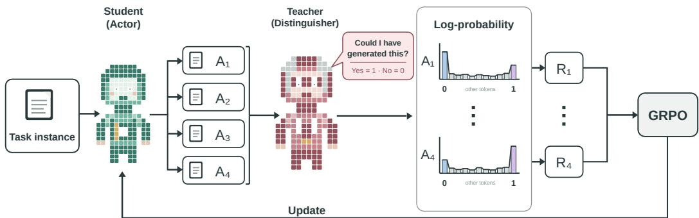  
Figure 1: Training with a frozen self-attribution judge. For each task, the student samples four responses; the teacher assigns first-token log-probabilities to the binary labels 0 and 1 for each response. These yield rollout rewards for GRPO, which updates only the student. Only the first and last response distributions are shown; no gold answers or teacher-generated responses enter training.

Next we describe the method of GRPO with respect to our objective. The expectation in our objective – equation $1 - \operatorname { i s } \mathbb { E } _ { x \sim \mu } \mathbb { E } _ { y \sim A _ { \theta } } .$ Suppose that for every possible $x \sim \mu ,$ , in order to approximate the inner expectation we drew G responses $y _ { 1 } , \dots , y _ { G } \sim A _ { \theta _ { \mathrm { o l d } } } ( x ) ( \theta _ { \mathrm { o l d } } ;$ the parameters before the update). For each $i \in [ G ]$ , we define the local reward $r _ { i } = \log p _ { \mathrm { i n d } } ( x , y _ { i } )$ . In each group, rewards are standardized (subtract the group mean and divide by the group standard deviation) to give the advantages $\boldsymbol { { \hat { r } } _ { i } }$ . Writing $p _ { \theta } ( y | \bar { x } ) : \stackrel { - } { = } \mathrm { P r } [ y  A _ { \theta } ( x ) ]$ , the following is the unregularized GRPO objective:

$$
\mathbb { E } _ { { x } \sim \mu , { y } _ { 1 : G } \sim A _ { \theta _ { \mathrm { o l d } } } ( { x } ) } \Big [ \frac { 1 } { G } \sum _ { i = 1 } ^ { G } \frac { p _ { \theta } ( { y } _ { i } | { x } ) } { p _ { \theta _ { \mathrm { o l d } } } ( { y } _ { i } | { x } ) } \cdot \hat { r } _ { i } \Big ]\tag{2}
$$

That is, GRPO generates multiple (G) candidate responses to a question, and weights the probability ratio of each response by its (relative) reward; intuitively, a gradient update of this objective increases the likelihood of high-reward responses. Note that when $D$ is an LLM, the probability that it outputs 0 or 1 in a given context is determined by the logits $\ell _ { 0 }$ and $\ell _ { 1 }$ , with $p _ { \mathrm { i n d } } \dot { ( } x , y ) = \dot { e } ^ { \ell _ { 1 } } / ( e ^ { \ell _ { 0 } } + \dot { e } ^ { \ell _ { 1 } } )$ This gives a particularly simple form for $r _ { i } = \ell _ { 1 } ^ { ( i ) } - \log ( e ^ { \ell _ { 0 } ^ { ( i ) } } + e ^ { \ell _ { 1 } ^ { ( i ) } } )$

In practice, a few additional tricks are often needed for stability of gradient-based updates. Most importantly a regularizer is added to the loss to prevent post-training from changing the student model too much (and ceasing to be a good language model). Denote by $A _ { 0 }$ the student model at the beginning of RL training. Given regularization weight $\beta ,$ our final objective is

$$
\mathbb { E } _ { { x } \sim \mu , \ { y } _ { 1 } : { G } \sim A _ { \theta _ { \mathrm { o l d } } } ( { x } ) } \Big [ \frac { 1 } { G } \sum _ { i = 1 } ^ { G } \frac { p _ { \theta } ( { y } _ { i } | { x } ) } { p _ { \theta _ { \mathrm { o l d } } } ( { y } _ { i } | { x } ) } \cdot \hat { { r } } _ { i } \Big ] - \beta \cdot \mathbb { E } _ { { x } \sim \mu } \big [ D _ { \mathrm { K L } } ( A _ { \theta } ( \cdot | { x } ) \| A _ { 0 } ( \cdot | { x } ) ) \big ]\tag{3}
$$

In GRPO, one optimization step is a gradient-based update of Equation 3. Also, in practice $p _ { \mathrm { i n d } } ( x , y )$ is clipped to $[ 1 \dot { 0 } ^ { - 6 } , 1 - 1 0 ^ { - 6 } ]$ before the logarithm, and the whole expectation is approximated by taking a minibatch of questions and their G answers – these details (and the final empirical form of the GRPO objective) are given in Appendix Eq. 4.

## 4 Experimental Setup

We will now seek to empirically answer our main questions: (1) if we train a student (actor) model on the indistinguishability reward log $p _ { \mathrm { i n d } }$ , will it learn to fool the distinguisher? While prior work on Turing-Test-based rewards showed this for generating human-like responses (Wang et al., 2026), will it work against a teacher LLM distinguisher? (2) Second – and more interestingly – what happens to the actor’s capability on a verifiable task as it learns to fool the teacher?

We take Qwen2.5-1.5B-Instruct as the initial student/actor $A _ { 0 } ,$ and DeepSeek V4 Flash as teacher/distinguisher D. We study four domains $\mu { : }$ CommonsenseQA (reasoning questions), GSM8K (mathematics), KodCode (programming), and Spider (SQL generation). The student is open-weight, which allows us to train it with RL; the teacher exposes the log-probabilities of its answers; and the combination leaves room to learn. Before any training, we verify that the teacher is much stronger than the student in every domain (that is $\gamma _ { \mu } \gg 0 )$ , and that as distinguisher it accepts its own responses much more often than the student’s $( \delta _ { \mu } \gg 0 )$ – see Appendix Table 6.

Each domain is divided into training and evaluation sets. Separately for each domain, we train the student using GRPO on the normalized log $p _ { \mathrm { i n d } }$ objective (Equation 3) with two passes over 1000 training questions and $G = 4$

The main thesis and finding of this work will be that (a restriction of) the Turing Test can be used in reinforcement learning to improve capability. However, as an additional investigation we compare to training the student with three other methods, two of them RL-based. These are summarized in Table 1:

• SFT, which maximizes the log-likelihood of the student generating responses sampled from the teacher

• GRPO-quality (Quality in later tables), structurally like our Turing-Test-based method, but the teacher is asked whether the response is correct. The reward is the log-probability of the positive answer (Appendix Eq. 5)

• GRPO-verifier (Oracle), where the reward is the verifier bit $V ( x , y ) \in \{ 0 , 1 \}$

We emphasize that every comparison method is correctness-based, in the sense that training is done using a reference answer or score based on correctness. All additional baselines are trained from the same starting point $A _ { 0 }$ and repeated for the same 3 seeds. GRPO-based baselines use the same two passes of 1,000 questions, whereas SFT learns from 2 passes over 1,000 teacher-generated answers.

Table 1: Summary of experimental conditions (Turing-Test-based GRPO-indisting., called Indist. in later tables, and comparison baselines)
<table><tr><td>Condition</td><td>Supervision</td><td>Reward</td></tr><tr><td> $A _ { 0 }$ </td><td>Initial actor.</td><td>(no update)</td></tr><tr><td>SFT</td><td>Teacher answer  $y _ { D } \sim D ( x )$  per question x.</td><td> $- \log p _ { \theta } ( y _ { D } \mid x ) ( \mathrm { l o s s } )$ </td></tr><tr><td>GRPO-quality</td><td>Reference-free teacher judgment of correctness.</td><td> $\log \mathrm { P r } [ D ( \mathsf { c o r r e c t ? } , x , y ) = 1 ]$ </td></tr><tr><td>GRPO-verifier</td><td>Task verifier.</td><td> $V ( x , y ) \in \{ 0 , 1 \}$ </td></tr><tr><td>GRPO-indisting.</td><td>Teacher self-attribution (our method).</td><td> $\log p _ { \mathrm { i n d } } ( x , y )$ </td></tr></table>

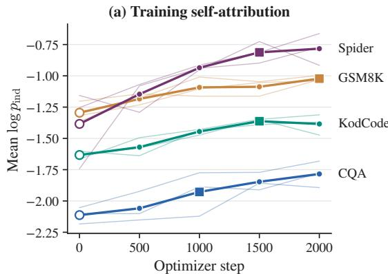

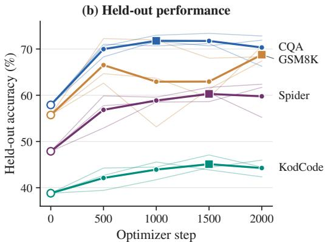  
Figure 2: Indist. training, one color per domain. (a) Mean log $p _ { \mathrm { i n d } }$ of the training rollouts. (b) Held-out accuracy at every checkpoint. In both panels, thin lines are single seeds and bold lines are means; squares mark the checkpoint with the highest mean held-out accuracy, which was not always the final checkpoint.

## 5 Results

## 5.1 The Actor Learns to Fool the Distinguisher

We first answer Main Question 1 from the beginning of Section 4. We compute the average fooling probability $p _ { \mathrm { i n d } }$ after each block of 500 updates, and find that it continuously increases throughout RL training. This is shown in Figure 2(a), which plots $\log p _ { \mathrm { i n d } }$

The exact improvement differs between domains. On one end of the spectrum, CommonsenseQA sees the least gain, with $p _ { \mathrm { i n d } }$ rising from 17.6% to 22.3% (first and last 100 updates, mean over seeds). However, on this domain $D$ rarely claims any response at all – even $\operatorname* { P r } _ { x \sim \mu , \ y \sim D ( \mathsf { s o l v e } , x ) } [ D ( \mathsf { d i s t } , x , y ) =$ 1] is only 34.7% (Appendix Table 6). At the other end, on Spider (SQL generation) most of $A _ { \theta } { } ^ { \prime } { \mathbf { s } }$ queries fool D from the start; $p _ { \mathrm { i n d } }$ increases from 66.0% to 78.0%. Overall, results confirm the intended effect of training on fooling the distinguisher: student-generated responses are more likely to be attributed to the teacher across all 12 domain-seed combinations. This works across domains with very different initial distinguisher behaviors.

## 5.2 Accuracy Improves on the Held-Out Test Set

We now present our most surprising and significant empirical finding, which answers Main Question 2 of Section 4. Since nothing in the framework or reward of the domain-based teacher-Turing-Test refers to correctness, a priori there is no guarantee that learning to fool the teacher will result in the student learning to solve the task.

Figure 2(b) shows that accuracy on the held-out evaluation set rises with training. Accuracy at the terminal checkpoint improves over $A _ { 0 }$ in all domains (Table 2) by 12.4 (CommonsenseQA), 13.0 (GSM8K), 5.4 (KodCode), and 11.9 (Spider) percentage points. We check that every improvement is significant under a McNemar test on paired held-out items after Holm correction over the three seeds (the weakest is KodCode seed 7, at 3.5 percentage points).

As an aside, we find that most of the gain arrives early; after 500 updates, every domain achieves over half of its terminal gain. Figure 2(b) shows which of the tested checkpoints achieved the best accuracy, often not the terminal one. While we used a fixed number of training steps for simplicity (and matching the fixed-budget protocol of Wang et al. (2026)), a practical application of our method could compare checkpoints and/or use early stopping.

## 5.3 Comparison to other RL Baselines and Seed-Dependency

The main thesis of this work is that our restriction of the Turing Test can be used for RL training, improving a student’s ability to fool the distinguisher and in the same process its general capability on a verifiable task. Our goal is not to beat other RL methods; as an additional empirical exploration, we compare with several baselines as described in Section 4.

Table 2: Held-out evaluation-set accuracy (%) at the terminal checkpoint of the student/actor (Qwen2.5-1.5B), with mean and standard deviation over seeds; Gain is the improvement of Indist. over A0 in percentage points, and bold marks the best mean in each row.
<table><tr><td rowspan="2">Dataset</td><td colspan="3">Not correctness-based</td><td colspan="3">Correctness-based</td></tr><tr><td> $\mathbf { A _ { 0 } }$ </td><td>Indist.</td><td>Gain</td><td>Quality</td><td>SFT</td><td>Oracle</td></tr><tr><td>CommonsenseQA</td><td>57.9</td><td> $7 0 . 3 \pm 3 . 6$ </td><td>+12.4</td><td> $7 1 . 7 \pm 1 . 1$ </td><td> $7 1 . 3 \pm 0 . 6$ </td><td> $6 9 . 0 \pm 1 . 2$ </td></tr><tr><td>GSM8K</td><td>55.7</td><td> $6 8 . 8 \pm 1 . 6$ </td><td> $+ 1 3 . 0$ </td><td> $6 8 . 9 \pm 0 . 7$ </td><td> $6 8 . 6 \pm 0 . 9$ </td><td> ${ \bf 7 1 . 9 \pm 0 . 6 }$ </td></tr><tr><td>KodCode</td><td>38.8</td><td> $4 4 . 3 \pm 1 . 8$ </td><td>+5.4</td><td> $4 5 . 7 \pm 1 . 5$ </td><td> $4 1 . 6 \pm 0 . 7$ </td><td> ${ \bf 4 7 . 0 \pm 3 . 6 }$ </td></tr><tr><td>Spider</td><td>47.9</td><td> $5 9 . 8 \pm 4 . 0$ </td><td>+11.9</td><td> $4 0 . 6 \pm 3 5 . 2$ </td><td> ${ \bf 6 1 . 6 \pm 1 . 0 }$ </td><td> $5 9 . 0 \pm 4 . 0$ </td></tr></table>

As Table 2 shows, overall the Turing-Test-based method is broadly competitive. It is within 3.1 percentage points of the best method in each domain. Training initialization (the random seed) can have a strong effect; Table 9 in the appendix presents the final held-out test accuracy for each seed. Interestingly, there we see that in 4/12 runs (and in each domain other than GSM8K), indistinguishability resulted in the highest accuracy, more often than Quality and SFT; verifier-based RL (Oracle), however, was the best in 6/12 runs. Appendix I explains the two outlying behaviors: the Spider Quality run that scores 0% and the collapse of two Oracle runs on CommonsenseQA to four-token answers.

The Turing-Test-based training method is fundamentally different from the compared baselines, which are all correctness-based in one way or another. RL with verifier outputs (Oracle) does this directly. RL with a teacher’s correctness score approximates this. SFT provides teacher-generated answers (which are often correct). It is interesting, we believe, that a method rooted only in indistinguishability of output provenance can achieve effects similar to those of optimizing correctness-based objectives.

## 5.4 A Closed-Weight Teacher without Log-Probabilities

So far, our reward uses the teacher’s log-probabilities of the two Turing-Test answers. Most proprietary and frontier models, however, do not expose them – they only return text. Does our method need them? The Turing Test itself does not: the judge only gives a verdict. We therefore replace DeepSeek V4 Flash with the closed-weight GPT-5 Mini and simply ask it the attribution question $K = 1 0$ times per response. If it claims the response as its own m times, the reward is log $\bar { \left( \right)} ( m + 1 ) / ( K + 2 ) $ , a smoothed estimate of log $p _ { \mathrm { i n d } }$ (MIRRORVOTE, Appendix K.1). Everything else is unchanged: the same actor $A _ { 0 } ,$ the same 1,000 training questions and GRPO setup, and the same held-out evaluation as for DeepSeek. We ran a single seed per domain, so these results are preliminary.

In three of the four domains, the picture is strikingly similar. The actor learns to fool GPT-5 Mini: in every domain, the teacher’s estimate of $p _ { \mathrm { i n d } }$ rises during training (Table 3). Again, we find that fooling the teacher improves accuracy: by 13.3 (CommonsenseQA), 6.9 (KodCode), and 15.6 (Spider) percentage points over $A _ { 0 }$ (Table 3) – on Spider, twice the gain of the DeepSeek run with the same seed. GSM8K is the exception, and an instructive one. GPT-5 Mini already attributed 85% of the actor’s answers to itself at the start of training, leaving little gap for the reward to close. Meanwhile, the actor drifted into writing its final answer in LAT X math, a format the evaluator does not accept: the same format drift as in the Spider Quality run of seed 23 (Appendix I).

## 6 Why does Indistinguishability Improve Accuracy?

We have shown experimental evidence that training with the reward of indistinguishability, i.e. fooling our restricted Turing Test, improves accuracy. In this section, we ask why. Percentages are always presented in the order CommonsenseQA, GSM8K, KodCode, Spider.

The highest-level answer to this question is that the probability of fooling the distinguisher is highly correlated with correctness. In the next subsection, we perform interventions that provide evidence that beyond correlation, the distinguisher is truly rewarding, i.e. self-attributing, based on correctness over style/formatting.

Table 3: Training with a closed-weight teacher, single seed (23). $p _ { \mathrm { i n d } }$ is the mean over the training rollouts of the first and of the last 100 updates; for GPT-5 Mini it is estimated as the share $m / K$ of the ten sampled verdicts that claim the response. Acc. is held-out accuracy at the terminal checkpoint, and Gain is the GPT-5 Mini run over $A _ { 0 } .$ The DeepSeek columns are the seed-23 run of Table 9.
<table><tr><td colspan="2"></td><td colspan="2">DeepSeek V4 Flash (log-probs)</td><td colspan="3">GPT-5 Mini (closed-weight,  $K = 1 0 )$ </td></tr><tr><td>Dataset</td><td> $\mathbf { A _ { 0 } }$ </td><td> $p _ { \mathrm { i n d } } \colon \mathrm { s t a r t } \to \mathrm { e n d }$ </td><td>Acc.</td><td> $p _ { \mathrm { i n d } } \colon \mathrm { s t a r t } \to \mathrm { e n d }$ </td><td> $\operatorname { A c c } .$ </td><td>Gain</td></tr><tr><td>CommonsenseQA</td><td>57.9%</td><td> $1 7 . 4 \%  2 3 . 0 \%$ </td><td>72.8%</td><td> $6 9 . 9 \%  7 8 . 8 \%$ </td><td>71.2%</td><td>+13.3</td></tr><tr><td>GSM8K</td><td>55.7%</td><td> $3 9 . 3 \%  4 6 . 0 \%$ </td><td>67.4%</td><td> $8 4 . 9 \%  8 8 . 0 \%$ </td><td>33.1%</td><td>-22.7</td></tr><tr><td>KodCode</td><td>38.8%</td><td> $4 1 . 6 \%  5 0 . 5 \%$ </td><td>46.0%</td><td> $6 7 . 2 \%  7 6 . 9 \%$ </td><td>45.7%</td><td>+6.9</td></tr><tr><td>Spider</td><td>47.9%</td><td> $6 9 . 8 \%  7 7 . 2 \%$ </td><td>55.2%</td><td> $6 8 . 7 \%  7 7 . 0 \%$ </td><td>63.4%</td><td>+15.6</td></tr></table>

Indist. Quality Oracle

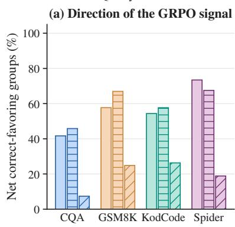

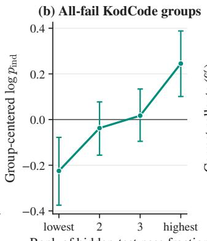

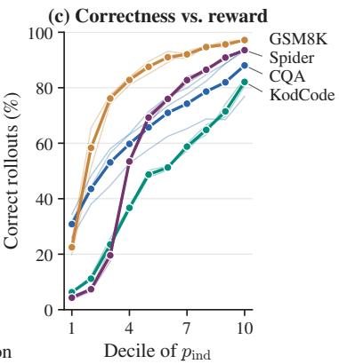  
Figure 3: The GRPO signal of the indistinguishability reward. (a) Share of the 2,000 four-response groups of a run pulled toward a correct response net of those pulled away: the share of groups whose rewards are not all equal, times $2 d - 1$ , where d is the share of mixed groups in which the correct responses receive the higher mean reward. Indist. and Oracle average the three seeds; Quality averages the three seeds for the first factor and takes d from the Indist. rollouts of the three seeds, scored by the Quality judge. For Oracle d = 1. (b) KodCode groups of the seed-23 Indist. run in which all four programs fail the hidden tests: $\log p _ { \mathrm { i n d } }$ minus the mean of its group (not rescaled) by the within-group rank of the fraction of hidden-test assertions passed (259 groups, 95% bootstrap intervals). (c) Share of correct Indist. training rollouts by decile of $p _ { \mathrm { i n d } }$ , 800 rollouts per bin and seed; thin lines are single seeds.

In our training regime, $A _ { \theta }$ produces eight answers to each training question (four in each epoch). In the seed-23 run, among “mixed” questions – that ${ \mathrm { i s } } ,$ those with at least one correct and one wrong answer – correct responses have a higher log $p _ { \mathrm { i n d } }$ than incorrect ones in 71.4%, 83.0%, 78.1%, and 89.5% (Appendix Figure 7). The attribution score is also strongly correlated with the same teacher’s judgment of correctness (mean Spearman $\rho$ over three seeds from .57 to .89; Appendix Figure 8). This is visualized in Figure 4, showing the distributions of $p _ { \mathrm { i n d } }$ for incorrect and correct student answers. A very high reward is an especially good signal of correctness, as seen in Figure 3c: sorted into 10 bins (equal in the number of answers), the share of correct answers increases from 31% to 88%, 23% to 97%, 6% to 82%, and 4% to 94%.

What does the reward do when every response in a group is incorrect? It would be nice if log $p _ { \mathrm { i n d } }$ rewarded partial progress, and we find evidence that this may indeed be the case. In one of our domains, KodCode, the verifier provided with the dataset actually checks a list of assertions; V outputs 1 if all assertions pass. While some of those assertions may be more semantically important than others, as a simple baseline we take all 951 (of 2000) groups during training where all 4 programs output by $A _ { \theta }$ fail, and re-execute the verifier’s assertions separately. Of the 259 groups with different fractions of passed-assertions, we rank the programs within each group by this fraction and find that the reward follows it (Figure 3b). For any two wrong programs, the program that passes more assertions has the higher reward in 61.8% [57.8%, 66.0%] of pairs. This shows that even when all responses in a group are strictly incorrect, at least part of the reward signal aligns with progress towards a correct solution. This in part explains the phenomenon that $\log p _ { \mathrm { i n d } }$ can do better as a reward than the output of V itself; when all solutions are wrong, the verifier-reward assigns 0 to each answer, giving no RL signal (a sparse reward). More generally, log $p _ { \mathrm { i n d } }$ leaves at most 1.1% of the groups of a run with four equal rewards (means over seeds), whereas the verifier reward leaves 74% to 93% of them (Figure 3a combines this with the direction of each reward).

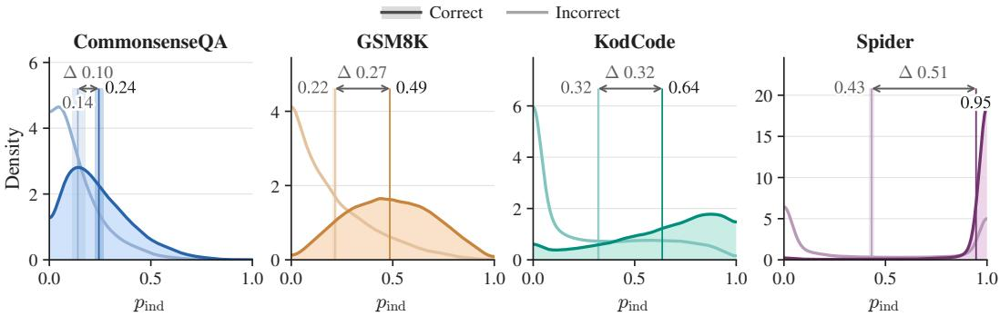  
Figure 4: The indistinguishability reward and verifier correctness on the Indist. training rollouts: kernel density estimates of $p _ { \mathrm { i n d } }$ for correct and incorrect responses, pooling the 8,000 rollouts of each of the three seeds (boundary-reflected, bandwidth 0.035); vertical lines mark the conditional means and their bands span the seeds. The optimized reward is log $p _ { \mathrm { i n d } } \mathrm { i n d } \cdot$ ; the probability scale is shown for interpretation. KodCode labels come from re-executing the hidden tests.

Table 4: Effects of the controlled interventions on log $p _ { \mathrm { i n d } }$ as described in Section 6.1. All 95% task-instance bootstrap intervals for semantic − style are above zero.
<table><tr><td>Domain</td><td>Semantic effect</td><td>Style magnitude</td><td>Semantic – style</td><td>Correct preferred</td></tr><tr><td>CommonsenseQA</td><td>1.247</td><td>0.667</td><td>0.579</td><td>91.5%</td></tr><tr><td>GSM8K</td><td>2.508</td><td>0.776</td><td>1.732</td><td>98.0%</td></tr><tr><td>KodCode</td><td>2.813</td><td>0.604</td><td>2.210</td><td>95.0%</td></tr><tr><td>Spider</td><td>4.277</td><td>0.565</td><td>3.712</td><td>100.0%</td></tr></table>

## 6.1 Counterfactual Interventions

For each domain, we sample 100 random correct responses of $A _ { \theta }$ during training. For each, we generate three variants. The first variant changes the answer as little as possible while rendering it incorrect. A fixed rule, not a language model, makes this edit: it replaces the final answer letter (CommonsenseQA) or number (GSM8K), flips one operator or constant of the program (KodCode, e.g. == to !=) or one SQL component (Spider, e.g. ASC to DESC), and keeps the first edit that the verifier confirms as valid but incorrect (Appendix F). The second variant prepends a comment-like prefix (domain-dependent) that preserves correctness. The third variant makes both edits. We then compute log $p _ { \mathrm { i n d } }$ on all 3 variants and the original answer.

Table 4 reports the results of the intervention study. Denote the original response as $y _ { 0 }$ , the incorrect version $z _ { \mathrm { 0 } } ,$ and the prefixed versions $y _ { 1 }$ and $z _ { 1 }$ respectively. Semantic effect is the average effect of changing just correctness – that is, $\begin{array} { r } { \frac { 1 } { 2 } \sum _ { i = 0 } ^ { 1 } \left( \log p _ { \mathrm { i n d } } ( y _ { i } ) - \log p _ { \mathrm { i n d } } ( z _ { i } ) \right) } \end{array}$ . Style magnitude is the same for adding the prefix, in absolute value $\begin{array} { r } { - \frac { 1 } { 2 } \sum _ { w \in \{ y , z \} } | \mathrm { l o g } p _ { \mathrm { i n d } } ( w _ { 0 } ) - \mathrm { l o g } p _ { \mathrm { i n d } } ( w _ { 1 } ) } \end{array}$ . Corrupting correctness lowers the reward in every domain and more than the prefix, with the correct version receiving the highest reward in 91.5% to 100% of comparisons.

These are but initial interventions studying “how” distinguishers play our Turing-Test-based game. In particular, the way we make responses incorrect in CommonsenseQA and GSM8K changes only the final answer, i.e. resulting in a response z where the final answer contradicts its explanation/derivation; the distinguisher could be rejecting this contradiction as its own doing. The prefix intervention is a single, fixed line. Future work could try more sophisticated variants of actor outputs to better isolate these effects.

## 7 Discussion and Future Directions

To our knowledge, this is the first work to use a domain-restricted Turing Test, where imitation is of a stronger model, as a training objective. We show that on multiple domains, learning to fool the distinguisher implicitly imparts gains in capability on that domain. Though we used the word “teacher” at times for the distinguisher, this teacher never generates answers nor correctness judgments; the objective is rooted only in indistinguishability. Our main study uses but one student, two teacher models, and small domains (1,000 training questions); a central open question is how this method scales (to more models, and larger/more varied domains; see Section 8 for a detailed description of limitations). Finally, our work initiates the study of Turing-test-based training on verifiable domains (i.e. beyond human-simulation), and as such we focused only on training the actor – the holy grail of Turing-test-based RL would be a GAN-like paradigm where both actor and distinguisher are trained adversarially against one another. As a simple first next step, what if we let the distinguisher choose the next question from the verifiable domain?

## 8 Limitations

We use one student (Qwen2.5-1.5B), one teacher in the main experiments (plus a closed-weight teacher in Section 5.4), and 1,000 training questions per domain. The small training set is deliberate: keeping the data fixed and controlled let us spend our compute on three training seeds for every condition, which is what separates the effect of the reward from the stochasticity of RL training. Even so, outside the failed Spider Quality run, between-seed standard deviations reach 4 percentage points, comparable to most of the gaps between methods, so we read the comparison with the baselines as evidence that the method is competitive rather than as a ranking. The closed-weight experiment of Section 5.4 is a proof of concept, with a single seed per domain. Given how regular the effect is with DeepSeek – every one of the twelve runs improves over $A _ { \mathrm { 0 } } - \mathrm { w e }$ expect it to hold across seeds, but this remains to be tested. Two further caveats concern the comparison and the teacher: SFT is not matched to the GRPO conditions in teacher budget, and the teacher’s pre-training data are unknown and may include the public benchmarks we use. The latter can affect the teacher’s own competence and the initial capability gap $\gamma _ { \mu } ,$ , though not the separation between training questions and held-out evaluation. Finally, because the distinguisher judges a response as a whole, nothing in the reward enforces the output format an evaluator expects; in a few runs the student drifted toward a format the evaluator rejects (Appendix I), which a light format check in the reward could prevent. We did not ablate the group size G, the KL coefficient, or the size of the training set.

## References

Rishabh Agarwal, Nino Vieillard, Yongchao Zhou, Piotr Stanczyk, Sabela Ramos, Matthieu Geist, and Olivier Bachem. On-policy distillation of language models: Learning from self-generated mistakes. In International Conference on Learning Representations, 2024. URL https://openreview.net/forum?id= 3zKtaqxLhW.

Ned Block. Psychologism and behaviorism. The Philosophical Review, 90(1):5–43, 1981. doi: 10.2307/2184371. URL https://doi.org/10.2307/2184371.

Zixiang Chen, Yihe Deng, Huizhuo Yuan, Kaixuan Ji, and Quanquan Gu. Self-play fine-tuning converts weak language models to strong language models. In Proceedings of the 41st International Conference on Machine Learning, 2024. URL https://arxiv.org/abs/2401.01335.

Karl Cobbe, Vineet Kosaraju, Mohammad Bavarian, Mark Chen, Heewoo Jun, Lukasz Kaiser, Matthias Plappert, Jerry Tworek, Jacob Hilton, Reiichiro Nakano, Christopher Hesse, and John Schulman. Training verifiers to solve math word problems. arXiv preprint arXiv:2110.14168, 2021. URL https://arxiv.org/abs/2110. 14168.

Tim R. Davidson, Viacheslav Surkov, Veniamin Veselovsky, Giuseppe Russo, Robert West, and Caglar Gulcehre. Self-recognition in language models. In Findings of the Association for Computational Linguistics: EMNLP 2024, pages 12032–12059, 2024. doi: 10.18653/v1/2024.findings-emnlp.703. URL https://aclanthology.org/2024.findings-emnlp.703/.

DeepSeek-AI. DeepSeek-V4: Towards highly efficient million-token context intelligence, 2026. URL https: //arxiv.org/abs/2606.19348.

Robert M. French. Subcognition and the limits of the Turing test. Mind, 99(393):53–65, 1990. doi: 10.1093/ mind/XCIX.393.53. URL https://doi.org/10.1093/mind/XCIX.393.53.

Patrick J. Hayes and Kenneth M. Ford. Turing test considered harmful. In Proceedings of the Fourteenth International Joint Conference on Artificial Intelligence, volume 1, pages 972–977, 1995. URL https: //www.ijcai.org/Proceedings/95-1/Papers/125.pdf.

Yoon Kim and Alexander M. Rush. Sequence-level knowledge distillation. In Proceedings ofEMNLP, pages 1317–1327, 2016. URL https://aclanthology.org/D16-1139/.

Zichen Liu, Changyu Chen, Wenjun Li, Penghui Qi, Tianyu Pang, Chao Du, Wee Sun Lee, and Min Lin. Understanding R1-Zero-like training: A critical perspective. In Conference on Language Modeling, 2025. URL https://arxiv.org/abs/2503.20783.

Lucie Charlotte Magister, Jonathan Mallinson, Jakub Adamek, Eric Malmi, and Aliaksei Severyn. Teaching small language models to reason. In Proceedings of the 61st Annual Meeting of the Association for Computational Linguistics (Volume 2: Short Papers), pages 1773–1781, 2023. doi: 10.18653/v1/2023.acl-short.151. URL https://aclanthology.org/2023.acl-short.151/.

Daniel Mitropolsky, Riccardo Neumarker, Emanuele Rimoldi, Susan S. Hong, and Tomaso Poggio. Generalizing the Turing Test to Interactive Agents. arXiv preprint arXiv:2605.10851, 2026. doi: 10.48550/arXiv.2605. 10851. URL https://arxiv.org/abs/2605.10851.

Arjun Panickssery, Samuel R. Bowman, and Shi Feng. LLM evaluators recognize and favor their own generations. In Advances in Neural Information Processing Systems, 2024. URL https://arxiv.org/abs/2404. 13076.

Zhihong Shao, Peiyi Wang, Qihao Zhu, Runxin Xu, Junxiao Song, Xiao Bi, et al. DeepSeekMath: Pushing the limits of mathematical reasoning in open language models. arXiv preprint arXiv:2402.03300, 2024. URL https://arxiv.org/abs/2402.03300.

Yiyang Shen, Lifu Tu, and Weiran Wang. Reinforcement learning-based semi-supervised knowledge distillation with LLM-as-a-judge. arXiv preprint arXiv:2604.02621, 2026. URL https://arxiv.org/abs/2604. 02621v2.

Alon Talmor, Jonathan Herzig, Nicholas Lourie, and Jonathan Berant. CommonsenseQA: A question answering challenge targeting commonsense knowledge. In Proceedings ofNAACL-HLT, pages 4149–4158, 2019. doi: 10.18653/v1/N19-1421. URL https://aclanthology.org/N19-1421/.

Alan M. Turing. Computing machinery and intelligence. Mind, 59(236):433–460, 1950. doi: 10.1093/mind/ LIX.236.433. URL https://academic.oup.com/mind/article/LIX/236/433/986238.

Yingshan Susan Wang, Cedegao E. Zhang, Linlu Qiu, Zexue He, Pengyuan Li, Alex Pentland, Roger P. Levy, and Yoon Kim. Learning user simulators with Turing rewards. arXiv preprint arXiv:2606.19336, 2026. URL https://arxiv.org/abs/2606.19336.

Zhangchen Xu, Yang Liu, Yueqin Yin, Mingyuan Zhou, and Radha Poovendran. KodCode: A diverse, challenging, and verifiable synthetic dataset for coding. In Findings of the Association for Computational Linguistics: ACL 2025, pages 6980–7008, 2025. doi: 10.18653/v1/2025.findings-acl.365. URL https://aclanthology.org/2025.findings-acl.365/.

An Yang, Baosong Yang, Beichen Zhang, Binyuan Hui, Bo Zheng, Bowen Yu, Chengyuan Li, Dayiheng Liu, Fei Huang, Haoran Wei, et al. Qwen2.5 technical report. arXiv preprint arXiv:2412.15115, 2024. URL https://arxiv.org/abs/2412.15115.

Tao Yu, Rui Zhang, Kai Yang, Michihiro Yasunaga, Dongxu Wang, Zifan Li, James Ma, Irene Li, Qingning Yao, Shanelle Roman, Zilin Zhang, and Dragomir Radev. Spider: A large-scale human-labeled dataset for complex and cross-domain semantic parsing and text-to-SQL task. In Proceedings ofEMNLP, pages 3911–3921, 2018. doi: 10.18653/v1/D18-1425. URL https://aclanthology.org/D18-1425/.

Lianmin Zheng, Wei-Lin Chiang, Ying Sheng, Siyuan Zhuang, Zhanghao Wu, Yonghao Zhuang, Zi Lin, Zhuohan Li, Dacheng Li, Eric P. Xing, Hao Zhang, Joseph E. Gonzalez, and Ion Stoica. Judging LLM-as-a-judge with MT-Bench and Chatbot Arena. Advances in Neural Information Processing Systems, 36, 2023. URL https://arxiv.org/abs/2306.05685.

Chenyu Zhou. More convincing, not more correct: Self-play reward hacking of reference-free LLM judges. arXiv preprint arXiv:2607.05904, 2026. URL https://arxiv.org/abs/2607.05904.

## A Datasets

CommonsenseQA (Talmor et al., 2019) asks five-way multiple-choice commonsense questions; GSM8K (Cobbe et al., 2021) asks grade-school math word problems with a numeric answer; KodCode (Xu et al., 2025) asks for Python functions checked by hidden unit tests; Spider (Yu et al., 2018) asks for SQL queries over unseen database schemas.

Table 5: Training prompts and held-out items per domain.
<table><tr><td>Dataset</td><td>Output and check</td><td>Train</td><td>Held-out</td></tr><tr><td></td><td>CommonsenseQA Explanation + A-E; exact answer key</td><td>1,000</td><td>1,221</td></tr><tr><td>GSM8K</td><td>Reasoning + number; exact normalized value</td><td>1,000</td><td>1,319</td></tr><tr><td>KodCode</td><td>Python program; hidden-test execution</td><td>1,000</td><td>992</td></tr><tr><td>Spider</td><td>SQL query; execution equivalence</td><td>1,000</td><td>1,034</td></tr></table>

## B Teacher Selection

The actor is Qwen2.5-1.5B-Instruct (Yang et al., 2024). We select DeepSeek V4 Flash as teacher and distinguisher because it returns single-token judgments with top log-probabilities and separates its own responses from those of $A _ { 0 }$ in every domain. The teacher is the April 2026 release of DeepSeek V4 Flash (DeepSeek-AI, 2026) (open weights deepseek-ai/DeepSeek-V4-Flash), queried through OpenRouter as deepseek/deepseek-v4-flash (canonical slug deepseek/ deepseek-v4-flash-20260423), pinned to the StreamLake provider without fallback and with reasoning disabled. Responses from any other provider are rejected, and the reward and teacher-corpus calls also verify the reported model. For each domain, DeepSeek and $A _ { 0 }$ each answer 100 training prompts, and a judge instantiated from the same model scores the 200 responses in anonymized order with the probability that each is its own. Table 6 reports the source-attribution AUC and the paired gap in $p _ { \mathrm { i n d } } ,$ an estimate $\hat { \delta } _ { \mu }$ of the distinguishability gap before training. The probe prompts come from the training data, not the held-out test, and the screen precedes any policy update. The table also reports the capability gap $\gamma _ { \mu } .$ the teacher answers the held-out test items with the $A _ { 0 }$ prompts, greedy decoding, and at most 768 tokens, and is scored by the same evaluators as the actor. The teacher is stronger than $A _ { 0 }$ by 26 to 41 points in every domain.

Table 6: Teacher selection. Capability: held-out accuracy of the teacher and of $A _ { 0 }$ under the same evaluator, and their difference $\gamma _ { \mu }$ (percentage points). Distinguishability: AUC ranks 100 teacher responses against 100 $A _ { 0 }$ responses; the gap $\hat { \delta } _ { \mu }$ in $p _ { \mathrm { i n d } }$ is paired over training samples.
<table><tr><td rowspan="2">Domain</td><td colspan="3">Capability (held-out accuracy)</td><td colspan="4">Distinguishability (training prompts)</td></tr><tr><td>Teacher</td><td> $\mathbf { A _ { 0 } }$ </td><td> $\gamma _ { \mu }$ </td><td>AUC</td><td> $\mathbb { E } _ { D } p _ { \mathrm { i n d } }$ </td><td> $\mathbb { E } _ { A _ { 0 } p _ { \mathrm { i n d } } }$ </td><td> $\hat { \delta } _ { \mu }$ </td></tr><tr><td>CommonsenseQA</td><td>83.7%</td><td>57.9%</td><td>25.8</td><td>.821</td><td>.347</td><td>.157</td><td>.190</td></tr><tr><td>GSM8K</td><td>96.3%</td><td>55.7%</td><td>40.6</td><td>.645</td><td>.431</td><td>.318</td><td>.113</td></tr><tr><td>KodCode</td><td>67.1%</td><td>38.8%</td><td>28.3</td><td>.754</td><td>.630</td><td>.351</td><td>.279</td></tr><tr><td>Spider</td><td>78.2%</td><td>47.9%</td><td>30.3</td><td>.730</td><td>.963</td><td>.638</td><td>.325</td></tr></table>

## C Training and Generation Details

Table 7: Experiment parameter configuration.
<table><tr><td>Setting</td><td>Value</td></tr><tr><td>Actor</td><td>Qwen2.5-1.5B-Instruct</td></tr><tr><td>Seeds</td><td>23, 42, 7</td></tr><tr><td>Training samples</td><td>1,000</td></tr><tr><td>Epochs</td><td>2</td></tr><tr><td>GRPO group size</td><td>4</td></tr><tr><td>Rewarded rollouts per run</td><td>8,000</td></tr><tr><td>Generation batch size</td><td>8</td></tr><tr><td>Training batch size</td><td>4</td></tr><tr><td>Maximum prompt / completion tokens</td><td>4,096 / 768</td></tr><tr><td>Actor sampling</td><td>temperature .6, top-p 1.0</td></tr><tr><td>Held-out decoding</td><td>greedy, at most 768 new tokens</td></tr><tr><td>Judge sampling</td><td>temperature 0, one output token, top-5 log-probabilities</td></tr><tr><td>Optimizer schedule</td><td>learning rate 3  $\times 1 0 ^ { - 5 }$  , constant, no warm-up</td></tr><tr><td>Objective</td><td>GRPO, fixed-length loss normalization, group scaling,  $\beta = . 0 0 3$ </td></tr><tr><td>Truncated responses</td><td>omitted from the loss</td></tr><tr><td>LoRA</td><td>rank 32, α = 32, dropout .05; attention + MLP projections</td></tr><tr><td>Training steps</td><td>2,000 (SFT: 500)</td></tr></table>

## C.1 Implemented GRPO Objective

Advantages are the rewards standardized within each prompt’s group of $G = 4$ responses (group mean subtracted, divided by the group standard deviation). A generation batch holds two prompts, i.e. eight responses, which are shuffled and split into two optimizer minibatches of $B = 4 ;$ each response is used once. For one minibatch the loss is

$$
\mathcal { L } _ { \mathrm { G R P O } } ( \theta ) = - \frac { 1 } { B L _ { \mathrm { m a x } } } \sum _ { i = 1 } ^ { B } m _ { i } \sum _ { t = 1 } ^ { | y _ { i } | } \left[ \operatorname* { m i n } \Bigl \{ \rho _ { i , t } ( \theta ) \widehat { A } _ { i } , \mathrm { c l i p } _ { 1 - \epsilon } ^ { 1 + \epsilon } ( \rho _ { i , t } ( \theta ) ) \widehat { A } _ { i } \Bigr \} - \beta d _ { i , t } ( \theta ) \right] ,\tag{4}
$$

with $\rho _ { i , t } = \pi _ { \theta } ( y _ { i , t } \mid x _ { i } , y _ { i , < t } ) / \pi _ { \mathrm { o l d } } ( y _ { i , t } \mid x _ { i } , y _ { i , < t } )$ and $d _ { i , t } = \pi _ { \mathrm { r e f } } / \pi _ { \theta } - \log ( \pi _ { \mathrm { r e f } } / \pi _ { \theta } ) - 1$ evaluated on the same token, $\pi _ { \mathrm { r e f } } = A _ { 0 } , m _ { i } = 0$ for truncated responses, $L _ { \operatorname* { m a x } } = 7 6 8 , \epsilon = . 2$ , and $\beta = . 0 0 3 ;$ token probabilities use temperature $T = . 6$ . Since $\pi _ { \mathrm { o l d } }$ generated the batch, $\rho _ { i , t }$ departs from one only in its second minibatch. The fixed denominator $B L _ { \mathrm { m a x } }$ is the Dr. GRPO length correction (Liu et al., 2025); group standardization is retained.

## C.2 Choice of Reward Form

The attribution judgment can be turned into a reward in several ways, and under GRPO only the ordering and spacing of the rewards within a group matter. Before the main experiments we compared four forms in a short pilot: $p _ { \mathrm { i n d } } , \log p _ { \mathrm { i n d } }$ , the logit $\ell _ { 1 } - \ell _ { 0 } .$ , and the binary verdict $1 \{ p _ { \mathrm { i n d } } > \frac { 1 } { 2 } \}$ . Each arm trains the same actor against the same teacher, with the learning rate, KL coefficient, and group size of Table 7, for 374 updates on GSM8K and KodCode (seed 23), and is scored on 300 validation items (299 for KodCode), disjoint from the held-out test, after 187 and 374 updates. The selection rule, fixed in advance, maximizes the validation gain over A0 averaged over the two domains. log pind gives the largest gain in both domains (Table 8) and is the form used throughout the paper. The binary verdict, which keeps the decision but discards the teacher’s confidence, gives the smallest mean gain.

Table 8: Reward-form pilot: validation accuracy gain over $A _ { 0 }$ (percentage points; 300 validation items for GSM8K and 299 for KodCode; best of the checkpoints after 187 and 374 updates, one seed). $A _ { 0 }$ scores 60.7% on GSM8K and 45.8% on KodCode. Bootstrap standard errors of the mean gain are 1.8 to 2.0 points.
<table><tr><td>Form</td><td>Reward</td><td>GSM8K</td><td>KodCode</td><td>Mean</td></tr><tr><td>Log probability (ours)</td><td> $\log p _ { \mathrm { i n d } }$ </td><td>+21.0</td><td>+5.7</td><td>+13.3</td></tr><tr><td>Logit</td><td> $\ell _ { 1 } - \ell _ { 0 }$ </td><td>+15.0</td><td>+3.7</td><td>+9.3</td></tr><tr><td>Probability</td><td> $p _ { \mathrm { i n d } }$ </td><td>+17.7</td><td>+0.3</td><td>+9.0</td></tr><tr><td>Binary verdict</td><td> $\mathbf { \bar { 1 } } \{ p _ { \mathrm { i n d } } > \frac { 1 } { 2 } \}$ </td><td>+11.7</td><td>+3.0</td><td>+7.3</td></tr></table>

## D Held-out Accuracy per Seed

Table 9 lists the held-out accuracy of each run separately.

Table 9: Held-out accuracy of every training seed at the terminal checkpoint, for the runs averaged in Table 2. $A _ { 0 }$ is frozen and has no seed. Bold marks the best score of each row.
<table><tr><td colspan="2"></td><td colspan="2">Not correctness-based</td><td colspan="3">Correctness-based</td></tr><tr><td>Dataset</td><td>Seed</td><td> $\mathbf { A _ { 0 } }$ </td><td>Indist.</td><td>Quality</td><td>SFT</td><td>Oracle</td></tr><tr><td rowspan="3">CommonsenseQA</td><td>23</td><td></td><td>72.8</td><td>70.8</td><td>71.6</td><td>67.9</td></tr><tr><td>42</td><td>57.9</td><td>66.3</td><td>72.9</td><td>70.6</td><td>70.3</td></tr><tr><td>7</td><td></td><td>71.9</td><td>71.4</td><td>71.7</td><td>68.9</td></tr><tr><td rowspan="3">GSM8K</td><td>23</td><td></td><td>67.4</td><td>69.7</td><td>68.1</td><td>71.3</td></tr><tr><td>42</td><td>55.7</td><td>68.3</td><td>68.4</td><td>69.6</td><td>71.9</td></tr><tr><td>7</td><td></td><td>70.6</td><td>68.6</td><td>68.2</td><td>72.5</td></tr><tr><td rowspan="3">KodCode</td><td>23</td><td>38.8</td><td>46.0</td><td>45.4</td><td>42.2</td><td>43.2</td></tr><tr><td>42</td><td></td><td>44.5</td><td>47.4</td><td>41.7</td><td>50.4</td></tr><tr><td>7</td><td></td><td>42.3</td><td>44.4</td><td>40.8</td><td>47.5</td></tr><tr><td rowspan="3">Spider</td><td>23</td><td>47.9</td><td>55.2</td><td>0.0</td><td>60.7</td><td>56.6</td></tr><tr><td>42</td><td></td><td>62.4</td><td>61.5</td><td>62.8</td><td>63.5</td></tr><tr><td>7</td><td></td><td>61.7</td><td>60.3</td><td>61.3</td><td>56.8</td></tr></table>

## E Training Diagnostics

Figures 5 and 6 show the optimization traces of all GRPO runs (three seeds per condition): faint lines are the logged values of each seed and bold lines a 51-step centered average of their mean. All runs are numerically stable: the loss oscillates around zero, clipping and gradient norms stay small, and a few isolated gradient spikes, mostly in Quality and Oracle runs, are absorbed by the next updates. The one marked trend is the entropy of the CommonsenseQA Oracle runs, which drops within the first updates as two of the three seeds collapse to four-token answers (Appendix I).

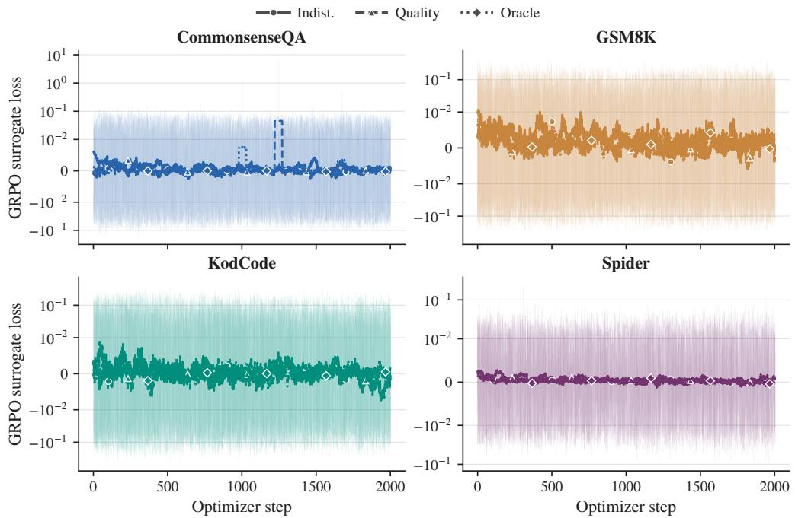  
Figure 5: GRPO surrogate loss of all GRPO runs (symmetric-log scale).

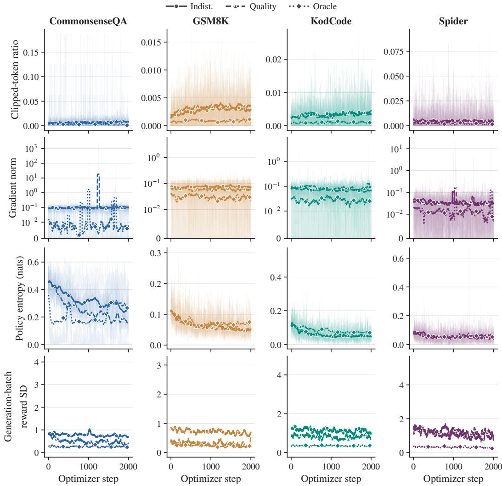  
Figure 6: Clipped-token ratio, pre-clipping gradient norm, token entropy, and generation-batch reward standard deviation (rows) of all GRPO runs, by dataset (columns).

## F Counterfactual Intervention Protocol and Examples

For each domain, we select 100 correct, format-valid training responses and construct four variants by crossing a local semantic corruption with a fixed formatting prefix:

$$
C _ { 0 } = \mathrm { c o r r e c t o r i g i n a l } ,
$$

$$
C _ { 1 } = \mathrm { c o r r e c t ~ w i t h ~ p r e f i x } ,
$$

$$
I _ { 0 } = \mathrm { i n c o r r e c t o r i g i n a l } ,
$$

$$
I _ { 1 } = \mathrm { i n c o r r e c t w i t h p r e f i x } .
$$

Semantic edits preserve as much text as possible. The deterministic verifier must confirm that the edited response remains format-valid and verifiable but becomes incorrect: a parseable query or runnable program can still fail correctness checks. We change the final choice in CommonsenseQA, the reported number in GSM8K, a local program token or operator in KodCode, or a local SQL component in Spider. Examples follow below.

The formatting intervention prepends the fixed, domain-specific label below without modifying the remainder of the response.

<table><tr><td>Dataset</td><td>Prefix added to the response</td></tr><tr><td>CommonsenseQA, GSM8K</td><td>### Candidate response</td></tr><tr><td>KodCode</td><td># Candidate response</td></tr><tr><td>Spider</td><td>-- Candidate response</td></tr></table>

The verifier confirms that the prefix preserves the correctness label: $C _ { 0 }$ and $C _ { 1 }$ must both remain correct, while $I _ { 0 }$ and $I _ { 1 }$ must both remain valid and incorrect. Candidate order is hidden from the discriminator and deterministically shuffled before scoring.

Section 6.1 defines the semantic effect, the mean of log $p _ { \mathrm { i n d } } ( y _ { i } ) - \log p _ { \mathrm { i n d } } ( z _ { i } )$ over the two prefix conditions, and the style magnitude, the mean of $| \log p _ { \mathrm { i n d } } ( V _ { 0 } ) - \log p _ { \mathrm { i n d } } ( V _ { 1 } )$ | over the correct and incorrect versions. A positive semantic effect favors correct responses; the style magnitude counts either direction of prefix-induced change. Their difference compares the two effects.

The incorrect version is produced by a fixed rule. Each rule lists candidate edits in a fixed order and keeps the first one the verifier confirms as valid but incorrect. CommonsenseQA replaces the final answer letter with the first wrong letter (100 of 100 responses). GSM8K replaces the final number n with n + 1 (100 of 100). KodCode flips one Python token, trying ==/!=, </>, <=/>=, +/-, \*→+, and/or, and True/False in order of appearance (96 of 100); when none makes the program fail, it inserts raise AssertionError at the start of the function (4 of 100). Spider flips one SQL component, trying ASC/DESC, AND/OR, a comparison operator, or MAX/MIN (69 of 100); otherwise it appends LIMIT 0 (30 of 100) or replaces the query by SELECT 0 (1 of 100). These Spider fallbacks change the response more than a local edit.

## F.1 Local Semantic Edits

Unchanged task and response text is omitted; every edit is checked by the domain verifier.

## CommonsenseQA.

Keep the explanation unchanged; change the final choice only.   
Correct: Answer: B   
Incorrect: Answer: A

## GSM8K.

Keep the derivation yielding 796 unchanged; change the reported answer only.   
Correct: Answer: 796   
Incorrect: Answer: 797

## KodCode.

Keep the rest of the program unchanged; change one operator.   
Correct: return a + b   
Incorrect: return a - b

## Spider.

Keep the SQL statement unchanged except for a result-altering clause.   
Correct: SELECT COUNT(\*) FROM Album;   
Incorrect: SELECT COUNT(\*) FROM Album LIMIT 0;

## G Prompts

Every prompt is a single user message with no system prompt; [TASK] is the actor’s task prompt and [CANDIDATE] the actor’s response.

Quality judge. Asks whether the candidate correctly solves the task.

You are a strict task-solution correctness evaluator.   
Judge only whether the candidate fully and correctly solves the supplied task.   
Do not judge authorship, style, similarity to another model, or whether you   
would have written it. You are not given a reference answer. Return exactly one   
character: 1 for a fully correct solution, or 0 otherwise.   
Task:   
[TASK]   
Candidate solution:   
[CANDIDATE]   
Label (0 or 1):

The first-token log-probabilities of the two labels give the Quality reward, and Oracle uses the verifier bit:

$$
q = \frac { e ^ { \ell _ { 1 } } } { e ^ { \ell _ { 0 } } + e ^ { \ell _ { 1 } } } , \quad r _ { \mathrm { q u a l i t y } } = \log \mathrm { c l i p } ( q , 1 0 ^ { - 6 } , 1 - 1 0 ^ { - 6 } ) ;\tag{5}
$$

$$
r _ { \mathrm { o r a c l e } } ( x , y ) = V ( x , y ) \in \{ 0 , 1 \} .\tag{6}
$$

Attribution prompts. One frozen prompt per domain asks the teacher whether it wrote the candidate; the Spider prompt asks whether it would plausibly have produced it.

## CommonsenseQA attribution prompt.

You will be shown a commonsense multiple-choice question and one anonymized candidate   
response.   
The response may have been written by you, or it may have been written by another   
model answering the same question.   
Your objective is not to judge whether the response is better in general.   
Your objective is to decide whether this response was written by you, based on   
your own reasoning choices, reasoning strategy, use of commonsense knowledge,   
explanation structure, treatment of alternatives, and level of detail.   
Task:   
[TASK]   
Candidate response:   
[CANDIDATE]   
Was this response written by you?   
Your entire response must be exactly one ASCII character: 0 or 1.   
Do not output a word, prefix, whitespace, punctuation, or explanation.   
Return exactly one token:   
1 = yes, this was written by me   
0 = no, this was not written by me   
Output:

## GSM8K attribution prompt.

You will be shown a grade-school mathematics problem and one anonymized   
candidate solution.   
The solution may have been written by you, or it may have been written by   
another model solving the same problem.   
Your objective is not to judge whether the solution is better in general.   
Your objective is to decide whether this solution was written by you, based on   
your own reasoning choices, problem-solving strategy, arithmetic decomposition,   
explanation structure, calculation choices, and level of detail.   
Task:   
[TASK]   
Candidate solution:   
[CANDIDATE]   
Was this solution written by you?   
Return exactly one token:   
1 = yes, this was written by me   
0 = no, this was not written by me   
Answer:

## KodCode attribution prompt.

You will be shown a Python programming task and one anonymized candidate solution.   
The solution may have been written by you, or it may have been written by another   
model solving the same task.   
Your objective is not to judge whether the solution is better in general.   
Your objective is to decide whether this solution was written by you, based on   
your own coding choices, implementation strategy, Python idioms, formatting,   
naming conventions, edge-case handling, and level of detail.   
Task:   
[TASK]   
Candidate solution:   
[CANDIDATE]   
Was this solution written by you?   
Return exactly one token:   
1 = yes, this was written by me   
0 = no, this was not written by me   
Answer:

## Spider attribution prompt.

You are DeepSeek V4 Flash. You are given a text-to-SQL task and one candidate response.   
Task:   
[TASK]   
Candidate response:   
[CANDIDATE]   
Would you plausibly have produced this candidate response yourself for this task?   
Return exactly one token: 1 for yes or 0 for no.

## H Additional Reward Diagnostics

## H.1 Calibration and Controls

Table 10 reports, for the three Indist. seeds, how far $p _ { \mathrm { i n d } }$ is from a calibrated probability of correctness and how much correctness explains log $p _ { \mathrm { i n d } }$ beyond measured surface properties of the response. Each training rollout is described by 22 surface features computed from its text: length (log characters, words, and lines; mean word length), presence of the answer marker and whether it is the last line, format and evaluator validity, truncation and near-truncation, markdown emphasis and code fences, the fractions of bullet, numbered-step, equation, and comment lines, numeric and punctuation density, the densities of first-person, hedging, and concluding words, and word overlap with the prompt. Design controls are training progress, the visit (first or second epoch), and the rollout index; promptlevel difficulty features (declared difficulty, prompt and reference length, numeric count, reference complexity) enter the cross-validated models.

Cal. gap is mean $p _ { \mathrm { i n d } }$ minus the share of correct rollouts, and ECE the expected calibration error over ten equal-frequency bins. Partial r is the Pearson correlation between log $p _ { \mathrm { i n d } }$ and correctness after both are centered within each prompt and residualized, by a ridge regression $( \alpha = 1 )$ , on the centered surface and design features. $\Delta \hat { R } _ { C } ^ { 2 }$ and $\Delta R _ { F } ^ { 2 }$ compare out-of-fold $R ^ { 2 }$ of ridge models of log $p _ { \mathrm { i n d } }$ (five folds grouped by prompt): $\Delta R _ { C } ^ { 2 }$ is the gain from adding correctness to the difficulty, design, and surface features, and $\Delta R _ { F } ^ { 2 }$ the gain from adding the surface features to the difficulty, design, and correctness variables.

Table 10: Calibration and within-prompt controls, mean ± SD over the three Indist. seeds. Cal. gap is mean $p _ { \mathrm { i n d } }$ minus correctness rate; ECE is expected calibration error. Partial r is the within-prompt correlation between correctness and log $p _ { \mathrm { i n d } }$ after measured controls. $\Delta R _ { C } ^ { 2 }$ adds correctness after measured format and style features; $\Delta \bar { R } _ { F } ^ { 2 }$ adds those features after correctness.
<table><tr><td>Domain</td><td>Cal. gap</td><td></td><td>ECE Partial r</td><td> $\Delta R _ { C } ^ { 2 }$ </td><td> $\Delta R _ { F } ^ { 2 }$ </td></tr><tr><td>CommonsenseQA</td><td> $- . 4 4 \pm . 0 9$ </td><td> $. 4 4 \pm . 0 9$ </td><td> $. 1 6 \pm . 0 5$ </td><td> $. 1 4 \pm . 0 1$ </td><td> $. 0 3 \pm . 0 3$ </td></tr><tr><td>GSM8K</td><td> $- . 3 7 \pm . 0 1$ </td><td> $. 3 7 \pm . 0 1$ </td><td> $. 3 8 \pm . 0 3$ </td><td> $. 1 9 \pm . 0 1$ </td><td> $. 0 5 \pm . 0 1$ </td></tr><tr><td>KodCode</td><td> $+ . 0 2 \pm . 0 2$ </td><td> $. 0 9 \pm . 0 1$ </td><td> $. 2 8 \pm . 0 4$ </td><td> $. 1 5 \pm . 0 2$ </td><td> $. 0 2 \pm . 0 0$ </td></tr><tr><td>Spider</td><td> $+ . 1 5 \pm . 0 0$ </td><td> $. 1 6 \pm . 0 1$ </td><td> $. 4 0 \pm . 0 3$ </td><td> $. 2 0 \pm . 0 1$ </td><td> $. 0 1 \pm . 0 1$ </td></tr></table>

## H.2 Within-Prompt Reward Gap

Figure 7 compares, for every prompt whose eight seed-23 training rollouts include both correct and incorrect responses, the mean log $p _ { \mathrm { i n d } }$ of its correct and incorrect rollouts. The correct ones receive the higher mean reward in 71.4%, 83.0%, 78.1%, and 89.5% of these prompts.

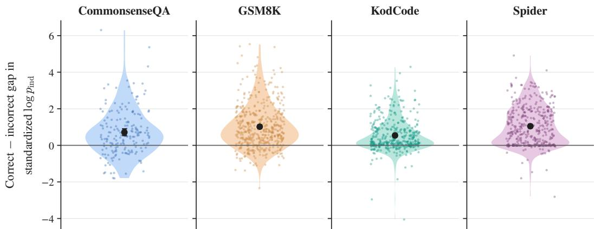  
Figure 7: One point per prompt whose eight seed-23 rollouts include both correct and incorrect responses: mean log $p _ { \mathrm { i n d } }$ of the correct rollouts minus that of the incorrect ones, after standardizing log $p _ { \mathrm { i n d } }$ within each domain. Black: mean gap and its 95% bootstrap interval.

## H.3 Reward and the Teacher’s Correctness Judgment

We scored the 8,000 training rollouts of each Indist. seed and domain a second time with the Quality prompt, which asks the same teacher whether the response is correct, and compared the two logprobabilities (Figure 8). They move together, weakly on CommonsenseQA and strongly on Spider. Averaged over the three seeds, Spearman ρ is .59, .57, .81, and .89, and log q explains 31%, 41%,

63%, and 77% of the variance of log $p _ { \mathrm { i n d } }$ (5%, 29%, 34%, and 53% within prompts). As detectors of correct responses, $p _ { \mathrm { i n d } }$ reaches an AUC of .72, .83, .78, and .88 and q of .80, .89, .80, and .87: the correctness judgment is ahead by .06 to .08 on CommonsenseQA and GSM8K, and the two are within .02 of each other on KodCode and Spider. The seeds agree closely: between-seed standard deviations are at most .03 for $\rho$ and $R ^ { 2 }$ and at most .05 for the AUCs.

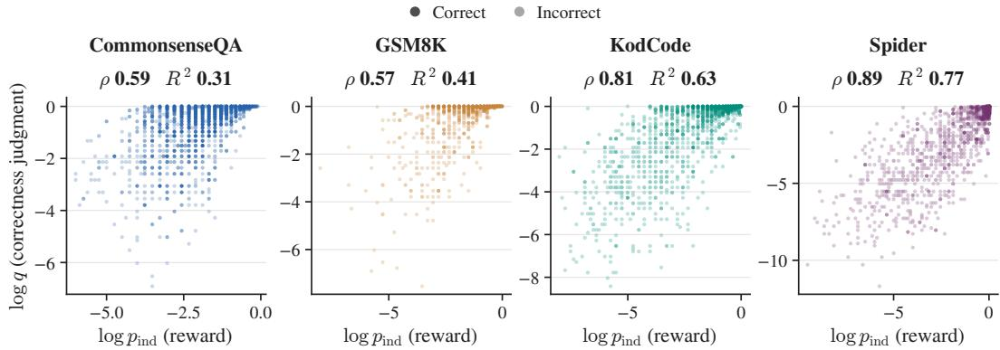  
Figure 8: log $p _ { \mathrm { i n d } }$ against log q, the log-probability that the same teacher, asked whether the response is correct, assigns to “correct”, on the training rollouts of the three Indist. seeds (2,502 points per domain, drawn equally from each seed); titles give Spearman $\rho$ and the $R ^ { 2 }$ of a linear fit, averaged over seeds.

## H.4 Repeated Training Prompts

Each prompt is visited once in each epoch. From the first to the second visit, mean $p _ { \mathrm { i n d } }$ rises in all twelve Indist. runs, by .021 to .057, while verifier correctness rises in ten of them and falls in two, by 3.9 points on GSM8K (seed 23) and 0.5 on KodCode (seed 42). On Spider, mean $p _ { \mathrm { i n d } }$ of incorrect responses rises from .36–.40 to .47–.49 in every seed while that of correct responses stays near .95: a higher reward does not guarantee higher correctness.

## I Outlying Runs

Spider, Quality seed 23 (0.0%). This run is an instance of format drift. The evaluator accepts a bare query or a single isolated code fence, and 1,030 of the run’s 1,034 held-out responses instead wrap a fenced SQL query in prose. The drift emerges during training: none of the first 400 rollouts has this format and 391 of the last 400 do, while the Quality judge gives 270 of these 391 rollouts $\begin{array} { r } { q > \frac { 1 } { 2 } } \end{array}$ . The judged reward does not rise during the drift (−1.10 to −1.41 over the first and last 400 rollouts), so the judge simply fails to penalize a format the evaluator rejects. The drift is visible in the response length (Figure 9): this run grows from about 30 to 67 tokens, while every other Spider run stays between 21 and 41.

CommonsenseQA, Oracle. Two of the three Oracle seeds collapse to four-token answers (Answer: X): seed 23 falls from 82 tokens to at most five by step 15, seed 7 collapses and recovers after step 1,400, and seed 42 never collapses. Four such answers to one question almost always agree, so 87% to 98% of the groups of seed 23 have no reward contrast and its token entropy falls from .118 to .022. Seed 23 ends at 67.9%, against 68.9% and 70.3% for the other seeds.

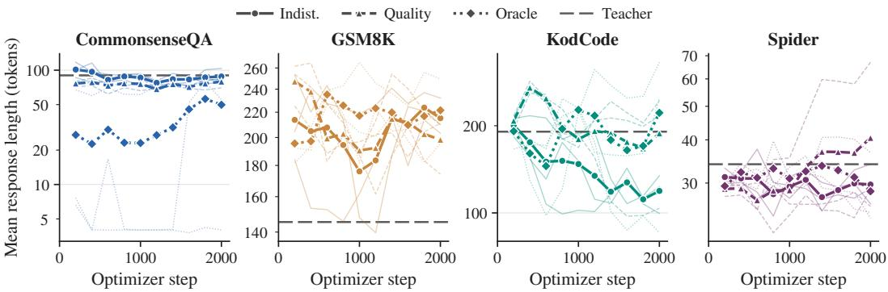  
Figure 9: Mean response length of the training rollouts under each reward, in 200-update bins; thin lines are single seeds and bold lines their mean. The dashed line is the mean length of the teacher’s own 1,000 completions per domain.

## J Relations Between the Source-Attribution Tests

The following reductions assume equal source priors and uniformly randomized pair order. Generation and judgment use separate, stateless calls, and a fresh reference is drawn independently from the same teacher distribution, conditional on the task. All calls receive the same task; its notation is suppressed in these reductions.

Proposition 1 (From one-message to paired attribution). Suppose a LM D distinguishes the 1-message variant with probability $\geq { \frac { 1 } { 2 } } + \epsilon .$ . Then, with one call to $D$ one can distinguish the paired-message variant with probability $\geq { \frac { 1 } { 2 } } + \epsilon .$

Proof. Let $D ( m )$ be the random variable of $D ' \mathrm { s }$ output in the 1-message variant on response m. Given paired responses $m _ { 1 } , m _ { 2 }$ , call $D ( m _ { 1 } )$ and output $( D , A )$ if it returns 1, and $( A , D )$ otherwise. Under uniform pair order, its success probability is

$$
\begin{array} { r } { \frac { 1 } { 2 } \operatorname* { P r } [ D ( m _ { D } ) = 1 ] + \frac { 1 } { 2 } \operatorname* { P r } [ D ( m _ { A } ) = 0 ] \geq \frac { 1 } { 2 } + \epsilon } \end{array}
$$

by the one-message hypothesis.

One can instead query the one-message judge on both responses. If its labels differ, (1, 0) or (0, 1), return $( D , A )$ or $\bar { ( } A , \bar { D } )$ respectively; if they coincide, choose the assignment uniformly at random. This particular rule has the same success probability as the one-query reduction:

Proof. Let $U = D ( m _ { D } )$ and $V = D ( m _ { A } )$ be the two binary verdicts. Then

$$
\begin{array} { r l } & { \mathrm { P r } [ \mathrm { s u c c e s s } ] = \mathrm { P r } [ U = 1 , V = 0 ] + \frac { 1 } { 2 } \mathrm { P r } [ U = V ] } \\ & { \qquad = \frac { 1 } { 2 } \big ( \mathrm { P r } [ U = 1 ] + \mathrm { P r } [ V = 0 ] \big ) , } \end{array}
$$

which is the success probability of the one-message judge under equal source priors. This identity does not require independence between U and V. □

Proposition 2 (From paired to one-message attribution). Suppose a LM D distinguishes the paired-message variant with probability $\geq { \frac { 1 } { 2 } } + \epsilon .$ . Then one judgment call and one independent generation call to D suffice to distinguish the 1-message variant with probability $\geq \frac { 1 } { 2 } + \frac { \epsilon } { 2 } .$

Proof. We are given a response m with an unknown source $S \in \{ D , A \}$ , under equal source priors. Independently generate $m _ { D }$ from $D$ and draw $b \sim$ Bernoulli $( \bar { 1 / 2 } )$ . If $b = 0 ,$ query $D ( m , m _ { D } )$ otherwise query $D ( m _ { D } , m )$ . If the judge selects the position of our local reference $m _ { D } ,$ , output A; otherwise output $D$

If $S = D _ { \mathrm { { ; } } }$ , m and the independently generated $m _ { D }$ are identically distributed conditional on the task. By exchangeability and the uniform position bit, the stateless judge selects our local reference with probability exactly $1 / 2 ,$ , averaging over the two samples and b. This need not hold conditional on a fixed position for a position-biased judge. Hence the reduction correctly outputs D with probability $1 / 2$ in this case.

If $S = A$ , this is exactly the randomized paired-message experiment. The reduction outputs A whenever the judge correctly selects $m _ { D }$ , which occurs with probability at least $1 / 2 + \epsilon$

Overall we have that, in the 1-message variant, we distinguish with probability

$$
\begin{array} { l } { \frac { 1 } { 2 } \operatorname* { P r } [ \operatorname { c o r r e c t } \mid S = D ] + \frac { 1 } { 2 } \operatorname* { P r } [ \operatorname { c o r r e c t } \mid S = A ] } \\ { \geq \cfrac { 1 } { 2 } \cdot \frac { 1 } { 2 } + \cfrac { 1 } { 2 } \left( \frac { 1 } { 2 } + \epsilon \right) } \\ { = \cfrac { 1 } { 2 } + \cfrac { \epsilon } { 2 } } \end{array}
$$

These are constructions of derived distinguishers, not equivalences between the scores of independently prompted native judges.

## K Alternative Reward Protocols

These reward oracles are alternatives to the log-probability reward of Section 3, not new policy optimizers. They retain the batch and protocol contracts of Section 3. MIRRORVOTE was used to train the actor against a closed-weight teacher (Section 5.4); the generated-reference reward has not been evaluated in policy training, and its subsection reports only the separate two-order diagnostic that was executed.

## K.1 Reward Estimation from Repeated Binary Judgments

If label log-probabilities are unavailable, an endpoint exposing sampled binary labels can be queried K times for a fixed response, without weight access. Here K counts independent judge calls, not the G actor responses in a GRPO group. These judgments give ${ \widehat { p } } = m / K$ , where m counts own-source labels and $p$ is their sampling probability, with

$$
\mathbb { E } [ \widehat { p } ] = p , \qquad \mathrm { V a r } ( \widehat { p } ) = \frac { p ( 1 - p ) } { K } \leq \frac { 1 } { 4 K } .\tag{7}
$$

For the $K = 1 0$ setting, the unsmoothed estimator has worst-case standard error approximately .158 and it has only 11 unsmoothed levels, so nearby candidates can be misranked frequently. Section 5.4 evaluates this protocol with $K = 1 0$ and GPT-5 Mini as the teacher, one training seed per domain.

Protocol used with GPT-5 Mini. The teacher is openai/gpt-5-mini, served by OpenAI through OpenRouter without fallback to other providers, at the endpoint’s default sampling temperature (1.0) and minimal reasoning effort. Its output is constrained to a JSON object with a single binary field, and no log-probabilities are requested. Each rollout receives ten independent verdicts, so a full run of 8,000 rollouts makes 80,000 judgments. Transient HTTP errors (rate limits and gateway errors) are retried up to eight times; a response that does not parse as a valid label stops training rather than being resampled. Training resumed from the last saved checkpoint when a run was interrupted by API errors. One prompt serves all four domains:

You will be shown one task and one anonymized candidate response.   
The response may have been written by you, or by another model solving the same task.   
Decide only whether it could plausibly be your own response.   
Task:   
[TASK]   
Candidate response:   
[CANDIDATE]   
Return exactly one JSON object with no explanation: {"label": 1} if it could plausibly   
be your response, or {"label": 0} otherwise.

Algorithm 1 MIRRORVOTE: reward from repeated binary judgments   
1: Input: batch $\begin{array} { r } { B ; { } } \end{array}$ fixed endpoint $D _ { \mathrm { A P I } }$ and protocol $( T _ { D } , \mathcal { N } , \kappa )$ ; integer $K \geq 1$   
2: Output: terminal rewards $\mathbf { r } = \left( r _ { 1 } , \ldots , r _ { n _ { B } } \right)$   
3: Initialize r $ ( 0 , \ldots , 0 )$   
4: for $i = 1 , \dots , n _ { B }$ do   
5: Initialize teacher-label count $m _ { i } \gets 0$   
6: for $j = 1 , \ldots , K$ do   
7: Independently sample and parse $z _ { i , j }$ from $D _ { \mathrm { A P I } } ( T _ { D } ( x _ { i } , \mathcal { N } ( y _ { i } ) ) )$ under κ, without re  
questing label log-probabilities   
8: if $z _ { i , j } \notin \{ 0 , 1 \}$ or the endpoint contract fails then   
9: Abort without returning a reward vector   
10: end if   
11: $m _ { i } \gets m _ { i } + z _ { i , j }$   
12: end for   
13: $r _ { i } \gets \log ( ( m _ { i } + 1 ) / ( K + 2 ) )$   
14: end for   
15: return r

MIRRORVOTE estimates the probability $p _ { \kappa } = \mathrm { P r } _ { \kappa } ( Z = 1 \mid x , y )$ of the deployed label sampler. This equals the unclipped two-label probability underlying $p _ { \mathrm { i n d } }$ only if the two decoding laws agree. For independent valid labels, $m \sim \mathrm { B i n o m i a l } ( K , p _ { \kappa } )$ and $\bar { \mathbb { E } } [ ( m + \bar { 1 } ) / ( K + 2 ) ] = ( K \bar { p _ { \kappa } } + 1 ) / \bar { ( K + 2 ) }$ smoothing and the logarithm make the finite-K reward a biased estimator of log $p _ { \kappa }$ . Repeating a deterministic verdict cannot recover a graded probability. Semantic contract violations stop scoring rather than being resampled until a valid label appears.

## K.2 Generated-Reference Test and Binary Reward

A generated-reference test draws an independent teacher response $Y _ { D } \sim \pi _ { D } ( \cdot \mid x )$ and compares it with an actor response $Y _ { A }$ . Let B be the uniformly randomized teacher position: $C _ { B } = Y _ { D }$ and $C _ { 3 - B } = Y _ { A } .$ , with $B \in \{ 1 , 2 \}$ . The judge selects a purported teacher position ${ \widehat { B } } .$ For the displayed pair, the actor’s favorable score is

$$
p _ { \mathrm { g e n } } ( x , y _ { A } , y _ { D } ; B ) = \operatorname* { P r } _ { D } ( \widehat { B } \neq B \mid x , C _ { 1 } , C _ { 2 } ) .\tag{8}
$$

An order-averaged score averages this quantity over the two positions. The one-message, or latent-$r e f e r e n c e ,$ formulation instead asks for a source label given only $( x , y )$ . Under equal source priors and independent, stateless teacher calls, the two tests admit the reductions with explicit query costs in Appendix J. These constructions do not imply equivalent scores or training signals from native one-message and paired prompts.

The two-order attribution probe below was executed; policy training with MIRRORDUEL was not. Its continuous scores and the proposed binary reward are distinct experimental objects.

## K.2.1 Order Sensitivity and Source Attribution

We also evaluate the generated reference test in $\operatorname { E q . } 8 ,$ , a more literal imitation game. An independent DeepSeek call produces and caches $y _ { D }$ before seeing the actor answer; a fresh stateless DeepSeek call then identifies which of the two anonymous responses it is more likely to have generated. Each actor and reference pair is judged in both orders. The judge is instructed to solve privately and return candidate index 0 or 1. Let $p _ { A } ^ { \mathrm { f i r s t } } ( p _ { A } ^ { \mathrm { s e c o n d } } )$ be the normalized first token probability assigned to the actor’s candidate position when that candidate is presented first (second). Thus both quantities are actor attribution probabilities, rather than $p _ { \mathrm { i n d } }$ from the latent reference test. Their difference $\Delta _ { \mathrm { o r d e r } } = p _ { A } ^ { \mathrm { f i r s t } } - p _ { A } ^ { \mathrm { s e c o n d } }$ is the paired order effect, while $p _ { \mathrm { p a i r } } = { \textstyle \frac { 1 } { 2 } } ( p _ { A } ^ { \mathrm { f i r s t } } + p _ { A } ^ { \mathrm { s e c o n d } } )$ is the order averaged score.

Table 11: Generated-reference probe: 100 prompts, four actor rollouts per prompt, two orders, and 800 judge calls per domain. CQA denotes CommonsenseQA. The upper block reports the mean and SD of the pair-level order-averaged actor attribution score and the means for each order. The lower block stratifies the paired order effect by deterministic correctness; n counts actor–teacher pairs and bootstrap resampling is by task. Bold marks the largest overall and stratified order effects.
<table><tr><td colspan="6">Overall Actor Attribution</td></tr><tr><td>Statistic</td><td>CQA</td><td>GSM8K</td><td colspan="2">Spider</td><td>KodCode</td></tr><tr><td>Mean  $\bar { p } _ { \mathrm { p a i r } }$ </td><td>0.414</td><td>0.438</td><td colspan="2">0.394</td><td>0.428</td></tr><tr><td>SD of  $p _ { \mathrm { p a i r } }$ </td><td>0.109</td><td>0.107</td><td colspan="2">0.128</td><td>0.103</td></tr><tr><td> $p _ { A } ^ { \mathrm { f i r s t } }$ </td><td>0.734</td><td>0.770</td><td colspan="2">0.665</td><td>0.773</td></tr><tr><td> $p _ { A } ^ { \mathrm { s e c o n d } }$  Order effect  $\Delta _ { \mathrm { o r d e r } }$ </td><td>0.095 0.639</td><td>0.107 0.663</td><td colspan="2">0.124 0.541</td><td>0.083 0.690</td></tr><tr><td colspan="6">Order Effect by Correctness of  $( D , A )$ </td></tr><tr><td colspan="6"></td></tr><tr><td>Correctness  $( D , A )$ </td><td>CQA</td><td>GSM8K</td><td></td><td>Spider</td><td>KodCode</td></tr><tr><td>Both correct</td><td>Mean n</td><td>Mean</td><td>n Mean</td><td>n</td><td>Mean n</td></tr><tr><td>D correct, A wrong</td><td>0.691 176 0.593 156</td><td>0.702 0.627</td><td>206 0.633 170 0.455</td><td>165 147</td><td>0.734 141 0.656</td></tr><tr><td>D wrong, A correct</td><td>0.666 23</td><td>0.563</td><td>4 0.675</td><td>23</td><td>155 0.710</td></tr><tr><td>Both wrong</td><td>0.578 45</td><td>0.582</td><td>20 0.452</td><td>65</td><td>11 0.676 93</td></tr></table>

The same response receives 64 to 66 percentage points more actor attribution probability merely by appearing first (95% intervals: [61.8, 65.9] pp on CQA and [64.3, 68.2] pp on GSM8K). This pattern is not explained by response correctness. The lower block of Table 11 stratifies the cached pairs by deterministic correctness of the teacher and actor responses. The order effect persists when both candidates are correct, when only one is correct, and when both are wrong; the reverse mixed stratum has few pairs and is consequently descriptive. The same two-order analysis on Spider and KodCode reproduces this pattern. Across the same calls, binary-mass coverage—the share assigning at least 90% probability mass to the two permitted labels—is 49.6% on CQA and 60.1% on GSM8K. Emitted-label agreement with the binary argmax is 86.4% and 87.6%, respectively. The pairwise configuration therefore does not provide a stable training signal. This result concerns this DeepSeek prompt and label configuration rather than pairwise discriminators in general. Ordering bias has also been documented in model self-recognition settings (Panickssery et al., 2024; Davidson et al., 2024).

## K.2.2 MirrorDuel: A Generated-Reference Binary Reward

MIRRORDUEL has a separate setup stage. Before actor rollouts, generate one reference $C _ { D } ( x ) \sim$ $\pi _ { D } ( \cdot \mid x )$ per training prompt using only that prompt and frozen generation settings; retain it for every response group for that prompt. A separate pilot uses $n \geq 1$ independent task-level replicates with independent reference draws, judging each actor–reference pair in both orders with fresh judge calls. Let $w _ { j , k } ^ { \mathrm { f i r s t } }$ and $w _ { j , k } ^ { \mathrm { s e c o n d } }$ indicate that the actor is selected in these two orders. The audited pilot record $\mathcal { H }$ retains the raw binary outcomes and frozen protocol identifiers, together with $\begin{array} { r } { d _ { j } = G ^ { - 1 } \sum _ { k = 1 } ^ { G } ( w _ { j , k } ^ { \mathrm { f r s t } } - w _ { j , k } ^ { \mathrm { s e c o n d } } ) \in [ - 1 , 1 ] } \end{array}$ and $v _ { j } \in \{ 0 , 1 \}$ , where $v _ { j } = 1$ iff at least one fixed order gives both reward values within group j. Invalid pilot calls invalidate the record. The protocol, pilot size $n ,$ tolerance $0 < \tau < 1$ , and error level $0 < \alpha < 1$ are fixed before this pilot, separately per domain; subsequent protocol tuning requires fresh pilot data. Its confidence radius counts independent task-level replicates, not correlated responses within a replicate.

Algorithm 2 MIRRORDUEL: generated-reference binary reward   
1: Input: batch $\begin{array} { r } { B ; { } } \end{array}$ frozen pairwise protocol $( D , T _ { D } ^ { \mathrm { p a i r } } , \mathcal { N } , \kappa )$ ; reference cache $C _ { D } ;$ audited pilot   
record $\mathcal { H } ; \tau , \alpha \in ( 0 , 1 )$   
2: Output: binary rewards $\mathbf { r } \in \{ 0 , 1 \}$ nB   
3: Read n task-level summaries $( d _ { j } , v _ { j } )$ and protocol identifiers from $\mathcal { H }$   
4: $\mathbf { f } n = 0 ,$ pilot records are invalid or protocol-mismatched, or $C _ { D }$ is invalid or incomplete then   
5: Abort without returning a reward vector   
6: end if   
7: $\begin{array} { r } { \widehat { \Delta }  n ^ { - 1 } \sum _ { j = 1 } ^ { n } d _ { j } ; h _ { n }  \sqrt { 2 \log ( 2 / \alpha ) / n } } \end{array}$   
8: if $| \widehat { \Delta } | + h _ { n } > \tau$ or $\begin{array} { r } { \sum _ { j = 1 } ^ { n } v _ { j } = 0 } \end{array}$ then   
9: Abort: pilot evidence is insufficient to enable this reward   
10: end if   
11: Initialize $\mathbf { r } \gets ( 0 , \ldots , 0 )$   
12: Draw independent $b _ { g } \sim$ Bernoulli(1/2) once per rollout group g, independently of its responses   
13: for $i = 1 , \dots , n _ { B }$ do   
14: $( a _ { i } , t _ { i } ) \gets ( \mathcal { N } ( y _ { i } ) , \mathcal { N } ( C _ { D } ( x _ { i } ) ) )$   
15: if $b _ { g _ { i } } = 1$ then   
16: $( c _ { i , 1 } , c _ { i , 2 } ) \gets ( a _ { i } , t _ { i } )$   
17: else   
18: $( c _ { i , 1 } , c _ { i , 2 } ) \gets ( t _ { i } , a _ { i } )$   
19: end if   
20: Query a fresh, stateless D judge on $T _ { D } ^ { \mathrm { p a i r } } ( x _ { i } , c _ { i , 1 } , c _ { i , 2 } )$ under κ   
21: Parse $z _ { i } \in \{ 0 , 1 \} \colon 1$ selects the first response, 0 the second   
22: if the pinned endpoint or binary-label contract fails then   
23: Abort without returning a reward vector   
24: end if   
25: $r _ { i } \gets \mathbf { 1 } \{ z _ { i } = b _ { g _ { i } } \}$   
26: end for   
27: return r

MIRRORDUEL uses one binary judgment per actor response after reference generation and the pilot. The group shares its order bit: a judge that always selects the first position then gives a constant reward within that group and hence zero relative advantage. Independent per-response orders would instead introduce spurious within-group reward variation. This control does not remove content-dependent position effects. Under the stated pilot assumptions, Hoeffding’s inequality bounds the absolute mean order effect by $| \widehat { \Delta } | + h _ { n }$ with probability at least $1 - \alpha ;$ this is a statement about the pilot distribution, not correctness alignment or later actor distributions. The nondegeneracy check likewise does not prove that the reward contains useful task information.

For a fixed actor–reference pair, the expectation of the binary reward is one half the sum of the probabilities of selecting the actor in the two orders, under the actual verdict law $\kappa .$ It need not equal the normalized-log-probability score $p _ { \mathrm { p a i r } }$ reported in Appendix K.2.1, especially for a greedy judge. The proposed binary pilot and training arm have not been run. The reported continuous two-order probe shows severe position bias and does not validate the proposed training algorithm.