# InfraDev: Can Coding Agents Develop AI Infrastructure, and How Can We Tell?

Yangshen Deng<sup>1∗</sup>, Jiaqi Ruan<sup>1∗</sup>, Yeqi Huang<sup>1∗</sup>, Nick Lau<sup>2</sup>, Guangming Sheng<sup>2</sup>, Luo Mai<sup>1</sup>

<sup>1</sup>University of Edinburgh <sup>2</sup>Tencent Hunyuan

luo.mai@ed.ac.uk, petersheng@tencent.com

## Abstract

Coding agents are beginning to develop the production-grade AI infrastructure that trains and serves large models, yet existing benchmarks cover only single kernels or single-GPU tasks, and grade with tests and prompts that misjudge both correct and incorrect patches. We introduce InfraDev, a benchmark of 36 tasks built from real-world pull requests to Megatron-LM, vLLM, and verl, covering infrastructure development for training, inference, and reinforcement learning. Each task asks an agent to reimplement a real change that spans many files and must run correctly across many GPUs. To grade such changes, we jointly synthesize hidden probes, which enforce the requirements the original tests leave unchecked, and a prompt that states every interface the probes call without revealing the solution. We also design a shared execution environment that reuses dependencies and artifacts across tasks, cutting storage by 52–57% and build time by 13–14% on Megatron-LM and vLLM. Across six frontier models, the best resolves only 38.9% of the tasks; the probes reject 32% of the submissions that pass every official test, and with the original pull request descriptions as prompts, no model resolves a single task. Failure analysis shows that structural and state errors dominate and that agents’ own tests rarely check memory, time, or traffic. Turning these findings into an agent skill raises the resolved rate of a frontier model on the Megatron-LM tasks by 10.5%.

## 1 Introduction

Real-world AI infrastructure spans training, inference, and reinforcement learning (Shoeybi et al., 2020; Kwon et al., 2023; Zheng et al., 2024; Sheng et al., 2025). Each is backed by a large codebase that evolves rapidly with new models and hardware: vLLM alone merged 1,918 commits in June 2026, about 64 per day (Luu, 2026). Developing this infrastructure means implementing changes that range from a single GPU kernel to coordinated edits across parallelism, memory, and communication subsystems. Such a change must be correct in two senses. It must be numerically correct, computing the right activations, gradients, and states under distributed execution, and it must be behaviorally correct: a new feature must take effect, and an optimization must actually reduce memory, communication, or time on realistic workloads. Coding agents are beginning to make these changes, as they take on longer and more complex software engineering tasks (Jimenez et al., 2024; Yang et al., 2024; Wang et al., 2025b; Deng et al., 2025; Kwa et al., 2025). This raises the question: Can coding agents develop real-world AI infrastructure, and how can we tell?

Answering this question requires benchmarks that address three limitations of existing evaluations. First, existing benchmarks have a narrow task scope. Most evaluate individual GPU kernels (Ouyang et al., 2025; Li et al., 2025; Chan et al., 2026; Huang et al., 2026) or single-GPU inference optimization (Nangia et al., 2026; Yeon et al., 2026). Φ-Bench recently extended the scope to system-level optimization (Ding et al., 2026), but its tasks are optimization problems with fixed targets rather than the changes developers actually ship. Most real infrastructure changes go further: they span many files and modules and must run correctly across many GPUs. Second, reusing a pull request’s own tests and description as the grading suite and task prompt (Jimenez et al., 2024) yields unreliable grading in both directions. The tests are incomplete on both counts. Among the 36 pull requests we study, 24 have no test that checks a numerical result, and 13 of the 15 performance optimizations have no test that checks the promised saving, so a patch that skips the optimization still passes. The prompts are underspecified. They omit interface names and behaviors that the tests depend on, so a correct implementation can fail. The two problems are coupled, because every requirement a test enforces must also be stated in the prompt. Prior work strengthens tests (Yu et al., 2025, 2026) or enriches prompts (Deng et al., 2025), but not both together. Third, evaluation on real infrastructure has high cost. Each task pins its own dependencies and needs large artifacts such as model weights. Preparing them separately for every task takes substantial storage and time, which limits how many tasks a benchmark can afford and who can run it.

We address these limitations with three contributions, and then use the resulting benchmark to understand why agents fail and to improve them.

A benchmark of large-scale AI infrastructure tasks. InfraDev contains 36 carefully selected tasks built from merged pull requests to Megatron-LM, vLLM, and verl, covering training, inference, and reinforcement learning. We start from the 21,389 pull requests merged into these repositories between January 2025 and September 2026. We keep those that change core functionality, touch multiple files, add tests, and exceed 1,000 lines. Each remaining task asks an agent to reimplement one pull request. A task changes 17.4 files and 1,818 lines on average, and 20 of the 36 require multiple GPUs to run.

A method that builds tests and prompts together. We propose hidden-probe synthesis, implemented as an agent. For each selected pull request, the agent first writes adversarial patches that pass the official tests but violate requirements the tests leave unchecked. It then writes new tests for these requirements, which we call hidden probes. A probe is kept only if it passes an acceptance check: it must accept the golden patch in repeated runs and reject the pre-PR snapshot, every adversarial patch, and a hollow patch that defines the new interfaces without implementing them. Finally, the agent writes a prompt that states every behavior the probes check and every interface they call, without revealing how to implement them. Both halves are necessary: the probes reject 32% of the submissions that pass all official tests, and with the original pull request descriptions as prompts, no model resolves a single task.

A resource-efficient execution environment. We design an execution environment that installs each task’s dependencies into a virtual environment on a shared volume and allows tasks to share overlapping dependencies directly. Model weights and datasets are likewise stored once in a shared cache and reused across tasks. This cuts storage by 52–57% and environment build time by 13–14% on Megatron-LM and vLLM, compared with building one image per task as prior benchmarks do (Nangia et al., 2026; Yeon et al., 2026).

Using InfraDev, we evaluate six frontier coding agents. The best, GPT-6 Sol, resolves only 38.9% of the tasks (Section 4.2). We then analyze the 1,754 failing test cases of the graded submissions and find failure modes that agents repeat: structural errors are the most common, state errors often escape the official tests, the tests agents write for themselves rarely check memory, time, or traffic, and two thirds of the errors are shared by most models.

Finally, we encode these findings as an agent skill for AI infrastructure development. The skill summarizes the failure cases and incorporate several development principles revealed by InfraDev. Our experiments show that this skill raise the resolved rate of GPT-5.6 Sol on the Megatron-LM tasks from 42.1% to 52.6%, where the failure modes it targets are most common (Section 4.5).

Encouraged by the above results, we will open-source InfraDev and believe it offers a foundation for measuring and improving coding agents on large-scale AI infrastructure.

## 2 Related Work

Benchmarks for AI infrastructure and ML engineering. Most benchmarks in this area evaluate GPU kernel generation and optimization (Ouyang et al., 2025; Li et al., 2025; Xing et al., 2026; Lange et al., 2025), extended to multiple GPUs by ParallelKernelBench (Chan et al., 2026) and to kernels inside their host frameworks by RealisticTritonBench (Huang et al., 2026). ISO-Bench, InferenceBench, and Φ-Bench move up to inference optimization, but on a single GPU and with optimization targets fixed in advance (Nangia et al., 2026; Yeon et al., 2026; Ding et al., 2026). A separate line evaluates agents on ML engineering, such as training models for Kaggle competitions or reproducing papers (Chan et al., 2025; Starace et al., 2025; Wijk et al., 2025); there the agent uses infrastructure rather than changing it. Despite similar names,

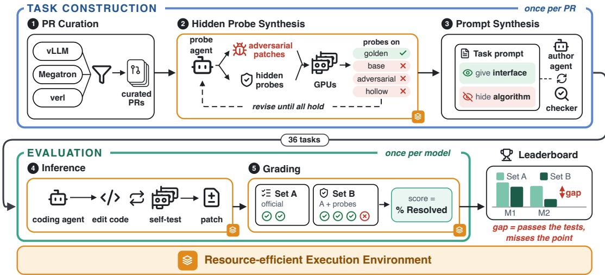  
Figure 1: Overview of InfraDev.

InfraBench targets cloud and operations agents (Gao et al., 2026) and SWE-InfraBench targets infrastructureas-code (Tarasova et al., 2026). InfraDev differs from all of these in its unit of work: a merged pull request to a production training, inference, or RL framework, which typically changes many files and must run correctly across GPUs.

Grading in repository-level benchmarks. SWE-bench and its descendants grade a patch with the tests that shipped with the original pull request (Jimenez et al., 2024; Zan et al., 2025; Deng et al., 2025), and infrastructure benchmarks extend them only with end-to-end checks of accuracy and speed (Nangia et al., 2026; Huang et al., 2026). Both weaknesses of this recipe are known. On the test side, UTBoost adds tests to raise coverage (Yu et al., 2025), SWE-ABS uses adversarial patches to show that many accepted patches are wrong (Yu et al., 2026), and work on verifiable rewards reports policies that learn to pass weak tests without solving the task (Baker et al., 2025). On the prompt side, SWE-bench Verified removes underspecified tasks by human annotation (Chowdhury et al., 2024) and SWE-Bench Pro adds requirement and interface lists (Deng et al., 2025). Each fixes one side. InfraDev fixes both in one loop: adversarial patches find requirements the official tests miss, hidden probes enforce them, and the prompt is rewritten to state every interface the probes depend on (§3.1.2). Environment reuse is a smaller but practical concern: prior benchmarks build one image per task (Jimenez et al., 2024; Nangia et al., 2026) or share only a base image (Huang et al., 2026); we share dependency environments and artifact caches across tasks (§3.3).

Understanding and improving coding agents. Failure analyses of agents on SWE-bench and related benchmarks report where runs break down, and agents are improved by better interfaces (Yang et al., 2024), reusable skills and tool libraries, or reflection over past attempts. Kernel-generation systems apply the same ideas to one task type (Lange et al., 2025; Wang et al., 2025a; Baronio et al., 2026). Our skill differs in where it comes from: it encodes the three failure classes, contains no task-specific answers, and targets the checks that agents skip, such as callers of a changed function and the resource a change promises to save.

## 3 InfraDev

Each task in InfraDev asks a coding agent to reimplement a real merged PR (pull request) from an AI infrastructure project. Figure 1 shows how we build and evaluate these tasks. We first curate challenging PRs that change core functionality of Megatron-LM, verl, and vLLM (§3.1). For each PR, we jointly synthesize the tests and the prompt of the task. An agent adds hidden probes that reject shortcut implementations of the PR. Another agent writes a prompt that states what these tests check without revealing the solution (§3.1.2). The agent under evaluation then implements the task in a multi-GPU sandbox, based on the prompt and the repository snapshot just before the PR. We grade its patch with the official tests of the PR and the hidden fiprobes (§3.2). All stages run in a reusable execution environment (§3.3) for storage saving and acceleration.

Table 1: Task types of the 36 selected pull requests. New feature: adds functionality that the pre-PR snapshot lacks; Performance: keeps the functional result but reduces time, memory, or communication; Refactor: restructures code without adding functionality; Bugfix: corrects wrong behavior.
<table><tr><td>Repository</td><td>New feature</td><td>Performance</td><td>Refactor</td><td>Bug fix</td><td>Total</td></tr><tr><td>Megatron-LM (training)</td><td>9</td><td>8</td><td>1</td><td>1</td><td>19</td></tr><tr><td>verl (post-training)</td><td>5</td><td>2</td><td>0</td><td>0</td><td>7</td></tr><tr><td>vLLM (inference)</td><td>5</td><td>5</td><td>0</td><td>0</td><td>10</td></tr><tr><td>Total</td><td>19</td><td>15</td><td>1</td><td>1</td><td>36</td></tr></table>

## 3.1 Task Construction

## 3.1.1 PR Curation

We collect tasks from three widely used production repositories that together cover the model life cycle: Megatron-LM for training (Shoeybi et al., 2020), verl for reinforcement learning (Sheng et al., 2025), and vLLM for inference (Kwon et al., 2023). We apply rule-based filters to all of their PRs and keep those that are merged and not reverted, change at least 1,000 lines, and add new tests. Guided by domain expertise, we then manually select the PRs that concern the core functionality of each framework. This yields 36 PRs, most of which add new features or optimize performance (Table 1). For each PR, we record the pre-PR snapshot just before the merge and the post-PR snapshot right after it. Their difference is the golden patch, the change the developers actually made, which serves as the reference solution.

## 3.1.2 Joint Synthesis of Tests and Prompt

Hidden-probe synthesis. We judge whether a modification completes a task by two criteria. Behavioral correctness means that the program behaves as the task requires when it runs: a new feature must take effect, and an optimization must actually reduce memory, communication, or time. Numerical correctness means that the program computes the right values, such as activations, gradients, and model parameters.

The official tests of the selected PRs are weak in both criteria. First, numerical checks are often absent: in 24 of the 36 evaluated tasks, no official assertion verifies the numerical result of the modification. Second, behavioral checks are rare: in 13 of the 15 PRs that optimize performance, the official tests never check whether the optimization saves time, memory, or communication. An implementation that computes the right output but omits the optimization therefore still passes them.

We address this gap with an agent skill that iteratively synthesizes hidden probes, tests for requirements that a task imposes but its official tests leave unchecked (Algorithm 1). The agent first summarizes what the PR promises to implement (line 1). It then builds adversarial patches, incorrect implementations that pass every official test but violate numerical or behavioral correctness (line 2). Next, the agent writes probes that check both criteria (line 3). Appendix A.1 describes how a probe decides whether a result is correct. For example, verl PR 6974 syncs weights from the trainer to the rollout engine by sending only the entries that changed since the last step. Its probe counts the sent entries and rejects an adversarial patch that sends 65,536 entries when only 655 have changed.

We then refine the probes and the adversarial patches together (lines 4–5). In each round, the skill runs a check, and the agent revises every probe or adversarial patch that fails. The check requires each probe to pass on the golden patch and fail on every adversarial patch. It also requires each adversarial patch to break a promise of the PR while still passing the official tests. Appendix A.1 lists the full check.

Prompt synthesis. To improve the quality of prompts, we rewrite each PR as a task prompt, the agent’s only description of the change. The prompt must be sufficient: a correct implementation must not fail because the prompt omits an interface or requirement on which the tests depend, such as the name of a function they import. It must also be solution-free: it must not explain how to meet the requirements, because such guidance does part of the task and makes weaker agents appear capable. We meet both requirements by splitting the information about a PR into a specification and a solution and putting only the specification in the prompt. The specification states what the change must do: the interfaces the tests call, the behaviors the official tests and hidden probes check, and the execution rules, such as the definition of done. The solution describes how to do it: algorithms, formulas, numerical constants and tolerances, and validation strategies. We omit any item that could belong to either.

Algorithm 1 Hidden-probe synthesis.   
Require: PR $r ,$ its golden patch $\Delta _ { \mathrm { g o l d } }$ , the pre-PR snapshot $s ,$ and the official tests $T _ { \mathrm { o f f } }$   
Ensure: hidden probes $T _ { \mathrm { p r o b e } }$   
1: $C \gets \mathrm { S U M M A R I Z E } ( r )$ ▷ what r promises to implement   
2: $\Delta _ { 1 } , \ldots , \Delta _ { k } \gets \mathrm { { B U I L D A l } }$ DVERSARIALPATCHES $( C , T _ { \mathrm { o f f } } )$ ▷ wrong patches that pass $T _ { \mathrm { o f f } }$   
3: $T _ { \mathrm { p r o b e } } $ WRITEPROBES(C) ▷ check both criteria   
4: while not CHECKPROBES $( T _ { \mathrm { p r o b e } } ^ { ' } , \Delta _ { 1 } , . . . , \Delta _ { k } )$ do   
5: Revise $T _ { \mathrm { p r o b e } }$ and $\Delta _ { 1 } , \ldots , \Delta _ { k }$ to fix the failed checks   
6: return $T _ { \mathrm { p r o b e } }$

A second agent skill constructs the prompt. It receives from probe synthesis a handoff record that lists the claimed behaviors and the required symbols with input types, but not the probe code. A static analyzer first extracts the interface contract: the symbols that the golden patch introduces and that the official tests or the hidden probes reference. An authoring agent then writes the prompt from the PR description, the golden patch, the official tests, the handoff record, and the contract. It states each claimed behavior either as a requirement or as a decision explicitly left to the agent. Finally, the prompt must pass two checks: a linter rejects any prompt that omits a contract symbol, and a checker agent rejects any prompt that discloses part of the solution. The author revises the prompt until it passes both checks. Appendix B gives the unified task-prompt template filled by this procedure.

## 3.2 Evaluation

Inference and Grading. We prepare Docker containers for all agents and set a 2.5 hours time limit for each PR. Recovery mechanism is also introduced to prevent agent stopped accidentally in early stage. Agent’s output patch is applied to the pre-PR snapshot in a separate container. The test directory is then replaced by that of the post-PR snapshot for evaluation, so agents cannot cheat by modifying test. To quantitatively evaluate how good agents solve the task, grading will evaluate patches with real GPUs.

Metrics. We grade each patch on the official tests together with the hidden probes. For a task $p ,$ let $N _ { p }$ be the number of test cases collected when the golden patch runs, including the cases that the golden patch itself fails or skips on our hardware. The pass rate of a patch is $s _ { p } = \mathrm { p a s s e d } _ { p } / N _ { p } ,$ , and % Passed averages $s _ { p }$ equally over tasks. A task is resolved when the patch passes at least as many test cases as the golden patch, so the patch does not have to pass the cases that the golden patch fails. % Resolved is the share of resolved tasks. A missing, empty, or inapplicable patch scores $0 / N _ { p }$ instead of being dropped, since dropping it would reward models that give up. Harness faults are excluded and counted separately, so an infrastructure error is never recorded as a model failure. We keep the per-test outcomes and the full agent trace of every run for the failure analysis in §4.4.

## 3.3 Execution Environment

Limitation of Docker. Repository-level benchmarks usually build one Docker image per task. Docker caches image builds as a prefix, reusing the build steps before the first changed step and rerunning every step after it. This prefix cache works poorly for AI infrastructure projects, whose dependencies change often. For example, the 19 Megatron-LM tasks were merged within five months but use six versions of Transformer Engine. Each version change makes Docker rerun dependency steps after it. Moreover, tests of production infrastructure need large artifacts, such as model weights and datasets. The test code downloads these artifacts while it runs, so Docker does not see them and cannot cache them across tasks.

Resource-efficient Execution Environment. We break the prefix reuse of Docker and reuse each package and each artifact independently, so a change to one of them never forces the others to be rebuilt or stored again. We maintain several lightweight base Docker images for each AI infrastructure repository, containing only components shared across multiple PRs, such as CUDA and the Python interpreter. The dependencies of each task go into a virtual environment that uv installs on a volume shared by all containers. Tasks with the same hash of their locked dependencies share one environment, and a new environment hard-links cached packages instead of reinstalling them. Every container also mounts one shared Hugging Face cache, so each model or dataset is downloaded only once. Both agent inference and grading build their environments this way.

Table 2: Results of 6 models on InfraDev. % Resolved is the share of tasks on which every test passes; % Passed is the share of tests passed on a task, averaged over tasks. Time, Cost, and Tokens are per-task means of the agent’s run time, API cost estimated at list prices, and tokens consumed.
<table><tr><td>Model</td><td>% Resolved</td><td>% Passed</td><td>Time (min)</td><td>Cost ($)</td><td>Tokens (M)</td></tr><tr><td>GPT-6 Sol</td><td>38.9</td><td>78.8</td><td>43.9</td><td>5.37</td><td>20.86</td></tr><tr><td>GPT-5.6 Sol³</td><td>30.6</td><td>78.6</td><td>73.9</td><td>17.98</td><td>24.71</td></tr><tr><td>GLM 5.3</td><td>25.0</td><td>76.7</td><td>136.9</td><td>13.89</td><td>48.84</td></tr><tr><td>HY4 preview</td><td>36.1</td><td>83.3</td><td>118.1</td><td>2.09</td><td>31.75</td></tr><tr><td>DeepSeek V4 Pro</td><td>30.6</td><td>74.3</td><td>94.1</td><td>1.89</td><td>41.80</td></tr><tr><td>Kimi K3</td><td>30.6</td><td>75.8</td><td>136.4</td><td>13.48</td><td>33.58</td></tr></table>

Table 3: % Resolved per task category. The number of tasks is in parentheses.
<table><tr><td>Model</td><td>Training (19)</td><td>Inference (10)</td><td>RL (7)</td></tr><tr><td>GPT-6 Sol</td><td>52.6</td><td>10.0</td><td>42.9</td></tr><tr><td>GPT-5.6 Sol</td><td>42.1</td><td>10.0</td><td>28.6</td></tr><tr><td>GLM 5.3</td><td>26.3</td><td>10.0</td><td>42.9</td></tr><tr><td>HY4 preview</td><td>42.1</td><td>10.0</td><td>57.1</td></tr><tr><td>DeepSeek V4 Pro</td><td>42.1</td><td>10.0</td><td>28.6</td></tr><tr><td>Kimi K3</td><td>31.6</td><td>10.0</td><td>57.1</td></tr></table>

## 4 Experiment

## 4.1 Setup

Models and harnesses. We evaluate six coding agents on InfraDev, two built on frontier closed-source models and four on open-source models. GPT-6 Sol and GPT-5.6 Sol run in OpenAI’s Codex harness; GLM 5.3, DeepSeek V4 Pro (0813), Kimi K3, and HY4 preview run in the OpenCode harness.<sup>2</sup> We set the reasoning effort of every model to xhigh or a comparable level. Each agent runs once on each task, and we call the patch it produces a submission.

Environment. All experiments run on nodes with eight NVIDIA H800 or H20 GPUs each. Each inference or grading run has exclusive use of one node. An agent has 2.5 hours per task, excluding environment preparation; a run that reaches this limit is graded on the patch it has produced. A task’s golden calibration and the grading of its submissions use the same environment and GPU type.

## 4.2 Results on InfraDev

Table 2 shows that InfraDev remains challenging for all models: the resolved rate ranges from 25.0% for GLM 5.3 to 38.9% for GPT-6 Sol. Across task categories (Table 3), inference tasks are the hardest: every model resolves only one of the ten. Resolved rates spread more widely on training tasks (26.3% to 52.6%) and on RL tasks (28.6% to 57.1%). No single model leads in all categories: GPT-6 Sol performs best on training tasks, and HY4 preview and Kimi K3 tie for best on RL tasks.

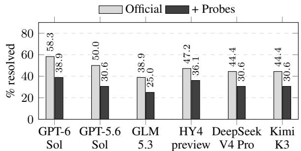  
Figure 2: Resolved rate (%) on the 36 tasks, with and without the hidden probes.

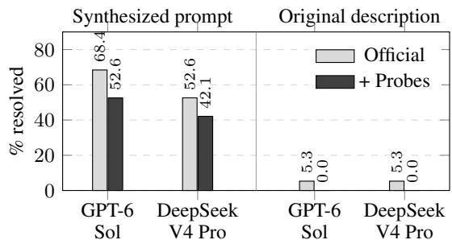  
Figure 3: Resolved rate (%) on the 19 Megatron-LM tasks. Original description prompts the agent with the PR’s own description on GitHub.

A high passed rate does not mean that a model completes tasks. Every model passes between 74.3% and 83.3% of the tests, but none resolves more than 38.9% of the tasks, because a task is resolved only when all its tests pass. Nearly equal passed rates can also hide different resolved rates: GPT-6 Sol and GPT-5.6 Sol pass 78.8% and 78.6% of the tests but resolve 38.9% and 30.6% of the tasks. The models differ on a few precise tests, which a patch that only looks complete cannot pass.

No model we test leads in resolved rate, time, and cost at once. GPT-6 Sol comes closest: it has the highest resolved rate, is the fastest at 43.9 minutes per task, and costs less than GPT-5.6 Sol, GLM 5.3, and Kimi K3. HY4 preview resolves one task fewer at 39% of the cost but takes 2.7× as long. Cost and time also depend on the provider’s prices, caching, and serving speed, not only on the model.

## 4.3 Ablation Study

Hidden-probe synthesis. The official tests alone overstate how many tasks agents resolve. We grade every submission twice, on the official tests alone (Set A) and with the hidden probes added (Set B; Figure 2). Adding the hidden probes lowers every model’s resolved rate by 11 to 19 percentage points. Of the 216 submissions, 102 pass all official tests, but only 69 of them also pass the hidden probes. The hidden probes thus reject 32% of the submissions that the official tests accept.

Prompt synthesis. InfraDev cannot distinguish models without prompt synthesis. We replace the synthesized prompt with the PR’s original description on the Megatron-LM tasks (Figure 3). Once the hidden probes are included, neither GPT-6 Sol nor DeepSeek V4 Pro resolves a single task. Maintaining comprehensive AI infrastructure is hard, and a prompt that omits the required interfaces makes even capable agents fail for reasons unrelated to the task. With the synthesized prompt, the resolved rate is at most 52.6%; the prompt therefore does not hand the agent the implementation.

Resource-efficient Execution Environment. We compare our execution environment against a baseline that builds one Docker image per task, with each Dockerfile following the task’s official implementation. InfraDev reduces storage by 57% on Megatron-LM, from 80.7 to 34.8 GB, and by 52% on vLLM, from 206.0 to 98.8 GB. The saving grows with the number of tasks: on Megatron-LM, it rises from 17% with two tasks to 57% with all 19, and on vLLM from 27% to 52%. This suggests great scalability as InfraDev expands to more tasks. InfraDev also shortens environment build time by 14% on Megatron-LM and 13% on vLLM.

## 4.4 Failure Analysis

Corpus and taxonomy. We analyze the 1,754 failing test cases of the graded submissions of the five models other than GPT-6 Sol and group most of them into three error classes, from the most basic to the most demanding (Figure 4). The most basic is a structural error, in which the code does not fit the program around it because it fails to execute, breaks an API, mismatches a tensor’s shape, layout, or dtype, or mishandles state or lifecycle. Once the code fits, a numerical error means it computes wrong values, because of a wrong algorithm or lost precision. Beyond correct values, a behavioral error means the code misses a requirement of the task, such as lowering peak memory or working under CUDA graphs. A submission counts under every class that appears among its failing test cases.

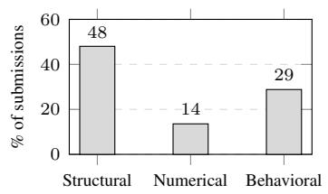  
(a) Error class

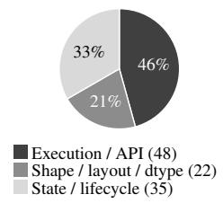  
(b) Structural Errors

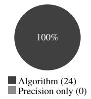  
(c) Numerical Errors

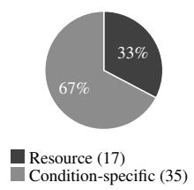  
(d) Behavioral Errors

Figure 4: (a) Share of the graded submissions with at least one error of each class. (b)–(d) Error types within each class; counts are submissions with at least one failing case of the type, and a submission can count under several types.  
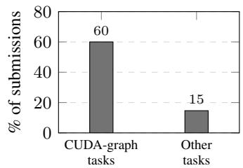  
Figure 5: Share of submissions with a condition-specific error in different tasks.

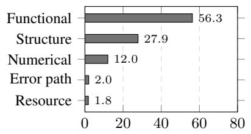  
% of assertions  
Figure 6: What the 5,532 assertions in agents’ own tests check, over 94 traced runs.

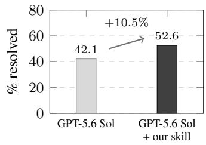  
Figure 7: Resolved rate (%) of GPT-5.6 Sol on Megatron-LM tasks, with and without the agent skill.

Structural errors dominate, and state errors often escape official tests. Structural errors are the most common class, found in 48% of the submissions (Figure 4a). Within the class, execution and API errors lead, followed by state and lifecycle errors (Figure 4b). State errors often escape the official tests, which check the result of a single call rather than the state that the call leaves behind. In 15 of the 35 submissions with a state error, only our generated hidden probes catch it. Together, these errors show that models struggle most with changes that span many files of a large repository, where the code must fit the interfaces of many modules and manage state over a long lifetime.

Numerical errors come from wrong math, not lost precision. All 24 submissions with a numerical error contain an algorithm error, and none fails on precision alone (Figure 4c). The errors are far too large to be rounding noise, so they must come from wrong math rather than from precision lost to differences in hardware or implementation details. On Megatron-LM PR 2440, for example, one patch produces an indexer loss of 19.95 where the loss must be 0.0. Contrary to our own experience as infrastructure developers, where getting the algorithm right is relatively easy and matching numerical precision is the hard part, agents struggle with the algorithm rather than the precision.

Behavior breaks under execution modes such as CUDA graphs. Of the 51 submissions with a behavioral error, 35 contain an error that appears only under a specific execution mode (Figure 4d). As Figure 5 shows, 60% of the submissions on the four tasks built around CUDA graphs have such an error, compared with 15% on the other tasks. On the CUDA-graph tasks, every such error stays hidden in the default eager mode and appears only once CUDA graphs are turned on. Agents appear to write code for eager mode and treat CUDA graphs as a simple on/off switch, overlooking that a CUDA graph replays recorded GPU work without rerunning the surrounding Python code, so any logic that must run or change on every call is silently skipped.

Agents rarely test resource requirements like memory, time, or traffic. Agents write their own tests in 94 of the 103 traced runs, but fewer than 2% of the 5,532 assertions check resource usage (Figure 6). Most assertions check functional results (56%) or structure (28%). Of the 11 traced runs that fail a resource check, only one writes any resource assertion. Agents check that their code runs and returns the right output, but rarely check whether it delivers the efficiency requirement that the task was written for.

## 4.5 Improving Agents with Reusable Skills

Based on our analysis in Section 4.4, we build an agent skill for AI infrastructure development around three principles.

• Check every caller and every piece of state the change touches. Structural errors are the most common class. The skill asks the agent to find each caller of a function or class it modifies, keep the signatures, tensor shapes, and dtypes those callers expect, and test stateful objects such as caches and counters over several calls rather than one.

• Compare every new computation with a naive reference. Numerical errors all come from wrong algorithms. The skill asks the agent to write the formula directly in a few lines of plain PyTorch, compare its code with this reference on small inputs, and check invariants that follow from the math, such as a loss that must be zero or gradients that must be averaged rather than summed across data-parallel ranks.

• Test resource requirements and CUDA-graph behavior. Behavioral errors come from resource requirements and execution modes that agents rarely test. The skill asks the agent to measure peak memory, runtime, or bytes sent before and after its change whenever the task sets a resource requirement, and to rerun its tests with CUDA graphs enabled and check that the outputs match eager mode.

The skill contains no task-specific answers or hidden tests. On Megatron-LM tasks, it raises the resolved rate of GPT-5.6 Sol from 42.1% to 52.6%, a gain of 10.5 % points (Figure 7). This suggests that the failure modes exposed by InfraDev can guide agent improvements. However, the remaining gap is still large: closing it will also require advances in training methods, model architectures, and data quality, which InfraDev provides a way to measure.

## 5 Conclusion and Future Work

We asked whether coding agents can develop real-world AI infrastructure, and how we can tell. The answer to the first is not yet: the best frontier agent resolves fewer than two in five tasks, and most of its failures are shared by every other agent. For the second, a pull request’s own tests and description are not a reliable judge; grading becomes reliable only when hidden tests and the prompt are written together. The failures are informative. Agents most often write code that does not fit the program around it; when they compute wrong values, the algorithm rather than precision is at fault; and they rarely test whether a change delivers the memory, time, or traffic savings it promises. We propose an agent skill that targets these weaknesses and improve the resolved rate.

Two challenges remain in scaling InfraDev. The first is the cost of multi-GPU execution: each agent run occupies an eight-GPU node for up to 2.5 hours, and grading reruns the multi-GPU tests. Evaluating a single model therefore consumes several hundred GPU-hours. Simulation may lower this cost, for example by emulating multiple ranks and their collective communication on fewer GPUs or on CPUs. The second challenge is PR curation, which still relies on domain experts to select every PR by hand. This manual step limits how quickly the benchmark can grow and follow the evolution of its source projects. Automatic methods for identifying suitable PRs would remove this bottleneck. We leave both directions to future work.

## References

Bowen Baker, Joost Huizinga, Leo Gao, Zehao Dou, Melody Y. Guan, Aleksander Madry, Wojciech Zaremba, Jakub Pachocki, and David Farhi. Monitoring reasoning models for misbehavior and the risks of promoting obfuscation, 2025. URL https://arxiv.org/abs/2503.11926.

Carlo Baronio, Pietro Marsella, Ben Pan, Simon Guo, and Silas Alberti. Kevin: Multiturn RL for generating CUDA kernels. In C. Vondrick, B. Hariharan, C. Raffel, L. Pinto, D. Yang, and A. Faust (eds.), International Conference on Learning Representations, volume 2026, pp. 83418–83452, 2026. URL https://proceedings.iclr.cc/paper\_files/paper/2026/file/ 86ba836d4c5dd859d795a172911745e2-Paper-Conference.pdf.

Jun Shern Chan, Neil Chowdhury, Oliver Jaffe, James Aung, Dane Sherburn, Evan Mays, Giulio Starace, Kevin Liu, Leon Maksin, Tejal Patwardhan, Aleksander Madry, and Lilian Weng. MLEbench: Evaluating machine learning agents on machine learning engineering. In Y. Yue, A. Garg, N. Peng, F. Sha, and R. Yu (eds.), International Conference on Learning Representations, volume 2025, pp. 50466–50494, 2025. URL https://proceedings.iclr.cc/paper\_files/paper/2025/file/ 7e3767db483c942b883eb4f8cfb74e31-Paper-Conference.pdf.

Willy Chan, Nathan Paek, Simon Guo, Simran Arora, and Daniel Y. Fu. ParallelKernelBench: Can LLM write fast Multi-GPU kernels?, 2026. URL https://nathanjpaek.github.io/parallel-kernel-bench/.

Neil Chowdhury, James Aung, Chan Jun Shern, Oliver Jaffe, Dane Sherburn, Giulio Starace, Evan Mays, Rachel Dias, Marwan Aljubeh, Mia Glaese, Carlos E. Jimenez, John Yang, Leyton Ho, Tejal Patwardhan, Kevin Liu, and Aleksander Madry. Introducing SWE-bench Verified. OpenAI blog, https://openai.com/ index/introducing-swe-bench-verified/, 2024.

Xiang Deng, Jeff Da, Edwin Pan, Yannis Yiming He, Charles Ide, Kanak Garg, Niklas Lauffer, Andrew Park, Nitin Pasari, Chetan Rane, Karmini Sampath, Maya Krishnan, Srivatsa Kundurthy, Sean Hendryx, Zifan Wang, Vijay Bharadwaj, Jeff Holm, Raja Aluri, Chen Bo Calvin Zhang, Noah Jacobson, Bing Liu, and Brad Kenstler. SWE-Bench Pro: Can AI agents solve long-horizon software engineering tasks?, 2025. URL https://arxiv.org/abs/2509.16941.

Leilei Ding, Shumin Wang, Yuting Huang, Fanqi Wan, Yinmin Zhang, Qi Han, Yiming Xu, Feiyuan Zhang, Xiaomeng Chu, Guoliang You, Wuyang Zhang, Daxin Jiang, and Yanyong Zhang. Φ-Bench: Can large language models engineer the infrastructure that powers them?, 2026. URL https://arxiv.org/abs/ 2609.10226.

Yuan Gao, Zeren Yang, Junnan Li, Shawn (Wanxiang) Zhong, Ahmed Dajani, Mai Zheng, Andrea Arpaci-Dusseau, and Remzi Arpaci-Dusseau. InfraBench: Evaluating infrastructure agents across layers, lifecycle, and risk. In Workshop on Hot Topics in System Infrastructure (HotInfra), 2026. URL https://arxiv.org/ abs/2608.11234. Co-located with ISCA ’26.

Jinjun Huang, Zhongzhen Wen, Tongtong Xu, Meng Yan, Xin Xia, and Zhongxin Liu. RealisticTritonBench: A benchmark for Triton-kernel generation in real-world AI frameworks, 2026. URL https://arxiv.org/ abs/2608.12004.

Carlos E Jimenez, John Yang, Alexander Wettig, Shunyu Yao, Kexin Pei, Ofir Press, and Karthik Narasimhan. SWE-bench: Can language models resolve real-world Github issues? In B. Kim, Y. Yue, S. Chaudhuri, K. Fragkiadaki, M. Khan, and Y. Sun (eds.), International Conference on Learning Representations, volume 2024, pp. 54107–54157, 2024. URL https://proceedings.iclr.cc/paper\_files/paper/2024/ file/edac78c3e300629acfe6cbe9ca88fb84-Paper-Conference.pdf.

Thomas Kwa, Ben West, Joel Becker, Amy Deng, Katharyn Garcia, Max Hasin, Sami Jawhar, Megan Kinni ment, Nate Rush, Sydney Von Arx, Ryan Bloom, Thomas Broadley, Haoxing Du, Brian Goodrich, Nikola Jurkovic, Luke Miles, Seraphina Nix, Tao Lin, Neev Parikh, David Rein, Lucas Jun Koba Sato, Hjalmar Wijk, Daniel Ziegler, Elizabeth Barnes, and Lawrence Chan. Measuring AI ability to complete long software tasks. In D. Belgrave, C. Zhang, H. Lin, R. Pascanu, P. Koniusz, M. Ghassemi, and N. Chen (eds.), Advances in Neural Information Processing Systems, volume 38, Main Conference, pp. 92213–92266. Curran Associates, Inc., 2025. doi: 10.52202/085713-3086. URL https://proceedings.neurips.cc/ paper\_files/paper/2025/file/85069585133c4c168c865e65d72e9775-Paper-Conference.pdf.

Woosuk Kwon, Zhuohan Li, Siyuan Zhuang, Ying Sheng, Lianmin Zheng, Cody Hao Yu, Joseph Gonzalez, Hao Zhang, and Ion Stoica. Efficient memory management for large language model serving with PagedAttention. In Proceedings of the 29th Symposium on Operating Systems Principles, SOSP ’23, pp. 611–626. ACM, October 2023. doi: 10.1145/3600006.3613165. URL http://dx.doi.org/10.1145/ 3600006.3613165.

Robert Tjarko Lange, Qi Sun, Aaditya Prasad, Maxence Faldor, Yujin Tang, and David Ha. Towards robust agentic CUDA kernel benchmarking, verification, and optimization, 2025. URL https://arxiv.org/abs/ 2509.14279.

Jianling Li, Shangzhan Li, Zhenye Gao, Qi Shi, Yuxuan Li, Zefan Wang, Jiacheng Huang, Haojie Wang, Jianrong Wang, Xu Han, Zhiyuan Liu, and Maosong Sun. TritonBench: Benchmarking large language model capabilities for generating Triton operators. In Wanxiang Che, Joyce Nabende, Ekaterina Shutova, and Mohammad Taher Pilehvar (eds.), Findings of the Association for Computational Linguistics: ACL 2025, pp. 23053–23066, Vienna, Austria, July 2025. Association for Computational Linguistics. ISBN 979-8-89176-256-5. doi: 10.18653/v1/2025.findings-acl.1183. URL https://aclanthology.org/2025. findings-acl.1183/.

Kevin Luu. Keeping vLLM production quality: A look inside CI, benchmarking, and the release process. vLLM Blog, July 2026. URL https://vllm.ai/blog/2026-07-16-keeping-vllm-production-quality.

Ayush Nangia, Shikhar Mishra, Aman Gokrani, and Paras Chopra. ISO-Bench: Can coding agents optimize real-world inference workloads?, 2026. URL https://arxiv.org/abs/2602.19594.

Anne Ouyang, Simon Guo, Simran Arora, Alex L Zhang, William Hu, Christopher Re, and Azalia Mirhoseini. KernelBench: Can LLMs write efficient GPU kernels? In Aarti Singh, Maryam Fazel, Daniel Hsu, Simon Lacoste-Julien, Felix Berkenkamp, Tegan Maharaj, Kiri Wagstaff, and Jerry Zhu (eds.), Proceedings of the 42nd International Conference on Machine Learning, volume 267 of Proceedings of Machine Learning Research, pp. 47356–47415. PMLR, 13–19 Jul 2025. URL https://proceedings.mlr.press/ v267/ouyang25a.html.

Guangming Sheng, Chi Zhang, Zilingfeng Ye, Xibin Wu, Wang Zhang, Ru Zhang, Yanghua Peng, Haibin Lin, and Chuan Wu. HybridFlow: A flexible and efficient RLHF framework. In Proceedings of the Twentieth European Conference on Computer Systems, EuroSys ’25, pp. 1279–1297. ACM, March 2025. doi: 10.1145/3689031.3696075. URL http://dx.doi.org/10.1145/3689031.3696075.

Mohammad Shoeybi, Mostofa Patwary, Raul Puri, Patrick LeGresley, Jared Casper, and Bryan Catanzaro. Megatron-LM: Training multi-billion parameter language models using model parallelism, 2020. URL https://arxiv.org/abs/1909.08053.

Giulio Starace, Oliver Jaffe, Dane Sherburn, James Aung, Jun Shern Chan, Leon Maksin, Rachel Dias, Evan Mays, Benjamin Kinsella, Wyatt Thompson, Johannes Heidecke, Amelia Glaese, and Tejal Patwardhan. PaperBench: Evaluating AI’s ability to replicate AI research. In Aarti Singh, Maryam Fazel, Daniel Hsu, Simon Lacoste-Julien, Felix Berkenkamp, Tegan Maharaj, Kiri Wagstaff, and Jerry Zhu (eds.), Proceedings of the 42nd International Conference on Machine Learning, volume 267 of Proceedings of Machine Learning Research, pp. 56843–56873. PMLR, 13–19 Jul 2025. URL https: //proceedings.mlr.press/v267/starace25a.html.

Natalia Tarasova, Enrique Balp-Straffon, Aleksei Iancheruk, Yevhenii Sielskyi, Nikita Kozodoi, Liam H. Byrne, Jack Butler, Dayuan Jiang, Marcin Czelej, Andrew Ang, Yash Shah, Roi Blanco, and Sergei Ivanov. SWE-InfraBench: Evaluating language models on cloud infrastructure code, 2026. URL https://arxiv. org/abs/2606.05249.

Jianghui Wang, Vinay Joshi, Saptarshi Majumder, Xu Chao, Bin Ding, Ziqiong Liu, Pratik Prabhanjan Brahma, Dong Li, Zicheng Liu, and Emad Barsoum. Geak: Introducing Triton kernel AI agent & evaluation benchmarks, 2025a. URL https://arxiv.org/abs/2507.23194.

Xingyao Wang, Boxuan Li, Yufan Song, Frank F Xu, Xiangru Tang, Mingchen Zhuge, Jiayi Pan, Yueqi Song, Bowen Li, Jaskirat Singh, Hoang Tran, Fuqiang Li, Ren Ma, Mingzhang Zheng, Bill Qian, Daniel Shao, Niklas Muennighoff, Yizhe Zhang, Binyuan Hui, Junyang Lin, Robert Brennan, Hao Peng, Heng Ji, and Graham Neubig. OpenHands: An open platform for AI software developers as generalist agents. In Y. Yue, A. Garg, N. Peng, F. Sha, and R. Yu (eds.), International Conference on Learning Representations, volume 2025, pp. 65882–65919, 2025b. URL https://proceedings.iclr.cc/paper\_files/paper/2025/file/ a4b6ad6b48850c0c331d1259fc66a69c-Paper-Conference.pdf.

Hjalmar Wijk, Tao Roa Lin, Joel Becker, Sami Jawhar, Neev Parikh, Thomas Broadley, Lawrence Chan, Michael Chen, Joshua M Clymer, Jai Dhyani, Elena Ericheva, Katharyn Garcia, Brian Goodrich, Nikola Ju rkovic, Megan Kinniment, Aron Lajko, Seraphina Nix, Lucas Jun Koba Sato, William Saunders, Maksym Taran, Ben West, and Elizabeth Barnes. RE-Bench: Evaluating frontier AI R&D capabilities of language model agents against human experts. In Aarti Singh, Maryam Fazel, Daniel Hsu, Simon Lacoste-Julien, Felix Berkenkamp, Tegan Maharaj, Kiri Wagstaff, and Jerry Zhu (eds.), Proceedings of the 42nd International Conference on Machine Learning, volume 267 of Proceedings ofMachine Learning Research, pp. 66772–66832. PMLR, 13–19 Jul 2025. URL https://proceedings.mlr.press/v267/wijk25a.html.

Shanli Xing, Yiyan Zhai, Alexander Jiang, Yixin Dong, Yong Wu, Zihao Ye, Charlie F. Ruan, Yingyi Huang, Yineng Zhang, Liangsheng Yin, Aksara Bayyapu, Luis Ceze, and Tianqi Chen. FlashInfer-Bench: Building the virtuous cycle for AI-driven LLM systems. In A. Chowdhery and Z. Jia (eds.), Proceedings of Machine Learning and Systems, volume 8, pp. 2016–2064. MLSys, 2026. URL https://proceedings.mlsys.org/ paper\_files/paper/2026/file/37e44c4b5321605735be9761f9b758fc-Paper-Conference.pdf.

John Yang, Carlos Jimenez, Alexander Wettig, Kilian Lieret, Shunyu Yao, Karthik Narasimhan, and Ofir Press. SWE-agent: Agent-computer interfaces enable automated software engineering. In A. Globerson, L. Mackey, D. Belgrave, A. Fan, U. Paquet, J. Tomczak, and C. Zhang (eds.), Advances in Neural Information Processing Systems, volume 37, pp. 50528–50652. Curran Associates, Inc., 2024. doi: 10.52202/079017-1601. URL https://proceedings.neurips.cc/paper\_files/paper/2024/file/ 5a7c947568c1b1328ccc5230172e1e7c-Paper-Conference.pdf.

Jehyeok Yeon, Ben Rank, and Maksym Andriushchenko. InferenceBench: A benchmark for open-ended LLM inference optimization by AI agents, 2026. URL https://arxiv.org/abs/2607.20468.

Boxi Yu, Yuxuan Zhu, Pinjia He, and Daniel Kang. UTBoost: Rigorous evaluation of coding agents on SWE-Bench. In Wanxiang Che, Joyce Nabende, Ekaterina Shutova, and Mohammad Taher Pilehvar (eds.), Proceedings of the 63rd Annual Meeting of the Association for Computational Linguistics (Volume 1: Long Papers), pp. 3762–3774, Vienna, Austria, July 2025. Association for Computational Linguistics. ISBN 979-8-89176-251-0. doi: 10.18653/v1/2025.acl-long.189. URL https://aclanthology.org/2025. acl-long.189/.

Boxi Yu, Yang Cao, Yuzhong Zhang, Liting Lin, Junjielong Xu, Zhiqing Zhong, Qinghua Xu, Guancheng Wang, Jialun Cao, Shing-Chi Cheung, Pinjia He, and Lionel Briand. SWE-ABS: Adversarial benchmark strengthening exposes inflated success rates on test-based benchmark, 2026. URL https://arxiv.org/ abs/2603.00520.

Daoguang Zan, Zhirong Huang, Wei Liu, Hanwu Chen, Shulin Xin, Linhao Zhang, Qi Liu, Aoyan Li, Lu Chen, Xiaojian Zhong, Siyao Liu, Yongsheng Xiao, Liangqiang Chen, Yuyu Zhang, Jing Su, Tianyu Liu, Rui Long, Ming Ding, and Liang Xiang. Multi-SWE-bench: A multilingual benchmark for issue resolving. In D. Belgrave, C. Zhang, H. Lin, R. Pascanu, P. Koniusz, M. Ghassemi, and N. Chen (eds.), Advances in Neural Information Processing Systems, volume 38, Main Conference. Curran Associates, Inc., 2025. doi: 10.52202/085713-2111. URL https://proceedings.neurips.cc/paper\_files/paper/ 2025/file/5afa9cb1e917b898ad418216dc726fbd-Paper-Datasets\_and\_Benchmarks\_Track.pdf.

Lianmin Zheng, Liangsheng Yin, Zhiqiang Xie, Chuyue Sun, Jeff Huang, Cody Hao Yu, Shiyi Cao, Christos Kozyrakis, Ion Stoica, Joseph E. Gonzalez, Clark Barrett, and Ying Sheng. SGLang: Efficient execution of structured language model programs. In A. Globerson, L. Mackey, D. Belgrave, A. Fan, U. Paquet, J. Tomczak, and C. Zhang (eds.), Advances in Neural Information Processing Systems, volume 37, pp. 62557– 62583. Curran Associates, Inc., 2024. doi: 10.52202/079017-2000. URL https://proceedings.neurips. cc/paper\_files/paper/2024/file/724be4472168f31ba1c9ac630f15dec8-Paper-Conference.pdf.

## A Details of Test and Prompt Synthesis

## A.1 Hidden-Probe Synthesis

Probe types. A numerical probe compares an output such as a loss, a gradient, or a model state with a reference taken from an existing implementation (Megatron-LM PR 3922 compares the cached Mamba state with a pre-PR path), an invariance (in PR 1989, changing the chunk size must not change the output), a value derived by hand (PR 2440 recomputes the sparse attention in float64 with plain loops), or a property that must always hold (a KL divergence of a distribution from itself is zero). A behavioral probe measures whether the promised effect occurs and compares it with a value derived from the task, such as the bytes that activation offloading moves (PR 1913) or the elements each rank receives (PR 3213).

Acceptance check. Algorithm 2 gives the check. Besides the pre-PR snapshot and the adversarial patches, every probe must reject a hollow patch, which keeps the interfaces of the golden patch but makes every function added by the PR raise an exception, so that no probe only checks that the new functions exist. The promise that each adversarial patch breaks is recorded by the agent that writes it and is not checked by execution. A PR whose probes do not pass within a fixed number of rounds is left without probes.

Algorithm 2 CHECKPROBES, the acceptance check of Algorithm 1. Every run uses the GPU count used for   
scoring, and a pass on $\Delta _ { \mathrm { g o l d } }$ requires that no case is skipped.   
Require: hidden probes $T _ { \mathrm { p r o b e } }$ and adversarial patches $\Delta _ { 1 } , \ldots , \Delta _ { k } ;$ from Algorithm 1, the PR $r ,$ its golden   
patch $\Delta _ { \mathrm { g o l d } }$ , the pre-PR snapshot $s ,$ and the official tests $T _ { \mathrm { o f f } }$   
Ensure: true if and only if $T _ { \mathrm { p r o b e } }$ and $\Delta _ { 1 } , \ldots , \Delta _ { k }$ are accepted   
1: function CHECKPROBES $( T _ { \mathrm { p r o b e } } , \Delta _ { 1 } , \dots , \Delta _ { k } )$   
2: $\Delta _ { \mathrm { h o l l o w } }  \Delta _ { \mathrm { g o l d } }$ with every function added by r raising an exception   
3: $o k _ { 1 } \gets$ every probe passes on $\Delta _ { \mathrm { g o l d } }$ in three consecutive runs ▷ accepts the right patch   
4: $o k _ { 2 } \gets$ every probe fails on $\begin{array} { r } { S , \Delta _ { \mathrm { h o l l o w } } . } \end{array}$ , and $\Delta _ { 1 } , \ldots , \Delta _ { k }$ ▷ rejects wrong ones   
5: $o k _ { 3 } \gets \Delta _ { 1 } , \ldots , \Delta _ { k }$ score no worse than $\Delta _ { \mathrm { g o l d } }$ on $T _ { \mathrm { o f f } }$ ▷ they fool $T _ { \mathrm { o f f } }$   
6: return $o k _ { 1 }$ ∧ ok<sub>2</sub> $\wedge \ o k _ { 3 }$

## B Task Prompt Template

This appendix records the unified template used to synthesize every task prompt in Section 3.1.2. We show the template with placeholders rather than dumping every instance. The authoring agent of Section 3.1.2 fills those placeholders from the PR description, the golden patch, the official tests, the handoff record, and the interface contract. As in that section, the prompt states what the change must do and omits how to do it. The figures below show the resulting template as given to the agent.

Structure. Figure 8 states the specification: what and why the change does, its scope, the behaviors the official tests and hidden probes check, which decisions are left to the agent, and the definition of done. Figure 9 requires a fully autonomous run and forbids looking up the original PR. Figure 10 is the interface contract: the names, signatures, shapes, and config knobs that the tests call, with no algorithms. Figure 11 states the execution rules for validating on the grading hardware and the final reminder before stopping.

```python
# Task: Implement this PR
## PR Title
<ORIGINAL PR TITLE>
## PR Description
> This is a **rewritten** task description, synthesized from the merged change and
> its changed tests. It states the *what*, the *why*, the *scope*, and the
> *definition of done*, while deliberately withholding the algorithms, formulas,
```

```markdown
> exact numeric behavior, and precise call signatures -- those are the measured
> part. The exact import/call surface the tests pin is given separately in the
> **Interface contract** block after the instructions.
### 1. TL;DR
**What**: <one-paragraph what -- behavior, not algorithm>
**Why**: <the motivation / the problem this solves>
**Impact**: <what a user can now do; what stays unchanged when the feature is off>
### 2. Big Picture
**Before**: <data flow / responsibilities before this PR -- no formulas>
**After**: <what changes in the data flow / new responsibilities -- no formulas>
### 3. Change Scope
| Category | Where | What |
|---|---|---|
| <e.g. New core module> | `<path>` | <what this file does -- no implementation> |
... | ... | ... |
**Tests** | `<changed test path(s)>` | <what the tests cover, at a high level> |
### 4. Behavior the implementation must support
- **<axis name>** -- <observable behavior / constraint that must hold>
- **<regression axis>** -- existing <X> behavior must remain intact; its regression suite
stays green.
### 5. What you must design yourself (the measured part -- NOT specified here)
<the core algorithm(s) -- scoring, loss, masking, etc.>
- <all numeric behavior the tests assert -- tolerances, scales, exact coincidence
conditions -- withheld>
### 6. Definition of Done
**You are NOT done until you have *executed* the code and watched it load and run.**
Matching the interface contract is necessary but **not sufficient** -- code that
"looks correct" but was never run is a **failed task**. The single most common way
to score **zero** is shipping code that does not import/compile: a trivial syntax
or indentation slip in a shared module (e.g. `<SHARED_FILE>`) breaks `conftest`
and makes the **entire** suite un-collectable -- every test scores 0, even the ones
your code would have passed. Treat the items below as a checklist you must
**actually run**, not merely reason about.
**A. Loads & collects (do this FIRST, re-run after every edit to a shared file).**
- Every module you created/edited imports cleanly:
<python -c "import ..." # one per touched module>
- The test package still collects with **no** syntax/import errors:
python -m pytest --collect-only <changed test dir>
This is the highest-priority gate. If it errors, **stop and fix it first.**
```

\*\*B. Reachable / clean no-op.\*\* <the feature is reachable from config/CLI; with it   
off, behavior is unchanged -- adapt to this PR; delete if N/A>   
\*\*C. Runs & behaves.\*\* You have executed the behavior: <construct the new objects,   
run forward/backward, check shapes/dtypes>. For any parallel/distributed   
behavior, run \*\*multi-rank\*\* -- a single-rank run cannot exercise it. The   
existing <regression suite> still passes.   
\*\*The named changed unit tests are what the grader runs (with <N\_RANKS> ranks):\*\*   
- \`<changed test path>\` -- <one-line of what it covers>   
- \`<regression test path>\` -- stays green.   
\*\*Before you end the session, you MUST paste the output of step A\*\* as evidence   
that your code loads and the suite collects. Finishing with a module that fails to   
import or a suite that fails to collect is an automatic zero.

## Figure 8: Task prompt template, part 1 of 4: specification.

## Instructions   
### WARNING: Operating mode: you are running FULLY AUTONOMOUS and UNATTENDED   
\*\*There is no human watching this session and no one will answer you.\*\* This is a   
headless, automated run. If you ask a question, request confirmation, or hand   
control back, \*\*nothing replies -- your run simply ends and the task is graded   
as-is, unfinished.\*\* Yielding to a non-existent user is the single easiest way to   
fail this task.   
Therefore, until the task is complete or you run out of time budget:   
- \*\*Never stop to ask\*\* for direction, confirmation, permission, or clarification.   
- \*\*Never end your turn with a question\*\* ("Should I...?", "Do you want...?").   
- \*\*Do not write a "progress report and hand back."\*\* If you have next steps, \*\*do them.\*\*   
- \*\*When uncertain, decide and proceed\*\* -- make the most reasonable assumption   
consistent with the description + contract, act, and verify by running.   
- \*\*When stuck on a bug, keep debugging it yourself\*\* (hypothesis -> repro -> re-run).   
- \*\*The only acceptable ways to end\*\* are: (a) task complete and validation green,   
or (b) time budget exhausted. Until then, \*\*every turn must end with a tool call.\*\*   
You are working on the \`<REPO>\` repository. The code in the current directory is   
the state \*\*before\*\* this PR was merged. Your job is to implement the changes above.   
\*\*Do NOT look up the actual PR on GitHub\*\* -- implement it from the description and   
the interface contract below.   
> The section above tells you \*what to build and how it must behave\*. The block   
> below pins only the \*seam the tests touch\*: exact module paths, class/function   
> names, parameter order/defaults, allowed string values, return shapes, dtypes,   
> config field names, submodule field names, and the declared types your code is   
> handed. It states no algorithm, formula, numeric value, or threshold. Match every   
> name precisely; how you satisfy them is the measured work.

Figure 9: Task prompt template, part 2 of 4: autonomous run and no lookup of the original PR.

```markdown
## Interface contract (the tests import/call these exact names -- match them precisely)
### Module `<module.path>`
Must be importable at top level and expose:
- `<function/class signature>` -- <return shape/dtype, return ORDER, error substring
for pytest.raises(match=...), which args are keyword-only / have defaults>
Inputs it receives:
`<param>: <TypeName>` -- (<pre-existing type | new in this PR>)
### Config knobs -- `<ConfigClass>` (`<path>`) + matching CLI (`<args path>`)
- `<field: type>` - CLI `<--flag>
### What is intentionally NOT specified
<the algorithm/math/tolerances/layout -- restate that these are the measured part.>
```

Figure 10: Task prompt template, part 3 of 4: interface contract.

## Environment: you MUST validate your changes on real hardware   
You are running \*\*inside the real <REPO> unit-test image\*\* -- the same environment   
used to evaluate this PR. The full runtime is installed, \*\*all GPUs on this node   
are attached\*\*, and the test data is mounted at \`<DATA\_MOUNT>\`.   
\`import <repo>\` resolves to \*\*this working tree\*\* -- the code you edit is what runs.   
Confirm with (should print a path under \`<CODE\_MOUNT>\`):   
python -c "import importlib.util as u; s = u.find\_spec('<repo>');   
print(list(s.submodule\_search\_locations or []) or s.origin)"   
\*\*Validation is mandatory.\*\* Writing code and reasoning that it matches the   
contract is \*not enough\* -- run it. Do the following \*\*in order\*\*; do not declare   
done until step 1 passes:   
1. \*\*Compile / collect gate -- cheapest, highest priority. Re-run after every edit   
to a shared file.\*\*   
<python -c "import ..." # one per touched module>   
python -m pytest --collect-only <changed test dir>   
If any errors, \*\*STOP and fix it before writing more code.\*\*   
2. \*\*Runtime sanity (single process):\*\* construct the new objects, run a forward   
and a backward, check shapes/dtypes.   
3. \*\*Distributed checks (multi-rank):\*\* parallel behavior can only be exercised   
\*\*multi-rank\*\* -- a single-rank run proves nothing. Run it the way the grader   
will (<N\_RANKS> ranks, per-test <TIMEOUT\_S>s timeout):

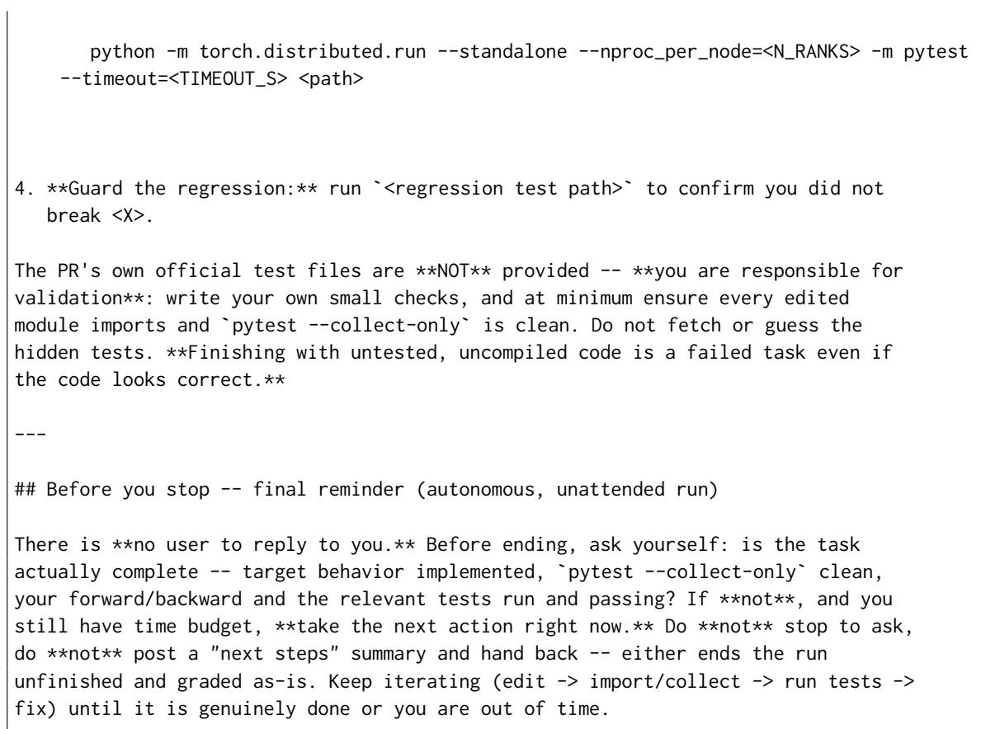  
Figure 11: Task prompt template, part 4 of 4: execution rules and final reminder.

## C Detailed Performance Tables

Table 4 gives the resolved rate under the official tests alone and with the hidden probes. Table 5 expands Table 2 per repository, and Table 6 splits each token total into non-cached input, cache reads, output, and reasoning.

Table 4: Resolved rate (%) under the official tests alone and under the official tests plus the supplementary probes. A task is resolved when every test in the suite passes.
<table><tr><td>Model</td><td>Official tests</td><td>Official + probes</td></tr><tr><td>Megatron-LM: 19 tasks</td><td></td><td></td></tr><tr><td>GPT-6 Sol</td><td>68.4</td><td>52.6</td></tr><tr><td>GPT-5.6 Sol</td><td>52.6</td><td>42.1</td></tr><tr><td>GLM 5.3 HY4 preview</td><td>36.8 52.6</td><td>26.3 42.1</td></tr><tr><td>DeepSeek V4 Pro</td><td>52.6</td><td>42.1</td></tr><tr><td>Kimi K3</td><td>42.1</td><td>31.6</td></tr><tr><td>verl: 7 tasks</td><td></td><td></td></tr><tr><td>GPT-6 Sol</td><td>100.0</td><td>42.9</td></tr><tr><td>GPT-5.6 Sol</td><td>85.7</td><td>28.6</td></tr><tr><td>GLM 5.3</td><td>71.4</td><td>42.9</td></tr><tr><td>HY4 preview</td><td>85.7</td><td>57.1</td></tr><tr><td>DeepŠeek V4 Pro</td><td>71.4</td><td>28.6</td></tr><tr><td>Kimi K3</td><td>85.7</td><td>57.1</td></tr><tr><td>vLLM: 10 tasks</td><td></td><td></td></tr><tr><td>GPT-6 Sol</td><td></td><td></td></tr><tr><td>GPT-5.6 Sol</td><td>10.0</td><td>10.0</td></tr><tr><td></td><td>20.0</td><td>10.0</td></tr><tr><td>GLM 5.3</td><td>20.0</td><td>10.0</td></tr><tr><td>HY4 preview</td><td>10.0</td><td>10.0</td></tr><tr><td>DeepSeek V4 Pro</td><td>10.0</td><td>10.0</td></tr><tr><td></td><td></td><td></td></tr><tr><td>Kimi K3</td><td>20.0</td><td>10.0</td></tr></table>

Table 5: Table 2 per repository. Steps is the mean number of completed model turns per task.
<table><tr><td>Model</td><td>% Resolved</td><td>% Passed</td><td>Time (min)</td><td>Steps</td><td>Cost ($)</td><td>Tokens (M)</td></tr><tr><td colspan="7">Megatron-LM: 19 tasks</td></tr><tr><td>GPT-6 Sol GPT-5.6 Sol</td><td>52.6 42.1</td><td>80.6 80.1</td><td>50.4 71.6</td><td>227.6 163.4</td><td>6.66 16.90</td><td>27.00 22.67</td></tr><tr><td>GLM 5.3</td><td>26.3</td><td>84.4</td><td>149.5</td><td>203.2</td><td>12.79</td><td>45.44</td></tr><tr><td>HY4 preview DeepŠeek V4 Pro</td><td>42.1 42.1</td><td>91.0 78.0</td><td>137.8 103.2</td><td>199.5 186.6</td><td>2.14 2.23</td><td>32.35 42.66</td></tr><tr><td>Kimi K3</td><td>31.6</td><td>77.0</td><td>148.1</td><td>157.4</td><td>13.46</td><td>31.79</td></tr><tr><td>verl: 7 tasks</td><td></td><td></td><td></td><td></td><td></td><td></td></tr><tr><td>GPT-6 Sol</td><td>42.9</td><td>91.0</td><td>30.7</td><td>88.1</td><td>3.72</td><td></td></tr><tr><td>GPT-5.6 Sol</td><td>28.6</td><td>83.8</td><td>52.3</td><td>114.6</td><td>11.23</td><td>12.31</td></tr><tr><td>GLM 5.3</td><td>42.9</td><td>78.4</td><td>101.8</td><td>155.8</td><td></td><td>15.05</td></tr><tr><td>HY4 preview</td><td>57.1</td><td>88.9</td><td>53.7</td><td>162.0</td><td>9.32</td><td>32.69</td></tr><tr><td>DeepŠeek V4 Pro</td><td>28.6</td><td>78.5</td><td>42.6</td><td>138.6</td><td>1.43</td><td>22.16</td></tr><tr><td>Kimi K3</td><td>57.1</td><td>92.1</td><td>93.6</td><td>160.0</td><td>1.26 10.47</td><td>26.04</td></tr><tr><td></td><td></td><td></td><td></td><td></td><td></td><td>28.12</td></tr><tr><td>vLLM: 10 tasks</td><td></td><td></td><td></td><td></td><td></td><td></td></tr><tr><td>GPT-6 Sol</td><td>10.0</td><td>66.8</td><td>40.8</td><td>150.6</td><td>4.07</td><td>15.18</td></tr><tr><td>GPT-5.6 Sol</td><td>10.0</td><td>72.2</td><td>93.3</td><td>246.7</td><td>25.38</td><td>36.31</td></tr><tr><td>GLM 5.3</td><td>10.0</td><td>61.1</td><td>134.2</td><td>260.6</td><td>18.71</td><td>64.99</td></tr><tr><td>HY4 preview</td><td>10.0</td><td>64.6</td><td>125.8</td><td>214.9</td><td>2.47</td><td>37.32</td></tr><tr><td>DeepSeek V4 Pro</td><td>10.0</td><td>64.3</td><td>112.7</td><td>215.0</td><td>1.69</td><td>51.21</td></tr><tr><td></td><td></td><td></td><td></td><td></td><td></td><td></td></tr><tr><td>Kimi K3</td><td>10.0</td><td>62.2</td><td>144.0</td><td>176.1</td><td>15.62</td><td>40.80</td></tr></table>

Table 6: Mean parent-session tokens in millions. Input excludes cached tokens. The four components sum to the token totals in Table 5 before rounding and average the same runs.
<table><tr><td>Model</td><td>Input (M)</td><td>Cache read (M)</td><td>Output (M)</td><td>Reasoning (M)</td></tr><tr><td>Megatron-LM</td><td></td><td></td><td></td><td>0.030</td></tr><tr><td>GPT-6 Sol GPT-5.6 Sol GLM 5.3 HY4 preview DeepSeek V4 Pro</td><td>0.336 0.768 0.485 0.622</td><td>26.600 21.832 44.813 31.608 40.930</td><td>0.037 0.042 0.055 0.046</td><td>0.029 0.086 0.072</td></tr><tr><td>Kimi K3 verl GPT-6 Sol GPT-5.6 Sol</td><td>1.037 0.362 0.441</td><td>30.645 11.887 14.555</td><td>0.050 0.038 0.035</td><td>0.056 0.024 0.023</td></tr><tr><td>GLM 5.3 HY4 preview DeepŠeek V4 Pro</td><td>0.280 0.333 1.031</td><td>32.285 21.736 24.889</td><td>0.046 0.045</td><td>0.074 0.050</td></tr><tr><td>Kimi K3</td><td>0.279</td><td>27.745</td><td>0.047 0.055</td><td>0.069 0.045</td></tr><tr><td>vLLM</td><td></td><td></td><td></td><td></td></tr><tr><td></td><td></td><td></td><td></td><td></td></tr><tr><td>GPT-6 Sol</td><td>0.255</td><td>14.870</td><td>0.033</td><td>0.026</td></tr><tr><td>GPT-5.6 Sol</td><td>0.948</td><td>35.262</td><td></td><td></td></tr><tr><td></td><td></td><td></td><td>0.056</td><td>0.044</td></tr><tr><td>GLM 5.3</td><td>1.249</td><td>63.574</td><td>0.066</td><td>0.099</td></tr><tr><td></td><td></td><td></td><td></td><td></td></tr><tr><td>HY4 preview</td><td>0.772</td><td>36.428</td><td>0.036</td><td>0.083</td></tr><tr><td></td><td></td><td></td><td></td><td></td></tr><tr><td></td><td></td><td></td><td></td><td></td></tr><tr><td>DeepSeek V4 Pro</td><td>0.863</td><td>50.189</td><td>0.067</td><td>0.089</td></tr><tr><td></td><td></td><td></td><td></td><td></td></tr><tr><td>Kimi K3</td><td>0.671</td><td>40.000</td><td>0.054</td><td>0.077</td></tr></table>

## D Failure Analysis: Error Types and Labelling

Failing test cases. The analysis covers the 36 × 5 = 180 submissions of the five models other than GPT-6 Sol. Afailing test case is a test case, from the official tests or the hidden probes, that the golden patch passes and the agent’s output patch does not. We analyze the 1,754 failing test cases and group them by task, test file, error signature, and label each group by reading the failing assertion against the prompt and the submission code. Table 7 counts the submissions with at least one case of each type.

Structural errors. The code does not fit the program around it. An execution or API error stops the code before any value can be checked: an import or collection failure, a missing symbol, a signature that does not match its callers, or a crash. A shape, layout, or dtype error produces a tensor whose shape, memory layout, or data type differs from what the surrounding code expects. A state or lifecycle error mishandles data that persists across calls, such as caches, buffers, counters, and the ownership of memory, or mishandles the capture and replay of CUDA graphs.

Behavioral errors. The code computes correct values but misses a requirement of the task. A resource error misses a stated requirement on memory, speed, communication traffic, or liveness, such as a peak memory that does not drop or a weight sync that sends more entries than have changed. A condition-specific error appears only under a particular condition: a flag, a parallel or CUDA-graph mode, a boundary input, a fallback, or an error path. A numerical mismatch that appears only under such a condition is labelled condition-specific rather than numerical.

Numerical errors. The code runs and fits the program but computes wrong values. An algorithm error implements the wrong computation, such as summing gradients across data-parallel ranks instead of averaging them. A precision-only error implements the right computation with insufficient precision; we assign it only when the same patch passes an exact-logic check.

Table 7: Submissions exhibiting each error type, counted once per submission. A submission may exhibit several types. An exception or collection failure is structural; otherwise a failure is labelled by the property its assertion checks.
<table><tr><td>Class</td><td>Error type</td><td>Megatron-LM</td><td>verl</td><td>vLLM</td><td>All</td></tr><tr><td>Structural</td><td>Execution / API</td><td>19</td><td>10</td><td>19</td><td>48</td></tr><tr><td>Structural</td><td>Shape / layout / dtype</td><td>8</td><td>4</td><td>10</td><td>22</td></tr><tr><td>Structural</td><td>State / lifecycle</td><td>10</td><td>8</td><td>17</td><td>35</td></tr><tr><td>Structural</td><td>Any structural error</td><td>30</td><td>18</td><td>37</td><td>85</td></tr><tr><td>Behavioral</td><td>Resource (memory, speed, traffic)</td><td>14</td><td>1</td><td>2</td><td>17</td></tr><tr><td>Behavioral</td><td>Condition-specific behavior</td><td>9</td><td>0</td><td>26</td><td>35</td></tr><tr><td>Behavioral</td><td>Any behavioral error</td><td>22</td><td>1</td><td>28</td><td>51</td></tr><tr><td>Numerical</td><td>Algorithm</td><td>7</td><td>6</td><td>11</td><td>24</td></tr><tr><td>Numerical</td><td>Precision only</td><td>0</td><td>0</td><td>0</td><td>0</td></tr><tr><td>Numerical</td><td>Any numerical error</td><td>7</td><td>6</td><td>11</td><td>24</td></tr></table>