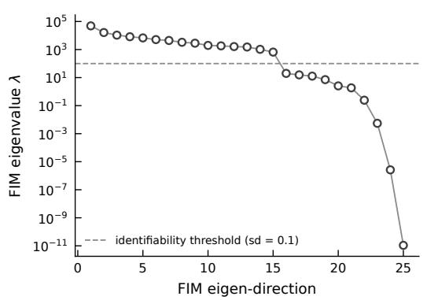
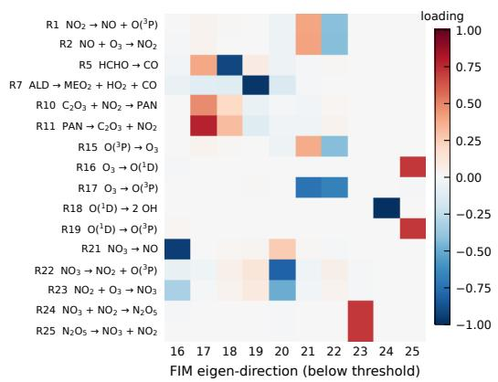
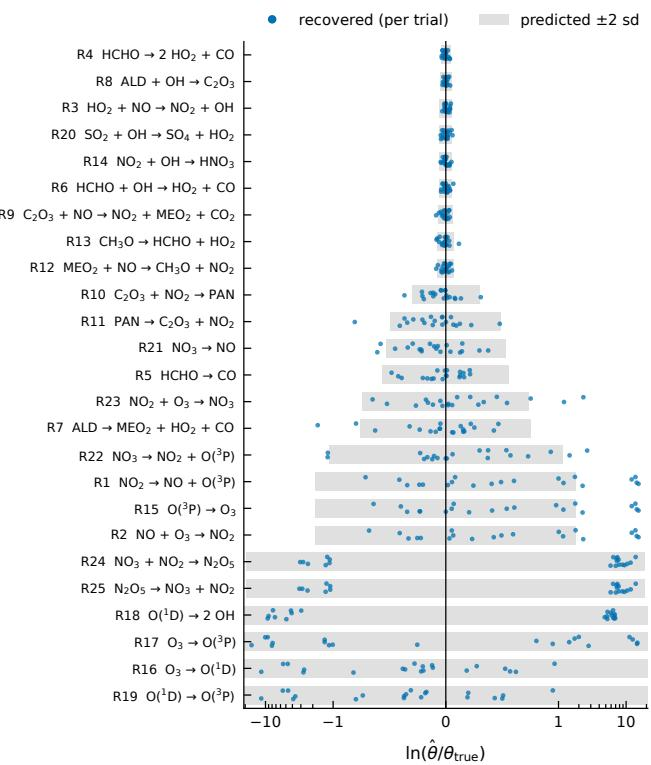
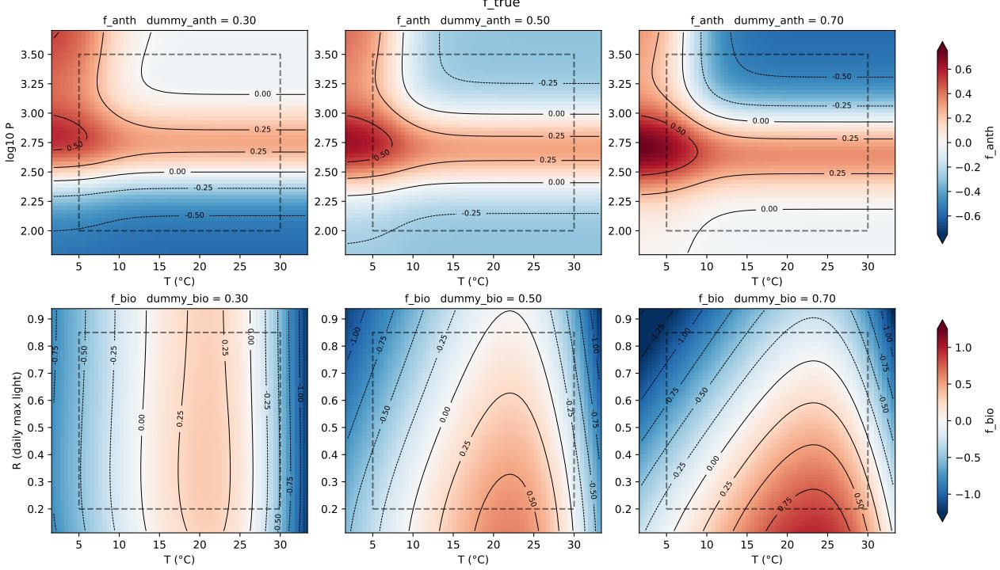
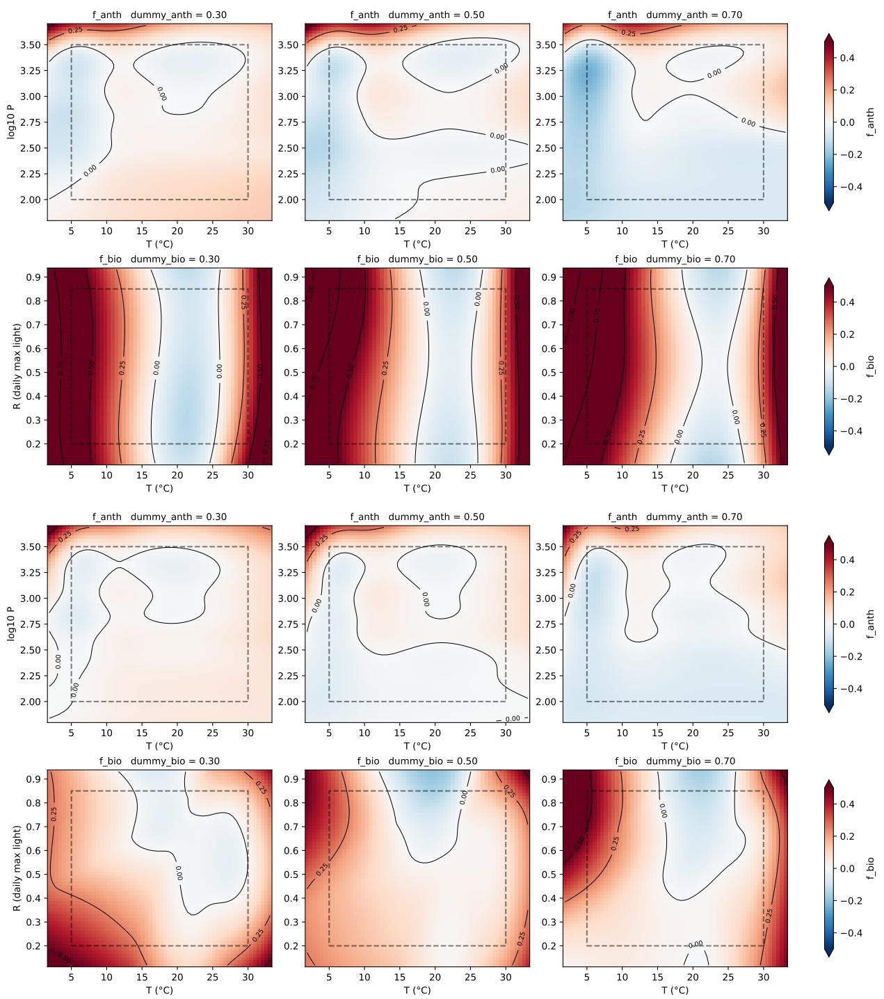

# KPPax: preprocess diferentiable kinetic ODE for machine learning in atmospheric chemistry

Wenqing Peng∗1,3, Michael Boy1,2,3, and Zhi-Song Liu2,3

1Institute for Atmospheric and Earth Systems Research, University of Helsinki, Helsinki, Finland

2LUT University, Department of Computational Engineering, Lahti, Finland 3Atmospheric Modelling Centre Lahti (AMC-Lahti), Lahti, Finland

## Abstract

Atmospheric chemical mechanisms are commonly distributed in the language of the Kinetic Pre-Processor (KPP), which generates eficient Fortran or C code but does not fit into the diferentiable programming frameworks in which machine-learning models are developed. We present KPPax, a kinetic preprocessor that generates diferentiable, just-in-time compiled, and vectorisable chemistry code in JAX from mechanisms written in the KPP language. KPPax evaluates the rate law with sparse operations in log space, which keeps it diferentiable, and integrates the stif system with the implicit solvers and the forward- and reverse-mode adjoints of the diffrax library, so that exact sensitivities are obtained without hand-derived adjoint code. We demonstrate two applications with the POLLU benchmark mechanism. In the first, the Fisher information matrix computed from an automatically diferentiated Jacobian predicts, before any fit, which of the 25 rate coeficients a flowtube-like design can identify, and noisy synthetic estimation confirms the predicted uncertainties of the nine identifiable rate coeficients to within about 30% while revealing clusters of fast reactions of which only ratios are constrained. In the second, a neural-network correction of an emission inventory is trained ofline on per-scenario 4D-Var retrievals and then fine-tuned online through the chemical model, which reduces the error of the biogenic correction by a factor of 2.4–5 and recovers information on low-temperature emissions that the individual retrievals lose. KPPax makes KPP mechanisms directly usable for parameter estimation and hybrid physics–machine-learning modelling.

## 1 Introduction

Chemicals and aerosols in the ambient air afect human health, weather, and climate (Seinfeld and Pandis, 2016). Their atmospheric concentrations vary strongly in space and time, governed by emission, chemical transformation, aerosol formation, transport by meteorological conditions, and eventual removal by deposition (Brasseur and Jacob, 2017). Comprehensive atmospheric chemical mechanisms, such as the near-explicit Master Chemical Mechanism (Jenkin et al., 1997; Saunders et al., 2003), contain thousands of species coupled through more than ten thousand reactions, and hand-coding the resulting stif ODE system and its Jacobian is tedious and error-prone.

The Kinetic PreProcessor (KPP) automates this process (Damian et al., 2002). Given a chemical mechanism specified in a dedicated description syntax, the KPP language, KPP parses the reaction list with a Flex/Yacc scanner–parser and generates Fortran or C code that evaluates the time derivative of the concentrations and its Jacobian. The generated code exploits the sparsity of the Jacobian through species reordering and sparse linear algebra routines, which keeps the implicit time stepping required by stif chemistry eficient, and it is paired with a suite of stif numerical integrators, including Rosenbrock, BDF, and Runge–Kutta methods. KPP also generates direct-decoupled and adjoint sensitivity code, which eficiently computes derivatives of the model solution with respect to rate coeficients, initial concentrations, and other parameters. These sensitivities support applications such as parameter estimation, uncertainty analysis, and variational data assimilation (Sandu et al., 2003). This tight coupling between mechanism parsing, sparse Jacobian generation, and forward and adjoint sensitivity code generation has made KPP a standard tool in atmospheric chemistry modelling, but it also means that the resulting code inherits the constraints of the Fortran and C environments and of the CPU hardware for which it was designed.

Other tools to preprocess and solve chemical kinetics have been developed for other software and hardware environments. pykpp (Henderson) is a preprocessor written in Python, which parses mechanisms written in the KPP language and solves the kinetic ODE with SciPy solvers. PyBox generates 0-dimensional box models that include both atmospheric chemistry and aerosol processes, in which the chemistry is solved by the Assimulo ODE solver (Topping et al., 2018), and PyCHAM reuses the mech anism parsing of PyBox but solves the ODE with SciPy (O’Meara et al., 2021). The Multi-Scale Infrastructure for Chemistry and Aerosols (MUSICA) is implemented in C++ and provides an option to run on accelerators such as GPUs (Pfister et al., 2020). For the EMAC model, a source-to-source tool translates the KPP-generated Fortran code into CUDA kernels to solve the chemical kinetics on GPUs (Alvanos and Christoudias, 2017). TChem-atm couples gas-phase and aerosol chemistry and runs on CPUs and GPUs through the Kokkos performance-portability library, constructing the Jacobian automatically for a range of stif ODE solvers (Díaz-Ibarra et al., 2026). These developments target the eficient forward simulation of process-based atmospheric models, which are built on explicit physical and chemical processes and are therefore interpretable, since the driving forces in the model can be perturbed to test their influence on the output. However, process-based models are limited by the processes that they do not resolve, and amending the model structure or tuning its parameters against observations remains laborious and computationally expensive.

Data-driven approaches, for example neural networks trained on historical atmospheric observations, ofer flexible and fast emulation of atmospheric processes with comparable accuracy. ChemNNE is a neural-network emulator of the atmospheric chemical ODE that is considerably faster than the numerical solver (Liu et al., 2025), and TopoFlow is a topography-aware neural network for high-resolution airquality prediction (Kheder et al., 2026). Neural networks can also partially solve the estimation of rate coeficients in chemical ODEs (Peng et al., 2025; Liu et al., 2026). However, purely data-driven models often lack interpretability and the ability to predict anomalies or extreme events, and their training is data-intensive and becomes infeasible when observations are sparse. Neural networks are trained by gradient descent, which relies on automatic diferentiation, and although this is possible in Fortran, the majority of neural-network models are developed in Julia or in Python frameworks such as PyTorch and JAX.

Hybrid models that combine physically based process models with data-driven neural networks are expected to unite the flexibility of neural networks with the interpretability and physical constraints of process-based models, enabling both fast emulation and learning from data and an understanding of the underlying processes (Shen et al., 2023; Innes et al., 2019; Gelbrecht et al., 2023). For example, the hybrid weather and climate model NeuralGCM, which combines a diferentiable dynamical core with neural networks, both implemented in JAX, achieves a performance comparable to the best machine-learning and process-based models (Kochkov et al., 2024). In ecohydrology, JAX-CanVeg integrates a land-surface model with neural-network components and improves the simulation (Jiang et al., 2025). Such hybrid models require the process model itself to be diferentiable, so that gradients can be propagated through it to the network parameters. General-purpose diferentiable modelling tools for reaction networks exist, such as Catalyst.jl in Julia (Loman et al., 2023), but to the best of our knowledge no tool generates diferentiable code from mechanisms written in the KPP language, in which atmospheric mechanisms such as the MCM are distributed and used.

Diferentiability matters most for inverse problems, in which model parameters or inputs are inferred from observations of the model output. Estimating rate coeficients from chamber or flow-tube observations is such a problem, and it is often ill-posed because the observations constrain only some combinations of the rate coeficients, so that the identifiability of the parameters should be analysed before they are estimated (Guillaume et al., 2019). Another example is the inversion of emissions from concentration observations, which has traditionally relied on variational data assimilation with hand-derived adjoint models (Elbern et al., 2007; Henze et al., 2007). To learn how emissions depend on environmental drivers, the retrieved emission fields can be used to train a neural network ofline, in the same way as data assimilation has been combined with machine learning to learn model dynamics from sparse and noisy observations (Brajard et al., 2020). Such a two-step approach, however, discards the information that the individual retrievals cannot resolve, whereas online training, in which the network is fitted to the observations through the chemical model, requires the gradient of the model output with respect to the network parameters.

To address this, we present KPPax, a kinetic preprocessor implemented in the JAX framework that generates diferentiable, just-in-time compiled, and vectorisable chemistry code from mechanisms written in the KPP language, which is directly usable within the data-driven modelling ecosystem. KPPax evaluates the rate law with sparse operations in log space, which keeps it diferentiable, and integrates the stif system with the implicit solvers and the forward- and reverse-mode adjoints of the diffrax library (Kidger, 2022), which enables inverse modelling, parameter estimation, and hybrid modelling of physical and neural models. Section 2 describes the implementation. Section 3 uses the sensitivities from KPPax to analyse the identifiability of the rate coeficients of a benchmark mechanism before estimating them from noisy synthetic observations. Section 4 trains a neural-network correction of an emission inventory and shows that online fine-tuning through the chemical model improves on the ofline two-step approach. Section 5 discusses the limitations, and Sect. 6 concludes.

## 2 Implementation of diferentiable kinetic pre-processing

## 2.1 The chemistry kinetic problem

An atmospheric chemical reaction system can be mathematically formulated by a coupled system of stif ordinary diferential equations (ODEs). Consider a reaction system of n species and m reactions. We denote the concentration of species i as $y _ { i }$ and reaction $j$ as $r _ { j }$ , with $1 \leq i \leq n , 1 \leq j \leq m$ . Let $\pmb { y } = [ y _ { 1 } , . . . , y _ { n } ] ^ { T }$ be a vector of concentration of all the species.

The stoichiometric coeficients define the quantitative relationship of the reactants and the products involved in the reaction. We define the stoichiometric coeficient $s _ { i , j } ^ { - }$ as the number of molecules of species i that react and consumed in the reaction $j ,$ and similarly $s _ { i , j } ^ { + }$ as the number of molecules produced. The reaction $j$ can be generically formulated as:

$$
\sum s _ { i , j } ^ { - } y _ { i } \to \sum s _ { i , j } ^ { + } y _ { i }\tag{1}
$$

The kinetic reaction rate law define the reaction rate $\omega _ { j }$ of the reaction $j$ as a proportion with the multiplication of the concentration of the reactants raised by the partial order for reactant $s _ { i , j } ^ { - }$ , with the proportionality constant defined as the rate coeficient (rate constant) $k _ { j } \colon$

$$
\omega _ { j } ( t , \pmb { y } ) = k _ { j } ( t ) \prod _ { i = 1 } ^ { n } y _ { i } ^ { s _ { i , j } ^ { - } }\tag{2}
$$

Depending on the reaction system, the rate coeficient may be either a constant or a time-dependent quantity that varies with environmental conditions. For instance, the photolysis rate of $\mathrm { N O } _ { 3 }$ depends on the actinic flux (light intensity), while the rate of cross-reactions among intermediate peroxy radicals depends on the total concentration of peroxy radicals present in the system. The vector k consists of the rate coeficients $k _ { j }$ from all $j$ reactions.

The concentration of species i change at a rate given by the cumulative efect of consumption and production in all reactions:

$$
\frac { d y _ { i } } { d t } = \sum _ { j = 1 } ^ { m } ( s _ { i , j } ^ { + } - s _ { i , j } ^ { - } ) \omega _ { j } ( t , \pmb { y } )\tag{3}
$$

We organise the stoichiometric coeficients $s _ { i , j } ^ { - }$ and $s _ { i , j } ^ { + }$ in matrices $S ^ { - }$ and $S ^ { + }$ and the reaction rates in a vector $\boldsymbol { \omega } = [ \omega _ { 1 } , . . . , \omega _ { m } ] ^ { T }$ , and let $S = S ^ { + } - \bar { S } ^ { - }$ , the rate equation (3) can be written as:

$$
\frac { d \pmb { y } } { d t } = ( \pmb { S } ^ { + } - \pmb { S } ^ { - } ) \pmb { \omega } ( t , \pmb { y } ) = \pmb { S } \pmb { \omega } ( t , \pmb { y } ) = \pmb { f } ( t , \pmb { y } ) ,\tag{4}
$$

This forms an initial value problem and the solution $\ b { y } ( t ) \in \mathbb { R } ^ { n }$ represents the time evolution of the concentration, starting from the initial concentration $\mathbf { \nabla } _ { \mathbf { \boldsymbol { y } } } ( t _ { 0 } )$ over the time span $( t _ { 0 } , t )$ :

$$
{ \pmb y } ( t ) = { \pmb y } ( t _ { 0 } ) + \int _ { t _ { 0 } } ^ { t } f \big ( \tau , { \pmb y } ( \tau ) \big ) d \tau\tag{5}
$$

## 2.2 Reaction parsing

The proposed KPPax adopts the KPP language as a description syntax for kinetic reaction system. The KPP language, developed by the KPP project, consists of sections, commands, and inline codes. KPP sections contain the description of reaction schemes, including the species and reactions. KPP commands control the code generation and the behaviour of the generated code. More custom behaviour can be implemented as inline code, and be inserted into a certain location in the generated code. KPPax uses only the sections that describe the mechanism, i.e. the species and the equations, because its objective is to generate the chemistry code alone, and it is the responsibility of the user to provide the initial concentrations and to construct the customised simulation.

Following the taxonomy of reaction parsing in (Damian et al., 2002), KPPax parses the kinetic equations in a mixture of the totally integrated approach and the preprocessing approach. The former parses the chemical mechanism once into a set of coeficient arrays that are subsequently evaluated by generic array operations at run time, and the latter generates mechanism-specific source code ahead of time, as KPP itself does. We utilise the parsing module from pykpp, which defines and parse the KPP language using the pyparsing module and returns a list of reactions composed of reactants, products, and rate coeficient expression. The stoichiometric coeficients are converted into sparse array literals in the coordinate list (COO) format, with row/column indices and values stored in separate arrays $( i , j , v )$ . The time dependent rate coeficients are converted from Fortran expression to JAX expression and wrapped as a python function.

To exploit the computational power of accelerators, we implement the rate law in fully sparse matrix operation. Rather than materialising $S ^ { - }$ and $_ { s }$ as dense matrices, the rate law (Eq. 2-4) is evaluated directly from their COO representation using index-gather and segment-reduction primitives, as summarised in Algorithm 1. The reactant product term in Eq. 2 is computed as a segment product: partial powers $y _ { i } ^ { s _ { i , j } ^ { - } }$ are gathered at the non-zero row indices of $S ^ { - }$ and reduced onto the reaction axis $j$ by scatter-multiplication.

Algorithm 1 Sparse evaluation of the rate law   
Require: y; k; $S ^ { - } \colon ( i _ { r } , j _ { r } , v _ { r } ) ; S \colon ( i _ { s } , j _ { s } , v _ { s } )$   
1: ${ \pmb p } \gets { \pmb y } [ { \pmb i } _ { r } ] ^ { { \pmb v } _ { r } }$ {gather and raise to partial order}   
2: $\omega  k \odot$ segment\_prod $( p , j _ { r } )$ {scatter-multiply onto reaction axis}   
3: y˙ ← segment\_sum $( { \pmb v } _ { s } \odot { \pmb \omega } [ j _ { s } ] , i _ { s } )$ {scatter-add onto species axis}   
4: return $\dot { \pmb { y } }$

This power-multiply formulation is not diferentiable in practice, because the reactant product is realised as a scatter-multiplication over repeated reaction indices, for which JAX does not implement a diferentiation rule. We avoid this implementation limitation by reformulating the rate law in log space,

$$
\log \omega _ { j } = \log k _ { j } + \sum _ { i } s _ { i , j } ^ { - } \log y _ { i } ,\tag{6}
$$

which replaces the scatter-multiplication with a scatter-addition, segment\_sum, before a single exponentiation recovers ω:

Algorithm 2 Sparse evaluation of the rate law in log space   
Require: y; $k ; S ^ { - } ; ( i _ { r } , j _ { r } , v _ { r } ) ; S \colon ( i _ { s } , j _ { s } , v _ { s } )$   
1: $\pmb q  { \boldsymbol { v } } _ { r } \odot \log \pmb { y } [ i _ { r } ]$ {gather and scale log-concentrations by partial order}   
2: l ← segment\_sum(q, jr) {scatter-add onto reaction axis, i.e. log $\prod _ { i } y _ { i } ^ { s _ { i , j } ^ { - } } \}$   
3: ω ← k ⊙ exp(l) {recover reaction rate}   
4: y˙ ← segment\_sum(vs ⊙ ω[js], is) {scatter-add onto species axis}   
5: return y˙

Since JAX defines a standard gradient rule for segment\_sum, this substitution leaves the sparse indexing pattern and computational cost of Algorithm 1 unchanged while restoring full diferentiability of the rate law with respect to both $y$ and $k ,$ at the cost of requiring y to remain strictly positive throughout the integration.

Atmospheric chemical mechanisms are numerically stif, because reactive radical species relax on timescales of milliseconds to seconds, while longer-lived species evolve over hours, so the system’s Jacobian eigenvalues span many orders of magnitude. Explicit integration schemes are constrained by this stifness to prohibitively small time steps for stability, rather than accuracy, and are therefore unsuitable, which is why KPP itself provides implicit and Rosenbrock-type solvers (Sandu et al., 2003). We integrate Eq. (4) using diffrax (Kidger, 2022), a JAX-native library of diferentiable ODE solvers, selecting the implicit

Kvaerno family of solvers, which combine embedded error estimates with an implicit treatment of the stif terms via a diagonally implicit Runge-Kutta scheme, avoiding the step-size collapse of explicit methods. Step size is controlled adaptively by a proportional-integral (PID) controller, which adjusts dt to meet a prescribed local error tolerance rather than relying on a fixed or manually tuned step size. Because concentrations must remain strictly positive for the log-space rate law (Eq. 6), we additionally clip y to a small positive floor at each evaluation of the right-hand side, preventing the solver from probing negative or exactly zero concentrations during error-controlled step adjustment. We perform all stif ODE integration in 64-bit double precision.

## 2.3 Automatic diferentiation

Automatic diferentiation (AD) computes exact derivatives of a numerical program by decomposing it into elementary operations and applying the chain rule systematically, either forward alongside the primal computation (forward mode) or backward from the output (reverse mode). Once the rate law and its numerical integration are expressed as JAX-traceable array operations, the sensitivity of an output quantity, for instance an observed concentration at time $t _ { F } { , }$ with respect to an input quantity, for instance an emission rate or a rate coeficient, can therefore be obtained automatically, without deriving the corresponding tangent-linear or adjoint equations by hand.

Diferentiating through an ODE solve is nonetheless a distinct problem from diferentiating a single expression, since the numerical solution is produced by an iterative sequence of solver steps rather than a closed-form function. Two broad strategies exist for obtaining the required sensitivities, namely the optimize-then-discretize adjoint, which derives an adjoint ODE from the continuous forward equations and integrates it backwards independently of how the forward solve was discretised, and the discretizethen-optimize adjoint, which diferentiates the forward numerical scheme itself, step by step, yielding the exact gradient of the numerical solution rather than an approximation to the gradient of the underlying continuous problem (Sandu et al., 2003). KPP implements both, but its discretize-then-optimize adjoint must be derived analytically for each integrator in turn. For example, Sandu et al. (2003) derive it explicitly for the linearly implicit Euler method, requiring not only the Jacobian but also its derivative with respect to concentration (the Hessian tensor) and dedicated sparse linear-algebra routines to evaluate it eficiently. They note this construction to be considerably more demanding than their optimize-thendiscretize adjoint, and correspondingly, KPP provides hand-derived discretize-then-optimize adjoints for only a subset of its integrators.

diffrax (Kidger, 2022) instead obtains a discretize-then-optimize adjoint of the forward solve through reverse-mode AD applied directly to the solver’s internal steps, exposing the diferentiation strategy as a configurable component of the solve rather than a property fixed by the choice of integrator. Naively diferentiating through every accepted step this way would require storing each intermediate solver state, incurring memory cost proportional to the number of steps. The recursive checkpoint adjoint avoids this by checkpointing only a logarithmic subset of states and recomputing the remainder on demand during the backward pass, keeping memory cost sub-linear in step count while still returning the exact discrete gradient. Because this adjoint is generated automatically for any solver JAX can trace, KPPax removes the need to derive a Hessian or a solver-specific adjoint step by hand for every integrator, and with it the correctness risk that Sandu et al. (2003) themselves highlight for hand-written or generalpurpose adjoint-compiler code. The trade-of is computational rather than conceptual: checkpointed recomputation adds cost that a hand-derived discretize-then-optimize adjoint, once implemented, would not incur, particularly for very large mechanisms. We consider this an acceptable exchange for the substantial reduction in implementation and maintenance efort it afords when extending KPPax to new mechanisms or integrators.

## 3 Application I: identifiability and parameter estimation

Rate coeficients of atmospheric chemical mechanisms are uncertain, and many of them can only be constrained indirectly, through laboratory or chamber observations of a few species. A fit of all rate coeficients to such observations is often non-unique, because diferent combinations of parameter values reproduce the observations equally well. A parameter is non-identifiable when its value cannot be determined uniquely from the data, and this can arise from the structure of the model, the observed quantities and the objective function (structural non-identifiability), or from the experimental design and the observation error (practical non-identifiability) (Guillaume et al., 2019). Therefore identifiability is recomended to be assessed routinely before parameters are estimated, so that the estimation is restricted to what the data can support. Derivative-based identifiability analysis requires the sensitivity of the model output with respect to every parameter, which is laborious to derive by hand for a chemical mechanism and inaccurate and expensive to approximate by finite diferences. With KPPax, the exact sensitivities are obtained by automatic diferentiation through the stif solver at a cost comparable to a few forward integrations. In this section, we use these sensitivities first to predict, before any fit, which rate coeficients a given experimental design can constrain, and then to estimate the rate coeficients from noisy synthetic observations, which tests these predictions.

## 3.1 Method

We parameterise the rate coeficients as $k = k ^ { \mathrm { r e f } } \odot \exp ( \theta )$ , where $k ^ { \mathrm { r e f } }$ are the reference values of the mechanism and θ is the vector of log correction factors. The observation operator $\pmb { h } ( \pmb \theta )$ stacks the logarithms of the simulated concentrations of all observed species at all observation times and in all experiments. Given observations y˜ with independent Gaussian errors of standard deviation σ in log space, the residuals and the least-squares cost are

$$
\pmb { r } ( \pmb { \theta } ) = \frac { \pmb { h } ( \pmb { \theta } ) - \tilde { \pmb { y } } } { \sigma } , \qquad \boldsymbol { \chi } ^ { 2 } ( \pmb { \theta } ) = \pmb { r } ( \pmb { \theta } ) ^ { \top } \pmb { r } ( \pmb { \theta } ) .\tag{7}
$$

Because h and θ are both logarithmic, the Jacobian $\boldsymbol { J } ~ = ~ \partial \boldsymbol { h } / \partial \boldsymbol { \theta }$ contains the relative sensitivities ∂ ln $y / \partial$ ln k, which are comparable across species and reactions whose magnitudes difer by many orders. Given the number of θ and y, we compute J by forward-mode automatic diferentiation through the solver, which propagates one tangent per parameter.

The local practical identifiability at the true parameters is characterised by the Fisher information matrix (FIM)

$$
\pmb { F } = \frac { 1 } { \sigma ^ { 2 } } \pmb { J } ^ { \top } \pmb { J } = \pmb { V } \pmb { \Lambda } \pmb { V } ^ { \top } ,\tag{8}
$$

which for noise-free observations equals the Gauss–Newton approximation of the Hessian of $\chi ^ { 2 } / 2$ at the truth. Each eigenvector ${ \pmb v } _ { m }$ (a column of V) is a direction in parameter space, i.e. a combination of rate coeficients, and its eigenvalue $\lambda _ { m }$ measures how strongly the data constrain this combination. The Cramér–Rao bound gives the smallest covariance ${ \pmb F } ^ { - 1 }$ that any unbiased estimator can attain, which corresponds to a standard deviation of $\lambda _ { m } ^ { - 1 / 2 }$ along ${ \pmb v } _ { m }$ and to a standard deviation of

$$
\sigma _ { p } ^ { \mathrm { C R } } = \left[ \left( F ^ { - 1 } \right) _ { p p } \right] ^ { 1 / 2 } = \biggl ( \sum _ { m } \frac { V _ { p m } ^ { 2 } } { \lambda _ { m } } \biggr ) ^ { 1 / 2 }\tag{9}
$$

for the individual parameter $\theta _ { p }$ . We classify a rate coeficient as identifiable if $\sigma _ { p } ^ { \mathrm { C R } } < 0 . 1$ , i.e. if its onestandard-deviation uncertainty is about 10% (a factor of $e ^ { 0 . 1 } \approx 1 . 1 )$ , which is small compared with the factor-of-two uncertainty $( \ln 2 \approx 0 . 6 9 )$ of the initial guesses used below. In the experiment of Sect. 3.2, the classification does not depend on the exact threshold, because the values of $\sigma _ { p } ^ { \mathrm { { \dot { C } R } } }$ jump from 0.04 to 0.15 between the identifiable and the remaining parameters (Sect. 3.3). Directions with eigenvalues close to zero are combinations of rate coeficients that the observations cannot distinguish, and their loadings $V _ { p m }$ show which reactions are confounded. This analysis requires only the Jacobian at a single parameter point and is performed before any fit.

To test the predictions, we estimate the parameters from noisy synthetic observations. In each of 20 trials, we draw a new noise realisation of y˜ at the truth and a new initial guess ${ \pmb \theta } ^ { ( 0 ) } \sim \mathcal { N } ( 0 , ( \ln 2 ) ^ { 2 } { \pmb I } )$ i.e. initial rate coeficients that typically deviate from the truth by a factor of 2, and minimise $\chi ^ { 2 }$ with the Levenberg–Marquardt algorithm, i.e. Gauss–Newton iterations with adaptive damping, of the optimistix library (Rader et al., 2024), using the same forward-mode Jacobian and at most 200 iterations. All trials are solved together under jax native vectorisation jax.vmap. For each parameter, we compare the root-mean-square (RMS) deviation of the estimates from the truth across the trials with $\sigma _ { p } ^ { \mathrm { C R } }$ . For identifiable parameters, the two should agree. For non-identifiable parameters, the estimates are expected to remain scattered at least as widely as the initial guesses, because the data cannot pull them back, even though the fit to the observations is as good as at the truth.

## 3.2 Experimental design

We use the POLLU scheme (Verwer, 1994) with its reference rate coeficients, which are constant in time, and estimate all 25 rate coeficients. The design mimics a flow-tube experiment, in which the reaction time is fixed and the injected precursor concentrations are varied. POLLU initialises six species (NO, $\mathrm { { O _ { 3 } } }$ , HCHO, CO, ALD, and $\mathrm { S O _ { 2 } ) }$ , and we generate eight initial conditions by multiplying each of these initial concentrations by an independent log-normal factor with a log-space standard deviation of ln 2. All other species start from zero. Each initial condition is integrated for 60 min, and all 20 species are observed once at the end, which gives 160 observations with a log-space noise of $\sigma = 0 . 0 5$ . The ODEs are integrated with the Kvaerno3 solver with relative and absolute tolerances of $1 0 ^ { - 8 }$ and $1 0 ^ { - 9 }$ ppm.

(a)  
  
(c)

(b)  

  
Figure 1: Identifiability analysis and estimation of the 25 POLLU rate coeficients. (a) Eigenvalues of the Fisher information matrix in descending order, where the dashed line marks $\lambda = 1 0 0$ , which corresponds to a Cramér–Rao standard deviation of 0.1 along the eigenvector. (b) Loadings of the ten eigenvectors below this threshold on the rate coeficients that contribute to them. (c) Estimated log rate coeficients relative to the truth in the 20 trials (dots), compared with the interval of $\pm 2 \sigma _ { p } ^ { \mathrm { C R } }$ predicted from the FIM before the fit (grey bars). The horizontal axis is linear between −1 and 1 and logarithmic outside. Reactions are numbered as in POLLU.

If all species were observed continuously in time, all 25 rate coeficients of POLLU would be globally structurally identifiable, as we verified with the StructuralIdentifiability.jl package (Dong et al., 2023). Any non-identifiability in this experiment is therefore practical and arises from the design, which observes a single time after a fixed reaction time. Such a design is outside the scope of the structural analysis, which assumes continuous-time outputs, whereas the FIM applies to any set of observations.

## 3.3 Results

The automatically diferentiated Jacobian $( 1 6 0 \times 2 5 )$ agrees with the central finite-diference approximation to a relative error of $8 . 7 \times 1 0 ^ { - 7 }$ , and it takes 0.77 s, compared with 28.7 s for the 50 evaluations of the forward model required by the finite diferences. The finite-diference approximation also depends on the choice of the step size, whereas automatic diferentiation gives the exact derivative of the numerical solution.

The eigenvalues of the FIM span 16 orders of magnitude $\left( \mathrm { F i g . \ 1 a } \right)$ . Fifteen eigen-directions are constrained to a standard deviation better than 0.1, and the remaining ten fall of steeply, with the four smallest eigenvalues below 1 and the smallest at $1 0 ^ { - 1 1 }$ . Since the well-constrained directions are combinations of rate coeficients, only nine individual rate coeficients have $\sigma _ { p } ^ { \mathrm { C R } } < 0 . 1 \ ( \mathrm { F i g . \ 1 c } )$ . These are the reactions of the $\mathrm { H O } _ { x } .$ HCHO, ALD, and $\mathrm { S O _ { 2 } }$ chemistry (R3, R4, R6, R8, R9, R12, R13, R14, and R20). The loadings of the weakly constrained eigenvectors (Fig. 1b) group the non-identifiable rate coeficients into three clusters of fast reactions. These are the $\mathrm { N O - N O _ { 2 } - O _ { 3 } }$ photostationary cycle (R1, R2, and R15), the equilibrium between $\mathrm { N O _ { 3 } , N O _ { 2 } }$ , and $\mathrm { N _ { 2 } O _ { 5 } }$ (R24 and R25), and the fast interconversion of $\mathrm { O _ { 3 } , O ( ^ { 1 } D ) }$ , and $\mathrm { O ( ^ { 3 } P ) }$ (R16–R19). Within each cluster, the reactions are fast compared with the reaction time of 60 min, so the observed concentrations are set by the ratios of the rate coeficients, and their absolute values are not constrained. For example, the eigenvector that loads equally on R24 and R25 corresponds to a simultaneous increase of both rate coeficients, which leaves the $\mathrm { N _ { 2 } O _ { 5 } }$ equilibrium constant $k _ { 2 4 } / k _ { 2 5 }$ unchanged. The noisy estimation confirms these predictions (Fig. 1c). For the nine identifiable rate coeficients, the RMS deviation of the estimates from the truth agrees with $\sigma _ { p } ^ { \mathrm { C R } }$ to within about 30%, which shows that the local, linearised prediction from a single Jacobian quantifies the achievable accuracy correctly. The seven rate coeficients with intermediate $\sigma _ { p } ^ { \mathrm { C R } }$ of 0.15–0.57 are estimated with errors of the predicted size, which is somewhat larger for R22 and R23. The non-identifiable rate coeficients drift far from the truth, by up to 15 in log units, i.e. by more than six orders of magnitude. For the cluster R1, R2, and R15, the RMS deviation of 6.3 is seven times the Cramér–Rao prediction, because the drift follows a curved valley of the cost function along which the linearisation at the truth is not valid. For the $\mathrm { O _ { 3 } { - } O ( ^ { 1 } D ) { - } O ( ^ { 3 } P ) }$ cluster, the RMS deviation is much smaller than the Cramér– Rao value, which in this case only indicates that the cost is flat, so that the spread of the estimates is set by the initial guesses and the finite number of iterations. The drift is not random, because the estimates within a cluster move together and keep their ratios constant, which is visible in Fig. 1c as identical estimates of R1, R2, and R15, and of R24 and R25, in each trial. The FIM therefore identifies correctly which combinations of rate coeficients the design cannot constrain, but it underestimates how far the estimates can move along these combinations. All fits reach the noise level of the observations. The median of $\chi ^ { 2 } / n$ over the trials is 0.85 at the estimates and 1.01 at the truth, and the reduction is consistent with the number of parameters $p$ that the fit can adjust to the noise, since $1 - p / n$ is 0.84–0.91 for $p$ between the 15 well-constrained directions and all 25 parameters. Only two of the 20 trials met the convergence tolerance of the Levenberg–Marquardt algorithm, whereas the others reached the maximum of 200 iterations. These trials did not fail, but kept creeping along the flat valleys of the non-identifiable clusters, where each step reduces the cost only marginally, while their estimates of the identifiable rate coeficients agree with the Cramér–Rao prediction (Fig. 1c). This behaviour is itself a symptom of nonidentifiability, and it illustrates why the analysis should precede the fit: once the FIM has revealed the confounded clusters, their rate coeficients can be fixed at literature values or reparameterised by their ratios, and only the identifiable combinations are estimated.

## 4 Application II: hybrid neural emission inversion

Emission inventories are a major source of uncertainty in chemical transport modelling. Their dependence on environmental drivers, such as temperature, light, or population density, is usually prescribed by simple empirical functions. Concentration observations constrain emissions only indirectly, through the chemistry, so a correction to the inventory has to be inferred by inverting the chemical model, as in four-dimensional variational (4D-Var) emission inversion (Elbern et al., 2007). A neural network that maps environmental drivers to an emission correction can then be trained ofline, by regressing it on the emission fields retrieved by such an inversion. However, the accuracy of the network is then limited by the retrieved fields themselves, because each retrieval is regularised towards the prior inventory and is constrained only by the observations of its own scenario, so that information that the observations do contain, but that a single retrieval cannot isolate from the prior, is lost before the network is trained. Here, we use KPPax to learn a neural-network correction of the emission inventory as a function of its environmental drivers. Because the network sits inside the kinetic ODE, its training requires gradients of the simulated concentrations with respect to the network parameters, propagated through the stif chemistry, which is exactly what the diferentiable solver provides. We compare the ofline training with online training through the ODE in a synthetic experiment where the true correction is known.

## 4.1 Experimental setup

We use the POLLU scheme (Verwer, 1994) (20 species, 25 reactions) in a 0-dimensional box model with emission and dilution towards a background concentration $\mathbf { \vec { c } _ { \mathrm { { b g } } } } \mathrm { : }$

$$
\frac { \mathrm { d } \pmb y } { \mathrm { d } t } = S \omega \big ( t , \pmb y \big ) + E ( t ) - \frac { \pmb y - \pmb c _ { \mathrm { b g } } } { \tau } ,\tag{10}
$$

where the first term is the rate law of Eq. (4) generated by KPPax, and $\tau = 1 2$ h is the dilution time scale. The rate coeficients of POLLU are constant, so we impose a diurnal cycle on its eight photolysis reactions by scaling them with a smooth daylight factor that equals 1 at noon and vanishes between 18:00 and 06:00. Concentrations are in ppm and time is in minutes, following POLLU.

Emissions come from an anthropogenic sector $( s = \mathrm { a n t h } )$ , which emits $\mathrm { N O } , \mathrm { N O } _ { 2 } , \mathrm { C O } , \mathrm { S O } _ { 2 }$ , HCHO, and ALD, and a biogenic sector (s = bio), which emits ALD and HCHO. The total emission rate is

$$
{ \pmb E } ( t ) = \sum _ { s } e _ { s } g _ { s } \big ( { \pmb x } ( t ) \big ) p _ { s } ( t ) \exp \big [ f _ { s } \big ( { \pmb x } ( t ) \big ) \big ] .\tag{11}
$$

Here, $e _ { s }$ is a fixed speciated base emission rate, and $p _ { s } ( t )$ is a diurnal profile known a priori and normalised to a daily mean of one, which follows a trafic double peak at 08:00 and 18:00 for the anthropogenic sector and the daylight factor for the biogenic sector. The covariate vector $\pmb { r } = ( T , R , \log _ { 1 0 } P , d _ { \mathrm { a n t h } } , d _ { \mathrm { b i o } } )$ consists of the temperature $T ~ ( \mathrm { i n } ~ ^ { \circ } \mathrm { C } )$ , the daily maximum light level $R \in [ 0 , 1 ]$ , the population density $P ,$ and two synthetic covariates, which can be interpreted as the share of fossil-fuel heating $( d _ { \mathrm { a n t h } } )$ and the vegetation type or thermal acclimation $( d _ { \mathrm { b i o } } )$ . The inventory scaling $g _ { s }$ is a deliberately crude function of the covariates, in which anthropogenic emissions scale linearly with population density, whereas biogenic emissions follow a fixed exponential temperature response and depend linearly on light:

$$
g _ { \mathrm { a n t h } } = 1 0 ^ { \log _ { 1 0 } P - 3 } , \qquad g _ { \mathrm { b i o } } = \exp \left[ 0 . 0 9 \left( T - 3 0 \right) \right] R .\tag{12}
$$

The log correction factor $f _ { s }$ is the unknown to be learned, and the inventory corresponds to $f _ { s } = 0$ . The true correction depends on three covariates per sector and is constructed to be smooth and nonlinear, so that neither a linear nor an additive model can reproduce it:

$$
f _ { \mathrm { a n t h } } ^ { \mathrm { t r u e } } = 0 . 6 e ^ { - \left[ \left( \log _ { 1 0 } P - 2 . 7 \right) / 0 . 3 5 \right] ^ { 2 } } + \left( 0 . 3 + d _ { \mathrm { a n t h } } \right) \sigma \left( \frac { 8 - T } { 2 } \right) \sigma \left( 3 \left( \log _ { 1 0 } P - 2 . 8 \right) \right)
$$

$$
+ 0 . 3 \sin ( 2 \pi d _ { \mathrm { a n t h } } ) \operatorname { t a n h } \left( 2 \left( \log _ { 1 0 } P - 2 . 7 5 \right) \right) - 0 . 3 ,\tag{13}
$$

$$
f _ { \mathrm { b i o } } ^ { \mathrm { t r u e } } = 0 . 0 7 \left( T - T _ { \mathrm { o p t } } \right) - \ln \left( 1 + e ^ { 0 . 3 \left( T - T _ { \mathrm { o p t } } \right) } \right) + \ln \frac { 2 } { \sqrt { 1 + 3 R ^ { 2 } } } + 0 . 8 \sin ( 2 \pi d _ { \mathrm { b i o } } ) \left( R - 0 . 5 5 \right) + 0 . 4 9 ,\tag{14}
$$

where σ is the logistic function and $T _ { \mathrm { o p t } } = 2 3 + 6 d _ { \mathrm { b i o } }$ . The anthropogenic correction (Eq. 13) contains a non-monotonic dependence on population density, peaking in suburban densities, and a cold-day heating term in populated areas that grows with $d _ { \mathrm { a n t h } }$ . Combined with the inventory, the biogenic correction $\left( \mathrm { E q . \ 1 4 } \right)$ gives a temperature response that rises at $0 . 1 6 \ ^ { \circ } \mathrm { C } ^ { - 1 }$ at low temperature and has an optimum near $T _ { \mathrm { o p t } }$ , and a light dependence $2 R / \sqrt { 1 + 3 R ^ { 2 } }$ that saturates instead of growing linearly. Each sector also includes a sinusoidal interaction with its synthetic covariate, and the constants centre both corrections at approximately zero over the training ranges (Fig. 2). Since biogenic emissions are small at low temperature, $f _ { \mathrm { b i o } }$ there has little efect on any concentration and is only weakly constrained by the observations.

In each scenario, the covariates are sampled uniformly from their training ranges. The daily mean temperature is chosen such that the diurnal temperature cycle, which has a range of 4–14 $^ \circ \mathrm { C }$ and a maximum between 13:00 and 16:00, stays within $5 { - } 3 0 ~ ^ { \circ } \mathrm { C }$ , while R, $\log _ { 1 0 } P$ , and $d _ { \mathrm { a n t h } } , d _ { \mathrm { b i o } }$ are drawn from [0.2, 0.85], [2, 3.5], and [0.1, 0.9], respectively. Background $\mathrm { { O _ { 3 } } }$ and $\mathrm { C O }$ are also sampled per scenario. Temperature varies over the day, so x and hence $f _ { s }$ are functions of time. We generate 150 training, 30 validation, and 30 interpolation test scenarios. For each covariate, we additionally generate 20 extrapolation test scenarios in which that covariate lies in bands extending its training range by 12.5% of the range width on either side. Each scenario is spun up for one day with the true emissions, and then integrated over a one-day window from midnight, and the post-spin-up state is assumed to be known exactly and is used, without noise, as the initial state of the assimilation window. Observations are taken hourly from 01:00 to 24:00 and perturbed with multiplicative log-normal noise with a log-space standard deviation of 0.05. We consider two observation sets, namely all 20 species and only the five species routinely measured at air-quality monitoring stations $( \mathrm { O _ { 3 } } , \mathrm { N O } , \mathrm { N O _ { 2 } } , \mathrm { C O }$ , and $\mathrm { S O _ { 2 } ) }$ . Each set is used with and without noise, giving four settings.

  
Figure 2: True log emission correction $f _ { s } ^ { \mathrm { t r u e } }$ (Eqs. 13 and 14) for the anthropogenic (top) and biogenic (bottom) sectors, at three values of the synthetic covariate (columns). The dashed boxes mark the training ranges, and the regions outside them are the extrapolation bands.

## 4.2 Neural emission correction

The unknown correction $f _ { s }$ is represented by one multilayer perceptron (MLP) per sector, which takes the three covariates of that sector as input, scaled linearly from their training ranges to $[ - 1 , 1 ]$ . Each MLP has two hidden layers of width 32 with softplus activations, and its output is bounded as $f _ { s } =$ $f _ { \mathrm { m a x } } \operatorname { t a n h } ( \operatorname { M L P } _ { s } / f _ { \mathrm { m a x } } )$ with $f _ { \mathrm { m a x } } = 3$ , so that an untrained network cannot push the chemistry into extreme states. The weights and bias of the last layer are initialised to zero, so the network reproduces the inventory $( f _ { s } = 0 )$ at the start of training. The two MLPs together have 2434 parameters, which we denote by θ.

The correction varies in time through the temperature, and we evaluate it at hourly knots $t _ { j } \ ( j =$ $0 , \ldots , 2 4 )$ over the one-day window, as $f _ { s , j } = f _ { s } ( \pmb { x } ( t _ { j } ) ; \pmb { \theta } )$ , and interpolate between the knots with a cubic Hermite spline. This gives the same time representation of the correction as the 4D-Var control variable in Sect. 4.3, so that the ofline and online approaches difer only in how the knot values are constrained. Both approaches measure the misfit to the observations ${ \boldsymbol y } ^ { \mathrm { o b s } }$ in log space, as in Eq. (7) but with a detection limit:

$$
r _ { t , i } = \frac { \ln \operatorname* { m a x } ( y _ { t , i } , y _ { \mathrm { D L } } ) - \ln \operatorname* { m a x } ( y _ { t , i } ^ { \mathrm { o b s } } , y _ { \mathrm { D L } } ) } { \sigma _ { \mathrm { o b s } } } ,\tag{15}
$$

for every observation time t and observed species i, where $y _ { \mathrm { D L } } = 5 \times 1 0 ^ { - 5 }$ ppm is a detection limit that prevents the logarithm from amplifying diferences between near-zero concentrations, and $\sigma _ { \mathrm { o b s } } = 0 . 0 5$ in all settings. All ODEs are integrated with the Kvaerno3 solver with relative and absolute tolerances of $1 0 ^ { - 6 }$ and $1 0 ^ { - 1 2 }$ ppm.

## 4.3 Ofline two-step training

The ofline approach first retrieves the correction separately for each scenario n by 4D-Var and then trains the network to reproduce the retrievals. The control variable of scenario n is the vector $\delta _ { n }$ of knot values of both sectors, and the retrieval minimises

$$
J _ { n } ( \delta _ { n } ) = \frac { 1 } { 2 } \sum _ { t , i } r _ { t , i } ^ { 2 } + \frac { 1 } { 2 } \sum _ { s } \delta _ { n , s } ^ { \top } B ^ { - 1 } \delta _ { n , s } , \qquad B _ { j l } = \sigma _ { b } ^ { 2 } \exp \left( - \frac { \left| t _ { j } - t _ { l } \right| } { L } \right) ,\tag{16}
$$

where the background term keeps the retrieval close to the inventory $( \pmb \delta = 0 )$ with a prior standard deviation $\sigma _ { b }$ and a temporal correlation length L. We minimise Eq. (16) by Gauss–Newton iterations with Levenberg–Marquardt damping for 15 iterations (Courtier et al., 1994). The Jacobian of the residuals with respect to the 50 control variables is obtained by forward-mode automatic diferentiation through the stif solver because the number of controls is much smaller than the number of residuals. The posterior standard deviation $\sigma _ { n , j , s } ^ { \mathrm { p o s t } }$ of each knot value is taken from the diagonal of the inverse Gauss–Newton Hessian ${ \pmb H } _ { n } = { \pmb J } _ { n } ^ { \top } { \pmb J } _ { n } + { \pmb B } ^ { - 1 }$ at the minimum.

The prior hyperparameters $( \sigma _ { b } , L )$ are chosen from the data alone rather than from the truth. For each candidate pair, we sum the Laplace approximation of the log marginal likelihood,

$$
\ln p ( y _ { n } ^ { \mathrm { o b s } } \mid B ) \approx - J _ { n } ( \delta _ { n } ^ { * } ) + \frac { 1 } { 2 } \ln \operatorname* { d e t } B ^ { - 1 } - \frac { 1 } { 2 } \ln \operatorname* { d e t } H _ { n } + \mathrm { c o n s t } ,\tag{17}
$$

over the training scenarios and select the maximum on a grid. Unlike the cost $J _ { n }$ itself, the evidence penalises prior freedom that the data cannot use, and it therefore discriminates between priors that fit the observations equally well. The selected prior has $\sigma _ { b } = 0 . 3 5$ in three of the four settings and $\sigma _ { b } = 0 . 2 5$ with noise-free station observations. The selected correlation lengths are 48 h and 96 h with all species observed, and 192 ${ \mathrm { h } } ,$ the largest value on the grid, with station observations, which means that these observations cannot resolve the variation of the correction within a day.

In the second step, the network is trained to reproduce the retrieved knot values $\hat { \pmb \delta }$ from the covariates at the knots of all training scenarios, by minimising the weighted mean squared error

$$
\mathcal { L } _ { \mathrm { o f f } } ( \pmb { \theta } ) = \frac { 1 } { N } \sum _ { n , j , s } w _ { n , j , s } \Big [ f _ { s } \big ( \pmb { x } _ { n } ( t _ { j } ) ; \pmb { \theta } \big ) - \hat { \delta } _ { n , j , s } \Big ] ^ { 2 } , \qquad w _ { n , j , s } \propto \big ( \sigma _ { n , j , s } ^ { \mathrm { p o s t } } \big ) ^ { - 2 } ,\tag{18}
$$

where N is the number of terms and the weights are normalised to a mean of one per sector. Without weighting, retrievals that remain at the prior because the observations carry no information, such as biogenic emissions at night, would enter the regression as if they were genuine values of zero. We train with the Adam optimiser (Kingma and Ba, 2015) for 5000 full-batch steps with a learning rate decaying from $1 0 ^ { - 3 }$ along a cosine schedule. No ODE is solved in this step. The weighted regression was more accurate than the unweighted one for the anthropogenic sector in all settings and for the biogenic sector when all species are observed, whereas the two performed similarly for the biogenic sector with station observations. We therefore use the weighted regression as the ofline reference below.

## 4.4 Online fine-tuning through the ODE

In the online approach, the network parameters are fitted directly to the concentration observations of all training scenarios, with the network inside the ODE (Eqs. 10 and 11), by minimising

$$
\mathcal { I } ( \pmb \theta ) = \frac { 1 } { 2 } \sum _ { n \in \mathrm { t r a i n } } \sum _ { t , i } r _ { n , t , i } \big ( \delta _ { n } ( \pmb \theta ) \big ) ^ { 2 } , \qquad \delta _ { n } ( \pmb \theta ) = \Big [ f _ { s } \big ( \pmb x _ { n } ( t _ { j } ) ; \pmb \theta \big ) \Big ] _ { j , s } .\tag{19}
$$

The data term is the same as in Eq. (16), but the knot values of every scenario are now produced by the shared network rather than being free control variables, and no background term is used, because the shared network already restricts the knot values to a smooth function of the covariates. This allows information from all scenarios to be combined, including information that no single scenario constrains well enough to be retrieved on its own. Training requires the gradient of the misfit with respect to $\theta ,$ which passes through the stif chemistry and is therefore only available with a diferentiable ODE such as the one generated by KPPax.

We initialise the network with the ofline solution and fine-tune it by minimising $\operatorname { E q . }$ (19) with Gauss– Newton iterations with Levenberg–Marquardt damping. By the chain rule, the Jacobian of the residuals of scenario n with respect to the parameters factorises as $J _ { \delta , n } D _ { n } ,$ , where $J _ { \delta , n }$ is the residual Jacobian with respect to the 50 knot values used in 4D-Var, and $D _ { n } = \partial \delta _ { n } / \partial \pmb { \theta }$ is the Jacobian of the network at the knots, which requires no ODE solve. The Gauss–Newton Hessian and gradient are accumulated over the training scenarios as

$$
H = \sum _ { n } D _ { n } ^ { \top } J _ { \delta , n } ^ { \top } J _ { \delta , n } D _ { n } , \qquad g = \sum _ { n } D _ { n } ^ { \top } J _ { \delta , n } ^ { \top } r _ { n } , \qquad \Delta \theta = - \big [ H + \lambda \mathrm { d i a g } ( H ) \big ] ^ { - 1 } g ,\tag{20}
$$

and the damping λ, initialised to $1 0 ^ { - 2 }$ , is divided by 3 after an accepted step and multiplied by 4 after a rejected one. The ODE sensitivities ${ \cal J } _ { \delta , n }$ are therefore the same as in one 4D-Var iteration, and their cost does not grow with the number of network parameters. The parameters only determine the size of $\pmb { H }$ , which has one row and one column per parameter $( 2 4 3 4 \times 2 4 3 4 )$ , and the damped system in Eq. (20) is solved directly for the step $\Delta \theta$ at a cost that is small compared with the ODE solves. We run 15 iterations, which take about 2 min for the 150 training scenarios on a single NVIDIA GH200 GPU.

Table 1: RMSE of the learned log emission correction with respect to the truth, for the ofline two-step training (ofline) and after the online Gauss–Newton fine-tuning (+ online). “Train” denotes the training ranges of the covariates, and “extrap.” the extrapolation bands outside them.
<table><tr><td colspan="2"></td><td colspan="2">anthropogenic</td><td colspan="5">biogenic</td></tr><tr><td>observations</td><td>method</td><td>train</td><td>extrap.</td><td>train</td><td> $5 { - } 1 2 ~ ^ { \circ } \mathrm { C }$ </td><td> $1 2 { - } 2 0 \ ^ { \circ } \mathrm { C }$ </td><td> $2 0 { - } 3 0 ~ ^ { \circ } \mathrm { C }$ </td><td>extrap.</td></tr><tr><td>all species,</td><td>offline</td><td>0.063</td><td>0.144</td><td>0.162</td><td>0.290</td><td>0.062</td><td>0.033</td><td>0.315</td></tr><tr><td>no noise</td><td>+ online</td><td>0.056</td><td>0.144</td><td>0.041</td><td>0.063</td><td>0.025</td><td>0.028</td><td>0.128</td></tr><tr><td>all species,</td><td>offline</td><td>0.063</td><td>0.141</td><td>0.145</td><td>0.260</td><td>0.052</td><td>0.028</td><td>0.289</td></tr><tr><td>noise</td><td>+ online</td><td>0.043</td><td>0.103</td><td>0.028</td><td>0.037</td><td>0.022</td><td>0.023</td><td>0.100</td></tr><tr><td>station,</td><td>offline</td><td>0.063</td><td>0.132</td><td>0.287</td><td>0.479</td><td>0.145</td><td>0.151</td><td>0.544</td></tr><tr><td>no noise</td><td>+ online</td><td>0.053</td><td>0.125</td><td>0.107</td><td>0.167</td><td>0.056</td><td>0.075</td><td>0.265</td></tr><tr><td>station,</td><td>offline</td><td>0.055</td><td>0.121</td><td>0.309</td><td>0.528</td><td>0.155</td><td>0.127</td><td>0.554</td></tr><tr><td>noise</td><td>+ online</td><td>0.036</td><td>0.106</td><td>0.128</td><td>0.212</td><td>0.073</td><td>0.062</td><td>0.264</td></tr></table>

We use a second-order method because the directions in parameter space that control the biogenic correction are weakly constrained and have small gradients. In a test with station observations and noise, 400 steps of the first-order Adam optimiser from the same ofline network barely changed the biogenic correction, whereas Gauss–Newton rescales these directions by the inverse curvature. Training the network online from scratch with Adam was also possible, but it took more than 20 times the computing time of the ofline training followed by fine-tuning and remained less accurate.

## 4.5 Results

We evaluate the learned correction against the truth on a $6 0 \times 6 0$ grid over the two physical covariates of each sector, i.e. $( T , \log _ { 1 0 } P )$ for the anthropogenic sector and $( T , R )$ for the biogenic sector, at three values of the synthetic covariate (0.3, 0.5, and 0.7). The grid covers the training ranges extended by the extrapolation bands. Table 1 lists the root-mean-square error (RMSE) of $f _ { s } - f _ { s } ^ { \mathrm { t r u e } }$ inside the training ranges and in the extrapolation bands. For the biogenic sector, the RMSE inside the training ranges is also split into three temperature bands, because the information that the observations carry about $f _ { \mathrm { b i o } }$ depends strongly on temperature.

The online fine-tuning reduces the error in every setting and region, except for the anthropogenic extrapolation error with noise-free observations of all species, which is unchanged. The anthropogenic correction is already reproduced well by the ofline training, with an RMSE of about 0.06 inside the training ranges, and the fine-tuning reduces it moderately to 0.04–0.06. The largest gains are in the biogenic sector, where the RMSE inside the training ranges decreases by a factor of 2.4–5. With all species observed, the fine-tuning reduces the error in the coldest band from 0.26–0.29 to 0.04–0.06, so the biogenic correction at low temperature is constrained by the observations even though the ofline training could not recover it. Low temperatures occur mainly in the early morning and on cold days, when the biogenic emissions are small but not zero, and their efect on the concentrations is therefore weak in each single scenario. A per-scenario retrieval attributes such a weak signal mostly to the prior, whereas the shared network accumulates it over all scenarios that pass through the same temperature range.

Figure 3 shows the error of the correction for the most realistic setting, with noisy station observations. The ofline network overestimates the biogenic correction both below about $1 2 ~ ^ { \circ } \mathrm { C }$ and above about $2 7 \ { } ^ { \circ } \mathrm { C }$ which means that it stays close to the inventory at both ends of the temperature range and misses both the steeper increase at low temperature and the optimum of the true response. This is at least partly a consequence of the retrievals rather than of the regression. With station observations, the evidence selects a correlation length of 192 h (Sect. 4.3), so each retrieval is nearly constant over the day and the regression cannot attribute any variation within the day to the diurnal temperature cycle. After the online fine-tuning, which evaluates the network at the instantaneous temperature of every knot, the error is mostly below 0.25 inside the training ranges, and the remaining bias is concentrated below about $1 0 ~ ^ { \circ } \mathrm { C }$ , where biogenic emissions are smallest. The anthropogenic error is small in both cases.

With all species observed, the fine-tuned biogenic error is larger without noise than with noise (0.041 and 0.028, respectively). In the noise-free setting, the iterations moved the parameters far from the ofline solution along flat directions of the parameter space, to a distance $\lVert \pmb \theta - \pmb \theta _ { \mathrm { o f f } } \rVert \approx 2 \times 1 0 ^ { 6 }$ compared with 33–190 in the other settings, and the final iterate is not the one with the lowest validation loss. The correction remains accurate inside the training ranges, but a proximity term towards the ofline parameters or early stopping would be advisable for noise-free data. Errors in the extrapolation bands are about 2–4 times larger than inside the training ranges for both approaches, which is expected for a network trained on a bounded range of covariates, and the fine-tuning reduces them in all cases but one.

## 5 Discussion

The applications in Sects. 3 and 4 use the sensitivities of the chemical model in three diferent ways, and the most eficient mode of automatic diferentiation difers between them. When the number of parameters is small compared with the number of observations, as for the 25 rate coeficients in Sect. 3 and the 50 knot values of a 4D-Var retrieval in Sect. 4.3, forward-mode diferentiation through the solver gives the full Jacobian at the cost of one tangent integration per parameter and requires no checkpointing. When a scalar loss is diferentiated with respect to many parameters, as in first-order training of a neural network, reverse mode with recursive checkpointing is preferable. The online Gauss–Newton fine-tuning in Sect. 4.4 combines both, because the network enters the ODE only through a low-dimensional set of knot values, so that the expensive sensitivities are computed in forward mode with respect to these knots, and the network parameters only enter through the Jacobian of the network itself. KPPax inherits these choices from diffrax, so the diferentiation mode is a configurable option of the solve rather than a property of the generated code, and no adjoint has to be derived by hand for any of the three uses.

The computational cost of KPPax difers from that of KPP-generated code. Just-in-time compilation adds a fixed cost to the first call, which is amortised when the same mechanism is integrated many times, for example for many scenarios in parallel with jax.vmap or over many iterations of an optimisation, as in our experiments. The implicit solvers of diffrax solve dense linear systems with the full Jacobian of the right-hand side in each step, whereas KPP exploits the sparsity of the Jacobian through symbolic sparse LU decomposition. For POLLU, with 20 species, this diference is negligible, but the cost of dense factorisation grows with the cube of the number of species and will dominate for mechanisms with thousands of species such as the MCM. A sparse or matrix-free linear solver for the implicit stages is therefore the most important extension for large mechanisms. A systematic comparison of the accuracy and computational cost of KPPax with KPP-generated Fortran code for a large mechanism is ongoing and will be reported separately.

The log-space formulation of the rate law (Eq. 6) keeps the rate law diferentiable, but it requires strictly positive concentrations. We clip the concentrations to a small positive floor before the rate law is evaluated, which prevents the solver from probing zero or negative concentrations but also sets the gradient with respect to a clipped concentration to zero. This afects species that start from zero or are fully consumed, and applications that diferentiate with respect to such near-zero concentrations should take it into account.

The identifiability analysis in Sect. 3 is local, since it relies on the Jacobian at a single parameter point. It identified correctly which combinations of rate coeficients the design cannot constrain, but it underestimated how far the estimates drift along curved valleys of the cost function. Global methods, such as profile likelihoods or Markov chain Monte Carlo sampling, would quantify this drift and are straightforward to combine with KPPax, since every forward solve is diferentiable and vectorisable. Because the FIM can be computed for any set of observations within seconds, it can also be used to design experiments, for example to choose the observed species, observation times, or precursor concentrations of a flow-tube experiment that make a given set of rate coeficients identifiable, before the experiment is carried out.

The emission experiment in Sect. 4 is idealised in several respects. The true correction is a known synthetic function, the chemical mechanism of the model is the same as that of the truth, the box model has no transport, and the initial state of each scenario is known exactly. In particular, errors in the initial state could be aliased into the correction of the early-morning emissions, where we found the largest benefit of online fine-tuning, and a joint estimation of the initial state and the emissions, as in Elbern et al. (2007), would be needed in a real application. The Gauss–Newton fine-tuning also forms the Hessian with respect to all network parameters, which is feasible for the 2434 parameters used here but would require matrix-free or approximate second-order methods for larger networks. Nevertheless, the experiment shows that information which is present in the observations but lost in a per-scenario retrieval can be recovered when the network is trained through the chemical model, which is only possible with a diferentiable chemistry code.

  
Figure 3: Error of the learned log emission correction, $f _ { s } - f _ { s } ^ { \mathrm { t r u e } }$ , with noisy station observations, (top two rows) after the ofline two-step training and (bottom two rows) after the online Gauss–Newton finetuning. In each pair of rows, the top row shows the anthropogenic and the bottom row the biogenic sector, at three values of the synthetic covariate (columns). The dashed boxes mark the training ranges.

## 6 Conclusions

We have presented KPPax, a kinetic preprocessor that generates diferentiable chemistry code in JAX from mechanisms written in the KPP language. KPPax parses the mechanism with the pykpp parser, stores the stoichiometry as sparse coordinate arrays, transpiles the rate-coeficient expressions from For tran to JAX, and evaluates the rate law with sparse operations in log space, which makes it diferentiable with respect to both the concentrations and the rate coeficients. Combined with the implicit solvers and the configurable forward- and reverse-mode adjoints of diffrax, the generated code provides exact sensitivities of stif chemical simulations without any hand-derived tangent-linear or adjoint code, it can be vectorised over many scenarios, and it runs on GPUs.

We demonstrated two uses of these sensitivities with the POLLU benchmark mechanism. First, the Fisher information matrix computed from a single automatically diferentiated Jacobian predicted, before any fit, which rate coeficients a flow-tube-like design can constrain. Nine of the 25 rate coeficients were identifiable, and their estimates from noisy synthetic observations scattered as predicted to within about 30%, whereas the non-identifiable rate coeficients formed clusters of fast reactions whose ratios, but not absolute values, were constrained. Second, a neural-network correction of an emission inventory, trained ofline on per-scenario 4D-Var retrievals and then fine-tuned online through the chemical model by Gauss–Newton iterations, reduced the error of the biogenic correction by a factor of 2.4–5 compared with the ofline training alone, at a cost of about two minutes on a single GPU. Online training recovered information on low-temperature emissions that is present in the observations but lost in the individual retrievals.

KPPax thereby brings chemical mechanisms written in the KPP language into the diferentiable modelling ecosystem, in which process-based chemistry and machine learning can be combined and trained against observations. Future work will address large mechanisms, which require sparse linear solvers for the implicit integration, and applications to real chamber and flow-tube observations.

## Acknowledgements

The authors wish to acknowledge CSC – IT Center for Science, Finland, for computational resources. WP acknowledges financial support from the Finnish Cultural Foundation, Päijät-Häme Regional Fund (grant 70251819). Large language models were used to assist with code development and with language editing of the manuscript. All code and text were reviewed by the authors, who take full responsibility for the content.

## References

Michail Alvanos and Theodoros Christoudias. Gpu-accelerated atmospheric chemical kinetics in the echam/messy (emac) earth system model (version 2.52). Geoscientific Model Development, 10(10): 3679–3693, 2017.

Julien Brajard, Alberto Carrassi, Marc Bocquet, and Laurent Bertino. Combining data assimilation and machine learning to emulate a dynamical model from sparse and noisy observations: A case study with the Lorenz 96 model. Journal of Computational Science, 44:101171, 2020. doi: 10.1016/j.jocs.2020. 101171.

Guy P. Brasseur and Daniel J. Jacob. Modeling of Atmospheric Chemistry. Cambridge University Press, 2017.

Philippe Courtier, Jean-Noël Thépaut, and Anthony Hollingsworth. A strategy for operational implementation of 4D-Var, using an incremental approach. Quarterly Journal of the Royal Meteorological Society, 120(519):1367–1387, 1994. doi: 10.1002/qj.49712051912.

Valeriu Damian, Adrian Sandu, Mirela Damian, Florian Potra, and Gregory R Carmichael. The kinetic preprocessor kpp-a software environment for solving chemical kinetics. Computers & Chemical Engineering, 26(11):1567–1579, 2002.

Oscar H Díaz-Ibarra, Samuel G Frederick, Jefrey H Curtis, Zachary D’aquino, Peter A Bosler, Lekha Patel, Cosmin Safta, Matthew West, and Nicole Riemer. Tchem-atm (v2. 0.0): scalable performanceportable multiphase atmospheric chemistry. Geoscientific Model Development, 19(3):1281–1299, 2026.

Ruiwen Dong, Christian Goodbrake, Heather A. Harrington, and Gleb Pogudin. Diferential elimination for dynamical models via projections with applications to structural identifiability. SIAM Journal on Applied Algebra and Geometry, 7(1):194–235, 2023. doi: 10.1137/22M1469067.

Hendrik Elbern, Achim Strunk, Hauke Schmidt, and Olivier Talagrand. Emission rate and chemical state estimation by 4-dimensional variational inversion. Atmospheric Chemistry and Physics, 7(14): 3749–3769, 2007. doi: 10.5194/acp-7-3749-2007.

Maximilian Gelbrecht, Alistair White, Sebastian Bathiany, and Niklas Boers. Diferentiable programming for earth system modeling. Geoscientific Model Development, 16(11):3123–3135, 2023.

Joseph H. A. Guillaume, John D. Jakeman, Stefano Marsili-Libelli, Michael Asher, Philip Brunner, Barry Croke, Mary C. Hill, Anthony J. Jakeman, Karel J. Keesman, Saman Razavi, and Johannes D. Stigter. Introductory overview of identifiability analysis: A guide to evaluating whether you have the right type of data for your modeling purpose. Environmental Modelling & Software, 119:418–432, 2019. doi: 10.1016/j.envsoft.2019.07.007.

Barron H. Henderson. pykpp: a KPP-like chemical mechanism parser for Python. https://github. com/barronh/pykpp. Accessed 27 October 2026.

Daven K. Henze, Amir Hakami, and John H. Seinfeld. Development of the adjoint of GEOS-Chem. Atmospheric Chemistry and Physics, 7(9):2413–2433, 2007. doi: 10.5194/acp-7-2413-2007.

Mike Innes, Alan Edelman, Keno Fischer, Chris Rackauckas, Elliot Saba, Viral B Shah, and Will Tebbutt. A diferentiable programming system to bridge machine learning and scientific computing. arXiv preprint arXiv:1907.07587, 2019.

Michael E Jenkin, Sandra M Saunders, and Michael J Pilling. The tropospheric degradation of volatile organic compounds: a protocol for mechanism development. Atmospheric Environment, 31(1):81–104, 1997.

Peishi Jiang, Patrick Kidger, Toshiyuki Bandai, Dennis Baldocchi, Heping Liu, Yi Xiao, Qianyu Zhang, Carlos Tianxin Wang, Carl Steefel, and Xingyuan Chen. Jax-canveg: A diferentiable land surface model. Water Resources Research, 61(3):e2024WR038116, 2025.

Ammar Kheder, Helmi Toropainen, Wenqing Peng, Samuel Antão, Jia Chen, Michael Boy, and Zhi-Song Liu. Topoflow: topography-aware pollutant flow learning for high-resolution air quality prediction. npj Climate and Atmospheric Science, 2026.

Patrick Kidger. On neural diferential equations. arXiv preprint arXiv:2202.02435, 2022.

Diederik P. Kingma and Jimmy Ba. Adam: A method for stochastic optimization. In 3rd International Conference on Learning Representations (ICLR), 2015. arXiv:1412.6980.

Dmitrii Kochkov, Janni Yuval, Ian Langmore, Peter Norgaard, Jamie Smith, Grifin Mooers, Milan Klöwer, James Lottes, Stephan Rasp, Peter Düben, et al. Neural general circulation models for weather and climate. Nature, 632(8027):1060–1066, 2024.

Zhi-Song Liu, Petri Clusius, and Michael Boy. Neural network emulator for atmospheric chemical ode. Neural Networks, 184:107106, 2025.

Zhi-Song Liu, Wenqing Peng, Helmi Toropainen, Ammar Kheder, Andreas Rupp, Holger Froning, Xiaojie Lin, and Michael Boy. Inverse neural operator for ode parameter optimization, 2026.

Torkel E. Loman, Yingbo Ma, Vasily Ilin, Shashi Gowda, Niklas Korsbo, Nikhil Yewale, Chris Rackauckas, and Samuel A. Isaacson. Catalyst: Fast and flexible modeling of reaction networks. PLOS Computational Biology, 19(10):e1011530, 2023. doi: 10.1371/journal.pcbi.1011530.

SP O’Meara, S Xu, D Topping, MR Alfarra, G Capes, D Lowe, Y Shao, and G McFiggans. Pycham (v2. 1.1): a python box model for simulating aerosol chambers, geosci. model dev., 14, 675–702, 10.5194, 2021.

Wenqing Peng, Zhi-Song Liu, and Michael Boy. Spin-ode: Stif physics-informed neural ode for chemical reaction rate estimation. In European Conference on Artificial Intelligence, pages 2033 – 2040, 2025.

Gabriele G. Pfister, Sebastian D. Eastham, Avelino F. Arellano, Bernard Aumont, Kelley C. Barsanti, Mary C. Barth, Andrew Conley, Nicholas A. Davis, Louisa K. Emmons, Jerome D. Fast, Arlene M. Fiore, Benjamin Gaubert, Steve Goldhaber, Claire Granier, Georg A. Grell, Marc Guevara, Daven K. Henze, Alma Hodzic, Xiaohong Liu, Daniel R. Marsh, John J. Orlando, John M. C. Plane, Lorenzo M. Polvani, Karen H. Rosenlof, Allison L. Steiner, Daniel J. Jacob, and Guy P. Brasseur. The multi-scale infrastructure for chemistry and aerosols (musica). Bulletin of the American Meteorological Society, 101(10):E1743 – E1760, 2020. doi: 10.1175/BAMS-D-19-0331.1. URL https://journals.ametsoc. org/view/journals/bams/101/10/bamsD190331.xml.

Jason Rader, Terry Lyons, and Patrick Kidger. Optimistix: modular optimisation in JAX and Equinox. arXiv preprint arXiv:2402.09983, 2024.

Adrian Sandu, Dacian N Daescu, and Gregory R Carmichael. Direct and adjoint sensitivity analysis of chemical kinetic systems with kpp: Part i—theory and software tools. Atmospheric Environment, 37 (36):5083–5096, 2003.

Sandra M Saunders, Michael E Jenkin, Richard G Derwent, and Mike J Pilling. Protocol for the develop ment of the master chemical mechanism, mcm v3 (part a): tropospheric degradation of non-aromatic volatile organic compounds. Atmospheric Chemistry and Physics, 3(1):161–180, 2003.

John H. Seinfeld and Spyros N. Pandis. Atmospheric Chemistry and Physics: From Air Pollution to Climate Change. John Wiley & Sons, Hoboken, NJ, 3 edition, 2016.

Chaopeng Shen, Alison P Appling, Pierre Gentine, Toshiyuki Bandai, Hoshin Gupta, Alexandre Tartakovsky, Marco Baity-Jesi, Fabrizio Fenicia, Daniel Kifer, Li Li, et al. Diferentiable modelling to unify machine learning and physical models for geosciences. Nature Reviews Earth & Environment, 4 (8):552–567, 2023.

David Topping, Paul Connolly, and Jonathan Reid. Pybox: An automated box-model generator for atmospheric chemistry and aerosol simulations. Journal of Open Source Software, 3(28):755, 2018.

Jan G. Verwer. Gauss–Seidel iteration for stif ODEs from chemical kinetics. SIAM Journal on Scientific Computing, 15(5):1243–1250, 1994. doi: 10.1137/0915076.