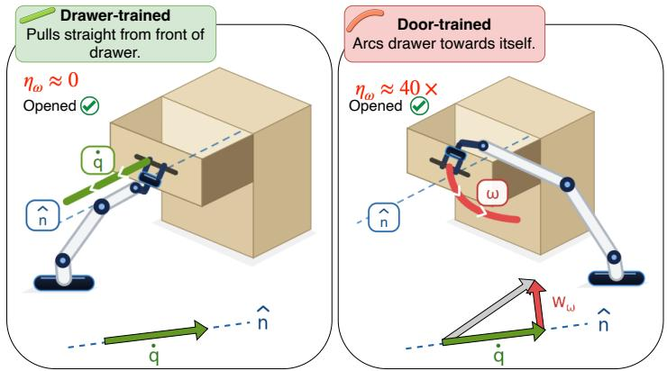

# Kinematic Constraint-Referenced Evaluation for Articulated Object Manipulation

Baptiste Bonin1,2 Caro Strickland1,2 Audrey Durand1,2,3

1Universite Laval´ 2Mila – Quebec AI Institute 3CIFAR AI Chair

Abstract: Manipulation policies are evaluated predominantly by binary task success, which cannot tell whether the commanded gesture is the one the object’s kinematics admit. We introduce Constraint-Referenced Strategy (CRS), which projects the commanded end-effector twist onto the object’s joint axis, separating progress along the joint from off-constraint waste. CRS requires a joint model and a joint-following scripted controller derived from it, but no recorded demonstration or learned judge. On 74 simulated articulated objects, success registers three transfer failures as lower rates but attributes none, while the two CRS channels give each a distinct signature. A door-trained behavior-cloning policy opens drawers in 59 of 110 episodes, and in these passes it commands about 40× the offaxis rotation of a drawer-trained policy’s passes (1.27 vs. 0.032 rad/s). Relative to a scripted controller scored with the same axis, CRS verdicts are unchanged under joint-axis errors up to 30◦; absolute thresholds tolerate about 8◦.

Keywords: Fine-grained manipulation, Evaluation, Articulated objects

## 1 Introduction

Manipulation policies are evaluated predominantly by binary task success [1, 2]. Success aggregates perception, grasping, execution, and strategy into a single bit, so two policies can fail for different reasons and obtain the same score (0). Success can also mislead, reporting a healthy-looking score (1) while the commanded gesture is wrong. For example, a behavior-cloning policy trained on doors opens held-out drawers in more than half of its episodes with the arcing gesture typical of doors, a rotation the drawer’s joint does not admit, and success scores each of these episodes as a pass. A good evaluation should measure the commanded gesture against the target’s kinematics.

Richer evaluation metrics exist, but most require additional information: demonstration-referenced distances need a recording on each object [3], subgoal scoring needs stages defined per task [4], and learned evaluators need a trained judge [5]. Across the dozens of tasks and objects a benchmark covers, this cost adds up. MetaFine [6], does evaluate the gesture, not only the outcome: it composes tasks from atomic skills whose checks reference the object’s geometry (a rotation passes only about the prescribed axis) and scores behavior by per-stage success and trajectory stability of the commanded actions. Two gaps remain, its geometry checks are pass/fail at a skill-specific tolerance, and its stability score, though task-independent and computed on the command, has no model of the object. Neither returns a graded, signed reading of how much of a command advances the joint and how much fights it. This reading must come from the command: on an articulated part, realized motion is admissible by construction, since a drawer can only slide along its rail, so off-constraint behavior leaves no trace in the part’s motion, only in the command and the constraint forces.

To provide this reading and complement [6], we introduce Constraint-Referenced Strategy (CRS), which uses the kinematics of the task as the reference. CRS is based on the idea that, under a rigid grasp, the articulated joint of an object defines exactly which end-effector motions advance it [7]. One screw axis encodes every valid opening mode. The reference is therefore mode invariant and needs no recorded demonstration or learned action model. CRS scores a policy at reference states by projecting the commanded twist onto the joint’s axis, yielding a signature with two channels: commanded progress along the joint and off-constraint waste (Figure 1). Our experiments show clear benefits of CRS against a binary success evaluation (Figure 1 and Table 1).

  
Figure 1: Success asks “Did it open?”; CRS asks “Was the commanded motion the one the mechanism admits?” A drawer-trained and a door-trained policy both succeed at opening a held-out drawer.

## 2 Constraint-Referenced Strategy (CRS)

CRS isolates the commanded gesture from confounds by evaluating a counterfactual: assuming the handle is already grasped at a valid pose, is the policy’s commanded gesture kinematically consistent with the object’s constraint? We answer this through teacher-forced probing: a scripted controller, the oracle, places the robot at reference states along an opening sequence, and the policy’s commanded end-effector twist is recorded at each. The reference states determine where the policy is evaluated, while the joint geometry determines what constitutes a valid command.

Decomposing the command. Following standard rigid-body kinematics [7], a policy commands an end-effector twist $\mathcal { V } = [ \omega ^ { \top } , v ^ { \top } ] ^ { \top } \in \mathbb { R } ^ { 6 }$ , at the grasp point $c \in \mathbb { R } ^ { 3 } \colon \omega \in \mathbb { R } ^ { 3 }$ is the angular velocity and $\boldsymbol { v } \in \mathbb { R } ^ { 3 }$ is the linear velocity of c, all expressed in the robot base frame. The admissible motion is 1-DOF, with joint coordinate $q \in \mathbb R$ (an angle or a displacement) oriented so that $\dot { q } > 0$ opens it. The constraint geometry is specified by a unit vector $\hat { n } \in \mathbb { R } ^ { 3 } ( \left\| \hat { n } \right\| = 1 )$ along the joint axis and, for revolute joints, a point $o \in \mathbb { R } ^ { 3 }$ on that axis. For a revolute joint, the angular component directly measures wrist rotation about the joint axis: $\dot { q } _ { \omega } = \omega ^ { \top } \hat { n }$ (rad/s). For a prismatic joint, progress is the translation along the axis, $\dot { q } _ { \mathrm { p r i s } } = v ^ { \top } \hat { n }$ in ${ \mathrm { m / s } } .$ . The rotation the joint does not admit is waste, $\eta _ { \omega } = \| \omega - ( \omega ^ { \top } \hat { n } ) \hat { n } \|$ (rad/s), which reduces to $\eta _ { \omega } ~ = ~ \| \omega \|$ for prismatic joints. These verdictbearing channels depend only on the unit vector nˆ. For revolute joints, a second, translation-based estimate along the arc, $\dot { q } _ { v } = v ^ { \top } \hat { t } / r .$ with lever $r = \| \hat { n } \times ( c - o ) \| > 0$ and tangent $\hat { t } = \hat { n } \times ( c - o ) / r ,$ depends additionally on o and $c ,$ and serves fidelity and diagnosis rather than verdicts.

Matched faithfulness gates. A reading of commanded motion should be validated against its physical consequence. We therefore gate each progress verdict with a one-step counterfactual: from every reference state, we execute the command for one simulator step and compare the reading with the realized joint displacement $\Delta q _ { \mathrm { r e a l } }$ . Ordering claims are gated by the $R ^ { 2 }$ of a linear fit between $\Delta q _ { \mathrm { r e a l } }$ and $\dot { q } \Delta t ;$ direction claims by sign agreement when $| \Delta q _ { \mathrm { r e a l } } |$ exceeds $\delta ,$ , the 95th percentile under a null command; null claims by an equivalence band ±ε of 5% of the oracle rate.

## 3 Experiments and Results

Setup. We evaluate two policy families using their unmodified commands: OpenVLA-7B [8] with rank-32 LoRA over three seeds, selecting the validation-minimum checkpoint, and a from-scratch point-cloud behavior-cloning (BC) policy over five seeds. We test leave-one-mechanism-out generalization across three GAPartNet [9] categories in ManiSkill [1]: door (revolute, 39 objects), drawer (prismatic, 22), and faucet (revolute, 13). CRS is compared with binary success evaluation at 0.35 opened fraction, $\Delta q _ { \mathrm { r e a l } }$ , four command-side measures, DTW to demonstrations, and MetaFine’s stability (Table 1).

Table 1: Which measure detects each transfer failure, and which attributes it. Labels: Sec. 3; silentstall is a null control; in the false-pass column, success reads 1 on 59 of 110 episodes. Per-object means over retained reference states, averaged over objects; 95% CIs bootstrap over objects. Open-VLA: seed 0 (reverse-push signs replicate on seeds 1 and 2), teacher-forced except success. BC: 5 seeds pooled, closed loop (CL). Signed progress and |q˙| in rad/s (door, faucet) or m/s (drawer); $\Delta q _ { \mathrm { r e a l } }$ in rad or m per step; $\| \omega \| , \eta _ { \omega }$ in rad/s. –: not computed. Advancing: fraction of states advancing the joint; alignment: $| \omega ^ { \top } \hat { n } | / \| \omega \|$ (revolute) or $| v ^ { \top } \hat { n } | / \| v \|$ (prismatic).
<table><tr><td>family</td><td>measure</td><td>silent-stall drawer→door</td><td>reverse-push door→drawer</td><td>misaimed door→faucet</td><td>false-pass BC door→drawer</td></tr><tr><td rowspan="2">outcome</td><td>success @0.35 (CL)</td><td>0.000</td><td>0.091 catch</td><td>0.026 catch</td><td>0.536 catch</td></tr><tr><td> $\underline { { \Delta q _ { \mathrm { r e a l } } } }$  (one step)</td><td>0.0075</td><td>-0.0003 catch</td><td>0.027 misleads</td><td>0.0045 misleads</td></tr><tr><td rowspan="4">command scalar</td><td>rotation ||ω||</td><td>0.023</td><td>0.031 misleads</td><td>1.00 misleads</td><td>1.29 catch</td></tr><tr><td>unsigned rate |ġ|</td><td>0.014</td><td>0.270 misleads</td><td>0.711 catch</td><td>0.360 misleads</td></tr><tr><td>advancing</td><td>0.47</td><td>0.005 catch</td><td>0.42 catch</td><td>1.00 misleads</td></tr><tr><td>alignment</td><td>0.68</td><td>0.984 catch</td><td>0.57 catch</td><td>0.963 catch</td></tr><tr><td>demonstration</td><td>DTW to demos</td><td>一</td><td>一</td><td>1</td><td>0.31 catch</td></tr><tr><td>execution</td><td>MetaFine stability [6]</td><td>0.93</td><td>0.95 miss</td><td>0.88 misleads</td><td>0.89 catch</td></tr><tr><td rowspan="3">CRS (ours)</td><td>signed  $\dot { q } _ { \omega } / \dot { q } _ { \mathrm { p r i s } }$ </td><td>-0.0014</td><td>-0.264 catch</td><td>-0.14 catch</td><td>+0.36 misleads</td></tr><tr><td>waste ηω</td><td>0.016</td><td>0.031 misleads</td><td>0.38 catch</td><td>1.29 catch</td></tr><tr><td>signature (sign,  $\underline { { \eta _ { \omega } ) } }$ </td><td>null</td><td>reversed</td><td>off-axis (−)</td><td>off-axis (+)</td></tr></table>

Instrument validation. The commanded rate tracks realized displacement $( R ^ { 2 } = 0 . 6 9 / 0 . 8 9 / 0 . 6 5$ for door/drawer/faucet), and command and realized directions agree at 1.000 above the noise floor on oracle commands. Calibration slopes remain below one (0.49/0.28/0.60), so rates are read as directional and relative. As a null control (silent stall), the drawer-trained policy commands no revolute motion on doors: |q˙ω| is 12.9× smaller than ε.

Detection labels. Table 1 reads each measure against the scripted oracle on the target mechanism, with the failure direction fixed per measure. catch: beyond the oracle’s 95% CI in the failure direction; misleads: within the CI despite a wrong gesture; miss: beyond the CI in the other direction. The CRS signature pairs the sign of signed progress (null within ±ε) with whether waste is flagged.

A pass on the wrong gesture. A from-scratch BC policy trained on doors and rolled out on drawers (false-pass column) succeeds in 59 of 110 episodes, on 20 of 22 drawers. Success registers a drop relative to a drawer-trained policy of the same architecture (0.54 vs. 0.77) but reads it as degraded competence. In the episodes it completes, the door-trained policy commands 1.27 rad/s [1.19, 1.34] of off-axis rotation (per-episode means), against 0.032 rad/s [0.028, 0.037] for the drawer-trained policy in its own successful episodes: about 40× at matched outcome. The success bit reads 1 on a gesture the joint does not admit. This waste does not differ between successful and failed episodes (1.27 vs. 1.26 rad/s): it is a property of the gesture, not of the outcome. On a prismatic joint, waste equals ∥ω∥, so ∥ω∥ and DTW also flag this case; ∥ω∥ misleads on revolute joints (misaimed).

Reversed and off-axis commands. Trained on doors and probed on held-out drawers (reversepush column), the OpenVLA policy commands the drawer shut: the commanded rate is negative on all three seeds, yet ∥ω∥ matches the drawer oracle and alignment, being unsigned, departs only slightly (0.984 vs. 0.999). The drawer does not move within one step, so $\Delta q _ { \mathrm { r e a l } }$ shows a stall, not a reversal; the reversal stays command-side. The same door→drawer shift thus produces two different failures: a commanded closing with OpenVLA and a false-pass with BC. Success reads a lower rate for both and explains neither. On faucets (misaimed column), the same policy reaches 68% of the oracle’s realized displacement, so $\Delta q _ { \mathrm { r e a l } }$ reads healthy. Yet it rotates about an axis the faucet lacks, with waste 5.4× the oracle’s. Its commanded angular rate is nonetheless negative and fails the direction gate, consistent with the linear component driving the joint through a grasp that is not fully rigid. Closed-loop success flags this case (0.026) but cannot say why. Several measures flag each failure, and alignment flags all three. None attributes them: alignment is invariant to the sign of the command, so a drawer pushed shut reads like one pulled open (0.984 vs. 0.963), and success cannot tell a reversed command from a slow or blocked one. Signed progress separates reversed from advancing commands, and waste separates on-axis from off-axis ones; together they place the three failures in distinct cells (Table 1, last row).

Robustness to estimated kinematics. Since real robots lack an exact joint model, we re-score all rollouts with corrupted kinematics while keeping the commanded twists and realized physics fixed: axis tilts up to $3 0 ^ { \circ }$ and axis-point and contact offsets up to 5 cm, worst case over 20 directions. The verdict-bearing channels remain stable through the full $3 0 ^ { \circ }$ perturbation: the three failures and the null control keep the same verdict. The lever-based channel $\dot { q } _ { v }$ is less robust (door $R ^ { 2 } \mathbf { : }$ $0 . 9 0  0 . 3 4 )$ . The misaimed verdict holds relative to the oracle scored under the same axis; as an absolute threshold it tolerates about $8 ^ { \circ }$

## 4 Conclusion and Discussion

CRS reads a policy’s commanded gesture against the joint it acts on. It attributes failures that success registers but cannot explain, and exposes passes obtained with a gesture the joint does not admit. Because CRS scoring requires only the joint axis, it could complement per-stage success and trajectory stability in MetaFine’s behavior dimension [6], given annotated joint axes. Limitations: CRS assumes a rigid grasp, which the faucet case suggests is not always met, and a single 1-DOF joint. It scores angular waste only, is validated in simulation on three mechanisms, and treats waste as a command-side quantity whose physical cost we have not measured. Future work includes other lower pairs (helical, cylindrical, planar) and real hardware, where the gate could read realized progress from proprioception under a rigid grasp, the axis could be estimated from RGB-D video, and relative verdicts would use an in-domain policy scored with the same axis as reference.

## References

[1] S. Tao, F. Xiang, A. Shukla, et al. Maniskill3: Gpu parallelized robotics simulation and rendering for generalizable embodied ai. RSS, 2025.

[2] X. Li, K. Hsu, J. Gu, et al. Evaluating real-world robot manipulation policies in simulation. In CoRL, 2024.

[3] C. Li, M. Vlastelica, S. Blaes, et al. Learning agile skills via adversarial imitation of rough partial demonstrations. In CoRL, 2022.

[4] R. ElMallah, K. Chhajer, and C.-G. Lee. Score the steps, not just the goal: VLM-based subgoal evaluation for robotic manipulation. arXiv:2509.19524, 2025.

[5] J. Duan, W. Pumacay, N. Kumar, et al. AHA: A vision-language-model for detecting and reasoning over failures in robotic manipulation. In ICLR, 2025.

[6] H.-Y. Xu, P. Zhang, Z. Ge, et al. Beyond binary success: A diagnostic meta-evaluation framework for fine-grained manipulation. arXiv:2605.19986, 2026.

[7] K. M. Lynch and F. C. Park. Modern Robotics: Mechanics, Planning, and Control. Cambridge University Press, 2017.

[8] M. J. Kim, K. Pertsch, S. Karamcheti, et al. OpenVLA: An open-source vision-language-action model. In CoRL, 2024.

[9] H. Geng, H. Xu, C. Zhao, et al. GAPartNet: Cross-category domain-generalizable object perception and manipulation via generalizable and actionable parts. In CVPR, 2023.