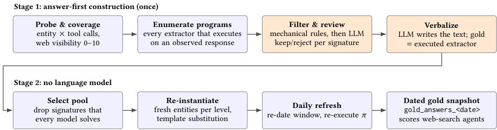
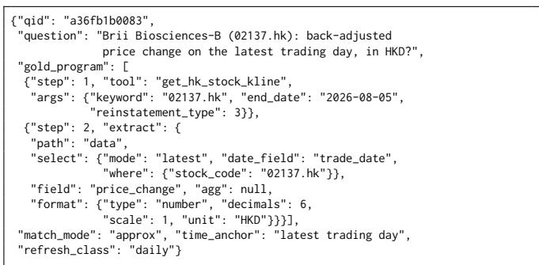
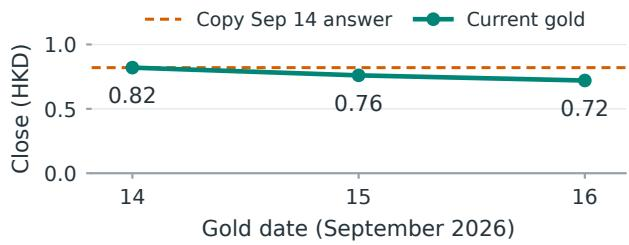
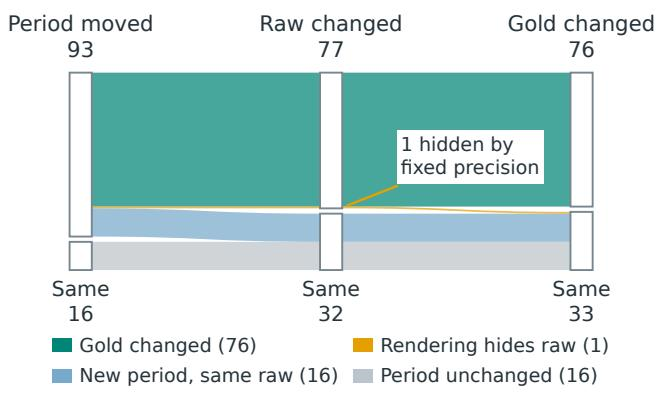
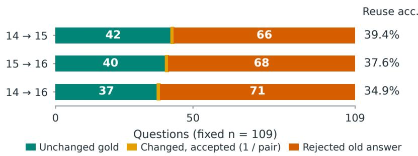
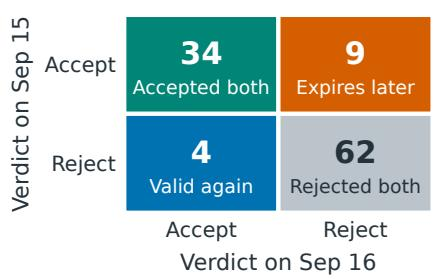
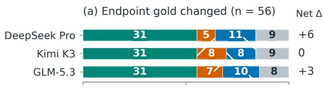
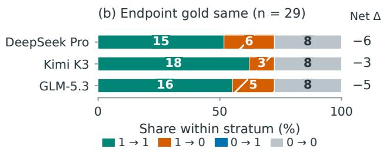

# LiveSearch: Questions as Executable Verifier Code for a Live Benchmark of Professional-Source Financial Search Agents

Sinuo Wang1,3, Wentao Zhao4, Jiacheng Lu1,5, Rui Sun1, Beidi Luan1, Qiming Shi1,6, Jing Li1, Daxin Jiang1, Zuo Bai1,2,†

1StepFun 2FinStep 3Adelaide University

4Tsinghua University 5Shanghai Jiao Tong University 6Zhejiang University

†Corresponding author: baizuo@stepfun.com

## Abstract

In finance, the answer that matters is usually the current one: prices, rates, and disclosures hold only as of a given day, so retrieving up-to-date facts is a core capability of a financial agent. Yet most financial benchmarks overlook timeliness. They fix each answer at annotation time, so the gold goes stale as markets move and, once leaked into training data, rewards recall rather than search and analysis. We introduce LiveSearch, a live benchmark that stores each question as executable verifier code: a typed program of calls to a professional financial data service, followed by a declarative extractor. The question is frozen, while its gold answer is determined by executing the program against professional financial data at evaluation time, and a daily job re-executes it with no human or language model in the loop. A memorized answer is thus likely outdated, and a model must reach the current one through tools and analysis. Construction is equally automatic: a language model only verbalizes programs enumerated from real tool responses and never chooses an answer. Under general web search, six contemporary tool-calling models reach 70.9%–76.7% answer accuracy. Over three consecutive days, 70% of served questions change their gold value, and even under tolerance-aware matching, a literally reused earlier snapshot fails on a majority of questions within a single day. Per-question tracking uncovers dynamic shifts in correctness masked by aggregate accuracy.

## Keywords

Web Search Agent, Financial agents, live benchmark, LLM evaluation

## 1 Introduction

Large language models are now routinely deployed as search agents: given a natural-language question, the model plans a sequence of tool calls, reads the returned evidence, and composes an answer [14, 16, 25, 29]. Finance is a natural and high-value proving ground for such agents (questions are precise, answers are checkable, and the underlying data is abundant and structured), and the field has moved from domain-specific models and static task suites [5, 6, 9, 21–23] to agentic evaluation in which the model must retrieve its own evidence through search and tools [3, 4, 8, 11, 12, 15, 26, 27]. Finance is also, more than most domains, intrinsically time-sensitive: the answer an analyst actually needs (a latest price, an interest-rate spread, a newly filed fundamental, the current top holder) changes by the day or the minute, and a value that was correct at annotation time is often wrong a day later. What matters is therefore not only

whether an agent can retrieve a fact, but whether it can retrieve the current one; the natural unit of ground truth in finance is a value that is re-established over time rather than written down once. Current benchmarks give up exactly this property. Despite difering in language, size, tool inventory, and task taxonomy, essentially all of these agentic benchmarks [2, 3, 8, 11, 13, 26, 27] share three weaknesses that turn out to be one weakness seen from three angles.

(1) Curation is costly. Constructing financial agent benchmarks requires hundreds of expert-hours [3, 8, 26, 27], and without reusable answer-generation programs, every refresh repeats annotation and validation.

(2) Static answers become stale. For time-sensitive queries, frozen reference answers silently go out of date and, once leaked, reward memorization rather than fresh retrieval [17, 18]. FinSearchComp mitigates this with scripted updates, but only for its time-sensitive tier [8].

(3) Evidence departs from professional practice. Professional financial questions are formulated around the data fields and metric definitions ofspecialized databases. Benchmarks built primarily from web-accessible content or freetier tools [3, 11, 13, 27] tend to underrepresent these information needs.

These three problems are coupled because they all stem from the same design choice: storing a question as a (text, answer) pair. If the answer is a literal string, then someone must author it (manual curation), it cannot change (static decay), and its provenance is whatever the author happened to consult (evidence gap).

These challenges call for a unified mechanism that connects question construction, reference-answer generation, and ongoing updates. LiveSearch represents each question as a triple (text, �, �), where text is a fixed natural-language prompt, � is an executable program over a professional financial data service, and � specifies how a candidate answer is matched to the program output. Each program comprises tool calls followed by a declarative extractor that selects and formats a single value. During construction, the pipeline enumerates candidate programs from observed tool responses and uses a language model to verbalize them; reference values are determined by execution. The same programs are then re-executed daily to produce dated gold snapshots without further language-model involvement. This design derives questions from professional data fields and metric definitions, makes reference answers traceable to explicit queries and extraction rules, and updates time-sensitive answers while keeping the question text fixed.

For web search agents, the challenge is not just finding a relevant page: online evidence can mix stale and current values, reporting periods, and metric definitions. LiveSearch evaluates ordinary web search and page retrieval against reference answers refreshed from professional data, testing whether agents can recover the current, precisely specified fact from a changing Web rather than recall a once-correct answer.

Contributions.

(1) A live benchmark for financial search agents. Each question is paired with an executable reference program over professional financial data tools and a fixed answermatching rule. A snapshot-and-freeze protocol binds each question to a timestamp and a frozen gold value. We report six models’ scores under web search and measure answer accuracy and temporal changes in gold answers (Sections 3.1 and 4).

(2) An automated construction and refresh pipeline. The pipeline enumerates candidate programs from observed tool responses and uses a language model to screen candidates and verbalize selected programs, while reference answers are computed by execution. Each question’s pro gram is then fixed, and subsequent pool selection and daily refresh proceed without further language-model involvement (Sections 3.3 and 3.4).

(3) An eight-category financial asset taxonomy. The taxonomy includes two cross-cutting axes and entity-sampling sources for each subcategory, defining the benchmark’s scope and making explicit which financial domains the underlying data service covers (Section 3.2).

## 2 Related Work

Finance agent benchmarks. Domain-specific models and static evaluation suites [21–23] and report-grounded QA resources such as FinQA, ConvFinQA, and FinanceBench [5, 6, 9] made financial competence a measurable target, but they evaluate reasoning over frozen text and tables rather than interaction with live tools. The Finance Agent Benchmark [3] (537 expert-authored questions over US equities and SEC filings) and FinGAIA [26] (407 Chinese expert tasks in a GAIA style) are fully manual and static; the former de fends against contamination with a private test split and post-cutof documents rather than with freshness. FinSearchComp [8] is the closest work: 635 bilingual expert questions in three tiers, with a time-sensitive tier whose reference values are regenerated by fixed scripts after market close. Its question pool is static and its complex tier is deliberately historical, so time sensitivity and professional grounding are never combined.

Concurrent benchmarks push finance agents toward richer tool use and richer scoring: FinToolBench pairs hundreds of runnable free-tier tools with tool-required questions and audits call-level com pliance, FrontierFinance scores long-form analyst queries against thousands of expert-written, source-attributed rubrics, and Fin-Trace grades whole tool-calling trajectories rather than final an swers [4, 11, 27]. These works improve how an agent’s behaviour is measured and are complementary to ours. Their item is still a (text, answer-or-rubric) pair written once by humans or by a one-of synthesis pass, so the pool ages as the market moves, refreshing it means re-annotating it, and the evidence is free-tier or web-tier. LiveSearch stores the item as executable code over professional data tools, so the gold answer is re-derived daily by execution, contamination decay is measurable per question, and no human or language model decides a gold answer in either curation or refresh. It thus occupies the quadrant that is both time-sensitive and professional-source-grounded.

Dynamic evaluation. LiveBench [18] limits contamination by periodically adding questions drawn from recent sources and scoring them against objective ground truth. EvoBrowseComp [17] identifies the analogous leakage problem for search agents, whose static questions can enter training data or be solved from parametric memory, and addresses it by synthesizing fresh English and Chinese questions through live-web traversal and periodically regenerating the pool. In both, the unit of refresh is the question set. LiveSearch instead freezes the question text and refreshes the answer by reexecuting its program. Finance motivates this choice: “the latest disclosed return on equity of company X” stays well-posed indefinitely while its answer changes every reporting period. Keeping the question also makes a single question’s answer drift, and the decay of a memorized answer, observable over time.

Automated question synthesis for web agents. Outside finance, several works synthesize questions for search agents: WebDancer’s CRAWLQA and E2HQA, WebSailor’s rare-entity knowledge-graph random walks with obfuscation, and WebWalker’s website-traversal QA [10, 19, 20]. None is finance-specific and none refreshes its answers, but together they show that high-quality agent questions can be synthesized rather than hand-written. Program-to-question generation and schema-driven synthetic QA have also been studied in semantic parsing [7, 24]. LiveSearch applies this idea to a setting where the synthesized artifact is an executable program whose answer is verifiable against live professional data.

Judging. A claim-level LLM judge with conjunctive scoring has been adopted independently by the Finance Agent Benchmark [3], LiveMCPBench [13], and MCP-Atlas [2]. Because each of our questions resolves to one authoritative value, our metric is the singleclaim case: a binary judgment against the gold value, with numerictolerance matching following FinSearchComp. Our harness fixes the judge within each run and draws it from a model family absent from the leaderboard, since LLM judges are known to favour their own family and to show position and verbosity biases [28].

## 3 Method

LiveSearch stores each question as a triple (text, �, �) and organizes construction and maintenance into two stages. Section 3.1 defines the question representation, Section 3.2 describes the underlying data service and benchmark scope, and Sections 3.3 and 3.4 detail the two stages (Figure 1). Stage 1 builds an initial question inventory by querying financial data tools, enumerating candidate programs from their responses, and using a language model to screen candidates and generate question text. Reference answers are computed by executing the programs. Stage 2 selects the evaluation pool from this inventory and then refreshes its reference answers daily, without further language-model involvement. Both stages use the same tool execution layer and extractor engine, so reference answers are generated and refreshed through a shared implementation.

## 3.1 Question Representation

Gold program. A question record stores the frozen question text, the executable gold program � whose execution defines the answer, the matching rule �, and metadata (Figure 2). The program is a short typed DAG: one or more tool-call steps followed by a declarative extractor that turns the raw response into one formatted value. The extractor language has no branches or expressions, so replaying a program is deterministic and every program can be checked mechanically. An extractor names a path into the response, a selection rule, a field, an optional aggregate, and a format (type, decimals, scale, unit). The selection rule’s select.mode ∈ {latest, snapshot, match, minute, all} encodes the time anchor: latest over a trade\_date field means “as of the most recent trading day,” so the selected row, and with it the answer, rolls forward as new data arrives; match pins one row of a cross-sectional table by an identity key; snapshot reads a single-record response. Each record also carries a refresh\_class ∈ {daily, weekly, monthly, quarterly, annual, static}, the cadence at which its answer is expected to change.

Matching rule. The matching rule � is one of exact, approx, or semantic, and states how an answer is compared with the gold value. exact rounds the answer to the gold value’s precision; approx accepts agreement at the coarser of the two precisions (at least two decimals), an unrounded form of the gold value, or a relative error within a fixed tolerance; and semantic accepts an equivalent meaning. Both numeric rules normalize units first, and a sign or direction mismatch fails under every rule. The rule is fixed at construction: the language model proposes one, and the pipeline clamps it mechanically, allowing exact only when nothing marks the value as derived (a percentage unit, a tool display coarser than the rendering, or a lossy rendering).

Time anchors, not absolute dates. An automated gate rejects any question whose text contains an absolute date, including Chinese date and quarter forms. Questions refer to time only relatively (“the most recent trading day,” “the latest disclosed reporting period”), and the concrete window lives only in the program’s arguments, which the daily refresh rewrites. The same frozen sentence therefore has a new correct answer every day the underlying series moves.

Snapshot-and-freeze. Because gold answers change by design, the unit of comparison is not a file but a tuple: (question, timestamp, frozen gold value). Each daily refresh writes a dated, immutable snapshot gold\_answers\_<date>.jsonl that records, per question, the formatted answer, the raw value, the observed period, and the arguments actually sent, so every gold value can be traced to the call that produced it. An evaluation run cites the snapshot date it scored against. Question identifiers are content hashes of the tool, entity, non-date arguments, and extractor rather than positions, so a question keeps its identity across regenerations. A same-date leaderboard comparison requires identical qid sets and gold dates; a longitudinal audit instead fixes the qids and explicitly tracks each date’s own frozen gold values. The evaluator is strict: the snapshot must cover every served qid, contain no unknown qids, and carry no empty or error-flagged answers, or the run fails rather than falling back to a stale value.

## 3.2 Data Source and Scope

Data source. Gold programs run on a production financial data service that exposes 96 tools in 9 services through the Model Context Protocol [1], covering company fundamentals and disclosures, quotes and microstructure, macro and rate series, sector constituents, funds, indices, margin trading, utilities, and news search. Tools take typed JSON arguments and return structured, dated records. Three kinds of tool never define a gold program: search tools, so that no gold value is sourced from generic search; intraday tools, whose minute-level values would give two refreshes on the same day diferent answers; and utilities such as the system clock.

Asset taxonomy. We organize the financial universe into a twolevel taxonomy with eight level-1 asset categories (Cash & Monetary; Credit & Financing; Equity & Ownership; Physical & Alternative; Risk Transfer & Derivatives; Composite & Structured Products; Foreign Exchange; and Indices, Benchmarks & Reference Rates), each split into level-2 subcategories, plus two cross-cutting axes. Every subcategory names an entity\_sampling\_source, the registry or feed from which real instruments can be drawn (e.g. SEC EDGAR CIK lists and exchange listings for listed equity, CN-INFO and ChinaBond for Chinese bonds, AMAC for funds). The two axes are the ones a live benchmark needs: a corporate-action and event axis (earnings, dividends, splits, M&A, defaults), whose events arrive daily and drive freshness, and an entity layer (issuers, intermediaries, funds, infrastructure, regulators, key persons) that lists the kinds of entity a question can be keyed on. The taxonomy fixes the benchmark’s scope. Our questions are drawn from the domains that the data source serves well: listed equities, funds, indices, macro series, market microstructure, and corporate events. Derivatives, FX, commodities, insurance, and structured credit lie outside the current scope.

## 3.3 Stage 1: Answer-First Construction

The pipeline calls tools first, observes real responses, and only then derives questions whose answers are executed values, so the model never writes a gold number.

Probe and coverage. For each asset class (A-share, Hong Kong and US equities, indices, exchange-traded and of-exchange funds), a probe samples entities and marks a tool as usable for the class when a strict majority of them return data; entity-free tools such as macro series are probed once. Coverage then draws, for every usable tool, an entity at each of eleven web-visibility levels, moving to another entity at the same level whenever a call returns no data, so every kept call is backed by a tool that actually serves its entity. An entity’s web-visibility index (0–10) counts the web search results for its name that mention it, which spreads the pool from obscure to well-known instruments instead of concentrating it on popular ones.

Program enumeration andfiltering. For each observed response, the pipeline enumerates every extractor that the extractor language can execute to a non-null value: latest over each rolling field of a dated series, match on an identity key for cross-sectional tables, and snapshot for single-record responses. Mechanical filters reject metadata, pagination, and display fields, result-set counts, fields of tools whose data are static (a value that never changes cannot drift), and latest selectors whose newest period holds conflicting values. A language model then reviews each remaining target for whether it is worth asking. The verdict is keyed by a semantic signature, namely the tool, its non-entity arguments, the extractor structure, and the refresh cadence, and is shared by every entity with that signature. Question diversity is thus a property of the enumeration, not of model behaviour.

  
Figure 1: Overview of LiveSearch curation. Orange steps call a language model; blue steps are deterministic. The model only verbalizes a program whose extractor is already fixed, and the gold answer is whatever the program returns when executed. Stage 2 carries no language model: pool selection reuses templates, and the daily refresh re-dates, re-executes, and writes a dated gold snapshot. All steps share one execution layer and one extractor engine.

  
Figure 2: A question record (text glossed from Chinese). Each daily refresh rewrites end\_date to the benchmark date and re-executes the program; on 2026-09-16 it returned −0.015 HKD.

Verbalization. For each kept signature, one language-model call sees an observed response together with the fixed extractor and writes the question text, a one-sentence conclusion, the time anchor, the rendering format, and a proposed matching rule; it cannot change which row or field is selected. The gold answer is computed by executing the extractor. A candidate is kept only if (i) the executed value agrees with the value the model states, within 1% for numeric answers; (ii) the rendered unit agrees with the tool’s own display string for that field; and (iii) the text contains no absolute date, no reference to hidden tool context, and no tool or field name.

Rejected candidates are retried with the rejection reason as feedback. The accepted template is then bound to every other entity with the same signature by substituting names and codes, and the checks run again on each binding. A final pass rewrites ambigu ous phrasings and keeps the original text for audit, and a validator checks that the question text, the call arguments, and the extractor’s row filter all name the same entity; refresh and evaluation repeat this check. The resulting inventory holds 3,320 questions over 34 tools. An optional tool-necessity gate, in which a tool-using agent must succeed over �=3 runs while a model without tools must fail, can further tighten the inventory when a stricter pool is desired.

## 3.4 Stage 2: Pool Selection and Daily Refresh

Pool selection. The evaluation pool is drawn from the dailycadence part of the inventory without any language-model call. Signatures that every model answered correctly in a preliminary fivemodel run are dropped. Each remaining signature is re-instantiated on fresh entities spread over the eleven web-visibility levels: each new entity is probed once (one call serves every signature that shares it), the signature’s extractor is reused unchanged, and the question text is the signature’s template with the entity substituted. Entities are assigned so that a signature appears in both a test and a training split while no entity appears in both. Entity-free macro questions are reused as they are.

Daily refresh. The daily job re-executes every program in the pool. It rebuilds each call’s time window from the benchmark date rather than the machine clock, changing only date arguments, and anchors US equities to the last settled session rather than an unsettled current-session bar. Scoring a past run always uses the frozen snapshot of its date rather than re-querying historical data. It then runs the program through the shared execution layer, applies the extractor, and writes the dated snapshot. A question whose entity has no data that day (for instance, no block trades in the window) is left out of that day’s served set but stays in the frozen pool, because event-driven data can return later. How often a question’s answer flips and how often it fails to resolve are reportable properties of the benchmark; questions that fail repeatedly are candidates for retirement. Section 4.3 measures the flip rate.

## 4 Experiments

## 4.1 Experimental Setup

Temporal-analysis cohort. The frozen pool used for the temporal analyses (Sections 4.3 and 4.4) has 153 questions, minted from the inventory on 2026-08-05: 13 at each of the eleven web-visibility levels plus 10 entity-free macro questions, over 12 tools. Every question is single-hop (one tool call plus an extractor) and in Chinese, about A-share, Hong Kong, and US instruments, funds, indices, and macro and rate series. Each day the served set is the questions that resolve: about 110 per day, and 109 on 2026-09-16, the snapshot used for the temporal-drift analysis. Of these, 106 (97%) have numeric answers and 3 have string answers; all use the approx rule.

Agent setup. For the temporal and failure analyses, the agent runs in a ReAct-style tool-calling loop [25] with two generic web tools, web search and page fetch, and at most 15 turns. Its system prompt gives the benchmark date, which the relative time anchors require, and instructs the agent to use tool-returned evidence rather than parametric memory. The episode ends when the agent replies without a tool call; at the turn limit the tools are withdrawn and the agent must give its best answer. Scoring reads this final reply, and an empty reply scores 0. The professional data source is not exposed to the agent: it only executes the gold programs, so the evaluation measures whether an agent with ordinary web search can recover a value established from a professional source. Because the question text is tool-agnostic, giving the agent the professional tools on the same questions would measure how far web search substitutes for professional data; we leave that condition to future work.

Models and metric. We evaluate six contemporary tool-calling models (Table 1); parenthesized labels denote each model’s reasoning configuration. Our evaluation harness scores answer accuracy: a binary (0/1) judgment per question against the single gold value under the question’s matching rule � (Section 3.1), averaged over questions. The judge is gemini-3.5-flash at temperature 0, fixed across agents within a run and drawn from a model family absent from the leaderboard. It receives � by name, never as a number, and judges only the final committed value, not values mentioned along the way.

## 4.2 Main Results

Table 1 reports six models under the search-only condition, where DeepSeek V4.1 Flash achieves the highest score (76.7), followed by Claude Opus 5 (Max) at 76.2. Step 5 Preview (High) and GPT-6 Astra (Max) both score 74.5; GLM-5.3 (Max) and Kimi K3 (Max) score 73.3 and 70.9, respectively. Even the strongest model misses nearly a quarter of the questions, leaving clear headroom for search agents that must recover professionally defined values from the open web. The following sections examine how gold answers move over time, how per-question correctness turns over, which questions discriminate, and where agents fail, each on the snapshots specified in its setup.

## 4.3 Gold Answers Drift Day over Day

Fixed questions, moving values. We audit the dated snapshots from 2026-09-14 to 2026-09-16; one example is shown in Figure 3.

Table 1: Leaderboard. Answer accuracy (%) of six tool-calling models under the search-only condition (no professional financial tools). Parenthesized labels denote reasoning configuration.
<table><tr><td>Model Accuracy (%)</td></tr><tr><td>DeepSeek V4.1 Flash 76.7 Claude Opus 5 (Max) 76.2 Step 5 Preview (High) 74.5 GPT-6 Astra (Max) 74.5 GLM-5.3 (Max) 73.3</td></tr></table>

Beijing Automotive (01958.HK)  
  
Figure 3: One question, three gold dates. The question asks for the latest-trading-day close (Chinese; glossed) and is byte-identical across dates. Only the program’s date window changes. The dashed line copies September 14’s gold: it matches on that date but not on the next two.

They serve 110, 110, and 109 questions, respectively; all gold comparisons below use the same 109 qids that resolve on every date. For each qid, we verify that the question text agrees with the frozen record, the extractor is fixed, and the executed non-date arguments remain unchanged. Date arguments, including the lastsettled-session window for US equities, are the only varying inputs.

Of these 109 questions, 76 (70%) change their formatted gold value at least once: 67 and 69 between consecutive days, and 72 across the span (Figure 5). The paths are not uniformly monotone: 56 questions take three distinct values, while 4 return to their first-day value after changing on the middle date. The remaining 33 retain the same formatted answer. Refreshing a program therefore does not require its output to change; a slow-moving rate or a repeated market value can legitimately persist. Drift is concentrated in market-linked fields: get\_hk\_stock\_kline 45/54, get\_us\_stock\_kline 18/18, get\_kline 4/4, and get\_valuation\_metrics\_daily 4/5 change at least once, whereas macro-rate answers barely move. Nonzero signs reverse on 5 and 8 questions at the one-day transitions (9 across the span), a change that no numeric precision allowance can turn into an equivalent direction.

Three clocks, not one. The benchmark date, the request’s cutof, and the provider-reported observation period need not coincide. Across the common panel, observed periods advance at least once for 93 questions and stay fixed for 16 (Figure 4). All 76 formattedgold changes occur in the first group, but 17 questions in that group retain their formatted answer even as their reported period advances. Thus the 33 unchanged answers combine repeated values at new periods with values from unchanged periods; an unchanged answer alone is not evidence that the refresh failed. Because each snapshot retains both the executed arguments and the observed period, every such case remains inspectable.

  
Figure 4: From new periods to new answers. All 109 questions over September 14–16, 2026. Band widths count questions and trace the joint paths from reported observation periods to raw values and fixed rendered gold. Sixteen questions acquire a new period without a new raw value; one raw change is hidden by rendering.

The distinction also explains what “latest” means operationally. For all 18 US-equity programs, the request’s end\_date is September 11, 14, and 15 for benchmark dates September 14, 15, and 16, respectively, reflecting the last settled session. For Hong Kong stock 08033.HK, the volume changes from 372,000 to 50,000 shares and then repeats; the last two snapshots both report September 15 as the observed period even though the request window advances to September 16. In contrast, an RMB deposit-rate program retains 1.30% and a January 15 observation throughout, while its query\_date advances daily. These are diferent time anchors, not a requirement to return a number bearing the benchmark date. An agent that substitutes an unsettled quote or a zero-volume calendar-day row can therefore answer a diferent question from the one the program defines.

Rendering is part ofthe measurement. The raw extracted value changes at least once on 77 questions, compared with 76 after formatting. The extra case is stock 00361.HK: its raw opening price moves from 0.039 to 0.038 HKD, but all three snapshots record 0.04 HKD. At the first one-day transition, 69 raw values change but only 67 formatted values do; at the endpoints the corresponding counts are 74 and 72. The drift statistic therefore depends on the published precision, not just the underlying series. We keep that precision fixed rather than changing it after seeing the data, and distinguish a raw-value movement, a changed rendered gold, and a rejected old answer under �. The last of these is the relevant test of whether a copied benchmark answer still receives credit.

Does a once-correct answer still pass? A change in the formatted gold is not automatically a failed answer under �. We therefore evaluate a literal snapshot-reuse diagnostic: for each fixed qid, submit its earlier formatted gold as the prediction against the later snapshot. Identical values pass by the matching rule; all changed values are judged with the canonical prompt, gemini-3.5-flash at temperature 0, and the question’s fixed rule. This requires no search, agent execution, or gold refresh. Reusing the preceding snapshot fails on 66/109 and 68/109 questions at the two one-day transitions; reusing the first snapshot on the third day fails on 71/109. One changed value per comparison is still accepted, illustrating why exact goldstring changes must be distinguished from tolerance-aware failure. Thus, a literal leaked snapshot loses validity on a majority of served questions within a day. The diagnostic measures the shelf life of a copied answer directly, independent of any particular model.

Validity can return, not just decay. Holding the September 14 answer fixed and checking it against both later snapshots produces four paths: 34 answers pass on both later dates, 62 fail on both, 9 pass on September 15 but fail on September 16, and 4 fail on September 15 but pass again on September 16. Of these four returns to validity, three also return to the initial raw value; one returns only at the published precision. For stock 01022.HK, the raw backadjusted price change is −0.01, 0.005, and −0.005 HKD, rendered as −0.01, 0.01, and −0.01 HKD. The old negative answer contradicts the middle day’s direction but matches the third day’s rendered gold. A per-qid trajectory captures temporary invalidity and later equivalence, which a single aggregate “freshness” number cannot distinguish.

## 4.4 Per-Question Correctness Turnover

We further track archived single-run trajectories of three models, DeepSeek V4 Pro (0813), Kimi K3, and GLM-5.3 (agent configurations separate from Table 1), each scored against its own date’s gold snapshot. We compare the September 14 and 16 endpoints; September 15 is omitted because the page-fetch tool was unavailable during that day’s runs. The three models share 85 qids with identical question text at both endpoints. We recompute their scores on this fixed panel (Table 2); 56 of its gold values difer between the endpoints. DeepSeek’s accuracy is unchanged at 57/85, yet 11 previously correct questions become wrong and 11 previously wrong questions become correct. Kimi and GLM also exchange correct and incorrect items. Each model is judged correct at both endpoints on 31 of the 56 gold-changing questions, while some verdicts also change on questions with identical endpoint gold. These are distinct signals: movement of the reference value and variation in recovering it. Preserving qids makes both visible, whereas a single aggregate score conceals the turnover.

Condition on whether the answer changed. Figure 6 partitions the same panel into 56 questions whose formatted gold difers between endpoints and 29 whose endpoint gold agrees. Within the changedgold group, DeepSeek gains 11 correct items and loses 5, increasing from $3 6 / 5 6$ to 42/56; Kimi gains and loses 8, remaining at 39/56; GLM gains 10 and loses 7, increasing from 38/56 to 41/56. On the unchanged-endpoint group, however, the models lose 6, 3, and 5 correct items, respectively, with no wrong-to-correct transitions.

(a) Earlier gold, later evaluation  

(b) Fixed Sep 14 answer  
  
Figure 5: Literal answer reuse: failure and return to validity. Gold dates are in September 2026; both panels use the same 109 questions. (a) Earlier gold is copied into each later evaluation: unchanged values pass, one changed value per pair still passes, and the rest are rejected under the fixed rule. (b) The September 14 answer is held fixed at both later dates; four answers fail on September 15 and pass again on September 16.

Table 2: Paired-agent panel. The same 85 questions against gold snapshots dated September 14 and 16, 2026. 1 → 0 and 0 → 1 count changes in per-question correctness against each date’s own gold.
<table><tr><td>Model</td><td>14 (%)</td><td>16 (%)</td><td>1 → 0</td></tr><tr><td>DeepSeek V4 Pro (0813)</td><td>67.1</td><td>67.1</td><td>11</td></tr><tr><td>Kimi K3</td><td>70.6</td><td>67.1</td><td>11</td></tr><tr><td>GLM-5.3</td><td>69.4</td><td>67.1</td><td>12</td></tr></table>

DeepSeek’s six-item gain on changing gold is exactly ofset by a six-item loss on unchanged gold. Kimi’s three-item overall decline occurs entirely in the unchanged group, and GLM’s three-item gain in the changed group is outweighed by a five-item loss in the unchanged group. Aggregate diferences cannot therefore be read as counts of failures caused by a moving gold answer. “Unchanged” here means identical endpoint gold, not an unchanged raw series or an answer that stayed constant on the intervening date.

For binary scores, let � count correct-to-wrong transitions and � count wrong-to-correct transitions. The change in the number correct is � − �, whereas the number of changed verdicts is � + �. These logs have 22, 19, and 22 changed verdicts for DeepSeek, Kimi, and GLM, despite net changes of 0, −3, and −2. Two-date correctness is a separate criterion: only 46, 49, and 47 of the 85 questions are correct at both endpoints, respectively, and each model has 31 such cases in the changed-gold group. Reporting the paired transitions therefore adds information beyond either day’s accuracy. We use this panel descriptively, to show what per-question tracking reveals; the same protocol directly supports controlled longitudinal comparisons that hold the agent configuration fixed across dates.

## 4.5 Which Questions Discriminate?

Not every question separates models. In an 86-question pilot, answered by 11 models with web search and page fetch under a fixed judge, 41 questions were solved by every model and 10 by none, leaving 35 that split the field. The discriminating questions concentrate on confusable financial calibers and edge-market microstructure (e.g. return on equity via get\_financial\_index, block-trade detail, Hong Kong and US K-lines), whereas plain A-share balance-sheet and K-line questions are solved by nearly every model. Dificulty thus sits where the design places it, in resolving the right field and caliber among near-synonyms. Pool selection (Section 3.4) uses the same signal by dropping signatures that every model solves.

  
Figure 6: Paired correctness by endpoint gold movement. The same 85 questions as Table 2, split by whether September 14 and 16 gold difers. Bar lengths are normalized within each stratum; segment labels are question counts, and “Net Δ” is the change in the number correct. Unlike net accuracy, the four transitions retain both gains and losses.

## 4.6 Failure Analysis

Evaluation trajectories show that errors rarely come from a lack of searching: agents typically issue several searches and cross-check two or three pages before answering. The errors come instead from mismatches between what public pages present and what the question specifies. (i) Precisely defined calibers. Back-adjusted prices of Hong Kong stocks depend on the adjustment method, so a value read from a portal that adjusts diferently, or recomputed from a split history, misses the gold; for counts of moving-average crossings, agents compute their own count under their own definition; and for the daily trading value of US stocks, agents approximate it as volume times closing price instead of retrieving the reported value. (ii) A diferent “latest” session. For an illiquid Hong Kong stock, the latest trading session is the most recent one with trades, but agents report the zero-volume calendar day shown on public pages. (iii) Unverified secondary values. Agents sometimes report a thirdparty quote without checking the issuing source; for the two-year Chinese government bond yield, agents that used an aggregator’s figure (1.247%) missed the oficial curve value (1.2439%) that other agents found. Under web search, then, the hard part is matching the exact caliber and period that the question defines.

## 5 Conclusion

LiveSearch turns a financial search benchmark from a fixed test set into a live measurement instrument by storing each question as executable verifier code over professional financial data tools. The question text is frozen and the gold answer is the program’s live output, so automated curation and a daily refresh without any language model follow from one representation, and the model verbalizes but never decides the answer. Under general web search, six contemporary models reach 70.9%–76.7% answer accuracy. Over three consecutive days, 70% of served questions change their gold value, and literal snapshot reuse fails on a majority of questions at both one-day transitions even under the fixed matching rules. Per-question tracking further shows that aggregate accuracy can stay flat while individual verdicts turn over, a signal that only stable question identities and dated gold snapshots expose. The approach is not specific to finance: any domain with a stable programmatic data interface can host a live, auto-refreshing benchmark built the same way.

## Limitations

The data source serves equities, funds, indices, macro, microstructure, and corporate events well, and derivatives, FX, commodities, insurance, and structured credit weakly or not at all, so our claims about professional-source grounding are limited to the covered domains. The data source is also a proprietary service that external researchers cannot call freely. We mitigate this with documented tool input/output schemas, frozen timestamped gold snapshots (the shareable (question, timestamp, value) tuples), and gated evaluation access; live re-execution requires the service. Gold values also inherit the accuracy of the upstream professional source.

Scoring also depends on an LLM judge. Fixing its configuration within a run and using a model family absent from the leaderboard is intended to limit bias, but does not eliminate judge error or the position and verbosity efects known in LLM-based evaluation [28].

## References

[1] Anthropic. 2024. Introducing the Model Context Protocol. https://www. anthropic.com/research/model-context-protocol

[2] Chaithanya Bandi, Razvan-Gabriel Dumitru, Ben Hertzberg, Divyansh Agarwal, Geobio Boo, Tejas Polakam, Sami Hassaan, Jef Da, HiJae Kim, Vipul Gupta, Manasi Sharma, Andrew Park, Martin Dimakis, Ernesto Gabriel Hernandez Montoya, Dan Rambado, Ivan Salazar, Rafael Cruz, MohammadHossein Rezaei, Chetan Rane, Ben Levin, Daniel Yue Zhang, Brad Kenstler, and Bing Liu. 2026. MCP-Atlas: A Large-Scale Benchmark for Tool-Use Competency with Real MCP Servers. arXiv:2602.00933. https://arxiv.org/abs/2602.00933

[3] Antoine Bigeard, Langston Nashold, Rayan Krishnan, and Shirley Wu. 2025. Fi nance Agent Benchmark: Benchmarking LLMs on Real-World Financial Research Tasks. arXiv:2508.00828. https://arxiv.org/abs/2508.00828

[4] Yupeng Cao, Haohang Li, Weijin Liu, Wenbo Cao, Anke Xu, Lingfei Qian, Xueqing Peng, Minxue Tang, Zhiyuan Yao, Jimin Huang, K. P. Subbalakshmi, Zining Zhu, Jordan W. Suchow, and Yangyang Yu. 2026. FinTrace: Holistic Trajectory-Level Evaluation of LLM Tool Calling for Long-Horizon Financial Tasks. arXiv:2604.10015. https://arxiv.org/abs/2604.10015

[5] Zhiyu Chen, Wenhu Chen, Charese Smiley, Sameena Shah, Iana Borova, Dylan Langdon, Reema Moussa, Matt Beane, Ting-Hao Huang, Bryan Routledge, and William Yang Wang. 2021. FinQA: A Dataset of Numerical Reasoning over Financial Data. In Proceedings ofthe 2021 Conference on Empirical Methods in Natural Language Processing. 3697–3711. https://aclanthology.org/2021.emnlpmain.300

[6] Zhiyu Chen, Shiyang Li, Charese Smiley, Zhiqiang Ma, Sameena Shah, and William Yang Wang. 2022. ConvFinQA: Exploring the Chain of Numerical Reasoning in Conversational Finance Question Answering. In Proceedings ofthe 2022 Conference on Empirical Methods in Natural Language Processing. 6279–6292. https://aclanthology.org/2022.emnlp-main.421

[7] Daya Guo, Yibo Sun, Duyu Tang, Nan Duan, Jian Yin, Hong Chi, James Cao, Peng Chen, and Ming Zhou. 2018. Question Generation from SQL Queries Improves Neural Semantic Parsing. In Proceedings of the 2018 Conference on Empirical Methods in Natural Language Processing. 1597–1607. https://aclanthology.org/ D18-1180

[8] Liang Hu, Jianpeng Jiao, Jiashuo Liu, Yanle Ren, Zhoufutu Wen, Kaiyuan Zhang, Xuanliang Zhang, Xiang Gao, Tianci He, Fei Hu, Yali Liao, Zaiyuan Wang, Cheng hao Yang, Qianyu Yang, Mingren Yin, Zhiyuan Zeng, Ge Zhang, Xinyi Zhang, Xiying Zhao, Zhenwei Zhu, Hongseok Namkoong, Wenhao Huang, and Yuwen Tang. 2025. FinSearchComp: Towards a Realistic, Expert-Level Evaluation of Financial Search and Reasoning. arXiv:2509.13160. https://arxiv.org/abs/2509.13160

[9] Pranab Islam, Anand Kannappan, Douwe Kiela, Rebecca Qian, Nino Scherrer, and Bertie Vidgen. 2023. FinanceBench: A New Benchmark for Financial Question Answering. arXiv:2311.11944. https://arxiv.org/abs/2311.11944

[10] Kuan Li, Zhongwang Zhang, Huifeng Yin, Liwen Zhang, Litu Ou, Jialong Wu, Wenbiao Yin, Baixuan Li, Zhengwei Tao, Xinyu Wang, Weizhou Shen, Junkai Zhang, Dingchu Zhang, Xixi Wu, Yong Jiang, Ming Yan, Pengjun Xie, Fei Huang, and Jingren Zhou. 2025. WebSailor: Navigating Super-Human Reasoning for Web Agents. arXiv:2507.02592. https://arxiv.org/abs/2507.02592

[11] Jiaxuan Lu, Kong Wang, Yemin Wang, Qingmei Tang, Hongwei Zeng, Xiang Chen, Jiahao Pi, Shujian Deng, Lingzhi Chen, Yi Fu, Kehua Yang, and Xiao Sun. 2026. FinToolBench: Evaluating LLM Agents for Real-World Financial Tool Use. arXiv:2603.08262. https://arxiv.org/abs/2603.08262

[12] Beidi Luan, Rui Sun, Sinuo Wang, Yan Gu, Chao Li, Zhenliang Xiong, Jing Li, and Zuo Bai. 2026. FinResearchBench II: A Deep Research Benchmark with Consensus-Derived Gold Rubrics for Distinguishing Financial Report Quality. arXiv:2607.12252. https://arxiv.org/abs/2607.12252

[13] Guozhao Mo, Wenliang Zhong, Jiawei Chen, Qianhao Yuan, Xuanang Chen, Yaojie Lu, Hongyu Lin, Ben He, Xianpei Han, and Le Sun. 2026. LiveMCPBench: Can Agents Navigate an Ocean of MCP Tools? arXiv:2508.01780. https://arxiv. org/abs/2508.01780

[14] Yujia Qin, Shihao Liang, Yining Ye, Kunlun Zhu, Lan Yan, Yaxi Lu, Yankai Lin, Xin Cong, Xiangru Tang, Bill Qian, Sihan Zhao, Lauren Hong, Runchu Tian, Ruobing Xie, Jie Zhou, Mark Gerstein, Dahai Li, Zhiyuan Liu, and Maosong Sun. 2024. ToolLLM: Facilitating Large Language Models to Master 16,000+ Real-World APIs. In International Conference on Learning Representations. https: //arxiv.org/abs/2307.16789

[15] Rui Sun, Zuo Bai, Wentao Zhang, Yuxiang Zhang, Li Zhao, Shan Sun, and Zhengwen Qiu. 2025. FinResearchBench: A Logic Tree Based Agent-as-a-Judge Evaluation Framework for Financial Research Agents. arXiv:2507.16248. https://arxiv.org/abs/2507.16248

[16] Sinuo Wang, WANG PIAOHONG, Tianrui Qin, Maojia Song, Qianben Chen, Qiexiang Wang, Gengze Zhou, Zeyu Zhang, He Zhu, Dingfeng Shi, et al. [n. d.]. EVOLVING ROLLOUTS: Harnessing Historical Experience for Web Agent Evolution in Reinforcement Learning. In Forty-third International Conference on Machine Learning.

[17] Yunhan Wang, Jiaan Wang, Lianzhe Huang, Xianfeng Zeng, and Fandong Meng. 2026. EvoBrowseComp: Benchmarking Search Agents on Evolving Knowledge. arXiv:2606.13120. https://arxiv.org/abs/2606.13120

[18] Colin White, Samuel Dooley, Manley Roberts, Arka Pal, Ben Feuer, Siddhartha Jain, Ravid Shwartz-Ziv, Neel Jain, Khalid Saifullah, Sreemanti Dey, Shubh Agrawal, Sandeep Singh Sandha, Siddartha Naidu, Chinmay Hegde, Yann LeCun,

Tom Goldstein, Willie Neiswanger, and Micah Goldblum. 2025. LiveBench: A Challenging, Contamination-Limited LLM Benchmark. In International Conference on Learning Representations. https://arxiv.org/abs/2406.19314

[19] Jialong Wu, Baixuan Li, Runnan Fang, Wenbiao Yin, Liwen Zhang, Zhengwei Tao, Dingchu Zhang, Zekun Xi, Gang Fu, Yong Jiang, Pengjun Xie, Fei Huang, and Jingren Zhou. 2025. WebDancer: Towards Autonomous Information Seeking Agency. arXiv:2505.22648. https://arxiv.org/abs/2505.22648

[20] Jialong Wu, Wenbiao Yin, Yong Jiang, Zhenglin Wang, Zekun Xi, Runnan Fang, Linhai Zhang, Yulan He, Deyu Zhou, Pengjun Xie, and Fei Huang. 2025. Web-Walker: Benchmarking LLMs in Web Traversal. arXiv:2501.07572. https: //arxiv.org/abs/2501.07572

[21] Shijie Wu, Ozan Irsoy, Steven Lu, Vadim Dabravolski, Mark Dredze, Sebastian Gehrmann, Prabhanjan Kambadur, David Rosenberg, and Gideon Mann. 2023. BloombergGPT: A Large Language Model for Finance. arXiv:2303.17564. https: //arxiv.org/abs/2303.17564

[22] Qianqian Xie, Weiguang Han, Zhengyu Chen, Ruoyu Xiang, Xiao Zhang, Yueru He, Mengxi Xiao, Dong Li, Yongfu Dai, Duanyu Feng, Yijing Xu, Haoqiang Kang, Ziyan Kuang, Chenhan Yuan, Kailai Yang, Zheheng Luo, Tianlin Zhang, Zhiwei Liu, Guojun Xiong, Zhiyang Deng, Yuechen Jiang, Zhiyuan Yao, Haohang Li, Yangyang Yu, Gang Hu, Jiajia Huang, Xiao-Yang Liu, Alejandro Lopez-Lira, Benyou Wang, Yanzhao Lai, Hao Wang, Min Peng, Sophia Ananiadou, and Jimin Huang. 2024. FinBen: A Holistic Financial Benchmark for Large Language Models. In Advances in Neural Information Processing Systems, Vol. 37. https: //arxiv.org/abs/2402.12659

[23] Qianqian Xie, Weiguang Han, Xiao Zhang, Yanzhao Lai, Min Peng, Alejandro Lopez-Lira, and Jimin Huang. 2023. PIXIU: A Large Language Model, Instruction Data and Evaluation Benchmark for Finance. arXiv:2306.05443. https://arxiv. org/abs/2306.05443

[24] Silei Xu, Sina J. Semnani, Giovanni Campagna, and Monica S. Lam. 2020. AutoQA: From Databases to QA Semantic Parsers with Only Synthetic Training Data. In Proceedings of the 2020 Conference on Empirical Methods in Natural Language Processing. 422–434. https://arxiv.org/abs/2010.04806

[25] Shunyu Yao, Jefrey Zhao, Dian Yu, Nan Du, Izhak Shafran, Karthik Narasimhan, and Yuan Cao. 2023. ReAct: Synergizing Reasoning and Acting in Language Models. In International Conference on Learning Representations. https://arxiv. org/abs/2210.03629

[26] Lingfeng Zeng, Fangqi Lou, Zixuan Wang, Jiajie Xu, Jinyi Niu, Mengping Li, Yifan Dong, Qi Qi, Wei Zhang, Ziwei Yang, Jun Han, Ruilun Feng, Ruiqi Hu, Lejie Zhang, Zhengbo Feng, Yicheng Ren, Xin Guo, Zhaowei Liu, Dongpo Cheng, Weige Cai, and Liwen Zhang. 2025. FinGAIA: A Chinese Benchmark for AI Agents in Real-World Financial Domain. arXiv:2507.17186. https://arxiv.org/abs/2507.17186

[27] Yuhao Zhang, O. Ozan Koyluoglu, Thejas Venkatesh, Richard Diehl Martinez, Vishank Bhatia, Arash Alidoust, and Ashwin Paranjape. 2026. FrontierFinance: A Challenging Benchmark for Measuring Frontier Intelligence of Finance Agents. arXiv:2608.11683. https://arxiv.org/abs/2608.11683

[28] Lianmin Zheng, Wei-Lin Chiang, Ying Sheng, Siyuan Zhuang, Zhanghao Wu, Yonghao Zhuang, Zi Lin, Zhuohan Li, Dacheng Li, Eric P. Xing, Hao Zhang, Joseph E. Gonzalez, and Ion Stoica. 2023. Judging LLM-as-a-Judge with MT-Bench and Chatbot Arena. In Advances in Neural Information Processing Systems, Vol. 36. https://arxiv.org/abs/2306.05685

[29] Shuyan Zhou, Frank F. Xu, Hao Zhu, Xuhui Zhou, Robert Lo, Abishek Sridhar, Xianyi Cheng, Tianyue Ou, Yonatan Bisk, Daniel Fried, Uri Alon, and Graham Neubig. 2024. WebArena: A Realistic Web Environment for Building Autonomous Agents. In International Conference on Learning Representations. https://arxiv. org/abs/2307.13854