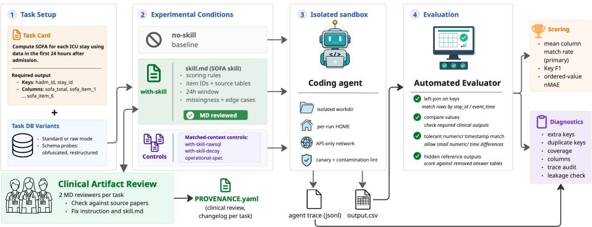
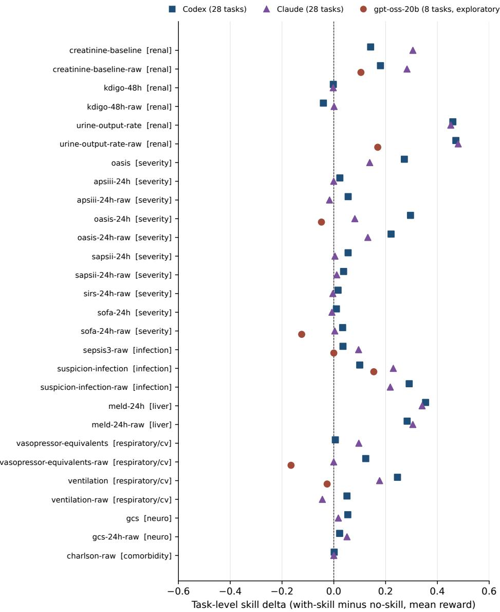

# M4Bench: Evaluating Procedural Specification for Clinical EHR Derivation Agents

Hannes Ill1,∗, Rafi Al Attrach1, Rajna Fani1, Ahram Han1,2, Ryohei Yamamoto1, Marlene Louisa Moerig1,3, Dukyong Yoon1,4, Leo Anthony Celi1,5

1Laboratory for Computational Physiology, Massachusetts Institute of Technology, USA 2Department of Surgery, Seoul National University Hospital, Korea 3Charité, University Medicine Berlin, Germany

4Department of Biomedical Systems Informatics, Yonsei University College of Medicine, Korea 5Division of Pulmonary, Critical Care and Sleep Medicine, Beth Israel Deaconess Medical Center, USA

∗Corresponding author: illh@mit.edu § github.com/hannesill/m4

## Abstract

Clinical research over electronic health records depends on derived variables whose definitions sit outside the schema, in item codes, time windows, missingness rules, and output-grain choices that change cohorts and downstream conclusions. We introduce M4Bench, 28 clinical derivation tasks across 15 task families on MIMIC-IV and eICU, to test whether AI coding agents can reproduce such derivations and how clinician-reviewed agent skills change their results. Its controls decompose the value of skills into specification completeness, delivery format, and schema familiarity. In a Docker-isolated Codex campaign (GPT 5.4 Mini and GPT 5.5), skills raise reward, the mean match rate over scored output columns, by 0.136 over the no-skill baseline, with 26 of 28 tasks improving. Specification completeness accounts for most of this gain: on an eight-task control subset, an operational spec alone raises reward by 0.162, and skills add only 0.024 on top, a difference indistinguishable from zero. On a ten-task subset, decoy skills score like no skill and raw reference SQL nearly matches targeted skills, arguing against generic context or the skill format as the explanation. Schema obfuscation and restructuring preserve 86% and 70% of the skill gain (GPT 5.4 Mini, 26 MIMIC-IV tasks), a descriptive robustness check rather than a bound on memorization. A descriptive Claude Code replication on all 28 tasks (Opus 4.7 and Sonnet 4.6, 560 runs) is directionally consistent (+0.120, 21 of 28 tasks improving). These gains are partial agreement with the reference, not completed tasks: only 25 of 280 with-skill and 13 of 280 no-skill Codex runs pass every strict check, and skills barely change which rows agents return (key F1 +0.003). Skills are released as a versioned, clinicianreviewable markdown delivery format, with a family-level reference-validity audit. M4Bench releases tasks, skills, evaluation code, and sanitized per-run evidence as an open-source benchmark §.

## 1 Introduction

Observational clinical research using electronic health records (EHRs) commonly relies on derived variables: severity scores such as Sequential Organ Failure Assessment (SOFA) [Vincent et al., 1996] and Acute Physiology Score III (APS-III) [Knaus et al., 1991], organ-dysfunction measures such as Kidney Disease: Improving Global Outcomes (KDIGO) acute kidney injury staging [KDIGO Acute Kidney Injury Work Group, 2012] and Model for End-Stage Liver Disease (MELD) [Kamath et al., 2001], and cohort-defining phenotypes such as suspected infection and Sepsis-3 [Singer et al., 2016]. These variables are rarely available as simple columns. They are reconstructed from raw tables whose clinical meaning is distributed across item identifiers, units, documentation practices, time windows, and dataset-specific conventions, and the implementation choices behind a single derivation change cohort membership, score distributions, and downstream conclusions in observational studies [Johnson et al., 2017, 2018, Ostropolets et al., 2023].

  
Figure 1: M4Bench evaluation pipeline. Each task pairs a task card with a DuckDB clone whose reference targets are removed. The primary NO-SKILL–WITH-SKILL comparison and matched controls test specification completeness, reference-code structure, and schema familiarity under sandboxed execution and contamination auditing.

Modern agents can inspect schemas, execute SQL, debug code, and iterate on tests, and recent work measures their ability to translate clinical questions into SQL or to interact with EHR data [Lee et al., 2022, Shi et al., 2024, Jiang et al., 2025]. Yet clinical derivation tasks often require procedural knowledge that is invisible from schema structure alone. A SOFA implementation, for example, needs the score definition plus how vasopressors are encoded, how oxygenation variables are paired, how ventilation status changes respiratory scoring, and how missing components are handled in a specific database release. This procedural knowledge is held by clinicians and embedded in community concept code such as the MIT-LCP MIMIC-Code repository [Johnson et al., 2018], but no benchmark we are aware of represents it as an auditable agent artifact.

M4Bench studies this gap as an evaluation problem. Rather than asking whether an agent can answer clinical questions in free text, M4Bench asks whether a coding agent can reproduce declared EHR research derivations and whether explicit procedural specifications change that behavior. The benchmark is motivated by a broader goal: enabling clinicians and clinical researchers to convert tacit procedural knowledge about EHR derivations into versioned, auditable artifacts that agents can use during implementation. The central question is how human domain expertise should be represented and evaluated for supervised research workflows.

The primary specification format is an agent skill: a markdown procedural artifact, in the spirit of Agent Skills [Zhang et al., 2025a], that summarizes the clinical rules, item identifiers, time windows, and output grain for one task family. Skills are reusable procedural artifacts and contain no hidden reference outputs. Each task and associated artifact is reviewed by two clinicians. This review supports face validity, output-schema consistency, and clinical-definition provenance.

The benchmark is designed around a controlled ablation (Figure 1). In the NO-SKILL condition, an agent receives the task instruction and database access, but no curated derivation procedure. This condition represents schema-plus-task access, not a fully specified clinical protocol baseline. In the WITH-SKILL condition, the same agent also receives the task-specific procedural skill. The submitted CSV is evaluated column by column against hidden reference outputs. The estimand is the change in agreement with declared reference implementations when curated clinical implementation knowledge is supplied.

Claims and non-claims. M4Bench estimates the native-schema WITH-SKILL–NO-SKILL reward difference for the same task, database, model, and execution protocol, with tasks weighted equally after model-level averaging. The tested procedural context comes from public MIT-LCP concept code, eICU conventions, clinician review, and task adaptations. Scores measure agreement with declared public-code reference derivations, not clinical correctness: clinician review flagged, for example, that broad culture inclusion can overcall suspected infection, that SOFA defaults missing organ components to zero, and that the vasopressor mapping omits angiotensin II (Appendix Table 9). Clinician-adjudicated and multiple accepted targets are the priority for future versions. The evidence is MIMIC-IV-dominant: 26 of 28 tasks use MIMIC-IV, and the two eICU tasks are cross-database probes, not evidence of database or hospital generality. M4Bench does not identify a causal effect of clinician review, provider-general behavior, memorization-free reasoning, or a unique effect of the skill format.

This paper makes three contributions:

1. A benchmark object: 28 clinical EHR derivation tasks across 15 task families over MIMIC-IV and eICU, with clinician-reviewed skills, OS-level isolation, contamination-lint, and sanitized per-run audit logs plus a family-level reference-validity audit so that benchmark targets and known caveats are inspectable.

2. A decomposition apparatus: decoy-skill, raw-SQL, operational-spec, and schemaperturbation controls separating specification completeness from delivery format, referencecode structure, and schema familiarity.

3. A Codex finding under that apparatus, with a directionally consistent but descriptive fullcoverage Claude replication: on an eight-task control subset, specification completeness explains most of the gain. Targeted skills improve Codex reward by +0.136 [0.085, 0.191] on 28 tasks (26/28 improving), and the corresponding Claude difference is +0.120 [0.067, 0.177] (21/28), but only 25/280 with-skill Codex runs pass all strict diagnostics and key F1 moves only +0.003.

## 2 Related work

M4Bench builds on credentialed critical-care databases, MIMIC-IV [Johnson et al., 2023] and eICU [Pollard et al., 2018], on community reference implementations such as MIT-LCP MIMIC-Code [Johnson et al., 2018], and on the M3 agent infrastructure for clinical EHR access [Attrach et al., 2025]. Prior clinical EHR benchmarks and agent methods cover few-shot prediction, textto-SQL, structured-table question answering, cohort and feature extraction, or tool-using clinical agents [Wornow et al., 2023, Lee et al., 2022, Shi et al., 2024, Lee et al., 2025, Yang et al., 2026, Lee et al., 2026, Jiang et al., 2025]. Retrieval-augmented medical question answering is benchmarked separately by MIRAGE [Xiong et al., 2024]. Unlike RWE-bench’s end-to-end observational-study protocols over MIMIC-IV [Li et al., 2026a], M4Bench isolates reusable derivation components such as SOFA, suspected infection, ventilation, vasopressor-equivalent dose, and rolling urine output, then scores reproductions against declared references under a direct NO-SKILL versus WITH-SKILL ablation.

M4Bench also differs from medical-calculator benchmarks, which test formula recall, extraction, or arithmetic from notes or synthetic patient descriptions [Khandekar et al., 2024, Krohn-Grimberghe, 2026]. Real EHR derivations also depend on item identifiers, time windows, unit conversion, missingness conventions, and output grain. Harmonization efforts such as CLIF and OHDSI/OMOP standardize clinical data and definitions across settings [Rojas et al., 2025, Hripcsak et al., 2015]. M4Bench instead asks whether coding agents can reproduce a fixed set of declared derivations under controlled conditions.

Agent skills are reusable file-based procedural-knowledge artifacts that agents can discover and load at run time [Zhang et al., 2025a]. SkillsBench studies such artifacts across domains, but only a few of its tasks involve clinical data, too few to establish whether skill effects are broad or reliable across EHR derivations [Li et al., 2026b]. Structured-prompting and prompt-sensitivity work likewise show that procedural context can change model behavior [Khattab et al., 2024, Zhuo et al., 2024]. M4Bench measures the effect of supplying task-specific procedural knowledge in a released, auditable form, without claiming a unique benefit for one packaging format.

Finally, M4Bench inherits concerns from coding-agent benchmarks such as SWE-bench [Jimenez et al., 2024]: isolation, reproducibility, and contamination matter when agents can inspect code and files. Contamination is a known threat to such benchmarks and has motivated continuously updated or contamination-resistant evaluations [Chen et al., 2025, Wu et al., 2025, Zhang et al., 2025b]. M4Bench therefore reports OS-level isolation, artifact retention, and contamination checks, and treats schema perturbations as probes of schema familiarity only.

## 3 Benchmark

Benchmark at a glance. M4Bench releases 28 task specifications across 15 clinical task families over MIMIC-IV [Johnson et al., 2023] and eICU [Pollard et al., 2018]; clinician-reviewed procedural skills; the Docker isolation harness, evaluator, and contamination-audit code; and sanitized per-run evidence for the Codex campaigns, the submitted Claude sentinel campaign, and a full-coverage Claude replication. Metadata and hash manifests accompany the release. Derived task databases are not redistributed, while task specifications, evaluator code, and skills use a permissive open-source license. Asset terms appear in Table 12.

M4Bench contains 26 MIMIC-IV tasks and two eICU tasks spanning severity scores, organ dysfunction, comorbidity, infection, respiratory support, medications, and rolling windows. Figure 1 summarizes the pipeline, and Table 2 lists the family-level inventory.

Task format. Each task gives the agent a clinical derivation target and a task database. The agent must write output.csv with required identifier columns and value columns. Evaluation checks that the output is valid CSV, contains required columns, covers the expected key set, and matches reference value columns within task-specific tolerances. Appendix B traces one task, suspected infection, from clinical definition through output rows to diagnostics.

Standard and raw modes. Standard tasks remove reference target tables while leaving selected intermediate feature tables available. Raw tasks remove the target concept and, for MIMIC-IV tasks, remove the mimiciv\_derived schema so the agent must work from source clinical tables. This distinction tests whether skills matter more when implementation details such as item identifiers, source tables, unit conversions, and temporal joins cannot be bypassed through derived features.

Retrospective vs time-local framing. Several reference implementations adapted from public concept code use information available only after a real-time decision point (e.g., baseline creatinine uses discharge ICD codes for chronic-kidney-disease patients). M4Bench is therefore a benchmark of retrospective concept derivations, not real-time clinical prediction.

Conditions. The primary comparison is NO-SKILL versus WITH-SKILL on the native schema. Table 1 summarizes the main benchmark conditions and mechanism controls. The NO-SKILL condition is a schema-plus-task baseline, not a deployed-system baseline such as retrieval over public concept code. The operational-spec control therefore measures how much of the effect comes from specification completeness rather than the skill format itself.

Skill artifact. Each task-specific skill is a markdown procedural artifact in the spirit of Agent Skills [Zhang et al., 2025a]. Skills are derived from public clinical definitions, MIT-LCP MIMIC-Code, and eICU concept-code conventions [Johnson et al., 2018, Pollard et al., 2018], then adapted into implementation guidance for one declared reference convention, not universal clinical knowledge. Each task-specific skill and paired task specification was independently reviewed by two clinicians. Disagreements and requests for clarification were resolved through consensus discussion, and reviewer identifiers C1–C4 are reported in the provenance appendix. The four reviewing clinicians are co-authors of this paper, so the review is internal to the author team and is not external validation. This review checks definition provenance, task framing, and artifact plausibility. Skills may include formulas, item identifiers, table families, time-window rules, missingness conventions, unit conversions, output-grain reminders, and edge-case cautions. The primary skills contain no executable SQL snippets, hidden reference-output paths, row-level answers, exact result tables, or full solution programs. Raw SQL appears only in a matched-content control.

Table 1: Glossary of benchmark conditions, controls, and metrics.
<table><tr><td>Term</td><td>What the agent receives</td><td>Purpose</td></tr><tr><td>NO-SKILL</td><td>Task instruction and task database</td><td>Schema-plus-task baseline; no curated derivation procedure</td></tr><tr><td>WITH-SKILL</td><td>NO-SKILL inputs plus a task-specific pro- cedural skill</td><td>Primary test of targeted procedural specifi- cation</td></tr><tr><td>Decoy skill</td><td>NO-SKILL inputs plus a task-mismatched skill artifact</td><td>Controls for generic extra context and skill- file presence</td></tr><tr><td>Raw reference SQL</td><td>NO-SKILL inputs plus reference SQL text</td><td>Tests reference-code structure; raw-task cells require SQL adaptation rather than answer copying</td></tr><tr><td>Operational spec</td><td>NO-SKILL inputs plus complete non-SQL clinical rules, excluding item identifiers and dataset recipes</td><td>Separates rule completeness from dataset navigation and skill packaging</td></tr><tr><td>Schema perturbations</td><td>NO-SKILL or WITH-SKILL inputs on obfus- cated or restructured schemas</td><td>Probes schema-name and table- organization familiarity</td></tr><tr><td>Metric</td><td>Definition</td><td>Interpretation</td></tr><tr><td>Reward</td><td>Mean match rate over scored value columns, with missing, extra, and dupli- cate keys in each denominator</td><td>Partial agreement with the declared refer- ence</td></tr><tr><td>Strict pass</td><td>Every evaluator check passes: required columns, key coverage, and a match-rate</td><td>Reliable end-to-end reproduction of the ref- erence</td></tr><tr><td>Key F1</td><td>threshold on every scored column Harmonic mean of key precision and reference-key recall</td><td>Output-grain agreement, separate from val- ues</td></tr></table>

Reference outputs and metric. Reference outputs are adapted from public MIT-LCP concepts, eICU concept code, and benchmark-specific task semantics. The scalar reward is the mean match rate over scored value columns, not the pass fraction over tests. For task t, scored columns $C _ { t }$ reference key set $K _ { t }$ , and agent output $A _ { t } ,$ the evaluator left-joins agent rows to reference rows on the configured key columns, drops duplicate agent keys after counting them as penalties, and counts missing reference rows, duplicate agent keys, and extra agent keys against each column’s denominator. The reward is

$$
R _ { t } = \frac { 1 } { \vert C _ { t } \vert } \sum _ { c \in C _ { t } } \frac { \# \{ k \in K _ { t } : A _ { t } ( k , c ) \approx G _ { t } ( k , c ) \} } { \vert K _ { t } \vert + \# \mathrm { e x t r a k e y s } + \# \mathrm { d u p l i c a t e k e y s } } ,
$$

where $G _ { t }$ denotes the hidden reference output table and ≈ denotes exact equality or a task-specific numeric/timestamp tolerance. The evaluator also reports key precision, extra keys, row coverage, and pass/fail diagnostics. To separate row-grain errors from near-miss value errors, we additionally summarize key $\breve { \mathrm { F 1 } }$ and normalized MAE over ordered value columns. Unordered categorical columns remain exact-match only.

The MIT-LCP and eICU conventions used for these reference outputs are widely adopted research implementations, not clinically validated gold standards. Clinician review identified cases where public concept code diverges from source clinical definitions or omits clinically relevant edge cases. Appendix Table 9 summarizes the highest-impact reference-validity caveats. We retain the public reference implementations for the current evidence package because changing them would redefine the benchmark target and require rerunning affected tasks. Future versions should add clinicianadjudicated reference targets alongside public-code targets, so that M4Bench can separately measure agreement with community convention and agreement with clinical intent.

Dataset scale. Benchmark task databases are per-task DuckDB clones derived from credentialed MIMIC-IV and eICU data. MIMIC-IV tasks draw from the MIMIC-IV v3.1 release, and eICU tasks draw from the eICU Collaborative Research Database v2.0. Reference-output row counts range from 41,296 rows for the Sepsis-3 cohort task to 4,126,485 rows for rolling urine-output windows, with several interval and event tasks above 700,000 rows. Per-task reference row counts are reported in Table 6 in the appendix.

Table 2: M4Bench task inventory. Standard tasks retain selected intermediate features; raw tasks require reconstruction from source tables.
<table><tr><td>Family</td><td>Tasks</td><td>Standard</td><td>Raw</td><td>Database</td></tr><tr><td>APS III</td><td>2</td><td>1</td><td>1</td><td>MIMIC-IV</td></tr><tr><td>Charlson</td><td>1</td><td>0</td><td>1</td><td>MIMIC-IV</td></tr><tr><td>Baseline creatinine</td><td>2</td><td>1</td><td>1</td><td>MIMIC-IV</td></tr><tr><td>GCS</td><td>2</td><td>0</td><td>2</td><td>MIMIC-IV/eICU</td></tr><tr><td>KDIGO AKI</td><td>2</td><td>1</td><td>1</td><td>MIMIC-IV</td></tr><tr><td>MELD</td><td>2</td><td>1</td><td>1</td><td>MIMIC-IV</td></tr><tr><td>OASIS</td><td>3</td><td>1</td><td>2</td><td>MIMIC-IV/eICU</td></tr><tr><td>SAPS-II</td><td>2</td><td>1</td><td>1</td><td>MIMIC-IV</td></tr><tr><td>Sepsis-3</td><td>1</td><td>0</td><td>1</td><td>MIMIC-IV</td></tr><tr><td>SIRS</td><td>1</td><td>0</td><td>1</td><td>MIMIC-IV</td></tr><tr><td>SOFA</td><td>2</td><td>1</td><td>1</td><td>MIMIC-IV</td></tr><tr><td>Suspected infection</td><td>2</td><td>1</td><td>1</td><td>MIMIC-IV</td></tr><tr><td>Urine-output rate</td><td>2</td><td>1</td><td>1</td><td>MIMIC-IV</td></tr><tr><td>Vasopressor equivalents</td><td>2</td><td>1</td><td>1</td><td>MIMIC-IV</td></tr><tr><td>Ventilation</td><td>2</td><td>1</td><td>1</td><td>MIMIC-IV</td></tr><tr><td>Total</td><td>28</td><td>11</td><td>17</td><td>MIMIC-IV/eICU</td></tr></table>

Data access and ethics. MIMIC-IV and eICU require credentialed access through PhysioNet. Benchmark task databases are derived from this credentialed data and are not redistributed. Researchers using M4Bench must independently obtain PhysioNet credentials for the relevant source databases and rebuild the task databases with the released setup scripts (Appendix D).

Data and code release. The source release (tag m4bench-neurips2026-camera-ready, https: //github.com/hannesill/m4/tree/m4bench-neurips2026-camera-ready/benchmark) contains the evaluation code, tasks, skills, controls, isolation harness, tests, run manifests, and table scripts. Two open evidence packages hold result.json, sanitized traces, and instructions for 1,960 runs (the 1,850 paper-facing runs, with egress logs, and 110 exploratory OSS runs, which have none), with source-to-public hash lineage and Croissant metadata [Akhtar et al., 2024]. Row-level agent outputs and tool outputs are withheld because they derive from credentialed data (Appendix D).

## 4 Experimental protocol

Primary estimand. The primary estimand is the task-paired change in mean per-column match rate between NO-SKILL and WITH-SKILL on native-schema tasks. Let $R _ { t , c , s , m , k }$ denote the reward defined in Section 3 for task t, condition c, schema s, model m, and trial k. For native-schema tasks the per-task skill effect is

$$
\Delta _ { t , m } = \mathbb { E } _ { k } \big [ R _ { t , \mathrm { w I T H - S K I L } , \mathrm { n a t i v e } , m , k } \big ] - \mathbb { E } _ { k } \big [ R _ { t , \mathrm { N o - S K I L } , \mathrm { n a t i v e } , m , k } \big ] .
$$

The headline aggregate averages $\Delta _ { t , m }$ first over models within an arm and then over tasks, so each task contributes equally regardless of trial count or output size. This estimand is identified within a single model provider: the two Codex models share a provider family. The Claude replication applies the same estimand to a second provider but, because of the harness differences described below, is a descriptive cross-provider check rather than evidence of a provider-general effect.

Inference and uncertainty. The campaign matrix is tiered and partly pilot-informed, so the headline estimand is task-balanced rather than run-weighted. We report non-parametric uncertainty over tasks using a task-cluster bootstrap for the model-averaged $\Delta _ { t } ,$ a family-cluster sensitivity analysis, a family-balanced bootstrap, and a Monte Carlo sign-flip test against zero. Bracketed intervals are 95% non-parametric percentile bootstrap intervals over task-level deltas, not standard deviations or standard errors over repeated runs. These summaries are conditional on the task set.

Execution. Paper-quality runs execute inside Docker. The final primary Codex analysis uses GPT 5.4 Mini (gpt-5.4-mini) and GPT 5.5 (gpt-5.5) over all 28 native tasks with five trials per cell plus matched-context controls, for 760 canonical paper-facing runs. The submitted Claude sentinel arm used Opus and Sonnet over eight paired tasks plus limited schema probes (190 runs) and is retained as historical evidence. Each run records the task, condition, schema, agent, model, trial, timestamps, result hashes, token usage when available, and evaluator diagnostics. Release roots, rerun replacements, artifact counts, and compute are detailed in Appendices A and E.

Full-coverage Claude replication. After submission we ran Claude Code with requested Opus (claude-opus-4-7) and Sonnet (claude-sonnet-4-6) on all 28 native tasks, NO-SKILL and WITH-SKILL, five trials per cell, under the frozen task, skill, and evaluator definitions and the same Docker path: 560 canonical runs from three results roots on two machines, selected by a declared manifest, with 656 failed, quarantined, superseded, or overlapping attempts inventoried and excluded (Appendix F). The harness was not uniform: Claude Code 2.1.119 and 2.1.220 both occur, partly by condition (167/280 NO-SKILL versus 100/280 WITH-SKILL runs on 2.1.119). Model-slot overrides are recorded for 230 runs and the rest use native routing, whose traces report ancillary claude-haiku-4-5 usage in 330 runs and Haiku assistant turns in 5. We therefore treat the 28-task contrast as descriptive and add a sensitivity analysis on tasks whose NO-SKILL and WITH-SKILL cells share one recorded CLI version and routing profile per model. This matches recorded indicators, not every ancillary model call.

Isolation and contamination auditing. Paper campaigns enforce benchmark-internal isolation at the OS/container layer and fail closed if an agent can read hidden reference outputs, task internals, previous results, or evaluator internals. Post-run auditing excludes or fails traces that mention answer paths, evaluator internals, exact answer-copying behavior, or byte-identical outputs against decompressed answer files. The final Codex campaign passed publishability, isolation, filesystemcanary, and contamination-lint checks for all 760 canonical runs, as did all 560 canonical Claude replication runs, whose egress logs show no disallowed hosts or denied requests. Full audit counts appear in Appendices E and F.

Schema perturbations and matched-context controls. Schema perturbations run agents on obfuscated or restructured schemas while preserving underlying data values. They are schemafamiliarity probes, not full data-value decontamination tests. Matched-context controls use decoy skills and raw reference SQL to test whether gains are caused merely by longer context, by direct reference-code exposure, or by task-specific procedural guidance. For raw tasks, raw reference SQL can reference intermediate tables removed from the task database, so these cells are SQL-adaptation controls, not executable answer-copying controls. The May 6 validity follow-up adds two non-primary controls: an operational-spec condition on an eight-task control subset for both Codex models, and transformed-schema WITH-SKILL cells for GPT 5.4 Mini over the 26 MIMIC tasks.

## 5 Results

Specification completeness accounts for most of the gain on the eight-task control subset. On the ten-task decoy/raw-SQL subset, decoy skills match NO-SKILL (0.554 vs 0.553), arguing against generic extra context as the explanation. Raw reference SQL nearly matches targeted skills (0.837 vs 0.833, ∆ =0.003), so reference-implementation structure already carries most of the signal once it is present (Appendix Table 22). Operational specifications (complete non-SQL derivation rules without item identifiers or dataset recipes) improve over NO-SKILL by +0.162 [0.072, 0.260] on the eight-task subset, while clinician-reviewed targeted skills add only +0.024 [-0.034, 0.099] on top (Table 4). The combined targeted-skill effect on all 28 native tasks is +0.136 [0.085, 0.191] (Table 3), family-cluster sensitivity [0.065, 0.207], family-balanced bootstrap +0.120 [0.057, 0.190] (Appendix Table 19), sign-flip $p < 1 0 ^ { - 4 }$ , with 26/28 tasks improving and ordered-value nMAE falling from 0.116 to 0.060. Skills are therefore one clinician-reviewable delivery format for explicit procedural specification. The control subsets were purposive: both task lists were fixed in the benchmark matrix before their first runs, and they over-represent large-effect tasks (the targeted-skill delta is +0.280 on the 10 decoy/raw-SQL tasks versus +0.056 on the other 18, and +0.186 on the eight operational-spec tasks versus +0.116), and the operational-spec subset has no eICU task. Mechanism conclusions apply to these subsets (Appendix Table 13).

Table 3: Native-schema Codex skill effect and diagnostics. Reward is mean value-column match rate; key F1 measures row grain; ordered nMAE is lower-is-better. Intervals are 95% task-bootstrap intervals.
<table><tr><td>Measure</td><td>No skill</td><td>With skill</td><td>Delta</td><td>Improved tasks</td></tr><tr><td>Reward / GPT 5.4 Mini</td><td>0.639</td><td>0.802</td><td>0.162 [0.099, 0.232]</td><td>26/28</td></tr><tr><td>Reward / GPT 5.5</td><td>0.767</td><td>0.876</td><td>0.109 [0.060, 0.166]</td><td>24/28</td></tr><tr><td>Reward / task-balanced</td><td>0.703</td><td>0.839</td><td>0.136 [0.085, 0.191]</td><td>26/28</td></tr><tr><td>Key F1 / task-balanced</td><td>0.962</td><td>0.965</td><td>0.003 [-0.010, 0.018]</td><td>5/28</td></tr><tr><td>Ordered nMAE / task-balanced</td><td>0.116</td><td>0.060</td><td>-0.056 [-0.085, -0.029]</td><td>23/26</td></tr></table>

Table 4: Codex operational-spec follow-up on the eight-task control subset. Values are task-balanced after averaging the two Codex models within each task.
<table><tr><td>Comparison</td><td>Tasks</td><td>No skill</td><td>Operational spec</td><td>Targeted skill</td><td>Delta</td></tr><tr><td>Operational spec-no skill</td><td>8</td><td>0.606</td><td>0.767</td><td></td><td>0.162 [0.072, 0.260]</td></tr><tr><td>Targeted skill-operational spec</td><td>8</td><td></td><td>0.767</td><td>0.792</td><td>0.024 [-0.034, 0.099]</td></tr></table>

Few runs pass strictly, and skills barely move row grain. The continuous reward measures partial agreement on matched keys, not end-to-end correctness. Only 87/760 runs pass every strict diagnostic (13/280 NO-SKILL and 25/280 WITH-SKILL in the primary comparison; the other 49 are raw-SQL control runs, 49/100 against 7/100 targeted-skill runs on the same ten tasks, although mean reward is nearly equal). Most strict failures are value errors on correctly keyed rows: 468 of the 522 failing primary-comparison runs meet the key-coverage threshold and miss only a value-match threshold (0.85 to 1.0 per task, exact on 10 of 11 standard tasks). Skills barely move row grain: task-balanced key F1 changes by only +0.003 and improves on only 5/28 tasks (it falls on 3), even though many of the targeted dataset-navigation cautions concern intervals and grain. The headline gain is therefore concentrated in numeric value-column agreement on rows where the agent already produced a matching key.

Heterogeneity and failure modes. The largest gains occur on tasks requiring implementation-level knowledge: rolling urine-output windows, MELD edge cases, suspected-infection timing, baselinecreatinine hierarchy, and ventilation status. KDIGO, Charlson, standard vasopressor-equivalent, SOFA, and several already-high-baseline scores remain near zero or negative. All eight flattest tasks (Appendix Table 17) keep key F1 at 1.000 in both conditions: six are near ceiling without skills (no-skill reward at least 0.94), and raw KDIGO and standard APS III keep value errors that skills do not fix. Grain errors concentrate in raw Sepsis-3, raw ventilation, and raw suspected infection (key F1 0.68 to 0.87). Per-task deltas and mode splits appear in Appendix E.

Schema perturbations: descriptive robustness. Schema obfuscation and restructuring alter the database interface while preserving underlying values. In a GPT 5.4 Mini follow-up over the 26 MIMIC tasks, transformed-schema WITH-SKILL cells remain positive when matched to the transformed-schema NO-SKILL cells from the earlier probe: +0.135 [0.068, 0.208] on obfuscated schemas and +0.110 [0.057, 0.170] on restructured schemas, or 0.862 and 0.704 of the native-schema gain (Appendix Table 23). We read these ratios descriptively. Treating the shortfall as the share of the effect due to schema-name memorization would require that the perturbations change nothing else about task difficulty and that the April no-skill probe and May with-skill runs are exchangeable. Neither is established, and the transformed-schema no-skill runs are not in the retained evidence packages (Appendix D). The probe says nothing about value-level memorization or provider, hospital, or database generalization.

Full-coverage Claude replication. Across all 28 tasks, Claude reward is 0.747 without and 0.867 with targeted skills, a task-balanced difference of +0.120 [0.067, 0.177] with 21/28 tasks positive (Table 5). The Opus difference is +0.083 [0.038, 0.135] (25/28) and the Sonnet difference +0.156 [0.087, 0.231] (20/28; Appendix Table 29). Restricting to the 19 tasks with matched recorded CLI version and routing profile gives +0.119 [0.054, 0.192] (14/19), so the positive average does not depend on the tasks with recorded harness imbalance. It does not show that CLI or routing changes had no effect. As with Codex, the difference is mostly value agreement: strict passes rise from 25/280 to 37/280 and key F1 by +0.008. Differences concentrate on the same implementation-heavy families (urine-output windows, baseline creatinine, MELD, suspected infection), while SOFA, APS III, SAPS II, KDIGO, and Charlson stay near zero (Appendix Table 31). The replication supersedes the submitted eight-task Claude sentinel (+0.166 [0.085, 0.259]), which is retained as historical evidence. The lower full-coverage estimate is consistent with that purposive subset over-representing large-effect tasks. This comparison is not a provider ranking.

Table 5: Full-coverage Claude replication: task-balanced native-schema WITH-SKILL minus NO-SKILL reward on all 28 tasks, on the 20 tasks whose NO-SKILL and WITH-SKILL cells share one recorded Claude Code version (CLI) per model, and on the 19 that also share one routing profile. Intervals are 95% task bootstraps. Strict passes and key F1 are separate from reward.
<table><tr><td>Task set</td><td>Tasks</td><td>Runs</td><td>Delta [95% CI]</td><td>Positive</td><td>Strict passes (no/with)</td><td>Key F1 delta</td></tr><tr><td>All tasks</td><td>28</td><td>560</td><td>0.120 [0.067, 0.177]</td><td>21/28</td><td>25/280 vs 37/280</td><td>0.008</td></tr><tr><td>CLI-version matched</td><td>20</td><td>400</td><td>0.113 [0.050, 0.185]</td><td>15/20</td><td>19/200 vs 27/200</td><td>0.008</td></tr><tr><td>CLI and routing matched</td><td>19</td><td>380</td><td>0.119 [0.054, 0.192]</td><td>14/19</td><td>19/190 vs 27/190</td><td>0.008</td></tr></table>

Capability floor. An exploratory local gpt-oss-20b arm is non-publishable under our release criteria, but its near-zero task-paired delta of +0.008 [-0.072, 0.088] suggests that procedural specifi cations do not substitute for base coding capability (Appendix E).

## 6 Discussion and limitations

What M4Bench measures. M4Bench measures whether agents can implement declared clinical EHR reference derivations and whether explicit procedural specifications close implementation gaps. The tasks cover critical-care severity scores, organ dysfunction, comorbidity, infection, respiratory support, medications, and rolling windows over MIMIC-IV and eICU. The benchmark does not measure bedside reasoning, diagnosis, treatment planning, real-time prediction, or downstream study validity.

Procedural specification as an auditable artifact. Relative to EHR text-to-SQL, structured-QA, and interactive-agent benchmarks [Lee et al., 2022, Yang et al., 2026, Jiang et al., 2025], M4Bench evaluates the reproduction of declared clinical derivations instead of answers to EHR questions. It turns procedural knowledge such as item identifiers, time windows, and tie-breaking rules into clinician-reviewed, versioned artifacts. These artifacts help some derivations and leave others flat or negative when grain, timing, or reconstruction fail.

Interpretation limits and what M4Bench does not claim. The estimand identifies reference agreement, not clinical correctness, hidden-knowledge transfer, or decontaminated reasoning. The evidence is a Codex headline plus a descriptive Claude replication with disclosed harness differences, so it is not provider-general. Public concept code likely appears in pretraining, and the schema probes address schema familiarity only, so the results are not memorization-free. Operational specifications without item identifiers already capture most of the gain, so the effect is not unique to the skill format. Skills barely change key F1 on average and improve output grain on only a few tasks. With 26 MIMIC-IV and two eICU tasks, the evidence is not dataset- or hospital-general. The small targeted-skill advantage over operational specifications is suggestive of dataset-navigation value, not a powered unique-skill effect.

Statistical and external validity. The campaign is pilot-informed, not a balanced confirmatory design. The Claude replication matches Codex in task coverage and isolation but not in harness uniformity. A causal skill contrast for Claude needs a declared rerun of the affected cells under one frozen CLI version and routing policy. Broader eICU and cross-site coverage is the main external-validity priority.

Guidance for agent builders and practitioners. Given the residual failures, agent builders should pair procedural guidance with executable checks. Before coding, declare the output grain, keys, window boundaries, units, missingness and tie-breaking rules, and source mappings. Before accepting output, validate columns, key coverage, duplicate and extra keys, cohort size, value ranges, intermedi ate counts, and boundary cases, because skills barely move key F1 or strict pass. Agents also need reliable primitives for temporal joins, unit normalization, and item-code mapping, and should expose intermediate cohorts and values for inspection. Contestable choices should be surfaced, not silently resolved, and practitioners should treat agent output as an untrusted draft that needs independent clinical review before consequential use. Expert-curated examples help most when they carry the definition, dataset mappings, expected intermediate and final outputs, edge cases, tests, provenance, and known limitations, not only final SQL.

Safety and misuse. M4Bench evaluates derived variables for supervised research workflows, not autonomous clinical decision-making. Incorrect derivations propagate into cohorts, risk adjustment, and downstream conclusions, and high reward can coexist with consequential grain, timing, or missingness errors. References can embed contestable choices (Appendix Table 9), so human audit and provenance tracking remain necessary.

## 7 Conclusion

M4Bench is an evaluation benchmark for procedural specification in clinical EHR derivation agents. Explicit procedural specifications, instantiated here as clinician-reviewed skills, improve agreement with declared reference outputs for Codex, with a directionally consistent descriptive Claude replication, while leaving important failures in temporal joins, output grain, and raw intermediate reconstruction. The result shows that schema exploration alone is often insufficient and gives readers an artifact-backed way to inspect residual errors requiring human audit.

M4Bench is designed to be extended through task.toml files with paired reference-output implementations, evaluation configuration, and clinician-reviewed skills. Researchers can add tasks, skills, controls, and agents under the same NO-SKILL versus WITH-SKILL comparison, isolation harness, and evidence standards to measure the value of agent skills in other clinical EHR settings. Future versions should add mechanism controls on all 28 tasks, clinician-adjudicated targets, multiple accepted derivations, broader eICU and cross-site tasks, and care-process task families.

## Acknowledgments and Disclosure of Funding

Funding. This project was not funded by any grant. LAC is funded by the National Institutes of Health through DS-I Africa U54 TW012043-01 and Bridge2AI OT2OD032701, the National Science Foundation through ITEST #2148451, a grant of the Boston-Korea Innovative Research Project (RS-2024-00403047), and a grant of the Korea Health Technology R&D Project (RS-2024-00439677) through the Korea Health Industry Development Institute (KHIDI), funded by the Ministry of Health & Welfare, Republic of Korea.

Competing interests. The authors declare no competing interests.

## References

Mubashara Akhtar, Omar Benjelloun, Costanza Conforti, Luca Foschini, Pieter Gijsbers, Joan Giner-Miguelez, Sujata Goswami, Nitisha Jain, Michalis Karamousadakis, Satyapriya Krishna, et al. Croissant: A metadata format for ML-ready datasets. Advances in Neural Information Processing Systems, 37:82133–82148, 2024. doi: 10.52202/079017-2610.

Rafi Al Attrach, Pedro Moreira, Rajna Fani, Renato Umeton, Amelia Fiske, and Leo Anthony Celi. M3: Conversational LLMs simplify secure clinical data access, understanding, and analysis. arXiv preprint arXiv:2507.01053, 2025.

Roger C Bone, Robert A Balk, Frank B Cerra, R Phillip Dellinger, Alan M Fein, William A Knaus, Roland MH Schein, and William J Sibbald. Definitions for sepsis and organ failure and guidelines for the use of innovative therapies in sepsis. Chest, 101(6):1644–1655, 1992. doi: 10.1378/chest.101.6.1644.

M. E. Charlson, P. Pompei, K. L. Ales, and C. R. MacKenzie. A new method of classifying prognostic comorbidity in longitudinal studies: development and validation. Journal of Chronic Diseases, 40 (5):373–383, 1987. doi: 10.1016/0021-9681(87)90171-8.

Simin Chen, Yiming Chen, Zexin Li, Yifan Jiang, Zhongwei Wan, Yixin He, Dezhi Ran, Tianle Gu, Haizhou Li, Tao Xie, and Baishakhi Ray. Benchmarking large language models under data contamination: A survey from static to dynamic evaluation. In Proceedings of the 2025 Conference on Empirical Methods in Natural Language Processing, pages 10080–10098, 2025. doi: 10.18653/v1/2025.emnlp-main.511.

George Hripcsak, Jon D Duke, Nigam H Shah, Christian G Reich, Vojtech Huser, Martijn J Schuemie, Marc A Suchard, Rae Woong Park, Ian Chi Kei Wong, Peter R Rijnbeek, et al. Observational Health Data Sciences and Informatics (OHDSI): opportunities for observational researchers. Studies in Health Technology and Informatics, 216:574–578, 2015. doi: 10.3233/978-1-61499-564-7-574.

Yixing Jiang, Kameron C Black, Gloria Geng, Danny Park, James Zou, Andrew Y Ng, and Jonathan H Chen. MedAgentBench: a virtual EHR environment to benchmark medical LLM agents. NEJM AI, 2(9):AIdbp2500144, 2025. doi: 10.1056/AIdbp2500144.

Carlos E Jimenez, John Yang, Alexander Wettig, Shunyu Yao, Kexin Pei, Ofir Press, and Karthik R Narasimhan. SWE-bench: Can language models resolve real-world GitHub issues? In The Twelfth International Conference on Learning Representations, 2024.

Alistair E. W. Johnson, Tom J. Pollard, and Roger G. Mark. Reproducibility in critical care: a mortality prediction case study. In Proceedings of the 2nd Machine Learning for Healthcare Conference, volume 68 of Proceedings of Machine Learning Research, pages 361–376. PMLR, 2017.

Alistair E. W. Johnson, David J. Stone, Leo A. Celi, and Tom J. Pollard. The MIMIC Code Repository: enabling reproducibility in critical care research. Journal ofthe American Medical Informatics Association, 25(1):32–39, January 2018. doi: 10.1093/jamia/ocx084.

Alistair EW Johnson, Andrew A Kramer, and Gari D Clifford. A new severity of illness scale using a subset of acute physiology and chronic health evaluation data elements shows comparable predictive accuracy. Critical Care Medicine, 41(7):1711–1718, 2013. doi: 10.1097/CCM.0b013e31828a24fe.

Alistair EW Johnson, Lucas Bulgarelli, Lu Shen, Alvin Gayles, Ayad Shammout, Steven Horng, Tom J Pollard, Sicheng Hao, Benjamin Moody, Brian Gow, et al. MIMIC-IV, a freely accessible electronic health record dataset. Scientific Data, 10(1):1, 2023. doi: 10.1038/s41597-022-01899-x.

Patrick S Kamath, Russell H Wiesner, Michael Malinchoc, Walter Kremers, Terry M Therneau, Catherine L Kosberg, Gennaro D’Amico, E Rolland Dickson, and W Ray Kim. A model to predict survival in patients with end-stage liver disease. Hepatology, 33(2):464–470, 2001. doi: 10.1053/jhep.2001.22172.

KDIGO Acute Kidney Injury Work Group. KDIGO clinical practice guideline for acute kidney injury. Kidney International Supplements, 2(1):1–138, 2012. URL https://kdigo.org/wp-content/ uploads/2016/10/KDIGO-2012-AKI-Guideline-English.pdf.

Nikhil Khandekar, Qiao Jin, Guangzhi Xiong, Soren Dunn, Serina S Applebaum, Zain Anwar, Maame Sarfo-Gyamfi, Conrad W Safranek, Abid A Anwar, Andrew Zhang, et al. MedCalc-Bench: Evaluating large language models for medical calculations. Advances in Neural Information Processing Systems, 37:84730–84745, 2024. doi: 10.52202/079017-2690.

Omar Khattab, Arnav Singhvi, Paridhi Maheshwari, Zhiyuan Zhang, Keshav Santhanam, Sri Vardhamanan A, Saiful Haq, Ashutosh Sharma, Thomas T Joshi, Hanna Moazam, Heather Miller, Matei Zaharia, and Christopher Potts. DSPy: Compiling declarative language model calls into state-of-the-art pipelines. In The Twelfth International Conference on Learning Representations, 2024.

William A Knaus, Douglas P Wagner, Elizabeth A Draper, Jack E Zimmerman, Marilyn Bergner, Paulo G Bastos, Carl A Sirio, Donald J Murphy, Ted Lotring, Anne Damiano, et al. The APACHE III prognostic system: risk prediction of hospital mortality for critically ill hospitalized adults. Chest, 100(6):1619–1636, 1991. doi: 10.1378/chest.100.6.1619.

Artus Krohn-Grimberghe. MedCalc-Bench doesn’t measure what you think: A benchmark audit and the case for open-book evaluation. arXiv preprint arXiv:2603.02222, 2026.

Jean-Roger Le Gall, Stanley Lemeshow, and Fabienne Saulnier. A new simplified acute physiology score (SAPS II) based on a European/North American multicenter study. JAMA, 270(24):2957– 2963, 1993. doi: 10.1001/jama.1993.03510240069035.

Gyubok Lee, Hyeonji Hwang, Seongsu Bae, Yeonsu Kwon, Woncheol Shin, Seongjun Yang, Minjoon Seo, Jong-Yeup Kim, and Edward Choi. EHRSQL: A practical text-to-SQL benchmark for electronic health records. Advances in Neural Information Processing Systems, 35:15589–15601, 2022. doi: 10.52202/068431-1134.

Gyubok Lee, Elea Bach, Eric Yang, Tom Pollard, Alistair Johnson, Edward Choi, Yugang Jia, and Jong Ha Lee. FHIR-AgentBench: Benchmarking LLM agents for realistic interoperable EHR question answering. In Proceedings ofthe Fifth Machine Learningfor Health Symposium, volume 297 of Proceedings ofMachine Learning Research, pages 1297–1315. PMLR, 2026.

Kwanhyung Lee, Sungsoo Hong, Joonhyung Park, Jeonghyeop Lim, Juhwan Choi, Donghwee Yoon, and Eunho Yang. EMR-AGENT: Automating cohort and feature extraction from EMR databases. arXiv preprint arXiv:2510.00549, 2025.

Dubai Li, Yuxiang He, Yan Hu, Yu Tian, and Jingsong Li. Can LLM agents generate real-world evidence? Evaluating observational studies in medical databases. arXiv preprint arXiv:2603.22767, 2026a.

Xiangyi Li, Yimin Liu, Wenbo Chen, Shenghan Zheng, Yifeng He, et al. SkillsBench: Benchmarking how well agent skills work across diverse tasks. In Advances in Neural Information Processing Systems (Evaluations and Datasets Track), 2026b. arXiv:2602.12670.

Anna Ostropolets, Yasser Albogami, Mitchell Conover, Juan M. Banda, William A. Baumgartner, Clair Blacketer, Priyamvada Desai, Scott L. DuVall, Stephen Fortin, James P. Gilbert, et al. Reproducible variability: assessing investigator discordance across 9 research teams attempting to reproduce the same observational study. Journal ofthe American Medical Informatics Association, 30(5):859–868, 2023. doi: 10.1093/jamia/ocad009.

Tom J Pollard, Alistair EW Johnson, Jesse D Raffa, Leo A Celi, Roger G Mark, and Omar Badawi. The eICU Collaborative Research Database, a freely available multi-center database for critical care research. Scientific Data, 5(1):180178, 2018. doi: 10.1038/sdata.2018.178.

Juan C Rojas, Patrick G Lyons, Kaveri Chhikara, Vaishvik Chaudhari, Sivasubramanium V Bhavani, Muna Nour, Kevin G Buell, Kevin D Smith, Catherine A Gao, Saki Amagai, et al. A common longitudinal intensive care unit data format (CLIF) for critical illness research. Intensive Care Medicine, 51(3):556–569, 2025. doi: 10.1007/s00134-025-07848-7.

Christopher W. Seymour, Vincent X. Liu, Theodore J. Iwashyna, Frank M. Brunkhorst, Thomas D. Rea, André Scherag, Gordon Rubenfeld, Jeremy M. Kahn, Manu Shankar-Hari, Mervyn Singer, Clifford S. Deutschman, Gabriel J. Escobar, and Derek C. Angus. Assessment of clinical criteria for sepsis: For the Third International Consensus Definitions for Sepsis and Septic Shock (Sepsis-3). JAMA, 315(8):762–774, 2016. doi: 10.1001/jama.2016.0288.

Wenqi Shi, Ran Xu, Yuchen Zhuang, Yue Yu, Jieyu Zhang, Hang Wu, Yuanda Zhu, Joyce C Ho, Carl Yang, and May Dongmei Wang. EHRAgent: Code empowers large language models for few-shot complex tabular reasoning on electronic health records. In Proceedings of the 2024 Conference on Empirical Methods in Natural Language Processing, pages 22315–22339, 2024. doi: 10.18653/v1/2024.emnlp-main.1245.

Mervyn Singer, Clifford S. Deutschman, Christopher Warren Seymour, Manu Shankar-Hari, Djillali Annane, Michael Bauer, Rinaldo Bellomo, Gordon R. Bernard, Jean-Daniel Chiche, Craig M. Coopersmith, Richard S. Hotchkiss, Mitchell M. Levy, John C. Marshall, Greg S. Martin, Steven M. Opal, Gordon D. Rubenfeld, Tom van der Poll, Jean-Louis Vincent, and Derek C. Angus. The Third International Consensus Definitions for Sepsis and Septic Shock (Sepsis-3). JAMA, 315(8): 801–810, February 2016. doi: 10.1001/jama.2016.0287.

Graham Teasdale and Bryan Jennett. Assessment of coma and impaired consciousness: A practical scale. The Lancet, 2(7872):81–84, July 1974. doi: 10.1016/S0140-6736(74)91639-0.

J-L Vincent, Rui Moreno, Jukka Takala, Sheila Willatts, Arnaldo De Mendonça, Hajo Bruining, C Kathryn Reinhart, Peter M Suter, and Lambertius G Thijs. The SOFA (Sepsis-related Organ Failure Assessment) score to describe organ dysfunction/failure. Intensive Care Medicine, 22(7): 707–710, 1996. doi: 10.1007/BF01709751.

Michael Wornow, Rahul Thapa, Ethan Steinberg, Jason Fries, and Nigam Shah. EHRSHOT: An EHR benchmark for few-shot evaluation of foundation models. Advances in Neural Information Processing Systems, 36:67125–67137, 2023. doi: 10.52202/075280-2933.

Xiaobao Wu, Liangming Pan, Yuxi Xie, Ruiwen Zhou, Shuai Zhao, Yubo Ma, Mingzhe Du, Rui Mao, Anh Tuan Luu, and William Yang Wang. AntiLeakBench: Preventing data contamination by automatically constructing benchmarks with updated real-world knowledge. In Proceedings ofthe 63rd Annual Meeting of the Association for Computational Linguistics (Volume 1: Long Papers), pages 18403–18419, 2025. doi: 10.18653/v1/2025.acl-long.901.

Guangzhi Xiong, Qiao Jin, Zhiyong Lu, and Aidong Zhang. Benchmarking retrieval-augmented generation for medicine. In Findings ofthe Associationfor Computational Linguistics: ACL 2024, pages 6233–6251, 2024. doi: 10.18653/v1/2024.findings-acl.372.

Xiao Yang, Xuejiao Zhao, and Zhiqi Shen. EHRStruct: A comprehensive benchmark framework for evaluating large language models on structured electronic health record tasks. In Proceedings of the AAAI Conference on Artificial Intelligence, volume 40, pages 34340–34348, 2026. doi: 10.1609/aaai.v40i40.40731.

Barry Zhang, Keith Lazuka, and Mahesh Murag. Equipping agents for the real world with Agent Skills. Anthropic, October 2025a. URL https://www.anthropic.com/research/ equipping-agents-for-the-real-world-with-agent-skills.

Linghao Zhang, Shilin He, Chaoyun Zhang, Yu Kang, Bowen Li, Chengxing Xie, Junhao Wang, Maoquan Wang, Yufan Huang, Shengyu Fu, et al. SWE-bench goes live! Advances in Neural Information Processing Systems, 38:163347–163372, 2025b. doi: 10.52202/085713-4923.

Jingming Zhuo, Songyang Zhang, Xinyu Fang, Haodong Duan, Dahua Lin, and Kai Chen. ProSA: Assessing and understanding the prompt sensitivity of LLMs. In Findings of the Association for Computational Linguistics: EMNLP 2024, pages 1950–1976, 2024. doi: 10.18653/v1/2024. findings-emnlp.108.

## A Benchmark details

Task families. The 15 task families cover severity scores, neurological status, renal and liver dysfunction, comorbidity, infection, respiratory support, medications, and rolling-window data engineering. Ten families derive from published scores and definitions: SOFA [Vincent et al., 1996], APS III [Knaus et al., 1991], SAPS II [Le Gall et al., 1993], OASIS [Johnson et al., 2013], GCS [Teasdale and Jennett, 1974], the Charlson comorbidity index [Charlson et al., 1987], SIRS [Bone et al., 1992], MELD [Kamath et al., 2001], KDIGO AKI staging [KDIGO Acute Kidney Injury Work Group, 2012], and Sepsis-3 [Singer et al., 2016]. The reference SQL adapts each definition to its database following the source basis in Table 7. The full task inventory is generated from benchmark/tasks/\*/\*/task.toml.

Required output. Each task specifies required identifier columns and value columns. The evaluator computes row coverage, required-column validity, key precision/F1, value-column match rates, and ordered-column normalized MAE. The reported reward is the mean value-column match rate. Ordered-column nMAE is computed on matched keys, normalizes absolute error by the observed reference range for each scored column, and clips per-value normalized errors at one.

Retained private evidence. The submitted analysis retains result.json, output.csv, instruction.md, trace.jsonl, and egress.jsonl for every run in a private archive. The final Codex analysis uses 760 canonical runs from release-20260502-codex-v11 plus review-rerun-20260504-codex. The retained Codex bundle has 800 directories because it also keeps 40 superseded early SQL-bearing skill runs for provenance, not analysis. The submitted Claude sentinel analysis combines release-20260502-claude-provider with review-rerun-20260504-claude. artifact\_hash\_manifest.json records SHA-256 hashes and byte sizes. Open packages derived from these archives are described in Appendix D.

Fresh campaign checklist. Before a paper run, execute benchmark preflight, run an isolation canary as the same user and command path as the agent, create a fresh result root, and record the exact matrix summary. After the run, audit traces for benchmark-internal access and compare output hashes against answer files. Other provider-comparison campaigns should use separate fresh roots and remain exploratory unless promoted by the same artifact standard.

## B Worked derivation example: suspected infection

Clinical definition. Suspected infection pairs systemic antibiotic administration with culture collection, following the operationalization of Seymour et al. [2016] used for Sepsis-3 [Singer et al., 2016]: a culture up to 72 hours before or up to 24 hours after an antibiotic start.

Dataset mapping. In MIMIC-IV, antibiotics come from systemic prescriptions orders (topical, ophthalmic, and otic routes excluded) and cultures from microbiologyevents. A culture is positive when an organism is reported. Cultures with a collection date but no time use day-level windows (three days before, one day after). If both directions match, the culture-before-antibiotic match takes precedence, and within a direction the earliest eligible culture is chosen. The standard task keeps the curated antibiotic table, and the raw task removes it.

Output grain and scoring. The output has one row per antibiotic order keyed by subject\_id and ab\_id, a per-subject row number ordered by start time, stop time, and antibiotic name (949,901 reference rows). The reward averages match rates for suspected\_infection, positive\_culture, and specimen. A strict pass additionally requires every required column, full key coverage, and value agreement at the task threshold (exact for the standard task, 0.85 for the raw task).

What the diagnostics show. On the standard task in the primary Codex comparison, key precision is 1.000 in both conditions and mean key F1 is at least 0.999, so both conditions get the grain right. Reward rises from 0.720 to 0.820, and the unscored diagnostic match on culture\_time rises from 0.46 to 0.69: the skill mainly corrects which culture is paired to each antibiotic (precedence and earliest-culture rules). No run in either condition passes strictly (0/10 each). On the raw task, where the agent must also rebuild the antibiotic table, grain is a problem as well: mean key F1 is 0.725 without and 0.865 with the skill. A clinically plausible rule applied with the wrong window or tie-break therefore still produces incorrect rows, and the reference itself inherits the broad culture inclusion noted in Table 9.

Table 6: Per-task evaluation details. Reference rows are reference-output rows before task-specific evaluation joins.
<table><tr><td>Task</td><td>Mode</td><td>Database</td><td>Key grain</td><td>Scored columns</td><td>Reference rows</td></tr><tr><td>eicu-gcs</td><td>raw</td><td>eICU</td><td>stay</td><td>4</td><td>200859</td></tr><tr><td>eicu-oasis</td><td>raw</td><td>eICU</td><td>stay</td><td>11</td><td>200859</td></tr><tr><td>mimic-apsiii-24h</td><td>standard</td><td>MIMIC-IV</td><td>stay</td><td>17</td><td>94458</td></tr><tr><td>mimic-apsiii-24h-raw</td><td>raw</td><td>MIMIC-IV</td><td>stay</td><td>17</td><td>94458</td></tr><tr><td>mimic-charlson-raw</td><td>raw</td><td>MIMIC-IV</td><td>admission</td><td>19</td><td>546028</td></tr><tr><td>mimic-creatinine-baseline</td><td>standard</td><td>MIMIC-IV</td><td>admission</td><td>3</td><td>546028</td></tr><tr><td>mimic-creatinine-baseline-raw</td><td>raw</td><td>MIMIC-IV</td><td>admission</td><td>3</td><td>546028</td></tr><tr><td>mimic-gcs-24h-raw</td><td>raw</td><td>MIMIC-IV</td><td>stay</td><td>4</td><td>94458</td></tr><tr><td>mimic-kdigo-48h</td><td>standard</td><td>MIMIC-IV</td><td>stay</td><td>4</td><td>94458</td></tr><tr><td>mimic-kdigo-48h-raw</td><td>raw</td><td>MIMIC-IV</td><td>stay</td><td>4</td><td>94458</td></tr><tr><td>mimic-meld-24h</td><td>standard</td><td>MIMIC-IV</td><td>stay</td><td>1</td><td>94458</td></tr><tr><td>mimic-meld-24h-raw</td><td>raw</td><td>MIMIC-IV</td><td>stay</td><td>1</td><td>94458</td></tr><tr><td>mimic-oasis-24h</td><td>standard</td><td>MIMIC-IV</td><td>stay</td><td>11</td><td>94458</td></tr><tr><td>mimic-oasis-24h-raw</td><td>raw</td><td>MIMIC-IV</td><td>stay</td><td>11</td><td>94458</td></tr><tr><td>mimic-sapsii-24h</td><td>standard</td><td>MIMIC-IV</td><td>stay</td><td>16</td><td>94458</td></tr><tr><td>mimic-sapsii-24h-raw</td><td>raw</td><td>MIMIC-IV</td><td>stay</td><td>16</td><td>94458</td></tr><tr><td>mimic-sepsis3-raw</td><td>raw</td><td>MIMIC-IV</td><td>stay</td><td>8</td><td>41296</td></tr><tr><td>mimic-sirs-24h-raw</td><td>raw</td><td>MIMIC-IV</td><td>stay</td><td>5</td><td>94458</td></tr><tr><td>mimic-sofa-24h</td><td>standard</td><td>MIMIC-IV</td><td>stay</td><td>7</td><td>94458</td></tr><tr><td>mimic-sofa-24h-raw</td><td>raw</td><td>MIMIC-IV</td><td>stay</td><td>7</td><td>94458</td></tr><tr><td>mimic-suspicion-infection</td><td>standard</td><td>MIMIC-IV</td><td>event</td><td>3</td><td>949901</td></tr><tr><td>mimic-suspicion-infection-raw</td><td>raw</td><td>MIMIC-IV</td><td>event</td><td>3</td><td>949901</td></tr><tr><td>mimic-urine-output-rate</td><td>standard</td><td>MIMIC-IV</td><td>stay-window</td><td>6</td><td>4126485</td></tr><tr><td>mimic-urine-output-rate-raw</td><td>raw</td><td>MIMIC-IV</td><td>stay-window</td><td>6</td><td>4126485</td></tr><tr><td>mimic-vasopressor-equivalents</td><td>standard</td><td>MIMIC-IV</td><td>interval</td><td>1</td><td>781067</td></tr><tr><td>mimic-vasopressor-equivalents-raw</td><td>raw</td><td>MIMIC-IV</td><td>interval</td><td>1</td><td>781067</td></tr><tr><td>mimic-ventilation</td><td>standard</td><td>MIMIC-IV</td><td>interval</td><td>1</td><td>144812</td></tr><tr><td>mimic-ventilation-raw</td><td>raw</td><td>MIMIC-IV</td><td>interval</td><td>1</td><td>144812</td></tr></table>

## C Control subset selection

The decoy-skill and raw-SQL controls share one purposive 10-task list, committed to the benchmark matrix on 2 May 2026 (commit 3405cc45) before the first control run on 3 May. It spans 6/15 families, five standard and five raw tasks, and nine MIMIC-IV tasks plus one eICU task. The operational-spec control uses the same eight tasks as the sentinel list that has been in the benchmark matrix since 23 April 2026 (4245cc81), twelve days before the first operational-spec run on 6 May. The commits that added the operational-spec files and the condition itself (fce2bd24, 949836d9) were authored 62 and 70 minutes after that run started, so the pre-specification rests on the earlier list. The list spans 8/15 families, three standard and five raw tasks, and no eICU task. Commit times are author dates compared in UTC, and committer dates reflect a later history rewrite. The eight-task list was chosen from a single-seed Opus pilot with 27 valid tasks and holds five pilot high-delta tasks, one flat task, and two pilot-negative tasks (categories in benchmark/matrix.py). With a budget of 100 runs per control, we placed the decoy-skill and raw-SQL controls on the ten tasks with the largest skill delta in the earlier April 2026 Codex campaign (codex-full-20260428), where a difference between conditions was most likely to show. Under the Opus-pilot categories these are eight high-delta tasks, one flat task, and one negative task. Selection used the April runs, and the control results reported here come from separate May runs. Table 13 reports membership and the final targeted-skill delta per task. The subset deltas (+0.280 and +0.186) exceed their complements (+0.056 and +0.116), so control results describe these subsets rather than the full benchmark.

Table 7: Task-level clinical review provenance. Each task is reviewed by two clinicians, identified as C1–C4, and every review covered the task definition, schema, and output. Reviewer identifiers are described in Table 8.
<table><tr><td>Task</td><td>Reviewers</td><td>Source basis</td></tr><tr><td>eicu-gcs</td><td>C1/C4</td><td>eICU concept conventions</td></tr><tr><td>eicu-oasis</td><td>C2/C4</td><td>eICU concept conventions</td></tr><tr><td>mimic-apsiii-24h</td><td>C1/C4</td><td>MIT-LCP concept conventions</td></tr><tr><td>mimic-apsiii-24h-raw</td><td>C1/C4</td><td>MIT-LCP concept conventions</td></tr><tr><td>mimic-charlson-raw</td><td>C1/C4</td><td>MIT-LCP concept conventions</td></tr><tr><td>mimic-creatinine-baseline</td><td>C1/C4</td><td>Public clinical definitions</td></tr><tr><td>mimic-creatinine-baseline-raw</td><td>C1/C4</td><td>Public clinical definitions</td></tr><tr><td>mimic-gcs-24h-raw</td><td>C1/C4</td><td>MIT-LCP concept conventions</td></tr><tr><td>mimic-kdigo-48h</td><td>C1/C4</td><td>Public clinical definitions</td></tr><tr><td>mimic-kdigo-48h-raw</td><td>C1/C4</td><td>Public clinical definitions</td></tr><tr><td>mimic-meld-24h</td><td>C2/C4</td><td>MIT-LCP concept conventions</td></tr><tr><td>mimic-meld-24h-raw</td><td>C2/C4</td><td>MIT-LCP concept conventions</td></tr><tr><td>mimic-oasis-24h</td><td>C2/C4</td><td>MIT-LCP concept conventions</td></tr><tr><td>mimic-oasis-24h-raw</td><td>C2/C4</td><td>MIT-LCP concept conventions</td></tr><tr><td>mimic-sapsii-24h</td><td>C2/C4</td><td>MIT-LCP concept conventions</td></tr><tr><td>mimic-sapsii-24h-raw</td><td>C2/C4</td><td>MIT-LCP concept conventions</td></tr><tr><td>mimic-sepsis3-raw</td><td>C2/C4</td><td>Sepsis-3/MIT-LCP conventions</td></tr><tr><td>mimic-sirs-24h-raw</td><td>C2/C4</td><td>Public clinical definitions</td></tr><tr><td>mimic-sofa-24h</td><td>C3/C2</td><td>MIT-LCP concept conventions</td></tr><tr><td>mimic-sofa-24h-raw</td><td>C3/C2</td><td>MIT-LCP concept conventions</td></tr><tr><td>mimic-suspicion-infection</td><td>C3/C2</td><td>MIT-LCP concept conventions</td></tr><tr><td>mimic-suspicion-infection-raw</td><td>C3/C2</td><td>MIT-LCP concept conventions</td></tr><tr><td>mimic-urine-output-rate</td><td>C3/C2</td><td>MIT-LCP concept conventions</td></tr><tr><td>mimic-urine-output-rate-raw</td><td>C3/C2</td><td>MIT-LCP concept conventions</td></tr><tr><td>mimic-vasopressor-equivalents</td><td>C3/C2</td><td>Public clinical definitions</td></tr><tr><td>mimic-vasopressor-equivalents-raw</td><td>C3/C2</td><td>Public clinical definitions</td></tr><tr><td>mimic-ventilation</td><td>C3/C2</td><td>MIT-LCP concept conventions</td></tr><tr><td>mimic-ventilation-raw</td><td>C3/C2</td><td>MIT-LCP concept conventions</td></tr></table>

## D Release, verification, and provenance

Source release. The tag m4bench-neurips2026-camera-ready of https://github.com/ hannesill/m4 holds the benchmark code, skills, harness, evaluator, tests, run manifests, and table scripts as they stood after the last campaign. It is not a snapshot taken before each campaign: the May run records store no code commit, and some run inputs changed between and during campaigns. The release README (“Code and skill state by campaign”) lists those changes by results root. benchmark/REPRODUCIBILITY.md describes credentialed reconstruction: obtain PhysioNet access to MIMIC-IV v3.1 and eICU v2.0, place the source files in the documented directories, run uv sync, m4 init mimic-iv, m4 init-derived mimic-iv, m4 init eicu, and benchmark/setup.py --all --verify, then run schema-equivalence verification, preflight, and the Docker leak canary before any fresh campaign.

Open evidence packages. Table 14 lists the two open packages. The packager hashes every source file against its declared manifest before transforming it and aborts on any missing, extra, or mismatched file. Each output.csv becomes output\_summary.json (columns, row count, source hash), and tool and command outputs in traces become placeholders with length and a keyed hash prefix. Agent messages, SQL, and code are kept. In that text, credentials, shifted datetimes, patient ages, and rows that start with an identifier are removed, and MIMIC-IV and eICU identifiers are pseudonymized. Agent messages can still describe in words what the agent saw. A separate scanner with its own patterns checks each package for residual tool output, credentials, identifiers, and shifted datetimes, and both packages pass it. metadata/public\_artifact\_manifest.json maps each source hash to its public hash, and Croissant core and RAI metadata describe both packages. In the submitted review archive, 322 result.json files and 2,513 trace events were malformed because packaging-time path redaction consumed JSON escape characters inside agent text. Evaluator fields were unaffected. The historical package uses documented derived copies of the result.json files and records original, derived, and public hashes. The malformed trace events are withheld whole, because their tool output cannot be separated from agent text. Original bytes are unchanged in the private archive.

Table 8: Clinical reviewer identifiers. Descriptions summarize credentials relevant to clinical derivation review.
<table><tr><td>Reviewer ID</td><td>Description</td></tr><tr><td>C1</td><td>MD, MS; board-certified vascular and trauma surgeon; associate professor at a tertiary academic center; clinical registry and administrative-data researcher;</td></tr><tr><td>C2</td><td>MIMIC-IV/eICU experience. MD, PhD; board-certified intensivist and emergency physician; clinical epi- demiologist; ICU EHR researcher; MIMIC-IV/eICU experience.</td></tr><tr><td>C3</td><td>MD; doctoral candidate and clinical AI researcher; expertise in explainable AI, ML-based clinical decision support, and multimodal prediction models; MIMIC-IV/eICU experience.</td></tr><tr><td>C4</td><td>MD, PhD; associate professor at a medical school; physician and clinical AI researcher; expertise in ICU/EHR data research, multimodal clinical foundation models, and clinical AI evaluation; MIMIC-IV research experience.</td></tr></table>

Table 9: Reference-validity audit for selected task families. These caveats describe the declared benchmark target, not new exclusions from scoring.
<table><tr><td>Family</td><td>Reference convention retained</td><td>Validity caveat</td></tr><tr><td>Suspected infection / Sepsis-3</td><td>Antibiotic-microbiology timing rule from public concept code</td><td>Broad culture inclusion can over- call suspected infection; downstream Sepsis-3 inherits this target.</td></tr><tr><td>SOFA / Sepsis-3</td><td>Missing organ components default to zero</td><td>Agreement may reflect the public-code missingness convention rather than ad- judicated organ failure.</td></tr><tr><td>APS III</td><td>MIMIC-Code component imple- mentation</td><td>Known respiratory and oxygenation pathway discrepancies are retained for reproducibility.</td></tr><tr><td>Vasopressor equiva- Five-agent lents eICU OASIS</td><td>equivalent mapping eICU APACHE abstraction tables where source charting is not equiv- symmetric with MIMIC raw recon- alent</td><td>norepinephrine- Angiotensin II administrations are not scored in the current reference. eICU raw tasks are not schema- struction.</td></tr></table>

Regeneration from packaged evidence. From a clean checkout of the tag, verify\_public\_evidence.py checks every package entry against its manifest and regenerates tables from the package alone. All four Claude replication tables, their summary file, and 18 of 19 historical result tables reproduce byte for byte. Historical key F1 uses the reference row counts in Table 6, and ordered-value nMAE uses the tracked per-run cache. Table 23 cannot be regenerated from the packages: its transformed-schema NO-SKILL cells come from the April 2026 campaign root codex-full-20260428, which is not in either archive. Task-detail, artifact, and compute tables need the private archives or credentialed reference outputs, and re-evaluating agent outputs needs both.

Provenance limits. Runs record task, condition, model, trial, timestamps, isolation and canary checks, evaluator diagnostics, and database fingerprints, but not the source commit, working-tree state, or container image digest. For the Claude replication, the collaborator declares base commit f2f0299d plus an uncommitted diff that changes retry handling and task selection but not task definitions or the evaluator. The diff, launch commands, and batch scripts are released, and 17 canonical runs predate the retry change. Local runs are tied to retained model-pinning patches and benchmark source hashes. These are declarations and retained source history, not per-run records. A separate authentication-failure archive from the collaborator campaign was not retrieved, so its failed attempts are missing from the attempt inventory. It contains no canonical runs.

Table 10: Retained paper-facing artifact directories after rerun replacement. Retained size is the uncompressed sum of listed files, not credentialed task databases. Codex has 760 canonical analysis runs plus 40 provenance-only directories.
<table><tr><td>Codex primary</td><td></td><td>Claude sentinel</td></tr><tr><td>Canonical runs</td><td>760</td><td>190</td></tr><tr><td>Provenance-only dirs</td><td>40</td><td>0</td></tr><tr><td>Retained dirs</td><td>800</td><td>190</td></tr><tr><td>result.json</td><td>800</td><td>190</td></tr><tr><td>output.csv</td><td>800</td><td>190</td></tr><tr><td>instruction.md</td><td>800</td><td>190</td></tr><tr><td>trace.jsonl</td><td>800</td><td>190</td></tr><tr><td>egress.jsonl</td><td>800</td><td>190</td></tr><tr><td>Retained size</td><td>48.0 GB</td><td>10.8 GB</td></tr></table>

Table 11: Compute and storage for the retained evidence package. Agent wall-clock sums the per-run agent execution time recorded in result.json. Selected dirs are retained paper-facing run directories on disk. Codex and Claude token rows reflect each provider’s native usage reporting (Codex: total prompt tokens; Claude: split into uncached vs. cached input under provider prompt caching), so uncached counts are not directly comparable across arms.
<table><tr><td colspan="2">Codex primary</td></tr><tr><td>Canonical runs</td><td>760 190</td></tr><tr><td>Provenance-only dirs</td><td>40 0</td></tr><tr><td>Retained dirs</td><td>800 190</td></tr><tr><td>Hardware MacBook Pro (M3 Pro, 18 GB)</td><td>MacBook Pro (M3 Pro, 18 GB)</td></tr><tr><td>Agent wall-clock h</td><td>56.4 17.5</td></tr><tr><td>Uncached input 586,293,569</td><td>16,657</td></tr><tr><td>Cached input 552,619,008</td><td>307,338,270</td></tr><tr><td>Output tokens 15,732,394</td><td>3,641,390</td></tr><tr><td>Selected dirs 48.1 GB</td><td>10.8 GB</td></tr></table>

## E Additional result details

Primary Codex campaign integrity. The final Codex evidence package combines release-20260502-codex-v11 with 170 clinician-review rerun replacements from review-rerun-20260504-codex. After treating legacy SQL-free variant runs as the canonical WITH-SKILL rows for the four affected task variants, the analysis set contains 760 runs across 152 task/condition/schema/model cells. Those four variants are the standard and raw urine-output-rate and vasopressor-equivalent tasks. Their SQL-free skill text marked each stripped SQL fragment with a placeholder. On 5 May 2026 (commit 5f3ac09c) the placeholders were replaced by written rules, and that later text is the released skill and the one the Codex follow-up and the Claude replication used. For these four tasks the primary Codex and Claude WITH-SKILL runs therefore did not see the same skill text. Publishability establishes eligibility for analysis, not clinical correctness: most failed diagnostics are valid failed or partially correct derivations, which is why the scalar reward is interpreted alongside key precision, extra-key counts, and strict pass/fail status.

Codex heterogeneity. Figure 2 and Tables 16–18 detail where the primary effect is largest, where it is flat or negative, and how it splits by standard versus raw tasks.

Output-grain diagnostics. The diagnostic table reports aggregate key F1, key precision, and the largest extra-key cells, which are dominated by interval-style derivations.

Table 12: Source assets, release terms, and access restrictions.
<table><tr><td>Asset</td><td>Role</td><td>Access, license, or terms</td></tr><tr><td>M4Bench code, tasks, evaluator, skills</td><td>Benchmark artifact</td><td>MIT license (repository LICENSE); camera- ready source release tagged m4bench- neurips2026-camera-ready.</td></tr><tr><td>MIMIC-IV v3.1</td><td>Source EHR data for 26 tasks</td><td>PhysioNet credentialed access and MIMIC- IV data-use terms (https://physionet. org/content/mimiciv/3.1/); derived</td></tr><tr><td>eICU Collaborative Re- search Database v2.0</td><td>Source EHR data for 2 tasks</td><td>databases are not openly redistributed. PhysioNet credentialed access and eICU data-use terms (https://physionet. org/content/eicu-crd/2.0/); derived databases are not openly redistributed.</td></tr><tr><td>tions</td><td>MIT-LCP MIMIC-Code Reference SQL lineage / eICU concept conven- and procedural conven- tions</td><td>Credited and cited; adapted SQL/procedural conventions retained with provenance.</td></tr><tr><td>Per-run evidence pack- ages</td><td>Evaluator results, sani- egress logs, hash lineage</td><td>Open packages withhold row-level agent out- tized traces, instructions, puts and tool outputs; originals stay private under source-data use terms.</td></tr></table>

Validity follow-up details. The May 6 Codex validity follow-up contains 363 raw result directories. The canonical analysis manifest selects the latest timestamped run for each task, condition, schema, model, and trial key, yielding 340 canonical runs and 23 superseded retry directories. The canonical matrix contains 80 operational-spec runs and 260 transformed-schema with-skill runs. All canonical runs pass publishability, isolation, filesystem-canary, and contamination-lint checks. The follow-up is used as validity evidence, not as a replacement for the primary native-schema estimand.

Historical Claude sentinel and exploratory OSS arms. The submitted Claude sentinel campaign, superseded for provider-scope claims by the full-coverage replication in Appendix F and retained as historical evidence, combines release-20260502-claude-provider with 30 May 4 rerun replacements, yielding 190 runs and 14 strict diagnostic passes. Claude schema-perturbation evidence remains inconclusive unless a future rerun includes matched native, obfuscated, and restructured cells for the same tasks. The local gpt-oss-20b arm is useful for reproducibility context but not paper-facing evidence under our release criteria: all 110 runs are marked non-publishable because the local Ollama host exception was enabled, no run passes every diagnostic, and no egress.jsonl artifacts are retained.

## F Full-coverage Claude replication details

Selection and sources. The canonical 560 runs combine 11 tasks completed in a local root (rebuttal-claude-opus-sonnet-20260726, 220 runs), seven disjoint tasks from a second local root (rebuttal-claude-opus-sonnet-additional-20260728, 140 runs), and ten tasks completed by a collaborator (claude-28-20260726, 200 runs, newest attempt per cell). Every canonical run is publishable, isolated, and passes the filesystem canary and contamination lint, with all five artifacts present and hashed. Excluded attempts are inventoried: 119 runs quarantined after authentication was revoked, 463 runtime failures or incomplete duplicates, 57 overlapping local runs outside the declared selection, 16 superseded collaborator attempts, and one isolation canary. Earlier interim estimates reported during discussion used a fixed-cutoff 15-task subset, and the complete manifest supersedes them. Per-run reward is taken from the retained evaluator records, not from rounded cell summaries. As a descriptive cross-cohort check, 11 collaborator cells were also completed locally with five runs each (within the 57 overlapping runs): the mean absolute difference between their cell means and the canonical ones is 0.021, the largest 0.052, and substituting the local runs for the two fully duplicated tasks moves the 28-task delta from +0.1196 to +0.1205 (computed from the released canonical manifest and attempt inventory). Both duplicated tasks have near-zero skill deltas, so this is a weak check of numerical stability across the two machines and says nothing about harness equivalence.

Table 13: Control-subset membership and final Codex targeted-skill delta (task-balanced over both models) for all 28 tasks. Each task’s family follows from its name, and families are listed in Table 2.
<table><tr><td>Task</td><td>Mode</td><td>Database</td><td>Delta</td><td>Decoy/raw SQL</td><td>Op. spec</td></tr><tr><td>mimic-urine-output-rate-raw</td><td>raw</td><td>MIMIC-IV</td><td>0.471</td><td>yes</td><td>yes</td></tr><tr><td>mimic-urine-output-rate</td><td>standard</td><td>MIMIC-IV</td><td>0.460</td><td>yes</td><td></td></tr><tr><td>mimic-meld-24h</td><td>standard</td><td>MIMIC-IV</td><td>0.354</td><td>yes</td><td></td></tr><tr><td>mimic-oasis-24h</td><td>standard</td><td>MIMIC-IV</td><td>0.296</td><td></td><td>yes</td></tr><tr><td>mimic-suspicion-infection-raw</td><td>raw</td><td>MIMIC-IV</td><td>0.291</td><td>yes</td><td></td></tr><tr><td>mimic-meld-24h-raw</td><td>raw</td><td>MIMIC-IV</td><td>0.283</td><td>yes</td><td></td></tr><tr><td>eicu-oasis</td><td>raw</td><td>eICU</td><td>0.272</td><td>yes</td><td></td></tr><tr><td>mimic-ventilation</td><td>standard</td><td>MIMIC-IV</td><td>0.246</td><td>yes</td><td>yes</td></tr><tr><td>mimic-oasis-24h-raw</td><td>raw</td><td>MIMIC-IV</td><td>0.221</td><td></td><td></td></tr><tr><td>mimic-creatinine-baseline-raw</td><td>raw</td><td>MIMIC-IV</td><td>0.180</td><td>yes</td><td>yes</td></tr><tr><td>mimic-creatinine-baseline</td><td>standard</td><td>MIMIC-IV</td><td>0.142</td><td>yes</td><td></td></tr><tr><td>mimic-vasopressor-equivalents-raw</td><td>raw</td><td>MIMIC-IV</td><td>0.123</td><td></td><td>yes</td></tr><tr><td>mimic-suspicion-infection</td><td>standard</td><td>MIMIC-IV</td><td>0.100</td><td>yes</td><td>yes</td></tr><tr><td>mimic-apsiii-24h-raw</td><td>raw</td><td>MIMIC-IV</td><td>0.055</td><td></td><td></td></tr><tr><td>mimic-sapsii-24h</td><td>standard</td><td>MIMIC-IV</td><td>0.055</td><td></td><td></td></tr><tr><td>eicu-gcs</td><td>raw</td><td>eICU</td><td>0.054</td><td></td><td></td></tr><tr><td>mimic-ventilation-raw</td><td>raw</td><td>MIMIC-IV</td><td>0.051</td><td></td><td></td></tr><tr><td>mimic-sapsii-24h-raw</td><td>raw</td><td>MIMIC-IV</td><td>0.038</td><td></td><td></td></tr><tr><td>mimic-sepsis3-raw</td><td>raw</td><td>MIMIC-IV</td><td>0.035</td><td></td><td>yes</td></tr><tr><td>mimic-sofa-24h-raw</td><td>raw</td><td>MIMIC-IV</td><td>0.034</td><td></td><td>yes</td></tr><tr><td>mimic-apsiii-24h</td><td>standard</td><td>MIMIC-IV</td><td>0.023</td><td></td><td></td></tr><tr><td>mimic-gcs-24h-raw</td><td>raw</td><td>MIMIC-IV</td><td>0.023</td><td></td><td></td></tr><tr><td>mimic-sirs-24h-raw</td><td>raw</td><td>MIMIC-IV</td><td>0.016</td><td></td><td></td></tr><tr><td>mimic-sofa-24h</td><td>standard</td><td>MIMIC-IV</td><td>0.010</td><td></td><td></td></tr><tr><td>mimic-vasopressor-equivalents</td><td>standard</td><td>MIMIC-IV</td><td>0.006</td><td></td><td></td></tr><tr><td>mimic-charlson-raw</td><td>raw</td><td>MIMIC-IV</td><td>0.001</td><td></td><td></td></tr><tr><td>mimic-kdigo-48h</td><td>standard</td><td>MIMIC-IV</td><td>-0.002</td><td></td><td></td></tr><tr><td>mimic-kdigo-48h-raw</td><td>raw</td><td>MIMIC-IV</td><td>-0.040</td><td></td><td></td></tr></table>

Table 14: Open evidence packages, hosted at https://huggingface.co/datasets/hannesill/ m4bench-evidence and attached to the tagged release.
<table><tr><td>Archive</td><td>Contents</td><td>Runs</td><td>Bytes</td></tr><tr><td>m4bench-evidence- submission.tar.zst</td><td>Submitted campaigns (Codex primary, Codex follow-up, Claude sentinel,</td><td>1,400</td><td>7,548,717</td></tr><tr><td colspan="4">OSS) SHA-256: f8b72940bd98cd9b2a852fa79c416310e2ed8ec7795b181941358d3b03ca708c</td></tr><tr><td>m4bench-evidence-</td><td>Full-coverage Claude</td><td>560</td><td>6,398,244</td></tr><tr><td colspan="4">claude-replication.tar.zst replication</td></tr><tr><td colspan="4">SHA-256: 4aeb5eda83090f89e5a3bf5d0e8c4568c18309efd66b496c4655e11abd13471b</td></tr></table>

Harness profile. Table 30 counts the recorded harness indicators by condition. All collaborator runs used Claude Code 2.1.119. The local runs used 2.1.220 except 67 NO-SKILL runs on 2.1.119. Eight task comparisons mix versions, and raw SAPS II has recorded model-slot overrides in NO-SKILL but not in WITH-SKILL. These nine tasks are excluded from the matched subset in Table 5. Requested Opus or Sonnet was the primary assistant model in every run (the collaborator runs requested the opus and sonnet aliases, which resolved to the same model identifiers). Ancillary Haiku usage is a property of Claude Code native routing, so these runs are Claude Code with requested Opus/Sonnet, not pure single-model executions. Resolved reasoning effort was medium for every run.

Table 15: Primary Codex campaign integrity checks after replacing matching May 2 runs with the May 4 clinician-review reruns. Publishability means the run is eligible for analysis. It does not mean the submitted derivation is clinically correct.
<table><tr><td>Audit quantity</td><td>Count</td></tr><tr><td>Runs Expected primary/supplementary runs Task/condition/schema/model cells Publishable flag failures Isolation flag failures</td><td>760 760 152 0</td></tr><tr><td>Filesystem canary failures Contamination-lint failures Nonzero agent exits Missing rewards Fully passing diagnostic runs</td><td>0 0 0 3 0</td></tr><tr><td>Runs with semantic diagnostic failures Retained output.csv artifacts Retained trace.jsonl artifacts Retained instruction.md artifacts Retained egress.jsonl artifacts</td><td>87 670 760 760 760 760</td></tr></table>

Table 16: Largest native-schema skill gains after averaging task-level deltas across the Codex models.
<table><tr><td>Task</td><td>Mean delta</td></tr><tr><td>mimic-urine-output-rate-raw</td><td>0.471</td></tr><tr><td>mimic-urine-output-rate</td><td>0.460</td></tr><tr><td>mimic-meld-24h</td><td>0.354</td></tr><tr><td>mimic-oasis-24h mimic-suspicion-infection-raw</td><td>0.296</td></tr><tr><td></td><td>0.291</td></tr><tr><td>mimic-meld-24h-raw</td><td>0.283</td></tr><tr><td>eicu-oasis</td><td>0.272</td></tr><tr><td>mimic-ventilation</td><td>0.246</td></tr><tr><td>mimic-oasis-24h-raw mimic-creatinine-baseline-raw</td><td>0.221 0.180</td></tr></table>

Table 17: Largest negative or flat native-schema skill effects after averaging task-level deltas across the Codex models.
<table><tr><td>Task</td><td>Mean delta</td></tr><tr><td>mimic-kdigo-48h-raw mimic-kdigo-48h</td><td>-0.040 -0.002</td></tr><tr><td>mimic-charlson-raw</td><td>0.001</td></tr><tr><td>mimic-vasopressor-equivalents mimic-sofa-24h</td><td>0.006 0.010</td></tr><tr><td>mimic-sirs-24h-raw</td><td>0.016</td></tr><tr><td>mimic-gcs-24h-raw</td><td></td></tr><tr><td>mimic-apsiii-24h</td><td>0.023 0.023</td></tr></table>

  
Figure 2: Per-task native-schema skill delta (with-skill minus no-skill mean reward) for the primary Codex campaign and the full-coverage Claude replication on all 28 tasks, and for the exploratory gpt-oss-20b arm on the eight tasks it covers.

Table 18: Native-schema Codex skill effect split by task mode. Values are task-paired deltas. Final rows average the two Codex models within task before aggregating.
<table><tr><td>Model</td><td>Mode</td><td>Tasks</td><td>Mean delta</td><td>Positive tasks</td></tr><tr><td>GPT 5.4 Mini</td><td>standard</td><td>11</td><td>0.203</td><td>10/11</td></tr><tr><td>GPT 5.4 Mini</td><td>raw</td><td>17</td><td>0.136</td><td>16/17</td></tr><tr><td>GPT 5.5</td><td>standard</td><td>11</td><td>0.105</td><td>9/11</td></tr><tr><td>GPT 5.5</td><td>raw</td><td>17</td><td>0.112</td><td>15/17</td></tr><tr><td>Task-balanced mean</td><td>standard</td><td>11</td><td>0.154</td><td>10/11</td></tr><tr><td>Task-balanced mean</td><td>raw</td><td>17</td><td>0.124</td><td>16/17</td></tr></table>

Table 19: Cluster sensitivity for the primary native-schema Codex skill effect. Task rows are the paper headline. Family rows resample or balance the 15 task families to check sensitivity to standard/raw sibling tasks.
<table><tr><td>Analysis</td><td>Units</td><td>Mean delta</td><td>95% interval</td></tr><tr><td>Task-cluster bootstrap</td><td>28 tasks</td><td>0.136</td><td>[0.085, 0.191]</td></tr><tr><td>Family-cluster bootstrap</td><td>15 families</td><td>0.136</td><td>[0.065, 0.207]</td></tr><tr><td>Family-balanced bootstrap</td><td>15 families</td><td>0.120</td><td>[0.057, 0.190]</td></tr></table>

Table 20: Native-schema key diagnostics for Codex. The first two rows summarize native no-skill and with-skill cells. Subsequent rows show high-extra-key cells. N counts cells in the first two rows and runs in the others. Key F1 and key precision are means.
<table><tr><td>Condition or worst cell</td><td>N</td><td>Key F1</td><td>Key precision</td><td>Extra keys</td></tr><tr><td>no-skill</td><td>56</td><td>0.962</td><td>0.967</td><td>2384458</td></tr><tr><td>with-skill</td><td>56</td><td>0.965</td><td>0.976</td><td>2087534</td></tr><tr><td>mimic-ventilation-raw / no-skill / GPT 5.4 Mini</td><td>5</td><td>0.700</td><td>0.559</td><td>555030</td></tr><tr><td>mimic-ventilation-raw / no-skill / GPT 5.5</td><td>5</td><td>0.717</td><td>0.573</td><td>525311</td></tr><tr><td>mimic-ventilation-raw / with-skill / GPT 5.4 Mini</td><td>5</td><td>0.720</td><td>0.583</td><td>505933</td></tr><tr><td>mimic-ventilation-raw / with-skill / GPT 5.5</td><td>5</td><td>0.740</td><td>0.603</td><td>459225</td></tr><tr><td>mimic-vasopressor-equivalents-raw / with-skill / GPT 5.4 Mini</td><td>5</td><td>0.949</td><td>0.910</td><td>384994</td></tr></table>

Table 21: Per-task secondary diagnostics for native-schema Codex. nMAE is computed only for ordered value columns after matching on declared keys. Negative nMAE deltas are improvements.
<table><tr><td>Task</td><td>Reward delta</td><td>Key F1 delta</td><td>nMAE delta</td><td>Ordered cols</td></tr><tr><td>eicu-gcs</td><td>0.054</td><td>0.000</td><td>-0.029</td><td>4</td></tr><tr><td>eicu-oasis</td><td>0.272</td><td>0.000</td><td>-0.189</td><td>11</td></tr><tr><td>mimic-apsiii-24h</td><td>0.023</td><td>0.000</td><td>-0.013</td><td>17</td></tr><tr><td>mimic-apsiii-24h-raw</td><td>0.055</td><td>0.000</td><td>-0.036</td><td>17</td></tr><tr><td>mimic-charlson-raw</td><td>0.001</td><td>0.000</td><td>-0.001</td><td>19</td></tr><tr><td>mimic-creatinine-baseline</td><td>0.142</td><td>-0.073</td><td>0.015</td><td>3</td></tr><tr><td>mimic-creatinine-baseline-raw</td><td>0.180</td><td>0.000</td><td>0.026</td><td>3</td></tr><tr><td>mimic-gcs-24h-raw</td><td>0.023</td><td>0.000</td><td>-0.015</td><td>4</td></tr><tr><td>mimic-kdigo-48h</td><td>-0.002</td><td>0.000</td><td>-0.000</td><td>4</td></tr><tr><td>mimic-kdigo-48h-raw</td><td>-0.040</td><td>0.000</td><td>0.031</td><td>4</td></tr><tr><td>mimic-meld-24h</td><td>0.354</td><td>0.000</td><td>-0.219</td><td>1</td></tr><tr><td>mimic-meld-24h-raw</td><td>0.283</td><td>0.000</td><td>-0.244</td><td>1</td></tr><tr><td>mimic-oasis-24h</td><td>0.296</td><td>0.000</td><td>-0.116</td><td>11</td></tr><tr><td>mimic-oasis-24h-raw</td><td>0.221</td><td>0.000</td><td>-0.102</td><td>11</td></tr><tr><td>mimic-sapsii-24h</td><td>0.055</td><td>0.000</td><td>-0.034</td><td>16</td></tr><tr><td>mimic-sapsii-24h-raw</td><td>0.038</td><td>0.000</td><td>-0.022</td><td>16</td></tr><tr><td>mimic-sepsis3-raw</td><td>0.035</td><td>-0.089</td><td>-0.102</td><td>8</td></tr><tr><td>mimic-sirs-24h-raw</td><td>0.016</td><td>0.000</td><td>-0.011</td><td>5</td></tr><tr><td>mimic-sofa-24h</td><td>0.010</td><td>0.000</td><td>-0.007</td><td>7</td></tr><tr><td>mimic-sofa-24h-raw</td><td>0.034</td><td>0.000</td><td>-0.028</td><td>7</td></tr><tr><td>mimic-suspicion-infection</td><td>0.100</td><td>-0.001</td><td>-0.046</td><td>2</td></tr><tr><td>mimic-suspicion-infection-raw</td><td>0.291</td><td>0.140</td><td>-0.092</td><td>2</td></tr><tr><td>mimic-urine-output-rate</td><td>0.460</td><td>0.000</td><td>-0.072</td><td>6</td></tr><tr><td>mimic-urine-output-rate-raw</td><td>0.471</td><td>0.002</td><td>-0.142</td><td>6</td></tr><tr><td>mimic-vasopressor-equivalents</td><td>0.006</td><td>0.000</td><td>-0.000</td><td>1</td></tr><tr><td>mimic-vasopressor-equivalents-raw</td><td>0.123</td><td>0.005</td><td>-0.000</td><td>1</td></tr><tr><td>mimic-ventilation</td><td>0.246</td><td>0.075</td><td>NA</td><td>0</td></tr><tr><td>mimic-ventilation-raw</td><td>0.051</td><td>0.021</td><td>NA</td><td>0</td></tr></table>

Table 22: Matched-context controls on selected tasks in the final combined Codex analysis. “Control– targeted” compares the control condition to the targeted WITH-SKILL condition after task-level averaging.
<table><tr><td>Control</td><td>Tasks</td><td>No skill</td><td>Targeted</td><td>Control</td><td>Control-targeted</td><td>Control-no skill</td></tr><tr><td>Raw reference SQL</td><td>10</td><td>0.553</td><td>0.833</td><td>0.837</td><td>0.003</td><td>0.283</td></tr><tr><td>Decoy skill</td><td>10</td><td>0.553</td><td>0.833</td><td>0.554</td><td>-0.280</td><td>0.000</td></tr></table>

Table 23: Codex schema-skill generalization follow-up for GPT 5.4 Mini over 26 MIMIC tasks. Transformed rows match May 6 WITH-SKILL runs to the earlier transformed-schema NO-SKILL probe.
<table><tr><td>Schema</td><td>Tasks</td><td>No skill</td><td>With skill</td><td>Skill delta</td><td>Positive tasks</td><td>Robustness ratio</td></tr><tr><td>native</td><td>26</td><td>0.637</td><td>0.794</td><td>0.157 [0.092, 0.229]</td><td>24/26</td><td>1.000</td></tr><tr><td>obfuscated</td><td>26</td><td>0.561</td><td>0.696</td><td>0.135 [0.068, 0.208]</td><td>19/26</td><td>0.862</td></tr><tr><td>restructured</td><td>26</td><td>0.557</td><td>0.668</td><td>0.110 [0.057, 0.170]</td><td>23/26</td><td>0.704</td></tr></table>

Table 24: May 6 Codex validity follow-up integrity. Superseded retry directories are retained in the manifest for audit but excluded from analysis tables.
<table><tr><td>Audit quantity</td><td>Count</td></tr><tr><td rowspan="5">Raw result directories Canonical run keys Superseded duplicate directories Operational-spec canonical runs</td><td>363</td></tr><tr><td>340</td></tr><tr><td>23</td></tr><tr><td>80 Transformed-schema with-skill canonical runs</td></tr><tr><td>260 0</td></tr><tr><td>Filesystem canary failures Contamination-lint failures Nonzero agent exits Fully passing diagnostic runs</td><td>0 0 0 3</td></tr><tr><td>operational-spec / native / GPT 5.4 Mini operational-spec / native / GPT 5.5 with-skill / obfuscated / GPT 5.4 Mini with-skill / restructured / GPT 5.4 Mini</td><td>22 40 40</td></tr></table>

Table 25: Operational-spec follow-up by sentinel task after averaging the two Codex models within each task.
<table><tr><td>Task</td><td>No skill</td><td>Operational spec</td><td>Targeted skill</td><td>Spec-no</td><td>Targeted-spec</td></tr><tr><td>mimic-urine-output-rate-raw</td><td>0.372</td><td>0.802</td><td>0.843</td><td>0.430</td><td>0.041</td></tr><tr><td>mimic-ventilation</td><td>0.536</td><td>0.528</td><td>0.782</td><td>-0.008</td><td>0.254</td></tr><tr><td>mimic-creatinine-baseline-raw</td><td>0.620</td><td>0.794</td><td>0.800</td><td>0.174</td><td>0.006</td></tr><tr><td>mimic-suspicion-infection</td><td>0.720</td><td>0.932</td><td>0.820</td><td>0.212</td><td>-0.112</td></tr><tr><td>mimic-vasopressor-equivalents-raw</td><td>0.733</td><td>0.842</td><td>0.856</td><td>0.109</td><td>0.014</td></tr><tr><td>mimic-oasis-24h</td><td>0.699</td><td>0.987</td><td>0.995</td><td>0.288</td><td>0.008</td></tr><tr><td>mimic-sepsis3-raw</td><td>0.356</td><td>0.400</td><td>0.391</td><td>0.044</td><td>-0.009</td></tr><tr><td>mimic-sofa-24h-raw</td><td>0.812</td><td>0.854</td><td>0.846</td><td>0.041</td><td>-0.007</td></tr></table>

Table 26: Historical (submitted) Claude sentinel native-schema skill effect across eight tasks.
<table><tr><td>Model</td><td>No skill</td><td>With skill</td><td>Task-paired delta</td><td>Positive tasks</td></tr><tr><td>Claude Opus</td><td>0.738</td><td>0.843</td><td>0.106</td><td>6/8</td></tr><tr><td>Claude Sonnet</td><td>0.592</td><td>0.817</td><td>0.226</td><td>8/8</td></tr><tr><td>Task-balanced mean</td><td>一</td><td></td><td>0.166 [0.085, 0.259]</td><td>8/8</td></tr></table>

Table 27: Historical (submitted) Claude sentinel per-task native-schema skill deltas.
<table><tr><td>Task</td><td>Opus delta</td><td>Sonnet delta</td><td>Mean delta</td></tr><tr><td>urine-output rate raw</td><td>0.391</td><td>0.484</td><td>0.438</td></tr><tr><td>baseline creatinine raw</td><td>0.160</td><td>0.298</td><td>0.229</td></tr><tr><td>ventilation</td><td>0.159</td><td>0.263</td><td>0.211</td></tr><tr><td>OASIS-24h</td><td>0.103</td><td>0.214</td><td>0.158</td></tr><tr><td>suspected infection</td><td>0.043</td><td>0.242</td><td>0.143</td></tr><tr><td>vasopressor equivalents raw</td><td>-0.021</td><td>0.219</td><td>0.099</td></tr><tr><td>Sepsis-3 raw</td><td>0.024</td><td>0.070</td><td>0.047</td></tr><tr><td>SOFA-24h raw</td><td>-0.013</td><td>0.016</td><td>0.001</td></tr></table>

Table 28: Exploratory local OSS native-schema skill effect. This arm is excluded from primary and supplementary paper-facing evidence because local Ollama runs do not meet the release publishability criteria.
<table><tr><td>Model</td><td>No skill</td><td>With skill</td><td>Task-paired delta</td><td>Positive tasks</td></tr><tr><td>gpt-oss-20b local</td><td>0.085</td><td>0.094</td><td>0.008 [-0.072, 0.088]</td><td>3/8</td></tr></table>

Table 29: Full-coverage Claude replication: model-specific and task-balanced native-schema WITH-SKILL minus NO-SKILL reward differences over 28 tasks (95% task-bootstrap intervals).
<table><tr><td>Model</td><td>No skill</td><td>With skill</td><td>Task-paired delta</td><td>Positive tasks</td></tr><tr><td>Claude Opus</td><td>0.800</td><td>0.883</td><td>0.083 [0.038, 0.135]</td><td>25/28</td></tr><tr><td>Claude Sonnet</td><td>0.694</td><td>0.851</td><td>0.156 [0.087, 0.231]</td><td>20/28</td></tr><tr><td>Task-balanced mean</td><td>0.747</td><td>0.867</td><td>0.120 [0.067, 0.177]</td><td>21/28</td></tr></table>

Table 30: Recorded harness indicators of the full-coverage Claude replication by condition: observed Claude Code version, recorded model-slot overrides, runs whose usage reports Haiku, runs with Haiku assistant turns, and summed agent wall-clock hours. Hardware was not recorded per run.
<table><tr><td>Condition</td><td>Runs</td><td>CLI 2.1.119</td><td>CLI 2.1.220</td><td>Overrides recorded</td><td>Haiku usage</td><td>Haiku turns</td><td>Agent hours</td></tr><tr><td>no-skill</td><td>280</td><td>167</td><td>113</td><td>120</td><td>160</td><td>4</td><td>28.6</td></tr><tr><td>with-skill</td><td>280</td><td>100</td><td>180</td><td>110</td><td>170</td><td>1</td><td>22.6</td></tr></table>

Table 31: Full-coverage Claude replication per-task skill deltas. “Harness” marks tasks whose NO-SKILL and WITH-SKILL cells match in recorded CLI version and routing profile, or the indicator that differs.
<table><tr><td>Task</td><td>Opus delta</td><td>Sonnet delta</td><td>Mean delta</td><td>Harness</td></tr><tr><td>mimic-urine-output-rate-raw</td><td>0.476</td><td>0.485</td><td>0.480</td><td>matched</td></tr><tr><td>mimic-urine-output-rate</td><td>0.415</td><td>0.488</td><td>0.452</td><td>matched</td></tr><tr><td>mimic-meld-24h</td><td>0.067</td><td>0.615</td><td>0.341</td><td>CLI</td></tr><tr><td>mimic-creatinine-baseline</td><td>0.232</td><td>0.379</td><td>0.305</td><td>matched</td></tr><tr><td>mimic-meld-24h-raw</td><td>0.165</td><td>0.445</td><td>0.305</td><td>CLI</td></tr><tr><td>mimic-creatinine-baseline-raw</td><td>0.160</td><td>0.406</td><td>0.283</td><td>matched</td></tr><tr><td>mimic-suspicion-infection</td><td>0.169</td><td>0.291</td><td>0.230</td><td>CLI</td></tr><tr><td>mimic-suspicion-infection-raw</td><td>0.225</td><td>0.211</td><td>0.218</td><td>matched</td></tr><tr><td>mimic-ventilation</td><td>-0.056</td><td>0.409</td><td>0.177</td><td>matched</td></tr><tr><td>eicu-oasis</td><td>0.129</td><td>0.149</td><td>0.139</td><td>matched</td></tr><tr><td>mimic-oasis-24h-raw</td><td>0.096</td><td>0.167</td><td>0.131</td><td>CLI</td></tr><tr><td>mimic-vasopressor-equivalents</td><td>0.083</td><td>0.110</td><td>0.097</td><td>matched</td></tr><tr><td>mimic-sepsis3-raw</td><td>0.093</td><td>0.098</td><td>0.096</td><td>matched</td></tr><tr><td>mimic-oasis-24h</td><td>0.068</td><td>0.094</td><td>0.081</td><td>CLI</td></tr><tr><td>mimic-gcs-24h-raw</td><td>0.071</td><td>0.030</td><td>0.051</td><td>matched</td></tr><tr><td>eicu-gcs</td><td>0.003</td><td>0.032</td><td>0.017</td><td>matched</td></tr><tr><td>mimic-sapsii-24h-raw</td><td>0.000</td><td>0.023</td><td>0.011</td><td>routing</td></tr><tr><td>mimic-sapsii-24h</td><td>0.011</td><td>-0.002</td><td>0.004</td><td>CLI</td></tr><tr><td>mimic-sofa-24h-raw</td><td>0.007</td><td>0.000</td><td>0.004</td><td>matched</td></tr><tr><td>mimic-kdigo-48h-raw</td><td>0.022</td><td>-0.020</td><td>0.001</td><td>matched</td></tr><tr><td>mimic-charlson-raw</td><td>0.004</td><td>-0.004</td><td>0.000</td><td>matched</td></tr><tr><td>mimic-vasopressor-equivalents-raw</td><td>-0.089</td><td>0.088</td><td>-0.000</td><td>matched</td></tr><tr><td>mimic-apsiii-24h</td><td>0.030</td><td>-0.031</td><td>-0.000</td><td>matched</td></tr><tr><td>mimic-kdigo-48h</td><td>0.001</td><td>-0.006</td><td>-0.002</td><td>matched</td></tr><tr><td>mimic-sirs-24h-raw</td><td>0.010</td><td>-0.018</td><td>-0.004</td><td>CLI</td></tr><tr><td>mimic-sofa-24h</td><td>0.015</td><td>-0.029</td><td>-0.007</td><td>CLI</td></tr><tr><td>mimic-apsiii-24h-raw</td><td>0.017</td><td>-0.049</td><td>-0.016</td><td>matched</td></tr><tr><td>mimic-ventilation-raw</td><td>-0.105</td><td>0.017</td><td>-0.044</td><td>matched</td></tr></table>

## NeurIPS Paper Checklist

## 1. Claims

Question: Do the main claims made in the abstract and introduction accurately reflect the paper’s contributions and scope?

Answer: [Yes].

Justification: The abstract and introduction frame M4Bench as an evaluation benchmark for reference EHR derivation agreement, not as validation of autonomous clinical correctness. The main claims are bounded to curated procedural context under the declared benchmark conditions, and the cross-provider Claude replication is presented as descriptive because its harness was not uniform.

Guidelines:

• The answer [N/A] means that the abstract and introduction do not include the claims made in the paper.

• The abstract and/or introduction should clearly state the claims made, including the contributions made in the paper and important assumptions and limitations. A [No] or [N/A] answer to this question will not be perceived well by the reviewers.

• The claims made should match theoretical and experimental results, and reflect how much the results can be expected to generalize to other settings.

• It is fine to include aspirational goals as motivation as long as it is clear that these goals are not attained by the paper.

## 2. Limitations

Question: Does the paper discuss the limitations of the work performed by the authors? Answer: [Yes].

Justification: Section 6 discusses what the benchmark measures, interpretation limits and non-claims, statistical and external validity, and safety boundaries; Sections 1 and 3 state the scope of clinician review and of the NO-SKILL baseline.

Guidelines:

• The answer [N/A] means that the paper has no limitation while the answer [No] means that the paper has limitations, but those are not discussed in the paper.

• The authors are encouraged to create a separate “Limitations” section in their paper.

• The paper should point out any strong assumptions and how robust the results are to violations of these assumptions (e.g., independence assumptions, noiseless settings, model well-specification, asymptotic approximations only holding locally). The authors should reflect on how these assumptions might be violated in practice and what the implications would be.

• The authors should reflect on the scope of the claims made, e.g., if the approach was only tested on a few datasets or with a few runs. In general, empirical results often depend on implicit assumptions, which should be articulated.

• The authors should reflect on the factors that influence the performance of the approach. For example, a facial recognition algorithm may perform poorly when image resolution is low or images are taken in low lighting. Or a speech-to-text system might not be used reliably to provide closed captions for online lectures because it fails to handle technical jargon.

• The authors should discuss the computational efficiency of the proposed algorithms and how they scale with dataset size.

• If applicable, the authors should discuss possible limitations of their approach to address problems of privacy and fairness.

• While the authors might fear that complete honesty about limitations might be used by reviewers as grounds for rejection, a worse outcome might be that reviewers discover limitations that aren’t acknowledged in the paper. The authors should use their best judgment and recognize that individual actions in favor of transparency play an important role in developing norms that preserve the integrity of the community. Reviewers will be specifically instructed to not penalize honesty concerning limitations.

## 3. Theory assumptions and proofs

Question: For each theoretical result, does the paper provide the full set of assumptions and a complete (and correct) proof?

Answer: [N/A].

Justification: The paper introduces an evaluation benchmark and empirical protocol; it does not present theoretical results.

Guidelines:

• The answer [N/A] means that the paper does not include theoretical results.

• All the theorems, formulas, and proofs in the paper should be numbered and crossreferenced.

• All assumptions should be clearly stated or referenced in the statement of any theorems.

• The proofs can either appear in the main paper or the supplemental material, but if they appear in the supplemental material, the authors are encouraged to provide a short proof sketch to provide intuition.

• Inversely, any informal proof provided in the core of the paper should be complemented by formal proofs provided in appendix or supplemental material.

• Theorems and Lemmas that the proof relies upon should be properly referenced.

## 4. Experimental result reproducibility

Question: Does the paper fully disclose all the information needed to reproduce the main experimental results of the paper to the extent that it affects the main claims and/or conclusions of the paper (regardless of whether the code and data are provided or not)?

Answer: [Yes].

Justification: Sections 3–4 and the appendix specify tasks, conditions, metrics, execution, isolation, result roots, artifact retention, and repeated-trial aggregation. Exact replay of individual agent trajectories may differ because coding agents and hosted model APIs are nondeterministic, so the paper reports task-balanced effects with bootstrap intervals and sign-flip tests, and releases per-run metadata, sanitized per-run evidence packages with hash lineage, canonical run manifests, and scripts that regenerate the result tables from those packages, except the schema-generalization table, whose NO-SKILL cells come from runs outside the packages (Appendix D).

Guidelines:

• The answer [N/A] means that the paper does not include experiments.

• If the paper includes experiments, a [No] answer to this question will not be perceived well by the reviewers: Making the paper reproducible is important, regardless of whether the code and data are provided or not.

• If the contribution is a dataset and/or model, the authors should describe the steps taken to make their results reproducible or verifiable.

• Depending on the contribution, reproducibility can be accomplished in various ways. For example, if the contribution is a novel architecture, describing the architecture fully might suffice, or if the contribution is a specific model and empirical evaluation, it may be necessary to either make it possible for others to replicate the model with the same dataset, or provide access to the model. In general. releasing code and data is often one good way to accomplish this, but reproducibility can also be provided via detailed instructions for how to replicate the results, access to a hosted model (e.g., in the case of a large language model), releasing of a model checkpoint, or other means that are appropriate to the research performed.

• While NeurIPS does not require releasing code, the conference does require all submissions to provide some reasonable avenue for reproducibility, which may depend on the nature of the contribution. For example

(a) If the contribution is primarily a new algorithm, the paper should make it clear how to reproduce that algorithm.

(b) If the contribution is primarily a new model architecture, the paper should describe the architecture clearly and fully.

(c) If the contribution is a new model (e.g., a large language model), then there should either be a way to access this model for reproducing the results or a way to reproduce the model (e.g., with an open-source dataset or instructions for how to construct the dataset).

(d) We recognize that reproducibility may be tricky in some cases, in which case authors are welcome to describe the particular way they provide for reproducibility. In the case of closed-source models, it may be that access to the model is limited in some way (e.g., to registered users), but it should be possible for other researchers to have some path to reproducing or verifying the results.

## 5. Open access to data and code

Question: Does the paper provide open access to the data and code, with sufficient instructions to faithfully reproduce the main experimental results, as described in supplemental material?

Answer: [Yes].

Justification: The tagged source release contains evaluation code, task specifications, skills, the isolation harness, credentialed reconstruction instructions, run manifests, and table scripts; open evidence packages with checksums and Croissant metadata contain per-run results and sanitized traces (Appendix D). MIMIC-IV and eICU, derived task databases, reference outputs, and row-level agent outputs remain subject to PhysioNet credentialing and data-use terms, so data-layer reproduction requires independent credentialed access.

Guidelines:

• The answer [N/A] means that paper does not include experiments requiring code.

• Please see the NeurIPS code and data submission guidelines (https://neurips.cc/ public/guides/CodeSubmissionPolicy) for more details.

• While we encourage the release of code and data, we understand that this might not be possible, so [No] is an acceptable answer. Papers cannot be rejected simply for not including code, unless this is central to the contribution (e.g., for a new open-source benchmark).

• The instructions should contain the exact command and environment needed to run to reproduce the results. See the NeurIPS code and data submission guidelines (https: //neurips.cc/public/guides/CodeSubmissionPolicy) for more details.

• The authors should provide instructions on data access and preparation, including how to access the raw data, preprocessed data, intermediate data, and generated data, etc.

• The authors should provide scripts to reproduce all experimental results for the new proposed method and baselines. If only a subset of experiments are reproducible, they should state which ones are omitted from the script and why.

• At submission time, to preserve anonymity, the authors should release anonymized versions (if applicable).

• Providing as much information as possible in supplemental material (appended to the paper) is recommended, but including URLs to data and code is permitted.

## 6. Experimental setting/details

Question: Does the paper specify all the training and test details (e.g., data splits, hyperparameters, how they were chosen, type of optimizer) necessary to understand the results?

Answer: [Yes].

Justification: The study does not train models. Sections 3–4 describe benchmark construction, model/provider arms, conditions, trials, scoring, isolation, and recorded reporting fields.

Guidelines:

• The answer [N/A] means that the paper does not include experiments.

• The experimental setting should be presented in the core of the paper to a level of detail that is necessary to appreciate the results and make sense of them.

• The full details can be provided either with the code, in appendix, or as supplemental material.

## 7. Experiment statistical significance

Question: Does the paper report error bars suitably and correctly defined or other appropriate information about the statistical significance of the experiments?

Answer: [Yes].

Justification: Section 4 defines the uncertainty procedure using task-cluster bootstrap intervals, family-cluster sensitivity analysis, and a Monte Carlo sign-flip test against zero. Section 5 and the appendix report bootstrap intervals for the relevant task-balanced effect estimates, and Section 4 states that bracketed intervals are 95% non-parametric percentile bootstrap intervals over task-level deltas, not standard deviations or standard errors over repeated runs.

## Guidelines:

• The answer [N/A] means that the paper does not include experiments.

• The authors should answer [Yes] if the results are accompanied by error bars, confidence intervals, or statistical significance tests, at least for the experiments that support the main claims of the paper.

• The factors of variability that the error bars are capturing should be clearly stated (for example, train/test split, initialization, random drawing of some parameter, or overall run with given experimental conditions).

• The method for calculating the error bars should be explained (closed form formula, call to a library function, bootstrap, etc.)

• The assumptions made should be given (e.g., Normally distributed errors).

• It should be clear whether the error bar is the standard deviation or the standard error of the mean.

• It is OK to report 1-sigma error bars, but one should state it. The authors should preferably report a 2-sigma error bar than state that they have a 96% CI, if the hypothesis of Normality of errors is not verified.

• For asymmetric distributions, the authors should be careful not to show in tables or figures symmetric error bars that would yield results that are out of range (e.g., negative error rates).

• If error bars are reported in tables or plots, the authors should explain in the text how they were calculated and reference the corresponding figures or tables in the text.

## 8. Experiments compute resources

Question: For each experiment, does the paper provide sufficient information on the computer resources (type of compute workers, memory, time of execution) needed to reproduce the experiments?

Answer: [Yes].

Justification: Appendix Table 11 reports hardware, retained-run wall-clock time, token usage, and retained artifact storage for the Codex primary and Claude sentinel campaigns. For the full-coverage Claude replication we report summed agent wall-clock time by condition (Appendix Table 30); hardware was not recorded per run. Compute for the Codex follow-up, the exploratory OSS arm, pilot runs, and excluded attempts is not reported.

Guidelines:

• The answer [N/A] means that the paper does not include experiments.

• The paper should indicate the type of compute workers CPU or GPU, internal cluster, or cloud provider, including relevant memory and storage.

• The paper should provide the amount of compute required for each of the individual experimental runs as well as estimate the total compute.

• The paper should disclose whether the full research project required more compute than the experiments reported in the paper (e.g., preliminary or failed experiments that didn’t make it into the paper).

## 9. Code of ethics

Question: Does the research conducted in the paper conform, in every respect, with the NeurIPS Code of Ethics https://neurips.cc/public/EthicsGuidelines?

Answer: [Yes].

Justification: The benchmark uses credentialed de-identified clinical research databases under their data-use agreements, follows source-data access restrictions for derived databases and potentially data-bearing artifacts, and limits claims to supervised research derivations rather than clinical deployment.

Guidelines:

• The answer [N/A] means that the authors have not reviewed the NeurIPS Code of Ethics.

• If the authors answer [No], they should explain the special circumstances that require a deviation from the Code of Ethics.

• The authors should make sure to preserve anonymity (e.g., if there is a special consideration due to laws or regulations in their jurisdiction).

## 10. Broader impacts

Question: Does the paper discuss both potential positive societal impacts and negative societal impacts of the work performed?

Answer: [Yes].

Justification: Section 1 states the intended benefit, making clinical derivation knowledge versioned and auditable for supervised research workflows, and Section 6 discusses risks from incorrect derivations propagating into cohorts, risk adjustment, or downstream analyses.

Guidelines:

• The answer [N/A] means that there is no societal impact of the work performed.

• If the authors answer [N/A] or [No], they should explain why their work has no societal impact or why the paper does not address societal impact.

• Examples of negative societal impacts include potential malicious or unintended uses (e.g., disinformation, generating fake profiles, surveillance), fairness considerations (e.g., deployment of technologies that could make decisions that unfairly impact specific groups), privacy considerations, and security considerations.

• The conference expects that many papers will be foundational research and not tied to particular applications, let alone deployments. However, if there is a direct path to any negative applications, the authors should point it out. For example, it is legitimate to point out that an improvement in the quality of generative models could be used to generate Deepfakes for disinformation. On the other hand, it is not needed to point out that a generic algorithm for optimizing neural networks could enable people to train models that generate Deepfakes faster.

• The authors should consider possible harms that could arise when the technology is being used as intended and functioning correctly, harms that could arise when the technology is being used as intended but gives incorrect results, and harms following from (intentional or unintentional) misuse of the technology.

• If there are negative societal impacts, the authors could also discuss possible mitigation strategies (e.g., gated release of models, providing defenses in addition to attacks, mechanisms for monitoring misuse, mechanisms to monitor how a system learns from feedback over time, improving the efficiency and accessibility of ML).

## 11. Safeguards

Question: Does the paper describe safeguards that have been put in place for responsible release of data or models that have a high risk for misuse (e.g., pre-trained language models, image generators, or scraped datasets)?

Answer: [Yes].

Justification: The release respects PhysioNet credentialing for MIMIC-IV and eICU data, releases only sanitized per-run evidence that withholds row-level outputs and tool outputs and is scanned for residual identifiers and shifted dates, keeps the original data-bearing archives private, and does not claim clinical deployment readiness.

Guidelines:

• The answer [N/A] means that the paper poses no such risks.

• Released models that have a high risk for misuse or dual-use should be released with necessary safeguards to allow for controlled use of the model, for example by requiring that users adhere to usage guidelines or restrictions to access the model or implementing safety filters.

• Datasets that have been scraped from the Internet could pose safety risks. The authors should describe how they avoided releasing unsafe images.

• We recognize that providing effective safeguards is challenging, and many papers do not require this, but we encourage authors to take this into account and make a best faith effort.

## 12. Licenses for existing assets

Question: Are the creators or original owners of assets (e.g., code, data, models), used in the paper, properly credited and are the license and terms of use explicitly mentioned and properly respected?

Answer: [Yes].

Justification: The paper cites MIMIC-IV, eICU, and MIT-LCP MIMIC-Code and names the evaluated agent products and model identifiers in Section 4. Section 3 and the appendix asset-license table report dataset versions, source-asset roles, PhysioNet credentialing/datause terms and URLs, the M4Bench MIT release license, and access restrictions for derived databases and data-bearing artifacts.

## Guidelines:

• The answer [N/A] means that the paper does not use existing assets.

• The authors should cite the original paper that produced the code package or dataset.

• The authors should state which version of the asset is used and, if possible, include a URL.

• The name of the license (e.g., CC-BY 4.0) should be included for each asset.

• For scraped data from a particular source (e.g., website), the copyright and terms of service of that source should be provided.

• If assets are released, the license, copyright information, and terms of use in the package should be provided. For popular datasets, paperswithcode.com/datasets has curated licenses for some datasets. Their licensing guide can help determine the license of a dataset.

• For existing datasets that are re-packaged, both the original license and the license of the derived asset (if it has changed) should be provided.

• If this information is not available online, the authors are encouraged to reach out to the asset’s creators.

## 13. New assets

Question: Are new assets introduced in the paper well documented and is the documentation provided alongside the assets?

Answer: [Yes].

Justification: M4Bench introduces task specifications, skills, evaluator code, and result artifacts. Sections 3–4 and the appendix document task inventory, clinician-review provenance, artifact retention, rerun requirements, and the evidence packages with checksums, licenses, and Croissant metadata.

Guidelines:

• The answer [N/A] means that the paper does not release new assets.

• Researchers should communicate the details of the dataset/code/model as part of their submissions via structured templates. This includes details about training, license, limitations, etc.

• The paper should discuss whether and how consent was obtained from people whose asset is used.

• At submission time, remember to anonymize your assets (if applicable). You can either create an anonymized URL or include an anonymized zip file.

## 14. Crowdsourcing and research with human subjects

Question: For crowdsourcing experiments and research with human subjects, does the paper include the full text of instructions given to participants and screenshots, if applicable, as well as details about compensation (if any)?

Answer: [N/A].

Justification: The paper does not report crowdsourcing experiments or prospective humansubjects experiments. Clinician task review is provenance and face-validity review of benchmark artifacts, not an experimental subject intervention.

Guidelines:

• The answer [N/A] means that the paper does not involve crowdsourcing nor research with human subjects.

• Including this information in the supplemental material is fine, but if the main contribution of the paper involves human subjects, then as much detail as possible should be included in the main paper.

• According to the NeurIPS Code of Ethics, workers involved in data collection, curation, or other labor should be paid at least the minimum wage in the country of the data collector.

## 15. Institutional review board (IRB) approvals or equivalent for research with human subjects

Question: Does the paper describe potential risks incurred by study participants, whether such risks were disclosed to the subjects, and whether Institutional Review Board (IRB) approvals (or an equivalent approval/review based on the requirements of your country or institution) were obtained?

Answer: [N/A].

Justification: The work uses de-identified credentialed clinical research databases and benchmark artifact review; it does not recruit study participants or run interventions.

Guidelines:

• The answer [N/A] means that the paper does not involve crowdsourcing nor research with human subjects.

• Depending on the country in which research is conducted, IRB approval (or equivalent) may be required for any human subjects research. If you obtained IRB approval, you should clearly state this in the paper.

• We recognize that the procedures for this may vary significantly between institutions and locations, and we expect authors to adhere to the NeurIPS Code of Ethics and the guidelines for their institution.

• For initial submissions, do not include any information that would break anonymity (if applicable), such as the institution conducting the review.

## 16. Declaration of LLM usage

Question: Does the paper describe the usage of LLMs if it is an important, original, or non-standard component of the core methods in this research? Note that if the LLM is used only for writing, editing, or formatting purposes and does not impact the core methodology, scientific rigor, or originality of the research, declaration is not required.

Answer: [Yes].

Justification: LLM coding agents are the evaluated systems. Sections 4–5 describe the model/provider arms, conditions, and how LLM agent outputs are scored.

Guidelines:

• The answer [N/A] means that the core method development in this research does not involve LLMs as any important, original, or non-standard components.

• Please refer to our LLM policy in the NeurIPS handbook for what should or should not be described.