# MM-Net: A Multimodal Multi-Task Network for Sleep Staging and Sleep Apnea Assessment After Ischemic Stroke

Md Wahiduzzaman Suvaa, Esm E Moula Chowdhury Abhaa, Md Imtiaj Alam Sajina, Md Iftekharul Mobina,∗ and Jia Uddind

aDepartment ofComputer Science and Engineering, American International University-Bangladesh, Dhaka, 1229, Bangladesh dAI and Big Data Department, Woosong University, Daejeon, Republic ofKorea

## A R T I C L E I N F O

Keywords:6   
Sleep staging2   
sleep apnea0   
ischemic stroke2   
polysomnography   
EEG representation learningc   
multi-task learning

## A BS T R AC T

Automated polysomnography after ischemic stroke presents challenges arising from altered sleep-related neural activity and concurrent respiratory disturbances. Existing stroke-specific approaches have primarily addressed sleep-stage classification, leaving the joint analysis of sleep architecture and respiratory events insuficiently investigated. Furthermore, adapting pretrained EEG encoders introduces a representation inconsistency when downstream models are trained on embeddings from previously observed patients but evaluated on unseen individuals. We propose MM-Net, a multimodal multi-task framework that addresses this inconsistency through crossfitting and ridge-based embedding alignment. Sleep-adapted EEG–EOG representations and en gineered neural descriptors are integrated with learned cardiorespiratory features through crossattention and shared temporal modeling to support simultaneous sleep staging and respiratoryevent detection. On iSLEEPS, comprising 99 patients with subacute ischemic stroke, ten-fold patient-independent evaluation achieved 76.3% sleep-staging accuracy (Cohen’s � = 0.656) and 0.825 respiratory-event AUC, outperforming the evaluated baselines under matched protocols. Controlled experiments showed that the sleep-adapted encoder improves the downstream model when its embeddings are aligned, raising staging accuracy by 1.4 percentage points over the frozen encoder (� = 0.020), against 0.2 points without alignment. The framework also achieved 86.4% staging accuracy on healthy Sleep-EDF, above every single-EEG architecture reimplemented on the same recordings, and 80.3% staging accuracy with 0.889 respiratory AUC on ISRUC-I, exceeding its retrained staging baselines. Without retraining, the iSLEEPS-trained model retained respiratory AUCs of 0.833 on ISRUC-I and 0.841 on UCD. These findings support representation-consistent neural adaptation and joint physiological modeling across stroke, healthy-sleep, and sleep-disorder cohorts.

## 1. Introduction.

Sleep disturbances are common after ischemic stroke and have been associated with neurological recovery and functional outcomes [1–4]. Sleep-disordered breathing is particularly prevalent in this population, making the assessment of sleep architecture and respiratory disturbance relevant to post-stroke evaluation. Polysomnography (PSG) records the physiological information required for both assessments, including electroencephalographic (EEG), electrooculographic (EOG), electromyographic (EMG), respiratory, and cardiovascular signals. Sleep-stage scoring primarily depends on neural and muscular activity, whereas respiratory-event identification relies on changes in ventilation, respiratory efort, oxygen saturation, and related physiological responses. Their concurrent analysis therefore requires a model capable of learning from heterogeneous signals whose relevance difers across prediction tasks.

Automated sleep staging has progressed from convolutional and recurrent architectures to attention-based sequence models and pretrained neural representations [5–12]. Multimodal approaches have expanded this direction by integrating physiological signals, temporal context, and complementary representations. Recent studies, including MMS-SleepNet [13] and CrossFusionSleepNet [14], demonstrate the growing use of physiological knowledge, modalityspecific encoding, and attention-based fusion for sleep staging. Respiratory-event detection has developed alongside these methods, and joint approaches have established the feasibility of predicting sleep stages and respiratory events within a shared framework. Huttunen et al. [15] evaluated simultaneous scoring in 877 clinical PSG recordings, while subsequent multi-task models have investigated related problems in other sleep populations [16]. These developments establish a methodological foundation for joint sleep analysis, although their evaluation has primarily involved general sleep-disorder, suspected-apnea, or elderly cohorts.

The application of these methods to ischemic stroke introduces additional physiological and computational considerations. Cerebrovascular injury can alter sleep spindles, slow-wave activity, and hemispheric EEG characteristics [17– 22], potentially afecting representations learned from healthy or conventional sleep-disorder populations. The recently released iSLEEPS dataset [23] provides multimodal overnight PSG recordings from 100 patients with ischemic stroke, including expert annotations of sleep stages and respiratory events. Its initial analysis established sleep-staging baselines for this population. Bose et al. [24] subsequently investigated the generalization of EEG-based staging models between healthy and stroke cohorts, reporting performance degradation and changes in the physiological patterns emphasized by the model. More recently, Alhazmi [25] introduced SleepStageNet, a compact five-channel staging architecture evaluated on 95 iSLEEPS recordings, together with physiological attribution analyses and transfer to an independent healthy-sleep cohort. Collectively, these studies have advanced stroke-specific sleep classification and demonstrated the importance of population-dependent evaluation. The joint prediction of sleep architecture and respiratory-event onset from stroke PSG, however, remains insuficiently investigated.

This gap also raises a question concerning the organization of multimodal physiological information. Neural and cardiorespiratory signals provide diferent evidence for sleep state and respiratory disturbance, although both tasks depend on temporal context and interactions among physiological systems. A shared model must therefore integrate information across modalities while retaining features relevant to individual outputs. Furthermore, respiratory-event annotations are closely associated with recorded airflow and respiratory-efort signals. Improved discrimination from multimodal inputs cannot, by itself, establish whether a model has learned complementary physiological relationships or relies predominantly on channels directly associated with event scoring. Controlled modality and channel interventions are necessary to distinguish these contributions and characterize the dependence of each task on its available signals.

A separate methodological dificulty arises when pretrained EEG encoders are adapted to a clinical cohort and subsequently used to train a downstream prediction model. Adaptation can improve the relevance of learned representations to post-stroke sleep, but embeddings generated for patients used during encoder training may difer from those produced for previously unseen patients. Cross-fitting addresses the in-sample dependence by generating downstream training embeddings from encoders that have not observed the corresponding patients, consistent with the cross-fitting principle of double machine learning [26]. However, independently adapted encoders may produce representations in diferent feature spaces, introducing an additional inconsistency with the encoder used at deployment. Consequently, reliable integration requires both out-of-sample representation generation and alignment with the deployed encoder’s embedding space. The contribution of these operations can be evaluated directly through controlled encoder-integration comparisons.

To address these problems, we develop MM-Net, a multimodal multi-task framework for joint sleep-stage classification and respiratory-event-onset detection. The neural stream combines physiologically defined descriptors with embeddings from a sleep-adapted LaBraM encoder [9]. Cross-fitting produces out-of-sample representations for downstream training, and ridge-based alignment maps these representations into the embedding space of the encoder used for inference. A complementary convolutional stream extracts information directly from cardiorespiratory waveforms. Cross-attention and bidirectional temporal modeling integrate the representations, while task-specific prediction pathways support five-class sleep staging and respiratory-event scoring. A direct cardiorespiratory pathway preserves respiratory information for event detection, and the resulting scores additionally support patient-level apnea– hypopnea index estimation.

We evaluate the framework using patient-independent protocols across stroke, healthy-sleep, and sleep-disorder populations. The primary analysis uses 99 iSLEEPS patients, supported by matched staging and respiratory baselines, controlled encoder comparisons, and physiological signal interventions. Controlled experiments further establish the contribution of embedding alignment to sleep-adapted encoder integration. To examine applicability beyond the development population, the framework is separately evaluated on Sleep-EDF and ISRUC-Sleep. Additional experiments assess transfer of the iSLEEPS-trained model to independent cohorts without retraining. Together, these evaluations investigate both the methodological contribution of representation-consistent adaptation and the applicability of joint physiological modeling across diferent sleep populations.

The principal contributions of this study are threefold:

1. Representation-consistent integration of sleep-adapted EEG features. We address the mismatch arising when an EEG encoder adapted on training patients supplies representations to a downstream model evaluated on unseen patients. A cross-fitting and embedding-alignment procedure integrates out-of-sample neural representations into a common deployment space, enabling the downstream framework to benefit from sleep-specific adaptation without relying on in-sample encoder outputs during training.

2. Task-specialized multimodal modeling of post-stroke sleep physiology. We develop a unified framework for sleep-stage classification and respiratory-event detection that combines neural and cardiorespiratory representations through shared temporal modeling while retaining task-specific respiratory information. This design enables concurrent characterization of sleep architecture and respiratory disturbances in subacute ischemic stroke, with patient-level AHI estimation as an additional output.

3. Evidence for physiological specialization and cross-cohort applicability. Through controlled signal interventions and patient-independent evaluations, we examine the dependence of each prediction task on its physiological inputs and establish the performance of the integrated framework against matched baselines. Independent-cohort experiments further assess the transfer of the learned representations beyond the stroke population.

The remainder of this paper presents the related literature, datasets, proposed methodology, experimental evaluation, and discussion of the findings.

## 2. Related Work

## 2.1. Automatic Sleep Staging

Automatic sleep staging has progressed from feature-based classifiers to deep models that learn temporal and spectral representations directly from PSG signals. DeepSleepNet combines convolutional feature extraction with recurrent sequence modeling [5], and SeqSleepNet formulates sleep staging as sequence-to-sequence classification across consecutive epochs [6]. AttnSleep uses multi-resolution convolution and attention to capture complementary temporal characteristics [7], and TinySleepNet reduces model complexity while retaining recurrent modeling of stage transitions [8]. U-Time approaches staging as dense time-series segmentation [27], whereas XSleepNet combines raw-signal and spectral representations within a common sequence model [28].

More recent work has expanded the range of temporal models and learned representations. SleepTransformer applies attention-based sequence modeling [29], L-SeqSleepNet extends modeling across longer sleep-stage sequences [30], and ZleepAnlystNet and FlexSleepTransformer investigate alternative training strategies and flexible channel configurations [31, 32]. State-space architectures based on Mamba have also been explored for sleep staging [33, 34]. In parallel, large pretrained EEG models such as LaBraM, CBraMod, EEGPT, and BIOT provide representations learned from substantially larger collections of neural recordings [9–12]. Such encoders are typically used frozen or fine-tuned end to end for a single task. Using a fine-tuned encoder as the input of a second mode trained on the same patients raises the requirement addressed by cross-fitting, namely that the second model be trained on out-of-sample first-stage outputs [26, 35].

Most of these developments have been established on healthy or general sleep datasets. Performance can change substantially when models are transferred across cohorts because acquisition protocols, channel configurations, patient characteristics, and sleep physiology difer between datasets [36]. This issue is especially relevant after stroke, where the neural patterns used in conventional sleep staging may themselves be altered by neurological injury.

## 2.2. Multimodal and Joint PSG Analysis

Clinical PSG contains several complementary physiological modalities, and a parallel line of work has examined how these signals can be incorporated into automatic sleep analysis. U-Sleep, for example, was developed to operate across diferent EEG and EOG derivations and multiple sleep cohorts [37]. Other multimodal approaches combine neural, ocular, muscular, cardiac, or respiratory signals through early fusion, modality-specific encoders, or higher-level feature fusion. Recent work has also extended representation learning across PSG modalities, including SleepFM [38]. Cross-scale representations, self-supervised learning, and standardized sleep benchmarks have further broadened the range of models evaluated across datasets [39–41].

Joint modeling of sleep stage and sleep-related disorders has received less attention than sleep staging alone. Huttunen et al. [15] trained a single network for simultaneous sleep-stage and respiratory-event scoring across 877 clinical recordings and examined input configurations ranging from pulse oximetry to a broader PSG montage. Multitask approaches combining sleep staging with apnea-related prediction have subsequently been investigated in other clinical populations [16]. These studies demonstrate that the two outputs can be learned within a common model, but they have primarily been evaluated in suspected-apnea, elderly, or general sleep populations.

## 2.3. Respiratory-Event Detection

Automated analysis of sleep-disordered breathing has largely developed as a separate task. Apnea and hypopnea detectors commonly use airflow, thoracic and abdominal respiratory efort, oxygen saturation, and ECG-derived cardiac measures. These signals describe diferent stages of the physiological response: airflow reflects reduction or cessation of ventilation, respiratory efort provides information about continued or absent breathing efort, and oximetry captures the subsequent change in blood oxygenation. Oxygen desaturation also forms part of the clinical criteria used in hypopnea scoring [42]. End-to-end deep models have also been developed for respiratory-event scoring, including detection from a single respiratory-efort belt [43]. Biswal et al. [44] trained a recurrent–convolutional network to jointly score sleep stages, apnea events, and limb movements from clinical PSG.

Respiratory-event models are typically optimized independently of sleep staging and often operate on temporal resolutions diferent from the 30-s epoch used for stage classification. Joint models reduce this separation by learning both outputs from the same recording.

## 2.4. Sleep and Sleep-Disordered Breathing After Stroke

Sleep physiology is frequently altered after stroke, and sleep disturbances have been associated with neurological and functional recovery [1–3]. Changes in sleep-related neural activity have also been reported after cerebrovascular injury. Previous studies describe alterations in sleep spindles, slow-wave activity, and related electrophysiologica patterns [17–21]; quantitative EEG measures such as the brain symmetry index have also been examined in relation to hemispheric injury [22]. These changes make stroke sleep a distinct setting for models whose representations were developed predominantly on non-stroke populations.

Sleep-disordered breathing is also common during the subacute phase, so sleep state and respiratory disturbance coexist within the same clinical recording. Despite this overlap, automated stroke-specific sleep analysis remains limited. The iSLEEPS dataset introduced a dedicated PSG resource for subacute ischemic stroke and reported baseline sleep-staging performance [23]; subsequent work has further examined the behavior of deep staging models on this cohort [24, 25]. Existing stroke-specific studies have therefore concentrated primarily on sleep-stage classification. Joint epoch-level modeling of sleep stage and respiratory disturbance remains insuficiently characterized in this population.

## 3. Datasets and Preprocessing

Four publicly available polysomnography datasets are used in this study (Table 1): iSLEEPS [23], Sleep-EDF [45, 46], ISRUC-Sleep [47] with its three subgroups, and the St Vincent’s University Hospital / University College Dublin sleep apnea database (UCD) [48]. iSLEEPS is the primary cohort used for model development and patientindependent evaluation. Sleep-EDF is used as a healthy-sleep reference for implementation checks, pretraining of a transferred baseline, and subject-independent evaluation of the staging model outside the stroke cohort. ISRUC-Sleep provides independent sleep-disorder and healthy cohorts with both sleep-stage and respiratory-event annotations; it is used both to train and evaluate MM-Net under subject-independent cross-validation and to test the iSLEEPS-trained model without retraining. UCD provides a further sleep-apnea cohort recorded on a diferent acquisition system and is used for transfer only. No external cohort is used to select the reported iSLEEPS model configuration.

## 3.1. iSLEEPS: Primary Stroke Cohort

The iSLEEPS dataset contains overnight PSG from 100 patients with subacute ischemic stroke [23]. The released cohort has a mean age of 50.5 years and includes 77 male and 23 female participants. Sleep is scored into the five AASM stages: Wake (W), N1, N2, N3, and rapid-eye-movement (REM) sleep. Respiratory events are also annotated throughout the recordings.

The public release contains 100 recordings. SN15 and SN28 contain the same overnight recording, so SN28 is excluded, leaving � = 99 patients and 92,560 30-s epochs for the analyses reported here.

The resulting sleep-stage distribution is shown in Table 2. N2 accounts for the largest proportion of epochs, and N1 and N3 are the least frequent stages. Respiratory-event onsets are marked in 16.0% of all epochs. At the patient level,

Table 1  
Datasets used in the study and their roles in the evaluation.
<table><tr><td>Dataset</td><td>Population</td><td>Data used</td><td>Role</td></tr><tr><td>iSLEEPS [23]</td><td>Subacute ischemic stroke</td><td>99 patients</td><td>Development and in-domain evaluation</td></tr><tr><td>Sleep-EDF [45, 46]</td><td>Healthy sleep</td><td>40 recordings</td><td>Reimplementation checks, healthy-sleep reference, and external staging</td></tr><tr><td>ISRUC-Sleep I [47]</td><td>Sleep disorders</td><td>100 patients</td><td>Cross-validation and transfer (staging, respiratory, AHI)</td></tr><tr><td>ISRUC-Sleep II [47]</td><td>Sleep disorders</td><td>8 subjects, two nights each</td><td>Cross-validation and transfer</td></tr><tr><td>ISRUC-Sleep III [47]</td><td>Healthy</td><td>10 subjects</td><td>Cross-validation and transfer</td></tr><tr><td>UCD [48]</td><td>Suspected sleep apnea</td><td>25 patients</td><td>Transfer (staging, respiratory, AHI)</td></tr></table>

## Table 2

Sleep-stage distribution in the analyzed iSLEEPS cohort (� = 99; 92,560 epochs).
<table><tr><td>Stage</td><td>W</td><td>N1</td><td>N2</td><td>N3</td><td>REM</td></tr><tr><td>Share (%)</td><td>26.7</td><td>10.1</td><td>42.3</td><td>8.9</td><td>12.1</td></tr></table>

the fraction of event-positive epochs ranges from 0 to 60.5%; 80 of the 99 patients have respiratory events in more than 5% of their epochs, and the median burden is 13% (Figure 1).

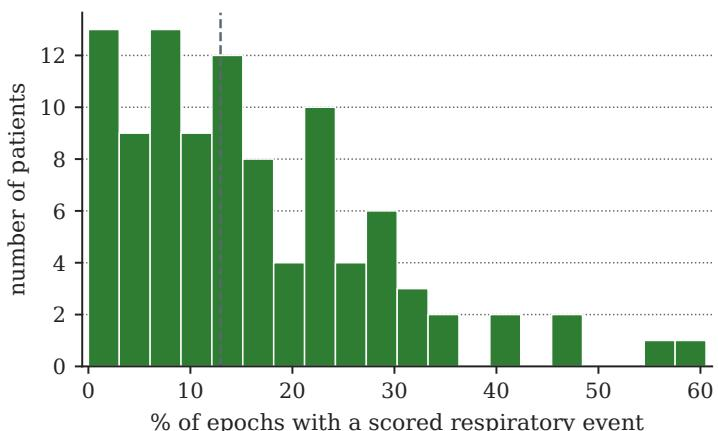  
Figure 1: Patient-level respiratory-event burden in iSLEEPS, measured as the fraction of 30-s epochs containing the onset of a scored respiratory event. The dashed line denotes the cohort median of 13%.

## 3.2. Sleep-EDF: Healthy-Sleep Reference Cohort

Sleep-EDF provides the healthy-sleep reference [45, 46]. The experiments use the Sleep Cassette subset corresponding to subjects 0–20, comprising 40 overnight recordings, with splits constructed at the subject level because individual subjects contribute more than one night. Sleep-EDF serves to check the reimplemented staging architectures in the healthy-sleep setting in which they were originally evaluated, to pretrain the transferred baseline, and to evaluate the proposed staging model on an independent healthy-sleep cohort. The database provides the EEG derivations Fpz-Cz and Pz-Oz but not the cardiorespiratory signal set or respiratory-event annotations, so respiratory performance is not evaluated on Sleep-EDF.

## 3.3. ISRUC-Sleep: Independent Sleep-Disorder Cohort

ISRUC-Sleep provides the independent evaluation in populations with and without sleep disorders [47]. Subgroup I contains 100 patients with sleep disorders recorded on one night each, subgroup II eight patients recorded on two nights each, and subgroup III ten healthy adults. The recordings include central and occipital EEG derivations corresponding to C4, C3, O2, and O1 referenced to the contralateral mastoid, two EOG derivations and chin EMG, together with oronasal airflow, nasal pressure, thoracic and abdominal efort, $\mathrm { S p O } _ { 2 } .$ , and ECG, and annotations of obstructive, central, and mixed apneas and hypopneas; the annotations of the first scorer are used. Summed efort is formed as the sum of the thoracic and abdominal traces, and pulse as the beat-to-beat heart rate derived from ECG R-peaks, so that every iSLEEPS input has an ISRUC counterpart. In 30 of the 126 ISRUC recordings the EDF header declares the EEG and EOG range as $\pm 2 5 \mu \mathrm { V } ,$ which places their N3 peak-to-peak amplitude at 9–23 $\mu \mathrm { V }$ against $9 8 { - } 2 8 3 \mu \mathrm { V }$ in the remaining recordings and below the $7 5 \mu \mathrm { V }$ that defines N3; these channels are restored by a factor of ten, a correction decided from the header alone. One subgroup-I recording stores monopolar EEG and EOG, from which the mastoid-referenced derivations are formed.

ISRUC-Sleep therefore supports evaluation of every output of the proposed framework: sleep-stage prediction, respiratory-event prediction and, in subgroup I, AHI estimation across the full severity range.

## 3.4. UCD: Independent Sleep-Apnea Cohort

The UCD database [46, 48] contains overnight PSG from 25 adults referred for suspected sleep-disordered breathing, with annotated AHI between 1.2 and 81.2 events/h. It records C3 and C4 EEG only, which also supply the occipital inputs, two EOG channels, chin EMG, ECG, oronasal airflow, thoracic, abdominal and summed efort, $\mathrm { S p O } _ { 2 }$ and pulse, and its scored apneas and hypopneas carry onset times. The EDF headers of this database carry no physical unit, so EEG, EOG and EMG are scaled per recording to the median whole-night amplitude of iSLEEPS, using no labels. UCD is used only for transfer.

## 3.5. Signal Selection and Harmonization

The iSLEEPS recordings contain 22 physiological and auxiliary traces. Fifteen signals are retained for modeling and divided into neural and cardiorespiratory groups. The neural group contains four EEG derivations (C4:M1, C3:M2, O2:M1, and O1:M2), two EOG derivations (E1:M2 and E2:M2), and the submental EMG. The cardiorespiratory group contains ECG, oronasal thermal airflow, nasal pressure, thoracic efort, abdominal efort, summed respiratory efort, $\mathrm { S p O } _ { 2 }$ , and pulse.

Signals associated with periodic limb movement, snoring, plethysmography, body position, ambient light, and device operation are not included in the model. The snore channel is additionally excluded from respiratory prediction because it is closely related to the airway information used during respiratory-event assessment. Twelve iSLEEPS recordings lack at least one selected cardiorespiratory channel. These patients are retained, and unavailable inputs are zero-filled. The same convention is used when a selected signal is unavailable in an external dataset.

## 3.6. Preprocessing and Epoch Labels

All sleep-stage predictions are defined on 30-s epochs. For iSLEEPS and ISRUC-Sleep, the respiratory annotations are mapped to the same epoch grid. An epoch is assigned a positive respiratory label if a scored respiratory event begins within it and a negative label otherwise. The primary respiratory task is therefore prediction of respiratory-event onset within a 30-s epoch, and the patient-level AHI is derived from these predictions (Section 4.8).

iSLEEPS retains only the epochs scored as a sleep stage, so every cardiorespiratory signal and every respiratoryevent label is cut at the true recording time of each retained epoch, keeping it on the same timeline as the EEG. The annotated AHI is the number of apneas and hypopneas starting in scored sleep per hour of scored sleep.

The EEG, EOG, and EMG signals are resampled to 100 Hz for the engineered descriptors of Section 4.2, and the four EEG and two EOG derivations are resampled independently to 200 Hz for the LaBraM encoder, which does not receive the EMG. The eight cardiorespiratory inputs are resampled to a common 25 Hz grid by polyphase resampling and remain in their recorded physical units; $\mathrm { { S p O } } _ { 2 } ,$ , recorded at 4 Hz, is placed on the same grid without gaining temporal resolution. Engineered features are standardized within each recording, which for iSLEEPS is the patient, and the same per-recording procedure is applied to the external datasets, from which no labels are used to refit parameters, select thresholds, or adapt the reported iSLEEPS model.

## 4. Proposed Method

## 4.1. Problem Formulation

A night is a sequence of � epochs. For epoch � we form a neural feature vector $\mathbf { f } _ { t } ^ { \mathrm { e e g } } \in \mathbb { R } ^ { 3 8 8 }$ , formed by concatenating the 188 engineered descriptors below with a 200-dimensional embedding from LaBraM, a pretrained EEG encoder [9] adapted to sleep (Section 4.3), and a raw cardiorespiratory tensor $\mathbf { x } _ { t } ^ { \mathrm { c a r } } \in \mathbb { R } ^ { 8 \times 7 5 0 }$ , the eight channels at 25 Hz. The 14 engineered cardiorespiratory descriptors defined below are used by the baseline configuration against which the learned encoder is measured.

The encoder receives its input in the format used during pretraining. LaBraM fixes its input length at 3000 samples at 200 Hz; supplying the 100 Hz signal directly would compress time by a factor of two, so that a 12 Hz spindle would appear at 24 Hz. Each 30-s epoch is therefore split into two 15-s sub-windows that are encoded separately and mean-pooled. The four EEG derivations are presented under the canonical names C4, C3, O2 and O1, the two EOG derivations as F7 and F8, the frontal positions nearest the eyes, so that the encoder receives the ocular activity that separates REM from Wake, and amplitudes are scaled to $\mu \mathrm { v } / 1 0 0$ . We learn a subject-independent map

$$
f _ { \theta } : \bigl ( \mathbf { f } _ { 1 : T } ^ { \mathrm { e e g } } , \mathbf { x } _ { 1 : T } ^ { \mathrm { c a r } } \bigr ) \longmapsto \bigl ( \hat { y } _ { 1 : T } ^ { \mathrm { s t g } } , \hat { y } _ { 1 : T } ^ { \mathrm { a p n } } \bigr ) ,\tag{1}
$$

where $\begin{array} { r } { \Delta ^ { 4 } = \{ p \in \mathbb { R } ^ { 5 } : p _ { k } \geq 0 , \sum _ { k } p _ { k } = 1 \} } \end{array}$ is the four-simplex, $\hat { y } _ { t } ^ { \mathrm { s t g } } \in \Delta ^ { 4 }$ is a distribution over the five stages and $\hat { y } _ { t } ^ { \mathrm { a p n } } \in [ 0 ,$ , 1] scores whether epoch � contains a respiratory event (Figure 2). We write $\hat { y } _ { t } ^ { \mathrm { a p n } }$ as a score and not as a probability for the reason given in Section 4.7: the positive weighting in its loss displaces the optimum away from the conditional event rate.

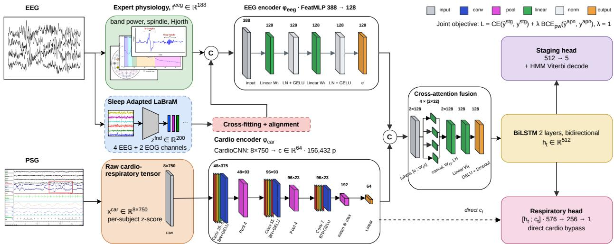  
Figure 2: The two-stream, multi-task model. The neural stream combines 188 engineered descriptors with the embedding of a LaBraM encoder adapted to sleep from EEG and EOG and integrated by cross-fitting and alignment; the cardiorespiratory stream is a convolutional encoder over eight raw channels. The streams are fused and read by a bidirectional LSTM over a 20-epoch window, which feeds a staging head and a respiratory head; the respiratory head also reads the cardiorespiratory embedding directly, and the AHI is computed from the respiratory scores over decoded sleep.

## 4.2. Physiological Feature Representations

Neural features (188) Per channel we take absolute and relative band powers from the Welch spectrum $P ( f )$ in delta (0.5–4), theta (4–8), alpha (8–13), sigma (11–16), and beta (16–30) Hz; the relative power in band � is

$$
\mathrm { R P } _ { b } = \frac { \int _ { f \in b } P ( f ) d f } { \int _ { 0 . 5 } ^ { 3 0 } P ( f ) d f } .\tag{2}
$$

The conventional alpha and sigma bands overlap between 11 and 13 Hz, so the five relative powers are treated as correlated descriptors whose sum is unconstrained. We add spectral entropy $\begin{array} { r } { H = - \sum _ { i } p _ { i } \log p _ { i } } \end{array}$ with $p _ { i }$ the normalized spectrum, the 95% spectral-edge frequency, the three Hjorth descriptors [49], and time-domain statistics. Sleep spindles are detected on the sigma-band analytic envelope, the modulus of the analytic signal built from the Hilbert transform $\mathcal { H } , e ( t ) = | x _ { \sigma } ( t ) + i \mathcal { H } \{ x _ { \sigma } \} ( t ) | = \sqrt { x _ { \sigma } ( t ) ^ { 2 } + \mathcal { H } \{ x _ { \sigma } \} ( t ) ^ { 2 } }$ , with density counted above a per-epoch threshold as a proxy for spindle density, and slow-wave descriptors summarize slow-wave amplitude. Ocular-movement energy on the EOG and tonic EMG level complete the set.

Cardiorespiratoryfeatures (14) From the seven cardiorespiratory channels other than nasal pressure, which is read only by the learned encoder, we compute $\mathrm { { S p O } } _ { 2 }$ mean, minimum, variability, and desaturation depth (median minus minimum); pulse mean and variability; ECG amplitude and line-length; airflow amplitude and line-length; thoracic, abdominal, and summed efort amplitudes; and the signed thoraco-abdominal synchrony

$$
\mathrm { s y n c } _ { t } = \mathrm { c o r r } ( x _ { t } ^ { \mathrm { t h o } } , \ x _ { t } ^ { \mathrm { a b d } } ) ,\tag{3}
$$

whose negative values mark the paradoxical motion of chest against abdomen in an obstructed breath. These descriptors are read by the classical respiratory baselines. Both feature sets are standardized per patient.

The learned cardiorespiratory encoder MM-Net does not read the 14 descriptors. Its cardiorespiratory branch is a three-layer convolutional encoder over the raw $8 \times 7 5 0$ tensor, with wide kernels and aggressive downsampling because respiratory events are slow: at 25 Hz the first kernel of 25 samples spans one second, and a hypopnea unfolds over 10 to 30 s. Channel widths are 48, 96 and 96, each followed by batch normalization and GELU, with max-pooling by four after the first two. Mean and max pooling over time are concatenated and projected by a linear layer, LayerNorm, GELU and dropout to the same 64 dimensions as the cardiorespiratory feature MLP it replaces, so the encoder is a drop-in replacement and every other part of the network is unchanged. The branch holds 156,432 trainable parameters with eight input channels (155,232 with seven), is trained end-to-end with the rest of the network, and adds no external dependency.

## 4.3. Sleep-Adapted EEG Encoder

Adaptation Within each training fold, LaBraM-Base (5.8 M parameters) is fine-tuned with a linear staging head on single epochs of the fold’s training patients, using AdamW at $3 \times 1 0 ^ { - 5 }$ for the encoder and $1 0 ^ { - 3 }$ for the head, a one-cycle schedule over three passes of the training epochs, batch size 64 and mixed precision; the state with the highest accuracy on the fold’s validation patients is kept. Test patients never reach the encoder.

Cross-fitting An encoder fine-tuned on a patient embeds that patient in-sample. If the downstream model is trained on such embeddings and tested on out-of-sample ones, the two distributions difer, and the downstream model is fitted to representations of higher quality than those available at test time. Each fold’s training patients are therefore split into $K = 3$ parts $P _ { 1 } , P _ { 2 } , P _ { 3 }$ , and an encoder $\phi _ { k }$ is fine-tuned on the training patients outside $P _ { k } ;$ every training patient in $P _ { k }$ is embedded by $\phi _ { k }$ , an encoder that never saw it. The full-fold encoder $\phi ,$ fine-tuned on all training patients, embeds the validation and test patients.

Alignment Cross-fitting makes every embedding out of sample but places the training patients in the spaces of � diferent encoders, which do not coincide with the space of $\phi$ used at test time. Each $\phi _ { k }$ is mapped into the space of $\phi$ by a ridge regression [50] fitted on the patients of $P _ { k }$ , for whom both embeddings exist,

$$
W _ { k } = \arg \operatorname* { m i n } _ { W } \left\| ( E _ { P _ { k } } ^ { \phi } - \mu _ { k } ^ { \phi } ) - ( E _ { P _ { k } } ^ { \phi _ { k } } - \mu _ { k } ^ { \phi _ { k } } ) W \right\| _ { F } ^ { 2 } + \lambda n _ { k } \| W \| _ { F } ^ { 2 } ,\tag{4}
$$

and the training embeddings become $\tilde { \mathbf { e } } _ { t } = ( \mathbf { e } _ { t } ^ { \phi _ { k } } - \mu _ { k } ^ { \phi _ { k } } ) W _ { k } + \mu _ { k } ^ { \phi } ,$ , with $\lambda = 0 . 0 1$ and $n _ { k }$ the number of epochs in $P _ { k }$ . The map uses training patients only. Every training embedding is thereby produced by an encoder that never saw its patient and expressed in the coordinates the downstream model receives at test time; Section 5.5 shows that the alignment is what allows the adapted encoder to benefit the downstream model.

## 4.4. Two-Stream Encoders

The neural stream is a two-layer perceptron with LayerNorm; the cardiorespiratory stream is the convolutional encoder described above, which emits a vector of the same width as the feature perceptron it replaced,

$$
e _ { t } = \mathrm { G E L U } \big ( \mathrm { L N } ( W _ { 2 } \mathrm { G E L U } ( \mathrm { L N } ( W _ { 1 } \mathbf { f } _ { t } ^ { \mathrm { e e g } } ) ) ) \big ) \in \mathbb { R } ^ { 1 2 8 } ,\tag{5}
$$

$$
c _ { t } = \mathrm { C a r d i o C N N } \left( \mathbf { x } _ { t } ^ { \mathrm { c a r } } \right) \in \mathbb { R } ^ { 6 4 } .\tag{6}
$$

LayerNorm is used in place of BatchNorm because the recurrent windows are short and mix patients within a batch.

## 4.5. Fusion

Two fusion operators were compared. Concatenation, used in the frozen-encoder configuration, projects the joined embeddings back to the stream width,

$$
\begin{array} { r } { z _ { t } = \mathrm { G E L U } \big ( W _ { f } \left[ e _ { t } ; c _ { t } \right] \big ) \in \mathbb { R } ^ { D } , \qquad D = 1 2 8 . } \end{array}\tag{7}
$$

Cross-attention treats the two embeddings as tokens carrying learned modality-type embeddings, refines them by fourhead scaled dot-product attention so that each modality reads the other, and projects the result to $z _ { t } \in \mathbb { R } ^ { D }$ . With uniform class weights and the sleep-adapted encoder, cross-attention was selected on validation accuracy and is the fusion of the final MM-Net (Table 6).

## 4.6. Temporal Decoder and Two Heads

Sleep is sequential and respiratory events cluster, so the fused vectors of an $L = 2 0$ epoch window (10 minutes) are read by a two-layer bidirectional LSTM. Training draws windows at a stride of $L / 2$ with masked zero-padding at the ends of each night; inference uses disjoint windows, so every epoch is scored exactly once, and hidden states are not carried between windows. Each direction runs the standard recurrence

$$
\begin{array} { r l } & { i _ { t } = \sigma ( W _ { i } [ z _ { t } , h _ { t - 1 } ] ) , } \\ & { o _ { t } = \sigma ( W _ { o } [ z _ { t } , h _ { t - 1 } ] ) , } \\ & { s _ { t } = f _ { t } \odot s _ { t - 1 } + i _ { t } \odot g _ { t } , } \end{array}
$$

$$
\begin{array} { r l } & { f _ { t } = \sigma ( W _ { f } [ z _ { t } , h _ { t - 1 } ] ) , } \\ & { g _ { t } = \operatorname { t a n h } ( W _ { g } [ z _ { t } , h _ { t - 1 } ] ) , } \\ & { h _ { t } = o _ { t } \odot \operatorname { t a n h } ( s _ { t } ) , } \end{array}\tag{8}
$$

and the forward and backward states of the 256-unit layers are concatenated into $h _ { t } \in \mathbb { R } ^ { 5 1 2 }$ . The staging head is a linear map $\hat { y } _ { t } ^ { \mathrm { s t g } } = \operatorname { s o f t m a x } ( W _ { s } h _ { t } )$ . The respiratory head reads $h _ { t }$ together with a direct copy of the per-epoch cardiorespiratory embedding $c _ { t } ^ { }$

$$
\hat { y } _ { t } ^ { \mathrm { a p n } } = \sigma \big ( W _ { 2 } \mathrm { G E L U } ( W _ { 1 } [ h _ { t } ; c _ { t } ] ) \big ) .\tag{9}
$$

MM-Net holds 2.85 million trainable parameters. The sleep-adapted encoder that supplies the 200-dimensional neural embedding (5.8 million parameters) is fine-tuned in a separate stage per fold (Section 4.3) and run once to cache the embeddings, so it is not part of this count.

## 4.7. Training and Decoding

The two tasks are trained together with equal weight, $\mathcal { L } = \mathcal { L } ^ { \mathrm { s t g } } + \lambda \mathcal { L } ^ { \mathrm { a p n } }$ with $\lambda = 1$ , combining a staging crossentropy with class weights $w _ { k }$ and a positive-weighted respiratory cross-entropy,

$$
\begin{array} { r l } & { \mathcal { L } ^ { \mathrm { s t g } } = - \displaystyle \sum _ { t } \sum _ { k } w _ { k } y _ { t , k } ^ { \mathrm { s t g } } \log \hat { y } _ { t , k } ^ { \mathrm { s t g } } , } \\ & { \mathcal { L } ^ { \mathrm { a p n } } = - \displaystyle \sum _ { t } \left[ \pi a _ { t } \log \hat { y } _ { t } ^ { \mathrm { a p n } } + ( 1 - a _ { t } ) \log ( 1 - \hat { y } _ { t } ^ { \mathrm { a p n } } ) \right] . } \end{array}\tag{10}
$$

(11)

The final MM-Net uses uniform staging weights $( w _ { k } = 1 )$ , selected on validation patients together with the encoder (Table 6); the frozen-encoder configuration uses the square root of inverse class frequency, $w _ { k } \propto \sqrt { N / ( K n _ { k } ) }$ for $K = 5$ classes with $n _ { k }$ examples, which corrects the scarce N1 and N3 stages. In both, the respiratory term is positive-weighted by $\pi = n _ { - } / n _ { + }$ to match the 16% event rate, which on this corpus is $\pi \approx 5 . 3$

Against a true conditional rate $p ,$ the weighted binary term attains its minimum at $q ^ { \star } = \pi p / [ \pi p + ( 1 - p ) ] > p ,$ so the respiratory output is treated as a score; the displacement is monotone, so AUC and average precision are unafected. At inference the staging posteriors are smoothed by a Viterbi pass whose transition matrix $\bar { A } ^ { \mathrm { H } }$ and prior are counted from the training labels [51],

$$
\delta _ { t } ( j ) = \operatorname* { m a x } _ { i } \left[ \delta _ { t - 1 } ( i ) + \log A _ { i j } ^ { \mathrm { H } } \right] + \log \hat { y } _ { t } ^ { \mathrm { s t g } } ( j ) ,\tag{12}
$$

recovered by back-tracking, which restores the natural persistence of sleep. Because the network score, and not a generative likelihood log $P ( \mathbf { x } _ { t } \mid s _ { t } = j )$ , occupies the emission slot, the pass is a transition-regularized discriminative decoder that acts as a transition prior on the output sequence; the respiratory head is left unsmoothed. Optimization uses AdamW with cosine annealing and early stopping on a held-out set of patients.

## 4.8. AHI Estimation

Because $\hat { y } _ { t } ^ { \mathrm { a p n } }$ scores event onsets, its sum over the epochs decoded as sleep estimates the number of events, and dividing by the decoded sleep time gives a rate,

$$
\widehat { \mathrm { A H I } } = k \cdot \frac { \sum _ { t : \hat { s } _ { t } \neq \mathrm { W } } \hat { y } _ { t } ^ { \mathrm { a p n } } } { \frac { 3 0 } { 3 6 0 0 } \left| \{ t : \hat { s } _ { t } \neq \mathrm { W } \} \right| } .\tag{13}
$$

The positive weighting of the respiratory loss inflates the scores (Section 4.7), so a single scale � is fitted in each fold as the median ratio of annotated to raw estimate over the fold’s validation patients and applied unchanged to its test patients. For transfer to another cohort, � is the median of the ten iSLEEPS fold values (0.459), and nothing is refitted on the external cohort. Severity follows the AASM bands (< 5, 5–15, 15–30 and ≥ 30 events/h).

## 5. Experiments

## 5.1. Protocol and Metrics

All results use ten-fold, patient-independent cross-validation: no patient appears in both training and test, and within each training split a disjoint set of patients is held out for early stopping and model selection. Staging is scored by accuracy, macro-F1 $\begin{array} { r } { { \frac { 1 } { K } } \sum _ { k } \mathrm { F } 1 _ { k } } \end{array}$ , and Cohen’s �. The respiratory task is scored by the area under the ROC curve (AUC) and average precision (AP), which suits the 16% event rate, and the AHI estimate by Spearman’s $\rho ,$ the mean absolute error (MAE), severity-band accuracy and linearly weighted �.

MM-Net and its encoder configurations are trained with three seeds (42, 1, 7) on the same folds. The single-model figure is the mean over the thirty fold-values, ten folds by three seeds; the three-seed figure averages the softmax outputs of the three seeds before decoding. Every number is a mean over the ten folds with its standard deviation across folds. Paired comparisons use the two-sided Wilcoxon signed-rank test on the ten fold means, because the three seeds within a fold train and test on the same patients; with ten folds the smallest attainable $p$ is 0.002, and Holm correction is applied within each family of comparisons.

The frozen-encoder configuration, the initial configuration of the same architecture, serves as the reference for the encoder analyses. It shares the streams, decoder and heads of MM-Net but reads a frozen LaBraM embedding of the EEG, seven cardiorespiratory channels, concatenation fusion and square-root class weights. Its stream, decoder and regularization settings, which MM-Net inherits, were chosen among forty-nine candidates; repeating that selection inside a nested procedure, with five outer patient-independent folds whose test patients take no part in the choice, gives $0 . 7 3 4 \pm 0 . 0 0 9$ accuracy against 0.739, a selection optimism of 0.006, about a third of the fold-to-fold standard deviation. The encoder, fusion operator and class weighting of the final MM-Net were selected on validation patients only.

## 5.2. Implementation and Hyperparameters

The model is implemented in PyTorch and trained on NVIDIA RTX 2060 (6 GB) and RTX 3060 Ti (8 GB) GPUs. Table 3 lists the training configuration, which is identical across folds and cohorts. The reimplemented baselines are trained with the optimizer, batch size and schedule of their own papers, because imposing our settings could disadvantage architectures tuned for other settings.

## 5.3. Compared Methods

We compare the model against deep networks evaluated on the same folds: convolutional and recurrent networks trained from scratch (DeepSleepNet, AttnSleep, a four-channel CNN), six further published architectures we reimplemented for this comparison (U-Time, a fully convolutional encoder–decoder; TinySleepNet, a compact convolutional– recurrent model; SleepTransformer, a purely attentional one; and 1D-ResNet-SE-LSTM, Micro SleepNet and AT-BiLSTM), the released SE-ResNet-18 implementation from [24], a StagingSeqNet pretrained on Sleep-EDF and finetuned on iSLEEPS, and a raw-signal convolutional network on all 14 channels, alongside the published single-channel baselines for the corpus [23]. For the respiratory task, a desaturation rule, logistic regression and gradient boosting read the 14 engineered cardiorespiratory descriptors, and two raw-signal detectors read the waveforms (Section 5.6). On ISRUC-I, the reimplemented staging baselines are retrained on MM-Net’s folds (Section 5.10). All numbers are patient-independent. All use ten folds except the Sleep-EDF-pretrained StagingSeqNet, which uses five; hidden-Markov decoding is applied where the corresponding model provides it.

Table 3  
Training configuration of the final MM-Net, shared across all folds and cohorts. The frozen-encoder configuration uses the same settings with a frozen encoder, concatenation and square-root class weights. Each reimplemented baseline is trained at its own published settings.
<table><tr><td>Setting</td><td>Value</td></tr><tr><td>Framework / hardware Sleep-adapted encoder (per fold)</td><td>PyTorch, NVIDIA RTX 2060 / 3060 Ti</td></tr><tr><td>Encoder</td><td>LaBraM-Base, 4 EEG + 2 EOG</td></tr><tr><td>Encoder LR (head)</td><td> $3 \times 1 0 ^ { - 5 } ~ \left( 1 0 ^ { - 3 } \right)$  , one-cycle</td></tr><tr><td>Passes, batch, weight decay</td><td>3,  $6 4 , \ 0 . 0 5$ </td></tr><tr><td>Cross-fitting, alignment</td><td>K = 3, ridge λ = 0.01</td></tr><tr><td>MM-Net</td><td></td></tr><tr><td>Optimizer</td><td>AdamW</td></tr><tr><td>Learning rate</td><td> $3 \times 1 0 ^ { - 4 }$ </td></tr><tr><td>Weight decay</td><td> $1 \times 1 0 ^ { - 4 }$ </td></tr><tr><td>LR schedule</td><td>cosine annealing</td></tr><tr><td>Sequence length L</td><td>20 epochs (10 min)</td></tr><tr><td>Batch size</td><td>32</td></tr><tr><td>Max epochs / patience</td><td>45 / 8</td></tr><tr><td>Gradient clipping</td><td>5.0</td></tr><tr><td>Fusion</td><td>cross-attention, 4 heads</td></tr><tr><td>Staging class weights</td><td>uniform</td></tr><tr><td>Respiratory pos. weight</td><td> $\pi = n _ { - } / n _ { + }$ </td></tr><tr><td>Loss balance λ</td><td>1.0</td></tr><tr><td>Staging post-processing</td><td>HMM Viterbi smoothing</td></tr><tr><td>Cross-validation</td><td>10-fold, patient-independent</td></tr><tr><td>Random seeds</td><td>42, 1, 7</td></tr></table>

## 5.4. Staging Benchmark

Table 4 compares MM-Net with deep staging architectures retrained on the same folds. These reach 0.60–0.72 staging accuracy, whereas MM-Net reaches 0.756 as a single model and 0.763 as a three-seed average, with macro-F1 0.664 and � 0.656. As a single model, MM-Net is higher in accuracy by +0.036 (corpus LSTM) to +0.157 (Huttunen et al.) and is higher in nine or ten of the ten folds for every comparison; all thirteen diferences remain significant after Holm correction (Holm $p \leq 0 . 0 2 5 )$ . The three-seed MM-Net is ahead of each of the eight reimplemented and ported architectures in all ten folds (Holm $p = 0 . 0 1 6$ , the minimum attainable for eight comparisons). Diferences in macro-F1 and � are larger than those in accuracy, consistent with their reduced dependence on the majority classes. The sleepadapted encoder used on its own stages single epochs at 0.732, already above every retrained architecture; within MM-Net, together with the engineered descriptors, the cardiorespiratory stream and the temporal decoder, it yields 0.756, a further 0.024 in eight folds of ten $( p = 0 . 0 1 4 )$

The closest task-matched baseline is the joint model of Huttunen et al. [15], ported from the authors’ released implementation and evaluated on the same folds. It stages at 0.599, and MM-Net is ahead in all ten folds (Wilcoxon $p = 0 . 0 0 2 )$ . On ISRUC-I, where both models are trained and evaluated on the same respiratory labels, MM-Net is also ahead on respiratory detection (Section 5.10).

SleepStageNet [25] is quoted under its own protocol, 95 iSLEEPS recordings with five channels and ten subjectindependent folds. The CNN-ResNet18 result of [24] is quoted under that study’s � = 100 protocol, which includes the duplicate recording excluded here; the same study’s SE-ResNet-18 + BiLSTM, retrained from the released implementation on our folds, reaches 0.696 against the published 0.747, and Table 4 uses the same-fold rerun. The corpus LSTM appears as our reimplementation on the same folds. The Healthy column gives each model’s subjectindependent accuracy on Sleep-EDF, where MM-Net reaches 0.864 (macro-F1 0.791, � 0.810), the highest healthysleep accuracy in the table; Sleep-EDF carries none of the cardiorespiratory channels the model reads, so this figure exercises the neural stream alone. Dispersion is reported wherever it is defined: across five folds for the Sleep-EDFpretrained StagingSeqNet, across the ten fold values of a single seed for the retrained and reimplemented architectures, and across the thirty fold values, ten folds by three seeds, for AttnSleep and MM-Net.

Patient-independent sleep-staging comparison on iSLEEPS. Values are mean ± SD where fold-level results are available. † denotes reimplemented models, ‡ a literature-reported result under its original protocol, and ∗ models ported from released code. Bold indicates the best result among models evaluated under our protocol.
<table><tr><td></td><td></td><td></td><td>Healthy</td><td colspan="3">iSLEEPS (stroke)</td></tr><tr><td>Model</td><td>Input</td><td>Params ↓</td><td>Acc</td><td>Acc↑</td><td> $_ { \mathsf { M a c r o - F 1 } \uparrow }$ </td><td>κ↑</td></tr><tr><td colspan="7">Comparative models evaluated on iSLEEPS</td></tr><tr><td>LSTM, our reimplementation†</td><td> $1 \mathsf { E E G } + \mathsf { E O G }$ </td><td>1.16 M</td><td> $0 . 8 2 0 \pm 0 . 0 6 2$ </td><td> $0 . 7 2 0 \pm 0 . 0 3 2$ </td><td> $0 . 6 2 6 \pm 0 . 0 2 8$ </td><td> $0 . 5 9 9 \pm 0 . 0 4 3$ </td></tr><tr><td>CNN-ResNet18 [24]‡</td><td>1EEG</td><td>~11M</td><td></td><td>0.617</td><td>0.544</td><td>0.480</td></tr><tr><td>SleepStageNet [25]‡</td><td> $2 E E G + 2 E O G + E M G$ </td><td>1.08 M</td><td></td><td> $0 . 7 3 9 \pm 0 . 0 2 2$ </td><td> $0 . 6 7 3 \pm 0 . 0 2 0$ </td><td> $0 . 6 3 4 \pm 0 . 0 2 9$ </td></tr><tr><td>SE-ResNet-18 + BiLSTM [24]*</td><td>1EEG</td><td>11.32 M</td><td> $0 . 8 2 9 \pm 0 . 0 5 6$ </td><td> $0 . 6 9 6 \pm 0 . 0 3 8$ </td><td> $0 . 6 0 6 \pm 0 . 0 3 2$ </td><td> $0 . 5 7 2 \pm 0 . 0 4 6$ </td></tr><tr><td>DeepSleepNet [5]</td><td>4 EEG</td><td>3.72 M</td><td> $0 . 8 2 3 \pm 0 . 0 5 0$ </td><td> $0 . 6 6 9 \pm 0 . 0 3 1$ </td><td> $0 . 6 2 4 \pm 0 . 0 2 6$ </td><td> $0 . 5 5 8 \pm 0 . 0 3 5$ </td></tr><tr><td>U-Time [27]†</td><td>1EEG</td><td>1.07 M</td><td> $0 . 7 9 1 \pm 0 . 0 6 2$ </td><td> $0 . 6 4 6 \pm 0 . 0 6 4$ </td><td> $0 . 5 2 4 \pm 0 . 0 5 7$ </td><td> $0 . 5 0 6 \pm 0 . 0 8 2$ </td></tr><tr><td>AttnSleep [7]</td><td>1EEG</td><td>~0.5M</td><td> $0 . 8 3 3 \pm 0 . 0 4 2$ </td><td> $0 . 7 1 6 \pm 0 . 0 4 2$ </td><td> $0 . 6 0 0 \pm 0 . 0 4 3$ </td><td> $0 . 5 9 3 \pm 0 . 0 5 8$ </td></tr><tr><td>TinySleepNet [8]†</td><td>1EEG</td><td>1.45 M</td><td> $0 . 8 2 4 \pm 0 . 0 4 5$ </td><td> $0 . 6 7 6 \pm 0 . 0 5 0$ </td><td> $0 . 5 8 7 \pm 0 . 0 3 4$ </td><td> $0 . 5 4 8 \pm 0 . 0 6 2$ </td></tr><tr><td>SleepTransformer [29]†</td><td>1EEG</td><td>2.79 M</td><td> $0 . 8 2 3 \pm 0 . 0 3 3$ </td><td> $0 . 6 8 3 \pm 0 . 0 2 6$ </td><td> $0 . 6 0 2 \pm 0 . 0 3 0$ </td><td> $0 . 5 5 5 \pm 0 . 0 3 2$ </td></tr><tr><td>1D-ResNet-SE-LSTM [52]†</td><td>1 EEG</td><td>0.65 M</td><td> $0 . 8 3 2 \pm 0 . 0 3 6$ </td><td> $0 . 7 0 8 \pm 0 . 0 3 8$ </td><td> $0 . 6 3 1 \pm 0 . 0 3 3$ </td><td> $0 . 5 9 2 \pm 0 . 0 5 0$ </td></tr><tr><td>Micro SleepNet [53]</td><td>1 EEG</td><td>0.03 M</td><td> $0 . 8 0 0 \pm 0 . 0 4 1$ </td><td> $0 . 6 4 7 \pm 0 . 0 4 9$ </td><td> $0 . 5 5 8 \pm 0 . 0 2 8$ </td><td> $0 . 5 1 0 \pm 0 . 0 5 5$ </td></tr><tr><td>AT-BiLSTM [54]†</td><td>1EEG</td><td>0.92 M</td><td> $0 . 8 3 5 \pm 0 . 0 4 6$ </td><td> $0 . 6 9 2 \pm 0 . 0 4 0$ </td><td> $0 . 6 1 2 \pm 0 . 0 3 0$ </td><td> $0 . 5 7 0 \pm 0 . 0 5 1$ </td></tr><tr><td>CNN</td><td>4EEG</td><td>0.42 M</td><td> $0 . 8 0 6 \pm 0 . 0 4 1$ </td><td> $0 . 6 7 0 \pm 0 . 0 5 2$ </td><td> $0 . 6 1 8 \pm 0 . 0 4 4$ </td><td> $0 . 5 5 3 \pm 0 . 0 6 2$ </td></tr><tr><td>StagingSeqNet, Sleep-EDF pretrained</td><td> $2 E E G + E O G + E M G$ </td><td>1.08M</td><td></td><td> $0 . 6 2 3 \pm 0 . 0 2 0$ </td><td>0.582</td><td>0.488</td></tr><tr><td>Raw multimodal CNN Huttunen et al. [15]*</td><td>14 ch 4ch</td><td>0.95 M 3.80 M</td><td></td><td> $0 . 6 7 7 \pm 0 . 0 3 5$   $0 . 5 9 9 \pm 0 . 0 6 0$ </td><td> $0 . 6 3 3 \pm 0 . 0 2 5$   $0 . 4 9 5 \pm 0 . 0 6 7$ </td><td> $0 . 5 6 3 \pm 0 . 0 4 1$   $0 . 4 4 0 \pm 0 . 0 7 8$ </td></tr><tr><td colspan="7"></td></tr><tr><td>Sleep-adapted encoder alone (one epoch, no temporal model) LaBraM, frozen + logistic regression</td><td></td><td>5.8M</td><td></td><td>0.647</td><td></td><td></td></tr><tr><td>LaBraM, sleep-adapted</td><td>4 EEG  $4 \mathsf E \mathsf E \mathsf G + 2 \mathsf E \mathsf { O } \mathsf G$ </td><td>5.8M</td><td></td><td>0.732</td><td></td><td></td></tr><tr><td colspan="7"></td></tr><tr><td>Proposed multi-task model MM-Net, single model</td><td> $7 \mathsf { n e u r a l } + 8 \mathsf { c a r d i o }$ </td><td>2.85 M</td><td> $0 . 8 6 4 \pm 0 . 0 3 0$ </td><td> $0 . 7 5 6 \pm 0 . 0 1 3$ </td><td> $0 . 6 6 1 \pm 0 . 0 1 9$ </td><td></td></tr><tr><td>MM-Net, three-seed</td><td> $7 \mathsf { n e u r a l } + 8 \mathsf { c a r d i o }$ </td><td>2.85 M</td><td> $\mathbf { 0 . 8 6 4 \pm 0 . 0 3 0 }$ </td><td> $\mathbf { 0 . 7 6 3 \pm 0 . 0 1 4 }$ </td><td> $\mathbf { 0 . 6 6 4 \pm 0 . 0 2 0 }$ </td><td> $0 . 6 4 7 \pm 0 . 0 1 5$   $\mathbf { 0 . 6 5 6 \pm 0 . 0 1 6 }$ </td></tr></table>

Errors concentrate on N1 (Table 5, Figure 4). MM-Net recovers Wake, N2 and REM at F1 0.79–0.82 and N3 at 0.72, whereas N1, the transient stage between wake and sleep, reaches 0.20 and is absorbed mainly into Wake and N2; part of N3 is read as N2. N1 is the most dificult stage on this cohort for every evaluated model. A representative held-out night is shown in Figure 3.

A  
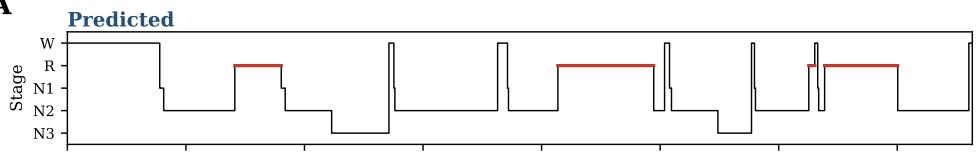

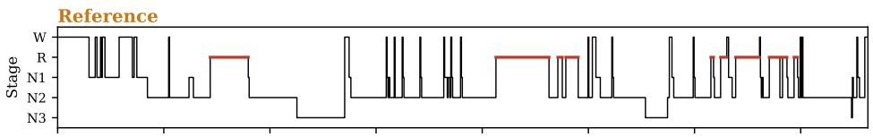

B  
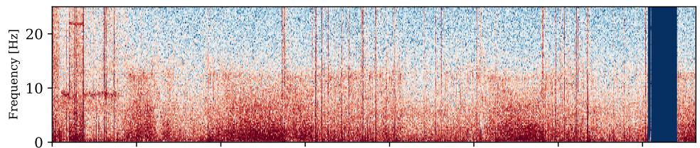

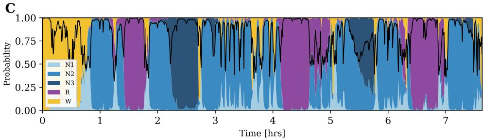  
Figure 3: An illustrative held-out night (patient SN90, three-seed MM-Net, staging accuracy 0.83). (A) Predicted and reference hypnograms, REM highlighted. (B) EEG spectrogram, C4 derivation, 0–25 Hz. (C) Per-epoch stage-probability ribbon; the black line is the maximum posterior.

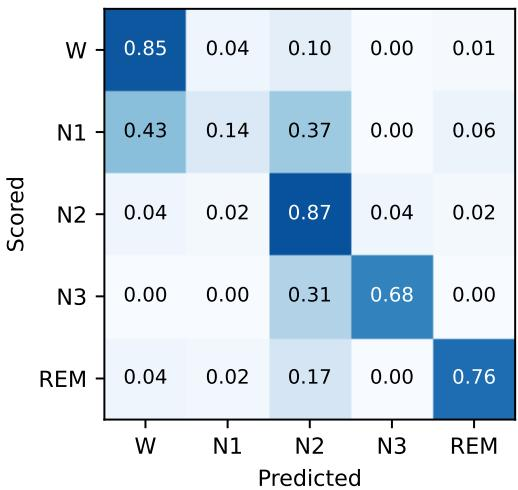  
Figure 4: Row-normalized confusion matrix for MM-Net (three-seed, pooled ten-fold test epochs, hidden-Markov operating point). Errors concentrate on N1, which is absorbed into Wake and N2.

Table 5  
Per-class staging F1 (Wake, N1, N2, N3, REM), ten-fold patient-independent, at the hidden-Markov operating point (MM-Net: three-seed, pooled test epochs).
<table><tr><td>Model</td><td>W↑</td><td>N1↑</td><td>N2↑</td><td>N3↑</td><td>R↑</td></tr><tr><td>MM-Net</td><td>0.81</td><td>0.20</td><td>0.82</td><td>0.72</td><td>0.79</td></tr></table>

From the frozen-encoder configuration to MM-Net on iSLEEPS, one change per row (upper block), and the complete model (lower block); same ten folds and three seeds throughout. �: Wilcoxon on fold means against the row marked ref.
<table><tr><td>Configuration</td><td>Single 3-seed</td><td></td><td>p</td></tr><tr><td>Frozen encoder, class weights, concatenation</td><td>0.738</td><td>0.749</td><td></td></tr><tr><td>+ uniform class weights</td><td>0.744</td><td>0.754</td><td></td></tr><tr><td>+ cross-attention fusion</td><td>0.747</td><td>0.755</td><td>ref.</td></tr><tr><td>+ sleep-adapted encoder, cross-fitted, not aligned</td><td>0.752</td><td>0.757</td><td>0.63</td></tr><tr><td>+ ridge alignment (7 channels)</td><td>0.762</td><td>0.769</td><td>0.020</td></tr><tr><td>MM-Net: EEG+EOG encoder, 8 channels, epoch-aligned</td><td>0.756</td><td>0.763</td><td></td></tr></table>

## 5.5. Integrating the Sleep-Adapted Encoder

Table 6 builds MM-Net from the frozen-encoder configuration one change at a time, every row on the same folds and seeds. Uniform class weights and cross-attention fusion contribute +0.009 together for the single model. The largest change comes from the encoder. Adapting LaBraM to sleep raises its own single-epoch accuracy from 0.647 to 0.709, in all ten folds, yet a sleep-adapted encoder whose training embeddings are cross-fitted but not aligned moves the three-seed accuracy of the downstream model by only $+ 0 . 0 0 2 \ ( p \ = \ 0 . 6 3 )$ and falls below the frozen encoder in five folds of ten, by up to 0.023. Aligning the embedding spaces turns the same encoder into a gain of +0.014 $( 0 . 7 5 5 \to 0 . 7 6 9 , p = 0 . 0 2 0 )$ , and of +0.015 for the single model in nine folds of ten $( p = 0 . 0 2 7 )$ . Figure 5 shows the efect fold by fold: without alignment the adapted encoder moves accuracy in either direction, whereas with alignment it raises accuracy in eight folds of ten, by up to 3.7 percentage points. The downstream benefit of adaptation therefore appears once the training embeddings share the coordinates of the encoder used at test time.

The complete MM-Net adds three elements that serve REM and the respiratory head more than overall staging: the ocular channels in the encoder, which raise the encoder’s own accuracy from 0.709 to 0.732, nasal pressure, and the epoch alignment of Section 3. With all three, staging is 0.763, and MM-Net uses the EEG and EOG encoder in every cohort of this study. The same integration carries over to an independent cohort: on ISRUC-I the complete model is ahead of the frozen-encoder configuration in nine folds of ten (+0.018, � = 0.004; Section 5.10). Figure 6 shows what adaptation changes in the representation: held-out epochs that the frozen encoder spreads across one mixed cloud form stage-specific clusters after adaptation, with Wake, REM and N3 separated (silhouette by stage −0.045 → 0.047).

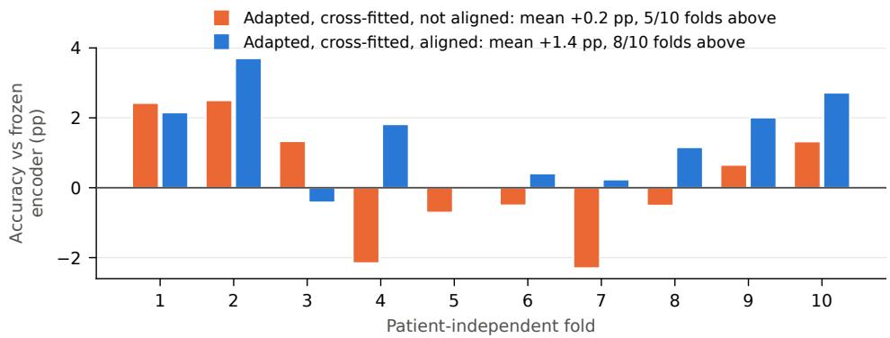  
Figure 5: Per-fold staging accuracy of MM-Net with the sleep-adapted encoder, relative to the frozen-encoder reference (three-seed, ten patient-independent folds). The training embeddings are cross-fitted in both cases; aligning them to the deployed encoder turns an inconsistent efect into a gain in eight folds of ten.

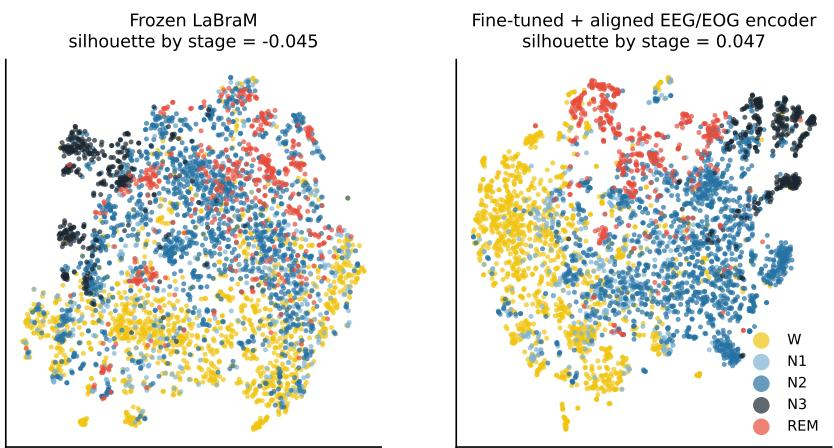  
Fold-0 held-out patients (10), 4000 random epochs, colour = scored stage  
Figure 6: t-SNE [55] of 4000 epochs from the ten held-out patients of one fold, colored by scored stage. Left: frozen LaBraM. Right: the sleep-adapted, aligned EEG/EOG encoder used in MM-Net.

## 5.6. Respiratory-Event Detection

Table 7 compares the respiratory output with established detectors on the same folds and epoch labels. A clinical desaturation rule reaches 0.595 AUC, and logistic regression and gradient boosting on the 14 engineered cardiorespiratory descriptors reach 0.603 and 0.673; a random classifier scores 0.160 AP, the event prevalence. Two raw-signal detectors, each a per-epoch convolutional encoder over the 25 Hz waveform followed by a bidirectional LSTM across 20-epoch windows and trained with the same labels, folds, early-stopping rule and positive-class weighting, read summed respiratory efort alone, matching the input of Nassi et al. [43] (0.602 AUC), or all seven raw cardiorespiratory channels (0.733; one seed each). MM-Net reaches 0.825 AUC and 0.487 AP, 0.152 AUC and 0.197 AP above gradient boosting. Detection is strongest on the most severe events: 0.810 AUC on hypopneas, which form 82% of event epochs, 0.898 on obstructive and 0.946 on central apneas. Read at fixed sensitivity on the pooled held-out predictions (Figure 7), MM-Net holds 0.70 specificity at 0.80 sensitivity and 0.53 at 0.90.

Table 7  
Respiratory-event detection on iSLEEPS. (A) Comparison with classical and raw-signal baselines on the same folds (§single seed) and (B) MM-Net AUC by respiratory-event type. Bold denotes the best value in each comparison.
<table><tr><td colspan="3">(a) Detection method</td></tr><tr><td>Method</td><td>AUC↑</td><td>AP↑</td></tr><tr><td>Desaturation rule</td><td>0.595</td><td>0.207</td></tr><tr><td>Logistic regression</td><td>0.603</td><td>0.211</td></tr><tr><td>Gradient boosting</td><td>0.673</td><td>0.290</td></tr><tr><td>Raw effort belt®[43]</td><td>0.602</td><td>0.252</td></tr><tr><td>Raw seven channels</td><td>0.733</td><td>0.366</td></tr><tr><td>MM-Net, single model</td><td>0.815</td><td>0.471</td></tr><tr><td>MM-Net, three-seed</td><td>0.825</td><td>0.487</td></tr></table>

<table><tr><td colspan="3">(b) MM-Net AUC by event type</td></tr><tr><td>Event type</td><td>Positive epochs</td><td>AUC↑</td></tr><tr><td>Hypopnea</td><td>11,921</td><td>0.810</td></tr><tr><td>Obstructive</td><td>1,722</td><td>0.898</td></tr><tr><td>Central</td><td>832</td><td>0.946</td></tr></table>

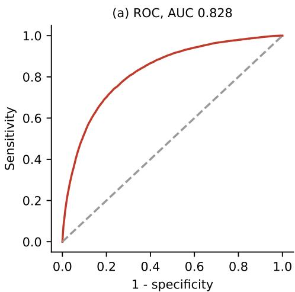

(b) Precision-recall, AP 0.498  
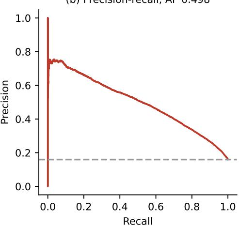  
Figure 7: Respiratory-event detection by MM-Net (three-seed), pooled over the ten patient-independent test folds. (a) ROC curve. (b) Precision–recall; the dashed line is the 0.160 event prevalence, the no-skill floor.

## 5.7. Joint Training and Stream Contributions

The joint objective is compared with matched single-task models that share the architecture, folds, seeds, optimizer, training budget and decoding of the joint model and difer only in the surviving term of $\mathcal { L } = \mathcal { L } ^ { \mathrm { s t g } } + \lambda \mathcal { L } ^ { \mathrm { a p n } }$ (Table 8). Joint training improves staging where disordered breathing disrupts sleep. In epochs containing a respiratory-event onset, MM-Net stages at 0.721 against 0.705 for the staging-only model, in nine folds of ten $( p = 0 . 0 1 4 )$ , and the gain persists within two epochs of an event (0.710 against 0.701, $p = 0 . 0 2 0 \}$ . In patients with severe sleep apnea $\left( { \mathrm { A H I } } \geq 3 0 , \right.$ $n = 3 8 )$ , accuracy rises from 0.758 to 0.768 $( p = 0 . 0 2 0 )$ , and the stages that respiratory events fragment improve: N3 F1 from 0.695 to 0.707 $( p = 0 . 0 4 9 )$ and N2 F1 from 0.811 to 0.816 $( p = 0 . 0 3 7 )$ . Across the cohort, per-patient accuracy rises from 0.756 to 0.762 (60 of 99 patients, $p = 0 . 0 1 3 )$ . Joint training also improves respiratory-event detection: in the frozen-encoder configuration, respiratory AUC rises from 0.784 to 0.796 in nine folds of ten $( p = 0 . 0 0 6 )$ , and in MM-Net the respiratory AUC and AP are 0.815 and 0.471 against 0.814 and 0.466 for the respiratory-only model. Summing the joint model’s respiratory scores over its own decoded sleep gives an AHI estimate closer to the annotated index than combining the two single-task models (Spearman � 0.765 against 0.734; mean absolute error 10.4 against 11.1 events/h).

Joint multi-task training against matched single-task models with the same architecture, folds, seeds, training budget and decoding. MM-Net staging: three-seed ensemble; respiratory AUC and AP: mean over seeds. $p \mathrm { : }$ Wilcoxon on the ten fold means, or on patients for the severe-apnea group and the per-patient accuracy. The single-task AHI combines the stages of the staging-only model with the scores of the respiratory-only model.
<table><tr><td></td><td>Measure</td><td>Single-task</td><td>Joint</td><td> $p$ </td></tr><tr><td rowspan="6">Staging</td><td>Accuracy, epochs with an event onset</td><td>0.705</td><td>0.721</td><td>0.014</td></tr><tr><td>Accuracy, within two epochs of an event</td><td>0.701</td><td>0.710</td><td>0.020</td></tr><tr><td>Accuracy, severe sleep apnea  $\left( \mathsf { A H I } \geq 3 0 \right)$ </td><td>0.758</td><td>0.768</td><td>0.020</td></tr><tr><td>N3 F1</td><td>0.695</td><td>0.707</td><td>0.049</td></tr><tr><td>N2 F1</td><td>0.811</td><td>0.816</td><td>0.037</td></tr><tr><td>Accuracy, per patient</td><td>0.756</td><td>0.762</td><td>0.013</td></tr><tr><td rowspan="3">Respiratory</td><td>AUC, frozen-encoder configuration</td><td>0.784</td><td>0.796</td><td>0.006</td></tr><tr><td>AUC</td><td>0.814</td><td>0.815</td><td></td></tr><tr><td>AP</td><td>0.466</td><td>0.471</td><td></td></tr><tr><td rowspan="2">AHI</td><td>Spearman ρ</td><td>0.734</td><td>0.765</td><td></td></tr><tr><td>Mean absolute error (events/h)</td><td>11.1</td><td>10.4</td><td></td></tr></table>

Modality removal and retraining (frozen-encoder configuration; ten folds, three seeds). Each row removes one modality and reports the change in the output that modality serves, relative to the full configuration (staging accuracy 0.736, respiratory AUC 0.796). Holm $p \mathrm { : }$ Wilcoxon on the ten fold means, Holm-corrected across the nine ablations of the grid.
<table><tr><td>Modality removed</td><td>Output</td><td>Change</td><td>Holm  $p$ </td></tr><tr><td>EEG (neural)</td><td>Staging accuracy</td><td>-0.050</td><td>0.018</td></tr><tr><td>All cardiorespiratory</td><td>Respiratory AUC</td><td>-0.118</td><td>0.018</td></tr><tr><td>Respiratory effort</td><td>Respiratory AUC</td><td>-0.028</td><td>0.031</td></tr><tr><td>Airflow</td><td>Respiratory AUC</td><td>-0.004</td><td>0.65</td></tr></table>

Signal interventions in the frozen-encoder configuration show that each stream carries the output its physiology is closest to (Table 9). Removing the EEG and retraining lowers staging accuracy by 0.050, and removing the whole cardiorespiratory stream lowers respiratory AUC by 0.118, the largest efects of the modality-ablation grid. Within the cardiorespiratory stream, respiratory efort is the channel the detector relies on most (−0.028 AUC without it), consistent with the paradoxical thoraco-abdominal motion that marks an obstructive event as it happens. Removing airflow, the signal from which events are scored, leaves detection essentially unchanged (−0.004), so the respiratory output is supported by the physiological correlates of disordered breathing and not by the scoring channel alone.

## 5.8. AHI Estimation

Summed over decoded sleep, the respiratory scores estimate the AHI (Section 4.8) with Spearman $\rho = 0 . 7 6 5$ against the annotated index over the 99 test patients, a mean absolute error of 10.4 events/h, and 54% of patients in the correct AASM severity band (weighted � 0.45; Table 10, Figure 8). The clinical AHI recorded with the corpus agrees with the annotated index at $\rho = 0 . 6 8 7$ , and against that clinical index MM-Net reaches $\rho = 0 . 6 3 3$ . In the expectedcount formulation, summing the onset scores over decoded sleep counts closely spaced events separately, whereas thresholding the scores into runs would merge them, and normalizing by decoded sleep time matches the denominator of the clinical index. Staging remains stable across sleep-disordered-breathing severity: accuracy is 0.784 in patients with a normal clinical AHI and 0.754, 0.764 and 0.758 in the mild, moderate and severe groups, with no significant ordered trend (Jonckheere–Terpstra $p = 0 . 2 0 $ ; Table 11), so the model stages the most severely afected patients nearly as well as those without sleep-disordered breathing.

Table 10  
AHI estimation on iSLEEPS (99 test patients, stages decoded by MM-Net). Severity: AASM bands; $\kappa _ { w }$ linearly weighted. Last column: Spearman � against the clinical AHI recorded with the corpus. The last row gives the agreement of the clinical AHI with the annotated AHI.
<table><tr><td>Estimator</td><td> $\rho \uparrow$   ${ \mathsf { M A E } } \downarrow$ </td><td> ${ \mathsf { S e v . } }$ </td><td>acc↑  $\kappa _ { w } \uparrow$ </td></tr><tr><td>MM-Net</td><td>0.765</td><td>10.4 0.54</td><td>0.45 0.633</td></tr><tr><td>Clinical vs. annotated AHI</td><td>0.687</td><td></td><td></td></tr></table>

Table 11

Sleep-staging accuracy of MM-Net across AASM severity groups of the clinical AHI in iSLEEPS. Values are $\mathsf { m e a n } \pm \mathsf { S D }$ across patients; the ordered-group trend is not significant (Jonckheere–Terpstra $p = 0 . 2 0 )$
<table><tr><td>AHI band</td><td>AHI  $( { \mathsf { e v e n t s } } / { \mathsf { h } } )$ </td><td>Patients</td><td>Staging acc ↑</td></tr><tr><td>Normal</td><td> $< 5$ </td><td>15</td><td> $0 . 7 8 4 \pm 0 . 0 5 7$ </td></tr><tr><td>Mild</td><td>5-15</td><td>23</td><td> $0 . 7 5 4 \pm 0 . 0 9 2$ </td></tr><tr><td>Moderate</td><td>15-30</td><td>23</td><td> $0 . 7 6 4 \pm 0 . 0 8 3$ </td></tr><tr><td>Severe</td><td>≥ 30</td><td>38</td><td> $0 . 7 5 8 \pm 0 . 0 7 8$ </td></tr></table>

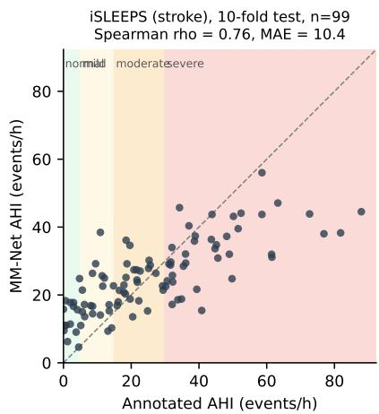

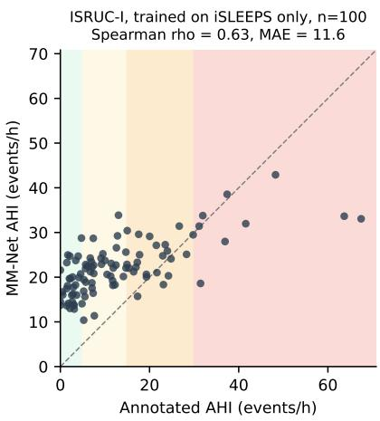  
Figure 8: MM-Net AHI estimate against the annotated AHI. Left: iSLEEPS, ten-fold test patients. Right: ISRUC-I, MM-Net trained on iSLEEPS only and applied without retraining (Section 5.10). Shading marks the AASM severity bands; the dashed line is identity.

## 5.9. Staging Across Stroke Characteristics

Staging accuracy is stable across the clinical characteristics of the stroke (Table 12). Per-patient accuracy is unrelated to neurological severity (NIHSS, Spearman $\rho = 0 . 1 5 , p = 0 . 1 5 )$ , disability (modified Rankin scale, $\rho = 0 . 1 3$ $p = 0 . 2 2 )$ , functional independence (Barthel index, $\rho = 0 . 0 0 , p = 0 . 9 8 )$ and time since stroke onset $( \rho = - 0 . 0 6 ,$ $p = 0 . 6 2 )$ , and patients with moderate-to-severe deficits $\left( \mathrm { N I H S S } \ge 5 \right)$ are staged at 0.778 against 0.758 for minor strokes. The sleep-adapted encoder contributes most in the most afected patients: +0.028 over the frozen encoder for $\mathrm { N I H S S } \ge 5$ and +0.024 for dependent patients (modified Rankin 3–5), against +0.004 and +0.005 in minor and independent patients.

## 5.10. External Validation on Independent Cohorts

Ten-fold cross-validation is patient-independent but remains within one corpus, one center and one acquisition protocol. MM-Net is therefore evaluated in two further settings: trained and tested on independent cohorts under subject-independent cross-validation, with the encoder adapted, cross-fitted and aligned inside each fold exactly as on iSLEEPS; and trained on all 99 iSLEEPS patients and applied unchanged to external cohorts, with no re-fitted parameter, threshold or transition matrix (per-recording standardization is applied, as in training).

Table 13  
Sleep-staging accuracy of MM-Net (three-seed, per patient) by stroke severity (NIHSS) and functional status (modified Rankin scale) in iSLEEPS. Encoder gain: accuracy diference from the frozen-encoder reference of Table 6 on the same patients.
<table><tr><td>Characteristic</td><td>Group</td><td>Patients</td><td>Staging acc ↑</td><td>Encoder gain</td></tr><tr><td>NIHSS</td><td>0-4 (minor)</td><td>86</td><td>0.758</td><td>+0.004</td></tr><tr><td rowspan="3">Modified Rankin</td><td>≥ 5 (moderate to severe)</td><td>12</td><td>0.778</td><td>+0.028</td></tr><tr><td>0–2 (independent)</td><td>88</td><td>0.757</td><td>+0.005</td></tr><tr><td>3-5 (dependent)</td><td>10</td><td>0.794</td><td>+0.024</td></tr></table>

Trained and tested on ISRUC-Sleep. ISRUC-I: ten subject-independent folds (80/10/10 subjects), three seeds; baselines retrained on the same folds with three seeds (accuracy mean ± SD over folds). MM-Net is ahead of every baseline in nine or ten folds of ten (Wilcoxon, Holm $p = 0 . 0 1 8 )$ . ISRUC-II+III: six folds keeping both nights of a subject together. Encoder alone: sleep-adapted EEG/EOG LaBraM, one epoch, no temporal model. Frozen-encoder configuration: class weights, concatenation, seven cardiorespiratory channels. AHI is reported for ISRUC-I, whose 100 patients span the severity range.
<table><tr><td>Model</td><td>Acc↑</td><td>Macro-F1 ↑</td><td>κ↑</td><td>Resp. AUC ↑</td><td>Resp. AP ↑</td><td>AHIρ↑</td><td>AHI MAE↓</td></tr><tr><td colspan="8">ISRUC-I (100 patients)</td></tr><tr><td>Huttunen et al. [15]</td><td> $0 . 6 9 1 \pm 0 . 0 4 4$ </td><td>0.655</td><td>0.603</td><td>0.863</td><td>0.417</td><td></td><td></td></tr><tr><td>TinySleepNet [8]</td><td> $0 . 7 4 1 \pm 0 . 0 5 7$ </td><td>0.710</td><td>0.666</td><td></td><td></td><td></td><td></td></tr><tr><td>U-Time [27]</td><td> $0 . 7 4 3 \pm 0 . 0 4 9$ </td><td>0.711</td><td>0.669</td><td></td><td></td><td></td><td></td></tr><tr><td>SleepTransformer [29]</td><td> $0 . 7 5 1 \pm 0 . 0 3 7$ </td><td>0.723</td><td>0.678</td><td></td><td></td><td></td><td></td></tr><tr><td>AT-BiLSTM [54]</td><td> $0 . 7 5 5 \pm 0 . 0 4 2$ </td><td>0.728</td><td>0.684</td><td></td><td></td><td></td><td></td></tr><tr><td>1D-ResNet-SE-LSTM [52]</td><td> $0 . 7 5 8 \pm 0 . 0 4 9$ </td><td>0.732</td><td>0.687</td><td></td><td></td><td></td><td></td></tr><tr><td>AttnSleep [7]</td><td> $0 . 7 5 8 \pm 0 . 0 4 7$ </td><td>0.717</td><td>0.685</td><td></td><td></td><td></td><td></td></tr><tr><td>LSTM (corpus)</td><td> $0 . 7 7 8 \pm 0 . 0 2 5$ </td><td>0.744</td><td>0.711</td><td></td><td></td><td></td><td></td></tr><tr><td>Encoder alone</td><td>0.792</td><td></td><td></td><td></td><td></td><td></td><td></td></tr><tr><td>Frozen-encoder configuration</td><td>0.786</td><td>0.752</td><td>0.722</td><td>0.872</td><td>0.447</td><td>0.523</td><td>6.8</td></tr><tr><td>MM-Net</td><td> $\mathbf { 0 . 8 0 3 \pm 0 . 0 2 3 }$ </td><td>0.765</td><td>0.744</td><td>0.889</td><td>0.477</td><td>0.590</td><td>6.6</td></tr><tr><td colspan="8">ISRUC-II+III (18 subjects, 26 nights)</td></tr><tr><td>Frozen-encoder configuration</td><td>0.716</td><td>0.689</td><td>0.632</td><td>0.757</td><td>0.138</td><td></td><td></td></tr><tr><td>MM-Net</td><td>0.725</td><td>0.692</td><td>0.641</td><td>0.794</td><td>0.197</td><td></td><td></td></tr><tr><td>of which ISRUC-III (healthy)</td><td>0.779</td><td>0.747</td><td>0.714</td><td>0.867</td><td>0.260</td><td></td><td></td></tr></table>

Trained and tested on ISRUC-Sleep ISRUC-I is evaluated with ten subject-independent folds of 80 training, 10 validation and 10 test subjects, and ISRUC-II and III together with six folds that keep both nights of a subject on the same side. On ISRUC-I MM-Net reaches 0.803 accuracy, macro-F1 0.765 and $\kappa \ : 0 . 7 4 4$ (Table 13). It is ahead of the frozen-encoder configuration in nine folds of ten (+0.018, $p = 0 . 0 0 4 )$ , and the gain extends to respiratory detection (0.872 → 0.889 AUC) and to the AHI $( \rho 0 . 5 2 3 \to 0 . 5 9 0$ , mean absolute error 6.6 events/h). As on iSLEEPS, MM-Net is ahead of its sleep-adapted encoder used alone (0.792; +0.012 in eight folds of ten, $p = 0 . 0 1 4 )$ . The reimplemented baselines, retrained on MM-Net’s ISRUC-I folds with three seeds, reach 0.691 to 0.778; MM-Net is ahead of each of them in nine or ten folds of ten, by +0.025 over the corpus LSTM to +0.112 over Huttunen et al. (Holm $p = 0 . 0 1 8$ the minimum for nine comparisons), and ahead of Huttunen et al., the only other joint model, on respiratory detection as well (0.889 against 0.863 AUC). On ISRUC-II and III MM-Net reaches 0.725 over 26 nights and 0.779 on the ten healthy subjects of ISRUC-III.

Healthy sleep On Sleep-EDF, under ten subject-independent folds, MM-Net reaches 0.864 accuracy, above every single-channel architecture reimplemented on the same recordings (0.791–0.835, Table 4), so the same architecture performs consistently across healthy sleep, a sleep-disorder cohort and stroke sleep.

Table 14  
MM-Net trained on all 99 iSLEEPS patients and applied without retraining (three-seed, seven-channel variant without nasal pressure; AHI scale � from iSLEEPS). AHI is not reported for the healthy ISRUC-III subjects. The iSLEEPS reference row is the eight-channel MM-Net evaluated in-cohort.
<table><tr><td>Cohort</td><td>Nights</td><td> $\mathsf { A c c } \uparrow$ </td><td> $\kappa \uparrow$ </td><td>Resp. AUC↑ AHI</td><td> $\rho \uparrow$ </td></tr><tr><td>ISRUC-I (sleep disorders)</td><td>100</td><td>0.730</td><td>0.641</td><td>0.833</td><td>0.631</td></tr><tr><td>ISRUC-II (sleep disorders)</td><td>16</td><td>0.681</td><td>0.568</td><td>0.783</td><td>0.518</td></tr><tr><td>ISRUC-III (healthy)</td><td>10</td><td>0.709</td><td>0.618</td><td>0.776</td><td></td></tr><tr><td>UCD (suspected sleep apnea)</td><td>25</td><td>0.607</td><td>0.463</td><td>0.841</td><td>0.653</td></tr><tr><td>iSLEEPS (in-cohort, reference)</td><td>99</td><td></td><td>0.763 0.656</td><td>0.825</td><td>0.765</td></tr></table>

Table 15  
Model size and output capability of representative evaluated architectures.
<table><tr><td>Model</td><td>Input</td><td>Params ↓</td><td>Outputs</td></tr><tr><td>CNN-ResNet18 [24]</td><td>1 EEG</td><td>~11M</td><td>stage</td></tr><tr><td>DeepSleepNet [5]</td><td>4 EEG</td><td>3.72 M</td><td>stage</td></tr><tr><td>Raw multimodal CNN</td><td>14 ch</td><td>0.95 M</td><td> $\mathsf { s t a g e } + \mathsf { a p n e a }$ </td></tr><tr><td>Huttunen et al. [15]</td><td>4 ch</td><td>3.80 M</td><td> $\mathsf { s t a g e } + \mathsf { e v e n t s }$ </td></tr><tr><td>MM-Net (proposed)</td><td>7 neural + 8 cardio</td><td> $2 . 8 5 \mathsf { M } + 5 . 8 \mathsf { M }$ </td><td>stage + events + AHI</td></tr></table>

Applied without retraining Table 14 applies MM-Net, trained only on iSLEEPS, to 151 external nights from 143 subjects. On the 100 ISRUC-I patients it stages at 0.730 and detects respiratory events at 0.833 AUC, and its AHI estimate reaches $\rho = 0 . 6 3 1$ (Figure 8). On UCD, an apnea cohort recorded on a diferent system with central EEG only, respiratory detection reaches 0.841 AUC and the AHI estimate $\rho = 0 . 6 5 3$ , with 60% of patients in the correct severity band (weighted � 0.51); staging there (0.607) is limited by the absence of occipital EEG and by the unit-less recordings, neither of which afects the respiratory stream. Respiratory detection therefore transfers with little loss: 0.83–0.84 AUC on the two apnea cohorts against 0.825 in-cohort.

Because nasal pressure is acquisition-specific, MM-Net uses all eight channels when trained on a cohort and its seven-channel variant without nasal pressure, reported in Table 14, when applied to a new acquisition system.

## 5.11. Model Complexity and Capability

Table 15 sets the proposed model beside representative alternatives on size and capability. MM-Net holds 2.85 M trainable parameters, with a 5.8 M-parameter sleep-adapted encoder trained in a separate stage; together they remain below the corpus’s CNN-ResNet18 (∼11 M). MM-Net delivers the sleep stage, the respiratory-event score and the AHI from one pass over the recording, and none of the staging-only models, at any size, can supply the second and third outputs.

## 6. Discussion

The central finding of this study concerns how a pretrained EEG encoder, once adapted to the target cohort, enters a downstream model. Adapting LaBraM to sleep raises its own staging accuracy from 0.647 to 0.709, yet the adapted encoder adds nothing measurable to the downstream model until its training embeddings are cross-fitted and mapped into the space of the deployed encoder (Table 6). The failure mode, a downstream model trained on embeddings whose coordinates difer from those it receives at test time, may apply to any pipeline that fine-tunes a foundation model and then trains a second model on its outputs, and the remedy costs � additional fine-tuning runs and a ridge regression per part. The aligned encoder separates Wake, REM and N3 into distinct clusters (Figure 6), and with it MM-Net stages iSLEEPS at 0.763 $( \kappa = 0 . 6 5 6 )$ , ahead of every architecture retrained on the same folds. The integration carries over to ISRUC-I, where the complete model is ahead of the frozen-encoder configuration in nine folds of ten.

The same model delivers the respiratory output and the AHI, and the joint design is supported directly: joint training improves staging where disordered breathing disrupts sleep, improves respiratory-event detection and yields a closer

AHI estimate than two single-task models (Table 8), and each stream carries the output its physiology is closest to, with respiratory efort and not the scoring airflow channel as the strongest individual respiratory input (Table 9). Huttunen et al. [15] demonstrated simultaneous sleep staging and respiratory-event scoring in a large suspected-obstructivesleep-apnea cohort. Under the common iSLEEPS evaluation their architecture reaches 0.599 staging accuracy against 0.756 for MM-Net, and on ISRUC-I, trained and evaluated on the same labels, 0.691 staging accuracy and 0.863 respiratory AUC against 0.803 and 0.889. This extends joint sleep analysis to a stroke-specific setting, where the available montage, cohort size, neural physiology, and respiratory annotation difer from those of conventional sleepapnea studies, and indicates that joint PSG analysis in stroke benefits from representations and signal organization adapted to the characteristics of the target cohort. On iSLEEPS the respiratory output reaches 0.825 AUC, 0.152 above gradient boosting on engineered descriptors and 0.092 above a raw-signal network on seven cardiorespiratory channels, and it is strongest on obstructive and central apneas. Summed over decoded sleep, the same scores estimate the AHI with $\rho = 0 . 7 6 5$ against the annotated index, so a single model characterizes both sleep architecture and respiratory disturbance in stroke PSG.

The respiratory output is trained at the 30-s temporal scale of staging, as a score for the onset of an event within each epoch, and the AHI follows from it without a separate counting rule. The expected-count formulation counts closely spaced events separately and normalizes by the decoded sleep time, as the clinical index does, and its agreement with the annotated index $( \rho = 0 . 7 6 5 )$ exceeds the agreement of the clinical index recorded with the corpus $( \rho = 0 . 6 8 7 )$ Staging accuracy is 0.784 in patients with a normal AHI and remains at 0.754–0.764 in the mild, moderate and severe groups, without a significant trend, so the model stages the patients with the greatest respiratory burden nearly as well as those without it. Sleep architecture and respiratory disturbance remain distinct prediction problems at the signal level while sharing clinically relevant structure at the level of the overnight recording, which supports their analysis within a common framework in a stroke population where both processes shape the physiological state of the patient during sleep.

Performance depends strongly on the population in which a model is evaluated. Deep architectures retrained on iSLEEPS reach approximately 0.60–0.72 accuracy, against 0.79–0.84 for the same architectures on Sleep-EDF, a decrease of approximately 0.10 to 0.15 for each model; because population, montage, and acquisition conditions change together, this diference is most appropriately read as a substantial shift between conventional healthy-sleep data and subacute stroke PSG. MM-Net reaches 0.864 on Sleep-EDF, 0.803 on ISRUC-I and 0.763 within the stroke cohort. Trained on ISRUC-I, MM-Net reaches 0.803 accuracy and 0.889 respiratory AUC and is ahead of every retrained baseline on the same folds. Trained on iSLEEPS alone and applied without retraining, it detects respiratory events at 0.833 and 0.841 AUC on ISRUC-I and on UCD, an apnea cohort recorded on a diferent system, against 0.825 in-cohort, and estimates the AHI with $\rho = 0 . 6 3 1$ and 0.653. The learned representations are therefore not confined to a single recording environment. Nasal pressure was the input whose contribution depended most on the acquisition system, and the seven-channel variant is the appropriate choice for transfer.

The framework combines sleep-stage and respiratory-event information from the same PSG, preserves the specialization of the neural and cardiorespiratory streams, and exploits their shared temporal context. The encoderintegration experiments show how a pretrained EEG representation is brought into the model, the benchmark and respiratory comparisons show what the integrated model delivers, and external evaluation demonstrates that the resulting representations retain utility across distinct PSG datasets. For subacute ischemic-stroke PSG, MM-Net provides sleep staging, respiratory-event detection and AHI estimation from one pass over the recording, built on a sleep-adapted EEG encoder whose representations are brought into the downstream model through cross-fitting and alignment.

## 6.1. Limitations

The stroke-specific evaluation rests on iSLEEPS, recorded at a single center; the external cohorts establish transfer across acquisition systems and populations, and a second public stroke PSG cohort, once available, would allow a stroke-specific replication. Staging is decoded over the whole night by the hidden-Markov pass, so the system is designed for ofline scoring of a completed recording. The respiratory output is scored per 30-s epoch and summarized as an AHI estimate; event-level scoring with onset and duration boundaries is a natural extension.

## 7. Conclusion

This study addresses the joint characterization of sleep architecture and respiratory disturbances in subacute ischemic stroke, a setting in which altered neural physiology and heterogeneous cardiorespiratory information challenge conventional sleep-analysis approaches. MM-Net demonstrates that sleep-adapted EEG representations can be integrated into a multimodal temporal framework through cross-fitting and embedding alignment, improving sleepstage discrimination while supporting concurrent respiratory-event detection.

The findings establish two complementary aspects of the proposed approach. First, the integration of adapted neural representations provides a means of addressing the training–inference mismatch encountered when pretrained encoders are incorporated into downstream physiological models. Second, controlled interventions reveal distinct roles for neural and cardiorespiratory information within the joint framework, showing that shared temporal modeling can accommodate physiologically specialized prediction tasks.

Patient-independent evaluation and experiments across independent sleep cohorts support the applicability of this approach beyond a single recording population. Together, these results establish a computational framework for joint analysis of neural and respiratory physiology after ischemic stroke, while providing a foundation for further investigation of representation consistency and multimodal generalization in clinical sleep analysis.

## Data and Code Availability

The iSLEEPS corpus is publicly available (Zenodo, DOI 10.5281/zenodo.14873844; and the india-data.org portal) as described by Maiti et al. [23]. ISRUC-Sleep [47], the UCD database [48] and Sleep-EDF [45] are public. Our code, the per-fold configurations, engineered features, the corrections applied to the external cohorts, and reproduction notebooks are released at https://github.com/wshuv-o/MM-Net.

## Ethics

The iSLEEPS data collection was approved by the NIMHANS Institutional Ethics Committee (No. NIMHANS/34th IEC (BS&NS DIV.)/2022, dated 05.02.2022) [23]. This work is a secondary analysis of the de-identified public release and required no additional enrollment.

## Declaration of Competing Interest

The authors declare that they have no known competing financial interests or personal relationships that could have appeared to influence the work reported in this paper.

## CRediT Authorship Contribution Statement

Md Wahiduzzaman Suva: Conceptualization, Methodology, Software, Formal analysis, Investigation, Writing – original draft. Esm E Moula Chowdhury Abha: Methodology, Software, Validation, Writing – original draft. Md Imtiaj Alam Sajin: Software, Investigation, Data curation, Visualization, Writing – original draft. Md Iftekharul Mobin: Conceptualization, Supervision, Project administration, Writing – review & editing. Jia Uddin: Conceptualization, Supervision, Writing – review & editing.

## Declaration of Generative AI and AI-Assisted Technologies in the Writing Process

During the preparation of this work the authors used ChatGPT (OpenAI) and Claude (Anthropic) to improve the language and organization of the manuscript. After using these tools, the authors reviewed and edited the content as needed and take full responsibility for the content of the published article.

## Funding

This research did not receive any specific grant from funding agencies in the public, commercial, or not-for-profit sectors.

## Acknowledgment

The authors thank the iSLEEPS, ISRUC-Sleep, UCD and Sleep-EDF investigators for releasing their data.

## References

[1] C. L. Bassetti, M. S. Aldrich, Sleep electroencephalogram changes in acute hemispheric stroke, Sleep Medicine 2 (2001) 185–194.

[2] C. Denis, I. Jaussent, L. Guiraud, C. Mestejanot, C. Arquizan, I. Mourand, S. Chenini, B. Abril, A. Wacongne, R. Tamisier, S. Baillieul, J. Pepin, L. Barateau, Y. Dauvilliers, Functional recovery after ischemic stroke: Impact of diferent sleep health parameters, Journal of Sleep Research 33 (2023).

[3] N. Tellenbach, M. H. Schmidt, F. Alexiev, E. Blondiaux, F. Cavalloni, C. L. Bassetti, L. Heydrich, P. Bargiotas, Rem sleep and muscle atonia in brainstem stroke: A quantitative polysomnographic and lesion analysis study, Journal of Sleep Research 32 (2022).

[4] K. G. Johnson, D. C. Johnson, Frequency of Sleep Apnea in Stroke and TIA Patients: A Meta-analysis, Journal of Clinical Sleep Medicine 6 (2010) 131–137.

[5] A. Supratak, H. Dong, C. Wu, Y. Guo, Deepsleepnet: A Model for Automatic Sleep Stage Scoring Based on Raw Single-Channel EEG, IEEE Transactions on Neural Systems and Rehabilitation Engineering 25 (2017) 1998–2008.

[6] H. Phan, F. Andreotti, N. Cooray, O. Y. Chen, M. De Vos, Seqsleepnet: End-to-End Hierarchical Recurrent Neural Network for Sequence-to Sequence Automatic Sleep Staging, IEEE Transactions on Neural Systems and Rehabilitation Engineering 27 (2019) 400–410.

[7] E. Eldele, Z. Chen, C. Liu, M. Wu, C.-K. Kwoh, X. Li, C. Guan, An Attention-Based Deep Learning Approach for Sleep Stage Classification With Single-Channel EEG, IEEE Transactions on Neural Systems and Rehabilitation Engineering 29 (2021) 809–818.

[8] A. Supratak, Y. Guo, Tinysleepnet: An Eficient Deep Learning Model for Sleep Stage Scoring based on Raw Single-Channel EEG, 2020 42nd Annual International Conference of the IEEE Engineering in Medicine & Biology Society (EMBC) (2020) 641–644.

[9] W.-B. Jiang, L. Zhao, B.-l. Lu, Large brain model for learning generic representations with tremendous eeg data in bci, in: B. Kim, Y. Yue, S. Chaudhuri, K. Fragkiadaki, M. Khan, Y. Sun (Eds.), International Conference on Learning Representations, volume 2024, 2024, pp. 16405–16426. URL: https://proceedings.iclr.cc/paper\_files/paper/2024/file/ 47393e8594c82ce8fd83adc672cf9872-Paper-Conference.pdf.

[10] J. Wang, S. Zhao, Z. Luo, Y. Zhou, H. Jiang, S. Li, T. Li, G. Pan, Cbramod: A Criss-Cross Brain Foundation Model for EEG Decoding, arXiv (Cornell University) (2024).

[11] G. Wang, W. Liu, Y. He, C. Xu, L. Ma, H. Li, Eegpt: Pretrained Transformer for Universal and Reliable Representation of EEG Signals, Advances in Neural Information Processing Systems 37 (2024) 39249–39280.

[12] C. Yang, M. B. Westover, J. Sun, BIOT: Biosignal transformer for cross-data learning in the wild, in: Thirty-seventh Conference on Neural Information Processing Systems, 2023. URL: https://openreview.net/forum?id=c2LZyTyddi.

[13] L. Duan, B. Ma, Y. Yin, Z. Huang, Y. Qiao, Mms-sleepnet: A knowledge-based multimodal and multiscale network for sleep staging, Biomedical Signal Processing and Control 103 (2025) 107370.

[14] Y. Cao, W. Xiang, J. Wei, S. Cao, X. Tian, J. Zhong, X. Fang, B. Luo, H. Lyu, X. Li, Crossfusionsleepnet: A multimodal deep learning mode for automatic sleep stage classification, Biomedical Signal Processing and Control 112 (2026) 108538.

[15] R. Huttunen, T. Leppänen, B. Duce, E. S. Arnardottir, S. Nikkonen, S. Myllymaa, J. Töyräs, H. Korkalainen, A Comparison of Signa Combinations for Deep Learning-Based Simultaneous Sleep Staging and Respiratory Event Detection, IEEE Transactions on Biomedical Engineering 70 (2023) 1704–1714.

[16] L. Shi, R. Gui, L. Wang, P. Li, Q. Niu, A Multi-Task Deep Learning Approach for Simultaneous Sleep Staging and Apnea Detection for Elderly People, Interdisciplinary Sciences: Computational Life Sciences 18 (2025) 341–356.

[17] J. M. Gottselig, C. L. Bassetti, P. Achermann, Power and coherence of sleep spindle frequency activity following hemispheric stroke, Brain 125 (2002) 373–383.

[18] L. M. J. Fernandez, A. Lüthi, Sleep Spindles: Mechanisms and Functions, Physiological Reviews 100 (2020) 805–868.

[19] L. Facchin, C. Schöne, A. Mensen, M. Bandarabadi, F. Pilotto, S. Saxena, P. A. Libourel, C. L. Bassetti, A. R. Adamantidis, Slow Waves Promote Sleep-Dependent Plasticity and Functional Recovery after Stroke, The Journal of Neuroscience 40 (2020) 8637–8651.

[20] B. K. Simpson, R. Rangwani, A. Abbasi, J. M. Chung, C. M. Reed, T. Gulati, Disturbed laterality of non-rapid eye movement sleep oscillations in post-stroke human sleep: a pilot study, Frontiers in Neurology 14 (2023).

[21] Y. Zheng, T. Jing, L. Xu, S. Sun, W. Yu, R. Liu, G. Xu, C. Chu, Analysis of the correlation between sleep spindles and cognitive impairment in patients with ischemic stroke, Scientific Reports 15 (2025).

[22] A. Agius Anastasi, O. Falzon, K. Camilleri, M. Vella, R. Muscat, Brain Symmetry Index in Healthy and Stroke Patients for Assessment and Prognosis, Stroke Research and Treatment 2017 (2017) 1–9.

[23] S. Maiti, S. K. Sharma, S. Mythirayee, S. Rajendran, R. S. Bapi, Polysomnography Dataset for Sleep Analysis in Ischemic Stroke Patients, Scientific Data 13 (2026).

[24] S. Bose, S. Maiti, S. K. Sharma, M. S, T. Chakraborti, S. Rajendran, R. S. Bapi, Ai Generalisation Gap in Comorbid Sleep Disorder Staging, 2026 IEEE 23rd International Symposium on Biomedical Imaging (ISBI) (2026) 1–4.

[25] A. Alhazmi, Sleepstagenet: A Lightweight and Explainable Deep Learning Architecture for Multi-Channel Sleep Staging, Brain Sciences 16 (2026) 860.

[26] V. Chernozhukov, D. Chetverikov, M. Demirer, E. Duflo, C. Hansen, W. Newey, J. Robins, Double/debiased machine learning for treatment and structural parameters, The Econometrics Journal 21 (2018) C1–C68.

[27] M. Perslev, M. Jensen, S. Darkner, P. J. Jennum, C. Igel, U-time: A fully convolutional network for time series segmentation applied to sleep staging, in: Advances in Neural Information Processing Systems (NeurIPS 2019), volume 32, 2019, pp. 4415–4426. URL: https://papers.nips.cc/paper/

8692-u-time-a-fully-convolutional-network-for-time-series-segmentation-applied-to-sleep-staging.

[28] H. Phan, O. Y. Chen, M. C. Tran, P. Koch, A. Mertins, M. De Vos, Xsleepnet: Multi-View Sequential Model for Automatic Sleep Staging, IEEE Transactions on Pattern Analysis and Machine Intelligence (2021) 1–1.

[29] H. Phan, K. Mikkelsen, O. Y. Chen, P. Koch, A. Mertins, M. De Vos, Sleeptransformer: Automatic Sleep Staging With Interpretability and Uncertainty Quantification, IEEE Transactions on Biomedical Engineering 69 (2022) 2456–2467.

[30] H. Phan, K. P. Lorenzen, E. Heremans, O. Y. Chén, M. C. Tran, P. Koch, A. Mertins, M. Baumert, K. B. Mikkelsen, M. De Vos, L-seqsleepnet: Whole-cycle Long Sequence Modeling for Automatic Sleep Staging, IEEE Journal of Biomedical and Health Informatics 27 (2023) 4748– 4757.

[31] N. Jirakittayakorn, Y. Wongsawat, S. Mitrirattanakul, Zleepanlystnet: a novel deep learning model for automatic sleep stage scoring based on single-channel raw EEG data using separating training, Scientific Reports 14 (2024).

[32] Y. Guo, M. Nowakowski, W. Dai, Flexsleeptransformer: a transformer-based sleep staging model with flexible input channel configurations, Scientific Reports 14 (2024).

[33] A. Gu, T. Dao, Mamba: Linear-time sequence modeling with selective state spaces, in: First Conference on Language Modeling, 2024. URL: https://openreview.net/forum?id=tEYskw1VY2.

[34] X. Zhou, Y. Han, Z. Chen, C. Liu, Y. Ding, Z. Jia, Y. Liu, Bit-mamsleep: Bidirectional Temporal Mamba for EEG Sleep Staging, arXiv (Cornell University) (2024).

[35] D. H. Wolpert, Stacked generalization, Neural Networks 5 (1992) 241–259.

[36] A. Guillot, V. Thorey, Robustsleepnet: Transfer Learning for Automated Sleep Staging at Scale, IEEE Transactions on Neural Systems and Rehabilitation Engineering 29 (2021) 1441–1451.

[37] M. Perslev, S. Darkner, L. Kempfner, M. Nikolic, P. J. Jennum, C. Igel, U-Sleep: resilient high-frequency sleep staging, npj Digital Medicine 4 (2021) 72.

[38] R. Thapa, M. R. Kjaer, B. He, I. Covert, H. Moore Iv, U. Hanif, G. Ganjoo, M. B. Westover, P. Jennum, A. Brink-Kjaer, E. Mignot, J. Zou, A multimodal sleep foundation model for disease prediction, Nature Medicine 32 (2026) 752–762.

[39] Y. Zhou, J. Wu, Z. Ren, Z. Yao, W. Lu, K. Peng, Q. Zheng, C. Song, W. Ouyang, C. Gou, Csbrain: A Cross-scale Spatiotemporal Brain Foundation Model for EEG Decoding, Advances in Neural Information Processing Systems 38 (2025) 96859–96904.

[40] A. D. Rossi, M. Metaldi, M. Bechny, I. Filchenko, J. v. d. Meer, M. H. Schmidt, C. L. A. Bassetti, A. Tzovara, F. D. Faraci, L. Fiorillo, Sleepyland: trust begins with fair evaluation of automatic sleep staging models, npj Digital Medicine 9 (2025).

[41] E. Estevan, M. Sierra-Torralba, E. López-Larraz, L. Montesano, A systematic evaluation of self-supervised learning for label-eficient sleep staging with wearable EEG, arXiv preprint arXiv:2510.07960 (2025).

[42] R. K. Malhotra, Aasm Scoring Manual 3: a step forward for advancing sleep care for patients with obstructive sleep apnea, Journal of Clinical Sleep Medicine 20 (2024) 835–836.

[43] T. E. Nassi, W. Ganglberger, H. Sun, A. A. Bucklin, S. Biswal, M. J. A. M. van Putten, R. J. Thomas, M. B. Westover, Automated Scoring of Respiratory Events in Sleep With a Single Efort Belt and Deep Neural Networks, IEEE Transactions on Biomedical Engineering 69 (2022) 2094–2104.

[44] S. Biswal, H. Sun, B. Goparaju, M. B. Westover, J. Sun, M. T. Bianchi, Expert-level sleep scoring with deep neural networks, Journal of the American Medical Informatics Association 25 (2018) 1643–1650.

[45] B. Kemp, A. Zwinderman, B. Tuk, H. Kamphuisen, J. Oberye, Analysis of a sleep-dependent neuronal feedback loop: the slow-wave microcontinuity of the EEG, IEEE Transactions on Biomedical Engineering 47 (2000) 1185–1194.

[46] A. L. Goldberger, L. A. N. Amaral, L. Glass, J. M. Hausdorf, P. C. Ivanov, R. G. Mark, J. E. Mietus, G. B. Moody, C.-K. Peng, H. E. Stanley, Physiobank, PhysioToolkit, and PhysioNet, Circulation 101 (2000).

[47] S. Khalighi, T. Sousa, J. M. Santos, U. Nunes, Isruc-sleep: A comprehensive public dataset for sleep researchers, Computer Methods and Programs in Biomedicine 124 (2016) 180–192.

[48] T. Pollard, B. E. Moody, L.-w. H. Lehman, B. J. Gow, C. Fernandes, C. Xie, A. Johnson, R. G. Mark, T. Heldt, Physionet as a global platform for biomedical research, Nature Health 1 (2026) 792–795.

[49] B. Hjorth, Eeg analysis based on time domain properties, Electroencephalography and Clinical Neurophysiology 29 (1970) 306–310.

[50] A. E. Hoerl, R. W. Kennard, Ridge Regression: Biased Estimation for Nonorthogonal Problems, Technometrics 42 (2000) 80–86.

[51] W. Chen, Y. Cai, A. Li, Y. Su, K. Jiang, Single-channel Sleep EEG Classification Method Based on LSTM and Hidden Markov Model, Brain Sciences 14 (2024) 1087.

[52] W. Li, J. Gao, Automatic sleep staging by a hybrid model based on deep 1D-ResNet-SE and LSTM with single-channel raw EEG signals, PeerJ Computer Science 9 (2023) e1561.

[53] G. Liu, G. Wei, S. Sun, D. Mao, J. Zhang, D. Zhao, X. Tian, X. Wang, N. Chen, Micro SleepNet: eficient deep learning model for mobile terminal real-time sleep staging, Frontiers in Neuroscience 17 (2023).

[54] M. Fu, Y. Wang, Z. Chen, J. Li, F. Xu, X. Liu, F. Hou, Deep Learning in Automatic Sleep Staging With a Single Channel Electroencephalography, Frontiers in Physiology 12 (2021).

[55] L. van der Maaten, G. Hinton, Visualizing data using t-sne, Journal of Machine Learning Research 9 (2008) 2579–2605.