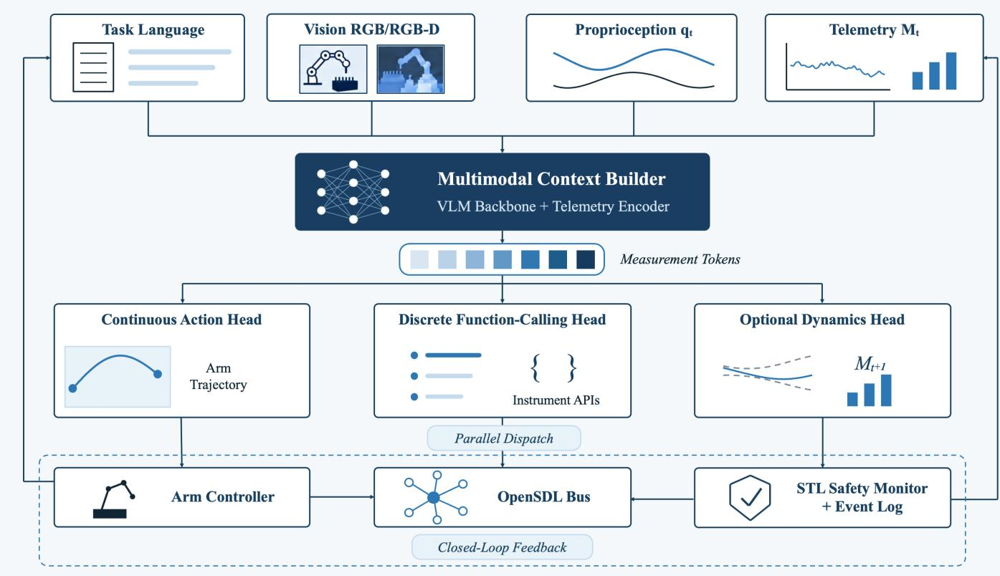
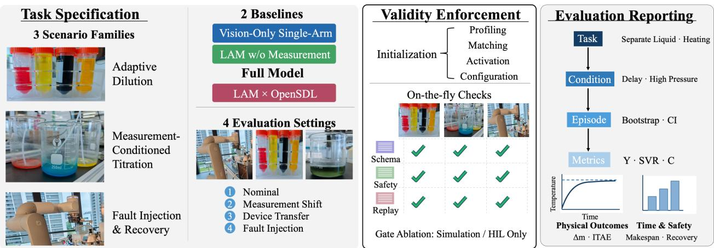

# Making Self-Driving Laboratories Auditable: A Unified Framework for Hybrid Actions, Measurements, and Safe Execution

Zihan Zhang<sup>1,2,5</sup> Zeyu Wu<sup>5</sup> Xin Zhang<sup>1,4,5</sup>

Mingyu Luo<sup>5</sup> Haohui Que<sup>1,3,5,∗</sup> Tong Zhu<sup>1,3,5,∗</sup>

<sup>1</sup>SII–ECNU Joint Autonomous Chemistry Laboratory, Shanghai Innovation Institute

<sup>2</sup>Nankai University <sup>3</sup>East China Normal University

<sup>4</sup>Shanghai Jiao Tong University <sup>5</sup>Shanghai Lixun Intelligent Technology Co.,Ltd

Haohui Que: harveyque@outlook.com Tong Zhu: tongzhu.work@gmail.com

## Abstract

Self-driving laboratories (SDLs) are laboratory systems that couple experimental planning, automated execution, and measurement feedback in a closed loop. Integrating flexible robot control with the typed application programming interfaces (APIs) and continuous measurements exposed by laboratory instruments remains an execution-interface challenge. To address this challenge, we propose a traceable framework comprising four components: LAM (Lab Action Model), OpenSDL, Safe-SDL, and L3-Bench. LAM is a proposed measurement-conditioned policy architecture that extends vision-language-action paradigms to generate both continuous robot trajectories and typed instrument API calls. OpenSDL is an execution substrate with an initial control implementation, designed to map role-level operations to heterogeneous devices, coordinate execution, and record timestamped causal events. The proposed Safe-SDL runtime gate combines pre-dispatch schema and resource checks with signal temporal logic monitoring during execution, including extended waiting periods. L3-Bench (Level-3 Laboratory Benchmark) specifies an episode-level evaluation protocol covering physical outcomes, timing, reproducibility, safety violations, and fault recovery. Together these components provide an end-to-end design for linking hybrid action generation, monitored device execution, measurement feedback, and experimental evaluation, addressing coordination and traceability challenges in SDL workflows.

Keywords: self-driving laboratory; vision-language-action; heterogeneous action space; measurement-conditioned control; runtime safety; reproducible benchmark.

## 1 Introduction

Self-driving laboratories (SDLs) are laboratory systems that couple experimental intent and planning to automated execution and measurement feedback in a closed loop [1]. This approach can accelerate materials discovery and reaction optimization while reducing the need for repeated manual intervention [1–3]. Their defining operation is a repeated decision cycle: (i) a machine-readable objective is translated into experimental operations; (ii) those operations are executed by instruments and robots; (iii) measurements and device states are collected; and (iv) the resulting evidence is used to inform the next decision. Through this cycle, experimental throughput can be increased and condition search or hypothesis testing conducted systematically across many trials [2–5]. To implement this cycle, practical SDLs combine planning tools for step (i), device control for step (ii), sensing and data acquisition for step (iii), and data analysis and decisionmaking for step (iv). Data and provenance management link these stages, while human supervision supports oversight and intervention throughout the cycle [1].

Representative developments have showcased how experimental procedures and robot actions can be represented, executed, and recorded. In 2019, Steiner et al. described Chemputer, which encoded chemical procedures as executable programs, separating hardware-independent procedures from platform-specific connectivity and device drivers [5]. In 2023, Boiko et al. introduced Coscientist, which combined language-model reasoning with documentation search, code execution, and laboratory APIs to plan and perform chemical experiments [6]. In 2024, Kim et al. introduced OpenVLA, a vision-language-action (VLA) model connecting visual observations and language instructions to learned robot control [7]. In the same year, Bai et al. developed a dynamic knowledge graph framework for distributed SDLs that supports shared ontologies and cycle-level provenance, with limited granularity for exact operation timing under hardware constraints [8]. In 2026, Ren et al. introduced LabVLA, which applied VLA policies to laboratory protocols while acknowledging that measurement-driven protocol revision had not yet been demonstrated [9]. IvoryOS provides an interoperable web interface for orchestrating Python-based SDLs [10]. Established standards address device connec tivity and provenance. SiLA 2 (Standardization in Lab Automation) describes instrument capabilities through typed Features, Commands, and Properties, supporting discovery, command execution, and property subscrip tions [11]. Provenance standards provide a formal basis for representing auditable records. The World Wide Web Consortium’s PROV Ontology (W3C PROV-O) represents entities, activities, and agents through generation, usage, attribution, and qualified relations carrying roles and time information [12]. PROV-CONSTRAINTS defines validity, equivalence, and event-ordering constraints for provenance records [13]; the companion PROV-SEM Working Group Note provides first-order semantics for the PROV data model [14]. ProvONE extends PROV with scientific workflow structure and execution provenance [15], while Research Object Crate (RO-Crate) packages research artefacts with Schema.org-based structured metadata [16].

These approaches establish provenance representation and consistency rules. Our execution-interface contribution concerns their coupling to measurement-conditioned hybrid actions, pre-dispatch gating, clock-domain-aware timestamping, and timed safety monitoring. We position SDL-Traj as a proposed PROV-O-aligned laboratory profile, reusing core provenance relations and adding application-specific terms for device capabilities, monotonic-clock metadata, and signal temporal logic (STL) robustness. Explicit vocabulary mappings, PROV-O export, SiLA 2 adapters, and conformance tests re main implementation targets. For example, reaction and cooling waits require monitoring to remain active and link fresh or stale measurements, pending calls, verified completion events, and gate decisions. Such execution records must preserve both scientific context and the conditions under which physical actions were admitted. These requirements motivate a shared interface linking measurement-conditioned action generation with execu tion, monitoring, and evaluation. We therefore propose a traceable framework comprising LAM (Lab Action Model), OpenSDL, Safe-SDL, and L3-Bench.

LAM is designed to generate a hybrid output consisting of continuous robot trajectories and typed instrument API calls from task instructions, visual observations, robot states, and instrument measurements. Its proposed architecture extends the VLA framework with typed telemetry and shares multimodal context between a continuous motion expert and a discrete function-calling head. OpenSDL, with an initial control implementation, is designed to map role-level operations to heterogeneous devices and coordinate operations according to their dependencies, waiting requirements, and completion conditions. Its event model links measurements, device states, and execution outcomes to dispatched commands and runtime decisions in timestamped causal records. In the proposed loop, updated observations and confirmed events provide context for subsequent LAM action proposals. Safe-SDL is the proposed runtime gate for schema and resource checks before dispatch and monitoring of formalized temporal constraints throughout execution, including extended waiting periods. Timeouts, degraded measurement quality, or insuficient safety margins are intended to trigger action blocking and predefined degradation or safe-abort procedures. L3-Bench (Level-3 Laboratory Benchmark) specifies an episode-level evaluation protocol covering protocol-specific physical outcomes, timing, reproducibility, safety violations, and fault recovery. Here, L3 denotes measurement-conditioned adaptation within an experiment, as defined in the task-specific classification of Section 2.1. End-to-end LAM training, crossdevice transfer experiments, and systematic hardware and safety validation remain to be completed; improvements in throughput, adaptability, and fault recovery are hypotheses to be tested through the proposed evaluation.

## 2 Problem Formulation and Control Interface

## 2.1 Autonomy Levels

We adopt a task-specific working L1–L4 autonomy classification that complements published SDL autonomy taxonomies [17,18]. These levels classify execution capability; SDLs additionally require the planning-and-feedback loop defined above. L1–L4 describe increasing adaptation: L1 denotes scripted execution or teleoperation, L2 visual protocol execution, L3 measurement-conditioned adaptation, and L4 hypothesis optimization across batches with multiinstrument coordination. We focus on implementable and measurable L3 behavior in the near term, leaving L4 for future work.

## 2.2 Hybrid State–Action and Event Semantics

We represent the laboratory process as a partially observable Markov decision process (POMDP), a standard model for sequential decision-making when the physical state cannot be observed completely:

$$
\mathcal { M } = \langle \boldsymbol { S } , \boldsymbol { A } , \mathcal { T } , \mathcal { R } , \Omega , \mathcal { O } , \gamma \rangle .
$$

Here, $s$ is the latent physical state of the laboratory, A is the hybrid candidate-action space, $\mathcal { T } ( s ^ { \prime } \mid s , a )$ is the transition model describing how action a changes state s to $s ^ { \prime } ,$ and $\mathcal { R } ( s , a )$ is the task or operational reward. Ω is the observation space, $\mathcal { O } ( o \mid s ^ { \prime } , a )$ is the observation model, and $\gamma \in [ 0 , 1 ]$ discounts delayed reward. The notation captures temperatures, concentrations, device queues, and completion states that are partially observed and may be delayed or noisy; the current implementation leaves the transition and reward models unspecified. At time $t ,$ the observation is $o _ { t } = \{ I _ { t } , q _ { t } , M _ { t } \}$ , where $I _ { t }$ contains synchronized visual frames, $q _ { t }$ is the proprioceptive state, and $M _ { t }$ contains measurement streams from heterogeneous instruments. The action space is the Cartesian product

$$
{ \mathcal { A } } = { \mathcal { A } } _ { \mathrm { a r m } } \times { \mathcal { A } } _ { \mathrm { i n s t } } .
$$

The arm-action space includes a no-motion option, and the instrument-action space contains finite, possibly empty collections of calls. Feasible combinations depend on resource and safety constraints. A continuous action $A _ { \mathrm { a r m } } \in \mathbb { R } ^ { H _ { a } \times D _ { a } }$ contains $H _ { a }$ control steps and $D _ { a }$ trajectory dimensions, with recorded coordinate frame, control period, and calibration version. An individual instrument call $A _ { \mathrm { i n s t } } = \left. \mathrm { R o l e } , \mathrm { O p } , \Theta \right.$ is a typed instrument call: Role identifies the capability, Op identifies the operation such as Set, Execute, or Read, and Θ contains validated parameters and units. The two action types share a time base and event ledger. Empty outputs allow monitoring during waiting periods.

To give this Cartesian product executable semantics, the output of a decision cycle is written as

$$
a _ { t } = \left( \hat { A } _ { \mathrm { a r m } , t : t + H _ { a } - 1 } , \mathcal { C } _ { t } \right) , \qquad \mathcal { C } _ { t } = \{ c _ { i } \} _ { i = 1 } ^ { N _ { t } } ,
$$

where each instrument call includes a role, an operation, parameters, a waiting policy, and an idempotency key:

$$
c _ { i } = \langle r _ { i } , o _ { i } , \theta _ { i } , \delta _ { i } , \kappa _ { i } \rangle .
$$

Here, $r _ { i }$ is a semantic capability in the role dictionary, $o _ { i } \in \{ \mathsf { S e t } $ , Execute, Read} is the requested operation, $\theta _ { i }$ contains typed parameters, $\delta _ { i }$ specifies timeout, retry, and completion conditions, and $\kappa _ { i }$ supports deduplication and transaction association. The action compiler checks units, ranges, resource locks, and preconditions before mapping a role call to a concrete DeviceProvider (an adapter that implements a role for one physical or simulated device). Role-preserving substitution retains high-level action labels; device calibration, latency, and physical limits still require compatibility tests.

States, actions, and events share a common timeline. Observations, candidate actions, and device returns are recorded as events $e _ { j }$ , linked by episode IDs, timestamps, and causal parent events. The proposed ledger combines device timestamps, a runtime monotonic clock, and causal event IDs. Clock ofsets and drift are recorded explicitly; receive order alone cannot establish cross-device causality. In this paper, an event is therefore the auditable record of one observation, proposal, gate decision, dispatch, return, or compensation step recorded in the event ledger. This design distinguishes an incorrect model proposal, a safetyblocked action, and a device execution failure, and allows replay to reconstruct the causal sequence from proposal through approval to completion.

## 2.3 Design Requirements

We express the laboratory control interface as five checkable invariants. Semantic portability requires policies to depend on roles, capabilities, and units. Action composability requires continuous trajectories and discrete calls to carry preconditions, resource requirements, and completion signals so that they can form a directed acyclic graph (DAG) execution plan. Temporal consistency requires visual frames, proprioception, telemetry, and action events to share monotonic timestamps with explicit measurement delays and waiting intervals. Safety gating requires every action to pass through the same observable safety kernel before submission to the bus; device interlocks govern actions independently of model confidence. Replayability requires raw inputs, compiled device commands, return bytes, and safety decisions to be linked to the same episode for ofline replay and diference analysis.

These invariants define an auditable protocol contribution and establish module boundaries. LAM generates candidate actions from context, while OpenSDL checks their semantic, temporal, and safety properties; the modules exchange data only through a versioned schema. If an invariant depends on manual action, that intervention must be reported in evaluation.

The evaluation addresses four research questions (RQs):

RQ1. Does measurement-token conditioning improve adaptation to measurement shifts?

RQ2. Does concurrent hybrid action dispatch reduce completion time while respecting resource constraints?

RQ3. Does runtime gating contain faults and support recovery at a measurable throughput cost?

RQ4. Can role-preserving device substitution maintain action semantics, with fixed-manifest replay reproducing execution histories and metrics?

## 3 LAM: Lab Action Model

## 3.1 Model Structure and Multimodal Context Construction

LAM (Lab Action Model) is the policy interface proposed in this paper. The proposed LAM architecture comprises three cooperating modules:

1. Multimodal context backbone (target size: approximately 3B parameters; VLM denotes vision-language model). Encodes task language, visual context, trajectory history, and device states.

2. Continuous motion expert (target size: approximately 300M parameters). Uses flow matching to generate trajectory chunks, following the VLA motion-modeling approach exemplified by $\pi _ { 0 }$ [19]; obstacle avoidance is checked by the execution layer.

3. Discrete function-calling head. Generates standardized Role–Op–Parameters calls with device waiting, failure, and retry semantics.

  
Figure 1: LAM architecture for measurement-conditioned hybrid laboratory control. Task language, RGB/RGB-D observations, robot proprioception $q _ { t }$ , and time-stamped instrument telemetry $M _ { t }$ enter a multimodal context builder comprising a visionlanguage-model (VLM) backbone and a telemetry encoder. Typed measurement tokens retain device roles, units, sampling times, and data-quality information within the shared context. A continuous action head generates robot-trajectory chunks, a discrete function-calling head generates typed instrument application programming interface (API) calls, and an optional dynamics head predicts the next measurement state $M _ { t + 1 }$ . The execution layer connects the arm controller and the signal temporal logic (STL) safety monitor with event logging to the OpenSDL bus. Parallel dispatch coordinates compatible actions, while updated observations and confirmed execution events supply feedback for subsequent decisions.

At each decision cycle, the backbone receives a fixedlength history window and the current task constraints. The two action heads share context and use separate output vocabularies. The motion expert generates a trajectory chunk for the next $H _ { a }$ steps, while the functioncalling head generates zero or more calls with resource declarations. The scheduler determines which actions may execute concurrently from device occupancy and action dependencies. This decomposition retains the VLA’s language and visual representations and keeps instrument calls in their typed API representation.

Figure 1 shows the computation from heterogeneous observations to concurrent actions.

The shared backbone first assembles asynchronous observations into a unified context. Let the language, vision, proprioception, and telemetry encoders produce $X _ { t } ^ { L } , \bar { X _ { t } ^ { V } } , \bar { X _ { t } ^ { q } } , \bar { X _ { t } ^ { M } }$ , respectively. Each token carries modality, role, unit, sampling-time, and quality information. Missing or stale entries receive explicit status embeddings and restricted attention access:

$$
X _ { t } = \mathrm { C o n c a t } \left( X _ { t } ^ { L } , X _ { t } ^ { V } , X _ { t } ^ { q } , X _ { t } ^ { M } , X _ { t } ^ { \mathrm { h i s t } } \right) .
$$

Here, $X _ { t } ^ { \mathrm { h i s t } }$ stores the most recent w confirmed events; Concat preserves their modality order while forming one attention sequence. The superscripts L, V, q, M identify language, vision, proprioception, and measurement tokens, respectively. For missing or stale sensors, the encoder emits explicit missing/stale flags; interpolated values carry the same status. This convention distinguishes unavailable measurements from measurements ignored by the model during cross-device transfer.

## 3.2 Hybrid Action Decoding and Uncertainty Handling

Given task specification $\mathcal { G }$ and the shared representation $h _ { t } = \operatorname { V L M } _ { \theta } ( X _ { t } , \mathcal { G } )$ , the continuous and discrete heads compute

$$
\begin{array} { r } { \hat { A } _ { \mathrm { a r m } } = f _ { \mathrm { f l o w } } ( h _ { t } , q _ { t } ) , \qquad \hat { \mathcal { C } } _ { t } = f _ { \mathrm { c a l l } } ( h _ { t } , \mathcal { R } _ { t } ) , } \end{array}
$$

where $\mathcal { R } _ { t }$ is the set of currently available roles and capabilities, $f _ { \mathrm { f l o w } }$ maps context and robot state to a continuous trajectory, and $f _ { \mathrm { c a l l } }$ maps context and available roles to typed calls. The parameter θ denotes trainable model weights. The function-calling head uses schemaconstrained structured decoding: roles, operations, and parameters must pass type checks before entering the execution queue. The scheduler inserts explicit barriers for calls with resource conflicts, while read-only measurements and workspace-independent actions may overlap with robot trajectories. The final action is an executable subgraph obtained by resolving dependencies between the two heads.

Laboratory policies face risks from out-of-distribution observations and sensor distortion as well as average prediction error. The proposed confidence interface reports an action-level score $u _ { t }$ and device-quality summary $g _ { t }$ Discrete-call token scores and continuous-action uncertainty require head-specific estimators, calibrated against held-out action failures. Estimator construction, calibration error, and abstention thresholds must accompany a trained model. At runtime, confidence below a preregistered threshold or stale telemetry indicated by $g _ { t }$ triggers read-only operation, a request for human confirmation, or safe degradation. Rejected proposals are logged as abstentions and reported separately from device retries. Their episodes remain in episode-level accounting, including termination outcomes and human interventions.

## 3.3 Measurement-Conditioned Training Objective

The Telemetry Encoder projects calibrated measurements into the shared context. A scale-preserving specification is

$$
e _ { M } = \mathrm { M L P } ( \mathrm { S c a l e } _ { \kappa } ( M _ { t } ) ) + E _ { \mathrm { m e t a } } \in \mathbb { R } ^ { K \times D _ { \mathrm { m o d e l } } } .
$$

Here K counts measurement tokens, $D _ { \mathrm { m o d e l } }$ is the embedding dimension, and κ fixes unit conversions and channel scales from training data or calibration. $E _ { \mathrm { m e t a } }$ embeds roles, units, timestamps, and quality flags. Raw values and scaling metadata remain available to the safety mon itor. Fixed scaling retains absolute magnitudes at the encoder input for threshold-dependent decisions. The resulting $e _ { M }$ supplies $X _ { t } ^ { M }$ . The optional dynamics head predicts $M _ { t + 1 }$ <sub>1</sub> at a fixed, recorded forecast ofset, using valid-channel masks.

For normalized action coordinates, a concrete conditional flow-matching objective follows the linear interpolation used in flow-based VLA training [19]:

$$
\begin{array} { r l } & { \quad Z _ { u } = ( 1 - u ) \xi + u A _ { \mathrm { a r m } } ^ { * } , } \\ & { \quad \mathcal { L } _ { \mathrm { f l o w } } = \mathbb { E } \Big [ \| v _ { \theta } ( Z _ { u } , u \mid h _ { t } , q _ { t } ) - ( A _ { \mathrm { a r m } } ^ { * } - \xi ) \| _ { F } ^ { 2 } \Big ] . } \end{array}
$$

The expectation samples demonstrated chunks, standard Gaussian noise $\xi$ of the same shape, and flow time $u \sim \mathcal { U } ( 0 , 1 )$ . Flow time is separate from physical time t. The vector field $v _ { \theta }$ predicts the interpolation velocity; integration from noise at $u = 0$ to $u = 1$ produces a chunk that is mapped back to physical coordinates. The Frobenius norm sums squared errors over control steps and dimensions. This specifies a training objective; model training remains pending.

The hybrid training loss is

$$
\begin{array} { r l } & { \mathcal { L } _ { \mathrm { t o t a l } } = \mathcal { L } _ { \mathrm { f l o w } } + \alpha \mathcal { L } _ { \mathrm { C E } } ( \mathcal { C } _ { t } ^ { * } , p _ { \theta } ) } \\ & { \qquad + \beta \mathcal { L } _ { \mathrm { p r e d } } ( M _ { t + 1 } , \hat { M } _ { t + 1 } ) . } \end{array}
$$

Here $\mathcal { C } _ { t } ^ { * }$ contains validated target calls, and cross-entropy supervises their serialized tokens using conditional probabilities $p _ { \theta }$ before decoding. The optional prediction loss is mean squared error on available, fixed-scale measurement targets and is skipped when none are valid; $\alpha , \beta \ge 0$ weight the terms. Training records retain observations, actions, device returns, waiting intervals, exception labels, and safety decisions.

Cross-modal consistency and safety-supervised auxiliary losses remain possible extensions. Their label construction, diferentiable definitions, and ablations must be specified before inclusion in a trained model. Runtime gating remains an independent execution requirement.

## 3.4 Data Curation and Splits

Training, calibration, and test partitions group entire experimental batches, including their episodes and adjacent frames. Normalization statistics are fitted on training data. Device-transfer tests hold out the target provider during training. Each episode retains task descriptions, device and calibration metadata, observations available by decision time, candidate actions, device returns, waiting intervals, safety decisions, and termination reasons. Four evaluation settings cover nominal operation, measurement shift (RQ1), device transfer with preserved role capabilities and a substituted DeviceProvider (RQ4), and fault injection (RQ3). Evaluation conditions share a schema version; overlapping shift conditions are flagged and reported separately. The concurrency ablation for RQ2 uses matched task instances and seeds, with fresh rollouts for each policy.

## 4 OpenSDL: Unified Infrastructure and Runtime Safety

## 4.1 Unified Research Infrastructure

The initial OpenSDL implementation provides a Rust control engine, protocol adapters, MQTT/serial/TCP transports, ESP32 bridging, and a SQLite store for commands, device events, and serial bytes. The proposed research interface extends this substrate with SDL-Traj trajectories aligned to LeRobot-style data [20], semantic role/DeviceProvider contracts, and causal safety records. The Mother Node coordinates device routing; the target event model links observations and decisions across simulation, hardware-in-the-loop (HIL) evaluation, and hardware. These research extensions and their conformance tests remain distinct from the implemented control substrate.

## 4.2 Role, DeviceProvider, and Event Ledger

The role abstraction expresses physical device capabilities through a stable semantic interface. A role descriptor declares at least its name, supported operations, parameter schema, units, and safety ranges. A DeviceProvider additionally declares protocol versions, connection status, available resources, and rollback capabilities. A call is compiled only when both the descriptor and provider accept it. For example, a Set call on the heater role specifies target temperature and hold time; serial registers or vendor software development kit (SDK) calls remain internal to the provider. Two providers implementing the same role produce consistent SDL-Traj action labels, while calibration coeficients and device diagnostics are stored as metadata.

The contract distinguishes three return states: accepted means that a command has entered the device queue, completed means that its completion condition has been satisfied, and failed means that the device or communication layer cannot complete it. A Read call may return a stream or a snapshot and must include units, sampling time, quality flags, and calibration version. Operations with irreversible physical efects must be marked non-compensable in the descriptor, allowing the runtime to require a higher approval level or prohibit automatic retries.

The implemented store uses wall-clock ingestion timestamps. The proposed causal ledger adds clock calibration, episode links, and six lifecycle event types: proposal, gate, dispatch, acknowledge, complete, and compensate. Each event contains a minimal traceability tuple:

$$
\begin{array} { r l } & { e _ { j } = \langle { \mathrm { e p i s o d e } } , { \mathrm { e v e n t } } , { \mathrm { t y p e } } , t _ { j } ^ { \mathrm { m o n o } } , t _ { j } ^ { \mathrm { d e v i c e } } , } \\ & { \qquad \mathrm { r o l e } , \mathrm { o p } , \mathrm { a r g s } , \mathrm { s t a t u s } , \mathrm { p a r e n t s } \rangle . } \end{array}
$$

Here, episode identifies one complete task attempt, event is the unique event ID, and type identifies one of the six lifecycle stages. The timestamps $t _ { j } ^ { \mathrm { m o n o } }$ and t<sup>device</sup> record runtime monotonic time and device-reported time; role, op, and status identify capability, operation, and outcome; parents records causal predecessor IDs, including all prerequisites at a join. args stores a summary of schema-validated parameters, while raw transmitted and received bytes are linked through content hashes. Safetykernel inputs, robustness scores, and gating reasons are linked to the corresponding action’s event ID, allowing an exception to be traced to specific observations and model versions.

The proposed replay protocol reconstructs causal event order in three modes: dry-run performs only schema and safety checks; sim-replay sends actions to the digital twin; and hardware-replay permits only explicitly allowlisted operations approved by a human. Replay compares event sequences, state transitions, and measurement trajectories. Diferences due to random sampling, clock drift, or device noise must be explicitly categorized in the report.

## 4.3 Temporal Coordination and Runtime State Machine

The scheduling unit is an action graph with resource and temporal constraints. Nodes declare device resources to read or write, expected duration, prerequisite events, and cancellation semantics; directed edges encode dependencies and barriers. Resource conflicts are resolved through reservations and an acyclic ordering before topological dispatch. Two writes to the same instrument use mutual exclusion; reads use snapshots or stream subscriptions; and workspace reservations coordinate robot access; independent motion checks and device interlocks enforce physical limits.

To prevent an uninterpretable intermediate state when one action succeeds while another times out, the proposed scheduler uses a logical prepare-and-dispatch protocol. Providers that support preparation acknowledge safetyapproved proposals before execution is committed once prerequisite events are satisfied. This protocol coordinates software state; physical reversibility depends on the device and operation. If a node fails, the scheduler selects retry, compensate, or abort according to provider compensation actions and checkpoint policies. This mechanism accounts for potentially irreversible physical operations; such operations remain explicit in evaluation and human approval.

The proposed runtime state machine defines seven states with the following transition rules:

• Observed admits observations only after synchronization and data-quality checks.

• Proposed permits LAM to generate candidate actions.

• Gated performs schema, resource, and STL checks.

• Dispatched waits for device acknowledgment, while Verified records completion and updates the checkpoint.

• Timeouts, invalid measurements, or insuficient robustness trigger recovery or SafeAbort; Compensated is recorded only after recovery is verified.

Each transition records its triggering event and operator overrides, making the state machine itself an object of evaluation.

## 4.4 Safe-SDL Runtime Gating

We impose an STL specification on continuous state trajectories:

$$
\begin{array} { r } { \varphi _ { \mathrm { s a f e } } = \bigsqcup _ { [ 0 , \tau ] } [ ( T \leq T _ { \mathrm { c r i t } } )  \qquad } \\ { \qquad \wedge ( \| F _ { \mathrm { c o n t a c t } } \| \leq F _ { \operatorname* { m a x } } ) } \\ { \qquad \wedge ( d _ { \mathrm { v i a l , o b s } } \geq d _ { \mathrm { s a f e } } ) ] . } \end{array}
$$

Here $T$ is measured temperature with limit $T _ { \mathrm { c r i t } } , F _ { \mathrm { c o n t a c t } }$ is contact force with limit $F _ { \mathrm { m a x } }$ , and $d _ { \mathrm { v i a l , o b s } }$ is robot clearance from protected labware with minimum $d _ { \mathrm { s a f e } }$ The operator $\boxed { \begin{array} { r l } \end{array} }$ requires the predicates throughout the specified horizon. To compare heterogeneous margins, define positive, fixed scales $s _ { T } , s _ { F } , s _ { d }$ and

Table 1: Minimum fields required for an auditable SDL-Traj event.
<table><tr><td>Field group</td><td>Examples</td><td>Audit invariant</td></tr><tr><td>Identity</td><td></td><td>episode ID, event ID, parent IDs Every action and return is traceable to one episode and its causal predecessors.</td></tr><tr><td>Observation</td><td>flags</td><td>RGB/RGB-D, qt, Mt, quality Sensors carry units, calibration version, sample time, and stale/missing status.</td></tr><tr><td>Action</td><td>potency key</td><td>role, op, typed parameters, idem- The submitted action is identical to the schema-validated action used for evaluation.</td></tr><tr><td>Execution</td><td>completion, raw bytes</td><td>provider, protocol version, ack, Device-level failures are separated from model errors and safety blocks.</td></tr><tr><td>Safety</td><td>gate decision, operator override reason.</td><td>formula version, robustness, A blocked or approved action has an explicit, replayable</td></tr><tr><td>Environment</td><td>hash, seed, clock offset</td><td>asset commit, configuration A replay can reconstruct the software, asset, and timing context.</td></tr></table>

$$
m _ { t } = \operatorname* { m i n } \left\{ \frac { T _ { \mathrm { c r i t } } - T _ { t } } { s _ { T } } , \frac { F _ { \operatorname* { m a x } } - \left\| F _ { t } \right\| } { s _ { F } } , \frac { d _ { t } - d _ { \mathrm { s a f e } } } { s _ { d } } \right\} .
$$

Here $F _ { t } = F _ { \mathrm { c o n t a c t } } ( t )$ and $d _ { t } = d _ { \mathrm { v i a l , o b s } } ( t )$ . Each scale has its corresponding physical unit, making $m _ { t }$ dimensionless. Signed temporal robustness over a fully observed window is its minimum margin [21]. The online monitor uses the available window in $S _ { t }$ and reports both robustness $\rho _ { t }$ and data validity. An incomplete future horizon remains undecided; predicted measurements provide auxiliary information without certifying future safety.

Invalid or stale safety inputs, loss of heartbeat, or $\rho _ { t } < \epsilon$ trigger blocking and a configured safe response, where $\epsilon > 0$ is a fixed dimensionless margin. Recovery uses provider-supported compensation or a verified checkpoint; irreversible operations can require safe abort. Monitoring runs independently of policy inference, including waiting periods. Sampling intervals, end-to-end delay, measurement uncertainty, and between-sample violations must be assessed on the target hardware. Schema checks cover discrete parameters; chemical, pressure, and biosafety hazards outside the specification require separate controls and human approval.

We separate safety performance into four quantities: constraint violation rate, interception rate for hazardous actions, false-positive rate for normal actions, and time from failure to a safe state. Accident-free operation must be interpreted together with challenge coverage and efective interception. L3-Bench therefore calls for labeled fault injection in controlled environments, with joint records of gate decisions, device feedback, and operator overrides.

## 4.5 Closed-Loop Execution Algorithm

The following pseudocode specifies runtime synchronization, candidate generation, pre-dispatch gating, and event recording. In Algorithm 1, G is the task specification, $S _ { t }$ is the synchronized runtime state and history, and ϵ is the minimum accepted robustness margin. GateAndReserve checks schema, resource availability, and safety conditions, returning approval ok and a logged reason. BuildContext includes confirmed history and available capabilities from $S _ { t }$ . Dispatch reconciles pending calls, checks stable idempotency keys, and reserves resources; checkpoints advance only on verified completion. New dispatch requires durable proposal/gate logging; rejected or unlogged candidates release reservations. A preset deadline and retry budget terminate stalled episodes. Recovery depends on provider capabilities.

Algorithm 1 OpenSDL closed-loop execution with Safe-  
SDL gating   
Require: Task ${ \mathcal { G } } ,$ safety formula $\varphi _ { \mathrm { s a f e } } .$ , threshold ϵ   
Ensure: Completed or SafeAbort   
1: InitializeRuntime()   
2: while G is not fulfilled do   
3: $( I _ { t } , q _ { t } , M _ { t } , S _ { t } ) \gets \mathrm { S }$ ynchronizeObservation()   
4: (ρ<sub>t</sub>, valid) ← Monitor $( \varphi _ { \mathrm { s a f e } } , S _ { t } )$   
5: b ← WithinBudget()   
6: if ¬valid ∨ $\rho _ { t } < \epsilon \lor \neg b$ then   
7: BlockPending(); SafeDegrade()   
8: RecoverIfSupported(); LogDecision()   
9: return SafeAbort   
10: end if   
11: e<sub>M</sub> ← TelemetryEncoder $( M _ { t } )$   
12: $X _ { t } \gets$ BuildContext $( I _ { t } , q _ { t } , e _ { M } , S _ { t } )$   
13: $( \hat { A } _ { \mathrm { a r m } } , \hat { \mathcal { C } } _ { t } ) \gets \mathrm { L A M } ( X _ { t } , \mathcal { G } )$   
14: (ok, reason) ← GateAndReserve $( \hat { A } _ { \mathrm { a r m } } , \hat { \mathcal { C } } _ { t } , S _ { t } )$   
15: logged ← LogProposalAndGate(ok, reason)   
16: if ok ∧ logged then   
17: DispatchReady $( \hat { A } _ { \mathrm { a r m } } , \hat { C } _ { t } )$   
18: else   
19: AbstainOrRequestReview(reason)   
20: end if   
21: RecordReturnsAndCheckpoint()   
22: end while   
23: return Completed

## 4.6 Reproducible Research Loop

The research workflow uses the same schema and event ledger as the runtime. Here HIL (hardware-in-the-loop) means that real controllers or devices are connected to a simulated environment, whereas a digital twin is a software model used for replay or simulation. The research lane covers trajectories, schemas, models, and evaluation, while the runtime lane covers observations, device routing, and replayable records. Model inference and L3-Bench results connect the two lanes through the same manifest and event ledger. In Algorithm 2, D supplies held-out evaluation cases, $\mathcal { D } ^ { \prime }$ their schema-normalized specifications, W the LAM checkpoint, $\mathcal { E }$ is the simulator or HIL context, π is the loaded policy, $\mathcal { E } ^ { \prime }$ is the seeded digital twin, $\mathcal { Z } _ { \mathrm { s i m } }$ and $\mathcal { Z } _ { \mathrm { h i l } }$ are simulation and optional HIL rollouts, and R is the exported benchmark report with its configuration, seed, asset, and log manifest. Rollouts cover the four registered evaluation settings defined in Section 5.1, with the concurrency ablation using matched task instances and seeds.

Algorithm 2 OpenSDL reproducible research loop   
Require: Held-out cases D, LAM checkpoint W, simu  
lator or HIL context $\mathcal { E }$   
Ensure: Benchmark report R and replay artifacts   
1: D<sup>′</sup> ← NormalizeSDLTraj(D)   
2: ValidateSchema(D<sup>′</sup>)   
3: π ← LoadLAM(W, measurement context)   
4: E<sup>′</sup> ← SeededTwin(E, Clean-3D)   
5: $\mathcal { Z } _ { \mathrm { s i m } }  \mathrm { R o L L O U T } ( \pi , \mathcal { E } ^ { \prime } , { \mathcal { D } ^ { \prime } } ,$ settings)   
6: $\mathcal { Z } _ { \mathrm { h i l } }  \mathrm { O P T I O N A L H I L } ( \pi , \mathcal { E } , \mathcal { D } ^ { \prime } )$   
7: $\mathcal { R }  \mathrm { L 3 B E N C H } ( \mathcal { Z } _ { \mathrm { s i m } } \cup \mathcal { Z } _ { \mathrm { h i l } } )$   
8: return Export(R, config, seed, assets, logs)

## 4.7 Artifact Manifest and Release Tiers

The proposed run manifest binds an episode ID to code and schema versions, model hash, provider inventory, calibration, digital-twin assets, random seeds, fault configuration, and event-log indices. Clean-3D names the planned versioned scene/geometry asset set. Missing required fields are reported as reproducibility failures. Tier-1 releases contain schemas, simulators, and sanitized trajectories; Tier-2 adds HIL configurations and logs; Tier-3 adds permitted physical-device providers, calibration, and raw records. Restricted protocols require simulated substitutes with role descriptors and fault scripts, with each result identifying its tier and limitations.

## 5 L3-Bench and Evaluation Plan

## 5.1 Metrics and Evaluation Protocol

L3-Bench (Level-3 laboratory benchmark) complements binary task success with verifiable physical quantities. Figure 2 summarizes the scenario families, comparative conditions, validity checks, and reporting hierarchy. Masstransfer error is $\Delta m = \left| m _ { \mathrm { t a r g e t } } - m _ { \mathrm { m e a s u r e d } } \right|$ , the absolute deviation between the protocol target mass and the measured delivered mass. Dispensing uniformity is $C V = \sigma _ { V } / \mu _ { V }$ , with sample standard deviation $\sigma _ { V }$ across wells and positive mean volume $\mu _ { V } ;$ report the mean and target-volume error alongside $C V _ { ☉ }$ , since uniformly incorrect dispensing can have low variation. For temperature control, overshoot is $\mathrm { m a x } _ { t \in [ 0 , t _ { f } ] } \mathrm { m a x } ( 0 , T ( t ) - T _ { \mathrm { s e t } } )$ , settling time is the first sustained entry into a fixed tolerance band over a prescribed observation window, and

$$
I T A E = \int _ { 0 } ^ { t _ { f } } t | T ( t ) - T _ { \mathrm { s e t } } | d t
$$

weights temperature error by elapsed time over the observation duration $t _ { f }$ . The set point is the requested thermal condition. Overshoot measures excursion above it, settling time measures response speed, and ITAE has units of temperature times time squared. Runs that never settle are reported as censored; safety margin is evaluated against the separate critical limit. Temporal safety violation rate (SVR) is the fraction of evaluated operations with at least one constraint violation, using protocol-level operation boundaries shared across methods; reports also include episode-level violation incidence and monitored violation duration, including waits. Replay compares event IDs, causal order, and recomputed metrics against fixed tolerances. Independent reruns assess paired metric diferences against pre-specified equivalence margins; equivalence requires the confidence interval to lie entirely within those margins. Thresholds must be pre-registered according to device precision and the experimental protocol before results are observed.

The basic statistical unit in L3-Bench is a complete episode, from task submission to completion, rollback, or safe termination. A successful grasp or individual API call is an intermediate metric; the episode-level outcome remains the evaluation unit. For episode $k ,$ normalized yield and time cost are defined as

$$
\begin{array} { l l } { { Y _ { k } = \displaystyle \frac { y _ { k } - y _ { \mathrm { m i n } } } { y _ { \mathrm { m a x } } - y _ { \mathrm { m i n } } } , } } \\ { { C _ { k } = t _ { k } + \eta _ { 1 } n _ { \mathrm { r e t r y } , k } + \eta _ { 2 } n _ { \mathrm { h u m a n } , k } , } } \end{array}
$$

Here $y _ { k }$ is a protocol-defined, higher-is-better physical outcome for episode $k ,$ while $y _ { \mathrm { m i n } }$ and $y _ { \mathrm { m a x } }$ are fixed lower and upper reference values with $y _ { \mathrm { m a x } } > y _ { \mathrm { m i n } }$ . Values outside [0, 1] are retained and flagged; normalization is protocol-specific. The makespan $t _ { k }$ is elapsed time from task submission to completion or safe termination; n<sub>retry,k</sub> and $n _ { \mathrm { h u m a n } , k }$ count device retries and human interventions. The coeficients $\eta _ { 1 }$ and $\eta _ { 2 }$ convert those interventions into the same cost units as time and must be fixed before experimentation and reported. These penalties represent additional intervention cost, including any burden beyond elapsed time. Failed and aborted episodes retain their measured outcomes and labels; missing outcomes follow a pre-specified reporting rule. Cost comparisons separate completed and aborted runs.

  
Figure 2: Overview of the L3-Bench evaluation protocol. Left: adaptive dilution, measurement-conditioned titration, and fault injection with recovery define three scenario families. Two baselines—a vision-only single-arm policy and LAM withou measurement tokens—are compared with the full LAM × OpenSDL framework under nominal, measurement-shift, device-transfer, and fault-injection conditions. Center: initialization comprises profiling, matching, activation, and configuration, followed by on-the-fly schema, safety, and replay-readiness checks of manifest and ledger completeness. The safety-gate ablation is restricted to simulation or risk-assessed hardware-in-the-loop (HIL) evaluation. Right: liquid separation/heating and delay/high pressure illustrate task and condition metadata; the evaluated scenario families are defined on the left. Complete episodes are scored, with batch-level clustering for bootstrap confidence intervals. Primary endpoints are normalized physical yield Y, temporal safety violation rate SVR, and operational time cost $C ;$ diagnostic measures include mass-transfer error $\Delta m$ , temperature-control error $\mathrm { I T A E } ,$ makespan, and recovery. Photographs illustrate the laboratory scenarios; check marks and miniature plots indicate protocol requirements and metric types.

Table 2: Pre-specified evaluation matrix for L3-Bench.
<table><tr><td>Evaluation setting</td><td>Controlled intervention</td><td>Primary question</td><td>Required report</td></tr><tr><td>Nominal</td><td>surement range</td><td>Same devices, protocol, and mea- Can the full loop execute the task? Y, C, completion rate</td><td></td></tr><tr><td>Measurement shift</td><td>change</td><td>Noise, latency, or target-range Do measurement tokens improve ∆m, adaptation (RQ1)?</td><td> $C V ,$  calibration error</td></tr><tr><td>Fault injection</td><td>temperature</td><td>Offset, slip, timeout, over- Does gating contain and recover SVR, interception, re- from faults (RQ3)?</td><td>covery time</td></tr><tr><td>Device transfer</td><td>descriptor</td><td>New provider with the same role Are action semantics portable Schema failures, trans- (RQ4)?</td><td>fer gap</td></tr></table>

Each configuration must report at least the episode count, mean and median, interquartile or confidence intervals, a breakdown of failure causes, and safety-kernel false positives and missed detections. Continuous and binary metrics are aggregated separately. If device incompatibility prevents a scenario from being executed, the result is marked not applicable with a retained explanation.

Table 2 maps interventions to the research questions defined in Section 2.3. Nominal conditions test basic closed-loop execution. Measurement shift changes noise, sampling frequency, or target ranges to test RQ1. Fault injection triggers displacement, slips, timeouts, or overheating to test RQ3. Device transfer preserves role capabilities while substituting the provider to test RQ4. The concurrency ablation evaluates RQ2, and fixed-manifest replay checks the reproducibility component of RQ4. All comparisons use fixed task scripts, thresholds, and episode termination rules.

## 5.2 Scenarios and Comparative Evaluation

Evaluation should cover at least three scenario families: adaptive high-throughput dilution, where a pipetting station serving 96- or 384-well plates and robot arm coordinate gradient dispensing and transfers between workstations; measurement-conditioned titration, where feed rates are adjusted using pH, mass, color, or temperature; and fault injection and recovery, where displaced consumables, grasp slips, abnormal cap resistance, and communication timeouts are simulated to compare safe stopping, retry, and rollback.

The two primary baselines are a vision-only single-arm policy and LAM without measurement tokens, both compared with the full $\mathrm { L A M } \times \mathrm { O p e n S D L }$ framework. The measurement-token ablation removes measurement tokens from policy context while retaining runtime logging and safety checks. It also masks measurement values and derived summaries in event history, holding architecture, training budget, devices, and task instances fixed. The single-arm baseline tests overall system capability with diferent device access and concurrency; component attribution uses matched ablations. Throughput reports must also state batch duration, the number of parallel devices, and failed-attempt and retry costs, avoiding direct ratios between unequal workloads.

Component ablations isolate the efects of removing measurement tokens, disabling concurrency between continuous and discrete heads, disabling runtime-ledger integration while retaining an independent evaluation logger, and an ofline control with the Safe-SDL gate disabled. To address RQ2, the concurrency ablation varies overlapping action dependencies and reports makespan, device utilization, and retries. The gate-disabled condition is restricted to simulation or a risk-assessed HIL environment to estimate the safety kernel’s efect on normal throughput. Physical interlocks remain active in HIL. Each ablation changes one component and fixes model capacity, task instances, devices, seeds, and other execution rules. Identical control commands are used when measuring logging overhead.

Statistical analysis preserves paired comparisons and resamples independent experimental batches when their episodes share conditions. Reports stratify by task, device, and fault type; a pre-specified hierarchical model can account for these dependencies. Reports include efect sizes, uncertainty intervals, and worst-case quantiles, since average yield can hide rare but severe safety failures. The primary endpoints (Y , SVR, and C) are specified in advance; other metrics serve as secondary endpoints or diagnostics. Any changes to thresholds, exclusions of failed episodes, or revisions to termination rules after inspecting the test set must be documented in the version history.

## 5.3 Current Status and Reproducibility Checklist

For RQ4, the reproducibility checklist in Appendix C requires versioned configurations, calibrations, seeds, complete event records, and result-generation scripts. A release must regenerate summaries from manifests and run schema, provider, and replay checks. Dry-run or simulated replay results identify the hardware conditions they leave untested.

Table 3 summarizes implementation status, available evidence, and pending experiments for each component.

Table 3: Implementation status and evidence planned for the arXiv release.
<table><tr><td>Component</td><td>Status and evidence</td></tr><tr><td>OpenSDL 1.0 mother/edge/</td><td>Control engine, adapters, transports, and SQLite logging implemented; end-to-end</td></tr><tr><td>transport Role/</td><td>replay validation pending. Proposed research contracts; full schema and</td></tr><tr><td></td><td>DeviceProvider and compatibility validation pending.</td></tr><tr><td>SDL-Traj</td><td>LAM hybrid action Proposed architecture and training objectives;</td></tr><tr><td>heads</td><td>trained checkpoints and ablations pending.</td></tr><tr><td></td><td>Clean-3D assets and Asset specification; released manifests and</td></tr><tr><td>digital twin</td><td>validated scene inventory required.</td></tr><tr><td>L3-Bench</td><td>Metrics, scenarios, and evaluation protocol</td></tr><tr><td></td><td>defined; full results pending.</td></tr><tr><td>Hardware transfer</td><td>Hardware-transfer experiments and safety</td></tr></table>

## 6 Discussion and Limitations

The central implication of this work is that an autonomous laboratory interface must jointly express heterogeneous instrument calls, continuous robot trajectories, waiting semantics, and safety constraints, while preserving a shared schema across simulation, HIL, and hardware. LAM × OpenSDL therefore defines falsifiable engineering hypotheses: measurement tokens should improve adaptation under measurement shift; hybrid action graphs should reduce makespan under concurrency stress; Safe-SDL should turn faults into interpretable blocks, degradation, or rollback; and role-preserving provider substitution and fixedmanifest replay should preserve action semantics, key state transitions, and metrics. End-to-end training, crossdevice transfer, fault injection, and episode-level statistics remain necessary to establish these benefits. When outcomes fall short, failures should be attributed to representation, scheduling, providers, devices, or statistical protocols.

The scope of these claims is limited. The target runtime combines schema validation, least-privilege providers, heartbeats, STL monitoring, and human oversight. Current SQLite logging provides append-only application behavior; integrity under privileged modification requires additional access controls and tamper-evident storage. Complete sensor failures, unknown chemical reactions, and hazards outside the formalized model require safe termination; safety certification remains outside the scope of the architecture. Public releases should include role schemas, simulated providers, example configurations, Clean-3D asset manifests, generation scripts, and fault injectors, using hashes, interfaces, and sanitized substitutes for unauthorized proprietary protocols, sensitive processes, and industrial models. This manuscript remains an architecture and evaluation protocol. The external validity of L3/L4 levels for chemical and biological tasks, protocoldependent physical yield, the coverage of STL constraints, and reduced concurrency under shared workspaces or irreversible reactions require further experiments and human

## 7 Conclusion

This work proposes LAM × OpenSDL to connect continuous robot control, typed instrument calls, and mea surement feedback in heterogeneous SDLs. The proposed LAM interface conditions motion and instrument actions on shared observations and typed measurement tokens carrying units, timestamps, and quality flags. Its action graphs make dependencies, resource use, waiting, and completion conditions explicit.

The initial OpenSDL control substrate provides device routing, protocol adapters, transports, and SQLite logging. The proposed research contracts add role-level portability, causal records, and comparison across simulation, HIL, and hardware. Safe-SDL specifies pre-dispatch checks and continuous monitoring with conditional recovery; L3-Bench defines episode-level physical outcomes, timing, safety, and reproducibility reports. These interfaces connect performance hypotheses to the command and measurement records needed to test them.

The present work establishes a research foundation comprising the OpenSDL control substrate, LAM interface designs, and the L3-Bench evaluation protocol; through put, adaptability, and safety benefits still require systematic validation. Future work will address model training, measurement-conditioning ablations, hybrid concurrent scheduling, cross-device transfer, and controlled fault injection. Comparisons among vision-only policies, LAM without measurement tokens, and the complete framework will use fixed configurations, seeds, and calibration conditions, while reporting failures, human interventions, and recovery costs. By combining reusable interfaces with traceable evaluation, LAM × OpenSDL provides an implementable and testable approach to measurement-driven, heterogeneous, and reproducible laboratory control.

## Acknowledgments

This work was supported by the National Natural Science Foundation of China (Grant Nos. 92570205 and 92461313) and the Chuangqi Program of Shanghai Innovation Institute, Shanghai Municipal Education Commission.

## References

[1] M. Abolhasani and E. Kumacheva. The rise of selfdriving labs in chemical and materials sciences. Nature Synthesis, 2:483–492, 2023.

[2] A. Slattery et al. Automated self-optimization, intensification, and scale-up of photocatalysis in flow. Science, 383(6681):eadj1817, 2024.

[3] N. J. Szymanski et al. An autonomous laboratory for the accelerated synthesis of inorganic materials. Nature, 624:86–91, 2023.

[4] R. D. King et al. Functional genomic hypothesis generation and experimentation by a robot scientist. Nature, 427:247–252, 2004.

[5] S. Steiner et al. Organic synthesis in a modular robotic system driven by a chemical programming language. Science, 363(6423):eaav2211, 2019.

[6] D. A. Boiko, R. MacKnight, B. Kline, and G. Gomes. Autonomous chemical research with large language models. Nature, 624:570–578, 2023.

[7] M. J. Kim et al. OpenVLA: An open-source Vision-Language-Action model. arXiv:2406.09246, 2024.

[8] J. Bai et al. A dynamic knowledge graph approach to distributed self-driving laboratories. Nature Communications, 15:462, 2024.

[9] B. Ren et al. LabVLA: Grounding Vision-Language-Action models in scientific laboratories. arXiv:2606.13578, 2026.

[10] W. Zhang et al. IvoryOS: An interoperable web interface for orchestrating Python-based self-driving laboratories. Nature Communications, 16:5182, 2025.

[11] D. Juchli. SiLA 2: The next generation lab automation standard. In S. Beutel and F. Lenk, editors, Smart Biolabs of the Future, volume 182 of Advances in Biochemical Engineering/Biotechnology, pages 147–174. Springer, 2022.

[12] T. Lebo, S. Sahoo, and D. McGuinness, editors. PROV-O: The PROV Ontology. W3C Recommendation, 30 April 2013.

[13] J. Cheney, P. Missier, and L. Moreau, editors. Constraints of the PROV Data Model. W3C Recommendation, 30 April 2013.

[14] J. Cheney, editor. Semantics of the PROV Data Model. W3C Working Group Note, 30 April 2013.

[15] Y. Cao et al. ProvONE: Extending PROV to support the DataONE scientific community. In PROV: Three Years Later, 2016.

[16] S. Soiland-Reyes et al. Packaging research artefacts with RO-Crate. Data Science, 5(2):97–138, 2022.

[17] A. V. Tobias and A. Wahab. Autonomous “selfdriving” laboratories: a review of technology and policy implications. Royal Society Open Science, 12:250646, 2025.

[18] L. Hung et al. Autonomous laboratories for accelerated materials discovery: a community survey and practical insights. Digital Discovery, 3:1273–1279, 2024.

[19] K. Black et al. π<sub>0</sub>: A Vision-Language-Action flow model for general robot control. arXiv:2410.24164, 2024.

[20] R. Cadene et al. LeRobot: An open-source library for end-to-end robot learning. arXiv:2602.22818, 2026.

[21] G. E. Fainekos and G. J. Pappas. Robustness of temporal logic specifications for continuous-time signals. Theoretical Computer Science, 410(42):4262–4291, 2009.

## A Illustrative Role Descriptor

The following minimal role descriptor is consistent with the proposed interface. It is a semantic example spanning devices; concrete providers may compile the same calls into serial registers, network APIs, or HIL simulators.

```yaml
role: heater
schema_version: sdl-role/v1
operations:
- name: Set
parameters:
target_temperature:
unit: degC
min: 4
max: 150
hold_time:
unit: s
min: 0
completion: stable_for
idempotency: replace
name: Read
returns: [temperature, unit, quality,
sample_time, calibration_version]
resources: [heater_zone_0]
rollback: set_safe_temperature
provider: simulator.heater.v1
```

The descriptor states capabilities and safety ranges independently of provider internals. A tester can use the same descriptor to generate schema-validity, out-of-range parameter, timeout, and rollback tests, making device substitution a provider-compatibility question that can be checked automatically.

## B Failure Taxonomy and Labeling

Failed or aborted episodes receive one primary execution-failure label and may carry secondary labels. REPLAY separately flags reconstruction failure, including for a physically completed episode. The labels are defined below.

Table 4: Failure labels used for episode-level analysis.
<table><tr><td>Label</td><td>Operational definition</td></tr><tr><td>MODEL</td><td>LAM proposes an incorrect role, trajec- tory, or parameter despite valid inputs.</td></tr><tr><td>SCHEMA</td><td>Type, unit, range, or required-field vali- dation rejects the proposal.</td></tr><tr><td></td><td>RESOURCE A device, workspace, or barrier depen- dency cannot be acquired.</td></tr><tr><td>DEVICE</td><td>Provider returns a hardware, calibration, or communication failure.</td></tr><tr><td>SAFETY</td><td>STL, heartbeat, or data-quality gate</td></tr><tr><td>REPLAY</td><td>blocks or aborts execution. The episode cannot be reconstructed from its manifest and event ledger.</td></tr></table>

For multiple execution-failure labels, the primary label identifies the first causal event that prevents normal completion. Subsequent faults receive secondary labels, and compensating actions remain in the event ledger. This rule avoids misreporting safety interception as device failure and prevents rollback cost from being hidden within model retry counts.

## C Reproducible Release Checklist

A release candidate is reproducible only when the software, physical configuration, and episode evidence can be reconstructed together. The following checklist turns the protocol into a concrete release gate:

• Code and schemas: record repository commits, schema versions, interface contracts, and model checkpoint hashes.

• Assets and devices: record Clean-3D digital-twin asset versions, provider versions, device inventories, calibration files, units, and clock ofsets.

• Configuration: record task scripts, safety formulas, thresholds, random seeds, sampling temperature, and inference batch size.

• Episode evidence: retain synchronized observations, proposed and dispatched actions, device returns, event-ledger indices, operator overrides, and termination labels.

• Replay checks: run schema validation, provider compatibility, dry-run, sim-replay, and hardware-replay tests when the required devices are available.

• Result generation: regenerate tables and figures from manifests with versioned scripts, and report unavailable hardware or sanitized proprietary providers explicitly.

## Declarations

Data Availability. This is a system design and engineering report. It uses no human or animal subject data and reports no new biomedical measurements. The planned public release comprises a versioned code repository with releasable schemas, example config urations, figures, and sanitized trajectories. Providers, calibration files, and raw device bytes subject to commercial restrictions are represented by interfaces, hashes, or simulated substitutes. Any episode used to generate a reported number must include a manifest, an event-log index, and data-processing scripts.

Ethics Statement. The current work involves no human participants, animal experiments, or personal data. Physical deployment must comply with institutional rules for chemicals, biosafety, pressure vessels, and device interlocks. Safe-SDL provides softwarelevel gating; institutional approval and on-site training remain required.

Author Contributions. The author team jointly developed the problem formulation, system architecture, OpenSDL interface design, evaluation protocol, and manuscript.

Competing Interests. The authors declare no competing interests directly related to the design objectives of this work.

Funding. Funding sources and grant numbers are provided in the Acknowledgments.

AI Assistance. AI-assisted tools were used for language editing, format conversion, and preparation of selected figures. The authors are responsible for checking the technical content, references, code, figures, tables, and final submission, and take responsibility for all claims in the paper.