# MuonGS: Pretraining LLMs with Relaxed Weight-Norm Control

Athanasios Glentis∗ Dawei Li∗ Mingyi Hong

University of Minnesota {glent007,li004678,mhong}@umn.edu

## Abstract

Weight decay and explicit weight-norm constraints improve optimizer performance in language model pretraining, yet a unified understanding of why such control helps and how much is needed remains incomplete. We analyze norm control in Muon over the entire training trajectory using the accumulated effective learning rate, $\begin{array} { r } { C _ { T } = \sum _ { t < T } \eta _ { t } / \vert \vert W _ { t } \vert \vert _ { F } } \end{array}$ , where $\eta _ { t }$ is the nominal learning rate and $\eta _ { t } / \lVert \boldsymbol { W } _ { t } \rVert _ { F }$ is the effective learning rate relative to the weight norm. For bounded update directions, accumulation over any training interval bounds relative weight displacement. We show that vanilla Muon can accumulate only logarithmically, potentially limiting exploration and helping explain its slower empirical progress, whereas MuonW and MuonH guarantee at least linear accumulation under the stated conditions. Going beyond bounded-norm control, we show that sufficiently slow norm growth guarantees faster accumulation than the logarithmic worst case, opening up less restrictive optimizer designs, with more relaxed weight-norm control.

Building on this connection between norm growth and exploration, we propose MuonGS, which uses Gram–Schmidt (GS) projection to remove the radial component of each Muon update without fixing the weight norm. With bounded update directions and a constant nominal learning rate, we prove that the weight norm grows at most proportionally to $\sqrt { t }$ after t steps. Consequently, MuonGS guarantees $C _ { T } = \Omega ( \sqrt { T } )$ , with accumulation sustained even in later training. Further, for smooth scale-invariant objectives we establish its ${ \cal O } ( T ^ { - 1 / 2 } )$ stationarity guarantee. In pretraining experiments with 160M- and 400M-parameter dense models as well as a 135M active- and 1B total- parameter MoE model, MuonGS achieves lower validation perplexity than MuonH at long training horizons. In particular, for the dense model it achieves an estimated token-equivalent speedup up to about 15% at matched validation loss to MuonH.

## 1 Introduction

Optimizer design plays an important role in large language model (LLM) pretraining, shaping learning dynamics and model quality [Liu et al., 2025, Wen et al., 2026]. Understanding the principles behind successful optimizers is therefore essential for improving training.

Weight-norm control is a common component of effective optimizers for LLM pretraining. AdamW and the weight-decay variant of Muon, MuonW, counter norm growth through decoupled shrinkage [Loshchilov and Hutter, 2017, Liu et al., 2025]. Its strength must be tuned, and the resulting weight scale depends on the optimization dynamics. Explicit constraints provide more direct control, as in fixed-radius optimization [Kodryan et al., 2022], unit-norm weight vectors in nGPT [Loshchilov et al., 2024], and fixed weight and update norms in MuonH, the Hyperball variant of Muon [Wen et al., 2026]. These constraints prescribe weight scales throughout training and leave less freedom for their evolution.

These different norm controls raise a common question: When is norm control needed, why does it help, and how much is sufficient? Existing analyses explain important effects of weight norms on optimization [Zhang et al., 2018, D’Angelo et al., 2024, Liu et al., 2026], but a unified basis for choosing among these controls remains incomplete. In particular, are the restrictions imposed by existing norm-control methods essential, or can weaker control deliver better optimization performance?

A common rationale for controlling weight norms is to prevent updates from becoming too small relative to the current weights. Following prior work [D’Angelo et al., 2024, Liu et al., 2026], the effective learning rate is the ratio $\eta _ { t } / \lVert W _ { t } \rVert _ { F }$ of the nominal learning rate $\eta _ { t }$ to the Frobenius norm of the current weight matrix $W _ { t } .$ It determines the step size relative to the weight norm, up to the norm of the update direction. For a Muon update $W _ { t + 1 } \bar { = } W _ { t } - \eta _ { t } O _ { t }$

$$
\frac { \| W _ { t + 1 } - W _ { t } \| _ { F } } { \| W _ { t } \| _ { F } } = \frac { \eta _ { t } } { \| W _ { t } \| _ { F } } \| O _ { t } \| _ { F } .
$$

Keeping the weight norm below R ensures $\eta _ { t } / \lVert W _ { t } \rVert _ { F } \geq \eta _ { t } / R$ . When update norms are fixed, this protects relative movement in each step from shrinking due to norm growth. But must norm control preserve relative movement at every step, or is it sufficient to preserve exploration capacity over the training trajectory as a whole?

To examine this question, we begin with the measure of net displacement $\lVert W _ { T } - W _ { 0 } \rVert _ { F }$ . Clearly, the same displacement produces a smaller relative change in the parameters when their norm is larger. We therefore normalize by the average weight norm $\begin{array} { r } { \bar { r } _ { T } = T ^ { \sum _ { t < T } } \lVert W _ { t } \rVert _ { F } } \end{array}$ , which summarizes the typical scale along the trajectory. This ratio measures net movement relative to that scale and is unchanged by a common rescaling of all iterates. For nonzero iterates, a constant nominal learning rate η, and $\| \dot { O } _ { t } \| _ { F } \leq M$

$$
\frac { \| W _ { T } - W _ { 0 } \| _ { F } } { \bar { r } _ { T } } \leq \frac { M \eta T } { \bar { r } _ { T } } \leq M \sum _ { t < T } \frac { \eta } { \| W _ { t } \| _ { F } } .\tag{1}
$$

The first bound sums update lengths; the second uses the fact that the average inverse norm is at least the inverse average norm. Clearly, sufficient accumulation of effective learning rates is therefore a necessary condition for substantial movement.

Our contribution. We develop a global perspective on norm control for Muon-type algorithms by examining exploration over entire training trajectories. This perspective identifies less restrictive norm control conditions and guides the design of MuonGS, a new optimizer with theoretical guarantees and strong empirical performance. Central to our analysis is the accumulated effective learning rate, defined for general learning-rate schedules by

$$
C _ { T } = \sum _ { t = 0 } ^ { T - 1 } \frac { \eta _ { t } } { \Vert W _ { t } \Vert _ { F } } .
$$

Our main claim is that continued exploration requires sufficient growth of $C _ { T }$ over the training intervals of interest. Further, we extend the displacement argument to arbitrary intervals and learningrate schedules, that for bounded update directions, net weight displacement from iteration s to $\bar { T ^ { \dag } }$ relative to the larger endpoint norm, is at most $M ( C _ { T } - \bar { C _ { s } } )$ . A large $C _ { T }$ may come mostly from early iterations. Continued exploration after iteration s requires sufficient additional accumulation, $C _ { T } - C _ { s }$ , and if this increment is small, relative weight displacement over [s, T] must also be small.

We next compare how different norm-control mechanisms affect this accumulation. When the learning rate $\eta _ { t } = \eta$ is held constant throughout training, vanilla Muon can exhibit linear norm growth and only logarithmic accumulation, $\check { C _ { T } } = \Theta ( \log T )$ ). MuonW guarantees $C _ { T } = \Omega ( T )$ under the stated conditions, while fixed-norm control gives $C _ { T } = \Theta ( T )$ . These results show that weight decay and fixed-norm constraints guarantee at least linear accumulation, compared with vanilla Muon’s logarithmic worst case. A direct consequence of our analysis is that bounded weight norms are sufficient for these linear accumulation guarantees, but stronger than needed to improve on vanilla Muon’s logarithmic worst case. We show that this requirement can be relaxed to sufficiently slow norm growth, which still guarantees faster accumulation (as compared to vanilla Muon) even as weight norms increase and effective learning rates decrease. This observation opens up a broader family of Muon variants that control norm growth without requiring bounded weight norms. Can this additional flexibility be used to design optimizers that sustain accumulation throughout training and achieve better practical performance?

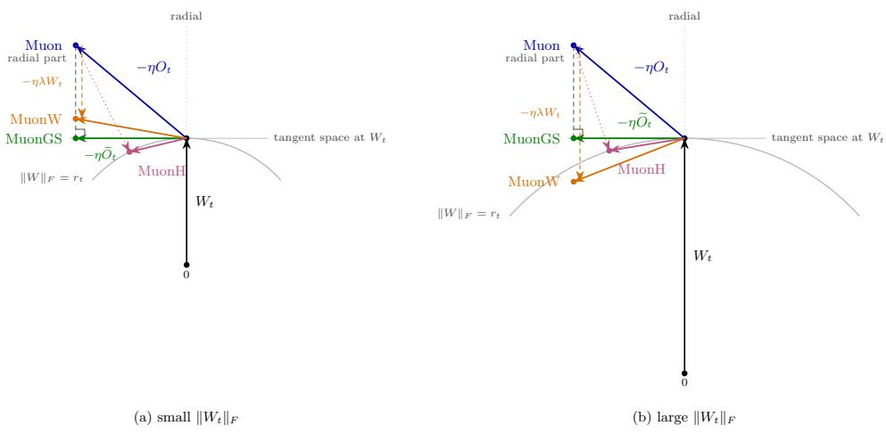  
Figure 1: One step of vanilla Muon, MuonW, MuonH and MuonGS from the same $W _ { t }$ and the same direction $O _ { t } ,$ for a small (left) and a large (right) weight norm. Vanilla Muon’s radial part (dashed) grows the norm at first order; MuonH retracts to $\| W \| _ { F } = R$ (dotted); MuonGS keeps the tangential part only, so the norm changes at second order. Muon $\mathbf { W } \mathbf { \bar { s } }$ decay $- \eta \lambda W _ { t }$ scales with $\| W _ { t } \| _ { F }$ but the actual step depends on the size of $W _ { t } ;$ the decay therefore hardly slows down the norm growth for a small norm but can shrink the norm for a large one.

To investigate this question, we propose MuonGS, which uses Gram–Schmidt (GS) projection to remove the radial component of Muon’s update. The resulting update is orthogonal to the current weights in the Frobenius inner product. This orthogonality eliminates the first-order increase in the weight norm, so the norm grows only at second order in the step size. With bounded directions and a constant nominal learning rate, this guarantees $O ( { \sqrt { t } } )$ norm growth and $C _ { T } = \Omega ( \sqrt { T } )$ ), with the same accumulation order over later training windows. MuonGS thus improves vanilla Muon’s worst-case accumulation guarantee without fixing a radius. For smooth scale-invariant objectives, we further established the convergence rate for MuonGS.

We evaluate MuonGS on FineWeb pretraining with modernized GPT-style models of approximately 160M and 400M parameters. At longer training horizons, MuonGS achieves lower validation perplexity than MuonH. Fitting MuonH’s loss as a function of the training-token budget gives an estimated token-equivalent speedup of up to about 15% at matched validation loss. In addition, MuonGS obtains lower validation perplexity than MuonH when pretraining a modern MoE model, having about 135M active and 1B total parameters, on Ultra-FineWeb. These results support MuonGS as a practical optimizer and demonstrate the value of relaxing norm-control requirements. Together with our theoretical guarantees, these findings provide a positive answer to the question above by showing that weaker norm control can indeed sustain accumulation throughout training while improving empirical performance.

Our contributions are threefold.

• We establish a global perspective on norm control in Muon, in the sense that we assess exploration over entire training trajectories through the growth of $C _ { T }$ and its increments over training intervals. Our analysis bounds relative weight displacement and, under scale-invariance and Lipschitz assumptions, attainable loss change. At a constant nominal learning rate, it distinguishes vanilla Muon’s logarithmic worst case from the linear guarantees of MuonW and fixed-norm control. It also explains when norm growth can offset a larger nominal learning rate.

• We propose MuonGS and prove $O ( { \sqrt { t } } )$ weight-norm growth, $C _ { T } = \Omega ( \sqrt { T } )$ , and $C _ { 2 T } - C _ { T } =$ $\Omega ( { \sqrt { T } } )$ for bounded directions and a constant nominal learning rate. These guarantees improvement on vanilla Muon’s logarithmic worst-case accumulation without requiring bounded weight norms. The bound on $C _ { 2 T } - C _ { T }$ further shows that accumulation is sustained over later training windows, preserving a necessary condition for continued exploration.

• We demonstrate MuonGS’s effectiveness in dense transformer pretraining at 160M and 400M parameter scale, with lower validation perplexity than MuonH at longer horizons and an estimated token-equivalent speedup of up to about 15% at matched validation loss. In addition, we show MuonGS obtains lower validation perplexity than MuonH when pretraining a modern MoE model having about 135M active and 1B total parameters.

## 2 Related Works

Weight Norm Control. Weight-norm control approaches have been commonly used in neural network training through reparameterization, shrinkage or constraints. Early works like weight normalization controlled weight geometry [Salimans and Kingma, 2016]. AdamW then decoupled weight decay from adaptive gradient preconditioning [Loshchilov and Hutter, 2017], while AdamP and SGDP [Heo et al., 2020] subsequently slowed norm growth by removing the radial component of the update for weights they detect as scale-invariant. Later methods introduced norm targets and per-matrix upper bounds [Loshchilov, 2023, Franke et al., 2024], followed by explicit constraints for LLM pretraining [Loshchilov et al., 2024, Wen et al., 2026, An et al., 2026, Hägele et al., 2026, Xie et al., 2026]. However, these methods do not describe how fast the norm grows, nor do they analyze what impact the increased weight norm has on the overall algorithm performance.

Effective Learning Rate. The effective learning rate describes how parameter scale modifies the effect of a nominal learning rate. In scale-invariant settings, Van Laarhoven [2017] derived effective learning rates proportional to $\eta / \Vert W \Vert ^ { 2 }$ for SGD and $\eta / { \bar { | | } } W { \bar { | | } }$ for RMSProp and Adam under their respective scaling assumptions. Later works related weight norms and decay to effective learning-rate schedules [Hoffer et al., 2018, Zhang et al., 2018], set up equivalences between weight decay and learning-rate schedules [Li and Arora, 2019], and studied related concepts such as spherical equilib rium, periodic behavior, and optimizer-dependent angular dynamics [Wan et al., 2021, Lobacheva et al., 2021, Roburin et al., 2022, Kosson et al., 2023]. In LLM pretraining, the effective learning rate also helps explain why weight decay improves training [D’Angelo et al., 2024] and why SGD underperforms Adam [Glentis et al., 2026]. More recently, Liu et al. [2026] observed that effective learning rate determines the loss dynamics, while Amin et al. [2026] established stability results for effective learning-rate schedules. However, they do not explore how much the effective learning rate can accumulate over training, or relate this accumulation to exploration capacity.

## 3 Norm Control Via Accumulated Effective Learning Rate

We begin with formalizing the global perspective on norm control by relating Muon’s exploration over training intervals to the accumulated effective learning rate $C _ { T }$ . Section 3.1 starts from what exploration means for a weight matrix of an LLM, derives the effective learning rate as the quantity that sets the size of a Muon step relative to the weights, and shows that the sum of effective learning rates over a training interval bounds how far training can explore in that interval. Section 3.2 compares how fast this sum grows under the three forms in which Muon is run in practice, without norm control, with decoupled weight decay, and with a fixed norm. Then it further answers whether a larger nominal learning rate can substitute for norm control. Proofs are collected in Appendix B.

## 3.1 Exploration and accumulated effective learning rate

Consider a weight matrix $W _ { t } \in \mathbb { R } ^ { m \times n }$ of a transformer block updated by Muon [Jordan et al., 2024], and denote $p = \operatorname* { m i n } \{ m , n \}$ . Vanilla Muon updates it as

$$
W _ { t + 1 } = W _ { t } - \eta _ { t } O _ { t } , \qquad O _ { t } = \mathrm { O r t h o g o n a l i z e } ( U _ { t + 1 } ) ,\tag{2}
$$

where $\eta _ { t } \geq 0$ is the nominal learning rate and $U _ { t + 1 }$ is the gradient momentum. Exact orthogonalization replaces each nonzero singular value of $U _ { t + 1 }$ by one, giving

$$
\Vert O _ { t } \Vert _ { F } = \sqrt { \mathrm { r a n k } ( U _ { t + 1 } ) } \leq \sqrt { p } .\tag{3}
$$

Thus a full-rank Muon direction has norm ${ \sqrt { p } } ,$ independent of the gradient magnitud $\mathrm { e } ^ { 2 }$

Write $r _ { t } = \| W _ { t } \| _ { F }$ for the weight norm and assume $r _ { t } > 0$ throughout training. We study exploration through the net movement of a weight matrix relative to its scale. Over an interval $[ s , T ]$ , the quantity

$$
\| W _ { T } - W _ { s } \| _ { F }
$$

measures how far the weights have moved relative to their final magnitude.

To connect this net movement to Muon’s updates, first compare each step with the weights on which it acts:

$$
\frac { \| W _ { t + 1 } - W _ { t } \| _ { F } } { r _ { t } } = \sqrt { \mathrm { r a n k } ( U _ { t + 1 } ) } \frac { \eta _ { t } } { r _ { t } } \leq \sqrt { p } \frac { \eta _ { t } } { r _ { t } } .\tag{4}
$$

Muon supplies the dimension-dependent update scale, while $\eta _ { t } / r _ { t }$ sets its size relative to the weights. We therefore use $\eta _ { t } / r _ { t }$ as the effective learning rate relative to the weight norm [D’Angelo et al., 2024, Liu et al., 2026]. Norm growth can reduce this rate even when the nominal learning rate is unchanged.

Over a training interval [s, T], these relative updates accumulate:

$$
\sum _ { t = s } ^ { T - 1 } \frac { \lVert W _ { t + 1 } - W _ { t } \rVert _ { F } } { r _ { t } } \leq \sqrt { p } \sum _ { t = s } ^ { T - 1 } \frac { \eta _ { t } } { r _ { t } } .\tag{5}
$$

This leads to the accumulated effective learning rate

$$
C _ { 0 } = 0 , \qquad C _ { T } = \sum _ { t = 0 } ^ { T - 1 } \frac { \eta _ { t } } { r _ { t } } .\tag{6}
$$

The sum $C _ { T }$ captures how much relative updating can accumulate along the trajectory. The following proposition connects this quantity to the net displacement that motivated the analysis.

Proposition 3.1 (Necessary accumulation for relative displacement). For the updates above and integers $0 \leq s < T$

$$
\frac { \| W _ { T } - W _ { s } \| _ { F } } { \operatorname* { m a x } \{ r _ { s } , r _ { T } \} } \leq \sqrt { p } ( C _ { T } - C _ { s } ) .\tag{7}
$$

In addition, define $F ( W ) = f ( W / \| W \| _ { F } )$ and suppose f is L-Lipschitz on the unit Frobenius sphere with respect to Frobenius distance. Then

$$
| F ( W _ { T } ) - F ( W _ { s } ) | \le 2 L \sqrt { p } ( C _ { T } - C _ { s } ) .\tag{8}
$$

The first bound (7) implies that a weight change of at least a fraction $\delta > 0$ of the larger endpoint norm requires $C _ { T } - \bar { C } _ { s } \geq \delta / \sqrt { p }$ for any weight matrix. The second bound (8) further assumes a scale-invariant loss, which means the loss depends only on its direction $W / \| W \| _ { F }$ because its output is normalized. These scale-invariant matrices are common in query and key projections of general transformers. Bound (8) states that under the scale-invariance and Lipschitz assumptions with $L > 0 ;$ , a loss decrease of at least $\Delta > 0$ requires $C _ { T } - C _ { s } \geq \Delta / ( 2 L \sqrt { p } )$ . Note that the Lipschitz assumption is mild as L is the Lipschitz constant of the loss restricted to the unit sphere, which is finite for every continuously differentiable loss. With the two bounds in Proposition 3.1, small accumulation therefore limits both relative movement and, under these additional assumptions, loss reduction. We further note that Proposition 3.1 serves as a necessary condition that a lower-bound threshold is needed for sufficient exploration of the algorithm. It does not claim that larger exploration capacity can achieve lower loss.

Proposition 3.1 holds for every interval $[ s , T ]$ , not only for the whole interval [0, T]. This is particularly relevant to later training because a large $C _ { T }$ may come mainly from early steps. Substantial relative weight movement after step s requires sufficient additional accumulation $C _ { T } - C _ { s } ,$ so continued exploration requires $C _ { T }$ to keep growing. The next section therefore compares norm controls by two metrics: the relative growth $C _ { T } - C _ { 1 }$ with respect to $T _ { \ast }$ , as well as the later stage relative growth $C _ { 2 T } - C _ { T }$ over the window $[ T , 2 T ]$ . Note that we use the relative growth of $C _ { T }$ because it is not sensitive to initialization scale or model size, which is not the case if we only consider $C _ { T }$ alone. See more discussion in Appendix D.

## 3.2 Accumulation under three Muon norm controls

Given the metric of $C _ { T }$ , we now compare how $C _ { T }$ grows under three forms of norm control for Muon, that is, leaving the norm uncontrolled, applying decoupled weight decay, or constraining the norm explicitly. They correspond to vanilla Muon [Jordan et al., 2024], MuonW [Liu et al., 2025], and the norm constraint used by MuonH [Wen et al., 2026], respectively. To isolate their effect, take a constant nominal learning rate $\eta _ { t } = \eta > 0$

• Vanilla Muon follows (2).

• MuonW uses

$$
W _ { t + 1 } = ( 1 - \eta \lambda ) W _ { t } - \eta O _ { t } , \qquad \lambda > 0 , \quad 0 < \eta \lambda < 1 .\tag{9}
$$

• For fixed-norm control, let $r _ { 0 } = R > 0$ and

$$
W _ { t + 1 } = R \frac { W _ { t } - \eta D _ { t } } { \Vert W _ { t } - \eta D _ { t } \Vert _ { F } } ,\tag{10}
$$

where $D _ { t }$ is the update direction before the weights are renormalized to norm R. Fixed norm uses $D _ { t } = O _ { t }$ , while MuonH additionally fixes the update norm by setting $D _ { t } =$ $R O _ { t } / \| O _ { t } \| _ { F }$ . The accumulation result below uses only the fixed weight norm, i.e., $D _ { t } = O _ { t }$

The next proposition characterizes the accumulated effective learning rate under these three cases. Proposition 3.2 (Accumulation under norm control). Assume a constant nominal learning rate $\eta _ { t } = \eta > 0$ , and let $R _ { \lambda } = \operatorname* { m a x } \{ r _ { 0 } , \sqrt { p } / \lambda \}$ . For every integer $T \geq 1 .$

(i) Vanilla Muon satisfies

$$
{ C _ { T } } \ge \frac { 1 } { \sqrt { p } } \log \Bigl ( 1 + \frac { \eta \sqrt { p } T } { r _ { 0 } } \Bigr ) , \qquad { C _ { 2 T } } - { C _ { T } } \ge \frac { 1 } { \sqrt { p } } \log \frac { { r _ { 0 } } + 2 \eta \sqrt { p } T } { { r _ { 0 } } + \eta \sqrt { p } T } .
$$

(ii) MuonW satisfies $C _ { T } \geq \eta T / R _ { \lambda }$ and $C _ { 2 T } - C _ { T } \geq \eta T / R _ { \lambda }$

(iii) A fixed norm R gives $C _ { T } = \eta T / R$ and $C _ { 2 T } - C _ { T } = \eta T / R$

Further, for vanilla Muon, the lower bound expressed in (i) is tight as there exists a function and an initialization such that the worst-case rate is attainable, i.e., $\bar { C } _ { T } = \Theta ( \log T )$ and $C _ { 2 T } - C _ { T } \to$ $\log 2 / { \sqrt { p } } .$

Proposition 3.2 shows why norm control matters for accumulation. Without it, the norm can grow linearly in t, so the effective learning rate can decay like $1 / t$ and $C _ { T }$ can grow as slowly as log T. Over a later window $[ T , 2 T ]$ , the bound in (i) tends to $( \log 2 ) / \sqrt { p }$ as T grows, so the accumulation of vanilla Muon over later windows can stay bounded. In comparison, weight decay and a fixed norm keep the norm at most $R _ { \lambda }$ or $R ,$ so the effective learning rate stays at least $\eta / R _ { \lambda }$ or $\eta / R ,$ , and $C _ { T }$ and $C _ { 2 T } - C _ { T }$ grow at least linearly. By Proposition 3.1, bounded accumulation over later windows limits how far the weights can move late in training and, under the scale-invariance and Lipschitz assumptions, how much the loss can still decrease. This offers an explanation for vanilla Muon’s slower progress in training [Liu et al., 2025] and for the improvements obtained with weight decay or fixed-norm constraints.

Figure 2 shows the three forms on the example (see Appendix B.3) that shows the bounds of Proposition 3.2(i) are tight: $F ( W ) = \exp ( \mathrm { t r } \bar { W } )$ from $W _ { 0 } = - 4 I _ { 2 }$ , where every Muon direction is $O _ { t } = I _ { 2 }$ , so each update $- \eta O _ { t }$ points away from the origin and the norm grows as fast as possible. Vanilla Muon has $r _ { t } = \sqrt { 2 } ( 4 + \eta t )$ and $C _ { T } = \Theta ( \log T )$ , whereas MuonW and fixed-norm control yield $C _ { T } = \Theta ( T )$ . The distinction is clearer over later windows: $C _ { 2 T } - C _ { T }$ approaches log $2 / \sqrt { 2 }$ for vanilla Muon but grows linearly with T under the other two controls.

The example in Proposition 3.2 shows that the difference in worst-case growth orders can occur in an actual Muon run. In practical LLM pretraining, we also observe such numerical differences in accumulation within the same training budget, though the gap is smaller. (See Figure 3).

The results so far fix the nominal learning rate. A natural question is whether a larger nominal learning rate can make up for the small accumulation of vanilla Muon. It does not, because a larger η also makes the norm grow faster, roughly in proportion to η, so the effective learning rates after the first step barely increase (Appendix C makes this precise). Figure 4 shows this in GPT-160M pretraining: raising the learning rate 16-fold moves $\bar { C } _ { 2 0 , 0 0 0 }$ of vanilla Muon only from 0.165 to 0.190, whereas with weight decay $C _ { 2 0 , 0 0 0 }$ grows with the learning rate. The best MuonW run for each weight decay (stars) reaches $C _ { 2 0 }$ ,000 between 0.3 and 0.4, a level that vanilla Muon does not reach at any learning rate, and a lower perplexity (21.98–22.02, versus 22.49 for the best vanilla Muon run).

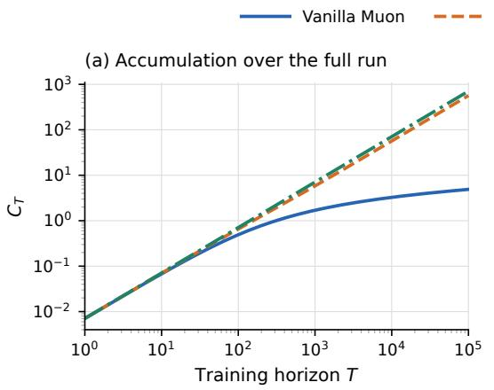

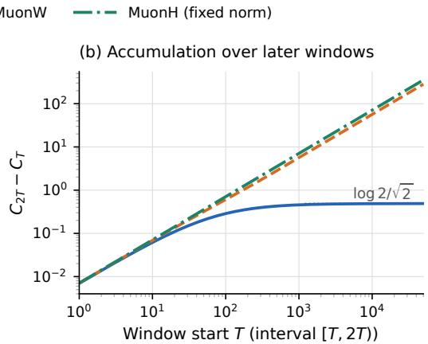  
Figure 2: An attainable gap in accumulation growth. Exact Muon is run on $F ( W ) = \exp ( \operatorname { t r } W )$ from $W _ { 0 } = - 4 I _ { 2 }$ for $1 0 ^ { 5 }$ steps, with $\eta = 0 . 0 4$ and momentum coefficient $\beta = 0 . 9 5$ . MuonW uses $\lambda = 0 . 2 ,$ , and MuonH uses $R = 4 \sqrt { 2 }$ . All methods have the same orthogonalized direction $I _ { 2 } ,$ which MuonH rescales to $D _ { t } = 4 I _ { 2 }$ . Left: total accumulation. Right: accumulation over $[ T , 2 T )$ ; the dotted line is log $2 / { \sqrt { 2 } }$

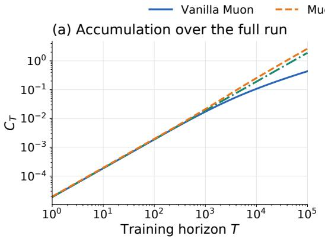

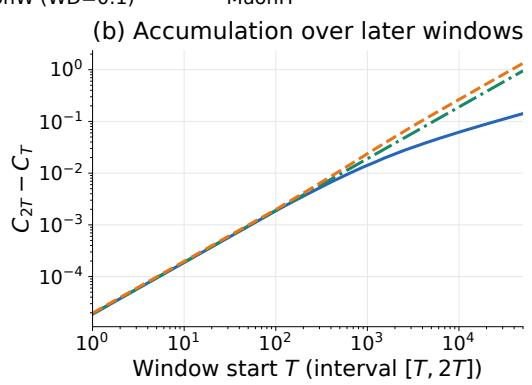  
Figure 3: Accumulate effective learning rate $C _ { T }$ vs training horizon T. Results from training a 160M GPT-style model on FineWeb for 100,000 steps (about 50B tokens) with a constant learning rate of 0.005. Left: total accumulation $C _ { T }$ . Right: accumulation over [T, 2T).

To summarize, our analysis links norm control to exploration through accumulated effective learning rates. Weight decay and fixed-norm constraints sustain accumulation, while rapid norm growth can limit it and offset a larger nominal learning rate.

## 4 MuonGS for LLM Pretraining

The preceding analysis links the benefit of bounded weight norms to the accumulation they preserve. This suggests relaxing the bounded-norm requirement, since sufficiently slow norm growth can still guarantee faster accumulation than vanilla Muon’s logarithmic worst case. For example, at a constant

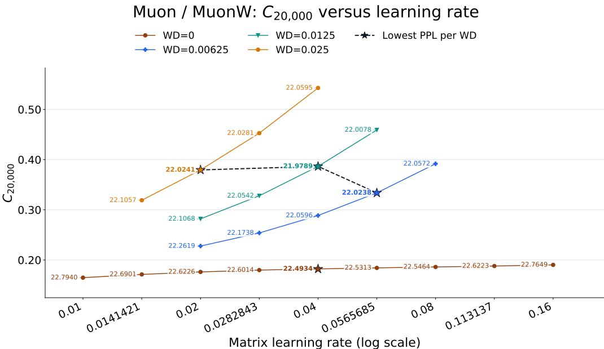  
Figure 4: Accumulate effective learning rate $C _ { T }$ vs learning rate scale $\eta .$ Results from training a 160M GPT-style model on FineWeb for 20,000 steps (about 10.5B tokens). Each point represents a learning-rate and weight-decay setting; solid curves connect settings with the same weight decay (WD). WD= 0 is vanilla Muon, and positive WD corresponds to MuonW. Numbers beside the points report perplexity. Stars mark the lowest perplexity among the tested learning rates for each WD; the dashed line connects these stars for MuonW.

nominal learning rate $\eta > 0$ , the bound $r _ { t } \leq r _ { 0 } + c t ^ { a }$ with $c > 0$ and $0 \leq a < 1$ gives

$$
C _ { 2 T } - C _ { T } \geq \frac { \eta T } { r _ { 0 } + c ( 2 T ) ^ { a } } = \Omega ( T ^ { 1 - a } ) .
$$

Accumulation can therefore grow over later training windows even when weight norms increase and effective learning rates decrease. This opens up a broader family of Muon variants and brings us back to the question posed in the introduction. Can this additional flexibility be used to design optimizers that sustain accumulation throughout training and achieve better practical performance?

We address this question with MuonGS, which controls norm growth by removing the radial component of Muon’s update. We analyze its accumulation and optimization properties, then evaluate its performance in LLM pretraining.

## 4.1 Removing the radial component of the Muon update

To construct an update that limits weight-norm growth, we first examine how a vanilla Muon step changes the squared weight norm.

$$
\lVert W _ { t } - \eta _ { t } O _ { t } \rVert _ { F } ^ { 2 } = r _ { t } ^ { 2 } - 2 \eta _ { t } \langle W _ { t } , O _ { t } \rangle _ { F } + \eta _ { t } ^ { 2 } \lVert O _ { t } \rVert _ { F } ^ { 2 } .\tag{11}
$$

The term $- 2 \eta _ { t } \langle W _ { t } , O _ { t } \rangle _ { F }$ is linear in the step size and increases the squared weight norm when $\langle W _ { t } , O _ { t } \rangle _ { F } < \dot { 0 }$ . Muon controls the size of $O _ { t }$ through matrix orthogonalization, but the update may still point partly along $W _ { t }$ . This radial component is responsible for the first-order norm change.

We therefore seek a modified direction that eliminates the first-order norm change while remaining as close as possible to Muon’s proposed update. Giving priority to the norm-control requirement leads to the following simple bilevel formulation for fixed $W _ { t } \neq 0$ and $O _ { t }$

$$
\begin{array} { r l } { \underset { D \in \mathbb { R } ^ { m \times n } } { \operatorname* { m i n } } } & { \frac { 1 } { 2 } \| D - O _ { t } \| _ { F } ^ { 2 } } \\ { \mathrm { s u b j e c t ~ t o } } & { D \in \underset { Z \in \mathbb { R } ^ { m \times n } } { \arg \operatorname* { m i n } } \frac { 1 } { 2 } \langle W _ { t } , Z \rangle _ { F } ^ { 2 } . } \end{array}
$$

Algorithm 1 MuonGS for one weight matrix (the projection is line 4).   
Require: learning rate $\eta _ { t } ,$ momentum $\beta ,$ initial weights $W _ { 0 } , U _ { 0 } = 0$   
1: for $t = 0 , 1 , \bar { 2 , } \ldots \bar { \bf d o }$   
2: $\boldsymbol { U } _ { t + 1 } \gets \beta \boldsymbol { U } _ { t } + \boldsymbol { \nabla } f ( \boldsymbol { W } _ { t } )$ ▷ gradient momentum   
3: $O _ { t } \gets \mathrm { O r t h o g o n a l i z e } ( U _ { t + 1 } )$ ▷ Newton–Schulz, as in Muon   
4: $\widetilde { O } _ { t }  O _ { t } - \frac { \langle \mathrm { \tilde { W } } _ { t } , O _ { t } \rangle } { \| W _ { t } \| _ { F } ^ { 2 } } W _ { t }$ ▷ remove the component along $W _ { t }$   
5: $W _ { t + 1 } \gets W _ { t } - \eta _ { t } \tilde { O } _ { t }$   
6: end for

The lower level minimizes the squared first-order norm change, so its minimizers are precisely the directions orthogonal to $W _ { t }$ . The upper level selects the closest such direction to $O _ { t }$ . The unique solution is the Gram–Schmidt (GS) projection onto the tangent space of the sphere through $W _ { t }$ . We call the resulting method MuonGS, with the update

$$
\widetilde { O } _ { t } = O _ { t } - \frac { \langle W _ { t } , O _ { t } \rangle _ { F } } { r _ { t } ^ { 2 } } W _ { t } , \qquad W _ { t + 1 } = W _ { t } - \eta _ { t } \widetilde { O } _ { t } .\tag{12}
$$

The projection gives the solution in closed form, so no additional iterative optimization is required. Since $O _ { t }$ is treated as given, it also applies when the Muon direction incorporates momentum and approximate matrix orthogonalization.

The projection gives $\langle W _ { t } , \widetilde { O } _ { t } \rangle _ { F } = 0$ and $\| \widetilde { O } _ { t } \| _ { F } \le \sqrt { p } .$ . Substituting into (11) leaves

$$
r _ { t + 1 } ^ { 2 } = r _ { t } ^ { 2 } + \eta _ { t } ^ { 2 } \lVert \widetilde { O } _ { t } \rVert _ { F } ^ { 2 } .\tag{13}
$$

Thus the norm may increase, but its squared increment is only quadratic in the step size. AdamP applies the same tangent-space projection to the Adam update, removing its radial component to suppress momentum-induced norm growth on weights it detects as scale-invariant, i.e., when the cosine similarity between the gradient and the weight falls below a small threshold [Heo et al., 2020]. MuonGS applies this projection directly to Muon’s matrix updates, without a scale-invariance test. More importantly, beyond this algorithmic distinction, our analysis links the resulting normgrowth control to exploration over entire training trajectories. As shown next, for bounded update directions and a constant nominal learning rate, MuonGS guarantees $r _ { t } = O ( { \sqrt { t } } ) , C _ { T } = \Omega ( { \sqrt { T } } )$ and $C _ { 2 T } - C _ { T } = \Omega ( \sqrt { T } )$ . These guarantees hold without assuming a scale-invariant objective.

## 4.2 Norm growth and accumulation

We now quantify how the projection’s control of norm growth sustains accumulation over training. Starting from $r _ { 0 } > 0$ and using the bound $\| O _ { t } \| _ { F } \leq \sqrt { p } ,$ the following theorem controls weight-norm growth under arbitrary learning-rate schedules. For a constant learning rate, it then gives lower bounds on both $C _ { T }$ and $\dot { C } _ { 2 T } - \mathrm { \bar { } }$ , showing that accumulation is sustained during later training as well as over the full trajectory.

Theorem 4.1 (MuonGS growth and accumulation). Under (12), all iterates remain nonzero and

$$
r _ { T } ^ { 2 } = r _ { 0 } ^ { 2 } + \sum _ { t = 0 } ^ { T - 1 } \eta _ { t } ^ { 2 } \| \widetilde { O } _ { t } \| _ { F } ^ { 2 } \leq r _ { 0 } ^ { 2 } + p \sum _ { t = 0 } ^ { T - 1 } \eta _ { t } ^ { 2 } .\tag{14}
$$

For $\begin{array} { r } { \eta _ { t } = \eta > 0 , } \end{array}$

$$
C _ { T } \ge \frac { 2 } { p \eta } \left( \sqrt { r _ { 0 } ^ { 2 } + p \eta ^ { 2 } T } - r _ { 0 } \right) = \Omega ( \sqrt { T } ) ,\tag{15}
$$

$$
C _ { 2 T } - C _ { T } \ge \frac { \eta T } { \sqrt { r _ { 0 } ^ { 2 } + 2 p \eta ^ { 2 } T } } = \Omega ( \sqrt { T } ) .\tag{16}
$$

MuonGS therefore limits the norm to $O ( { \sqrt { t } } )$ and guarantees at least square-root accumulation, including over later windows. It improves the worst-case guarantee of vanilla Muon without enforcing

Table 1: Norm and accumulation guarantees at a constant positive learning rate.
<table><tr><td>Control</td><td>Norm bound</td><td> $C _ { T }$ </td><td> $C _ { 2 T } - C _ { T }$ </td></tr><tr><td>Vanilla Muon</td><td>O(t)</td><td> $\Omega ( \log T )$ </td><td>Ω(1)</td></tr><tr><td>Weight decay</td><td>O(1)</td><td> $\dot { \Omega } ( T )$ </td><td>Ω(T)</td></tr><tr><td>Fixed norm</td><td>R</td><td> $\eta T / \dot { R }$ </td><td> $\eta T / \dot { R }$ </td></tr><tr><td>GS</td><td> $O ( { \sqrt { t } } )$ </td><td> $\Omega ( { \sqrt { T } } )$ </td><td> $\Omega ( { \sqrt { T } } )$ </td></tr></table>

a fixed radius. Thus the accumulation preserved by MuonGS is available during later training, rather than coming only from early updates. Table 1 summarizes the comparison with vanilla Muon and bounded-norm controls.

The preceding bounds describe the relative updating available along a trajectory. To connect this accumulation to optimization, we now consider a fixed scale-invariant matrix objective

$$
\begin{array} { r } { F ( W ) = f ( W / \| W \| _ { F } ) , \qquad O _ { t } = \mathrm { O r t h o g o n a l i z e } ( \nabla F ( W _ { t } ) ) , } \end{array}\tag{17}
$$

where $f$ is twice continuously differentiable on the unit Frobenius sphere.

Proposition 4.2 (Stationarity for exact current-gradient MuonGS). Under (17), MuonGS with $r _ { 0 } > 0$ and a constant learning rate $\eta > 0$ satisfies,for every even $T \geq 2 ,$

$$
\operatorname* { m i n } _ { T / 2 \le t < T } \| \mathrm { g r a d } f ( W _ { t } / r _ { t } ) \| _ { F } \le \frac { K } { \sqrt { T } } ,\tag{18}
$$

where grad f is the sphere gradient and $K < \infty$ is independent $o f T .$

Here the current-gradient direction provides descent alignment, while GS controls the weight norm and the resulting effective learning rates. Together they guarantee an iterate with a small spheregradient norm in the second half of training, even though the weight norm can keep growing.

## 5 Experiments

In this section we evaluate the MuonGS optimizer on the task of LLM pre-training. Since the results from Wen et al. [2026] indicate that the MuonH outperforms MuonW in typical pre-training settings, we focus our main comparison to MuonH. Note that both MuonGS and MuonH share the favorable property of not needing to tune a weight decay coefficient as opposed to MuonW. We include some additional results comparing with Muon and MuonW in Appendix A.1. Below we present our main results using dense GPT-style models, but include preliminary results on MoE model training in Section 5.3.

## 5.1 Experimental settings

Architecture. We use the modernized GPT-style architecture from the Modded-NanoGPT Optimization Benchmark [Jordan, 2026] at two scales, approximately 160M and 400M parameters. The smaller model, which corresponds to the NanoGPT model used in Jordan [2026], has 12 layers, hidden width 768, and 6 attention heads; the other is a scaled-up version and has 24 layers, hidden width 1024, and 8 heads, with head dimension 128 for both sizes. Both models use RMSNorm, rotary positional embeddings, QK-Norm, squared-ReLU MLPs, and untied input and output embeddings.

Pre-training setup. We pre-train on the 100B-token subset of the FineWeb dataset [Penedo et al., 2024] using a sequence length of 1024 and a global batch of 512 sequences. Our experiments span approximately 3–25B training tokens for the 160M model and 8–63B for the 400M model, corresponding to roughly 1–8 Chinchilla budgets [Hoffmann et al., 2022] at both scales. We use BF16 mixed-precision training.

Optimizers. We compare MuonGS as described in Algorithm 1 with MuonH and Muon/MuonW. All methods use Nesterov momentum 0.95 for hidden matrix weights. AdamW is used for token embeddings, output-head weights, and all 1D parameters, with $( \bar { \beta _ { 1 } } , \beta _ { 2 } ) = ( 0 . 8 , 0 . 9 5 ) , \epsilon = 1 0 ^ { - 1 0 }$ weight decay $1 0 ^ { - 3 }$ , and respective max learning rates 0.7, 0.004, and 0.015. Matrix and auxiliary learning rates decay linearly to zero without warmup after constant phases covering 15% and 30% of training, respectively.

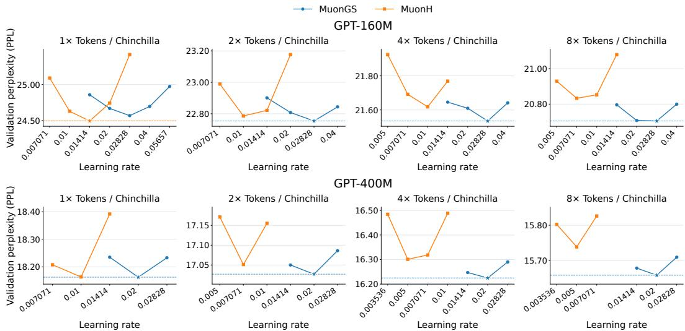  
Figure 5: Validation perplexity versus learning rate for MuonGS and MuonH across the two model sizes and Chinchilla ration $1 \times - 8 \times$ . Stars and dashed horizontal lines indicate the best observed perplexity in each panel.

Tuning and metrics. We tune learning rates on a multiplicative grid with ratio $\sqrt { 2 }$ similar to Wen et al. [2026], separately for all optimizers, model sizes and training durations. For MuonW we additionally tune the weight decay as shown in Appendix A.1. We use as metric the cross-entropy loss ${ \mathcal L } _ { \mathrm { v a l } }$ over about 10M tokens from the FineWeb validation set, equivalently expressed as perplexity P $\mathrm { P L } = \exp ( \mathcal { L } _ { \mathrm { v a l } } )$

## 5.2 Benchmarking Results

Learning Rate Sweeps. From Figure 5 we observe that, for extended training horizons (overtraining), MuonGS achieves lower perplexity than MuonH. We note that in modern LLM pre-training extending to beyond one Chinchilla training tokens, $\mathrm { i . e . , }$ . more than 20 tokens per model parameter, is common practice [Grattafiori et al., 2024, Yang et al., 2025]. Therefore, MuonGS’s favorable scaling with training horizon is particularly relevant to modern LLM pre-training.

Speedup Estimation. Using the best results for each algorithm from the sweeps above, we estimate the training-budget speedup of MuonGS over MuonH following the method used in Wen et al. [2025]. Specifically, for each model size N, we fit MuonH’s validation loss as a function of training-token budget D by nonlinear least squares:

$$
\widehat { L } _ { N } ( D ) = \alpha _ { N } D ^ { - B _ { N } } + \beta _ { N } .
$$

For a MuonGS run achieving loss $L _ { \mathrm { G S } }$ at budget $D _ { \mathrm { G S } }$ , we solve $\widehat { L } _ { N } ( D _ { \mathrm { H } } ) \ : = \ : L _ { \mathrm { G S } }$ and report $D _ { \mathrm { H } } / D _ { \mathrm { G S } }$ as the estimated speedup, where $D _ { \mathrm { H } }$ is the estimated training-token budget MuonH would require to match the validation loss achieved by MuonGS.

From Figure 6 we observe that MuonGS achieves a token-equivalent speedup over MuonH up to about 7-15% for longer training horizons.

## 5.3 MoE experiments

In this section we include preliminary results comparing MuonGS to MuonH on a modern Mixtureof-Experts (MoE) architecture. The model incorporates grouped-query attention [Ainslie et al., 2023], gated attention [Qiu et al., 2026] and attention residuals (AttnRes) [Team et al., 2026]. It has 32 layers, hidden width 512, and 64 routed experts with top-7 routing plus one shared expert per layer, yielding approximately 135M active non-embedding parameters and 1B total parameters. We train on Ultra-FineWeb [Wang et al., 2025] for 10.8B and 21.6B tokens (i.e., 80 and 160 times the active parameters), using a batch size of 1,024 sequences of length 4,096. Learning rates are tuned on a ${ \sqrt { 2 } } .$ -spaced grid, with 2% warmup followed by linear decay to zero. Both MuonGS and MuonH use momentum 0.95 with Nesterov acceleration.

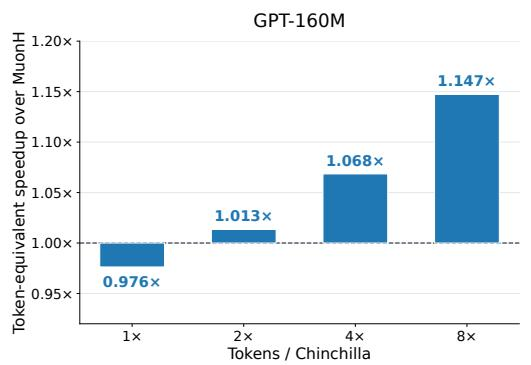

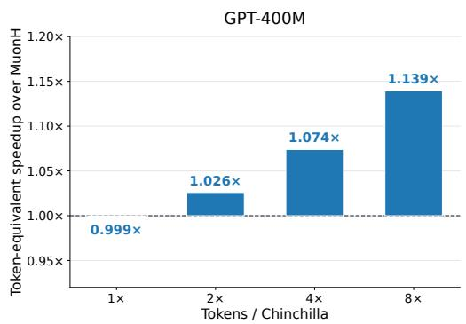  
Figure 6: Estimated token-equivalent speedup of MuonGS over MuonH for GPT-160M (left) and GPT-400M (right) across Chinclilla ratios 1×–8×.

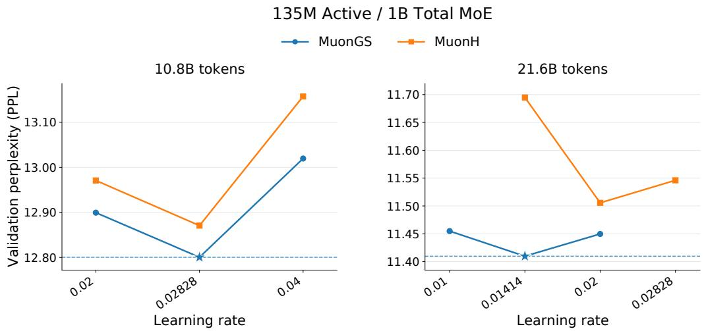  
Figure 7: Validation perplexity versus learning rate for MuonGS and MuonH for an 135M active / 1B total MoE model for two different training durations. Stars and dashed horizontal lines indicate the best observed perplexity in each panel.

From Figure 7, we observe that MuonGS achieves lower best validation perplexity than MuonH at both training budgets, making it a promising method for modern MoE optimization.

## 6 Conclusion

We reexamined the role of weight norm control for Muon over the entire training trajectory instead of a single step. In particular, we use the accumulated effective learning rate to measure how far the weights can move relative to their norm over any training interval, and shows that continued exploration requires it to keep growing. We further show that vanilla Muon can only guarantee the accumulation to grow logarithmically, while weight norm control approaches such as weight decay and fixed-norm control guarantee a linear accumulation growth, which explains the role of weight norm control. Based on this finding, we relax the weight norm control to a larger range of approaches. In particular, we propose MuonGS by simply removing the radial component of the Muon update. Theoretically, we show that MuonGS guarantees an accumulation of at least $\sqrt { T }$ sufficient for continued exploration. Numerically, MuonGS outperforms MuonW and MuonH at long training horizons, providing a speedup of up to 15% at matched validation loss. Our accumulation guarantees are worst-case bounds, and the accumulation guarantee provides a necessary but not sufficient condition for continued exploration. Which rate of norm growth works best for a given training budget remains an open question.

## References

Joshua Ainslie, James Lee-Thorp, Michiel De Jong, Yury Zemlyanskiy, Federico Lebrón, and Sumit Sanghai. Gqa: Training generalized multi-query transformer models from multi-head checkpoints. In Proceedings ofthe 2023 conference on empirical methods in natural language processing, pages 4895–4901, 2023.

Hasan Amin, Wei-Kai Chang, and Rajiv Khanna. When does scale-invariant optimization become unstable? an exact schedule law with weight decay. arXiv preprint arXiv:2609.09116, 2026.

Kang An, Jiaxiang Li, Donald Goldfarb, and Shiqian Ma. Demystifying manifold constraints in llm pre-training. arXiv preprint arXiv:2605.04418, 2026.

Francesco D’Angelo, Maksym Andriushchenko, Aditya Varre, and Nicolas Flammarion. Why do we need weight decay in modern deep learning? In Advances in Neural Information Processing Systems, volume 37, 2024. URL https://proceedings.neurips.cc/paper\_files/paper/ 2024/hash/29496c942ed6e08ecc469f4521ebfff0-Abstract-Conference.html.

Jörg K Franke, Michael Hefenbrock, Gregor Koehler, and Frank Hutter. Improving deep learning optimization through constrained parameter regularization. Advances in Neural Information Processing Systems, 37:8984–9025, 2024.

Athanasios Glentis, Dawei Li, Chung-Yiu Yau, and Mingyi Hong. Revisiting the adam-sgd gap in llm pre-training: The role of large effective learning rates. arXiv preprint arXiv:2605.17787, 2026.

Aaron Grattafiori, Abhimanyu Dubey, Abhinav Jauhri, Abhinav Pandey, Abhishek Kadian, Ahmad Al-Dahle, Aiesha Letman, Akhil Mathur, Alan Schelten, Alex Vaughan, et al. The llama 3 herd of models. arXiv preprint arXiv:2407.21783, 2024.

Alexander Hägele, Alejandro Hernández-Cano, Atli Kosson, and Martin Jaggi. Improving neural network training by decoupling the magnitude and direction of weight vectors. arXiv preprint arXiv:2606.25971, 2026.

Byeongho Heo, Sanghyuk Chun, Seong Joon Oh, Dongyoon Han, Sangdoo Yun, Gyuwan Kim, Youngjung Uh, and Jung-Woo Ha. Adamp: Slowing down the slowdown for momentum optimizers on scale-invariant weights. arXiv preprint arXiv:2006.08217, 2020.

Elad Hoffer, Ron Banner, Itay Golan, and Daniel Soudry. Norm matters: efficient and accurate normalization schemes in deep networks. Advances in Neural Information Processing Systems, 31, 2018.

Jordan Hoffmann, Sebastian Borgeaud, Arthur Mensch, Elena Buchatskaya, Trevor Cai, Eliza Rutherford, Diego de Las Casas, Lisa Anne Hendricks, Johannes Welbl, Aidan Clark, et al. Training compute-optimal large language models (2022). arXiv preprint arXiv:2203.15556, 2022.

Keller Jordan. Modded-nanogpt optimization benchmark, 2026. URL https://github.com/ KellerJordan/modded-nanogpt/tree/master/records/track\_3\_optimization.

Keller Jordan, Yuchen Jin, Vlado Boza, Jiacheng You, Franz Cesista, Laker Newhouse, and Jeremy Bernstein. Muon: An optimizer for hidden layers in neural networks, 2024. URL https://kellerjordan. github. io/posts/muon, 6(3):4, 2024.

Maxim Kodryan, Ekaterina Lobacheva, Maksim Nakhodnov, and Dmitry Vetrov. Training scaleinvariant neural networks on the sphere can happen in three regimes. Advances in Neural Information Processing Systems, 35:14058–14070, 2022.

Atli Kosson, Bettina Messmer, and Martin Jaggi. Rotational equilibrium: How weight decay balances learning across neural networks. arXiv preprint arXiv:2305.17212, 2023.

Zhiyuan Li and Sanjeev Arora. An exponential learning rate schedule for deep learning. arXiv preprint arXiv:1910.07454, 2019.

Jingyuan Liu, Jianlin Su, Xingcheng Yao, Zhejun Jiang, Guokun Lai, Yulun Du, Yidao Qin, Weixin Xu, Enzhe Lu, Junjie Yan, et al. Muon is scalable for llm training. arXiv preprint arXiv:2502.16982, 2025.

Zihan Liu, Ruiheng Zheng, Shaobo Zhang, Changxin Tian, Kunlong Chen, Zhiqiang Zhang, and Lei Wu. Effective learning rate governs loss dynamics in language model pretraining. arXiv preprint arXiv:2608.24814, 2026. URL https://arxiv.org/abs/2608.24814.

Ekaterina Lobacheva, Maxim Kodryan, Nadezhda Chirkova, Andrey Malinin, and Dmitry P Vetrov. On the periodic behavior of neural network training with batch normalization and weight decay. Advances in Neural Information Processing Systems, 34:21545–21556, 2021.

Ilya Loshchilov. Weight norm control. arXiv preprint arXiv:2311.11446, 2023.

Ilya Loshchilov and Frank Hutter. Decoupled weight decay regularization. arXiv preprint arXiv:1711.05101, 2017.

Ilya Loshchilov, Cheng-Ping Hsieh, Simeng Sun, and Boris Ginsburg. nGPT: Normalized transformer with representation learning on the hypersphere. arXiv preprint arXiv:2410.01131, 2024.

Guilherme Penedo, Hynek Kydlícek, Loubna Ben allal, Anton Lozhkov, Margaret Mitchell, Colinˇ Raffel, Leandro Von Werra, and Thomas Wolf. The fineweb datasets: Decanting the web for the finest text data at scale, 2024.

Zihan Qiu, Zekun Wang, Bo Zheng, Zeyu Huang, Kaiyue Wen, Songlin Yang, Rui Men, Le Yu, Fei Huang, Suozhi Huang, et al. Gated attention for large language models: Non-linearity, sparsity, and attention-sink-free. Advances in Neural Information Processing Systems, 38:100092–100118, 2026.

Simon Roburin, Yann de Mont-Marin, Andrei Bursuc, Renaud Marlet, Patrick Perez, and Mathieu Aubry. Spherical perspective on learning with normalization layers. Neurocomputing, 487:66–74, 2022.

Tim Salimans and Durk P Kingma. Weight normalization: A simple reparameterization to accelerate training of deep neural networks. Advances in neural information processing systems, 29, 2016.

Kimi Team, Guangyu Chen, Yu Zhang, Jianlin Su, Weixin Xu, Siyuan Pan, Yaoyu Wang, Yucheng Wang, Guanduo Chen, Bohong Yin, et al. Attention residuals. arXiv preprint arXiv:2603.15031, 2026.

Twan Van Laarhoven. L2 regularization versus batch and weight normalization. arXiv preprint arXiv:1706.05350, 2017.

Ruosi Wan, Zhanxing Zhu, Xiangyu Zhang, and Jian Sun. Spherical motion dynamics: Learning dynamics of normalized neural network using sgd and weight decay. Advances in Neural Information Processing Systems, 34:6380–6391, 2021.

Yudong Wang, Zixuan Fu, Jie Cai, Peijun Tang, Hongya Lyu, Yewei Fang, Zhi Zheng, Jie Zhou, Guoyang Zeng, Chaojun Xiao, et al. Ultra-fineweb: Efficient data filtering and verification for high-quality llm training data. arXiv preprint arXiv:2505.05427, 2025.

Kaiyue Wen, David Hall, Tengyu Ma, and Percy Liang. Fantastic pretraining optimizers and where to find them. arXiv preprint arXiv:2509.02046, 2025.

Kaiyue Wen, Xingyu Dang, Kaifeng Lyu, Tengyu Ma, and Percy Liang. Fantastic pretraining optimizers and where to find them ii: Hyperball optimization. arXiv preprint arXiv:2606.16899, 2026.

Tian Xie, Haoming Luo, Haoyu Tang, Yiwen Hu, Jason Klein Liu, Qingnan Ren, Yang Wang, Wayne Xin Zhao, Rui Yan, Bing Su, et al. Controlled llm training on spectral sphere. arXiv preprint arXiv:2601.08393, 2026.

An Yang, Anfeng Li, Baosong Yang, Beichen Zhang, Binyuan Hui, Bo Zheng, Bowen Yu, Chang Gao, Chengen Huang, Chenxu Lv, et al. Qwen3 technical report. arXiv preprint arXiv:2505.09388, 2025.

Guodong Zhang, Chaoqi Wang, Bowen Xu, and Roger Grosse. Three mechanisms of weight decay regularization. arXiv preprint arXiv:1810.12281, 2018.

## A Additional Experiments

## A.1 Experiments with Muon/MuonW

In Figure 8 we include a comparison of MuonH and the proposed MuonGS over Muon and MuonW (with varying weight decay). We observe that Muon, not using any type of weight norm control, performs noticeably worse than the other baselines. MuonGS obtains the best perplexity, followed by MuonH and MuonW.

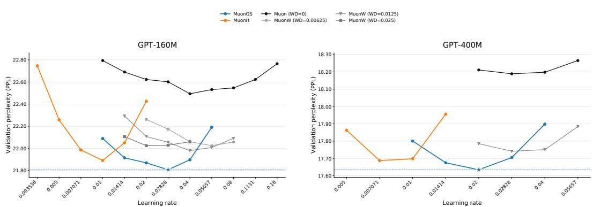  
Figure 8: Validation perplexity vs learning rate for MuonGS, MuonH, Muon and MuonW with varying weight decay. Both models are trained for 20k steps (about 10.5B tokens) on FineWeb.

We also compare the evolution of the norm of the combined matrix weights, $\lVert \boldsymbol { w } _ { t } \rVert _ { 2 }$ , during training. As shown in Figure 9, MuonH maintains a constant norm, while Muon without weight decay exhibits considerably larger norm growth. MuonW’s norm initially increases and subsequently declines, whereas MuonGS exhibits more moderate, gradual norm growth without weight decay or an explicit fixed-norm constraint.

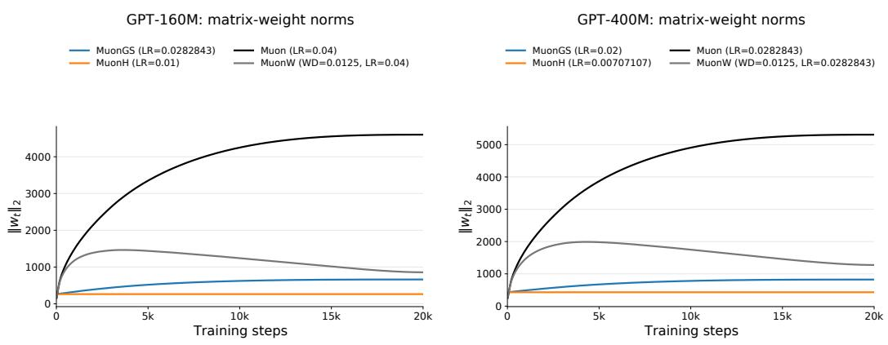  
Figure 9: Weight-norm evolution for the 160M (left) and 400M (right) models over 20k training steps, using each method’s best learning rate. Here, $w _ { t }$ concatenates the matrix weights updated by Muon variants, excluding auxiliary AdamW parameters. MuonW uses weight decay 0.0125 which was found to be the best among the ones tested as shown 8

## B Proofs and Examples

## B.1 Proof of Proposition 3.1

Proof. For nonzero matrices $X , Y$ let

$$
d ( X , Y ) = \frac { \| X - Y \| _ { F } } { \operatorname* { m a x } \{ \| X \| _ { F } , \| Y \| _ { F } \} } .
$$

We first show that $d ( X , Y ) \leq d ( X , Z ) + d ( Z , Y )$ . Write $x = \| X \| _ { F } , y = \| Y \| _ { F } , z = \| Z \| _ { F }$ , and assume $x \geq y . \operatorname { I f } z \leq x .$ , both denominators on the right are at most x, and the claim follows from the triangle inequality for $\| \cdot \| _ { F \cdot } \ \mathrm { I f } \ z > x .$ , use the inversion $\iota ( X ) = X / \| X \| _ { F } ^ { 2 }$ , which satisfies $\Vert \iota ( X ) - \bar { \iota } ( Y ) \Vert _ { F } ^ { \cdot } = \Vert \bar { X } - \ddot { Y } \Vert _ { F } ^ { \cdot } / ( x y )$ . Then

$$
d ( X , Y ) = y \| \iota ( X ) - \iota ( Y ) \| _ { F } , \quad d ( X , Z ) = x \| \iota ( X ) - \iota ( Z ) \| _ { F } , \quad d ( Z , Y ) = y \| \iota ( Z ) - \iota ( Y ) \| _ { F } ,
$$

and the claim follows from the triangle inequality for ι and $y \leq x .$

Applying this inequality along the iterates and then (4),

$$
\frac { \| \boldsymbol { W } _ { T } - \boldsymbol { W } _ { s } \| _ { F } } { \operatorname* { m a x } \{ r _ { s } , r _ { T } \} } \leq \sum _ { t = s } ^ { T - 1 } \frac { \| \boldsymbol { W } _ { t + 1 } - \boldsymbol { W } _ { t } \| _ { F } } { \operatorname* { m a x } \{ r _ { t } , r _ { t + 1 } \} } \leq \sum _ { t = s } ^ { T - 1 } \frac { \eta _ { t } \| \boldsymbol { O } _ { t } \| _ { F } } { r _ { t } } \leq \sqrt { p } ( C _ { T } - C _ { s } ) ,
$$

which is (7). For (8), let $x \geq y$ again; since $x - y \leq \| X - Y \| _ { F }$

$$
\Big \| \frac { X } { x } - \frac { Y } { y } \Big \| _ { F } \leq \frac { \| X - Y \| _ { F } } { x } + \| Y \| _ { F } \Big ( \frac { 1 } { y } - \frac { 1 } { x } \Big ) = \frac { \| X - Y \| _ { F } + x - y } { x } \leq 2 d ( X , Y ) .
$$

Hence $| F ( W _ { T } ) - F ( W _ { s } ) | \leq L \| W _ { T } / r _ { T } - W _ { s } / r _ { s } \| _ { F } \leq 2 L d ( W _ { T } , W _ { s } )$ , and (7) gives (8). □

## B.2 Proof of Proposition 3.2

Proof. Vanilla Muon. Fix integers $0 \leq s < u$ . The triangle inequality gives $r _ { t + 1 } \leq r _ { t } + \eta _ { t } \sqrt { p } ,$ , so at a constant learning rate $r _ { t } \le r _ { 0 } + \eta \sqrt { p } t$ . The function $x \mapsto \eta / ( r _ { 0 } + \eta \sqrt { p } x )$ is decreasing, so its value at an integer t is at least its integral over $[ t , t + 1 ]$ . Summing over $s \leq t < \prime$ u gives

$$
C _ { u } - C _ { s } = \sum _ { t = s } ^ { u - 1 } \frac { \eta } { r _ { t } } \geq \int _ { s } ^ { u } \frac { \eta d x } { r _ { 0 } + \eta \sqrt { p } x } = \frac { 1 } { \sqrt { p } } \log \frac { r _ { 0 } + \eta \sqrt { p } u } { r _ { 0 } + \eta \sqrt { p } s } .
$$

Taking $( s , u ) = ( 0 , T )$ and $( s , u ) = ( T , 2 T )$ give (i).

MuonW. For $0 \leq \eta _ { t } \lambda \leq 1 , r _ { t + 1 } \leq ( 1 - \eta _ { t } \lambda ) r _ { t } + \eta _ { t } \sqrt { p } .$ . Since $\sqrt { p } \leq \lambda R _ { \lambda }$ , the bound $r _ { t } \le R _ { \lambda }$ implies $r _ { t + 1 } \leq R _ { \lambda } - \eta _ { t } ( \lambda R _ { \lambda } - \sqrt { p } ) \leq R _ { \lambda }$ . Therefore by induction $r _ { t } \le R _ { \lambda }$ for all t, so

$$
C _ { u } - C _ { s } = \sum _ { t = s } ^ { u - 1 } \frac { \eta _ { t } } { r _ { t } } \ge \frac { 1 } { R _ { \lambda } } \sum _ { t = s } ^ { u - 1 } \eta _ { t } .
$$

At a constant learning rate, the steps $0 \leq t < T$ and $T \leq t < 2 T$ each contribute $\eta T$ to the last sum, which gives (ii).

Fixed norm. Renormalization keeps $r _ { t } = R$ as long as the weight before renormalization is nonzero, so $\begin{array} { r } { C _ { u } - C _ { s } = R ^ { - 1 } \sum _ { t = s } ^ { u - 1 } \eta _ { t } } \end{array}$ , which gives (iii) in the same way.

The tightness of (i) is shown by the example of Appendix B.3.

## B.3 An exact Muon example

Let $F ( W ) ~ = ~ \mathrm { e x p } ( \mathrm { t r } W )$ on $\mathbb { R } ^ { p \times p }$ and $W _ { 0 } ~ = ~ - b I _ { p }$ with $b ~ > ~ 0$ . The gradient $\nabla F ( W ) =$ $\exp ( \mathrm { t r } W ) I _ { p }$ is a positive multiple of $I _ { p } ,$ at every W, and so is the momentum (also with Nesterov’s variant). Exact orthogonalization therefore gives $O _ { t } = I _ { p }$ with $\| O _ { t } \| _ { F } = \sqrt { p }$ at every step. For every method below, we choose a constant nominal learning rate $\eta _ { t } = \eta > 0$

Vanilla Muon. By induction,

$$
W _ { t } = - ( b + \eta t ) I _ { p } , \qquad r _ { t } = \sqrt { p } ( b + \eta t ) , \qquad \frac { \eta } { r _ { t } } = \frac { 1 } { \sqrt { p } } \frac { \eta } { b + \eta t } .\tag{19}
$$

The applied update $- \eta O _ { t }$ is a positive multiple of $W _ { t } .$ , so every step points directly away from the origin. In particular, $- \langle W _ { t } , O _ { t } \rangle _ { F } / r _ { t } = \sqrt { p } .$ , and the norm bound $r _ { t + 1 } \leq r _ { t } + \eta \sqrt { p }$ in Appendix B.2 holds with equality.

We now calculate $C _ { u } - C _ { s }$

$$
C _ { u } - C _ { s } = \sum _ { t = s } ^ { u - 1 } \frac { \eta } { r _ { t } } = \frac { 1 } { \sqrt { p } } \sum _ { t = s } ^ { u - 1 } \frac { \eta } { b + \eta t } .
$$

Since the function $x \mapsto 1 / ( b + x )$ is decreasing, we have

$$
0 \leq \frac { \eta } { b + \eta t } - \int _ { \eta t } ^ { \eta ( t + 1 ) } \frac { d x } { b + x } \leq \eta \left( \frac { 1 } { b + \eta t } - \frac { 1 } { b + \eta ( t + 1 ) } \right) .
$$

Summing over $s \leq t < u$ and dividing by $\sqrt { p }$ gives

$$
0 \leq C _ { u } - C _ { s } - \frac { 1 } { \sqrt { p } } \log \frac { b + \eta u } { b + \eta s } \leq \frac { \eta } { \sqrt { p } } \left( \frac { 1 } { b + \eta s } - \frac { 1 } { b + \eta u } \right) \leq \frac { \eta } { b \sqrt { p } } .\tag{20}
$$

Since $r _ { 0 } = b \sqrt { p } .$ , the logarithms for $( s , u ) = ( 0 , T )$ and $( T , 2 T )$ are exactly the two bounds of Proposition $3 . 2 ( \mathrm { { i } ) }$ . So $C _ { T }$ exceeds the first bound by at most $\dot { \eta } / ( b \sqrt { p } ) = C _ { 1 } , \dot { C _ { 2 T } } - C _ { T }$ exceeds the second by at most $\eta / ( \sqrt { p } \left( b + \eta T \right) ) \to 0$ , and, as $T \to \infty$

$$
C _ { T } = { \frac { \log T } { \sqrt { p } } } + O ( 1 ) , \qquad C _ { 2 T } - C _ { T } \longrightarrow { \frac { \log 2 } { \sqrt { p } } } .\tag{21}
$$

MuonW and fixed norm. With weight decay and $q = 1 - \eta \lambda \in ( 0 , 1 )$ , the update $W _ { t + 1 } =$ $q W _ { t } - \eta I _ { p }$ gives

$$
W _ { t } = - b _ { t } I _ { p } , \qquad b _ { t } = \frac { 1 } { \lambda } + \Bigl ( b - \frac { 1 } { \lambda } \Bigr ) q ^ { t } , \qquad r _ { t } = \sqrt { p } b _ { t } .\tag{22}
$$

Since $b _ { t } \to 1 / \lambda$ geometrically, $\eta / r _ { t } = \eta \lambda / \sqrt { p } + O ( q ^ { t } )$ . Summing gives $C _ { T } = \eta \lambda T / \sqrt { p } + O ( 1 )$ and $C _ { 2 T } - C _ { T } = \eta \lambda T / \sqrt { p } + O ( q ^ { T } )$

With a fixed norm $R = r _ { 0 } .$ , the weight before renormalization is $- ( b + \eta ) I _ { p }$ for $D _ { t } = O _ { t } ,$ and $- b ( 1 + \eta ) I _ { p }$ for MuonH, whose rescaled direction is $D _ { t } = { R O _ { t } } / { \| O _ { t } \| _ { F } } = b \dot { I } _ { p }$ . Both renormalize to $W _ { 0 }$ , so $\dot { W } _ { t } = W _ { 0 }$ and $C _ { T } = { C _ { 2 T } } - { C _ { T } } = \eta T / { r _ { 0 } }$

Numerical illustration in Figure 2. In Figure 2, we choose $p = 2 , b = 4 , \eta = 0 . 0 4 , \lambda = 0 . 2$ momentum coefficient $\beta = 0 . 9 5$ and $1 0 ^ { 5 }$ steps. The corresponding weight norms are thus

$$
r _ { t } ^ { \mathrm { v a n i l a } } = \sqrt { 2 } ( 4 + 0 . 0 4 t ) , \qquad r _ { t } ^ { \mathrm { W } } = \sqrt { 2 } ( 5 - 0 . 9 9 2 ^ { t } ) , \qquad r _ { t } ^ { \mathrm { H } } = 4 \sqrt { 2 } .\tag{23}
$$

## B.4 Proof of Theorem 4.1

Proof. The projection gives $\langle W _ { t } , \widetilde { O } _ { t } \rangle _ { F } = 0$ and $\| \widetilde { \cal O } _ { t } \| _ { F } ^ { 2 } = \| { \cal O } _ { t } \| _ { F } ^ { 2 } - \langle W _ { t } , { \cal O } _ { t } \rangle _ { F } ^ { 2 } / r _ { t } ^ { 2 } \le p .$ . Hence

$$
r _ { t + 1 } ^ { 2 } = \| W _ { t } - \eta _ { t } \widetilde { O } _ { t } \| _ { F } ^ { 2 } = r _ { t } ^ { 2 } + \eta _ { t } ^ { 2 } \| \widetilde { O } _ { t } \| _ { F } ^ { 2 } ,
$$

so the iterates stay nonzero, and every subsequent projection is defined. Summing over t gives

$$
r _ { T } ^ { 2 } = r _ { 0 } ^ { 2 } + \sum _ { t = 0 } ^ { T - 1 } \eta _ { t } ^ { 2 } \| \widetilde { O } _ { t } \| _ { F } ^ { 2 } \leq r _ { 0 } ^ { 2 } + p \sum _ { t = 0 } ^ { T - 1 } \eta _ { t } ^ { 2 } .
$$

This proves the radius bound (14).

For $\eta _ { t } = \eta$ , (14) gives $r _ { t } \le \sqrt { r _ { 0 } ^ { 2 } + p \eta ^ { 2 } t }$ , which increases with t; comparing the sum with an integral,

$$
C _ { T } \geq \sum _ { t = 0 } ^ { T - 1 } \frac { \eta } { \sqrt { r _ { 0 } ^ { 2 } + p \eta ^ { 2 } t } } \geq \int _ { 0 } ^ { T } \frac { \eta d x } { \sqrt { r _ { 0 } ^ { 2 } + p \eta ^ { 2 } x } } = \frac { 2 } { p \eta } \Big ( \sqrt { r _ { 0 } ^ { 2 } + p \eta ^ { 2 } T } - r _ { 0 } \Big ) .
$$

For fixed $r _ { 0 } , p$ and $\eta ,$ the right-hand side equals $2 \sqrt { T / p } + O ( 1 )$ , proving (15).

For $T \leq t < 2 T$ , the radius bound gives $r _ { t } \le \sqrt { r _ { 0 } ^ { 2 } + 2 p \eta ^ { 2 } T }$ . Hence

$$
C _ { 2 T } - C _ { T } = \sum _ { t = T } ^ { 2 T - 1 } \frac { \eta } { r _ { t } } \geq \frac { \eta T } { \sqrt { r _ { 0 } ^ { 2 } + 2 p \eta ^ { 2 } T } } ,
$$

and the right-hand side equals $\sqrt { T / ( 2 p ) } + O ( 1 )$ , which proves (16).

## B.5 Proof of Proposition 4.2

Proof. Write $\bar { W } _ { t } = W _ { t } / r _ { t }$ and $G _ { t } =$ grad $f ( \hat W _ { t } )$ . The chain rule gives $\nabla F ( W _ { t } ) = G _ { t } / r _ { t }$ , so Ot = Orthogonalize $\left( G _ { t } \right)$ . Since $G _ { t }$ is tangent, $\langle \boldsymbol { G } _ { t } , \bar { \boldsymbol { W } } _ { t } \rangle _ { F } = 0 .$ , and

$$
\langle G _ { t } , \widetilde { O } _ { t } \rangle _ { F } = \langle G _ { t } , O _ { t } \rangle _ { F } = \| G _ { t } \| _ { * } .
$$

Here $\| \cdot \| _ { : }$ denotes the nuclear norm. When $G _ { t } \neq 0$ , Cauchy–Schwarz gives

$$
1 \leq \frac { \| G _ { t } \| _ { * } } { \| G _ { t } \| _ { F } } \leq \| \widetilde O _ { t } \| _ { F } \leq \| O _ { t } \| _ { F } \leq \sqrt { p } .
$$

If $G _ { t } = 0$ for some $t < T$ , all later iterates are stationary and (18) holds. Otherwise (14) gives

$$
r _ { 0 } ^ { 2 } + \eta ^ { 2 } t \le r _ { t } ^ { 2 } \le r _ { 0 } ^ { 2 } + p \eta ^ { 2 } t , \qquad 0 \le t \le T .\tag{24}
$$

Let $L _ { 1 }$ and $L _ { 2 }$ bound the sphere-gradient norm and the operator norm of the Riemannian Hessian of $f .$ . These bounds are finite because $f$ is $C ^ { 2 }$ on the compact unit sphere. At a nonstationary step, set

$$
u = \frac { \widetilde { O } _ { t } } { \Vert \widetilde { O } _ { t } \Vert _ { F } } , \qquad x = \frac { \eta \Vert \widetilde { O } _ { t } \Vert _ { F } } { r _ { t } } , \qquad \theta = \arctan x .
$$

Orthogonality gives $\bar { W } _ { t + 1 } = \bar { W } _ { t }$ cos $\theta - u$ sin θ. Taylor’s theorem along this great-circle arc yields

$$
f ( \bar { W } _ { t + 1 } ) \leq f ( \bar { W } _ { t } ) - \theta \langle G _ { t } , u \rangle _ { F } + \frac { L _ { 2 } } { 2 } \theta ^ { 2 } .
$$

Since x − arctan $\textstyle x = \int _ { 0 } ^ { x } s ^ { 2 } / ( 1 + s ^ { 2 } ) d s \leq x ^ { 2 } / 2$ , using $\theta \leq x$ and $0 \leq \langle G _ { t } , u \rangle _ { F } \leq L _ { 1 }$ , we obtain

$$
f ( \bar { W } _ { t + 1 } ) \leq f ( \bar { W } _ { t } ) - x \langle G _ { t } , u \rangle _ { F } + \frac { L _ { 1 } + L _ { 2 } } { 2 } x ^ { 2 } \leq f ( \bar { W } _ { t } ) - \frac { \eta } { r _ { t } } \| G _ { t } \| _ { * } + B \frac { \eta ^ { 2 } } { r _ { t } ^ { 2 } }\tag{25}
$$

where $B = p ( L _ { 1 } + L _ { 2 } ) / 2$ . If a stationary iterate occurs before T, the claimed minimum is zero. Otherwise, the radius bounds in (24) imply

$$
\sum _ { t = T / 2 } ^ { T - 1 } \frac { \eta ^ { 2 } } { r _ { t } ^ { 2 } } \leq 1 , \qquad \sum _ { t = T / 2 } ^ { T - 1 } \frac { \eta } { r _ { t } } \geq \frac { \eta T } { 2 \sqrt { r _ { 0 } ^ { 2 } + p \eta ^ { 2 } T } } .
$$

Summing the one-step estimate (25) over interval $T / 2 \leq t < T$ and using $\left\| G _ { t } \right\| _ { F } \leq \left\| G _ { t } \right\|$ gives

$$
\operatorname* { m i n } _ { T / 2 \le t < T } \| G _ { t } \| _ { F } \le \frac { 2 \sqrt { r _ { 0 } ^ { 2 } + p \eta ^ { 2 } T } } { \eta T } \big ( \operatorname* { m a x } { f } - \operatorname* { m i n } { f } + B \big ) = O ( T ^ { - 1 / 2 } ) ,
$$

where the extrema are over the unit sphere and all constants are independent of $T$

## C Dependence on the Nominal Learning Rate

Section 3.2 asks whether a larger nominal learning rate can make up for the small accumulation of vanilla Muon. This section shows that it cannot beyond the first step. In particular, we vary the constant learning rate η while keeping the initialization and the norm-control parameters fixed. Note that the directions $O _ { t }$ and the norms $r _ { t }$ may depend on $\eta .$ The first term $C _ { 1 } = \eta / r _ { 0 }$ is linear in η for every method, so we compare the accumulation after the first step,

$$
C _ { T } ( \eta ) - C _ { s } ( \eta ) = \sum _ { t = s } ^ { T - 1 } \frac { \eta } { r _ { t } ( \eta ) } , \qquad 1 \le s < T .
$$

Vanilla Muon. For vanilla Muon, a larger learning rate enlarges every update but may also accelerate norm growth. The next proposition shows that the two effects offset each other when the updates keep an outward component and, with a weaker bound, whenever they have no inward component.

Proposition C.1 (Learning-rate compensation). Consider vanilla Muon with a constant nominal learning rate η, and let $1 \leq s < T$

(i) If

$$
- \frac { \langle W _ { t } , O _ { t } \rangle _ { F } } { r _ { t } } \geq v > 0 , \qquad 0 \leq t < T ,\tag{26}
$$

then $r _ { 0 } + \eta v t \le r _ { t } \le r _ { 0 } + \eta \sqrt { p } t f o r \ : 0 \le t \le T$ . Moreover,

$$
\sum _ { t = s } ^ { T - 1 } \frac { 1 } { r _ { 0 } / \eta + \sqrt { p } t } \leq C _ { T } - C _ { s } \leq \sum _ { t = s } ^ { T - 1 } \frac { 1 } { r _ { 0 } / \eta + v t } \leq \frac { 1 } { v } \sum _ { t = s } ^ { T - 1 } \frac { 1 } { t } .\tag{27}
$$

(ii) $I f \langle W _ { t } , O _ { t } \rangle _ { F } \leq 0$ and $\| O _ { t } \| _ { F } \geq \mu > 0 f o r 0 \leq t < T ,$ , then $r _ { t } ^ { 2 } \ge r _ { 0 } ^ { 2 } + \mu ^ { 2 } \eta ^ { 2 } t f o r 0 \le t \le T$

Moreover,

$$
C _ { T } - C _ { s } \le \sum _ { t = s } ^ { T - 1 } \frac { \eta } { \sqrt { r _ { 0 } ^ { 2 } + \mu ^ { 2 } \eta ^ { 2 } t } } \le \frac { 1 } { \mu } \sum _ { t = s } ^ { T - 1 } \frac { 1 } { \sqrt { t } } .\tag{28}
$$

Proof. (i) Consider the direction along $W _ { t } / r _ { t }$ . The norm $r _ { t + 1 }$ is at least the component of $W _ { t + 1 } =$ $W _ { t } - \eta O _ { t }$ along this direction, which gives

$$
r _ { t + 1 } \ge \left. \frac { W _ { t } } { r _ { t } } , W _ { t } - \eta O _ { t } \right. _ { F } = r _ { t } - \eta \langle W _ { t } , O _ { t } \rangle _ { F } / r _ { t } \ge r _ { t } + \eta v .
$$

Meanwhile, the triangle inequality gives $r _ { t + 1 } \leq r _ { t } + \eta \sqrt { p } .$ Summing these increments gives (26).   
Dividing η by these bounds and summing over $s \leq t < \dot { T }$ gives (27).

(ii) Since $\langle W _ { t } , O _ { t } \rangle _ { F } \leq 0 .$

$$
r _ { t + 1 } ^ { 2 } = r _ { t } ^ { 2 } - 2 \eta \langle W _ { t } , O _ { t } \rangle _ { F } + \eta ^ { 2 } \| O _ { t } \| _ { F } ^ { 2 } \geq r _ { t } ^ { 2 } + \mu ^ { 2 } \eta ^ { 2 } .
$$

Summing gives the norm bound, and dividing η by it gives (28) in the same way.

Proposition C.1 shows why a larger learning rate cannot raise the accumulation of vanilla Muon after the first step: the norm grows in proportion to $\eta .$ In (i), every update has an outward component, and $r _ { t } \geq \eta v t ;$ in (ii), tangent updates enlarge the norm through the second-order term $\eta ^ { 2 } \rvert | O _ { t } \rvert | _ { F } ^ { 2 }$ and $r _ { t } \geq \mu \eta { \sqrt { t } } .$ A larger η thus enlarges the steps and the norm by the same factor, so the effective learning rates after the first step are bounded independently of $\eta \colon$

$$
\frac { \eta } { r _ { t } } \leq \frac { 1 } { v t } \quad \mathrm { i n ~ ( i ) } , \qquad \frac { \eta } { r _ { t } } \leq \frac { 1 } { \mu \sqrt { t } } \quad \mathrm { i n ~ ( i i ) } , \qquad t \geq 1 .
$$

Summing them gives the last bounds in (27) and (28): whatever the value of $\eta , C _ { T } - C _ { s }$ stays below $\textstyle { v ^ { - 1 } \sum _ { t = s } ^ { T - { \bar { 1 } } } 1 / t }$ in (i) and below $\textstyle \mu ^ { - 1 } \sum _ { t = s } ^ { T - 1 } t ^ { - 1 / 2 } \mathrm { i n } \mathrm { ( i i ) }$ . The middle sums in (27) and (28) do increase with $\eta ,$ but they converge to these limits, so a larger η can bring $C _ { T } - C _ { s }$ at most up to a level that does not depend on $\eta .$ Only the first step, taken before the norm has grown, gains from a larger η, as $C _ { 1 } = \eta / \bar { r _ { 0 } }$ grows linearly.

The same holds when η scales a fixed schedule $\eta _ { t } = \eta g _ { t }$ with $g _ { 0 } > 0$ as in practical training. In particular, with $\begin{array} { r } { S _ { t } = \sum _ { j < t } g _ { j } } \end{array}$ and $\begin{array} { r } { Q _ { t } = \sum _ { j < t } g _ { j } ^ { 2 } } \end{array}$ , the effective learning rates satisfy $\eta _ { t } / r _ { t } \ \leq$ $g _ { t } / ( v S _ { t } )$ in (i) and $\eta _ { t } / r _ { t } \leq g _ { t } / ( \mu \sqrt { Q _ { t } } )$ in (ii) for $t \geq 1$ , again independent of η.

In contrast, norm control approaches bound the norm $r _ { t }$ by a quantity that does not depend on $\eta ,$ so the accumulation grows linearly with η, exactly for a fixed norm and as a guarantee for MuonW. Specifically, at a fixed radius $R , \dot { C } _ { T } - \dot { C _ { s } } = \eta ( \dot { T } - s ) / R ;$ and for MuonW with fixed $\lambda > 0$ and $0 ^ { - } < \eta \lambda < \bar { 1 }$ , the recursion $r _ { t + 1 } \leq ( 1 - \eta \lambda ) r _ { t } + \eta \sqrt { p }$ gives $r _ { t } \le R _ { \lambda } = \operatorname* { m a x } \{ r _ { 0 } , \sqrt { p } / \lambda \}$ , and hence $C _ { T } - C _ { s } \geq \eta ( T - s ) / R _ { \lambda }$ . With a schedule, $\eta ( T - s )$ becomes $\eta \sum _ { t = s } ^ { T - 1 } g _ { t }$ in both, for MuonW when $\eta \lambda g _ { t } \le 1$

## D Dependence on Scale and the Matrix Size

In the previous sections, the value of $C _ { T }$ depends on the initialization scale, the matrix size and on how Muon’s updates are scaled, while the orders of growth that our bounds guarantee do not. Values can therefore be compared between runs that share the initialization and the update scale, as in Figures 3 and 4, whose runs differ only in the norm control, η and λ. Comparisons across initializations or widths need the normalization below. Below we assume $\eta _ { t } = \eta > 0$

Scale and growth. Since $C _ { 1 } = \eta / r _ { 0 }$

$$
{ \frac { C _ { T } } { C _ { 1 } } } = \sum _ { t = 0 } ^ { T - 1 } { \frac { r _ { 0 } } { r _ { t } } } .\tag{29}
$$

Thus the factor $C _ { 1 }$ carries the learning rate, the initial norm, and any constant that an implementation maintains throughout training. The ratio $C _ { T } / C _ { 1 }$ measures accumulation in units of the first step and depends only on the normalized norms $r _ { t } / r _ { 0 }$ . Because $C _ { 1 }$ does not depend on $T , C _ { T }$ and $\dot { C _ { T } } / \dot { C _ { 1 } }$ grow at the same rate in $T .$

Normalized accumulation bounds. Let

$$
\alpha = { \frac { \eta { \sqrt { p } } } { r _ { 0 } } } .
$$

This quantity bounds the initial update size relative to the weight norm. By Proposition 3.2 and Theorem 4.1, we have

$$
\operatorname { v a n i l l a } \ \mathbf { M u o n : } \quad \quad { \frac { C _ { T } } { C _ { 1 } } } \geq { \frac { \log ( 1 + \alpha T ) } { \alpha } } ,\tag{30}
$$

$$
\mathrm { M u o n G S } \colon \quad \frac { C _ { T } } { C _ { 1 } } \geq \frac { 2 } { \alpha ^ { 2 } } \left( \sqrt { 1 + \alpha ^ { 2 } T } - 1 \right) ,\tag{31}
$$

$$
\mathrm { M u o n W : } \qquad \frac { C _ { T } } { C _ { 1 } } \geq \frac { T } { \operatorname* { m a x } \{ 1 , \alpha / ( \eta \lambda ) \} } ,\tag{32}
$$

$$
\mathrm { f i x e d n o r m : } \qquad { \frac { C _ { T } } { C _ { 1 } } } = T .\tag{33}
$$

The first two follow by comparing the sum of $r _ { 0 } / r _ { t }$ with an integral, and the third from $R _ { \lambda } / r _ { 0 } =$ $\operatorname* { m a x } \{ 1 , \alpha / ( \eta \lambda ) \}$ . For every $\alpha > 0$ , the right-hand sides grow like log $T , { \sqrt { T } } , T$ and $T .$ . The value of α changes their constants and the time at which they stop growing linearly, about $\chi T \approx 1$ for vanilla Muon and $\alpha ^ { 2 } T$ ≈ 1 for MuonGS, but not their orders in $\check { T } .$

These expressions show that matching α gives the same normalized bounds for vanilla Muon and MuonGS across matrix sizes. MuonW may additionally require matching $\eta \lambda$

Independence of matrix size for Muon. With the usual initialization, a matrix of shape $m _ { d } \times n _ { d }$ with independent $N ( 0 , \sigma ^ { 2 } / n _ { d } )$ entries has $r _ { 0 , d } ^ { 2 } \approx m _ { d } \sigma ^ { 2 }$ , so $r _ { 0 , d } \approx \sigma \sqrt { m _ { d } }$ , while the Muon update size is $\sqrt { p _ { d } } = \sqrt { \operatorname* { m i n } \{ m _ { d } , n _ { d } \} }$ . Therefore,

$$
\alpha _ { d } = \eta \sqrt { p _ { d } } / r _ { 0 , d } \approx \frac { \eta } { \sigma } \sqrt { \frac { p _ { d } } { m _ { d } } }
$$

is asymptotically independent of d. Consequently, at a fixed ratio of $p / m ,$ , the normalized Muon -type bounds (30)-(32) are asymptotically independent of absolute matrix size at a fixed horizon.