# NEXTEVAL: AN AGENT-BASED SOLVER AND BENCHMARK FOR DERIVATIVE-FREE OPTIMIZATION

Shuo Chen1,† Li Cui2 Cunxin Huang3,†,\* Ya-Feng Liu4 Minghang Xie2,† Meng Xu5,†,\* Zaikun Zhang6

1Independent Researcher

2Beijing Normal University

3The Hong Kong Polytechnic University

5University of the Chinese Academy of Sciences 6Sun Yat-sen University

4Beijing University of Posts and Telecommunications

Authors are listed in alphabetical order by surname. Project leads. \* Corresponding authors.

## ABSTRACT

Derivative-free optimization (DFO) addresses problems where derivatives are unavailable or costly to obtain. This setting often arises in simulation-based and experimental applications, where evaluating the black-box objective can itself be costly. Thus, it remains a central challenge in DFO to effectively exploit accumulated observations to select informative evaluation points under a limited budget. In this light, we introduce the NextEval solver, an agent-based DFO solver, which integrates the capabilities of a large language model (LLM) to guide the sequential selection of evaluation points. Specifically, we establish a system that combines an LLM agent with a numerical environment. The environment provides tools for analyzing past evaluations and executing numerical methods, while maintaining a shared evaluation history and method-specific state to support continuation across method switches. Using observations and tool feedback, the LLM agent selects tools, configures their parameters, and allocates the evaluation budget, while numerical methods compute and evaluate candidate points. Building on this system, we also introduce NextEval Bench, a benchmark protocol for comparing agent configurations on shared DFO tasks using the same numerical tools under matched evaluation budgets and information constraints. Numerical results on low-dimensional DFO problems demonstrate that the NextEval solver outperforms the state-of-the-art DFO baselines in function-evaluation efficiency.

## 1 INTRODUCTION

Derivative-free optimization. Derivative-free optimization (DFO) addresses optimization problems in which derivatives are unavailable, unreliable, or too expensive to compute (Conn et al., 2009; Larson et al., 2019). Such problems arise, for example, when objectives are evaluated through simulations or experiments (Audet & Hare, 2017). These evaluations are often expensive, so a central goal is to obtain a good solution within a limited evaluation budget (More & Wild, 2009). Therefore,´ DFO algorithms are commonly compared by the number of objective evaluations needed to reach a given quality, not by runtime.

Choosing and combining numerical methods. Classical DFO chooses evaluation points through direct search or local approximations (Kolda et al., 2003; Powell, 2004; 2006). As function evaluations accumulate, the algorithm decides whether to continue, change parameters, improve the sample set, or try another numerical method. These choices can depend on progress, the geometry of the sample set, and agreement between local-model predictions and actual function changes. We ask whether these choices can be made by a language-model agent instead of predefined strategies coded in the algorithm. We address this question in unconstrained, low-dimensional DFO with a small evaluation budget.

Agent-guided search. Large language model (LLM) agents can use tools and respond to their outputs over multiple interactions (Yao et al., 2023); agent frameworks support conversation state and repeated LLM–tool interactions (LangChain, 2026). The agent uses evaluation histories to select numerical methods, while numerical tools compute the candidate points.

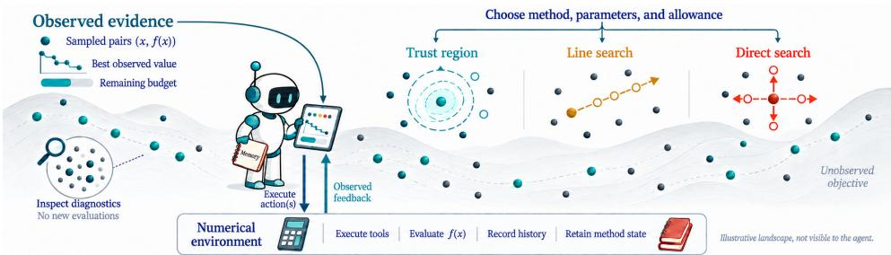  
Figure 1: Conceptual view of NextEval. The agent selects tools using past evaluations. The illustrated landscape is neither an agent input nor an experimental trajectory.

A sequential policy, not a solution mapping. In our study, the agent pursues a history-dependent policy, not a solution mapping from a fixed input to a minimizer: new evaluations can change the next operation and its parameters. Unlike trained DFO policies (Chen et al., 2017), our agent uses general-purpose LLMs without optimization-specific policy training.

We introduce NextEval, an agent-based DFO solver for unconstrained minimization. Its numerical environment executes the agent’s tool requests, records objective calls, and retains method state while enforcing budget and stopping rules (Figure 1).

NextEval Bench reuses this environment to compare LLMs and harnesses, the software that manages LLM calls, conversation history, and tool exchanges.

Contributions.

• An agent-based DFO solver. NextEval combines a persistent agent with a numerical environment: executable tools, shared evaluation history, and method-specific continuation state. Under a shared evaluation budget, the agent combines single-step and multi-step operations, choosing their sequence, parameters, and evaluation allowances.

• A benchmark protocol for optimization agents. NextEval Bench runs each LLM– harness configuration on individual optimization problems in a common environment and summarizes its performance across the problem set. It builds on OptiProfiler, an optimization benchmarking platform with diverse problem libraries, configurable test conditions, and reproducible performance and data profiles (Huang et al., 2026).

On the low-dimensional S2MPJ suite, NextEval has higher aggregate evaluation-efficiency scores than the tested DFO baselines. We also compare function-evaluation efficiency across LLMs, reasoning settings, and agent harnesses, using matched tasks and evaluation budgets within each study.

Objective access and the evaluation budget. We consider unconstrained minimization

$$
\operatorname* { m i n } _ { x \in \mathbb { R } ^ { n } } f ( x ) , \qquad x _ { 0 } \in \mathbb { R } ^ { n } , \qquad N _ { \mathrm { e v a l } } \leq B .\tag{1}
$$

Here, $N _ { \mathrm { e v a l } }$ counts objective evaluations and B is the evaluation budget. The solver receives a callable fun, an initial point $\mathbf { x } 0 ,$ , and options. It does not receive the objective formula, benchmark identifier, derivatives, or a reference optimum. The agent sees only the permitted evaluation history and summaries computed from it, and generic metadata such as dimension and remaining budget.

Only objective calls consume this budget: analyzing existing observations requires no new evaluations, whereas a search tool may make several calls before returning control.

## 2 NEXTEVAL SOLVER

In this section, we establish the NextEval solver, as shown in Figure 2, which combines an LLM agent with a numerical environment for solving DFO problems. The central idea is to let the agent reason about the search using accumulated observations, while numerical methods compute and evaluate candidate points. Here, numerical methods refer to components such as model fitting or trust-region steps, rather than complete DFO algorithms. A tool is the interface through which the agent invokes such a component. We provide analysis and search tools, and maintain numerical state so that methods can resume after tool switches.

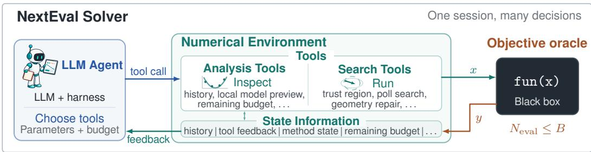  
Figure 2: Overview of NextEval Solver: the agent selects tools and their parameters, while the numerical environment executes the requests, maintains the evaluation history and the numerical state of each method, and returns feedback.

## 2.1 AGENT–ENVIRONMENT INTERACTION

The agent and the numerical environment interact through tool calls: the agent selects a tool and its parameters, and the environment executes the request and returns feedback. This feedback allows the agent to reconsider its search strategy as new observations become available. In particular, the agent can decide whether to continue the current method, adjust its parameters, or switch to another method. Specifically, the numerical environment manages all objective evaluations, maintains a shared evaluation history and budget, and retains each method’s numerical state. It also maintains the incumbent, the evaluated point with the smallest valid observed value across all search tools. This shared record allows the agent to assess progress across methods and base later decisions on observations collected by any of them. To connect the agent to these tools, a harness manages the conversation, handles LLM calls, and delivers tool requests and responses. In this setup, the agent decides how to search, the numerical environment performs the numerical work, and the harness coordinates their interaction.

Formally, let $x _ { k }$ denote the point queried in the kth objective evaluation and let $\begin{array} { r l } { H _ { k } } & { { } = } \end{array}$ $( ( x _ { i } , y _ { i } , s _ { i } ) ) _ { i = 1 } ^ { k }$ denote the shared history of the first $k$ evaluations, where $y _ { i }$ is the possibly noisy observed value and $s _ { i }$ records the evaluation status, such as success or failure. After t agent–environment interactions, let $m _ { t }$ denote the total number of objective evaluations, so that the corresponding history is $H _ { m _ { t } }$ . Let $S _ { t }$ contain the remaining budget and the numerical state of each method, and let $C _ { t }$ denote the conversation available to the agent, including the task instructions and previous tool responses. With LLM and harness $h ,$ the agent’s policy $\pi _ { h , \mathcal { M } }$ interacts with the environment $E$ as follows:

$$
a _ { t } \sim \pi _ { h , { \mathcal { M } } } ( { \cdot } \mid C _ { t } ) , \qquad ( o _ { t + 1 } , H _ { m _ { t + 1 } } , S _ { t + 1 } ) = E ( H _ { m _ { t } } , S _ { t } , a _ { t } ) .\tag{2}
$$

Here, $a _ { t }$ is the tool request and $o _ { t + 1 }$ is the returned feedback. Specifically, once the agent selects a search tool and its parameters, the tool computes candidate points using the evaluation history and its retained numerical state. Let $j _ { t }$ and $\lambda _ { t }$ denote the tool and parameters specified by $a _ { t } .$ The next point to be evaluated is given by

$$
x _ { k + 1 } = \mathcal { N } _ { j _ { t } } ( H _ { k } , Z _ { k } ; \lambda _ { t } ) , \qquad m _ { t } \leq k < m _ { t + 1 } ,\tag{3}
$$

where $k$ counts objective evaluations, $\mathcal { N } _ { j _ { t } }$ denotes the numerical method used by the selected tool, and $Z _ { k }$ is its numerical state before evaluation $k + 1$ . During a multi-step call, the tool updates its state and generates further points without requiring a new agent decision after every evaluation. For an analysis call, $m _ { t + 1 } = m _ { t }$ and no new objective evaluation is made. Next, we describe the tools through which the agent analyzes the available data and carries out numerical search.

## 2.2 ANALYSIS AND SEARCH TOOLS

We provide two groups of tools: analysis tools for examining existing observations and local models, and search tools for generating and evaluating candidate points. These tools allow the agent to use the available evidence to select numerical methods and their parameters, and to revise these choices as new observations become available.

Analysis tools. Analysis tools assess search progress and the reliability of local models to inform the agent’s next decision. Generally, the best observed value alone is insufficient for deciding whether to continue a method, change its parameters, or improve its local model. To support these decisions, get situation summarizes recent progress, remaining budget, search scales, and local model readiness. For a closer examination, preview model fits a local model and inspects its candidate without evaluating it. These analyses use no objective evaluations and explicitly mark missing or unreliable information. For example, evidence that a local model is poorly supported can lead the agent to request additional samples before relying on a model-based step.

Search tools. Search tools execute numerical methods to generate and evaluate candidate points to improve the objective or obtain samples needed for subsequent model-based search. For example, the trust-region method seeks improvement using a local quadratic model fitted by minimum-Frobenius-norm-change interpolation (Powell, 2004; 2006). It computes a trial step and compares the actual and predicted reductions after evaluating the candidate. When a useful local model is unavailable, poll search offers an alternative by evaluating points along search directions. Geometry repair instead obtains additional samples to improve the local interpolation set, preparing it for later model-based steps.

The agent must also decide when to review a numerical method’s progress. Frequent feedback allows earlier intervention, while longer runs let the method apply its own updates without repeated agent decisions. We therefore provide two ways to invoke search tools. A single-step call performs one numerical operation, which may itself require several objective evaluations. A multi-step call runs a method for up to an agent-specified number of objective evaluations before returning control, with this allowance capped by the remaining global budget. After either type of call, feedback reports what changed, how many evaluations were used, and why the operation stopped or was rejected. The agent can then decide whether to continue, reconfigure, or switch methods based on the observed progress. To help the agent formulate valid requests, tool instructions specify parameters, prerequisites, and evaluation cost; Appendix H (Table 9) lists the available tools.

## 2.3 STATE MANAGEMENT AND CONTINUATION

State management lets a numerical method resume after a tool switch while reusing earlier numerical work. Resuming a method requires suitable parameters, such as its search scale, and a valid numerical state. In a conventional solver built on a fixed algorithm, the parameters and numerical state evolve according to that algorithm’s update rules. However, the NextEval solver needs to additionally determine what to retain, adjust, or initialize when moving between methods. This makes parameter selection and state management at tool switches an important part of the solver design: the choices affect both where subsequent evaluations are placed and how earlier numerical work can be reused.

To address this issue, we maintain a shared evaluation history while storing each numerical method’s state separately. The agent can use the history and tool feedback to choose parameters, while the environment retains each method’s parameters, including trust-region radii, polling scales, and step sizes for each coordinate, along with its numerical state. In particular, these parameters have different meanings and update rules, so they are not treated as interchangeable. Moreover, retaining the numerical state does not mean that it can always be reused unchanged. For example, if another method finds a better point, the saved trust-region interpolation set may need to be updated. Accordingly, the tool checks its set against the incumbent and can update or rebuild it when needed. Thus, continuation preserves earlier work while accounting for changes made by other tools. Finally, the environment stores evaluation history and numerical state separately from the agent’s conversation, allowing numerical methods to continue even when the conversation is compressed.

## 3 NEXTEVAL BENCH: FROM ONE FUNCTION TO A SUITE

In this section, we introduce NextEval Bench (Figure 3), which provides a protocol for evaluating how effectively different agents use provided tools to solve the DFO problem (1). Building on the numerical environment introduced in Section 2, the central idea is to vary the LLM or harness while keeping tasks, numerical tools, evaluation budgets, and permitted information fixed within each comparison. To do this, we specify how tasks are constructed, how agents interact with the environment, and how their optimization performance is evaluated.

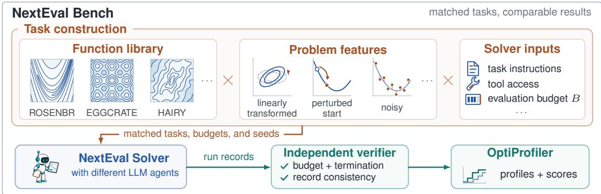  
Figure 3: NextEval Bench runs agent configurations on matched tasks through the shared numerical environment and verifies run records before comparing performance using OptiProfiler.

Tasks and problem features. To evaluate agent performance across diverse DFO tasks, we use standard optimization test problems available through OptiProfiler (Huang et al., 2026). Moreover, we extend the evaluation beyond their standard settings by perturbing the starting points, adding observation noise, and rotating the coordinates. For an objective function $f : \mathbb { R } ^ { n } $ R and initial point $x _ { 0 } \in \mathbb { R } ^ { n }$ , these problem features are defined as follows:

$$
\mathrm { P e r t u r b e d ~ s t a r t : } \quad \widetilde { x } _ { 0 } = x _ { 0 } + \ell \operatorname* { m a x } \{ 1 , \| x _ { 0 } \| \} \frac { u } { \| u \| } , \qquad \quad u \sim \mathcal { N } ( 0 , I _ { n } ) ,\tag{4}
$$

$$
\begin{array} { r l r } { \mathrm { N o i s y ~ e v a l u a t i o n : } } & { { } y _ { i } = f ( x _ { i } ) + \sigma \operatorname* { m a x } \{ 1 , | f ( x _ { i } ) | \} \xi _ { i } , } & { \qquad } & { { } \xi _ { i } \overset { \mathrm { i i d } } { \sim } \mathcal { N } ( 0 , 1 ) , } \end{array}\tag{5}
$$

$$
\mathrm { R o t a t e d \ c o o r d i n a t e s : \quad } g ( z ) = f ( Q z ) , \qquad z _ { 0 } = Q ^ { \top } \widetilde { x } _ { 0 } , \qquad Q ^ { \top } Q = I _ { n } .\tag{6}
$$

Here, $\ell , \sigma \geq 0$ are the start perturbation and noise levels, and $I _ { n }$ is the identity matrix. The Gaussian vector u sets the perturbation direction; $x _ { i }$ and $y _ { i }$ are the point and observation at evaluation $i ,$ with fresh noise $\xi _ { i }$ on every call, including repeated evaluations at the same point. For rotation, the orthogonal matrix $Q \in \mathbb { R } ^ { n \times n }$ maps $z \in \mathbb { R } ^ { n }$ to the original coordinates by $x = Q z$ , so $g$ is the transformed objective and $z _ { 0 }$ its initial point. We sample u and Q once per problem and repetition, obtaining Q by orthogonalizing a Gaussian matrix, and share feature seeds across agents.

Agent configurations and execution. We evaluate a complete optimization session because each decision can depend on earlier observations. A submission specifies the LLM, harness, prompts, inference settings, and resource limits. Within each session, the harness runs the interaction loop in Section 2, while the numerical environment preserves evaluation history and numerical state. Objective evaluations, tool calls, LLM calls, and wall time are recorded separately. Problem identities, formulas, and scoring references are not exposed to the agent.

Performance evaluation. Performance is measured by the evaluations needed to reach relative reduction targets, so results can be compared across problems with different objective scales. We verify run settings, evaluation counts, termination, and record consistency before constructing OptiProfiler performance and data profiles; failed and retried attempts remain in the run records. Where retries occur, profiles use the final authorized attempt, not the best attempt, and do not sum evaluation costs across attempts. For noisy tasks, clean objective values are reserved for scoring. Section 4.1 and Appendix A.2 give the scoring definitions.

The agent-configuration studies in Section 4.4 follow these comparison principles to evaluate optimization performance under matched tasks, numerical tools, and evaluation budgets.

## 4 EXPERIMENTS

In this section, we first compare the NextEval solver with classical solvers. We then audit one recorded trajectory to illustrate how the LLM agent adapts its search. Finally, we study the influence of agent configuration through controlled comparisons following the principles of NextEval Bench. Table 1 summarizes the questions we aim to answer through these experiments.

Table 1: Research questions guiding the experiments.
<table><tr><td>Study</td><td>Research question</td></tr><tr><td>Solver performance</td><td>Can the NextEval solver improve evaluation efficiency over classical DFO solvers?</td></tr><tr><td>Case study</td><td>How does the agent adapt its search in one audited trajectory?</td></tr><tr><td>Model choice</td><td>How does the choice of LLMs affect optimization performance?</td></tr><tr><td>Reasoning setting</td><td>Does additional reasoning improve optimization performance?</td></tr><tr><td>Execution harness</td><td>How sensitive is optimization performance to the execution harness?</td></tr></table>

## 4.1 EXPERIMENTAL SETUP

We use a common suite comprising all 92 unconstrained problems with dimension $n \leq 5$ in the archived S2MPJ collection (Gratton & Toint, 2025). The suite spans classical nonlinear optimization, nonlinear least-squares, and data-fitting problems. All runs use a budget of 50n objective evaluations. Using the features defined in Eqs. (4)–(6), we test perturbed starts alone, with noise, and with rotation but no noise, setting $\ell = \sigma \overset { \cdot } { = } 1 0 ^ { - 3 }$ . Appendix A gives protocol details and agent information restrictions.

Performance and data profiles. Because objective scales differ across problems, we compare evaluations needed to achieve a relative reduction in objective value. For each problem and repetition, we define a target, an objective-value threshold. At tolerance τ, the remaining gap to the best noise-free value found by the compared solvers must be at most τ times the initial gap. We summarize the first evaluation counts reaching these targets using performance profiles $\rho _ { s }$ (Dolan & More, 2002) and data profiles ´ δs (More & Wild, 2009), as implemented in OptiProfiler (Huang ´ et al., 2026). Performance profiles normalize these counts by the smallest count on each problem, whereas data profiles scale them by the dimension plus one; higher curves indicate more targets reached within the respective budget.

At tolerance $\tau _ { k } = 1 0 ^ { - k }$ , let $\bar { \rho } _ { s , k }$ and $\bar { \delta } _ { s , k }$ denote profiles averaged over repetitions. On the plotted logarithmic axes, $\widetilde { \rho } _ { s , k } ( x ) = \bar { \rho } _ { s , k } ( 2 ^ { x } )$ and $\widetilde { \delta } _ { s , k } ( x ) = \bar { \delta } _ { s , k } ( 2 ^ { x } - 1 )$ . For either plotted profile $\phi _ { s , k } ,$ its area and normalized score are

$$
\operatorname { A U C } ( \phi ) = \int _ { a } ^ { b } \phi ( x ) \mathrm { d } x , \qquad S _ { \mathrm { O P } } ( \phi _ { s , k } ) = \frac { \operatorname { A U C } ( \phi _ { s , k } ) } { \operatorname* { m a x } _ { j } \operatorname { A U C } ( \phi _ { j , k } ) } .
$$

The integration interval [a, b] is shared across solvers for each profile type and tolerance. The aggregate score averages the performance-profile scores over the ten tolerances: $\begin{array} { r l } { S _ { s } } & { { } = } \end{array}$ $\begin{array} { r } { \frac { 1 } { 1 0 } \sum _ { k = 1 } ^ { 1 0 ^ { - } } \bar { S } _ { \mathrm { O P } } ( \widetilde { \rho } _ { s , k } ) } \end{array}$ . The figures show profiles at tolerance $\tau = 1 0 ^ { - 6 }$ ; Table 2 also reports scores $\mathrm { a t } \tau = 1 0 ^ { - 4 }$ . Because the reference value and score normalization depend on the compared solvers, scores from different solver sets are not directly comparable. Noisy studies are scored using noisefree objective values. Appendix A.2 gives the exact definitions and scoring conventions.

## 4.2 PRIMARY PERFORMANCE COMPARISON WITH CLASSICAL DFO

The primary rotated comparison uses NextEval’s built-in runner and DeepSeek V4 Flash (thinking disabled) with ten repetitions. The earlier perturbed-start cohorts, with and without noise, use the historical task-mode runner with three repetitions and are shown only as a feature-suite overview; they are not pooled with the rotated comparison.

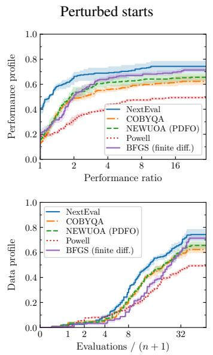

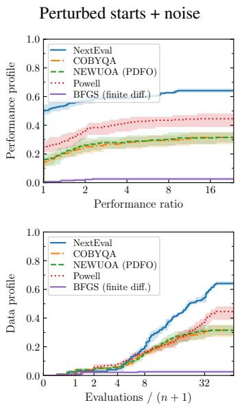

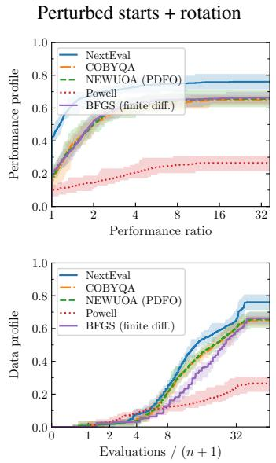  
Figure 4: DeepSeek V4 Flash feature-suite overview. History-performance (top) and history-data (bottom) profiles at $1 0 ^ { - 6 }$ ; shading shows the repetition range. The first two columns use historical three-repeat cohorts; rotation uses the built-in runner with thinking off and ten repeats. These are not matched feature ablations.

The reference solvers are standalone COBYQA 1.1.4 (Ragonneau, 2022; Ragonneau & Zhang, 2026), NEWUOA through PDFO 2.2.0 (Powell, 2006; Ragonneau & Zhang, 2024), SciPy’s implementation of the modified Powell algorithm, and SciPy BFGS with forward finite differences (Virtanen et al., 2020). All solver evaluations, including finite-difference and line-search probes, count toward the same 50n objective budget. Implementation details are given in Appendix A.

NextEval has the largest aggregate score in the rotated comparison (Table 2; Figure 4). This measures the complete system: agent decisions together with numerical tools. Finite-difference BFGS is competitive without noise but degrades under noise with its default difference step. Appendix B gives trial accounting.

## 4.3 AUDITED CASE STUDY

To make the aggregate profiles concrete, we audit one recorded trajectory. In the model-choice study of Section 4.4 (perturbed starts plus noise, ten repetitions), GPT-5.6 Terra under the Codex harness stalled on SNAIL (repetition 9), with the incumbent remaining at 13.38 through evaluations 78–81. After evaluation 81, the agent switched to a reset trust-region campaign with radius factor 5.0, reaching a best recorded value of $1 . 1 5 7 \times 1 0 ^ { - 3 }$ at evaluation 98 within the 100-evaluation budget. The corresponding clean objective value was $2 . 1 0 1 \times 1 0 ^ { - 4 }$ The clean values and contours were checks performed by the evaluator and were unavailable to the agent, allowing the trajectory to be inspected without exposing this information during optimization. Appendix C provides the full trace reconstruction, screening details, and additional trajectories.

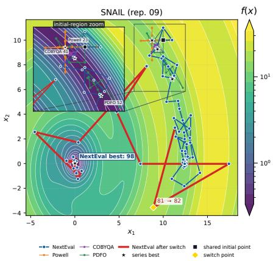  
Figure 5: Recorded SNAIL trajectories (repetition 9). Red: evaluations 81–98. Inset: shared initial region. Clean contours are evaluator-only.

(a) GPT: model choice

(c) DeepSeek: harness

Table 2: Normalized profile-area scores for perturbed starts with rotation. Perf. and Data report $S _ { \mathrm { O P } } ( \widetilde { \rho } _ { s , k } )$ and $S _ { \mathrm { O P } } ( \widetilde { \delta } _ { s , k } ) ;$ Aggregate score reports $S _ { s } .$ Higher is better; scores are not win rates.
<table><tr><td>Solver</td><td>Aggregate score</td><td>Perf.  $1 0 ^ { - 4 }$ </td><td> $\mathrm { { D a t a 1 0 ^ { - 4 } } }$ </td><td> $\mathrm { P e r f . ~ } 1 0 ^ { - 6 }$ </td><td> $\mathrm { D a t a ~ 1 0 ^ { - 6 } }$ </td></tr><tr><td>NextEval</td><td>1.000</td><td>1.000</td><td>1.000</td><td>1.000</td><td>1.000</td></tr><tr><td>COBYQA</td><td>0.805</td><td>0.847</td><td>0.899</td><td>0.796</td><td>0.856</td></tr><tr><td>NEWUOA (PDFO)</td><td>0.820</td><td>0.862</td><td>0.913</td><td>0.807</td><td>0.864</td></tr><tr><td>Powell (SciPy)</td><td>0.354</td><td>0.370</td><td>0.466</td><td>0.300</td><td>0.393</td></tr><tr><td>BFGS (finite differences)</td><td>0.810</td><td>0.843</td><td>0.793</td><td>0.818</td><td>0.756</td></tr></table>

## 4.4 CONTROLLED AGENT-CONFIGURATION STUDIES

We compare model choice, reasoning setting, and execution harness under perturbed starts plus noise, with ten repetitions in each study (Figure 6). These comparisons use matched tasks within each study, not a pooled ranking across the three studies.

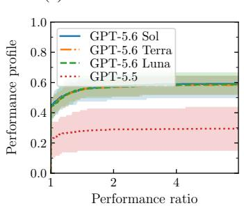

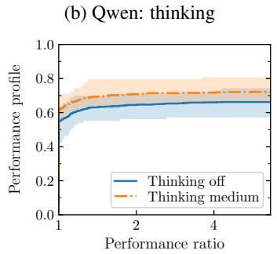

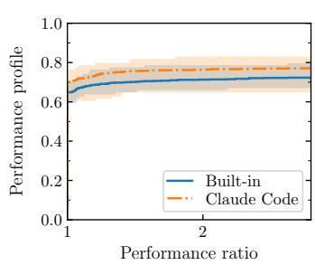  
Figure 6: Three agent-configuration comparisons. History-performance profiles at $1 0 ^ { - 6 }$ , with repetition ranges. (a) Codex with medium reasoning; (b) Qwen 3.8 Flash with Codex; (c) DeepSeek V4 Flash with thinking off. All three comparisons use the full 92-problem suite. Targets are computed separately within each panel. Data profiles and trial accounting are in Appendices D.1–D.2.

Model choice (GPT). With Codex and medium reasoning fixed, GPT-5.6 Sol, Terra, and Luna form a tight group at $1 0 ^ { - 6 }$ and reach more targets than GPT-5.5. Their aggregate scores range from 0.981 to 0.997, versus 0.571 for GPT-5.5. However, GPT-5.5 uses only 13% of the budget at the median, versus 100% for GPT-5.6. The difference therefore reflects both search and stopping behavior under the same harness, rather than isolating reasoning ability.

Reasoning setting (Qwen). With Qwen 3.8 Flash and Codex fixed, medium thinking improves the aggregate score from 0.924 to 1.000 and obtains a lower median final clean value on 53 problems, versus 39 for thinking off. Additional reasoning helps in this setting, although it does not improve every problem.

Execution harness (DeepSeek). With DeepSeek V4 Flash, thinking off, and the same NextEval instructions, 18 tools, decoding limits, and evaluation budgets, Claude Code scores 0.999 versus 0.947 for the built-in runner. Partial failure histories are retained. This measures the effect of the complete harness, including context management and session recovery, not one internal component.

## 5 RELATED WORK

Numerical optimization without derivatives. Direct search, interpolation-based trust regions, evolution strategies, and Bayesian optimization (BO) provide established approaches to DFO (Kolda et al., 2003; Conn et al., 2009; Hansen, 2016; Shahriari et al., 2016). NextEval exposes numerical operations as tools rather than replacing their calculations with language-model arithmetic. TuRBO also studies adaptive allocation (Eriksson et al., 2019), but its allocation rule is part of a specified optimization algorithm.

Language models and learned optimizers. Learned recurrent DFO already adapts to evaluation histories (Chen et al., 2017). OPRO generates candidates from past evaluations, and EvoLLM uses LLMs for population recombination (Yang et al., 2024; Lange et al., 2024). LLAMBO implements initialization, surrogate prediction, and candidate sampling within BO without fine-tuning (Liu et al., 2024). SemanticOpt trains on BO trajectories with semantic context to generate configurations and predictions (Meindl et al., 2025). These algorithms use feedback from earlier evaluations, but their learned or prompted component primarily generates candidates, configurations, or surrogate quantities. NextEval instead gives the agent an operational choice: inspect the history, select an implemented method, set its parameters, continue or switch it, and allocate bounded evaluations. The distinction is the controlled action space, not merely the presence of a language model.

Optimization agents. Code-to-Harness evolves executable optimizers, distills their practice into a short text strategy, and freezes it before deployment (Wu et al., 2026). Its executor uses evaluation history, including in sandbox-equipped experiments; it is not a solution-mapping approach. It discovers portable strategies, whereas NextEval provides stateful numerical tools for online control and a protocol for comparing agents. A distilled strategy could guide an agent using NextEval tools. AgentHPO coordinates hyperparameter proposals, experiment execution, and log analysis (Liu et al., 2025). Multi-agent BO separates an agent that weights search criteria from an agent that generates candidates (Carbonati et al., 2026); OptAgent adds a related agentic layer to physics-grounded building simulations (Jiang et al., 2026). Related work from Bin Dong’s group studies reusable tool graphs in GATE (Luo et al., 2025) and multi-round LLM interaction through optimal control (Luo et al., 2023). Iteris applies an explore–plan–execute loop to computational mathematics (Chen et al., 2026). These works motivate tool-based control, but do not study the same oracle-only DFO setting and evaluation budget. Appendix G discusses this design choice and adjacent approaches.

Evaluation infrastructure. COCO and OptiProfiler standardize numerical comparisons (Hansen et al., 2021; Huang et al., 2026); MetaBox-v2 studies learning-based DFO algorithms (Ma et al., 2025). Harbor specifies task and agent trajectory formats (Harbor contributors, 2026a;b), while Terminal-Bench-Science provides scientific research tasks for evaluating agents (Terminal-Bench-Science Team, 2026). NextEval Bench combines oracle-controlled numerical tasks, agent-level records, and suite-level profiles. Task and participant manifests fix the evaluation conditions and complete LLM–harness configuration; the current scope is a protocol and local execution machinery, not hosted benchmarking.

## 6 LIMITATIONS AND BENCHMARK ROADMAP

Our primary comparison uses public problems with at most five variables. Development feedback informed the tools, manuals, and prompts, so generalization to unseen families remains untested. Perturbed starts, rotations, and noisy observations do not rule out problem recognition. The rotation used here preserves the objective’s value structure and is not full anonymization. We measure evaluation counts, not total runtime or LLM cost. Whole-system comparisons do not attribute gains to the LLM alone. Appendix E separates controller replacement from numerical-support ablations; these are planned tests, not completed results. Training a parameterized controller, including by reinforcement learning, is a separate extension. Higher-dimensional and additional problem families remain important tests.

## 7 CONCLUSION

NextEval places a persistent language-model agent in a conventional DFO solver; the agent selects history summaries and numerical methods while the environment executes evaluations and retains method state. On the low-dimensional S2MPJ suite with perturbed starts and rotated coordinates, the primary configuration has a higher aggregate score than the tested DFO baselines. NextEval Bench compares LLM–harness configurations under a common evaluation budget.

## REPRODUCIBILITY STATEMENT

All displayed profiles are generated by OptiProfiler from saved histories. Appendix A specifies experimental settings; Appendix B records trial accounting. Historical experiments are reported under the settings used when they were conducted.

## AI USE STATEMENT

AI assistants supported coding, literature discovery, experimental-design feedback, qualitative trajectory analysis and interpretation, drafting, language editing, and creation of Figures 1–3. The authors are responsible for verifying the final code, citations, and empirical claims.

## ACKNOWLEDGMENTS

The work of Li Cui was supported by the National Natural Science Foundation of China under Grant 12171043.

The work of Cunxin Huang and Zaikun Zhang was supported by the Guangdong Major Project of Basic Research (2026B0303000015), NSFC General Program (12571335), and NSFC Excellent Young Scientists Fund (Overseas). Cunxin Huang was also supported by the Hong Kong PhD Fellowship Scheme (PF21-56718).

## REFERENCES

Ali Ahmaditeshnizi, Wenzhi Gao, and Madeleine Udell. OptiMUS: Scalable optimization modeling with (MI)LP solvers and large language models. In Proceedings of the 41st International Conference on Machine Learning, volume 235 of Proceedings of Machine Learning Research, pp. 577–596. PMLR, 2024. URL https://proceedings.mlr.press/v235/ahmadites hnizi24a.html.

Charles Audet and Warren Hare. Derivative-Free and Blackbox Optimization. Springer Series in Operations Research and Financial Engineering. Springer, 2017. doi:10.1007/978-3-319-68913- 5.

Andrea Carbonati, Mohammadsina Almasi, and Hadis Anahideh. Multi-agent LLMs for adaptive acquisition in Bayesian optimization, 2026. URL https://arxiv.org/abs/2603.289 59. arXiv preprint.

Leheng Chen, Zihao Liu, Wanyi He, and Bin Dong. Iteris: Agentic research loops for computational mathematics, 2026. URL https://arxiv.org/abs/2606.02484.

Yutian Chen, Matthew W. Hoffman, Sergio Gomez Colmenarejo, Misha Denil, Timothy P. Lillicrap,´ Matt Botvinick, and Nando de Freitas. Learning to learn without gradient descent by gradient descent. In Proceedings of the 34th International Conference on Machine Learning, volume 70 of Proceedings ofMachine Learning Research, pp. 748–756. PMLR, 2017. URL https://pr oceedings.mlr.press/v70/chen17e.html.

Andrew R. Conn, Katya Scheinberg, and Lu´ıs N. Vicente. Introduction to Derivative-Free Optimization, volume 8 of MPS-SIAM Series on Optimization. SIAM, 2009. doi:10.1137/1.9780898718768.

Elizabeth D. Dolan and Jorge J. More. Benchmarking optimization software with performance´ profiles. Mathematical Programming, 91(2):201–213, 2002. doi:10.1007/s101070100263.

David Eriksson, Michael Pearce, Jacob R. Gardner, Ryan Turner, and Matthias Poloczek. Scalable global optimization via local Bayesian optimization. In Advances in Neural Information Processing Systems, volume 32, 2019. URL https://proceedings.neurips.cc/paper/201 9/hash/6c990b7aca7bc7058f5e98ea909e924b-Abstract.html.

Serge Gratton and Philippe L. Toint. S2MPJ and CUTEst optimization problems for Matlab, Python and Julia. Optimization Methods and Software, 40(4):871–903, 2025. doi: 10.1080/10556788.2 025.2490640. arXiv:2407.07812.

Nikolaus Hansen. The CMA evolution strategy: a tutorial, 2016. arXiv:1604.00772.

Nikolaus Hansen, Anne Auger, Raymond Ros, Olaf Mersmann, Tea Tusar, and Dimo Brockhoff.ˇ COCO: a platform for comparing continuous optimizers in a black-box setting. Optimization Methods and Software, 36(1):114–144, 2021. doi:10.1080/10556788.2020.1808977.

Harbor contributors. Harbor: Agent Trajectory Interchange Format (ATIF). https://docs.h arborframework.com/core-concepts/agents/atif, 2026a. Documentation, accessed September 26, 2026.

Harbor contributors. Harbor: Tasks and task format. https://docs.harborframework.c om/core-concepts/tasks/overview, 2026b. Documentation, accessed September 26, 2026.

Beichen Huang, Xingyu Wu, Yu Zhou, Jibin Wu, Liang Feng, Ran Cheng, and Kay Chen Tan. Exploring the true potential: Evaluating the black-box optimization capability of large language models, 2024. URL https://arxiv.org/abs/2404.06290v2. arXiv preprint, version 2, 6 July 2024.

Cunxin Huang, Tom M. Ragonneau, and Zaikun Zhang. OptiProfiler: A benchmarking platform for optimization solvers. Software, version 1.3.4, 2026. URL https://www.optprof.com/ latest/. Software and documentation website.

Zixin Jiang, Weili Xu, and Bing Dong. OptAgent: an agentic AI framework for intelligent building operations, 2026. URL https://arxiv.org/abs/2601.20005v1. arXiv preprint, submitted 27 January 2026.

Tamara G. Kolda, Robert Michael Lewis, and Virginia Torczon. Optimization by direct search: new perspectives on some classical and modern methods. SIAM Review, 45(3):385–482, 2003. doi:10.1137/S003614450242889.

LangChain. LangGraph overview. https://docs.langchain.com/oss/python/lang graph/overview, 2026. Documentation, accessed September 15, 2026.

Robert Tjarko Lange, Yingtao Tian, and Yujin Tang. Large language models as evolution strategies, 2024. URL https://arxiv.org/abs/2402.18381v1. arXiv preprint, version 1.

Jeffrey Larson, Matt Menickelly, and Stefan M. Wild. Derivative-free optimization methods. Acta Numerica, 28:287–404, 2019. doi:10.1017/S0962492919000060.

Siyi Liu, Chen Gao, and Yong Li. AgentHPO: Large language model agent for hyper-parameter optimization. In Conference on Parsimony and Learning, volume 280 of Proceedings of Machine Learning Research, pp. 1146–1169. PMLR, 2025. URL https://proceedings.mlr.pr ess/v280/liu25c.html.

Tennison Liu, Nicolas Astorga, Nabeel Seedat, and Mihaela van der Schaar. Large language models´ to enhance Bayesian optimization. In The Twelfth International Conference on Learning Representations, 2024. URL https://proceedings.iclr.cc/paper\_files/paper/20 24/hash/84b8d9fcb4e262fcd429544697e1e720-Abstract-Conference.ht ml.

Jianwen Luo, Yiming Huang, Jinxiang Meng, Fangyu Lei, Shizhu He, Xiao Liu, Shanshan Jiang, Bin Dong, Jun Zhao, and Kang Liu. GATE: Graph-based adaptive tool evolution across diverse tasks, 2025. URL https://arxiv.org/abs/2502.14848.

Yifan Luo, Yiming Tang, Chengfeng Shen, Zhennan Zhou, and Bin Dong. Prompt engineering through the lens of optimal control. Journal of Machine Learning, 2(4):241–258, 2023. doi: 10.4208/jml.231023. URL https://www.global-sci.com/jml/article/view/13 193. Also available as arXiv:2310.14201.

Zeyuan Ma, Yue-Jiao Gong, Hongshu Guo, Wenjie Qiu, Sijie Ma, Hongqiao Lian, Jiajun Zhan, Kaixu Chen, Chen Wang, Zhiyang Huang, Zechuan Huang, Guojun Peng, Ran Cheng, and Yining Ma. MetaBox-v2: A unified benchmark platform for Meta-Black-Box optimization. In Advances in Neural Information Processing Systems, volume 38, 2025. URL https: //neurips.cc/virtual/2025/loc/san-diego/poster/121847. Also available as arXiv:2505.17745v2.

Jamison Meindl, Yunsheng Tian, Tony Cui, Veronika Thost, Zhang-Wei Hong, Jie Chen, Wojciech Matusik, and Mina Konakovic Lukovi´ c. SemanticOpt: Towards LLM-based semantic black-box´ optimization, 2025. URL https://arxiv.org/abs/2510.25404v3. arXiv preprint, version 3, 15 May 2026.

Mike A. Merrill, Alexander G. Shaw, Nicholas Carlini, et al. Terminal-Bench: Benchmarking agents on hard, realistic tasks in command line interfaces, 2026. URL https://arxiv.org/abs/ 2601.11868. arXiv:2601.11868.

Jorge J. More and Stefan M. Wild. Benchmarking derivative-free optimization algorithms.´ SIAM Journal on Optimization, 20(1):172–191, 2009. doi:10.1137/080724083.

M. J. D. Powell. Least Frobenius norm updating of quadratic models that satisfy interpolation conditions. Mathematical Programming, 100(1):183–215, 2004. doi:10.1007/s10107-003-0490- 7.

M. J. D. Powell. The NEWUOA software for unconstrained optimization without derivatives. In Large-Scale Nonlinear Optimization, pp. 255–297. Springer, 2006. doi:10.1007/0-387-30065- 1 16.

Tom M. Ragonneau. Model-Based Derivative-Free Optimization Methods and Software. PhD thesis, Department of Applied Mathematics, The Hong Kong Polytechnic University, Hong Kong, China, 2022. URL https://theses.lib.polyu.edu.hk/handle/200/12294. Also available as arXiv:2210.12018.

Tom M. Ragonneau and Zaikun Zhang. PDFO: a cross-platform package for Powell’s derivativefree optimization solvers. Mathematical Programming Computation, 16(4):535–559, 2024. doi:10.1007/s12532-024-00257-9.

Tom M. Ragonneau and Zaikun Zhang. COBYQA version 1.1.4. Software, 2026. URL https: //www.cobyqa.com. Version used in the experiments; release v1.1.4.

Bernardino Romera-Paredes, Mohammadamin Barekatain, Alexander Novikov, Matej Balog, M. Pawan Kumar, Emilien Dupont, Francisco J. R. Ruiz, Jordan S. Ellenberg, Pengming Wang, Omar Fawzi, Pushmeet Kohli, and Alhussein Fawzi. Mathematical discoveries from program search with large language models. Nature, 625:468–475, 2024. doi: 10.1038/s41586-023-069 24-6. URL https://www.nature.com/articles/s41586-023-06924-6.

Bobak Shahriari, Kevin Swersky, Ziyu Wang, Ryan P. Adams, and Nando de Freitas. Taking the human out of the loop: a review of Bayesian optimization. Proceedings of the IEEE, 104(1): 148–175, 2016. doi:10.1109/JPROC.2015.2494218.

Terminal-Bench-Science Team. Terminal-Bench-Science: Evaluating AI agents on research workflows across scientific domains. Software, 2026. URL https://doi.org/10.5281/zeno do.22110253. Accessed September 26, 2026.

Pauli Virtanen, Ralf Gommers, Travis E. Oliphant, et al. SciPy 1.0: Fundamental algorithms for scientific computing in Python. Nature Methods, 17:261–272, 2020. doi: 10.1038/s41592-019-0 686-2.

Yi Wu, Zheng Ren, Zhiyu Hu, Haochen Wang, et al. Code-to-Harness: Distilling black-box optimizers from self-play, 2026. URL https://arxiv.org/abs/2609.09468v2.

Chengrun Yang, Xuezhi Wang, Yifeng Lu, Hanxiao Liu, Quoc V. Le, Denny Zhou, and Xinyun Chen. Large language models as optimizers. In The Twelfth International Conference on Learning Representations, 2024. URL https://proceedings.iclr.cc/paper\_files/pape r/2024/hash/3339f19c5fcee3ad74502947a32be9e6-Abstract-Conferenc e.html.

Shunyu Yao, Jeffrey Zhao, Dian Yu, Nan Du, Izhak Shafran, Karthik Narasimhan, and Yuan Cao. ReAct: synergizing reasoning and acting in language models. In International Conference on Learning Representations, 2023. URL https://arxiv.org/abs/2210.03629.

Haoran Ye, Jiarui Wang, Zhiguang Cao, Federico Berto, Chuanbo Hua, Haeyeon Kim, Jinkyoo Park, and Guojie Song. ReEvo: Large language models as hyper-heuristics with reflective evolution. In Advances in Neural Information Processing Systems, volume 37, pp. 43571–43608, 2024. doi: 10.52202/079017-1381. URL https://proceedings.neurips.cc/paper\_files/p aper/2024/hash/4ced59d480e07d290b6f29fc8798f195-Abstract-Confere nce.html.

## A EXPERIMENTAL PROTOCOL

The studies use OptiProfiler 1.3.4 and the common suite defined in Section 4.1. Historical studies are described separately below. Representative instances include ROSENBR, HAIRY, EGGCRATE, BARD, MEYER3, and CHWIRUT1LS, spanning classical nonlinear optimization, nonlinear leastsquares, and data-fitting problems. All solver runs are capped at 50n objective calls, implemented as max eval factor=50 in OptiProfiler. Each agent occupies one persistent session per problem and repetition. In task mode, one runner owns the entire solve. Model calls, tool calls, and objective calls are distinct quantities. The primary study is the rotated solver comparison, while the main DeepSeek V4 Flash feature suite also includes the historical perturbed-start profiles, with and without noise. The remaining studies compare agent configurations under their respective experimental settings. These cohorts are not pooled. Saved HDF5 histories are reloaded to generate all profiles. Completed trials, including normal early stops and verified session-limit stops, are retained. Failed attempts may be retried under the recorded recovery policy. The selected result is the latest authorized terminal attempt, not the attempt with the best objective value; completed parents are not retried. All attempts remain in the audit trail.

Table 3: Execution settings. Wall limits are operational caps; none of the paper’s scores use elapsed time.
<table><tr><td>Field</td><td>DeepSeek Flash feature suite</td><td>Model configuration studies</td></tr><tr><td>Repetitions</td><td>Earlier cohorts: 3; rotated: 10 Perturbed starts alone, with noise, or</td><td>Ten in each study</td></tr><tr><td>Features</td><td>with rotation; start/noise levels 10 -3</td><td>Perturbed starts with noise; both levels 10−3</td></tr><tr><td>Harness</td><td>Earlier cohorts: historical task-mode; rotated: built-in task-mode runner</td><td>GPT and Qwen thinking: Codex; harness study: built-in vs. Claude Code</td></tr><tr><td>Models</td><td>DeepSeek V4 Flash (observed ID below)</td><td>GPT configurations, Qwen 3.8 Flash, and DeepSeek V4 Flash</td></tr><tr><td>Thinking</td><td>Earlier cohorts: historical setting; rotated: disabled</td><td>GPT: medium; Qwen thinking: off/medium; harness comparison: off</td></tr><tr><td>Session wall limit</td><td>Earlier cohorts: 1,800 seconds; rotated: 3,600 seconds</td><td>GPT: 1,800 seconds; Qwen thinking: no solver-side wall cap; harness: 3,600 seconds</td></tr><tr><td>Other limits</td><td>Earlier cohorts: historical; rotated: 200 turns and 200 tool calls</td><td>Harness: 200 turns and 200 tool calls; other studies: recorded runner options</td></tr><tr><td>Fallback solver</td><td>Earlier cohorts: historical; rotated: none</td><td>None in all three studies</td></tr><tr><td>Context</td><td>Earlier cohorts: historical digest; rotated: persistent session and debug trace</td><td>Harness-specific, held fixed within each model study</td></tr><tr><td>Reference solvers</td><td>COBYQA, NEWUOA (PDFO), Powell (SciPy), finite-difference BFGS (SciPy); versions below</td><td>Agent-only profiles; archived classical runs used PDFO automatic dispatch</td></tr></table>

Feature definitions. Equations equation 4–equation 6 define the three features. The start direction and, when applicable, orthogonal matrix are sampled once per problem–repetition pair and shared across solvers. Random noise is sampled on each evaluation, including repeated calls at the same point. Clean values are reserved for scoring. Only start perturbations and noise have level 10−3; rotation is an orthogonal change of coordinates, without anisotropic scaling or observation noise.

The earlier perturbed-start cohorts, with and without noise, use the archived task-mode runner with three repetitions. The primary rotated cohort uses the built-in task-mode runner with DeepSeek V4 Flash (thinking disabled) and ten repetitions. Because these cohorts differ in runner and numerical implementations, as well as repetition scheme, they are analyzed separately and are not pooled. The rotated suite uses the observed model path deepseek-v4-flash-ga-260731. Its feature seeds are 0, 211, 422, . . . , 1899; each problem–repetition pair has a matched perturbed start and orthogonal rotation, and no observation noise. All five displayed solver arms receive the same transformed start and 50n objective budget. The ten-repeat GPT study uses feature seeds 0, 211, 422, . . . , 1899 and solver seeds 0, . . . , 9. The historical three-repeat GPT campaign uses only the first three seed pairs.

The historical seven-arm GPT and Qwen campaigns called PDFO 2.2.0 without a method argument. In the historical GPT campaign, its automatic dispatch used UOBYQA on the 90 problems with dimensions two through five and NEWUOA on the single one-dimensional problem. The DeepSeek Flash solver comparisons explicitly requested NEWUOA through PDFO. These labels identify the software that generated the reported histories, not merely the underlying Powell methods; no PRIMA implementation was used in these studies.

Supplementary classical baselines. The displayed reference set uses standalone COBYQA 1.1.4, NEWUOA through PDFO 2.2.0, SciPy’s modified Powell direction-set method, and BFGS with forward finite differences. Powell here names SciPy’s implementation, not the family that also includes NEWUOA. The primary rotated comparison uses SciPy 1.15.3 for both Powell and the added BFGS arm. The earlier two cohorts were supplemented with Powell and BFGS using SciPy 1.18.1, without new agent calls. The supplements match the archived problems, dimensions, feature seeds, transformed starts, and 50n budgets; the retained solver histories are unchanged. BFGS uses $\mathtt { j a c } \mathtt { = } \mathtt { w } 2 \mathtt { - } \mathtt { p o i n t } ^ { \mathfrak { n } }$ , the default automatic relative difference step, and otherwise default SciPy settings. Powell uses default settings with maxfev=50n. An objective wrapper stops before any call beyond the budget, including finite-difference probes and line-search evaluations. At a forced BFGS budget stop, it returns the best point according to its observed values. Clean values are available only to the evaluator. This standard BFGS baseline is not tuned for noisy observations: a small difference step can amplify noise, so its noisy performance should not be interpreted as that of a noise-adapted gradient estimator. SciPy Powell returns a nonfinite final point in six supplementary trials without noise and fourteen with noise. These runs are not discarded or restarted; their recorded evaluations remain in the history-based profiles.

The original GPT campaign runs inside WSL2 Linux, not Windows-hosted Python. Its Codex configuration uses medium effort and sets code mode host=True; the recorded runner disables external host shell, execution, and code tools. The primary DeepSeek Flash runner disables builtin tools and exposes only the declared NextEval tools through MCP. The 40 MISRA1ALS GPT supplement episodes use the same numerical implementation and runner adapter on macOS with Codex CLI 0.154.0; the original Windows episodes used CLI 0.153.4. All four supplement arms share the new host and version. This platform deviation is recorded rather than treated as exact same-host replication. The environment records tool and objective calls and enforces the 50n objective-evaluation budget. The Qwen Codex runs disable shell and web-search tools, use a readonly sandbox, and expose NextEval tools through MCP. The Qwen thinking study has no solver-side wall-clock cap; it instead limits each episode to 60 provider requests, two same-thread resumptions, and 200 task tool calls. These are distinct from its 50n objective-evaluation budget. None of the primary, GPT, or Qwen studies passes unused budget to a fallback solver. In the primary study, three nonfinite MISRA1ALS starting points were replaced using prespecified reserve seeds; only the start perturbation seed changed, while the rotation seed was preserved. The historical GPT archive excluded MISRA1ALS; its 92-problem four-model comparison adds ten new episodes per model, using the same finite-start substitutions while retaining the original noise seeds. The primary and GPT dimension histograms are 1/41/27/11/12 for dimensions 1/2/3/4/5.

## A.1 AGENT INFORMATION AND PROBLEM RECOGNITION

The numerical environment retains the objective callable. Its task payload provides the runner with the dimension, initial point and observed value, budgets, and tool descriptions, but no benchmark identifier, function formula, reference optimum, or evaluator output path. The historical task-mode prompt additionally instructs the agent to base decisions on tool observations rather than memories of named test functions. This is an instruction, not an enforceable restriction on the model’s internal reasoning. The perturbations and observation noise reduce reliance on familiar starting points and exact function values, but they are not intended as a guarantee against problem recognition. The observed points and values may still reveal the function family. In particular, changing the starting point leaves the objective unchanged, and the noise used here has zero mean, so the minimizer of the clean objective remains unchanged. These measures therefore do not certify absence of problem recognition or training-data contamination. The payload boundary also does not by itself establish filesystem isolation for an external coding harness; the runner configurations and tool restrictions are recorded above.

## A.2 EXACT PROFILE SCORE AND NONFINITE CONVENTIONS

For a problem and repetition, let $f ^ { \mathrm { r e f } }$ be the best clean value found in the declared comparison set, including the initial value. When both values are finite, the target at tolerance τ is

$$
f ^ { \mathrm { t a r } } ( \tau ) = \mathrm { m a x } \{ f ^ { \mathrm { r e f } } , \tau f ( x _ { 0 } ) + ( 1 - \tau ) f ^ { \mathrm { r e f } } \} .\tag{7}
$$

Following OptiProfiler (Huang et al., 2026), let $t _ { p , s } ^ { ( r ) } ( \tau )$ be the first evaluation at which solver s reaches this target on problem p in repetition $r ;$ it is infinite if the target is not reached. Suppressing the tolerance and repetition indices, define the relative and dimension-scaled costs by

$$
r _ { p , s } = \frac { t _ { p , s } } { \mathrm { m i n } _ { j \in \mathcal { S } } t _ { p , j } } , \qquad d _ { p , s } = \frac { t _ { p , s } } { n _ { p } + 1 } ,
$$

where $s$ is the compared solver set and $\infty / \infty = \infty$ . For problem set ${ \mathcal P } _ { : }$ , the performance and data profiles are

$$
\begin{array} { l } { \displaystyle \rho _ { s } ( \alpha ) = \frac { | \{ p \in \mathcal { P } : r _ { p , s } \leq \alpha \} | } { | \mathcal { P } | } , \quad \alpha \geq 1 , } \\ { \displaystyle \delta _ { s } ( \alpha ) = \frac { | \{ p \in \mathcal { P } : d _ { p , s } \leq \alpha \} | } { | \mathcal { P } | } , \quad \alpha \geq 0 . } \end{array}\tag{8}
$$

Higher curves mean more targets reached within the relative or dimension-scaled budget. At $\tau _ { k } =$ $1 0 ^ { - k }$ , averaging over R repetitions gives $\begin{array} { r } { \bar { q } _ { s , k } ( \alpha ) = R ^ { - 1 } \sum _ { r = 1 } ^ { R } q _ { s , k } ^ { ( r ) } ( \alpha ) } \end{array}$ for either $q = \rho \mathrm { o r } q = \delta$

The plotted curves are $\widetilde { \rho } _ { s , k } ( x ) = \bar { \rho } _ { s , k } ( 2 ^ { x } )$ and $\widetilde { \delta } _ { s , k } ( x ) = \bar { \delta } _ { s , k } ( 2 ^ { x } - 1 )$ , corresponding to $x = \log _ { 2 } { }$ α and $x = \log _ { 2 } ( 1 { + } \alpha )$ , respectively. For either plotted curve ϕ, OptiProfiler integrates with unit weight over $[ a , b ] = [ 0 , 1 . . .$ 1 $\operatorname* { m a x } ( x _ { \mathrm { m a x } } , \epsilon _ { \mathrm { m a c h } } ) ]$ , where $x _ { \mathrm { m a x } }$ is the largest finite transformed attainment ratio in that profile comparison. Unattained targets do not increase the curve. Including the interval endpoints among the breakpoints $x _ { i } .$ , the right-continuous step curve has exact area

$$
\operatorname { A U C } ( \phi ) = \int _ { a } ^ { b } \phi ( x ) \mathrm { d } x = \sum _ { i } ( x _ { i + 1 } - x _ { i } ) \phi ( x _ { i } ) .\tag{9}
$$

The normalized score $S _ { \mathrm { O P } } ( \phi _ { s , k } )$ divides this area by the largest area among solvers at the same tolerance and profile type; a zero denominator is replaced by one. Table 2’s Perf. and Data columns report $S _ { \mathrm { O P } } ( \widetilde { \rho } _ { s , k } )$ and $S _ { \mathrm { O P } } ( \widetilde { \delta } _ { s , k } )$ , respectively. Its Aggregate score is $\begin{array} { r } { S _ { s } = 1 0 ^ { - 1 } \sum _ { k = 1 } ^ { 1 0 } S _ { \mathrm { O P } } ( \widetilde { \rho } _ { s , k } ) } \end{array}$ Thus repetition averaging precedes integration, normalization occurs within each tolerance, and the ten normalized scores are then averaged. The displayed $1 0 ^ { - 6 }$ panels are not selected separately for each model family.

The archived scorer maps NaN merit values $\mathrm { t o } + \infty$ . With a finite initial merit, an all-invalid trajectory cannot attain a finite target. For an infinite initial merit, however, OptiProfiler’s archived convention uses an infinite target and declares all solvers to pass; this degenerate case is not evidence of successful optimization. The full-population plots preserve that convention. The finite-start sensitivity analysis below removes the affected problem.

## B TRIAL ACCOUNTING AND REFERENCE-SET SENSITIVITY

## B.1 PRIMARY ROTATED SUITE

The primary profiles retain the full problem suite, not only successful agent sessions. The suite has 92 problems, ten repetitions, five solver arms, and therefore 4,600 solver trials. Each arm uses the same perturbed start followed by an orthogonal coordinate rotation, no observation noise, and the same 50n objective budget. Every available objective call remains charged to that budget. The final history-based performance and data profiles are generated by reloading the recorded evaluation histories in OptiProfiler.

Of the 920 agent trials, 914 completed and six failed: five on MGH17LS (repetitions 0, 1, 2, 3, and 9). Four stopped after repeated invalid evaluations and one after an eigensolver error. One MISRA1ALS trial (repetition 7) stopped after repeated invalid evaluations. All six recorded histories remain in the comparison; no failed agent trial was rerun or excluded. The four classical arms each contribute 920 trials. The BFGS supplement preserves all retained histories exactly and respects every 50n cap. The runner used 1,024 output tokens per request, with truncation recovery. The results characterize this runner configuration.

Table 2 reports the resulting five-arm comparison. The feature replay audit verified the recorded rotated values against $f ( Q z )$ and checked the orthogonality of each stored transformation. Because an orthogonal rotation preserves objective values and can preserve recognizable structure, this audit supports feature identity, not a claim that public test functions are unrecognizable to an agent.

## B.2 EARLIER PERTURBED-START STUDIES

The following agent accounting belongs to the earlier development study, not the primary rotated result. The refreshed profiles retain every recorded problem and repetition, including interrupted or budget-limited agent runs, and add the matched Powell and BFGS results. Recovered transient errors do not automatically exclude an otherwise completed trial.

Table 4: Earlier perturbed-start study accounting after the classical-baseline supplement. Agent events refer to the unchanged historical runs.
<table><tr><td>Quantity</td><td>Perturbed start</td><td>Perturbed start + noise</td></tr><tr><td>Problems</td><td>92</td><td>92</td></tr><tr><td>All displayed solver trials</td><td>1,380</td><td>1,380</td></tr><tr><td>Agent trials</td><td>276</td><td>276</td></tr><tr><td>Runner interruptions</td><td>8</td><td>12</td></tr><tr><td>Session wall limits</td><td>17</td><td>47</td></tr><tr><td>Invalid initial values</td><td>2</td><td>2</td></tr><tr><td>Problems with nonfinite starts</td><td>1</td><td>1</td></tr></table>

The NextEval–DFO campaign resumes with 290 and 284 verified point-by-point replays across all solvers, respectively. Replayed observed values are checked against their originals. This completes the interrupted batch; it does not add independent repetitions or produce valid fresh-run timings. All 92 numerical histories are retained even where a historical individual-plot export failed.

The previous four-arm completion-conditioned scores and bootstrap intervals are not reused: changing the participant set changes the empirical targets and profile normalization. The current profiles and aggregate scores are recomputed for all five displayed solvers.

For the two earlier five-arm sets, we resample problems with replacement 5,000 times, retaining all solvers and repetitions of each sampled problem. First-hit evaluation counts come directly from OptiProfiler; profile normalization is recomputed for each draw. The 95% percentile intervals for NextEval’s aggregate score minus the strongest reference in each draw are [0.010, 0.217] for perturbed starts and [0.178, 0.477] with noise. Excluding the single problem with nonfinite perturbed starts from each earlier cohort preserves NextEval’s highest aggregate score. These intervals describe variation over this problem suite, not performance on arbitrary objectives.

## B.3 HISTORICAL THREE-REPEAT GPT SNAPSHOT

This subsection retains the earlier three-repeat GPT analysis; its scores and bootstrap intervals are not the ten-repeat main results. The earlier GPT campaign contains 1,911 numerical cells across seven solvers; the four-GPT view contains 1,092. An audit of the recorded trials reports no unsuccessful final cells or output fallbacks. Nonfinite evaluations remain counted. Replayed timing is not used for comparison.

The four-GPT history target counts at $1 0 ^ { - 6 }$ are 171, 159, 160, and 48 out of 273, in the order Sol, Terra, Luna, and GPT-5.5. Terra and Luna therefore do not strictly follow their aggregate score order at every tolerance. All model labels refer to the recorded configurations; the experiment is not an external intelligence test. All four configurations receive the same prompt, which explicitly asks the agent not to finalize while budget remains. In that historical runner, however, two consecutive replies without a tool call caused the runner to finalize the session. The recorded terminal status does not by itself identify whether a particular stop was model-authored or runner-mediated. We therefore treat the 11% median budget use of GPT-5.5 as behavior of the complete configuration. In the four-agent participant set, paired problem-bootstrap score differences are Sol minus Terra 0.054 with interval [ 0.064, 0.161], Sol minus Luna 0.072 with interval [ 0.038, 0.167], and Sol minus GPT-5.5 0.634 with interval [0.537, 0.698]. Thus only the GPT-5.5 separation is stable under this problem-resampling analysis; the three GPT-5.6 scores should not be read as a statistically established total order. The corresponding ten-repeat campaign and its terminal-status accounting are reported in Appendix D.1.

## C SELECTED OPTIMIZATION HISTORIES

The examples below provide complementary views of the full experimental results rather than substitutes for the population-level analyses. Historical examples provide context and counterexamples, the audited trace establishes provenance for the main-text case, and the standardized case records document selected trajectories from the current campaign. Tables report recorded observations, while figures summarize temporal or spatial patterns. Clean objective values are used only where explicitly stated for scoring or post-hoc visualization and are never exposed to the agent.

Historical exploration and screening. We inspected all ten repetitions of four preselected problems from the earlier Claude Code rotated cohort: HAIRY, EGGCRATE, ROSENBR, and HIM-MELBG. This cohort is distinct from the current built-in-runner primary comparison. These problems were selected for interpretability and do not constitute a random sample. A read-only screen identified cases in which an improvement followed at least five consecutive finite evaluations with out an incumbent decrease exceeding $1 0 ^ { - 1 2 } + 1 0 ^ { - 8 } | f _ { \mathrm { a n c h o r } } |$ . The subsequent improvement was additionally required to exceed 0.01 max $( 1 , | f _ { \mathrm { b e s t } } | )$ ; these thresholds are selection conventions, not statistical tests. All 40 traces passed the integrity checks, with warnings for legacy trace fields. Ten traces contained a flagged event, all inside trust-region campaigns. None of these flags alone identifies a new model decision or establishes escape from a local minimum. The remaining 30 traces contained no flagged event. No objective evaluations or model calls were added.

On HAIRY repetition 5, the agent resumed a numerical campaign after reporting stagnation; evaluation 17 reduced the best value from 49.57 to 24.03. The reduction was computed inside the resumed numerical method. On EGGCRATE repetition 0, a reset campaign and three subsequent design points did not materially improve on the best value near 9.488; the agent stopped after 39 evaluations. Together, the two cases show both a successful continuation and an unsuccessful exploratory reset, providing context for interpreting selected trajectories.

Interpretation boundary. A flat best-so-far curve indicates observed stagnation, not a certified local minimum. A tool call followed by improvement establishes temporal association, not that the tool call was necessary or sufficient for the improvement. Recorded evaluations can arise from inter nal steps of a single numerical campaign, so we link each evaluation to the corresponding campaign and agent tool request before attributing a choice to the model. We do not reconstruct missing reasoning from tool names. A comparative case requires the same problem instance, transformed start, budget, information policy, and declared controller configurations. Claims that an alternative cannot escape require more than one unsuccessful run.

Audited trace: SNAIL repetition 09. The main-text plot (Figure 5) is reconstructed from a single recorded trajectory of GPT-5.6 Terra under Codex with medium reasoning on SNAIL repetition 9 in the ten-repeat perturbed-start study with noise. The recorded sequence is summarized below:

<table><tr><td>Recorded transition</td><td>Line search (evaluations 78–80), followed by a Newton step (evaluation 81); these evaluations left the incumbent at 13.38.</td></tr><tr><td>Switch marker</td><td>After evaluation 81, the agent issued a broad run_trust_region call with reset and radius factor 5.0,</td></tr><tr><td>Post-switch result</td><td>beginning with evaluation 82. Evaluations 82–100; best recorded value  $1 . 1 5 7 \times 1 0 ^ { - 3 }$  at evaluation 98 within the 100-evaluation budget. The clean</td></tr></table>

The clean objective values and contours in the figure are evaluator-side checks and were not available to the agent. The case therefore documents a recorded transition and its subsequent trajectory without establishing causality or certifying that the preceding incumbent was a local minimum.

Historical counterexample. In the earlier Claude Code rotated HIMMELBG trial at repetition 4, four trust-region campaigns used 8, 10, 12, and 2 evaluations after the initial point. Evaluation 33 reached $9 . 4 \breve { 5 } \times 1 0 ^ { - 2 \breve { 2 } }$ . A subsequent Newton step produced an objective value of 0.0544 at evaluation 34, after which the environment retained the earlier incumbent. The agent then terminated the session with 66 evaluations remaining. This case illustrates incumbent preservation and the dis tinction between numerical-method termination and session-level stopping, rather than a successful escape or a benefit from the final tool switch.

Outcome-level historical summaries. Single-function histories illustrate the numerical scale of these differences. On perturbed ROSENBR, NextEval’s median clean history-best value is 3.34 $1 0 ^ { - 1 4 }$ , compared with $3 . 3 7 \times 1 0 ^ { - 3 }$ for COBYQA and $5 . 9 2 \times 1 0 ^ { - 2 }$ for NEWUOA. On CLIFF, the corresponding values are 0.2009 for NextEval and 0.1998 for both model-based references. ROSENBR shows a large difference in final numerical precision, whereas CLIFF shows only a small difference in the final attained values.

## C.1 STANDARDIZED TEN-REPEAT CASE RECORDS

This subsection reports eight selected records from the ten-repeat campaign: two paired ROSEN-BRTU outcome records and six traces presented in a common format. The SNAIL repetition-09 row repeats the audited trace above so that the comparison table uses the same fields for each case. For each record, we list the problem, repetition, model configuration, evaluation budget, recorded action sequence, observed objective values, and paired classical solver observations. These traces are descriptive records rather than population summaries.

Paired ROSENBRTU outcome records. These two-dimensional records use Qwen 3.8 Flash through the Codex whole-episode MCP harness, with thinking set to medium or off. Each repetition uses a paired starting point, a perturbation strength of 0.001, mixed Gaussian observation noise with strength 0.001, and a 100-evaluation budget. The paired classical references are COBYQA, Powell, and PDFO; PDFO uses UOBYQA for this problem. The numerical outcomes are summarized in Table 5 and Figure 9.

Action-level two-dimensional traces. Table 6 records three two-dimensional traces with 100- evaluation budgets and paired Powell, COBYQA, and PDFO observations.

The evaluated points and recorded action changes for these three traces are shown in Figure 10.

Supplementary dimensional traces. The remaining three traces use the same recorded-history format; their settings and outcomes are summarized in Table 7.

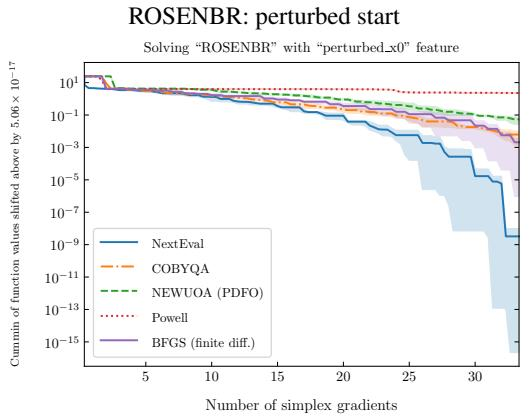

CLIFF: perturbed start  
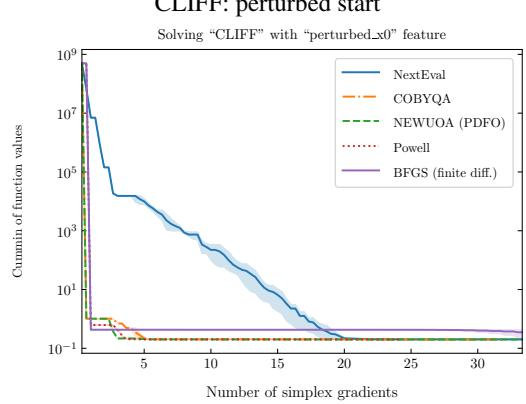

ROSENBR: perturbed start + noise  
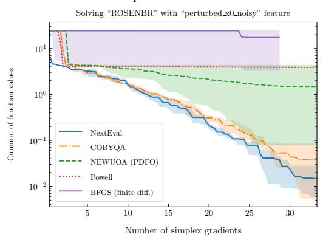

HIMMELBG: perturbed start + noise  
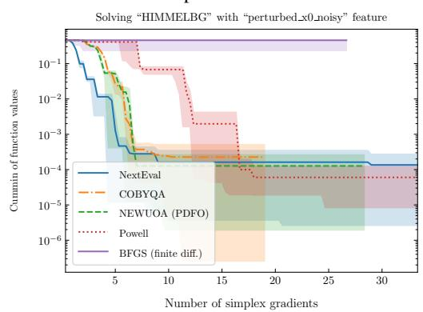  
Figure 7: NextEval–DFO histories for ROSENBR, CLIFF, and HIMMELBG under perturbed starts and, for the lower row, observation noise. All three repetitions are included in each archived plot. These histories describe outcomes rather than a tool-level causal ablation.

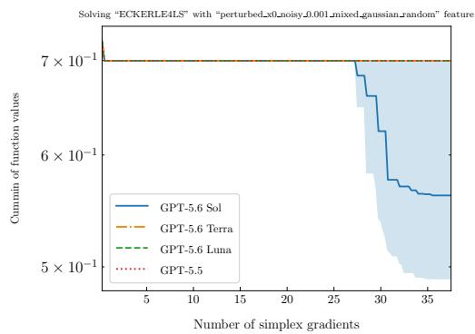

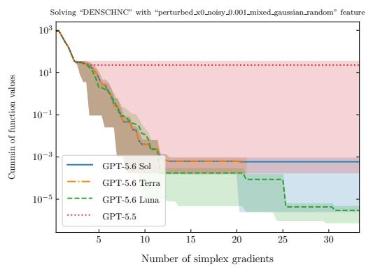  
Figure 8: Two illustrative GPT histories from the earlier three-repeat campaign. They are not tenrepeat summaries; aggregate results are determined by the full comparison set rather than these selected examples.

The archived agent, COBYQA, and PDFO histories were not rerun. Powell was evaluated using the same frozen start, feature seed, noisy evaluator, and per-case budget. Before the Powell runs were added, the reconstruction reproduced all archived COBYQA observations exactly. No model call was added.

Table 5: Observed incumbent values for paired two-dimensional ROSENBRTU records under the listed Qwen settings. The classical entry is the best observed value among COBYQA, Powell, and PDFO in the same repetition.
<table><tr><td>Repetition</td><td>Qwen medium</td><td>Qwen off</td><td>Best classical</td><td>Best classical value</td><td>Medium strict improvements</td></tr><tr><td>rep02</td><td>0.1843</td><td>13.88</td><td>PDFO</td><td>100.7</td><td>35</td></tr><tr><td>rep08</td><td>0.9525</td><td>100.6</td><td>PDFO</td><td>100.8</td><td>13</td></tr></table>

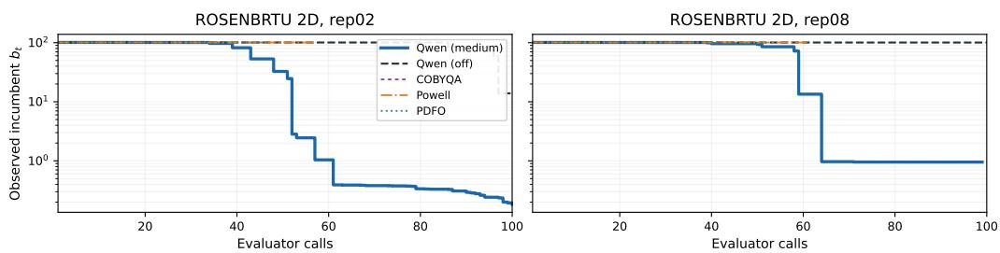  
Figure 9: Observed incumbent curves for paired two-dimensional ROSENBRTU records under Qwen 3.8 Flash with thinking set to medium or off and the three paired classical references. Each curve is the cumulative minimum of the method’s recorded noisy observations. The vertical axis reports the observed incumbent and the horizontal axis reports evaluator calls.

## D CONTROLLED AGENT-CONFIGURATION STUDY DETAILS

## D.1 TEN-REPEAT MODEL AND REASONING STUDIES

GPT model-choice study. Holding Codex and medium reasoning fixed, we compare GPT-5.6 Sol, Terra, Luna, and GPT-5.5 under perturbed starts plus noise. Their aggregate scores are 0.997, 0.993, 0.981, and 0.571. At 10−6 they attain 544, 536, 540, and 271 targets out of 920, respectively (Figure 11). For MISRA1ALS, three start perturbation seeds yielding nonfinite values are replaced by finite-start reserve seeds before solver execution; the noise seeds are unchanged.

The four-model comparison contains $9 2 \times 4 \times 1 0 = 3 . 6 8 0$ agent episodes. Its original rows are unchanged; 40 MISRA1ALS episodes were added under the recorded host and CLI deviation above. Four historical GPT-5.5 episodes timed out, but their available numerical histories are retained: DENSCHNA (8), BRKMCC (9), ROSENBRTU (5), and KOWOSB (5).

All four GPT configurations receive the same instruction not to finalize while budget remains. The runner can nevertheless convert repeated replies without tool calls into a terminal status, so stopping behavior is a property of the complete model–harness configuration. Median budget use is 100% for the GPT-5.6 configurations and 13% for GPT-5.5. The available numerical histories from timed-out sessions remain in the profile comparison. Appendix B.3 retains the earlier three-repeat snapsho separately.

Qwen reasoning-setting study. The Qwen final snapshot contains $9 2 \times 5 \times 1 0 = 4 { , } 6 0 0$ cells, including 1,840 agent episodes, from 4,950 attempts. The archive retains the final authorized terminal attempt for each slot rather than selecting the attempt with the best objective value, and completed parents are not retried. Across the archive, 350 failed historical attempts remain in the audit trail. The selected-attempt profiles therefore measure objective- evaluation efficiency rather than recovery overhead. Failures mix transport and execution causes and are not all attributed to model quality. MISRA1ALS remains in this snapshot; three COBYQA final outputs are nonfinite, and the archive preserves the scorer’s nonfinite convention.

For Qwen 3.8 Flash under Codex, the history-performance area scores are 0.924 with thinking off and 1.000 with medium reasoning. Medium obtains the lower median final clean value on 53 problems, compared with 39 for thinking off. At the individual repetition level, medium records 484 lower final values, 426 higher values, and 10 ties. These within-problem repetitions are not 920 independent problem families.

Table 6: Recorded observations for three action-level two-dimensional ten-repeat traces. All objective values are observed values; the final column reports paired classical observations and reported termination conditions.
<table><tr><td>Case</td><td>Model and recorded evaluation sequence</td><td>Paired classical observations</td></tr><tr><td>ROSENBRTU rep04</td><td>GPT-5.5; evaluations 53-58; incumbent 100.8 be- fore three line-search calls without a strict decrease; scale_restart followed, with observed values 92.82 (evaluation 58), 3.642 (61), and 0.8773 (89).</td><td>Powell: 96/100 calls after its last strict improve- ment, then evaluation-limit termination at 100.7; COBYQA/PDFO: 43/45 and 46/48 plateau calls before a trust-region radius lower bound.</td></tr><tr><td>SNAIL rep09</td><td>GPT-5.6 Terra; evaluations 78–82; see the audited case above for the full recorded action sequence; observed value 1.157 × 10−3 at evaluation 98.</td><td>Powell: successful termination after 73 calls at 14.23, with 50 calls after its last strict improve- ment; COBYQA/PDFO: 11/52 and 7/59 plateau calls, with PDFO near 13.93.</td></tr><tr><td>LOGHAIRY rep08</td><td>GPT-5.6 Terra; evaluations 38–39; incumbent 0.4815 and a Newton candidate of 0.8568; subsequent trust-region calls reached 0.1805 at evaluation 67.</td><td>Powell: 72/100 calls after its last strict improve- ment and evaluation-limit termination at 6.539; COBYQA/PDFO: 32/49 and 10/48 plateau calls before a trust-region radius lower bound, with best observed value near 6.529.</td></tr></table>

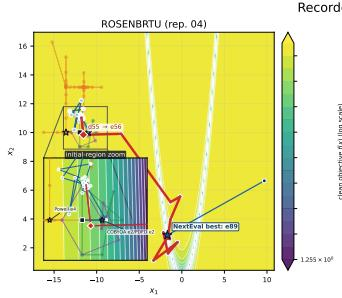

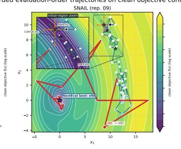

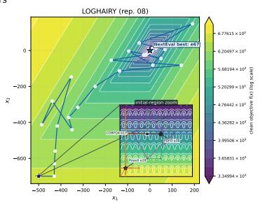  
Contours are post-hoc clean S2MPJ evaluations. Markers are recorded noisy cal s; straight segments join consecutive evaluation IDs (ek ek+1) only to show cal order, not continuous motion. Stars mark each method's best; insets enlarge the shared initial region  
Figure 10: Recorded decision trajectories for three two-dimensional ten-repeat traces. Contour colors show post-hoc clean S2MPJ objective evaluations on a logarithmic scale. Blue, orange, purple, and green paths and markers show NextEval+GPT, Powell, COBYQA, and PDFO, respectively. Each straight connector joins consecutive recorded evaluator calls and does not denote continuous optimizer motion. Red overlays highlight the segment from the evaluation immediately preceding the selected action change to the evaluation attaining the selected NextEval best. Stars mark each method’s best recorded observation, and insets enlarge the shared initial regions. The clean contours were not available to the agent.

Label changes were checked to leave numerical profile scores unchanged. Profile generation reloads the saved OptiProfiler data without rerunning the solvers. These snapshots do not reuse the earlier cohort’s bootstrap intervals.

## D.2 DEEPSEEK EXECUTION-HARNESS COMPARISON

Both participants use the same numerical implementation, DeepSeek V4 Flash with thinking off, the same NextEval instructions and 18 tools, and ten matched repeats under perturbed starts plus noise. The provider is shared within each pair. Both receive a 32,000-token output cap, temperature zero, noise-informed instructions, and no evaluation cache. The harness changes: the built-in runner uses its digest-based context management, whereas Claude Code retains its own wrapper, context management, and recovery. This compares complete harnesses, not one internal mechanism. The 92-problem comparison adds 20 MISRA1ALS episodes on macOS to the original Linux archive, retaining its existing histories. The supplement uses the finite-start reserve seeds described above, with unchanged noise seeds; three transport-interrupted attempts are preserved alongside their replacements.

All recorded histories are retained, including partial built-in sessions. One authorized rerun of a runtime error instead ended at the output-token cap; substituting its history leaves the reported profile scores unchanged. The archive preserves both attempts and all transport retries. Claude Code performs better in this configuration; this does not identify which harness component causes the difference.

Table 7: Recorded observations for three supplementary ten-repeat traces. The dimension and budget columns identify the experimental setting; the final column reports paired classical observations.
<table><tr><td>Case</td><td>Dim.</td><td>Budget</td><td>Final observed</td><td>Recorded evaluation sequence</td><td colspan="2">Paired classical obser- vations</td></tr><tr><td>SNAIL rep08</td><td>2</td><td>100</td><td> $- 2 . 1 9 1 \times 1 0 ^ { - 3 }$ </td><td>Line search without a strict decrease near 13.93 → broad trust region to  $1 . 9 8 7 \ \times$   $1 0 ^ { - 3 }$  → Newton to  $6 . 7 5 \times 1 0 ^ { - 4 } \to$  trust-region continuation.</td><td colspan="2">Powell/COBYQA/ PDFO best values  $1 4 . 2 4 / 1 4 . 1 4 /$  13.98; plateau tails 23/100, 3/51, and</td></tr><tr><td>ECKERLE4LS rep08</td><td>3</td><td>150</td><td> $2 . 0 6 \times 1 0 ^ { - 4 }$ </td><td>Coordinate search without a strict decrease → trust-region restart to  $0 . 4 4 5 9 $  line search to 0.4198 → trust-region refine- ment.</td><td colspan="2">Powell/COBYQA/ PDFO best values 0.6974/0.6979/ 0.6973; plateau tails 61/141, 35/66, and</td></tr><tr><td>MGH09LS rep03</td><td>4</td><td>200</td><td> $- 3 . 9 4 \times 1 0 ^ { - 4 }$ </td><td>Line search and broad trust-region calls without a strict decrease → coordinate search.</td><td>46/75 calls. Powell/COBYQA/ PDFO best 2.627 X 3.200 X 1.231 X</td><td>values 10-3 -3</td></tr></table>

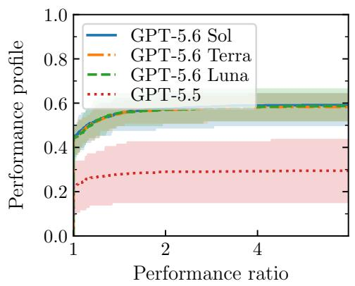

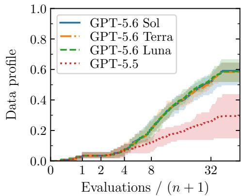  
Figure 11: GPT model comparison with Codex and medium reasoning fixed. History-performance and history-data profiles at $\mathrm { \dot { 1 0 } ^ { - 6 } }$ use all 92 problems and ten repetitions. Targets are computed within the four models; shading shows the repetition range, not a confidence interval.

Earlier Qwen comparison. The historical three-repeat Qwen 3.8 Flash study compared Codex with direct tool calling with a common numerical implementation in the two arms. Its 273 complete pairs yielded 136/8/129 lower/equal/higher final values for Codex. Different instruction wrappers and API transports make it a separate study; it is not pooled with the matched DeepSeek comparison.

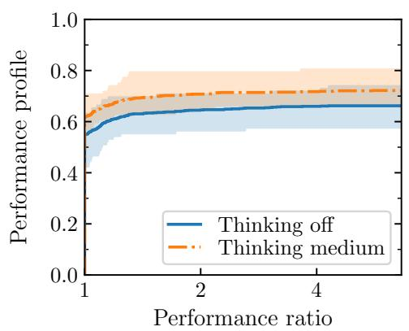

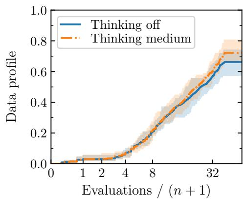  
Figure 12: Ten-repeat Qwen reasoning-setting comparison. Both configurations use NextEval with Codex and Qwen 3.8 Flash; only the reasoning setting (off versus medium) changes. OptiProfiler history-performance and data profiles are shown at $\bar { 1 } 0 ^ { - 6 }$ over all 92 problems. References are recomputed within these two agents, and shading shows the repetition range rather than a confidence interval.

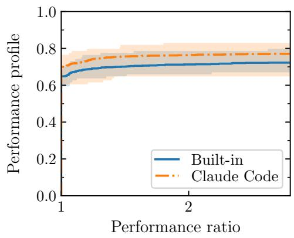

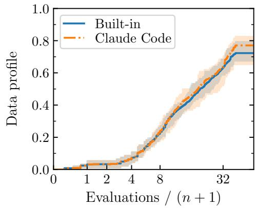  
Figure 13: DeepSeek V4 Flash with the built-in runner and Claude Code. OptiProfiler historyperformance and data profiles at $1 0 ^ { - 6 }$ use all 92 problems with ten repeats. Targets are computed within these two configurations; shading shows the repetition range.

Table 8: History-based profile scores, averaged over tolerances $1 0 ^ { - 1 }$ through $1 0 ^ { - 1 0 }$ . Higher is better.
<table><tr><td>Harness</td><td>Performance</td><td>Data</td></tr><tr><td>Built-in</td><td>0.947</td><td>0.966</td></tr><tr><td>Claude Code</td><td>0.999</td><td>1.000</td></tr></table>

## E PLANNED MECHANISM TESTS

This section specifies follow-up controls; it contains no ablation results. The solver is the combination of controller, numerical tools, and their execution environment. We do not claim that gains from this combination are exclusively due to the language model.

Replace the controller, retain the environment. A non-LLM controller can select the same tools from the same permitted history. A deterministic controller may still adapt to observations; stochasticity is not the distinction between an agent and a numerical rule. A simple first reference is to continue the implemented trust-region method under a declared budget and stopping rule, without changing its numerical implementation. This tests whether method composition improves on a strong component, not whether an LLM dominates every possible controller. A learned router or reinforcement-learned policy is a separate research direction, not a prerequisite for the present lightweight solver.

Retain the model, reduce numerical support. The complementary comparison holds model, inference setting, and session management fixed, while exposing only a budgeted point-evaluation interface and raw permitted history instead of the numerical toolset and summaries. Even this mini mal interface must retain the oracle boundary, ledger, budget, and error handling. It is therefore not literally “no harness.” If general code execution remains available, it must be declared: the agent could implement its own numerical methods. A narrower alternative removes only history-analysis tools or only continuation-state reuse.

Comparison and interpretation. These are two controlled substitutions, not automatically an orthogonal model-present/harness-present factorial experiment. Removing both leaves no defined sampling policy until an additional baseline is specified. Freeze controls on development problems, use matched task/feature seeds and budgets, and report all repetitions, failures, stopping behavior, and model costs. Do not choose the strongest single method retrospectively on the test set. Case studies should include improvement, neutral, and unsuccessful sequences. An observed plateau alone cannot establish a local minimum; a claimed advantage from a particular action requires matched comparisons, or repeated continuations from equivalent states and remaining budgets.

## F NUMERICAL AND EXECUTION DETAILS

Quadratic models. In normalized coordinates, the trust-region tool fits $\begin{array} { r } { q ( d ) = c + g ^ { \top } d + \frac { 1 } { 2 } d ^ { \top } } \end{array}$ Hd through selected observations, using the least-Frobenius-change problem

$$
\operatorname* { m i n } _ { c , g , H = H ^ { \top } } \frac { 1 } { 2 } \| H - H _ { \mathrm { p r e v } } \| _ { F } ^ { 2 } \quad \mathrm { s u b j e c t t o } \quad q ( d _ { i } ) = y _ { i } .\tag{10}
$$

The linear terms are unpenalized. Geometry checks and regularization support numerical stability. A Newton jump uses the fitted model and its definiteness and validity checks before evaluating a candidate. The implementation supplies these classical numerical mechanisms; the agent controls their use and evaluation allowances.

Termination and ownership. Global budget exhaustion, explicit finalization, and operational interruptions are distinct from a local method’s stopping condition. Stopping outcomes are interpreted according to the rules used in each experiment. Final results and partial histories must be retained when a session is interrupted. In-process runners are trusted code. API ownership by itself does not prove isolation against malicious Python introspection or same-user filesystem access. The strict benchmark executor must enforce its oracle, filesystem, and network boundaries independently.

## G DESIGN RATIONALE AND RELATED APPROACHES

Solution prediction and adaptive decisions. By a one-shot solution mapping, we mean a predictor that returns a solution from a problem description or fixed observations without requesting further objective evaluations. Such predictors can be useful when the problem family has shared structure. Our general-purpose oracle setting does not assume that this structure is known or that a new objective follows a training distribution. In the absence of further restrictions, different objectives can agree on a finite set of observations while having different minimizers. Predictions from those observations alone cannot distinguish them. Additional evaluations can provide new information, but a finite-budget adaptive policy also has no guarantee of success on arbitrary objectives. The choice of an adaptive policy is therefore a design principle, not an impossibility result for learned optimization or a distribution-free guarantee for NextEval. It also does not rule out learning the policy itself.

Why use an agent? General-purpose agents already combine tool use with observation-dependent decisions (Yao et al., 2023; Merrill et al., 2026), and reusable agent frameworks support persistent execution and context (LangChain, 2026). These capabilities make the proposed solver practical to implement; they do not establish that a particular model will make good DFO decisions. Our hypothesis concerns using these capabilities to control numerical methods, not substituting LLMgenerated arithmetic for numerical computation. Direct evaluations of LLM-based optimization report numerical limitations (Huang et al., 2024), but the present experiments do not isolate whether numerical tools, retained state, or agent decisions account for the performance differences.

Adjacent uses of agents. NextEval controls numerical methods during an individual solve. Program search and heuristic generation instead develop algorithms across tasks, as in FunSearch and ReEvo (Romera-Paredes et al., 2024; Ye et al., 2024). Agents also support explicit mathematical modeling and application-specific optimization (Ahmaditeshnizi et al., 2024; Jiang et al., 2026). These are complementary directions, not methods ruled out by our choice of a scalar objective interface.

## H NUMERICAL TOOL CATALOG

The tools in Table 9 implement the numerical operations used by the agent in Section 2.2. Each method retains its own state; analysis tools use existing observations without new objective calls.

Table 9: The numerical action space. Method state is separate across families. The final two rows use existing observations only.
<table><tr><td>Operation</td><td>Numerical work</td><td>Retained information</td></tr><tr><td>Trust-region campaign</td><td>Quadratic interpolation, step accep- tance, geometry repair</td><td>Radius, resolution, sample set, Hessian</td></tr><tr><td>Line-search campaign</td><td>Bracketing and safeguarded parabolic search</td><td>Direction and successful scale</td></tr><tr><td>Poll / coordinate search</td><td>Directional tests and step-size adapta- tion</td><td>Poll length / one scale per axis</td></tr><tr><td>Newton jump</td><td>Safeguarded minimizer of a fitted quadratic</td><td>Model checks and recent out- come</td></tr><tr><td>Geometry rebuild</td><td>Construct a usable local sample set</td><td>Samples and geometry report</td></tr><tr><td>Model preview</td><td>Fit a surrogate and inspect its candidate</td><td>No new objective evaluations</td></tr><tr><td>Situation / history</td><td>Progress, scales, readiness, past deci- sions</td><td>No new objective evaluations</td></tr></table>