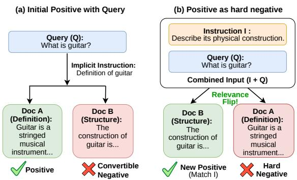
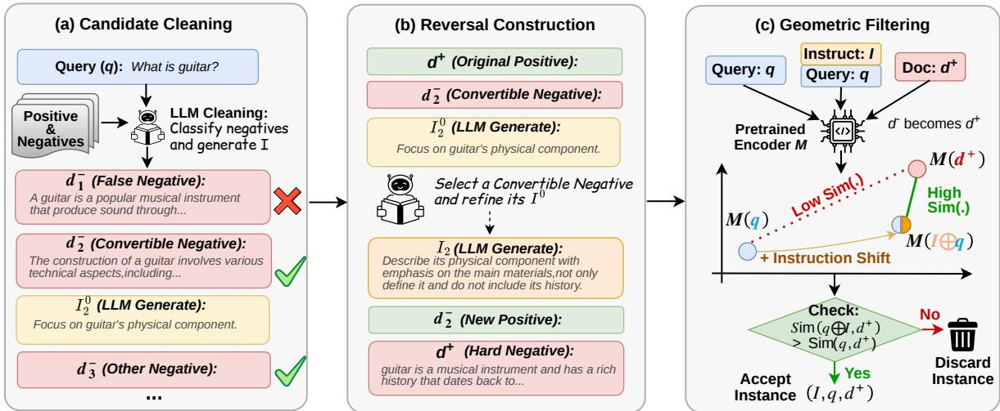
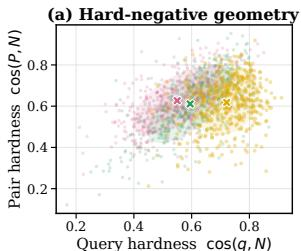
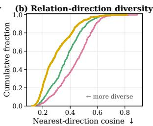
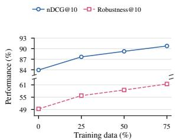
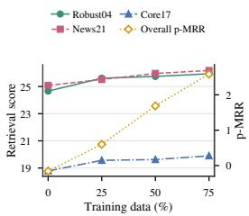

# Natural Hard-Negative Mining from Positives for Instruction-Following Retrieval

Chaolang Li Jingyu Li Zhaocheng Du Xuyang Xie Gang Wang Pengwen Dai

## Abstract

Instruction-following information retrieval (IFIR) requires retrievers to rank documents by both a query and its instance-specific instruc tions, yet instruction-conditioned contrastive supervision remains scarce. Existing synthetic methods typically fix a positive passage and generate additional negatives, overlooking the hard-negative potential of the original positive. We propose Natural Hard-Negative Mining (NHNM), which promotes convertible nega tives under query-compatible instructions and repurposes original positives as natural instruction hard negatives. Its automated Candidate Cleaning, Reversal Construction, and Geometry Filtering pipeline produces compact, highcontrast supervision aligned with the pretrained retrieval space. Applied to MS MARCO, NHNM yields NHNM-MARCO, an IFIR training set of nearly 7K instances. On InstructIR and FollowIR, models with 568M to 4B parameters fine-tuned on NHNM-MARCO achieve strong instruction-following performance and match or surpass substantially larger retrievers in several settings. Controlled analyses and ablations attribute these gains to natural hard-negative supervision rather than model scale or training-data volume.

## 1 Introduction

Instruction-following information retrieval (IFIR) requires retrievers to satisfy both a query and user instructions about aspects, scope, evidence, or exclusions. It supports personalized search (Chhetri et al., 2026; Bok et al., 2022), task-oriented information seeking (Feng et al., 2023; Asai et al., 2023), and retrieval-augmented generation (Lewis et al., 2020).

Despite recent progress (Su et al., 2023; Asai et al., 2023; Muennighoff et al., 2025), retrievers often remain dominated by query-document similarity and fail to adjust rankings to instancespecific instructions (Oh et al., 2024). Instructionaware supervision is therefore needed (Weller et al., 2025a), but contrastive pairs whose relevance changes with the instruction are scarce and costly to annotate. Simply adding instructions to conventional tuples with fixed relevance labels lets models ignore them; effective supervision must expose instruction-conditioned relevance changes.

  
Figure 1: Illustration of instruction-conditioned natural hard-negative mining.

Existing methods create such changes around a fixed positive. Promptriever preserves it under a generated instruction and synthesizes queryrelevant, instruction-violating negatives (Weller et al., 2025b); InF-IR generates hard negatives by perturbing the instruction or query of a positive triplet (Zhuang et al., 2025). Both retain a designated positive and build negatives around it, overlooking the original positive’s hard-negative potential. Passage-level synthesis also requires a long, coherent passage that remains query-relevant while violating the instruction, increasing exposure to generation bias and hallucination.

Figure 1 illustrates our key observation: an original positive can become a natural hard negative under an instruction whose added criterion it violates, despite remaining query-relevant. We identify convertible negatives (CNs), existing negatives that become positives under that instruction, to form the contrast. Generating a short instruction from the semantic difference between the passages replaces controlled negative passage synthesis and reduces generation artifacts while exploiting the original positive’s inherent hardness.

We therefore introduce Natural Hard-Negative Mining (NHNM). Its automated pipeline (1) cleans candidates and removes false negatives, (2) selects a CN, generates a minimal instruction that promotes it, and makes the original positive an instruction hard negative, and (3) retains instances whose instruction-induced shift aligns with the pretrained retrieval space. This yields precise, highcontrast supervision without synthesizing long negative passages.

Applying NHNM to MS MARCO (Bajaj et al., 2016) produces the 6,716-instance NHNM-MARCO dataset. It improves Qwen3-Embedding-0.6B, Qwen3-Embedding-4B, and BGE-M3; the 0.6B model is strong against much larger retrievers on InstructIR and competitive on FollowIR.

Our contributions are threefold:

• We propose Natural Hard-Negative Mining, a paradigm that promotes convertible negatives and repurposes original positives as instruction hard negatives.

• We develop a fully automated pipeline with three simple stages: Candidate Cleaning, Reversal Construction, and Geometry Filtering, producing high-contrast supervision without synthesizing long negative passages.

• We construct the compact, 6,716-instance NHNM-MARCO training set and show that it improves multiple encoder backbones; a 0.6B model is strong against much larger retrievers on InstructIR and competitive on FollowIR.

## 2 Related Work

Instruction-Aware Retrieval and Evaluation. Instruction-aware retrieval extends semantic matching by conditioning relevance on a naturallanguage description of the user’s task or preference. Early methods such as Instructor (Su et al., 2023) and TART (Asai et al., 2023) prepend tasklevel instructions to queries during representation learning, while GRIT (Muennighoff et al., 2025) jointly learns generative and embedding capabilities under diverse instructions. These approaches demonstrate that instructions can improve transfer across retrieval tasks, but task-level descriptions do not necessarily require a retriever to change its ranking for an individual query. InstructIR (Oh et al., 2024) therefore evaluates instance-level instructions that express user-specific intents and preferences. FollowIR (Weller et al., 2025a) uses detailed TREC narratives and controlled instruction perturbations to measure whether rankings change in the required direction. Together, these benchmarks show that strong conventional relevance does not imply instruction sensitivity and motivate training supervision in which document relevance changes with the instruction.

Instruction-Conditioned Data Synthesis. Recent work constructs such supervision automatically rather than relying on costly relevance annotation. Promptriever (Weller et al., 2025b) keeps an original positive passage relevant under a generated instruction and synthesizes query-relevant passages that violate that instruction, thereby creating contrastive examples in which the instruction is necessary. InF-IR (Zhuang et al., 2025) begins with a positive instruction–query–passage triplet and generates hard negatives by perturbing the instruction or query. Both methods establish the value of instruction-conditioned hard negatives, but follow a positive-centered construction: the designated positive remains fixed, while additional negative passages are generated around it. This construction leaves the potential role reversal of existing retrieval candidates unexplored and requires the LLM to synthesize long passages that are simultaneously query-relevant and instruction-violating.

Our work investigates the reverse direction. Rather than generating a passage around a fixed positive, we identify a convertible negative among existing retrieval candidates and generate a compatible instruction that promotes it. Under the same instruction, the original query-positive passage d+ remains topically relevant but violates the added criterion, becoming a natural instruction hard negative. This label reversal produces a high-contrast pair of corpus-grounded documents for which the instruction, rather than topical similarity alone, determines the preferred ranking.

## 3 Preliminaries

Instruction-Following Retrieval. Given an instruction I and a query q, instruction-following information retrieval (IFIR) ranks a candidate document list according to both the information need in $q$ and the relevance criteria in I. We denote the training candidate list as $\mathcal { D } _ { I , q } = \{ d ^ { + } \} \cup \{ d _ { i } ^ { - } \} _ { i = 1 } ^ { K } ,$ where $d ^ { + }$ is the instruction-conditioned positive document and $\{ d _ { i } ^ { - } \} _ { i = 1 } ^ { K }$ are negative documents. For a dual-encoder retriever $f _ { \theta } ,$ the score of a candidate document $d \in \mathcal { D } _ { I , q }$ is

  
Figure 2: Overview of the NHNM pipeline for mining natural hard negatives from query-positive-negative tuples.

$$
s _ { \theta } ( I , q , d ) = \sin \bigl ( f _ { \theta } ( I \oplus q ) , f _ { \theta } ( d ) \bigr ) ,\tag{1}
$$

where ⊕ denotes concatenation and sim is cosine similarity. We optimize the standard InfoNCE objective (van den Oord et al., 2018):

$$
\mathcal { L } = - \log \frac { \exp ( s _ { \theta } ( I , q , d ^ { + } ) / \tau ) } { \sum _ { d \in \mathcal { D } _ { I , q } } \exp ( s _ { \theta } ( I , q , d ) / \tau ) } ,\tag{2}
$$

where $\tau$ is the temperature.

Instruction-Conditioned Hard Negatives. Instruction-conditioned mining asks whether a negative document in the candidate list can become the preferred document under a suitable instruction. For a negative $d _ { j } ^ { - } \in \mathcal { D } _ { I , q } ,$ we call $d _ { j } ^ { - }$ convertible if a query-compatible instruction ${ \mathrm { ~ \it ~ I _ j ~ } }$ can make it satisfy the intended criterion better than the original positive $d ^ { + }$ . Under the same instruction, $d ^ { + }$ remains topically relevant to the query but violates the added criterion, so it becomes a natural instruction hard negative.

## 4 Method and Data Curation Pipeline

Negative Retrieval. Before applying the pipeline, we retrieve candidate negatives to search for potential convertible negatives (CNs). For each query $q ,$ we use BM25 to retrieve the top-M documents and exclude ground-truth positives. The resulting documents are topically related to q but do not satisfy the original retrieval intent, often reflecting partial relevance, alternative aspects, or complementary information. This retrieval step provides a semantically close candidate pool in which some negatives may be promoted by query-compatible instructions.

Figure 2 presents our fully automated three-stage pipeline: Candidate Cleaning (§4.1), Reversal Construction (§4.2), and Geometry Filtering (§4.3). The first two stages determine whether a valid reversal exists and express it as an instruction; the last stage selects samples whose instruction-induced shifts preserve the pretrained retrieval space. The appendix provides the prompts.

## 4.1 Stage I: Candidate Cleaning

Turning the original positive $d ^ { + }$ into a natural hard negative first requires finding a retrieved negative that can be validly promoted. Given $\mathcal { D } _ { q } =$ $\{ d ^ { + } \} \cup \mathcal { D } _ { q } ^ { - }$ , where $\mathcal { D } _ { q } ^ { - } = \{ d _ { i } ^ { - } \} _ { i = 1 } ^ { K }$ , the retrieved negatives may be noisy, may already answer $q ,$ or may be topically related but incompatible with any valid refinement. Generating instructions from them indiscriminately can force the LLM to produce constraints that are incompatible with, or even contradict, the original query, thereby introducing noisy instruction-following supervision.

We therefore apply hybrid rule-LLM cleaning, as illustrated in Figure 2(a). Lightweight rules first remove malformed, truncated, and nearduplicate passages. The LLM then jointly examines $( q , d ^ { + } , \mathcal { D } _ { q } ^ { - } )$ , verifies the validity of $d ^ { + }$ , and assigns every remaining $d _ { i } ^ { - }$ to exactly one category: a False Negative (FN) already satisfies $q ;$ a Convertible Negative (CN) does not satisfy $q$ but can become preferable to $d ^ { + }$ under a compatible refinement; and an Other Negative (ON) satisfies neither condition.

For each CN, the LLM additionally proposes an initial instruction $I _ { i } ^ { 0 }$ as a feasibility check: it must preserve the entity, intent, and answer type of $q ,$ introduce a condition supported by $d _ { i } ^ { - }$ , and keep $d ^ { + }$ relevant but noncompliant. We retain only tuples with a valid $d ^ { + }$ and at least one feasible CN. The stage removes FNs and outputs the cleaned CN –ON pool $\mathcal { \widetilde { D } } _ { q } ^ { - }$ together with the verified candidates $\{ ( d _ { i } ^ { - } , I _ { i } ^ { 0 } ) \}$ for Stage II.

## 4.2 Stage II: Reversal Construction

The cleaning stage may identify multiple CNs, but not all of them yield equally clear supervision. As illustrated in Figure 2(b), a second LLM compares all surviving CN–instruction candidates $( d _ { i } ^ { - } , I _ { i } ^ { 0 } )$ and selects the pair $( d _ { j } ^ { - } , I _ { j } ^ { 0 } )$ that supports the clearest instruction-conditioned contrast while preserving the query framework. It then refines $I _ { j } ^ { 0 }$ into a concise instruction $I _ { j }$ containing the minimum sufficient discriminating condition. We reject instructions that shift the query intent, leak documentspecific answers, or leave the original positive satisfying the added criterion.

After reversal, we form a new IFIR training instance by relabeling the selected CN $d _ { j } ^ { - }$ as its instruction-conditioned positive $d ^ { + }$ . The original query-positive document is relabeled as the first instruction-conditioned negative $d _ { 0 } ^ { - }$ :

$$
\mathcal { D } _ { I _ { j } , q } ^ { - } = \{ d _ { 0 } ^ { - } \} \cup \big ( \widetilde { \mathcal { D } } _ { q } ^ { - } \setminus \{ d _ { j } ^ { - } \} \setminus \mathcal { E } _ { I _ { j } } \big ) ,\tag{3}
$$

where $\mathcal { E } _ { I _ { i } }$ contains unselected CNs that also fully satisfy $( I _ { j } , q )$ and would otherwise become false negatives. Because $d _ { 0 } ^ { - }$ was originally annotated as relevant to $q ,$ , it is naturally close to the query but violates $I _ { j } ,$ making it a high-value instruction hard negative. The final training list follows the notation in Preliminaries: $\mathcal { D } _ { I _ { j } , q } = \{ d ^ { + } \} \cup \mathcal { D } _ { I _ { j } , q } ^ { - }$ . Thus, Equation 3 obtains the desired contrast without synthesizing a negative passage: the LLM only generates the shorter instruction that separates two real documents.

## 4.3 Stage III: Geometry Filtering

Semantic verification does not guarantee that a generated instruction produces a stable and useful shift in the pretrained retrieval space. We therefore use the frozen encoder before fine-tuning to remove samples whose instruction signal is unlikely to align with the model’s existing geometry. For each generated tuple, we compute the instructioninduced gain of its relabeled positive:

$$
\begin{array} { c } { { \Delta ^ { + } ( I _ { j } , q , d ^ { + } ) = \sin \bigl ( f _ { 0 } ( I _ { j } \oplus q ) , f _ { 0 } ( d ^ { + } ) \bigr ) } } \\ { { - \sin \bigl ( f _ { 0 } ( q ) , f _ { 0 } ( d ^ { + } ) \bigr ) , } } \end{array}\tag{4}
$$

where $f _ { 0 }$ is the pretrained encoder. We retain an instance when

$$
\Delta ^ { + } ( I _ { j } , q , d ^ { + } ) > \gamma ,\tag{5}
$$

and use $\gamma = 0$ in our main experiments. This criterion asks only whether the frozen encoder already interprets the instruction in the intended direction; it does not require the model to rank $d ^ { + }$ above $d _ { 0 } ^ { - }$ before fine-tuning. Requiring the latter would remove precisely the unsolved reversals that provide useful learning signal. Geometry filtering therefore complements the LLM check: Stage I–II ensures semantic validity, whereas Stage III keeps samples that provide instruction supervision while minimizing unnecessary disruption to the pretrained retrieval representation space.

## 4.4 NHNM-MARCO Construction

We apply the pipeline to 36,306 tuples sampled from MS MARCO-W (Weller et al., 2025b). Each tuple consists of a query, one positive passage, and its provided negative passages and we use only these query-positive-negative fields and do not use the accompanying instruction annotations. Rulebased cleaning retains 29,902 tuples, after which LLM verification identifies 7,527 valid seeds containing 11,254 CN candidates. We use GPT-5.1 for both semantic verification and instruction generation. The Reversal Construction stage succeeds for 7,470 seeds, and Geometry Filtering retains 6,716 final training instances. Each instance contains the generated instruction and original query, the selected CN as its positive, and the original positive followed by the remaining valid passages as negatives.

To assess semantic quality beyond the automatic filters, we randomly sample 100 final instances for manual verification. An instance is considered valid only if the generated instruction preserves the original query intent, makes the selected CN preferable to the original positive, renders the original positive a valid natural hard negative, and introduces no unsupported constraint or answer leakage. Under these criteria, 88 instances pass all checks, corresponding to a manual acceptance rate of 88%.

We use NHNM-MARCO to fine-tune Qwen3-Embedding-0.6B and Qwen3-Embedding-4B (Zhang et al., 2025) with the objective in Equation 2 to examine transfer across scales, and additionally evaluate transfer to BGE-M3. Additional training details are provided in the appendix.

## 5 Experiments

## 5.1 Experimental Setup

Training Setup. We use Qwen3-Embedding-0.6B and Qwen3-Embedding-4B (Zhang et al., 2025) as the main backbones trained with NHNM-MARCO. The 0.6B model is fully fine-tuned for one epoch, while the 4B model uses rank-8 LoRA (α = 32) for one epoch. To test transfer to another encoder family, we also fine-tune BGE-M3 (Chen et al., 2024) with NHNM-MARCO using the same LoRA setting. All models are optimized with InfoNCE, an effective batch size of 32, AdamW with a learning rate of $6 \times 1 0 ^ { - 6 }$ and weight decay of 0.1. Unless stated otherwise, ablations use the 0.6B backbone for one epoch with the same optimization settings. All experiments are conducted on a single NVIDIA RTX 3090 GPU. The appendix lists the full hyperparameters.

Evaluation Benchmarks and Metrics. We evaluate on two instruction-following retrieval benchmarks. InstructIR (Oh et al., 2024) uses short persona- and intent-oriented instructions to test whether retrievers preserve relevance while following query-specific constraints. We report Robustness@10 and nDCG@10, and add MAP for diagnostic ablations. FollowIR (Weller et al., 2025a) contains longer topic descriptions and controlled instruction perturbations over Robust04, News21, and Core17 (Voorhees, 2005; Allan et al., 2017; of Standards and Technology, 2021). We report MAP for Robust04 and Core17, nDCG@5 for News21, and p-MRR to measure whether ranking changes follow the instruction perturbation.

## 5.2 Baseline Models

We compare against strong instruction-aware retrieval baselines from multiple model families. On InstructIR, we include cross-encoder rankers such as Mistral-7B-Instruct and FollowIR-7B, as well as bi-encoder retrievers including BM25, Contriever, GTR, RepLLaMA, TART-Dual, Instructor, E5-Mistral, Promptriever, BGE-M3, and Qwen3-Embedding. On FollowIR, we follow the original benchmark categories and compare with instruction-following LMs, commercial embedding APIs, retrieval models without taskspecific fine-tuning, and fine-tuned retrieval models such as TART, Instructor, InF-Embed, and NHNM. In the controlled data-paradigm comparison, “Promptriever-style” and “InF-IR-style” denote the same Qwen3-Embedding-0.6B backbone trained on equal-sized data instantiated from the corresponding training formats.

<table><tr><td>Model</td><td>Size</td><td>Robust nDCG</td><td></td></tr><tr><td colspan="4">Cross Encoder</td></tr><tr><td>Mistral-7B-Instruct (Jiang et al., 2023)</td><td>7B</td><td>35.30</td><td>63.10</td></tr><tr><td>FollowIR-7B (Weller et al., 2025a)</td><td>7B</td><td>71.50</td><td>81.30</td></tr><tr><td>Bi Encoder</td><td></td><td></td><td></td></tr><tr><td>BM25 (Robertson et al., 1995)</td><td></td><td>26.92</td><td>76.01</td></tr><tr><td>Contriever (Izacard et al., 2021)</td><td>110M</td><td>47.40</td><td>84.85</td></tr><tr><td>GTR (Ni et al., 2022)</td><td>110M</td><td>34.06</td><td>73.35</td></tr><tr><td>GTR-Large (Ni et al., 2022)</td><td>335M</td><td>37.56</td><td>75.95</td></tr><tr><td>GTR-XL (Ni et al., 2022)</td><td>1.5B</td><td>38.34</td><td>75.20</td></tr><tr><td>RepLLaMa (Ma et al., 2023)</td><td>7B</td><td>52.58</td><td>87.62</td></tr><tr><td>TART-Dual (Asai et al., 2023)</td><td>110M</td><td>47.46</td><td>84.81</td></tr><tr><td>Instructor (Su et al., 2023)</td><td>110M</td><td>23.73</td><td>50.44</td></tr><tr><td>Instructor-Large (Su et al., 2023)</td><td>335M</td><td>22.08</td><td>48.80</td></tr><tr><td>Instructor-XL (Su et al., 2023)</td><td>1.5B</td><td>21.53</td><td>48.63</td></tr><tr><td>E5-Mistral (Wang et al., 2024)</td><td>7B</td><td>55.42</td><td>86.33</td></tr><tr><td>Promptriever (Weller et al., 2025b)</td><td>7B</td><td>63.10</td><td>92.10</td></tr><tr><td>BGE-M3 (Chen et al., 2024)</td><td>568M</td><td>42.29</td><td>80.67</td></tr><tr><td>+ NHNM-MARCO</td><td>568M</td><td>45.84</td><td>84.31</td></tr><tr><td>Qwen3-Embedding-4B (Zhang et al.,</td><td>4B</td><td>50.63</td><td>84.99</td></tr><tr><td>2025) + NHNM-MARCO</td><td>4B</td><td>63.26</td><td>91.08</td></tr><tr><td>Qwen3-Embedding-0.6B (Zhang</td><td>0.6B</td><td>49.29</td><td>83.93</td></tr><tr><td>et al., 2025) + NHNM-MARCO (ours)</td><td>0.6B</td><td>67.06</td><td>93.12</td></tr></table>

Table 1: Main InstructIR results across multiple base retrievers, reported with Robustness@10 and nDCG@10.

## 5.3 Main Results

Tables 1 and 2 compare our NHNM-MARCOtrained variants with existing methods on InstructIR and FollowIR. Published baselines are taken from the cited studies, while the Qwen and BGE-M3 rows use our evaluation. Within each model type, the best and second-best scores are bolded and underlined, respectively. The results support three observations.

Strong results on both benchmarks. On InstructIR, NHNM with Qwen3-Embedding-0.6B achieves the best bi-encoder Robustness@10 and the best overall nDCG@10, outperforming Promptriever by 3.96 and 1.02 points, respectively. On FollowIR, NHNM obtains the strongest average relevance score and p-MRR among fine-tuned retrieval models. Its average score of 23.7 is 2.8 points above the next fine-tuned retriever and is within 1.6 points of the best API result. Compared with the fine-tuned FollowIR-7B cross-encoder, NHNM is only 1.1 points lower in average relevance score while using a much smaller 0.6Bparameter dual-encoder backbone.

Gains generalize across encoder architectures. The improvements are not tied to a single backbone. On InstructIR, NHNM improves Qwen3- Embedding-0.6B from 49.29 to 67.06 in Robustness@10 and from 83.93 to 93.12 in nDCG@10. Training with NHNM-MARCO also improves the Qwen3-Embedding-4B backbone by 12.63 Robustness@10 points and 6.09 nDCG@10 points. With a different encoder family, BGE-M3 improves from 42.29 to 45.84 in Robustness@10 and from 80.67 to 84.31 in nDCG@10 after training. These consistent gains suggest that the mined natural hard negatives provide model-agnostic instruction-following supervision.

<table><tr><td rowspan="2">一 Type 1</td><td rowspan="2">Model</td><td rowspan="2">Size</td><td>Robust04</td><td></td><td>News21</td><td></td><td colspan="2">Core17</td><td colspan="2">Average</td></tr><tr><td></td><td>|MAP p-MRR|nDCG@5</td><td></td><td>p-MRR|MAP</td><td></td><td>p-MRR</td><td></td><td>|Score p-MRR</td></tr><tr><td rowspan="5">Instruct LMs</td><td>Flan-T5-Base (Chung et al., 2024) Llama-2-7B-Chat</td><td>0.2B 7B</td><td>13.8 17.8</td><td>+3.6 +0.7</td><td>7.2</td><td>+7.3 +0.6</td><td>10.4</td><td>+1.5 +4.9</td><td>10.5</td><td>+4.1 +2.1</td></tr><tr><td>Flan-T5-Large (Chung et al., 2024)</td><td>0.8B</td><td></td><td></td><td>17.8</td><td></td><td>14.5</td><td>+1.3</td><td>16.7 11.4</td><td></td></tr><tr><td>GritLM-Reranker (Muennighoff et al.,</td><td>7B</td><td>14.7 23.1</td><td>+3.9 +6.9</td><td>8.0</td><td>+8.9</td><td>11.4</td><td></td><td>20.7</td><td>+4.7</td></tr><tr><td>2025)</td><td></td><td></td><td></td><td>20.2</td><td>-6.7</td><td>18.8</td><td>+10.4</td><td></td><td>+3.5</td></tr><tr><td>Mistral-7B-Instruct (Jiang et al., 2023) FollowIR-7B (Weller et al., 2025a)</td><td>7B</td><td>23.2</td><td>+12.6</td><td>27.2</td><td>+4.8</td><td>19.7</td><td>+13.0</td><td>23.4</td><td>+10.1</td></tr><tr><td rowspan="3">APIs</td><td></td><td>7B</td><td>24.8</td><td>+13.7</td><td>29.6</td><td>+6.3</td><td>20.0</td><td>+16.5</td><td>24.8</td><td>+12.2</td></tr><tr><td>OpenAI v3 Large</td><td></td><td>27.2</td><td>-5.8</td><td>27.2</td><td>-2.0</td><td>21.6</td><td>-0.2</td><td>25.3</td><td>-2.7</td></tr><tr><td>Cohere v3 English Google Gecko (Lee et al., 2024)</td><td></td><td>22.3</td><td>-3.6</td><td>28.3</td><td>+0.2</td><td>20.6</td><td>+2.8</td><td>23.7</td><td>-0.2</td></tr><tr><td rowspan="6">Retrieval Models</td><td></td><td></td><td>23.3</td><td>-2.4</td><td>29.5</td><td>+3.9</td><td>23.2</td><td>+5.4</td><td>25.3</td><td>+2.3</td></tr><tr><td>BM25 (Robertson et al., 1995)</td><td></td><td>12.1</td><td>-3.1</td><td>19.3</td><td>-2.1</td><td>8.1</td><td>-1.1</td><td>13.2</td><td>-2.1</td></tr><tr><td>Contriever (Izacard et al., 2021)</td><td>110M</td><td>19.7</td><td>-6.1</td><td>22.9</td><td>-2.8</td><td>15.3</td><td>-2.5</td><td>19.3</td><td>-3.8</td></tr><tr><td>E5-large-v2</td><td>335M</td><td>17.4</td><td>-4.2</td><td>24.3</td><td>+0.9</td><td>17.0</td><td>+0.1</td><td>19.6</td><td>-1.1</td></tr><tr><td>BGE-Large (Xiao et al., 2024)</td><td>0.3B</td><td>17.5</td><td>-7.8</td><td>22.3</td><td>+0.6</td><td>15.0</td><td>+0.1</td><td>18.3</td><td>-2.4</td></tr><tr><td>E5-Mistral (Wang et al., 2024) GritLM-7B (Muennighoff et al., 2025)</td><td>7B 7B</td><td>23.1 28.6</td><td>-9.6 -1.7</td><td>27.8 24.4</td><td>-0.9 -1.0</td><td>18.3 20.8</td><td>+0.1 +2.6</td><td>23.1 24.6</td><td>-3.5 -0.0</td></tr><tr><td rowspan="7">Retrieval Models FT</td><td>TART-Contriever (Asai et al., 2023)</td><td>110M</td><td></td><td></td><td></td><td>-3.0</td><td></td><td>-3.0</td><td>16.5</td><td>-5.0</td></tr><tr><td>Instructor-XL (Su et al., 2023)</td><td>1.5B</td><td>14.3 19.7</td><td>-9.0 -8.1</td><td>21.8 26.1</td><td>-0.9</td><td>13.3 16.8</td><td>+0.7</td><td>20.9</td><td>-2.8</td></tr><tr><td>InF-Embed (Llama-3.2-1B-Inst) (Zhuang</td><td>1B</td><td>19.1</td><td>+5.6</td><td>26.1</td><td>+3.8</td><td>15.2</td><td>+1.9</td><td>20.2</td><td>+3.8</td></tr><tr><td>et al., 2025)</td><td></td><td></td><td></td><td></td><td></td><td></td><td></td><td></td><td></td></tr><tr><td>InF-Embed (Qwen2.5-3B-Inst) (Zhuang et al., 2025)</td><td>3B</td><td>19.6</td><td>+3.3</td><td>22.4</td><td>+1.8</td><td>14.6</td><td>+3.7</td><td>18.9</td><td>+2.9</td></tr><tr><td>Ours (Qwen3-Embedding-0.6B)</td><td>0.6B</td><td>25.0</td><td>+3.1</td><td>26.7</td><td>+2.1</td><td>19.3</td><td>+7.1</td><td>23.7</td><td>+4.1</td></tr></table>

Table 2: Main results on FollowIR across Robust04, News21, and Core17. Scores measure relevance, and p-MRR measures instruction sensitivity.

Compact data is highly efficient. NHNM-MARCO contains only 6,716 final training instances, yet it supports a compact retriever that matches or surpasses methods built with much larger datasets or models. Promptriever uses nearly 500K instruction-bearing instances and a 7B retriever, while InF-IR starts from over 38K positive instruction–query– passage triplets and constructs additional hard negatives, yielding a much larger training corpus than ours. Despite this scale gap, NHNM is stronger on InstructIR and competitive on FollowIR. This supports the central premise: mining corpus-grounded natural hard negatives can produce more useful instruction-conditioned supervision than simply increasing synthetic data volume or model size.

<table><tr><td>Training Data</td><td>Robust.</td><td>nDCG@10</td></tr><tr><td>No fine-tuning</td><td>49.29</td><td>83.93</td></tr><tr><td>InF-IR-style (Žhuang et al., 2025)</td><td>31.51</td><td>72.09</td></tr><tr><td>Promptriever-style (Weller et al.,</td><td>51.84</td><td>86.35</td></tr><tr><td>2025b) NHNM-MARCO (ours)</td><td>67.06</td><td>93.12</td></tr></table>

Table 3: Controlled comparison of training-data paradigms.

## 5.4 Controlled Training-Data Paradigm Comparison

To compare training-data paradigms fairly, we remove the confounding effects of model capacity, data volume, and optimization budget. All rows in Table 3 use the same Qwen3-Embedding-0.6B backbone, the same number of training instances, and the same one-epoch fine-tuning setup. Only the construction paradigm of the training data is changed. For Promptriever-style data, we use its instruction-bearing tuples, retaining the original positive and the accompanying generated negatives. For InF-IR-style data, we use its positive instruction–query–document tuples and the provided instruction- or query-perturbed hard-negative tuples. We randomly sample each source to the same size as NHNM-MARCO and evaluate all models with the same InstructIR protocol.

Table 3 shows that Promptriever-style training provides a modest improvement over the unfinetuned Qwen baseline, whereas InF-IR-style training degrades both instruction robustness and average ranking quality under this controlled transfer. In contrast, NHNM-MARCO achieves the strongest result on both metrics. Since the backbone and training budget are held fixed, the gap reflects the supervision induced by the data paradigm itself rather than a larger model or more training examples. Positive-centered synthetic negatives may provide useful supervision, but they need not form a consistently hard, corpus-grounded ordering contrast for the retriever. NHNM instead promotes a naturally retrieved convertible negative and reuses the original query-relevant positive as an instruction-violating hard negative. The instruction must therefore determine which of two topically compatible documents should rank first, yielding stronger instruction-conditioned supervision. This behavioral result is consistent with the harder and less directionally redundant relations observed in Figure 3.

<table><tr><td rowspan="2">Variant</td><td colspan="2">InstructIR</td><td colspan="2">FollowIR</td></tr><tr><td>|nDCG @10</td><td>Robust MAP</td><td>Score p-MRR</td><td></td></tr><tr><td>No fine-tuning</td><td>83.93</td><td>49.29 78.79</td><td>22.8</td><td>-0.2</td></tr><tr><td rowspan="3">No Cleaning No Geometry Filter</td><td>90.62</td><td>60.93 87.64</td><td>22.3</td><td>+0.2</td></tr><tr><td>92.27</td><td>65.25 89.79</td><td>23.2</td><td>+2.3</td></tr><tr><td>90.31</td><td>60.40 87.22</td><td>22.5</td><td>+1.8</td></tr><tr><td>No Original Positive NHNM (ours)</td><td>93.12</td><td>67.06</td><td>90.95 23.7</td><td>+4.1</td></tr></table>

Table 4: Ablation results on InstructIR and FollowIR.

## 5.5 Ablation Study

Table 4 validates the contribution of each stage in the NHNM pipeline. The baseline is the original Qwen3-Embedding-0.6B model without finetuning. “No Cleaning” removes candidate cleaning, “No Geometry Filter” removes geometry filtering, and “No Original Positive” removes the original query-positive document from the instructionconditioned negative set.

Candidate cleaning. Removing the cleaning stage substantially reduces all InstructIR metrics and also lowers the FollowIR relevance score from 23.7 to 22.3. This confirms that not every annotated negative is convertible: false negatives, corrupted passages, and topic-related but instructionincompatible negatives introduce noisy candidate promotions. The Candidate Cleaning stage is therefore necessary to ensure that the generated instruction expresses a valid refinement rather than an artificial redefinition of the query.

  
Promptriever InF-IR Ours

Figure 3: Geometric comparison of negativeconstruction paradigms.  
  
(a) Results on InstructIR.

  
(b) Results on FollowIR.  
Figure 4: Training data size sensitivity on InstructIR and FollowIR.

Geometry Filtering. Without Geometry Filtering, the model still benefits from the mined supervision, improving the baseline from 49.29 to 65.25 in Robustness@10 and from -0.2 to +2.3 in FollowIR p-MRR. Thus, filtering is not what creates the training signal. However, the full pipeline further improves Robustness@10 to 67.06, nDCG@10 to 93.12, and FollowIR p-MRR to +4.1. This suggests that Geometry Filtering favors samples whose instruction-induced shift is compatible with the pretrained retrieval space, helping reduce disruption to the model’s original retrieval geometry while improving instruction following.

Original Positive as a Natural Hard Negative. Removing the original positive from the instructionconditioned negative set weakens both InstructIR metrics and FollowIR instruction sensitivity: compared with the full pipeline, Robustness@10 drops from 67.06 to 60.40 and FollowIR p-MRR drops from +4.1 to +1.8. This is central to the proposed NHNM paradigm. The original positive is not an arbitrary negative; it remains strongly query-relevant but violates the generated instruction. It therefore acts as a natural hard negative that forces the retriever to distinguish ordinary querydocument matching from instruction-conditioned relevance. Meanwhile, the FollowIR relevance score decreases more modestly, from 23.7 to 22.5, showing that the principal loss is in instruction sensitivity rather than standard relevance effectiveness.

<table><tr><td>Training Signal</td><td>nDCG@10</td><td>Robust.</td><td>MAP</td></tr><tr><td>No fine-tuning</td><td>83.93</td><td>49.29</td><td>78.79</td></tr><tr><td>MS MARCO QPN</td><td>81.80</td><td>45.40</td><td>76.12</td></tr><tr><td>Positive Instruction</td><td>84.53</td><td>49.07</td><td>79.70</td></tr><tr><td>NHNM-MARCO</td><td>93.12</td><td>67.06</td><td>90.95</td></tr></table>

Table 5: Training data composition analysis on InstructIR.

## 5.6 Training Data Composition Analysis

Table 5 analyzes which training signal is responsible for the observed gains on InstructIR. We compare three training signals against the Qwen3-Embedding-0.6B baseline without finetuning: standard MS MARCO query-positivenegative triples, instruction data generated from positive documents, and the proposed NHNM-MARCO data. Fine-tuning directly on limited MS MARCO QPN triples hurts all metrics compared with no fine-tuning, suggesting that ordinary retrieval supervision can disturb the embedding model’s pretrained representation space without teaching instruction- conditioned relevance. Positive-based instruction data slightly improves nDCG@10 and MAP but not Robustness@10, indicating that instructions built around already relevant positives provide limited contrastive semantics.

NHNM-MARCO performs best across all reported metrics. Unlike the two alternatives, it promotes a naturally retrieved convertible negative while using the original positive as an instructionviolating natural hard negative. The model therefore has to learn which of two query-compatible documents should be preferred under the instruction, making the instruction indispensable rather than auxiliary.

## 5.7 Natural Hard-Negative Geometry Analysis

Figure 3 contrasts NHNM with the generated negatives of Promptriever and InF-IR using equal-sized samples encoded by a frozen Qwen3-Embedding-0.6B model. In panel (a), crosses denote method means and translucent ellipses summarize dispersion. NHNM shifts toward greater query–negative similarity while preserving comparable positive– negative similarity. The original positive therefore remains a query-relevant hard negative rather than becoming easy through topical mismatch, supporting the motivation in Figure 1. Panel (b) measures diversity through the empirical cumulative distribution of nearest-neighbor absolute cosine between normalized positive–negative relation directions.

The leftward NHNM curve indicates fewer nearduplicate directions and hence more diverse contrastive relations. Thus, reversal yields harder and less redundant, corpus-grounded contrasts without synthesizing long negative passages, directly addressing the limitations discussed in the Introduction.

## 5.8 Training Data Size Sensitivity

Figure 4 analyzes how performance changes with the amount of training data. We randomly sample nested subsets of NHNM-MARCO and finetune each model for one epoch; zero percent denotes the base model without fine-tuning. Panel (a) uses a broken shared y-axis to show the two metric ranges clearly. Using only 25% of the data already improves both benchmarks over the base model. Performance then increases consistently from 25% to 75%: both InstructIR metrics improve, while all three FollowIR collection scores and the aggregate $p { \mathrm { - } } { \mathrm { M R R } }$ follow the same upward trend. These results show that the proposed construction pipeline produces effective training instances whose benefits continue to accumulate with data size, demonstrating both the quality and data efficiency of NHNM-MARCO, together with a positive scaling trend.

## 6 Conclusion

We introduced NHNM, which turns existing query-positive-negative tuples into instructionconditioned ordering contrasts. By promoting a convertible negative under a concise instruction and reusing the original positive as a topically relevant, instruction-violating hard negative, it avoids passage synthesis and makes the instruction necessary for ranking.

Applied to MS MARCO, the pipeline produces the compact, 6,716-instance NHNM-MARCO training set. Across InstructIR and FollowIR, it improves encoder backbones from 568M to 4B parameters. Controlled comparisons and ablations attribute these gains to the data paradigm and identify the original positive as the central source of instruction-conditioned contrast. This validates the proposed paradigm.

## Limitations

Due to computational cost, we have not evaluated substantially larger training corpora or backbones. We leave such large-scale data construction and evaluation to future work.

## References

James Allan, Donna Harman, Evangelos Kanoulas, Dan Li, Christophe Van Gysel, and Ellen M Voorhees. 2017. Trec 2017 common core track overview. In TREC.

Archish S, Mihir Agarwal, Ankit Garg, Neeraj Kayal, and Kirankumar Shiragur. 2026. On strengths and limitations of single-vector embeddings. Preprint, arXiv:2603.29519.

Akari Asai, Timo Schick, Patrick Lewis, Xilun Chen, Gautier Izacard, Sebastian Riedel, Hannaneh Hajishirzi, and Wen-tau Yih. 2023. Task-aware retrieval with instructions. In Findings ofthe Associationfor Computational Linguistics: ACL 2023, pages 3650– 3675.

Payal Bajaj, Daniel Campos, Nick Craswell, Li Deng, Jianfeng Gao, Xiaodong Liu, Rangan Majumder, Andrew McNamara, Bhaskar Mitra, Tri Nguyen, et al. 2016. Ms marco: A human generated machine reading comprehension dataset. arXiv preprint arXiv:1611.09268.

Kyoungsoo Bok, Jinwoo Song, Jongtae Lim, and Jaesoo Yoo. 2022. Personalized search using user preferences on social media. Electronics, 11(19):3049.

Jianlyu Chen, Shitao Xiao, Peitian Zhang, Kun Luo, Defu Lian, and Zheng Liu. 2024. M3- embedding: Multi-linguality, multi-functionality, multi-granularity text embeddings through selfknowledge distillation. In Findings of the Association for Computational Linguistics: ACL 2024, pages 2318–2335, Bangkok, Thailand. Association for Computational Linguistics.

Gaurab Chhetri, Subasish Das, and Tausif Islam Chowdhury. 2026. Spark: Search personalization via agentdriven retrieval and knowledge-sharing. Preprint, arXiv:2512.24008. Accepted to WEB&GRAPH 2026, co-located with WSDM 2026.

Hyung Won Chung, Le Hou, Shayne Longpre, Barret Zoph, Yi Tay, William Fedus, Yunxuan Li, Xuezhi Wang, Mostafa Dehghani, Siddhartha Brahma, et al. 2024. Scaling instruction-finetuned language models. Journal ofMachine Learning Research, 25(70):1–53.

Yue Feng, Hossein A Rahmani, Aldo Lipani, and Emine Yilmaz. 2023. Towards asking clarification questions for information seeking on task-oriented dialogues. arXiv preprint arXiv:2305.13690.

Gautier Izacard, Mathilde Caron, Lucas Hosseini, Sebastian Riedel, Piotr Bojanowski, Armand Joulin, and Edouard Grave. 2021. Unsupervised dense information retrieval with contrastive learning. arXiv preprint arXiv:2112.09118.

Albert Q. Jiang, Alexandre Sablayrolles, Arthur Mensch, Chris Bamford, Devendra Singh Chaplot, Diego de las Casas, Florian Bressand, Gianna Lengyel, Guillaume Lample, Lucile Saulnier, Lélio Renard Lavaud,

Marie-Anne Lachaux, Pierre Stock, Teven Le Scao, Thibaut Lavril, Thomas Wang, Timothée Lacroix, and William El Sayed. 2023. Mistral 7b. Preprint, arXiv:2310.06825.

Jinhyuk Lee, Zhuyun Dai, Xiaoqi Ren, Blair Chen, Daniel Cer, Jeremy R Cole, Kai Hui, Michael Boratko, Rajvi Kapadia, Wen Ding, et al. 2024. Gecko: Versatile text embeddings distilled from large language models. arXiv preprint arXiv:2403.20327.

Patrick Lewis, Ethan Perez, Aleksandra Piktus, Fabio Petroni, Vladimir Karpukhin, Naman Goyal, Heinrich Küttler, Mike Lewis, Wen-tau Yih, Tim Rocktäschel, et al. 2020. Retrieval-augmented generation for knowledge-intensive nlp tasks. Advances in neural information processing systems, 33:9459–9474.

Xueguang Ma, Liang Wang, Nan Yang, Furu Wei, and Jimmy Lin. 2023. Fine-tuning llama for multi-stage text retrieval. Preprint, arXiv:2310.08319.

Niklas Muennighoff, Hongjin Su, Liang Wang, Nan Yang, Furu Wei, Tao Yu, Amanpreet Singh, and Douwe Kiela. 2025. Generative representational instruction tuning. In The Thirteenth International Conference on Learning Representations.

Jianmo Ni, Chen Qu, Jing Lu, Zhuyun Dai, Gustavo Hernandez Abrego, Ji Ma, Vincent Zhao, Yi Luan, Keith Hall, Ming-Wei Chang, et al. 2022. Large dual encoders are generalizable retrievers. In Proceedings of the 2022 Conference on Empirical Methods in Natural Language Processing, pages 9844–9855.

National Institute of Standards and Technology. 2021. Text retrieval conference 2021 news track. TREC 2021 track documentation.

Hanseok Oh, Hyunji Lee, Seonghyeon Ye, Haebin Shin, Hansol Jang, Changwook Jun, and Minjoon Seo. 2024. Instructir: A benchmark for instruction following of information retrieval models. Preprint, arXiv:2402.14334.

Stephen E Robertson, Steve Walker, Susan Jones, Micheline M Hancock-Beaulieu, Mike Gatford, et al. 1995. Okapi at TREC-3. British Library Research and Development Department.

Arthur Satouf, Yuxuan Zong, Habiboulaye Amadou Boubacar, Pablo Piantanida, and Benjamin Piwowarski. 2026. QueStER: Query specification for generative keyword-based retrieval. In Findings of the Association for Computational Linguistics: EACL 2026, pages 5957–5968. Association for Computational Linguistics.

Hongjin Su, Weijia Shi, Jungo Kasai, Yizhong Wang, Yushi Hu, Mari Ostendorf, Wen-tau Yih, Noah A Smith, Luke Zettlemoyer, and Tao Yu. 2023. One embedder, any task: Instruction-finetuned text embeddings. In Findings of the Association for Computational Linguistics: ACL 2023, pages 1102–1121.

Aaron van den Oord, Yazhe Li, and Oriol Vinyals. 2018. Representation learning with contrastive predictive coding. Preprint, arXiv:1807.03748.

Ellen M Voorhees. 2005. The trec robust retrieval track. In ACM SIGIR Forum, volume 39, pages 11–20. ACM New York, NY, USA.

Liang Wang, Nan Yang, Xiaolong Huang, Linjun Yang, Rangan Majumder, and Furu Wei. 2024. Improving text embeddings with large language models. In Proceedings ofthe 62nd Annual Meeting ofthe Association for Computational Linguistics (Volume 1: Long Papers), pages 11897–11916.

Orion Weller, Benjamin Chang, Sean MacAvaney, Kyle Lo, Arman Cohan, Benjamin Van Durme, Dawn Lawrie, and Luca Soldaini. 2025a. FollowIR: Evaluating and teaching information retrieval models to follow instructions. In Proceedings ofthe 2025 Conference of the Nations of the Americas Chapter of the Associationfor Computational Linguistics: Human Language Technologies (Volume 1: Long Papers), pages 11926–11942, Albuquerque, New Mexico. Association for Computational Linguistics.

Orion Weller, Benjamin Van Durme, Dawn Lawrie, Ashwin Paranjape, Yuhao Zhang, and Jack Hessel. 2025b. Promptriever: Instruction-trained retrievers can be prompted like language models. In The Thirteenth International Conference on Learning Representations.

Shitao Xiao, Zheng Liu, Peitian Zhang, Niklas Muennighoff, Defu Lian, and Jian-Yun Nie. 2024. C-pack: Packed resources for general chinese embeddings. In Proceedings of the 47th international ACM SIGIR conference on research and development in information retrieval, pages 641–649.

Yanzhao Zhang, Mingxin Li, Dingkun Long, Xin Zhang, Huan Lin, Baosong Yang, Pengjun Xie, An Yang, Dayiheng Liu, Junyang Lin, Fei Huang, and Jingren Zhou. 2025. Qwen3 embedding: Advancing text embedding and reranking through foundation models. arXiv preprint arXiv:2506.05176.

Yuchen Zhuang, Aaron Trinh, Rushi Qiang, Haotian Sun, Chao Zhang, Hanjun Dai, and Bo Dai. 2025. Towards better instruction following retrieval models. Preprint, arXiv:2505.21439.

## A Training Details

Qwen3-Embedding training. Before geometry filtering, NHNM-MARCO contains the same 7,470 instances produced by Reversal Construction for both Qwen backbones. Applying Equation 5 with the frozen Qwen3-Embedding-0.6B model removes 754 instances and retains $6 , 7 1 6 ,$ whereas filtering the same pool with the frozen Qwen3-Embedding-4B model removes 815 and retains 6,655. We fully fine-tune the 0.6B model and use LoRA $( r = 8 , \alpha = 3 2 )$ for the 4B model. Both reported results use the checkpoint after one epoch.

BGE-M3 training. For BGE-M3, we return to the same 7,470 pre-filtering NHNM-MARCO instances and recompute Equation 5 with the frozen, original BAAI/bge-m3 checkpoint rather than reusing Qwen scores. With $\gamma = 0 ,$ , BGE-M3 removes 116 instances and retains 7,354. We optimize the FlagEmbedding encoder objective with a passage group size of six and apply LoRA to all linear attention projections with r = 8, α = 32, and zero dropout. The adapter is merged into the base checkpoint before evaluation; retrieval uses normalized dense embeddings without lexical or sparse BGE-M3 scores. We report the checkpoint after one epoch.

Table 6 summarizes the corresponding optimization configurations.

All runs use one RTX 3090 with gradient checkpointing and maximum gradient norm 1.0.

## B More Experiments on FollowIR

Beyond the 0.6B backbone used in the main experiments, Table 7 reports FollowIR results with Qwen3-Embedding-4B. Fine-tuning with NHNM-MARCO improves both the standard retrieval score and p-MRR across all three subsets. These consistent gains show that our supervision generalizes to a larger backbone and strengthens its response to changed relevance instructions while preserving retrieval quality.

## C Conventional Retrieval Retention

Although NHNM-MARCO is designed to improve instruction-conditioned relevance, we also test whether its supervision preserves useful conventional retrieval ability. We evaluate the oneepoch Qwen3-Embedding-0.6B model on the complete 8,841,823-passage MS MARCO corpus, retrieving 1,000 passages for each of $^ { 6 , 9 8 0 }$ Dev, 43

DL19, and 54 DL20 queries. Embeddings are L2- normalized and ranked by exact dot product; the maximum query and passage lengths are 32 and 156, respectively. Following the standard setting, we report MRR@10 on Dev and nDCG@10 on DL19 and DL20.

Table 8 compares with compact lexical and generative references reported in prior work (Satouf et al., 2026; Archish S et al., 2026), rather than presenting a comprehensive MS MARCO leaderboard. The results show that, after fine-tuning on the instruction-oriented NHNM-MARCO corpus, our model retains meaningful conventional retrieval ability on MS MARCO Dev and the densely judged TREC DL sets. Thus, improving instruction-conditioned relevance does not eliminate its basic topical retrieval capability.

## D Token Usage

Only Candidate Cleaning and Reversal Construction invoke the LLM API. Table 9 reports both the average cost per stage input and the total usage recorded for the main training data. Candidate Cleaning accounts for most of the 64.98M tokens because it processes the larger rule-filtered pool while jointly validating $d ^ { + }$ , classifying every retrieved negative, and drafting $I _ { 0 }$ for each CN. Reversal Construction then selects a CN and refines its $I _ { 0 }$ into the final instruction. Rule-based cleaning and Geometry Filtering are performed locally and incur no API-token cost.

## E Prompts Used in Data Construction

Below we reproduce the two LLM prompts used by the final pipeline. Bracketed fields are replaced with the corresponding tuple content. The implementation additionally validates the returned JSON schema, index coverage, and index bounds deterministically.

## E.1 Stage I: Candidate Cleaning and CN Feasibility

Goal. Obtain high-quality seeds for instruction-following retrieval. Read every definition and step strictly.

Definitions. An FN is a negative N that satisfies every requirement of Q as well as or better than P. A CN does not directly or accurately answer $Q .$ , but follows its main query direction; a compatible instruction constraint I can refine $Q$ so that N becomes a better positive than P. An ON is neither an FN nor a valid CN, including irrelevant passages and topically related passages for which no compatible I creates this contrast.

<table><tr><td>Parameter</td><td>Qwen-0.6B</td><td>Qwen-4B</td><td>BGE-M3</td></tr><tr><td>Base model</td><td>Qwen3-Emb.-0.6BQwen3-Emb.-4B</td><td></td><td>BGE-M3</td></tr><tr><td>Geometry encoder</td><td>Qwen-0.6B</td><td>Qwen-4B</td><td>BGE-M3</td></tr><tr><td>Retained instances</td><td>6,716</td><td>6,655</td><td>7,354</td></tr><tr><td>Tuning</td><td>Full</td><td>LoRA (r = 8)</td><td> $\mathrm { L o R A } \left( r = 8 \right)$ </td></tr><tr><td>Epochs</td><td>1</td><td>1</td><td>1</td></tr><tr><td>Batch (micro × accum.)</td><td> $8 \times 4$ </td><td> $1 \times 3 2$ </td><td> $8 \times 4$ </td></tr><tr><td>Learning rate / decay</td><td> $6 \times 1 0 ^ { - 6 } / 0 . 1$ </td><td> $6 \times 1 0 ^ { - 6 } / 0 . 1$ </td><td> $5 \times 1 0 ^ { - 6 } / 0 . 0 1$ </td></tr><tr><td>Optimizer / schedule</td><td>AdamW / cosine</td><td>AdamW / cosine AdamW / linear</td><td></td></tr><tr><td>Warmup ratio</td><td>0.05</td><td>0.05</td><td>0.1</td></tr><tr><td>Objective</td><td>InfoNCE</td><td>InfoNCE</td><td>InfoNCE</td></tr><tr><td>Pooling / norm.</td><td>Last-token / L2</td><td>Last-token / L2</td><td>CLS /L2</td></tr><tr><td>Max. query/passage length</td><td> $3 2 , 7 6 8 / 3 2 , 7 6 8$ </td><td>32,768 / 32,768</td><td>128 / 256</td></tr><tr><td>Precision</td><td>bfloat16</td><td>bfloat16</td><td>bfloat16</td></tr><tr><td>Seed</td><td>42</td><td>42</td><td>42</td></tr></table>

Table 6: Fine-tuning configurations for the main results.
<table><tr><td>Method</td><td>Metric</td><td>Robust04 News21</td><td></td><td>Core17</td><td>Avg.</td></tr><tr><td rowspan="2">Baseline</td><td>Score</td><td>26.5</td><td>26.1</td><td>21.7</td><td>24.8</td></tr><tr><td>p-MRR</td><td>+3.5</td><td>+1.2</td><td>+4.4</td><td>+3.0</td></tr><tr><td rowspan="2"> $+ \mathrm { { N H N M - M A R C O } }$ </td><td>Score</td><td>27.1</td><td>26.7</td><td>22.1</td><td>25.3</td></tr><tr><td> $p { \mathrm { - } } { \mathrm { M R R } }$ </td><td>+6.9</td><td>+5.8</td><td>+8.8</td><td>+7.2</td></tr></table>

Table 7: Qwen3-Embedding-4B results on FollowIR. Score denotes MAP for Robust04 and Core17 and nDCG@5 for News21; Avg. is the macro average.

Step 1—Validate P. Judge whether P directly and accurately answers every requirement of Q. If it is incomplete, indirect, or off-intent, discard the sample and do not revise Q or P.

Step 2—Classify every N. Assign each N to exactly one of FN, CN, or ON. For every proposed CN, produce a neutral, concise draft instruction $I _ { 0 } .$ Accept the CN only if $I _ { 0 } { : }$ (i) preserves the main entity, intent, and answer type of Q; (ii) introduces one or two discriminating semantic dimensions supported by N without revealing its answer; and (iii) makes N better than P, while P remains relevant to $Q$ alone and loses only because it lacks the added dimension. If no N qualifies as a CN, discard the sample.

Step 3—Check and return. Recheck every N for missed FNs and every $\mathrm { C N } / I _ { 0 }$ against all three conditions. Return every valid CN rather than selecting or ranking candidates. FN ids, CN ids, and ON ids must classify every N exactly once. Return JSON only using the schema:

{"keep\_sample": true, "fn\_ids": [1], "cn\_candidates": [{"id": 0, "instruction": "I0"}], "on\_ids": [2], "reason": "brief rationale"}. Input. Q: [query] P: [original positive] $N _ { 0 } { : }$ [negative 0] . . . NK: [negative K]

## E.2 Stage II: Negative-to-Positive Reversal

Goal. Select one CN and generate an instruction under which it becomes relevant while the original positive becomes non-relevant.

Step 1—Select one CN. Compare every candidate CN jointly with its $I _ { 0 }$ and Q. Select the candidate supporting the clearest objective distinction from P without changing the main subject, intent, relation, or answer type of Q. Topic or keyword overlap alone is insufficient.

Step 2—Rewrite $I _ { 0 }$ into $I ^ { - } .$ Use $I _ { 0 }$ as a semantic draft and repair it when needed. Write one or two concise, concrete, and unambiguous sentences specifying what a relevant document should contain, discuss, identify, compare, or exclude. Add one principal discriminating condition, or at most two when necessary. The condition may concern aspect, scope, entity, location, time, perspective, evidence type, source, audience, or format, but must be supported by $I _ { 0 }$ and the selected CN rather than an incidental passage detail. Under $I ^ { - } + Q .$ the selected CN must be relevant; $P$ must remain relevant to Q alone but become non-relevant because it fails the added condition; all other negatives must remain non-relevant unless they satisfy substantially the same condition. State positive inclusion criteria and add an exclusion only when needed. Do not merely paraphrase $I _ { 0 } ,$ rewrite $Q ,$ use a vague preference, reveal the answer, copy distinctive answer-bearing details, or mention passage ids or the generation task.

<table><tr><td>Method</td><td>Dev MRR@10</td><td>DL19 nDCG@10</td><td>DL20 nDCG@10</td></tr><tr><td>SEAL</td><td>12.7</td><td>一</td><td></td></tr><tr><td>BM25+RM3</td><td>15.7</td><td>52.2</td><td>49.0</td></tr><tr><td>BM25</td><td>18.4</td><td>50.6</td><td>48.0</td></tr><tr><td>MINDER</td><td>18.6</td><td>一</td><td>一</td></tr><tr><td>Qwen3-Emb.-0.6B</td><td>18.6</td><td>一</td><td></td></tr><tr><td>Ours</td><td>25.2</td><td>56.4</td><td>51.9</td></tr></table>

Table 8: Conventional retrieval performance on MS MARCO passage ranking. Scores are percentages. Dev uses MRR@10, while TREC DL19 and DL20 use nDCG@10.
<table><tr><td rowspan="2">API stage</td><td rowspan="2">No. of</td><td colspan="2">Tokens per input</td><td rowspan="2">Total</td></tr><tr><td>inputs</td><td>Input Output Total</td></tr><tr><td>Candidate Cleaning</td><td>29,902 1,401.1</td><td></td><td></td><td>tokens</td></tr><tr><td>Reversal Construction</td><td>7,5271,303.2</td><td></td><td>352.8 1,754.0 52.45M 362.31,665.5 12.54M</td><td></td></tr></table>

Table 9: API token consumption for constructing the training data used in the main experiments. Per-input values are averaged over the tuples or seeds entering each stage. Stage totals include automatic retries and are reported in millions.

Step 3—Check and return. Verify the reversal against P, the selected CN, and every remaining N. Put an unselected CN in equivalent\_cn\_ids only if it also fully satisfies $I ^ { - } + Q$ and would be an equally valid positive. Reject if no natural instruction exists, if P still satisfies the added condition, or if the resulting negative list is empty. Return JSON only using the schema: {"accept": true, "selected\_cn\_id": 0, "negative\_instruction": $" I ^ { - }$ "equivalent\_cn\_ids": [], "reason": "brief reasoning"}.

Input. Q: [query] $P \colon$ [original positive] candidate CN ids: [ids] $N _ { i }$ [candidate $I _ { 0 } ] { : }$ [passage]

## F Data-Construction Cases

The cases below expose both decisions made by the pipeline. During Candidate Cleaning, each removed FN independently satisfies the original query, whereas a retained CN supports a compatible discriminating condition rather than mere topic overlap. In the final instances, this condition is absent from the original $d ^ { + }$ but satisfied by the selected CN; the former therefore remains topically close while becoming a natural hard negative under the refined instruction.

These cases show that cleaning is based on answer sufficiency rather than surface similarity. The removed FNs restate or independently fulfill the original information need, so treating them as negatives would introduce contradictory supervision. By contrast, each retained CN supplies a distinct facet—such as delayed healing, downstream policy impact, or a specific causal mechanism—that remains compatible with the original query but is not adequately covered by the ordinary answer.

The final instances further illustrate why the original positive is a useful natural hard negative. It remains a correct and topically close answer to the query alone, yet fails one explicit condition concerning time, population, impact, or document function. The promoted CN satisfies that condition without changing the underlying entity or topic. The resulting pair is therefore more informative than an unrelated negative: the model must resolve the instruction-induced relevance boundary rather than rely on coarse topical dissimilarity.

<table><tr><td colspan="2">Candidate Cleaning: CN identification and FN re-</td><td colspan="2">Final instances:  $\mathbf { C N } \to d ^ { + }$  and original  $d ^ { + } \to d ^ { - }$ </td></tr><tr><td>moval Field</td><td>Case and decision</td><td colspan="2">Field Final role reversal</td></tr><tr><td colspan="2">1. Healing time for broken ribs</td><td colspan="2">1. Persistent rib fracture Instruction Require the usual healing time and the re-</td></tr><tr><td>Query</td><td>“How long does it take broken ribs to heal?&quot;</td><td colspan="2">sponse to a fracture unhealed after about</td></tr><tr><td> $d ^ { + }$ </td><td>Gives the usual six-to-eight-week recov- ery time.</td><td colspan="2">two months, including non-union assess- ment and surgery.  $d ^ { + }$  Gives the two-to-three-month non-union</td></tr><tr><td>CN</td><td>Describes fractures still unhealed after roughly two months, non-union, and pos-</td><td colspan="2">New threshold and surgical intervention for a fracture showing no healing.</td></tr><tr><td>FN moved</td><td>sible surgery. re- Independently states that fractured-rib pain and disability can last about six weeks.</td><td colspan="2">Hard  $d ^ { - }$  The original positive gives ordinary recov- ery time and pain management but not persistent non-union or surgery.</td></tr><tr><td>Why</td><td>The FN already answers the duration ques- tion; the CN supports a delayed-healing condition absent from the ordinary an-</td><td colspan="2">2. ERA purpose and downstream impact Instruction Require both the ERA&#x27;s purpose and its</td></tr><tr><td>swer.</td><td></td><td>New  $d ^ { + }$ </td><td>impact on the feminist movement or sub- sequent legal and social changes. Connects the fight for gender equality</td></tr><tr><td>2. Purpose of the Equal Rights Amendment Query</td><td>&quot;What was the purpose of the Equal Rights Amendment?&quot;</td><td>Hard  $d ^ { - }$ </td><td>with the ERA&#x27;s influence on later legal and social change. The original positive states the equal-</td></tr><tr><td> $d ^ { + }$ </td><td>States that the ERA sought constitutional equality for women. Discusses its role in the feminist move-</td><td>pact.</td><td>rights purpose but not its downstream im-</td></tr><tr><td>CN FN</td><td>ment and its influence on later legal and social change. re- Gives the amendment text prohibiting de- nial of legal rights on account of sex.</td><td>3. Critical glucose levels in newborns</td><td>Instruction Restrict critical glucose levels to new- borns and distinguish healthy full-term from premature babies.</td></tr><tr><td>moved Why</td><td>The FN directly states the purpose; the CN supports a compatible downstream- impact condition.</td><td>New  $d ^ { + }$  Hard  $d ^ { - }$ </td><td>Gives separate glucose ranges for full- term and premature infants and describes neonatal hypoglycemia. The original positive gives a general</td></tr><tr><td colspan="4">3. Causes of blood in urine critical threshold but no newborn- or Query &quot;What causes blood in urine?&quot; prematurity-specific criterion.</td></tr><tr><td> $d ^ { + }$ </td><td>Lists infections, kidney stones, medica- tions, and urinary-tract damage as possi- ble causes.</td><td>4. An outline as a prewriting framework</td><td>Instruction Require an outline used before drafting an essay, with main ideas and support-</td></tr><tr><td>CN</td><td>Explains specifically how kidney stones can injure the kidney or ureter lining and produce bleeding.</td><td></td><td>ing points arranged as an organizational framework. Describes a decimal outline created to or-</td></tr><tr><td>FN moved</td><td>re- Independently lists inflammation, infec- tion, kidney disease, stones, injury, cancer, and bleeding disorders.</td><td>New  $d ^ { + }$ </td><td>ganize an essay writer&#x27;s thoughts and en- sure that key points are not omitted.</td></tr><tr><td>Why</td><td>The FN duplicates the broad answer obli- gation; the CN supports a kidney-stone-</td><td>Hard  $d ^ { - }$ </td><td>The original positive gives only the generic dictionary sense of an outline as a preliminary plan or version of a written</td></tr></table>

Table 10: Qualitative cases from the main construction run. Left: correctly removed FNs already satisfy the original query, whereas retained CNs support a compatible discriminating condition. Right: examples retained after Geometry Filtering, where that condition promotes the CN and turns the original positive into a topically matched natural hard negative. Passage text is shortened without changing the relevance decisions.

## G Case Studies

The examples compare the unmodified Qwen3- Embedding-0.6B baseline with the one-epoch NHNM-MARCO model used for the main results; no case-specific model or inference setting is used. In Table 11, the query alone asks for a definition

InstructIR instruction. I am a pharmacist and need detailed scientific literature about how dihydroquercetin interacts with common pharmaceuticals, particularly for cardiovascular and metabolic health.

<table><tr><td>Ours: top-ranked documents</td><td>Qwen3-Embedding-0.6B baseline</td></tr><tr><td>actions with medications for cardiovascular and and possible health benefits. metabolic disorders.</td><td>1. Relevant. Taxifolin is discussed in terms of 1. Non-relevant. A general scientific overview of drug biotransformation, liver enzymes, and inter- taxifolin&#x27;s antioxidant properties, natural sources,</td></tr><tr><td>antioxidant effects, natural sources, cardiovascu- sage about topical taxifolin formulations and skin lar wellness, and glycemic control.</td><td>2. Non-relevant. A broad review of taxifolin&#x27;s 2. Non-relevant. A dermatology-focused pas- health.</td></tr><tr><td>3. Non-relevant. A passage about anticoagulants 3. Non-relevant. A holistic-health passage about for heart-rhythm disorders that does not address taxifolin&#x27;s anti-inflammatory properties and com- dihydroquercetin.</td><td>patibility with herbal extracts.</td></tr></table>

Table 11: InstructIR case study. Ours satisfies the drug-interaction instruction; the baseline follows the broad topic “dihydroquercetin.”

of dihydroquercetin, while the instruction narrows the need to scientific evidence about interactions with cardiovascular and metabolic drugs. The baseline retrieves passages about the same compound but with mismatched facets such as skincare and herbal use. Ours instead places the annotated druginteraction passage first. The distinction is therefore not improved lexical matching, but selection of the passage that satisfies the instruction-induced facet.

Table 12 illustrates controlled relevance change. The modified criterion explicitly excludes documents mentioning leukemia. Although the baseline’s fifth result is topically close to the query, it is centered on acute myeloid leukemia and is non-relevant under the modified criterion. Ours removes this violating document from the leading results while retaining documents that report evidence about mobile-phone exposure and brain tumors. Together, the two cases illustrate the intended effect of natural hard-negative supervision: topic-compatible passages remain close, but their order is determined by whether they satisfy the added relevance condition.

<table><tr><td colspan="2">FollowIR query. Evidence that radio waves from radio towers or mobile phones affect brain-cancer occurrence. Changed relevance criterion. Relevant documents report experimental, statistical, or news evidence</td></tr><tr><td>comparing brain-cancer incidence; any document mentioning leukemia is non-relevant. Ours: top-ranked documents</td><td>Qwen3-Embedding-0.6B baseline</td></tr><tr><td>1. Relevant. “Disconnecting Phones and Tumors&quot; reports a Danish study comparing cellphone use among people with and without brain tumors. 2. Relevant. “Really? The Claim—Cellphones Increase the Risk of Brain Cancer&quot;summarizes evidence concerning the claimed association. Cancer in Cell Phones’ Use&quot; reports controlled studies of cellphone users and brain tumors. bate Over Health Risk Grows&quot; reviews human and animal evidence about brain cancer. 5. Relevant. “No Cellphone Surprise&quot; comments on the reported lack of association between cell- counted&quot;foregrounds an elevated rate of acute</td><td>1. Relevant. “Cell Phone Carcinogens?&quot; dis- cusses trends in brain tumors and possible risks from electromagnetic fields. 2. Relevant. &quot;Really? The Claim—Cellphones Increase the Risk of Brain Cancer&quot; summarizes evidence concerning the claimed association. 3. Relevant. “Two Studies Report No Links to 3. Relevant. &quot;Disconnecting Phones and Tumors&quot; reports a Danish case-control study. 4. Relevant. “As Cell Phone Use Explodes, De- 4. Relevant. &quot;Two Studies Report No Links to Cancer in Cell Phones’ Use&quot; reports controlled studies of cellphone users and brain tumors. 5. Non-relevant. “Cellular Phone Scare Dis-</td></tr></table>

Table 12: FollowIR case study under a changed relevance criterion. Ours keeps the top results aligned with brain-cancer evidence, while the baseline still ranks a document that directly violates the leukemia exclusion.

## H Ethical considerations

This paper presents work whose goal is to advance instruction-following information retrieval. The method relies on LLM-generated instructions and may therefore inherit ambiguity or bias from generated data. We mitigate this risk through rule-based checks, joint semantic verification, and geometry filtering, and do not construct evaluation labels from generated data.

A generative AI assistant was used to support the manuscript’s ACL-format migration, diagnose LaTeX layout issues, and suggest limited wording compression in the Abstract, Introduction, and Limitations. All resulting text and formatting are subject to author review, and the authors remain responsible for the paper’s claims, citations, and presentation. GPT-5.1 is also used as a component of the data-construction method, as documented in Section 4.4 and Appendix D.