# Noise Steering: Exploiting Wake Steering and Acoustic Directivity for Noise-Constrained Wind Farm Control via Reinforcement Learning

Martín de Frutosa,∗,1, Baptiste Corbanb,c,d,1, Claire Bizon Monrocf, Ana Bušićb,c, Donatien Dubucd, Jiamin Zhud and Esteban Ferrera,e

aETSIAE-UPM - School ofAeronautics, Universidad Politécnica de Madrid, Plaza Cardenal Cisneros 3, Madrid, E-28040, Spain bInria, 48 rue Barrault, Paris, 75013, France

cDI ENS, Ecole Normale Supérieure, PSL Research University, Paris, France

dIFP Energies nouvelles, 1 et 4 avenue de Bois-Préau, Rueil-Malmaison, 92852, France

eCenter for Computational Simulation, Universidad Politécnica de Madrid, Campus de Boadilla del Monte, Madrid, E-28660, Spain2   
fCenterfor Processes, Renewable Energy and Energy Systems (PERSEE), Mines Paris PSL, 1 Rue Claude Daunesse, Sophia0   
Antipolis, 06560, France2

## A BS T R AC T

Existing noise mitigation strategies for wind farms usually consist in reducing turbines power output, without accounting for the wake interactions between them and the noise emission directivity. This leads to over-conservative policies and unexploited wind power. Yet, turbine yaw can simultaneously afect wake interactions and the direction of noise emission, ofering an additional degree of freedom for farm-level noise control. We therefore propose Noise Steering, a model-free reinforcement learning (RL) strategy that jointly controls turbine yaw angles and power setpoints to maximise farm power while satisfying a local noise constraint in a defined region. To enable training at a reduced computational cost, a low-fidelity acoustic model is coupled with the steady-state FLORIS simulator. The RL agent efectively learns how to redirect wakes and noise directivity away from the protected region while redistributing power across the f O i bi f h li i fi h 40 dB i i h h h f ll range of turbulent winds, with an average power deficit of only 2% relative to greedy unimpeded control, and up to 7.7% at high wind speeds. In comparison, the industry-standard noise-reduced operation (NRO) baseline here generates an average power loss of 17%. When deployed in the higher-fidelity FAST.Farm simulator, the policy largely retains its performance under steady and turbulent inflow, despite diferences in simulation fidelity. These results demonstrate the potential of combining yaw control and power derating through RL to improve the power-noise trade-of in wind farm operation.

## 1. Introduction

Wind energy has become one of the fastest-growing sources of renewable electricity generation, with global installed capacity rising from 417 GW in 2015 to more than 1130 GW by the end of 2024, which now accounts for about a quarter of all renewable power capacity worldwide [1]. This growth, however, has brought turbines closer to populated areas, and the aerodynamic noise they emit is recognised as a source of public annoyance [2, 3]. As a result, noise regulations have been introduced to limit the sound levels that wind farms may produce, often imposing significant penalties on operators that exceed the allowed thresholds [4, 5].

Existing noise mitigation strategies mainly operate at the turbine level. Blade design optimisation [6, 7] and other approaches, such as blade trailing edge serrations [8], have been explored. On the turbine control side, industry standards define noise-reduced operation (NRO) modes for individual turbines [9], efectively limiting their rotational speed and power output. [10] provide an example of acoustic curtailment look-up table used to control the turbines.

Model predictive control was used in [11] to find the optimal turbine controls (blade pitch and generator torque) to satisfy a noise level constraint. At the farm level, noise mitigation has mainly been addressed through layout optimisation [12, 13] and optimisation of individual NRO levels [14–16]. Moreover, Shah et al. [14] define uniform power derating of the turbines as a common control strategy by wind farm operators. These methods enable compliance with the noise regulation but reduce power generation of the wind farm, which leads to reduced revenue in real operation. The median loss in annual energy production (AEP) was estimated to be of 2.8% in France between 2020 and 2022 [17].

Meanwhile, an important share of wind farm control studies focuses on wake steering for power maximisation of the wind farm [18]. By misaligning turbines, yaw control redirects their wakes and can reduce velocity deficits for downstream turbines. Yaw control can also modify the spatial distribution (or directivity) of turbine noise. Wind turbine noise exhibits a dipole radiation pattern approximately aligned with the rotor axis (i.e., maximum with respect to the rotor normal) [19, 20], such that yawing a turbine changes the direction of maximum noise emission. The potential of exploiting noise directivity in wind farm operations has recently been highlighted by Shah et al. [14]. However, existing noise-reduction control strategies rely only on power adjustments and do not exploit turbine yaw control [10]. In this article, we extend the wake steering strategy, which targets power maximisation, to a novel farm-level noise-reduced operation strategy, referred to as Noise Steering. By controlling the yaw angles and NRO levels of the wind turbines, this control technique can maximise power generation while respecting a localised noise constraint.

Wind farm control has traditionally focused on model-based control to coordinate turbines within a farm [21]. These approaches can similarly be applied to Noise Steering, for example through Model Predictive Control or ofline modelbased optimisation. However, these methods are limited by the precision of their underlying model and generally require solving an optimisation problem for each operating condition. Reinforcement Learning (RL) has recently emerged as a promising data-driven alternative [22, 23], with the potential to provide a model-free closed-loop controller whose policy is computationally inexpensive to evaluate once trained and that can continue to learn and adapt online when deployed on a wind farm.

It has recently shown promising results on coordinated wind farm control for power maximisation [24–27]. However, noise constraints have not yet been considered in these learning-based wind farm control approaches.

To address this gap, we propose a cooperative wind farm RL control to perform Noise Steering. RL training requires a large number of simulations, making high-fidelity noise evaluation (e.g. Large Eddy Simulation of farms, [28]) computationally prohibitive. Therefore, we extend the steady-state FLORIS simulator [29] with a low-fidelity acoustic model to eficiently estimate farm-level noise emissions. We combine the analytical model of Hagg [30] with an enforced dipole directivity, and validate it against FAST.Farm BPM acoustic model [31]. The RL agent learns to maximise farm power production while respecting a noise constraint, namely a maximum sound level allowed at a protected receiver region near the farm. Unlike turbine-level NRO or static layout optimisation, our formulation allows the agent to combine both yaw misalignment and power derating for each turbine. This enables to increase power generation compared to standard strategies by reducing wake interactions and redirecting noise directivity patterns away from the protected region. The policy, trained exclusively under steady inflow in FLORIS, is then deployed without retraining in the higher-fidelity dynamic simulator FAST.Farm, both under steady and unsteady inflow.

The remainder of this paper is organised as follows: Section 2 defines the control problem and wind farm case, as well as the RL set-up and noise estimation in FLORIS. Then, Section 3 introduces the training, evaluation and analysis of the RL Noise Steering agent. Finally, Section 4 details the deployment in the FAST.Farm higher-fidelity dynamic simulator, first under steady inflow then under unsteady turbulent inflow. Conclusions and perspectives are given in Section 5.

## 2. Methodology

## 2.1. Wind farm control problem and set-up

We study a wind farm and a control region where the sound level must remain below a given limit. This can represent nearby buildings and habitations for an onshore wind farm subject to noise regulations. The objective is to control the wind turbines to maximise the power output while keeping the maximum sound level in the control region below the limit.

The wind farm studied consists of six turbines, as shown in Figure 1. The turbines are arranged in two rows of three turbines, with a spacing of 4 diameters between consecutive turbines. Here, we use the NREL 5MW reference turbine [32], with a rotor diameter � of 126 m, but the methodology is general and can be adapted to other turbines.

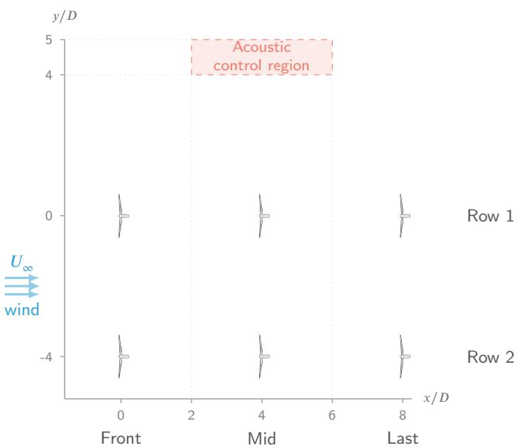  
Figure 1: Wind farm layout and acoustic control region location.

The control region is located 4� away from the top row and at the height of the ground. Alamir et al. [5] reports significant variation in wind turbine noise regulations in diferent countries, with limits ranging from 35 dB to 60 dB. In this study, the noise limit is set to 40 dB. This value is representative of European regulations [33], and chosen to impose a restrictive constraint, 4 dB below the maximum sound level obtained for this wind farm in our simulations. Under normal operating conditions, the sound level in the control region exceeds this limit, except at low wind speeds. Note that the proposed methodology and the RL framework are not specific to the 40 dB limit and can be applied to other noise thresholds.

In this work, we consider diferent wind inflow velocities while keeping the wind direction constant and aligned with the two turbine rows. The small spacing between turbines and the aligned inflow result in strong wake interactions.

To maximise farm power while satisfying a noise constraint, we consider the following control problem:

$$
\operatorname* { m a x } _ { \mathbf { u } } \ P _ { \mathrm { f a r m } } ( \mathbf { u } ) \quad \mathrm { s . t . } \quad \operatorname* { m a x } _ { x \in \mathcal { R } } L _ { p } ^ { F } ( x , \mathbf { u } ) \leq L _ { p , \mathrm { t h r } } ,\tag{1}
$$

where � contains the power and yaw setpoints, $L _ { p } ^ { F }$ denotes the acoustic emissions in dB of the wind farm at each location � and $L _ { p , \mathrm { t h r } }$ stands for the desired noise constraint. The control region is denoted by .

Yaw setpoints enable wake steering, while power setpoints curtail the maximum power output of the wind turbine, controlling the turbine induction. The noise constraint is controlled by leveraging the efects of these controls on both the noise amplitude and its directivity. We refer to this control strategy as Noise Steering. Wind farms are usually operated by maximising the individual powers of each turbine, i.e. by having each turbine facing the wind maximising its power output given the incoming wind. This is referred to as greedy control.

The wind farm is modelled using two simulators, FLORIS [29] and FAST.Farm [34], which have diferent levels of fidelity and computational costs. FLORIS is a steady-state simulator, and the wind farm is simulated through a sequence of steady states, without resolving the transient propagation of the wakes. It does not include acoustic models, but provides fast results. FAST.Farm is a blade element momentum (BEM)-based solver that resolves the temporal dynamics of the wind farm, including wake propagation. It provides higher-fidelity modelling and is coupled with several multi-physics models, including acoustics. As described by Bortolotti et al. [35], the aeroacoustic modelling in FAST.Farm is based on the Brooks-Pope-Marcolini (BPM) semi-empirical noise model. This higher fidelity comes at an increased computational cost. Both simulators are interfaced with Python using the WFCRL interface by Monroc et al. [36].

## 2.2. Reinforcement Learning for wind farm control

We choose to formulate the wind farm control problem (1) as a reinforcement learning problem. At each time step, the RL agent observes the state of the wind farm and selects power and yaw setpoints for each turbine. The state vector is defined as

$$
\begin{array} { r } { \mathbf { s } = [ U _ { \infty } , \mathbf { P } , \gamma _ { t } ] , } \end{array}\tag{2}
$$

where $U _ { \infty }$ is the free-stream wind speed, � contains the current turbine powers, and $\gamma _ { t }$ contains the current turbine yaw angles.

The action of the agent consists of increments in the power and yaw setpoints. The yaw actions are defined as $\Delta \gamma _ { t } ^ { i } \in [ - 5 ^ { \circ } , 5 ^ { \circ } ]$ , with the yaw angles constrained to the range $\gamma _ { t } ^ { i } \in [ - 4 0 ^ { \circ } , 4 0 ^ { \circ } ]$ for each wind turbine. Similarly, the power setpoints ${ \bf P _ { S } }$ are updated by increments $\Delta \mathbf { P } _ { \mathbf { S } } \in [ - 1 , 1 ] \ \dot { \mathbf { M } } \mathbf { W }$ , with the resulting setpoints being constrained to [0,5] MW. In FLORIS, successive steady states are simulated; therefore, a new action is taken at each of these steps. In FAST.Farm, an action is taken every $\Delta t _ { \mathrm { R L } } = 3$ seconds.

The objective of the RL agent is to maximise wind farm power while satisfying the noise constraint. Therefore, the reward is defined as

$$
r = \frac { \sum _ { i } P _ { i } } { P _ { \mathrm { g r e e d y } } } - \underbrace { \alpha \mathrm { R e L U } \left( \hat { L } _ { p } - L _ { p , \mathrm { t h r } } \right) } _ { \mathrm { N o i s e ~ t h r e s h o l d p e n a l t y } } - \underbrace { \beta _ { 1 } \| \Delta \gamma _ { t } \| _ { 2 } - \beta _ { 2 } \| \Delta \mathbf { P } _ { \mathbf { S } } \| _ { 2 } - \beta _ { 3 } \| \mathbf { P } - \mathbf { P } _ { \mathbf { S } } \| _ { 2 } } _ { \mathrm { a c t i o n ~ p e n a l t i e s } }\tag{3}
$$

where $P _ { i }$ is the power produced by the turbine �, $P _ { \mathrm { g r e e d y } }$ is the farm power obtained when the farm is operated with greedy control. $\hat { L } _ { p }$ is the maximum sound level measured in the control region. The parameter $L _ { p , \mathrm { t h r } }$ is the noise limit (here 40 dB). The first term therefore rewards power production, while the second penalises violations of the noise constraint. The last three terms penalise large changes in yaw angles, large changes in the power setpoints, and diferences between the current powers and the power setpoints, respectively. These helped the training process, notably by reducing oscillations and avoiding unfeasible actions. If an action results in a yaw angle outside the allowed range, a reward of $r = - 3$ is assigned.

We use Proximal Policy Optimisation (PPO) to train the RL agent. PPO is a state-of-the-art actor-critic method that updates the policy while limiting the change between successive policies, [37]. The algorithm hyperparameters, as well as the reward coeficients used are detailed in Appendix A.

RL training requires a large number of interactions with the environment. Running these interactions with FAST.Farm would therefore result in a prohibitive computational cost. Therefore, we use FLORIS during training, which provides a much lower computational cost. The resulting policies are then evaluated using FAST.Farm to assess their performance in a higher-fidelity, time-resolved environment.

## 2.3. FLORIS to FAST.Farm calibration

Ebrahimi et al. [27] highlight the diferences in predicted wake losses between FLORIS and FAST.Farm, and propose a recalibration of the FLORIS models. It is also common in the industry to calibrate low-fidelity models with field measurements to improve accuracy. We perform a similar calibration to reduce the model mismatch in power between the simulators and help the transfer from FLORIS to FAST.Farm.

The calibration is performed over a wind speed range of 8 $\mathrm { m } \mathrm { s } ^ { - 1 } \mathrm { t o } 1 5 \mathrm { ~ m } \mathrm { s } ^ { - 1 }$ , corresponding to the range used for training the RL agent. A dataset comprising 16 FAST.Farm simulations is generated to calibrate the parameters of the Gaussian wake model [38, 39] implemented in FLORIS. The simulations are performed until a stationary wind flow is reached and covered diferent yaw conditions, consisting in aligned operation and yaw misalignments of $1 0 ^ { \circ } , 2 0 ^ { \circ }$ and 30◦, as well as diferent wind speed values. All simulations are conducted using the same wind farm layout shown in Figure 1.

A diferential evolution optimiser [40] is employed for calibration. The optimisation objective is to minimise the diference between the turbine power outputs predicted by the two solvers. The calibration strategy consisted in two phases. First, the wake deficit parameters are calibrated using only the aligned cases in the dataset. Afterwards, these parameters are frozen and the complete dataset is used to optimise the wake deflection parameters. The parameters obtained through this calibration process are described in Table 1.

The initial modelling mismatch between FLORIS and FAST.Farm for the computed data set gives a mean absolute percentage error (MAPE) of 15% (7% for aligned cases). After calibration, this MAPE decreases to 2% for the aligned cases and to 7% for the complete data set. Overall, the simulation gap between FAST.Farm and FLORIS is strongly reduced by the calibration.

Parameters of the Gaussian wake model used in FLORIS.
<table><tr><td></td><td colspan="4">Velocity deficit</td><td colspan="2">Deflection</td></tr><tr><td></td><td> $k _ { a }$ </td><td> $k _ { b }$ </td><td> $\alpha _ { g }$ </td><td> $\beta _ { g }$ </td><td> $d _ { m }$ </td><td> $b _ { d }$ </td></tr><tr><td>FLORIS default</td><td>0.38</td><td>0.004</td><td>0.58</td><td>0.077</td><td>1.0</td><td>0.0</td></tr><tr><td>Calibrated</td><td>0.31</td><td>0.0024</td><td>0.99</td><td>0.149</td><td>0.893</td><td>0.00699</td></tr></table>

## 2.4. Aeroacoustic modelling

The acoustic impact of the wind farm is assessed using noise prediction models, as described in [41]. There are diferent approaches to prediction of wind turbine noise. FAST.Farm has a semi-empirical method implemented based on the BPM model, [31]. This would be a Class II noise prediction code according to the classification proposed by Lowson [42]. This class of methods is generally considered to be a mid-fidelity approach capable of capturing the main noise-generation mechanisms of wind turbines. These methods use the output of the BEM codes to account for the influence of turbine operating conditions on the predicted noise levels.

In contrast, Class I methods within the same classification are lower-fidelity analytical approaches, generally based on empirical relationships. FLORIS does not include a wind turbine noise prediction model. As a low-fidelity wind turbine simulator, it does not provide the in-blade information required by Class II semi-empirical noise prediction methods. Therefore, a Class I model is implemented for noise prediction in FLORIS. The A-weighted overall sound pressure level (OASPL or $L _ { p , A } )$ of a single wind turbine is estimated by combining the model proposed by Hagg [30] with an enforced directivity function. The resulting analytical model for the OASPL is given by

$$
L _ { p , A } ( { \pmb x } ) = C _ { 1 } \log _ { 1 0 } V _ { \mathrm { t i p } } + C _ { 2 } \log _ { 1 0 } \biggl ( n _ { B } \frac { A _ { B } } { A _ { R } } \biggr ) + C _ { 3 } \log _ { 1 0 } C _ { T } + C _ { 4 } \log _ { 1 0 } \biggl ( \frac { D } { | { \pmb x } | } \biggr ) - C _ { 5 } \log _ { 1 0 } D - C _ { 6 } + 1 0 \log _ { 1 0 } D ( { \pmb x } ) .\tag{4}
$$

This model for wind turbine noise considers several contributing factors. The dominant contribution is the blade tip speed, defined as $V _ { \mathrm { t i p } } = \Omega R$ , where Ω is the rotational speed and � is the rotor radius (or blade length). Other relevant parameters include the rotor diameter �, the solidity of the wind turbine rotor $\sigma = n _ { B } A _ { B } / A _ { R }$ and the thrust coeficient $C _ { T }$ . The model assumes spherical sound propagation, resulting in a decay rate of $1 / | { \pmb x } |$ , where $| { \pmb x } |$ is the distance to the source (i.e., the rotor center). These contributions are weighted by the coeficients proposed by Hagg [30] via calibration with experiments, $C _ { 1 } = 6 3 . 3 , C _ { 2 } = 1 1 . 5 , C _ { 3 } = 2 . 5 , C _ { 4 } = 2 0 , C _ { 5 } = 1 0$ and $C _ { 6 } = 2 7 . 5$ . Finally, we incorporate an enforced directivity function $\begin{array} { r } { \begin{array} { r } { D ( \mathbf { x } ) = \cos \theta } \end{array} } \end{array}$ to recover the dipole radiation pattern aligned with the rotor axis.

The final wind farm noise emission is obtained by performing the logarithmic summation of the individual turbine contributions. To minimise the computational cost, no acoustic propagation methods are considered beyond spherical spreading. The final acoustic metric $\hat { L } _ { p }$ used in the reward function (3) is defined as the maximum wind farm noise level within the control region:

$$
\hat { L } _ { p } = \operatorname* { m a x } _ { x \in \mathcal { R } } L _ { p } ^ { F } ( \pmb { x } ) = \operatorname* { m a x } _ { \pmb { x } \in \mathcal { R } } 1 0 \log _ { 1 0 } \left( \sum _ { i = 1 } ^ { N } 1 0 ^ { L _ { p , A } ^ { i } / 1 0 } \right) .\tag{5}
$$

To evaluate the maximum noise level within $_ { \mathcal { R } }$ , the region is discretised using a regular 100 × 100 grid, and the maximum value over all grid points is selected.

The proposed low-fidelity wind farm noise model can be coupled to FLORIS to estimate the acoustic impact with a computational cost similar to that of the flow simulator. However, FLORIS does not provide the rotor speed required to determine the blade tip speed in (4), as the wind turbine is represented by a power curve. The rotational speed can instead be estimated by assuming that the wind turbine operates according to a standard variable-speed controller. Under this assumption, the rotor speed as a function of the local wind speed $\hat { U }$ is estimated to be $\Omega ( \hat { U } ) = \operatorname* { m i n } \left( \lambda ^ { * } \hat { U } / R , \Omega _ { \mathrm { r a t e d } } \right)$ where $\lambda ^ { * } = 7 . 5$ denotes the optimal tip-speed ratio of the wind turbine. The proposed model is validated against the FAST.Farm aeroacoustic model in Appendix B, showing a modelling mismatch in the 1 dB range.

## 3. Training and analysis of the Noise Steering policy in FLORIS

In this section, an RL agent is trained using FLORIS, along with the low-fidelity noise model developed in Subsection 2.4. The training process consisted of 300k steps (interactions with the solver FLORIS) divided in episodes of 500 steps. In each episode, a random steady wind speed is picked between 8 and $1 5 \ \mathrm { m } \mathrm { s } ^ { - 1 }$ , covering both under- and above rated wind conditions. The wind direction remains constant and aligned to the wind turbine rows throughout all episodes.

Figure 2 shows the average episode reward gathered by the agent throughout the training process. The penalisation components (i.e. noise threshold and action penalties) of the reward (3) are also displayed to illustrate the agent’s ability to learn how to maximise power generation, while simultaneously reducing the acoustic impact of the wind farm. It should be noted that the penalisation terms do not reach zero because of the agent’s exploration during training. In addition, the action-related penalisation terms cannot be reduced to zero throughout the episode.

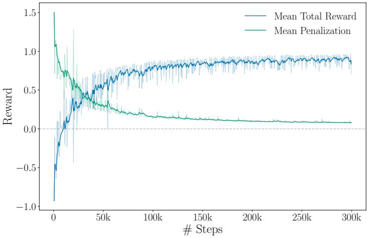  
Figure 2: Average episode reward and penalisation terms during training. An episode corresponds to 500 steps. Bold curves are filtered over using an exponential smoothing of 0.8.

To quantify the performance of the trained RL agent, we run one evaluation episode at each wind speed from 8 to 15 m/s in 0.5 m/s increments, and report the wind farm power output and noise emissions reached at the end of each episode. Three diferent control strategies are tested:

• Noise Steering. RL agent trained to maximise power generation subject to a noise constraint using the reward defined in (3).

• Greedy control. Conventional variable-speed wind turbine controller operating independently and in a decentralised manner. Each wind turbine aims to maximise its individual power generation.

• Noise reduced operation, NRO. Industry standard mode for noise reduction. The variable-speed controller of each wind turbine is derated by reducing the rated rotor speed to mitigate noise emissions at the expense of power production [9]. In practice, this results in a curtailed power curve. A uniform derating across the wind farm is considered. To achieve a noise level of 40 dB within the control region, the minimum uniform derating is determined for each wind speed by iteratively decreasing the power setpoints until the noise constraint is met.

Figure 3 illustrates the wind speed sweep of the wind farm power output and the noise level for the three control strategies. The greedy control achieves the highest wind farm power output; however, it exceeds the noise constraint for wind speeds above 10 $\mathrm { m } \mathrm { s } ^ { - 1 }$ . In contrast, the NRO control strategy satisfies 40 dB threshold by design, but substantially limits wind farm power generation. The uniform power setpoints commanded by the NRO strategy to the turbines range from 4 MW at $1 0 ~ \mathrm { \ m s ^ { - 1 } }$ to 3.4 MW at $1 5 ~ \mathrm { ~ m ~ s ~ } ^ { - 1 }$ $\mathrm { A t } ~ 1 5 ~ \mathrm { ~ m ~ s ~ } ^ { - 1 }$ , the NRO strategy produces approximately 20 MW, corresponding to only 2/3 of the available power. This control strategy exhibits an average power deficit of 17% relative to greedy control over the wind speed sweep.

However, the trained Noise Steering agent learns to exploit the interactions between wind turbines to significantly reduce the noise level within the control region, while maintaining it below the threshold $L _ { p , \mathrm { t h r } }$ across the complete wind speed range. At the same time, the agent maintains a wind farm power output close to that of the greedy policy, with limited power losses only above $1 3 ~ \mathrm { \ m s ^ { - 1 } }$ . Across the complete wind speed sweep, the Noise Steering policy exhibits an average power deficit of 2% relative to greedy control. At the highest wind speed considered, the power deficit is 7.7% while achieving a noise reduction of 4 dB.

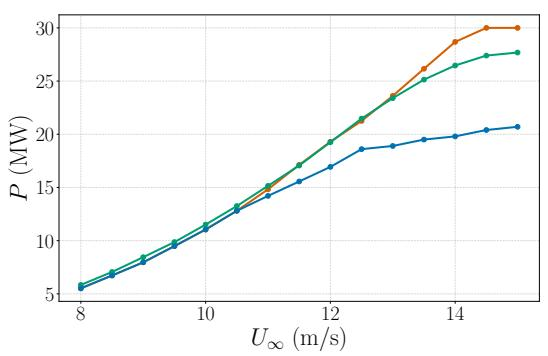  
(a) Farm power.

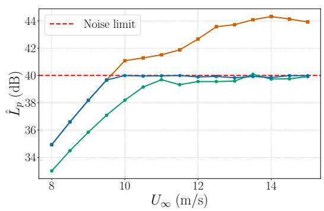  
(b) Acoustic emissions at the control region.  
Figure 3: Power and noise emissions reached by the wind farm at the end of one episode for the complete wind speed range. Comparison of diferent control strategies.

To investigate how the agent achieves this performance, we now look at the actions chosen for the same wind sweep at the end of each wind episode. Figure 4a shows the yaw angles reached by the six wind turbines for the diferent wind speeds, while Figure 4b presents the power generated by each turbine and indicates the turbines for which a power setpoint actively limits the power.

$$
\begin{array} { r l r l r l } { \mathrm { ~ --- ~ } \mathrm { ~ F r o n t ~ 1 ~ } } & { { } \stackrel { } { \mathrm { ~ --- ~ } } \mathrm { ~ M i d ~ 1 ~ } } & { } & { { } \stackrel { } { \mathrm { ~ --- ~ } } \mathrm { ~ L a s t ~ 1 ~ } } \\ { \mathrm { ~ --- ~ } \mathrm { ~ F r o n t ~ 2 ~ } } & { { } \stackrel { } { \mathrm { ~ --- ~ } } \mathrm { ~ M i d ~ 2 ~ } } & { } & { { } \stackrel { } { \mathrm { ~ --- ~ } } \mathrm { ~ L a s t ~ 2 ~ } } \end{array}
$$

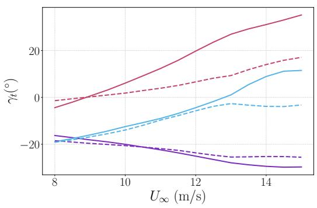  
(a) Nacelle yaw.

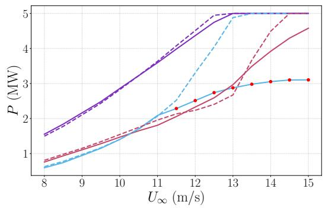  
(b) Individual powers. $\bullet \bullet \boldsymbol { \cdot } \boldsymbol { \cdot }$ denotes when a power setpoint actively limits the power output of the turbine.  
Figure 4: Final commands of the Noise Steering policy for the complete wind speed range. The wind turbine naming follows Figure 1 convention, where $" 1 "$ stands for the row closer to the acoustic region and $" 2 "$ for the other row of wind turbines.

Firstly, for yaw control (Figure 4a), at low wind speeds, the strategy is similar to conventional power-maximizing wake steering [26, 43]. In fact, up to $1 1 \ : \mathrm { \ m s ^ { - 1 } }$ , the Noise Steering agent achieves a slight increase in power output of approximately 400 kW relative to greedy control (see Figure 3a) as a result of this wake steering strategy. The front and mid turbines of both rows exhibit similar yaw angles around $- 2 0 ^ { \circ }$ , while both last turbines face the wind (around $0 ^ { \circ }$ yaw). This strategy deviates from the wakes of the two front turbines to decrease the negative impact of their velocity deficit. At higher wind speeds, a similar power maximisation objective would breach the acoustic constraint. Therefore, the learned strategy consists of a low yaw angle (between $- 1 0 ^ { \circ }$ and $1 0 ^ { \circ } )$ for both mid turbines and a positive yaw angle for both last two turbines (respectively, $3 4 ^ { \circ }$ and $1 8 ^ { \circ }$ at $1 5 \mathrm { ~ m ~ s ~ } ^ { - 1 } )$ . This can be explained as the turbines preferentially yawing in the direction that aligns their rotor planes with the acoustic region, corresponding to a direction of reduced radiation due to the dipole-like directivity of the wind turbine noise.

Leveraging the dipole noise emission structure with the yaw angles is not suficient in some cases and has to be combined with some curtailing using power setpoints (Figure 4b). Lowering the power of a turbine by lowering its rotor speed will produce less noise, as exploited by the baseline NRO strategy. In this case, it is only necessary for the middle turbine of row 1, which is closest to the control region. It is required to reduce its power generation for wind speeds greater than $1 1 . 5 ~ \mathrm { ~ m ~ s ~ } ^ { - 1 }$ . This substantial derating reduces both the power output and noise emission of the turbine, but also enables better wake recovery for the last turbine in row 1.

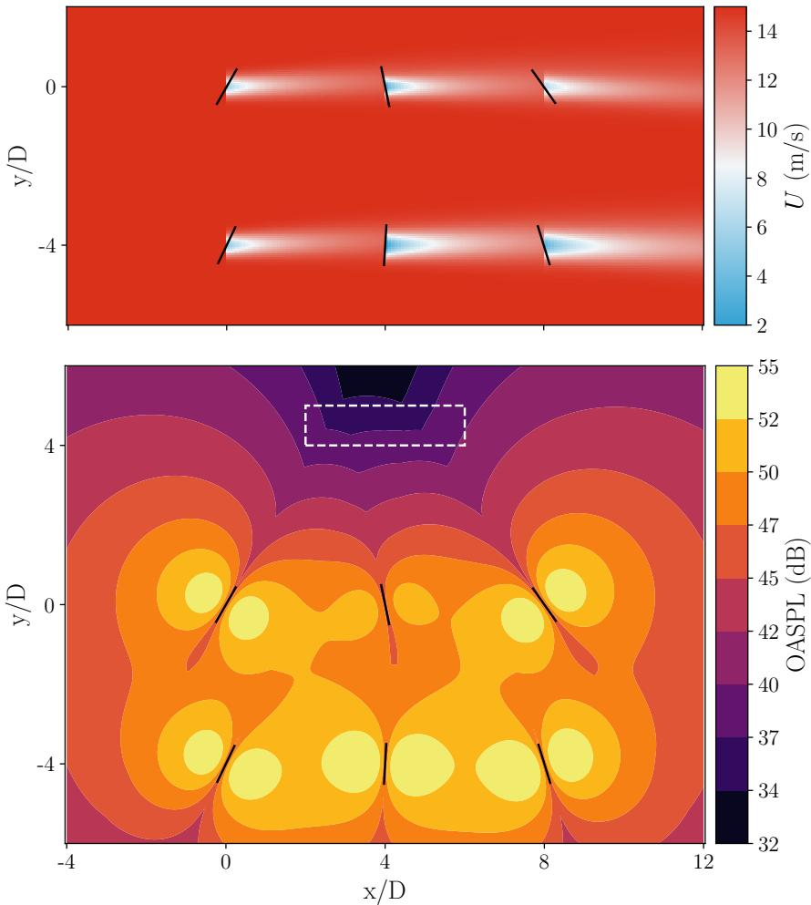  
Figure 5: Wind farm final state reached by the RL policy for $U _ { \infty } = 1 5 ~ \mathrm { ~ m ~ s ^ { - 1 } ~ }$ on FLORIS. Top: Wind speed field. Bottom: Acoustic field, control region denoted for reference.

To further explain the Noise Steering policy, the wind farm flow and acoustic fields are presented in Figure 5 for the highest wind speed considered in the sweep, $1 5 \ \mathrm { ~ m ~ s ^ { - 1 } }$ . Figure 5 (bottom) shows that all turbines direct their rotor planes towards the acoustic region. This showcases how the directivity of the turbine noise emission can be exploited to control the noise in the desired area. The noise emission is also visibly lower around the mid turbine of the first row compared to the mid turbine of the second row, due to the power curtailment described above. For upstream turbines, orienting its turbine plane towards the control area also produces a beneficial wake steering efect (Figure 5 top), allowing higher power extraction for downstream turbines.

Overall, the Noise Steering policy achieves power levels comparable to those of the greedy control while substantially reducing noise emissions. When trying to control the noise level in a localised control area, leveraging the turbine noise directivity allows reducing noise emissions with limited loss of power production compared to the industry standard. These results indicate that collaborative wind farm control enables a more favourable trade-of between power production and noise reduction.

## 4. Evaluation in FAST.Farm: robustness to model mismatch and unsteady inflow

In this section, the Noise Steering policy obtained in Section 3 is deployed in a FAST.Farm environment to assess its validity using a higher-fidelity wind turbine solver. Subsection 4.1 explains how to integrate the policy trained in FLORIS so that it can be used directly in a FAST.Farm environment. Afterwards, the policy is evaluated under constant wind speed in Subsection 4.2 and a turbulent wind speed profile in Subsection 4.3.

## 4.1. FAST.Farm integration

The RL policy acts with a $\Delta t _ { \mathrm { R L } } = 3 \mathrm { s }$ , however, the FAST.Farm variable-speed controller actuates continuously during the simulation. To couple these two time scales, we consider the RL action to set a fixed command or condition for the variable-speed controller. Therefore, $\Delta \gamma _ { t }$ sets a new yaw command for the yaw controller and $\Delta \mathbf { P _ { S } }$ sets a new rated power that defines the variable-speed controller.

To ensure physically feasible yaw actuation, a yaw-rate limiter is applied to the RL yaw command. This limiter constrains the yaw rate to a maximum of $0 . 3 \mathrm { ~ } ^ { \circ } \mathrm { s } ^ { - 1 }$ , consistent with industry standards.

The variable-speed controller implemented in the WFCRL FAST.Farm interface is also modified to allow for turbine derating. Following the Region II $K \Omega ^ { 2 }$ control law [44], the rated rotor speed $\Omega _ { \mathrm { r a t e d } }$ , the rated generator torque $T _ { g , \mathrm { r a t e d } }$ , and the rated power are modified according to the imposed power setpoint. The resulting rated rotor speed and generator torque are given by

$$
\Omega _ { \mathrm { r a t e d } } ^ { ' } = \left( \frac { P _ { S } } { P _ { \mathrm { r a t e d } } } \right) ^ { \frac { 1 } { 3 } } \Omega _ { \mathrm { r a t e d } } ,\tag{6}
$$

and

$$
T _ { g , \mathrm { r a t e d } } ^ { \prime } = \left( \frac { P _ { S } } { P _ { \mathrm { r a t e d } } } \right) ^ { \frac { 2 } { 3 } } T _ { g , \mathrm { r a t e d } } .\tag{7}
$$

Thus, the RL power setpoint command is translated into a modified set of rated operating conditions for the variablespeed controller. This modification results in diferent generator torque and blade-pitch actuation, thereby implementing turbine power derating.

Regarding wind turbine noise prediction, the integrated aeroacoustic module in FAST.Farm is employed. The control region is discretised using an $8 \times 2$ grid, and the acoustic signal is processed using exponential smoothing to eliminate the wind turbine noise amplitude modulation. Increasing the number of observers greatly increases the computational cost of the simulation, hence the choice for less observers than in FLORIS.

## 4.2. Steady wind speed comparison

In this section, the Noise Steering policy is evaluated under steady wind speed in the FAST.Farm environment. This assessment examines the ability of a policy trained in FLORIS to perform in a diferent wind turbine solver while accounting for the transient wake dynamics resolved by FAST.Farm.

Figure 6 illustrates the comparison of the three studied control strategies under the complete wind speed range for both wind turbine solvers. The NRO control strategy and the Noise Steering RL agent are evaluated directly in FAST.Farm without further adjustment.

The power generation for the greedy control and NRO strategies are closely matched between the two simulators (see Figure 6a), thanks to the calibration described in Subsection 2.3. Both strategies produce noise levels close to their FLORIS results within the 1 dB modelling error identified in Appendix B for the aeroacoustic model. NRO exceeds the noise threshold above 14 $\mathrm { m } \mathrm { s } ^ { - 1 }$ , due to the uniform derating levels being optimised on FLORIS and transferred as is.

$$
{ \begin{array} { l l l l l } & { { \mathrm { F A S T . F a r m ~ R L } } } & { { \begin{array} { l l l l } { \qquad } & { { \mathrm { F A S T . F a r m ~ G r e e d y } } } & { { \mathrm { ~ } } } & { { \mathrm { F A S T . F a r m ~ N R O } } } \\ { \qquad } & { { \mathrm { --- } } } & { { \mathrm { F L O R I S ~ R L } } } \end{array} } } & { { \mathrm { ~ } } } & { { \mathrm { ~ } } } \\ & { { \begin{array} { l } { \qquad } & { { \mathrm { ~ F L O R I S ~ R L } } } \end{array} } } & { { \begin{array} { l } { \qquad } & { { \mathrm { ~ F A S T . F a r m ~ G r e e d y } } } \\ { \qquad } & { { \mathrm { ~ } } } & { { \mathrm { ~ } } } \end{array} } } & { { \begin{array} { l } { \qquad } & { { \mathrm { ~ F A S T . F a r m ~ N R O } } } \\ { \qquad } & { { \mathrm { ~ } } } & { { \mathrm { ~ } } } \end{array} } } \end{array} }
$$

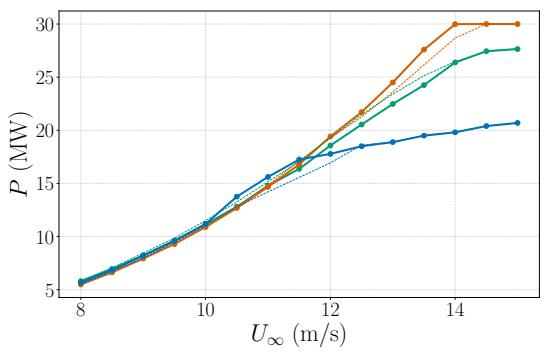  
(a) Farm power.

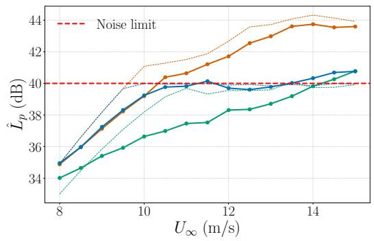  
(b) Acoustic emissions at the control region.  
Figure 6: Comparison of the three diferent control strategies on FAST.Farm and FLORIS for the complete wind speed range.

The Noise Steering strategy achieves a similar power output when deployed in FAST.Farm as in FLORIS (see Figure 6a). Above 12 m $\mathrm { { s } ^ { - 1 } }$ , the power deficit compared to greedy is greater but still outperforms the NRO baseline. In terms of noise emissions, Figure 6b shows that the RL policy satisfies the noise constraint at all wind speeds except the highest considered. However, the FAST.Farm evaluation results in lower noise levels than those predicted by FLORIS, with a diference of up to 2.5 dB at $1 1 ~ \mathrm { \ m s ^ { - 1 } }$ . This indicates that the policy might be sub-optimal in FAST.Farm due to model mismatch. However, contrary to model-based methods, RL methods are able to continue learning across simulators [27, 45, 46]. Therefore, policies resulting in higher power while being closer to the noise limit could be found through fine-tuning in a future study.

Note that the RL controller is a closed-loop controller. Hence, when the Noise Steering policy trained in FLORIS is deployed in the FAST.Farm environment, the diferences arising from the modelling gap modify the state-action transitions. Consequently, the policy may produce diferent final values of $\gamma _ { t }$ and ${ \bf P } _ { S }$ . This is further discussed in Appendix C, validating that the policy results in similar commands on both simulators.

## 4.3. Turbulent wind assessment

Finally, the Noise Steering policy is evaluated under an unsteady wind inflow to determine its ability to adapt to turbulent and fluctuating wind conditions.

The turbulent wind speed profile is generated by combining an unsteady wind speed profile $\mathcal { V } ( t )$ with a shear layer characterized by an exponent $\alpha _ { \mathrm { P L } } = 0 . 2$ and turbulent fluctuations generated using the stochastic turbulence inflow simulator TurbSim [47]. The inflow wind speed is defined as follows,

$$
u ( y , z , t ) = \mathcal { V } ( t ) \left( \frac { z } { z _ { \mathrm { r e f } } } \right) ^ { \alpha _ { \mathrm { P L } } } + \sigma ( \mathcal { V } ( t ) ) u ^ { \prime } ( y , z , t ) ,\tag{8}
$$

where $u ^ { \prime } ( y , z , t )$ is the normalized TurbSim inflow and a constant turbulence intensity (TI) approach is used to scale the turbulent fluctuations, with $\sigma = \mathscr { V } ( t )$ TI. A turbulence intensity of $\mathrm { T I } = 6 \%$ is considered. FAST.Farm convects the resulting inflow field at a constant velocity $u _ { \mathrm { r e f } } = \mathrm { m e a n } ( \mathcal { V } ( t ) )$

Figure 7 illustrates the temporal evolution of the inflow wind speed at hub height and at the first row of turbines. The evolution of the wind speed is also shown in the diferent positions $x / D$ within the wind farm, together with the

original profile $\mathcal { V } ( t )$ . The prescribed unsteady profile starts at 10 $\mathrm { m } \mathrm { s } ^ { - 1 }$ , increases to $1 4 \mathrm { ~ m ~ s ^ { - 1 } }$ , and finally decreases to $\bar { 8 } \ : \mathrm { ~ m ~ s ^ { - 1 } ~ }$ . This profile therefore evaluates the ability of the policy to adapt to varying wind speeds across diferent operating conditions and to the efects of turbulence.

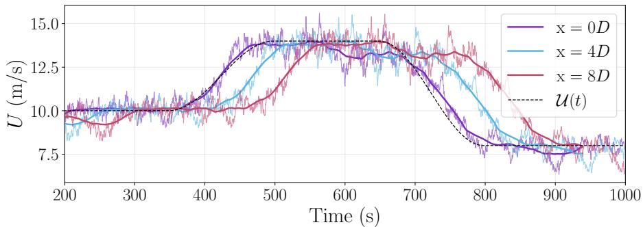  
Figure 7: Turbulent and unsteady wind speed profile. Ambient wind displayed at hub height for the three wind turbine positions of the first row (front, mid and last). Bold curves are filtered using a 60 s moving average.

The three control strategies studied are evaluated under this turbulent wind inflow. Before activating control policies, an initialization period of 200 s is included to allow the wakes to develop fully. Figure 8 illustrates the temporal evolution of wind farm power generation and noise emissions for the three control strategies.

$$
\mathrm { ~ --- ~ } \mathrm { G r e e d y } \mathrm { ~ --- ~ } \mathrm { N o i s e ~ S t e e r i n g ~ } \mathrm { ~ --- ~ } \mathrm { N R O }
$$

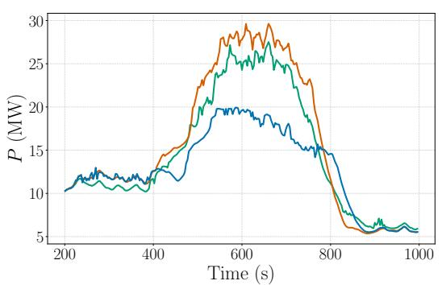  
(a) Farm power.

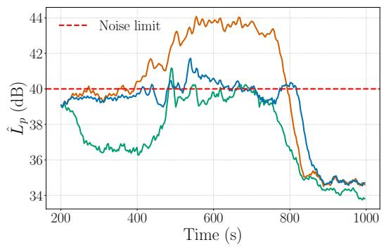  
(b) Acoustic emissions at the control region.  
Figure 8: Comparison of the three diferent control strategies on FAST.Farm for an unsteady inflow.

In general, the three control strategies behave similarly as observed under steady inflow in Figure 6, showing that the Noise Steering policy is capable of adapting to the unsteady inflow. During complete evaluation, greedy control exceeds the noise limit during 53.0 % of the time, with peaks of up to 44.1 dB, and NRO during 30.5 % of the time. In contrast, the Noise Steering policy remains below the limit during 91.7 % of the evaluation, while producing only 7.4 % less power than greedy control, compared to 18.1 % for NRO.

The diferences between the strategies are greatest on the 14 m $\cdot \ s ^ { - 1 }$ plateau (around 500 to 700s). Greedy control produces about 28 MW at the cost of exceeding the noise limit by up to 4 dB. In comparison, NRO reduces the power to about 19 MW and still momentarily exceeds the limit by almost up to 2 dB. The Noise Steering policy produces about 25 MW, i.e. a power deficit of approximately 10 % relative to greedy control, while satisfying the noise constraint. The noise limit is only shortly exceeded by the Noise Steering policy at the beginning of the 14 m $\mathrm { { s } ^ { - 1 } }$ -wind speed plateau, reaching 41.0 dB. The policy then reacts quickly and reduces the sound level to 39.4 dB in 2 RL steps, i.e., 6 seconds.

This turbulent inflow further increases model-mismatch compared to the training simulator. Wake recovery is enhanced by ambient turbulence, which reduces the added benefit of wake steering [48]. For example, at the $1 0 \mathrm { m s ^ { - 1 } }$ plateau, the Noise Steering policy appears sub-optimal as it produces less power than greedy control and NRO, whereas it slightly outperformed both under steady inflow.

An animated visualization of the velocity field in the wind farm, and the noise level in the control area, is provided in Supplementary Material. This allows to visualize the Noise Steering control under this unsteady wind field.

## 5. Conclusion

This work introduced Noise Steering, a farm-level control strategy that jointly exploits yaw misalignment and power derating to maximise wind farm power under a localised noise constraint. In this work, we chose Reinforcement Learning as a method to perform Noise Steering, as it has the potential to provide a model-free closed loop controller.

A low-fidelity aeroacoustic model, combining the analytical model of Hagg [30] with an enforced dipole directivity, is coupled to the steady-state FLORIS simulator to enable RL training. Farm noise emissions are thereby estimated at the same order of computational cost as the flow field, making RL training tractable. A PPO agent is trained on a six-turbine farm to maximise power while keeping the sound level below 40 dB in a control region located 4� from the closest turbine row.

The learnt policy satisfies the noise constraint throughout the $8 { - } 1 5 ~ \mathrm { \ m s ^ { - } }$ range, with an average power deficit of only 2% relative to greedy control and a maximum of 7.7% at the highest wind speed, compared to an average 17% for the baseline NRO. The Noise Steering agent combines two complementary mechanisms. At low wind speeds, it reproduces conventional power-maximising wake steering. At higher wind speeds, it orients the rotor planes towards the control region, so that the dipole-like directivity of the turbine noise radiates away from it.

Deployed without retraining in the higher-fidelity, time-resolved FAST.Farm solver under steady inflow, the policy exhibits similar power performance and remains below the noise limit at all but the highest wind speed. This indicates that the calibrated steady-state training environment is representative enough for transfer to the dynamic environment. However, the transferred policy appears too conservative and additional power could be produced under the noise constraint. This is a consequence of model-mismatch between the simulators, which could hence be mitigated in future studies by enabling the RL agent to continue learning online in the higher-fidelity environment.

The policy is further evaluated under an unsteady and turbulent wind inflow. Although trained exclusively under steady inflow, the Noise Steering policy manages to respect the noise constraint under varying wind conditions. It exhibits only transient noise constraint violations while retaining 92% of greedy power, thus improving conventional NRO power generation by 10%.

These results are obtained for a single wind direction, a fixed control region, and an acoustic model that neglects propagation efects such as ground reflection, refraction, and atmospheric absorption. Including unsteady inflow during training could further improve performance. The low-fidelity environment is also pre-calibrated to reduce modelmismatch with the higher-fidelity environment. The impact of relaxing those hypotheses should be assessed in future work.

Given the energy production currently lost to acoustic curtailment [17], we believe that wind farm control that takes advantage of wake interactions and acoustic directivity is a highly promising direction.

## 6. Acknowledgement

This research has received funding from the European Union (ERC, Of-coustics, project number 101086075). Views and opinions expressed are, however, those of the authors only and do not necessarily reflect those of the European Union or the European Research Council. Neither the European Union nor the granting authority can be held responsible for them.

Martín de Frutos and Esteban Ferrer acknowledge the funding received by the Comunidad de Madrid according to Orden 5021/2025, issued by the Consejero de Educacion, Ciencia y Universidades, which announces grants for the hiring of predoctoral research personnel in training for the year 2024.

Martín de Frutos gratefully acknowledges the Universidad Politécnica de Madrid (www.upm.es) for providing computing resources on Magerit Supercomputer.

This work is partially carried out in the framework of AI-NRGY (Grant ref.: ANR-22-PETA-0004).

## CRediT authorship contribution statement

Martín de Frutos: Conceptualization, Investigation, Methodology, Software, Validation, Visualization, Writing – original draft. Baptiste Corban: Conceptualization, Investigation, Methodology, Software, Validation, Visualization, Writing – original draft. Claire Bizon Monroc: Methodology, Software, Writing – review & editing. Ana Bušić: Conceptualization, Methodology, Supervision, Validation, Project administration, Writing – review & editing. Donatien Dubuc: Supervision, Project administration, Writing – review & editing. Jiamin Zhu: Supervision, Project administration, Writing – review & editing. Esteban Ferrer: Conceptualization, Methodology, Supervision, Validation, Project administration, Funding acquisition, Writing – review & editing.

## References

[1] IRENA, Renewable Capacity Statistics 2025, Technical Report, International Renewable Energy Agency, Abu Dhabi, 2025. URL: https: //www.irena.org/Publications.

[2] M. Wolsink, M. Sprengers, A. Keuper, T. H. Pedersen, C. A. Westra, Annoyance from wind turbine noise on sixteen sites in three countries, in: European community wind energy conference, volume 271, 1993, p. 276.

[3] E. Pedersen, F. Van Den Berg, R. Bakker, J. Bouma, Response to noise from modern wind farms in the netherlands, The Journal of the Acoustical Society of America 126 (2009) 634–643.

[4] J. L. Davy, K. Burgemeister, D. Hillman, Wind turbine sound limits: Current status and recommendations based on mitigating noise annoyance, Applied Acoustics 140 (2018) 288–295. URL: https://www.sciencedirect.com/science/article/pii/S0003682X17311428. doi:https://doi.org/10.1016/j.apacoust.2018.06.009.

[5] M. A. Alamir, K. L. Hansen, P. Catcheside, Penalties applied to wind farm noise: current allowable limits, influencing factors, and their development, Journal of Cleaner Production 295 (2021) 126393.

[6] P. Bortolotti, C. Sucameli, A. Croce, C. Bottasso, Integrated design optimization of wind turbines with noise emission constraints, in: Journal of Physics: Conference Series, volume 1037, IOP Publishing, 2018, p. 042005.

[7] J. Kou, L. Botero-Bolívar, R. Ballano, O. Marino, L. de Santana, E. Valero, E. Ferrer, Aeroacoustic airfoil shape optimization enhanced by autoencoders, Expert Systems with Applications 217 (2023) 119513. URL: https://www.sciencedirect.com/science/article/ pii/S0957417423000143. doi:https://doi.org/10.1016/j.eswa.2023.119513.

[8] S. Deshmukh, S. Bhattacharya, A. Jain, A. R. Paul, Wind turbine noise and its mitigation techniques: A review, Energy Procedia 160 (2019) 633–640. URL: https://www.sciencedirect.com/science/article/pii/S1876610219313074. doi:https://doi.org/ 10.1016/j.egypro.2019.02.215, 2nd International Conference on Energy and Power, ICEP2018, 13–15 December 2018, Sydney, Australia.

[9] F. G. van den Berg, E. Koppen, J. Boon, M. Ekelschot-Smink, Sound power of onshore wind turbines and its spectral distribution, Sound & Vibration 59 (2025) 1716–1716.

[10] T. Duc, A. Finez, Experimental investigation of the efect of wake steering on the noise emission of a commercial wind turbine, Wind Energy Science 11 (2026) 3249–3272. doi:10.5194/wes-11-3249-2026.

[11] M. L. Shaltout, Z. Yan, D. Palejiya, D. Chen, Tradeof analysis of energy harvesting and noise emission for distributed wind turbines, Sustainable Energy Technologies and Assessments 10 (2015) 12–21.

[12] J. Cao, W. Zhu, W. Shen, Z. Sun, Wind farm layout optimization with special attention on noise radiation, in: Journal of Physics: Conference Series, volume 1618, IOP Publishing, 2020, p. 042022.

[13] X. Wu, W. Hu, Q. Huang, C. Chen, M. Z. Jacobson, Z. Chen, Optimizing the layout of onshore wind farms to minimize noise, Applied energy 267 (2020) 114896.

[14] A. Shah, K. Amhis, C. Sucameli, F. Bertagnolio, A. Fischer, C. Bottasso, Leveraging directivity of wind farm noise to increase profitability, in: Journal of Physics: Conference Series, volume 3224, IOP Publishing, 2026, p. 042043.

[15] C. M. Nyborg, A. Fischer, P.-E. Réthoré, J. Feng, Optimization of wind farm operation with a noise constraint, Wind Energy Science Discussions 2022 (2022) 1–34.

[16] T. Sørensen, M. Hildemann, Production Optimized Noise Curtailment on Wind Farms, in: 11th International Conferences on Wind Turbine Noise, 2025.

[17] H. Willis, Curtailment strategies due to environmental constraints in france: Evolution of their occurrence and their impact on production ove time, in: WindEurope Annual Event 2023, Copenhagen, Denmark, 2023. URL: https://www.eoltech.fr/media/pdfs/PO038.pdf.

[18] S. Boersma, B. Doekemeijer, P. Gebraad, P. Fleming, J. Annoni, A. Scholbrock, J. Frederik, J.-W. van Wingerden, A tutorial on control-oriented modeling and control of wind farms, in: 2017 American Control Conference (ACC), 2017, pp. 1–18. doi:10.23919/ACC.2017.7962923.

[19] S. Oerlemans, J. G. Schepers, Prediction of wind turbine noise and validation against experiment, International journal of aeroacoustics 8 (2009) 555–584.

[20] Y. Okada, K. Yoshihisa, K. Higashi, N. Nishimura, Horizontal directivity of sound emitted from wind turbines, Acoustical Science and Technology 37 (2016) 239–246.

[21] J. Meyers, C. Bottasso, K. Dykes, P. Fleming, P. Gebraad, G. Giebel, T. Göçmen, J.-W. van Wingerden, Wind farm flow control: prospects and challenges, Wind Energy Science 7 (2022) 2271–2306. URL: https://wes.copernicus.org/articles/7/2271/2022/. doi:10.5194/wes-7-2271-2022.

[22] H. Dong, J. Xie, X. Zhao, Wind farm control technologies: from classical control to reinforcement learning, Progress in Energy 4 (2022) 032006. URL: https://doi.org/10.1088/2516-1083/ac6cc1. doi:10.1088/2516-1083/ac6cc1.

[23] M. Abkar, N. Zehtabiyan-Rezaie, A. Iosifidis, Reinforcement learning for wind-farm flow control: Current state and future actions, Theoretical and Applied Mechanics Letters 13 (2023) 100475. URL: https://www.sciencedirect.com/science/article/pii/ S2095034923000466. doi:https://doi.org/10.1016/j.taml.2023.100475.

[24] H. Dong, J. Zhang, X. Zhao, Intelligent wind farm control via deep reinforcement learning and high-fidelity simulations, Applied Energy 292 (2021) 116928.

[25] A. Mole, M. Weissenbacher, G. Rigas, S. Laizet, Reinforcement Learning Increases Wind Farm Power Production by Enabling Closed-Loop Collaborative Control, 2025. doi:10.48550/arXiv.2506.20554. arXiv:2506.20554.

[26] C. B. Monroc, A. Bušić, D. Dubuc, J. Zhu, Actor Critic Agents for Wind Farm Control, in: 2023 American Control Conference (ACC), IEEE, San Diego, CA, USA, 2023, pp. 177–183. doi:10.23919/ACC55779.2023.10156453.

[27] M. Ebrahimi, F. Bellini, A. Fontanella, S. Ambrosini, S. Muggiasca, M. Belloli, Transfer learning for centralized deep reinforcement learning wind farm control with floris and fast.farm, Journal of Physics: Conference Series 3224 (2026) 032133. URL: https://doi.org/10.1088/ 1742-6596/3224/3/032133. doi:10.1088/1742-6596/3224/3/032133.

[28] G. Rismondo, G. Petris, V. Armenio, Wind turbine noise generation and propagation through large-eddy simulation and acoustic analogy: the case of the complete wind turbine, Journal of Fluid Mechanics 1042 (2026) A44.

[29] P. M. O. Gebraad, F. W. Teeuwisse, J. W. Van Wingerden, P. A. Fleming, S. D. Ruben, J. R. Marden, L. Y. Pao, Wind plant power optimization through yaw control using a parametric model for wake efects-a CFD simulation study: Wind plant optimization by yaw control using a parametric wake model, Wind Energy 19 (2016) 95–114. doi: / .

[30] F. Hagg, Aerodynamic noise reduced design of large advanced wind turbines, ECWEC 90 (1990) 384–388.

[31] T. F. Brooks, D. S. Pope, M. A. Marcolini, Airfoil self-noise and prediction, Technical Report, 1989.

[32] J. Jonkman, S. Butterfield, W. Musial, G. Scott, Definition of a 5-MW Reference Wind Turbine for Ofshore System Development, Technical Report NREL/TP-500-38060, 947422, 2009. doi:10.2172/947422.

[33] E. Nieuwenhuizen, M. Köhl, Diferences in noise regulations for wind turbines in four European countries (2015).

[34] J. M. Jonkman, J. Annoni, G. Hayman, B. Jonkman, A. Purkayastha, Development of FAST.Farm: A New Multi-Physics Engineering Tool for Wind-Farm Design and Analysis, in: 35th Wind Energy Symposium, American Institute of Aeronautics and Astronautics, Grapevine, Texas, 2017. doi: 4/ 7 4 4.

[35] P. Bortolotti, E. Branlard, A. Platt, P. Moriarty, C. Sucameli, C. L. Bottasso, Aeroacoustics noise model of OpenFAST, Technical Report, National Renewable Energy Lab.(NREL), Golden, CO (United States), 2020.

[36] C. B. Monroc, A. Bušić, D. Dubuc, J. Zhu, Wfcrl: A multi-agent reinforcement learning benchmark for wind farm control, in: A. Globerson, L. Mackey, D. Belgrave, A. Fan, U. Paquet, J. Tomczak, C. Zhang (Eds.), Advances in Neural Information Processing Systems, volume 37, Curran Associates, Inc., 2024, pp. 133254–133281. URL: https://proceedings.neurips.cc/paper\_files/paper/2024/file/ f0a4a0ecdc29a0087c0848948e2fce81-Paper-Datasets\_and\_Benchmarks\_Track.pdf. doi:10.52202/079017-4235.

[37] J. Schulman, F. Wolski, P. Dhariwal, A. Radford, O. Klimov, Proximal policy optimization algorithms, 2017. URL: https://arxiv.org/ abs/1707.06347. arXiv:1707.06347.

[38] M. Bastankhah, F. Porté-Agel, A new analytical model for wind-turbine wakes, Renewable Energy 70 (2014) 116–123. doi:10.1016/j. renene.2014.01.002.

[39] A. Niayifar, F. Porté-Agel, Analytical Modeling of Wind Farms: A New Approach for Power Prediction, Energies 9 (2016). doi:10.3390/ en9090741.

[40] R. Storn, K. Price, Diferential evolution–a simple and eficient heuristic for global optimization over continuous spaces, Journal of globa optimization 11 (1997) 341–359.

[41] S. Wagner, R. Bareiß, G. Guidati, Wind turbine noise, Springer Science & Business Media, 2012.

[42] M. Lowson, Assessment and Prediction of Wind Turbine Noise, Department of Trade and Industry, 1993.

[43] M. F. Howland, S. K. Lele, J. O. Dabiri, Wind farm power optimization through wake steering, Proceedings of the National Academy of Sciences 116 (2019) 14495–14500. doi:10.1073/pnas.1903680116.

[44] S. Mulders, J. Van Wingerden, Delft research controller: an open-source and community-driven wind turbine baseline controller, in: Journal of Physics: Conference Series, volume 1037, IOP Publishing, 2018, p. 032009.

[45] M. E. Taylor, P. Stone, Transfer learning for reinforcement learning domains: A survey., Journal of Machine Learning Research 10 (2009).

[46] C. Monroc, A. Bušić, D. Dubuc, J. Zhu, Towards fine tuning wake steering policies in the field: An imitation-based approach, Journal of Physics: Conference Series 2767 (2024) 032017. doi:10.1088/1742-6596/2767/3/032017.

[47] B. J. Jonkman, TurbSim User’s Guide, Technical Report, National Renewable Energy Laboratory (NREL), Golden, CO, 2006. URL: https://www.osti.gov/biblio/891594. doi:10.2172/891594.

[48] B. M. Doekemeijer, S. Kern, S. Maturu, S. Kanev, B. Salbert, J. Schreiber, F. Campagnolo, C. L. Bottasso, S. Schuler, F. Wilts, T. Neumann, G. Potenza, F. Calabretta, F. Fioretti, J.-W. van Wingerden, Field experiment for open-loop yaw-based wake steering at a commercial onshore wind farm in Italy, Wind Energy Science 6 (2021) 159–176. doi:10.5194/wes-6-159-2021.

## A. RL hyperparameters

In this appendix, we detail the parameters chosen for the reward function and the PPO algorithm, see Table 2. These are chosen by trial and error. In the reward function, the action penalisation terms are kept as small as possible while limiting oscillations in the control policy. Higher penalties can result in excessively slow actions during operation.

## Table 2

Reward and PPO hyperparameters used for RL training.
<table><tr><td>Parameter</td><td></td><td>Value</td></tr><tr><td rowspan="3">Reward</td><td>α</td><td>0.15</td></tr><tr><td> $\beta _ { 1 }$ </td><td>0.002</td></tr><tr><td> $\beta _ { 2 }$   $\beta _ { 3 }$ </td><td>0.1 0.0025</td></tr><tr><td colspan="2">PPO RL agent Environment</td><td>0.0003 0.0006</td></tr></table>

## B. Noise model validation

The low-fidelity wind turbine noise model developed in Subsection 2.4 is validated against the semi-empirical method implemented in FAST.Farm under three diferent operating conditions. To assess the complete modelling chain, three modelling approaches are compared. First, the mid-fidelity FAST.Farm + BPM approach is considered as the ground truth. Second, the efect of changing only the aeroacoustic model is evaluated using the wind farm operating conditions provided by FAST.Farm, resulting in the FAST.Farm + Hagg [30] approach. Finally, the lower-fidelity approach used for training, namely FLORIS + Hagg [30], is evaluated.

The noise model is evaluated for three diferent operation conditions, ranging various wind speeds, yaw configurations and power setpoints. The specific conditions are described in Table 3. Figure 9 presents a comparison of the three modelling approaches for each of the considered operating conditions. For the sake of simplicity, the validation is assessed for the wind farm illustrated in Figure 1 considering only the first row of wind turbines. The results show that the low-fidelity approach captures both the directivity of the wind turbine noise and the corresponding amplitude levels under the diferent operating conditions.

Table 3  
Wind farm operating conditions for the noise validation cases shown in Figure 9. The diference between the higher fidelity model (FAST.Farm + BPM) and the lower fidelity model (FLORIS +Hagg) noise levels in the control region, $\Delta \hat { L } _ { p } ,$ is also reported.
<table><tr><td>Case</td><td> $U _ { \infty } ( \mathrm { m } \mathrm { s } ^ { - 1 } )$ </td><td> $\gamma _ { t } \left( ^ { \circ } \right)$ </td><td> $\mathbf { P _ { S } } \left( \mathrm { M W } \right)$ </td><td>二  $\Delta \hat { L } _ { p } \left( \mathrm { d } \mathbf { B } \right)$ </td></tr><tr><td>1</td><td>10.0</td><td>[30,30,0]</td><td>[5,5,5]</td><td>0.74</td></tr><tr><td>2</td><td>11.4</td><td>[0,0,0]</td><td>[5,5,5]</td><td>-0.61</td></tr><tr><td>3</td><td>10.0</td><td>[0,−10,20]</td><td>[3,3,5]</td><td>0.57</td></tr></table>

Table 3 also reports $\Delta \hat { L } _ { p } ,$ defined as the diference in $\hat { L } _ { p } ,$ corresponding to the maximum noise level within the control region, between the higher- and lower-fidelity modelling approaches. The FLORIS + Hagg [30] approach remains within 1 dB of the FAST.Farm implementation for $\hat { L } _ { p }$ across all evaluated operating conditions.

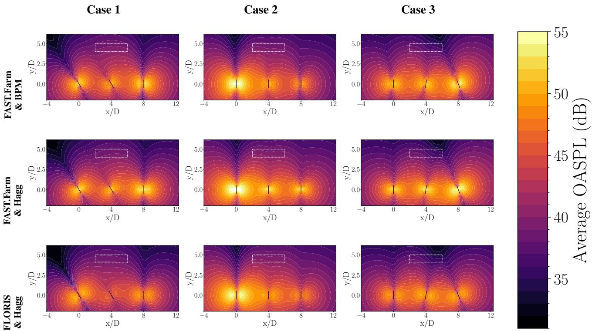  
Figure 9: Comparison of three wind farm noise modelling approaches for three operational conditions. The control region is denoted for reference. The OASPL is averaged in time to reduce the amplitude modulation oscillations.

## C. FAST.Farm and FLORIS policy comparison

The Noise Steering policy deployed on FAST.Farm is analysed over a complete episode to compare the state-action transitions. An episode with a steady free wind speed of $U _ { \infty } = 1 3 . 2 \ \mathrm { m } \mathrm { s } ^ { - 1 }$ is selected for the comparison.

Figure 10 illustrates the yaw actions and turbine power outputs throughout the episode for both environments. For simplicity, only the first row of turbines is shown. Figure 10a presents the yaw actions generated by the Noise Steering policy. Once the FAST.Farm wake dynamics have reached a stable state, the RL policy converges to yaw values close to those obtained in FLORIS. A similar behaviour is observed for the individual turbine power outputs in Figure 10b.

These results indicate that, despite being trained in a steady-state solver, the RL policy is able to operate under the transient wake dynamics of FAST.Farm once the static modelling discrepancy between the two environments has been reduced through calibration.

Finally, Figure 11 shows the wind farm power generation and noise emissions throughout the episode. A modelling gap similar to that observed in Figure 6 can be identified. As shown in Figure 11a, the Noise Steering policy requires approximately 75 steps to stabilize the FAST.Farm wake dynamics.

$$
{ \begin{array} { r l r l r l } & { } & & { { \mathrm { ~ --- ~ } } \operatorname { F L O R I S ~ F r o n t } } & { } & { { \mathrm { ~ --- ~ } } \operatorname { F L O R I S ~ M i d } } & { } & { { \mathrm { ~ } } } \\ & { } & { \mathrm { ~ --- ~ } \operatorname { F A S T . F a r m ~ F r o n t } } & { } & { { \mathrm { ~ --- ~ } } \operatorname { F A S T . F a r m ~ M i d } } & { } & { { \mathrm { ~ --- ~ } } \operatorname { F L O R I S ~ L a s t } } \end{array} }
$$

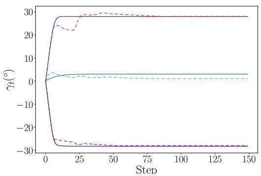  
(a) Nacelle yaw.

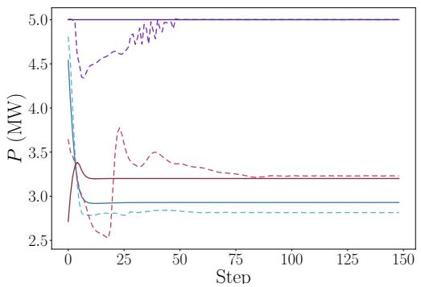  
(b) Wind turbine power.  
Figure 10: Turbine-scale episode comparison for the Noise Steering policy evaluated in FAST.Farm and FLORIS for $U _ { \infty } = 1 3 . 2 ~ \mathrm { ~ m ~ s ^ { - 1 } }$ . Only the first row of turbines is displayed.

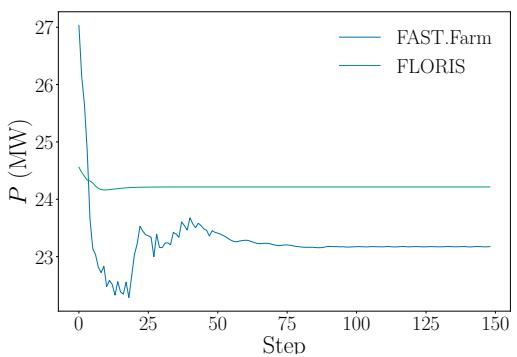  
(a) Farm power.

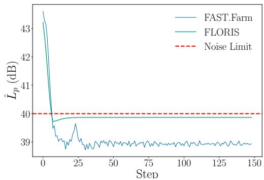  
(b) Acoustic emissions at the control region.  
Figure 11: Farm-scale episode comparison for the Noise Steering policy evaluated in FAST.Farm and FLORIS. Steady free wind speed of $U _ { \infty } = 1 3 . 2 ~ \mathrm { ~ m ~ s ^ { - 1 } }$