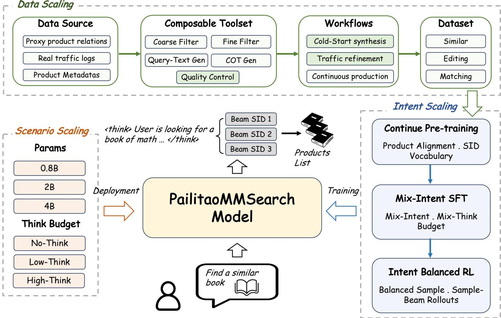
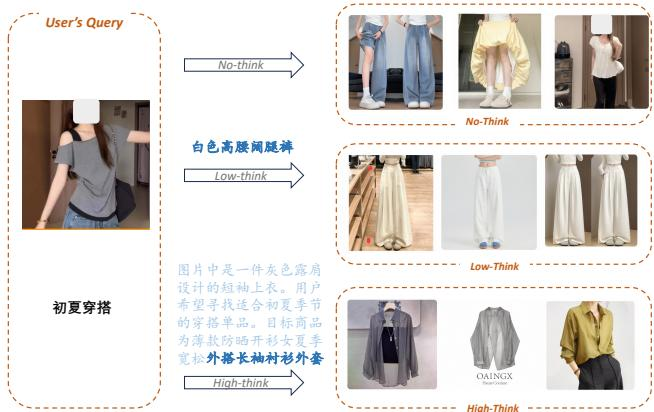

# PailitaoMMSearch2.0 Technical Report: Scaling Generative Retrieval to Unified End-to-End Multimodal Search

Xiaohan Ye, Zihan Gong, Jingqian Zhao, Lianyu Du, Yunmeng Shu, Xu Chen\*, Zesheng Zhou, Renchun You, Bocheng Chen, Jinsong Lan, Haihong Tang, Bo Zheng Taobao & Tmall Group of Alibaba

\{yxh268746,huaisong.cx\}@alibaba-inc.com

## Abstract

Generative retrieval models have been increasingly adopted in search and recommendation systems. However, industrial gener-ative retrieval models are commonly specialized to a fixed online scenario: they learn from scenario-specific interactions, support a narrow set of query forms and retrieval objectives. We study how to remove these couplings and build a unified end-to-end multimodal search system for open-ended image–text queries, heterogeneous shopping intents, and online scenarios with diferent resource constraints. We present PailitaoMMSearch, which directly generates product Semantic IDs from a raw query image and free-form instruction and scales along three dimensions. Data scaling uses a reusable toolset that can be composed into intent- and lifecycle- specific workflows for cold-start synthesis, quality control, real- trafic refinement, and continuous data production. Intent scaling progressively equips one model with e-commerce product knowledge, multiple retrieval relations, and adjustable reasoning budgets through continual pre-training (CPT), mixed-budget supervised fine-tuning (SFT), and unified reinforcement learning (RL). The RL stage combines intent-balanced optimization and Sample–Beam rollouts aligned with multi-candidate serving. Scenario scaling exposes quality–cost operating points across model capacity and reasoning budget. The system is deployed in multimodal search applications on Taobao Pailitao. A controlled online A/B test re- ports statistically significant improvements, including item page views +17.90%, transactions +27.04%, and gross merchandise value +8.94%.

## Keywords

multimodal search, generative retrieval, e-commerce search, Se- mantic IDs, reinforcement learning

## 1 Introduction

Generative retrieval represents catalog items as token sequences and retrieves an item by autoregressively generating its identifier. This formulation turns retrieval into sequence modeling, enables items to share token-level semantics, and avoids scoring every query against the full catalog [5, 18, 20]. Recent industrial systems further show that Semantic ID (SID) generation can serve large-scale search and recommendation trafic [3, 30]. Despite this progress, most deployed generative search models remain closely coupled to the online scenario for which they were built.

The coupling appears in three forms. First, supervision binding occurs when training is dominated by interactions from an existing entry point. Such logs reflect the query format, exposed products, and intent distribution of that entry point, they provide little su-pervision for an intent that has not yet been launched. Second, intent binding occurs when one model is trained to fit one retrieval relation, such as visual similarity or recommendation. Supporting another relation then requires an intent classifier, a routing rule, or another expert model, which inflates system complexity and maintenance cost and lets routing errors propagate into the downstream retrieval result. Third, resource binding occurs when model size, decoding strategy, and inference budget are selected for one service-level objective. The resulting configuration is dificult to reuse across a high-throughput candidate-generation service, a latency-tolerant complex search application, and the many operating points between them.

Open-ended multimodal product search exposes all three limita- tions at once, and in their most severe form. A user may upload a shirt and ask for “sports shorts to match it,” photograph a pair of san- dals and request “the women’s version from this brand,” or capture a household product and ask for “a foldable one for children.” These queries share the same image–text interface but express diferent retrieval relations. The desired result may preserve the pictured product, modify selected attributes, or belong to a complementary category. Query complexity also varies within an application: some requests can be answered from direct visual and attribute evidence, while others require multi-step comparison of category, style, function, and constraints. A practical system should understand these relations without requiring the user or an upstream router to name the intent.

We formulate the resulting problem as unified open-ended multimodal generative retrieval: one model consumes a raw image and a free-form textual instruction, infers their implicit retrieval relation, and generates a set of product SIDs. We instantiate this formulation in PailitaoMMSearch, a native vision-language model (VLM) system that scales along three connected dimensions:

• Data scaling broadens supervision coverage. A reusable toolset performs candidate screening, relation verification, query generation or repair, reasoning annotation, and ter-minal quality control. The tools are composed into diferent workflows according to the target intent, source data, and lifecycle stage, from cold start to real-trafic refinement and continuous production.

• Intent scaling converts heterogeneous supervision into a unified retrieval policy. Continual pre-training (CPT) first adapts the VLM to e-commerce products and the SID output space. Multi-intent, mixed-budget supervised fine-tuning (SFT) then establishes similar, editing, and matching behaviors together with several reasoning bud- gets. Unified reinforcement learning (RL) then optimizes all intents jointly with Sample–Beam rollouts, which sample the reasoning trajectory but beam-decode the product SIDs, so that policy optimization matches the candidate-set generation used online.

• Scenario scaling converts unified capability into deployable operating points. Model capacity provides coarse-grained adaptation to an application’s resource envelope, while reasoning budget provides fine-grained adaptation to query complexity and latency requirements. These operating points expose the behaviors already learned during intent scaling, so no separate routing model is introduced.

We evaluate the system through five questions: overall multi- intent retrieval quality; the efects of data volume, quality control, and real-trafic onboarding; the contributions of CPT, multi-intent transfer, reasoning-budget SFT, and RL; the quality–cost space induced by model and reasoning scale; and online business impact. The system has been deployed in multimodal search applications on Taobao Pailitao. Our contributions are:

(1) We formulate the transition from scenario-specific gener-ative search to unified open-ended multimodal retrieval and implement a native-VLM system that maps free-form image–text queries directly to product SIDs without ex plicit intent input or intent-specific serving routes. More broadly, we provide a practical, industrial-scale blueprint for building open-ended multimodal search systems, span ning multimodal training-data synthesis and quality control, multi-stage model training, and production serving.

(2) We develop a three-dimensional scaling framework: a com posable data toolset supports intent- and lifecycle-specific workflows; a multi-stage training recipe aligns heteroge-neous retrieval relations in one model; and model capacity together with reasoning budget forms deployable quality– cost operating points.

(3) We introduce Sample–Beam RL rollouts and validate the complete system with ofline and human evaluation, con- trolled scaling studies, and production measurements. Sample– Beam RL raises the macro Excellent Rate by 5.97 points over SFT, and a controlled online A/B test on Taobao Pailitao yields statistically significant gains, including +17.90% item page views, +27.04% transactions, and +8.94% gross mer-chandise value.

## 2 Related Work

Generative retrieval and Semantic IDs. Generative retrieval treats a model’s parameters as a diferentiable index and decodes document, entity, or item identifiers conditioned on a query [5, 18, 20]. Residual quantization provides hierarchical item tokens that share coarse-to-fine content semantics [9], while later work integrates collaborative signals and richer identifier construction [6, 29]. Unified recommendation and industrial systems have extended the formulation across tasks and production trafic [3, 7, 30]. Our focus difers from improving the identifier alone: we study how a SID-based retriever can be scaled beyond one fixed query distribution, retrieval relation, and serving configuration.

Multimodal product retrieval. CLIP-style contrastive learning has enabled large-scale visual and cross-modal product retrieval [16, 25, 28], and native VLMs allow pixels and language tokens to interact throughout the model [4, 12, 21]. Product-specific rep- resentation models further adapt multimodal encoders to catalog semantics [2, 24, 27]. These methods commonly retrieve by vector similarity or specialize in a predefined composed-retrieval task. We instead use a native VLM to generate catalog SIDs and train one policy over overlapping retrieval relations expressed through unrestricted image–text instructions.

Model adaptation and adaptive reasoning. CPT adapts a foundation model to a target domain, while instruction tuning and RL align model behavior with downstream objectives [14, 17, 19]. Chain-of-thought methods improve dificult reasoning tasks, and inference-time methods trade additional computation for quality [13, 22, 23, 26]. Our mixed-budget SFT establishes multiple search behaviors under explicit, prompt-controlled reasoning budgets. Unlike general text reasoning, the action ultimately represents a beam of catalog identifiers, motivating a rollout that separates sampled reasoning from beam SID generation.

## 3 Problem and System Overview

## 3.1 Unified Multimodal Generative Retrieval Let a request be

$$
x = ( I , Q , C ) ,\tag{1}
$$

where � is a query image, � is a free-form textual instruction, and � denotes optional application context. Each catalog item � is assigned a three-level hierarchical SID $\boldsymbol { s } ( \boldsymbol { v } ) = \left( s _ { 1 } , s _ { 2 } , s _ { 3 } \right)$ , with a codebook of 8,192 entries at each level. The model �� generates a candidate set

$$
y = \operatorname { D e c o d e } _ { B } ( \pi _ { \theta } ( \cdot \mid x ) ) ,\tag{2}
$$

where � is the serving beam width and every valid sequence maps deterministically to a catalog item. Decoding is therefore the retrieval operation rather than a query-rewriting stage for a separate retriever.

The request has an unobserved retrieval relation � and an ap- propriate reasoning budget �. In our production data, the main evaluation slices are similar, editing, and matching. Similar queries preserve most visual and semantic properties, editing queries keep the product identity while changing or filtering selected attributes, matching queries seek a complementary item. These slices organize data and evaluation, but they are not required inputs to the serving model and need not be mutually exclusive. The system must infer the retrieval relation � from �.

For deployment scenario $^ { a , }$ let $c = ( m , b , B )$ denote a serving configuration consisting of model scale, reasoning budget, and beam width. The system seeks a shared policy and a scenario configura- tion that maximize retrieval utility under resource constraints:

$$
\begin{array} { r l } & { ( \theta ^ { * } , c _ { a } ^ { * } ) = \arg \underset { \theta , c } { \operatorname* { m a x } } ~ \mathbb { E } _ { x \sim \mathcal { D } _ { a } } \left[ r _ { z } ( x , y _ { \theta , c } ) \right] } \\ & { ~ \mathrm { s . t . } ~ L _ { 9 5 } ( c ) \leq \tau _ { a } , ~ M ( c ) \leq \mu _ { a } . } \end{array}\tag{3}
$$

where $r _ { z }$ is the relevance rubric implied by the query relation, $L _ { 9 5 }$ is P95 latency, � is serving memory, and $( \tau _ { a } , \mu _ { a } )$ is the application’s resource envelope. This expression is a system-level formulation rather than a single diferentiable training loss. Data scaling changes the training distribution available for estimating $r _ { z } ,$ , intent scaling learns the shared $\theta ,$ scenario scaling selects $c _ { a }$ without changing the query interface or introducing an intent-specific expert.

  
Figure 1: PailitaoMMSearch2.0 overview. Data scaling expands supervision, intent scaling learns a unified policy, and scenario scaling exposes the learned capability under diferent resource envelopes.

## 3.2 Overall Architecture

PailitaoMMSearch2.0 uses a native VLM from the Qwen3.5 [15]. Raw image patches and text tokens are jointly processed before the model emits an optional think block and one or more product SIDs. Compared with feeding a fixed image embedding into a language model, native multimodal attention preserves fine-grained evidence needed to resolve text-conditioned attributes and relations. All intents share the VLM, SID vocabulary, and decoding interface.

Figure 1 summarizes the dependency among the three scaling dimensions. Data scaling supplies broad, quality-controlled super vision. Intent scaling turns the supervision into one model that understands heterogeneous retrieval relations and selects its rea- soning behavior. Scenario scaling then measures and deploys the resulting policy at diferent capacity and reasoning budgets. This order separates how a behavior is learned from how it is used under production constraints.

## 4 Data Scaling with Composable Toolsets

## 4.1 Data Sources and Lifecycle Challenges

Open-ended image–text search cannot rely solely on mature interaction logs. Before a new query format or intent is launched, no direct trafic or interaction data are available, making it necessary to draw on proxy sources. These sources provide useful product-to- product relations, but vary in both structure and reliability. Such relations may be derived from product similarity, co-occurrence patterns, outfit compatibility, and other signals, while the underly- ing product data may include images, titles, categories, attributes, and other modalities. Once the application is launched and begins receiving trafic, interaction logs ofer additional information. However, early user interactions are typically sparse and noisy, often containing misspellings, incomplete constraints, accidental clicks, and exploratory behavior.

We therefore define data scaling over volume, query and intent coverage, lifecycle coverage, and quality. The goal is not one fixed data pipeline. It is to reuse a set of operations across diverse intents and stages, so a new workflow can be assembled without rebuilding the entire production process.

## 4.2 Reusable Toolset

The toolset contains five operations with diferent cost and precision profiles. They form a configurable processing graph: a workflow may invoke, skip, or revisit a tool according to its source and target supervision.

• Coarse-Filter cheaply removes implausible query–item or item–item pairs using category, attribute, behavioral, and lightweight multimodal signals. Its thresholds and retained distribution are intent-conditioned.

• Fine-Filter verifies whether a retained pair expresses the target relation. It checks, for example, whether an edit ing pair preserves product identity while changing the requested attribute, or whether a matching pair is com-plementary rather than merely similar.

• Query-Text-Gen converts proxy relations into free-form image–text requests. For real trafic, the same interface performs minimal repair of spelling, incomplete expressions, and conflicting constraints while preserving the inferred user intent.

• CoT-Gen generates concise or detailed chain-of-thought (CoT) supervision when required by the SFT configuration. It grounds the target relation in visible evidence, text constraints, and product knowledge rather than merely explaining the selected item after the fact.

• Quality-Control is the terminal gate. A multimodal evaluator applies an intent-specific rubric to the complete query– target instance. Its acceptance thresholds are calibrated against held-out human labels, and rejected or uncertain examples may be sent back to an earlier tool.

The reusable interface is important because the same opera- tion has diferent semantics across intents. Similarity filtering em-phasizes preserved visual and category evidence, editing checks invariant and changed attributes, matching checks compatibility, function, and context. Adding an intent therefore requires a rela- tion specification and quality rubric plus a workflow configuration, rather than a separate end-to-end annotation system.

Cost-aware orchestration. The tools are arranged as a cascade rather than applying the strongest multimodal model to every raw pair. Cheap structured and textual checks first reduce a large can didate pool, fine-grained visual-language verification and query generation are invoked only on retained examples. The orchestra- tor also uses the presence of source fields to determine the path. A product pair with no user text requires query synthesis, whereas a trafic record normally keeps the original instruction and invokes repair only when a quality check detects a recoverable defect. CoT generation is bypassed for No-think supervision and called with the requested budget for reasoning examples. This conditional exe- cution reduces production cost and prevents unnecessary rewriting of real queries.

Quality calibration and production control. Every completed in stance passes the Quality-Control module. We manually annotated a calibration dataset independent of the training and test sets to adjust the rubric of the module. By scoring the calibration dataset, comparing the consistency with human annotations, and analyzing the patterns of scoring errors across diferent intents, the rubric settings were updated, enabling this module to serve as a reasonably efective substitute for human annotators in achieving rapid quality control aligned with human preferences. We trace how this rubric evolved for the editing intent in Appendix A.

Table 1: Tool composition for the three data-production workflows. QTG and QC denote Query-Text-Gen and Quality Control.
<table><tr><td>Workflow</td><td>Coarse</td><td>Fine</td><td>QTG</td><td>CoT</td><td>QC</td></tr><tr><td>Cold-start synthesis</td><td>√</td><td>√</td><td>√</td><td>0</td><td>√</td></tr><tr><td>Real-traffic refinement</td><td>o</td><td>√</td><td>o</td><td>0</td><td>√</td></tr><tr><td>Continuous production</td><td>√</td><td>√</td><td>0</td><td>0</td><td>√</td></tr></table>

## 4.3 Intent- and Lifecycle-Specific Workflows

We compose the tools into three recurring workflows. Cold-start synthesis begins with proxy product relations, applies coarse and fine verification, generates an image–text request, optionally adds reasoning, and passes the instance through quality control. It creates training data before direct trafic is available. Real-trafic refinement starts from observed query–item interactions, removes unreliable behavior, repairs the query when necessary, optionally annotates reasoning, and applies the same terminal gate. It preserves authentic language and demand while reducing noise. Continuous production mixes proxy sources with accumulated trafic, periodically samples hard or under-covered regions, and reuses the tools for new catalog items, expressions, and intents.

Table 1 summarizes the composition. A checkmark denotes a standard operation and a circle denotes a conditional operation selected by the source quality or training configuration. Quality-Control remains mandatory in all cases, which makes the accepted corpora comparable even though their source paths difer.

Worked editing example. Consider a proxy pair consisting of a red short-sleeve shirt as the query product and a red long-sleeve shirt as the target. Coarse-Filter retains the pair because category and dominant appearance are compatible. Fine-Filter then produces a structured relation: category and color are invariants, sleeve length is the intended edit, and other uncontrolled diferences must remain below the acceptance threshold. Query-Text-Gen verbalizes only the supported transformation, such as “find a long-sleeve one in the same color,” rather than describing every target attribute. For a Low-think example, CoT-Gen records the compact decision that the query preserves category and color while changing sleeve length, for No-think data it is skipped. Quality-Control finally evaluates the source image, generated instruction, and target together. A pair is rejected if the target changes category, violates the preserved color, or contains additional diferences that make the instruction under- specified. The same tools produce matching data with a diferent relation rubric: category change may be required, while compatibility and context replace attribute preservation as the key acceptance conditions.

This composition supports both axes required by industrial ex-pansion: diverse retrieval relations and diferent points in an application’s lifecycle. It also separates source expansion from quality guarantees. Cold-start data enables launch, launch produces real queries, and refined trafic improves subsequent model versions without discarding the proxy data that covers rare relations.

## 5 Intent Scaling via Multi-Stage Training

## 5.1 Continual Pre-Training

Generic vision–language models (VLMs) possess limited prior knowl-edge of platform-specific product taxonomies, attribute schemas, and product SID vocabularies. To bridge this gap, we perform continued pre-training (CPT) on a mixture of e-commerce-specific and general-domain corpora. The training tasks encompass producttitle understanding, product SID prediction, product-attribute prediction, e-commerce user-behavior prediction, and general natural- language modeling. This stage enables the model to acquire a unified understanding of e-commerce products across visual and tex- tual modalities, while providing a stronger initialization for the SID vocabulary space used in generative retrieval.

## 5.2 Multi-Intent, Mixed-Budget SFT

Through the data-construction workflow, we obtain multi-intent training data. Each training sample maps an open-ended query to the SID of a target product and may additionally include a chain of-thought (CoT) rationale.

The training samples are organized into similarity, editing, and matching subsets. Nevertheless, all samples jointly update a single model and share a unified input–output interface. At serving time, the model is not provided with explicit intent labels. Instead, it must infer the appropriate retrieval relation from the evidence conveyed by the instruction and the accompanying images.

Based on the form and granularity of the CoT rationales, we define three prompt-controlled reasoning modes. No-think directly emits the target SIDs. Low-think produces a concise analysis focusing on the decisive visual and textual constraints. High-think permits a more extensive reasoning trace for relational reasoning, constraint resolution, and candidate comparison. Mixed-budget supervised fine-tuning (SFT) jointly optimizes these reasoning behaviors. This stage enables the model to address diverse retrieval intents under diferent reasoning budgets, although the reasoning mode is still specified through the system prompt.

Mixing the intents and budgets at this stage gives RL a single checkpoint in which alternative retrieval and reasoning behaviors are already reachable.

## 5.3 Intent-Balanced Unified RL

Let $\mathcal { D } _ { t }$ denote data for operational slice �. We sample from

$$
\mathcal { D } _ { \mathrm { R L } } = \sum _ { t = 1 } ^ { T } \beta _ { t } \mathcal { D } _ { t } , \qquad \sum _ { t = 1 } ^ { T } \beta _ { t } = 1 ,\tag{4}
$$

where $\beta _ { t }$ prevents high-volume intents from dominating optimiza tion. For a query from slice �, the calibrated evaluator applies the corresponding reward rubric $r _ { t } .$ The slices select sampling and eval uation rules during training, not experts or serving routes. Every rollout updates the same policy $\pi _ { \theta }$

Under the prompt-specified reasoning budget, the policy generates a reasoning trace and then the product SIDs. Group relative policy optimization (GRPO) [19] compares outcomes for the same query. The following mechanisms address the training–serving alignment.

## 5.4 Sample–Beam Rollouts

Standard GRPO samples each completion autoregressively, whereas production generative retrieval typically beam-decodes the SID portion. To reduce this training–serving mismatch, we construct each rollout in two stages. Given a query � and reasoning-budget prompt �, we first sample � reasoning prefixes from the frozen old policy. For each prefix, we then run beam search with width � to generate � SID sequences:

$$
\begin{array} { r l r } & { h _ { g } \sim \pi _ { \theta _ { \mathrm { o l d } } } ( \cdot \mid x , \cdot p ) , } & { g = 1 , \ldots , N , } \\ & { \{ y _ { g , b } \} _ { b = 1 } ^ { B } = \mathrm { B e a m } _ { B } \big ( \pi _ { \theta _ { \mathrm { o l d } } } ( \cdot \mid x , \cdot p , h _ { g } ) \big ) , } \\ & { \tau _ { g , b } = h _ { g } \oplus y _ { g , b } , } & { R _ { g , b } = r _ { t } ( x , y _ { g , b } ) . } \end{array}\tag{5}
$$

The group contains � sampled reasoning prefixes and �� beam-branch trajectories. Each branch receives a candidate-level reward $R _ { g , b } = r _ { t } ( x , y _ { g , b } )$ , and rewards are normalized across the �� branches before applying a GRPO-style clipped surrogate to both reasoning and SID tokens. The shared prefix $h _ { g }$ therefore aggregates the ad- vantages of its � SID branches. Beam selection is not diferentiated. Since the SID branches are selected by deterministic beam search rather than ancestral sampling, this is a beam-conditioned surro- gate rather than an unbiased on-policy estimator. Its purpose is to align SID rollout generation, rather than the reward function, with serving-time beam decoding.

## 6 Scenario Scaling and Deployment

Intent describes what a user wants, scenario describes where the model runs and under what resource envelope. We use one archi- tecture and training framework to construct native VLMs at 0.8B, 2B, and 4B parameters. Model size provides coarse-grained adap- tation to an application’s stable latency, memory, and throughput constraints. Within a selected model, No-think, Low-think, and High-think provide finer-grained operating points. Explicit budgets are useful when predictable cost is required.

At serving time, the application passes the raw image and in-struction to the selected model. The model emits an optional rea- soning trace, fixes the trace when the think block closes, and beamdecodes a set ofproduct SIDs. Each valid SID maps deterministically to a catalog item, and the resulting candidate set enters the applica- tion’s retrieval or exposure interface. No intent classifier selects an expert model. The application chooses model size, reasoning policy, and beam configuration according to its resource and latency en- velope. These settings are held fixed when systems are compared online.

PailitaoMMSearch2.0 is deployed across multiple applications on Taobao Pailitao, including "Multimodal Search", "Find Matching Tab", and "Find Similarity Tab". The applications share the request, model, and SID interfaces while operating under diferent trafic and quality requirements. Online interactions are sampled back into the real-trafic workflow described in Section 4, where behavioral noise and query corruption are removed before the records enter subsequent training. This feedback path closes the data–training– deployment loop without changing the serving-time requirement that the model infer the relation from the query.

The distinction between intent and scenario scaling avoids double- counting the same mechanism.

## 7 Experiments

## 7.1 Setup

Data and splits. Training instances are produced by the workflows in Section 4 and organized into similar, editing, and matching intents. The automatic testset is drawn from a later time window than the training data, and duplicate query–target pairs are re-moved across splits. The human-annotated evaluator-calibration set is disjoint from both training and automatic evaluation. Table 2 summarizes the resulting data statistics.

Table 2: Dataset statistics for training, automatic evaluation, and evaluator calibration.
<table><tr><td></td><td>Similar</td><td>Editing</td><td>Matching</td></tr><tr><td>Proxy/cold-start training</td><td>24M</td><td>24M</td><td>12M</td></tr><tr><td>Refined real-traffic training</td><td>1M</td><td>8M</td><td>1M</td></tr><tr><td>Automatic test</td><td>502</td><td>772</td><td>371</td></tr><tr><td>Evaluator calibration</td><td>40,000</td><td>20,000</td><td>40,000</td></tr></table>

Table 3: Automatic-evaluator precision against disjoint human annotations.
<table><tr><td>Intent</td><td>Good Prec. (≥ 2)</td><td>Excellent Prec. (= 3)</td></tr><tr><td>Similar</td><td>0.924</td><td>0.936</td></tr><tr><td>Editing</td><td>0.935</td><td>0.939</td></tr><tr><td>Matching</td><td>0.932</td><td>0.936</td></tr></table>

Metrics and evaluator calibration. For each query, a human-calibrated multimodal evaluator scores the top-10 results from 0 to 3. We report Good Rate (GR), the proportion scoring at least 2; Excellent Rate (ER), the proportion scoring 3; and NDCG@10 based on graded relevance. All metrics are macro-averaged over the three intents. The evaluator is calibrated on human annota- tions disjoint from both model-training and automatic-test data, using the same intent-specific relevance criteria. Table 3 shows that precision ranges from 92.4% to 93.5% for Good predictions and from 93.6% to 93.9% for Excellent predictions. We use ER as the pri mary ablation metric and retain GR and NDCG@10 for the overall comparison. Complementarily, the online A/B tests in Section 7.6 evaluate the deployed system through real user interactions and business outcomes rather than evaluator scores.

Implementation. Unless otherwise stated, controlled experiments use the 2B model with High-think mode. Variants within each ablation share the same evaluation set, decoding constraints, and training configuration except for the factor under study. Note that the choice ofquality-control module and reward model is flexible, and we use the popular Qwen3.5-397B-A17 as quality-control, Qwen3.8-27B as reward model. The diferentbase model configurations avoid the player-referee conflict.

## 7.2 Overall Multi-Intent Retrieval Quality

We compare PailitaoMMSearch2.0 with two advanced VLM query- rewrite lus full-text retrieval i elines and an internal multimodal recall-and-ranking pipeline. The internal baseline follows a multi- recall architecture. An explicit intent classifier activates the ap- propriate channels, whose candidates are merged from several SFT models by collected domain data, such as 1) composed image retrieval (CIR) by Qwen3-VL-Embedding-2B [10], 2) multimodal rewriting for text search by Qwen3-VL-2B [1] and Taobao Text Search, 3) and QueryText to ItemTitle semantic matching by DeepSeek [11]. The merged candidate set is processed by multiple ranking stages, ending with a large Transformer ranker upgraded from the MTGR architecture [8] that optimized for multimodal search. Table 4 reports intent-level and macro-averaged NDCG, GR, and ER, together with average response time and GPU usage. The PailitaoMMSearch2.0 variants use Low-think decoding to represent practical deployment configurations.

Among the PailitaoMMSearch2.0 variants, the 2B Low-think configuration provides the strongest aggregate operating point, achieving the highest macro NDCG (0.918) and macro ER (55.1%) in the table with an average RT of 278 ms on one GPU. Relative to Qwen3.8-Flash-Next, GPT6-luna, and the internal recall-andranking pipeline, it improves macro ER by 2.9, 3.3, and 5.6 points while reducing average RT by 74.1%, 92.4%, and 64.4%, respectively. It also uses one GPU, compared with four for Qwen3.8-Flash-Next.

The largest advantage occurs on matching retrieval: the 2B model reaches an NDCG of 0.955 and an ER of 74.3%, exceeding the matching ER of the two rewrite-based systems by 13.2 and 7.0 points and that of the internal pipeline by 30.1 points. The gains are not uniform across intents. The internal pipeline remains stronger on similar and editing ER, and both rewrite-based systems also obtain higher editing ER than the 2B model.

Within our model family, scaling from 0.8B to 2B raises macro ER by 4.8 points for only 91 ms of additional RT. Increasing the model to 4B does not improve aggregate quality under Low-think: its macro ER is 0.1 points lower than the 2B model while its RT increases from 278 to 617 ms. Although the 4B model is slightly weaker than the 2B model under Low-think, it benefits more from a larger reasoning budget and achieves higher macro ER under High think, as shown in Table 9. These results identify the 2B Low-think configuration as the best overall quality–latency trade-of, with particularly strong performance on matching-oriented requests.

## 7.3 Efects of Data Scaling

We first vary the accepted training corpus while preserving the distributions of data sources and intents. Scaling the data volume from 30% to 100% raises macro ER from 46.32% to 49.03% (+2.71 points). Similar retrieval benefits the most, improving by 5.08 points, com-pared with gains of 1.70 and 1.33 points for editing and matching retrieval, respectively. The gains are not uniform across scales or intents: macro ER increases by 1.49 points from 30% to 70% and by a further 1.22 points at 100%, while matching ER first decreases by 0.52 points and then recovers by 1.85 points. Thus, more accepted data improves aggregate performance, but its marginal value is intent dependent.

To separate data composition from volume, the final two rows of Table 5 ablate real-trafic supervision and quality control at the full data scale. Removing real-trafic data lowers macro ER by 0.78 points, with losses of 1.10, 0.86, and 0.38 points on similar, editing, and matching retrieval, respectively. Further removing quality control lowers macro ER by another 0.28 points, driven mainly by matching (0.94 points) and editing (0.30 points), despite a 0.42-point increase on similar retrieval. Removing both components reduces macro ER by 1.06 points and degrades all three intents relative to the complete pipeline. Thus, real-trafic supervision provides broad post-deployment gains, whereas quality control mainly benefits aggregate and matching performance.

Table 4: Ofline retrieval quality and serving cost across the three intents. Higher NDCG, GR, and ER are better; lower average response time (RT) and fewer GPU devices are better. Best and second-best quality and RT results are shown in bold and underlined, respectively.
<table><tr><td rowspan="2">System</td><td colspan="3">Similar</td><td colspan="3">Editing</td><td colspan="3">Matching</td><td colspan="3">Macro</td><td rowspan="2">Avg. RT GPU</td><td rowspan="2">devices</td></tr><tr><td>NDCG</td><td>GR</td><td>ER</td><td>NDCG</td><td>GR</td><td>ER</td><td>NDCG</td><td>GR</td><td>ER</td><td>NDCG</td><td>GR</td><td>ER</td></tr><tr><td>Qwen3.8-Flash-Next</td><td>0.885</td><td>74.5%</td><td>47.5%</td><td>0.894</td><td>66.7%</td><td>47.9%</td><td>0.892</td><td>74.4%</td><td>61.1%</td><td>0.890</td><td>71.9%</td><td>52.2%</td><td>1,075</td><td>4</td></tr><tr><td>GPT6-luna</td><td>0.883</td><td>71.3%</td><td>44.7%</td><td>0.859</td><td>60.0%</td><td>43.5%</td><td>0.930</td><td>80.4%</td><td>67.3%</td><td>0.891</td><td>70.6%</td><td>51.8%</td><td>3,646</td><td>一</td></tr><tr><td>Internal recall-and-ranking pipeline</td><td>0.874</td><td>70.6%</td><td>54.1%</td><td>0.903</td><td>64.0%</td><td>50.1%</td><td>0.745</td><td>51.4%</td><td>44.2%</td><td>0.841</td><td>62.0%</td><td>49.5%</td><td>780</td><td>一</td></tr><tr><td>PailitaoMMSearch2.0-0.8B  $l o w { - } t h i n k$ </td><td>0.887</td><td>64.3%</td><td>44.6%</td><td>0.877</td><td>51.2%</td><td>35.5%</td><td>0.944</td><td>81.1%</td><td>70.9%</td><td>0.903</td><td>65.5%</td><td>50.3%</td><td>187</td><td>1</td></tr><tr><td>PailitaoMMSearch2.0-2B low-think</td><td>0.907</td><td>70.6%</td><td>50.5%</td><td>0.891</td><td>57.4%</td><td>40.6%</td><td>0.955</td><td>84.7%</td><td>74.3%</td><td>0.918</td><td>70.9%</td><td>55.1%</td><td>278</td><td>1</td></tr><tr><td>PailitaoMMSearch2.0-4B  $l o w { - } t h i n k$ </td><td>0.907</td><td>69.5%</td><td>50.6%</td><td>0.885</td><td>57.0%</td><td>40.6%</td><td>0.944</td><td>83.6%</td><td>73.9%</td><td>0.912</td><td>70.0%</td><td>55.0%</td><td>617</td><td>1</td></tr></table>

Table 5: Efect of training-data scale and data-production components on the 2B SFT model.
<table><tr><td>Data volume</td><td>Data setting</td><td>Sim. ER</td><td>Edit ER</td><td>Match ER</td><td>Macro ER</td></tr><tr><td>30%</td><td>一</td><td>40.48%</td><td>33.73%</td><td>64.76%</td><td>46.32% (−2.71pp)</td></tr><tr><td>70%</td><td>一</td><td>43.91%</td><td>35.29%</td><td>64.24%</td><td>47.81% (−1.22pp)</td></tr><tr><td>100%</td><td>一</td><td>45.56%</td><td>35.43%</td><td>66.09%</td><td>49.03%</td></tr><tr><td>100%</td><td>w/o real traffic</td><td>44.46%</td><td>34.57%</td><td>65.71%</td><td>48.25% (−0.78 pp)</td></tr><tr><td>100%</td><td>w/o real traffic w/o quality control</td><td>44.88%</td><td>34.27%</td><td>64.77%</td><td>47.97% (−1.06pp)</td></tr></table>

Table 6: Efect of continual pre-training under a fixed downstream SFT configuration.
<table><tr><td>Initialization</td><td>Macro GR</td><td>Macro ER</td></tr><tr><td>Base  $\mathrm { V L M } + \mathrm { S F T }$ </td><td> $6 2 . 5 \% ( - 0 . 8 p p )$ </td><td> $4 7 . 8 \% ( - 1 . 2 p p )$ </td></tr><tr><td>CPT + SFT</td><td>63.3%</td><td>49.0%</td></tr></table>

## 7.4 Efects of Intent Scaling

Continual pre-training. We compare the Base VLM with a model that undergoes continual pre-training (CPT) for e-commerce prod-uct understanding. Both initializations use the same downstream SFT data and configuration. As shown in Table 6, CPT improves macro GR by 0.8 points and macro ER by 1.2 points, showing that domain adaptation before instruction tuning provides a stronger initialization for the three retrieval intents.

Cross-intent transfer. Table 7 expands the SFT intent mixture in stages. Adding similar-retrieval supervision to editing-only training raises editing ER from 33.11% to 35.88% (+2.77 points), demonstrating positive transfer from similar retrieval to editing. Introducing matching supervision then achieves 66.09% matching ER and further improves similar ER from 44.63% to 45.56% (+0.93 points). Editing ER decreases slightly from 35.88% to 35.43% (−0.45 points), but remains 2.32 points above the editing-only setting. The three-intent mixture therefore largely retains the established ca pabilities while adding strong matching performance, although the transfer is asymmetric rather than uniformly positive across intents.

Unified reinforcement learning. Table 8 separates the efect of standard unified RL from the additional contribution of Sample– Beam rollouts. Standard RL raises macro ER from 49.03% to 52.70% (+3.67 points), with gains of 1.23, 1.94, and 7.84 points on similar, editing, and matching retrieval, respectively. Replacing standard rollouts with Sample–Beam further improves macro ER by 2.30 points, adding 2.86 points on similar retrieval, 3.11 points on editing, and 0.95 points on matching. Overall, Sample–Beam RL outperforms SFT by 5.97 macro-ER points, corresponding to intent-level gains of 4.09, 5.05, and 8.79 points on similar, editing, and matching retrieval, respectively. The largest end-to-end gain occurs on matching, whereas the incremental benefit of Sample–Beam over standard RL is concentrated on editing and similar retrieval. This progression indicates that unified reward optimization and beam-aligned rollouts provide complementary improvements, although the incremental efect of Sample–Beam varies across intents.

Table 7: Cross-intent transfer as the SFT supervision mixture expands.
<table><tr><td>SFT intent mixture</td><td>Similar ER</td><td>Editing ER</td><td>Matching ER</td></tr><tr><td>Editing only</td><td>一</td><td>33.11%</td><td>一</td></tr><tr><td>Similar + Editing</td><td>44.63%</td><td>35.88%</td><td></td></tr><tr><td>Similar + Editing + Matching</td><td>45.56%</td><td>35.43%</td><td>66.09%</td></tr></table>

Table 8: Efects of unified RL and Sample–Beam rollouts under matched initialization, intent mixture, and reward evaluation.

<table><tr><td>Training setting</td><td>Similar ER</td><td>Editing ER</td><td>Matching ER</td><td>Macro ER</td></tr><tr><td>SFT</td><td>45.56%</td><td>35.43%</td><td>66.09%</td><td>49.03% (−5.97 pp)</td></tr><tr><td>Standard RL</td><td>46.79%</td><td>37.37%</td><td>73.93%</td><td>52.70% (−2.3pp)</td></tr><tr><td>Sample-Beam RL</td><td>49.65%</td><td>40.48%</td><td>74.88%</td><td>55.00%</td></tr></table>

## 7.5 Efects of Scenario Scaling

Table 9 compares retrieval quality, reasoning tokens, and response time across three model scales and inference-time budgets. For the 0.8B model, No-think achieves the highest macro ER (50.78%) at the lowest latency (136 ms); additional reasoning reduces macro ER to 50.31% with Low-think and 49.60% with High-think while increasing serving cost. For the 2B model, Low-think provides the best aggregate trade-of, improving macro ER from 54.62% to 55.13% with only 8.6 reasoning tokens and 278 ms RT. High-think further raises matching ER to 74.88%, but its macro ER decreases by 0.13 points relative to Low-think and its RT nearly doubles to 544 ms. The 4B model benefits most from additional reasoning: Low-think improves macro ER by 0.98 points over No-think, while

  
Figure 2: Case study of the three reasoning budgets on representative queries. No-think answers directly, Low-think isolates the decisive visual and textual constraints, and Highthink adds a longer trace. The examples illustrate the efect of the extra reasoning.

Table 9: Efects of model scale and inference-time reasoning budget on retrieval quality, reasoning tokens, and response time. Quality columns report ER.

<table><tr><td></td><td>Params Budget</td><td>ER</td><td>ER</td><td>Similar Editing Matching ER</td><td>Macro ER</td><td>Avg. tokens</td><td>RT (ms)</td></tr><tr><td rowspan="3">0.8B</td><td>No-think</td><td>46.22%</td><td>35.67%</td><td>70.45%</td><td>50.78%</td><td>0</td><td>136</td></tr><tr><td>Low-think</td><td>44.55%</td><td>35.51%</td><td>70.87%</td><td>50.31%</td><td>9.0</td><td>187</td></tr><tr><td>High-think</td><td>43.51%</td><td>35.09%</td><td>70.21%</td><td>49.60%</td><td>51.7</td><td>326</td></tr><tr><td rowspan="3">2B</td><td>No-think</td><td>49.71%</td><td>40.70%</td><td>73.45%</td><td>54.62%</td><td>0</td><td>210</td></tr><tr><td>Low-think</td><td>50.54%</td><td>40.60%</td><td>74.25%</td><td>55.13%</td><td>8.6</td><td>278</td></tr><tr><td>High-think</td><td>49.65%</td><td>40.48%</td><td>74.88%</td><td>55.00%</td><td>54.4</td><td>544</td></tr><tr><td rowspan="3">4B</td><td>No-think</td><td>50.11%</td><td>40.20%</td><td>71.83%</td><td>54.05%</td><td>0</td><td>465</td></tr><tr><td>Low-think</td><td>50.62%</td><td>40.58%</td><td>73.90%</td><td>55.03%</td><td>8.9</td><td>617</td></tr><tr><td>High-think</td><td>49.39%</td><td>41.27%</td><td>75.57%</td><td>55.41%</td><td>54.99</td><td>1,133</td></tr></table>

High-think reaches the best macro ER (55.41%), editing ER (41.27%), and matching ER (75.57%) in the table, at the cost of 54.99 reasoning tokens and 1,133 ms RT. The appropriate operating point therefore depends on the target intent and quality–latency requirements rather than always selecting the largest model or budget. Figure 2 shows representative queries under each budget and illustrates where additional reasoning changes the retrieved set.

## 7.6 Online A/B Tests in Production

We deploy PailitaoMMSearch2.0 in Pailitao applications and conduct controlled online A/B tests against their respective production baselines. For each experiment, approximately 10% of the online trafic is allocated to the experimental bucket, and each test runs for approximately 14 days. In Pailitao “Multimodal Search”, PailitaoMM-Search2.0 increases item page views by 17.90%, unique-user item page views by 13.62%, transactions by 27.04%, gross merchandise value (GMV) by 8.94%, click-through rate by 0.58 percentage points, and conversion rate by 0.37 percentage points. All improvements are statistically significant $( p < 0 . 0 5 )$ .

Across these applications, PailitaoMMSearch2.0 operates as an end-to-end retrieval component: it consumes the user’s raw image– text query and directly produces the final product list. For appli cations with an existing mature recall–ranking pipeline, products returned by PailitaoMMSearch2.0 are interleaved with those from the existing pipeline at the final presentation stage. The online mea-surements therefore evaluate the complete deployed configuration, whereas the controlled ofline ablations provide component-level analysis. Following the statistically significant gains observed in the online experiments, PailitaoMMSearch2.0 has been fully rolled out to 100% of the trafic in the corresponding production scenarios.

## 8 Conclusion, Limitations, and Future Work

We presented PailitaoMMSearch2.0, a unified end-to-end multimodal generative retrieval system for free-form image–text queries and multiple shopping relations. Beyond a retrieval model, PailitaoMMSearch2.0 provides a practical, industrial-scale blueprint for open-ended multimodal search, spanning multimodal training-data synthesis and quality control, multi-stage model training, and production serving. A composable data-production toolset supports cold start and real-trafic refinement, while CPT, mixed-intent SFT, and unified RL train one model across similar, editing, and match- ing retrieval. Ofline experiments show benefits from data scal- ing, domain-adaptive CPT, cross-intent supervision, and Sample– Beam RL. The reasoning-budget study further identifies a practical quality–latency frontier, and online A/B tests demonstrate systemlevel gains in production.

Our study has several limitations. The term “open-ended” refers to the query interface rather than universal relation coverage, and our evaluation spans only three shopping relations in one e-commerce domain. Most ablations use the 2B checkpoint, and the three model sizes are separate checkpoints rather than one elastic set of weights, so their interactions remain underexplored. Ofline results also rely on an automatic judge that, despite calibration against disjoint human labels, may share correlated errors with the evaluators used for data filtering and reward modeling. Finally, the online A/B test measures the deployed system as a whole and cannot attribute gains to individual components.

Future work will broaden the relation taxonomy, jointly optimize retrieval quality against latency and token cost, and study adaptive or distilled models that share parameters across serving budgets. We also plan to pair evaluator ensembles with periodic human audits and to examine stability under catalog and trafic drift.

## 9 Acknowledgement

We would like to express our gratitude to the following teams for their invaluable contributions to this work:

• The AI Infra team, for inference acceleration and optimization during model deployment.

• The Engineering Development team and Product team, for their support in usage and product design throughout the online deployment process.

• The other Team Members, for their support and cooperation in daily work.

## References

[1] Shuai Bai, Yuxuan Cai, Ruizhe Chen, Keqin Chen, Xionghui Chen, Zesen Cheng, Lianghao Deng, Wei Ding, Chang Gao, Chunjiang Ge, Wenbin Ge, Zhifang Guo, Qidong Huang, Jie Huang, Fei Huang, Binyuan Hui, Shutong Jiang, Zhaohai Li, Mingsheng Li, Mei Li, Kaixin Li, Zicheng Lin, Junyang Lin, Xuejing Liu, Jiawei Liu, Chenglong Liu, Yang Liu, Dayiheng Liu, Shixuan Liu, Dunjie Lu, Ruilin Luo, Chenxu Lv, Rui Men, Lingchen Meng, Xuancheng Ren, Xingzhang Ren, Sibo Song, Yuchong Sun, Jun Tang, Jianhong Tu, Jianqiang Wan, Peng Wang, Pengfei Wang, Qiuyue Wang, Yuxuan Wang, Tianbao Xie, Yiheng Xu, Haiyang Xu, Jin Xu, Zhibo Yang, Mingkun Yang, Jianxin Yang, An Yang, Bowen Yu, Fei Zhang, Hang Zhang, Xi Zhang, Bo Zheng, Humen Zhong, Jingren Zhou, Fan Zhou, Jing Zhou, Yuanzhi Zhu, and Ke Zhu. 2025. Qwen3-VL Technical Report. arXiv preprint arXiv:2511.21631 (2025).

[2] Paul Baltescu, Haoyu Chen, Nikil Pancha, Andrew Zhai, and Charles Rosenberg. 2022. ItemSage: Learning Product Embeddings for Shopping Recommendations at Pinterest. arXiv preprint arXiv:2205.11728 (2022).

[3] Ben Chen, Xian Guo, Siyuan Wang, Zihan Liang, Yue Lv, Yufei Ma, Xinlong Xiao, Bowen Xue, Xuxin Zhang, Ying Yang, Huangyu Dai, Xing Xu, Tong Zhao, Mingcan Peng, Xiaoyang Zheng, Chao Wang, Qihang Zhao, Zhixin Zhai, Yang Zhao, Bochao Liu, Jingshan Lv, Xiao Liang, Yuqing Ding, Jing Chen, Chenyi Lei, Wenwu Ou, Han Li, and Kun Gai. 2025. OneSearch: A Preliminary Explo ration of the Unified End-to-End Generative Framework for E-commerce Search. arXiv:2509.03236 [cs.IR] https://arxiv.org/abs/2509.03236

[4] Zhe Chen, Jiannan Wu, Wenhai Wang, Weijie Su, Guo Chen, Sen Xing, Muyan Zhong, Qinglong Zhang, Xizhou Zhu, Lewei Lu, Bin Li, Ping Luo, Tong Lu, Yu Qiao, and Jifeng Dai. 2023. InternVL: Scaling up Vision Foundation Models and Aligning for Generic Visual-Linguistic Tasks. arXiv preprint arXiv:2312.14238 (2023).

[5] Nicola De Cao, Gautier Izacard, Sebastian Riedel, and Fabio Petroni. 2021. Autoregressive Entity Retrieval. arXiv preprint arXiv:2010.00904 (2021).

[6] Kairui Fu, Tao Zhang, Shuwen Xiao, Ziyang Wang, Xinming Zhang, Chenchi Zhang, Yuliang Yan,Junjun Zheng, Xiangheng Kong, Shengyu Zhang, Kun Kuang, and Yuning Jiang. 2026. FORGE: Forming Semantic Identifiers for Generative Retrieval in Industrial Datasets. arXiv:2509.20904 [cs.IR] https://arxiv.org/abs 2509.20904

[7] Shijie Geng, Shuchang Liu, Zuohui Fu, Yingqiang Ge, and Yongfeng Zhang. 2022. Recommendation as Language Processing (RLP): A Unified Pretrain, Personalized Prompt & Predict Paradigm (P5). Proceedings of the 16th ACM Conference on Recommender Systems (2022).

[8] Ruidong Han, Bin Yin, Shangyu Chen, He Jiang, Fei Jiang, Xiang Li, Chi Ma, Mincong Huang, Xiaoguang Li, Chunzhen Jing, Yueming Han, Menglei Zhou, Lei Yu Chuan Liu and Wei Lin. 2025. MTGR: Industrial-Scale Generative Rec ommendation Framework in Meituan. In Proceedings of the 34th ACM International Conference on Information and Knowledge Management. 5731–5738. doi:10.1145/3746252.3761565

[9] Doyup Lee, Chiheon Kim, Saehoon Kim, Minsu Cho, and Wook-Shin Han. 2022. Autoregressive Image Generation using Residual Quantization. In Proceedings of the IEEE/CVF Conference on Computer Vision and Pattern Recognition.

[10] Mingxin Li, Yanzhao Zhang, Dingkun Long, Keqin Chen, Sibo Song, Shuai Bai, Zhibo Yang, Pengjun Xie, An Yang, Dayiheng Liu, et al. 2026. Qwen3- vl-embedding and qwen3-vl-reranker: A unified framework for state-of-the-art multimodal retrieval and ranking. arXiv preprint arXiv:2601.04720 (2026).

[11] Aixin Liu, Bei Feng, Bing Xue, Bingxuan Wang, Bochao Wu, Chengda Lu, Cheng- gang Zhao, Chengqi Deng, Chenyu Zhang, Chong Ruan, et al. 2024. Deepseek-v3 technical report. arXiv preprint arXiv:2412.19437 (2024).

[12] Haotian Liu, Chunyuan Li, Qingyang Wu, and Yong Jae Lee. 2024. Visual Instruction Tuning. Advances in Neural Information Processing Systems 36 (2024).

[13] Niklas Muennighof, Zitong Yang, Weijia Shi, Xiang Lisa Li, Li Fei-Fei, Hannaneh Hajishirzi, Luke Zettlemoyer, Percy Liang, Emmanuel Candès, and Tatsunori Hashimoto. 2025. s1: Simple test-time scaling. arXiv:2501.19393 [cs.CL] https: //arxiv.org/abs/2501.19393

[14] Long Ouyang, Jef Wu, Xu Jiang, Diogo Almeida, Carroll L. Wainwright, Pamela Mishkin, Chong Zhang, Sandhini Agarwal, Katarina Slama, Alex Ray, John Schulman, Jacob Hilton, Fraser Kelton, Luke Miller, Maddie Simens, Amanda Askell, Peter Welinder, Paul Christiano, Jan Leike, and Ryan Lowe. 2022. Training language models to follow instructions with human feedback. Advances in Neural Information Processing Systems 35 (2022).

[15] Qwen Team. 2026. Qwen3.5: Towards Native Multimodal Agents. https://qwen. ai/blog?id=qwen3.5

[16] Alec Radford, Jong Wook Kim, Chris Hallacy, Aditya Ramesh, Gabriel Goh, Sandhini Agarwal, Girish Sastry, Amanda Askell, Pamela Mishkin, Jack Clark, Gretchen Krueger, and Ilya Sutskever. 2021. Learning Transferable Visual Models From Natural Language Supervision. arXiv preprint arXiv:2103.00020 (2021).

[17] Rafael Rafailov, Archit Sharma, Eric Mitchell, Stefano Ermon, Christopher D. Manning, and Chelsea Finn. 2023. Direct Preference Optimization: Your Language Model is Secretly a Reward Model. Advances in Neural Information Processing Systems 36 (2023).

[18] Shashank Rajput, Nikhil Mehta, Anima Singh, Raghunandan H. Keshavan, Trung Vu, Lukasz Heldt, Lichan Hong, Yi Tay, Vinh Q. Tran, Jonah Samost, Maciej Kula, Ed H. Chi, and Maheswaran Sathiamoorthy. 2023. Recommender Systems with Generative Retrieval. Advances in Neural Information Processing Systems 36 (2023).

[19] Zhihong Shao, Peiyi Wang, Qihao Zhu, Runxin Xu, Junxiao Song, Xiao Bi, Haowei Zhang, Mingchuan Zhang, Y. K. Li, Y. Wu, and Daya Guo. 2024. DeepSeekMath: Pushing the Limits of Mathematical Reasoning in Open Language Models. arXiv preprint arXiv:2402.03300 (2024).

[20] Yi Tay, Vinh Q. Tran, Mostafa Dehghani, Jianmo Ni, Dara Bahri, Harsh Mehta, Zhen Qin, Kai Hui, Zhe Zhao, Jai Gupta, Tal Schuster, William W. Cohen, and Donald Metzler. 2022. Transformer Memory as a Diferentiable Search Index. Advances in Neural Information Processing Systems 35 (2022).

[21] Peng Wang, Shuai Bai, Sinan Tan, Shijie Wang, Zhihao Fan, Jinze Bai, Keqin Chen, Xuejing Liu, Jialin Wang, Wenbin Ge, Yang Fan, Kai Dang, Mengfei Du, Xuancheng Ren, Rui Men, Dayiheng Liu, Chang Zhou,Jingren Zhou, andJunyang Lin. 2024. Qwen2-VL: Enhancing Vision-Language Model’s Perception of the World at Any Resolution. arXiv preprint arXiv:2409.12191 (2024).

[22] Xuezhi Wang, Jason Wei, Dale Schuurmans, Quoc Le, Ed Chi, Sharan Narang, Aakanksha Chowdhery, and Denny Zhou. 2023. Self-Consistency Improves Chain of Thought Reasoning in Language Models. arXiv:2203.11171 [cs.CL] https://arxiv.org/abs/2203.11171

[23] Jason Wei, Xuezhi Wang, Dale Schuurmans, Maarten Bosma, Fei Xia, Ed Chi, Quoc V Le, Denny Zhou, et al. 2022. Chain-of-thought prompting elicits reasoning in large language models. Advances in neural information processing systems 35 (2022), 24824–24837.

[24] Wei Xue, Zongyi Guo, Baoliang Cui, Zheng Xing, Xiaoyi Zeng, Xiufei Wang, Shuhui Wu, and Weiming Lu. 2024. PUMGPT: A Large Vision-Language Model for Product Understanding. arXiv:2308.09568 [cs.CV] https://arxiv.org/abs/2308. 09568

[25] Fan Yang, Ajinkya Kale, Yury Bubnov, Leon Stein, Qiaosong Wang, Hadi Kiapour, and Robinson Piramuthu. 2017. Visual Search at eBay. arXiv preprint arXiv:1706.03154 (2017).

[26] Shunyu Yao, Dian Yu, Jefrey Zhao, Izhak Shafran, Thomas L. Grifiths, Yuan Cao, and Karthik Narasimhan. 2023. Tree of Thoughts: Deliberate Problem Solving with Large Language Models. arXiv:2305.10601 [cs.CL] https://arxiv.org/abs/ 2305.10601

[27] Jiangbo Yuan, An-Ti Chiang, Wen Tang, and Antonio Haro. 2021. eProduct: A Million-Scale Visual Search Benchmark to Address Product Recognition Challenges. arXiv preprint arXiv:2107.05856 (2021).

[28] Andrew Zhai, Hao-Yu Wu, Eric Tzeng, Dong Huk Park, and Charles Rosenberg. 2019. Learning a Unified Embedding for Visual Search at Pinterest. In Proceedings ofthe 25th ACM SIGKDD International Conference on Knowledge Discovery & Data Mining.

[29] Bowen Zheng, Yupeng Hou, Hongyu Lu, Yu Chen, Wayne Xin Zhao, Ming Chen, and Ji-Rong Wen. 2024. Adapting large language models by integrating collaborative semantics for recommendation. In 2024 IEEE 40th International Conference on Data Engineering (ICDE). IEEE, 1435–1448.

[30] Guorui Zhou, Hengrui Hu, Hongtao Cheng, Huanjie Wang, Jiaxin Deng, Jinghao Zhang, Kuo Cai, Lejian Ren, Lu Ren, Liao Yu, Pengfei Zheng, Qiang Luo, Qianqian Wang, Qigen Hu, Rui Huang, Ruiming Tang, Shiyao Wang, Shujie Yang, Tao Wu, Wuchao Li, Xinchen Luo, Xingmei Wang, Yi Su, Yunfan Wu, Zexuan Cheng, Zhanyu Liu, Zixing Zhang, Bin Zhang, Boxuan Wang, Chaoyi Ma, Chengru Song, Chenhui Wang, Chenglong Chu, Di Wang, Dongxue Meng, Dunju Zang, Fan Yang, Fangyu Zhang, Feng Jiang, Fuxing Zhang, Gang Wang, Guowang Zhang, Han Li, Honghui Bao, Hongyang Cao, Jiaming Huang, Jiapeng Chen, Jiaqiang Liu, Jinghui Jia, Kun Gai, Lantao Hu, Liang Zeng, Qiang Wang, Qidong Zhou, Rongzhou Zhang, Shengzhe Wang, Shihui He, Shuang Yang, Siyang Mao, Sui Huang, Tiantian He, Tingting Gao, Wei Yuan, Xiao Liang, Xiaoxiao Xu, Xu an Liu, Yan Wan , Yan Zhou, Yi Wan , Yiwu Liu, Yue Son , Yufei Zhan , Yunfen Zhao, Zhixin Lin , and Zimin Li. 2025. OneRec-V2 Technical Re ort. arXiv:2508.20900 [cs.IR] https://arxiv.org/abs/2508.20900

Table 10: Evolution of the editing-intent evaluation rubric. Each revision was motivated by recurring disagreements with held-out human annotations.
<table><tr><td>Stage</td><td>Evaluation focus</td><td>Recurring failure</td><td>Revision introduced</td></tr><tr><td>Broad relevance</td><td>text.</td><td>Judge whether the target is gener- A visually similar item can receive a high Require the evaluator to identify the in- ally related to the query image and score even when it does not perform the tended target category and requested trans- requested edit.</td><td>formation before assigning a score.</td></tr><tr><td>Relation-aware</td><td>tributes.</td><td>Verify the requested edit while pre- The main edit can be correct even though Separate requested changes and preserva- serving explicitly constrained at- the target directly violates another explicit tion requirements from attributes not con- requirement.</td><td>strained by the instruction.</td></tr><tr><td>Calibrated final</td><td>ments, and consistency with the quirement is directly contradicted. editing direction.</td><td></td><td>Jointly assess fine-grained cate- Borderline cases depend on whether the Adopt the four-level decision rules in Ta- gory correctness, explicit require- evidence is insufficient or an explicit re- ble 11 and calibrate them with intent-specific examples.</td></tr></table>

Table 11: Final four-level relevance rubric for the editing intent.

<table><tr><td>Score Interpretation</td><td></td><td>Decision rule</td></tr><tr><td>3</td><td>Fully consistent</td><td>The target belongs to the correct fine-grained product category, and clear evidence supports every explicit requirement. Its changes relative to the query product closely match the editing direction expressed by the instruction.</td></tr><tr><td>2</td><td>Mostly consistent</td><td>The target belongs to the correct fine-grained category and does not directly violate any explicit requirement. The core edit is satisfied, but some evidence is inconclusive, or unconstrained style differences make the overall editing consistency weaker than that of a score-3 target.</td></tr><tr><td>1</td><td>Explicitly inconsistent</td><td>The target belongs to the correct fine-grained category, but clear evidence in its image or title directly violates at least one explicit editing or preservation requirement. A score of 1 must not be assigned unless the violated requirement can be identified in the instruction.</td></tr><tr><td>0</td><td></td><td>Invalid or category-incorrect The text does not express a valid product-retrieval intent, or the target does not belong to the intended fine-grained category and differs in product form or primary function. If the instruction explicitly requests a new target category, the target is evaluated against that category rather than the category of the original product.</td></tr></table>

## A Evolution of the Editing-Intent Rubric

This appendix documents how we refined the automatic relevance rubric for editing-oriented retrieval. An editing query specifies a controlled transformation of the query product—for example, chang- ing sleeve length while preserving its color. The evaluator must determine whether the target belongs to the intended fine-grained product category, satisfies the explicit editing and preservation requirements, and remains consistent with the requested editing direction.

## A.1 Rubric Refinement

Early rubric versions emphasized visual and semantic similarity. Error analysis against held-out human annotations showed that this criterion was insuficient: a visually similar product could score highly without performing the requested edit, while a target that performed the main edit could still directly violate an explicit preser- vation requirement. Table 10 summarizes the resulting revisions.

## A.2 Final Scoring Rule

The final rubric first identifies the intended fine-grained target cate- gory and extracts all explicit editing and preservation requirements from the instruction. It then evaluates the target using evidence from both its image and title and assigns one of the four scores in Table 11.

For example, given an image of a red short-sleeve shirt and the instruction “find a long-sleeve one in the same color,” a clearly red long-sleeve shirt in the intended fine-grained category receives a score of 3. A red shirt that appears to have long sleeves but for which the sleeve evidence is partially obscured may receive a score of 2, provided that no explicit requirement is directly contradicted. A clearly blue long-sleeve shirt receives a score of 1 because it directly violates the explicit color-preservation requirement. A long-sleeve jacket or an unrelated product receives a score of 0 because it does not belong to the intended fine-grained product category.

During data production, targets with scores of 2 or 3 pass the relevance gate, score 3 is additionally used to compute the Excellent Rate reported in the experiments. The tables present the decision structure rather than the complete production prompt, which also includes intent-specific demonstrations and output-format instruc- tions.