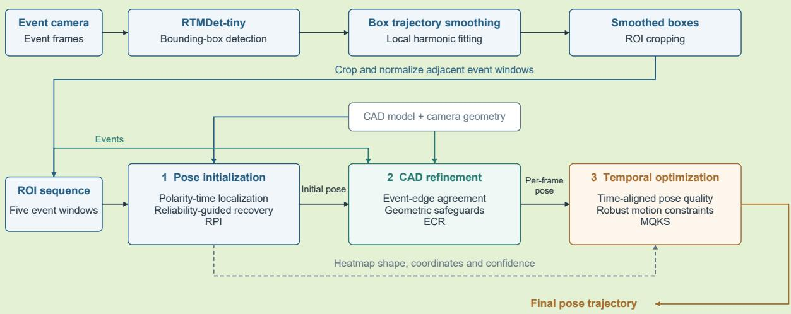
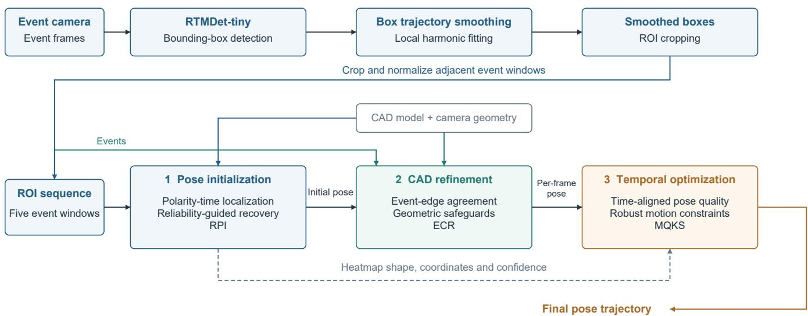
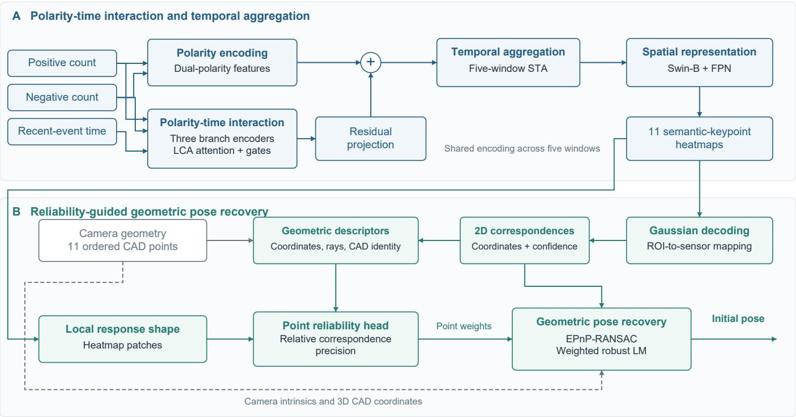
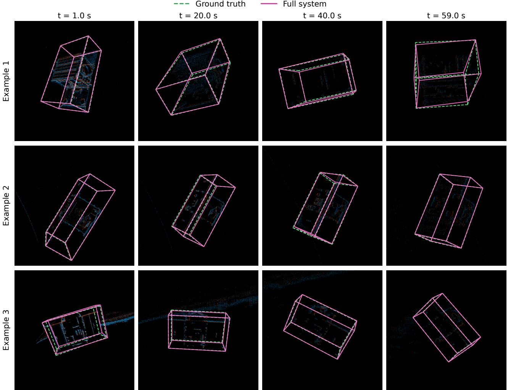
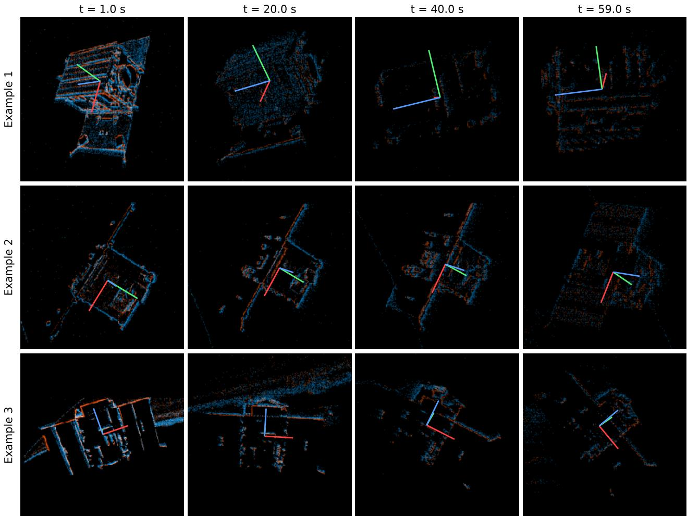
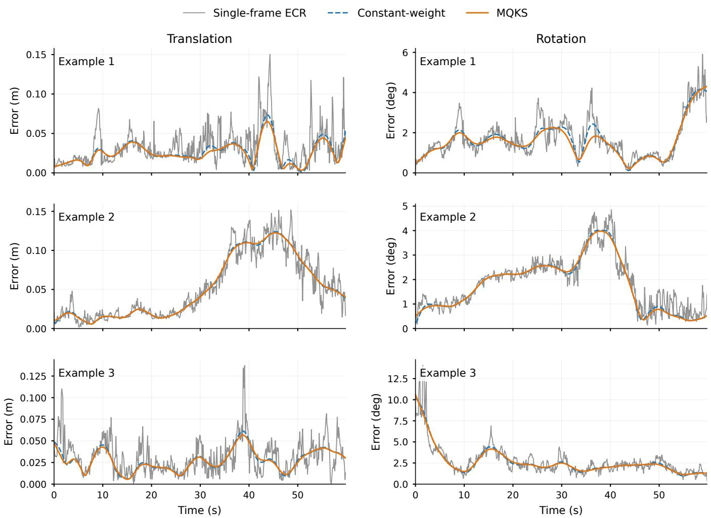

# Polarity–Time Interaction and Multi-Level Reliability for Event-Based Spacecraft Pose Estimation

Yonglong Zhang, Zongwu Xie, and Yang Liu

Abstract— Sparse event responses produce uneven keypoint errors whose effects on spacecraft pose depend on correspondence geometry and the reliability of successive observations. We present a reliability-aware framework connecting polarity–time localization, geometric recovery, event–CAD refinement, and trajectory optimization. A three-branch representation combines positive events, negative events, and recent-event timing through cross-branch attention and gating, followed by spatiotemporal aggregation. An ordered semantic-point head estimates relative correspondence precision for geometrically constrained pose recovery. Event-edge and CAD-projection agreement then guide local pose refinement under keypoint-geometry safeguards. At the sequence level, a ten-dimensional descriptor combines heatmap shape, reprojection consistency, and geometric conditioning to set time-aligned observation scales. On the official SPADES challenge test set, the complete system achieves a combined pose score of 0.0474, approximately 5.4% below PASAN+IRIS. Validation ablations reduce the score from 0.0772 for base localization with uniform PnP to 0.0514 for the complete cascade; on identical single-frame observations, quality weighting reduces the score from 0.0549 with constant-weight optimization to 0.0514.

Index Terms— Event camera, Spacecraft pose estimation, Cross-branch interaction, Keypoint reliability, CAD refinement, Quality-aware trajectory optimization

## I. INTRODUCTION

Non-cooperative spacecraft pose estimation provides relative geometric information for rendezvous and docking, on-orbit inspection, and space servicing. Given a target CAD model, a vision system can localize semantic keypoints and recover rota tion and translation from two-dimensional-to-three-dimensional correspondences. Illumination changes, shadows, and missing local structure make the quality of these observations spatially nonuniform. An event camera asynchronously reports the location, polarity, and time of brightness changes, providing fine-grained temporal measurements for dynamic targets [1]. Pose-estimation methods must therefore operate on sparse spatial responses whose distribution changes with motion.

Research on event-based spacecraft pose estimation has addressed event representation, geometric recovery, and temporal processing. SPADES established a dataset and evaluation baselines [2]. Polarity decoupling and spatiotemporal aggregation organize localization evidence across adjacent event windows [3], while keypoint-based initialization can be connected to model-projection matching and kinematic smoothing [4]. Other work has studied compact event representations and neuromorphic deployment [5]. Together, these studies show that event-based localization can establish semantic correspondences through learned features and constrain pose through known geometry and temporal relationships.

The central challenge is to assign influence to measurements according to their effect on pose recovery. A sharp heatmap response describes local concentration, while the pose error induced by that correspondence also depends on its camera ray and configuration relative to the other CAD points. At refinement time, agreement with sparse event edges must be assessed together with keypoint geometry and sensitivity to projection sampling. At the sequence level, refinement changes reprojection residuals and geometric conditioning, so the quality used for temporal fusion must describe the final observation. These issues connect correspondence weighting, candidate acceptance, and trajectory weighting through the reliability of the measurements entering each stage.

We address these issues through reliability-aware pose initialization (RPI), event–CAD consistency refinement (ECR), and multi-source quality-aware kinematic smoothing (MQKS). Polarity–time interaction supplies semantic keypoint observations; the proposed reliability mechanisms determine how those observations influence geometric recovery, which refined candidates are accepted, and how the resulting poses contribute to trajectory optimization. The contributions are:

1) Geometry-aware correspondence reliability. An ordered CAD11 context combines local heatmap shape, camera rays, and semantic geometry to predict relative point precision. A local pose-error propagation proxy complements localization-error likelihood, linking the learned weights to their effect on translation and rotation rather than heatmap concentration alone.

2) Geometrically safeguarded event–CAD refinement. A direction-reversal-invariant orientation moment and unitmass overlap score compare event and CAD structure. Candidate acceptance combines improvement over a same-pool geometric reference with keypoint-geometry bounds and agreement across two projection-integration resolutions, addressing event support and sampling sen sitivity within the refinement decision.

3) Quality weighting of final pose observations. A ten-dimensional descriptor combines heatmap shape, reprojection consistency, and geometric conditioning. Pose-dependent terms are recomputed after refinement, and separate translation and rotation scales weight the corresponding observations at their physical timestamps, adapting temporal fusion to variations in observation quality.

Validation experiments examine correspondence weighting on fixed coordinates, the aggregate contribution of ECR within the cascade, and quality weighting on identical pose observations. The complete system achieves a combined score of 0.0474 on the official SPADES challenge test set; on the validation set, MQKS reduces the score from 0.0549 with constant weighting to 0.0514.

## II. RELATED WORK

## A. Visual Spacecraft Pose Estimation

Visual spacecraft pose estimation recovers the target rotation and translation relative to the camera. With a known target model, methods broadly follow either direct pose regression or hybrid geometric estimation. Direct approaches predict pose parameters from image features, whereas hybrid approaches first estimate keypoints or other intermediate correspondences and then recover pose through a camera projection model. The latter link learned observations to explicit target geometry, making it possible to analyze the effects of two-dimensional localization and geometric recovery separately.

Spacecraft-specific studies illustrate both the value of intermediate geometry and the difficulty of transferring learned representations. SPNv2 combines keypoint prediction, direct pose regression, and foreground segmentation through a shared multi-scale encoder, and adapts normalization parameters by online foreground-entropy minimization [6]. SPEED+ complements synthetic training images with hardware-in-theloop observations under representative illumination, making the gap between synthetic supervision and measured images an explicit evaluation problem [7]. These studies motivate preserving geometric interpretation while testing reliability on the observation distribution where it will be used.

In keypoint-based hybrid frameworks, heatmap prediction and continuous coordinate decoding produce two-dimensional semantic measurements, while EPnP and RANSAC provide pose initialization and outlier rejection [8], [9]. Later work connects learning to geometric optimization. BPnP implicitly differentiates the PnP solution to propagate gradients to the observation network [10], and EPro-PnP learns two-dimensionalto-three-dimensional correspondences and their weights through probabilistic pose modeling [11]. These methods show that the effect of an intermediate measurement depends on its localization error, the geometric configuration, and how it enters the reprojection objective.

Observation reliability can also regulate the contribution of individual measurements to state estimation. Cassinis et al. combined heatmap-derived covariance with filter innovations for adaptive spacecraft navigation [12], while MAC-VO learns geometrically meaningful correspondence covariances for residual weighting in visual odometry [13]. We follow the hybrid learned-observation/geometric-recovery paradigm, modeling point-level reliability within each frame and poselevel observation quality across a sequence. These quantities act on geometric pose recovery and trajectory optimization, respectively.

## B. Event-Based Spacecraft Pose Estimation

Event cameras asynchronously record the location, polarity, and time of brightness changes, offering a distinct measurement modality for fast motion and high-dynamic-range scenes [1]. SPADES established data and evaluation protocols for eventbased spacecraft pose estimation and analyzed the effects of event representation, training-data processing, and geometric recovery [2]. Subsequent work has explored polarity and temporal modeling, event–model matching, motion constraints, and efficient deployment to convert sparse dynamic responses into stable spatial measurements [3]–[5].

For keypoint-based event pose estimation, Zeng et al. preserve differences between positive and negative events through polarity-aware interaction, align and aggregate adjacent windows, and combine PnP with kinematic smoothing [3]. Zhang et al. use a cascade of keypoint initialization, event– CAD matching, and trajectory smoothing, supplementing the semantic keypoints with consistency between event edges and model projections [4]. Deployment-oriented work has further examined compact networks, quantization, and neuromorphic hardware [5]. These studies illustrate the respective roles of event representation, model-based geometry, and motion optimization within a complete estimation pipeline.

These studies establish event representations, model matching, and motion constraints for spacecraft pose estimation. Our focus is how reliability enters the decisions connecting these operations: ordered CAD context and a pose-propagation proxy determine correspondence weights; a same-pool geometric reference and integration-consistency checks regulate eventsupported refinement; and quality computed from the final refined pose determines its temporal weight. The distinction lies in the measurement descriptors, learning objective, and acceptance and weighting rules at these interfaces.

## III. METHOD

## A. Problem Definition and Overall Framework

Given an event stream $\mathcal { E } = \{ ( x _ { i } , y _ { i } , t _ { i } , p _ { i } ) \}$ , camera intrinsics $K ,$ , a spacecraft CAD mesh $\mathcal { M } ,$ and 11 semantic points $\left\{ \mathbf { X } _ { m } \right\}$ , the objective is to estimate the object-to-camera pose sequence

$$
\begin{array} { c } { T _ { k } = ( R _ { k } , \mathbf { t } _ { k } ) , \quad R _ { k } \in S O ( 3 ) , } \\ { \mathbf { y } _ { k , m } = R _ { k } \mathbf { X } _ { m } + \mathbf { t } _ { k } , } \\ { \mathbf { u } _ { k , m } = \pi _ { K } \bigl ( \mathbf { y } _ { k , m } \bigr ) . } \end{array}\tag{1}
$$

The event stream first passes through target detection and bounding-box smoothing to define the spatial support for pose recovery. RTMDet-tiny detects the spacecraft in accumulated event frames. Local harmonic fitting then smooths the detected box-center and size trajectories, suppressing crop jitter caused by fluctuations in event support [3]. The resulting smoothed boxes determine the target regions cropped from the original event windows. This detection–smoothing–cropping sequence produces temporally consistent regions of interest (ROIs) for the subsequent keypoint network.

At reference time tk, five adjacent event windows are cropped using their corresponding smoothed boxes and mapped to a common ROI grid. The retained inverse ROI transforms map predicted keypoints back to sensor coordinates for geometric pose recovery. Within these crops, polarity and event-time cues establish local semantic correspondences, while adjacent windows provide temporal context.

Pose recovery from the ROI sequence comprises reliabilityaware pose initialization (RPI), event–CAD consistency refinement (ECR), and multi-source quality-aware kinematic smoothing (MQKS). RPI produces two-dimensional semantic points, point-level reliability, and an initial pose. ECR evaluates the agreement between that pose and the remaining event edges to obtain the final per-frame observation. MQKS derives quality scales from the observation and its heatmaps and jointly recovers the trajectory. Figure 1 organizes these stages as initialization, single-frame refinement, and trajectory optimization. Semantic correspondences establish the initial geometry, event–CAD agreement constrains the refined observation, and time-aligned quality controls its contribution to the trajectory.

Heatmap descriptors accompany the pose observations to support reliability estimation.

## B. Reliability-Aware Pose Initialization

1) Polarity–Time Interaction Encoding: Within each ROI obtained from the smoothed detections, positive- and negativepolarity counts preserve the spatial support of opposite brightness changes, while the most recent event time indicates the recency of the response at each location. Independent encoders first process the three inputs, after which crossbranch interaction combines their complementary structural and temporal evidence.

For window $W _ { j } = [ t _ { j } ^ { - } , t _ { j } ^ { + } )$ , let the positive- and negativepolarity counts at ROI pixel u be $C _ { i } ^ { + } ( \mathbf { u } )$ and $C _ { j } ^ { - } \left( \mathbf { u } \right)$ . Fixed logarithmic compression produces $\bar { C } _ { j } ^ { + }$ and $\bar { C } _ { j } ^ { - }$ , and the most recent event-time channel is defined as

$$
A _ { j } ( \mathbf { u } ) = \left\{ \begin{array} { l l } { \displaystyle \operatorname* { m a x } _ { e _ { i } \mapsto \mathbf { u } } \frac { t _ { i } - t _ { j } ^ { - } } { t _ { j } ^ { + } - t _ { j } ^ { - } } , } & { \mathrm { i f ~ \mathbf { u } ~ r e c e i v e s ~ e v e n t s , } } \\ { 0 , } & { \mathrm { o t h e r w i s e . } } \end{array} \right.\tag{2}
$$

The per-window input is $I _ { j } = [ \bar { C } _ { j } ^ { + } , \bar { C } _ { j } ^ { - } , A _ { j } ]$

Three shallow encoders produce aligned feature maps $F _ { j } ^ { + } , F _ { j } ^ { - } , F _ { j } ^ { a }$ . Polarity-separated encoding and cross-window aggregation organize spatial and temporal evidence [3]. Within each window, channel cross-attention of the LCA/CAB form [14] connects the three branches through six directed edges. For target branch b and source branch $c ,$ queries are computed from the target, whereas keys and values are computed from the source:

$$
\begin{array} { l } { { \displaystyle M _ { b  c } = P _ { b  c } ^ { o } \Big [ \mathrm { s o f t m a x } ( \tau _ { b  c } \widehat { Q } _ { b } \widehat { K } _ { c } ^ { \top } ) V _ { c } \Big ] \mathrm { , } } } \\ { { \displaystyle \widetilde F _ { b } = F _ { b } + \frac { 1 } { 2 } \sum _ { c \neq b } M _ { b  c } . } } \end{array}\tag{3}
$$

In Eq. (3), queries and keys are normalized over the spatial dimension, and each head models cross-channel correlations. All directed edges read the pre-interaction features so that branch-update order cannot alter their information source.

Cross-branch attention exchanges information, whereas gating regulates the contribution of each branch. Channelwise gates $\alpha _ { b }$ are predicted from the three global branch descriptors and normalized across branches before constructing the residual:

$$
\begin{array} { r l } & { F _ { j } ^ { \mathrm { L C A } } = \mathrm { C o n c a t } _ { b \in \{ + , - , a \} } ( 3 \alpha _ { b } \odot \widetilde { F } _ { b } ) , } \\ & { ~ F _ { j } ^ { \mathrm { p o l } } = \Phi _ { \mathrm { d u a l } } ( [ F _ { j } ^ { + } , F _ { j } ^ { - } ] ) + P _ { 0 } ( F _ { j } ^ { \mathrm { L C A } } ) . } \end{array}\tag{4}
$$

$\Phi _ { \mathrm { d u a l } }$ preserves the learned dual-polarity localization path, and $P _ { 0 }$ is zero-initialized so that the new interaction begins as an identity-preserving residual. The three-branch parameters are shared across the five windows. The gated residual in Eq. (4) combines evidence within each window; STA in Eq. (5) handles displacement across windows.

  
Fig. 1. Event-based spacecraft pose estimation from detection to trajectory recovery. RTMDet-tiny detects the target, local harmonic fitting smooths the bounding-box trajectory, and the resulting boxes define the five-window ROI sequence. RPI establishes semantic correspondences and recovers an initial pose. ECR refines the pose using event–CAD agreement under geometric safeguards. MQKS combines the resulting observations with time-aligned quality and motion constraints to estimate the trajectory. Solid arrows denote the estimation flow and geometric inputs; the dashed arrow carries auxiliary quality information.

2) Spatiotemporal Aggregation and Keypoint Localization: Adjacent windows contain target responses at different times, so direct superposition can mix multiple locations of the same structure. STA uses the center window as an anchor, predicts sampling offsets to align neighboring features, and assigns temporal weights from the source and center descriptors:

$$
\begin{array} { r l } & { \qquad \widehat { F } _ { r } = \mathrm { W a r p } \left( F _ { k + r } ^ { \mathrm { p o l } } , \Psi _ { \mathrm { o f f } } ( [ F _ { k + r } ^ { \mathrm { p o l } } , F _ { k } ^ { \mathrm { p o l } } ] ) \right) , } \\ & { F _ { k } ^ { \mathrm { S T A } } = \rho \left( [ F _ { k } ^ { \mathrm { p o l } } , \displaystyle \sum _ { r = - 2 } ^ { 2 } \beta _ { r } \widehat { F } _ { r } ] \right) . } \end{array}\tag{5}
$$

The center feature remains unchanged. Each weight $\beta _ { r }$ is computed jointly from the aligned global descriptor and the center descriptor and normalized with a softmax over time. The most recent event-time channel captures response timing within a window, whereas STA establishes feature relationships across windows.

The aggregated features are processed by Swin-B [15] and an FPN [16], which fuses multi-scale features and predicts 11 semantic-keypoint heatmaps $H _ { k }$ . Figure 2 separates polarity– time feature formation from reliability-guided pose recovery. The interaction residual augments the polarity representation before STA; the resulting heatmaps supply both decoded coordinates and local response descriptors. Together with camera rays and ordered CAD points, these descriptors determine the relative precision used in geometric refinement. Channel configurations and coordinate transforms remain fixed across experiments. Localization adaptation combines ground-truth Gaussian heatmap supervision with teacher-heatmap retention and explicitly protects inherited peak locations and confidencebased point selection:

$$
\mathcal { L } _ { \mathrm { f r o n t } } = \mathcal { L } _ { \mathrm { G T } } + \mathcal { L } _ { \mathrm { K D } } + \lambda _ { \mathrm { p e a k } } \mathcal { L } _ { \mathrm { p e a k } } + \lambda _ { \mathrm { e n t r y } } \mathcal { L } _ { \mathrm { e n t r y } } .\tag{6}
$$

The first two terms of Eq. (6) are mean-squared errors over valid keypoints against the GT Gaussian and the frozen teacher heatmap. The protection reference $H _ { m } ^ { 0 }$ is the inherited localization path with the residual bypassed. Let $h _ { m } ( A ) =$ $\mathrm { m a x } _ { \mathbf { u } \in A }$ max $( H _ { m } ( \mathbf { u } ) , 0 )$ , and let $d _ { m } ( \mathbf { u } )$ be the sensor-space distance from a heatmap-cell center to the training GT projection. Define the peak-safe set $A _ { m }$ by $\begin{array} { r } { d _ { m } ( \mathbf { u } ) \leq e _ { m } ^ { 0 } , } \end{array}$ where $e _ { m } ^ { 0 }$ is the decoded reference error; also include the inherited argmax and the grid cell nearest the GT projection. For the unit-peak GT Gaussian $G _ { m }$ , use the attainable margin

$$
\mu _ { m } = \operatorname* { m i n } \{ [ g _ { m } ( A _ { m } ) - g _ { m } ( A _ { m } ^ { c } ) ] _ { + } , [ h _ { m } ^ { 0 } ( A _ { m } ) - h _ { m } ^ { 0 } ( A _ { m } ^ { c } ) ] _ { + } \} ,\tag{7}
$$

where $g _ { m } ( A ) = \operatorname* { m a x } _ { \mathbf { u } \in A } G _ { m } ( \mathbf { u } )$ and $[ x ] _ { + } = \operatorname* { m a x } ( x , 0 )$ . The peak loss is

$$
\mathcal { L } _ { \mathrm { p e a k } } = \frac { 1 } { N _ { v } } \sum _ { m \in \mathcal { V } } [ h _ { m } ( A _ { m } ^ { c } ) - h _ { m } ( A _ { m } ) + \mu _ { m } ] _ { + } ^ { 2 } .\tag{8}
$$

For confidence admission, let $B _ { m } = \{ \mathbf { u } : d _ { m } ( \mathbf { u } ) \leq 8 \ \mathrm { p x } \}$ and $c _ { 0 } = 0 . 3$ . Include the inherited peak in $B _ { m }$ when its decoded error is within 8 px. With $a _ { m } ^ { 0 } = \mathcal { H } [ h _ { m } ^ { 0 } ( \Omega ) \geq c _ { 0 } ]$ , the entry loss is

$$
\begin{array} { r l r } {  { \mathcal { L } _ { \mathrm { e n t r y } } = \frac { 1 } { N _ { v } } \sum _ { m \in \mathcal { V } } \{ a _ { m } ^ { 0 } [ c _ { 0 } - h _ { m } ( \Omega ) ] _ { + } ^ { 2 } } } \\ & { } & { + ( 1 - a _ { m } ^ { 0 } ) } \\ & { } & { \cdot [ h _ { m } ( B _ { m } ^ { c } ) - \operatorname* { m a x } ( h _ { m } ( B _ { m } ) , c _ { 0 } ) ] _ { + } ^ { 2 } \} . } \end{array}\tag{9}
$$

Here $N _ { v }$ counts valid training points, including the batch dimension. Empty-set maxima contribute no violation. These terms retain admitted reference points while permitting previously excluded points to enter through a geometrically accurate dominant response. All masks are detached from gradients and use GT only during training. During adaptation, the positive/negative encoders, dual-polarity fusion, STA, and localization tail are frozen; only the temporal branch, crossbranch interaction, gates, and residual projection are updated. Gradients still propagate through the frozen downstream operations. The teacher is used only during training, and inference requires a single localization network.

  
Fig. 2. Reliability-aware pose initialization. (A) Positive counts, negative counts, and recent-event timing interact through cross-branch attention and channel gates. The projected interaction residual is added to the polarity representation before five-window STA and spatial feature extraction. (B) Decoded semantic coordinates and local heatmap responses provide geometric and response-shape descriptors for point reliability. Predicted relative precision weights the geometric pose refinement.

3) Reliability-Guided Geometric Pose Recovery: Each heatmap is decoded into continuous coordinates by a bounded local Gaussian decoder. Following distribution-aware localization [17], it fits a quadratic model to the log response around the dominant peak and falls back to the local centroid when curvature or offset checks fail. The decoded coordinate is mapped through the inverse ROI transform to the sensordomain observation $\widehat { \mathbf { u } } _ { k , m }$ , while the heatmap peak provides the point-selection confidence.

The geometric solver must distinguish the contributions of individual correspondences. The reliability head takes coordinate heatmaps $H ^ { \mathrm { c o o r d } }$ and evidence heatmaps $H ^ { \mathrm { e v i d } }$ In the integrated network, both are obtained from the same heatmap predictions. Separate evidence sources are compared in the fixed-coordinate ablation. For each semantic point, a $5 \times 5$ patch centered on the evidence-map peak is normalized by its maximum. The 25 patch values are concatenated with two normalized ROI coordinates, a three-dimensional camera ray, three normalized CAD coordinates, the response maximum, and local entropy, giving a 35-dimensional descriptor. A twolayer point MLP produces 64 channels. Concatenating the 11 tokens in CAD order and projecting them to 128 channels provides the shared context for the scale readout. Cross-point context is then constructed in the fixed CAD11 semantic order, and a positive scalar scale $s _ { k , m }$ is predicted for each point. The ROI-domain scale is propagated to sensor coordinates as

$$
\Sigma _ { k , m } ^ { \mathrm { R O I } } = s _ { k , m } ^ { 2 } I _ { 2 } , \qquad \Sigma _ { k , m } ^ { \mathrm { c a m } } = B _ { k } \Sigma _ { k , m } ^ { \mathrm { R O I } } B _ { k } ^ { \top } ,\tag{10}
$$

where $B _ { k }$ is the linear component of the inverse ROI transform. The inverse covariance is normalized by the mean trace over selected points and eigenvalue-clipped to obtain the relative precision $\Lambda _ { k , m }$ . The scale transfer in Eq. (10) determines the relative contribution of each correspondence to the weighted objective in Eq. (11).

Using the EPnP-RANSAC estimate [8], [9] as the numerical initialization, we minimize the weighted robust objective

$$
\begin{array} { r } { \begin{array} { l } { T _ { k } ^ { 0 } = \arg \operatorname* { m i n } _ { T } \displaystyle \sum _ { m \in \mathcal { V } _ { k } } \rho _ { p } ( \mathbf { r } _ { k , m } ^ { \top } \Lambda _ { k , m } \mathbf { r } _ { k , m } ) , } \\ { \mathbf { r } _ { k , m } = \widehat { \mathbf { u } } _ { k , m } - \pi _ { K } ( T \mathbf { X } _ { m } ) . } \end{array} } \end{array}\tag{11}
$$

Here $\rho _ { p } ( z ) = \delta _ { p } ^ { 2 } \log ( 1 + z / \delta _ { p } ^ { 2 } )$ is the Cauchy penalty.

The solver uses at most 16 local rotation/translation updates, Cauchy scale $\delta _ { p } = 4$ pixels, and diagonal damping $\kappa = 1 0 ^ { - 4 }$ Each update is bounded by 0.05 in normalized translation and 0.2 rad in rotation; backtracking tests factors $1 , 1 / 2 , 1 / 4 , 1 / 8$ With a zero-initialized scale head, the relative precision reduces exactly to the identity under the adopted ROI convention, reproducing the uniform-weight solver. Invalid initial estimates retain the established validity flags and fallback rules.

Reliability learning and localization adaptation are performed in separate stages. With coordinates and local geometry fixed, the reliability head is supervised by a localization-error negative log-likelihood and a local pose-error propagation proxy:

$$
\begin{array} { r } { \mathcal { L } _ { \mathrm { r e l } } = \mathcal { L } _ { \mathrm { N L L } } + \lambda _ { \mathrm { p o s e } } \mathcal { L } _ { \mathrm { p r o x y } } . } \end{array}\tag{12}
$$

For ROI-domain coordinate error $\mathbf { e } _ { m } .$ , the supervised likelihood is

$$
\mathcal { L } _ { \mathrm { N L L } } = \frac { 1 } { 2 N _ { v } } \sum _ { m \in \mathcal { V } } \left( \mathbf { e } _ { m } ^ { \top } \Sigma _ { m } ^ { - 1 } \mathbf { e } _ { m } + \log \operatorname* { d e t } \Sigma _ { m } + 2 \log ( 2 \pi ) \right) .\tag{13}
$$

For the pose proxy, fix a valid predicted pose $\widetilde { T }$ and its confidence-selected support. Let $J _ { m }$ be the projection Jacobian with respect to additive camera translation and left rotation, and let $D = \mathrm { d i a g } ( \operatorname* { m a x } ( \lvert \lvert \widetilde { \mathbf { t } } \rvert \rvert , 1 ) I _ { 3 } , I _ { 3 } )$ normalize translation. Define $\bar { J } _ { m } = J _ { m } D$ , the predicted reprojection residual ${ \bf r } _ { m }$ , and the training target $\mathbf { d } _ { m } = \mathbf { u } _ { m } ^ { * } - \widehat { \mathbf { u } } _ { m }$ . With relative precision $\Lambda _ { m }$

$$
\begin{array} { l } { { \displaystyle { W _ { m } = \frac { \Lambda _ { m } } { 1 + { \bf r } _ { m } ^ { \top } \Lambda _ { m } { \bf r } _ { m } / \delta _ { p } ^ { 2 } } } , } } \\ { { \displaystyle ~ A = \sum _ { m } \bar { J } _ { m } ^ { \top } W _ { m } \bar { J } _ { m } , \qquad { \bf b } = \sum _ { m } \bar { J } _ { m } ^ { \top } W _ { m } { \bf d } _ { m } , } } \\ { { \displaystyle ~ \delta \xi = \big [ A + \kappa \mathrm { d i a g } \big ( \operatorname* { m a x } ( \mathrm { d i a g } A , 1 0 ^ { - 8 } ) \big ) \big ] ^ { - 1 } { \bf b } . } } \end{array}\tag{14}
$$

The proxy penalizes the propagated, dimensionless translation and rotation components:

$$
\mathcal { L } _ { \mathrm { p r o x y } } = \mathrm { m e a n } _ { k \in \mathcal { V } _ { f } } \left( \frac { \| \delta \pmb { \xi } _ { k , t } \| ^ { 2 } } { c _ { t } } + \frac { \| \delta \pmb { \xi } _ { k , R } \| ^ { 2 } } { c _ { R } } \right) .\tag{15}
$$

The scales $c _ { t } , c _ { R }$ are mean squared propagated errors under identity precision on 256 fixed training examples. On that same batch, $\lambda _ { \mathrm { p o s e } } ~ = ~ \| \nabla _ { \theta } \mathcal { L } _ { \mathrm { N L L } } \| / \| \nabla _ { \theta } \mathcal { L } _ { \mathrm { p r o x y } } \|$ is computed once and frozen. Jacobians and support are prediction-derived; GT supplies $\mathbf { d } _ { m }$ . The linear system in Eq. (14) and the loss in Eq. (15) train the reliability head; inference uses Eq. (11).

At this point, the semantic correspondence establishes the initial pose. The keypoint solution has not yet explicitly tested the consistency of the remaining event edges with the CAD projection, and the next stage uses these structures to supplement the single-frame constraints.

## C. Geometrically Constrained Event–CAD Pose Refinement

1) Event-Edge and Model-Projection Consistency: Event edges arise from brightness-change responses, whereas model projections arise from geometric rendering; their magnitudes and direction signs are therefore not directly comparable. We construct the observation map with the EROS sequential surface [18] and render visible CAD faces with a fixed normal-based intensity proxy. Both use the same evaluation grid and an initialpose-dependent mask that remains fixed across candidates. Orientation agreement and Soft-IoU provide complementary measures of model-edge consistency [4]. Here, directionreversal-invariant orientation moments and unit-mass normal ization define the comparison used for candidate acceptance.

For either image, let g be its Sobel gradient, $a = \operatorname* { m i n } ( \| \mathbf { g } \| , 1 )$ the clipped magnitude, and n the unit direction at nonzerogradient locations. Magnitude and orientation moments are computed over the same neighborhood:

$$
\begin{array} { r l } & { S = { \mathcal G } _ { \sigma _ { e } } * a , \qquad J = { \mathcal G } _ { \sigma _ { e } } * ( a { \bf n n } ^ { \top } ) , } \\ & { { \bf q } = \frac { ( J _ { 1 1 } - J _ { 2 2 } , 2 J _ { 1 2 } ) ^ { \top } } { { \mathrm { t r } } J } , \qquad c = \| { \bf q } \| . } \end{array}\tag{16}
$$

Locations with zero support are assigned zero. The orientation moment and magnitude share the same support, so tr $J = S$ . The double-angle representation q is invariant to direction reversal, and c measures local orientation coherence. Event–CAD orientation affinity is

$$
\begin{array} { r } { A _ { E C } = \frac 1 2 ( c _ { E } c _ { C } + \mathbf { q } _ { E } ^ { \top } \mathbf { q } _ { C } ) . } \end{array}\tag{17}
$$

Applying the fixed mask gives magnitudes $a _ { E } , a _ { C }$ , which are separately normalized to unit mass as $p _ { E } , p _ { C }$ . Orientation and distribution agreement are then defined as

$$
\begin{array} { c } { { D ( T ) = \displaystyle \frac { \sum _ { \mathbf { u } } a _ { E } a _ { C } A _ { E C } } { \sqrt { ( \sum _ { \mathbf { u } } a _ { E } ^ { 2 } ) ( \sum _ { \mathbf { u } } a _ { C } ^ { 2 } ) } } , } } \\ { { U ( T ) = \displaystyle \frac { \sum _ { \mathbf { u } } \operatorname* { m i n } ( p _ { E } , p _ { C } ) } { \sum _ { \mathbf { u } } \operatorname* { m a x } ( p _ { E } , p _ { C } ) } , } } \\ { { S _ { \mathrm { E C R } } ( T ) = \lambda _ { D } D ( T ) + \lambda _ { U } U ( T ) . } } \end{array}\tag{18}
$$

The score in Eq. (18) compares spatial distributions through unit-mass normalization, and the unsigned orientation moment prevents opposite edge signs from being treated as geometric disagreement. The rendered CAD projection is area-integrated at the pixel level before gradients are computed, reducing sensitivity to boundary sampling. Event-based acceptance is disabled when valid magnitude or coherent-orientation support is absent. The integration levels and numerical parameters are fixed before candidate evaluation.

2) Candidate Selection under Geometric Constraints: ECR follows three operations: compute consistency, restrict the candidate set by keypoint geometry, and accept an eventsupported update or fall back. Local pose perturbations form a common pool $\mathcal { P } _ { k } ;$ chronological and reverse-time surfaces guide proposals with the same proposal score. Final acceptance uses the chronological orientation-moment score. A candidate is admissible only if it respects the fixed robust reprojection cost, projected-displacement, pose-increment, and conditioning bounds. The same-pool geometric reference is

$$
T _ { k } ^ { G } = \arg \operatorname* { m i n } _ { T \in \mathcal { P } _ { k } } C _ { \mathrm { g e o } } ( T ) ,\tag{19}
$$

where $C _ { \mathrm { g e o } }$ is the mean robust cost of initially trusted keypoints. Event acceptance requires an improvement over both $T _ { k } ^ { 0 }$ and $T _ { k } ^ { G }$ , nondecreasing orientation and overlap terms, and an identical selected candidate at two common areaintegration resolutions. The resolutions are fixed from reference convergence before candidates are compared. This test prevents a gain caused only by a different integration precision.

The geometric reference in Eq. (19) yields the final selection rule

$$
\begin{array} { r } { T _ { k } ^ { \mathrm { o b s } } = \left\{ \begin{array} { l l } { T _ { k } ^ { E } , } & { \mathrm { i f ~ a l l ~ e v e n t ~ a n d ~ g e o m e t r i c ~ t e s t s ~ p a s s } , } \\ { T _ { k } ^ { G } , } & { \mathrm { i f ~ } T _ { k } ^ { E } \mathrm { ~ f a i l s ~ a n d ~ } T _ { k } ^ { G } \mathrm { ~ i s ~ v a l i d } , } \\ { T _ { k } ^ { 0 } , } & { \mathrm { i f ~ g e o m e t r i c ~ s u p p o r t ~ i s ~ i n s u f f i c i e n t } . } \end{array} \right. } \end{array}\tag{20}
$$

The candidate pool is rebuilt at the current RPI output, and invalid initial observations retain their validity flags. The geometric reference makes each accepted event update conditional on improvement beyond keypoint-only selection.

After refinement, there are still differences in edge support and geometric reliability at each moment. The next stage adjusts its trajectory constraint strength based on the final observation quality.

## D. Multi-Source Quality-Aware Trajectory Optimization

1) Quality Description and Scale Calibration: Single-frame refinement does not imply equal reliability across time. We combine heatmap response, reprojection consistency, and projectedgeometry conditioning into a pose-level quality descriptor that differentiates the contribution of each observation to trajectory recovery.

The quality vector contains geometric scales and conditioning, reprojection statistics, heatmap shape, and solver validity:

$$
\phi _ { k } = [ \phi _ { k } ^ { \mathrm { g e o } } , \phi _ { k } ^ { \mathrm { r e p } } , \phi _ { k } ^ { \mathrm { h e a t } } , \upsilon _ { k } ] \in \mathbb { R } ^ { 1 0 } .\tag{21}
$$

The geometric descriptor is constructed from the projection Jacobian and pixel covariances derived from local heatmap second moments. After translation normalization, the local information matrix is stabilized, inverted, and inflated according to reprojection residuals, yielding separate translation and rotation scales. This heatmap-moment proxy is distinct from the point-level task scale learned by RPI.

Quality must describe the final pose entering trajectory optimization. When ECR changes an observation, pose-dependent reprojection and geometry terms are recomputed, whereas the four heatmap-shape terms are retained. The same ten-feature definition is used for calibration and inference.

The three geometric entries are the logarithms of the translation and rotation scales and the condition number of the normalized information matrix. Each scale is the square root of one third of its covariance-block trace; the condition number is clipped to $[ 1 , 1 0 ^ { 1 2 } ]$ . Two reprojection entries encode $\mathrm { l o g } ( 1 + \mathrm { m e d i a n } _ { m } \left. \mathbf { r } _ { m } \right. )$ and the fraction of points with confidence at least 0.3 and residual at most 8 px, using confidence-only support when fewer than four points survive.

The four heatmap entries are the mean peak response, normalized local entropy, secondary-to-primary peak ratio, and local-to-total response mass. Local statistics use a clipped $9 \times 9$ neighborhood around each peak and are averaged over the semantic points; entropy is divided by the logarithm of the neighborhood size. Peak responses and secondary ratios are clipped to [0, 1]. A binary solver-validity indicator completes the descriptor.

Translation and rotation error scales are calibrated separately. Let $\phi _ { k }$ be the standardized, clipped feature vector augmented with an intercept. Log-domain ridge regression on squared errors followed by radial scale correction gives

$$
\widehat { \sigma } _ { k , c } = \sqrt { \gamma _ { c } \exp ( \beta _ { c } ^ { \top } \widetilde { \phi } _ { k } ) } , \qquad c \in \{ t , R \} .\tag{22}
$$

Regression and radial correction use calibration data. Feature inputs and output scales are clipped to fixed training-derived

ranges; at runtime, quality is computed from observations alone. Using the median calibration scale $\sigma _ { c } ^ { \mathrm { a n c } }$ as an anchor yields the relative observation weight

$$
r _ { k , c } = \mathrm { c l i p } [ ( \widehat \sigma _ { k , c } / \sigma _ { c } ^ { \mathrm { a n c } } ) ^ { \eta } , r _ { \mathrm { m i n } } , r _ { \mathrm { m a x } } ] , \qquad w _ { k , c } = v _ { k } r _ { k , c } ^ { - 2 } .\tag{23}
$$

The weights in Eq. (23) enter the observation residual in Eq. (24) at the same physical timestamp. Recomputing posedependent terms keeps the descriptor consistent with the final single-frame estimate, while temporal alignment ensures that every predicted scale weights its corresponding observation.

2) Quality-Weighted Robust Motion Optimization: We use $\mathrm { L o g } ( R ) = ( \log R ) ^ { \vee } \in \mathbb { R } ^ { 3 }$ for the rotation vector. Trajectory states are parameterized by additive translation and leftmultiplicative rotation increments about the final per-frame observations. The numerical start uses Gaussian-smoothed translations and continuous relative rotation vectors with a four-frame standard deviation. Observation factors retain the individual measurements, while motion factors constrain changes in consecutive translation and rotation increments:

$$
\mathbf { r } _ { k } ^ { \mathrm { o b s } } = \left[ \sqrt { w _ { k , t } } ( \mathbf { t } _ { k } - \mathbf { t } _ { k } ^ { \mathrm { o b s } } ) / s _ { t } \right. \qquad { \mathrm { , } }\tag{24}
$$

$$
\Delta R _ { k } = R _ { k + 1 } R _ { k } ^ { - 1 } , \qquad { \bf r } _ { k } ^ { \mathrm { m o t } } = \left[ \begin{array} { c } { ( { \bf t } _ { k + 2 } - 2 { \bf t } _ { k + 1 } + { \bf t } _ { k } ) / m _ { t } } \\ { \mathrm { L o g } ( \Delta R _ { k + 1 } \Delta R _ { k } ^ { - 1 } ) / m _ { R } } \end{array} \right] .\tag{25}
$$

The final optimization is

$$
\operatorname* { m i n } _ { \{ R _ { k } , \mathbf { t } _ { k } \} } \sum _ { k } \rho _ { h } ( \| \mathbf { r } _ { k } ^ { \mathrm { o b s } } \| _ { 2 } ) + \sum _ { k } \rho _ { h } ( \| \mathbf { r } _ { k } ^ { \mathrm { m o t } } \| _ { 2 } ) .\tag{26}
$$

In $\mathrm { E q . } ~ ( 2 6 ) , ~ \rho _ { h }$ is a Huber penalty applied to each joint sixdimensional residual block. Invalid observations receive zero observation weight; their missing observations are interpolated before numerical initialization and their states are constrained by the motion factors. The trajectory is solved by sparse nonlinear least squares, and the motion scales correspond to second-order differences at the fixed sampling interval.

Point-level reliability shapes each single-frame solution through projection constraints, whereas pose-level quality controls the temporal contribution of the resulting observation. Motion factors couple observations of different quality into a continuous trajectory, completing the path from event-based semantic correspondence to sequential pose estimation.

## IV. EXPERIMENTS

## A. Experimental Setup

Dataset and evaluation splits. Experiments are organized on SPADES, which provides event observations of the Proba-2 spacecraft, camera calibration, a CAD model, and pose annotations [2]. The dataset description in Zhang et al. includes 300 synthetic trajectories containing 179,400 frames and 31 laboratory trajectories containing 15,500 frames [4]. The proposed method uses events as its visual input and known camera–CAD geometry for pose recovery.

The evaluation separates validation ablations from the final test comparison. All proposed-method ablations use one predefined validation partition, with training and qualitycalibration data kept separate from evaluation trajectories. The final checkpoint and inference settings are fixed before test evaluation. Table I reports the complete-system test result alongside the published challenge scores [3], [4]. The validation studies examine the aggregate effects of the cascade stages in Table II, localization and correspondence weighting in Table III, and observation-quality weighting in Table IV. Table V evaluates the accuracy–runtime trade-off of temporal context.

Evaluation metrics. Translation and rotation errors are

$$
\begin{array} { r l } & { e _ { t , k } = \frac { \| \widehat { \mathbf { t } } _ { k } - \mathbf { t } _ { k } ^ { * } \| _ { 2 } } { \| \mathbf { t } _ { k } ^ { * } \| _ { 2 } } , } \\ & { e _ { R , k } = 2 \operatorname { a r c c o s } ( \operatorname { c l i p } ( | \langle \widehat { q } _ { k } , q _ { k } ^ { * } \rangle | , 0 , 1 ) ) . } \end{array}\tag{27}
$$

The reported challenge metric sets translation errors below 0.002173 and rotation errors below $0 . 1 6 9 ^ { \circ }$ to zero. Frameaveraged translation and rotation scores are denoted by $E _ { t }$ and $E _ { R } ,$ , with rotation expressed in radians; the combined score is $E _ { \mathrm { p o s e } } = E _ { t } + E _ { R }$ . Lower scores indicate better performance. Pose-recovery failures are retained under the fixed evaluation policy. Per-seed results and trajectory-clustered paired intervals support comparisons of our configurations. External baseline scores are taken from the cited studies.

Implementation details. The default front end uses five event windows, positive and negative count branches, a recentevent-time branch, cross-branch attention and gating, and STA. It predicts 11 semantic heatmaps and relative correspondence precision for geometric recovery. ECR and MQKS follow the formulation in Section 3.

Internal comparisons use matched data, model-selection rules, and training budgets. Front-end variants are trained with their respective architectures; subsequent ECR comparisons share the same RPI outputs. Temporal comparisons use complete sequences. Quality mappings are fitted according to the same calibration procedure for the corresponding observation stream and frozen during evaluation. External methods retain their published processing pipelines. Table V reports the measured per-frame runtime for each temporal-window configuration; the default five-window system requires 52.7 ms/frame.

## B. Comparison with Existing Methods

Table I compares complete pipelines on the official SPADES challenge test set. PASAN+IRIS represents polarity-aware temporal localization followed by kinematic smoothing, while the RF-DETR cascade combines keypoint initialization, photometric refinement, and trajectory smoothing [3], [4]. The other entries retain their leaderboard team names. The complete RPI–ECR–MQKS system obtains $E _ { t } = 0 . 0 1 3 8 , E _ { R } = 0 . 0 3 3 6$ and $E _ { \mathrm { p o s e } } = 0 . 0 4 7 4$ , the lowest combined score among the listed methods. Relative to PASAN+IRIS, the combined score decreases by approximately 5.4%, with reductions in both translation and rotation. The RF-DETR cascade retains a slightly lower rotation score of 0.0331.

## C. Ablation Studies

1) Contributions of the Cascade Stages: Table II evaluates the progression from base localization and uniform geometric recovery to RPI, ECR, and MQKS. The RPI row tests the combined localization and correspondence-reliability design. Adding ECR measures single-frame structural refinement, while RPI+MQKS isolates temporal optimization without refinement. Comparing RPI+MQKS with the complete cascade determines whether the refinement gain persists in the final trajectory. ECR-enabled and ECR-disabled configurations share their RPI predictions, and MQKS is evaluated over complete continuous sequences.

RPI lowers the combined score from 0.0772 to 0.0697, and ECR further reduces it to 0.0674. The complete cascade reaches 0.0514, approximately 33.4% below the base configuration. Compared with RPI+MQKS at 0.0529, adding ECR lowers the final score to 0.0514, showing that its aggregate gain persists after temporal optimization.

2) Three-Branch Interaction and Reliability-Guided Recovery: Table III isolates the main front-end changes while retaining STA in every configuration. The dual-polarity baseline uses uniform geometric weights. The next three configurations introduce recent-event timing, cross-branch attention, and gating in sequence. They use the same coordinate decoder and uniform-weight geometric solver, so the comparison concerns localization. The final three rows share the full interaction network’s heatmaps and coordinates: uniform weights are compared with learned reliability trained using localizationerror likelihood alone and with the additional pose-propagation proxy. ECR and MQKS are disabled throughout this study.

Under uniform geometric weighting, recent-event timing, cross-branch attention, and gating progressively reduce the combined score from 0.0772 to 0.0762, 0.0739, and 0.0729. With the full interaction network fixed, NLL-based weighting yields 0.0716, and adding the pose-propagation proxy lowers the score to 0.0697. The results identify separate gains from the localization changes and the subsequent correspondence weighting.

3) Contributions of Multi-Source Quality: Table IV separates the effect of motion smoothing from the information used to weight observations. Every row receives the same singleframe poses. Constant-weight optimization establishes the contribution of temporal constraints alone. Heatmap quality and geometry quality use their respective descriptor subsets; full MQKS combines them. The geometry subset comprises reprojection consistency and geometric conditioning. All quality mappings follow the same calibration procedure, and all smoothed configurations retain the same motion factors, initialization, solver, and optimization budget.

Constant-weight optimization reduces the combined score from 0.0674 to 0.0549, accounting for most of the improvement over single-frame estimates. Heatmap-quality and geometryquality optimization yield 0.0536 and 0.0522, respectively, while full MQKS reaches 0.0514. Quality weighting therefore provides an additional reduction of approximately 6.4% relative to constant-weight optimization.

## D. Temporal Window Analysis

Table V compares 1, 3, 5, 7, and 9 input windows for the proposed method. The comparison uses matched training budgets and unchanged recovery, refinement, and smoothing settings. Translation, rotation, combined error, and per-frame runtime quantify the trade-off between temporal context and computation. This analysis evaluates the default five-window choice without introducing an additional architecture search.

TABLE I  
COMPARISON ON THE OFFICIAL SPADES CHALLENGE TEST SET [3], [4]. LOWER SCORES INDICATE BETTER PERFORMANCE.
<table><tr><td>Method / reported team</td><td> $E _ { t }$ </td><td> $E _ { R }$ </td><td> $E _ { \mathrm { p o s e } }$ </td></tr><tr><td>PASAN+IRIS</td><td>0.0146</td><td>0.0355</td><td>0.0501</td></tr><tr><td>RF-DETR cascade</td><td>0.0230</td><td>0.0331</td><td>0.0561</td></tr><tr><td>haoranhuang</td><td>0.1464</td><td>0.5562</td><td>0.7026</td></tr><tr><td>pruthj</td><td>0.1335</td><td>0.9101</td><td>1.0436</td></tr><tr><td>csu nuaa pang</td><td>0.3340</td><td>0.7724</td><td>1.1064</td></tr><tr><td>zhaoyutao22</td><td>0.1959</td><td>1.0607</td><td>1.2565</td></tr><tr><td>Kashyap Hegde Kota</td><td>0.1121</td><td>1.1767</td><td>1.2888</td></tr><tr><td>Proposed complete system</td><td>0.0138</td><td>0.0336</td><td>0.0474</td></tr></table>

TABLE II  
STAGE-WISE ABLATION ON THE VALIDATION SET.
<table><tr><td>Configuration</td><td> $E _ { t }$ </td><td> $E _ { R }$ </td><td> $E _ { \mathrm { p o s e } }$ </td></tr><tr><td>Base localization + uniform PnP</td><td>0.0208</td><td>0.0564</td><td>0.0772</td></tr><tr><td>RPI</td><td>0.0191</td><td>0.0506</td><td>0.0697</td></tr><tr><td> $\mathrm { R P I } + \mathrm { E C R }$ </td><td>0.0185</td><td>0.0489</td><td>0.0674</td></tr><tr><td> $\mathbf { R P I } + \mathbf { M Q K S }$ </td><td>0.0154</td><td>0.0375</td><td>0.0529</td></tr><tr><td> $\mathrm { R P I } + \mathrm { E C R } + \mathrm { M Q K S }$ </td><td>0.0150</td><td>0.0364</td><td>0.0514</td></tr></table>

Increasing the context from one to five windows reduces the combined score from 0.0677 to 0.0514, while runtime rises from 36.8 to 52.7 ms/frame. Seven windows give a similar combined score of 0.0515 at 61.3 ms/frame: translation improves slightly, whereas rotation error increases. Nine windows raise the combined score to 0.0523 and runtime to 70.2 ms/frame. Five windows thus provide the lowest combined score among the tested configurations at a lower cost than the longer contexts.

## E. Qualitative Results

Overall pose projections. Figure 3 compares ground-truth poses with the output of the full RPI–ECR–MQKS cascade on three preselected validation sequences. The projected CAD bounding box provides a common geometric reference for position, scale, and orientation. Four fixed timestamps are shown for each sequence, with the same image coordinates used for both projections. The display includes a fixed margin around the original ROI to show the projected box; this visualization margin does not change the network input or the estimated pose.

Front-end pose visualization. Figure 4 displays the single frame pose observations returned by event–CAD refinement (ECR), before MQKS temporal optimization. The estimated object coordinate axes are projected onto the corresponding event ROIs for three sequences at four fixed timestamps. This view presents the front-end pose output directly in the input image coordinates.

Continuous-sequence errors. Figure 5 uses the same three sequences as Figure 3 and compares the single-frame ECR observations, constant-weight optimization, and MQKS over all 599 timestamps. The two temporal variants receive identical observations and use the same motion and robust-loss settings; they differ in observation-quality weighting. Translation error is $\lVert \hat { \mathbf { t } } _ { k } - \mathbf { t } _ { k } ^ { \mathrm { G T } } \rVert _ { 2 }$ in meters, and rotation error is the geodesic angle between the estimated and ground-truth rotations in degrees. These unthresholded errors are distinct from the normalized scores in the tables.

Both temporal variants reduce rapid fluctuations, while the sustained error around the middle of Example 2 remains visible. MQKS provides a modest further reduction in mean rotation error relative to constant weighting in these examples, but does not uniformly reduce every instantaneous error peak. The curves therefore illustrate both temporal stabilization and residual bias; aggregate accuracy is assessed over the complete validation set.

## V. CONCLUSION

We present a framework for event-based spacecraft pose estimation that connects polarity–time localization, point-level reliability, geometrically constrained event–CAD refinement, and observation-quality-aware trajectory optimization. The semantic correspondence stage supplies a geometrically interpretable pose initialization, the refinement stage evaluates additional model-edge agreement, and the temporal stage regulates each pose observation using time-aligned quality.

The complete system achieves a combined pose score of 0.0474 on the official SPADES challenge test set, approximately 5.4% below PASAN+IRIS. On the validation set, the complete cascade reduces the score from 0.0772 to 0.0514, and quality weighting adds a 6.4% reduction over constant-weight optimization. The default five-window configuration attains a score of 0.0514 at 52.7 ms/frame, with longer contexts providing no further reduction in the combined score. The continuoussequence examples show reduced rapid fluctuations alongside persistent observation bias, identifying a remaining limitation of the trajectory estimates.

## DATA AVAILABILITY

The experiments use the public SPADES dataset [2].

TABLE III  
FRONT-END DESIGN ABLATION WITH STA FIXED AND ECR AND MQKS DISABLED. NLL DENOTES THE LOCALIZATION-ERROR LIKELIHOOD OBJECTIVE.
<table><tr><td>Event representation</td><td>Fusion</td><td>Geometric weighting</td><td> $E _ { t }$ </td><td> $E _ { R }$ </td><td> $E _ { \mathrm { p o s e } }$ </td></tr><tr><td>Positive / negative counts</td><td>Dual-branch fusion</td><td>Uniform</td><td>0.0208</td><td>0.0564</td><td>0.0772</td></tr><tr><td>Counts + recent-event time</td><td>Concatenation + projection</td><td>Uniform</td><td>0.0204</td><td>0.0558</td><td>0.0762</td></tr><tr><td>Counts + recent-event time</td><td>Cross-branch attention</td><td>Uniform</td><td>0.0200</td><td>0.0539</td><td>0.0739</td></tr><tr><td>Counts + recent-event time</td><td> ${ \mathrm { A t t e n t i o n + g a t i n g } }$ </td><td>Uniform</td><td>0.0197</td><td>0.0532</td><td>0.0729</td></tr><tr><td>Counts + recent-event time</td><td> ${ \mathrm { A t t e n t i o n + g a t i n g } }$ </td><td>Learned, NLL</td><td>0.0195</td><td>0.0521</td><td>0.0716</td></tr><tr><td>Counts + recent-event time</td><td> ${ \mathrm { A t t e n t i o n + g a t i n g } }$ </td><td>Learned, NLL + pose proxy</td><td>0.0191</td><td>0.0506</td><td>0.0697</td></tr></table>

  
Fig. 3. Full-system pose estimates on three preselected validation sequences, using seed 2026. Rows denote sequences and columns denote fixed timestamps. Green dashed and magenta solid lines show the CAD bounding box projected with the ground-truth and final estimated poses, respectively. Positive and negative events are orange and blue. All panels use a 448 × 448 display grid covering 1.5 times the original ROI side length.

TABLE IV  
QUALITY-SOURCE ABLATION ON IDENTICAL SINGLE-FRAME OBSERVATIONS.
<table><tr><td>Configuration</td><td> $E _ { t }$ </td><td> $E _ { R }$ </td><td> $E _ { \mathrm { p o s e } }$ </td></tr><tr><td>Single-frame poses</td><td>0.0185</td><td>0.0489</td><td>0.0674</td></tr><tr><td>Constant-weight optimization</td><td>0.0158</td><td>0.0391</td><td>0.0549</td></tr><tr><td>Heatmap-quality optimization</td><td>0.0156</td><td>0.0380</td><td>0.0536</td></tr><tr><td>Geometry-quality optimization</td><td>0.0152</td><td>0.0370</td><td>0.0522</td></tr><tr><td>MQKS</td><td>0.0150</td><td>0.0364</td><td>0.0514</td></tr></table>

TABLE V  
EFFECT OF INPUT WINDOW LENGTH ON THE PROPOSED SYSTEM.
<table><tr><td>Windows</td><td> $E _ { t }$ </td><td> $E _ { R }$ </td><td> $E _ { \mathrm { p o s e } }$ </td><td>ms/frame</td></tr><tr><td>1</td><td>0.0194</td><td>0.0483</td><td>0.0677</td><td>36.8</td></tr><tr><td>3</td><td>0.0162</td><td>0.0392</td><td>0.0554</td><td>44.6</td></tr><tr><td>5</td><td>0.0150</td><td>0.0364</td><td>0.0514</td><td>52.7</td></tr><tr><td>7</td><td>0.0149</td><td>0.0366</td><td>0.0515</td><td>61.3</td></tr><tr><td>9</td><td>0.0151</td><td>0.0372</td><td>0.0523</td><td>70.2</td></tr></table>

  
Fig. 4. Single-frame front-end pose estimates after ECR and before MQKS temporal optimization. Rows show three example sequences, and columns show four timestamps. Orange and blue pixels represent positive- and negative-polarity events, respectively. Red, green, and blue line segments denote the projected object-frame X, Y, and Z axes, with a common physical length across all panels.

  
Fig. 5. Continuous-sequence errors for the three examples in Figure 3, using seed 2026. Left: absolute translation error in meters. Right: rotation error in degrees. Gray curves show the single-frame ECR observations; blue dashed and orange solid curves show constant-weight optimization and MQKS, respectively. All 599 samples and error peaks are retained, without additional smoothing for visualization.

## REFERENCES

[1] G. Gallego, T. Delbruck, G. Orchard et al., “Event-based vision: A survey,” IEEE Transactions on Pattern Analysis and Machine Intelligence, vol. 44, no. 1, pp. 154–180, 2022.

[2] A. Rathinam, H. Qadadri, and D. Aouada, “SPADES: A realistic spacecraft pose estimation dataset using event sensing,” in IEEE International Conference on Robotics and Automation, 2024. [Online]. Available: https://arxiv.org/abs/2311.05310

[3] Y. Zeng, Y. Xiong, X. Wang, X. Zhang, H. Liu, Y. Chang, and L. Yan, “From spatiotemporal decoupling to kinematic smoothing: A robust pipeline for event-based spacecraft pose estimation,” in IEEE/CVF Conference on Computer Vision and Pattern Recognition Workshops, 2026. [Online]. Available: https://openaccess.thecvf.com/content/CVPR2026W/AI4Space/html/ Zeng From Spatiotemporal Decoupling to Kinematic Smoothing A Robust Pipeline for CVPRW 2026 paper.html

[4] X. Zhang, Z. Xu, B. Teng, Y. Wang, Y. Liu, T. Zhang, H. Zhang, J. Jia, P. Han, and C. Bian, “A cascaded architecture for illumination-robust 6-dof spacecraft pose estimation using event cameras,” in IEEE/CVF Conference on Computer Vision and Pattern Recognition Workshops, 2026. [Online]. Available: https://openaccess.thecvf.com/content/CVPR2026W/AI4Space/html/ Zhang A Cascaded Architecture for Illumination-Robust 6-DoF Spacecraft Pose Estimation Using CVPRW 2026 paper.html

[5] A. Rathinam, J. Lecomte, J. Reelsen, G. Lenz, A. von Arnim, and D. Aouada, “Efficient onboard spacecraft pose estimation with event cameras and neuromorphic hardware,” in IEEE/CVF Conference on Computer Vision and Pattern Recognition Workshops, 2026. [Online]. Available: https://arxiv.org/abs/2604.04117

[6] T. H. Park and S. D’Amico, “Robust multi-task learning and online refinement for spacecraft pose estimation across domain gap,” Advances in Space Research, 2023. [Online]. Available: https://arxiv.org/abs/2203.04275

[7] T. H. Park, M. Martens, G. Lecuyer, D. Izzo, and S. D’Amico,¨ “SPEED+: Next-generation dataset for spacecraft pose estimation across domain gap,” in IEEE Aerospace Conference, 2022. [Online]. Available: https://arxiv.org/abs/2110.03101

[8] V. Lepetit, F. Moreno-Noguer, and P. Fua, “EPnP: An accurate o(n) solution to the PnP problem,” International Journal of Computer Vision, vol. 81, pp. 155–166, 2009.

[9] M. A. Fischler and R. C. Bolles, “Random sample consensus: A paradigm for model fitting with applications to image analysis and automated cartography,” Communications of the ACM, vol. 24, no. 6, pp. 381–395, 1981.

[10] B. Chen, A. Parra, J. Cao, N. Li, and T.-J. Chin, “End-to-end learnable geometric vision by backpropagating PnP optimization,” in IEEE/CVF Conference on Computer Vision and Pattern Recognition, 2020. [Online]. Available: https://arxiv.org/abs/1909.06043

[11] H. Chen, P. Wang, F. Wang, W. Tian, L. Xiong, and H. Li, “EPro-PnP: Generalized end-to-end probabilistic perspective-n-points for monocular object pose estimation,” in IEEE/CVF Conference on Computer Vision and Pattern Recognition, 2022. [Online]. Available: https://arxiv.org/abs/2203.13254

[12] L. Pasqualetto Cassinis, T. H. Park, N. Stacey, S. D’Amico, A. Menicucci, E. Gill, I. Ahrns, and M. Sanchez-Gestido, “Leveraging neural network uncertainty in adaptive unscented kalman filter for spacecraft pose estimation,” Advances in Space Research, vol. 71, no. 12, pp. 5061– 5082, 2023.

[13] Y. Qiu, Y. Chen, Z. Zhang, W. Wang, and S. Scherer, “MAC-VO: Metricsaware covariance for learning-based stereo visual odometry,” 2025, revised version. [Online]. Available: https://arxiv.org/abs/2409.09479

[14] Q. Yan, Y. Feng, C. Zhang, G. Pang, K. Shi, P. Wu, W. Dong, J. Sun, and Y. Zhang, “HVI: A new color space for low-light image enhancement,” in IEEE/CVF Conference on Computer Vision and Pattern Recognition, 2025, pp. 5678–5687. [Online]. Available: https://openaccess.thecvf.com/ content/CVPR2025/html/Yan HVI A New Color Space for Low-light Image Enhancement CVPR 2025 paper.html

[15] Z. Liu, Y. Lin, Y. Cao et al., “Swin transformer: Hierarchical vision transformer using shifted windows,” in IEEE/CVF International Conference on Computer Vision, 2021. [Online]. Available: https://openaccess.thecvf.com/content/ICCV2021/html/ Liu Swin Transformer Hierarchical Vision Transformer Using Shifted Windows ICCV 2021 paper.html

[16] T.-Y. Lin, P. Dollar, R. Girshick, K. He, B. Hariharan, and S. Belongie, “Feature pyramid networks for object detection,” in IEEE Conference on Computer Vision and Pattern Recognition, 2017.

[Online]. Available: https://openaccess.thecvf.com/content cvpr 2017/ html/Lin Feature Pyramid Networks CVPR 2017 paper.html

[17] F. Zhang, X. Zhu, H. Dai, M. Ye, and C. Zhu, “Distribution-aware coordinate representation for human pose estimation,” in IEEE/CVF Conference on Computer Vision and Pattern Recognition, 2020. [Online]. Available: https://openaccess.thecvf.com/content CVPR 2020/ html/Zhang Distribution-Aware Coordinate Representation for Human Pose Estimation CVPR 2020 paper.html

[18] L. Gava, M. Monforte, M. Iacono, C. Bartolozzi, and A. Glover, “PUCK: Parallel surface and convolution-kernel tracking for event-based cameras,” 2022. [Online]. Available: https://arxiv.org/abs/2205.07657