# Proposing Better Rollouts for On-Policy Distillation

Sirui Chen1∗ Yunzhe Qi1∗ Haobo Xu1 Jiaru Zou2

Mengting Ai1 Zihao Li1 Jingrui He1

1University of Illinois Urbana-Champaign 2Stanford University {sirui6, yunzheq2}@illinois.edu

## Abstract

On-policy distillation (OPD) improves language-model post-training by letting the student learn from its own sampled trajectories under teacher supervision, aligning the training process with inference-time behavior. However, the rollout policy in OPD is usually treated as fixed: each round samples directly from the current student. We show that this choice can create a compounding teacher–student mismatch, because it requires the teacher to provide effective supervision on whichever trajectories the student samples, including ones less reachable by the teacher itself. On such trajectories, teacher supervision can become noisy or even misleading, leading to undesirable student patterns such as repetition. Moreover, since the updated student in turn defines the rollout policy of subsequent rounds, these patterns persist and potentially amplify over training. This failure mode suggests that improving OPD requires treating the rollout policy itself as an optimization target, rather than only modifying the distillation objective. We propose Mixture Proposal On-Policy Distillation (MPOPD), which derives a student-anchored, teacher-guided rollout distribution from a local trust-region objective based on relative teacher support. The resulting target is a geometric mixture of the student and teacher policies, and we introduce a proposal policy that approximates this mixture, enabling rollout generation in a single forward pass. Experiments on 16 math, knowledge, and medical reasoning benchmarks show consistent gains over OPD and recent variants. On math reasoning, our method improves average accuracy by 6.91 over OPD on Qwen3-4B-Base while reducing average generation length by 41%, suggesting that rollout policy design provides an effective way to improve OPD. Code is available at https://github.com/csr16/MPOPD.

## 1 Introduction

On-policy distillation [10, 1, 34] has emerged as an important post-training paradigm for large language models. Unlike standard knowledge distillation [12, 13, 61, 16] or supervised finetuning [44, 4], which train the student on teacher- or expert-generated data, OPD lets the student sample its own trajectories and then distills token-level teacher supervision on those trajectories. This makes the training distribution better match the student’s inference-time behavior, and has led to strong results in summarization, translation, and mathematical reasoning tasks [54, 34, 49]. Recent large-scale models including Qwen3.5, MiMo-V2, and DeepSeek-V4 have therefore adopted on-policy distillation as a core component of their post-training pipelines [46, 51, 6].

The fine-grained, on-policy supervision is what makes OPD powerful, but it also exposes OPD to a potential teacher–student support mismatch. Since trajectories are sampled from the student, the teacher is expected to provide token-level supervision not only on responses it would naturally generate, but also on student trajectories that often have low probability under the teacher. On such low-reachability trajectories, the teacher’s conditional token distribution can become noisy or even misleading. This mismatch can be self-reinforcing across distillation rounds. If a degenerate pattern receives insufficient penalty in one round, it can remain in the student’s high-probability region, be sampled again in later rounds, and receive similarly weak or noisy teacher supervision [53]. Recent studies [31] have observed related failure modes in OPD-trained students, including repetition [8, 10] and entropy collapse [24, 26]. These findings suggest that the effectiveness of OPD depends not only on using on-policy samples, but also on whether the teacher can provide reliable supervision on the particular regions of the student distribution visited during training.

We verify this compounding effect empirically. At selected training steps, we use the teacher to complete a student trajectory and a teacher trajectory from the same prompt.2 Fig. 1 shows two trends under OPD. First, the similarity between the two teacher completions drifts downward over training, with the 10th percentile dropping more sharply, indicating that a small but growing tail of student trajectories is rarely reachable under the teacher. Second, this drift also degrades completion quality. The fraction of prompts where the teacher’s completion from a student trajectory receives a lower PRM reward than its completion from its own trajectory grows steadily under both gap thresholds. Both trends are consistent with the mechanism above: once the student places probability on trajectories the teacher would rarely reach itself, subsequent rounds reinforce them, and the teacher– student mismatch persists across iterations.

To break this loop, we propose to optimize the rollout policy directly, shifting probability toward trajectories the teacher is more likely to reach while remaining close enough to the current student to maintain the on-policy nature. Concretely, we introduce a reweighting function based on relative teacher support, which upweights trajectories the teacher supports more strongly than the current

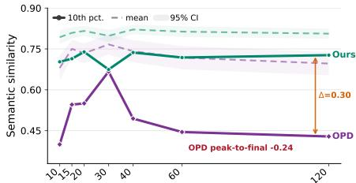

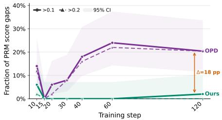  
Figure 1: Teacher–student mismatch compounds under OPD. Upper: 10th-percentile similarity between the two completions drops by 0.24 from its peak, while our method remains stable. Lower: fraction of prompts on which the former scores $> 0 . 1 0$ (solid) or $> 0 . 2 0$ (dashed) below the latter in PRM score; the former reaches ∼24% by the end of training, while our method keeps it near zero.

student. To stay close to on-policy behavior, we constrain this reweighting to a local trust region around the current student. Solving this problem yields a geometric mixture of the student and teacher policies, with a single scalar interpolating between on-policy and teacher-guided sampling. However, computing this mixture online requires running both the teacher and student at every decoding step, which is costly at scale. We therefore train a proposal policy to approximate it, so that rollouts need only a single forward pass. This gives our Mixture Proposal On-Policy Distillation (MPOPD), where the rollout policy is first derived as a geometric mixture of the student and teacher and then approximated by a proposal policy for efficient generation.

Prior efforts to improve OPD have mainly modified the distillation objective [21, 24, 57, 26], or adjusted the rollout policy via heuristic sampling [53, 10]. In contrast, we treat the rollout policy itself as an explicit optimization target, derived from a local trust-region principle and approximated by a learnable proposal policy for scalable generation. Fig. 1 shows that our method avoids the compounding mismatch, with 10th-percentile similarity 0.30 higher and PRM score gap fraction 18 points lower than OPD. We further evaluate MPOPD on 16 math, knowledge, and medical reasoning benchmarks. Across these tasks, MPOPD consistently outperforms OPD and recent variants. On math, it improves average accuracy over OPD by +1.46 on Qwen3-1.7B-Base and +6.91 on Qwen3-4B-Base, while reducing generation length by 41% at the 4B scale.

## 2 Setup: The Rollout Policy in On-Policy Distillation

Let D denote the prompt distribution over input problems $x ,$ and let V denote the vocabulary. A response trajectory is a token sequence $\tau = ( y _ { 1 } , \dots , y _ { j } , \dots , y _ { | \tau | } )$ with $y _ { j } \in \mathcal { V }$ , and a policy π defines the autoregressive distribution $\begin{array} { r } { \pi ( \tau \mid x ) = \prod _ { j = 1 } ^ { | \tau | } \pi ( y _ { j } \mid x , y _ { < j } ) } \end{array}$ . We denote the teacher policy by $\pi ^ { \star }$

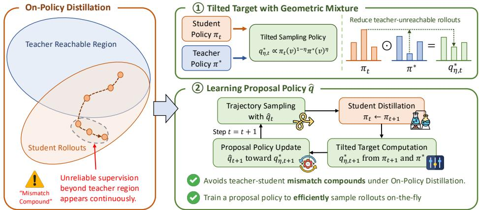  
Figure 2: Overview of MPOPD. Left: Standard on-policy distillation suffers from compounding teacher–student mismatch, where student rollouts continuously drift beyond the teacher-reachable region and receive unreliable supervision. Right: MPOPD derives a tilted target as a geometric mixture of the student and teacher, and trains a proposal policy to approximate it.

and the student policy at the t-th distillation round by $\pi _ { t } .$ . At each round t, OPD samples response trajectories from a rollout policy $q _ { t } .$ , queries the teacher on the sampled responses, and updates the student against teacher supervision through a token-level objective:

$$
\mathcal { L } ( \pi ; q _ { t } ) = \mathbb { E } _ { x \sim \mathcal { D } , \tau \sim q _ { t } ( \cdot | x ) } \left[ \sum _ { j = 1 } ^ { | \tau | } \mathrm { K L } \big ( \pi ( \cdot \mid x , y _ { < j } ) \big | \big | \pi ^ { \star } ( \cdot \mid x , y _ { < j } ) \big ) \right] .\tag{1}
$$

In standard OPD, the rollout policy is taken to be the current student, $q _ { t } = \pi _ { t }$ , so the student learns from its own behavior. While this choice aligns training trajectories with the student’s inferencetime behavior, it also exposes the teacher to low-reachability student trajectories, producing the compounding mismatch over training rounds $( \mathrm { F i g . 1 } )$ . We therefore treat the rollout policy as a design choice and seek a $q _ { t }$ that (i) upweights tokens that are more reachable under the teacher, and (ii) deviates from $\pi _ { t }$ only locally, so the modification acts as a correction rather than a replacement.

A natural way to implement (i) and (ii) structurally is to write the rollout policy as a multiplicative reweighting of the student policy. Specifically, for a prefix $( x , y _ { < j } )$ and a candidate next token $v \in \mathcal V .$

$$
q _ { t } ( v \mid x , y _ { < j } ) \propto \pi _ { t } ( v \mid x , y _ { < j } ) h ( v , x , y _ { < j } ) ,\tag{2}
$$

where h is a nonnegative reweighting function. The factor $\pi _ { t }$ anchors $q _ { t }$ to the current student, while h redistributes probability mass across candidate tokens at each generation step. A good h should perform this redistribution so that the rollout shifts toward trajectories better aligned with the teacher’s own behavior. Building on this requirement, we design a local score that captures which tokens should be upweighted, and show that the resulting h takes an exponential-tilt form, yielding $q _ { t }$ as a geometric mixture of $\pi _ { t }$ and $\pi ^ { \star } \left( \ S 3 . 1 \right)$ . To use this rollout policy efficiently on the fly, we then approximate it with a learnable proposal policy that samples rollouts in a single forward pass (§3.2).

## 3 Mixture Proposal for On-Policy Distillation

## 3.1 Reweighting by Relative Teacher Support

The reweighting framework in §2 requires a metric that determines which tokens should receive more probability. Here, we choose the relative teacher support: for a token v at prefix $( x , y _ { < j } )$ , define

$$
s _ { t } ( v , x , y _ { < j } ) = \log \pi ^ { \star } ( v \mid x , y _ { < j } ) - \log \pi _ { t } ( v \mid x , y _ { < j } ) .
$$

A high $s _ { t }$ means that the teacher assigns larger probability to v than the student does. Upweighting such tokens follows two intuitions. First, high teacher probability suggests that the teacher can provide more effective supervision, avoiding noisy supervision on tokens the teacher itself rarely generates. Second, low student probability suggests that the student has not yet fully learned these tokens; if the student already assigns high probability, further emphasizing it provides less benefit. Reweighting by $s _ { t }$ therefore prioritizes tokens that are both well supported by the teacher and not yet captured by the student.

Having specified the reweighting signal, we next control how strongly it shifts the rollout distribution away from the student. We choose $q _ { t }$ by maximizing the expected relative teacher support within a local trust region around the student in KL divergence:

$$
\operatorname* { m a x } _ { q ( \cdot | x , y _ { < j } ) } ~ \mathbb { E } _ { v \sim q ( \cdot | x , y _ { < j } ) } [ s _ { t } ( v , x , y _ { < j } ) ] \quad \mathrm { s . t . } \quad \mathrm { K L } \big ( q ( \cdot | x , y _ { < j } ) \big | \big | \pi _ { t } ( \cdot | x , y _ { < j } ) \big ) \leq \delta .\tag{3}
$$

The objective encourages tokens with larger relative teacher support, while the KL constraint prevents the rollout distribution from moving too far from the current student policy. Solving this constrained problem yields a student-anchored exponential reweighting of $\pi _ { t } \colon$

Proposition 3.1 (Geometric mixture of the tilted target). For afixed prefix $( x , y _ { < j } )$ , there exists a multiplier $\eta \geq 0$ such that the solution to $E q . \ ( 3 )$ takes theform

$$
q _ { \eta , t } ^ { * } ( v \mid x , y _ { < j } ) = \frac { \pi _ { t } ( v \mid x , y _ { < j } ) \exp { ( \eta s _ { t } ( v , x , y _ { < j } ) ) } } { Z ( x , y _ { < j } ) } ,\tag{4}
$$

where $\eta$ is the inverse Lagrange multiplier associated with the KL constraint and $Z ( x , y _ { < j } ) =$ ${ \textstyle \sum _ { v ^ { \prime } \in \mathcal { V } } } \dot { \pi } _ { t } ( v ^ { \prime } \mid x , y _ { < j } ) \exp \bigl ( \eta s _ { t } ( v ^ { \prime } , x , \dot { y _ { < j } } ) \bigr )$ . Equivalently, substituting the definition ofst gives

$$
q _ { \eta , t } ^ { * } ( v \mid x , y _ { < j } ) = \frac { \pi _ { t } ( v \mid x , y _ { < j } ) ^ { 1 - \eta } \pi ^ { \star } ( v \mid x , y _ { < j } ) ^ { \eta } } { \sum _ { v ^ { \prime } \in \mathcal { V } } \pi _ { t } ( v ^ { \prime } \mid x , y _ { < j } ) ^ { 1 - \eta } \pi ^ { \star } ( v ^ { \prime } \mid x , y _ { < j } ) ^ { \eta } } .\tag{5}
$$

The proof is deferred to Appendix E.1. The solution is a geometric mixture of the student and teacher policy, governed by a prefix-dependent scalar $\eta .$ . In this case, the reweighting function in Eq. (2) becomes an exponential tilt, $h ( v , x , y _ { < j } ) = \exp ( \eta s _ { t } ( v , x , y _ { < j } ) )$ . Here, $s _ { t }$ determines which tokens are upweighted, while $\eta$ controls the strength of this reweighting. A further discussion, including a comparison with arithmetic mixture, is deferred to Appendix G. In practice, we can restrict $\eta \in [ 0 , 1 ]$ and treat it as a tunable parameter, which yields a continuous interpolation between the two endpoints: $\eta = 0$ recovers $\pi _ { t } .$ , while $\eta = 1$ recovers $\pi ^ { \star }$ . Intermediate values balance student anchoring and teacher guidance, with larger η placing more mass on tokens with higher relative teacher support.

The improvement in expected relative teacher support from tilting depends on the spread of $s _ { t }$ across the vocabulary. To make this precise, for a fixed prefix $( x , y _ { < j } )$ , let $S _ { j } ( q ) \ = \quad$ $\mathbb { E } _ { v \sim q } [ s _ { t } ( v , x , y _ { < j } ) ]$ denote the expected relative teacher support under a distribution $q ,$ and let $\sigma _ { j } ( x , y _ { < j } ) = \sqrt { \operatorname { V a r } _ { v \sim \pi _ { t } } [ s _ { t } ( v , x , y _ { < j } ) ] }$ denote its standard deviation under the student. The following corollary quantifies this improvement under the trust-region constraint.

Corollary 3.1 (Local improvement from tilting). For a fixed prefix $( x , y _ { < j } )$ , consider the local trust-region problem in Eq. (3). For sufficiently small $\delta ,$

$$
S _ { j } ( q _ { \eta } ^ { * } ) - S _ { j } ( \pi _ { t } ) = \sigma _ { j } ( x , y _ { < j } ) \sqrt { 2 \delta } + o ( \sqrt { \delta } ) .\tag{6}
$$

The proof is deferred to Appendix E.2. The improvement is governed by two quantities. The local standard deviation $\sigma _ { j }$ formalizes the spread above: when $\sigma _ { j }$ is small the student already agrees with the teacher up to a constant offset and tilting has little to redistribute, while a larger $\sigma _ { j }$ indicates that high- and low-score tokens coexist in the student policy and tilting can reallocate mass between them. The trust-region radius δ controls the allowed deviation from the student, with $\sqrt { \delta }$ scaling reflecting diminishing returns from larger local deviations. Appendix F further shows that, under a structured teacher noise model, tilted rollouts reduce exposure to noisy teacher supervision provided a covariance condition holds.

## 3.2 Learning a Proposal Rollout Policy

The tilted rollout policy in Eq. (5) is expensive to sample from directly: each decoding step would require running both the student and teacher, combining their logits, and sampling from the resulting mixture. This online construction requires synchronizing two forward passes throughout generation, making it difficult to implement efficiently at scale.

To avoid this online cost, we introduce a proposal policy $\hat { q } _ { t }$ that approximates the tilted target. At round t, trajectories are sampled from $\hat { q } _ { t }$ , while the student update is still defined against $\pi _ { t }$ and $\pi ^ { \star }$ The student is updated by

$$
\pi _ { t + 1 } = \arg \operatorname* { m i n } _ { \pi } \mathbb { E } _ { x \sim \mathcal { D } , \tau \sim \hat { q } _ { t } ( \cdot | x ) } \left[ \sum _ { j = 1 } ^ { | \tau | } w _ { t , j - 1 } ( \tau ) \mathrm { K L } \left( \pi ( \cdot \mid x , y _ { < j } ) \| \pi ^ { \star } ( \cdot \mid x , y _ { < j } ) \right) \right] ,\tag{7}
$$

Algorithm 1 Mixture Proposal for On-Policy Distillation   
Require: initial student $\pi _ { 0 } ,$ teacher $\pi ^ { \star }$ , training prompt distribution $\mathcal { D } ,$ rounds $R ,$ tilt strength $\eta .$   
1: Initialize proposal policy $\hat { q } _ { 0 }  \pi _ { 0 }$   
2: for $t = 0 , \bar { 1 } , \bar { . . . , R _ { \bar { - } } } 1$ do   
3: Sample a batch of prompts from D   
4: Generate trajectories $\tau \sim \hat { q } _ { t } ( \cdot \mid x )$ for each prompt $x$   
5: Update the student $\pi _ { t + 1 }$ by the distillation objective with importance weights $w _ { t , j } ( \tau )$ in   
Eq. (8):   
$\pi _ { t + 1 } = \arg \operatorname* { m i n } _ { \pi } \mathbb { E } _ { x \sim \mathcal { D } , \tau \sim \hat { q } _ { t } ( \cdot | x ) } \left[ \sum _ { j = 1 } ^ { | \tau | } w _ { t , j - 1 } ( \tau ) \mathrm { K L } \left( \pi ( \cdot \mid x , y _ { < j } ) \| \pi ^ { \star } ( \cdot \mid x , y _ { < j } ) \right) \right] .$   
6: Define the tilted target $q _ { \eta , t + 1 } ^ { * }$ from $\pi _ { t + 1 }$ and $\pi ^ { \star }$ using Eq. (9)   
7: Update $\hat { q } _ { t + 1 }$ toward target $q _ { \eta , t + 1 } ^ { * }$ based on   
$\hat { q } _ { t + 1 } = \arg \operatorname* { m i n } _ { \hat { q } } \mathbb { E } _ { x \sim \mathcal { D } , \tau \sim \hat { q } _ { t } ( \cdot | x ) } \left[ \sum _ { j = 1 } ^ { | \tau | } \mathrm { K L } \left( \hat { q } ( \cdot \mid x , y _ { < j } ) \parallel q _ { \eta , t + 1 } ^ { * } ( \cdot \mid x , y _ { < j } ) \right) \right] .$   
8: end for   
9: return final student π

where $w _ { t , j } ( \tau )$ corrects for the gap between the proposal policy $\hat { q } _ { t }$ and the student $\pi _ { t }$ . Following prior work [10, 29], we use the clipped one-step ratio

$$
w _ { t , j } ( \tau ) = \mathrm { c l i p } \bigg ( \frac { \pi _ { t } ( v \mid x , y _ { < j } ) } { \hat { q } _ { t } ( v \mid x , y _ { < j } ) } , 1 / C , C \bigg )\tag{8}
$$

with $w _ { t , 0 } ( \tau ) = 1$ and clipping threshold $C > 1$ . To learn the proposal policy for the next round, we form the tilted target at the updated student,

$$
q _ { \eta , t + 1 } ^ { * } ( v \mid x , y _ { < j } ) = \frac { \pi _ { t + 1 } ( v \mid x , y _ { < j } ) ^ { 1 - \eta } \pi ^ { \star } ( v \mid x , y _ { < j } ) ^ { \eta } } { \sum _ { v ^ { \prime } \in \mathcal { V } } \pi _ { t + 1 } ( v ^ { \prime } \mid x , y _ { < j } ) ^ { 1 - \eta } \pi ^ { \star } ( v ^ { \prime } \mid x , y _ { < j } ) ^ { \eta } } ,\tag{9}
$$

which serves as the target for updating $\hat { q } _ { t + 1 }$ :

$$
\hat { q } _ { t + 1 } = \arg \operatorname* { m i n } _ { \hat { q } } \mathbb { E } _ { \boldsymbol { x } \sim \mathcal { D } , \boldsymbol { \tau } \sim \hat { q } _ { t } ( \cdot | \boldsymbol { x } ) } \left[ \sum _ { j = 1 } ^ { | \boldsymbol { \tau } | } \mathrm { K L } \left( \hat { q } ( \cdot | \boldsymbol { x } , \boldsymbol { y } _ { < j } ) \| q _ { \eta , t + 1 } ^ { * } ( \cdot | \boldsymbol { x } , \boldsymbol { y } _ { < j } ) \right) \right] .\tag{10}
$$

The procedure alternates between two updates: the student update uses trajectories sampled from the proposal $\hat { q } _ { t } .$ , while the proposal update moves $\hat { q } _ { t }$ toward the next tilted target $q _ { \eta , t + 1 } ^ { * } . \ \mathrm { A s }$ a result, the teacher is queried only during training to define the learning target, while rollout generation uses only $\hat { q } _ { t }$ . The full procedure (Algorithm 1) provides an efficient on-the-fly approximation to the geometric mixture rollout while keeping student updates aligned with the OPD objective. Appendix B.2 evaluates the quality of this approximation. Further discussion is in Appendix C.

## 4 Experiments

## 4.1 Experimental Setup

Models and datasets. We evaluate two student scales in the Qwen3 model family [55], Qwen3- 1.7B-Base and Qwen3-4B-Base, distilled from Qwen3-4B-Instruct-2507 as the teacher. For the main math reasoning experiments, we train on DAPO-Math-17K [59] and evaluate on AIME-24, AIME-25, AIME-26, AMC-23, HMMT 2025 (Feb & Nov) [3], Minerva Math [30], and OlympiadBench [14]. We report avg@32 for all benchmarks except OlympiadBench, where we report avg@8 due to its large size. For additional evaluation, we distill Qwen3-4B-Base on two domains: knowledge QA and medical reasoning. In knowledge QA, the model is trained on ARPO-10k [7] and evaluated on

Table 1: Evaluation results on math benchmarks. Each cell reports accuracy (%) and average generation length. Imp. compares MPOPD with the best baseline in each row, showing the accuracy gain in percentage points and the relative length change. Best and second-best accuracies within each model block are bolded and underlined, respectively.
<table><tr><td colspan="8">Qwen3-1.7B-Base</td></tr><tr><td>Benchmark</td><td>Base</td><td>OPD</td><td>ExOPD</td><td>EOPD</td><td>VETO</td><td>MPOPD</td><td>Imp.</td></tr><tr><td>AMC23</td><td>13.05/6.96k</td><td>39.22/16.24k</td><td>40.00/16.37k</td><td>41.02/16.16k</td><td>39.14/10.30k</td><td>41.09/9.78k</td><td>+0.07/↓39.5%</td></tr><tr><td>AIME24</td><td>1.67/8.00k</td><td>11.46/16.38k</td><td>12.92/16.38k</td><td>11.56/16.35k</td><td>10.62/14.90k</td><td>12.50/14.65k</td><td>-0.42/↓10.6%</td></tr><tr><td>AIME25</td><td>1.15/7.66k</td><td>7.19/16.36k</td><td>7.29/16.38k</td><td>8.65/16.29k</td><td>7.40/15.06k</td><td>8.75/14.79k</td><td>+0.10/↓9.2%</td></tr><tr><td>AIME26</td><td>0.73/7.73k</td><td>7.71/16.33k</td><td>7.71/16.37k</td><td>7.81/16.31k</td><td>7.92/15.00k</td><td>9.06/14.85k</td><td>+1.14/↓1.0%</td></tr><tr><td>H25F</td><td>0.21/7.82k</td><td>3.12/16.32k</td><td>2.92/16.37k</td><td>3.12/16.32k</td><td>2.81/15.50k</td><td>3.65/15.48k</td><td>+0.53/↓5.2%</td></tr><tr><td>H25N</td><td>0.63/6.78k</td><td>1.46/16.34k</td><td>1.35/16.37k</td><td>1.25/16.34k</td><td>1.35/15.88k</td><td>2.29/15.74k</td><td>+0.83/↓3.7%</td></tr><tr><td>Minerva</td><td>8.96/6.90k</td><td>24.35/15.81k</td><td>25.57/15.14k</td><td>25.88/15.74k</td><td>26.86/8.57k</td><td>28.25/7.02k</td><td>+1.39/↓18.0%</td></tr><tr><td>Olymp.</td><td>12.54/6.65k</td><td>33.85/16.24k</td><td>33.72/16.36k</td><td>34.20/16.20k</td><td>32.94/11.38k</td><td>34.51/10.77k</td><td>+0.31/↓33.5%</td></tr><tr><td>Avg.</td><td>4.87/7.31k</td><td>16.05/16.25k</td><td>16.43/16.22k</td><td>16.69/16.21k</td><td>16.13/13.32k</td><td>17.51/12.89k</td><td>+0.82/↓20.5%</td></tr><tr><td colspan="8">Qwen3-4B-Base</td></tr><tr><td>Benchmark</td><td>Base</td><td>OPD</td><td>ExOPD</td><td>EOPD</td><td>VETO</td><td>MPOPD</td><td>Imp.</td></tr><tr><td>AMC23</td><td>13.44/1.87k</td><td>56.33/16.26k</td><td>56.80/16.34k</td><td>61.25/16.32k</td><td>63.12/6.51k</td><td>69.61/6.08k</td><td>+6.49/↓6.6%</td></tr><tr><td>AIME24</td><td>2.50/1.72k</td><td>23.02/16.37k</td><td>22.50/16.34k</td><td>22.19/16.31k</td><td>23.85/12.47k</td><td>28.65/12.32k</td><td>+4.80/↓1.2%</td></tr><tr><td>AIME25</td><td>2.08/1.37k</td><td>23.44/16.37k</td><td>22.29/16.38k</td><td>23.44/16.30k</td><td>24.69/11.63k</td><td>28.96/11.42k</td><td>+4.27/↓1.8%</td></tr><tr><td>AIME26</td><td>0.83/1.77k</td><td>19.69/16.33k</td><td>21.15/16.33k</td><td>20.73/16.31k</td><td>20.83/11.27k</td><td>25.00/11.27k</td><td>+3.85/↓31.0%</td></tr><tr><td>H25F</td><td>0.42/1.83k</td><td>13.02/16.35k</td><td>12.19/16.34k</td><td>12.71/16.35k</td><td>11.56/13.06k</td><td>15.83/13.09k</td><td>+2.81/↓20.0%</td></tr><tr><td>H25N</td><td>2.50/1.92k</td><td>12.19/16.37k</td><td>12.81/16.38k</td><td>12.19/16.35k</td><td>10.73/13.70k</td><td>15.42/13.32k</td><td>+2.61/↓18.7%</td></tr><tr><td>Minerva</td><td>9.88/2.26k</td><td>32.74/16.28k</td><td>33.80/16.27k</td><td>34.79/16.27k</td><td>40.26/2.52k</td><td>42.65/2.43k</td><td>+2.39/↓3.4%</td></tr><tr><td>Olymp.</td><td>11.42/1.81k</td><td>47.24/16.28k</td><td>47.39/16.33k</td><td>47.42/16.30k</td><td>53.41/7.14k</td><td>56.82/7.13k</td><td>+3.41/↓0.1%</td></tr><tr><td>Avg.</td><td>5.38/1.82k</td><td>28.46/16.33k</td><td>28.62/16.34k</td><td>29.34/16.31k</td><td>31.06/9.79k</td><td>35.37/9.63k</td><td>+4.31/↓1.6%</td></tr></table>

GPQA-Diamond [38], ARC-Challenge [5], and MMLU-Pro [47], with avg@8 reported for all three benchmarks. In medical reasoning, we use M23K [19] for training and evaluate on PubMed [23], MedQA [22], Lancet & NEJM [19], and MedX [68]. Following [19], we report avg@1. Additional details are provided in Appendix A.1.

Baselines. In addition to standard OPD, we compare against three recent variants: ExOPD [57], which applies an extrapolative supervision relative to the student base model; EOPD [24], which augments OPD with an entropy-aware forward-KL term at high-entropy teacher positions; and VETO [21], which uses a geometric mixture of the student and teacher as the distillation target.

Implementation details. All methods are trained using the verl [43] framework with vLLM [28] as the rollout generation backend. We use one rollout per prompt, rollout temperature 0.8, and batch size 256 for math reasoning and 128 for the additional knowledge QA and medical reasoning experiments. Local-support methods use teacher top-16 support. The proposal policy qˆ is a full model initialized from the current student at each round. All experiments are conducted on GH200 GPUs. Additional implementation details are provided in Appendix A.2.

## 4.2 Main Results

Main results on math reasoning. Table 1 reports accuracy and average generation length across eight math benchmarks at two student scales. On Qwen3-4B-Base, our method achieves the best accuracy on all eight benchmarks, improving over the strongest baseline by +4.31 on average. On Qwen3-1.7B-Base, our method is best on 7 out of 8 benchmarks, with an average gain of +0.82. Appendix B.3 further scales to a larger teacher and student. Overall, these results show that optimizing the rollout policy itself can further improve OPD beyond modifying the distillation objective or target distribution. The comparison with VETO is particularly informative: VETO also uses a geometric mixture of the student and teacher, but applies it as the distillation target rather than the rollout policy. The gap between VETO and our method thus highlights the benefit of reweighting the rollout distribution rather than the distillation target.

Table 2: Evaluation results on knowledge QA and medical reasoning benchmarks on Qwen3-4B-Base. Each cell reports accuracy (%) and average generation length. Imp. compares MPOPD with the best baseline in each row, showing the accuracy gain in percentage points and the relative length change. Best and second-best accuracies within each section are bolded and underlined, respectively.
<table><tr><td colspan="8">Knowledge Question Answering</td></tr><tr><td>Benchmark</td><td>Base</td><td>OPD</td><td>ExOPD</td><td>EOPD</td><td>VETO</td><td>MPOPD</td><td>Imp.</td></tr><tr><td>GPQA-D</td><td>7.32/8.22k</td><td>38.51/16.37k</td><td>40.03/16.38k</td><td>41.60/16.35k</td><td>40.47/5.78k</td><td>42.17/6.34k</td><td>+0.57/↓61.3%</td></tr><tr><td>ARC-C</td><td>24.82/3.92k</td><td>88.52/8.18k</td><td>85.38/8.19k</td><td>87.95/8.17k</td><td>91.45/0.33k</td><td>92.37/0.32k</td><td>+0.92/↓5.1%</td></tr><tr><td>MMLU-P</td><td>9.30/5.58k</td><td>62.45/8.19k</td><td>63.75/8.20k</td><td>62.82/8.15k</td><td>64.10/1.42k</td><td>65.08/1.31k</td><td>+0.98/↓7.2%</td></tr><tr><td>Avg.</td><td>13.81/5.91k</td><td>63.16/10.91k</td><td>63.05/10.92k</td><td>64.12/10.89k</td><td>65.34/2.51k</td><td>66.54/2.65k</td><td>+1.20/↑5.7%</td></tr><tr><td colspan="8">Medical Reasoning</td></tr><tr><td>Benchmark</td><td>Base</td><td>OPD</td><td>ExOPD</td><td>EOPD</td><td>VETO</td><td>MPOPD</td><td>Imp.</td></tr><tr><td>PubMed</td><td>44.50/3.53k</td><td>73.00/8.00k</td><td>74.10/8.19k</td><td>72.10/8.19k</td><td>73.20/0.42k</td><td>74.80/0.43k</td><td>+0.70/↓94.7%</td></tr><tr><td>MedQA</td><td>55.46/1.28k</td><td>72.58/7.99k</td><td>73.13/8.19k</td><td>71.72/8.19k</td><td>73.45/1.02k</td><td>74.86/1.01k</td><td>+1.41/↓0.8%</td></tr><tr><td>Lancet</td><td>58.01/1.22k</td><td>61.41/8.00k</td><td>63.83/8.19k</td><td>60.44/8.19k</td><td>63.59/0.96k</td><td>64.56/0.92k</td><td>+0.73/↓88.8%</td></tr><tr><td>MedX</td><td>10.35/3.86k</td><td>16.01/8.00k</td><td>15.73/8.19k</td><td>16.01/8.19k</td><td>14.77/1.26k</td><td>16.29/1.20k</td><td>+0.28/↓85.0%</td></tr><tr><td>NEJM</td><td>55.56/0.88k</td><td>62.19/8.00k</td><td>63.35/8.19k</td><td>63.35/8.17k</td><td>63.52/0.96k</td><td>65.34/0.84k</td><td>+1.82/↓12.6%</td></tr><tr><td>Avg.</td><td>44.78/2.15k</td><td>57.04/8.00k</td><td>58.03/8.19k</td><td>56.72/8.19k</td><td>57.71/0.92k</td><td>59.17/0.88k</td><td>+1.14/↓89.3%</td></tr><tr><td colspan="8"></td></tr><tr><td colspan="8"></td></tr><tr><td>Method</td><td>Outcome</td><td>Length</td><td colspan="5">Raw output excerpt</td></tr><tr><td>MPOPD (Ours)</td><td>Correct</td><td>319 tokens</td><td>Final answer</td><td>Total down quarks = 1 + 2 + 2 = **5 down quarks** $$ \boxed{5} $$</td><td></td><td></td><td></td></tr><tr><td></td><td></td><td>16.4k</td><td colspan="5"></td></tr><tr><td>OPD</td><td>Correct</td><td>(max limit)</td><td colspan="5">Final Answer: \boxed{5}</td></tr><tr><td></td><td></td><td></td><td>Final Answer: $\boxed{5}$ Final Answer: $\boxed{</td><td colspan="5">Final Answer: $\boxed{5}$</td></tr><tr><td>EOPD</td><td>Wrong</td><td>16.4k</td><td></td><td colspan="5">So **we must reject the problem**.</td></tr></table>

Figure 3: Case study on Minerva Math (id 141). We show selected snippets from the raw model outputs. OPD is counted as correct but reaches our 16.4k-token generation limit with repeated final-answer patterns. EOPD also reaches this limit and fails with degenerate spurious behavior. Green, amber, and red indicate correct spans, repetition, and erroneous degeneration, respectively.

Table 1 also shows that our method reduces generation length. While some baselines often approach the max token limit, our method generates substantially shorter responses while improving accuracy. On Qwen3-4B-Base, our method reduces the average generation length by 41% relative to OPD while improving average accuracy by +6.91. This length gap mainly comes from the baselines producing degenerate responses that fail to terminate, rather than from our method truncating valid reasoning. Appendix B.1 further confirms this with a finer-grained analysis. Fig. 3 provides a representative example: our method produces a concise correct solution in 319 tokens, whereas OPD reaches the 16.4k limit with repeated final-answer patterns and EOPD reaches the same limit with spurious problem-rejection behavior, ultimately answering incorrectly. Both failure modes (benign repetition and active divergence) are consistent with the mechanism framed in §2, where rollouts drifting beyond the teacher’s reachable region receive unreliable supervision. Together, these results suggest that the tilted proposal policy helps avoid the degenerate patterns observed in standard OPD [8, 10], rather than merely trading accuracy for shorter outputs.

Generalization beyond math. To validate whether MPOPD generalizes beyond math reasoning, we further evaluate it on 3 knowledge QA and 5 medical reasoning benchmarks. As shown in Table 2, on Qwen3-4B-Base, our method achieves the best accuracy on all tasks, improving the strongest average baseline from 65.34 to 66.54 on knowledge QA and from 58.03 to 59.17 on medical reasoning. The same length-accuracy pattern also persists in these domains: compared with OPD, the average generation length drops from 10.91k to 2.65k on knowledge QA and from 8.00k to 0.88k on medical reasoning, while accuracy improves in both cases. These results indicate that MPOPD generalizes beyond mathematical reasoning to other domains.

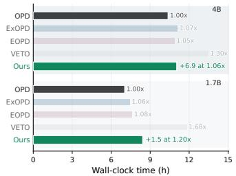

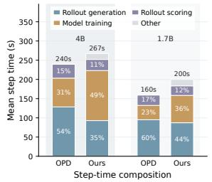  
Figure 4: Training efficiency comparison. Left: wall-clock training time across methods. Right: step-time breakdown into rollout generation, model training, rollout scoring, and other overhead.

Table 3: Comparison with OPD using extra student updates on Qwen3-4B-Base math benchmarks. K denotes the number of model update steps performed in each training round.
<table><tr><td>Metric</td><td>OPD (K=1)</td><td>OPD (K=2)</td><td>Ours</td></tr><tr><td>Avg. Perf. (%)</td><td>28.46</td><td>28.59</td><td>35.37</td></tr><tr><td>Rollout Gen. (s)</td><td>128.37</td><td>130.58</td><td>94.68</td></tr><tr><td>Training (s)</td><td>75.00</td><td>150.01</td><td>131.12</td></tr><tr><td>Peak Mem. (GB)</td><td>123.65</td><td>124.04</td><td>141.99</td></tr></table>

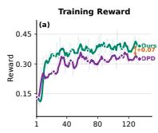

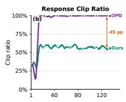

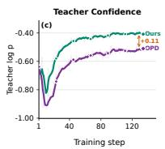

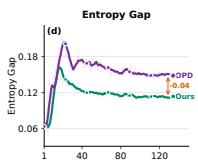

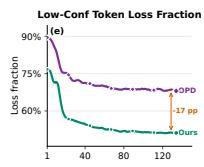  
Figure 5: Training diagnostics. We compare standard OPD and our tilted rollout proposal over training. (a) Training reward. (b) Fraction of responses clipped by the maximum generation length. (c) Average teacher log-probability on generated tokens. (d) Student–teacher entropy gap. (e) Fraction of token-level loss from low-confidence teacher positions.

## 4.3 Training Efficiency

Since our method trains an additional proposal policy, we compare its training cost with existing OPD variants. Fig. 4 reports the wall-clock efficiency and step-time breakdown. Although our method introduces an additional proposal policy update, it maintains a favorable accuracy-time trade-off throughout training, with only about 13% extra wall-clock time on average. Note that VETO is trained for one extra epoch to reach its optimal performance, which accounts for its longer wall-clock time. The step-time breakdown further shows where the extra cost comes from. Our method spend more time on model training due to the additional proposal-policy update, but it partially offsets this cost through faster rollout generation, as it samples fewer degenerate long responses.

Table 3 further examines whether the improvement is simply due to extra optimization compute. It reports the average performance on math benchmarks along with average per-round rollout generation time, model training time, and peak memory, comparing our method with OPD using one or two student update steps per round. Doubling the number of OPD student updates per round nearly doubles the training time from 75.00s to 150.01s, but only changes average accuracy from 28.46% to 28.59%. In contrast, our method reaches 35.37% average accuracy with 131.12s of training time per round, lower than OPD with two updates. The additional proposal policy adds only modest memory overhead (141.99 vs. ∼124GB) and is partly offset by faster rollout generation (94.68 vs. ∼130s) since MPOPD generates shorter responses. Together, these numbers indicate that the gain comes from improving the rollout distribution rather than merely spending more compute on student updates.

## 4.4 Analysis

Training Diagnostics. Fig. 5 provides diagnostics for the mechanism behind the improvements. Panels (a) and (b) first rule out the explanation that our method only shortens generations by suppressing reasoning. Our method obtains a higher training reward than OPD, while reducing the fraction of responses that reach the maximum length by 45 points. Thus, the shorter outputs mainly come from fewer degraded responses hitting the maximum length, rather than from suppressing useful reasoning.

Panels (c)–(e) further show that MPOPD changes the trajectory distribution used for student supervision. The generated trajectories receive higher teacher log-probability (+0.11), indicating that they remain more likely under the teacher policy. Following [31], we examine the student– teacher entropy gap, which shrinks by 0.04 under our method, indicating that the student’s predictive confidence is more aligned with the teacher’s. In (e), the fraction of loss from low-confidence teacher positions drops by 17 points, indicating that student updates are

Table 4: Effect of the coefficient η on selected Qwen3-4B-Base math benchmarks. Scores are reported as accuracy (%).
<table><tr><td>η</td><td>AIME26</td><td>H25N</td><td>Minerva</td><td>Avg.</td></tr><tr><td>0.10</td><td>23.33</td><td>15.10</td><td>42.36</td><td>26.93</td></tr><tr><td>0.15</td><td>24.17</td><td>15.42</td><td>42.65</td><td>27.41</td></tr><tr><td>0.20</td><td>25.00</td><td>15.42</td><td>42.65</td><td>27.69</td></tr><tr><td>0.30</td><td>24.69</td><td>15.31</td><td>42.43</td><td>27.48</td></tr></table>

increasingly driven by confident teacher supervision. Together with Fig. 1, these results clarify the failure mode of OPD: as rollouts drift away from trajectories likely under the teacher, training places more loss on low-confidence teacher tokens. The tilted proposal reduces this pattern, making student updates less dominated by such degraded rollouts.

Impact of the Tilt Strength η. The tilt strength η is a hyperparameter that controls how strongly the rollout policy deviates from the current student toward the teacher. A small η keeps the rollout close to the student, while a large η weakens on-policy training. As shown in Table 4, average accuracy varies within about 0.76 across the range, peaking at $\eta = 0 . 2 0$ , indicating that MPOPD is not highly sensitive to this hyperparameter. Appendix B.4 further varies the teacher support size.

## 5 Related Work

Reasoning in Large Language Models. Recent progress on LLM reasoning [35, 60, 63] has been driven by two closely related post-training paradigms. Reinforcement learning with verifiable rewards optimizes the policy against sparse outcome-level feedback, and has emerged as the dominant recipe behind recent reasoning-focused models [42, 59, 64, 39, 13, 45], yielding strong gains on mathematical, coding, and agentic reasoning [7, 67, 52, 65, 66]. Distillation instead supervises the student with dense token-level signals from a stronger teacher [17, 41, 25], and has become a core component of reasoning-oriented post-training pipelines [51, 6, 46], often paired with distilled reasoning corpora [12, 61, 33, 2] or used to transfer reasoning across scales and modalities [4, 37].

On-Policy Distillation. On-policy distillation lets the student generate its own trajectories and receive token-level teacher supervision [1, 10, 34], addressing the train–test mismatch of off-policy distillation [27, 11, 48, 32]. Owing to its efficiency in transferring strong capabilities from large teachers into mid-scale students, OPD has been explored along several directions, including crossfamily distillation [36], multi-teacher guidance aggregation [9, 50], black-box distillation [58], and self-distillation schemes that internalize the model’s in-context capabilities into its parameters [56, 15, 62, 20]. Despite this progress, recent studies have reported failure modes such as repetition, overlong generations, and entropy collapse [8, 24, 26, 31]. Existing remedies mainly modify the supervision target, via alternative divergences [1], extrapolative or entropy-aware objectives [57, 24], and target reformulations [21, 26], or adjust the rollout policy through heuristic teacher–student interleaving [10, 53]. In this work, we instead study the rollout policy itself in OPD.

## 6 Conclusion

We study OPD and identify a compounding teacher–student mismatch: student rollouts can drift into low teacher-reachability regions, where noisy supervision reinforces degenerate patterns across rounds. To address this, we introduce MPOPD, which formulates the rollout policy as a local trust-region problem under relative teacher support, yielding a geometric mixture of the student and teacher. We then approximate this mixture with a learnable proposal policy that generates rollouts in a single forward pass. Across 16 math, knowledge, and medical reasoning benchmarks, MPOPD consistently outperforms OPD and recent variants. Diagnostics show that these gains come from shifting rollouts toward higher teacher-reachable trajectories, suggesting that the rollout policy is a critical design choice for improving OPD.

## Acknowledgments

This work is supported by National Science Foundation under Award No. IIS-2117902. The views and conclusions are those of the authors and should not be interpreted as representing the official policies of the funding agencies or the government. This research used the DeltaAI advanced computing and data resource, which is supported by the National Science Foundation (award OAC 2320345) and the State of Illinois. DeltaAI is a joint effort of the University of Illinois Urbana-Champaign and its National Center for Supercomputing Applications. This work used the DeltaAI system at the National Center for Supercomputing Applications through allocation CIS250246 from the Advanced Cyberinfrastructure Coordination Ecosystem: Services & Support (ACCESS) program, which is supported by National Science Foundation grants #2138259, #2138286, #2138307, #2137603, and #2138296.

## References

[1] Rishabh Agarwal, Nino Vieillard, Yongchao Zhou, Piotr Stanczyk, Sabela Ramos Garea, Matthieu Geist, and Olivier Bachem. On-policy distillation of language models: Learning from self-generated mistakes. In The Twelfth International Conference on Learning Representations, 2024.

[2] Wasi Uddin Ahmad, Sean Narenthiran, Somshubra Majumdar, Aleksander Ficek, Siddhartha Jain, Jocelyn Huang, Vahid Noroozi, and Boris Ginsburg. Opencodereasoning: Advancing data distillation for competitive coding. arXiv preprint arXiv:2504.01943, 2025.

[3] Mislav Balunovic, Jasper Dekoninck, Ivo Petrov, Nikola Jovanovi´ c, and Martin Vechev. Math-´ arena: Evaluating llms on uncontaminated math competitions. arXiv preprint arXiv:2505.23281, 2025.

[4] Akhiad Bercovich, Itay Levy, Izik Golan, Mohammad Dabbah, Ran El-Yaniv, Omri Puny, Ido Galil, Zach Moshe, Tomer Ronen, Najeeb Nabwani, et al. Llama-nemotron: Efficient reasoning models. arXiv preprint arXiv:2505.00949, 2025.

[5] Peter Clark, Isaac Cowhey, Oren Etzioni, Tushar Khot, Ashish Sabharwal, Carissa Schoenick, and Oyvind Tafjord. Think you have solved question answering? try arc, the ai2 reasoning challenge. arXiv preprint arXiv:1803.05457, 2018.

[6] DeepSeek-AI. Deepseek-v4: Towards highly efficient million-token context intelligence, 2026.

[7] Guanting Dong, Hangyu Mao, Kai Ma, Licheng Bao, Yifei Chen, Zhongyuan Wang, Zhongxia Chen, Jiazhen Du, Huiyang Wang, Fuzheng Zhang, et al. Agentic reinforced policy optimization. arXiv preprint arXiv:2507.19849, 2025.

[8] Yuqian Fu, Haohuan Huang, Kaiwen Jiang, Yuanheng Zhu, and Dongbin Zhao. Revisiting onpolicy distillation: Empirical failure modes and simple fixes. arXiv preprint arXiv:2603.25562, 2026.

[9] Naibin Gu, Chenxu Yang, Qingyi Si, Chuanyu Qin, Dingyu Yao, Peng Fu, Zheng Lin, Weiping Wang, Nan Duan, and Jiaqi Wang. Co-evolving policy distillation. arXiv preprint arXiv:2604.27083, 2026.

[10] Yuxian Gu, Li Dong, Furu Wei, and Minlie Huang. Minillm: Knowledge distillation of large language models. In The twelfth international conference on learning representations, 2024.

[11] Arnav Gudibande, Eric Wallace, Charlie Snell, Xinyang Geng, Hao Liu, Pieter Abbeel, Sergey Levine, and Dawn Song. The false promise of imitating proprietary llms. arXiv preprint arXiv:2305.15717, 2023.

[12] Etash Guha, Ryan Marten, Sedrick Keh, Negin Raoof, Georgios Smyrnis, Hritik Bansal, Marianna Nezhurina, Jean Mercat, Trung Vu, Zayne Sprague, et al. Openthoughts: Data recipes for reasoning models. arXiv preprint arXiv:2506.04178, 2025.

[13] Daya Guo, Dejian Yang, Haowei Zhang, Junxiao Song, Peiyi Wang, Qihao Zhu, Runxin Xu, Ruoyu Zhang, Shirong Ma, Xiao Bi, et al. Deepseek-r1: Incentivizing reasoning capability in llms via reinforcement learning. arXiv preprint arXiv:2501.12948, 2025.

[14] Chaoqun He, Renjie Luo, Yuzhuo Bai, Shengding Hu, Zhen Thai, Junhao Shen, Jinyi Hu, Xu Han, Yujie Huang, Yuxiang Zhang, et al. Olympiadbench: A challenging benchmark for promoting agi with olympiad-level bilingual multimodal scientific problems. In Proceedings of the 62nd Annual Meeting ofthe Associationfor Computational Linguistics (Volume 1: Long Papers), pages 3828–3850, 2024.

[15] Yinghui He, Simran Kaur, Adithya Bhaskar, Yongjin Yang, Jiarui Liu, Narutatsu Ri, Liam Fowl, Abhishek Panigrahi, Danqi Chen, and Sanjeev Arora. Self-distillation zero: Self-revision turns binary rewards into dense supervision. arXiv preprint arXiv:2604.12002, 2026.

[16] Geoffrey Hinton, Oriol Vinyals, and Jeff Dean. Distilling the knowledge in a neural network. stat, 1050:9, 2015.

[17] Geoffrey E Hinton. Training products of experts by minimizing contrastive divergence. Neural computation, 14(8):1771–1800, 2002.

[18] Edward J Hu, Yelong Shen, Phillip Wallis, Zeyuan Allen-Zhu, Yuanzhi Li, Shean Wang, Liang Wang, Weizhu Chen, et al. Lora: Low-rank adaptation of large language models. Iclr, 1(2):3, 2022.

[19] Xiaoke Huang, Juncheng Wu, Hui Liu, Xianfeng Tang, and Yuyin Zhou. m1: Unleash the potential of test-time scaling for medical reasoning with large language models. arXiv preprint arXiv:2504.00869, 2025.

[20] Jonas Hübotter, Frederike Lübeck, Lejs Behric, Anton Baumann, Marco Bagatella, Daniel Marta, Ido Hakimi, Idan Shenfeld, Thomas Kleine Buening, Carlos Guestrin, et al. Reinforcement learning via self-distillation. arXiv preprint arXiv:2601.20802, 2026.

[21] Ijun Jang, Jewon Yeom, Juan Yeo, Hyunggu Lim, and Taesup Kim. Stable on-policy distillation through adaptive target reformulation. arXiv preprint arXiv:2601.07155, 2026.

[22] Di Jin, Eileen Pan, Nassim Oufattole, Wei-Hung Weng, Hanyi Fang, and Peter Szolovits. What disease does this patient have? a large-scale open domain question answering dataset from medical exams. Applied Sciences, 11(14):6421, 2021.

[23] Qiao Jin, Bhuwan Dhingra, Zhengping Liu, William Cohen, and Xinghua Lu. Pubmedqa: A dataset for biomedical research question answering. In Proceedings of the 2019 conference on empirical methods in natural language processing and the 9th international joint conference on natural language processing (EMNLP-IJCNLP), pages 2567–2577, 2019.

[24] Woogyeol Jin, Taywon Min, Yongjin Yang, Swanand Ravindra Kadhe, Yi Zhou, Dennis Wei, Nathalie Baracaldo, and Kimin Lee. Entropy-aware on-policy distillation of language models. arXiv preprint arXiv:2603.07079, 2026.

[25] Yoon Kim and Alexander M Rush. Sequence-level knowledge distillation. In Proceedings of the 2016 conference on empirical methods in natural language processing, pages 1317–1327, 2016.

[26] Jongwoo Ko, Sara Abdali, Young Jin Kim, Tianyi Chen, and Pashmina Cameron. Scaling reasoning efficiently via relaxed on-policy distillation. arXiv preprint arXiv:2603.11137, 2026.

[27] Jongwoo Ko, Sungnyun Kim, Tianyi Chen, and Se-Young Yun. Distillm: Towards streamlined distillation for large language models. arXiv preprint arXiv:2402.03898, 2024.

[28] Woosuk Kwon, Zhuohan Li, Siyuan Zhuang, Ying Sheng, Lianmin Zheng, Cody Hao Yu, Joseph E. Gonzalez, Hao Zhang, and Ion Stoica. Efficient memory management for large language model serving with pagedattention. In Proceedings of the ACM SIGOPS 29th Symposium on Operating Systems Principles, 2023.

[29] Sergey Levine, Aviral Kumar, George Tucker, and Justin Fu. Offline reinforcement learning: Tutorial, review, and perspectives on open problems. arXiv preprint arXiv:2005.01643, 2020.

[30] Aitor Lewkowycz, Anders Andreassen, David Dohan, Ethan Dyer, Henryk Michalewski, Vinay Ramasesh, Ambrose Slone, Cem Anil, Imanol Schlag, Theo Gutman-Solo, et al. Solving quantitative reasoning problems with language models. Advances in neural information processing systems, 35:3843–3857, 2022.

[31] Yaxuan Li, Yuxin Zuo, Bingxiang He, Jinqian Zhang, Chaojun Xiao, Cheng Qian, Tianyu Yu, Huan-ang Gao, Wenkai Yang, Zhiyuan Liu, et al. Rethinking on-policy distillation of large language models: Phenomenology, mechanism, and recipe. arXiv preprint arXiv:2604.13016, 2026.

[32] Alexander Lin, Jeremy Wohlwend, Howard Chen, and Tao Lei. Autoregressive knowledge distillation through imitation learning. In Proceedings of the 2020 Conference on Empirical Methods in Natural Language Processing (EMNLP), pages 6121–6133, 2020.

[33] Anton Lozhkov, Hynek Kydlícek, Loubna Ben Allal, Guilherme Penedo, Edward Beeching,ˇ Quentin Gallouédec, Nathan Habib, Lewis Tunstall, and Leandro von Werra. Openr1-math-220k. https://huggingface.co/datasets/open-r1/OpenR1-Math-220k, 2025.

[34] Kevin Lu and Thinking Machines Lab. On-policy distillation. Thinking Machines Lab: Connectionism, 2025. https://thinkingmachines.ai/blog/on-policy-distillation.

[35] Long Ouyang, Jeffrey Wu, Xu Jiang, Diogo Almeida, Carroll Wainwright, Pamela Mishkin, Chong Zhang, Sandhini Agarwal, Katarina Slama, Alex Ray, et al. Training language models to follow instructions with human feedback. Advances in neural information processing systems, 35:27730–27744, 2022.

[36] Carlos Miguel Patiño, Kashif Rasul, Quentin Gallouédec, Ben Burtenshaw, Sergio Paniego, Vaibhav Srivastav, Thibaud Frere, Ed Beeching, Lewis Tunstall, Leandro von Werra, and Thomas Wolf. Unlocking on-policy distillation for any model family, 2025.

[37] Yi Peng, Peiyu Wang, Xiaokun Wang, Yichen Wei, Jiangbo Pei, Weijie Qiu, Ai Jian, Yunzhuo Hao, Jiachun Pan, Tianyidan Xie, et al. Skywork r1v: Pioneering multimodal reasoning with chain-of-thought. arXiv preprint arXiv:2504.05599, 2025.

[38] David Rein, Betty Li Hou, Asa Cooper Stickland, Jackson Petty, Richard Yuanzhe Pang, Julien Dirani, Julian Michael, and Samuel R Bowman. Gpqa: A graduate-level google-proof q&a benchmark. arXiv preprint arXiv:2311.12022, 2023.

[39] Tao Ren, Jinyang Jiang, Hui Yang, Wan Tian, Minhao Zou, Guanghao Li, Zishi Zhang, Qinghao Wang, Shentao Qin, Yanjun Zhao, Rui Tao, Hui Shao, and Yijie Peng. Riskpo: Risk-based policy optimization via verifiable reward for llm post-training, 2025.

[40] Stéphane Ross, Geoffrey Gordon, and Drew Bagnell. A reduction of imitation learning and structured prediction to no-regret online learning. In Proceedings of the fourteenth international conference on artificial intelligence and statistics, pages 627–635. JMLR Workshop and Conference Proceedings, 2011.

[41] Victor Sanh, Lysandre Debut, Julien Chaumond, and Thomas Wolf. Distilbert, a distilled version of bert: smaller, faster, cheaper and lighter. arXiv preprint arXiv:1910.01108, 2019.

[42] Zhihong Shao, Peiyi Wang, Qihao Zhu, Runxin Xu, Junxiao Song, Xiao Bi, Haowei Zhang, Mingchuan Zhang, YK Li, Yang Wu, et al. Deepseekmath: Pushing the limits of mathematical reasoning in open language models. arXiv preprint arXiv:2402.03300, 2024.

[43] Guangming Sheng, Chi Zhang, Zilingfeng Ye, Xibin Wu, Wang Zhang, Ru Zhang, Yanghua Peng, Haibin Lin, and Chuan Wu. Hybridflow: A flexible and efficient rlhf framework. arXiv preprint arXiv: 2409.19256, 2024.

[44] Rohan Taori, Ishaan Gulrajani, Tianyi Zhang, Yann Dubois, Xuechen Li, Carlos Guestrin, Percy Liang, and Tatsunori B Hashimoto. Alpaca: A strong, replicable instructionfollowing model. Stanford Center for Research on Foundation Models. https://crfm. stanford. edu/2023/03/13/alpaca. html, 3(6):7, 2023.

[45] Kimi Team, Tongtong Bai, Yifan Bai, Yiping Bao, SH Cai, Yuan Cao, Y Charles, HS Che, Cheng Chen, Guanduo Chen, et al. Kimi k2. 5: Visual agentic intelligence. arXiv preprint arXiv:2602.02276, 2026.

[46] Qwen Team. Qwen3. 5-omni technical report. arXiv preprint arXiv:2604.15804, 2026.

[47] Yubo Wang, Xueguang Ma, Ge Zhang, Yuansheng Ni, Abhranil Chandra, Shiguang Guo, Weiming Ren, Aaran Arulraj, Xuan He, Ziyan Jiang, et al. Mmlu-pro: A more robust and challenging multi-task language understanding benchmark. Advances in Neural Information Processing Systems, 37:95266–95290, 2024.

[48] Yuqiao Wen, Zichao Li, Wenyu Du, and Lili Mou. F-divergence minimization for sequencelevel knowledge distillation. In Proceedings ofthe 61st Annual Meeting ofthe Associationfor Computational Linguistics (Volume 1: Long Papers), pages 10817–10834, 2023.

[49] Yecheng Wu, Song Han, and Hai Cai. Lightning opd: Efficient post-training for large reasoning models with offline on-policy distillation. arXiv preprint arXiv:2604.13010, 2026.

[50] Bangjun Xiao, Bingquan Xia, Bo Yang, Bofei Gao, Bowen Shen, Chen Zhang, Chenhong He, Chiheng Lou, Fuli Luo, Gang Wang, et al. Mimo-v2-flash technical report. arXiv preprint arXiv:2601.02780, 2026.

[51] LLM-Core-Team Xiaomi. Mimo: Unlocking the reasoning potential of language model – from pretraining to posttraining, 2025.

[52] Haobo Xu, Sirui Chen, Ruizhong Qiu, Yuchen Yan, Chen Luo, Monica Xiao Cheng, Jingrui He, and Hanghang Tong. Prune as you generate: Online rollout pruning for faster and better rlvr. In Proceedings ofthe 64th Annual Meeting ofthe Associationfor Computational Linguistics (Volume 1: Long Papers), pages 13876–13893, 2026.

[53] Wenda Xu, Rujun Han, Zifeng Wang, Long Le, Dhruv Madeka, Lei Li, William Yang Wang, Rishabh Agarwal, Chen-Yu Lee, and Tomas Pfister. Speculative knowledge distillation: Bridging the teacher-student gap through interleaved sampling. In The Thirteenth International Conference on Learning Representations.

[54] Yuanda Xu, Hejian Sang, Zhengze Zhou, Ran He, Zhipeng Wang, and Alborz Geramifard. Tip: Token importance in on-policy distillation. arXiv preprint arXiv:2604.14084, 2026.

[55] An Yang, Anfeng Li, Baosong Yang, Beichen Zhang, Binyuan Hui, Bo Zheng, Bowen Yu, Chang Gao, Chengen Huang, Chenxu Lv, et al. Qwen3 technical report. arXiv preprint arXiv:2505.09388, 2025.

[56] Wenkai Yang, Yankai Lin, Jie Zhou, and Ji-Rong Wen. Distilling rule-based knowledge into large language models. In Proceedings of the 31st International Conference on Computational Linguistics, pages 913–932, 2025.

[57] Wenkai Yang, Weijie Liu, Ruobing Xie, Kai Yang, Saiyong Yang, and Yankai Lin. Learning beyond teacher: Generalized on-policy distillation with reward extrapolation. arXiv preprint arXiv:2602.12125, 2026.

[58] Tianzhu Ye, Li Dong, Zewen Chi, Xun Wu, Shaohan Huang, and Furu Wei. Black-box on-policy distillation of large language models. arXiv preprint arXiv:2511.10643, 2025.

[59] Qiying Yu, Zheng Zhang, Ruofei Zhu, Yufeng Yuan, Xiaochen Zuo, Yu Yue, Weinan Dai, Tiantian Fan, Gaohong Liu, Lingjun Liu, et al. Dapo: An open-source llm reinforcement learning system at scale. arXiv preprint arXiv:2503.14476, 2025.

[60] Eric Zelikman, Yuhuai Wu, Jesse Mu, and Noah Goodman. Star: Bootstrapping reasoning with reasoning. Advances in Neural Information Processing Systems, 35:15476–15488, 2022.

[61] Han Zhao, Haotian Wang, Yiping Peng, Sitong Zhao, Xiaoyu Tian, Shuaiting Chen, Yunjie Ji, and Xiangang Li. 1.4 million open-source distilled reasoning dataset to empower large language model training. arXiv preprint arXiv:2503.19633, 2025.

[62] Siyan Zhao, Zhihui Xie, Mengchen Liu, Jing Huang, Guan Pang, Feiyu Chen, and Aditya Grover. Self-distilled reasoner: On-policy self-distillation for large language models. arXiv preprint arXiv:2601.18734, 2026.

[63] Yanjun Zhao, Ruizhong Qiu, Tianxin Wei, Yuanchen Bei, Zhining Liu, Lingjie Chen, Ismini Lourentzou, Hanghang Tong, and Jingrui He. Recontext: Recursive evidence replay as llm harness for long-context reasoning, 2026.

[64] Chujie Zheng, Shixuan Liu, Mingze Li, Xiong-Hui Chen, Bowen Yu, Chang Gao, Kai Dang, Yuqiong Liu, Rui Men, An Yang, et al. Group sequence policy optimization. arXiv preprint arXiv:2507.18071, 2025.

[65] Jiaru Zou, Rui Pan, Ruizhong Qiu, Pan Lu, Shizhe Diao, Jindong Jiang, Hanghang Tong, Tong Zhang, Markus J Buehler, Jingrui He, et al. Recursive multi-agent systems. arXiv preprint arXiv:2604.25917, 2026.

[66] Jiaru Zou, Yunzhe Qi, Sirui Chen, Federico Bianchi, Shang Zhu, Pan Lu, Jingrui He, and James Zou. Hybrid reasoning agents. arXiv preprint arXiv:2610.18861, 2026.

[67] Jiaru Zou, Xiyuan Yang, Ruizhong Qiu, Gaotang Li, Katherine Tieu, Pan Lu, Ke Shen, Hanghang Tong, Yejin Choi, Jingrui He, et al. Latent collaboration in multi-agent systems. arXiv preprint arXiv:2511.20639, 2025.

[68] Yuxin Zuo, Shang Qu, Yifei Li, Zhangren Chen, Xuekai Zhu, Ermo Hua, Kaiyan Zhang, Ning Ding, and Bowen Zhou. Medxpertqa: Benchmarking expert-level medical reasoning and understanding. arXiv preprint arXiv:2501.18362, 2025.

## Appendix

A More Experiment Details 17   
A.1 Training and Evaluation Details 17   
A.2 Implementation Details 18   
B Additional Experimental Results 19   
B.1 A Closer Look at Accuracy and Generation Length 19   
B.2 Proposal Approximation and Effective KL Radius . 20   
B.3 Scaling to a Larger Teacher and Student 21   
B.4 Impact of the Teacher Support Size . 22   
C Discussion 23   
D Declaration of LLM Usage and Broader Impact 24   
E Missing Proofs 25   
E.1 Proof of Proposition 3.1 . 25   
E.2 Proof of Corollary 3.1 . 26   
F Optimization Analysis under Structured Teacher Target Noise 27   
G Geometric and Arithmetic Interpolation 29   
H More Case Studies 31

## A More Experiment Details

## A.1 Training and Evaluation Details

## A.1.1 Training

General setup. Training is conducted on 2 GPUs with tensor-parallel rollout size 2, rollout count n = 1, rollout temperature 0.8, and rollout top-p 1.0. The maximum prompt length is 2048 tokens and the maximum training response length is 4096 tokens. We use a learning rate of $3 \times 1 0 ^ { - 6 }$ with weight decay 0.1.

Domain-specific settings. For math reasoning and knowledge QA, we use a training batch size of 256 with PPO mini-batch size 128, training on the full split of each dataset. For medical reasoning, we use a training batch size of 128 with PPO mini-batch size 64, training on a 5K subset. A summary is provided in Table 5.

Table 5: Training configuration across domains. Settings shared across all domains are marked with “–”.
<table><tr><td>Setting</td><td>Math</td><td>Knowledge QA</td><td>Medical</td></tr><tr><td rowspan="3">Batch size PPO mini-batch Training data</td><td>256</td><td>256</td><td>128</td></tr><tr><td>128</td><td>128</td><td>64</td></tr><tr><td>full split</td><td>full split</td><td>5K subset</td></tr><tr><td colspan="2">Learning rate</td><td>3×10−6</td><td></td></tr><tr><td colspan="2">Weight decay</td><td>0.1</td><td></td></tr><tr><td colspan="2">Train temperature</td><td>0.8</td><td></td></tr><tr><td colspan="2">Train top-p</td><td>1.0</td><td></td></tr><tr><td colspan="2">Train max response len.</td><td>4096</td><td></td></tr></table>

## A.1.2 Evaluation

Math reasoning. We use the prompt template

{problem} Please reason step by step, and put your final answer within \boxed{}.

Completions are sampled with temperature 0.8, top-p 0.9, and max\_tokens= 16384. We draw n = 32 completions per problem, except on OlympiadBench where n = 8 due to its larger size. We report accuracy and average generated length.

Knowledge QA. For zero-shot MCQA on GPQA-Diamond and ARC-Challenge, we use the prompt template

Please solve the following multiple-choice question. Think step by   
step. End your response with a single final answer line in one of   
these exact formats: Final answer: C {"answer": "C"}. Use only   
the choice letter, and do not add any text after the final answer   
line. Question: {question} Options: {options}

For MMLU-Pro, we use subject-specific few-shot exemplars from the validation split and prompt the model to end with The answer is (X). For ARC-Challenge and MMLU-Pro, we randomly sample 500 questions from each test set for evaluation, while GPQA-Diamond is evaluated on its full test set. Completions are sampled with temperature 0.8 and top-p 0.9, with n = 8 per question. We use max\_tokens= 16384 for GPQA-Diamond and 8192 for ARC-Challenge and MMLU-Pro.

Medical reasoning. We use the prompt template

Question: {question} Options: {options} Think step by step. Please show your choice in the answer field with only the choice letter, e.g., {"answer": "C"}.

We use deterministic MCQA-style decoding with temperature 0.0, top-p 1.0, max\_tokens= 8192, and $n = 1$ . We report accuracy and average generated length.

## A.2 Implementation Details

Rollouts and teacher queries. At each round t, training trajectories are sampled from the proposal policy $\hat { q } _ { t }$ (one rollout per prompt). The teacher $\pi ^ { \star }$ is never used to generate trajectories at training time; it is queried only to obtain token-level reference probabilities, which are used both to construct the student distillation loss and to materialize the tilted target $q _ { \eta , t + 1 } ^ { * }$ for the proposal update. To keep teacher query costs comparable across methods, both the distillation KL and the construction of $q _ { \eta , t + 1 } ^ { * }$ are restricted to the teacher top-k support $( k = 1 6 )$ .

Student and proposal updates. Each round consists of one student gradient step on the rollout batch using the clipped importance weights $w _ { t , j } ( \tau )$ in Eq. (8) with clipping threshold $C = 5$ followed by $K = 1$ inner gradient steps of the proposal update toward the freshly constructed target $q _ { \eta , t + 1 } ^ { * }$ . The proposal $\hat { q } _ { 0 }$ is initialized from $\pi _ { 0 } ,$ , and at each subsequent round $\hat { q } _ { t + 1 }$ is initialized from the updated student $\pi _ { t + 1 }$ before its inner updates.

Baseline parity. All baselines share our rollout backend, optimizer, chat template, training data, and evaluation infrastructure with MPOPD; we only vary method-specific objective terms and their coefficients.

## B Additional Experimental Results

## B.1 A Closer Look at Accuracy and Generation Length

The main results show that MPOPD improves accuracy while reducing generation length. These aggregate improvements leave open where the reduction in length occurs and how it relates to the accuracy gains. We therefore examine three successive questions, corresponding to panels (a)–(c) of Table 6: whether the gains depend on the decoding budget, whether they are explained by termination behavior, and where the length reduction occurs.

Following the main setting of our paper, we investigate distilling Qwen3-4B-Base (student) from Qwen3-4B-Instruct-2507 (teacher) on math reasoning, trained on DAPO-Math-17K with training rollouts capped at 4K tokens. We compare MPOPD with OPD, the standard on-policy baseline it builds on, and VETO, the strongest baseline in this setting (Table 1), which applies the same geometric mixture as the distillation target rather than as the rollout policy. We also include the teacher as a reference for accuracy and correct-response length. All evaluations follow the protocol in Appendix A.1.

Table 6: Decoding budgets and termination behavior. Results are macro-averaged over eight math benchmarks. Accuracy and rates are percentages; K denotes thousands of tokens. In (a), the best and second-best student accuracies are bolded and underlined, respectively.
<table><tr><td colspan="3">(a) Accuracy at different decoding budgets</td></tr><tr><td>Method Acc@4K</td><td>Acc@8K</td><td>Acc@16K</td></tr><tr><td>Teacher</td><td>31.60</td><td>46.56 50.16</td></tr><tr><td>OPD</td><td>21.89 25.32</td><td>28.46</td></tr><tr><td>VETO</td><td>24.52 28.29</td><td>31.06</td></tr><tr><td>MPOPD</td><td>26.89 31.42</td><td>35.37</td></tr></table>

<table><tr><td colspan="5">(b) Termination and answer presence at 16K</td></tr><tr><td>Method</td><td>Term. rate</td><td>Acc. | term.</td><td>Ans. presence</td><td>First ans. pos.</td></tr><tr><td>OPD</td><td>0.60</td><td>66.86</td><td>59.65</td><td>4.85K</td></tr><tr><td>VETO</td><td>53.27</td><td>55.13</td><td>56.17</td><td>4.68K</td></tr><tr><td>MPOPD</td><td>55.09</td><td>61.25</td><td>59.18</td><td>4.79K</td></tr></table>

(c) No-answer termination and correct-response lengths
<table><tr><td>Method</td><td>No-ans. term.</td><td># Tokens to first correct ans.</td><td># Tokens after first correct ans.</td></tr><tr><td>Teacher</td><td>0.04</td><td>3.61K</td><td>0.22K</td></tr><tr><td>OPD</td><td>0.03</td><td>3.87K</td><td>12.38K</td></tr><tr><td>VETO</td><td>0.04</td><td>3.55K</td><td>0.17K</td></tr><tr><td>MPOPD</td><td>0.01</td><td>3.75K</td><td>0.34K</td></tr></table>

(a) Do the gains depend on the decoding budget? Training rollouts are capped at 4K tokens, whereas the main evaluation allows up to 16K, so part of the gap could reflect how each method extrapolates beyond its training length. We therefore evaluate all methods under matched decoding budgets, where Acc@4K, Acc@8K, and Acc@16K denote accuracy with a maximum generation length of 4K, 8K, and 16K tokens. MPOPD outperforms OPD and VETO at all three budgets, with gains of 5.00 and 2.37 already present at the training-matched 4K budget. The improvement therefore cannot be attributed solely to extrapolation beyond the training length.

(b) Is the gap at 16K explained by termination? Since several baselines frequently reach the 16K limit, we next examine termination behavior at this budget. The termination rate (Term. rate) is the fraction of responses that end before the limit, and Acc. | term. is the accuracy among these terminated responses. Answer presence (Ans. presence) is the fraction of responses containing at least one complete boxed answer, whether or not they terminate, and first-answer position (First ans. pos.)

is the average token position of the first complete boxed answer over answer-containing responses, regardless of correctness. MPOPD and VETO have similar termination rates (55.09% and 53.27%), yet MPOPD is more accurate both overall (35.37% vs. 31.06%) and among terminated responses (61.25% vs. 55.13%), so its advantage over VETO is not explained by terminating more often. OPD and MPOPD have similar answer presence and first-answer positions, making it unlikely that OPD’s lower accuracy arises from correct answers appearing later and being truncated. OPD’s higher accuracy conditional on termination is measured on only 0.60% of its responses and is therefore unstable.

(c) Where does the length reduction come from? With termination ruled out as the main explanation, we ask whether the shorter generations of MPOPD reflect premature stopping or the removal of redundant continuation. The no-answer termination rate (No-ans. term.) is the fraction of responses that end before the limit without a parseable final answer, which would rise if the model stopped prematurely. For the two length columns, we split each correct response at the end of its first correct boxed answer and report the average number of tokens before and after this point. Although MPOPD terminates on 55.09% of responses, only 0.01% end without a parseable answer, and its tokens to the first correct answer (3.75K) are comparable to those of OPD (3.87K) and the teacher (3.61K). In contrast, tokens generated after the first correct answer drop from 12.38K for OPD to 0.34K. On every benchmark, at least 94.6% of the correct-response length reduction relative to OPD occurs after the first correct answer, and 95.78% of correct OPD responses repeat the already scored boxed answer. These results indicate that the shorter generations come from removing post-answer repetition rather than from truncating useful reasoning.

## B.2 Proposal Approximation and Effective KL Radius

Our method uses a learned proposal policy to approximate the tilted target. We examine this approximation after the proposal update at different training steps in the same 4B student/teacher setting on math benchmarks. For readability, we omit prefix and round indices and write π for the student, $q ^ { * } \propto \pi ^ { 1 - \eta } ( \pi ^ { \star } ) ^ { \eta }$ for the tilted target, and $\hat { q }$ for the learned proposal. We measure both KL directions between $q ^ { * }$ and $\hat { q }$ on the renormalized teacher top-16 support. We also compute Spearman’s $\rho$ across prefixes between $\mathrm { K L } ( q ^ { * } \| \pi )$ and $\operatorname { K L } ( \hat { q } \| \pi )$ , using both the top-16 support and full-vocabulary. This correlation measures whether the target and proposal induce a similar ordering of displacement from the student across prefixes.

Table 7: Proposal approximation and effective KL radius. (a) Mean approximation KLs on the teacher top-16 support and rank correlations of displacement from the student. (b) Percentiles of $\mathrm { K L } ( q ^ { * } \lVert \boldsymbol { \pi } )$ on the full vocabulary.
<table><tr><td colspan="4">(a) Approximation to the tilted target</td></tr><tr><td></td><td></td><td> $\rho$ </td><td> $\rho$ </td></tr><tr><td>Step</td><td> $\mathrm { K L } ( q ^ { * } \| \hat { q } )$ </td><td> $\mathrm { K L } ( \hat { q } \| q ^ { * } )$ </td><td>top-16 full vocab.</td></tr><tr><td>20</td><td>0.012299</td><td>0.012704 0.880</td><td>0.704</td></tr><tr><td>40</td><td>0.009787</td><td>0.009905 0.862</td><td>0.746</td></tr><tr><td>60</td><td>0.009007</td><td>0.009122 0.862</td><td>0.820</td></tr><tr><td>80</td><td>0.009032</td><td>0.009111 0.888 0.882</td><td>0.763</td></tr><tr><td>100</td><td>0.008369</td><td>0.008462</td><td>0.789</td></tr><tr><td>120</td><td>0.008931</td><td>0.009011</td><td>0.888 0.766</td></tr><tr><td>134</td><td>0.008291</td><td>0.008411</td><td>0.894 0.710</td></tr></table>

<table><tr><td colspan="4">(b) Effective radius of the tilted target</td></tr><tr><td>Step</td><td>Median</td><td>70th percentile</td><td>80th percentile</td></tr><tr><td>20</td><td> $6 . 0 7 \times 1 0 ^ { - 7 }$ </td><td> $4 . 0 4 \times 1 0 ^ { - 4 }$ </td><td>0.004136</td></tr><tr><td>60</td><td> $1 . 2 1 \times 1 0 ^ { - 6 }$ </td><td>0.001440</td><td>0.005581</td></tr><tr><td>100</td><td> $3 . 1 0 \times 1 0 ^ { - 7 }$ </td><td> $8 . 1 9 \times 1 0 ^ { - 4 }$ </td><td>0.005517</td></tr><tr><td>134</td><td> $1 . 3 3 \times 1 0 ^ { - 7 }$ </td><td> $1 . 8 3 \times 1 0 ^ { - 4 }$ </td><td>0.008065</td></tr></table>

Table 7(a) shows that both approximation KLs remain small across training, and at the final step the full-vocabulary KLs are also below 0.01, close to the top-16 values. The displacement correlations are consistently positive at all measured steps, showing that qˆ tends to move farther from the student where $q ^ { * }$ requests a larger shift, although they do not imply equal displacement magnitudes. Overall, the small KLs and stable rank correlations show that qˆ closely follows both the tilted target and its relative variation across prefixes, including beyond the truncated top-16 support. MPOPD samples from the learned $\hat { q }$ as an efficient proxy, whereas the exact geometric-mixture and trust-region interpretation applies to the ideal target $q ^ { * }$

Effective KL radius. For a fixed KL radius, Proposition 3.1 yields a prefix-dependent η. Solving the constrained problem separately at every prefix would add online computation, so our implementation instead treats η as a global tunable mixing coefficient. Because the student and teacher distributions vary across prefixes, a global η induces a non-uniform effective KL radius $\mathrm { K L } ( q ^ { * } \| \pi )$ . To quantify this effect, Table 7(b) reports its median, 70th, and 80th percentiles on the full vocabulary at four training steps. Across training, the distribution remains concentrated near zero, with most prefixes receiving only a small shift and a smaller right tail receiving larger shifts. Thus, although a fixed η induces a non-uniform, prefix-dependent radius, it does not produce a large deviation from the student for most prefixes, preserving student anchoring in practice.

## B.3 Scaling to a Larger Teacher and Student

To examine whether the improvements extend to larger model scales, we use Qwen3-30B-A3B-Instruct-2507 as the teacher and Qwen3-4B-Base or Qwen3-8B-Base as the student. All methods are trained for two epochs with teacher top-16 support. The evaluation protocol is unchanged.Teacher: Qwen3-30B-A3B-Instruct-2507

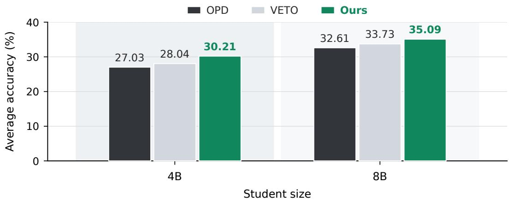  
Figure 6: Distillation with a larger teacher and student. Bars show macro-average accuracy (%) over eight math benchmarks after two training epochs with Qwen3-30B-A3B-Instruct-2507 as the teacher. “Ours” denotes MPOPD.

Fig. 6 shows that MPOPD achieves the best average accuracy for both students, improving over OPD by 3.18 and 2.48 points at 4B and 8B, respectively, and over VETO by 2.17 and 1.36 points. These results indicate that MPOPD remains effective with a larger teacher and at a larger student scale.

## B.4 Impact of the Teacher Support Size

We next examine the teacher top-k support used for the student distillation loss and the construction of the tilted target. We vary $k \in \{ 4 , \bar { 1 6 } , 3 2 , 1 2 8 \}$ in the original 4B student/teacher setting on math reasoning, with $k = 1 6$ as the default.

Table 8: Impact of the teacher support size. Scores are accuracy (%); Avg. is the macro-average over eight math benchmarks. Best and second-best accuracies are bolded and underlined, respectively.
<table><tr><td>k</td><td>AIME24</td><td>AIME25</td><td>AIME26</td><td>AMC23</td><td>H25F</td><td>H25N</td><td>Minerva</td><td>Olymp.</td><td> $\operatorname { A v g } .$ </td></tr><tr><td>4</td><td>27.19</td><td>27.60</td><td>23.75</td><td>66.95</td><td>14.69</td><td>15.21</td><td>42.35</td><td>55.36</td><td>34.14</td></tr><tr><td>16</td><td>28.65</td><td>28.96</td><td>25.00</td><td>69.61</td><td>15.83</td><td>15.42</td><td>42.65</td><td>56.82</td><td>35.37</td></tr><tr><td>32</td><td>30.00</td><td>28.65</td><td>24.90</td><td>69.84</td><td>14.79</td><td>14.90</td><td>42.68</td><td>56.88</td><td>35.33</td></tr><tr><td>128</td><td>29.48</td><td>28.96</td><td>24.58</td><td>70.39</td><td>15.62</td><td>15.94</td><td>42.70</td><td>57.60</td><td>35.66</td></tr></table>

Table 8 shows that reducing k from 16 to 4 lowers average accuracy by 1.23. Increasing the support beyond 16 yields limited changes: $k = 1 6 , 3 2$ , and 128 achieve 35.37, 35.33, and 35.66, respectively, a range of 0.33. The gains are not monotonic across support sizes. These results support top-16 as a practical choice in this setting.

## C Discussion

Why use a learned tilted rollout proposal? A possible alternative is to sample from the student $\pi _ { t }$ and reweight the resulting trajectories toward the tilted target $q _ { \eta , t } ^ { * }$ . However, reweighting only changes the contribution of trajectories that have already been sampled; it does not change which prefixes and tokens are visited during rollout generation. If completions with large teacher–student log-ratio have low probability under $\pi _ { t }$ , they may rarely appear in student rollouts, and importance weights cannot recover trajectories that were not collected. The learned proposal $\hat { q } _ { t }$ instead changes the rollout distribution directly by generating trajectories from an approximation to the tilted target. The clipped weights in Eq. (7) are used only to keep the student update aligned with the OPD objective when training on proposal-generated rollouts.

Implementation considerations. We initialize $\hat { q } _ { 0 }  \pi _ { 0 }$ , and at each subsequent round initialize $\hat { q } _ { t + 1 }$ from the updated student $\pi _ { t + 1 }$ before training it toward the next tilted target $q _ { \eta , t + 1 } ^ { * }$ This warm-start keeps the proposal close to the current student at the beginning of each round, so the proposal update primarily needs to absorb the teacher-induced tilt rather than re-learn the student distribution from scratch.

Beyond the fixed- $\cdot \eta$ scheme used in our experiments, it is natural to ask whether $\eta$ could instead be adapted across rounds, which would correspond to an implicit curriculum over rollout distributions. One conceivable design is to set η so that the local KL between $q _ { \eta , t + 1 } ^ { * }$ and $\pi _ { t + 1 }$ matches a target radius, and to grow this radius only when the learned proposal tracks the tilted target stably—plausible diagnostics for such stability include the proposal-training loss, the proposal–student $\mathrm { K L } .$ , and the clipping rate of the importance weights. Conceptually, this would tie the amount of teacher-guided deviation to the current training state rather than to a fixed schedule. We flag this as a possible extension rather than a component of our method, since our reported results use a fixed $\eta .$

A separate direction concerns the parameterization of $\hat { q } _ { t }$ itself. Rather than maintaining a full copy of the student, one could parameterize $\hat { q } _ { t }$ with a lightweight adapter such as LoRA [18] on top of the frozen student backbone, in which case the proposal overhead would reduce to storing and updating a small set of adapter parameters. We expect this to be largely orthogonal to the rollout-policy design studied here, and leave a careful empirical comparison to future work.

Limitations. Our study has several limitations. The learnable proposal policy $\hat { q } _ { t }$ introduces modest training-time overhead, which may motivate lighter parameterizations such as LoRA-based proposals at larger student scales. We also treat the tilt strength η as a fixed scalar; adaptive schedules that tie $\eta$ to training-state signals are a natural extension we do not pursue here. The clipped importance weights $w _ { t , j } ( \tau )$ also introduce a fixed clipping threshold C, and a more principled treatment of the proposal–student gap could further tighten the alignment between rollout sampling and the OPD objective. Finally, our empirical study focuses on the Qwen3 family, with main evaluations at the 1.7B and 4B scales across math, knowledge QA, and medical reasoning, and additional math experiments extending to an 8B student in Appendix B.3. We leave extensions to cross-family teacher–student pairs, still larger scales, and additional modalities to future work.

## D Declaration of LLM Usage and Broader Impact

Declaration of LLM Usage. This work studies large language model distillation, where LLMs are central experimental subjects throughout the paper: they are used as teacher and student policies, sampled to generate reasoning trajectories, queried for token-level distillation supervision, and evaluated on mathematical, knowledge-intensive, and medical reasoning benchmarks. LLMs were also used as editing tools to improve manuscript clarity, grammar, and presentation, without replacing the authors’ role in method design, analysis, or experimental interpretation.

Broader Impact. This paper introduces MPOPD, a rollout-policy design framework for improving on-policy distillation of reasoning-oriented language models. By guiding student rollouts toward higher-teacher support trajectories while retaining the scalability of standalone generation, our method can improve the effectiveness and budget efficiency of distilling reasoning capabilities into smaller models. This may make capable reasoning systems more accessible in domains such as mathematics, knowledge-intensive question answering, and medical reasoning benchmarks. At the same time, stronger distilled reasoning models may inherit general risks associated with LLM deployment, including over-reliance on automated reasoning, hallucinated or incorrect answers, and potential misuse in settings where generated outputs are treated as authoritative. Our work does not introduce a new high-risk application setting, collect human-subject data, or release a model intended for direct deployment; rather, it proposes a training method for existing reasoning-model distillation pipelines. We therefore view its broader societal risks as largely aligned with those of existing LLM reasoning and distillation systems, and encourage downstream users to apply appropriate verification, monitoring, and domain-specific safeguards before deployment in high-stakes settings.

## E Missing Proofs

## E.1 Proof of Proposition 3.1

Proposition 3.1 (Geometric mixture of the tilted target). For a fixed prefix $( x , y _ { < j } )$ , there exists a multiplier $\eta \geq 0$ such that the solution to $E q . \ ( 3 )$ takes theform

$$
q _ { \eta , t } ^ { * } ( v \mid x , y _ { < j } ) = \frac { \pi _ { t } ( v \mid x , y _ { < j } ) \exp { ( \eta s _ { t } ( v , x , y _ { < j } ) ) } } { Z ( x , y _ { < j } ) } ,\tag{4}
$$

where η is the inverse Lagrange multiplier associated with the KL constraint and $Z ( x , y _ { < j } ) =$ ${ \textstyle \sum _ { v ^ { \prime } \in \mathcal { V } } } \dot { \pi } _ { t } ( v ^ { \prime } \mid x , y _ { < j } ) \exp \bigl ( \eta s _ { t } ( v ^ { \prime } , x , \dot { y _ { < j } } ) \bigr )$ . Equivalently, substituting the definition ofs gives

$$
q _ { \eta , t } ^ { * } ( v \mid x , y _ { < j } ) = \frac { \pi _ { t } ( v \mid x , y _ { < j } ) ^ { 1 - \eta } \pi ^ { \star } ( v \mid x , y _ { < j } ) ^ { \eta } } { \sum _ { v ^ { \prime } \in \mathcal { V } } \pi _ { t } ( v ^ { \prime } \mid x , y _ { < j } ) ^ { 1 - \eta } \pi ^ { \star } ( v ^ { \prime } \mid x , y _ { < j } ) ^ { \eta } } .\tag{5}
$$

Proof. Fix a prefix $( x , y _ { < j } )$ and write

$$
p ( v ) = \pi _ { t } ( v \mid x , y _ { < j } ) , \qquad s ( v ) = s _ { t } ( v , x , y _ { < j } )
$$

for brevity. The local trust-region problem in Eq. (3) is

$$
\operatorname* { m a x } _ { q } \sum _ { v \in \mathcal { V } } q ( v ) s ( v ) \quad \mathrm { s . t . } \quad \mathrm { K L } ( q \| p ) \leq \delta , \qquad \sum _ { v \in \mathcal { V } } q ( v ) = 1 .
$$

We consider the nondegenerate case in which the KL constraint is active; the degenerate cases are recovered by $\eta = 0$ or by a constant score on the student support. The Lagrangian is

$$
\mathcal { L } ( q , \lambda , \nu ) = \sum _ { v } q ( v ) s ( v ) - \lambda \left( \sum _ { v } q ( v ) \log \frac { q ( v ) } { p ( v ) } - \delta \right) - \nu \left( \sum _ { v } q ( v ) - 1 \right) ,
$$

where $\lambda > 0$ is the multiplier for the KL constraint and ν enforces normalization. Taking the derivative with respect to $q ( v )$ and setting it to zero gives

$$
s ( v ) - \lambda \left( \log \frac { q ( v ) } { p ( v ) } + 1 \right) - \nu = 0 .
$$

Therefore,

$$
q ( v ) = p ( v ) \exp \left( \frac { s ( v ) } { \lambda } \right) \exp \left( - 1 - \frac { \nu } { \lambda } \right) .
$$

The last factor is independent of v and is absorbed into the normalization constant. Letting $\eta = 1 / \lambda$ we obtain

$$
q _ { \eta } ^ { * } ( v ) = \frac { p ( v ) \exp ( \eta s ( v ) ) } { \sum _ { v ^ { \prime } \in \mathcal { V } } p ( v ^ { \prime } ) \exp ( \eta s ( v ^ { \prime } ) ) } .
$$

Returning to the original notation yields

$$
q _ { \eta } ^ { * } ( v \mid x , y _ { < j } ) = \frac { \pi _ { t } ( v \mid x , y _ { < j } ) \exp \left( \eta s _ { t } ( v , x , y _ { < j } ) \right) } { Z _ { \eta } ( x , y _ { < j } ) } ,
$$

where

$$
Z _ { \eta } ( x , y _ { < j } ) = \sum _ { v ^ { \prime } \in \mathcal { V } } \pi _ { t } ( v ^ { \prime } \mid x , y _ { < j } ) \exp \left( \eta s _ { t } ( v ^ { \prime } , x , y _ { < j } ) \right) .
$$

Substituting

$$
s _ { t } ( v , x , y _ { < j } ) = \log \pi ^ { \star } ( v \mid x , y _ { < j } ) - \log \pi _ { t } ( v \mid x , y _ { < j } )
$$

gives

$$
\pi _ { t } ( v \mid x , y _ { < j } ) \exp { ( \eta s _ { t } ( v , x , y _ { < j } ) ) } = \pi _ { t } ( v \mid x , y _ { < j } ) ^ { 1 - \eta } \pi ^ { \star } ( v \mid x , y _ { < j } ) ^ { \eta } .
$$

Hence

$$
q _ { \eta } ^ { * } ( v \mid x , y _ { < j } ) = \frac { \pi _ { t } ( v \mid x , y _ { < j } ) ^ { 1 - \eta } \pi ^ { \star } ( v \mid x , y _ { < j } ) ^ { \eta } } { \sum _ { v ^ { \prime } \in \mathcal { V } } \pi _ { t } ( v ^ { \prime } \mid x , y _ { < j } ) ^ { 1 - \eta } \pi ^ { \star } ( v ^ { \prime } \mid x , y _ { < j } ) ^ { \eta } } .
$$

When the constraint is active, the multiplier η is chosen so that $\mathrm { K L } ( q _ { \eta } ^ { * } \| p ) = \delta$

## E.2 Proof of Corollary 3.1

Corollary 3.1 (Local improvement from tilting). For a fixed prefix $( x , y _ { < j } )$ , consider the local trust-region problem in $E q .$ . (3). For sufficiently small δ,

$$
S _ { j } ( q _ { \eta } ^ { * } ) - S _ { j } ( \pi _ { t } ) = \sigma _ { j } ( x , y _ { < j } ) \sqrt { 2 \delta } + o ( \sqrt { \delta } ) .\tag{6}
$$

Proof. Fix a prefix $( x , y _ { < j } )$ and write

$$
p ( v ) = \pi _ { t } ( v \mid x , y _ { < j } ) , \qquad s ( v ) = s _ { t } ( v , x , y _ { < j } )
$$

for brevity. Let

$$
\begin{array} { r } { \mu = \mathbb { E } _ { v \sim p } [ s ( v ) ] , \qquad \sigma ^ { 2 } = \mathrm { V a r } _ { v \sim p } [ s ( v ) ] . } \end{array}
$$

By Proposition 3.1, the optimal local tilted distribution can be written as

$$
q _ { \eta } ^ { \ast } ( v ) = \frac { p ( v ) \exp ( \eta s ( v ) ) } { Z ( \eta ) } , \qquad Z ( \eta ) = \mathbb { E } _ { v \sim p } \left[ \exp ( \eta s ( v ) ) \right] .
$$

As $\delta  0$ , the corresponding multiplier satisfies $\eta  0$ . Define the centered cumulant generating function

$$
\Lambda ( \eta ) = \log \mathbb { E } _ { v \sim p } \left[ \exp \left( \eta ( s ( v ) - \mu ) \right) \right] .
$$

Then

$$
\log Z ( \eta ) = \eta \mu + \Lambda ( \eta ) , \qquad S _ { j } ( q _ { \eta } ^ { * } ) = \frac { d } { d \eta } \log Z ( \eta ) = \mu + \Lambda ^ { \prime } ( \eta ) .
$$

Since the vocabulary is finite, Λ is smooth in a neighborhood of $\eta = 0 .$ . Therefore,

$$
\Lambda ( \eta ) = \frac { \sigma ^ { 2 } } 2 \eta ^ { 2 } + O ( \eta ^ { 3 } ) , \qquad \Lambda ^ { \prime } ( \eta ) = \sigma ^ { 2 } \eta + O ( \eta ^ { 2 } ) .
$$

It follows that

$$
S _ { j } ( q _ { \eta } ^ { * } ) - S _ { j } ( \pi _ { t } ) = S _ { j } ( q _ { \eta } ^ { * } ) - \mu = \sigma ^ { 2 } \eta + O ( \eta ^ { 2 } ) .
$$

It remains to relate η to the KL radius δ. For the exponential tilt,

$$
\mathrm { K L } ( q _ { \eta } ^ { * } \| p ) = \mathbb { E } _ { q _ { \eta } ^ { * } } \left[ \log \frac { q _ { \eta } ^ { * } ( v ) } { p ( v ) } \right] = \eta S _ { j } ( q _ { \eta } ^ { * } ) - \log Z ( \eta ) .
$$

Using the identities above,

$$
\mathrm { K L } ( q _ { \eta } ^ { * } \| p ) = \eta \bigl ( \mu + \Lambda ^ { \prime } ( \eta ) \bigr ) - \bigl ( \eta \mu + \Lambda ( \eta ) \bigr ) = \eta \Lambda ^ { \prime } ( \eta ) - \Lambda ( \eta ) .
$$

Substituting the Taylor expansions gives

$$
\delta = \mathrm { K L } ( q _ { \eta } ^ { * } \| p ) = \frac { \sigma ^ { 2 } } { 2 } \eta ^ { 2 } + O ( \eta ^ { 3 } ) .
$$

Thus, when $\sigma > 0 .$

$$
\eta = \frac { \sqrt { 2 \delta } } { \sigma } + { \cal O } ( \delta ) .
$$

Substituting this relation into the improvement expansion yields

$$
S _ { j } ( q _ { \eta } ^ { * } ) - S _ { j } ( \pi _ { t } ) = \sigma ^ { 2 } \left( \frac { \sqrt { 2 \delta } } { \sigma } + { \cal O } ( \delta ) \right) + { \cal O } ( \delta ) = \sigma \sqrt { 2 \delta } + { \cal O } ( \delta ) .
$$

Returning to the original notation, $\sigma = \sigma _ { j } ( x , y _ { < j } )$ , we obtain

$$
S _ { j } ( q _ { \eta } ^ { * } ) - S _ { j } ( \pi _ { t } ) = \sigma _ { j } ( x , y _ { < j } ) \sqrt { 2 \delta } + o ( \sqrt { \delta } ) .
$$

If $\sigma = 0$ , then the score is constant on the support of $\pi _ { t } ( \cdot \mid x , y _ { < j } )$ , so any finite-KL reweighting has the same expected score. The first-order improvement is therefore zero, which is consistent with the stated expansion. □

## F Optimization Analysis under Structured Teacher Target Noise

We analyze a stochastic teacher–student setting. At round t, the current student and proposal policies may be random through the training history; in the one-step analysis below, we condition on this history and suppress the conditioning notation. A token-level state is denoted by $c = ( x , j , y _ { < j } )$ . For any rollout policy $q ,$ let $d ^ { q }$ be the induced token-level occupancy:

$$
\mathbb { E } _ { c \sim d ^ { q } } [ f ( c ) ] : = \mathbb { E } _ { x \sim \mathcal { D } , \tau \sim q ( \cdot | x ) } \left[ \sum _ { j = 1 } ^ { | \tau | } f ( x , j , y _ { < j } ) \right] .
$$

We introduce an ideal clean teacher target $\pi _ { \circ } ^ { \star } ( \cdot \mid c )$ only for analysis. The teacher target actually used for distillation is a random conditional distribution $\widetilde { \pi } ^ { \star } ( \cdot \mid c )$ , which models stochastic or uncertain teacher supervision around the clean target.

To relate teacher reachability to supervision reliability, let $r _ { T } ( c ) \geq 0$ denote a reachability-risk score, with larger values assigned to prefixes that are less reachable under the teacher. For example, $r _ { T } ( c )$ can be chosen as a nondecreasing function of the teacher prefix negative log-likelihood,

$$
m _ { T } ( c ) = - \frac { 1 } { \operatorname* { m a x } \{ 1 , j - 1 \} } \sum _ { k = 1 } ^ { j - 1 } \log \pi ^ { \star } ( y _ { k } \mid x , y _ { < k } ) , \qquad r _ { T } ( c ) = \phi ( m _ { T } ( c ) ) ,
$$

where $\phi$ is nondecreasing.

For a state $c ,$ define the clean and observed teacher losses as

$$
\ell _ { c } ^ { \circ } ( \theta ) = \mathrm { K L } \left( \pi _ { \theta } ( \cdot  { | } c )  { \| } \pi _ { \circ } ^ { \star } ( \cdot  { | } c ) \right) , \qquad \widetilde { \ell } _ { c } ( \theta ) = \mathrm { K L } \left( \pi _ { \theta } ( \cdot  { | } c )  { \| } \widetilde { \pi } ^ { \star } ( \cdot  { | } c ) \right) .
$$

The reachability-risk exposure of a rollout policy $q$ is

$$
R _ { t } ( q ) = \mathbb { E } _ { c \sim d ^ { q } } [ r _ { T } ( c ) ] .
$$

Assumption F.1 (Reachability-structured teacher target noise). For each token-level state $c ,$ define

$$
\zeta _ { t } ( c ) = \nabla _ { \boldsymbol { \theta } } \widetilde { \ell } _ { c } ( \boldsymbol { \theta } _ { t } ) - \nabla _ { \boldsymbol { \theta } } \ell _ { c } ^ { \circ } ( \boldsymbol { \theta } _ { t } ) .
$$

The perturbation is conditionally unbiased relative to the clean teacher target, and its conditional second moment is controlled by reachability risk:

$$
\begin{array} { r } { \mathbb { E } [ \zeta _ { t } ( c ) \mid c ] = 0 , \qquad \mathbb { E } [ \| \zeta _ { t } ( c ) \| ^ { 2 } \mid c ] \le \lambda r _ { T } ( c ) } \end{array}
$$

for some $\lambda > 0 .$

This is an analysis-only noise model: teacher supervision is unbiased relative to $\pi _ { \circ } ^ { \star } .$ , but its gradient perturbation is allowed to be larger on lower-reachability states as measured by $r _ { T } ( c )$

For the clean target, define the sampled-state objective $F _ { t , q } ^ { \circ } ( \theta ) = \mathbb { E } _ { c \sim d ^ { q } } [ \ell _ { c } ^ { \circ } ( \theta ) ]$ , and let

$$
G _ { t } ( q ) = \mathbb { E } _ { c \sim d ^ { q } } \left[ \| \nabla _ { \theta } \ell _ { c } ^ { \circ } ( \theta _ { t } ) \| ^ { 2 } \right] .
$$

Proposition F.1 (One-step descent under reachability-structured teacher target noise). Assume that $F _ { t , q } ^ { \circ }$ is L-smooth in θ for afixed occupancy dq. Consider one stochastic update using the observed teacher target:

$$
\theta _ { t + 1 } = \theta _ { t } - \alpha \nabla _ { \theta } \widetilde { \ell } _ { c } ( \theta _ { t } ) , \qquad c \sim d ^ { q } .
$$

Under Assumption F.1,

$$
\mathbb { E } \left[ F _ { t , q } ^ { \circ } ( \theta _ { t } ) - F _ { t , q } ^ { \circ } ( \theta _ { t + 1 } ) \right] \geq \alpha \| \nabla _ { \theta } F _ { t , q } ^ { \circ } ( \theta _ { t } ) \| ^ { 2 } - \frac { L \alpha ^ { 2 } } { 2 } \left( G _ { t } ( q ) + \lambda R _ { t } ( q ) \right) ,
$$

where the expectation is over $c \sim d ^ { q }$ and the stochastic teacher target.

Proof. Let

$$
g _ { c } ^ { \circ } = \nabla _ { \theta } \ell _ { c } ^ { \circ } ( \theta _ { t } ) , \qquad \widetilde { g } _ { c } = \nabla _ { \theta } \widetilde { \ell } _ { c } ( \theta _ { t } ) = g _ { c } ^ { \circ } + \zeta _ { t } ( c ) .
$$

By L-smoothness,

$$
F _ { t , q } ^ { \circ } ( \theta _ { t + 1 } ) \leq F _ { t , q } ^ { \circ } ( \theta _ { t } ) - \alpha \left. \nabla _ { \theta } F _ { t , q } ^ { \circ } ( \theta _ { t } ) , \widetilde { g } _ { c } \right. + \frac { L \alpha ^ { 2 } } { 2 } \| \widetilde { g } _ { c } \| ^ { 2 } .
$$

Taking expectation over $c \sim d ^ { q }$ and the observed-target randomness, the conditional zero-mean property gives

$$
\mathbb { E } [ \widetilde { g } _ { c } ] = \mathbb { E } _ { c \sim d ^ { q } } [ g _ { c } ^ { \circ } ] = \nabla _ { \theta } F _ { t , q } ^ { \circ } ( \theta _ { t } ) .
$$

Therefore the first-order term becomes

$$
\mathbb { E } \left[ \left. \nabla _ { \theta } F _ { t , q } ^ { \circ } ( \theta _ { t } ) , \widetilde { g } _ { c } \right. \right] = \| \nabla _ { \theta } F _ { t , q } ^ { \circ } ( \theta _ { t } ) \| ^ { 2 } .
$$

For the second-order term,

$$
\mathbb { E } \| \widetilde { g } _ { c } \| ^ { 2 } = \mathbb { E } \| g _ { c } ^ { \circ } + \zeta _ { t } ( c ) \| ^ { 2 } .
$$

The cross term vanishes because $\mathbb { E } [ \zeta _ { t } ( c ) \mid c ] = 0$ , and Assumption F.1 implies

$$
\begin{array} { r } { \mathbb { E } \| \widetilde { g } _ { c } \| ^ { 2 } \leq \mathbb { E } _ { c \sim d ^ { q } } \| g _ { c } ^ { \circ } \| ^ { 2 } + \lambda \mathbb { E } _ { c \sim d ^ { q } } [ r _ { T } ( c ) ] = G _ { t } ( q ) + \lambda R _ { t } ( q ) . } \end{array}
$$

Substituting these two bounds into the smoothness inequality proves the claim.

Comparison with on-policy sampling. Proposition F.1 assigns each rollout policy q the proposalinduced one-step lower bound

$$
\mathcal { B } _ { t } ( q ) = \alpha \| \nabla _ { \theta } F _ { t , q } ^ { \circ } ( \theta _ { t } ) \| ^ { 2 } - \frac { L \alpha ^ { 2 } } { 2 } \left( G _ { t } ( q ) + \lambda R _ { t } ( q ) \right) .
$$

This is not a guarantee on a fixed evaluation objective. It compares the descent bound for the clean objective induced by each rollout occupancy.

To compare the ideal tilted rollout policy $q _ { \eta , t } ^ { * }$ with standard on-policy sampling $\pi _ { t } .$ , define

$$
A _ { t } = \| \nabla _ { \theta } F _ { t , q _ { \eta , t } ^ { * } } ^ { \circ } ( \theta _ { t } ) \| ^ { 2 } - \| \nabla _ { \theta } F _ { t , \pi _ { t } } ^ { \circ } ( \theta _ { t } ) \| ^ { 2 } , \qquad V _ { t } = G _ { t } ( q _ { \eta , t } ^ { * } ) - G _ { t } ( \pi _ { t } ) , \qquad D _ { t } = R _ { t } ( \pi _ { t } ) - R _ { t } ( q _ { \eta , t } ^ { * } ) .
$$

Then

$$
\boldsymbol { \mathcal { B } } _ { t } ( \boldsymbol { q } _ { \eta , t } ^ { * } ) - \boldsymbol { \mathcal { B } } _ { t } ( \boldsymbol { \pi } _ { t } ) = \alpha \boldsymbol { A } _ { t } - \frac { L \alpha ^ { 2 } } { 2 } \boldsymbol { V } _ { t } + \frac { L \alpha ^ { 2 } \lambda } { 2 } \boldsymbol { D } _ { t } .
$$

Therefore, the tilted rollout policy has a no-smaller proposal-induced one-step lower bound than on-policy sampling whenever

$$
A _ { t } + \frac { \alpha L \lambda } { 2 } D _ { t } \geq \frac { \alpha L } { 2 } V _ { t } .
$$

This decomposition separates three effects. The term $A _ { t }$ captures the change in clean descent signal under the rollout-induced state occupancy. The term $V _ { t }$ captures the change in clean-gradient second moment. The term $D _ { t }$ captures the reduction in reachability-risk exposure. Thus tilted sampling improves this proposal-induced lower bound when it increases the clean descent signal and/or reduces reachability-risk exposure without inducing too large a second-moment penalty.

When does tilting reduce reachability-risk exposure? The comparison above treats $D _ { t } \ =$ $R _ { t } ( \pi _ { t } ) - R _ { t } ( q _ { \eta , t } ^ { * } )$ as a property of the induced rollout distribution. The geometric tilt does not automatically guarantee $D _ { t } > 0$ , because it is defined through relative teacher support rather than directly through the reachability-risk score. A local diagnostic can be expressed using a covariance condition.

For a prefix state $c ,$ let

$$
s _ { t } ( v , c ) = \log \pi ^ { \star } ( v \mid c ) - \log \pi _ { t } ( v \mid c )
$$

be the teacher–student log-ratio score used by the tilted rollout policy, and let $\rho _ { T } ( v , c )$ denote the reachability-risk score of the next prefix obtained by appending token v. For $q _ { \eta } ( v \mid c ) \propto \pi _ { t } ( v \mid$ $c ) \exp ( \eta s _ { t } ( v , c ) )$ ,

$$
\frac { d } { d \eta } \mathbb { E } _ { v \sim q _ { \eta } ( \cdot | c ) } \left[ \rho _ { T } ( v , c ) \right] \bigg | _ { \eta = 0 } = \mathrm { C o v } _ { v \sim \pi _ { t } ( \cdot | c ) } \left( \rho _ { T } ( v , c ) , s _ { t } ( v , c ) \right) .
$$

Therefore, if tokens with larger relative teacher support tend to lead to lower reachability-risk next prefixes, the covariance is negative and a small geometric tilt locally reduces reachability-risk exposure. This condition links the risk-reduction term $D _ { t }$ in the optimization bound to the proposed tilted rollout policy.

## G Geometric and Arithmetic Interpolation

Interpolation paths. A natural and commonly used way to interpolate between two policies is the arithmetic mixture $( 1 - \alpha ) \pi _ { t } + \alpha \pi ^ { \star } \left[ 1 0 , \right.$ 40]. This appendix contrasts it with the geometric interpolation used in our rollout policy and clarifies which proposal-design objective each path corresponds to.

For a fixed prefix $c = ( x , y _ { < j } )$ , write

$$
p ( v ) = \pi _ { t } ( v \mid c ) , \qquad p ^ { \star } ( v ) = \pi ^ { \star } ( v \mid c )
$$

for the student and teacher conditionals. The geometric interpolation used in our method is

$$
q _ { \eta } ^ { \mathrm { g e o } } ( v \mid c ) = \frac { p ( v ) ^ { 1 - \eta } p ^ { \star } ( v ) ^ { \eta } } { \sum _ { v ^ { \prime } } p ( v ^ { \prime } ) ^ { 1 - \eta } p ^ { \star } ( v ^ { \prime } ) ^ { \eta } } .
$$

A natural alternative is the arithmetic interpolation

$$
q _ { \alpha } ^ { \mathrm { a r i t h } } ( v \mid c ) = ( 1 - \alpha ) p ( v ) + \alpha p ^ { \star } ( v ) .
$$

Both paths interpolate between the student and teacher endpoints, but they arise from different information-geometric objectives.

Different variational objectives. The geometric path is the barycenter under the reverse-KL geometry:

$$
q _ { \eta } ^ { \mathrm { g e o } } = \arg \operatorname* { m i n } _ { \boldsymbol { q } } ( 1 - \eta ) \mathrm { K L } ( \boldsymbol { q } \| \boldsymbol { p } ) + \eta \mathrm { K L } ( \boldsymbol { q } \| \boldsymbol { p } ^ { \star } ) .
$$

Thus it can be viewed as a product-of-experts [17] interpolation: probability mass is assigned according to the joint support of the student and teacher conditionals. This geometry matches the local trust-region formulation used in our rollout policy. Indeed, with the teacher–student log-ratio

$$
s _ { t } ( v , c ) = \log p ^ { \star } ( v ) - \log p ( v ) ,
$$

the same distribution can be written as

$$
q _ { \eta } ^ { \mathrm { g e o } } ( v \mid c ) \propto p ( v ) \exp ( \eta s _ { t } ( v , c ) ) .
$$

Therefore, the geometric rollout policy is the KL-regularized mirror-descent update that starts from the student conditional and reweights candidate tokens by relative teacher support.

The arithmetic path corresponds to a different variational problem:

$$
q _ { \alpha } ^ { \mathrm { a r i t h } } = \arg \operatorname* { m i n } _ { \boldsymbol { q } } ( 1 - \alpha ) \mathrm { K L } ( \boldsymbol { p } \| \boldsymbol { q } ) + \alpha \mathrm { K L } ( \boldsymbol { p } ^ { \star } \| \boldsymbol { q } ) .
$$

This is a mixture-of-experts interpolation: the proposal combines the two conditionals additively. Such a path is natural when the objective is coverage. For example, since

$$
q _ { \alpha } ^ { \mathrm { a r i t h } } ( v \mid c ) \geq ( 1 - \alpha ) p ( v ) ,
$$

the importance ratio $p ( v ) / q _ { \alpha } ^ { \mathrm { a r i t h } } ( v \mid c )$ is uniformly bounded by $1 / ( 1 - \alpha )$ . This property is useful in settings where the proposal must cover the student distribution, such as defensive importance sampling or off-policy evaluation.

Implication for OPD. The proposal-design problem in OPD is different. We seek a rollout policy that remains anchored to the current student while shifting probability toward teacher supported completions. This is formalized in the main text through a local $\mathrm { K L } ( q \| \pi _ { t } )$ trust region and the relative teacher support score $s _ { t } .$ . Under this formulation, the geometric path is not merely an interpolation heuristic; it is the variational solution induced by the chosen reverse-KL geometry. In contrast, the arithmetic path corresponds to a different notion of closeness and a different proposal objective, one that emphasizes additive coverage of the student–teacher mixture.

This distinction is also consistent with the reachability-structured noise analysis. That analysis does not require a particular interpolation path; it states that a rollout policy is favorable when its induced occupancy reduces reachability-risk exposure without incurring too large a second-moment penalty. The geometric rollout policy is aligned with this analysis because it changes the student rollout distribution through multiplicative reweighting by relative teacher support. Whether this reweighting reduces reachability-risk exposure depends on the covariance condition discussed earlier, not on an unconditional dominance claim over other interpolation paths.

In summary, arithmetic interpolation is a principled choice for coverage-oriented objectives and bounded importance ratios. Geometric interpolation is the appropriate path for the formulation studied in this work: a student-anchored, reverse-KL-regularized proposal that tilts the current student toward tokens with larger relative teacher support.

## H More Case Studies

<table><tr><td colspan="6">Case A: first-order time constant. Prompt. For  $\dot { y } + 5 y = 1 0 u ,$  Takeaway. Ours identifies the system parameter and stops after a valid boxed answer. The four baselines often reach the</td></tr><tr><td>Method Outcome</td><td></td><td>Length</td><td colspan="4">Interpretation and raw-output snippet</td></tr><tr><td>Ours</td><td>Correct</td><td>303 tokens</td><td colspan="4">Read. Maps the ODE to  ${ \dot { y } } + a y = b u .$  sets  $a = 5 ,$  and emits the final answer. Snippet.  $a = 5 , \ \mathtt { s o } \ \tau = 1 / a = 1 / 5 \ \dots .$  Final Answer:  $1 / 5 \mid$ </td></tr><tr><td>OPD</td><td>Parse fail</td><td>16.4k tokens</td><td colspan="4">Read. Contains the correct value, then repeats the final-answer pattern until truncation.</td></tr><tr><td></td><td></td><td></td><td colspan="4">Snippet. Final Answer:  $\boxed { 0 . 2 } \ . . .$  Final Answer:  $\boxed { 0 . 2 } \ . . .$  Final Answer:</td></tr><tr><td>ExOPD</td><td>Parse fail</td><td>16.4k tokens</td><td colspan="4">open boxed answer Read. Starts from the right dynamics but drifts into a 63.2 percent transient discussion.</td></tr><tr><td>EOPD</td><td>Parse fail</td><td>16.4k tokens</td><td colspan="4">Snippet. steady-state value is  $\textstyle 2 \ \dots \ t = - { \frac { 1 } { 5 } } \ln ( 0 \dots . . )$  Read. Continues after solving and loses the final answer in a self-contradictory</td></tr><tr><td></td><td></td><td></td><td colspan="4">transient calculation. Snippet. time constant is not the same ... solution is  $y ( t ) = 2 0 ( 1 - e ^ { - 5 t } )$ </td></tr><tr><td>VETO</td><td>Parse fail</td><td>16.4k tokens</td><td colspan="4">Read. Also over-extends the transient interpretation and ends without a parseable</td></tr><tr><td></td><td></td><td></td><td colspan="4">answer. Snippet.  $2 ( 1 - e ^ { - 5 \tau } ) = 0 . 7 3 6 \ \dots \quad \tau = - \ln ( 0 . 6 3 2 ) / 5 \ \dots .$ </td></tr></table>

Figure 7: Multi-baseline case study on Minerva Math id 128. The qualitative advantage is not just shorter length: Ours preserves answer extractability after the correct reasoning step, while all four baselines shown lose the parseable final answer.

<table><tr><td colspan="6">Case B: tritium down quarks. Prompt. How many down quarks does a tritium  $( H ^ { 3 } )$  nucleus contain? Ground truth. 5 Takeaway. The problem is short and easy to audit. Ours uses the nuclear composition directly; the four baselines drift to an</td></tr><tr><td colspan="2">internally inconsistent quark count. Outcome Length</td><td colspan="4">Interpretation and raw-output snippet</td></tr><tr><td>Method Ours</td><td>Correct 309 tokens</td><td colspan="4">Read. Uses one proton and two neutrons, then counts only down quarks. Snippet. 1 proton → 1 down; 2 neutrons → 2 + 2 down; total = 5 ...</td></tr><tr><td></td><td></td><td>5</td><td colspan="3"></td></tr><tr><td>OPD</td><td>Answer drift</td><td>16.4k tokens</td><td>Snippet. Final Answer: 3</td><td>Read. Repeats an incorrect final count after visiting the right topic.</td><td></td></tr><tr><td>ExOPD</td><td>Answer drift</td><td>16.4k tokens</td><td>Read. Falls into the same wrong final count and continues repeating it.</td><td>quarks ... Final Answer:</td><td>3 quarks ..</td></tr><tr><td></td><td></td><td>Snippet. Yes. Final answer is:</td><td></td><td>3 down quarks ... Final Answer:</td><td></td></tr><tr><td></td><td></td><td>3</td><td></td><td></td><td></td></tr><tr><td>EOPD</td><td>Answer drift 16.4k tokens</td><td></td><td>Read. Ends in repeated confirmation of the wrong boxed answer.</td><td></td><td></td></tr><tr><td></td><td></td><td>Snippet. Final Answer:</td><td>3</td><td>(Yes.) Final .. (End.)</td><td></td></tr><tr><td>VETO</td><td>Answer drift</td><td>1.9k tokens content.</td><td>Read. Correctly names tritium as one proton and two neutrons, then swaps quark</td><td></td><td></td></tr><tr><td></td><td></td><td>Snippet.1 proton: 1 u and 2 d; 2 neutrons: each has 1 d and 2 u ...</td><td></td><td></td><td></td></tr><tr><td colspan="6">Case C: logarithmic equation. Prompt. Determine all real x for which  $2 \log _ { 2 } ( x - 1 ) = 1 - \log _ { 2 } ( x + 2 )$  Ground</td></tr><tr><td>truth.</td><td colspan="5"> $\boxed { \sqrt { 3 } } .$ </td></tr><tr><td colspan="6">Takeaway. Ours reduces the equation to a cubic with a domain check. The four baselines get trapped in numerical checking or contradiction loops and do not provide a parsed final answer.</td></tr><tr><td>Method Outcome</td><td></td><td>Length</td><td>Interpretation and raw-output snippet</td><td colspan="2"></td></tr><tr><td>Ours</td><td>Correct</td><td>785 tokens</td><td>Read. Combines logs, solves Snippet.  $( x - 1 ) ^ { 2 } ( x + 2 ) = 2 \Rightarrow x ^ { 3 } - 3 x = 0 ;$ </td><td colspan="2"> $( x - 1 ) ^ { 2 } ( x + 2 ) = 2 ,$  and applies x  $> 1 .$ </td></tr><tr><td>OPD</td><td>Parse fail</td><td>16.4k tokens</td><td>Read. Derives the right transformed equation, then rejects its own solution.</td><td colspan="2"> $x > 1 \Rightarrow x = { \sqrt { 3 } } ; { \sqrt { 3 } } { \mathrm { ~ } }$  domain</td></tr><tr><td>ExOPD</td><td></td><td>16.4k tokens</td><td>Snippet.  $( x - 1 ) ^ { 2 } ( x + 2 ) = 2 \ \cdot \cdot \cdot \quad \mathrm { \circ n { 1 } y }$  at  $x = { \sqrt { 3 } }$  to Read. Switches from symbolic solving to unstable decimal checking.</td><td colspan="2">, which is not a solution</td></tr><tr><td>EOPD</td><td>Parse fail</td><td>16.4k tokens</td><td>Snippet.  $\log _ { 2 } ( 0 . 7 3 2 ) \approx - 0 . 4 4 8 \ \dots \quad f ( 1 . 7 3 2 ) \approx 1 . 0 3 5 \ \dots .$  Read. Keeps recomputing approximations and never returns a parseable final set.</td><td colspan="2"></td></tr><tr><td></td><td>Parse fail</td><td></td><td>Snippet.  $\ln ( 0 . 7 3 2 ) / \ln ( 2 ) \approx - 0 . 4 5 5 \ldots \ : \ : \log _ { 2 } ( 1 . 0 9 ) \approx . \cdot .$ </td><td colspan="2"></td></tr><tr><td>VETO</td><td>Parse fail</td><td>16.4k tokens</td><td>Read. Continues comparing sides numerically instead of closing the algebraic solution. Snippet. At x = 2: 0 &gt; −1 ... LHS &gt; RHS ... only if LHS = RHS ...</td><td colspan="2"></td></tr></table>

Figure 8: Multi-baseline case study on Minerva Math id 141. Ours preserves the simple invariant: proton uud contributes one down quark and each neutron udd contributes two. The four baselines drift to 3

Figure 9: Multi-baseline case study on OlympiadBench id 2548. Ours follows a short symbolic path and keeps the domain constraint; every one of the four baseline rows shown fails to produce a parsed answer after much longer output.

<table><tr><td colspan="10">Case D: easy logarithm. Prompt. Let  $T = 1 6 .$  Compute x such that log4  $\begin{array} { r } { T = \log _ { 2 } x . } \end{array}$  Ground truth. 4 Takeaway. This case isolates the length advantage: several OPD-family baselines eventually get the same answer but hit the</td></tr><tr><td colspan="10">16.4k-token budget doing so, while Ours solves and stops. Method Outcome Length Interpretation and raw-output snippet</td></tr><tr><td>Ours</td><td>Correct</td><td>239 tokens</td><td colspan="7">Read. Substitutes  $T = 1 6 ,$  computes log4  $1 6 = 2 ,$  and solves  $x = 2 ^ { 2 } .$  Snippet. log4  $1 6 = 2 ; \ \log _ { 2 } x = 2 ; \ x = 2 ^ { 2 } = 4 ;$  Final Answer: 4</td></tr><tr><td>OPD</td><td></td><td></td><td colspan="7">Read. Correct answer, but output continues into repeated confirmation tokens.</td></tr><tr><td></td><td>Overlong</td><td>16.4k tokens</td><td colspan="7">Snippet. ... 4 [repeated confirmation tokens continue]</td></tr><tr><td>ExOPD</td><td>Overlong</td><td>16.4k tokens</td><td colspan="7">Read. Correct answer, but continues long after the final answer.</td></tr><tr><td></td><td></td><td></td><td colspan="7">Snippet. ... Final Answer: 4 [repeated confirmation tokens</td></tr><tr><td>EOPD</td><td></td><td>16.4k tokens</td><td colspan="7">continue]</td></tr><tr><td></td><td colspan="2">Overlong</td><td colspan="7">Read. Same overgeneration pattern despite solving the elementary equation.</td></tr><tr><td rowspan="3">VETO</td><td rowspan="3">Correct</td><td rowspan="3">482 tokens</td><td colspan="5">Snippet.... Final Answer: 4 continue]</td><td colspan="2" rowspan="3">[repeated confirmation tokens</td></tr><tr><td rowspan="2">Read. Correct and comparatively short, but still longer and less direct than Ours. Snippet.</td><td colspan="3"></td></tr><tr><td> $\log _ { 2 } x = 2 \Rightarrow x = 2 ^ { 2 } = 4 \ \cdot \cdot .$ </td><td>4</td><td></td></tr></table>

Figure 10: Multi-baseline case study on OlympiadBench id 2783. Ours gives the shortest correct response among the compared methods; OPD, ExOPD, and EOPD solve the problem but exhaust a 16.4k-token generation budget after the answer.