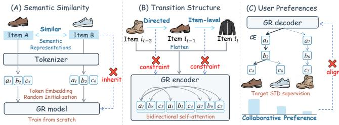
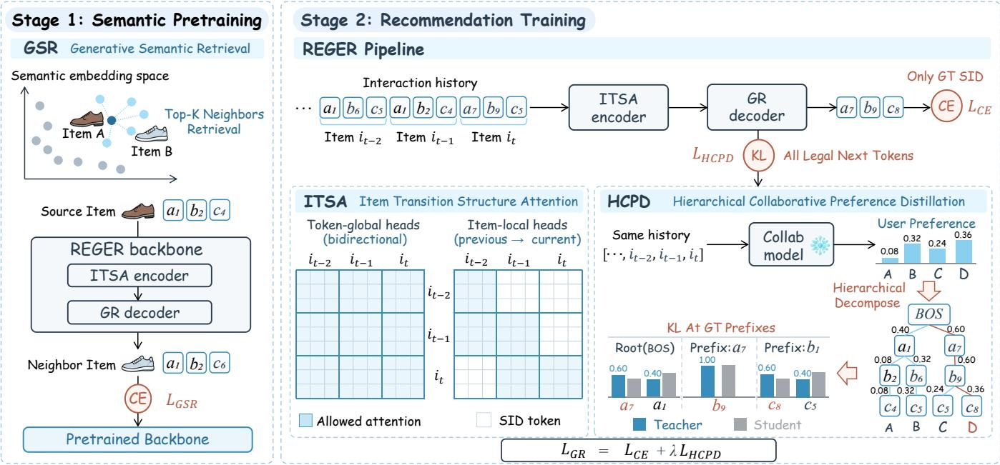
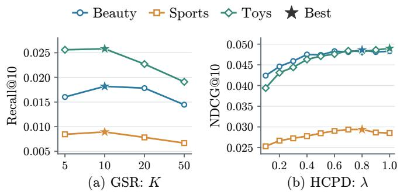
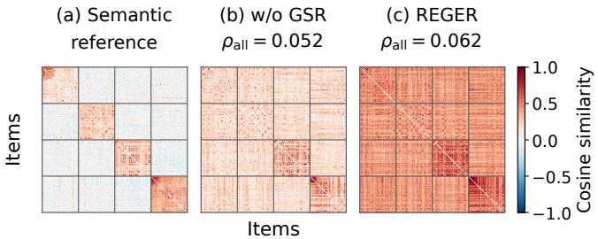
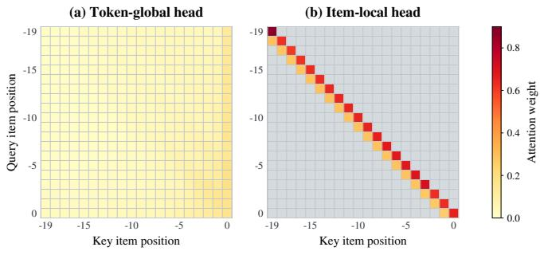
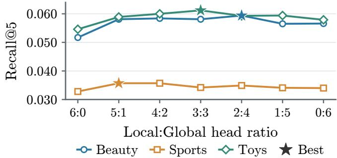

# REGER: Modeling inter-item Relations with Semantic IDs for Generative Recommendation

Yuxi Huang   
University of Electronic Science and   
Technology of China   
Chengdu, China   
yuxi.h.cs@gmail.com

Zihan Li University of Electronic Science and Technology of China Chengdu, China 202621081431@std.uestc.edu.cn

Silin Zhou   
University of Electronic Science and   
Technology of China   
Chengdu, China   
zhousilinxy@gmail.com   
Shen Gao†   
University of Electronic Science and   
Technology of China   
Chengdu, China   
shengao@uestc.edu.cn

Gangming Guo University of Electronic Science and Technology of China Chengdu, China guogm1016@gmail.com

Chenhao Wang   
University of Electronic Science and   
Technology of China   
Chengdu, China   
chenhao.wang@std.uestc.edu.cn   
Shuo Shang†   
University of Electronic Science and   
Technology of China   
Chengdu, China   
jedi.shang@gmail.com

Pei Ke University of Electronic Science and Technology of China Chengdu, China kepei1106@outlook.com

## Abstract

Personalized recommendation depends on learning semantic and collaborative relations among items from online content and user interactions. Generative recommendation (GR) ofers a promising paradigm by autoregressively generating discrete semantic IDs (SIDs) of items. However, randomly initialized SID token embeddings and GR models trained from scratch do not directly inherit the semantic relations inherent in items, while inter-item collabo- rative relations are learned largely implicitly through token-level attention and next-token supervision. To address this limitation, we propose REGER, a unified framework that explicitly incorporates inter-item relations into semantic pretraining, history encoding, and SID generation. We pretrain the GR model through generative semantic retrieval, enabling it to inherit inter-item semantic similarity by learning to generate semantic neighbors’ SIDs. We combine global attention with local attention aligned with SID boundaries to capture historical context and directed transitions be- tween adjacent items. We further develop a theoretical framework for hierarchical preference decomposition over the SID prefix tree, proving an exact factorization of collaborative preference distributions and a weighted decomposition of item-level KL divergence into prefix-conditional KL divergences. Building on this analysis, we distill a discriminative teacher’s full conditional distributions

†Shen Gao and Shuo Shang are corresponding authors.

over all legal next tokens at ground-truth prefixes along the tar- get SID path, jointly optimizing this objective with cross-entropy. Extensive experiments on real-world datasets demonstrate con- sistent improvements over existing GR baselines and support the efectiveness of the proposed preference distillation.

## CCS Concepts

• Information systems → Recommender systems.

## Keywords

Generative Recommendation, Semantic ID, Knowledge Distillation, Collaborative information

## ACM Reference Format:

Yuxi Huang, Silin Zhou, Chenhao Wang, Zihan Li, Gangming Guo, Pei Ke, Shen Gao, and Shuo Shang. 2026. REGER: Modeling inter-item Relations with Semantic IDs for Generative Recommendation. In . ACM, New York, NY, USA, 13 pages. https://doi.org/10.1145/nnnnnnn.nnnnnnn

## 1 Introduction

Generative recommendation (GR) [8, 12] has emerged as a promising paradigm that captures user preferences end-to-end by autore-gressively generating discrete token sequences representing items. Unlike traditional discriminative methods that learn continuous collaborative embeddings for individual items, GR typically uses residual quantization to map pretrained item representations into compact semantic identifiers (SIDs), where common prefixes reflect semantic similarity and shared tokens facilitate knowledge trans- fer across items [31, 39]. Realizing this potential requires efective modeling of semantic and collaborative relations among items in discrete token sequences.

Existing eforts have largely focused on improving item tokenization to better capture item relations. Some methods draw on subword tokenization to merge fine-grained tokens into larger units based on co-occurrence pattern [11, 26], while others incorporate collaborative information into SIDs by aligning semantic representations with collaborative item embeddings [40, 46]. Recent work also combines GR with dense matching from traditional recommenders through hybrid retrieval, exploiting the complementary strengths of the two paradigms [2, 41]. Furthermore, GFlowGR[36] incorporates collaborative signals into item-level rewards to guide SID generation through flow balance objectives, while TopoTok [24] preserves item neighborhood relations during tokenization through topology distillation at multiple granularities. Despite these advances, an inherent bottleneck remains in GR: how to incorporate inter-item relations in continuous embedding space into the modeling and generation of discrete token sequences.

  
b₂ c₄ c₄     Figure 1: Challenges in explicitly modeling inter-item seman-The GR model does not inheritb₆tic and collaborative relations in a standard GR framework: Embedding(A) semantic similarity relations arising from item text, (B) directed transition relations from the previous to the current item in the interaction history, and (C) ranking relations among candidate items induced by user preferences.

Modeling inter-item relations is central to capturing user preferences in sequential recommendation [15, 37]. Item text provides semantic cues for identifying potential substitutes and complements [25], while co-occurrence and transition patterns in user interaction histories provide collaborative signals that characterize behavioral associations between items [38]. Moreover, diferences in a user’s preference strengths across candidate items give rise to relative preference relations among them, providing the basis for personalized ranking [18]. These relations are defined at the item level, whereas GR uses SID tokens as its basic modeling units, leaving inter-item relations to be learned implicitly.

As shown in Fig. 1, this bottleneck manifests as three challenges in a standard encoder-decoder GR framework. Challenge 1: Semantic Similarity. Although shared prefixes preserve some semantic structure, randomly initialized token embeddings and a GR model trained from scratch do not directly inherit the semantic similarity relations captured by continuous item representations. Challenge 2: Transition Structure. During history encoding, user interaction histories are flattened into SID token sequences, and the encoder integrates token information through bidirectional self-attention. However, its attention structure does not explicitly impose local constraints that respect complete SID boundaries and capture directed transitions between adjacent items. Challenge 3: User Preference. During generation, GR relies on next-token cross-entropy (CE) to maximize the likelihood of the target SID. However, this single-target supervision does not fully exploit the set of relevant candidate items or explicitly align generation with collaborative preference relations between users and candidate items, leaving inter-item competitive relations without explicit constraints. GR therefore needs to explicitly model inter-item relations when learning item semantics, encoding interaction histories, and generating recommendations.

To address these challenges, we propose a unified Generative Recommendation framework that explicitly models semantic and collaborative Relations among items, termed REGER. For Challenge 1, we design a Generative Semantic Retrieval (GSR) pretraining task, where the encoder takes an item’s SID as input and the decoder generates the SID of a neighboring item in continuous semantic representation space. The resulting initialization enables both SID token embeddin s and the GR model to inherit inter-item semantic similarity relations before learning user preferences from interactions. For Challenge 2, we propose Item Transition Structure Attention (ITSA), which combines token- lobal and item-local attention heads in the history encoder. The former capture depen- dencies among tokens across the entire interaction history through bidirectional self-attention, while the latter use local attention win- dows aligned with complete SID boundaries to jointly attend to tokens of the current item and its immediate redecessor. This design integrates information within each item while introducing directed transition constraints, allowing global context and local transition structure to complement each other. For Challenge 3, we organize SIDs into a prefix tree and establish a theoretical frame- work for the hierarchical decomposition of collaborative preference distributions based on the nested item sets associated with its pre- fixes. We prove that the item preference distribution estimated by a discriminative recommender can be exactly factorized into conditional distributions over legal next tokens at each prefix. We further derive a decomposition of item-level KL divergence into a weighted sum of prefix-conditional KL divergences. Building on this theoretical analysis, we propose Hierarchical Collaborative Preference Distillation (HCPD), which aligns the teacher’s and generator’s full conditional distributions over all legal next tokens at the ground- truth prefixes along the target SID path. We jointly optimize this distillation objective with CE so that, given a user’s interaction history, collaborative preference relations among candidate items directly guide SID generation.

Our main contributions are summarized as follows:

❶ We identify inherent challenges in modeling inter-item relations in GR in terms of semantic similarity, transition structure, and user preferences. We propose REGER, a unified generative recommendation framework, to address these challenges.

❷ We establish a theoretical framework that exactly factorizes item preference distributions over SID prefix trees and decomposes itemlevel KL into weighted prefix-conditional KL terms. Building on this, we develop the HCPD objective to guide SID generation.

❸ Experiments on six real-world benchmarks demonstrate REGER’s consistent gains from explicit inter-item relation modeling and validate the efectiveness and eficiency of HCPD.

## 2 Related Work

## 2.1 Generative Recommendation

GR uses item tokenization to encode prior knowledge of inter-item relations into SIDs. TIGER [31] pioneered the use of residual quantization in GR to learn semantic codes by reconstructing item content representations. Subsequent research has focused on incorporating collaborative signals into SID and aligning tokenization with recommendation objectives. LETTER [34] introduces collaborative alignment and code diversity regularization, while ETEGRec [22] alternates between tokenizer and recommender updates using align- ment objectives. Other studies reconsider how item tokens are organized and represented. ActionPiece [11] learns merge rules over unordered feature sets using co-occurrences within items and across adjacent interactions. SST [26] compresses history-side item tokens into semantic subwords while retaining fixed-length SIDs as generation targets. DECOR [23] preserves token assignments, combines frozen codebook embeddings with learnable collaborative embeddings, and refines token representations through contextual composition. However, the semantic organization of SIDs does not by itself ensure that the generator learns the semantics of complete items and the relations among them.

## 2.2 Inter-item Relation Modeling

Discriminative recommenders exploit inter-item relations through transition structures, representation geometry, and ranking super vision [13, 18, 38]. In LLM-based recommendation, explicit relation modeling is introduced through attention structures and collabo- rative supervision. IAM [44] alternates between attention layers restricted to tokens within each item title and across items, separating title semantics from collaborative relations. TCA [20] nor-malizes collaborative scores over prefix-compatible items and sums the probabilities of items sharing the same next token to construct soft labels for LLM-based item-title generation. Recent work also introduces relational supervision into GR. APAO [42] optimizes pre-fix rankings with pointwise or pairwise objectives and adaptively emphasizes underperforming prefixes, while GFlowGR [36] incor-porates collaborative signals into item-level terminal rewards and guides SID generation through flow balance objectives. However, GR uses discrete SID tokens shared across items as its basic modeling units, rather than continuous representations of entire items or text tokens processed by pretrained LLMs. Relations among com-plete items must therefore be expressed through token composition and generation, yet the connection between item-level relations and token-level dependencies remains largely implicit in GR models.

## 3 Preliminary: Generative Recommendation

## 3.1 Item Tokenization

Item tokenization maps continuous item representations into dis crete semantic identifiers (SIDs). A widely adopted approach in academic and industrial GR applies residual quantization (RQ) to item semantic embeddings extracted using pretrained language models [6, 16]. Let $\mathbf { x } _ { i }$ denote the semantic embedding of item � in the quantization space, and let $C _ { \ell } = \{ \mathbf { c } _ { \ell , k } \} _ { k = 1 } ^ { K }$ be the codebook at level ℓ. Starting from $\mathbf { r } _ { 0 } = \mathbf { x } _ { i }$ , RQ successively selects the nearest codeword and updates the residual:

$$
s _ { i } ^ { \ell } = \arg \operatorname* { m i n } _ { k } \| \mathbf { r } _ { \ell - 1 } - \mathbf { c } _ { \ell , k } \| _ { 2 } ^ { 2 } , \qquad \mathbf { r } _ { \ell } = \mathbf { r } _ { \ell - 1 } - \mathbf { c } _ { \ell , s _ { i } ^ { \ell } } .\tag{1}
$$

After � levels, the selected indices $( s _ { i } ^ { 1 } , \ldots , s _ { i } ^ { L } )$ encode item seman- tics in a coarse-to-fine manner. SIDs express inter-item semantic relations through shared prefixes and codewords: shared prefixes group semantically similar items, while reused codewords serve as common semantic components in their quantized representations. Following established practice [12, 31], we adopt a residual-quantized variational autoencoder (RQ-VAE) [17] for item tokenization and append an additional token to distinguish items with identical semantic codes, yielding the final SID $\mathbf { \overrightarrow { s } } _ { i } = ( s _ { i } ^ { 1 } , \dots , s _ { i } ^ { L } , s _ { i } ^ { L + 1 } )$

## 3.2 Problem Formulation

Let $H _ { u } = \left( i _ { 1 } , \ldots , i _ { n } \right)$ denote the chronologically ordered interaction history of user �. Each item � is tokenized into a sequence of $L + 1$ discrete tokens, forming its SID s�. Given the concatenated SIDs of $H _ { u } ,$ GR predicts the next item $i _ { n + 1 }$ by autoregressively gener- ating its SID $\mathbf { s } _ { i _ { n + 1 } } = ( s _ { i _ { n + 1 } } ^ { 1 } , \dots , s _ { i _ { n + 1 } } ^ { L + 1 } )$ . As in large language model training, GR typically learns through next-token prediction using the cross-entropy (CE) loss under teacher forcing [16, 30, 42]. Each prediction is conditioned on $H _ { u }$ and the ground-truth prefix $\mathbf { s } _ { i _ { n + 1 } } ^ { < \ell } = ( \mathsf { B O S } , s _ { i _ { n + 1 } } ^ { 1 } , \ldots , s _ { i _ { n + 1 } } ^ { \ell - 1 } )$ :

$$
\begin{array} { r l r } {  { \mathcal L _ { \mathrm { G R } } = \mathcal L _ { \mathrm { C E } } = - \sum _ { \ell = 1 } ^ { L + 1 } \log \hat { p } _ { \theta } ( s _ { i _ { n + 1 } } ^ { \ell } \mid H _ { u } , \mathbf { s } _ { i _ { n + 1 } } ^ { < \ell } ) } } \\ & { } & { = - \sum _ { \ell = 1 } ^ { L + 1 } \log \frac { \exp ( z _ { \ell , s _ { i _ { n + 1 } } ^ { \ell } } ) } { \sum _ { v \in \mathcal V } \exp ( z _ { \ell , v } ) } . } \end{array}\tag{2}
$$

Here, $_ \mathrm { ~  ~ }$ denotes the SID token vocabulary, � denotes the model parameters, and $z _ { \ell , v }$ is the logit assigned to token � at decoding step ℓ. This objective uses the positive item’s SID as the sole training target, without explicitly supervising fine-grained preference relations among competing tokens, leaving inter-item competitive relations to be learned implicitly.

## 4 Methodology

Fig. 2 presents the two-stage training pipeline of REGER. GSR first pretrains the encoder-decoder backbone to generate semantic neigh- bors’ SIDs from source-item SIDs (Section 4.1). The encoder em-ploys ITSA in both stages, combining token-global and item-local attention heads (Section 4.2). For HCPD, we first derive hierarchical decompositions of item preference distributions and item-level KL divergence. Building on these results, we align the teacher and generator conditional distributions over all legal next tokens at ground-truth SID prefixes and jointly optimize this distillation ob- jective with CE during recommendation training (Section 4.3).

## 4.1 Generative Semantic Retrieval

Recent analysis shows that SIDs preserve coarse item organization but do not fully retain fine-grained neighborhood relations in the original continuous representation space [33]. Although prior work reuses pretrained quantization codebook embeddings to enrich SID token representations [23], these embeddings are pretrained for semantic reconstruction, which does not explicitly constrain fine-grained inter-item neighborhood relations or directly optimize the recommendation objective. Moreover, advances in LLM-based GR highlight the value of aligning SID token embeddings with a pretrained LLM’s semantic space before recommendation finetuning [4]. However, encoder-decoder GR models initialized from scratch lack such a pretrained semantic space.

  
Figure 2: The overall framework of REGER.

Indeed, item content provides cues for identifying inter-item semantic relations even before user interactions are observed. Build- ing on this intuition, we use semantic neighborhoods derived from item content to construct inter-item supervision without relying on user interaction histories, enabling the GR model to learn semantic relations among items before learning user preferences.

To this end, we design a Generative Semantic Retrieval (GSR) pretraining task. Let $\mathbf { e } _ { i }$ denote the text embedding of item � used as input to the RQ-VAE tokenizer. We retrieve its top-� semantic neighbors using cosine similarity:

$$
N _ { k } ( i ) = \underset { j \in \ b { J } \backslash \{ i \} } { \operatorname { T o p K } } \ \frac { \mathbf { e } _ { i } ^ { \top } \mathbf { e } _ { j } } { \| \mathbf { e } _ { i } \| _ { 2 } \| \mathbf { e } _ { j } \| _ { 2 } } ,\tag{3}
$$

where I denotes the item catalog and TopK returns the item indices with the � highest similarity scores. Each source-neighbor pair (�, �) with $j \in N _ { k } ( i )$ forms a pretraining instance: the encoder takes SID $\mathbf { s } _ { i }$ as input, and the decoder generates the neighbor SID $\mathbf { \boldsymbol { s } } _ { j }$

Following the teacher-forcing formulation in Eq. (2), we optimize GSR over all source-neighbor pairs using the CE loss:

$$
\mathcal { L } _ { \mathrm { G S R } } = - \sum _ { i \in I } \sum _ { j \in N _ { k } ( i ) } \sum _ { \ell = 1 } ^ { L + 1 } \log p _ { \theta } \left( s _ { j } ^ { \ell } \mid s _ { i } , s _ { j } ^ { < \ell } \right) .\tag{4}
$$

Pretraining jointly updates the SID token embeddings and the encoder-decoder backbone, and the resulting parameters initialize subsequent recommendation training. To support the transfer of semantic priors to collaborative preference learning, we select the pretraining checkpoint based on recommendation performance on the validation set. In addition, constructing multiple sourceneighbor pairs with each item’s complete SID as input encourages the encoder to learn intra-item token dependencies through self- attention during pretraining, while providing semantic supervision for items with sparse interactions.

## 4.2 Item Transition Structure Attention

GSR provides a semantic initialization, while history encoding further requires modeling relations among items in successive interactions. In GR, interaction histories are typically flattened into SID token sequences and encoded through bidirectional self-attention, which jointly handles intra-item dependencies and inter-item behavioral transitions. SST [26] observes that composing item rep- resentations from their constituent tokens can consume excessive attention, resulting in intra-item attention overload. However, user interactions occur at the level of complete items and exhibit tempo- ral predecessor and successor relations, calling for explicit model- ing of directed inter-item transitions. Meanwhile, recent work on LLM-based recommendation highlights the complementary value of recent interactions for capturing current interests and broader historical context for modeling longer-term preferences [3, 28]. Together, these considerations motivate explicitly emphasizing directed transitions between adjacent items while preserving intraitem semantic integration and global historical dependencies.

Inspired by these observations, we design ITSA to combine tokenglobal and item-local attention heads within each encoder layer of the GR backbone, with a specified ratio between the two head types. We retain bidirectional interactions within each SID because its tokens jointly represent a complete item, and their quantization order does not encode the temporal order of user interactions. The two types of heads difer in their attention masks. Following the T5 backbone [30], the output of head ℎ is computed as

$$
\mathbf { O } _ { h } = \operatorname { s o f t m a x } \left( \mathbf { Q } _ { h } \mathbf { K } _ { h } ^ { \top } + \mathbf { B } _ { h } + \mathbf { M } _ { h } \right) \mathbf { V } _ { h } ,\tag{5}
$$

where ${ \sf Q } _ { h } , { \sf K } _ { h }$ , and $\mathbf { V } _ { h }$ are the query, key, and value projections of the encoder hidden states, $\mathbf { B } _ { h }$ is the relative position bias, and ${ \bf M } _ { h }$ is the attention mask.

Token-global heads. These heads apply standard bidirectional self-attention over the entire interaction history. For valid query and key positions $\boldsymbol { p }$ and �, we set $M _ { p q } ^ { \mathrm { g l o b a l } } = 0 $ , allowing each token to integrate intra-item information and capture inter-item depen dencies across the full history. Direct interactions between tokens from nonadjacent items provide broader context for modeling user preferences, complementing the directed transitions captured by item-local heads.

Item-local heads. These heads restrict attention to the complete SIDs of the current item and its immediate predecessor. Since the internal order of SID tokens does not encode predecessor-successor relations between user interactions, we preserve bidirectional interactions within each SID, allowing every token to incorporate information from the other tokens of its own item and thereby supporting semantic integration within both the preceding and current items. Let $g ( \boldsymbol { p } )$ map token position $\boldsymbol { p }$ to the corresponding item position in $H _ { u }$ . The local mask is defined as

$$
M _ { \mathcal { P } q } ^ { \mathrm { l o c a l } } = \left\{ \begin{array} { l l } { 0 , } & { g ( q ) \in \{ g ( p ) - 1 , g ( p ) \} , } \\ { - \infty , } & { \mathrm { o t h e r w i s e } . } \end{array} \right.\tag{6}
$$

Thus, for $t > 1 ,$ , each token of item �� can attend only to tokens of $i _ { t }$ and its immediate predecessor $i _ { t - 1 }$ , with attention weights normalized jointly over the two complete SIDs. For the first item, the window contains only its own SID. This mask provides a directed local pathway from $i _ { t - 1 }$ to $i _ { t : }$ , introducing an explicit structural bias toward short-range inter-item transitions.

The outputs of both head types are concatenated and passed through the standard output projection to integrate global historical context with local transition structure. All heads mask padding positions. Both head types have the same parameter count per head, and ITSA changes only the masks of the existing heads, leaving the GR backbone’s parameter count unchanged. As shown in Fig. 2, the same ITSA encoder is used in both stages: during GSR, both head types attend within the single source-item SID, whereas during recommendation training, item-local heads additionally attend to the immediately preceding SID.

## 4.3 Hierarchical Collaborative Preference Distillation

In this section, we first analyze hierarchical decompositions of item preference distributions and their KL divergence over the SID prefix tree, then introduce HCPD as a tractable distillation objective along ground-truth SID paths.

4.3.1 Preference and KL Decomposition. Item SIDs can be orga-nized into a prefix tree, where each leaf corresponds to a unique item and the path from the root specifies its complete SID [9]. During decoding, the root corresponds to the initial BOS token, and each internal node represents a SID prefix.

For a prefix a, let $\boldsymbol { \tau } ( \mathbf { a } )$ denote the set of items whose SIDs extend this prefix, with $\mathcal { I } ( \mathsf { B O S } ) = \mathcal { I }$ . For each nonterminal prefix, let $\mathcal { V } ( \mathbf { a } )$ denote the set of legal next tokens, and let a ⊕ � denote the prefix obtained by appending token �. The sets $\{ \bar { I } ( \mathbf { a } \oplus \upsilon ) \} _ { \upsilon \in \mathcal { V } ( \mathbf { a } ) }$ form a disjoint partition of $\boldsymbol { \tau } ( \mathbf { a } )$

Given a user interaction history $H _ { u }$ , let $P$ denote a strictly positive item preference distribution over I. We omit $H _ { u }$ from the notation for brevity. The probability mass of a prefix and the condi- tional probability of a legal next token are defined as

$$
m _ { P } ( \mathbf { a } ) = \sum _ { i \in \cal { I } ( \mathbf { a } ) } P ( i ) , \qquad P ( v \mid \mathbf { a } ) = \frac { m _ { P } ( \mathbf { a } \oplus v ) } { m _ { P } ( \mathbf { a } ) } .\tag{7}
$$

Each conditional distribution therefore assigns probability mass to the item subsets corresponding to alternative next tokens.

Theorem 4.1 (Exact preference factorization). For any item � with $S I D \pmb { \mathscr { s } } _ { i } = ( \pmb { \mathscr { s } } _ { i } ^ { 1 } , \dots , \pmb { \mathscr { s } } _ { i } ^ { L + 1 } )$ , its preference probability can be exactly factorized as

$$
P ( i ) = \prod _ { \ell = 1 } ^ { L + 1 } P \big ( s _ { i } ^ { \ell } \mid \mathbf { s } _ { i } ^ { < \ell } \big ) .\tag{8}
$$

This factorization expresses item preferences as conditional distributions over legal next tokens. Applying the chain rule of KL divergence to the prefix tree yields the following decomposition [1]. Let � denote another strictly positive item distribution for the same history, with its prefix masses and conditional distributions defined in the same way. Let $\mathcal { P }$ denote the set of all nonterminal prefixes, including the root.

Theorem 4.2 (Hierarchical KL decomposition). The KL divergence between $P$ and $Q$ can be exactly decomposed as

$$
D _ { \mathrm { K L } } ( P \| Q ) = \sum _ { { \bf a } \in \mathcal P } m _ { P } ( { \bf a } ) D _ { \mathrm { K L } } ( P ( \cdot \mid { \bf a } ) \| Q ( \cdot \mid { \bf a } ) ) .\tag{9}
$$

Proofs of both theorems are provided in Appendix D.

The item-level KL divergence is therefore a weighted sum of con- ditional KL divergences over all nonterminal prefixes, where each weight is the corresponding prefix probability mass under �. These results connect item-level preferences to conditional next-token distributions and motivate conditional preference matching. HCPD uses a tractable surrogate that evaluates these conditional terms along ground-truth SID paths, with its expected prefix weighting clarified below.

4.3.2 Distillation and Training Objectives. We use a frozen discriminative recommender as the teacher to provide collaborative pref- erences over candidate items. For this purpose, we seek a teacher with distinguishable item representations that capture user-specific preference diferences, so that its scores reflect the relative rele- vance of competing candidates given each user’s interaction history. Following Pctx [48] in the choice of auxiliary recommender, we adopt DuoRec [29], which uses contrastive learning to mitigate rep- resentation degeneration. We analyze the efect of teacher choice in Appendix C.

Given the same interaction history $H _ { u } ,$ let $r _ { u } ( i )$ denote its score for item �. The teacher’s item preference distribution is

$$
P _ { T } ( i ) = \frac { \exp ( r _ { u } ( i ) ) } { \sum _ { j \in \mathcal { T } } \exp ( r _ { u } ( j ) ) } .\tag{10}
$$

Following Eq. (7), we obtain the teacher’s conditional preference over each legal next token:

$$
q _ { T } ( v \mid \mathbf { a } ) = \frac { \sum _ { i \in J ( \mathbf { a } \oplus v ) } P _ { T } ( i ) } { \sum _ { i \in J ( \mathbf { a } ) } P _ { T } ( i ) } , \qquad v \in \mathcal { V } ( \mathbf { a } ) .\tag{11}
$$

This conditional distribution transfers the teacher’s relative prefer- ences among complete items to the alternative branches available at each prefix.

For distillation, we normalize the generator’s probabilities over the same legal next-token set:

$$
q _ { \theta } ( v \mid \mathbf { a } ) = { \frac { { \mathcal { P } } _ { \theta } ( v \mid H _ { u } , \mathbf { a } ) } { \sum _ { w \in { \mathcal { V } } ( \mathbf { a } ) } { \mathcal { P } } _ { \theta } ( w \mid H _ { u } , \mathbf { a } ) } } , \qquad v \in { \mathcal { V } } ( \mathbf { a } ) .\tag{12}
$$

These normalized transitions induce an item distribution $Q _ { \theta } ( i ) =$ $\textstyle \prod _ { \ell = 1 } ^ { L + 1 } q _ { \theta } ( s _ { i } ^ { \ell } \mid s _ { i } ^ { < \ell } )$ over the catalog, allowing Theorem 4.2 to be ap- plied to $P _ { T }$ and $Q _ { \theta }$ . This distribution is used for distillation analysis, while inference uses the full-vocabulary probabilities $\hbar \theta$

Hierarchical Collaborative Preference Distillation. For the target item $i _ { n + 1 } ,$ let $\mathbf { a } _ { \ell } = \mathbf { s } _ { i _ { n + } } ^ { < \ell }$ denote its ground-truth prefix at decoding step ℓ. We align the teacher and generator distributions at these prefixes using

$$
\mathcal { L } _ { \mathrm { H C P D } } = \frac { 1 } { L + 1 } \sum _ { \ell = 1 } ^ { L + 1 } D _ { \mathrm { K L } } ( q _ { T } ( \cdot  { | } \mathbf { a } _ { \ell } ) | | q _ { \theta } ( \cdot  { | } \mathbf { a } _ { \ell } ) ) .\tag{13}
$$

Each conditional KL compares the full distributions over all legal next tokens, including alternatives to the ground-truth token. Legal branches represent disjoint subsets of catalog items, so matching their probabilities provides explicit supervision on inter-item collaborative preferences. The target SID selects which prefixes receive supervision, while the teacher specifies preferences among their competing branches. Ground-truth paths align distillation with CE, concentrating preference supervision on the prefixes of observed next-item targets. Given a fixed interaction history, the expected loss weights each conditional KL by its prefix probability under the observed-target distribution, scaled by $1 / ( L + 1 )$ . These probabili- ties generally difer from the teacher prefix masses in Eq. (9) with $P = P _ { T }$ . Thus, the ground-truth-path objective does not generally reproduce the scaled full-tree KL, as detailed in Appendix D.3.

Joint training objective. We jointly optimize the HCPD objective and the CE objective in Eq. (2):

$$
\begin{array} { r } { \mathcal { L } _ { \mathrm { G R } } = \mathcal { L } _ { \mathrm { C E } } + \lambda \mathcal { L } _ { \mathrm { H C P D } } , } \end{array}\tag{14}
$$

where � controls distillation strength. At inference, we use uncon- strained beam search with cumulative token log-probabilities from the full-vocabulary softmax, without the teacher.

## 5 Experiments

## 5.1 Experimental Setting

Datasets. We evaluate REGER on Beauty, Sports, and Toys from Amazon Reviews 2014 [7]. Following standard GR protocols [11, 31], we apply 5-core filtering so that each remaining user and item has at least five interactions. For each user, interactions are ordered chronologically, and input histories are truncated to the 20 most recent interactions for all methods. Dataset statistics and more details are provided in Appendix A.1. We further evaluate REGER on Instruments, Scientific, and Games from Amazon Reviews 2023 [10], with results reported in Appendix B.

Evaluation settings. We evaluate all methods using Recall@� (R@�) and NDCG@� (N@�) with $K \in \{ 5 , 1 0 \}$ . To ensure robust results, each test is repeated three times with diferent random seeds {2024, 2025, 2026}.

Baselines. On the Amazon Reviews 2014 benchmarks, we compare REGER with three groups of baselines: (1) Discriminative recommendation: SASRec [14], FDSA [43], BERT4Rec [32], S3-Rec [49] and DuoRec [29]; (2) Generative recommendation: TIGER [31], LET-TER [34], EAGER [35], UNGER [40], ReSID [19], ETEGRec [22], DIGER [5], ActionPiece [11], and TIGER-SST [26]; (3) Hybrid recommendation: LIGER [41] and MemGen-GR [2]. To evaluate the efectiveness of HCPD, we further compare it with alternative training objectives for GR: TCA [20], TCA-Aux [20], APAO-pointwise [42], GFlowGR-DB [36], and GFlowGR-TB [36]. Descriptions of all baselines, including the additional methods evaluated on the Amazon Reviews 2023 benchmarks, are provided in Appendix A.2.

## 5.2 Main Results

Table 1 presents the results on the Amazon Reviews 2014 bench- marks. We make the following key observations:

Overall efectiveness. On the 2014 benchmarks, DuoRec outperforms the generative baselines in most settings, consistent with previous observations that strong discriminative recommenders can outperform generative retrieval models [41]. Nevertheless, REGER outperforms all generative and hybrid baselines across the three datasets and all metrics, while also outperforming DuoRec in most settings. Even on Toys, where its Recall remains lower than DuoRec’s, REGER achieves comparable or slightly better NDCG. These results support the efectiveness of explicitly incorporating inter-item semantic and collaborative relations into GR.

Semantic and collaborative priors. REGER consistently outperforms methods that incorporate semantic and collaborative informa- tion into SIDs or jointly optimize tokenizer and recommender such as UNGER and ETEGRec, across all three datasets. These results further highlight the importance of explicitly learning inter-item relations within the GR model. The value of these relations depends not only on the information preserved in SIDs but also on how the generator uses these relations during item encoding and generation. Learning item relations within the generator. ActionPiece and TIGER-SST consistently outperform TIGER, highlighting the value of modeling inter-item behavioral transitions during token-level encoding. REGER achieves further gains while using fixed-length SIDs. These results show that residual-quantized SIDs can support stronger recommendation performance through explicit inter-item relation learning within the generator.

Comparison with hybrid recommendation. REGER outperforms LIGER and MemGen-GR across all three datasets and metrics while relying solely on SID generation at inference. These results highlight the value of improving the GR model’s own training: semantic pretraining and recommendation training explicitly guided by inter-item semantic and collaborative relations provide an efec- tive way to strengthen its recommendation capability.

## 5.3 Ablation Study

Table 3 presents the results of our ablation study evaluating the contributions of GSR, ITSA, and HCPD. Removing any component consistently degrades performance across all three datasets.

Table 1: Performance comparison on the Amazon Reviews 2014 benchmarks. Results are reported as mean ± (100 × sample standard deviation) over three random seeds. Bold and underlined values indicate the best and second-best results, respectively. DuoRec serves as the frozen teacher for HCPD. Results on the Amazon Reviews 2023 benchmarks are reported in Appendix B.
<table><tr><td rowspan="2">Methods</td><td colspan="4">Beauty</td><td colspan="4">Sports</td><td colspan="4">Toys</td></tr><tr><td>R@5</td><td>R@10</td><td>N@5</td><td>N@10</td><td>R@5 Discriminative Recommendation</td><td>R@10</td><td>N@5</td><td>N@10</td><td>R@5</td><td>R@10</td><td>N@5</td><td>N@10</td></tr><tr> colspan="12">0.0411±0.24</td></tr><tr><td>0.0641±0.27</td><td>0.0260±0.16</td><td>0.0333±0.17</td><td>0.0224±0.09</td><td>0.0354±0.08</td><td>0.0146±0.07</td><td>0.0188±0.08</td><td>0.0497±0.11</td><td>0.0727±0.21</td><td>0.0333±0.11</td><td></td><td>0.0408±0.13</td><td>FDSA</td></tr><tr><td>0.0240±0.17</td><td>0.0397±0.26</td><td>0.0152±0.08</td><td>0.0202±0.11</td><td>0.0153±0.18</td><td>0.0255±0.27</td><td>0.0101±0.13</td><td>0.0133±0.15</td><td>0.0321±0.05</td><td>0.0479±0.18</td><td>0.0217±0.09</td><td>0.0268±0.13</td><td>BERT4Rec</td></tr><tr><td>0.0272±0.06</td><td>0.0429±0.03</td><td>0.0176±0.06</td><td>0.0226±0.05</td><td>0.0118±0.01</td><td>0.0202±0.07</td><td>0.0073±0.01</td><td>0.0101±0.03</td><td>0.0224±0.13</td><td>0.0360±0.19</td><td>0.0147±0.09</td><td>0.0191±0.11</td><td>S3-Rec DuoRec</td></tr><tr><td>0.0378±0.09 0.0580±0.03</td><td>0.0634±0.19</td><td>0.0236±0.08</td><td>0.0319±0.11</td><td>0.0235±0.12</td><td>0.0379±0.21</td><td>0.0155±0.12</td><td>0.0201±0.15</td><td>0.0362±0.26</td><td>0.0584±0.34</td><td>0.0229±0.18</td><td>0.0300±0.19</td><td></td></tr><tr><td></td><td>0.0875±0.11</td><td>0.0358±0.04</td><td>0.0454±0.00</td><td>0.0326±0.12</td><td>0.0493±0.19</td><td>0.0194±0.02</td><td>0.0248±0.03</td><td>0.0664±0.09</td><td>0.0961±0.07</td><td>0.0397±0.08</td><td>0.0493±0.04</td><td>Generative Recommendation</td></tr><tr><td colspan="14">TIGER</td></tr><tr><td>0.0435±0.09</td><td>0.0673±0.16</td><td>0.0291±0.09</td><td>0.0367±0.11</td><td>0.0283±0.17</td><td>0.0432±0.26</td><td>0.0183±0.12</td><td>0.0231±0.15</td><td>0.0422±0.45</td><td>0.0659±0.57</td><td>0.0279±0.32</td><td>0.0355±0.35</td><td>LETTER</td></tr><tr><td>0.0476±0.13</td><td>0.0723±0.11</td><td>0.0329±0.11</td><td>0.0409±0.08</td><td>0.0264±0.09</td><td>0.0409±0.15</td><td>0.0170±0.08</td><td>0.0216±0.10</td><td>0.0424±0.26</td><td>0.0641±0.24</td><td>0.0279±0.16</td><td>0.0348±0.16</td><td>EAGER</td></tr><tr><td>0.0448±0.13</td><td>0.0665±0.06</td><td>0.0304±0.12</td><td>0.0373±0.10</td><td>0.0240±0.02</td><td>0.0377±0.02</td><td>0.0154±0.02</td><td>0.0198±0.02</td><td>0.0462±0.14</td><td>0.0656±0.34</td><td>0.0323±0.02</td><td>0.0385±0.08</td><td>UNGER</td></tr><tr><td>0.0433±0.11</td><td>0.0677±0.01</td><td>0.0283±0.06</td><td>0.0362±0.03</td><td>0.0259±0.04</td><td>0.0408±0.11</td><td>0.0166±0.04</td><td>0.0214±0.06</td><td>0.0416±0.09</td><td>0.0665±0.10</td><td>0.0268±0.06</td><td>0.0348±0.04</td><td>ReSID</td></tr><tr><td>0.0475±0.08</td><td>0.0739±0.08</td><td>0.0321±0.02</td><td>0.0405±0.03</td><td>0.0273±0.06</td><td>0.0432±0.03</td><td>0.0178±0.07</td><td>0.0229±0.06</td><td>0.0407±0.14</td><td>0.0635±0.26</td><td>0.0267±0.12</td><td>0.0341±0.16</td><td>ETEGRec</td></tr><tr><td>0.0497±0.14</td><td>0.0759±0.23</td><td>0.0334±0.07</td><td>0.0419±0.10</td><td>0.0287±0.07</td><td>0.0455±0.05</td><td>0.0183±0.03</td><td>0.0237±0.02</td><td>0.0438±0.10</td><td>0.0682±0.13</td><td>0.0283±0.09</td><td>0.0362±0.08</td><td>DIGER</td></tr><tr><td>0.0460±0.13</td><td>0.0694±0.10</td><td>0.0302±0.11</td><td>0.0377±0.10</td><td>0.0263±0.15</td><td>0.0409±0.11</td><td>0.0169±0.10</td><td>0.0216±0.09</td><td>0.0418±0.18</td><td>0.0660±0.13</td><td>0.0271±0.12</td><td>0.0349±0.10</td><td>ActionPiece</td></tr><tr><td>0.0507±0.07</td><td>0.0772±0.03</td><td>0.0339±0.04</td><td>0.0424±0.02</td><td>0.0304±0.02</td><td>0.0473±0.05</td><td>0.0200±0.01</td><td>0.0254±0.02</td><td>0.0462±0.12</td><td>0.0729±0.11</td><td>0.0303±0.06</td><td>0.0389±0.06</td><td>TIGER-SST</td></tr><tr><td>0.0487±0.11</td><td>0.0722±0.13</td><td>0.0336±0.05</td><td>0.0411±0.05</td><td>0.0287±0.12</td><td>0.0445±0.17</td><td>0.0191±0.07</td><td>0.0242±0.08</td><td>0.0499±0.10</td><td>0.0742±0.02</td><td>0.0344±0.09</td><td></td><td></td></tr><tr><td></td><td></td><td></td><td></td><td></td><td>Hybrid Recommendation</td><td></td><td></td><td></td><td></td><td></td><td>0.0422±0.06</td><td></td></tr><tr><td colspan="9"></td><td colspan="3">LIGER MemGen-GR</td></tr><tr><td>0.0532±0.06 0.0502±0.20</td><td>0.0830±0.10 0.0748±0.20</td><td>0.0348±0.02</td><td>0.0444±0.03 0.0421±0.11</td><td>0.0304±0.04 0.0300±0.17</td><td>0.0480±0.04 0.0462±0.24</td><td>0.0197±0.02</td><td>0.0253±0.02</td><td>0.0510±0.08</td><td>0.0838±0.15</td><td>0.0314±0.07</td><td>0.0420±0.11</td><td></td></tr><tr><td></td><td></td><td>0.0342±0.11</td><td></td><td></td><td></td><td>0.0201±0.12</td><td>0.0253±0.14</td><td>0.0546±0.34</td><td>0.0796±0.33</td><td>0.0383±0.25</td><td>0.0464±0.25</td><td></td></tr><tr><td></td><td></td><td></td><td></td><td></td><td>Ours (GR)</td><td></td><td></td><td></td><td></td><td></td><td></td><td>REGER</td></tr><tr><td>0.0594±0.05</td><td>0.0870±0.19</td><td>0.0395±0.08</td><td>0.0484±0.13</td><td>0.0357±0.06</td><td>0.0545±0.12</td><td>0.0235±0.07</td><td>0.0296±0.08</td><td>0.0612±0.13</td><td>0.0934±0.07</td><td>0.0392±0.08</td><td>0.0496±0.07</td><td></td></tr></table>

Table 2: Comparison of training methods applied to TIGER on the Amazon Reviews 2014 benchmarks. Methods using a collaborative model adopt the same DuoRec. Bold and underlined values indicate the best and second-best results, respectively.
<table><tr><td rowspan="2">Method</td><td colspan="4">Beauty</td><td colspan="4">Sports</td><td colspan="4">Toys</td></tr><tr><td>R@5</td><td>R@10</td><td>N@5</td><td>N@10</td><td>R@5</td><td>R@10</td><td>N@5</td><td>N@10</td><td>R@5</td><td>R@10</td><td>N@5</td><td>N@10</td></tr><tr><td>TIGER</td><td>0.0435±0.09</td><td>0.0673±0.16</td><td>0.0291±0.09</td><td>0.0367±0.11</td><td>0.0283±0.17</td><td>0.0432±0.26</td><td>0.0183±0.12</td><td>0.0231±0.15</td><td>0.0422±0.45</td><td>0.0659±0.57</td><td>0.0279±0.32</td><td>0.0355±0.35</td></tr><tr><td>+ TCA</td><td>0.0431±0.13</td><td>0.0633±0.24</td><td>0.0295±0.08</td><td>0.0360±0.12</td><td>0.0256±0.17</td><td>0.0386±0.19</td><td>0.0170±0.10</td><td>0.0212±0.10</td><td>0.0472±0.22</td><td>0.0703±0.23</td><td>0.0317±0.07</td><td>0.0391±0.07</td></tr><tr><td>+ TCA-Aux</td><td>0.0480±0.29</td><td>0.0721±0.35</td><td>0.0325±0.20</td><td>0.0403±0.21</td><td>0.0289±0.07</td><td>0.0455±0.05</td><td>0.0188±0.08</td><td>0.0241±0.05</td><td>0.0475±0.19</td><td>0.0738±0.28</td><td>0.0315±0.19</td><td>0.0400±0.22</td></tr><tr><td>+ APAO-pointwise</td><td>0.0436±0.18</td><td>0.0661±0.21</td><td>0.0294±0.15</td><td>0.0366±0.16</td><td>0.0271±0.10</td><td>0.0430±0.08</td><td>0.0177±0.09</td><td>0.0228±0.08</td><td>0.0427±0.29</td><td>0.0674±0.49</td><td>0.0284±0.21</td><td>0.0363±0.27</td></tr><tr><td>+ GFlowGR-DB</td><td>0.0443±0.22</td><td>0.0677±0.32</td><td>0.0297±0.11</td><td>0.0373±0.14</td><td>0.0279±0.08</td><td>0.0435±0.09</td><td>0.0183±0.05</td><td>0.0234±0.06</td><td>0.0452±0.20</td><td>0.0697±0.23</td><td>0.0296±0.12</td><td>0.0375±0.13</td></tr><tr><td>+ GFlowGR-TB</td><td>0.0459±0.10</td><td>0.0699±0.17</td><td>0.0306±0.12</td><td>0.0383±0.13</td><td>0.0276±0.08</td><td>0.0436±0.16</td><td>0.0178±0.05</td><td>0.0230±0.07</td><td>0.0416±0.15</td><td>0.0660±0.11</td><td>0.0271±0.14</td><td>0.0350±0.12</td></tr><tr><td>+ HCPD</td><td>0.0535±0.16</td><td>0.0794±0.20</td><td>0.0361±0.14</td><td>0.0445±0.15</td><td>0.0323±0.05</td><td>0.0501±0.13</td><td>0.0212±0.03</td><td>0.0269±0.06</td><td>0.0544±0.24</td><td>0.0823±0.40</td><td>0.0350±0.12</td><td>0.0440±0.19</td></tr></table>

Table 3: Ablation Study. w/o GSR skips semantic pretraining. w/o ITSA replaces ITSA with bidirectional self-attention using the same number of heads. w/o HCPD removes preference distillation during recommendation training.
<table><tr><td rowspan="2">Variants</td><td colspan="2">Beauty</td><td colspan="2">Sports</td><td colspan="2">Toys</td></tr><tr><td>R@5</td><td>N@5</td><td>R@5</td><td>N@5</td><td>R@5</td><td>N@5</td></tr><tr><td>w/o GSR</td><td>0.0537±0.17</td><td>0.0359±0.09</td><td>0.0346±0.09</td><td>0.0228±0.07</td><td>0.0557±0.07</td><td>0.0357±0.05</td></tr><tr><td>w/o ITSA</td><td>0.0566±0.07</td><td>0.0375±0.04</td><td>0.0340±0.07</td><td>0.0223±0.04</td><td>0.0579±0.13</td><td>0.0369±0.08</td></tr><tr><td>w/o HCPD</td><td>0.0514±0.10</td><td>0.0357±0.07</td><td>0.0318±0.08</td><td>0.0214±0.03</td><td>0.0502±0.19</td><td>0.0336±0.09</td></tr><tr><td>REGER</td><td>0.0594±0.05</td><td>0.0395±0.08</td><td>0.0357±0.06</td><td>0.0235±0.07</td><td>0.0612±0.13</td><td>0.0392±0.08</td></tr></table>

Efect of GSR. Removing GSR consistently reduces performance across all three datasets, with larger drops on Beauty and Toys. These results demonstrate the value of learning inter-item semantic relations before recommendation training, providing an efective initialization for subsequent user preference learning.

Efect of ITSA. Replacing ITSA with standard bidirectional self-attention consistently reduces performance across all three datasets. These results highlight the value of incorporating item boundaries and directed transition structure into token-level attention for mod- eling inter-item behavioral relations.

Efect of HCPD. Removing HCPD causes the largest performance drop across all three datasets, with Recall@5 decreasing by 10.9%– 18.0%. This highlights the importance of supplementing CE’s positiveitem supervision with collaborative preferences and supports using item-level collaborative relations to guide SID generation.

## 5.4 Comparison of Training Objectives

We apply HCPD directly to TIGER and compare it with TCA, APAO-pointwise, GFlowGR-DB, and GFlowGR-TB in terms of recommendation performance and training eficiency.

Efectiveness of HCPD. Table 2 shows that HCPD consistently improves TIGER and achieves the best results across all three datasets and metrics. Its advantage over TCA, TCA-Aux, and both GFlowGR variants, all using the same frozen DuoRec, highlights the importance of how collaborative preferences supervise the generator. Whereas TCA-Aux augments CE with a KL loss using full-vocabulary student probabilities, HCPD renormalizes the stu- dent distribution over legal branches at each ground-truth prefix and directly matches the teacher’s conditional preferences, restrict- ing distillation to coarse-to-fine preference relations among catalog items. We analyze their objectives and gradients in Appendix D.4. Diferentiating Eq. (13) with respect to each legal token’s logit yields a gradient ro ortional to $q _ { \theta } ( v \mid \mathbf { a } _ { \ell } ) - q _ { T } ( v \mid \mathbf { a } _ { \ell } )$ , providing a direct corrective signal to non-target branches underestimated relative to the teacher. This supervision captures relative preferences among the candidate item groups represented by competing branches, com-plementing CE’s positive-item supervision. These results show that GR can internalize inter-item preferences through training.

Masked positions  
Item (4 SID tokens)  

Table 4: Training and inference eficiency on Beauty with both training and test batch sizes set to 256. Best epoch is the epoch of peak validation performance, averaged across three seeds. Test denotes the total inference time on the test set.
<table><tr><td>Method</td><td>Train memory (MB)</td><td>Time/epoch (s)</td><td>Best epoch</td><td>Test (s)</td></tr><tr><td>TIGER</td><td>3072</td><td>19</td><td>104</td><td>16</td></tr><tr><td>+ TCA</td><td>3104</td><td>22</td><td>136</td><td>106</td></tr><tr><td>+ TCA-Aux</td><td>3104</td><td>22</td><td>117</td><td>106</td></tr><tr><td>+ APAO-pointwise</td><td>3074</td><td>21</td><td>106</td><td>16</td></tr><tr><td>+ GFlowGR-DB</td><td>3664</td><td>228</td><td>116</td><td>16</td></tr><tr><td>+ GFlowGR-TB</td><td>3664</td><td>239</td><td>113</td><td>16</td></tr><tr><td>+ HCPD</td><td>3094</td><td>23</td><td>135</td><td>16</td></tr></table>

  
Figure 3: Inter-item cosine similarities on Beauty. Heatmaps show the same 160 items in the same order across panels. $\rho _ { \mathrm { a l l } }$ denotes Spearman correlation with the semantic reference over all unique item pairs in the catalog, excluding self-pairs.

Eficiency of HCPD. Table 4 reports training memory usage, time per epoch, average best epoch, and test time. Experiments are con ducted on Beauty using a single NVIDIA L40 GPU in FP32. All methods use the same TIGER backbone and evaluation metrics, with KV caching disabled. TCA and TCA-Aux use constrained decoding following TCA’s inference design [20], while the other methods use unconstrained beam search. Together with the consis- tent performance gains in Table 2, these results demonstrate that HCPD provides efective collaborative preference supervision with modest training overhead and unchanged inference speed.

## 5.5 In-depth Analysis

Inter-item semantic relations. Fig. 3 shows that REGER exhibits higher overall cosine similarities, while its relative item-pair similarities agree more closely with the semantic reference. With the SID mapping unchanged, this improved agreement suggests that

  
Figure 4: Attention patterns of ITSA on Beauty, aggregated at the item level. Position 0 denotes the most recent item.  
Figure 5: Efects of (a) the GSR neighborhood size � on pretraining performance and (b) the HCPD weight � on GR.

GSR helps the generator learn representations of SID token se-quences that better capture content-derived item relations. This efect highlights the value of incorporating semantic relations into the generator’s learned representations, beyond the structure en- coded in discrete SIDs.

Inter-item attention patterns. Fig. 4 visualizes a token-global head and an item-local head from the final encoder layer on Beauty. We aggregate attention over each item’s SID tokens and average the weights across test histories at valid position pairs. The token-global head distributes attention across the history, with relatively higher weights on recent items, providing context beyond adja-cent interactions. Within the local window, the item-local head assigns greater weight to the current item while consistently attending to its immediate predecessor. The visible subdiagonal band reflects information flow from the preceding item to the current item. Together, these patterns illustrate how ITSA combines broad historical dependencies with explicit connections between adjacent items. This perspective complements SST’s analysis of intra-item attention overload [26] by emphasizing how encoder attention can be organized to support inter-item relations.

## 5.6 Hyperparameter Analysis

Efect of neighborhood size �. We vary $K \in \{ 5 , 1 0 , 2 0 , 5 0 \}$ using four item-local heads and two token-global heads. Fig. 5(a) reports the generative recommendation performance of Stage 1 checkpoints. Recall@10 peaks at � = 10 on all three datasets and decreases as � increases further. This suggests that including more distant semantic neighbors may reduce the benefit of pretraining for recommendation. We therefore adopt � = 10 as the default setting in our experiments.

  
Figure 6: Efect of the item-local to token-global head ratio (Local:Global) in ITSA on GR performance .

Efect of HCPD weight �. As shown in Fig. 5(b), we vary � from 0.1 to 1.0. NDCG@10 peaks at $\lambda = 0 . 8$ for Beauty and Sports and $\lambda = 1 . 0$ for Toys. These results demonstrate the benefit of strengthening collaborative preference supervision, while the preferred balance with CE varies across datasets.

Efect of ITSA head ratio. The T5 backbone used in our GR model has six attention heads per encoder layer by default. With $K = 1 0$ and the selected � values, we vary the ratio of item-local to token- global heads (Local:Global). Based on Fig. 6, we select ratios of $2 : 4 , 5 : 1$ , and 3 : 3 for Beauty, Sports, and Toys, respectively. These configurations outperform both all-local and all-global atten- tion, demonstrating the complementary value of local transition modeling and global historical context.

## 6 Conclusion

We presented REGER, a generative recommendation framework that explicitly models inter-item semantic and collaborative re- lations through semantic pretraining, item transition modeling, and collaborative preference distillation. We established an exact factorization ofitem preference distributions and a weighted decom- position of item-level KL divergence over SID prefix trees, which motivates the design ofHCPD. Experiments on six real-world benchmarks demonstrate consistent performance gains, while HCPD maintains practical training eficiency. These findings highlight the value of internalizing item knowledge within the GR model itself.

## References

[1] Thomas M. Cover and Joy A. Thomas. 2006. Elements ofinformation theory (2. ed.). Wiley.

[2] Yijie Ding, Zitian Guo, Jiacheng Li, Letian Peng, Shuai Shao, Wei Shao, Xiaoqiang Luo, Luke Simon, Jingbo Shang, Julian J. McAuley, and Yupeng Hou. 2026. On the Memorization and Generalization of Generative Recommendation. In KDD.

[3] Zhihao Ding, Jinming Li, Shuai Mu, and Jieming Shi. 2026. Token-Eficient Long-Term Interest Sketching and Internalized Reasoning for LLM-based Recom mendation. In ICLR.

[4] Jiawei Feng, Xiaoyu Kong, Leheng Sheng, Bin Wu, Chao Yi, Feifang Yang, Xiang Rong Sheng, Han Zhu, Xiang Wang, Jiancan Wu, and Xiangnan He. 2026. Fine-grained Semantics Integration for Large Language Model-based Recommendation. arXiv preprint arXiv:2602.22632 (2026).

[5] Junchen Fu, Xuri Ge, Alexandros Karatzoglou, Ioannis Arapakis, Suzan Verberne, Joemon M. Jose, and Zhaochun Ren. 2026. Diferentiable Semantic ID for

Generative Recommendation. In SIGIR.

[6] Ruining He, Lukasz Heldt, Lichan Hong, Raghunandan H. Keshavan, Shifan Mao, Nikhil Mehta, Zhengyang Su, Alicia Tsai, Yueqi Wang, Shao-Chuan Wang, Xinyang Yi, Lexi Baugher, Baykal Cakici, Ed H. Chi, Cristos Goodrow, Ningren Han, He Ma, Rómer Rosales, Abby Van Soest, Devansh Tandon, Su-Lin Wu, Weilong Yang, and Yilin Zheng. 2026. PLUM: Adapting Pre-trained Language Models for Industrial-scale Generative Recommendations. In The Web Conference.

[7] Ruining He and Julian J. McAuley. 2016. Ups and Downs: Modeling the Visual Evolution of Fashion Trends with One-Class Collaborative Filtering. In WWW.

[8] Min Hou, Le Wu, Yuxin Liao, Yonghui Yang, Zhen Zhang, Yu Wang, Changlong Zheng, Han Wu, and Richang Hong. 2026. A survey on generative recommenda tion: Data, model, and tasks. AI Open (2026).

[9] Yupeng Hou, Haven Kim, Clark Mingxuan Ju, Eduardo Escoto, Neil Shah, and Julian J. McAuley. 2026. Expressiveness Limits of Autoregressive Semantic ID Generation in Generative Recommendation. arXiv preprint arXiv:2605.06331 (2026).

[10] Yupeng Hou, Jiacheng Li, Xiangjun Fu, Zhankui He, An Yan, Xiusi Chen, and Julian J. McAuley. 2026. Bridging Language and Items for Retrieval and Recommendation: Benchmarkin LLMs as Semantic Encoders. In ACL

[11] Yupeng Hou, Jianmo Ni, Zhankui He, Noveen Sachdeva, Wang-Cheng Kang, Ed H. Chi, Julian J. McAuley, and Derek Zhiyuan Cheng. 2025. ActionPiece: Contextually Tokenizing Action Sequences for Generative Recommendation. In ICML.

[12] Clark Mingxuan Ju, Liam Collins, Leonardo Neves, Bhuvesh Kumar, Louis Yufeng Wang, Tong Zhao, and Neil Shah. 2025. Generative Recommendation with Semantic IDs: A Practitioner’s Handbook. In CIKM.

[13] SeongKu Kang, Junyoung Hwang, Wonbin Kweon, and Hwanjo Yu. 2021. Topology Distillation for Recommender System. In KDD.

[14] Wang-Cheng Kang and Julian J. McAuley. 2018. Self-Attentive Sequential Recommendation. In ICDM. 197–206.

[15] Junyoung Kim, Wonbin Kweon, Woojoo Kim, Jaehyung Lim, Dongha Kim, and Hwanjo Yu. 2026. From Overlooked to Explored: Recovering Item Relations via Mixture of Perspectives for Sequential Recommendation. arXiv preprint arXiv:2608.11846 (2026).

[16] Xiaoyu Kong, Leheng Sheng, Junfei Tan, Yuxin Chen, Jiancan Wu, An Zhang, Xiang Wang, and Xiangnan He. 2025. MiniOneRec: An Open-Source Framework for Scaling Generative Recommendation. arXiv preprint arXiv:2510.24431 (2025).

[17] Doyup Lee, Chiheon Kim, Saehoon Kim, Minsu Cho, and Wook-Shin Han. 2022. Autoregressive Image Generation using Residual Quantization. In CVPR. 11513– 11522.

[18] Youngjune Lee and Kee-Eung Kim. 2021. Dual Correction Strategy for Ranking Distillation in Top-N Recommender System. In CIKM.

[19] Yu Liang, Zhongjin Zhang, Yuxuan Zhu, Kerui Zhang, Zhiluohan Guo, Wenhang Zhou, Zonqi Yang, Kangle Wu, Yabo Ni, Anxiang Zeng, Cong Fu, Jianxin Wang, and Jiazhi Xia. 2026. Rethinking Generative Recommender Tokenizer: Recsys-Native Encoding and Semantic Quantization Beyond LLMs. arXiv preprint arXiv:2602.02338 (2026).

[20] Fake Lin, Binbin Hu, Zhi Zheng, Xi Zhu, Ziqi Liu, Zhiqiang Zhang, Jun Zhou, and Tong Xu. 2026. Token-level Collaborative Alignment for LLM-based Generative Recommendation. In The Web Conference.

[21] Enze Liu, Zhen Tian, and Wayne Xin Zhao. 2026. Collaborative Memory Aug- mentation for Generative Recommendation. In KDD.

[22] Enze Liu, Bowen Zheng, Cheng Ling, Lantao Hu, Han Li, and Wayne Xin Zhao. 2025. Generative Recommender with End-to-End Learnable Item Tokenization. In SIGIR.

[23] Yifan Liu, Yaokun Liu, Zelin Li, Zhenrui Yue, Ruichen Yao, Yang Zhang, and Dong Wang. 2026. Learning Decomposed Contextual Token Representations from Pretrained and Collaborative Signals for Generative Recommendation. In SIGIR.

[24] Yaokun Liu, Yifan Liu, Zhenrui Yue, G useok Lee, Zelin Li, Ruichen Yao, and Don Wang. 2026. Topology-Aware Tokenization for Generative Recommendation. arXiv preprint arXiv:2607.18600 (2026).

[25] Julian J. McAuley, Rahul Pandey, and Jure Leskovec. 2015. Inferring Networks of Substitutable and Com lementar Products. In SIGKDD.

[26] Xinrui Miao, Mingjia Yin, Jiaqing Zhang, Wei Guo, Yong Liu, Yuyang Ye, Hao Wang, and Enhong Chen. 2026. Rethinking Item Tokenization in Generative Recommenders: From Fixed Atoms to Semantic Subwords. arXiv preprint arXiv:2608.22734 (2026).

[27] Jianmo Ni, Gustavo Hernández Ábrego, Noah Constant, Ji Ma, Keith B. Hall, Daniel Cer, and Yinfei Yang. 2022. Sentence-T5: Scalable Sentence Encoders from Pre-trained Text-to-Text Models. In ACL Finding.

[28] Shutong Qiao, Wei Zhou, Junhao Wen, Chen Gao, Qun Luo, Peixuan Chen, and Yong Li. 2025. Multi-view Intent Learning and Alignment with Large Language Models for Session-based Recommendation. ACM Trans. Inf. Syst. (2025).

[29] Ruihong Qiu, Zi Huang, Hongzhi Yin, and Zijian Wang. 2022. Contrastive Learning for Representation Degeneration Problem in Sequential Recommendation. In WSDM.

[30] Colin Rafel, Noam Shazeer, Adam Roberts, Katherine Lee, Sharan Narang, Michael Matena, Yanqi Zhou, Wei Li, and Peter J. Liu. 2020. Exploring the Limits of Transfer Learning with a Unified Text-to-Text Transformer. J. Mach. Learn. Res. 21 (2020), 140:1–140:67.

[31] Shashank Rajput, Nikhil Mehta, Anima Singh, Raghunandan Hulikal Keshavan, Trung Vu, Lukasz Heldt, Lichan Hong, Yi Tay, Vinh Q. Tran, Jonah Samost, Maciej Kula, Ed H. Chi, and Mahesh Sathiamoorthy. 2023. Recommender Systems with Generative Retrieval. In NeurIPS.

[32] Fei Sun, Jun Liu, Jian Wu, Changhua Pei, Xiao Lin, Wenwu Ou, and Peng Jiang. 2019. BERT4Rec: Sequential Recommendation with Bidirectional Encoder Repre sentations from Transformer. In CIKM.

[33] Junting Wang, Xinrui He, Yunzhe Li, and Hari Sundaram. 2026. Understand ing Semantic IDs: From Item Representation to Item Selection in Generative Recommendation. arXiv preprint arXiv:2607.24995 (2026).

[34] Wenjie Wang, Honghui Bao, Xinyu Lin, Jizhi Zhang, Yongqi Li, Fuli Feng, See-Kiong Ng, and Tat-Seng Chua. 2024. Learnable Item Tokenization for Generative Recommendation. In CIKM, Edoardo Serra and Francesca Spezzano (Eds.). 2400– 2409.

[35] Ye Wang, Jiahao Xun, Minjie Hong, Jieming Zhu, Tao Jin, Wang Lin, Haoyuan Li, Linjun Li, Yan Xia, Zhou Zhao, and Zhenhua Dong. 2024. EAGER: Two-Stream Generative Recommender with Behavior-Semantic Collaboration. In KDD

[36] Yejing Wang, Shengyu Zhou, Jinyu Lu, Qidong Liu, Xinhang Li, Wenlin Zhang, Feng Li, Pengjie Wang, Chuan Yu, Jian Xu, Bo Zheng, and Xiangyu Zhao. 2026. GFlowGR: Fine-tunin Generative Recommendation Frameworks with Genera tive Flow Networks. In SIGIR.

[37] Zhenlei Wang, Xu Chen, Rui Zhou, Quanyu Dai, Zhenhua Dong, and Ji-Rong Wen. 2023. Sequential Recommendation with User Causal Behavior Discovery. In ICDE.

[38] Ziyang Wang, Wei Wei, Gao Cong, Xiao-Li Li, Xianling Mao, and Minghui Qiu. 2020. Global Context Enhanced Gra h Neural Networks for Session-based Rec ommendation. In SIGIR.

[39] Ming Xia, Zhiqin Zhou, Guoxin Ma, and Dongmin Huang. 2026. Unleash the Potential of Long Semantic IDs for Generative Recommendation. arXiv preprint arXiv:2602.13573 (2026).

[40] Longtao Xiao, Haozhao Wang, Cheng Wang, Linfei Ji, Yifan Wang, Jieming Zhu, Zhenhua Dong, Rui Zhang, and Ruixuan Li. 2026. UNGER: Generative Recommendation with A Unified Code via Semantic and Collaborative Integration. ACM Trans. Inf. Syst. (2026).

[41] Liu Yang, Fabian Paischer, Kaveh Hassani, Jiacheng Li, Shuai Shao, Zhang Gabriel Li, Yun He, Xue Feng, Nima Noorshams, Sem Park, Bo Long, Robert D. Nowak, Xiaoli Gao, and Hamid Eghbalzadeh. 2025. Unifying Generative and Dense Retrieval for Sequential Recommendation. Trans. Mach. Learn. Res. (2025).

[42] Yuanqing Yu, Yifan Wang, Weizhi Ma, Zhiqiang Guo, and Min Zhang. 2026. APAO: Bridging the Training-Inference Gap in Generative Recommendation via Adaptive Prefix-Aware Optimization. In KDD.

[43] Tingting Zhang, Pengpeng Zhao, Yanchi Liu, Victor S. Sheng, Jiajie Xu, Deqing Wang, Guanfeng Liu, and Xiaofang Zhou. 2019. Feature-level deeper self-attention network for sequential recommendation. In IJCAI.

[44] Xiaokun Zhang, Bowei He, Jiamin Chen, Ziqiang Cui, and Chen Ma. 2026. From Token to Item: Enhancing Large Language Models for Recommendation via Item-aware Attention Mechanism. In The Web Conference.

[45] Wayne Xin Zhao, Shanlei Mu, Yupeng Hou, Zihan Lin, Yushuo Chen, Xingyu Pan, Kaiyuan Li, Yujie Lu, Hui Wang, Changxin Tian, Yingqian Min, Zhichao Feng, Xinyan Fan, Xu Chen, Pengfei Wang, Wendi Ji, Yaliang Li, Xiaoling Wang, and Ji-Rong Wen. 2021. RecBole: Towards a Unified, Comprehensive and Eficient Framework for Recommendation Algorithms. In CIKM.

[46] Yuqiu Zhao, Lei Shi, Yan Zhong, Feifei Kou, Pengfei Zhang,Jiwei Zhang, Mingying Xu, and Yanchao Liu. 2026. MusicRec: Multi-modal Semantic-Enhanced Identifier with Collaborative Si nals for Generative Recommendation. In AAAI.

[47] Bowen Zheng, Enze Liu, Zhongfu Chen, Zhongrui Ma, Yue Wang, Wayne Xin Zhao, and Ji-Ron Wen. 2025. Pre-trainin Generative Recommender with Multi Identifier Item Tokenization. arXiv preprint arXiv:2504.04400 (2025).

[48] Qiyong Zhong, Jiajie Su, Yunshan Ma, Julian J. McAuley, and Yupeng Hou. 2025. Pctx: Tokenizin Personalized Context for Generative Recommendation. arXiv preprint arXiv:2510.21276 (2025).

[49] Kun Zhou, Hui Wang, Wayne Xin Zhao, Yutao Zhu, Sirui Wang, Fuzheng Zhang, Zhongyuan Wang, and Ji-Rong Wen. 2020. S3-Rec: Self-Supervised Learning for Sequential Recommendation with Mutual Information Maximization. In CIKM.

## A Experimental Settings

## A.1 Datasets

We follow the released data preprocessing pipelines of Action-Piece1 [11] and Pctx2 [48] for the 2014 and 2023 benchmarks, respectively. For each user, the most recent interaction is used for testing, the second most recent for validation, and all earlier interactions for training. Table 5 summarizes the datasets after preprocessing.

Table 5: Dataset statistics after preprocessing.
<table><tr><td>Dataset</td><td>#Users</td><td>#Items</td><td>#Interactions</td><td>Sparsity</td><td>Avg. Len.</td></tr><tr><td>Beauty (2014)</td><td>22,363</td><td>12,101</td><td>198,502</td><td>99.927%</td><td>8.88</td></tr><tr><td>Sports (2014)</td><td>35,598</td><td>18,357</td><td>296,337</td><td>99.955%</td><td>8.32</td></tr><tr><td>Toys (2014)</td><td>19,412</td><td>11,924</td><td>167,597</td><td>99.928%</td><td>8.63</td></tr><tr><td>Instruments (2023)</td><td>57,439</td><td>24,587</td><td>511,836</td><td>99.964%</td><td>8.91</td></tr><tr><td>Scientific (2023)</td><td>50,985</td><td>25,848</td><td>412,947</td><td>99.969%</td><td>8.10</td></tr><tr><td>Games (2023)</td><td>94,762</td><td>25,612</td><td>814,586</td><td>99.966%</td><td>8.60</td></tr></table>

## A.2 Baselines

Main baselines. We organize the main baselines into three groups: (1) Discriminative recommendation: SASRec [14] uses unidirectional self-attention to model interaction sequences for next-item prediction. FDSA [43] se aratel models item-level and feature-level transitions through self-attention. BERT4Rec [32] employs bidirectional self-attention with a masked item prediction objective. S3-Rec [49] uses self-supervised pretraining to capture correlations among attributes, items, and sequences. DuoRec [29] combines dropout-based augmentation and supervised contrastive learning to alleviate re resentation degeneration. (2) Generative recommendation: TIGER [31] quantizes item content embeddings into SIDs using RQ-VAE and autoregressively generates the next item’s SID. LETTER [34] combines semantic reconstruction, collaborative alignment, and diversity regularization to learn item codes. EAGER [35] uses separate behavioral and semantic generation streams with cross-stream information transfer. UNGER [40] integrates semantic and collaborative information into unified item codes through alignment and knowledge distillation. ReSID [19] constructs semantic IDs from structured item features through field-aware masked autoencoding and globally aligned orthogonal quantization. ETE-GRec [22] alternately optimizes its tokenizer and recommender through sequence–item and preference–semantic alignment. DI-GER [5] jointly learns semantic IDs and recommendation through diferentiable quantization with decaying Gumbel noise. Action-Piece [11] constructs contextual tokens by merging frequently cooccurring features within items and across adjacent interactions. TIGER-SST [26] applies semantic subword tokenization to TIGER’s history inputs while preserving fixed-length target SIDs. (3) Hybrid recommendation: LIGER [41] combines SID generation with dense retrieval to support candidate reranking and cold-start rec- ommendation. MemGen-GR [2] adaptively combines generative and item-ID-based recommenders using a memorization-aware indicator to determine ensemble weights for each instance.

Table 6: Performance comparison on the Amazon Reviews 2023 benchmarks. Published baseline results are taken from Latte [9], OMEGA [21], and the original papers of DECOR [23] and TopoTok [24]. The published baseline results use the same 5-core filtering and maximum history length of 20 as our experiments.
<table><tr><td rowspan="2">Method</td><td colspan="4">Instruments</td><td colspan="4">Scientific</td><td colspan="4">Games</td></tr><tr><td>R@5</td><td>R@10</td><td>N@5</td><td>N@10</td><td>R@5 R@10</td><td></td><td>N@5</td><td>N@10</td><td>R@5</td><td>R@10</td><td>N@5</td><td>N@10</td></tr><tr><td colspan="10">Discriminative Recommendation</td><td></td></tr><tr><td>SASRec</td><td>0.0333</td><td>0.0523</td><td>0.0213</td><td>0.0274</td><td>0.0259 0.0412</td><td></td><td>0.0150</td><td>0.0199</td><td>0.0535</td><td>0.0847</td><td>0.0331</td><td>0.0438</td></tr><tr><td>BERT4Rec</td><td>0.0307</td><td>0.0485</td><td>0.0195</td><td>0.0252</td><td>0.0186</td><td>0.0296</td><td>0.0119</td><td>0.0155</td><td>0.0460</td><td>0.0735</td><td>0.0298</td><td>0.0386</td></tr><tr><td>FDSA</td><td>0.0347</td><td>0.0545</td><td>0.0230</td><td>0.0293</td><td>0.0262</td><td>0.0421</td><td>0.0169</td><td>0.0213</td><td>0.0544</td><td>0.0852</td><td>0.0361</td><td>0.0448</td></tr><tr><td>DuoRec</td><td>0.0377±0.02</td><td>0.0589±0.04</td><td>0.0239±0.01</td><td>0.0307±0.01</td><td>0.0275±0.04</td><td>0.0427±0.05</td><td>0.0171±0.02</td><td>0.0220±0.01</td><td>0.0582±0.05</td><td>0.0924±0.05</td><td>0.0361±0.04</td><td>0.0471±0.03</td></tr><tr><td colspan="10">Generative Recommendation</td><td colspan="3"></td></tr><tr><td>TIGER</td><td>0.0370</td><td>0.0564</td><td>0.0244</td><td>0.0306</td><td>0.0264</td><td>0.0422</td><td>0.0175</td><td>0.0226</td><td>0.0559</td><td>0.0868</td><td>0.0366</td><td>0.0467</td></tr><tr><td>LETTER</td><td>0.0372</td><td>0.0580</td><td>0.0246</td><td>0.0313</td><td>0.0279</td><td>0.0435</td><td>0.0182</td><td>0.0232</td><td>0.0563</td><td>0.0877</td><td>0.0372</td><td>0.0473</td></tr><tr><td>ETEGRec</td><td>0.0395</td><td>0.0625</td><td>0.0257</td><td>0.0328</td><td>0.0288</td><td>0.0448</td><td>0.0189</td><td>0.0238</td><td>0.0589</td><td>0.0912</td><td>0.0385</td><td>0.0498</td></tr><tr><td>ActionPiece</td><td>0.0383</td><td>0.0615</td><td>0.0243</td><td>0.0318</td><td>0.0284</td><td>0.0452</td><td>0.0182</td><td>0.0236</td><td>0.0591</td><td>0.0927</td><td>0.0382</td><td>0.0490</td></tr><tr><td>DECOR</td><td>0.0409</td><td>0.0617</td><td>0.0272</td><td>0.0339</td><td>0.0309</td><td>0.0469</td><td>0.0206</td><td>0.0257</td><td>0.0610</td><td>0.0944</td><td>0.0400</td><td>0.0507</td></tr><tr><td>Latte TIGER-TopoTok</td><td>0.0401</td><td>0.0618</td><td>0.0261</td><td>0.0331</td><td>0.0304</td><td>0.0470</td><td>0.0196</td><td>0.0249</td><td>0.0618</td><td>0.0958</td><td>0.0406</td><td>0.0515</td></tr><tr><td></td><td>0.0402</td><td>0.0613</td><td>0.0263</td><td>0.0331</td><td>0.0302</td><td>0.0465</td><td>0.0196</td><td>0.0248</td><td>0.0608</td><td>0.0939</td><td>0.0403</td><td>0.0509</td></tr><tr><td>0.0408</td><td></td><td></td><td></td><td colspan="3">Hybrid Recommendation</td><td></td><td>0.0265</td><td>0.0619</td><td></td><td></td><td>0.0503</td></tr><tr><td colspan="10">0.0630 0.0264 0.0334 0.0327 0.0528 0.0203</td><td colspan="3">0.0969 0.0391</td></tr><tr><td></td><td></td><td></td><td></td><td></td><td></td><td>Ours (GR)</td><td></td><td></td><td></td><td></td><td></td><td></td></tr><tr><td>0.0424±0.09</td><td></td><td>0.0641±0.10</td><td>0.0279±0.07</td><td>0.0349±0.07</td><td>0.0338±0.05</td><td>0.0513±0.10</td><td>0.0221±0.03</td><td>0.0277±0.04</td><td>0.0623±0.01</td><td>0.0966±0.06</td><td>0.0406±0.01</td><td>0.0515±0.03</td></tr><tr><td>w/o HCPD</td><td>0.0370±0.05</td><td>0.0561±0.06</td><td>0.0245±0.04</td><td>0.0307±0.03</td><td>0.0290±0.04</td><td>0.0448±0.07</td><td>0.0191±0.02</td><td>0.0242±0.01</td><td>0.0594±0.09</td><td>0.0910±0.09</td><td>0.0395±0.06</td><td>0.0496±0.04</td></tr></table>

Training objectives. TCA and TCA-Aux [20] maximize weighted token likelihood and augment CE with a full-vocabulary auxiliary KL loss, respectively, using token-level soft labels derived from collaborative item scores. APAO-pointwise [42] optimizes groundtruth prefix likelihoods and adaptively emphasizes prefixes with higher losses. GFlowGR-DB and GFlowGR-TB [36] impose flowbalance constraints on individual decoding transitions and complete generation trajectories, respectively, using collaborative signals to define terminal rewards.

Additional baselines on Amazon Reviews 2023. DECOR [23] combines pretrained codebook embeddings with learned collabora- tive embeddings and adapts token representations to the interaction context. Latte [9] introduces a latent token before each SID to create multiple decoding trees and alleviate probability coupling induced by a single tree. TopoTok [24] preserves semantic relationships during quantization through inter-group, intra-group, and inter-item topology distillation.

## A.3 Implementation Details

Item tokenization. Following MTGRec3 [47] and Pctx2 [48], we encode item text using Sentence-T5 [27] and reduce the embed dings from 768 to 128 dimensions using PCA with whitening. Item text comprises titles, prices, brands, and categories for Amazon Reviews 2014, and titles, features, categories, and descriptions for Amazon Reviews 2023. We follow the default RQ-VAE configuration of MTGRec3 and train for up to 20,000 epochs. The tokenizer is trained once per dataset with seed 2024, and its SID mapping is shared across recommender seeds.

Backbone and baselines. We adopt the T5 encoder–decoder configuration used in ActionPiece1 [11]. By default, reproduced GR baselines are trained for up to 200 epochs with a batch size of 256 and weight decay of 0.05. We train each reproduced GR baseline on each dataset with learning rates o $\cdot _ { 3 \times 1 0 ^ { - 3 } }$ and $3 \times 1 0 ^ { - 4 }$ , and report the test results of the configuration achieving the highest validation NDCG@10. We use cosine learning rate scheduling with 10,000 warm-up steps and an early stopping patience of 25 epochs, select- ing checkpoints by validation NDCG@10. The beam size is 20 for validation and testing, except for EAGER, ReSID, and ActionPiece1, for which we use the beam sizes specified in their oficial implemen- tations. We reproduce discriminative baselines using RecBole [45] or their oficial implementations. For the remaining baselines, we follow their oficial implementations and reported settings.

REGER. On both benchmark versions, GSR pretraining uses a learning rate $\operatorname { o f } 3 \times 1 0 ^ { - 3 }$ and runs for up to 100 epochs with an early stopping patience of 10 epochs. Recommendation training jointly optimizes CE and HCPD for up to 200 epochs with a learning rate o $3 \times 1 0 ^ { - 4 }$ and an early stopping patience of 15 epochs. Both stages use AdamW with cosine learning rate scheduling and the batch size, weight decay, and checkpoint selection criterion specified above. For all datasets, we set � = 10 and freeze the teacher during recommendation training. The ITSA head ratios and HCPD weights for the 2014 datasets are reported in Section 5.6. For the 2023 datasets, the item-local:token-global head ratio and � are 5 : 1 and 0.9 for Instruments and Scientific, and 4 : 2 and 1.0 for Games.

Remark. Following TCA’s inference settings [20], we use con-strained beam search for TCA and TCA-Aux to preserve their recommendation performance, while the other GR methods and REGER use unconstrained beam search .

## B Results on Amazon Reviews 2023

REGER achieves the best or second-best results across all metrics on the larger 2023 benchmarks (Table 6), highlighting the value of learning inter-item collaborative preferences within GR. Although its teacher DuoRec trails recent generative baselines, HCPD con-sistently improves REGER. Interestingly, these gains persist on Scientific even though DuoRec underperforms REGER w/o HCPD on every metric. These results show that a teacher’s top-� recom- mendation performance does not fully reflect the supervisory value of its preference distribution. We attribute these gains to DuoRec’s ability to capture each user’s relative preferences among candidate items through discriminative item representations, providing su- pervision complementary to observed interactions. Furthermore, comparisons with TopoTok, DECOR, and Latte highlight the importance of translating inter-item relations into user-specific generation probabilities: semantically related items may difer in relevance to a user, and explicit preference supervision helps the generator distinguish among competing candidates.

Table 7: Efect of the distillation teacher on REGER on the 2014 benchmarks. All results use a beam size of 50.
<table><tr><td rowspan="2">Method</td><td colspan="2">Beauty</td><td colspan="2">Sports</td><td colspan="2">Toys</td></tr><tr><td>N@5</td><td>R@5</td><td>N@5</td><td>R@5</td><td>N@5</td><td>R@5</td></tr><tr><td>REGER w/o HCPD</td><td>0.0357±0.07</td><td>0.0514±0.10</td><td>0.0214±0.03</td><td>0.0319±0.08</td><td>0.0336±0.09</td><td>0.0502±0.19</td></tr><tr><td>REGER (SASRec)</td><td>0.0289±0.14</td><td>0.0465±0.20</td><td>0.0167±0.03</td><td>0.0285±0.06</td><td>0.0288±0.12</td><td>0.0498±0.14</td></tr><tr><td>REGER (DuoRec)</td><td>0.0395±0.08</td><td>0.0594±0.05</td><td>0.0235±0.07</td><td>0.0357±0.07</td><td>0.0392±0.08</td><td>0.0612±0.13</td></tr><tr><td rowspan="2">Method</td><td colspan="2">Beauty</td><td colspan="2">Sports</td><td colspan="2">Toys</td></tr><tr><td>N@50</td><td>R@50</td><td>N@50</td><td>R@50</td><td>N@50</td><td>R@50</td></tr><tr><td>REGER w/o HCPD</td><td>0.0637±0.08</td><td>0.1685±0.22</td><td>0.0410±0.01</td><td>0.1144±0.04</td><td>0.0605±0.14</td><td>0.1621±0.38</td></tr><tr><td>REGER (SASRec)</td><td>0.0599±0.14</td><td>0.1759±0.26</td><td>0.0377±0.04</td><td>0.1172±0.09</td><td>0.0605±0.10</td><td>0.1796±0.20</td></tr><tr><td>REGER (DuoRec)</td><td>0.0710±0.11</td><td>0.1911±0.15</td><td>0.0455±0.09</td><td>0.1280±0.15</td><td>0.0716±0.06</td><td>0.1943±0.10</td></tr></table>

## C Efect of the Distillation Teacher

We compare SASRec and DuoRec as frozen teachers against REGER w/o HCPD (Table 7). Although SASRec performs worse overall than the student (Table 1), using it as the teacher improves Recall@50 across all three datasets, demonstrating that a weaker teacher can still provide useful collaborative information. However, the result- ing student exhibits lower NDCG@5 and Recall@5. KL matching (Eq. (13)) helps explain this pattern: it can promote relevant candidates underestimated by the student, but can also transfer inaccu- rate teacher preferences that weaken the student’s existing rank- ing. DuoRec consistently improves all reported metrics, benefiting both longer-list recall and top-ranked recommendation. Together with the 2023 results, these findings highlight the importance of a teacher’s ability to accurately model a user’s relative preferences among candidate items. This supports our choice of DuoRec [29], which uses contrastive learning to mitigate representation degen-eration and learn discriminative representations.

## D Theoretical Analysis of HCPD

We use the notation and assumptions of Section 4.3.

## D.1 Proof of Theorem 4.1

Proof. The root has probability mass 1, and the leaf for item � has mass � (�). Using Eq. (7), the product telescopes:

$$
\prod _ { \ell = 1 } ^ { L + 1 } P ( s _ { i } ^ { \ell } \mid s _ { i } ^ { < \ell } ) = \prod _ { \ell = 1 } ^ { L + 1 } \frac { m _ { P } ( s _ { i } ^ { < \ell } \oplus s _ { i } ^ { \ell } ) } { m _ { P } ( s _ { i } ^ { < \ell } ) } = P ( i ) .\tag{□}
$$

## D.2 Proof of Theorem 4.2

Proof. By Theorem 4.1, expanding the item-level KL and group- ing terms by tree edges gives

$$
\begin{array} { l } { { \displaystyle { \cal D } _ { \mathrm { K L } } ( P | | Q ) = \sum _ { i \in { \cal I } } P ( i ) \sum _ { \ell = 1 } ^ { L + 1 } \log \frac { P ( s _ { i } ^ { \ell } \mid s _ { i } ^ { < \ell } ) } { Q ( s _ { i } ^ { \ell } \mid s _ { i } ^ { < \ell } ) } } \ ~ } \\ { { \displaystyle ~ = \sum _ { \mathbf { a } \in \mathcal { P } } \sum _ { v \in \mathcal { V } ( \mathbf { a } ) } m _ { P } ( \mathbf { a } \oplus v ) \log \frac { P ( v \mid \mathbf { a } ) } { Q ( v \mid \mathbf { a } ) } } \ ~ } \\ { { \displaystyle ~ = \sum _ { \mathbf { a } \in \mathcal { P } } m _ { P } ( \mathbf { a } ) \left. \cal D _ { \mathrm { K L } } ( P ( \cdot \mid \mathbf { a } ) \right\| Q ( \cdot \mid \mathbf { a } ) ) . } } \end{array}
$$

The second equality collects the items traversing each edge, whose total probability is $m _ { P } ( \mathbf { a } \oplus \boldsymbol { v } )$ . The last equality uses $m _ { P } ( \mathbf { a } \oplus \boldsymbol { v } ) =$ $m _ { P } ( \mathbf { a } ) P ( \boldsymbol { v } \mid \mathbf { a } )$ □

## D.3 Full-Tree KL and Ground-Truth Path Distillation

Given a fixed interaction history, let � be a distribution over catalog items, with prefix masses �� defined as in Eq. (7). Write $\mathcal { L } _ { \mathrm { H C P D } } ( i )$ for Eq. (13) evaluated at target item �, and abbreviate the conditional KL as $d ( \mathbf { a } ) = D _ { \mathrm { K L } } ( q _ { T } ( \cdot \mid \mathbf { a } ) \| q _ { \theta } ( \cdot \mid \mathbf { a } ) )$ . Grouping target paths by prefix yields

$$
\mathbb { E } _ { i \sim R } [ \mathcal { L } _ { \mathrm { H C P D } } ( i ) ] = \frac { 1 } { L + 1 } \sum _ { \mathbf { a } \in \mathcal { P } } m _ { R } ( \mathbf { a } ) d ( \mathbf { a } ) .\tag{15}
$$

For teacher-sampled targets $( R = P _ { T } )$ , Theorem 4.2 gives

$$
\mathbb { E } _ { i \sim P _ { T } } [ \mathcal { L } _ { \mathrm { H C P D } } ( i ) ] = \frac { 1 } { L + 1 } D _ { \mathrm { K L } } ( P _ { T } \| Q _ { \theta } ) .\tag{16}
$$

Thus, teacher-sampled paths provide an unbiased estimator of the scaled item-level KL. Observed targets need not follow $P _ { T } ,$ so their prefix weights generally difer from those in the full-tree decompo- sition. Each instance evaluates conditional KL terms only at prefixes along its ground-truth path.

## D.4 Comparison with TCA-Aux

We compare HCPD and TCA-Aux [20] using the same teacher distribution, legal sets, and target prefixes. TCA-Aux uses full-vocabulary student probabilities in its auxiliary KL. At a fixed prefix a, write $t _ { v } = q _ { T } ( v \mid \mathbf { a } )$ and $q _ { v } = q _ { \theta } ( v \mid$ | a) for legal tokens �, and suppress the conditioning on $H _ { u }$ and a in $p _ { \theta } ( \boldsymbol { v } )$ . Let $y \in \mathcal { V } ( \mathbf { a } )$ be the target token and $\begin{array} { r } { Z = \sum _ { v \in \mathcal { V } ( \mathbf { a } ) } p _ { \theta } ( v ) } \end{array}$ the student’s legal probability mass. Since $p _ { \theta } ( v ) = Z q _ { v }$ for legal tokens, extending � by zero elsewhere gives

$$
D _ { \mathrm { K L } } ( t \Vert p _ { \theta } ) = D _ { \mathrm { K L } } ( t \Vert q ) - \log Z .\tag{17}
$$

Let $\kappa = \lambda / ( L + 1 ) > 0$ account for HCPD’s averaging over positions. For TCA-Aux, let $A , B \geq 0$ denote fixed weights on the full-vocabulary CE and KL terms, absorbing any positive overall rescaling. The per-prefix joint losses of HCPD and reweighted TCA-Aux are

$$
\begin{array} { r } { \mathcal { T } _ { \mathrm { H C P D } } = - \log q _ { y } + \kappa D _ { \mathrm { K L } } ( t \Vert q ) - \log Z , \quad } \\ { \mathcal { T } _ { \mathrm { a u x } } = - A \log q _ { y } + B D _ { \mathrm { K L } } ( t \Vert q ) - ( A + B ) \log Z . } \end{array}\tag{18}
$$

Matching the coeficients of the conditional fitting terms gives

$$
\mathcal { T } _ { \mathrm { a u x } } | _ { A = 1 , B = \kappa } = \mathcal { T } _ { \mathrm { H C P D } } - \kappa \log Z .\tag{19}
$$

Table 8: Comparison of HCPD variants for REGER on Beauty under the same hyperparameter settings.
<table><tr><td>Method</td><td>N@5</td><td>R@5</td><td>N@10</td><td>R@10</td><td>N@20</td><td>R@20</td></tr><tr><td>HCPD-Full</td><td>0.0382±0.13</td><td>0.0580±0.09</td><td>0.0475±0.14</td><td>0.0867±0.15</td><td>0.0574±0.16</td><td>0.1241±0.27</td></tr><tr><td>HCPD</td><td>0.0395±0.08</td><td>0.0594±0.05</td><td>0.0484±0.13</td><td>0.0870±0.19</td><td>0.0578±0.12</td><td>0.1243±0.18</td></tr></table>

The fitting terms within the legal set are then identical, but TCA- Aux imposes an additional penalty for insuficient legal probability mass.

With at least one illegal token, unrestricted logits allow and � to vary independently. If � assigns positive mass to a non-target legal token, equality up to a student-independent constant requires $A = 1 , B = \kappa ,$ and $A + B = 1$ . These conditions contradict $\kappa > 0 ;$ ruling out equivalence by fixed reweighting or overall rescaling in general.

The distinction also appears in the KL gradients. Let $z _ { v }$ denote the student’s logit before the full-vocabulary softmax. With the teacher fixed, the gradients for a legal token � are

$$
\frac { \partial D _ { \mathrm { K L } } ( t \| q ) } { \partial z _ { v } } = q _ { v } - t _ { v } , \qquad \frac { \partial D _ { \mathrm { K L } } ( t \| p _ { \theta } ) } { \partial z _ { v } } = Z q _ { v } - t _ { v } .\tag{20}
$$

For illegal tokens, these KL derivatives are 0 and $p _ { \theta } ( \boldsymbol { v } )$ , respectively. HCPD’s joint objective still penalizes their probability through full-vocabulary CE.

When $q \ = \ t$ but $Z ~ < ~ 1 ,$ , HCPD’s KL and its logit gradients vanish, whereas TCA-Aux’s KL remains − log �. At prefixes with a single legal continuation, HCPD’s KL is identically zero, since no competing item groups need to be distinguished.

## E Scope of KL Supervision in HCPD

We evaluate HCPD-Full, a variant of REGER, on Beauty to examine the normalization design analyzed in Appendix D.4. It retains ground-truth distillation paths but computes KL using full-vocabulary student probabilities, extending the teacher distribution by zero outside the legal set.

Table 8 shows that HCPD achieves higher mean performance than HCPD-Full across all six metrics, with the largest relative im-provements in NDCG@5 and Recall@5, approximately 3.4% and 2.4%, respectively. As the recommendation list length increases, the performance gaps narrow, with nearly identical Recall@20, sug- gesting that HCPD better prioritizes relevant items near the top of the list. HCPD-Full’s competitive performance for longer recommendation lists is consistent with the conditional preference-fitting term shared by both objectives. By Eq. (17), its full-vocabulary KL additionally penalizes insuficient legal probability mass, increasing the weight of a penalty already present in CE. Using the notation of that appendix, this additional penalty has gradient $\partial ( - \log Z ) / \partial z _ { v } \ = \ - ( 1 - Z ) q _ { v }$ for a legal token �. This teacher- independent term favors larger logit increases for branches already receiving higher student probabilities and can counteract corrections to overestimated branches. Together with the comparison against TCA-Aux in Table 2, these results highlight the value of HCPD’s conditional KL as a complement to CE: CE anchors learning to the observed target, while normalization over legal continua- tions focuses distillation on relative preferences among competing catalog items.