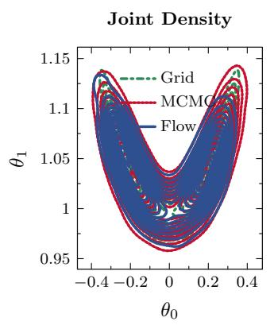
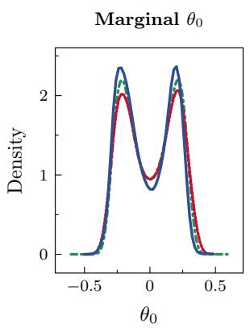
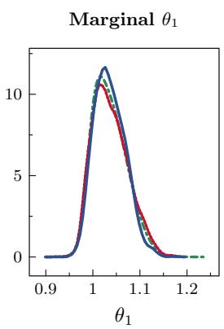
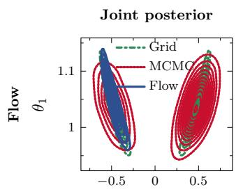
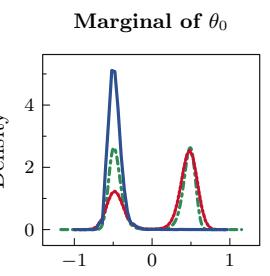
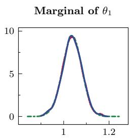
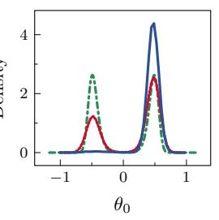
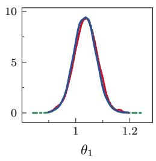
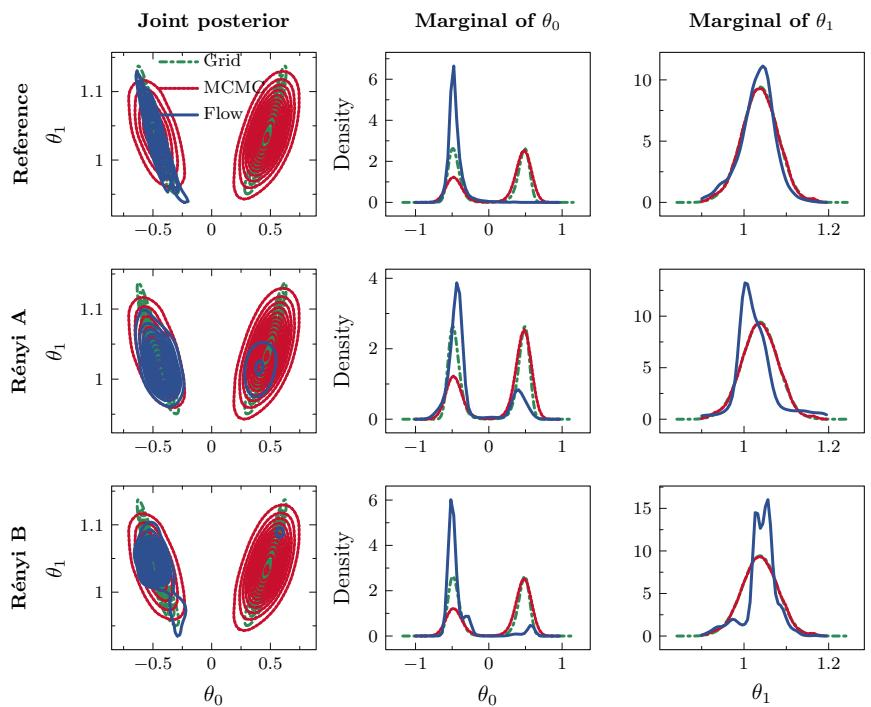

# RENYI-REGULARIZED FLOW-BASED VARIATIONAL INFERENCE ´ FOR BAYESIAN CALIBRATION

EXAUCE LUWEH ADJIM NGARTI ´ \*, ELISE ARNAUD, LEO NICOLETTI ´

VICTOR TRAPPLER, ARTHUR VIDARD

1 Univ. Grenoble Alpes, Inria, CNRS, LJK, 38000 Grenoble, France. 2 Bull, Centre of Excellence in Performance Programming (CEPP), France. 3 Department GMI, Institut Henri Fayol, Mines Saint-Etienne, Univ Clermont ´ Auvergne, CNRS, UMR 6158 LIMOS, F-42023 Saint-Etienne, France.´

Abstract. Variational inference with normalizing flows provides a flexible posterior approximation for Bayesian model calibration, but struggles when the posterior has several modes separated by regions of low probability mass. We study this behavior in a two-parameter twin experiment and regularize the variational objective. Under Gaussian observation errors and a Gaussian prior, the corresponding minimization objective is the expected Tikhonov calibration objective minus the diferential entropy of the approximating distribution. However, the expected Tikhonov term favors concentration near one of the modes, while entropy maximization does not guarantee multimodality.

We introduce a regularization term based on R´enyi divergence that encourages the approximate posterior to cover the prior support. In the connected bimodal case, a flow approximation represents both modes; in the case with well-separated modes, the flow and Gaussian mixture frequently miss one mode. The introduced regularization reduces the near-collapse fraction from 50% to 25%. While the regularization improves mode coverage in this experiment, it changes the Bayesian variational objective, introduces a trade-of in approximation accuracy, and does not provide a general solution to mode collapse.

Key words. Bayesian calibration, variational inference, normalizing flows, R´enyi divergence, mode collapse

1. Introduction. Bayesian calibration characterizes uncertainties in numerical model parameters through posterior distributions. Markov chain Monte Carlo methods, including Metropolis–Hastings, Gibbs sampling, and Hamiltonian Monte Carlo [10, 9, 2, 15], provide samples from the posterior. However, their computational cost can be prohibitive when likelihood evaluations are expensive, as is often the case for numerical simulators. Variational inference ofers an optimization-based approximation [13, 12, 1] using a parameterized family of distributions, and normalizing flows provide flexible distribution models with tractable sampling and log-density evaluation [16, 7]. Alternative variational objectives include χ-divergences [6], α-divergences [14, 11, 5], robust and tail-adaptive f-divergences [8, 19], and Tsallis divergence [20]. In this work, we consider the standard ELBO derived from the reverse Kullback–Leibler divergence.

However, ELBO-based variational inference struggles when the posterior exhibits multiple modes separated by regions of low probability mass. We augment the negative ELBO with a R´enyi divergence from the prior to the variational approximation to encourage the approximate posterior to cover the prior support. We test the regularization in a two-parameter calibration problem with two benchmark cases: a curved bimodal distribution with no region of near-zero probability mass separating the modes, and a bimodal distribution with modes separated by a region of nearzero probability mass. Variational inference with normalizing flows yields a good approximation in the connected-posterior case but struggles in the case with wellseparated modes. The regularization reduces the near-collapse fraction from 50% to 25%.

We first recall the Bayesian calibration framework in subsection 2.1, link the ELBO objective to classical Tikhonov regularization, and explain how this link accounts for the observed mode collapse for posteriors with modes separated by regions of low probability mass. Then, in section 3, we introduce the R´enyi regularization and present numerical experiments on the controlled benchmark in section 4.

## 2. Background.

2.1. Bayesian model calibration. Let $\mathcal { G } : \Theta \times \mathcal { U } \to \mathcal { V }$ denote the numerical model, $\theta \in \Theta$ the model parameter to be calibrated, and $\mathbf { u } \in \mathcal { U }$ the context variable specified for each model run. Calibration is performed using observations and their corresponding contexts $\left( \mathbf { y } _ { 1 : n } , \mathbf { u } _ { 1 : n } \right)$ . Assuming conditionally independent observations with Gaussian errors and a Gaussian prior on the calibration parameter independent of the context, we have

$$
\forall _ { i } \mid \pmb \theta , \mathbf { u } _ { i } \sim \mathcal { N } ( \mathcal { G } ( \pmb \theta , \mathbf { u } _ { i } ) , \mathbf { R } ) , \qquad \Theta \sim \mathcal { N } ( \pmb \theta _ { b } , \mathbf { B } ) ,\tag{2.1}
$$

where $\theta _ { b } \in \Theta$ is the prior mean, and B and R are positive-definite covariance matrices. The posterior density is

$$
\pi ( \pmb \theta ; \mathbf { y } _ { 1 : n } , \mathbf { u } _ { 1 : n } ) : = p _ { \Theta | \mathsf { Y } _ { 1 : n } , \mathsf { U } _ { 1 : n } } ( \pmb \theta | \mathbf { y } _ { 1 : n } , \mathbf { u } _ { 1 : n } ) \propto p _ { \Theta } ( \pmb \theta ) \prod _ { i = 1 } ^ { n } p _ { \mathsf { Y } _ { i } | \Theta , \mathsf { U } _ { i } } ( \mathbf { y } _ { i } \mid \pmb \theta , \mathbf { u } _ { i } ) .\tag{2.2}
$$

2.2. Variational inference with normalizing flows. Variational inference approximates the posterior in (2.2) with a parameterized distribution $q _ { \phi }$ by minimizing the Kullback–Leibler divergence, equivalently minimizing the negative ELBO, (2.3)

$$
\mathcal { L } _ { \mathrm { E L B O } } ( \phi ; \mathbf { y } _ { 1 : n } , \mathbf { u } _ { 1 : n } ) = \mathbb { E } _ { q _ { \phi } } \left[ \log q _ { \phi } ( \Theta ) - \log p _ { \Theta } ( \Theta ) - \sum _ { i = 1 } ^ { n } \log p _ { \mathbb { Y } _ { i } | \Theta , \mathbf { u } _ { i } } ( \mathbf { y } _ { i } \mid \Theta , \mathbf { u } _ { i } ) \right] .
$$

Here, $q _ { \phi }$ is modeled by a normalizing flow, $q _ { \phi } = ( T _ { \phi } ) _ { \sharp } q _ { Z }$ , with $\mathcal { T } _ { \phi }$ a diferentiable, invertible map that transforms a base distribution $q _ { Z }$ into a more expressive distribution.

2.3. Connection with Tikhonov regularization. For a positive-definite matrix B, define the weighted quadratic form $\| \boldsymbol { v } \| _ { \mathbf { B } ^ { - 1 } } ^ { 2 } : = \boldsymbol { v } ^ { \top } \mathbf { B } ^ { - 1 } \boldsymbol { v }$ . The Gaussian calibration assumptions lead to the Tikhonov loss [18]

$$
J ( \pmb \theta ) = \frac 1 2 \sum _ { i = 1 } ^ { n } \Vert \mathbf y _ { i } - \mathcal G ( \pmb \theta , \mathbf u _ { i } ) \Vert _ { \mathbf { R } ^ { - 1 } } ^ { 2 } + \frac 1 2 \Vert \pmb \theta - \pmb \theta _ { b } \Vert _ { \mathbf { B } ^ { - 1 } } ^ { 2 } .\tag{2.4}
$$

For the flow distribution, let $H ( q _ { \phi } ) = - \mathbb { E } _ { q _ { \phi } } [ \log q _ { \phi } ( \Theta ) ]$ denote its diferential entropy. Substituting the Gaussian likelihood and prior into (2.3) gives

$$
\begin{array} { r } { \mathcal { L } _ { \mathrm { E L B O } } ( \phi ; \mathbf { y } _ { 1 : n } , \mathbf { u } _ { 1 : n } ) \stackrel { c } { = } \mathbb { E } _ { q _ { \phi } } [ J ( \Theta ) ] - H ( q _ { \phi } ) , } \end{array}\tag{2.5}
$$

where $\circeq$ denotes equality up to a constant independent of $\phi$ . Variational calibration therefore minimizes the expected Tikhonov functional minus the entropy. The expected Tikhonov term favors concentration in regions where J is small, while the entropy term favors dispersion. Although the exact posterior minimizes the negative ELBO over all distributions, a restricted variational family and its optimization may yield an approximation concentrated near a single mode, particularly when modes are separated by regions of low probability mass.

## 3. Prior R´enyi regularization for variational inference.

3.1. Regularized objective. The regularization aims to discourage the variational distribution from assigning too little mass to regions with appreciable prior probability. We employ the R´enyi divergence

$$
\mathcal { D } _ { \mathrm { R e n y i } } ^ { \rho } ( p \| q ) = \frac { 1 } { \rho - 1 } \log \int p ( \xi ) ^ { \rho } q ( \xi ) ^ { 1 - \rho } \mathrm { d } \xi , \qquad \rho > 0 , \quad \rho \neq 1 ,\tag{3.1}
$$

which gives the regularized objective

$$
\mathcal { L } _ { \mathrm { E L B O } , r } \left( \phi ; \mathbf { y } _ { 1 : n } , \mathbf { u } _ { 1 : n } \right) : = \mathcal { L } _ { \mathrm { E L B O } } \left( \phi ; \mathbf { y } _ { 1 : n } , \mathbf { u } _ { 1 : n } \right) + \lambda \mathcal { R } _ { \phi } , \qquad \mathcal { R } _ { \phi } : = \mathcal { D } _ { \mathrm { R e n y i } } ^ { \rho } \left( p _ { \Theta } \left\| q _ { \phi } \right. \right) .\tag{3.2}
$$

The direction from the prior to the approximation is chosen to discourage low variational density in regions carrying prior mass. For $\rho > 1$ , zero variational density on a set of positive prior probability gives an infinite divergence. The estimation of the regularization term is described in section C.

3.2. Adaptive weight. We balance the gradient magnitudes using a gradientnormalization strategy motivated by [3]. At training step t, let $g _ { t } ^ { ( E ) } = \| \bar { \nabla } _ { \phi } \bar { \mathcal { L } } _ { \mathrm { E L B O } } \| _ { 2 }$ and $g _ { t } ^ { ( R ) } = \| \nabla _ { \phi } \mathcal { R } _ { \phi } \| _ { 2 }$ . Their exponentially smoothed values and the weight update are

$$
\begin{array} { r l r l } & { \bar { g } _ { t } ^ { ( a ) } = \beta \bar { g } _ { t - 1 } ^ { ( a ) } + ( 1 - \beta ) g _ { t } ^ { ( a ) } , } & & { a \in \{ E , R \} , } \\ & { \lambda _ { t + 1 } = r \frac { \bar { g } _ { t } ^ { ( E ) } } { \bar { g } _ { t } ^ { ( R ) } + \epsilon } , } \end{array}\tag{3.3}
$$

with smoothing coeficient $\beta \in [ 0 , 1 )$ , target gradient ratio $r > 0$ , and numerical stabilizer $\epsilon > 0$ . The updated weight is used at the next training step and is treated as fixed when computing the gradient of the regularized objective with respect to $\phi .$

## 4. Numerical experiments.

4.1. Synthetic benchmark. We define the numerical model with parameter vector

$$
\pmb { \theta } = ( \theta _ { 0 } , \theta _ { 1 } ) \in \Theta \subset \mathbb { R } ^ { 2 } ,
$$

context variable

$$
\mathbf { u } = ( u _ { 0 } , u _ { 1 } ) \in \mathcal { U } \subset \mathbb { R } ^ { 2 } ,
$$

and observation space $\mathcal { V } \subset \mathbb { R } ^ { 1 0 }$ . The forward model is defined by

$$
\begin{array} { r l } & { \mathcal { G } : \Theta \times \mathcal { U } \to \mathcal { V } } \\ & { \quad \quad \theta , \mathbf { u } \mapsto \Big ( \left( \mathcal { G } ( \theta , \mathbf { u } ) \right) _ { 1 } , \dots , \left( \mathcal { G } ( \theta , \mathbf { u } ) \right) _ { d _ { y } } \Big ) . } \end{array}\tag{4.1}
$$

Each component of the forward model is defined separately. For $1 \leq i \leq 1 0$

$$
\begin{array} { r } { ( \mathcal { G } ( \pmb { \theta } , \mathbf { u } ) ) _ { i } : = u _ { 1 } \left( 1 + \frac { 1 } { 2 } \sin \left( \frac { i } { 2 } \right) \right) \theta _ { 0 } ^ { 2 } - \left( 1 + \frac { 1 } { 2 } \cos \left( \frac { i } { 2 } \right) \right) \theta _ { 1 } + u _ { 0 } . } \end{array}\tag{4.2}
$$

In this experiment, calibration is performed using a synthetic observation at a single context $\mathbf { u } _ { s } .$ , given by ${ \bf y } _ { s } = \mathcal { G } \big ( \pmb { \theta } ^ { \mathrm { T r u t h } } , { \bf u } _ { s } \big ) + \boldsymbol { \varepsilon } .$ , with diagonal Gaussian noise covariance $5 \times 1 0 ^ { - 2 } \mathbf { I } _ { 1 0 }$ . By choosing $\mathbf { u } _ { s }$ and $\pmb { \theta } ^ { \mathrm { T r u t h } }$ , we construct two calibration cases. Case A produces a curved, V-shaped bimodal posterior with a substantial connecting region, while Case B produces modes separated by a region of very low probability density. The two configurations are summarized in Table 1.

Table 1: Twin-experiment configurations. Both cases use zero prior mean and observation covariance $5 \times 1 0 ^ { - 2 } \mathbf { I } _ { 1 0 }$ . The prior covariance is denoted by B.
<table><tr><td>Case</td><td>True parameter  $\theta ^ { \mathrm { { T r u t h } } }$ </td><td>Context  $\mathbf { u } _ { s }$ </td></tr><tr><td>A</td><td>(0.075, 1)</td><td>(1,1)</td></tr><tr><td>B</td><td>(0.4, 1)</td><td>(1,0.5)</td></tr></table>

4.2. References and approximation diagnostics. The reference posterior is obtained by evaluating the unnormalized density on a Cartesian grid and normalizing it by trapezoidal quadrature. Hamiltonian Monte Carlo provides an additional samplingbased comparison, with its density estimated by Gaussian kernel density estimation. The grid normalization procedure is described in Appendix A.

For the reference posterior $\pi$ and approximation $q _ { \phi }$ , we compute the forward and reverse Kullback–Leibler divergences and total variation distance:

$$
\begin{array} { r l } & { \mathcal { D } _ { \mathrm { K L } } ( \pi \| q _ { \phi } ) = \displaystyle \int \pi \log ( \pi / q _ { \phi } ) , \qquad \mathcal { D } _ { \mathrm { K L } } ( q _ { \phi } \| \pi ) = \int q _ { \phi } \log ( q _ { \phi } / \pi ) , } \\ & { \mathcal { D } _ { \mathrm { T V } } ( \pi \| q _ { \phi } ) = \frac { 1 } { 2 } \displaystyle \int | \pi - q _ { \phi } | . } \end{array}\tag{4.3}
$$

These quantities are computed using densities normalized on the same grid domain. When density evaluation at arbitrary points is intractable, the approximation is evaluated through kernel density estimation.

To quantify the fraction of runs exhibiting near collapse in Case B, we use the fact that the two modes lie on opposite sides of the first calibration coordinate. For run i, posterior samples are used to estimate the mass $\widehat { p } _ { i , + }$ on the positive side of this coordinate and $\widehat { p } _ { i , - } = 1 - \widehat { p } _ { i , + }$ on the negative side. The minority-mode mass and near-collapse fraction are

$$
\widehat { m } _ { i } = \operatorname* { m i n } ( \widehat { p } _ { i , + } , \widehat { p } _ { i , - } ) , \qquad \widehat { C } _ { \epsilon } = \frac { 1 } { R } \sum _ { i = 1 } ^ { R } \mathbf { 1 } \{ \widehat { m } _ { i } < \epsilon \} , \quad \epsilon = 0 . 0 5 .\tag{4.4}
$$

We also compute the squared energy distance [17],

$$
\mathcal { E } ^ { 2 } ( P _ { X } , P _ { Y } ) = 2 \mathbb { E } \| X - Y \| _ { 2 } - \mathbb { E } \| X - X ^ { \prime } \| _ { 2 } - \mathbb { E } \| Y - Y ^ { \prime } \| _ { 2 } ,\tag{4.5}
$$

where $X , X ^ { \prime }$ are independent samples from $P _ { X }$ , and $Y , Y ^ { \prime }$ are independent samples from $P _ { Y }$ , with all four random variables mutually independent.

4.3. Numerical results. In Figure 1, the variational approximation represents both modes and follows the grid and MCMC references. The final discrepancy measures are presented in Table 2.

The same flow architecture frequently converges to one mode in Case B. The near-collapse fraction is 0.875 in Table 2. The posterior are presented in Figure 2. The Gaussian-mixture approximation shown in the same figure also converges to a single mode in the experiments with eight random seeds.

For the regularized approximation, we consider R´enyi orders {0.1, 0.4, 0.8, 1.2, 1.6, 2.0} and gradient ratios {0.1, 0.2, 0.3}, with $\beta = 0 . 8$ . The combination $\rho = 0 . 8$ and $r = 0 . 2$ gives favorable results in terms of near-collapse fraction, minority-mode mass, and

## Comparison of Posterior Distributions

  
Fig. 1: Case A : Posterior with connected modes. Green: grid reference; red: Gaussian KDE of MCMC samples; blue: flow approximation. Left: joint-density contours. Middle and right: marginal densities.

## Comparison of Posterior Distributions

  
Fig. 2: Case B: posterior with well-separated modes. The first row shows the flow approximation and the second row the Gaussian mixture approximation. Green: grid reference; red: Gaussian KDE of MCMC samples; blue: variational approximation. The left column shows the joint-density contours, while the middle and right columns show the marginal densities.

squared energy distance. Extended results for all parameter values are presented in Appendix D.

For the matched-flow comparison, the unregularized reference and regularized

Table 2: Unregularized posterior approximation. Divergences and distances are presented as mean ± standard deviation; the near-collapse fraction uses threshold $\epsilon = 0 . 0 5$
<table><tr><td>Metric</td><td>Case A flow</td><td>Case B flow</td><td>Case B mixture</td></tr><tr><td>Forward KL</td><td> $0 . 3 0 8 \pm 0 . 1 0 5$ </td><td> $1 1 . 1 9 7 \pm 4 . 9 4 0$ </td><td> $1 3 . 5 1 3 \pm 0 . 9 5 7$ </td></tr><tr><td>Reverse KL</td><td> $0 . 4 7 4 \pm 0 . 0 7 9$ </td><td> $1 . 0 7 0 \pm 0 . 7 0 1$ </td><td> $1 5 . 5 9 2 \pm 0 . 2 7 7$ </td></tr><tr><td>Total variation</td><td> $0 . 2 7 3 \pm 0 . 0 4 0$ </td><td> $0 . 5 1 2 \pm 0 . 0 1 0$ </td><td> $0 . 8 6 8 \pm 0 . 0 0 4$ </td></tr><tr><td>Near-collapse fraction</td><td></td><td>0.875</td><td>1.000</td></tr></table>

approximation use the same architecture, which difers from the initial unregularized Case B flow. With $\rho = 0 . 8$ and $r = 0 . 2$ , regularization reduces the near-collapse fraction from 0.50 to 0.250. Forward Kullback–Leibler divergence decreases from 4.912 to 3.126 and squared energy distance from 0.259 to 0.227. Reverse divergence increases from 2.401 to 3.358, and total variation from 0.554 to 0.617. The means and standard deviations are given in Table 3.
<table><tr><td>Metric</td><td>Reference</td><td>Rényi</td></tr><tr><td>Forward KL</td><td> $\overline { { 4 . 9 1 2 \pm 4 . 8 6 7 } }$ </td><td> $\overline { { 3 . 1 2 6 \pm 2 . 7 2 3 } }$ </td></tr><tr><td>Reverse KL</td><td> $2 . 4 0 1 \pm 1 . 8 5 0$ </td><td> $3 . 3 5 8 \pm 1 . 9 7 0$ </td></tr><tr><td>Total Variation Distance</td><td> $0 . 5 5 4 \pm 0 . 0 5 5$ </td><td> $0 . 6 1 7 \pm 0 . 0 7 5$ </td></tr><tr><td>Squared Energy Distance</td><td> $0 . 2 5 9 \pm 0 . 1 7 4$ </td><td> $0 . 2 2 7 \pm 0 . 1 4 5$ </td></tr><tr><td>Near-collapse Fraction  $( \epsilon = 5 \% )$ </td><td>0.50</td><td>0.250</td></tr></table>

Table 3: Case B: matched-reference and R´enyi-regularized approximations. Values are mean ± standard deviation, except the near-collapse fraction. Lower values are preferred for all metrics.

The two regularized realizations in Figure 3 illustrate the remaining variability: R´enyi A represents both modes, whereas R´enyi B nearly collapses. Regularization reduces near collapse but does not prevent it. Details of the training configurations and flow architectures are provided in Appendix B.

  
Fig. 3: Case B: Comparison of the posterior distributions obtained with the reference training configuration and two R´enyi-regularized runs. The rows correspond to the reference configuration, R´enyi A, and R´enyi B, with the latter two corresponding to diferent random seeds. The columns show the joint posterior distribution and the two marginal posterior distributions.

5. Discussion and conclusion. The negative ELBO combines the expected data misfit and prior deviation with a negative entropy term. In the symmetric benchmark, either mode explains the observation and is equally favored by the prior, so a distribution concentrated near one mode can have a small expected Tikhonov term. Entropy maximization alone does not enforce multimodality, since a unimodal Gaussian maximizes diferential entropy at fixed covariance [4]. This is consistent with the observation that flow-based variational inference approximates the connected bimodal posterior but frequently misses one of the well-separated modes in Case B.

The flow and mixture results are consistent with the mode-seeking behavior of the reverse divergence, although they remain dependent on the architecture, initialization, and optimization settings. Adding the prior-referenced R´enyi regularization reduces near collapse in the matched-flow comparison, but also changes the variational target and can spread probability into regions less favored by the data. In this comparison, forward divergence and energy distance decrease, whereas reverse divergence and total variation increase.

Overall, R´enyi regularization can improve mode coverage, but its benefit must be assessed against the bias introduced by modifying the Bayesian objective and the variability of the optimization.

Appendix A. Reference posteriors.

Let $\widetilde { \pi } _ { j k }$ denote the unnormalized posterior evaluated on a Cartesian grid:

$$
\widetilde { \pi } _ { j k } = p _ { \Theta } ( \theta _ { 0 } ^ { j } , \theta _ { 1 } ^ { k } ) \prod _ { i = 1 } ^ { n } p _ { { \mathsf { Y } } _ { i } \mid \Theta , \mathsf { U } _ { i } } \left( \mathbf { y } _ { i } \mid ( \theta _ { 0 } ^ { j } , \theta _ { 1 } ^ { k } ) , \mathbf { u } _ { i } \right) .\tag{A.1}
$$

Let $w _ { j k }$ be the trapezoidal quadrature weights. The reference posterior and the evaluated approximation are normalized on the same grid domain:

$$
\pi _ { j k } = \frac { \widetilde { \pi } _ { j k } } { \sum _ { j , k } w _ { j k } \widetilde { \pi } _ { j k } } , \qquad q _ { j k } = \frac { q _ { \phi } ( \theta _ { 0 } ^ { j } , \theta _ { 1 } ^ { k } ) } { \sum _ { j , k } w _ { j k } q _ { \phi } ( \theta _ { 0 } ^ { j } , \theta _ { 1 } ^ { k } ) } .\tag{A.2}
$$

The integrals in (4.3) are approximated by the corresponding weighted sums. Gaussian kernel density estimation is used when density evaluation at arbitrary points is intractable.

Appendix B. Experimental settings.
<table><tr><td>Configuration</td><td>Component</td><td>Value</td></tr><tr><td>Common flow settings</td><td>Number of seeds</td><td>8</td></tr><tr><td></td><td>Learning rate</td><td> $1 \times 1 0 ^ { - 3 }$ </td></tr><tr><td></td><td>Number of training steps</td><td>5000</td></tr><tr><td></td><td>Number of particles</td><td>10</td></tr><tr><td></td><td>Flow hidden dimensions</td><td>(8,8)</td></tr><tr><td></td><td>Number of spline bins</td><td>8 5.0</td></tr><tr><td></td><td>Spline bound</td><td></td></tr><tr><td></td><td>Repetitions per transform block</td><td>3</td></tr><tr><td>Case A: connected modes</td><td>Architecture</td><td>Spline coupling → spline autoregres-</td></tr><tr><td></td><td>Neural autoregressive width</td><td>sive → neural autoregressive 8</td></tr><tr><td>modes</td><td>Case B: well-separated Unregularized architecture</td><td>Same as Case A</td></tr><tr><td>Case B: matched-flow Reference architecture comparison</td><td></td><td>Affine coupling → spline coupling → affine coupling → spline autore-</td></tr><tr><td></td><td>Regularized posterior family</td><td>gressive → affine coupling Same as reference</td></tr><tr><td></td><td>Rényi order ρ</td><td>{0.1, 0.4, 0.8, 1.2, 1.6, 2.0}</td></tr><tr><td></td><td>ELBO-to-regularization gradient ratio r</td><td>{0.1, 0.2, 0.3}</td></tr><tr><td></td><td>EMA coefficientβ</td><td>0.8</td></tr><tr><td>Gaussian mixture</td><td>Initial means</td><td> $_ { 0 . 5 } ^ { ( ( - 2 , - 2 ) , ( 2 , 4 ) ) }$ </td></tr><tr><td></td><td>Initial scale</td><td></td></tr><tr><td></td><td>Learning rate</td><td> $1 \times 1 0 ^ { - 2 }$ </td></tr></table>

Table 4: Hyperparameters for the normalizing-flow and Gaussian-mixture approximations. Common flow settings apply to the flow configurations. The Case B matched-flow comparison uses the same architecture for the unregularized reference and the R´enyi-regularized approximation.

Appendix C. Monte Carlo estimation of the R´enyi divergence. For independent samples $\xi _ { i } \sim p _ { \Theta }$ , set $s _ { i } = ( \rho - 1 ) [ \log p _ { \Theta } ( \xi _ { i } ) - \log q _ { \phi } ( \xi _ { i } ) ]$ . The

prior-expectation form of the divergence and its log-sum-exp estimator [14] are

$$
\begin{array} { r } { \mathcal { D } _ { \mathrm { R e n y i } } ^ { \rho } ( p \_ { \Theta } \| q _ { \phi } ) = \displaystyle \frac { 1 } { \rho - 1 } \log \mathbb { E } _ { p _ { \Theta } } \bigg [ \bigg ( \frac { p _ { \Theta } } { q _ { \phi } } \bigg ) ^ { \rho - 1 } \bigg ] , } \\ { \widehat { \mathcal { D } } _ { \mathrm { R e n y i } } ^ { \rho } = \displaystyle \frac { \log \mathrm { s u m e x p } _ { i = 1 } ^ { N } ( s _ { i } ) - \log N } { \rho - 1 } . } \end{array}\tag{C.1}
$$

The estimator is generally biased because of the logarithm but is consistent when the expectation is finite. Since the prior samples are independent of $\phi ,$ diferentiation yields

$$
\nabla _ { \phi } \widehat { \mathcal { D } } _ { \mathrm { R e n y i } } ^ { \rho } = - \sum _ { i = 1 } ^ { N } \frac { \exp ( s _ { i } ) } { \sum _ { j } \exp ( s _ { j } ) } \nabla _ { \phi } \log q _ { \phi } ( \xi _ { i } ) .\tag{C.2}
$$

Appendix D. Regularization parameter study.

Efect of R´enyi Regularization Parameters Near-Collapse Ratio Minority-mode mass Squared energy distance
<table><tr><td rowspan=6 colspan=2>2.01.61.2p0.80.4</td><td></td><td></td><td></td><td></td><td></td><td></td><td></td><td></td><td></td><td></td><td></td></tr><tr><td rowspan=1 colspan=1>0.000</td><td rowspan=1 colspan=1>+0.125</td><td rowspan=1 colspan=2>0.000</td><td rowspan=1 colspan=1>2.0</td><td rowspan=1 colspan=1>-0.053</td><td rowspan=1 colspan=1>-0.064</td><td rowspan=1 colspan=1>-0.065</td><td rowspan=1 colspan=1>2.0</td><td rowspan=1 colspan=1>+0.0566</td><td rowspan=1 colspan=1>+0.077</td><td rowspan=1 colspan=1>+0.094</td></tr><tr><td rowspan=1 colspan=1>0.000</td><td rowspan=1 colspan=1>+0.125</td><td rowspan=1 colspan=2>+0.125</td><td rowspan=1 colspan=1>1.6</td><td rowspan=1 colspan=1>-0.060</td><td rowspan=1 colspan=1>-0.076</td><td rowspan=1 colspan=1>-0.065</td><td rowspan=1 colspan=1>1.6</td><td rowspan=1 colspan=1>+0.066</td><td rowspan=1 colspan=1>+0.082</td><td rowspan=1 colspan=1>+0.101</td></tr><tr><td rowspan=1 colspan=1>0.000</td><td rowspan=1 colspan=1>+0.125</td><td rowspan=1 colspan=2>+0.125</td><td rowspan=1 colspan=1>1.2</td><td rowspan=1 colspan=1>-0.061</td><td rowspan=1 colspan=1>-0.076</td><td rowspan=1 colspan=1>-0.074</td><td rowspan=1 colspan=1>1.2</td><td rowspan=1 colspan=1>+0.070</td><td rowspan=1 colspan=1>+0.083</td><td rowspan=1 colspan=1>+0.119</td></tr><tr><td rowspan=1 colspan=1>0.000</td><td rowspan=1 colspan=1>-0.250)-</td><td rowspan=1 colspan=2>0.250</td><td rowspan=1 colspan=1>0.8</td><td rowspan=1 colspan=1>-0.051</td><td rowspan=1 colspan=1>+0.023</td><td rowspan=1 colspan=1>+0.013</td><td rowspan=1 colspan=1>0.8</td><td rowspan=1 colspan=1>+0.042</td><td rowspan=1 colspan=1>-0.032</td><td rowspan=1 colspan=1>-0.032</td></tr><tr><td rowspan=1 colspan=1>0.000</td><td rowspan=1 colspan=1>0.000</td><td rowspan=1 colspan=2>0.000</td><td rowspan=1 colspan=1>0.4</td><td rowspan=1 colspan=1>-0.062</td><td rowspan=1 colspan=1>-0.022</td><td rowspan=1 colspan=1>-0.037</td><td rowspan=1 colspan=1>0.4</td><td rowspan=1 colspan=1>+0.065</td><td rowspan=1 colspan=1>+0.029</td><td rowspan=1 colspan=1>+0.085</td></tr><tr><td rowspan=3 colspan=6>0.1+0.125 +0.1250.1   0.2  0.3r</td><td rowspan=1 colspan=1>+0.125</td><td rowspan=1 colspan=1>+0.125</td><td rowspan=1 colspan=1>+0.375</td><td rowspan=1 colspan=1></td><td rowspan=1 colspan=1>-0.062</td><td rowspan=1 colspan=1>-0.061</td><td rowspan=1 colspan=1>-0.137</td></tr><tr><td rowspan=1 colspan=1>0.1</td><td rowspan=1 colspan=1>0.2</td><td rowspan=1 colspan=1>0.3</td><td rowspan=1 colspan=1></td><td rowspan=1 colspan=1>0.1</td><td rowspan=1 colspan=1>0.2</td><td rowspan=1 colspan=1>0.3</td></tr><tr><td rowspan=1 colspan=4>r</td><td rowspan=1 colspan=2></td><td rowspan=1 colspan=1></td><td rowspan=1 colspan=1>r</td><td rowspan=1 colspan=1></td></tr></table>

Fig. 4: Changes in the evaluation metrics for the disconnected posterior across R´enyi orders $\rho$ and gradient ratios $^ { r } \cdot$ Cell labels report the changes relative to the reference configuration; green indicates improvement, whereas red indicates deterioration.

Acknowledgments. This work was supported by the French Ministry of Higher Education and Research through the CIFRE (Conventions Industrielles de Formation par la Recherche) program, administered by the Association Nationale de la Recherche et de la Technologie (ANRT), under CIFRE agreement No. 2022/1801, in collaboration with Bull.

This project was provided with HPC/AI computing and storage resources by GENCI at IDRIS thanks to grant AD010117241 on the Jean Zay supercomputer’s CSL, A100, and H100 partitions.

## REFERENCES

[1] D. M. Blei, A. Kucukelbir, and J. D. McAuliffe, Variational inference: A review for statisticians, Journal of the American statistical Association, 112 (2017), pp. 859–877.

[2] S. Brooks, A. Gelman, G. Jones, and X.-L. Meng, Handbook of markov chain monte carlo, CRC press, 2011.

[3] Z. Chen, V. Badrinarayanan, C.-Y. Lee, and A. Rabinovich, Gradnorm: Gradient normalization for adaptive loss balancing in deep multitask networks, in International conference on machine learning, PMLR, 2018, pp. 794–803.

[4] T. M. Cover and J. A. Thomas, Diferential Entropy, John Wiley & Sons, Ltd, 2 ed., 2005, ch. 8, pp. 243–259, https://doi.org/10.1002/047174882X.ch8.

[5] K. Daudel, J. Benton, Y. Shi, and A. Doucet, Alpha-divergence variational inference meets importance weighted auto-encoders: Methodology and asymptotics. arXiv preprint arXiv:2210.06226, 2023.

[6] A. B. Dieng, D. Tran, R. Ranganath, J. Paisley, and D. Blei, Variational inference via χ upper bound minimization, Advances in Neural Information Processing Systems, 30 (2017).

[7] L. Dinh, J. Sohl-Dickstein, and S. Bengio, Density estimation using real nvp, arXiv preprint arXiv:1605.08803, (2016).

[8] F. Futami, I. Sato, and M. Sugiyama, Variational inference based on robust divergences. arXiv preprint arXiv:1710.06595, 2018.

[9] S. Geman and D. Geman, Stochastic relaxation, Gibbs distributions, and the Bayesian restoration of images, IEEE Transactions on Pattern Analysis and Machine Intelligence, PAMI-6 (1984), pp. 721–741, https://doi.org/10.1109/TPAMI.1984.4767596.

[10] W. K. Hastings, Monte carlo sampling methods using markov chains and their applications, Biometrika, 57 (1970), pp. 97–109, https://doi.org/10.1093/biomet/57.1.97.

[11] J. Hernandez-Lobato, Y. Li, M. Rowland, T. Bui, D. Hernandez-Lobato, and R. Turner, Black-box alpha divergence minimization, in Proceedings of The 33rd International Conference on Machine Learning, PMLR, 2016, pp. 1511–1520.

[12] M. D. Hoffman, D. M. Blei, C. Wang, and J. Paisley, Stochastic variational inference, Journal of Machine Learning Research, (2013).

[13] M. I. Jordan, Z. Ghahramani, T. S. Jaakkola, and L. K. Saul, An introduction to variational methods for graphical models, Machine learning, 37 (1999), pp. 183–233.

[14] Y. Li and R. E. Turner, R´enyi divergence variational inference. arXiv preprint arXiv:1602.02311, 2016.

[15] R. M. Neal, Mcmc using hamiltonian dynamics, in Handbook of Markov Chain Monte Carlo, S. Brooks, A. Gelman, G. Jones, and X.-L. Meng, eds., Chapman and Hall/CRC, 2011, ch. 5, pp. 113–162.

[16] D. Rezende and S. Mohamed, Variational inference with normalizing flows, in International conference on machine learning, PMLR, 2015, pp. 1530–1538.

[17] G. J. Szekely and M. L. Rizzo´ , Energy statistics: A class of statistics based on distances, Journal of statistical planning and inference, 143 (2013), pp. 1249–1272.

[18] A. N. Tikhonov and V. B. Glasko, Use of the regularization method in non-linear problems, USSR Computational Mathematics and Mathematical Physics, 5 (1965), pp. 93–107.

[19] D. Wang, H. Liu, and Q. Liu, Variational inference with tail-adaptive f-divergence. arXiv preprint arXiv:1810.11943, 2019.

[20] Z. Wang, O. So, J. Gibson, B. Vlahov, M. S. Gandhi, G.-H. Liu, and E. A. Theodorou, Variational inference mpc using tsallis divergence. arXiv preprint arXiv:2104.00241, 2021.