# RPSD: RETRIEVAL-PRIVILEGED ON-POLICY SELF-DISTILLATION WITH OPTIMAL TRANSPORT

Dongyue Li<sup>1</sup>, Zebang Cheng<sup>2</sup>, Zhongyi Deng<sup>3</sup>, Hongbo Xu<sup>4</sup>, Yi Bin<sup>5</sup>, Fei Ma<sup>†,4</sup>

<sup>1</sup> Nagoya University <sup>2</sup> Shenzhen University

<sup>3</sup> Sichuan Agricultural University

Guangdong Laboratory of Artificial Intelligence and Digital Economy <sup>5</sup> Tongji University

## ABSTRACT

Sequential recommendation predicts a user’s next interaction from historical behavior. Recent LLM-based methods recast this task as generative recommendation and increasingly adopt reinforcement learning such as GRPO for post-training. However, these methods suffer from two limitations, namely credit-blind optimization, where a sequence-level reward is shared across all generated tokens, and collaborative-blind supervision, where each training signal is derived from a single user and ignores behavioral patterns shared across similar users. To address both issues, we propose Retrieval-Privileged on-policy Self-Distillation (RPSD). For credit-blind optimization, we introduce on-policy self-distillation (OPSD), in which a teacher with privileged knowledge re-evaluates the student’s on-policy response, and the token-level confidence difference between the student and teacher reshapes the shared sequence-level advantage into token-specific credit. However, the privileged knowledge in vanilla OPSD is still derived from a single user, leaving collaborative-blind supervision unresolved. We therefore ground the teacher in collaborative behavioral evidence from similar users. Specifically, we use temporally aware optimal transport (OT) to compare interaction trajectories across users by jointly considering item similarity and temporal structure, and further apply diversity-aware selection to retain complementary trajectories as privileged evidence. In this way, on-policy self-distillation provides fine-grained token-level credit, while OT enriches the teacher with structured cross-user evidence. To the best of our knowledge, this is the first work to bring on-policy self-distillation to sequential recommendation and to use cross-user behavior as its privileged signal. Extensive experiments across multiple real-world datasets demonstrate that RPSD achieves state-of-the-art performance.

## 1 INTRODUCTION

Sequential recommendation predicts the next item that a user will interact with from the ordered history of past interactions and it is central to content, e-commerce, and media platforms Ma et al. (2026) where user interests change over time (Hidasi et al., 2016; Kang & McAuley, 2018). Traditional methods treat the sequential recommendation problem as next-item prediction over an interaction sequence, evolving from recurrent and self-attention encoders (Hidasi et al., 2016; Kang & McAuley, 2018) to graph-based and contrastive variants, which model higher-order transitions and augment sparse signals (He et al., 2020; Xie et al., 2022; Qiu et al., 2022). Although these models are effective and efficient, they represent items as opaque identifier embeddings and reason over co-occurrence statistics rather than the semantics of what a user consumed, which limits generalization when histories are short. An ideal recommender, however, should do more than name which candidate comes next and it should ground that choice in why the recommended item matches the user’s evolving interest.

Large language models (LLMs) address the semantic side of this gap by casting recommendation as language generation, either unifying recommendation tasks in a text-to-text format (Geng et al., 2022; Rajput et al., 2023; Wang et al., 2025a; Li et al., 2026; Kong et al., 2025b) or fine-tuning a pretrained LLM to reason over item titles and name the next item directly in text (Bao et al., 2023; Liao et al., 2024; Zhang et al., 2025). To align such an LLM with the recommendation objective, reinforcement learning has become a standard post-training recipe. Recent work adapts GRPO (Shao et al., 2024) to LLM-based recommendation, tailoring its reward and credit assignment to the ranking structure of the task. For example, Rank-GRPO (Zhu et al., 2026) moves the reward from the whole sequence to each individual rank, so that later positions in the list get their own credit instead of sharing one signal. RecZero (Kong et al., 2025a) keeps GRPO unchanged but reshapes the rollout into explicit analyze-user, analyze-item, match, and rate steps, replacing exact-match correctness with a reward graded by the predicted rating’s closeness to the true one. However, these adaptations only change which part of a response the reward is applied to. Rank-GRPO gives each rank its own reward and RecZero gives each reasoning step its own, but in both cases a single number is still shared by all the tokens inside that rank or step. The source of the reward is left untouched as well. Whether it is computed over the sequence, the rank, or the step, it always comes from the next item of the user being scored. A reward of this kind can confirm that a recommendation is right, but one user’s interactions are a thin basis for learning why, since a short history reflects accident as much as preference. The same pattern observed across many users with comparable histories is far more dependable, and it is the only evidence available when a single history is too short to be read on its own. Therefore, two problems remain unaddressed, namely credit-blind optimization and collaborative-blind supervision.

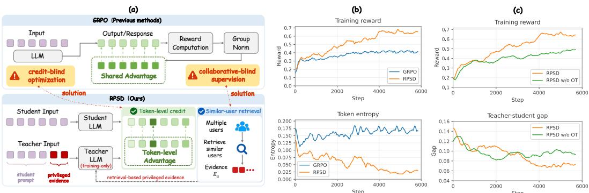  
Figure 1: RPSD combines token-level credit assignment with retrieved evidence. (a) Conceptual differences between RPSD and GRPO. (b) Training reward and token entropy of GRPO and RPSD. (c) Comparison between RPSD and RPSD w/o OT, which only takes the ground-truth item as privileged knowledge of the teacher.

Credit-blind optimization concerns how the reward is assigned. Not every token in a response contributes equally to the recommendation. Most tokens provide shared linguistic or formatting structure, while only a small subset determines which item is ultimately selected. GRPO nevertheless assigns the same sequence-level advantage to every generated token, providing no indication of which tokens actually make the recommendation correct. On-policy self-distillation (OPSD) (Zhao et al., 2026) provides a promising direction for addressing this limitation. By deriving token-level guidance from a more informed teacher on the same on-policy response, OPSD enables finer-grained credit assignment while preserving the original policy and inference procedure. These properties make it particularly appealing for sequential recommendation. However, the effectiveness of OPSD is ultimately limited by the informativeness of the teacher’s privileged knowledge. If the teacher lacks sufficient behavioral context, the resulting token-level guidance may still be inadequate for capturing the preference signals underlying the target item. Vanilla OPSD typically relies on the ground-truth label as the privileged signal, which tells the model which candidate is correct but provides limited information about why that candidate matches the user’s preference. Therefore, the second issue collaborative-blind supervision is introduced. Existing generative recommenders derive supervision from the user alone, overlooking regularities shared across similar users.

To address these two limitations, we propose Retrieval-Privileged on-policy Self-Distillation (RPSD), which combines OPSD with temporally aware OT. RPSD first constructs cross-user behavioral evidence from the training corpus. Specifically, we use temporally aware OT to compare interaction trajectories across users by jointly modeling item similarity and temporal structure, followed by diversity-aware selection to retain complementary trajectories. Their subsequent interactions, together with the ground-truth item, form the privileged knowledge available to the teacher. The teacher then re-evaluates the student’s on-policy response under this privileged view, and the resulting token-level confidence difference is used to reshape the sequence-level advantage into tokenspecific credit. The privileged knowledge is used only during training, leaving inference unchanged and introducing no additional deployment cost. As shown in Figure 1, the retrieved behavioral evi dence further strengthens teacher supervision and leads to improved training dynamics. To the best of our knowledge, RPSD is the first method to introduce OPSD into sequential recommendation and to use cross-user behavior as privileged knowledge. Our contributions are summarized as follows:

(1) RPSD, a novel on-policy self-distillation framework, is proposed for sequential recommendation to enable fine-grained token-level credit assignment through privileged teacher guidance.

(2) A temporally aware optimal transport mechanism is introduced to align similar user trajectories, from which cross-user evidence is constructed as privileged knowledge.

(3) Extensive experiments on three benchmark datasets are conducted to demonstrate the effectiveness of RPSD and its consistent superiority over strong state-of-the-art baselines.

## 2 RELATED WORK

## 2.1 REINFORCEMENT LEARNING FOR LLM-BASED RECOMMENDATION

Casting recommendation (Wang et al., 2025a; Li et al., 2026; Ju et al., 2025; Kong et al., 2025b; Wang et al., 2025b) as language generation lets LLMs reason over item semantics rather than opaque identifiers (Geng et al., 2022; Rajput et al., 2023; Bao et al., 2023; Liao et al., 2024; Zhang et al., 2025; Lin et al., 2025a), and reinforcement learning with verifiable rewards has become a standard recipe for aligning such models with the recommendation objective (Shao et al., 2024; Lin et al., 2025b; Kong et al., 2025a; Wang et al., 2024; Yu et al., 2024). Since final-answer rewards are sparse, lots of works adapt GRPO to the ranking structure of the task. Rank-GRPO makes each rank, rather than the token or the whole sequence, the unit of reward to remove non-causal credit assignment (Zhu et al., 2026), and RecZero restructures the rollout into explicit reasoning steps supervised by a graded rule-based reward (Kong et al., 2025a). Parallel works pursue the same goal through preference objectives, where S-DPO extends DPO with multiple negatives (Chen et al., 2024) and C-APO augments the revealed-preference ordering with a coherence-based ordering to down-weight noisy user choices (Park et al., 2026). These methods differ in what unit the reward is computed over and how the preference ordering is shaped, yet the signal they supply still scores whether a recommendation is right rather than which tokens carry the evidence for it. We instead densify the signal to the token level while grounding the label in retrieved behavior.

## 2.2 ON-POLICY SELF-DISTILLATION

On-policy distillation (Agarwal et al., 2024) (OPD) supervises a student on its own sampled trajectories with dense token-level targets from a teacher, combining the density of distillation with the distributional match of on-policy learning (Gu et al., 2024). OPSD removes the external teacher by letting a single model act as both student and teacher under different contexts, where the teacher conditions on privileged information the student cannot see and re-scores the student’s tokens, turning a sparse outcome reward into dense supervision (Zhao et al., 2026). A recognized limitation, however, is that conditioning on an instance-level label lets the teacher rationalize the answer without grounding it in the input, collapsing its signal into a shortcut (Cheng et al., 2026). These extensions all draw their privilege from a label or a stronger model, and none targets recommendation. To the best of our knowledge, we are the first to introduce OPSD to sequential recommendation and to ground label-based privileged information in retrieved behavioral evidence from similar users.

## 2.3 RETRIEVAL-AUGMENTED RECOMMENDATION AND KNOWLEDGE DISTILLATION

Retrieval-augmented recommendation enriches sparse histories with behaviorally similar users, where ReLLa (Lin et al., 2024) retrieves relevant behaviors to improve long-history comprehension and RALLRec (Xu et al., 2025) strengthens the retrieval through representation learning. However, the retrieved neighbors are fed to these two recommenders at inference, so retrieval quality directly shapes the deployed prediction. We instead use the continuations of similar users only as a training-time privileged signal, leaving inference to the ordinary prompt. Knowledge distillation transfers a teacher’s ranking ability to a smaller student, as in RCE-KD (Zhu & Zhang, 2026), which reconnects the cross-entropy distillation loss for tighter ranking transfer. Our RPSD uses the same model as both teacher and student, with the teacher additionally conditioned on retrieved behavioral evidence and the ground-truth item to provide privileged supervision only during training.

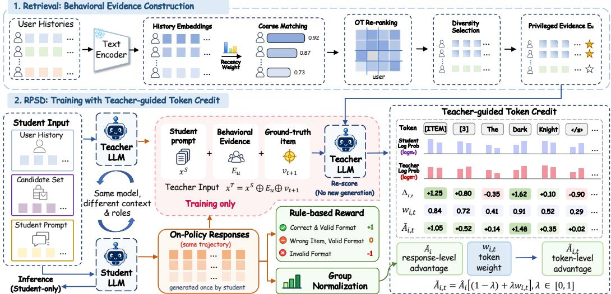  
Figure 2: Overview of RPSD. The student samples on-policy responses from the original recommendation prompt, while a retrieval-privileged teacher re-scores the same trajectory using behavioral evidence only during training to derive token-level credit.

## 3 METHOD

We present RPSD, a retrieval-privileged on-policy self-distillation framework for LLM-based sequential recommendation. The student samples a recommendation from the task prompt, while a teacher, which is the same model under a privileged context, re-scores the same tokens and provides dense token-level credit. The privileged context combines two pieces of training-only information: the ground-truth next item, which tells the teacher which candidate is correct, and behavioral evi dence retrieved from similar users, which grounds why it fits the current history.

## 3.1 PROBLEM FORMULATION

In a general sequential recommendation scenario, we consider a user set U and an item set V. Given the interaction sequence $S _ { u } = \{ v _ { 1 } ^ { u } , v _ { 2 } ^ { u } , \ldots , v _ { t } ^ { u } \}$ of a user $u \in \mathcal { U } ,$ , where $v _ { i } ^ { u } \in \mathcal { V }$ is the item interacted with at step j, the goal is to predict the next item $v _ { t + 1 } ^ { u }$ the user is most likely to engage with.

We take the most recent L interactions of $S _ { u }$ as the context $H _ { u }$ and construct a candidate set $\mathcal { C } _ { u } = \{ v _ { t + 1 } ^ { u } \} \cup \mathcal { N } _ { u }$ of size $n _ { c } .$ , where $\mathcal { N } _ { u }$ contains negatives sampled from the user’s non-interacted items. We serialize $( H _ { u } , \mathcal { C } _ { u } )$ into a student prompt $x _ { u } ^ { S } ~ = ~ \mathrm { P r o m p t } _ { S } ( H _ { u } , \mathcal { C } _ { u } )$ . For training, we additionally build a teacher prompt over the same instance that exposes $x _ { u } ^ { S }$ to retrieved behavioral evidence $\dot { E } _ { u }$ and the ground-truth item $v _ { t + 1 } ^ { u }$ , forming a privileged view used solely to shape the training signal, $x _ { u } ^ { T } \ = \ \mathrm { P r o m p t } _ { T } ( H _ { u } , \mathcal { C } _ { u } , E _ { u } , v _ { t + 1 } ^ { u } )$ . Given $x _ { u } ^ { S }$ , the policy $\pi _ { \theta }$ generates a response $y = ( y _ { 1 } , \dotsc , y _ { T } )$ that must follow the correct item format and predict the right next item $v _ { t + 1 } ^ { u } .$ Training follows a two-stage paradigm, where the pretrained LLM is first adapted to the instruction format by SFT, after which RPSD is leveraged for policy optimization. At inference time, the model observes only $x _ { u } ^ { S }$ and has no access to $E _ { u }$ or $v _ { t + 1 } ^ { u } .$

## 3.2 RETRIEVAL-BASED PRIVILEGED EVIDENCE

In addition to revealing the label, we equip the teacher with behavioral evidence. For each user, we retrieve similar interaction histories from other users and summarize their subsequent behavior, which the teacher reads as privileged information.

Given the current user, we retrieve behaviorally similar history windows from a pool built over all training users and read how those users continued. Concretely, we slide a length-K window over every training user sequence to build a shared pool of history windows $\mathcal { W } = \{ ( \bar { h _ { j } } , v _ { j } ^ { + } , u _ { j } ) \} _ { j = 1 } ^ { M }$ <sub>1</sub> with $h _ { j } = ( v _ { j , 1 } ^ { \prime } , \ldots , v _ { j , K } ^ { \prime } )$ , where $h _ { j }$ is a user’s recent history, $v _ { j } ^ { + }$ is the item that user watched next, and $u _ { j }$ is the user. Each item is encoded from the title text into a unit vector $e _ { v } \in \mathbb { R } ^ { d }$ , and a length-K history $H = ( v _ { 0 } , \dots , v _ { K - 1 } )$ is summarized by a recency-weighted vector

$$
\bar { e } ( H ) = \frac { \sum _ { p } a _ { p } \cdot e _ { v _ { p } } } { \left\| \sum _ { p } a _ { p } \cdot e _ { v _ { p } } \right\| _ { 2 } } , \qquad a _ { p } = \frac { \exp [ - \beta \cdot ( K - 1 - p ) ] } { \sum _ { r } \exp [ - \beta \cdot ( K - 1 - r ) ] } ,\tag{1}
$$

where a larger $\beta$ assigns smaller weights to earlier interactions in the user’s history, i.e., interactions that are farther from the most recent position, and $p = 0$ denotes the earliest position. We use this vector only for a coarse recall stage that selects top- $. N _ { 0 }$ windows by cosine $\left. \bar { e } ( H _ { u } ) , \bar { e } ( h _ { j } ) \right.$ , and then refine these shortlisted windows by OT re-ranking.

Let $H _ { u } ^ { K } = ( v _ { t - K + 1 } ^ { u } , \dots , v _ { t } ^ { u } )$ denote the $K$ most recent items of $H _ { u }$ . We score each window $h _ { j }$ by aligning $h _ { j }$ with $H _ { u } ^ { K }$ through unbalanced entropic OT. We use the query mass $a = \left( a _ { 0 } , \ldots , a _ { K - 1 } \right)$ from Eq. (1), and the window mass b is computed by the same rule. The pairwise cost is defined as

$$
\begin{array} { r } { C _ { p q } = 1 - \langle e _ { v _ { p } } , e _ { v _ { q } ^ { \prime } } \rangle + \gamma \cdot \left| \frac { p } { K - 1 } - \frac { q } { K - 1 } \right| , } \end{array}\tag{2}
$$

whose first term measures semantic dissimilarity and second term penalizes temporally inconsistent alignments with $\gamma \geq 0$ . We then solve

$$
\operatorname { O T } _ { \varepsilon , \rho } ( a , b ; C ) = \operatorname* { m i n } _ { P \geq 0 } \langle P , C \rangle + \varepsilon \operatorname { K L } ( P \| \mathbf { 1 1 } ^ { \top } ) + \rho \big [ \operatorname { K L } ( P \mathbf { 1 } \| a ) + \operatorname { K L } ( P ^ { \top } \mathbf { 1 } \| b ) \big ]\tag{3}
$$

with the Sinkhorn algorithm, where ε controls entropic smoothing and $\rho$ relaxes the two marginals. To make the transport costs comparable across windows with different transported masses, we normalize the optimal transport plan $P ^ { * }$ by the transported mass and then map $P ^ { * }$ to a similarity $s ( H _ { u } ^ { K } , h _ { j } ) \stackrel { \bullet } { = } \exp \big ( - \langle \dot { P ^ { * } } , \dot { C } \rangle / ( \lVert P ^ { * } \rVert _ { 1 } \hat { \tau } ) \big )$ . Finally, we greedily select a diverse set $s$ of windows until $| { \cal S } | = 3$

$$
j ^ { * } = \arg \operatorname* { m a x } _ { j \notin { \cal S } } \big [ s _ { j } - \lambda _ { \mathrm { d i v } } \cdot \operatorname* { m a x } _ { k \in { \cal S } } \langle \bar { e } ( h _ { j } ) , \bar { e } ( h _ { k } ) \rangle \big ] ,\tag{4}
$$

where $\lambda _ { \mathrm { d i v } }$ trades off relevance and diversity. Each selected window is turned into one line of natural language that lists the user’s K recent items, then the item they interacted with next, tagged with the similarity $s _ { j }$ . Stacking these lines forms the evidence block $E _ { u } ,$ which tells the teacher how users with histories like the current one actually continued.

## 3.3 RETRIEVAL-PRIVILEGED ON-POLICY SELF-DISTILLATION

Building on the retrieved evidence $E _ { u }$ in Section 3.2, we introduce RPSD, which addresses the uniform credit of GRPO and the label-only privilege of vanilla OPSD. Specifically, the same model acts as both student and teacher. The student samples responses from the ordinary prompt $x ^ { S }$ . The teacher re-scores the same responses under the privileged prompt $x ^ { T } = x ^ { S } \oplus E _ { u } \mathbf { \bar { \oplus } } { v _ { t + 1 } ^ { u } }$ , where the label tells it which candidate is correct and $E _ { u }$ shows why it fits the current history. The resulting token-level confidence gap is used only to redistribute the GRPO advantage across tokens, so the direction of each update is still determined by the verifiable reward. Following GRPO, we sample G responses $\{ o _ { 1 } , \ldots , o _ { G } \}$ under $x ^ { S }$ and assign each a rule-based reward $r _ { i } \colon + 1$ for a valid format with the correct item, 0 for a valid format with a wrong item, and −1 for an invalid format. The response-level advantage is the group-normalized reward

$$
\widehat { A } _ { i } = \frac { r _ { i } - \mathrm { m e a n } ( \{ r _ { j } \} _ { j = 1 } ^ { G } ) } { \mathrm { s t d } ( \{ r _ { j } \} _ { j = 1 } ^ { G } ) } ,\tag{5}
$$

Table 1: Recommendation performance comparisons on three different datasets $( n _ { c } = 1 0 )$ . Bold indicates the best results among all methods.
<table><tr><td rowspan="2"></td><td rowspan="2">Model</td><td colspan="4">MovieLens-1M</td><td colspan="4">MicroLens</td><td colspan="4">Netflix</td></tr><tr><td>HR@3</td><td>HR@5</td><td>NG@3</td><td>NG@5</td><td>HR@3</td><td>HR@5</td><td>NG@3</td><td>NG@5</td><td>HR@3</td><td>HR@5</td><td>NG@3</td><td>NG@5</td></tr><tr><td rowspan="9">Non-LLM</td><td>GRU4Rec (Hidasi et al., 2016)</td><td>0.5507</td><td>0.7131</td><td>0.4762</td><td>0.5236</td><td>0.5080</td><td>0.6440</td><td>0.4369</td><td>0.4756</td><td>0.5152</td><td>0.7152</td><td>0.3659</td><td>0.4494</td></tr><tr><td>SASRec (Kang &amp; McAuley, 2018)</td><td>0.6073</td><td>0.7498</td><td>0.5090</td><td>0.5638</td><td>0.5243</td><td>0.6597</td><td>0.4439</td><td>0.4958</td><td>0.5560</td><td>0.7570</td><td>0.4042</td><td>0.4786</td></tr><tr><td>LightGCN (He et al., 2020)</td><td>0.5808</td><td>0.7167</td><td>0.4894</td><td>0.5330</td><td>0.5138</td><td>0.6604</td><td>0.4344</td><td>0.4913</td><td>0.5430</td><td>0.7420</td><td>0.3928</td><td>0.4702</td></tr><tr><td>CL4SRec (Xie et al., 2022)</td><td>0.6221</td><td>0.7557</td><td>0.5306</td><td>0.5861</td><td>0.5482</td><td>0.6826</td><td>0.4694</td><td>0.5186</td><td>0.5788</td><td>0.7873</td><td>0.4374</td><td>0.5091</td></tr><tr><td>LATTICE (Zhang et al., 2021)</td><td>0.6131</td><td>0.7558</td><td>0.5223</td><td>0.5762</td><td>0.5306</td><td>0.6612</td><td>0.4531</td><td>0.5036</td><td>0.5635</td><td>0.7955</td><td>0.4110</td><td>0.5038</td></tr><tr><td>MoRec (Yuan et al., 2023)</td><td>0.6059</td><td>0.7552</td><td>0.5074</td><td>0.5642</td><td>0.5267</td><td>0.6515</td><td>0.4537</td><td>0.4970</td><td>0.5742</td><td>0.7725</td><td>0.4277</td><td>0.4887</td></tr><tr><td>BM3 (Zhou et al., 2023)</td><td>0.6222</td><td>0.7618</td><td>0.5259</td><td>0.5788</td><td>0.5421</td><td>0.6836</td><td>0.4749</td><td>0.5291</td><td>0.5825</td><td>0.8155</td><td>0.4213</td><td>0.5358</td></tr><tr><td>AB-Rec (Wu et al., 2025)</td><td>0.6194</td><td>0.7513</td><td>0.5219</td><td>0.5787</td><td>0.5426</td><td>0.6740</td><td>0.4645</td><td>0.5125</td><td>0.5865</td><td>0.8094</td><td>0.4390</td><td>0.5243</td></tr><tr><td>TallRec (Bao et al., 2023)</td><td>0.6139</td><td>0.7324</td><td>0.5236</td><td>0.5613</td><td>0.5243</td><td>0.6597</td><td>0.4439</td><td>0.4958</td><td>0.5690</td><td>0.7885</td><td>0.4174</td><td>0.4967</td></tr><tr><td rowspan="8">LLM-based</td><td>LLaRA (Liao et al., 2024)</td><td>0.6172</td><td>0.7490</td><td>0.5201</td><td>0.5681</td><td>0.5213</td><td>0.6799</td><td>0.4423</td><td>0.5080</td><td>0.5650</td><td>0.7700</td><td>0.4072</td><td>0.4854</td></tr><tr><td>SPRec (Gao et al., 2025)</td><td>0.6273</td><td>0.7598</td><td>0.5290</td><td>0.5738</td><td>0.5473</td><td>0.6798</td><td>0.4690</td><td>0.5138</td><td>0.5765</td><td>0.7982</td><td>0.4250</td><td>0.5167</td></tr><tr><td>RecZero (Kong et al., 2025a)</td><td>0.6595</td><td>0.7664</td><td>0.5639</td><td>0.6067</td><td>0.6032</td><td>0.7062</td><td>0.5166</td><td>0.5648</td><td>0.6520</td><td>0.8205</td><td>0.5195</td><td>0.5857</td></tr><tr><td>MSRBench (Zhou et al., 2025)</td><td>0.6272</td><td>0.7507</td><td>0.5288</td><td>0.5743</td><td>0.5543</td><td>0.6897</td><td>0.4739</td><td>0.5258</td><td>0.5720</td><td>0.7820</td><td>0.4295</td><td>0.5029</td></tr><tr><td>MLLM-MSR (Ye et al., 2025)</td><td>0.6261</td><td>0.7563</td><td>0.5313</td><td>0.5827</td><td>0.5447</td><td>0.6734</td><td>0.4655</td><td>0.5181</td><td>0.5910</td><td>0.8080</td><td>0.4429</td><td>0.5272</td></tr><tr><td>MLLMRec-R1 (Wang et al., 2026)</td><td>0.7630</td><td>0.8368</td><td>0.6524</td><td>0.6784</td><td>0.6627</td><td>0.7906</td><td>0.5845</td><td>0.6365</td><td>0.7150</td><td>0.8670</td><td>0.5902</td><td>0.6293</td></tr><tr><td>Qwen3-4B + SFT</td><td>0.6104</td><td>0.7315</td><td>0.5228</td><td>0.5599</td><td>0.5187</td><td>0.6526</td><td>0.4339</td><td>0.4982</td><td>0.5760</td><td>0.7510</td><td>0.4297</td><td>0.4995</td></tr><tr><td>Qwen3-4B + GRPO</td><td>0.7432</td><td>0.8261</td><td>0.6333</td><td>0.6495</td><td>0.6621</td><td>0.7764</td><td>0.5841</td><td>0.6330</td><td>0.6690</td><td>0.8510</td><td>0.5490</td><td>0.6198</td></tr><tr><td></td><td>Qwen3-4B + RPSD (Ours)</td><td>0.7871</td><td>0.8716</td><td>0.6678</td><td>0.7007</td><td>0.6836</td><td>0.7809</td><td>0.6036</td><td>0.6417</td><td>0.8020</td><td>0.9245</td><td>0.6952</td><td>0.7448</td></tr></table>

which standard GRPO shares uniformly across all tokens of $o _ { i }$ . We score every sampled token under both contexts with stop-gradient and take their difference

$$
\begin{array} { r } { \Delta _ { i , t } = \log \pi _ { \mathrm { s g } ( \theta ) } \big ( o _ { i , t } \mid x ^ { T } , o _ { i , < t } \big ) - \log \pi _ { \mathrm { s g } ( \theta ) } \big ( o _ { i , t } \mid x ^ { S } , o _ { i , < t } \big ) , } \end{array}\tag{6}
$$

so a positive $\Delta _ { i , t }$ means the evidence makes token $o _ { i , t }$ more plausible. Since the evidence shifts the whole sequence likelihood, $\Delta _ { i , t }$ is centered and clipped as $\begin{array} { r } { \delta _ { i , t } = \mathrm { c l i p } ( \Delta _ { i , t } - \frac { 1 } { T _ { i } } \sum _ { t ^ { \prime } } \Delta _ { i , t ^ { \prime } } , - c _ { \delta } , c _ { \delta } ) } \end{array}$ with stability threshold $c _ { \delta }$ . We then convert this centered gap into an advantage-aware token weight

$$
w _ { i , t } = \mathrm { c l i p } \Big ( \mathrm { e x p } \Big [ \mathrm { s i g n } ( \widehat { A } _ { i } ) \cdot \delta _ { i , t } \Big ] , 1 - \epsilon _ { w } , 1 + \epsilon _ { w } \Big ) ,\tag{7}
$$

so that tokens with stronger teacher support are reinforced more when $\widehat { A } _ { i } \ > \ 0$ , and tokens the teacher also disfavors receive stronger negative credit when $\widehat { A } _ { i } < 0$ , with $\epsilon _ { w }$ bounding the guidance strength. The shared advantage is then refined into a token-specific one $\widetilde { A } _ { i , t } = \widehat { A } _ { i } \left[ ( 1 - \lambda ) + \lambda w _ { i , t } \right] ,$ where $\lambda \in [ 0 , 1 ]$ sets the strength of privileged guidance, and $\lambda = 0$ or $\epsilon _ { w } = 0$ recovers standard GRPO. The final objective of our RPSD is

$$
\mathcal { L } _ { \mathrm { R P S D } } = - \mathbb { E } \left[ \frac { 1 } { G } \sum _ { i = 1 } ^ { G } \frac { 1 } { T _ { i } } \sum _ { t = 1 } ^ { T _ { i } } \operatorname* { m i n } \Bigl ( \rho _ { i , t } \cdot \widetilde { A } _ { i , t } , \mathrm { c l i p } ( \rho _ { i , t } , 1 - \epsilon , 1 + \epsilon ) \cdot \widetilde { A } _ { i , t } \Bigr ) \right] + \beta _ { \mathrm { K L } } \cdot \mathcal { L } _ { \mathrm { K L } } ,\tag{8}
$$

where $\rho _ { i , t } ~ = ~ \pi _ { \theta } ( o _ { i , t } ~ \vert ~ x ^ { S } , o _ { i , < t } ) / \pi _ { \theta _ { \mathrm { o l d } } } ( o _ { i , t } ~ \vert ~ x ^ { S } , o _ { i , < t } )$ is the token-level importance ratio, ϵ is the clipping range, and ${ \mathcal { L } } _ { \mathrm { K L } }$ regularizes toward the reference model as in GRPO. At inference, the model conditions solely on $x ^ { S }$ , so the evidence is used only during training to reshape token credit.

## 4 EXPERIMENTS

Extensive experiments are conducted to answer six questions. RQ1: How does RPSD perform against state-of-the-art sequential recommendation methods? RQ2: Does each design of RPSD contribute to performance improvement? RQ3: How do the design choices in constructing retrievalbased privileged evidence affect performance? RQ4: How well does RPSD generalize across domains? RQ5: How does RPSD behave during training? RQ6: Does RPSD maintain its performance gains throughout training?

Datasets and Metrics. We evaluate RPSD on three widely used benchmarks, namely Movie Lens (Harper & Konstan, 2015), Netflix (Wei et al., 2024), and MicroLens (Ni et al., 2025). Each item is represented by its ID and title. Following the standard protocol (He et al., 2020), we adopt hit ratio (HR@k) and normalized discounted cumulative gain (NDCG@k, abbreviated as NG@k) with $k \in \{ 3 , 5 \}$ . During training, the model is optimized to predict the single next item, which provides a deterministic output for the rule-based reward. At evaluation, rank-based metrics require a ranked list, so the model instead outputs the k items it considers most likely. For each test sequence, the ground-truth next item is mixed with $n _ { c } - 1$ randomly sampled negatives to form a candidate set, and the Top-3 and Top-5 lists are generated independently for each k. The performance gains of RPSD are statistically significant under a paired t-test $( p < 0 . 0 5 )$ .

Table 2: Recommendation performance with a larger candidate set $( n _ { c } = 1 0 0 )$ .
<table><tr><td></td><td colspan="4">MovieLens-1M</td><td colspan="4">Netflix</td></tr><tr><td>Model</td><td>HR@5</td><td>HR@10</td><td>NG@5</td><td>NG@10</td><td>HR@5</td><td>HR@10</td><td>NG@5</td><td>NG@10</td></tr><tr><td>CL4SRec (Xie et al., 2022)</td><td>0.1427</td><td>0.1991</td><td>0.1084</td><td>0.1198</td><td>0.1080</td><td>0.1872</td><td>0.0671</td><td>0.0937</td></tr><tr><td>TallRec (Bao et al., 2023)</td><td>0.1317</td><td>0.1930</td><td>0.0930</td><td>0.1108</td><td>0.0980</td><td>0.1790</td><td>0.0591</td><td>0.0836</td></tr><tr><td>MLLMRec-R1 (Wang et al., 2026)</td><td>0.2444</td><td>0.2983</td><td>0.1806</td><td>0.1969</td><td>0.1715</td><td>0.2560</td><td>0.1199</td><td>0.1512</td></tr><tr><td> $\mathbf { Q } \mathbf { w e n } 3 \mathbf { - } 4 \mathbf { B } + \mathbf { S } \mathbf { F } \mathbf { T }$ </td><td>0.0795</td><td>0.1134</td><td>0.0504</td><td>0.0596</td><td>0.1155</td><td>0.1945</td><td>0.0663</td><td>0.0910</td></tr><tr><td> $\mathbf { Q _ { w e n } 3 . 4 B + G R P O }$ </td><td>0.2440</td><td>0.2974</td><td>0.1802</td><td>0.1958</td><td>0.1706</td><td>0.2541</td><td>0.1149</td><td>0.1503</td></tr><tr><td>Qwen3-4B + RPSD (Ours)</td><td>0.2740</td><td>0.3452</td><td>0.1962</td><td>0.2163</td><td>0.3030</td><td>0.3760</td><td>0.2266</td><td>0.2466</td></tr></table>

Table 3: Ablation studies on the contribution of each proposed module in RPSD.
<table><tr><td rowspan="2">Variants</td><td colspan="4">MovieLens-1M</td><td colspan="4">MicroLens</td><td colspan="4">Netflix</td></tr><tr><td>HR@3</td><td>HR@5</td><td>NG@3</td><td>NG@5</td><td>HR@3</td><td>HR@5</td><td>NG@3</td><td>NG@5</td><td>HR@3</td><td>HR@5</td><td>NG@3</td><td>NG@5</td></tr><tr><td>GRPO</td><td>0.7432</td><td>0.8261</td><td>0.6333</td><td>0.6495</td><td>0.6621</td><td>0.7764</td><td>0.5841</td><td>0.6330</td><td>0.6690</td><td>0.8510</td><td>0.5490</td><td>0.6198</td></tr><tr><td>RPSD w/o OT</td><td>0.7639</td><td>0.8716</td><td>0.6593</td><td>0.7007</td><td>0.6672</td><td>0.7801</td><td>0.5881</td><td>0.6360</td><td>0.7090</td><td>0.8660</td><td>0.5864</td><td>0.6509</td></tr><tr><td>RPSD (Full)</td><td>0.7871</td><td>0.8716</td><td>0.6678</td><td>0.7007</td><td>0.6836</td><td>0.7809</td><td>0.6036</td><td>0.6417</td><td>0.8020</td><td>0.9245</td><td>0.6952</td><td>0.7448</td></tr></table>

## 4.1 PERFORMANCE COMPARISON AGAINST SOTA METHODS (RQ1)

Table 1 reports the comparison under the standard setting $( n _ { c } = 1 0 )$ , from which we draw several observations. First, RPSD performs strongly against both Non-LLM and LLM-based baselines. Notably, simply replacing conventional recommenders with an LLM does not consistently yield large gains. Qwen3-4B + SFT remains comparable to, and in some cases weaker than, strong Non-LLM baselines. This suggests that the semantic prior of an LLM alone is not sufficient for accurate recommendation. Clear improvements emerge after reinforcement learning, indicating that performance depends not only on understanding item semantics and user preference, but also on aligning the model with the ranking objective through task-specific feedback.

Second, RPSD consistently outperforms GRPO with the same backbone, showing that the gain cannot be attributed to increased model capacity. The improvement instead comes from how the training signal is constructed and assigned. RPSD grounds the teacher in retrieved behavioral evidence from similar users and uses the resulting teacher–student confidence gap to redistribute the sequence-level advantage at the token level. This allows the optimization to focus more on decision-relevant tokens while grounding the target in cross-user behavioral patterns.

To evaluate RPSD under a more challenging ranking setting, we further enlarge the candidate set to $n _ { c } = 1 0 0$ by sampling additional negatives, with results reported in Table 2. As the candidate pool grows, distinguishing the target from many competing items becomes substantially harder, because the model needs to make a more fine-grained ranking decision rather than separating the target from only a few alternatives. The retrieved evidence enlarges the context that the teacher sees, while token-level credit concentrates the update on the parts of the response that determine the final choice. Consequently, RPSD remains effective as the ranking ambiguity increases.

## 4.2 ABLATION STUDY ON THE CONTRIBUTION OF EACH PROPOSED MODULE (RQ2)

In this subsection, we compare three variants to examine the effect of each proposed module. All variants share the same backbone Qwen3-4B. RPSD w/o OT denotes the model that removes retrieved evidence, keeping only the ground-truth item as the privileged knowledge. RPSD (Full) denotes the full model we propose. Table 3 shows that RPSD w/o OT improves recommendation performance even when the teacher receives only the ground-truth item as privileged information. With the same reward signal as GRPO, the teacher enables the model to reassign token-level advantage, so that optimization focuses more on the tokens that determine the final recommendation. Since the token weights never change the sign of the advantage, this gain comes purely from redistributing credit within each response rather than from a stronger or different reward. This confirms that credit-blind optimization is a real bottleneck of GRPO in recommendation.

Table 4: Ablation studies on different designs of retrieval-based privileged evidence.
<table><tr><td rowspan="2">Variants</td><td colspan="4">MovieLens-1M</td><td colspan="4">MicroLens</td><td colspan="4">Netflix</td></tr><tr><td>HR@3</td><td>HR@5</td><td>NG@3</td><td>NG@5</td><td></td><td>HR@3</td><td>HR@5</td><td>NG@3</td><td>NG@5</td><td>HR@3</td><td>HR@5</td><td>NG@3 NG@5</td></tr><tr><td>w/o Re-ranking</td><td>0.7498</td><td>0.8451</td><td>0.6398</td><td>0.6789</td><td></td><td>0.6380</td><td>0.7629</td><td>0.5556</td><td>0.6062</td><td>0.6950</td><td>0.8640 0.5727</td><td>0.6404</td></tr><tr><td>w/o Temporal Cost</td><td>0.7481</td><td>0.8600</td><td>0.6421</td><td>0.6885</td><td></td><td>0.6305</td><td>0.7577</td><td>0.5517</td><td>0.6039</td><td>0.6950</td><td>0.8545 0.5739</td><td>0.6393</td></tr><tr><td>w/o Recency Weighting</td><td>0.7655</td><td>0.8600</td><td>0.6556</td><td>0.6875</td><td></td><td>0.6358</td><td>0.7681</td><td>0.5538</td><td>0.6094</td><td>0.6785</td><td>0.8500 0.5563</td><td>0.6258</td></tr><tr><td>w/o Diversity Selection</td><td>0.7457</td><td>0.8451</td><td>0.6414</td><td>0.6815</td><td></td><td>0.6171</td><td>0.7487</td><td>0.5460</td><td>0.6010</td><td>0.6810</td><td>0.8575 0.5592</td><td>0.6249</td></tr><tr><td>w/o Centering &amp; Clipping</td><td>0.7639</td><td>0.8563</td><td>0.6499</td><td>0.6833</td><td></td><td>0.6432</td><td>0.7554 </td><td>0.5634</td><td>0.6094</td><td>0.6920</td><td>0.84800.5662</td><td>0.6272</td></tr><tr><td>Qwen3-4B + RPSD (Ours)</td><td>0.7871</td><td>0.8716</td><td>0.6678</td><td>0.7007</td><td></td><td>0.6836 0.7809</td><td></td><td>0.6036</td><td>0.6417</td><td></td><td>0.80200.9245 0.6952 0.7448</td><td></td></tr></table>

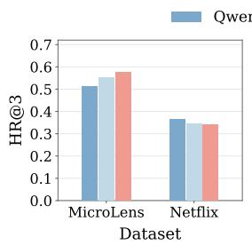

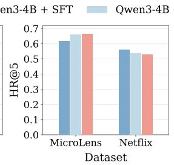

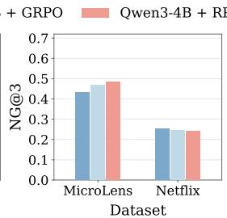

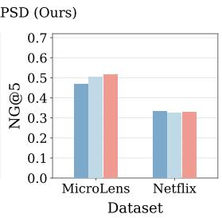  
Figure 3: Cross-domain recommendation performance. All methods are trained on MovieLens and evaluated on MicroLens and Netflix.

The full RPSD matches or outperforms this variant across all metrics, showing that retrieved evidence provides useful guidance beyond the label itself. When the teacher is conditioned only on the ground-truth label, it knows which item is correct but receives little information about why that item matches the user’s history. As a result, the resulting guidance provides only a weak bridge between the observed history and the target recommendation. In contrast, behavioral evidence from similar users exposes concrete preference patterns.

## 4.3 ABLATION STUDY ON DIFFERENT DESIGNS OF RETRIEVED EVIDENCE (RQ3)

In this subsection, we evaluate five variants to isolate each component. w/o Re-ranking retrieves evidence by coarse cosine similarity of mean embeddings, skipping the unbalanced OT re-ranking; w/o Temporal Cost $( \gamma = 0 )$ drops the temporal alignment penalty in Eq. (2). w/o Recency Weighting $( \beta ~ = ~ 0 )$ replaces the recency mass in Eq. (1) with uniform weights. w/o Diversity Selection $( \lambda _ { \mathrm { d i v } } = 0 )$ selects the top-|S| windows purely by relevance and w/o Centering & Clipping uses the raw gap $\Delta _ { i , t }$ instead of $\delta _ { i , t }$ in Eq. (7).

Table 4 shows diversity selection is the most consistently important component, with its removal causing the largest degradation on MovieLens-1M and MicroLens. On Netflix, recency weighting plays an equally decisive role, indicating that component importance is somewhat datasetdependent. Temporal alignment and semantic similarity contribute comparably overall, with neither consistently dominating, suggesting RPSD depends on balancing both cues rather than either alone. Centering and clipping are primarily introduced to stabilize optimization. However, on Netflix, removing them also causes a substantial drop in final recommendation performance. Notably, removing OT re-ranking even underperforms removing retrieved evidence altogether (w/o OT in Table 3), suggesting that poorly matched evidence misleads the teacher.

## 4.4 CROSS-DOMAIN EVALUATION (RQ4)

We evaluate cross-domain generalization by training all methods on MovieLens and testing them on MicroLens and Netflix. As shown in Figure 3, RPSD achieves the best performance across all metrics on MicroLens, showing that its retrieval-privileged token-level guidance transfers well to this target domain. On Netflix, however, SFT remains slightly stronger than both post-training methods. GRPO shows a similar drop, suggesting that the negative transfer of RPSD is not caused specifically by the privileged teacher. Instead, it may come from source-domain specialization introduced during reinforcement-learning post-training. Overall, these results suggest that the transferability of RPSD depends on how compatible the source and target domains are.

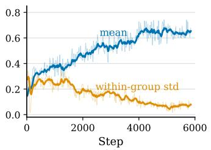  
(a)

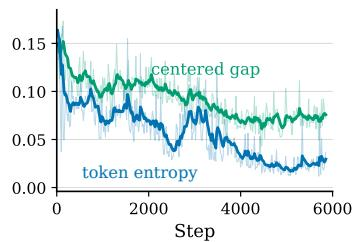  
(b)

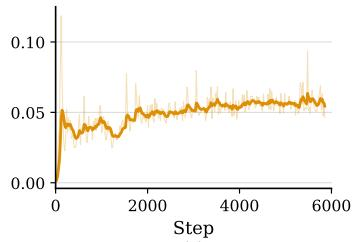  
(c)  
Figure 4: Training diagnostics of RPSD. (a) The rule-based reward and the within-group standard deviation of that reward. (b) The centered teacher–student gap $\delta _ { i , t }$ and the student’s token entropy. (c) The KL divergence to the reference model.

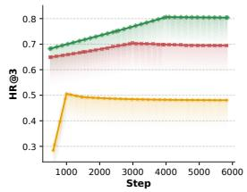

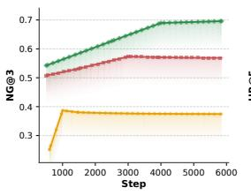

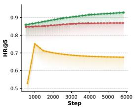

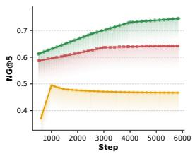  
Figure 5: Performance at different training steps of SFT, GRPO, and RPSD. RPSD consistently achieves stronger ranking performance and converges to the best final results.

## 4.5 TRAINING DIAGNOSTICS OF RPSD (RQ5)

Figure 4 tracks the training dynamics of RPSD. The reward increases steadily over training, and the within-group standard deviation decreases, showing that the sampled responses become progressively more consistent. This indicates stable policy optimization. To measure how confident the student is, we present the token entropy $\begin{array} { r } { \mathcal { H } \doteq \bar { - } \mathbb { E } _ { i , t } \sum _ { x \in \mathcal { X } } \pi _ { i , t } ( x ) \log \pi _ { i , t } ( x ) } \end{array}$ , where $\pi _ { i , t } ( \cdot ) = \pi _ { \boldsymbol { \theta } } ( \cdot \mid x ^ { S } , o _ { i , < t } )$ is the student’s next-token distribution, X is the token vocabulary, and the expectation is taken over all tokens in the sampled group. A lower H means the student places its probability on fewer tokens. As shown in Figure 4 (b), H falls quickly during training, which means the student gradually commits to the few tokens. The teacher–student gap also decreases, so privileged guidance is most useful in the early stage, when the student is still uncertain. As training continues, the student becomes more confident. Interestingly, the gap stays clearly above zero even after H has nearly flattened. A confident student is therefore not yet fully aligned with the teacher, and the retrieved evidence keeps providing token-level signal late in training rather than fading away with the uncertainty. The KL divergence to the reference model rises early and then stabilizes.

## 4.6 PERFORMANCE ACROSS TRAINING STEPS (RQ6)

Figure 5 evaluates the performance of SFT, GRPO, and RPSD at different training steps. RPSD outperforms GRPO from the first evaluated checkpoint and maintains this advantage throughout training. This shows that its benefits appear early and persist until convergence. The larger gains in NG than in HR suggest that RPSD not only retrieves the target item more often but also ranks it higher. These results support the effectiveness of using collaborative evidence to assign token-level credit. In contrast, SFT shows little improvement over training. Since all three methods share the same backbone, the stronger performance of RPSD can be attributed to our designs.

## 5 CONCLUSION

In this paper, we propose RPSD to address credit-blind optimization and collaborative-blind supervision. RPSD enriches the OPSD teacher with cross-user behavioral evidence retrieved by tem-

porally aware optimal transport and diversity-aware selection, enabling token-level supervision that captures both target correctness and collaborative behavioral patterns. Extensive experiments on multiple benchmarks show that RPSD consistently outperforms state-of-the-art methods.

## AI USE STATEMENT

We use generative AI tools to polish the writing of this manuscript. All AI-assisted content is reviewed by the authors, who take full responsibility for the final content.

## REFERENCES

R. Agarwal, N. Vieillard, Y. Zhou, P. Stanczyk, S. Ramos, M. Geist, and O. Bachem. On-policy distillation of language models: Learning from self-generated mistakes. In ICLR ’24, 2024.

K. Bao, J. Zhang, Y. Zhang, and et al. Tallrec: An effective and efficient tuning framework to align large language model with recommendation. In RecSys ’23, pp. 1007–1014, 2023.

Y. Chen, J. Tan, A. Zhang, Z. Yang, L. Sheng, E. Zhang, X. Wang, and T. Chua. On softmax direct preference optimization for recommendation. In NeurIPS ’24, pp. 27463–27489, 2024.

Z. Cheng, S. Chen, B. Yang, and et al. Omniopsd: Rationale-privileged on-policy self-distillation for affective computing. arXiv, 2026.

C. Gao, R. Chen, S. Yuan, and et al. Sprec: Self-play to debias llm-based recommendation. WWW ’25, 2025.

S. Geng, S. Liu, Z. Fu, Y. Ge, and Y. Zhang. Recommendation as language processing (rlp): A unified pretrain, personalized prompt and predict paradigm (p5). In RecSys ’22, pp. 299–315, 2022.

Y. Gu, L. Dong, F. Wei, and M. Huang. Minillm: Knowledge distillation of large language models. In ICLR ’24, 2024.

F. Harper and J. Konstan. The movielens datasets: History and context. ACM Transactions on Interactive Intelligent Systems, 5(4):1–19, 2015.

X. He, K. Deng, X. Wang, and et al. Lightgcn: Simplifying and powering graph convolution network for recommendation. In SIGIR ’20, pp. 639–648, 2020.

B. Hidasi, A. Karatzoglou, L. Baltrunas, and et al. Session-based recommendations with recurrent neural networks. In ICLR ’16, 2016.

C. M. Ju, L. Collins, L. Neves, B. Kumar, L. Y. Wang, T. Zhao, and N. Shah. Generative recommendation with semantic ids: A practitioner’s handbook. In CIKM ’25, pp. 6420–6425, 2025.

W. Kang and J. McAuley. Self-attentive sequential recommendation. In ICDM ’18, pp. 197–206, 2018.

X. Kong, J. Jiang, B. Liu, and et al. Think before recommendation: Autonomous reasoningenhanced recommender. NeurIPS ’25, 38:141209–141232, 2025a.

X. Kong, L. Sheng, J. Tan, Y. Chen, J. Wu, A. Zhang, X. Wang, and X. He. Minionerec: An open-source framework for scaling generative recommendation. In arXiv, 2025b.

Z. Li, F. Qi, C. Xu, T. Zhang, C. Huo, and P. Zhang. Lsig: Long semantic ids for generative recommendation. In WWW ’26, 2026.

J. Liao, S. Li, Z. Yang, and et al. Llara: Large language-recommendation assistant. In SIGIR ’24, pp. 1785–1795, 2024.

J. Lin, R. Shan, C. Zhu, K. Du, B. Chen, S. Quan, R. Tang, Y. Yu, and W. Zhang. Rella: Retrievalenhanced large language models for lifelong sequential behavior comprehension in recommendation. In WWW ’24, pp. 3497–3508, 2024.

J. Lin, X. Dai, Y. Xi, and et al. How can recommender systems benefit from large language models: A survey. ACM Transactions on Information Systems (TOIS), 43(2), 2025a.

J. Lin, T. Wang, and K. Qian. Rec-r1: Bridging generative large language models and user-centric recommendation systems via reinforcement learning. Transactions on Machine Learning Research (TMLR), 2025b.

F. Ma, Z. Cheng, M. Li, and et al. Hug-vis: A multimodal benchmark for human-centered understanding and generation in visual intelligence. arXiv preprint arXiv:2608.26517, 2026.

Y. Ni, Y. Cheng, X. Liu, and et al. A content-driven micro-video recommendation dataset at scale. In CIKM ’25, pp. 6486–6491, 2025.

C. Park, H. Yun, T. Kim, and et al. More than what was chosen: Llm-based explainable recommendation beyond noisy user preferences. In ICLR ’26, 2026.

R. Qiu, Z. Huang, H. Yin, and Z. Wang. Contrastive learning for representation degeneration problem in sequential recommendation. In WSDM ’22, 2022.

S. Rajput, N. Mehta, A. Singh, and et al. Recommender systems with generative retrieval. In NeurIPS ’23, pp. 10299–10315, 2023.

Z. Shao, P. Wang, Q. Zhu, and et al. Deepseekmath: Pushing the limits of mathematical reasoning in open language models. arXiv, 2024.

D. Wang, Y. Huang, S. Gao, Y. Wang, C. Huang, and S. Shang. Generative next poi recommendation with semantic id. In KDD ’25, pp. 6486–6496, 2025a.

J. Wang, A. Karatzoglou, I. Arapakis, and J. Jose. Reinforcement learning-based recommender systems with large language models for state reward and action modeling. In SIGIR ’24, pp. 375–385, 2024.

Y. Wang, J. Pan, X. Li, M. Wang, Y. Wang, Y. Liu, D. Liu, J. Jiang, and X. Zhao. Empowering large language model for sequential recommendation via multimodal embeddings and semantic ids. In CIKM ’25, 2025b.

Y. Wang, Y. Yang, L. Wu, and et al. Mllmrec-r1: Incentivizing reasoning capability in large language models for multimodal sequential recommendation. arXiv, 2026.

W. Wei, X. Ren, J. Tang, and et al. Llmrec: Large language models with graph augmentation for recommendation. In WSDM ’24, pp. 806–815, 2024.

B. Wu, S. Tang, F. Li, and et al. Aligning and balancing id and multimodal representations for recommendation. In KDD ’25, pp. 5029–5038, 2025.

X. Xie, F. Sun, Z. Liu, and et al. Contrastive learning for sequential recommendation. In ICDE ’22, pp. 1259–1273, 2022.

S. Xu, Chen X. Luo S., and et al. Rallrec: Improving retrieval augmented large language model recommendation with representation learning. In CIKM ’25, 2025.

Y. Ye, Z. Zheng, Y. Shen, T. Wang, and et al. Harnessing multimodal large language models for multimodal sequential recommendation. In AAAI ’25, volume 39, pp. 13069–13077, 2025.

Y. Yu, C. Gao, J. Chen, H. Tang, Y. Sun, Q. Chen, W. Ma, and M. Zhang. Easyrl4rec: An easy-touse library for reinforcement learning based recommender systems. In SIGIR ’24, pp. 977–987, 2024.

Z. Yuan, F. Yuan, Y. Song, and et al. Where to go next for recommender systems? id- vs. modalitybased recommender models revisited. In SIGIR ’23, pp. 2639–2649, 2023.

J. Zhang, Y. Zhu, Q. Liu, and et al. Mining latent structures for multimedia recommendation. In MM ’21, pp. 3872–3880, 2021.

Y. Zhang, F. Feng, J. Zhang, K. Bao, Q. Wang, and X. He. Collm: Integrating collaborative embeddings into large language models for recommendation. IEEE Transactions on Knowledge and Data Engineering (TKDE), 37(5):2329–2340, 2025.

S. Zhao, Z. Xie, M. Liu, and et al. Self-distilled reasoner: On-policy self-distillation for large language models. ICML ’26, 2026.

P. Zhou, C. Liu, J. Ren, and et al. When large vision language models meet multimodal sequential recommendation: An empirical study. In WWW ’25, pp. 275–292, 2025.

X. Zhou, H. Zhou, Y. Liu, and et al. Bootstrap latent representations for multi-modal recommendation. In WWW ’23, pp. 845–854, 2023.

Y. Zhu, H. Steck, D. Liang, Y. He, V. Ostuni, J. Li, and N. Kallus. Rank-grpo: Training llm-based conversational recommender systems with reinforcement learning. In ICLR ’26, 2026.

Z. Zhu and W. Zhang. Rejuvenating cross-entropy loss in knowledge distillation for recommender systems. In ICLR ’26, 2026.

## A APPENDIX OVERVIEW

The appendix is organized as follows.

• Algorithm Details. We provide the algorithm details of the complete RPSD training procedure, the evidence retrieval pipeline, and the unbalanced optimal transport solver.

• Implementation Details. We report the model configuration, training settings, retrieval setup, and hyper-parameters used to reproduce RPSD.

• Dataset Details. We describe the three benchmark datasets used in the main paper. Then we report their statistics and how we construct the training, validation, and test sets.

• Evaluation Protocol. We specify the candidate construction, evaluation metrics, ranking procedure, and repeated-run protocol.

• Baseline Details. We describe the Non-LLM and LLM-based recommenders used for comparison, together with their evaluation settings.

• Training Dynamics of RPSD. We analyze how RPSD behaves during optimization across datasets, in terms of teacher–student guidance, reward, entropy, and policy stability.

• Training Dynamics of RPSD w/o OT. We study the training dynamics of RPSD w/o OT in order to isolate the role of behavioral evidence retrieved using OT.

• Comparison with Vanilla OPSD. We compare RPSD with vanilla OPSD, which matches the student to a label-conditioned teacher distribution. We show that keeping the rewardgrounded objective while reweighting token-level credit leads to consistent gains.

• Response-Level RPSD versus Token-Level RPSD. We apply the same teacher-derived weights at the response level rather than the token level. This isolates the effect of credit granularity and shows that the improvement of RPSD comes from token-specific credit.

• Case Study of Student and Teacher Prompts. We illustrate the student and teacher prompts, including the retrieved evidence block, using a training example from MovieLens-1M.

## B ALGORITHM DETAILS

The full procedure is given in Algorithm 1. Evidence retrieval is detailed in Algorithm 2, and the optimal-transport solver at its core is given in Algorithm 3.

During training, the student samples a group of responses from the student prompt $x ^ { S }$ . Each response receives a rule-based reward, and GRPO turns these rewards into a single group-normalized advantage $\widehat { A } _ { i }$ . A teacher that additionally sees the retrieved evidence $E _ { u }$ then rescores the same tokens under stop-gradient. From this, we compute a confidence gap $\Delta _ { i , t }$ , which we center within each completion and clip into $\delta _ { i , t }$ . We map $\delta _ { i , t }$ to an advantage-aware weight $w _ { i , t }$ and use it to refine $\widehat { A } _ { i }$ into a token-level advantage $\widetilde { A } _ { i , t }$ . As a result, tokens supported by the evidence are reinforced more strongly when the response is correct, and penalized more strongly when it is wrong. Finally, we optimize the clipped GRPO objective with $\widetilde { A } _ { i , t }$ to update the policy. At inference, the model conditions only on $x ^ { S }$ . Therefore, the evidence shapes token credit during training and is never used at test time.

Algorithm 1 RPSD training   
Require: training set, policy $\pi _ { \theta }$ initialized from the SFT model, group size G, guidance strength λ,   
weight bound $\epsilon _ { w } ,$ stability threshold $^ { c _ { \delta } , }$ clip range ϵ, KL weight $\beta _ { \mathrm { K L } }$   
Ensure: trained policy π   
1: build the evidence index W   
2: for each training step do   
3: sample a user with history $H _ { u } ,$ candidate set $\mathcal { C } _ { u } ,$ and ground-truth next item $v _ { t + 1 } ^ { u }$   
4: $x ^ { S } \gets \mathrm { P R O M P T } _ { S } ( H _ { u } , \mathcal { C } _ { u } )$   
5: $E _ { u } \gets \mathrm { R }$ ETRIEVEEVIDENCE $( H _ { u } , \mathcal { W } )$   
6: $x ^ { \tilde { T } }  x ^ { S } \oplus E _ { u } \oplus v _ { t + 1 } ^ { u }$   
7: sample a group $\{ o _ { i } \} _ { i = 1 } ^ { G } \sim \pi _ { \theta } ( \cdot \mid x ^ { S } )$   
8: $r _ { i } \gets + 1 \mathrm { i f } o _ { i }$ is valid and names the target, 0 if valid but wrong, −1 if invalid   
9: $\widehat { A } _ { i } \gets \big ( r _ { i } - \mathrm { m e a n } ( r ) \big ) / \mathrm { s t d } ( r )$   
10: for each token $o _ { i , t }$ do   
11: $\Delta _ { i , t }  \log \pi _ { \mathrm { s g } ( \theta ) } ( o _ { i , t } \mid x ^ { T } , o _ { i , < t } ) - \log \pi _ { \mathrm { s g } ( \theta ) } ( o _ { i , t } \mid x ^ { S } , o _ { i , < t } )$   
12: $\begin{array} { r } { \delta _ { i , t } \gets \mathrm { c l i p } \left( \Delta _ { i , t } - \frac { 1 } { T _ { i } } \sum _ { t ^ { \prime } } \Delta _ { i , t ^ { \prime } } , - c _ { \delta } , c _ { \delta } \right) } \end{array}$   
13: $w _ { i , t } \gets \mathrm { c l i p } \big ( \mathrm { e x p } [ \mathrm { s i g n } ( \widehat { A } _ { i } ) \delta _ { i , t } ] , 1 - \epsilon _ { w } , 1 + \epsilon _ { w } \big )$   
14: $\widetilde { A } _ { i , t } \gets \widehat { A } _ { i } \big [ ( 1 - \lambda ) + \lambda w _ { i , t } \big ]$   
15: end for   
16: update $\theta$ by minimizing the RPSD objective in Eq. (8)   
17: end for   
18: return π<sub>θ</sub>

Evidence retrieval is summarized in Algorithm 2. Each item is encoded from its title text alone, using the mean-pooled hidden state of the SFT model. We reduce these vectors with PCA, and then index every length-K window together with the item. Given a query history, retrieval proceeds in two stages. We first perform a coarse retrieval of candidate windows by cosine similarity of recency-weighted mean embeddings, excluding the query user’s own windows so that no target leaks. We then re-rank the coarsely retrieved candidate windows with unbalanced entropic optimal transport, which aligns the two item sequences under a cost that combines semantic dissimilarity with a temporal penalty. Finally, a greedy criterion selects a diverse subset, which is rendered into the evidence block $E _ { u }$

The re-ranking step of Algorithm 2 uses the unbalanced entropic optimal-transport solver in Algorithm 3. Given the query mass a and window mass b from the recency-weighted rule, together with a ground cost C, the solver returns the transport plan and its mass-normalized cost, which we map to a similarity. The cost between query position $p$ and window position $q$ is ${ \cal C } _ { p q } = ( 1 - \bar { \langle e _ { p } , e _ { q } ^ { \prime } \rangle } ) + \gamma \cdot \bar { | p / ( K - 1 ) - q / ( K - 1 ) | }$ |, where the first term measures semantic dissimilarity between item-title embeddings and the second penalizes temporally inconsistent alignments. The marginal relaxation controlled by $\rho$ lets some mass stay unmatched, so a query and a window that share only part of their interests need not be fully aligned. As a special case, setting C to an identity kernel reduces the solver to recency-weighted exact matching.

## C IMPLEMENTATION DETAILS

We initialize the policy from an SFT-trained Qwen3-4B checkpoint and optimize it with LoRA. We set the rank to 32, the scaling factor to 64, and the dropout rate to 0.05, and we apply adapters to all linear layers. We split the sequence instances into training, validation, and test sets with a ratio of 7:1:2. Each instance is built from up to nine recent interactions. We use the final item as the prediction target and the preceding items as the input history, so each instance has at most eight history items. We apply the same construction to all three splits. For each instance, we build a candidate set of ten items: the target item and nine negatives. The negatives are sampled at random from the user’s non-interacted items. The student sees only the input history and the candidate set, and it is not told which candidate is the target.

Algorithm 2 Retrieve Evidence for a query history $H _ { u }$   
Require: training sequences $\{ S _ { u } \}$ , item titles $\{ t _ { v } \}$ , SFT model $f ,$ window length $K ,$ , recency rate   
$\beta ,$ embedding dimension $d ,$ recall size $N _ { 0 }$ , OT parameters $\varepsilon , \rho ,$ cost weight $\gamma _ { : }$ temperature $\tau ,$   
diversity weight $\lambda _ { \mathrm { d i v } } ,$ , evidence count m   
Ensure: evidence block $E _ { u }$   
1: $e _ { v } \gets$ meanpool $\displaystyle f ( t _ { v } ) )$ for every item, reduce all $\{ e _ { v } \}$ to d dimensions by PCA, and $\ell _ { 2 ^ { - } }$   
normalize them   
2: $\begin{array} { r } { a _ { p } \gets \frac { \exp [ - \beta ( K - 1 - p ) ] } { \sum _ { r = 0 } ^ { K - 1 } \exp [ - \beta ( K - 1 - r ) ] } \mathrm { ~ f o r ~ } p = 0 , \dots , K - 1 ; \quad a \gets ( a _ { 0 } , \dots , a _ { K - 1 } ) . } \end{array}$ $b \gets a$   
3: build ${ \mathcal W }  \{ ( h _ { j } , v _ { j } ^ { + } , u _ { j } , \bar { e } ( h _ { j } ) ) \}$ over all length-K windows $h _ { j }$ of the training sequences   
that are followed by an item $v _ { j } ^ { + }$ , excluding the last window of each sequence, where $\bar { e } ( h _ { j } ) =$   
$\sum _ { p } a _ { p } e _ { v _ { i , \tau } ^ { \prime } }$   
$\begin{array} { r l } { \frac { \eta _ { 2 } } { \parallel \sum _ { p } a _ { p } e _ { v _ { i , v } ^ { \prime } } \parallel _ { 2 } } } & { { } } \end{array}$   
4: if $| H _ { u } | < K$ then   
5: return $E _ { u }$ stating that no similar trajectory is retrieved   
6: end if   
7: $H _ { u } ^ { K } \gets$ the K most recent items of $H _ { u ; \phantom { } } \bar { e } ( H _ { u } ^ { K } )$ ← recency-weighted mean by the same rule   
8: ${ \mathcal { R } } \gets \mathrm { t o p } { - } N _ { 0 }$ windows by cosine $\langle \bar { e } ( H _ { u } ^ { K } ) , \bar { e } ( \dot { h } _ { j } ) \rangle$ , excluding windows with $u _ { j } = u$ or $h _ { j } = H _ { u } ^ { K }$   
9: for each $h _ { j } \in \mathcal R$ do   
10: $\begin{array} { r } { C _ { p q } \gets \dot { 1 } - \langle e _ { v _ { p } } , e _ { v _ { j , q } ^ { \prime } } \rangle + \gamma \left| \frac { p } { K - 1 } - \frac { q } { K - 1 } \right| , } \end{array}$ , where $v _ { p }$ is the p-th item of $H _ { u } ^ { K }$   
11: $( P ^ { * } , c _ { j } ) \gets$ transport plan and mass-normalized cost for $( a , b , C )$   
12: $s _ { j } \gets \exp ( - c _ { j } / \bar { \tau } ) \{ c _ { j } ^ { \ast } = \langle P ^ { \ast } , C \rangle / \| P ^ { \ast } \| _ { 1 } \}$   
13: end for   
14: $s  \emptyset$   
15: while $| S | < \mathrm { m i n } ( m , | \mathcal { R } | )$ do   
16: $j _ { . } ^ { \ast } \gets \arg \operatorname* { m a x } _ { j \in \mathcal { R } \backslash S } \left[ s _ { j } - \lambda _ { \mathrm { d i v } } \right.$ max $\left. \langle k \in S \left. \bar { e } ( h _ { j } ) , \bar { e } ( h _ { k } ) \right. \right]$ {inner max $: = 0$ if ${ \mathcal { S } } = \emptyset \}$   
17: ${ \mathcal { S } } \gets { \mathcal { S } } \cup \{ j ^ { * } \}$   
18: end while   
19: $E _ { u } \gets$ render each $h _ { j } \in S$ as one line listing its K items, the item $v _ { j } ^ { + }$ that user interacted with   
next, and its similarity $s _ { j }$   
20: return $E _ { u }$

```latex
Algorithm 3 Unbalanced entropic OT (mass-normalized cost)
Require: query mass $\mathbf { a } \in \mathbb { R } ^ { K }$ , window mass $\mathbf { b } \in \mathbb { R } ^ { K }$ , ground cost $\mathbf { C } \in \mathbb { R } ^ { K \times K }$ , regularization ε,
relaxation $\rho ,$ maximum iterations $T$
Ensure: transport plan P and mass-normalized cost c
1: $\mathbf { K } \gets \exp \bigl ( - \mathbf { C } \bigr / \varepsilon \bigr )$
2: $\mathbf { u }  \mathbf { 1 } _ { K } , \quad \mathbf { v }  \mathbf { 1 } _ { K }$
3: $f \left. \rho / ( \rho + \varepsilon ) \left\{ f \right. 1 \right.$ recovers balanced OT}
4: for $t = 1$ to T do
5: $\mathbf { u } \gets \left( \mathbf { a } / \left( \mathbf { K } \mathbf { v } \right) \right) ^ { f }$
6: $\mathbf { v }  ( \mathbf { b } / ( \mathbf { K } ^ { \top } \mathbf { u } ) ) ^ { f }$
7: break if u and v have converged
8: end for
9: P ← diag(u) K diag(v)
10: $c  \langle \mathbf { P } , \mathbf { \bar { C } } \rangle / \| \mathbf { P } \| _ { 1 }$
11: return $( \mathbf { P } , c )$
```

During training, the privileged teacher additionally receives behavioral evidence retrieved from other similar users. We first retrieve candidate history windows using 128-dimensional item embeddings, ranked by recency-weighted cosine similarity. We then re-rank them with temporally aware unbalanced OT. Finally, we apply MMR-based diversity selection. Specifically, we greedily pick three evidence windows, balancing their relevance to the query history against their similarity to windows already selected. For each selected window, we include the window itself and its subsequent interaction in the teacher’s evidence block. This evidence is used only by the teacher during training, and is not needed at inference time.

For each training prompt, we sample eight completions from the student policy. A completion receives reward 1 if it follows the required format and predicts the correct item, 0 if it is well-formed but incorrect, and −1 if it violates the output format. We then re-evaluate the same policy under the privileged teacher context with gradients disabled. Here the teacher only scores the student’s completion and it does not generate a separate response. We compute the teacher–student logprobability difference for each token and center it within each completion. We train for three epochs and the learning rate is $8 \times 1 0 ^ { - 6 }$ . The per-device batch size is 4, and we use 8 gradient-accumulation steps. We set the KL coefficient to 0.1 and save a checkpoint every 500 optimization steps.

## D DATASET DETAILS

We evaluate our model on three public recommendation datasets. They span the short-video and movie domains, and they differ in interaction density by more than two orders of magnitude. A statistical overview is given in Table 5. MicroLens and Netflix are large and sparse, which means that each user leaves only a few interactions on these datasets, so a model should generalize from very short histories. MovieLens is small but extremely dense, which means that long user sequences on this dataset make item patterns easy to observe. This spread lets us test whether retrieved behavioral evidence still helps when a user’s own history is too short to be informative, which is exactly the sparse regime our method targets.

MicroLens (Ni et al., 2025) is a short-video recommendation dataset. Each item carries a title, a cover image, and video information. Here, we use the title and the identifier as the item representation. It is the largest among the three datasets, with 25,411 users and 41,081 items. It is also highly sparse, at a density of $2 . 1 \times 1 0 ^ { - 4 }$ , so each user interacts with only 8.79 items on average. The large catalog and short histories make it a challenging test of generalization.

Netflix (Wei et al., 2024) is a user-based movie recommendation dataset from Kaggle, released by LLMRec. Each item comes with a title and a poster image. It has the shortest histories. Each user interacts with only 5.23 items on average, at a density of $3 . 0 \times 1 0 ^ { - 4 }$ . Because a single history reveal so little, Netflix is the dataset on which evidence from behaviorally similar users should matter most.

MovieLens (Harper & Konstan, 2015) is a classic movie recommendation dataset in which each movie provides a title, a release year, and a poster image. Unlike the other two datasets, it has a small catalog but is extremely dense, with a density of $\bar { 4 . 2 } \times 1 0 ^ { - 2 }$ and an average sequence length of 165.56. Each user therefore has a long, information-rich history, which is exactly the setting where standard sequential models already perform well. This makes MovieLens suitable for our approach. It lets us test whether retrieved evidence still helps even when a user’s own history is already informative enough on its own.

We split the sequence instances into training, validation, and test sets with a ratio of 7:1:2. Within each instance, we retain up to the nine most recent interactions, use the final item as the prediction target, and use the preceding items as the input history. This instance construction is applied consistently across the training, validation, and test splits.

## E EVALUATION PROTOCOL

For each test instance, we construct a candidate set by combining the ground-truth next item with $n _ { c } - 1$ negatives sampled from the user’s non-interacted items. We use $n _ { c } = 1 0 $ by default and additionally evaluate $n _ { c } = 1 0 0$ to examine performance with a larger candidate set. All methods are evaluated using the same data splits and candidate construction protocol.

Table 5: Statistics of the experimental datasets.
<table><tr><td>Dataset</td><td>#Users</td><td>#Items</td><td>#Interactions</td><td>Density</td></tr><tr><td>MicroLens</td><td>25,411</td><td>41,081</td><td>223,263</td><td> $2 . 1 \times 1 0 ^ { - 4 }$ </td></tr><tr><td>Netflix</td><td>13,187</td><td>17,366</td><td>68,933</td><td> $3 . 0 \times 1 0 ^ { - 4 }$ </td></tr><tr><td>MovieLens</td><td>6,040</td><td>3,952</td><td>1,000,209</td><td> $4 . 2 \times 1 0 ^ { - 2 }$ </td></tr></table>

We evaluate recommendation performance using hit ratio (HR@k) and normalized discounted cumulative gain (NDCG@k). During training, the model is optimized to predict the single next item, since the rule-based reward requires a deterministic, verifiable output. For evaluation, rank-based metrics instead require a ranked list, so we prompt the model to output the k items it considers most likely, forming a ranked list $\mathcal { L } _ { i } ^ { ( k ) }$ for each test instance. The Top-3 and Top-5 lists are generated independently rather than obtained by truncating a single shared ranking, and both HR@k and NDCG@k are computed from $\mathcal { L } _ { i } ^ { ( k ) }$ at the corresponding threshold k. Since each instance has exactly one ground-truth target, HR@k measures whether the target appears within the top $k ,$ and NDCG@k additionally rewards ranking it higher.

Let $\tau$ denote the test set. For each instance $i ,$ let $\mathrm { r a n k } _ { i } ^ { ( k ) }$ be the one-based position of the groundtruth item in the list $\mathcal { L } _ { i } ^ { ( k ) }$ . If the target does not appear in the list, we set $\mathrm { r a n k } _ { i } ^ { ( k ) } = + \infty$

HR@k is the fraction of test instances whose target appears within the top k positions:

$$
\mathrm { H R @ } k = \frac { 1 } { | T | } \sum _ { i \in \mathcal { T } } \mathbb { I } \Big [ \mathrm { r a n k } _ { i } ^ { ( k ) } \leq k \Big ] ,\tag{9}
$$

where $\mathbb { I } [ \cdot ]$ is the indicator function.

NDCG@k further rewards ranking the target higher. Each instance has exactly one target, and we compute

$$
\mathrm { N D C G @ } k = \frac { 1 } { | T | } \sum _ { i \in \mathcal { T } } g _ { i } ^ { ( k ) } , \qquad g _ { i } ^ { ( k ) } = \left\{ \begin{array} { l l } { \frac { 1 } { \log _ { 2 } \left( \mathrm { r a n k } _ { i } ^ { ( k ) } + 1 \right) } , } & { \mathrm { r a n k } _ { i } ^ { ( k ) } \leq k , } \\ { 0 , } & { \mathrm { o t h e r w i s e } . } \end{array} \right.\tag{10}
$$

We report HR@k and NDCG@k for $k \in \{ 3 , 5 \}$ under the default candidate setting, and for $k \in$ {5, 10} under the larger one. For both metrics, higher is better, and all results are averaged over five independent runs.

## F BASELINE DETAILS

We compare RPSD against two families of sequential recommenders. All baselines are trained and evaluated on the same data splits, the same candidate construction, and the same $n _ { c }$ as RPSD, so that differences reflect the method rather than the protocol.

Non-LLM models. GRU4Rec (Hidasi et al., 2016) encodes an interaction session with a gated recurrent network and predicts the next click from its final hidden state. SASRec (Kang & McAuley, 2018) replaces recurrence with a causal self-attention encoder that adaptively weighs earlier interactions. LightGCN (He et al., 2020) propagates user and item embeddings over the interaction graph, dropping feature transformation and nonlinearity for a lightweight collaborative signal. CL4SRec (Xie et al., 2022) adds a contrastive objective over perturbed sequences to a self-attentive backbone, strengthening its representations under sparse supervision. These models rely on identifier embeddings alone, and we use them to measure the effectiveness of purely collaborative signals. LATTICE (Zhang et al., 2021) builds a latent item-to-item graph from modality features for adding content structure to collaborative filtering. MoRec (Yuan et al., 2023) studies whether modalityderived item representations can replace identifier embeddings. BM3 (Zhou et al., 2023) learns multimodal representations with a self-supervised bootstrapping objective that needs no negative sampling. AB-Rec (Wu et al., 2025) aligns and balances identifier and modality representations so that neither dominates the fused embedding.

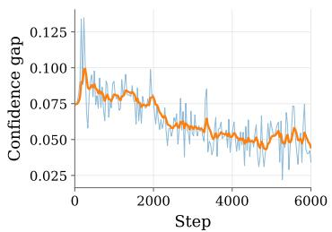

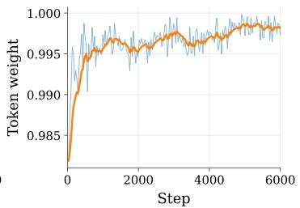

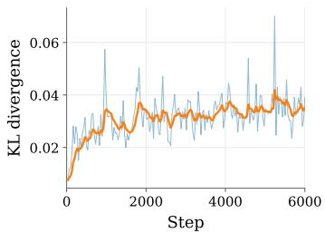  
Figure 6: RPSD training diagnostics on MovieLens. We track three quantities that are internal to RPSD. (left) The teacher-student confidence gap $\delta _ { i , t }$ averaged over completion tokens, which measures how much the teacher model differs from the student model. (middle) The advantageaware token weight $w _ { i , t }$ , which sets how strongly the shared advantage is reshaped. (right) The KL divergence to the reference policy. Blue curves are the raw logged values and orange curves are moving averages.

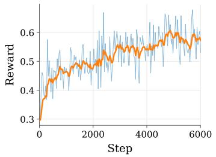

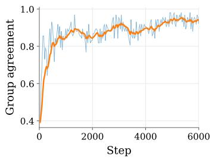

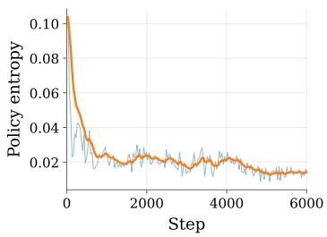  
Figure 7: Training stability of RPSD on MovieLens. (left) Rule-based reward. (middle) Group agreement, i.e., the fraction of sampled groups whose G responses all receive the same reward. Such groups have zero reward variance and provide no advantage signal. (right) Policy entropy over completion tokens. Blue curves are the raw logged values and orange curves are moving averages.

LLM-based recommenders. TallRec (Bao et al., 2023) tunes an LLM on recommendation prompts so that it picks the next item from a candidate list. LLaRA (Liao et al., 2024) connects collaborative embeddings to a language backbone through a projection, letting sequential signals enter the prompt. SPRec (Gao et al., 2025) uses a self-play preference scheme to reduce popularity bias. MSRBench (Zhou et al., 2025) studies how large models can be integrated into sequential recommendation under different strategies, and MLLM-MSR (Ye et al., 2025) fine-tunes a large model with an item-summarization stage that feeds a sequence model. RecZero (Kong et al., 2025a) posttrains an LLM with GRPO over structured reasoning steps and a graded rule-based reward.

Our own variants, Qwen3 with SFT, Qwen3 with GRPO, and Qwen3 with RPSD, share the identical backbone, prompt, sampling, and reward, and differ only in the method design, so the comparison among them attributes any gain to proposed modules.

## G TRAINING DIAGNOSTICS OF RPSD

In this section, we track how RPSD optimizes on the three datasets. The diagnostics are shown in Figures 6 - 11. Across all of them, the rule-based reward rises steadily and does not collapse, and the policy entropy goes down over time. This means the model becomes more confident and gradually commits to the tokens that identify the target item. The KL divergence to the reference model rises only at the beginning and then stays flat, so the training stays close to the reference rather than drifting away from it. Together, these curves show that RPSD trains in a stable way.

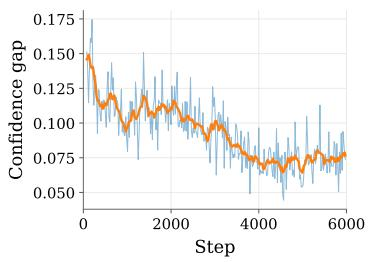

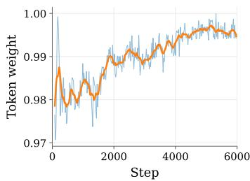

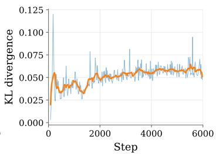  
Figure 8: RPSD training diagnostics on Netflix. We track three quantities that are internal to RPSD. (left) The teacher-student confidence gap $\delta _ { i , t }$ averaged over completion tokens, which measures how much the teacher model differs from the student model. (middle) The advantage-aware token weight $w _ { i , t }$ , which sets how strongly the shared advantage is reshaped. (right) The KL divergence to the reference policy. Blue curves are the raw logged values and orange curves are moving averages.

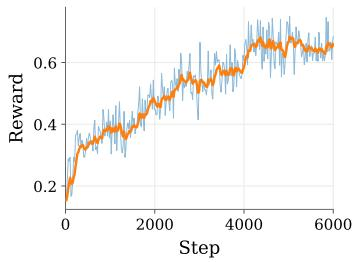

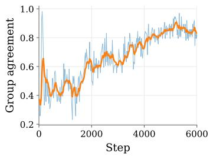

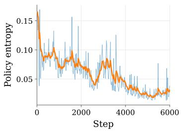  
Figure 9: Training stability of RPSD on Netflix. (left) Rule-based reward. (middle) Group agreement, i.e., the fraction of sampled groups whose G responses all receive the same reward. Such groups have zero reward variance and provide no advantage signal. (right) Policy entropy over completion tokens. Blue curves are the raw logged values and orange curves are moving averages.

We next look at the two quantities that are specific to RPSD. The teacher–student confidence gap $\delta _  i , $ is largest early in training and becomes smaller as the policy converges. This shows that the retrieved evidence helps most when the student is still uncertain, and its effect fades once the student can already score the decisive tokens on its own. This pattern is consistent across the three datasets, and the main difference is how far the gap narrows, which reflects how much privileged knowledge already reveals.

The token weight $w _ { i , t }$ moves toward one as training goes on. This does not mean the teacher stops mattering; it follows directly from the shrinking confidence gap, since $w _ { i , t }$ is computed from $\delta _ { i , t }$ and approaches one exactly when $\delta _ { i , t }$ becomes small. In other words, RPSD applies a strong correction early, when the student needs it, and a gentle one later, when the student is already confident. This happens on its own, without any manually designed annealing schedule, which makes the tokenlevel guidance easy to use in practice.

The group agreement, defined as the fraction of groups whose G responses receive the same reward, increases steadily during training. This trend is consistent with the behavior of the token weight $w _ { i , t }$ . As the policy becomes more confident, responses within the same group are more likely to receive the same reward, leading to higher group agreement. At the same time, the teacher–student gap $\delta _ { i , j }$ <sub>t</sub> decreases, causing $w _ { i , t }$ <sub>t</sub> to increase. Together, these trends indicate that both the group-level reward variation and the teacher’s token-level correction gradually weaken as training converges.

## H TRAINING DYNAMICS OF RPSD W/O OT

In this section, we examine how the training dynamics change once the retrieved evidence by OT is removed. In this variant, the teacher is privileged with the ground-truth item alone and reads no behavioral evidence, so it knows which candidate is correct but has no account of why it fits the current user history. Everything else, including the backbone, the prompt, the sampling configuration, the reward, and the guidance strength, is identical to the full model. The diagnostics are shown in Figures 12 - 17.

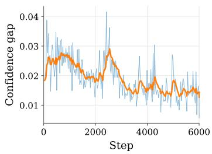

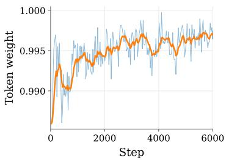

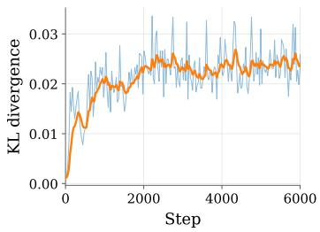  
Figure 10: RPSD training diagnostics on MicroLens. We track three quantities that are internal to RPSD. (left) The teacher-student confidence gap $\delta _ { i , t }$ averaged over completion tokens, which measures how much the teacher model differs from the student model. (middle) The advantageaware token weight $w _ { i , t } .$ , which sets how strongly the shared advantage is reshaped. (right) The KL divergence to the reference policy. Blue curves are the raw logged values and orange curves are moving averages.

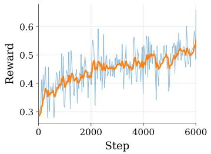

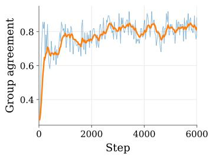

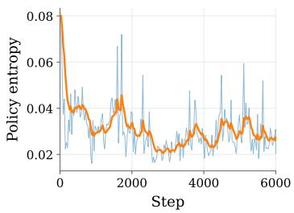  
Figure 11: Training stability of RPSD on MicroLens. (left) Rule-based reward. (middle) Group agreement, i.e., the fraction of sampled groups whose G responses all receive the same reward. Such groups have zero reward variance and provide no advantage signal. (right) Policy entropy over completion tokens. Blue curves are the raw logged values and orange curves are moving averages.

The overall optimization remains stable and close to that of the full model. On all three datasets, the rule-based reward still rises without collapse, the policy entropy still decreases, and the KL to the reference stays small and flat. In this respect the label-only teacher behaves like the full model: it does not destabilize training or pull the policy away from the reference.

The difference appears in the confidence gap $\delta _ { i , t }$ , the quantity that measures how differently the teacher scores the student’s tokens. Without behavioral evidence, the teacher and the student read almost the same input, so on the denser datasets the teacher rescores the tokens in nearly the same way and $\delta _ { i , t }$ stays small, giving the student only a weak token-level correction. On the sparse Netflix dataset the label-only teacher instead disagrees with the student in an unstable way, so $\delta _ { i , t }$ is larger but noisy. In neither case does removing the evidence break training and it mainly weakens or destabilizes the teacher–student correction that reshapes token-level credit, which is the signal the full model relies on.

How strongly the teacher can still guide the student depends on how much a user’s own history already reveals. On the denser datasets (MovieLens-1M and MicroLens), where each user has a long history, the confidence gap $\delta _ { i , t }$ is small from the start, because the student can already infer the answer and the label alone provides limited information. On the sparse Netflix dataset, the teacherstudent gap opens wider and does not close since the label identifies the correct item but gives the student no way to reach that conclusion on its own. Therefore, the teacher and the student keep disagreeing without resolving it. This matches the ablation study, where removing the retrieved evidence hurts accuracy the most on the sparsest dataset, and it supports our claim that the benefit of RPSD comes from the behavioral evidence rather than from merely conditioning the teacher on the answer.

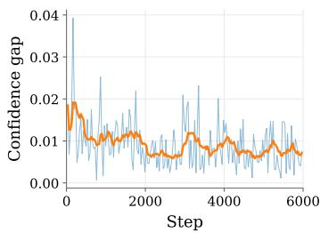

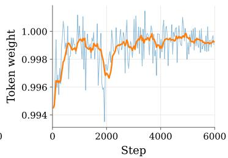

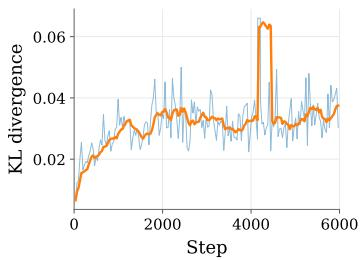  
Figure 12: Training diagnostics of RPSD w/o OT on MovieLens-1M. The teacher is privileged with the ground-truth item alone. (left) The teacher–student confidence gap averaged over completion tokens. (middle) The advantage-aware token weight. (right) The KL divergence to the reference policy. Blue curves are the raw logged values and orange curves are moving averages.

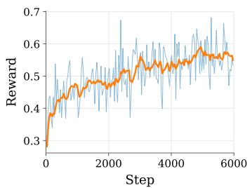

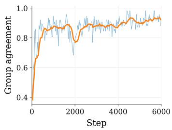

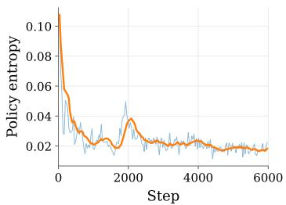  
Figure 13: Training stability of RPSD w/o OT on MovieLens-1M. (left) Rule-based reward. (middle) Group agreement. (right) Policy entropy over completion tokens. Blue curves are the raw logged values and orange curves are moving averages.

## I COMPARISON WITH VANILLA OPSD

Vanilla on-policy self-distillation (OPSD) (Zhao et al., 2026) uses the same language model as a student and a privileged teacher under different conditioning contexts. Given an input x and its reference solution $y ^ { \star }$ , the student first samples an on-policy response $\hat { y } \sim p _ { S } ( \cdot \mid x )$ . The teacher then evaluates the same student-generated prefixes while additionally conditioning on $y ^ { \star }$ . Its training objective minimizes the token-wise divergence between the full next-token distributions of the teacher and student:

$$
\mathcal { L } _ { \mathrm { O P S D } } ( \theta ) = \mathbb { E } _ { ( x , y ^ { \star } ) \sim \mathcal { D } } \mathbb { E } _ { \hat { y } \sim p _ { S } ( \cdot \vert x ) } \left[ \frac { 1 } { \vert \hat { y } \vert } \sum _ { t = 1 } ^ { \vert \hat { y } \vert } D \left( p _ { T } ( \cdot \vert x , y ^ { \star } , \hat { y } _ { < t } ) \vert \vert p _ { S } ( \cdot \vert x , \hat { y } _ { < t } ) \right) \right] ,\tag{11}
$$

where $D$ can be instantiated as KL divergence or generalized Jensen–Shannon divergence. Gradients are propagated only through the student distribution, while the privileged teacher serves as a detached distributional target.

RPSD differs from vanilla OPSD in both how the teacher signal is incorporated into optimization and what privileged knowledge the teacher receives. Rather than directly matching the complete student distribution to the teacher distribution, RPSD retains the reward-grounded GRPO objective and uses the teacher only to modulate the magnitude of token-level credit. Specifically, given the group-normalized response advantage ${ \widehat { A } } _ { i } .$ , RPSD computes

$$
\Delta _ { i , t } = \log \pi _ { \mathrm { s g } ( \boldsymbol { \theta } ) } ( o _ { i , t } \mid x _ { i } ^ { T } , o _ { i , < t } ) - \log \pi _ { \mathrm { s g } ( \boldsymbol { \theta } ) } ( o _ { i , t } \mid x _ { i } ^ { S } , o _ { i , < t } ) ,\tag{12}
$$

where the teacher context $x _ { i } ^ { T }$ additionally contains the ground-truth item and retrieved behavioral evidence. After centering and clipping the confidence gap into $\delta _ { i , t }$ , the token weight and refined advantage are defined as

$$
w _ { i , t } = \mathrm { c l i p } \left( \exp \left[ \mathrm { s i g n } ( \widehat { A } _ { i } ) \delta _ { i , t } \right] , 1 - \epsilon _ { w } , 1 + \epsilon _ { w } \right) , \qquad \widetilde { A } _ { i , t } = \widehat { A } _ { i } \left[ ( 1 - \lambda ) + \lambda w _ { i , t } \right] .\tag{13}
$$

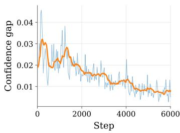

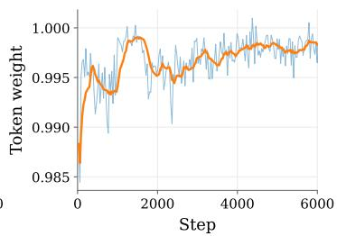

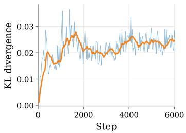  
Figure 14: Training diagnostics of RPSD w/o OT on MicroLens. The teacher is privileged with the ground-truth item alone. (left) The teacher–student confidence gap averaged over completion tokens. (middle) The advantage-aware token weight. (right) The KL divergence to the reference policy. Blue curves are the raw logged values and orange curves are moving averages.

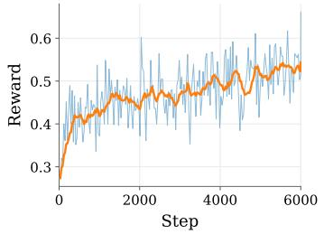

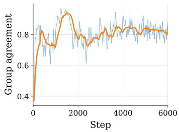

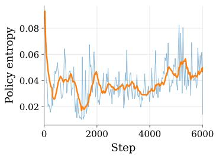  
Figure 15: Training stability of RPSD w/o OT on MicroLens. (left) Rule-based reward. (middle) Group agreement. (right) Policy entropy over completion tokens. Blue curves are the raw logged values and orange curves are moving averages.

Since $w _ { i , t } > 0$ and $\lambda \in [ 0 , 1 ]$ , the scaling factor is strictly positive and therefore $\mathrm { s i g n } ( \widetilde { A } _ { i , t } ) =$ $\mathrm { s i g n } ( \widehat { A } _ { i } )$ . Thus, the verifiable reward continues to determine whether the policy-gradient term reinforces or suppresses a response, while the teacher only redistributes its magnitude across tokens. This is fundamentally different from vanilla OPSD, where the teacher distribution itself constitutes the optimization target. RPSD further differs from vanilla OPSD in the source of the teacher’s privileged information. Vanilla OPSD conditions the teacher on the ground-truth label alone, which tells the teacher which candidate is correct but not why it fits the current history. In contrast, RPSD additionally conditions the teacher on cross-user behavioral evidence retrieved by temporally aware optimal transport, so the teacher is grounded in how behaviorally similar users actually continued rather than in the bare answer.

As reported in Table 6, vanilla OPSD improves over SFT, confirming that dense on-policy teacher supervision is a useful signal. However, it falls below GRPO on the recommendation performance. Directly imitating a label-conditioned teacher distribution pulls every token toward the teacher, including tokens that carry no evidence for the recommendation, so not all updates stay aligned with the verifiable objective. RPSD avoids this by keeping the reward-grounded objective and letting the teacher only reweight token credit, so the reward still decides the direction of each update while the retrieved evidence by OT and the ground-truth item sharpen where that update lands. This is why RPSD surpasses both OPSD and GRPO rather than sitting between them.

## J RESPONSE-LEVEL VERSUS TOKEN-LEVEL CREDIT

The full RPSD applies the teacher’s guidance at the token level. Each token gets its own weight, so tokens the retrieved evidence supports are reinforced more and formatting tokens are downweighted. To test that this token-level granularity is truly the source of the performance gain, and not just a per-response calibration, we relax RPSD into a response-level variant that keeps everything else fixed and only changes the granularity at which the teacher’s guidance is applied. The Response-level RPSD shares the same student rollouts, retrieval-privileged teacher, rule-based rewards, confidence gaps $\delta _ { i , t }$ , and hyperparameters as RPSD.

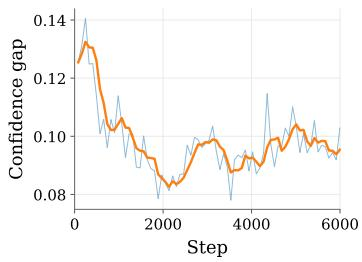

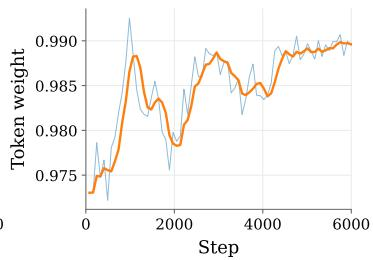

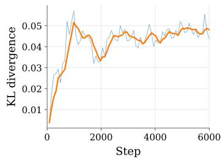  
Figure 16: Training diagnostics of RPSD w/o OT on Netflix. The teacher is privileged with the ground-truth item alone. (left) The teacher–student confidence gap averaged over completion tokens. (middle) The advantage-aware token weight. (right) The KL divergence to the reference policy. Blue curves are the raw logged values and orange curves are moving averages.

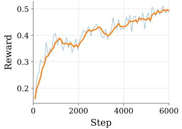

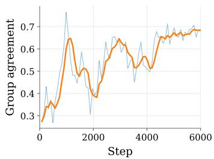

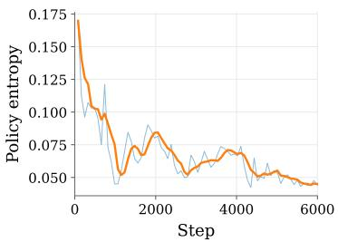  
Figure 17: Training stability of RPSD w/o OT on Netflix. (left) Rule-based reward. (middle) Group agreement. (right) Policy entropy over completion tokens. Blue curves are the raw logged values and orange curves are moving averages.

The relaxation averages the per-token weights of each response into a single scalar and broadcasts it to all tokens,

$$
\bar { w } _ { i } = \frac { 1 } { T _ { i } } \sum _ { t = 1 } ^ { T _ { i } } w _ { i , t } , \qquad \widetilde { A } _ { i , t } ^ { \mathrm { r e s p } } = \widehat { A } _ { i } \left[ ( 1 - \lambda ) + \lambda \bar { w } _ { i } \right] , \quad t = 1 , \dots , T _ { i } ,\tag{14}
$$

where $w _ { i , t }$ is computed exactly as in the full RPSD. GRPO shares one advantage across all tokens, Response-level RPSD rescales each response using a single teacher-derived scalar, whereas our RPSD maintains a separate weight for each token. Since none of the three methods reverses the sign of $\widehat { A } _ { i }$ , the verifiable reward still determines the direction of every update. Therefore, these methods differ only in the granularity with which the teacher redistributes the update magnitude.

Table 7 provides a clear comparison. Response-level RPSD already improves over GRPO, showing that the privileged teacher remains useful even when its guidance is compressed into a single scalar per response. However, it still falls well below the full Token-level RPSD. This suggests that the gain of RPSD does not arise merely from strengthening some responses and weakening others, but largely from distinguishing tokens within each response. This difference follows directly from the weight construction. Because $\delta _ { i , t }$ is centered within each response, averaging it largely removes the contrast between above- and below-average tokens, making Response-level RPSD much closer to GRPO’s uniform within-response credit. It can still modulate the overall update strength across responses, but cannot distinguish which tokens are more strongly supported by the privileged teacher. In contrast, Token-level RPSD assigns larger updates to tokens whose likelihood changes more under the retrieved evidence while down-weighting less informative tokens, such as generic or formatting tokens. The larger improvement in NDCG further suggests that such fine-grained credit helps not only identify the target item but also rank it more accurately.

## K CASE STUDY OF STUDENT AND TEACHER PROMPTS

To make the privileged knowledge concrete, Figure 18 shows an example of student and teacher prompts. The student prompt $x ^ { S }$ contains only the user’s interaction history and the candidate set, and asks the model to name the single next item. It is the sole input at inference, so the deployed policy never sees any of the privileged information below.

Table 6: Performance comparison with vanilla OPSD.
<table><tr><td rowspan="2">Model</td><td colspan="4">MicroLens</td></tr><tr><td>HR@3</td><td>HR@5</td><td>NG@3</td><td>NG@5</td></tr><tr><td>Qwen3-4B + SFT</td><td>0.5187</td><td>0.6526</td><td>0.4339</td><td>0.4982</td></tr><tr><td>Qwen3-4B + GRPO</td><td>0.6621</td><td>0.7764</td><td>0.5841</td><td>0.6330</td></tr><tr><td>Qwen3-4B + OPSD</td><td>0.5669</td><td>0.6942</td><td>0.4809</td><td>0.5404</td></tr><tr><td>Qwen3-4B + RPSD (Ours)</td><td>0.6836</td><td>0.7809</td><td>0.6036</td><td>0.6417</td></tr></table>

Table 7: Ablation on the Response-level RPSD and Token-level RPSD (Ours).
<table><tr><td rowspan="2">Model</td><td colspan="4">Netflix</td></tr><tr><td>HR@3</td><td>HR@5</td><td>NG@3</td><td>NG@5</td></tr><tr><td>GRPO</td><td>0.6690</td><td>0.8510</td><td>0.5490</td><td>0.6198</td></tr><tr><td>Response-level RPSD</td><td>0.6975</td><td>0.8655</td><td>0.5775</td><td>0.6439</td></tr><tr><td>Token-level RPSD (Ours)</td><td>0.8020</td><td>0.9245</td><td>0.6952</td><td>0.7448</td></tr></table>

During training, the teacher additionally reads two blocks. The first is the retrieved evidence $E _ { u } ,$ which lists how behaviorally similar users continued after comparable histories, together with a similarity score for each trajectory. In this example, the user’s recent history mixes classic sciencefiction titles such as Mad Max, The Matrix, and Men in Black. The retrieved trajectories share several of these items, so their continuations suggest the kind of item such a user tends to watch next. The second block is the ground-truth next item, which states the correct answer directly. These privileged views together let the teacher judge the student’s response not only by whether it matches the label, but also in light of what similar users actually did.

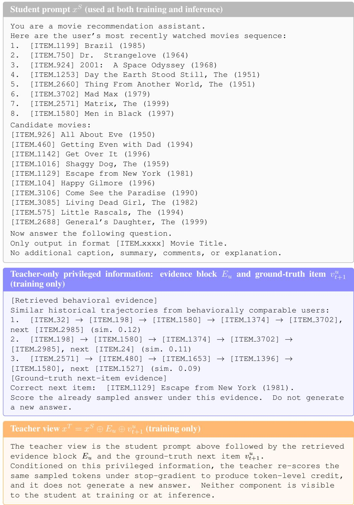  
Figure 18: An example of the student prompt $x ^ { S }$ and the teacher’s privileged knowledge.