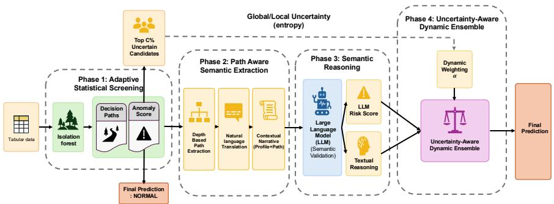
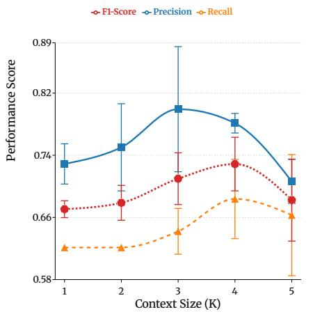
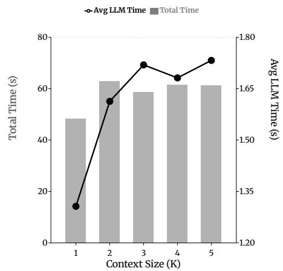

# ReForest: Interpretability Meets Reasoning in Isolation Forest

Juyoung Seo1, Geonwoo Bang1, Dongho Kim2, and Moohong Min3⋆

1 Department of Computer Education, Sungkyunkwan University, Seoul, Korea {tjwndud04, g7199}@g.skku.edu

2 Department of Immersive Media Engineering, Sungkyunkwan University, Seoul, Korea

dpl9753@g.skku.edu

Department of Computer Education/Social Innovation Convergence Program, Sungkyunkwan University, Seoul, Korea iceo@skku.edu

Abstract. Statistical anomaly detection methods like Isolation Forest are eficient but sufer from a critical semantic gap. They identify numerical rarities but fail to understand the contextual meaning of data, often missing subtle, context-dependent anomalies. Conversely, Large Language Models possess strong semantic reasoning capabilities but are prohibitively expensive and slow for large-scale deployment. To bridge this gap, we propose ReForest, a novel framework that synergizes the statistical eficiency of Isolation Forest with the reasoning power of LLMs. ReForest transforms the latent decision paths of Isolation Forest into natural-language explanations, enabling an LLM to refine anomaly detection through an uncertainty-aware dynamic ensemble. This approach allows the model to adaptively weigh statistical and semantic signals based on uncertainty-driven instance-level confidence. Extensive experiments on four real-world datasets (Healthcare, Finance) demonstrate that ReForest significantly outperforms baselines, achieving an average 21% improvement in Recall and a 10% gain in F1-score. Our framework not only improves detection performance but also enhances model transparency by grounding semantic narratives in statistical evidence, providing interpretable rationales essential for high-stakes decision-making.

Keywords: Anomaly Detection · Large Language Models · Isolation Forest · Explainable AI

## 1 Introduction

Anomaly detection is a cornerstone of modern data analytics, underpinning critical applications such as fraud detection in banking, intrusion detection in cybersecurity, and disease diagnosis in healthcare [1]. Traditional statistical methods, particularly Isolation Forest (IForest) [2], have been widely adopted due to their linear scalability and efectiveness in identifying numerical outliers. These methods operate on the premise that anomalies are “few and diferent,” isolating them in fewer steps than normal instances.

However, statistical methods face a fundamental limitation: the semantic gap [3]. They treat features as abstract numbers, ignoring the rich semantic context and relationships inherent in real-world data. For example, in an HR dataset, a “25-year-old employee with a \$100k salary” might be statistically rare (an outlier), but semantically valid if their role is “Senior Developer” in a high-cost region. Conversely, a “30-year-old Intern” might be numerically normal but contextually anomalous. Purely statistical models often miss these contextdependent anomalies (False Negatives) or flag valid rare cases as anomalies (False Positives), lacking the reasoning capability to distinguish between the two.

Large Language Models (LLMs) [4,5] have recently emerged as powerful tools for reasoning and pattern recognition, with their pre-trained world knowledge enabling contextual understanding that statistical models lack. However, applying LLMs directly to anomaly detection faces critical challenges. Processing large-scale datasets with LLMs is computationally expensive and slow, making them impractical for real-time applications [6]. Moreover, without statistical grounding, LLMs may generate plausible but incorrect justifications for anomalies, leading to unreliable predictions [7].

To address these challenges, we introduce ReForest, a hybrid framework that combines the eficiency of Isolation Forest with the reasoning capabilities of LLMs. Unlike previous approaches that use fixed ensembles or expensive all-LLM pipelines, ReForest introduces three key innovations:

1. Path-Aware LLM Integration: We explicitly extract the isolation paths (the sequence of rules that led IForest to flag a sample) and translate them into natural language narratives. This provides the LLM with a statistical grounding, asking it to validate the reason for isolation rather than just the raw data.

2. Uncertainty-Aware Dynamic Ensemble: We propose a novel weighting mechanism that dynamically adjusts the influence of the statistical model and the LLM based on instance-level uncertainty. When the statistical model is confident, the system prioritizes eficiency; when it is uncertain (borderline cases), it relies more heavily on the LLM’s semantic reasoning.

3. Dual-View Explainability: Our framework provides interpretable explanations from both statistical and semantic perspectives, ofering users transparent insights into why a sample is flagged as anomalous through both isolation paths and natural language reasoning.

Extensive experiments on four real-world datasets demonstrate that ReForest efectively bridges the semantic gap. Our method successfully identifies subtle anomalies that statistical methods miss, achieving substantial improvements in Recall while maintaining comparable precision and strong F1-scores across diverse domains. Furthermore, our eficient screening mechanism significantly reduces computational costs compared to pure LLM approaches, making semantic anomaly detection practical for large-scale applications.

## 2 Related Work

## 2.1 Statistical Anomaly Detection

Statistical and distance-based methods have long dominated the field of anomaly detection due to their computational eficiency and theoretical foundations [1]. Isolation Forest (IForest) [2] revolutionized the field by isolating anomalies using random trees, exploiting the principle that anomalies are easier to isolate than normal points. Local Outlier Factor (LOF) [8] measures the local density deviation of a data point with respect to its neighbors, enabling the detection of local anomalies. One-Class SVM [9,10] learns a decision boundary around normal data in a high-dimensional feature space. Distance-based methods like HBOS [11] and KNN [12] detect anomalies based on distance metrics. More recently, ECOD [13] uses empirical cumulative distribution functions to detect outliers without hyperparameter tuning, demonstrating strong performance across diverse datasets.

Deep learning approaches have also been explored, with autoencoders, variational autoencoders, and deep SVDD [14] learning compact representations of normal data. However, these methods share a fundamental limitation with traditional statistical approaches: they lack semantic understanding. Operating purely on numerical distributions and learned embeddings, they often fail to capture complex, attribute-level relationships and domain-specific constraints that define contextual anomalies. For instance, they cannot reason about whether a high salary is appropriate given a job title and experience level.

## 2.2 LLMs for Anomaly Detection

The emergence of Large Language Models has opened new possibilities for anomaly detection through their reasoning and world knowledge capabilities [4]. Early works explored LLMs for time-series anomaly detection, where GPT-4 was used to interpret temporal patterns. LogGPT [15] applied LLMs to log analysis, leveraging their ability to understand unstructured text. In the visual domain, AnomalyGPT [16] demonstrated LLMs’ capability to detect anomalies in images through vision-language models.

More recently, several works have attempted to combine LLMs with traditional anomaly detection. AnomalyLLM [17] uses knowledge distillation to transfer LLM capabilities to smaller student networks, but focuses on transferring knowledge rather than real-time inference. Some approaches use LLMs as data augmentation tools or for generating synthetic anomalies [18].

However, most existing approaches sufer from one of two limitations: (1) they apply LLMs to all data points—incurring prohibitive computational costs and slow inference times for large-scale datasets, or (2) they use LLMs as black-box classifiers without leveraging the structural insights from traditional statistical models, leading to potential hallucinations and lack of statistical grounding. Furthermore, existing hybrid approaches typically use fixed combination strategies that fail to adapt to instance-level characteristics.

Our work difers fundamentally by: (1) extracting and utilizing the internal decision structure (isolation paths) from the statistical model to provide interpretable grounding for the LLM, (2) introducing an uncertainty-aware dynamic weighting mechanism that adapts the model combination strategy at the instance level rather than using fixed weights, and (3) creating a synergy where the statistical model provides eficient screening and structural insights, while the LLM validates semantic appropriateness, with each model compensating for the other’s weaknesses. To our knowledge, ReForest is the first framework to systematically extract and utilize isolation path structures as interpretable features for LLM reasoning, combined with instance-level adaptive ensemble weighting based on uncertainty quantification.

## 3 Methodology

We propose ReForest (Reasoning-Enhanced Forest), a hybrid anomaly detection framework that combines isolation-based structural interpretability with LLM semantic reasoning through adaptive statistical screening, diversity-aware path extraction, and uncertainty-aware hybrid scoring. The overall architectural pipeline of ReForest is illustrated in Figure 1.

  
Fig. 1. The proposed hybrid anomaly detection pipeline (ReForest). The process consists of four phases: (1) Adaptive Statistical Screening filters out clear normal samples using Isolation Forest to reduce cost; (2) Path-Aware Semantic Extraction selects and translates the top-K shortest decision paths into natural language; (3) Semantic Reasoning utilizes an LLM to validate anomalies based on contextual prompts; and (4) Uncertainty-Aware Dynamic Ensemble fuses statistical and semantic scores using an uncertainty-driven weighting mechanism α(x) to produce the final prediction.

## 3.1 Adaptive Estimation of Screening Rate

The Isolation Forest model produces an anomaly score for each sample. Based on these scores, it is necessary to determine what proportion of data should be forwarded to the LLM for further inspection.

Since anomaly ratios vary across datasets, we avoid using a fixed screening rate. Instead, we estimate it from the training data and adjust it using a parametric safety margin and bounded constraints.

Let the training dataset be:

$$
\mathcal { D } _ { t r a i n } = \{ ( x _ { i } , y _ { i } ) \} _ { i = 1 } ^ { N } ,
$$

where $y _ { i } = 1$ indicates an anomalous sample.

We define the estimated screening rate as:

$$
C _ { e s t } = \mathrm { C l i p } \left( \boldsymbol { \hat { r } _ { a n o m } } \cdot \boldsymbol { \alpha } , C _ { m i n } , C _ { m a x } \right)
$$

$\begin{array} { r } { - \ \hat { r } _ { a n o m } \ = \ \frac { 1 } { N } \sum _ { i = 1 } ^ { N } \mathbb { I } ( y _ { i } \ = \ 1 ) } \end{array}$ is the estimated anomaly ratio from training data,

$- \alpha$ is a safety margin hyperparameter used to cover borderline anomalies, $- ~ C _ { m i n }$ and $C _ { m a x }$ denote the minimum and maximum screening rate constraints,

$- \ \mathrm { C l i p } ( \cdot )$ restricts the final value to the range $[ C _ { m i n } , C _ { m a x } ]$

We use $\alpha = 1 . 5$ following Tukey’s 1.5 IQR rule [19], with $C _ { m i n } = 0 . 0 5$ and $C _ { m a x } = 0 . 5 0$ . Samples are ranked according to their anomaly scores, and only the top $C _ { e s t }$ proportion (e.g., 100 out of 1000 samples when $C _ { e s t } = 0 . 1 )$ are forwarded to the LLM for further evaluation.

In practice, this adaptive screening strategy provides a critical computational advantage. The major bottleneck of LLM-based anomaly detection is inference cost and latency [7]. Using IForest as a computationally eficient pre-filter, Re-Forest forwards only the top $C _ { e s t }$ portion of instances with the highest anomaly scores and greatest uncertainty to the LLM for semantic validation.

Across our experiments, this results in an efective screening ratio of approximately 15–20%, meaning that the LLM processes only a small fraction of the total samples while focusing its reasoning capacity on the most ambiguous cases. This design makes ReForest practically feasible for large-scale anomaly detection scenarios, avoiding the prohibitive cost of applying LLM inference to every sample.

## 3.2 Depth-Based Semantic Path Extraction

Isolation Forest isolates anomalies through random partitioning of the feature space, producing decision paths across T trees. Supplying all T paths to an LLM would lead to information overload and excessive token costs. To mitigate this, ReForest introduces a depth-based path extraction strategy that prioritizes the most concise and explanatory isolation logic.

Given the set of all decision paths:

$$
\mathcal { P } = \{ p _ { 1 } , p _ { 2 } , . . . , p _ { T } \} ,
$$

each path $p _ { t }$ is represented by a sequence of split predicates, and its isolation strength is reflected by its depth $L ( p _ { t } )$ . Shorter paths indicate that the instance was isolated quickly, representing a stronger and more obvious anomaly signal. Following the principle of Occam’s Razor, we prioritize these shorter paths as they provide the simplest and most interpretable explanations for the LLM.

We sort $\mathcal { P }$ by increasing depth and select the top-K shortest paths S using the following procedure:

Algorithm 1 Depth-Based Path Extraction   
Require: Path set $\mathcal { P } = \{ p _ { 1 } , . . . , p _ { T } \}$ , target number K   
Ensure: Selected path subset S   
1: Sort P in ascending order of depth $L ( p _ { t } )$   
2: Initialize $s \gets \emptyset$   
3: for each $p _ { t } \in \mathcal { P }$ do   
4: $S \gets S \cup \{ p _ { t } \}$   
5: if $| S | = K$ then   
6: break   
7: end if   
8: end for   
9: return S

Each path in $s$ is then translated into a natural language narrative enriched with statistical descriptions from $\mathcal { D } _ { t r a i n }$ (e.g., quartile positions, extremeness). This step provides the LLM with interpretable structural signals that explain why the statistical model flagged the instance, focusing on the most dominant isolation factors.

## 3.3 Uncertainty-Aware Dynamic Ensemble

In the final phase, ReForest fuses statistical and semantic signals through an Uncertainty-Aware Dynamic Ensemble mechanism. The dynamic weighting mechanism is motivated by two key insights: (1) Statistical models excel at detecting clear-cut distributional anomalies with high confidence, making LLM intervention unnecessary and potentially introducing noise. (2) For borderline cases near the decision boundary, statistical uncertainty signals that distributional evidence alone is insuficient, and semantic reasoning becomes critical. By adaptively shifting reliance between the two modalities, ReForest avoids both the brittleness of pure statistical methods (which ignore context) and the inconsistency of pure LLM-based detection (which may overlook statistical patterns).

We normalize the IForest score using Z-score transformation and a sigmoid:

$$
z = \frac { \mu _ { t r a i n } - S _ { I F } ( x ) } { \sigma _ { t r a i n } } , \quad P _ { I F } ( x ) = \frac { 1 } { 1 + e ^ { - z } } .
$$

The dynamic weight $\alpha ( x )$ assigned to the statistical model is defined as:

$$
\alpha ( x ) = \mathrm { C l i p } \left( \alpha _ { b a s e } + \varDelta ( P _ { I F } ( x ) ) , \alpha _ { m i n } , \alpha _ { m a x } \right) ,
$$

where $\alpha _ { b a s e }$ represents the neutral weight when uncertainty is moderate, and $[ \alpha _ { m i n } , \alpha _ { m a x } ]$ defines the feasible range to prevent extreme reliance on either modality. The adjustment term $\varDelta$ depends on the model’s confidence:

$$
\Delta ( p ) = \left\{ \begin{array} { l l } { { + \beta , } } & { { \left| p - 0 . 5 \right| > \tau _ { h i g h } \quad \mathrm { ( H i g h ~ c o n f i d e n c e ) } } } \\ { { - \beta , } } & { { \left| p - 0 . 5 \right| < \tau _ { l o w } \quad \mathrm { ( H i g h ~ u n c e r t a i n t y ) } } } \\ { { 0 , } } & { { \mathrm { o t h e r w i s e , } } } \end{array} \right.
$$

where $\beta$ controls the magnitude of weight adjustment, and $\tau _ { h i g h } , \ \tau _ { l o w }$ define the confidence thresholds. In our experiments, we set $\alpha _ { b a s e } = 0 . 5$ (equal initial weight), $\alpha _ { m i n } = 0 . 2$ and $\alpha _ { m a x } = 0 . 8$ (bounded trust in either model), $\beta =$ 0.25 (moderate adjustment), $\tau _ { h i g h } = 0 . 4$ and $\tau _ { l o w } = 0 . 1$ (based on empirical calibration to capture clear vs. ambiguous regions).

The final anomaly probability is:

$$
P _ { f i n a l } ( x ) = \alpha ( x ) \cdot P _ { I F } ( x ) + ( 1 - \alpha ( x ) ) \cdot \frac { S _ { L L M } ( x ) } { 1 0 } .
$$

The Uncertainty-Aware Dynamic Ensemble ensures that each model contributes where it has comparative advantage: statistical rigor for obvious cases, semantic judgment for ambiguous ones. This design yields three key advantages: (1) Robustness – by deferring to statistical confidence when available, the system avoids over-reliance on potentially inconsistent LLM outputs; (2) Interpretability – the extracted decision paths and LLM reasoning provide human-auditable explanations for each prediction; (3) Context-awareness – unlike purely statistical methods, ReForest can correctly classify rare but legitimate cases by incorporating domain semantics, significantly improving precision on context-dependent anomalies where traditional detectors generate high false positive rates.

## 4 Experiments

In this section, we validate the efectiveness of ReForest by addressing the following three Research Questions (RQs):

1. RQ1 (Performance): Does ReForest outperform conventional anomaly detection models under the same experimental settings?

2. RQ2 (Impact of Path Information): How do Semantic Path Extraction and the amount of contextual information (K) afect model performance?

3. RQ3 (Qualitative Analysis): Can ReForest provide human-understandable explanations for its decisions?

## 4.1 Experimental Setup

Datasets and Baselines We utilized four datasets from diverse domains to evaluate ReForest:

1. Hepatitis C Virus (HCV) Dataset (Healthcare): Predicts diagnosis category (Blood Donor vs. Hepatitis/Fibrosis/Cirrhosis) based on clinical laboratory test results including ALT, AST, bilirubin levels, and patient demographics. Contains 615 samples with 12 features and 13.3% anomaly ratio.

2. Stroke Prediction Dataset (Healthcare): Predicts stroke risk based on medical and lifestyle factors such as hypertension, heart disease, and smoking status. Contains 4,909 samples with 10 features and 4.3% anomaly ratio.

3. HMEQ (Home Equity) Loan Dataset (Finance): Focuses on predicting default on home equity loans using features like loan amount, property value, and debt-to-income ratio. Contains 3,364 samples with 12 features and 8.9% anomaly ratio.

4. Loan Default Prediction (Finance): Predicts loan default status using borrower credit information including FICO score, interest rate, debt-toincome ratio, revolving balance, and delinquency records. Contains 9,578 samples with 13 features and 16.0% anomaly ratio.

We compared ReForest against statistical baselines (IForest [2], LOF [8], ECOD [13]) and a deep learning model (AutoEncoder). All baseline implementations were based on the PyOD library [20].

Metrics Given the class imbalance, we used F1-score as the primary evaluation metric, as it balances precision and recall. In addition, we report Recall to emphasize the importance of detecting true anomalies, and Precision to assess the reliability of detected anomalies in practical applications.

## 4.2 Overall Performance Comparison (RQ1)

Table 1 summarizes the overall performance of all methods across the four datasets. On the two healthcare datasets (Stroke, HCV), ReForest achieves the highest F1-scores, improving recall on Stroke (0.27 vs. 0.19 for IForest) while maintaining comparable precision, and yielding the best F1 on HCV (0.68) through a favorable precision–recall trade-of. On the Loan Default dataset, Re-Forest also attains the best precision, recall, and F1, indicating that combining statistical isolation with path-aware LLM reasoning is particularly efective when anomalies are subtle but structured.

For the HMEQ dataset, the AutoEncoder outperforms all other methods, suggesting that anomalies in this domain are characterized by complex, nonlinear latent structures that are best captured by deep representation learning. ReForest performs competitively with IForest but does not surpass the AutoEncoder, indicating that when anomalies are defined purely by numerical manifolds without substantial semantic ambiguity, the advantage of LLM-based reasoning remains limited. This distinction clarifies the specific value proposition of $R e F o r \mathrm { - }$ est: it excels in regimes that demand contextual interpretation (e.g., healthcare, loan default) rather than those dominated by purely latent numerical patterns.

Table 1. Overall performance comparison (mean ± std over available runs). Best results are shown in bold.
<table><tr><td>Model</td><td>P</td><td>Stroke R</td><td>F1</td><td>P</td><td>HMEQ R</td><td>F1</td></tr><tr><td>IForest</td><td> $0 . 1 8 { \pm } 0 . 0 1$ </td><td> $0 . 1 9 { \pm } 0 . 0 0 \ $ </td><td> $0 . 1 8 { \pm } 0 . 0 0$ </td><td> $0 . 3 1 { \pm } 0 . 0 2$ </td><td> $0 . 2 7 { \pm } 0 . 0 5$ </td><td> $0 . 2 9 { \pm } 0 . 0 2$ </td></tr><tr><td>LOF</td><td> $0 . 0 2 { \pm } 0 . 0 3$ </td><td> $0 . 0 2 { \pm } 0 . 0 3$ </td><td> $0 . 0 2 { \pm } 0 . 0 3$ </td><td> $0 . 1 5 { \pm } 0 . 0 1$ </td><td> $0 . 1 6 { \pm } 0 . 0 1$ </td><td> $0 . 1 5 { \pm } 0 . 0 0$ </td></tr><tr><td>ECOD</td><td> $0 . 1 1 { \pm } 0 . 0 5$ </td><td> $0 . 1 1 { \pm } 0 . 0 5$ </td><td> $0 . 1 1 { \pm } 0 . 0 5$ </td><td> $0 . 3 0 { \pm } 0 . 0 5$ </td><td> $0 . 2 7 { \pm } 0 . 0 2$ </td><td> $0 . 2 8 { \pm } 0 . 0 4$ </td></tr><tr><td>AutoEncoder</td><td> $0 . 0 9 { \pm } 0 . 0 3$ </td><td> $0 . 1 0 { \pm } 0 . 0 3$ </td><td> $0 . 0 9 { \pm } 0 . 0 3$ </td><td> $\mathbf { 0 . 3 6 { \pm } 0 . 0 3 }$ </td><td> $\mathbf { 0 . 3 8 { \pm 0 . 0 0 } }$ </td><td> $\mathbf { 0 . 3 7 { \pm } 0 . 0 2 }$ </td></tr><tr><td>ReForest</td><td> $\mathbf { 0 . 1 8 \pm 0 . 0 1 }$ </td><td> $\mathbf { 0 . 2 7 { \scriptstyle \pm 0 . 0 2 } }$ </td><td> $\mathbf { 0 . 2 2 \pm 0 . 0 1 }$ </td><td>一  $0 . 2 4 { \pm } 0 . 0 0$ </td><td> $0 . 3 4 { \pm } 0 . 0 1$ </td><td> $0 . 2 8 { \pm } 0 . 0 0$ </td></tr><tr><td>Model</td><td>P</td><td>HCV R</td><td>F1</td><td>P</td><td>Loan Default R</td><td>F1</td></tr><tr><td>IForest</td><td> $0 . 6 3 { \pm } 0 . 0 1$ </td><td> $\mathbf { 0 . 6 9 \bot 0 . 0 6 }$ </td><td> $0 . 6 6 { \pm } 0 . 0 3$ </td><td> $0 . 2 8 { \pm } 0 . 0 0$ </td><td>0.29±0.01</td><td>0.29±0.00</td></tr><tr><td>LOF</td><td> $0 . 6 5 { \pm } 0 . 0 6$ </td><td>0.63±0.10</td><td> $0 . 6 4 { \pm } 0 . 0 9$ </td><td> $0 . 1 8 { \pm } 0 . 0 0$ </td><td>0.21±0.00</td><td>0.20±0.00</td></tr><tr><td>ECOD</td><td> $0 . 6 5 { \pm } 0 . 0 3$ </td><td>0.65±0.03</td><td> $0 . 6 5 { \pm } 0 . 0 3$ </td><td> $0 . 2 8 { \pm } 0 . 0 2$ </td><td>0.27±0.02</td><td> $0 . 2 8 { \pm } 0 . 0 2$ </td></tr><tr><td>AutoEncoder</td><td> $0 . 6 6 { \pm } 0 . 0 4$ </td><td>0.65±0.11</td><td> $0 . 6 5 { \pm } 0 . 0 8$ </td><td> $0 . 2 8 { \pm } 0 . 0 2$ </td><td> $0 . 2 9 { \pm } 0 . 0 2$ </td><td> $0 . 2 9 { \pm } 0 . 0 2$ </td></tr><tr><td>ReForest</td><td> $\mathbf { 0 . 7 8 { \scriptstyle \pm 0 . 0 4 } }$ </td><td> $0 . 6 0 { \scriptstyle \pm 0 . 0 8 }$ </td><td> $\mathbf { 0 . 6 8 { \scriptstyle \pm 0 . 0 8 } }$ </td><td> $\mathbf { 0 . 3 1 \pm 0 . 0 2 }$ </td><td> $\mathbf { 0 . 3 7 \pm 0 . 0 2 }$ </td><td> $\mathbf { 0 . 3 4 \pm 0 . 0 2 }$ </td></tr></table>

## 4.3 Ablation Study: Impact of Path Information and Sensitivity Analysis (RQ2)

To jointly evaluate the contribution of semantic path extraction and determine the optimal number of paths, we conducted a unified experiment on the HCV dataset. We varied the number of extracted paths $K \in \{ 1 , 2 , 3 , 4 , 5 \}$ and repeated experiments across three random seeds to ensure statistical reliability.

Figure 2 presents the sensitivity analysis results. We observe three distinct regimes:

Low Context $( K = 1 { - } 2 )$ : For $K = 1$ and $K \ : = \ : 2$ , performance gains were negligible across all three runs. The average F1-scores were approximately 0.674 and 0.682, with some runs showing identical values between the two settings. This indicates that a small number of paths fails to provide suficient contextual diversity for improving the model’s discrimination capability.

Optimal Region $( K = 3 { - } 4 )$ : Clear improvements emerged at $K = 3$ and $K = 4 ,$ where the average F1-scores increased to approximately 0.714 and 0.732, respectively. Both precision and recall improved more consistently in this range, suggesting that moderate path augmentation provides useful structural context for more reliable decision-making.

  
Fig. 2. Top-K path sensitivity analysis on the HCV dataset: performance metrics vs. K (left) and inference/runtime cost vs. K (right).

Over-Context $( K = 5 ) .$ : When increasing to $K = 5$ , the average F1-score dropped to approximately 0.686, and performance became less stable across runs. This degradation suggests an information overload efect, where excessive paths introduce noise or dilute attention from more discriminative signals.

Recommended Configuration Based on this analysis, we adopt $K = 4$ as the default hyperparameter, as it provides suficient path diversity for robust semantic reasoning, avoids overwhelming the LLM with excessive information, and minimizes inference costs while maintaining optimal performance.

## 4.4 Qualitative Case Study (RQ3)

To verify the explainability and domain-specific reasoning capability of ReForest, we analyzed representative cases where IForest misclassified samples but ReForest correctly identified them. The cases below demonstrate how ReForest goes beyond statistical rarity to incorporate contextual reasoning for accurate anomaly detection.

These cases demonstrate that ReForest goes beyond simple statistical rarity by integrating domain knowledge and causal reasoning to correct misclassifications. Cases 1–2 illustrate False Positive Correction, where statistically rare patterns are identified as legitimate business contexts. Cases 3–4 showcase False Negative Detection, where individually ordinary variables form contextually suspicious combinations. Consequently, ReForest not only improves detection performance but also provides human-comprehensible rationales, significantly enhancing the trustworthiness of the AI system.

Table 2. Qualitative Case Studies: ReForest Correcting IForest Errors
<table><tr><td>Case</td><td>Sample Profile</td><td>Truth</td><td></td><td>IForest ReForest Reasoning</td></tr><tr><td>Case 1: HCV (FP Correction)</td><td>Age=50, Sex=M BIL=4.5(Low) CHOL=8.8 (High) GGT=239 (High)</td><td>Normal</td><td>Anomaly (1.54)</td><td>Normal (2/10) “Elevated CHOL/GGT are isolated deviations. No signs of acute liver failure&quot;</td></tr><tr><td>Case 2: Stroke (FP Correction)</td><td>Age=73, BMI=37.7 Glucose=230.7 HeartDis=1 Hyperten=1</td><td>Normal</td><td>Anomaly (1.68)</td><td>Normal (2/10) &quot;High risk factors (Glucose, BMI) present, but likely managed. No acute stroke event.&quot;</td></tr><tr><td>Case 3: HMEQ (FP Correction)</td><td>LOAN=$40.3k VALUE=$467k MORTDUE=$370k DELINQ=0</td><td>Normal</td><td>Anomaly (1.62)</td><td>Normal (3/10) &quot;High loan amount is well-collateralized by high property value. Clean credit history.&quot;</td></tr><tr><td>Case 4: HMEQ (FN Detection)</td><td>LOAN=$18.2k DEBTINC=78.7% DELINQ=3 DEROG=0</td><td>Anomaly</td><td>Normal (1.51)</td><td>Anomaly (7/10) &quot;Critical risk: Extreme Debt-to-Income (78%) combined with delinquency history.&quot;</td></tr></table>

## 5 Conclusion

We presented ReForest, a hybrid anomaly detection framework that couples the statistical eficiency of Isolation Forest with the semantic reasoning capability of large language models. By extracting isolation paths as interpretable structural signals and combining them with an uncertainty-aware dynamic ensemble, Re-Forest adaptively balances numerical anomaly scores and contextual validation.

Experiments on four real-world healthcare and finance datasets show that ReForest improves recall and F1-score in settings where anomalies are contextdependent, while an adaptive screening strategy keeps LLM usage to roughly 15–20% of samples, making the approach computationally practical. At the same time, our analysis reveals that the benefit of semantic path information is dataset-dependent, and can be limited when anomalies are primarily driven by clear statistical patterns.

Future work includes refining uncertainty calibration to better decide when semantic reasoning is necessary, augmenting prompts with structured domain knowledge, and extending ReForest to multimodal and streaming scenarios with more cost-aware semantic routing. Overall, ReForest moves anomaly detection beyond purely numerical rarity toward more interpretable, context-aware decisionmaking suitable for high-stakes real-world deployment.

## Acknowledgements

This research was supported by the Institute of Information & Communications Technology Planning & Evaluation (IITP) grant funded by the Korea government (MSIT) (No. RS-2024-00439139, Development of a Cyber Crisis Response and Resilience Test Evaluation Systems). This research was also supported by the

MSIT (Ministry of Science and ICT), Korea, under the Graduate School of Virtual Convergence support program (IITP-2026-RS-2023-00254129) supervised by the IITP (Institute of Information & Communications Technology Planning & Evaluation).

## References

1. Chandola, V., Banerjee, A., Kumar, V.: Anomaly detection: A survey. ACM Comput. Surv. 41(3), 1–58 (2009)

2. Liu, F.T., Ting, K.M., Zhou, Z.H.: Isolation forest. In: ICDM. pp. 413–422. IEEE (2008)

3. Škvára, V., Francå, J., Zorek, M., Pevný, T., Šmídl, V.: Comparison of anomaly detectors: Context matters. IEEE Transactions on Neural Networks and Learning Systems, 33(6), 2494-2507 (2021)

4. Achiam, J., et al.: GPT-4 technical report. arXiv preprint arXiv:2303.08774 (2023)

5. Touvron, H., et al.: LLaMA: Open and eficient foundation language models. arXiv preprint arXiv:2302.13971 (2023)

6. Xu, R., Ding, K.: Large language models for anomaly and out-of-distribution detection: A survey. In: NAACL. pp. 5992-6012 (2025)

7. Su, J., et al.: Large language models for forecasting and anomaly detection: A systematic literature review. arXiv preprint arXiv:2402.10350 (2024)

8. Breunig, M.M., Kriegel, H.P., Ng, R.T., Sander, J.: LOF: identifying density-based local outliers. ACM SIGMOD Record 29, pp. 93–104 (2000)

9. Tax, D.M.J., Duin, R.P.W.: Support vector data description. Machine Learning 54(1), 45–66 (2004)

10. Schölkopf, B., Platt, J.C., Shawe-Taylor, J., Smola, A.J., Williamson, R.C.: Estimating the support of a high-dimensional distribution. Neural Computation 13(7), 1443–1471 (2001)

11. Goldstein, M., Dengel, A.: Histogram-based outlier score (HBOS): A fast unsupervised anomaly detection algorithm. In: KI-2012: Poster and Demo Track, pp. 59–63 (2012)

12. Ramaswamy, S., Rastogi, R., Shim, K.: Eficient algorithms for mining outliers from large data sets. In: ACM SIGMOD Record 29, 427–438 (2000)

13. Li, Z., Zhao, Y., Hu, X., Botta, N., Ionescu, C., Chen, G.H.: ECOD: Unsupervised outlier detection using empirical cumulative distribution functions. IEEE Trans. Knowl. Data Eng. 35(12), 12181–12193 (2022)

14. Ruf, L., Vandermeulen, R., Goernitz, N., Deecke, L., Siddiqui, S.A., Binder, A., Müller, E., Kloft, M.: Deep one-class classification. In: ICML. pp. 4393–4402 (2018)

15. Qi, J., Huang, S., Luan, Z., Fung, C., Yang, H., Qian, D.: LogGPT: Exploring ChatGPT for log-based anomaly detection. In: IEEE HPCC. pp. 273–280 (2023)

16. Gu, Z., Zhu, B., Zhu, G., Chen, Y., Tang, M., Wang, J.: AnomalyGPT: Detecting industrial anomalies using large vision-language models. In: AAAI (2024)

17. Liu, C., He, S., Zhou, Q., Li, S., Meng, W.: Large language model guided knowledge distillation for time series anomaly detection. In: IJCAI. pp. 2162–2170 (2024)

18. Yang, T., et al. AD-LLM: Benchmarking large language models for anomaly detection. In: ACL, pp. 1524-1547 (2025)

19. Tukey, J.W.: Exploratory Data Analysis. Addison-Wesley (1977)

20. Zhao, Y., Nasrullah, Z., Li, Z.: PyOD: A Python toolbox for scalable outlier detection. J. Mach. Learn. Res. 20(96), 1–7 (2019)