# Repulsive Population Policy Gradients for Behaviorally Diverse Reinforcement Learning

Saeed Hedayatian <sup>1</sup> Harsh Shah <sup>1</sup> Celine Mneimneh <sup>2</sup> Stefanos Nikolaidis <sup>1</sup>

## Abstract

The goal of Quality-Diversity Reinforcement Learning (QD-RL) is to find a population of highperforming policies that solve a decision-making problem in diverse ways. Despite recent progress, QD-RL methods predominantly rely on evolutionary operators–including black-box optimizers, mutations, and crossovers–to facilitate exploration and induce diversity. Scaling these methods becomes increasingly costly as policies and behavior spaces grow larger. Building on the Soft QD view of quality-diversity optimization, we introduce Repulsive Population Policy Optimization (RePPO), which adapts PPO to jointly optimize a compact population of diverse, high-quality policies using a population-dependent, dynamically shaped reward. On standard continuous-control tasks, RePPO achieves a strong quality-diversity tradeoff compared with state-of-the-art QD-RL methods. Ablations further characterize this tradeoff by examining how each component affects individual quality and collective diversity. To assess RePPO’s scalability, we extend our evaluation to learning from pixels and fine-tuning large language models. In pixel-based tasks, where large policies make most traditional QD-RL methods infeasible, RePPO maintains quality on par with standard PPO while achieving substantially higher diversity. Its successful application to language model fine-tuning further demonstrates, for the first time, that QD-RL methods can scale to this domain. Together, these results show that directly optimizing compact populations with RePPO provides a scalable approach to QD-RL across increasingly complex domains.

## 1. Introduction

Standard RL algorithms typically seek one policy that maximizes expected return, even though many tasks admit qualitatively different strategies. A humanoid can move forward by walking, hopping, or dragging itself (Batra et al., 2024); a manipulator can reach an object from different angles (Huber et al., 2023; 2025), and an autonomous vehicle can make progress while expressing different driving tendencies (Shiroshita et al., 2020; Zhang et al., 2022). Retaining these strategies allows us to compare how different behaviors achieve high reward and makes the available alternatives explicit. Quality-Diversity (QD) optimization formalizes this broader objective by seeking solutions that combine high task performance with diversity under a user-defined behavior descriptor (Pugh et al., 2016). The descriptor specifies which aspects of behavior should distinguish the solutions, making the desired diversity an explicit part of the learning problem.

The scalability of QD-RL depends on both how diverse policies are discovered and how the resulting collection is represented. The dominant approach, exemplified by MAP-Elites (Cully et al., 2015), partitions behavior space into cells and stores the highest-quality solution found in each cell. This makes behavioral coverage explicit, but ties the representation of diversity to a discretization: finer grids create more cells to fill, and the number of cells grows rapidly with descriptor dimension. These costs become substantial when each policy is a large neural network. Recent methods have improved search efficiency by incorporating deep RL updates (Pierrot et al., 2022; Faldor et al., 2023; Batra et al., 2024), yet diversity remains organized around an archive and often a separate evolutionary search procedure. We therefore ask whether quality and diversity can instead be optimized directly over a compact population using standard RL updates.

A continuous objective over a finite population offers a way to pursue this goal without organizing the search around archive cells. We build on Soft Quality-Diversity optimization (Hedayatian & Nikolaidis, 2026b), which measures the behavioral coverage induced by the population through smooth contributions from individual solutions. A high-quality solution contributes strongly around its descriptor, while nearby solutions provide overlapping coverage. Soft QD captures this redundancy through a tractable lower bound that rewards individual quality and penalizes highquality pairs that are behaviorally close. The population size can then be chosen directly, with diversity expressed through interactions among its members. Applying this objective to RL, however, requires optimizing both return and behavior without differentiating through the environment.

We show that standard policy gradients can optimize this population objective through a reward shaped by the current population. The key observation is that additive Markovian descriptors (Batra et al., 2024) express behavior as the expected cumulative value of per-step signals. A weighted combination of these signals can therefore serve as a reward for moving the behavior in a chosen direction. We establish that, at the current population, each policy’s gradient of the Soft QD lower bound is exactly a policy gradient under a shaped reward combining task performance with a population-derived behavior term. This connection yields Repulsive Population Policy Optimization (RePPO), which adapts PPO (Schulman et al., 2017) to joint population training. RePPO uses this formulation as a starting point, adapting its task and diversity terms for stable PPO training while preserving a consistent task-improvement signal.

Our evaluation examines both the quality-diversity tradeoff under a fixed interaction budget and the scalability of direct population training. Standard continuous-control tasks provide a comparison with established archive-based QD-RL methods. Atari games extend this evaluation to learning directly from pixels in a standard discrete-action domain. Lastly, zero-RL fine-tuning of LLMs on mathematical reasoning tasks further tests the approach in large language model reinforcement learning. Component ablations complement these experiments by examining how the algorithm’s design choices affect training and the balance between individual quality and collective diversity.

## Our contributions are:

1. We derive a population-dependent shaped reward whose policy gradient matches each policy’s gradient of the Soft QD lower bound for additive Markovian behavior descriptors. This connects a continuous QD objective to standard policy optimization in RL.

2. We introduce RePPO, a practical extension of PPO that jointly trains a compact policy population without behavior-space discretization or evolutionary operators. We develop controls for stable population training and ablate their role in balancing quality and diversity.

3. We show competitive quality-diversity performance on continuous-control benchmarks, and demonstrate scalability to pixel-based Atari policies and RL finetuning of LLMs. The language model experiments provide the first demonstration of QD-RL for large language model fine-tuning.

## 2. Related Work

## 2.1. Quality-Diversity objectives and search

QD research has developed both representations of behavioral coverage and search procedures for discovering highquality solutions. MAP-Elites (Cully et al., 2015) represents coverage through a partition of behavior space and retains the highest-quality solution found in each region. This separates the task objective from the behavioral dimensions along which diversity is sought (Pugh et al., 2016). Alternative archive structures address limitations of regular grids; for example, centroidal Voronoi tessellations allow the number of archive regions to be chosen independently of descriptor dimension (Vassiliades et al., 2017; Mouret, 2023).

Adaptive search and gradient information have substantially improved the efficiency of this archive-based framework. CMA-ME combines covariance-adaptive search with archive improvement (Fontaine et al., 2020), while CMA-MAE introduces adaptive acceptance thresholds to improve exploration (Fontaine & Nikolaidis, 2023). Scalable variants reduce the cost of covariance adaptation for neural controllers (Tjanaka et al., 2023a). Differentiable QD uses gradients of both quality and behavior descriptors to guide search in the joint objective–behavior space (Fontaine & Nikolaidis, 2021). These advances show how the structure of a QD problem can inform its search operators.

Soft QD provides a continuous population objective that supports direct gradient-based optimization (Hedayatian & Nikolaidis, 2026b). Its SQUAD algorithm optimizes a tractable lower bound through quality-weighted interactions between population members. We inherit this objective and develop policy-gradient estimators and a practical RL training procedure.

## 2.2. Quality-Diversity in reinforcement learning

QD-RL has advanced through both scalable evolutionary search and the incorporation of deep RL updates. ME-ES scales archive-based search to neural policies using evolution strategies (Colas et al., 2020). PGA-ME combines genetic variation with off-policy actor gradients (Nilsson & Cully, 2021). DCG-ME extends this approach with a descriptor-conditioned critic and distills archived behaviors into a single descriptor-conditioned policy (Faldor et al., 2023). DCRL-ME further advances this line of methods by injecting specialized versions of the descriptor-conditioned policy into the offspring population (Faldor et al., 2025). QD-PG combines quality and diversity policy gradients to improve exploration and sample efficiency (Pierrot et al.,

2022). These methods demonstrate different ways to use experience from policy evaluation to guide the QD search.

On-policy optimization and parallel execution provide further routes to improving QD-RL. Work on approximating objective and descriptor gradients brought differentiable QD to RL settings (Tjanaka et al., 2022). PPGA uses PPO to estimate these gradients through Markovian measure proxies, and an evolutionary search over gradient coefficients guides archive improvement (Batra et al., 2024). RePPO builds on the use of RL updates for quality and behavior, with population interactions determined by a continuous QD objective.

QD-RL also includes approaches that represent diverse behaviors through a conditioned policy. QDAC, for instance, jointly learns high-performing skills using successor-feature critics under behavioral constraints (Grillotti et al., 2024). Its skill-conditioned actor provides a shared representation of many behaviors. RePPO instead treats a finite population of policies as the optimization variable with interactions derived from the Soft QD lower bound.

## 2.3. Diverse policies and behavior representations

Direct policy-population optimization has also been studied through diversity objectives outside the QD formulation. DOMiNO optimizes occupancy-based diversity while maintaining per-policy near-optimality constraints, and expresses diversity gradients through intrinsic rewards (Zahavy et al., 2022). DvD uses a determinant-based population diversity criterion (Parker-Holder et al., 2020), while DIPG encourages differences between policy-induced trajectory distributions using maximum mean discrepancy (Masood & Doshi-Velez, 2019). RePPO’s distinction lies in deriving quality-weighted interactions from a QD objective over given behavior descriptors.

Skill discovery and descriptor learning address complementary aspects of behavioral diversity. DIAYN learns distinguishable skills through an information-theoretic objective (Eysenbach et al., 2018), APS combines exploration with successor-feature learning (Liu & Abbeel, 2021), and METRA develops a metric-aware objective for scalable unsupervised skill discovery (Park et al., 2024). Moreover, connections between skill discovery and goal-conditioned RL can provide further approaches to learning behavioral alternatives (Choi et al., 2021). Lastly, unsupervised QD approaches address the representation of diversity by constructing behavior descriptors from sampled trajectories (Grillotti & Cully, 2022; Hedayatian & Nikolaidis, 2026a). Our focus is the population optimization problem given a descriptor set. The policy-gradient construction applies when that descriptor admits the additive representation specified below, independent of how they are obtained.

## 3. Background

## 3.1. The Soft QD population objective

We adopt the tractable population objective derived in Soft QD (Hedayatian & Nikolaidis, 2026b). Let Θ be a solution space, with quality function $f : \Theta \to \mathbb { R } ^ { + }$ and behavior descriptor b : $\Theta \to \mathbb { R } ^ { d }$ . For a population $\pmb { \theta } = \{ \theta _ { 1 } , \ldots , \theta _ { N } \}$ write $f _ { n } = f ( \theta _ { n } )$ and $ { \mathbf { b } } _ { n } =  { \mathbf { b } } ( \theta _ { n } )$ . In our setting, each $\theta _ { n }$ parameterizes a policy.

With a positive multiplicative constant omitted and the interaction scale denoted by $\ell > 0$ , the Soft QD lower bound gives the following maximization objective

$$
S ( \pmb \theta ) = \sum _ { n = 1 } ^ { N } f _ { n } - \sum _ { 1 \le i < j \le N } \sqrt { f _ { i } f _ { j } } \exp \left( - \frac { \| \mathbf b _ { i } - \mathbf b _ { j } \| _ { 2 } ^ { 2 } } { \ell ^ { 2 } } \right) .\tag{1}
$$

The first term sums individual qualities while the second penalizes behavioral overlap between pairs, with the penalty increasing when both policies have high quality. The scale ℓ determines how far these interactions extend in behavior space. Our goal is to optimize this inherited objective using RL updates.

## 3.2. RL with additive behavior descriptors

In RL, both quality and behavior can be represented through expected cumulative signals (Silver et al., 2021; Batra et al., 2024). Consider an MDP (Puterman, 2014) $\mathcal { M } =$ $( S , \mathcal { A } , P , r , \rho _ { 0 } , \gamma )$ and a stochastic policy $\pi _ { \theta } ( a \mid s ) . \mathrm { ~ A ~ }$ trajectory $\tau = ( s _ { 0 } , a _ { 0 } , s _ { 1 } , a _ { 1 } , \dots )$ is generated from $\rho _ { 0 } .$ , the policy, and the transition kernel P. We assume that the following expectations are finite, with sums ending at termination in episodic tasks.

The policy’s quality is its expected discounted task return,

$$
f ( \theta ) = \mathbb { E } _ { \tau \sim \pi _ { \theta } } \left[ \sum _ { t } \gamma ^ { t } r ( s _ { t } , a _ { t } ) \right] .\tag{2}
$$

We consider additive Markovian behavior descriptors of the form

$$
\mathbf { b } ( \theta ) = \mathbb { E } _ { \tau \sim \pi _ { \theta } } \left[ \sum _ { t } \gamma ^ { t } \mathbf { m } ( s _ { t } , a _ { t } ) \right] ,\tag{3}
$$

where m : $S \times \mathcal { A }  \mathbb { R } ^ { d }$ is a vector of per-step behavior signals (cumulants). Each coordinate describes an aspect of behavior through its expected cumulative value. The gradient computation presented next concerns such descriptors.

## 3.3. Policy gradients for quality and behavior

The same policy-gradient identity provides gradients for task return and for directional changes in behavior. For a

scalar cumulant $c ( s , a )$ , define

$$
J _ { c } ( \theta ) = \mathbb { E } _ { \tau \sim \pi _ { \theta } } \left[ \sum _ { t } \gamma ^ { t } c ( s _ { t } , a _ { t } ) \right] .\tag{4}
$$

Let $Q _ { c } ^ { \pi _ { \theta } } ( s , a )$ denote its expected future discounted sum after taking action a in state $s .$ . Under the usual regularity assumptions, the policy-gradient theorem (Williams, 1992) gives

$$
\nabla _ { { \boldsymbol { \theta } } } J _ { c } ( { \boldsymbol { \theta } } ) = \mathbb { E } _ { \tau \sim \pi _ { \boldsymbol { \theta } } } \left[ \sum _ { t } \gamma ^ { t } \nabla _ { { \boldsymbol { \theta } } } \log \pi _ { { \boldsymbol { \theta } } } ( a _ { t } \mid s _ { t } ) Q _ { c } ^ { \pi _ { \boldsymbol { \theta } } } ( s _ { t } , a _ { t } ) \right] .\tag{5}
$$

Consequently, for any fixed vector of coefficients $\mathbf { v } \in \mathbb { R } ^ { d }$

$$
\left( \nabla _ { \boldsymbol { \theta } } \mathbf { b } ( \boldsymbol { \theta } ) \right) ^ { \top } \mathbf { v } = \nabla _ { \boldsymbol { \theta } } J _ { \mathbf { v } ^ { \top } \mathbf { m } } ( \boldsymbol { \theta } ) .\tag{6}
$$

A directional descriptor gradient is thus an ordinary policy gradient under the scalar reward $\mathbf { v } ^ { \top } \mathbf { m } ( s , a )$ . This identity estimates behavioral changes from sampled experience without differentiating through the environment. Section 4.1 uses it to determine reward coefficients from the current population.

## 4. Repulsive Population Policy Optimization

RePPO jointly trains a population by using the policies relative qualities and behaviors to shape their PPO updates. Each iteration collects experience, summarizes the population, and determines how each policy should change its behavior to complement the others. These directions become weights on behavior advantages, which are combined with the task advantage in the actor update. We first derive this connection from the Soft QD objective, then explain how RePPO constructs the population interaction and incorporates it into PPO.

## 4.1. Population gradients as shaped rewards

The Soft QD gradient balances individual task improvement against behavioral overlap with other high-quality policies. For policy $k ,$ let $W _ { k }$ denote the objective’s marginal value of increasing its quality and let $\mathbf { c } _ { k }$ denote its direction of improvement in behavior space. With independently parameterized policies, differentiating Eq. (1) and applying the chain rule separates these contributions:

$$
\nabla _ { { \boldsymbol { \theta } } _ { k } } S ( { \boldsymbol { \theta } } ) = W _ { k } \nabla _ { { \boldsymbol { \theta } } _ { k } } f _ { k } + \left( \nabla _ { { \boldsymbol { \theta } } _ { k } } \mathbf { b } _ { k } \right) ^ { \top } \mathbf { c } _ { k } ,\tag{7}
$$

with the coefficients defined as

$$
W _ { k } = 1 - \frac { 1 } { 2 } \sum _ { i \neq k } \sqrt { \frac { f _ { i } } { f _ { k } } } \exp \left( - \frac { \vert \vert \mathbf { b } _ { k } - \mathbf { b } _ { i } \vert \vert _ { 2 } ^ { 2 } } { \ell ^ { 2 } } \right) ,\tag{8}
$$

$$
\mathbf { c } _ { k } = \sum _ { i \neq k } { \frac { 2 { \sqrt { f _ { k } f _ { i } } } } { \ell ^ { 2 } } } \exp \left( - { \frac { \| \mathbf { b } _ { k } - \mathbf { b } _ { i } \| _ { 2 } ^ { 2 } } { \ell ^ { 2 } } } \right) { \big ( } \mathbf { b } _ { k } - \mathbf { b } _ { i } { \big ) } .\tag{9}
$$

The vector $\mathbf { c } _ { k }$ combines directions away from other policies, weighted by both policies’ qualities and their behavioral overlap. It therefore encourages behavioral separation where high-quality policies overlap. Each pairwise contribution vanishes at exact coincidence and decays at large separation.

Additive behavior descriptors turn this population interaction into an ordinary RL reward.

Proposition 4.1. Assume the additive representation ofSection 3.2, independently parameterized policies with strictly positive qualities, and the usual policy-gradient regularity conditions. At the current population, the gradient of S (Equation 1) with respect to $\theta _ { k }$ is the policy gradient under

$$
\widetilde { r } _ { k } ( s , a ) = W _ { k } r ( s , a ) + \mathbf { c } _ { k } ^ { \top } \mathbf { m } ( s , a ) ,\tag{10}
$$

with $W _ { k }$ and $\mathbf { c } _ { k }$ held fixed when differentiating the return under this reward.

The result follows by applying the policy-gradient theorem to both terms in (7). Appendix A provides the proof. Each policy thus receives its own scalar reward, whose behavior component depends on the current population. The resulting update can be estimated from sampled experience without differentiating through the environment. As the population evolves, recomputing the coefficients changes how quality and diversity enter each policy’s update.

The exact quality coefficient can nevertheless conflict with task learning. When $W _ { k } < 0$ , the objective encourages a policy to become less efficient in order to change its behavior and occupy a different behavioral niche. In RL, we found such reversal of the task-learning signal to cause extreme instabilities that leads policies towards degenerate behaviors from which they can’t easily recover. This phenomenon is more thoroughly studied in Appendix D.1. As such, RePPO fixes the task coefficient to one and retains the derived repulsion structure, with practical controls described next.

## 4.2. Constructing diversity weights from the population

RePPO converts population repulsion into a diversity-weight vector $\mathbf { p } _ { k }$ for each policy. Its components will weight the advantages of the original behavior signals: positive and negative weights add pressure to increase and decrease the corresponding features. Constructing this vector requires estimating the population’s qualities and behaviors, computing repulsion in a chosen behavior coordinates, and expressing repulsion in terms of the signals used for learning.

Episode-level summaries provide a smoothed description of the population. For each policy, we maintain exponential moving averages $\widehat { F } _ { k }$ of completed-episode returns $\textstyle \sum _ { t } r _ { t }$ and $\widehat { \mathbf { d } } _ { k }$ of episode-average descriptors $T _ { \tau } ^ { - 1 } \sum _ { t } \mathbf { m } _ { t }$ , where $T _ { \tau }$ is the episode length. The returns measure individual quality, while the descriptors locate policies in behavior space. Smoothing reduces fluctuations in both the interaction strengths and directions as policies learn. We obtain positive quality weights using $\begin{array} { r } { \dot { f _ { k } ^ { + } } = \widehat { F } _ { k } - \operatorname* { m i n } _ { j } \widehat { F } _ { j } + \epsilon _ { f } } \end{array}$ with $\epsilon _ { f } > 0$

Behavioral distances are measured in transformed coordinates. Following SQUAD (Hedayatian & Nikolaidis, 2026b), we map descriptors normalized to $[ - 1 , 1 ] ^ { d }$ into unbounded coordinates using the componentwise logit $g ( d ) =$ $\log ( ( 1 + d ) / ( 1 - d ) )$ . This defines the interaction geometry and stretches differences near the descriptor bounds. We compute local repulsion $\mathbf { c } _ { k } ^ { \mathrm { { l o c a l } } }$ using (9), replacing $( f _ { i } , \mathbf { b } _ { i } )$ with $( f _ { i } ^ { + } , g ( \widehat { \mathbf { d } } _ { i } ) )$ and restricting the sum to the K nearest other policies in transformed space. In the experiments, we use $K = 8$ unless otherwise stated. The neighborhood selects which policies interact, while the bandwidth ℓ determines how their influence decays with distance. This gives us a direction in the (transformed) behavior space that the policy should follow to maximize behavioral coverage (i.e., diversity).

The resulting direction must be converted into weights on the original behavior signals before it can enter PPO. Repulsion is computed in logit coordinates, but the behavior advantages describe changes in the original features $\mathbf { m } _ { t }$ The logit Jacobian $J _ { g }$ connects these coordinates through the chain rule. After this conversion, we cap the vector’s norm to control the overall diversity pressure:

$$
\mathbf { p } _ { k } = \mathrm { c a p } _ { C _ { \mathrm { m a x } } } \left( J _ { g } ( \widehat { \mathbf { d } } _ { k } ) ^ { \top } \mathbf { c } _ { k } ^ { \mathrm { l o c a l } } \right) ,\tag{11}
$$

where the cap preserves direction, rescales vectors exceeding norm $C _ { \mathrm { m a x } }$ to that norm, and leaves all others unchanged.

## 4.3. PPO updates with population-shaped advantages

Separate task and behavior critics allow the population interaction to change while keeping each critic tied to a fixed signal. For each policy, a task critic and a behavior critic with d outputs estimate discounted generalized advantages (Schulman et al., 2016) for $r _ { t }$ and each $m _ { t , j }$ . The population affects how the channels are combined, without entering the critics’ prediction targets.

RePPO combines these learning signals after putting their advantage channels on comparable scales. Within each policy’s PPO minibatch, we standardize each channel separately, denoting the resulting advantages by A. This prevents differences in the numerical scales of the channels from determining their relative influence. The actor then uses

$$
\widetilde { A } _ { k , t } = { \overline { { A } } } _ { k , t } ^ { r } + \sum _ { j = 1 } ^ { d } p _ { k , j } { \overline { { A } } } _ { k , t } ^ { m _ { j } } .\tag{12}
$$

The task channel retains unit weight, while $\mathbf { p } _ { k }$ determines the contribution of each behavior channel, collectively capped by $C _ { \mathrm { m a x } }$ . The combined advantage is then used with the clipped PPO actor update (Schulman et al., 2017). The critics are fitted to return targets for their respective signals. Note that setting $\mathbf { p } _ { k } = \mathbf { 0 }$ recovers the task-only PPO actor update.

Updating population interaction coefficients and policy learning alternate throughout training. After collecting rollouts from all policies, RePPO updates the population summaries and computes the diversity weights. These weights remain fixed throughout the PPO epochs on that rollout data, so each policy learns consistently during its update. The updated policies then generate new experience, refreshing the summaries and the interaction for the next iteration. Algorithm 1 summarizes this loop. The episode statistics, unit task coefficient, local and capped interactions, and channel normalization modify the exact gradient in Proposition 4.1 to enable stable and efficient optimization. We examine their effects, together with population size and other hyperparameters, in Appendix D.

## 5. Experiments

Our experiments test whether directly optimizing a compact population yields a favorable balance of quality and diversity, and whether this approach scales to domains where archive-based QD-RL becomes impractical. We compare RePPO with established QD-RL methods on continuouscontrol benchmarks, then turn to two settings where archives of policies become costly or impractical: pixel-based Atari policies and LLM fine-tuning for mathematical reasoning. Appendices G and H add results on pixel-based locomotion and on LunarLander.

Benchmarks. The continuous-control benchmark consists of four Brax locomotion tasks (Freeman et al., 2021) commonly used in QD-RL: Ant, HalfCheetah, Humanoid, and Walker2D (Batra et al., 2024). Fitness, the quality f of Section 3.2, is the episode return, and the descriptor records the fraction of time each foot touches the ground, giving four dimensions for Ant and two for the other tasks. For Atari, we use four games from the Arcade Learning Environment (Bellemare et al., 2015; Machado et al., 2018): Boxing, Asterix, Seaquest, and Ms. Pac-Man. For each task, fitness is the game score, and two-dimensional descriptors record where the agent plays, its distant to opponent (in Boxing), and the order in which it clears the maze (in Ms. Pac-Man). For LLMs, we fine-tune two base models, Qwen3- 1.7B (Team, 2025) and Granite-4.1-3B (IBM Granite Team, 2026), on MATH problems (Hendrycks et al., 2021) with a binary correctness reward, and evaluate them on MATH-500 (Lightman et al., 2024), Minerva (Lewkowycz et al., 2022), and OlympiadBench (He et al., 2024). Four descriptors characterize how a correct solution is written: the share of Python code, the rate of explicit self-verification, the share of LAT X symbols, and the use of markdown structure. In this domain, all descriptors and the reward are sparse as only the last token may get non-zero values. Appendices C, E, and F define them and list all hyperparameters.

Algorithm 1 Repulsive Population Policy Optimization   
(RePPO)   
Require: Population size $N ;$ interaction parameters   
$K , \ell ^ { 2 } , C _ { \mathrm { m a x } } , \epsilon _ { f } ;$ EMA rates; PPO settings   
1: Initialize policies, task critics, and behavior critics   
2: Initialize $\widehat { F } _ { k } \gets \epsilon _ { f }$ and $\widehat { \mathbf { d } } _ { k } \gets \mathbf { 0 }$ for all k   
3: for each training iteration do   
4: for each policy k do   
5: Collect on-policy data $\mathcal { D } _ { k } ,$ , including task and be  
havior signals   
6: Update $\check { \widehat { F } } _ { k } , \widehat { \mathbf { d } } _ { k }$ from completed episodes   
7: end for   
8: $\begin{array} { r } { f _ { k } ^ { + } \gets \widehat { F } _ { k } - \operatorname* { m i n } _ { j } \widehat { F } _ { j } + \epsilon _ { f } } \end{array}$ for all k   
9: Transform smoothed descriptors using the logit and   
boundary clipping   
10: for each policy k do   
11: Compute local repulsion using shifted qualities   
and nearest neighbors in transformed space   
12: Convert and cap this repulsion to obtain $\mathbf { p } _ { k }$ us  
ing (11)   
13: Compute task and behavior GAE channels on $\mathcal { D } _ { k }$   
14: end for   
15: for each policy k and each PPO epoch do   
16: for each minibatch from $\mathcal { D } _ { k }$ do   
17: Standardize each advantage channel within the   
minibatch   
18: Combine channels using $\mathbf { p } _ { k }$ as in (12)   
19: Apply the PPO actor update and fit the critics to   
their return targets   
20: end for   
21: end for   
22: end for   
23: return $\{ \pi _ { \boldsymbol { \theta } _ { k } } \} _ { k = 1 } ^ { N }$

Baselines. In every domain, we compare against Independent PPO (Ind-PPO), which uses RePPO’s implementation, population size, and hyperparameters with the diversity weights $\mathbf { p } _ { k }$ set to zero, so that the comparison isolates the effect of repulsion. It is equivalent to training N PPO policies each with a different seed. In continuous control, we additionally compare against archive-based methods representing the main families of QD-RL: PPGA (Batra et al., 2024), which uses PPO for differentiable QD; PGA-ME (Nilsson & Cully, 2021) and DCRL-ME (Faldor et al., 2025), which add TD3-based variation (Fujimoto et al., 2018) to MAP-Elites; and the black-box Sep-CMA-MAE (Tjanaka et al.,

2023a). In Atari, since the aforementioned methods become prohibitively inefficient and costly, we compare against RefQD (Wang et al., 2024), which shares one representation network across its archive. For LLMs, we compare against the base model and two prompting baselines in which each one of the members is the base model with a different style instruction, either combining extreme values of several descriptors or emphasizing a single one.

Evaluation. After training, we evaluate every policy anew to estimate its fitness and mean descriptor, using 256 episodes in continuous control, 32 full games in Atari, and 8 samples per test problem for LLMs. Archive-based methods return thousands of policies, many of which fail to solve the task. Because of this, we discard policies whose fitness is below 10% of the best policy on that task and evaluate the remaining policies. On Ant, we use a 25% threshold, since stationary policies with varied contact patterns collect enough survival bonus to clear the lower bar. We measure quality by the mean fitness of the retained policies and diversity by the Vendi Score of their descriptors (Friedman & Dieng, 2023), which can be read as the effective number of distinct behaviors in the population. Their product, the quality-weighted Vendi Score (qVS) (Nguyen & Dieng, 2024), serves as a combined measure of quality and diversity. We also report each population’s best fitness before filtering, and vary the threshold in Appendix C.4.

## 5.1. Continuous control

RePPO trains N = 32 policies for 2.05 B environment steps in total, the same budget as Ind-PPO, PGA-ME, DCRL-ME, and Sep-CMA-MAE, while PPGA uses 2.74 B steps. PPGA’s budget can only be controlled indirectly through its number of iterations which is why it has a higher budget.

RePPO attains the highest qVS on all four tasks by combining the quality of PPO training with diversity that rivals archive-based search (Figure 1, top). The baselines fall on either side of this balance. Ind-PPO trains strong policies, but without repulsion they converge to the same behavior. Archive-based methods cover behavior space broadly, but with their budget spread over thousands of cells, most of their policies remain weaker. RePPO’s population balances the two. On Humanoid, it is about twice as diverse as any archive at a mean fitness close to that of the fittest one. Ant proves to be the hardest task for QD baselines, with many of them struggling to find high-performing policies and instead diversifying low-quality behaviors. This is particularly evident when we look at the highest fitness among the populations that each method finds, where these methods trail RePPO and Ind-PPO substantially (Table 4). Still, RePPO is able to find high-quality policies while diversifying more than Ind-PPO. Overall, DCRL-ME comes closest and even matches RePPO on HalfCheetah.

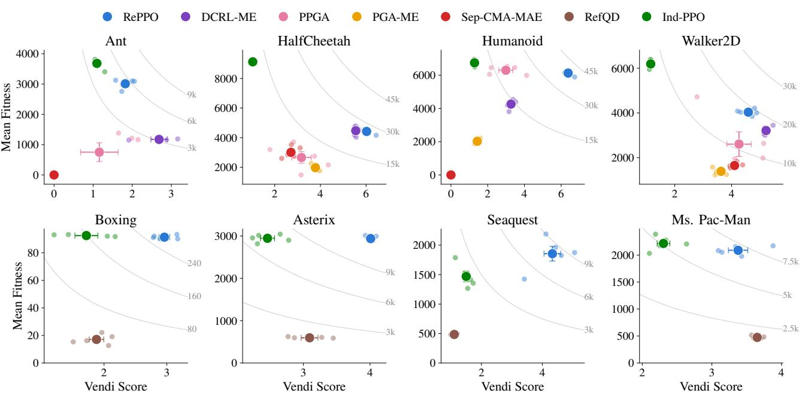  
Figure 1. Quality and diversity of the final populations in continuous control (top) and Atari (bottom). Large markers show the mean over five seeds with one standard error, and faint dots show individual runs. Gray curves are levels of constant qVS, signifying the combined quality and diversity of a population. Up and to the right is better.

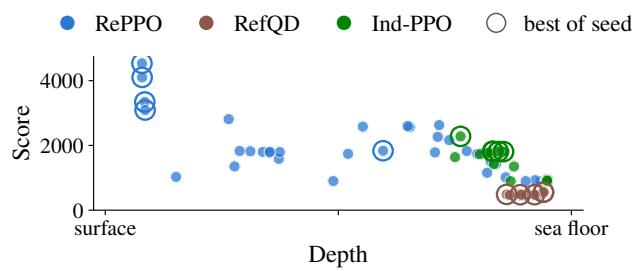  
Figure 2. Score and mean depth of every Seaquest policy over five seeds that passes the 10% quality filter, with the best policy of each seed circled. The policies of Ind-PPO and RefQD stay near the sea floor, whereas each RePPO population spreads across depths, and its best policies operate just below the surface.

The results show that repulsion costs part of the population’s mean fitness but leaves its best policies largely intact. Policies pushed toward less common contact patterns adopt gaits that are often slower, which lowers the average, most visibly on HalfCheetah. The best policy of each population, however, stays close to the best one trained by Ind-PPO and outperforms those of nearly all archive-based baselines (Table 4). Appendices C.4 and D visualize the resulting populations and examine how each component of RePPO shapes this tradeoff.

## 5.2. Pixel-based policies in Atari

RePPO and Ind-PPO train N = 8 policies for 10 M steps each, following the standard PPO configuration for

Atari (Huang et al., 2022). RefQD uses a comparable budget of 86.4 M steps and maintains an archive of 1000 cells. Its training configuration and hyperparameters largely follow the published code.

RePPO retains the quality of independent PPO training while making its populations substantially more diverse (Figure 1, bottom). Its mean scores are close to or above Ind-PPO’s in every game and its diversity is higher than both baselines, culminating in substantial gains in qVS over both baselines. RefQD’s archives cover behavior space broadly, but their policies score far below those trained with PPO.

Diversity can also uncover strategies that independent training misses. In Seaquest, every policy trained by Ind-PPO, and every competent policy in RefQD’s archives, patrols near the sea floor (Figure 2). Repulsion pushes some of RePPO’s policies toward shallower water, and in four of the five seeds, the best policy of the population operates just below the surface, where it outscores every Ind-PPO policy. Here, diversity improves not only the population as a whole but also its best member. Appendix E.4 visualizes the behaviors in all four games.

## 5.3. Fine-tuning large language models

In fine-tuning large language models, each population consists of N = 5 members, each a low-rank adapter (Hu et al., 2022) on a shared frozen backbone with its own adapted critic. Members are trained with PPO in the zero-RL setting (Hu et al., 2025) for 100 iterations of 1024 solutions each. We select checkpoints by validation accuracy, and report behavior and performance over test problems (Appendix F).

Table 1. LLM populations on the test problems. Vendi is the Vendi Score of the members’ mean descriptors, and ID is the accuracy of a classifier that identifies a solution’s author (chance is 20%).
<table><tr><td>Model</td><td>Method</td><td>pass@1</td><td>Vendi</td><td>ID</td></tr><tr><td>Qwen3</td><td>Base model Prompt (corners) Prompt (emphasis) Ind-PPO RePPO</td><td>0.320 0.274 0.275 0.423 0.413</td><td>1.11 1.08 1.04 1.85</td><td>51% 44% 41% 82%</td></tr><tr><td>Granite</td><td>Base model Prompt (corners) Prompt (emphasis) Ind-PPO RePPO</td><td>0.233 0.163 0.194 0.560 0.550</td><td>1.01 1.03 1.03 2.57</td><td>31% 37% 53% 81%</td></tr></table>

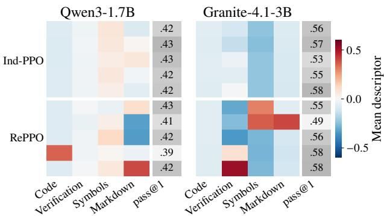  
Figure 3. Mean descriptor of each member over its test solutions, alongside its pass@1. Descriptors are centered on the base model’s style, and incorrect solutions count as zero. RePPO’s members adopt distinct styles while matching the accuracy of Ind-PPO’s near-identical members.

RePPO’s members acquire distinct and consistent writing styles while nearly matching the accuracy of independent training (Table 1). In both models, repulsion makes the members’ descriptors far more diverse than those of Ind-PPO or of either prompting baseline. The members are also distinguishable from their text alone: a simple classifier identifies which RePPO member wrote a solution much more reliably than for any other population. The price is a small but consistent drop of about one point in permember accuracy, while the population as a whole solves as many problems as Ind-PPO’s (Appendix F.4). Prompting, in contrast, changes the members’ style only slightly and at a much higher cost of accuracy.

The styles differ across members and base models (Figure 3). On Qwen3, one RePPO member appends Python code to its solutions, another writes in itemized markdown, and two write in plain prose. On Granite, the members separate along verification and notation: some re-check their intermediate results far more often than others, and some typeset their reasoning in LAT X instead of plain text. Appendix F.5 provides examples of the different models in RePPO’s population generating stylistically diverse responses to the same problems.

## 6. Conclusion and Outlook

We introduced RePPO, a Quality-Diversity algorithm that directly trains a compact population of reinforcement learning policies. Starting from the Soft QD objective, we showed that additive Markovian behavior descriptors turn each policy’s population gradient into an ordinary policy gradient under a shaped reward, which RePPO optimizes with PPO. On continuous-control benchmarks, RePPO attains a better balance of quality and diversity than established QD-RL methods. Because its cost scales with the population size rather than with the resolution of an archive, it extends to pixel-based Atari policies and to LLM fine-tuning, where it makes populations substantially more diverse at nearly the quality of independent training.

RePPO is designed for optimizing compact populations of useful policies rather than exhaustive coverage of behavior space, for which archive-based methods remain better suited. It also requires descriptors that admit additive forms, and it diversifies whatever these descriptors measure: in our LLM experiments, hand-designed descriptors produced differences mostly in presentation rather than in strategy. Addressing these limitations calls for learned or preferencederived descriptors, adaptive bandwidths and population sizes, and hybrids with external archives.

More broadly, shaping each policy’s reward by the population is useful whenever one optimum is not enough, from adaptation to changing conditions to generative models whose adapters express different preferences or styles. In all these settings, diversity can be encoded as a reward induced by the geometry of a population.

## References

Batra, S., Tjanaka, B., Fontaine, M., Petrenko, A., Nikolaidis, S., and Sukhatme, G. Proximal policy gradient arborescence for quality diversity reinforcement learning. In International Conference on Learning Representations, volume 2024, pp. 35884–35904, 2024.

Bellemare, M. G., Naddaf, Y., Veness, J., and Bowling, M. The arcade learning environment: An evaluation platform for general agents (extended abstract). In Proceedings of the Twenty-Fourth International Joint Conference on Artificial Intelligence, IJCAI 2015, Buenos Aires, Argentina, July 25-31, 2015, pp. 4148–4152. AAAI Press, 2015.

Chalumeau, F., Lim, B., Boige, R., Allard, M., Grillotti, L., Flageat, M., Mace, V., Richard, G., Flajolet, A., Pier-´ rot, T., et al. Qdax: A library for quality-diversity and population-based algorithms with hardware acceleration. Journal of Machine Learning Research, 25(108):1–16, 2024.

Chen, M., Tworek, J., Jun, H., Yuan, Q., de Oliveira Pinto, H. P., Kaplan, J., Edwards, H., Burda, Y., Joseph, N., Brockman, G., Ray, A., Puri, R., Krueger, G., Petrov, M., Khlaaf, H., Sastry, G., Mishkin, P., Chan, B., Gray, S., Ryder, N., Pavlov, M., Power, A., Kaiser, L., Bavarian, M., Winter, C., Tillet, P., Such, F. P., Cummings, D., Plappert, M., Chantzis, F., Barnes, E., Herbert-Voss, A., Guss, W. H., Nichol, A., Paino, A., Tezak, N., Tang, J., Babuschkin, I., Balaji, S., Jain, S., Saunders, W., Hesse, C., Carr, A. N., Leike, J., Achiam, J., Misra, V., Morikawa, E., Radford, A., Knight, M., Brundage, M., Murati, M., Mayer, K., Welinder, P., Mc-Grew, B., Amodei, D., McCandlish, S., Sutskever, I., and Zaremba, W. Evaluating large language models trained on code. CoRR, abs/2107.03374, 2021. URL https: //doi.org/10.48550/arXiv.2107.03374.

Choi, J., Sharma, A., Lee, H., Levine, S., and Gu, S. S. Variational empowerment as representation learning for goal-conditioned reinforcement learning. In International conference on machine learning, pp. 1953–1963. PMLR, 2021.

Colas, C., Madhavan, V., Huizinga, J., and Clune, J. Scaling map-elites to deep neuroevolution. In Proceedings ofthe 2020 Genetic and Evolutionary Computation Conference, pp. 67–75, 2020.

Cully, A., Clune, J., Tarapore, D., and Mouret, J. Robots that can adapt like animals. Nat., 521(7553):503–507, 2015. doi: 10.1038/NATURE14422. URL https: //doi.org/10.1038/nature14422.

Eysenbach, B., Gupta, A., Ibarz, J., and Levine, S. Diversity is all you need: Learning skills without a reward function. arXiv preprint arXiv:1802.06070, 2018.

Faldor, M., Chalumeau, F., Flageat, M., and Cully, A. Mapelites with descriptor-conditioned gradients and archive distillation into a single policy. In Proceedings of the Genetic and Evolutionary Computation Conference, pp. 138–146, 2023.

Faldor, M., Chalumeau, F., Flageat, M., and Cully, A. Synergizing quality-diversity with descriptor-conditioned reinforcement learning. ACM Transactions on Evolutionary Learning, 5(1):1–35, 2025.

Fontaine, M. and Nikolaidis, S. Differentiable quality diversity. Advances in Neural Information Processing Systems, 34:10040–10052, 2021.

Fontaine, M. and Nikolaidis, S. Covariance matrix adaptation map-annealing. In Proceedings of the genetic and evolutionary computation conference, pp. 456–465, 2023.

Fontaine, M. C., Togelius, J., Nikolaidis, S., and Hoover, A. K. Covariance matrix adaptation for the rapid illumination of behavior space. In Proceedings of the 2020 genetic and evolutionary computation conference, pp. 94–102, 2020.

Freeman, C. D., Frey, E., Raichuk, A., Girgin, S., Mordatch, I., and Bachem, O. Brax - A differentiable physics engine for large scale rigid body simulation. In Proceedings of the Neural Information Processing Systems Track on Datasets and Benchmarks 1, NeurIPS Datasets and Benchmarks 2021, December 2021, virtual, 2021. URL https://datasets-benchmarks-proceedin gs.neurips.cc/paper/2021/hash/d1f491 a404d6854880943e5c3cd9ca25-Abstract-r ound1.html.

Friedman, D. and Dieng, A. B. The vendi score: A diversity evaluation metric for machine learning. Transactions on Machine Learning Research, 2023.

Fujimoto, S., Hoof, H., and Meger, D. Addressing function approximation error in actor-critic methods. In International conference on machine learning, pp. 1587–1596. PMLR, 2018.

Grillotti, L. and Cully, A. Unsupervised behavior discovery with quality-diversity optimization. IEEE Trans. Evol. Comput., 26(6):1539–1552, 2022. URL https://do i.org/10.1109/TEVC.2022.3159855.

Grillotti, L., Faldor, M., Leon, B. G., and Cully, A. Quality-´ diversity actor-critic: Learning high-performing and diverse behaviors via value and successor features critics. In Forty-first International Conference on Machine Learning, ICML 2024, Vienna, Austria, July 21-27, 2024, pp. 16416–16459. PMLR / OpenReview.net, 2024. URL https://proceedings.mlr.press/v235/g rillotti24a.html.

He, C., Luo, R., Bai, Y., Hu, S., Thai, Z. L., Shen, J., Hu, J., Han, X., Huang, Y., Zhang, Y., Liu, J., Qi, L., Liu, Z., and Sun, M. Olympiadbench: A challenging benchmark for promoting AGI with olympiad-level bilingual multimodal scientific problems. In Proceedings of the 62nd Annual Meeting of the Association for Computational Linguistics (Volume 1: Long Papers), ACL 2024, Bangkok, Thailand, August 11-16, 2024, pp. 3828–3850. Association for Computational Linguistics, 2024. URL https://doi.org/10.18653/v1/2024.acl -long.211.

Hedayatian, S. and Nikolaidis, S. AutoQD: Automatic discovery of diverse behaviors with quality-diversity optimization. In The Fourteenth International Conference on Learning Representations, 2026a. URL https: //openreview.net/forum?id=FNnJIf4ymV.

Hedayatian, S. and Nikolaidis, S. Soft quality-diversity optimization. In The Fourteenth International Conference on Learning Representations, 2026b. URL https:// openreview.net/forum?id=LCKixyFShR.

Hendrycks, D., Burns, C., Kadavath, S., Arora, A., Basart, S., Tang, E., Song, D., and Steinhardt, J. Measuring mathematical problem solving with the MATH dataset. In Proceedings of the Neural Information Processing Systems Track on Datasets and Benchmarks 1, NeurIPS Datasets and Benchmarks 2021, December 2021, virtual, 2021. URL https://datasets-benchmarks-p roceedings.neurips.cc/paper/2021/has h/be83ab3ecd0db773eb2dc1b0a17836a1-A bstract-round2.html.

Hu, E. J., Shen, Y., Wallis, P., Allen-Zhu, Z., Li, Y., Wang, S., Wang, L., and Chen, W. Lora: Low-rank adaptation of large language models. In The Tenth International Conference on Learning Representations, ICLR 2022, Virtual Event, April 25-29, 2022. OpenReview.net, 2022. URL https://openreview.net/forum?id= nZeVKeeFYf9.

Hu, J., Zhang, Y., Han, Q., Jiang, D., Zhang, X., and Shum, H. Open-reasoner-zero: An open source approach to scaling up reinforcement learning on the base model. In Advances in Neural Information Processing Systems 38: Annual Conference on Neural Information Processing Systems 2025, NeurIPS 2025, San Diego, CA, USA, December 2-7, 2025 / Mexico City, Mexico, November 30 - December 5, 2025, 2025. URL http://papers.nips.cc/paper\_files/pap er/2025/hash/ed873d79e7c268c020c4b4d b13a2812a-Abstract-Conference.html.

Huang, S., Dossa, R. F. J., Ye, C., Braga, J., Chakraborty, D., Mehta, K., and Araujo, J. G. M. Cleanrl: High-´ quality single-file implementations of deep reinforcement learning algorithms. J. Mach. Learn. Res., 23:274:1– 274:18, 2022. URL https://jmlr.org/papers/ v23/21-1342.html.

Huber, J., Hel´ enon, F., Coninx, M., Amar, F. B., and Don-´ cieux, S. Quality diversity under sparse reward and sparse interaction: Application to grasping in robotics. arXiv preprint arXiv:2308.05483, 2023.

Huber, J., Hel´ enon, F., Kappel, M., de Loyola P ´ aez-Ubieta,´ I., Puente, S. T., Gil, P., Amar, F. B., and Doncieux, S. Qdgset: A large scale grasping dataset generated with

quality-diversity. In 2025 IEEE International Conference on Robotics and Automation (ICRA), pp. 01–08. IEEE, 2025.

IBM Granite Team. Granite 4.1 LLMs: How they’re built. https://huggingface.co/blog/ibm-grani te/granite-4-1, 2026.

Kwon, W., Li, Z., Zhuang, S., Sheng, Y., Zheng, L., Yu, C. H., Gonzalez, J., Zhang, H., and Stoica, I. Efficient memory management for large language model serving with pagedattention. In Proceedings of the 29th Symposium on Operating Systems Principles, SOSP 2023, Koblenz, Germany, October 23-26, 2023, pp. 611–626. ACM, 2023. URL https://doi.org/10.1145/ 3600006.3613165.

Lewkowycz, A., Andreassen, A., Dohan, D., Dyer, E., Michalewski, H., Ramasesh, V. V., Slone, A., Anil, C., Schlag, I., Gutman-Solo, T., Wu, Y., Neyshabur, B., Gur-Ari, G., and Misra, V. Solving quantitative reasoning problems with language models. In Advances in Neural Information Processing Systems 35: Annual Conference on Neural Information Processing Systems 2022, NeurIPS 2022, New Orleans, LA, USA, November 28 - December 9, 2022, 2022. URL http://papers.n ips.cc/paper\_files/paper/2022/hash/1 8abbeef8cfe9203fdf9053c9c4fe191-Abstr act-Conference.html.

Lightman, H., Kosaraju, V., Burda, Y., Edwards, H., Baker, B., Lee, T., Leike, J., Schulman, J., Sutskever, I., and Cobbe, K. Let’s verify step by step. In The Twelfth International Conference on Learning Representations, ICLR 2024, Vienna, Austria, May 7-11, 2024. OpenReview.net, 2024. URL https://openreview.net/forum ?id=v8L0pN6EOi.

Liu, H. and Abbeel, P. Aps: Active pretraining with successor features. In International Conference on Machine Learning, pp. 6736–6747. PMLR, 2021.

Machado, M. C., Bellemare, M. G., Talvitie, E., Veness, J., Hausknecht, M. J., and Bowling, M. Revisiting the arcade learning environment: Evaluation protocols and open problems for general agents (extended abstract). In Proceedings ofthe Twenty-Seventh International Joint Conference on Artificial Intelligence, IJCAI 2018, July 13- 19, 2018, Stockholm, Sweden, pp. 5573–5577. ijcai.org, 2018.

Masood, M. A. and Doshi-Velez, F. Diversity-inducing policy gradient: Using maximum mean discrepancy to find a set of diverse policies. arXiv preprint arXiv:1906.00088, 2019.

Mnih, V., Kavukcuoglu, K., Silver, D., Rusu, A. A., Veness, J., Bellemare, M. G., Graves, A., Riedmiller, M., Fidjeland, A. K., Ostrovski, G., et al. Human-level control through deep reinforcement learning. nature, 518(7540): 529–533, 2015.

Mouret, J.-B. Fast generation of centroids for map-elites. In Proceedings ofthe Companion Conference on Genetic and Evolutionary Computation, pp. 155–158, 2023.

Nguyen, Q. and Dieng, A. B. Quality-weighted vendi scores and their application to diverse experimental design. In Forty-first International Conference on Machine Learning, 2024.

Nilsson, O. and Cully, A. Policy gradient assisted mapelites. In Proceedings of the Genetic and Evolutionary Computation Conference, pp. 866–875, 2021.

Park, S., Rybkin, O., and Levine, S. Metra: Scalable unsupervised rl with metric-aware abstraction. In International Conference on Learning Representations, volume 2024, pp. 18579–18603, 2024.

Parker-Holder, J., Pacchiano, A., Choromanski, K. M., and Roberts, S. J. Effective diversity in population based reinforcement learning. Advances in Neural Information Processing Systems, 33:18050–18062, 2020.

Pierrot, T., Mace, V., Chalumeau, F., Flajolet, A., Cideron,´ G., Beguir, K., Cully, A., Sigaud, O., and Perrin-Gilbert, N. Diversity policy gradient for sample efficient qualitydiversity optimization. In Proceedings of the Genetic and Evolutionary Computation Conference, pp. 1075–1083, 2022.

Pugh, J. K., Soros, L. B., and Stanley, K. O. Quality diversity: A new frontier for evolutionary computation. Frontiers in Robotics and AI, 3:40, 2016.

Puterman, M. L. Markov decision processes: discrete stochastic dynamic programming. John Wiley & Sons, 2014.

Raffin, A., Hill, A., Gleave, A., Kanervisto, A., Ernestus, M., and Dormann, N. Stable-baselines3: Reliable reinforcement learning implementations. Journal ofMachine Learning Research, 22(268):1–8, 2021. URL http: //jmlr.org/papers/v22/20-1364.html.

Schulman, J., Moritz, P., Levine, S., Jordan, M. I., and Abbeel, P. High-dimensional continuous control using generalized advantage estimation. In 4th International Conference on Learning Representations, ICLR 2016, San Juan, Puerto Rico, May 2-4, 2016, Conference Track Proceedings, 2016. URL http://arxiv.org/ab s/1506.02438.

Schulman, J., Wolski, F., Dhariwal, P., Radford, A., and Klimov, O. Proximal policy optimization algorithms. arXiv preprint arXiv:1707.06347, 2017.

Shiroshita, S., Maruyama, S., Nishiyama, D., Castro, M. Y., Hamzaoui, K., Rosman, G., DeCastro, J., Lee, K.-H., and Gaidon, A. Behaviorally diverse traffic simulation via reinforcement learning. In 2020 IEEE/RSJ International Conference on Intelligent Robots and Systems (IROS), pp. 2103–2110. IEEE, 2020.

Silver, D., Singh, S., Precup, D., and Sutton, R. S. Reward is enough. Artificial intelligence, 299:103535, 2021.

Team, Q. Qwen3 technical report. CoRR, abs/2505.09388, 2025. URL https://doi.org/10.48550/arX iv.2505.09388.

Tjanaka, B., Fontaine, M. C., Togelius, J., and Nikolaidis, S. Approximating gradients for differentiable quality diversity in reinforcement learning. In Proceedings of the Genetic and Evolutionary Computation Conference, pp. 1102–1111, 2022.

Tjanaka, B., Fontaine, M. C., Lee, D. H., Kalkar, A., and Nikolaidis, S. Training diverse high-dimensional controllers by scaling covariance matrix adaptation mapannealing. IEEE Robotics and Automation Letters, 8 (10):6771–6778, 2023a.

Tjanaka, B., Fontaine, M. C., Lee, D. H., Zhang, Y., Balam, N. R., Dennler, N., Garlanka, S. S., Klapsis, N. D., and Nikolaidis, S. pyribs: A bare-bones python library for quality diversity optimization. In Proceedings of the Genetic and Evolutionary Computation Conference, GECCO 2023, Lisbon, Portugal, July 15-19, 2023, pp. 220–229. ACM, 2023b. URL https://doi.org/ 10.1145/3583131.3590374.

Towers, M., Kwiatkowski, A., Balis, J. U., Cola, G. D., Deleu, T., Goulao, M., Andreas, K., Krimmel, M., KG,˜ A., Perez-Vicente, R. D. L., Terry, J. K., Pierre, A., Schul-´ hoff, S. V., Tai, J. J., Tan, H., and Younis, O. G. Gymnasium: A standard interface for reinforcement learning environments. In The Thirty-ninth Annual Conference on Neural Information Processing Systems Datasets and Benchmarks Track, 2026. URL https://openrevi ew.net/forum?id=qPMLvJxtPK.

van Hasselt, H., Guez, A., and Silver, D. Deep reinforcement learning with double q-learning. In Proceedings of the Thirtieth AAAI Conference on Artificial Intelligence, February 12-17, 2016, Phoenix, Arizona, USA, pp. 2094–2100. AAAI Press, 2016. URL https: //doi.org/10.1609/aaai.v30i1.10295.

Vassiliades, V., Chatzilygeroudis, K., and Mouret, J.-B. Using centroidal voronoi tessellations to scale up the multidimensional archive of phenotypic elites algorithm. IEEE Transactions on Evolutionary Computation, 22(4):623– 630, 2017.

Wang, R.-J., Xue, K., Guan, C., and Qian, C. Qualitydiversity with limited resources. In Proceedings of the 41st International Conference on Machine Learning, pp. 51984–52001, 2024.

Weng, J., Lin, M., Huang, S., Liu, B., Makoviichuk, D., Makoviychuk, V., Liu, Z., Song, Y., Luo, T., Jiang, Y., Xu, Z., and Yan, S. Envpool: A highly parallel reinforcement learning environment execution engine. In Advances in Neural Information Processing Systems 35: Annual Conference on Neural Information Processing Systems 2022, NeurIPS 2022, New Orleans, LA, USA, November 28 - December 9, 2022, 2022. URL http://papers .nips.cc/paper\_files/paper/2022/hash /8caaf08e49ddbad6694fae067442ee21-Abs tract-Datasets\_and\_Benchmarks.html.

Williams, R. J. Simple statistical gradient-following algorithms for connectionist reinforcement learning. Machine learning, 8(3):229–256, 1992.

Zahavy, T., Schroecker, Y., Behbahani, F., Baumli, K., Flennerhag, S., Hou, S., and Singh, S. Discovering policies with domino: Diversity optimization maintaining near optimality. arXiv preprint arXiv:2205.13521, 2022.

Zeng, W., Huang, Y., Liu, Q., Liu, W., He, K., Ma, Z., and He, J. Simplerl-zoo: Investigating and taming zero reinforcement learning for open base models in the wild. CoRR, abs/2503.18892, 2025. URL https://doi. org/10.48550/arXiv.2503.18892.

Zhang, Q., Gao, Y., Zhang, Y., Guo, Y., Ding, D., Wang, Y., Sun, P., and Zhao, D. Trajgen: Generating realistic and diverse trajectories with reactive and feasible agent behaviors for autonomous driving. IEEE Transactions on Intelligent Transportation Systems, 23(12):24474–24487, 2022.

## A. Derivations

This section proves Proposition 4.1 and then traces how RePPO’s update follows from it. We use the notation of Sections 3.2 and 4: $f _ { k }$ and $\mathbf { b } _ { k }$ are the quality and descriptor of policy $k ,$ m is the vector of per-step behavior signals, and ℓ is the interaction scale.

## A.1. Proof of Proposition 4.1

We restate the policy-gradient identity of Section 3.2 in the form used by the proof.

Lemma A.1. For a per-step signal $c : S \times \mathcal { A }  \mathbb { R }$ , let $\begin{array} { r } { J _ { c } ( \theta ) = \mathbb { E } _ { \tau \sim \pi _ { \theta } } \big [ \sum _ { t \geq 0 } \gamma ^ { t } c ( s _ { t } , a _ { t } ) \big ] } \end{array}$ . Under the usual regularity conditions,

$$
\nabla _ { \theta } J _ { c } ( \theta ) = \mathbb { E } _ { \tau \sim \pi _ { \theta } } \Big [ \sum _ { t \geq 0 } \gamma ^ { t } \nabla _ { \theta } \log \pi _ { \theta } ( a _ { t } \mid s _ { t } ) Q _ { c } ^ { \pi _ { \theta } } ( s _ { t } , a _ { t } ) \Big ] ,
$$

and both $Q _ { c } ^ { \pi _ { \theta } }$ and $\nabla _ { \theta } J _ { c }$ are linear in c.

The identity is the policy-gradient theorem (Williams, 1992) with c in place of the task reward, and linearity follows from linearity of expectation. By the definitions in (2) and (3), $f ( \theta ) = J _ { r } ( \theta )$ and $\mathbf { v } ^ { \top } \mathbf { b } ( \theta ) = J _ { \mathbf { v } ^ { \top } \mathbf { m } } ( \theta )$ for any fixed $\mathbf { v } \in \mathbb { R } ^ { d }$

Proof of Proposition 4.1. Write $e _ { k i } = \exp ( - \| \mathbf { b } _ { k } - \mathbf { b } _ { i } \| _ { 2 } ^ { 2 } / \ell ^ { 2 } )$ . Only the terms of (1) that contain index k depend on $\theta _ { k }$ , so

$$
\nabla _ { \boldsymbol { \theta } _ { k } } S ( \pmb { \theta } ) = \nabla _ { \boldsymbol { \theta } _ { k } } f _ { k } - \sum _ { i \neq k } \nabla _ { \boldsymbol { \theta } _ { k } } \left[ \sqrt { f _ { k } f _ { i } } e _ { k i } \right] .
$$

Since $f _ { k } > 0$ and the policies are parameterized independently, the product and chain rules give

$$
\nabla _ { \boldsymbol { \theta } _ { k } } \left[ \sqrt { f _ { k } f _ { i } } e _ { k i } \right] = \frac { 1 } { 2 } \sqrt { \frac { f _ { i } } { f _ { k } } } e _ { k i } \nabla _ { \boldsymbol { \theta } _ { k } } f _ { k } - \frac { 2 \sqrt { f _ { k } f _ { i } } } { \ell ^ { 2 } } e _ { k i } \left( \nabla _ { \boldsymbol { \theta } _ { k } } \mathbf { b } _ { k } \right) ^ { \top } ( \mathbf { b } _ { k } - \mathbf { b } _ { i } ) ,
$$

where $\nabla _ { \boldsymbol { \theta } _ { k } } \mathbf { b } _ { k }$ is the Jacobian of $\mathbf { b } ( \theta _ { k } )$ . Summing over $i \neq k$ and collecting terms yields (7),

$$
\nabla _ { { \boldsymbol { \theta } } _ { k } } S ( { \boldsymbol { \theta } } ) = W _ { k } \nabla _ { { \boldsymbol { \theta } } _ { k } } f _ { k } + \left( \nabla _ { { \boldsymbol { \theta } } _ { k } } \mathbf { b } _ { k } \right) ^ { \top } \mathbf { c } _ { k } ,
$$

with $W _ { k }$ and $\mathbf { c } _ { k }$ given by (8) and (9). Both are evaluated at the current population, so they are fixed numbers in this expression.

It remains to express both terms as policy gradients. The first is $W _ { k } \nabla _ { \theta _ { k } } J _ { r } ( \theta _ { k } ) = \nabla _ { \theta _ { k } } J _ { W _ { k } r } ( \theta _ { k } )$ . For the second, $\left( \nabla _ { \boldsymbol { \theta } _ { k } } \mathbf { b } _ { k } \right) ^ { \top } \mathbf { c } _ { k } = \nabla _ { \boldsymbol { \theta } _ { k } } \left[ \mathbf { v } ^ { \top } \mathbf { b } ( \boldsymbol { \theta } _ { k } ) \right] _ { \mathbf { v } = \mathbf { c } _ { k } } = \nabla _ { \boldsymbol { \theta } _ { k } } J _ { \mathbf { c } _ { k } ^ { \top } \mathbf { m } } ( \boldsymbol { \theta } _ { k } )$ with $\mathbf { c } _ { k }$ held fixed. By the linearity in Lemma A.1, the sum of the two gradients is the policy gradient of $J _ { \widetilde { r } _ { k } }$ for $\widetilde { r } _ { k } = W _ { k } r + \mathbf { c } _ { k } ^ { \top } \mathbf { m }$ , which is (10). □

Note that holding $W _ { k }$ and $\mathbf { c } _ { k }$ fixed is not a stop-gradient approximation. The chain rule has already accounted for their dependence on $\theta _ { k }$ , which is what produces the second term of $W _ { k }$ and the direction $\mathbf { c } _ { k }$

## A.2. From the objective to the RePPO update

Interactions in transformed coordinates. Descriptors in our domains are normalized to $[ - 1 , 1 ] ^ { d }$ , while the Gaussian kernel treats behavior space as unbounded. Following SQUAD (Hedayatian & Nikolaidis, 2026b), we therefore define the interaction on the logit coordinates $g ( \mathbf { b } )$ of Section 4.2, replacing $e _ { k i }$ with $\exp ( - \| g ( \mathbf { b } _ { k } ) - g ( \mathbf { b } _ { i } ) \| _ { 2 } ^ { 2 } / \ell ^ { 2 } )$ . Repeating the proof with this kernel leaves $W _ { k }$ unchanged in form and replaces the behavior term by $\left( \nabla _ { \boldsymbol { \theta } _ { k } } \mathbf { b } _ { k } \right) ^ { \top } J _ { g } ( \mathbf { b } _ { k } ) ^ { \top } \mathbf { c } _ { k } ^ { g }$ , where $\mathbf { c } _ { k } ^ { g }$ is (9) evaluated at the transformed descriptors and

$$
J _ { g } ( \mathbf { b } ) = \mathrm { d i a g } \left( \frac { 2 } { 1 - b _ { 1 } ^ { 2 } } , \ldots , \frac { 2 } { 1 - b _ { d } ^ { 2 } } \right)\tag{13}
$$

is the Jacobian of the componentwise logit $g ( b ) = \log \big ( ( 1 + b ) / ( 1 - b ) \big )$ . The shaped reward thus weights the original signals m by $J _ { g } ( \mathbf { b } _ { k } ) ^ { \top } \mathbf { c } _ { k } ^ { g }$ , which is the conversion in (11). Because the Jacobian grows near the bounds, a descriptor that is close to saturation receives a larger weight, matching the stretching of the kernel geometry there. For numerical stability, the normalized coordinates $( \widehat { \mathbf { d } } _ { k } + \mathbf { 1 } ) / 2$ are clipped to $[ \epsilon _ { b } , 1 - \epsilon _ { b } ]$ before both the logit and its Jacobian are evaluated.

Departures from the exact gradient. RePPO modifies this exact update in several ways to obtain a working algorithm.   
Here, we enumerate them while Appendix D examines the task coefficient, the cap, and the local interactions empirically.

1. Smoothed episode statistics. The qualities and descriptors are replaced by exponential moving averages of completedepisode returns and episode-level descriptors, which reduces noise in the interaction at the cost of a small lag. The averages are updated once per iteration from the episodes completed in that iteration, and a policy that completes no episode keeps its previous values. Following standard practice, the advantages use discounted GAE as a surrogate for the gradient of these undiscounted statistics.

2. Shifted qualities. The objective requires $f _ { k } > 0$ , whereas returns can be negative. RePPO uses $\begin{array} { r } { f _ { k } ^ { + } = \widehat { F } _ { k } - \operatorname* { m i n } _ { j } \widehat { F } _ { j } + \epsilon _ { f } } \end{array}$ which is positive and preserves the ordering and differences of the population’s qualities.

3. Local interactions. The sum in (9) is restricted to the K nearest neighbors in transformed space. Under the Gaussian kernel, the omitted terms decay exponentially with distance, so the contribution of farther neighbors is naturally vanishing.

4. Unit task coefficient and capped repulsion. RePPO fixes $W _ { k } = 1$ and rescales the diversity weights to norm at most $C _ { \mathrm { m a x } } .$ preserving their direction.

5. Channel standardization. Each advantage channel is standardized before the channels are combined with (12). The diversity weights $\mathbf { p } _ { k }$ then set the relative influence of the channels on the update independently of their numerical scales.

## B. Evaluation protocol

Re-evaluation. After training, every policy is evaluated anew, and these evaluations define all reported numbers. In continuous control, each policy runs 256 episodes with deterministic actions. In Atari, each policy plays 32 full games, over all lives and up to the cap of 27000 agent steps. Finally, LLM members are evaluated on 8 samples per test problem. Fitness is the mean undiscounted return and the behavior descriptor is the mean episode descriptor over these evaluations.

Quality filter. For each task, let $f ^ { \star }$ be the fitness of the best policy found by any method in any seed. Each population or archive retains the policies whose fitness is at least $0 . 1 f ^ { \star } ( 0 . 2 5 f ^ { \star }$ on Ant), and all metrics except best fitness are computed on the retained policies. The filter is applied identically to every method, and archives are otherwise used as they are. Note that in the LLM experiments, we remove no members.

Metrics. For retained policies with mean descriptors $\bar { \mathbf { b } } _ { 1 } , \dotsc , \bar { \mathbf { b } } _ { n } \in [ - 1 , 1 ] ^ { d }$ , let $G _ { i j } = \exp \big ( - \| \bar { \mathbf { b } } _ { i } - \bar { \mathbf { b } } _ { j } \| _ { 2 } ^ { 2 } / ( 2 \sigma ^ { 2 } ) \big )$ with $\sigma ^ { 2 } = 0 . 5 .$ , and let $\lambda _ { 1 } , \ldots , \lambda _ { n }$ be the eigenvalues of $G / n$ . The Vendi Score (Friedman & Dieng, 2023) is $\begin{array} { r } { \exp \bigl ( - \sum _ { i } \lambda _ { i } \log \lambda _ { i } \bigr ) } \end{array}$ which ranges from 1, when all descriptors coincide, to n, when they are mutually far apart. The quality-weighted Vendi Score (Nguyen & Dieng, 2024) is the mean fitness of the retained policies multiplied by their Vendi Score. In continuous control and Atari, we report means and standard errors over seeds. In the LLM experiments, fitness is a member’s pass@1, the descriptors are averaged over the member’s test solutions.

## C. Continuous control

## C.1. Tasks and descriptors

We use the Ant, HalfCheetah, Humanoid, and Walker2D tasks of Brax 0.14 (Freeman et al., 2021) with the MJX physics backend and episodes of at most 1000 steps. Fitness is the default task reward, summed over an episode. The descriptor is the fraction of the episode each foot spends in contact, mapped to [−1, 1]. The tracked links are the four lower legs of Ant, the two feet of HalfCheetah and Walker2D, and Humanoid. During training, the behavior signal of a link is its signed contact indicator $2 c _ { t } - 1$

## C.2. RePPO and Ind-PPO

Each policy has separate actor, task-critic, and behavior-critic networks, each an MLP with two hidden layers of 128 tanh units. The actor outputs the mean of a diagonal Gaussian with a state-independent standard deviation, and actions are

squashed with tanh. Observations are normalized with per-policy running statistics and clipped $\tan \pm 1 0 ,$ , and training rewards are clipped $\mathrm { t o } \pm 1 0$ per step. Table 2 lists the hyperparameters. Ind-PPO uses identical settings with the diversity weights set to zero.

Table 2. RePPO hyperparameters in continuous control. The learning rate decays as $\eta _ { t } = \eta _ { 0 } \operatorname* { m a x } ( 0 . 0 5 , 1 - 2 t / S )$ in the number of environment steps t.
<table><tr><td></td><td>Ant</td><td>HalfCheetah</td><td>Humanoid</td><td>Walker2D</td></tr><tr><td>Learning rate ηo</td><td> $3 \times 1 0 ^ { - 4 }$ </td><td> $1 0 ^ { - 3 }$ </td><td> $1 0 ^ { - 3 }$ </td><td> $1 0 ^ { - 3 }$ </td></tr><tr><td>Schedule horizon  $S$ </td><td>2.05 B</td><td>4.10 B</td><td>4.10 B</td><td>4.10 B</td></tr><tr><td>Update epochs</td><td>10</td><td>10</td><td>10</td><td>5</td></tr><tr><td>Entropy coefficient</td><td>0.005</td><td>0</td><td>0</td><td>0</td></tr><tr><td>Value clipping</td><td>yes</td><td>no</td><td>no</td><td>no</td></tr><tr><td>Kernel bandwidth  $\ell ^ { 2 }$ </td><td>0.1</td><td>0.5</td><td>0.1</td><td>0.1</td></tr><tr><td colspan="5">Shared across tasks</td></tr><tr><td>Population size N</td><td colspan="4">32</td></tr><tr><td>Environments per policy / rollout length</td><td colspan="4">64 /1024</td></tr><tr><td>Total environment steps</td><td colspan="4"> $2 . 0 5 \times 1 0 ^ { 9 }$ </td></tr><tr><td>Minibatches</td><td colspan="4">32</td></tr><tr><td>Discount  $\gamma / \operatorname { G A E } \lambda$ </td><td colspan="4">0.99 / 0.95</td></tr><tr><td>PPO clip / value coefficient / max gradient norm</td><td colspan="4">0.2 / 0.5 / 0.5</td></tr><tr><td>Neighbors K / repulsion cap Cmax</td><td colspan="4">8/1.0</td></tr><tr><td>EMA rates for  $\widehat { F } _ { k }$  and  $\widehat { \mathbf { d } } _ { k }$ </td><td colspan="4">0.99</td></tr><tr><td> $\epsilon _ { f } / \epsilon _ { b }$ </td><td colspan="4"> $1 / 1 0 ^ { - 6 }$ </td></tr></table>

## C.3. Baselines

All baselines use the same tasks, descriptors, and evaluation as RePPO, and their archives are re-evaluated with the protoco of Appendix B. Table 3 summarizes their main settings.

PPGA. We port the official implementation (Batra et al., 2024) to the current version of Brax with the MJX backend. All hyperparameters follow the original work, except the number of outer iterations, which we set to 200 so that the budget approaches that of the other methods.

More specifically, PPGA uses one CMA-MAEGA emitter with 300 branching solutions, 10 gradient and 10 mean-update PPO iterations per outer iteration on 3000 parallel environments with rollouts of 128 steps, 4 epochs over 8 minibatches, value coefficient 2, no entropy bonus, and a target KL of 0.008. It uses archive learning rates of 0.1 (Ant, Humanoid) and 0.5 (HalfCheetah, Walker2D). The initial step sizes are 3.0, 1.0, 0.5, and 1.0 for Ant, HalfCheetah, Humanoid, and Walker2D, respectively. PPO’s learning rate is $1 0 ^ { - 3 }$ , except on Humanoid where it is $3 \times 1 0 ^ { - 4 }$

DCRL-ME and PGA-ME. Both build on the QDax implementations (Chalumeau et al., 2024) and use the hyperparameters reported by their authors, with the number of iterations matched to the budget.   
In DCRL-ME each iteration produces 128 offspring by isoline variation $( \sigma _ { \mathrm { i s o } } = 0 . 0 0 5 , \sigma _ { \mathrm { l i n e } } = 0 . 0 5 )$ , 64 by 150 descriptorconditioned policy-gradient steps (learning rate $5 \times 1 0 ^ { - 3 } )$ , and 64 by specializing the descriptor-conditioned actor. The critic has two hidden layers of 256 units and is trained for 3000 steps per iteration with TD3 settings (batch 100, replay buffer $1 0 ^ { 6 }$ , discount 0.99, policy noise 0.2, noise clip 0.5, target rate 0.005, policy delay 2).   
PGA-ME generates 300 offspring in each iteration, half by isoline variation and half by 100 policy-gradient steps, with 300 critic updates per iteration.

Sep-CMA-MAE. We use the pyribs implementation (Tjanaka et al., 2023b) with the hyperparameters of Tjanaka et al. (2023a), evaluating each candidate on one episode. In particular, it has five emitters with batches of 40 using an initial step size of 0.02, an archive learning rate of 0.001, improvement ranking, and the basic restart rule. Its budget is 2.048 M evaluations of maximum length 1000.

Table 3. Main settings of the archive-based baselines in continuous control. Environment steps count full-length evaluation episodes, except for Sep-CMA-MAE, whose budget is a number of evaluations.
<table><tr><td></td><td>PPGA</td><td>DCRL-ME</td><td>PGA-ME</td><td> $\mathbf { S e p { \mathrm { - } C M A { \mathrm { - } M A E } } }$ </td></tr><tr><td>Archive</td><td> $\operatorname { g r i d } , 5 0 ^ { 2 } ( 1 0 ^ { 4 } \operatorname { A n t } )$ </td><td>CVT, 1024</td><td> $\mathrm { g r i d } , 5 0 ^ { 2 } ( 1 0 ^ { 4 } \mathrm { A n t } )$ </td><td> $\mathrm { g r i d } , 3 2 ^ { 2 } ( 6 ^ { 4 } \mathrm { A n t } )$ </td></tr><tr><td>Iterations</td><td>200</td><td>8000</td><td>6827</td><td></td></tr><tr><td>Policy network</td><td>128-128 tanh</td><td>128-128 ReLU</td><td>128-128 ReLU</td><td>128-128 tanh</td></tr><tr><td>Gradient estimator</td><td>PPO, 3000 envs</td><td>TD3, desc.-conditioned</td><td>TD3</td><td></td></tr><tr><td>Environment steps</td><td>2.74 B</td><td>2.05 B</td><td>2.05 B</td><td> $\leq 2 . 0 5 \mathrm { ~ B ~ }$ </td></tr></table>

## C.4. Additional results

Table 4 reports the numbers behind the top row of Figure 1, together with the best fitness and the number of policies that pass the quality filter. Despite the larger population sizes of archive-based methods, RePPO has the highest Vendi Score on two of the tasks and the second highest on the other two.

Table 4. Final populations in continuous control, as mean ± standard error over seeds. All other metrics belong to the retained policies
<table><tr><td>Task</td><td>Method</td><td>Best fitness</td><td>Mean fitness</td><td>Vendi Score</td><td> ${ \mathfrak { q V } } { \mathfrak { S } }$ </td><td>Retained</td></tr><tr><td rowspan="6">Ant</td><td>RePPO</td><td> $4 0 9 0 \pm 6 8$ </td><td> $3 0 1 1 \pm 6 8$ </td><td> $1 . 8 2 \pm 0 . 0 9$ </td><td> ${ \bf 5 4 9 2 \pm 3 2 8 }$ </td><td>12</td></tr><tr><td>DCRL-ME</td><td> $1 3 3 5 \pm 4 8$ </td><td> $1 1 7 4 \pm 1 0$ </td><td> ${ \bf 2 . 6 9 \pm 0 . 2 1 }$ </td><td> $3 1 5 7 \pm 2 5 8$ </td><td>61</td></tr><tr><td>PPGA</td><td> $1 1 8 3 \pm 1 1 3$ </td><td> $7 5 2 \pm 3 0 9$ </td><td> $1 . 1 6 \pm 0 . 4 8$ </td><td> $1 4 3 9 \pm 5 8 8$ </td><td>2</td></tr><tr><td>PGA-ME</td><td> $7 8 6 \pm 3 2$ </td><td> $0 \pm 0$ </td><td> $0 . 0 0 \pm 0 . 0 0$ </td><td> $0 \pm 0$ </td><td>0</td></tr><tr><td>Sep-CMA-MAE</td><td> $3 0 6 \pm 1 7 5$ </td><td> $0 \pm 0$ </td><td> $0 . 0 0 \pm 0 . 0 0$ </td><td> $0 \pm 0$ </td><td>0</td></tr><tr><td>Ind-PPO</td><td> ${ \bf 4 3 3 9 \pm 3 1 }$ </td><td> ${ \bf 3 6 8 3 \pm 7 2 }$ </td><td> $1 . 1 0 \pm 0 . 0 5$ </td><td> $4 0 2 3 \pm 1 0 3$ </td><td>18</td></tr><tr><td rowspan="6">HalfCheetah</td><td>RePPO</td><td> $9 5 3 6 \pm 2 7 4$ </td><td> $4 4 1 9 \pm 8 2$ </td><td> ${ \bf 6 . 0 2 \pm 0 . 1 2 }$ </td><td> ${ \bf 2 6 5 7 1 } \pm { \bf 2 6 3 }$ </td><td>30</td></tr><tr><td>DCRL-ME</td><td> $7 4 4 9 \pm 2 3 4$ </td><td> $4 4 7 1 \pm 1 5 4$ </td><td> $5 . 5 5 \pm 0 . 0 3$ </td><td> $2 4 8 0 1 \pm 8 4 7$ </td><td>1024</td></tr><tr><td>PPGA</td><td> $5 3 9 8 \pm 9 0 6$ </td><td> $2 6 5 9 \pm 3 9 0$ </td><td> $3 . 1 7 \pm 0 . 4 3$ </td><td> $8 1 0 4 \pm 1 2 1 7$ </td><td>696</td></tr><tr><td>PGA-ME</td><td> $5 7 9 8 \pm 1 4 7$ </td><td> $1 9 7 2 \pm 9 0$ </td><td> $3 . 7 8 \pm 0 . 0 7$ </td><td> $7 4 3 3 \pm 2 3 7$ </td><td>1285</td></tr><tr><td>Sep-CMA-MAE</td><td> $4 6 7 7 \pm 2 7 5$ </td><td> $3 0 0 5 \pm 1 7 5$ </td><td> $2 . 7 1 \pm 0 . 1 3$ </td><td> $8 1 9 7 \pm 7 7 8$ </td><td>402</td></tr><tr><td>Ind-PPO</td><td> ${ \bf 1 0 1 8 5 \pm 2 9 }$ </td><td> $\mathbf { 9 1 2 5 \pm 5 8 }$ </td><td> $1 . 0 4 \pm 0 . 0 0$ </td><td> $9 4 5 4 \pm 7 2$ </td><td>32</td></tr><tr><td rowspan="6">Humanoid</td><td>RePPO</td><td> $8 1 9 0 \pm 1 3 4$ </td><td> $6 1 3 0 \pm 6 4$ </td><td> ${ \bf 6 . 3 8 \pm 0 . 0 9 }$ </td><td> $\mathbf { 3 9 0 8 9 \pm 2 8 6 }$ </td><td>32</td></tr><tr><td>DCRL-ME</td><td> $7 5 9 4 \pm 4 5 6$ </td><td> $4 2 6 3 \pm 1 2 5$ </td><td> $3 . 2 7 \pm 0 . 0 8$ </td><td> $1 3 9 6 4 \pm 6 7 2$ </td><td>749</td></tr><tr><td>PPGA</td><td> ${ \bf 9 9 0 7 \pm 3 0 3 }$ </td><td> $6 2 9 8 \pm 1 1 5$ </td><td> $2 . 9 9 \pm 0 . 3 8$ </td><td> $1 8 7 9 2 \pm 2 3 2 2$ </td><td>598</td></tr><tr><td>PGA-ME</td><td> $4 9 6 1 \pm 1 2 1$ </td><td> $2 0 2 6 \pm 6 0$ </td><td> $1 . 4 3 \pm 0 . 0 5$ </td><td> $2 9 1 8 \pm 1 9 1$ </td><td>720</td></tr><tr><td>Sep-CMA-MAE</td><td> $5 7 6 \pm 8$ </td><td> $0 \pm 0$ </td><td> $0 . 0 0 \pm 0 . 0 0$ </td><td> $0 \pm 0$ </td><td>0</td></tr><tr><td>Ind-PPO</td><td> $8 6 0 1 \pm 1 3 4$ </td><td> ${ \bf 6 7 4 4 } \pm { \bf 8 0 }$ </td><td> $1 . 2 8 \pm 0 . 0 1$ </td><td> $8 6 5 4 \pm 1 4 7$ </td><td>32</td></tr><tr><td rowspan="6">Walker2D</td><td>RePPO</td><td> ${ \bf 7 7 6 4 } \pm { \bf 2 7 4 }$ </td><td> $4 0 3 5 \pm 6 0$ </td><td> $4 . 5 9 \pm 0 . 1 4$ </td><td> $\mathbf { 1 8 5 1 1 \pm 5 9 8 }$ </td><td>31</td></tr><tr><td>DCRL-ME</td><td> $6 5 1 2 \pm 1 7 2$ </td><td> $3 2 1 4 \pm 8 3$ </td><td> ${ \bf 5 . 2 1 \pm 0 . 0 6 }$ </td><td> $1 6 7 6 9 \pm 5 9 3$ </td><td></td></tr><tr><td>PPGA</td><td> $6 8 6 6 \pm 5 1 3$ </td><td> $2 6 0 8 \pm 5 4 9$ </td><td> $4 . 2 6 \pm 0 . 4 3$ </td><td> $1 0 4 2 6 \pm 1 2 8 3$ </td><td>978</td></tr><tr><td>PGA-ME</td><td> $3 2 5 5 \pm 1 5 6$ </td><td> $1 3 9 1 \pm 7 1$ </td><td> $3 . 6 3 \pm 0 . 1 4$ </td><td> $5 0 4 7 \pm 3 4 3$ </td><td>1196 1156</td></tr><tr><td>Sep-CMA-MAE</td><td> $3 3 6 5 \pm 1 2 2$ </td><td> $1 6 5 3 \pm 5 1$ </td><td> $4 . 1 0 \pm 0 . 0 8$ </td><td> $6 7 9 2 \pm 3 0 9$ </td><td>925</td></tr><tr><td> $\mathrm { I n \hat { d } \mathrm { - } P P O }$ </td><td> $7 6 2 4 \pm 2 7 6$ </td><td> ${ \bf 6 1 9 1 } \pm { \bf 8 3 }$ </td><td> $1 . 1 5 \pm 0 . 0 2$ </td><td> $7 1 4 3 \pm 1 6 1$ </td><td>32</td></tr></table>

Effect of the quality filter. Diversity metrics can be dominated by policies that behave differently but do not solve the task. Figure 4 therefore recomputes the Vendi Score and ${ \mathfrak { q V } } { \mathfrak { S } }$ of the complete populations and archives while the required fraction of $f ^ { \star }$ increases from 0 to 0.5. With no filter, the archives of DCRL-ME and PPGA are far more diverse than RePPO’s population on Ant, but their Vendi Scores collapse as the threshold is increased. Upon manual inspection, we noticed that many of the policies in archive-based methods stand nearly still and occupy different cells by holding different subsets of legs off the ground, which prompted our choice of a 25% threshold for this task. Beyond this threshold, RePPO attains the highest qVS.

Populations in behavior space. Figure 5 shows the retained policies of one seed per method in tasks with two-dimensional behavior spaces, and Figure 6 shows the distribution of their fitness. Archive-based methods cover behavior space more uniformly due to their structure, but much of that coverage comes from low-fitness policies. RePPO places its policies less uniformly and concentrates them in regions that support fast locomotion, as the Soft QD objective rewards illuminating behavior space with high-quality policies rather than covering it uniformly. Independent PPO concentrates all the policies in a small, high-quality region.

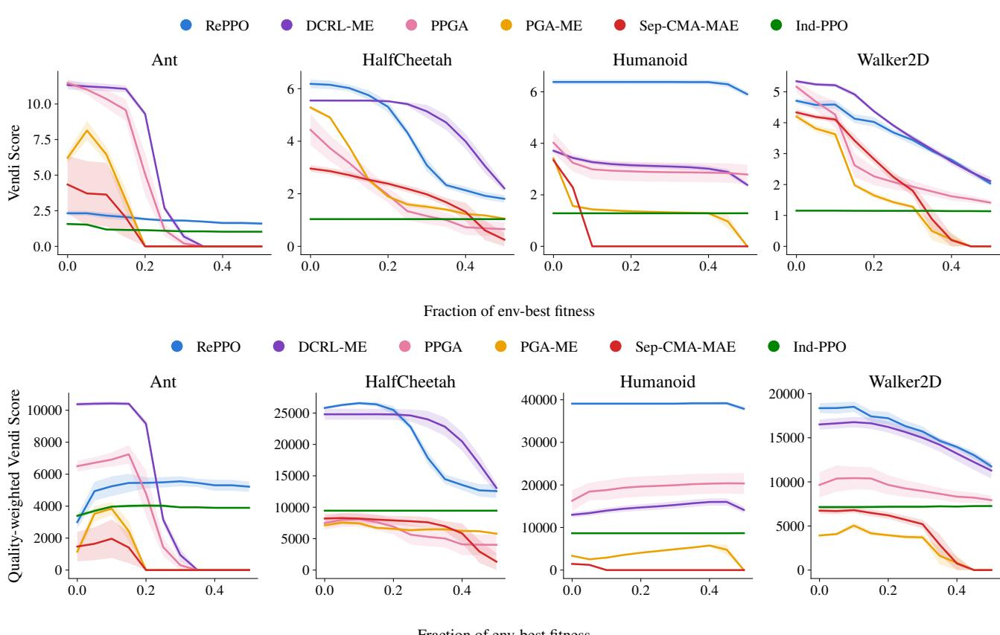  
Figure 4. Vendi Score (top) and qVS (bottom) of the complete populations as a function of the minimum fitness, given as a fraction of the best policy found on the task. Lines show the mean over seeds and shaded regions one standard error.

Behaviors. Figures 7–9 show gaits found by a single RePPO population in each task, which differ in which feet carry the body and how often they touch the ground.

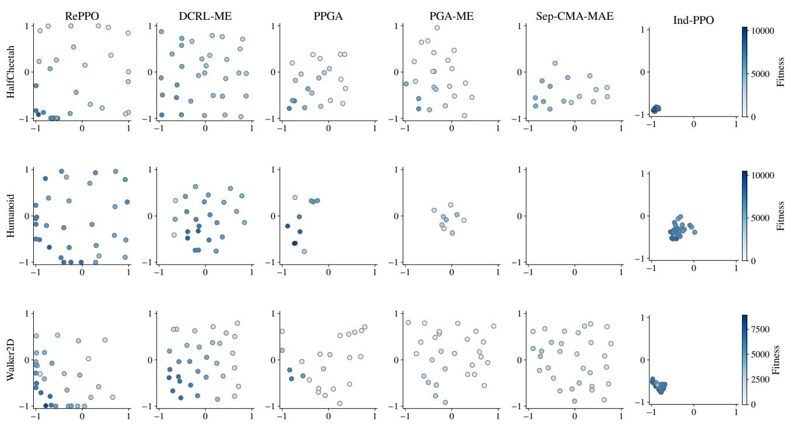  
Figure 5. Retained policies of one seed per method in behavior space, colored by fitness on a shared scale within each task. For readability, archives are thinned to one policy in each of 32 CVT cells, keeping the fittest.

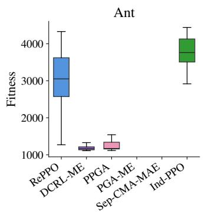

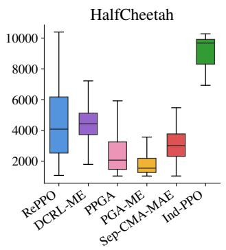

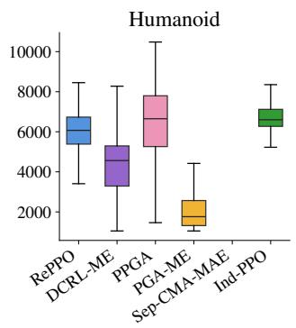

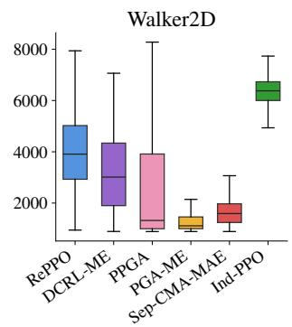  
Figure 6. Fitness of the retained policies, pooled over seeds. Boxes show the interquartile range and medians.

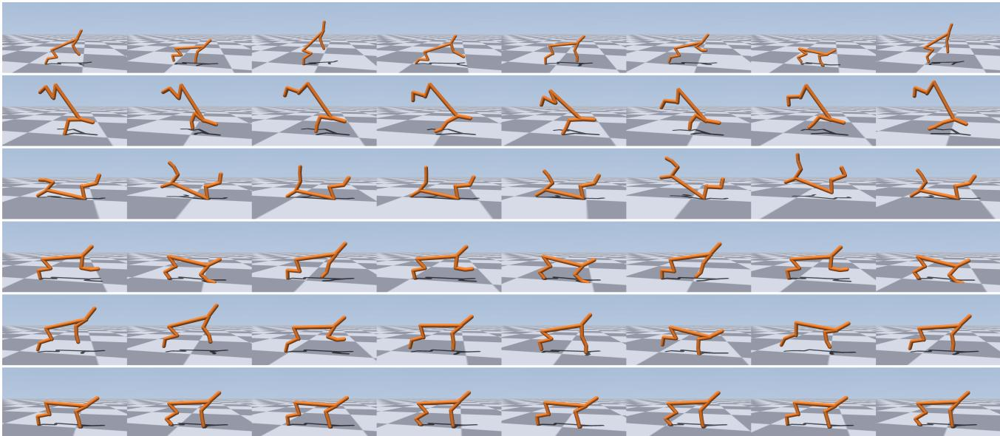  
Figure 7. Gaits found by one RePPO population in HalfCheetah.

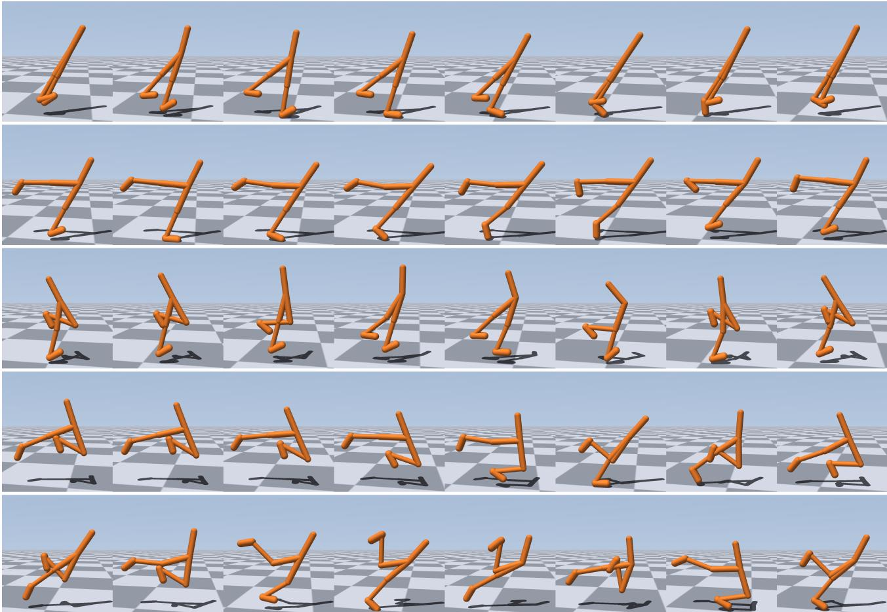  
Figure 8. Gaits found by one RePPO population in Walker2D.

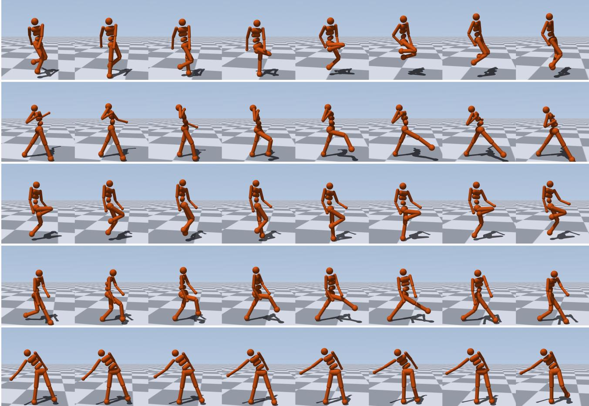  
Figure 9. Gaits found by one RePPO population in Humanoid.

## D. Ablations

We ablate RePPO’s components and hyperparameters on Humanoid. Each variant changes one setting of the main Humanoid configuration $( C _ { \mathrm { m a x } } = 1 , \ell ^ { 2 } = 0 . 1 , K = 8 , N = 3 2 $ , symmetric repulsion, $W _ { k } = 1 )$ and runs for three seeds. The default is represented by the first three seeds of the main runs. All metrics follow Appendix B, with the quality threshold of the main comparison. We additionally report the spread of a population, the mean Euclidean distance of its policies from their centroid in the normalized behavior space $[ - 1 , 1 ] ^ { d }$ , which characterizes its geometry alongside the Vendi Score. Table 5 lists every variant.

## D.1. Structural choices

We first examine two structural choices: the unit task coefficient of Section 4.1, and symmetric interactions, in which every pair of neighbors repels each other regardless of their qualities.

Exact task coefficient. Using the exact coefficient $W _ { k }$ of (8) causes training to collapse in every seed. Policies perform significantly worse with the best policy reaching a fitness of only $2 8 2 \pm 2 3 0$ . When several high-quality policies share a region of behavior space–which happens often early in training–the second term of $W _ { k }$ outweighs the first and the task coefficient becomes negative. The policy is then rewarded for lowering its return, and once it reaches low-return behaviors, such as falling immediately, PPO does not recover. Fixing $W _ { k } = 1$ preserves a consistent task-improvement signal and leaves behavioral separation to the descriptor term.

Asymmetric repulsion. In this variant, a policy is repelled only by neighbors of higher quality, so that the best policies are never displaced by weaker ones. The best policy is unaffected (8409 ± 201 versus 8336 ± 68), but the rest of the population is both less fit and less diverse, lowering qVS from 39212 to 34086. Symmetric interactions let every overlapping pair separate, which spreads the population more evenly.

## D.2. Interaction strength and scale

Together, the repulsion cap $C _ { \mathrm { m a x } }$ and the kernel bandwidth $\ell ^ { 2 }$ shape how the population spreads through behavior space, but they do so in different ways (Figures 10 and 11).

Repulsion cap. The cap controls how strongly diversity enters each update, with $C _ { \mathrm { m a x } } = 0$ recovering Ind-PPO. Raising it from 0.1 to 1 increases the Vendi Score from 3.92 to 6.33 and the spread from 0.60 to 0.91, while mean fitness stays between 5700 and 6200. Beyond $C _ { \mathrm { m a x } } = 2$ , diversity saturates and the stronger diversity signal begins to compete with task learning: at $C _ { \mathrm { m a x } } = 8$ , mean and best fitness fall to 4691 and 6817. qVS peaks at the default of 1, with $C _ { \mathrm { m a x } } = 2$ close behind. The cap therefore mainly controls how far the population expands, and needs to be large enough to spread the policies but not so large that repulsion dominates the update.

Kernel bandwidth. The bandwidth sets the scale over which policies interact and thus the configuration the population settles into. With $\ell ^ { 2 } = 0 . 0 2$ , interactions are highly local, and the population remains compact (spread 0.70, Vendi Score $4 . 8 0 )$ and fit (mean fitness 6703). Increasing the bandwidth pushes policies apart until the spread saturates near 1.0 at $\ell ^ { 2 } = 0 . 5$ , where the Vendi Score peaks at 6.84. Larger bandwidths push policies toward the corners of behavior space, leaving its center empty, so that diversity declines slightly while mean fitness stays near 5200. ${ \mathfrak { q V } } { \mathfrak { S } }$ peaks at $\ell ^ { 2 } = 0 . 1$ , which balances these effects on Humanoid.

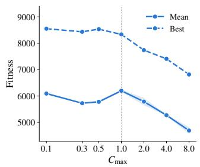

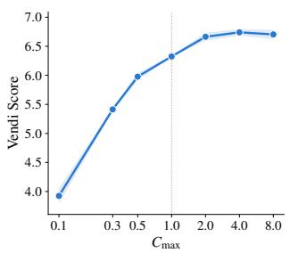

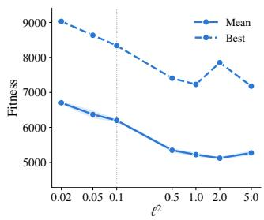

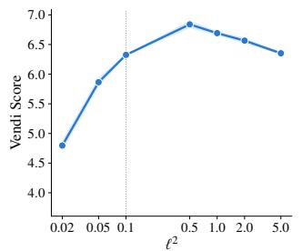  
Figure 10. Effect of the repulsion cap $C _ { \mathrm { m a x } }$ (left) and the kernel bandwidth $\ell ^ { 2 }$ (right) on Humanoid. Shaded regions show one standard error over seeds.

𝐶<sub>max</sub> = 0  
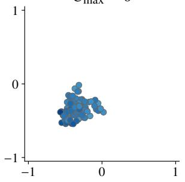

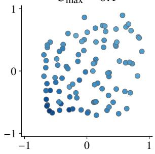

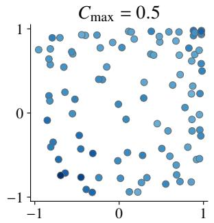

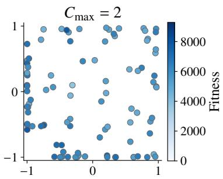

ℓ<sup>2</sup> = 0.02  
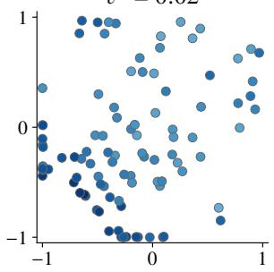

ℓ<sup>2</sup> = 0.1  
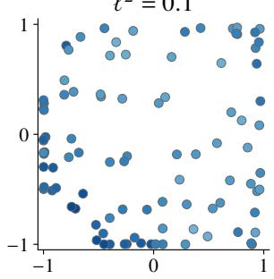

ℓ<sup>2</sup> = 0.5  
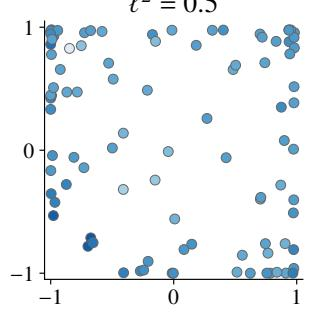

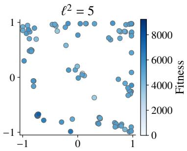  
Figure 11. Final Humanoid populations for representative values of $C _ { \mathrm { m a x } }$ (top) and $\ell ^ { 2 }$ (bottom), pooled over seeds and colored by fitness. $C _ { \mathrm { m a x } } = 0$ corresponds to Ind-PPO.

## D.3. Local interactions

Restricting the interactions to K nearest neighbors has little effect over the range we tested (Figure 12, left). With $K \in \{ 4 , 8 , 1 6 \}$ , the Vendi Score lies between 6.33 and 6.50 and ${ \mathfrak { q V } } S$ within 4% of the default. Interacting with the entire population $( K = 3 1 )$ produces slightly fitter but less diverse populations. We therefore conclude that the nearest neighbors carry most of the interaction, and $K = 8$ retains its effect at lower cost.

## D.4. Population size at a fixed budget

We vary the population size while keeping the total number of environment steps fixed, so that larger populations give each policy less experience (Figure 12, right). Diversity grows with population size with diminishing returns, from a Vendi Score of 3.76 at $N = 8$ to 6.97 at $N = 6 4$ . Mean fitness is highest for $N = 1 6$ and $N = 3 2$ and drops at $N = 6 4$ , where each policy receives half the experience of the default, whereas the best fitness remains above 7200 for every size. A larger population therefore represents behavior space more densely until the budget is spread too thinly, and $N = 3 2$ balances these effects.

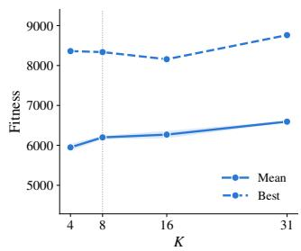

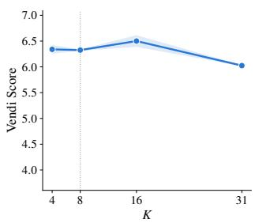

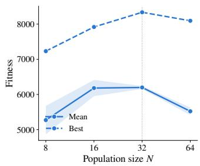

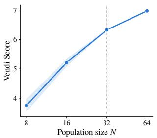  
Figure 12. Effect of the number of neighbors K (left) and of the population size N at a fixed budget (right) on Humanoid. Shaded regions show one standard error over seeds.

Table 5. All Humanoid ablations, as mean ± standard error over three seeds. The default configuration appears in bold.
<table><tr><td>Setting</td><td></td><td>Mean fitness</td><td>Best fitness</td><td>Vendi Score</td><td> ${ \mathfrak { q V } } { \mathfrak { S } }$ </td><td>Spread</td></tr><tr><td></td><td>Default</td><td> ${ \bf 6 2 0 0 \pm 4 3 }$ </td><td> ${ \bf 8 3 3 6 \pm 6 8 }$ </td><td> ${ \bf 6 . 3 3 \pm 0 . 0 1 }$ </td><td> $\mathbf { 3 9 2 1 2 \pm 2 3 1 }$ </td><td>0.91</td></tr><tr><td rowspan="2">Structure</td><td>Asymmetric repulsion</td><td> $5 9 3 5 \pm 1 4 4$ </td><td> $8 4 0 9 \pm 2 0 1$ </td><td> $5 . 7 4 \pm 0 . 2 1$ </td><td> $3 4 0 8 6 \pm 1 6 8 8$ </td><td>0.83</td></tr><tr><td>Exact  $W _ { k }$ </td><td> $0 \pm 0$ </td><td> $2 8 2 \pm 2 3 0$ </td><td> $0 . 0 0 \pm 0 . 0 0$ </td><td> $0 \pm 0$ </td><td>一</td></tr><tr><td rowspan="6"> $C _ { \mathrm { m a x } }$ </td><td>0.1</td><td> $6 0 9 3 \pm 4 2$ </td><td> $8 5 5 3 \pm 1 3 8$ </td><td> $3 . 9 2 \pm 0 . 1 3$ </td><td> $2 3 9 0 1 \pm 6 8 1$ </td><td>0.60</td></tr><tr><td>0.3</td><td> $5 7 2 7 \pm 1 8$ </td><td> $8 4 3 6 \pm 1 9 5$ </td><td> $5 . 4 1 \pm 0 . 0 3$ </td><td> $3 1 0 0 3 \pm 2 8 2$ </td><td>0.79</td></tr><tr><td>0.5</td><td> $5 7 8 0 \pm 4 7$ </td><td> $8 5 3 6 \pm 4 4 3$ </td><td> $5 . 9 8 \pm 0 . 0 6$ </td><td> $3 4 5 4 4 \pm 8 8$ </td><td>0.87</td></tr><tr><td>2.0</td><td> $5 7 8 8 \pm 1 4 3$ </td><td> $7 7 4 0 \pm 6 7$ </td><td> $6 . 6 6 \pm 0 . 0 7$ </td><td> $3 8 5 8 1 \pm 1 2 2 5$ </td><td>0.94</td></tr><tr><td>4.0</td><td> $5 2 7 3 \pm 2 2$ </td><td>7410 ± 75</td><td> $6 . 7 4 \pm 0 . 0 6$ </td><td> $3 5 5 4 2 \pm 4 4 4$ </td><td>0.95</td></tr><tr><td>8.0</td><td> $4 6 9 1 \pm 1 3 2$ </td><td> $6 8 1 7 \pm 5 1$ </td><td> $6 . 7 0 \pm 0 . 0 8$ </td><td> $3 1 4 6 6 \pm 1 2 5 3$ </td><td>0.96</td></tr><tr><td rowspan="6"> $\ell ^ { 2 }$ </td><td>0.02</td><td> $6 7 0 3 \pm 4 8$ </td><td>9031 ± 100</td><td> $4 . 8 0 \pm 0 . 0 9$ </td><td> $3 2 1 4 9 \pm 5 5 1$ </td><td>0.70</td></tr><tr><td>0.05</td><td> $6 3 7 1 \pm 1 1 4$ </td><td> $8 6 3 3 \pm 2 7 6$ </td><td> $5 . 8 6 \pm 0 . 0 8$ </td><td> $3 7 3 6 7 \pm 9 5 2$ </td><td>0.83</td></tr><tr><td>0.5</td><td> $5 3 4 8 \pm 6 0$ </td><td> $7 4 0 7 \pm 3 3 8$ </td><td> $6 . 8 4 \pm 0 . 0 6$ </td><td> $3 6 5 8 6 \pm 7 1 2$ </td><td>1.03</td></tr><tr><td>1.0</td><td> $5 2 2 1 \pm 5 9$ </td><td> $7 2 2 9 \pm 3 8 8$ </td><td> $6 . 6 9 \pm 0 . 0 4$ </td><td> $3 4 9 4 3 \pm 5 8 3$ </td><td>1.00</td></tr><tr><td>2.0</td><td> $5 1 2 1 \pm 4 5$ </td><td> $7 8 5 2 \pm 2 0 0$ </td><td> $6 . 5 7 \pm 0 . 0 5$ </td><td> $3 3 6 2 6 \pm 5 0 9$ </td><td>1.01</td></tr><tr><td>5.0</td><td> $5 2 7 2 \pm 6 7$ </td><td> $7 1 7 7 \pm 3 6 3$ </td><td> $6 . 3 5 \pm 0 . 0 2$ </td><td> $3 3 4 9 3 \pm 5 3 9$ </td><td>0.97</td></tr><tr><td rowspan="3">K</td><td>4</td><td> $5 9 5 0 \pm 8 9$ </td><td> $8 3 6 1 \pm 2 0 3$ </td><td> $6 . 3 4 \pm 0 . 0 8$ </td><td> $3 7 7 2 4 \pm 7 9 1$ </td><td>0.91</td></tr><tr><td>16</td><td> $6 2 6 9 \pm 9 3$ </td><td> $8 1 5 7 \pm 9 2$ </td><td> $6 . 5 0 \pm 0 . 1 1$ </td><td> $4 0 7 3 4 \pm 3 3 3$ </td><td>0.92</td></tr><tr><td>31</td><td> $6 5 9 4 \pm 2 4$ </td><td> $8 7 6 1 \pm 1 9 6$ </td><td> $6 . 0 2 \pm 0 . 0 1$ </td><td> $3 9 7 2 5 \pm 1 2 8$ </td><td>0.90</td></tr><tr><td rowspan="3">N</td><td>8</td><td> $5 2 7 2 \pm 4 0 4$ </td><td> $7 2 3 1 \pm 1 5 3$ </td><td> $3 . 7 6 \pm 0 . 2 1$ </td><td> $1 9 8 2 0 \pm 1 9 7 9$ </td><td>0.65</td></tr><tr><td>16</td><td> $6 1 8 2 \pm 2 3 1$ </td><td> $7 9 1 8 \pm 5 1 2$ </td><td> $5 . 2 1 \pm 0 . 1 3$ </td><td> $3 2 1 8 3 \pm 8 8 6$ </td><td>0.79</td></tr><tr><td>64</td><td> $5 5 2 2 \pm 1 0 7$ </td><td> $8 0 9 5 \pm 2 2 7$ </td><td> $6 . 9 7 \pm 0 . 0 3$ </td><td> $3 8 4 9 2 \pm 6 1 9$ </td><td>1.00</td></tr></table>

## E. Atari

## E.1. Games and descriptors

We use the ALE v5 versions (Bellemare et al., 2015) of Boxing, Asterix, Seaquest, and Ms. Pac-Man through EnvPool (Weng et al., 2022), with the standard preprocessing: a frame skip of 4 with max-pooling over the last two frames, 0 to 30 no-op actions at reset, grayscale frames resized to 84 × 84, and a stack of the last 4 frames. Following Machado et al. (2018), the emulator repeats the previous action with probability 0.25 during both training and evaluation. A game lasts until all lives are lost or 27000 agent steps have passed. Fitness is the raw game score of a full game. During training, the task reward is clipped to its sign and a lost life ends the episode for the task critic

Each game defines a two-dimensional behavior signal m<sub>t</sub> from the console memory, and the descriptor of a game is its average over all agent steps, clipped to [−1, 1]. Table 6 defines the signals and Figure 13 illustrates the games. For the three positional descriptors, the affine scales map the range that competent play reaches to roughly [−1, 1]. In Ms. Pac-Man, eating a dot after k of the level’s n dots have been eaten contributes $w _ { k } = 1 - 2 k / ( n - 1 )$ , from +1 for the first dot to −1 for the last, signed by the half of the maze in which the dot lies, so that the descriptor records which halves are cleared first and is zero when the maze is cleared uniformly.

Table 6. Behavior signals in Atari. Positional signals are affine in the memory values and clipped to [−1, 1] per step.
<table><tr><td>Game</td><td>First dimension (−1 → +1)</td><td>Second dimension (−1 → +1)</td></tr><tr><td>Boxing</td><td>distance to the opponent (close → far)</td><td>height in the ring (top → bottom)</td></tr><tr><td>Asterix</td><td>horizontal position (left → right)</td><td>lane (top → bottom)</td></tr><tr><td>Seaquest</td><td>horizontal position (left → right)</td><td>depth (just below the surface → sea floor)</td></tr><tr><td>Ms. Pac-Man</td><td>clearing order (left half first → right half first)</td><td>clearing order (top half first → bottom half first)</td></tr></table>

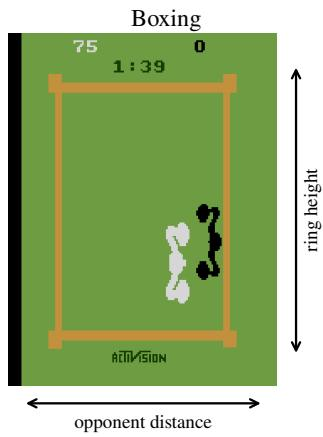

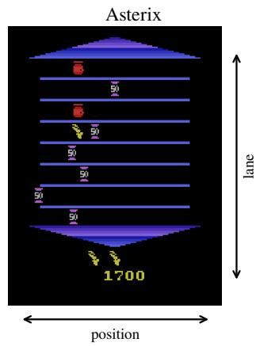

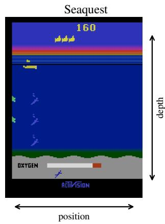

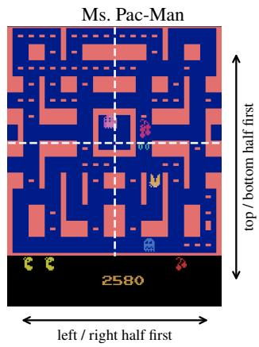  
Figure 13. The four Atari games, as played by the best RePPO policy of one population, with the two behavior dimensions of each game indicated by arrows.

## E.2. RePPO and Ind-PPO

Each policy is a Nature CNN (Mnih et al., 2015) with linear actor, task-critic, and two-output behavior-critic heads on its 512-dimensional features, totaling 1.69 M parameters. The policies share no parameters. PPO settings follow the standard Atari configuration (Huang et al., 2022), and Table 7 lists all hyperparameters. Two settings adapt the behavior channels to full games of several thousand steps. First, the behavior channels end only when the game ends rather than at every lost life. Second, their rewards are scaled by 1 − γ so that the behavior returns stay on the scale of the descriptor itself. The EMA rates are lower than in continuous control because a game spans many iterations, and the statistics are updated only in iterations in which a game ends.

Table 7. RePPO hyperparameters in Atari. Ind-PPO uses the same settings with the diversity weights set to zero.
<table><tr><td>Parameter</td><td>Value</td><td>Parameter</td><td>Value</td></tr><tr><td>Population size N</td><td>8</td><td>Discount γ / GAE λ</td><td>0.99 / 0.95</td></tr><tr><td>Environments per policy</td><td>8</td><td>PPO clip</td><td>0.1, with value clipping</td></tr><tr><td>Rollout length</td><td>128</td><td>Entropy / value coefficient</td><td>0.01/0.5</td></tr><tr><td>Steps per policy</td><td>10 M</td><td>Max gradient norm</td><td>0.5</td></tr><tr><td>Learning rate</td><td> $2 . 5 \times 1 0 ^ { - 4 }$  , linear decay to 0</td><td>Neighbors K / repulsion cap  $C _ { \mathrm { m a x } }$ </td><td>7/1.0</td></tr><tr><td>Update epochs / minibatches</td><td>4/4</td><td>Kernel bandwidth  $\ell ^ { 2 }$ </td><td>0.1</td></tr><tr><td>EMA rates</td><td>0.9</td><td> $\epsilon _ { f } / \epsilon _ { b }$ </td><td>1/10−⁶</td></tr></table>

## E.3. RefQD

RefQD (Wang et al., 2024) reduces the cost of an archive of neural policies by splitting each network into a representation part, shared by the entire archive, and a decision part, the last layer, which is stored per cell. We use its Atari variant, Ref-DQN-ME, which produces offspring by isoline variation and by Double DQN updates (van Hasselt et al., 2016), with the authors’ default hyperparameters: a CVT archive of 1000 cells that stores two decision parts per cell, 100 offspring per generation, 300 DQN training steps per generation, periodic re-evaluation of archived decision parts with the current representation, and a single grayscale frame as input. We set the budget to 80 M steps, which the implementation rounds up to 86.4 M so that every re-evaluation cycle completes. For Seaquest, we enlarge the replay buffer from $2 \times 1 0 ^ { 5 } ~ \mathrm { t o } ~ 3 \times 1 0 ^ { \bar { 5 } }$

transitions due to longer episodes.

## E.4. Additional results

Table 8 reports the numbers behind the bottom row of Figure 1. In Boxing, Ind-PPO’s policies keep the same distance from the opponent and mostly stay at one of two heights, whereas RePPO’s policies spread over the height of the ring and include a second family that fights at closer range. In Asterix and Ms. Pac-Man, Ind-PPO’s policies already vary along one dimension, horizontal position and left–right clearing order, which the symmetry of the games makes equally rewarding. RePPO additionally spreads its policies along the other dimension, covering the outer lanes in Asterix and including policies that clear the top half of the maze first in Ms. Pac-Man.

Table 8. Final populations in Atari, as mean ± standard error over five seeds.
<table><tr><td>Game</td><td>Method</td><td>Best score</td><td>Mean score</td><td>Vendi Score</td><td> ${ \mathfrak { q V } } { \mathfrak { S } }$ </td></tr><tr><td rowspan="3">Boxing</td><td>RePPO</td><td> ${ \bf 9 8 \pm 0 }$ </td><td> $9 1 \pm 1$ </td><td> ${ \bf 2 . 9 6 \pm 0 . 0 9 }$ </td><td> ${ \bf 2 7 1 \pm 8 }$ </td></tr><tr><td>RefQD</td><td> $3 3 \pm 5$ </td><td> $1 7 \pm 2$ </td><td> $1 . 8 8 \pm 0 . 1 2$ </td><td> $3 2 \pm 4$ </td></tr><tr><td>Ind-PPO</td><td> $9 6 \pm 1$ </td><td> ${ \bf 9 3 \pm 0 }$ </td><td> $1 . 7 2 \pm 0 . 1 8$ </td><td> $1 5 9 \pm 1 6$ </td></tr><tr><td rowspan="3">Asterix</td><td>RePPO</td><td> $\mathbf { 3 4 2 6 \pm 1 1 9 }$ </td><td> $2 9 3 9 \pm 2 8$ </td><td> ${ \bf 4 . 0 1 \pm 0 . 0 3 }$ </td><td> $\mathbf { 1 1 7 8 3 \pm 1 2 9 }$ </td></tr><tr><td>RefQD</td><td> $1 3 8 5 \pm 2 3$ </td><td> $5 9 6 \pm 1 0$ </td><td> $3 . 0 9 \pm 0 . 1 3$ </td><td> $1 8 4 0 \pm 6 8$ </td></tr><tr><td>Ind-PPO</td><td> $3 3 5 2 \pm 1 0 2$ </td><td> ${ \bf 2 9 4 5 \pm 4 1 }$ </td><td> $2 . 4 6 \pm 0 . 1 1$ </td><td> $7 2 5 2 \pm 3 4 2$ </td></tr><tr><td rowspan="3">Seaquest</td><td>RePPO</td><td> $\mathbf { 3 3 8 2 } \pm \mathbf { 4 6 5 }$ </td><td> $\mathbf { 1 8 5 5 \pm 1 2 5 }$ </td><td> ${ \bf 4 . 3 3 \pm 0 . 2 8 }$ </td><td> $\mathbf { 8 1 0 0 \pm 8 3 0 }$ </td></tr><tr><td>RefQD</td><td> $5 1 1 \pm 1 9$ </td><td> $4 8 5 \pm 5$ </td><td> $1 . 1 1 \pm 0 . 0 5$ </td><td> $5 3 8 \pm 2 6$ </td></tr><tr><td>Ind-PPO</td><td> $1 9 0 7 \pm 9 3$ </td><td> $1 4 6 9 \pm 9 0$ </td><td> $1 . 5 0 \pm 0 . 1 0$ </td><td> $2 1 7 3 \pm 7 6$ </td></tr><tr><td rowspan="3">Ms. Pac-Man</td><td>RePPO</td><td> $2 5 8 8 \pm 1 1 2$ </td><td> $2 0 8 8 \pm 3 6$ </td><td> $3 . 3 8 \pm 0 . 1 4$ </td><td> ${ \bf 7 0 6 1 } \pm { \bf 3 6 9 }$ </td></tr><tr><td>RefQD</td><td> $1 1 7 6 \pm 1 0 5$ </td><td> $4 7 4 \pm 1 2$ </td><td> ${ \bf 3 . 6 5 \pm 0 . 0 3 }$ </td><td> $1 7 3 2 \pm 4 2$ </td></tr><tr><td>Ind-PPO</td><td> $\mathbf { 2 7 3 0 \pm 1 3 2 }$ </td><td> ${ \bf 2 2 1 5 \pm 5 9 }$ </td><td> $2 . 3 0 \pm 0 . 0 9$ </td><td> $5 1 0 7 \pm 2 5 5$ </td></tr></table>

Figure 14 shows where each policy of the first seed plays, over eight games per policy. In Boxing, most Ind-PPO policies fight from the left side of the ring at one of two heights, whereas RePPO’s policies also fight from the right side of the ring and along its top and bottom edges. In Seaquest, Ind-PPO’s policies descend to the sea floor and stay there, while RePPO’s policies occupy different depths and horizontal positions, and its best policy remains just below the surface. In Ms. Pac-Man, all policies traverse the whole maze, so the figure instead shows when each dot is eaten. The policies of both methods start from the bottom of the maze, where the game begins, and differ in which regions they leave for last.

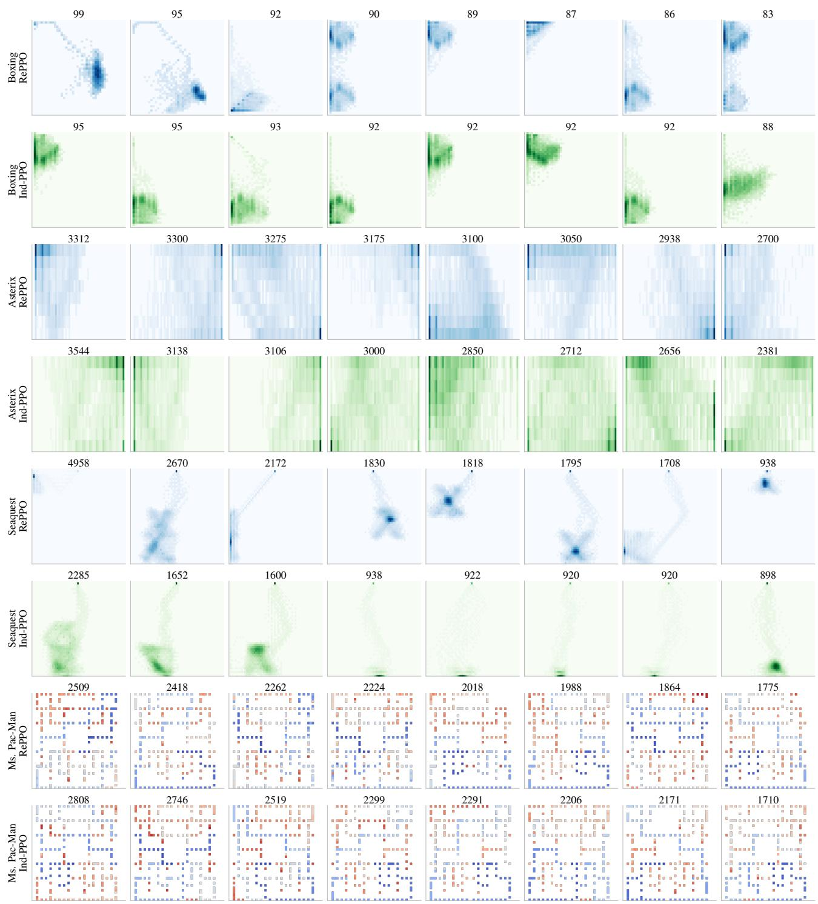  
Figure 14. Behavior of the eight policies of the first seed of RePPO (blue) and Ind-PPO (green), sorted by score, which is shown above each panel. For Boxing, Asterix, and Seaquest, each panel is a heatmap of the player’s position on the screen. For Ms. Pac-Man, each panel colors the dots of the maze by when they are eaten, from early (blue) to late (red), as a fraction of the level.

## F. Fine-tuning large language models

## F.1. Task and data

We train on the 5584 problems of levels 3–5 of the MATH training set (Hendrycks et al., 2021) whose reference solution contains a boxed answer, as in SimpleRL-Zoo (Zeng et al., 2025). For checkpoint selection, we sample 384 problems of the same levels from the MATH test set, excluding MATH-500. The test set combines MATH-500 (Lightman et al., 2024) (500 problems), Minerva (Lewkowycz et al., 2022) (272), and the English text-only part of OlympiadBench (He et al., 2024) (675). The base models are Qwen3-1.7B-Base (Team, 2025) and Granite-4.1-3B-Base (IBM Granite Team, 2026). Every problem is accompanied by the instruction “Please reason step by step, and put your final answer within \boxed{}.”, given as the system message of the chat template for Qwen3 and after the problem in a plain question–answer format for Granite.

Fitness. A solution scores $r = 1$ if it ends within 4096 tokens and its last boxed expression matches the reference under Math-Verify, and $r = 0$ otherwise. The training reward standardizes this score as $( r - \mu _ { 0 } ) / \sigma _ { 0 }$ , using its mean and standard deviation on the base model’s first batch.

Descriptors. Four raw features $x _ { j }$ are computed on the solution text up to its last boxed answer (Table 9). The descriptor corresponding to a solution is then $\dot { d } _ { j } = r \operatorname { t a n h } \left( ( x _ { j } - \mu _ { j } ) / \sigma _ { j } \right) \in [ - 1 , 1 ]$ , where $\mu _ { j }$ is the mean of $x _ { j }$ over the base model’s correct solutions on its first batch and $\sigma _ { j }$ is a fixed scale shared by both models. Multiplying by r assigns the neutral value 0 to incorrect solutions, so that a member cannot move its descriptor by writing incorrect solutions in a particular style. Since a solution’s fitness and descriptors are revealed only when it is complete, both are terminal rewards in the token-level MDP.

Table 9. Raw features of the LLM descriptors and their scales $\sigma _ { j } .$
<table><tr><td>Descriptor</td><td>Raw feature  $x _ { j }$ </td><td> $\sigma _ { j }$ </td></tr><tr><td>Code</td><td>share of non-space characters inside code blocks</td><td>0.098</td></tr><tr><td>Verification</td><td>self-verification episodes (“let me double-check&quot;, “substituting back&quot;) per 1000 words</td><td>1.845</td></tr><tr><td>Symbols</td><td>share of non-code text inside LTFX math delimiters</td><td>0.170</td></tr><tr><td>Markdown</td><td>share of non-empty prose lines that are list items, headers, or table rows</td><td>0.233</td></tr></table>

## F.2. Training

Each member is a LoRA adapter (Hu et al., 2022) of rank 32 on all attention and MLP projections of the frozen backbone, with its own critic: a rank-64 adapter on the same backbone with a linear head of $1 + d = 5$ outputs. An actor adapter has 34.9 M parameters for Qwen3 and 62.3 M for Granite. Training follows the zero-RL recipe of Open-Reasoner-Zero (Hu et al., 2025): PPO with a learned critic, $\gamma = \lambda = 1$ , and no KL penalty or entropy bonus. In every iteration, each member samples 8 solutions to each of the same 128 problems. Advantages are standardized per channel over each member’s ful batch of 1024 solutions, and the diversity weights are computed with the shared implementation used in all other domains, from EMAs of each member’s batch-mean fitness and descriptors. Table 10 lists all hyperparameters. After every 10 iterations, we evaluate each population on the validation problems and select the checkpoint with the highest mean accuracy.

Table 10. Hyperparameters of LLM fine-tuning. Ind-PPO uses the same settings with the diversity weights set to zero.
<table><tr><td>Parameter</td><td>Value</td><td>Parameter</td><td>Value</td></tr><tr><td>Population size N</td><td>5</td><td>Actor / critic learning rate</td><td> $5 \times 1 0 ^ { - 5 } / 1 0 ^ { - 4 }$ </td></tr><tr><td>Iterations</td><td>100</td><td>Critic-only warm-up</td><td>15 iterations</td></tr><tr><td>Problems × samples per iteration</td><td>128 ×8 per member</td><td>Optimizer</td><td>AdamW (0.9, 0.95), no weight decay 1.0</td></tr><tr><td>Sampling (training)</td><td>temperature 1, top-p 1</td><td>Gradient clipping</td><td></td></tr><tr><td>Maximum response length</td><td>4,096 tokens</td><td>Neighbors K</td><td></td></tr><tr><td>Discount  $\gamma / { \bar { \mathbf { G } } } { \mathbf { A } } { \mathbf { E } } \lambda$ </td><td>1/1</td><td>Repulsion cap  $C _ { \mathrm { m a x } }$   $\ell ^ { 2 }$ </td><td>0.5</td></tr><tr><td>PPO clip / value clip</td><td>0.2 / 0.2</td><td>Kernel bandwidth</td><td>0.5</td></tr><tr><td>Epochs / minibatch</td><td>1 / 256 solutions</td><td>EMA rates</td><td>0.7</td></tr><tr><td>LoRA rank (actor / critic)</td><td>32 / 64</td><td> $\epsilon _ { f } / \epsilon _ { b }$ </td><td>1/0.05</td></tr></table>

## F.3. Baselines and evaluation

The prompting baselines prepend a style instruction to each problem. In the corners baseline, the five instructions combine extreme values of all four descriptors, chosen so that every pair of members differs in at least two of them. For example, “Solve the problem by writing Python code, verify your answer with an explicit check, explain mostly in words, and write in flowing paragraphs without headers or bullet lists.” In the emphasis baseline, four members each emphasize one descriptor, such as “Present the solution as a clearly structured markdown document, with headers and a bulleted or numbered list of steps.”, and the fifth combines markdown with verification.

At test time, every member samples 8 solutions per problem at temperature 0.6 and top-p 0.95, and the base model samples 40, matching a population’s total. pass@1 averages correctness over members and samples. Population pass@5j draws j samples from each member and is computed with the unbiased estimator of Chen et al. (2021). Identifiability is the held-out accuracy of a logistic-regression classifier on TF-IDF features of word unigrams and bigrams, trained to predict which member wrote a solution on half of the problems and tested on the other half.

## F.4. Additional results

Table 11 reports accuracy by benchmark and pass@k. Fine-tuning mostly sharpens what Qwen3 can already solve, raising pass@40 by 2 points, while Granite also learns to end its solutions more reliably, raising pass@40 by 9 points. RePPO’s lower pass@1 comes mainly from a single member in each population: the code-writing member of Qwen3, whose solutions are the longest and the outputs of the programs are guessed, and the Granite member that rarely uses an explicit reasoning block. Figure 15 shows that the instructions shift the style of the prompted members only moderately, even when they explicitly request extreme values of the descriptors.

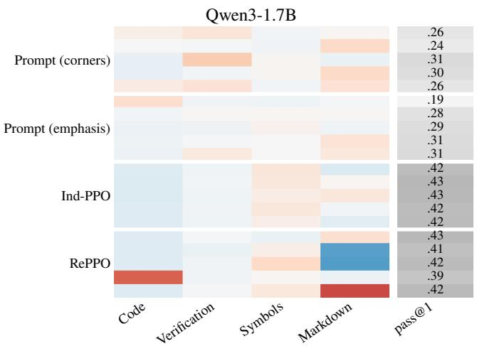

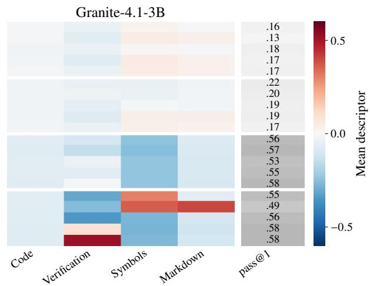  
Figure 15. Mean descriptor and pass@1 of every member, including the prompting baselines, as in Figure 3. Each block of five rows is one population.

Table 11. Accuracy by benchmark and population pass@k on the test problems.
<table><tr><td>Model</td><td>Method</td><td>MATH-500</td><td>Minerva</td><td>OlympiadBench</td><td>pass@5</td><td>pass@10</td><td>pass@20</td><td>pass@40</td></tr><tr><td rowspan="5">Qwen3-1.7B</td><td>Base model</td><td>0.546</td><td>0.142</td><td>0.225</td><td>0.526</td><td>0.592</td><td>0.647</td><td>0.694</td></tr><tr><td>Prompt (corners)</td><td>0.467</td><td>0.130</td><td>0.189</td><td>0.503</td><td>0.574</td><td>0.635</td><td>0.688</td></tr><tr><td>Prompt (emphasis)</td><td>0.470</td><td>0.121</td><td>0.192</td><td>0.506</td><td>0.578</td><td>0.639</td><td>0.694</td></tr><tr><td>Ind-PPO</td><td>0.672</td><td>0.274</td><td>0.299</td><td>0.589</td><td>0.640</td><td>0.681</td><td>0.713</td></tr><tr><td>RePPO</td><td>0.664</td><td>0.266</td><td>0.287</td><td>0.588</td><td>0.641</td><td>0.683</td><td>0.715</td></tr><tr><td rowspan="5">Granite-4.1-3B</td><td>Base model</td><td>0.392</td><td>0.072</td><td>0.181</td><td>0.500</td><td>0.588</td><td>0.654</td><td>0.704</td></tr><tr><td>Prompt (corners)</td><td>0.282</td><td>0.057</td><td>0.118</td><td>0.424</td><td>0.530</td><td>0.616</td><td>0.681</td></tr><tr><td>Prompt (emphasis)</td><td>0.332</td><td>0.064</td><td>0.143</td><td>0.469</td><td>0.571</td><td>0.647</td><td>0.700</td></tr><tr><td>Ind-PPO</td><td>0.776</td><td>0.296</td><td>0.506</td><td>0.712</td><td>0.744</td><td>0.771</td><td>0.793</td></tr><tr><td>RePPO</td><td>0.793</td><td>0.289</td><td>0.475</td><td>0.707</td><td>0.740</td><td>0.767</td><td>0.791</td></tr></table>

## F.5. Qualitative examples

Reading the solutions confirms that each RePPO member commits to a consistent style across problems. On Qwen3, the code-writing member includes a Python block in 92% of its solutions, almost always after a complete solution in prose, and another member formats 99% of its solutions as numbered lists. Two members write in plain prose and resemble each other closely, which matches their neighboring descriptors in Figure 3. On Granite, every trained member inherits the base model’s habit of reasoning in a block delimited by <think> before writing a final solution, and the members differ mainl within that block: one re-checks intermediate results as a reflex, one typesets its reasoning in LAT X, and one skips the block on most problems in favor of a structured write-up. Ind-PPO’s members are hard to tell apart in both models.

The styles are not always desirable. The code blocks of Qwen3’s code-writing member are followed by output blocks that the model writes itself, since no interpreter is available, and the stated outputs agree with what the code would actually print in only half of the cases. Some of the Granite member’s verification episodes repeat the same check several times. Both behaviors maximize the descriptors as defined, which shows that RePPO diversifies whatever the descriptors measure, so that their design determines which kind of diversity is obtained.

The boxes below show complete, unedited solutions to two MATH-500 problems for each model: the first of the eight test samples of every RePPO member and of two Ind-PPO members. The header of each box gives the four descriptors of tha solution. On the seating problem, every member follows the same strategy, so the differences between the solutions are purely in presentation. Granite’s solutions follow a template inherited from the base model: an early boxed guess, often a placeholder, then reasoning inside a block delimited by <think>, shown in gray, and finally a written solution.

## Qwen3-1.7B: Seating with an adjacency constraint

In how many ways can 6 girls and 2 boys sit in a row if the 2 boys insist on sitting next to each other?

Counting & Probability, level 3; answer 10,080.

RePPO · Member 0   
code −0.19 verification −0.18 symbols −0.91 markdown +0.89

correct, 399 tokens

To solve this problem, we need to consider the arrangement of the girls and the boys such that the two boys sit next to each other. Here’s a step-by-step reasoning:

1. Treat the two boys as a single unit: Since the two boys must sit next to each other, we can think of them as a single “block” or “super person”. This reduces the problem to arranging 7 units (6 girls + 1 block of 2 boys).

2. Arrange the 7 units: The number of ways to arrange 7 units in a row is given by the factorial of 7, which is 7!. Calculating this, we get:

$$
7 ! = 7 \times 6 \times 5 \times 4 \times 3 \times 2 \times 1 = 5 0 4 0
$$

3. Arrange the boys within the block: Within the block, the two boys can switch places. There are 2! (2 factorial) ways to arrange the two boys within their block. Calculating this, we get:

$$
2 ! = 2 \times 1 = 2
$$

4. Combine the arrangements: The total number of ways to arrange the 6 girls and 2 boys such that the two boys sit next to each other is the product of the number of ways to arrange the 7 units and the number of ways to arrange the boys within their block. Therefore, we multiply the results from steps 2 and 3:

$$
7 ! \times 2 ! = 5 0 4 0 \times 2 = 1 0 0 8 0
$$

Thus, the number of ways to arrange 6 girls and 2 boys in a row such that the two boys sit next to each other is 10080

RePPO · Member 1   
code −0.19 verification −0.18 symbols −0.74 markdown −0.89

correct, 290 tokens

To solve the problem, we can treat the two boys as a single “block” or “unit”. This means we have 7 units to arrange: the block of 2 boys and the 6 girls. The number of ways to arrange these 7 units is 7! (7 factorial).

After arranging the 7 units, the 2 boys within their block can switch places. There are 2! (2 factorial) ways to arrange the boys within their block.

Therefore, the total number of ways to arrange the 6 girls and 2 boys such that the 2 boys sit next to each other is:

$$
7 ! \times 2 !
$$

Calculating 7!:

$$
7 ! = 7 \times 6 \times 5 \times 4 \times 3 \times 2 \times 1 = 5 0 4 0
$$

Calculating 2!:

$$
2 ! = 2 \times 1 = 2
$$

Multiplying these together gives:

$$
7 ! \times 2 ! = 5 0 4 0 \times 2 = 1 0 0 8 0
$$

Thus, the number of ways the 6 girls and 2 boys can sit in a row if the 2 boys insist on sitting next to each other is:

10080

RePPO · Member 2   
code −0.19 verification −0.18 symbols −0.64 markdown −0.89

correct, 254 tokens

To solve this problem, we can treat the two boys as a single “block” or “unit”. This means we have 7 units to arrange: the block of 2 boys and the 6 girls. The number of ways to arrange these 7 units is 7! (7 factorial).

After arranging the 7 units, the 2 boys within their block can be arranged in 2! (2 factorial) ways. Therefore, the total number of arrangements is:

$$
7 ! \times 2 !
$$

First, calculate 7!:

$$
7 ! = 7 \times 6 \times 5 \times 4 \times 3 \times 2 \times 1 = 5 0 4 0
$$

Next, calculate 2!:

$$
2 ! = 2 \times 1 = 2
$$

Now, multiply these two results together:

$$
7 ! \times 2 ! = 5 0 4 0 \times 2 = 1 0 0 8 0
$$

Thus, the number of ways the 6 girls and 2 boys can sit in a row if the 2 boys insist on sitting next to each other is 10080

RePPO · Member 3   
code +0.99 verification −0.18 symbols −0.86 markdown +0.19

correct, 388 tokens

To solve this problem, we need to consider the boys as a single “block” since they insist on sitting next to each other. This means we can treat the two boys as one unit, and then we need to arrange this block along with the 6 girls.

Here’s the step-by-step reasoning:

1. Treat the two boys as a single unit. This means we now have 7 units to arrange: the block of two boys and the 6 girls.

2. The number of ways to arrange these 7 units is 7! (7 factorial), which is 7 × 6 × 5 × 4 × 3 × 2 × 1 = 5040.

3. Within the block, the two boys can switch places, so there are 2! (2 factorial) ways to arrange the two boys within their block, which is 2 × 1 = 2.

So the total number of arrangements is 7! × 2! = 5040 × 2 = 10080.

Let’s confirm this with Python code. python

```python
import math
# Number of ways to arrange 7 units (1 block of 2 boys and 6 girls)
arrangements_of_units = math.factorial(7)
# Number of ways to arrange the 2 boys within their block
arrangements_within_block = math.factorial(2)
# Total number of arrangements
total_arrangements = arrangements_of_units <sub>*</sub> arrangements_within_block
print(total_arrangements)
output
10080
```

The total number of ways to arrange 6 girls and 2 boys in a row, with the 2 boys insisting on sitting next to each other, is 10080

RePPO · Member 4   
code −0.19 verification −0.18 symbols −0.85 markdown +0.89

correct, 330 tokens

Let’s break down the problem step by step:

1. Treat the 2 boys as a single unit: Since the 2 boys must sit next to each other, we can consider them as one “block” or “unit.” This means we now have 7 units to arrange: the 6 girls and the 1 block of 2 boys.

2. Arrange the 7 units: The number of ways to arrange these 7 units in a row is 7! (7 factorial).

$$
7 ! = 7 \times 6 \times 5 \times 4 \times 3 \times 2 \times 1 = 5 0 4 0
$$

3. Arrange the 2 boys within their block: Within the block, the 2 boys can switch places. There are 2! (2 factorial) ways to arrange the 2 boys within their block.

$$
2 ! = 2 \times 1 = 2
$$

4. Calculate the total number of arrangements: Multiply the number of ways to arrange the 7 units by the number of ways to arrange the 2 boys within their block.

$$
7 ! \times 2 ! = 5 0 4 0 \times 2 = 1 0 0 8 0
$$

Therefore, the total number of ways the 6 girls and 2 boys can sit in a row with the 2 boys sitting next to each other is:

10080

Ind-PPO · Member 0   
code −0.19 verification −0.18 symbols −0.86 markdown +0.91

correct, 359 tokens

To solve the problem of determining how many ways 6 girls and 2 boys can sit in a row with the condition that the 2 boys insist on sitting next to each other, we can treat the two boys as a single “block” or “unit”. This means we are effectively arranging 7 units (the block of 2 boys and the 6 girls).

1. Treat the boys as a single unit:

2. Arrange the boys within their block:

• The two boys can switch places within their block. So, there are 2! (2 factorial) ways to arrange the boys within their block.

3. Calculate the total number of arrangements:

• The total number of ways to arrange the 7 units and the boys within their block is $7 ! \times 2 !$

Let’s calculate this step by step:

• 7! = 7 × 6 × 5 × 4 × 3 × 2 × 1 = 5040

• 2! = 2 × 1 = 2

So, the total number of arrangements is:

$$
7 ! \times 2 ! = 5 0 4 0 \times 2 = 1 0 0 8 0
$$

Therefore, the number of ways in which 6 girls and 2 boys can sit in a row if the 2 boys insist on sitting next to each other is 10080

Ind-PPO · Member 1   
code −0.19 verification −0.18 symbols −0.92 markdown +0.98

correct, 407 tokens

To solve this problem, we can treat the two boys as a single entity since they insist on sitting next to each other. This way, we can simplify the problem by considering the combined unit of the two boys as one “block.”

Step 1: Treat the two boys as a single block - If the two boys must sit next to each other, we can consider them as one “block.” This block can be arranged in 2 ways: Boy A first and Boy B second, or Boy B first and Boy A second.

Step 2: Count the total number of entities to arrange - Along with the two boys block, we have the 6 girls. So, we now have: - 1 two-boy block - 6 girls - This gives a total of 1 + 6 = 7 entities to arrange.

Step 3: Arrange the entities - The number of ways to arrange 7 entities in a row is 7! (7 factorial). - $\cdot 7 ! = 7 \times 6 \times 5 \times 4 \times 3 \times 2 \times 1 =$ 5040.

Step 4: Arrange the two boys within the block - As mentioned earlier, the two boys can switch places within their block. So, there are 2 ways to arrange the two boys within their block.

Step 5: Calculate the total number of arrangements - Multiply the number of ways to arrange the entities by the number of ways to arrange the boys within their block:

$$
7 ! \times 2 = 5 0 4 0 \times 2 = 1 0 0 8 0
$$

Final Answer The total number of ways the 6 girls and 2 boys can sit in a row, with the two boys sitting next to each other, is:

10080

## Qwen3-1.7B: The area of an isosceles triangle

What is the number of square units in the area of a triangle whose sides measure 5, 5 and 6 units?

Geometry, level 2; answer 12.

RePPO · Member 0   
code −0.19 verification −0.18 symbols −0.09 markdown −0.13

correct, 437 tokens

To find the area of a triangle with sides measuring 5, 5, and 6 units, we can use Heron’s formula. Heron’s formula allows us to calculate the area of a triangle when we know the lengths of all three sides. The formula is:

$$
{ \mathrm { A r e a } } = { \sqrt { s ( s - a ) ( s - b ) ( s - c ) } }
$$

where s is the semi-perimeter of the triangle, and a, b, and c are the lengths of the sides.

Step 1: Calculate the semi-perimeter s The semi-perimeter s is half of the perimeter of the triangle. The perimeter is the sum of the lengths of the sides. So, we have:

$$
s = { \frac { a + b + c } { 2 } }
$$

Given the sides a = 5, b = 5, and c = 6, we can substitute these values into the formula:

$$
s = { \frac { 5 + 5 + 6 } { 2 } } = { \frac { 1 6 } { 2 } } = 8
$$

Step 2: Apply Heron’s formula Now that we have the semi-perimeter $s = 8 ,$ we can substitute $a = 5 , b = 5 , c = 6 ,$ and $s = 8$ into Heron’s formula:

$$
{ \mathrm { A r e a } } = { \sqrt { s ( s - a ) ( s - b ) ( s - c ) } } = { \sqrt { 8 ( 8 - 5 ) ( 8 - 5 ) ( 8 - 6 ) } }
$$

Simplify the terms inside the square root:

$$
{ \mathrm { A r e a } } = { \sqrt { 8 \times 3 \times 3 \times 2 } }
$$

$$
{ \mathrm { A r e a } } = { \sqrt { 1 4 4 } }
$$

$$
\mathrm { { A r e a } = 1 2 }
$$

Final Answer The area of the triangle is $\boxed { 1 2 }$ square units.

RePPO · Member 1   
code −0.19 verification −0.18 symbols +0.24 markdown −0.89

correct, 297 tokens

To find the area of a triangle with sides measuring $5 , 5 ,$ and 6 units, we can use Heron’s formula. Heron’s formula states that the area A of a triangle with sides of lengths $a , b ,$ and c is given by:

$$
A = { \sqrt { s ( s - a ) ( s - b ) ( s - c ) } }
$$

where s is the semi-perimeter of the triangle, calculated as:

$$
s = { \frac { a + b + c } { 2 } }
$$

For our triangle, the sides are $a = 5 , b = 5 ,$ and $c = 6 .$ First, we calculate the semi-perimeter s:

$$
s = { \frac { 5 + 5 + 6 } { 2 } } = { \frac { 1 6 } { 2 } } = 8
$$

Next, we substitute $s , a , b ,$ and c into Heron’s formula:

$$
A = \sqrt { 8 ( 8 - 5 ) ( 8 - 5 ) ( 8 - 6 ) }
$$

$$
A = { \sqrt { 8 \cdot 3 \cdot 3 \cdot 2 } }
$$

$$
A = { \sqrt { 1 4 4 } }
$$

$$
A = 1 2
$$

Therefore, the area of the triangle is $\boxed { 1 2 }$ square units.

RePPO · Member 2   
code −0.19 verification −0.18 symbols +0.40 markdown −0.89

correct, 313 tokens

To find the area of a triangle with sides measuring 5, 5, and 6 units, we can use Heron’s formula. Heron’s formula states that the area A of a triangle with sides $a , b ,$ and c is given by:

$$
A = { \sqrt { s ( s - a ) ( s - b ) ( s - c ) } }
$$

where s is the semi-perimeter of the triangle, calculated as:

a + b + c   
s =   
2   
For our triangle, the sides are $a = 5 , b = 5 ,$ and $c = 6 .$ First, we calculate the semi-perimeter s:   
5 + 5 + 6 16   
s = = = 8   
2 2   
Next, we substitute $s , a , b ,$ and c into Heron’s formula:   
A = p8(8 − 5)(8 − 5)(8 − 6)   
<sub>A =</sub> √<sub>8 · 3 · 3 · 2</sub>   
<sub>A =</sub> √<sub>8 · 9 · 2</sub>   
<sub>A =</sub> √<sub>144</sub>   
A = 12   
Therefore, the area of the triangle is $\boxed { 1 2 }$ square units.

```csv
RePPO · Member 3 correct, 388 tokens
code +0.95 verification −0.18 symbols +0.21 markdown −0.89
To find the area of a triangle with sides measuring 5, 5, and 6 units, we can use Heron’s formula. Heron’s formula states that the area
of a triangle with sides ${ \bar { a , b , } }$ and c is given by:
Area = ps(s − a)(s − b)(s − c)
where s is the semi-perimeter of the triangle:
a + b + c
s =
2
For our triangle, $a = 5 , b = 5 ,$ and $c = 6 . 5 0 ,$ the semi-perimeter s is:
5 + 5 + 6 16
s = 2 = 2 = 8
Now we can substitute $a , b , c ,$ and s into Heron’s formula:
<sub>Area = p8(8 − 5)(8 − 5)(8 − 6) =</sub> √<sub>8 · 3 · 3 · 2 =</sub> √<sub>144 = 12</sub>
Let’s confirm this with Python code. python
import math
# Side lengths
a = 5
b = 5
c = 6
# Semi-perimeter
s = (a + b + c) / 2
# Area using Heron's formula
area = math.sqrt(s <sub>*</sub> (s - a) <sub>*</sub> (s - b) <sub>*</sub> (s - c))
print(area)
output
12.0
The area of the triangle with sides measuring 5, 5, and 6 units is 12
```

RePPO · Member 4   
code −0.19 verification +0.94 symbols −0.58 markdown +0.98

correct, 529 tokens

Sure, let’s break this down step by step:

1. Identify the type of triangle: The sides given are 5, 5, and 6 units. This is an isosceles triangle because two sides are equal (5 units each).

2. Determine if it’s a right triangle: To check if it’s a right triangle, we can use the Pythagorean theorem. For a right triangle with legs a and b and hypotenuse c, the theorem states $\stackrel { \smile } { a } ^ { 2 } + b ^ { 2 } = \stackrel { \cdot } { c } ^ { 2 }$

• Here, a = 5, b = 5, and c = 6.

• Calculate $a ^ { 2 } + b ^ { 2 } = 5 ^ { 2 } + 5 ^ { 2 } = 2 5 + 2 5 = 5 0 .$

• Calculate $c ^ { 2 } = 6 ^ { 2 } = 3 6 .$

3. Check the equality: 50 ̸= 36. Therefore, it is not a right triangle.

4. Calculate the area: Since it is an isosceles triangle but not a right triangle, we use the formula for the area of a triangle: Area = 1 × base × height.

• We need to find the height. Let’s drop a perpendicular from the vertex opposite the base (6 units) to the base, splitting the base into two equal segments of 3 units each.

• This forms two right triangles with legs of 3 units and the height h, and the hypotenuse of 5 units.

• Using the Pythagorean theorem again: $3 ^ { 2 } + h ^ { 2 } = 5 ^ { 2 }$

• Calculate $9 { \dot { + } } h ^ { \dagger } = 2 5 .$

• Solve for $h ^ { 2 } \colon h ^ { 2 } = 2 5 - 9 = 1 6 .$

• Therefore, $h = { \sqrt { 1 6 } } = 4 .$

5. Calculate the area: Now, use the height to find the area.

$$
\bullet \ \mathrm { A r e a } = { \frac { 1 } { 2 } } \times 6 \times 4 = { \frac { 1 } { 2 } } \times 2 4 = 1 2 .
$$

So, the number of square units in the area of the triangle is 12

Ind-PPO · Member 0   
code −0.19 verification −0.18 symbols −0.11 markdown −0.33

correct, 412 tokens

To find the area of a triangle with sides measuring 5, 5, and 6 units, we can use Heron’s Formula. Here’s the step-by-step reasoning:

Step 1: Identify the type of triangle The triangle has two sides of equal length (5 units each) and a third side of 6 units. This is an isosceles triangle.

Step 2: Calculate the semi-perimeter (s) The semi-perimeter is half the perimeter of the triangle. The perimeter is the sum of all sides.

$$
{ \mathrm { P e r i m e t e r } } = 5 + 5 + 6 = 1 6 { \mathrm { ~ u n i t s } }
$$

$$
s = { \frac { \mathrm { P e r i m e t e r } } { 2 } } = { \frac { 1 6 } { 2 } } = 8 { \mathrm { u n i t s } }
$$

Step 3: Apply Heron’s Formula Heron’s Formula states that the area (A) of a triangle is:

$$
A = { \sqrt { s ( s - a ) ( s - b ) ( s - c ) } }
$$

where $a , b ,$ and c are the lengths of the sides of the triangle.

For this triangle:

$$
a = 5 , \quad b = 5 , \quad c = 6
$$

Substitute the values into Heron’s Formula:

$$
A = \sqrt { 8 ( 8 - 5 ) ( 8 - 5 ) ( 8 - 6 ) }
$$

$$
A = \sqrt { 8 \times 3 \times 3 \times 2 }
$$

$$
A = \sqrt { 8 \times 9 \times 2 }
$$

$$
A = { \sqrt { 1 4 4 } }
$$

$$
A = 1 2 { \mathrm { ~ s q u a r e ~ u n i t s } }
$$

Final Answer: The area of the triangle is 12 square units.

Ind-PPO · Member 1

code −0.19 verification −0.18 symbols −0.26 markdown −0.27

correct, 386 tokens

To determine the area of a triangle with sides measuring 5, 5, and 6 units, we can use Heron’s Formula. Here’s a step-by-step breakdown:

Step 1: Identify the type of triangle The triangle has two sides of equal length (5 units each) and a third side of 6 units. This is an isosceles triangle.

Step 2: Calculate the semi-perimeter (s) The semi-perimeter s is half the perimeter of the triangle. The perimeter P is the sum of all sides:

$$
P = 5 + 5 + 6 = 1 6 { \mathrm { u n i t s } }
$$

$$
s = { \frac { P } { 2 } } = { \frac { 1 6 } { 2 } } = 8 { \mathrm { u n i t s } }
$$

Step 3: Apply Heron’s Formula Heron’s Formula states that the area A of a triangle is:

$$
A = { \sqrt { s ( s - a ) ( s - b ) ( s - c ) } }
$$

where a, b, and c are the lengths of the sides of the triangle.

Substitute the known values:

$$
a = 5 , \quad b = 5 , \quad c = 6 , \quad s = 8
$$

$$
A = \sqrt { 8 ( 8 - 5 ) ( 8 - 5 ) ( 8 - 6 ) }
$$

$$
A = { \sqrt { 8 \cdot 3 \cdot 3 \cdot 2 } }
$$

$$
A = { \sqrt { 1 4 4 } }
$$

A = 12 square units

Final Answer: The area of the triangle is 12 .

```latex
Granite-4.1-3B: Seating with an adjacency constraint
In how many ways can 6 girls and 2 boys sit in a row if the 2 boys insist on sitting next to each other?
Counting & Probability, level 3; answer 10,080
RePPO · Member 0 correct, 329 tokens
code −0.13 verification −0.66 symbols −0.45 markdown −0.24
answer
Where [answer] is just the final number or expression that solves the problem. If the question is a multiple choice question, [answer]
should be the letter indicating your correct response (e.g. \text{A} or \text{B}).
<think>We are asked: “In how many ways can 6 girls and 2 boys sit in a row if the 2 boys insist on sitting next to each other?”
We’ll solve: Consider the two boys as a block. Then we have 6 girls + 1 block = 7 “objects” to arrange. The number of ways to
arrange these 7 objects is 7! = 5040. However, the two boys inside the block can be arranged in 2! = 2 ways. So total arrangements
= 7! * 2! = 5040 * 2 = 10080.
Thus final answer: \boxed{10080}.
I’ll produce answer: \boxed{10080}.
I’ll produce answer: \boxed{10080}. </think>
Step 1: Treat the 2 boys as a single unit (block). This gives us 6 girls + 1 block = 7 units to arrange.
Step 2: The 7 units can be arranged in 7! ways.
Step 3: Within the block, the 2 boys can be arranged in 2! ways.
Step 4: Multiply the two results: 7! × 2! = 5040 × 2 = 10080.
\boxed{10080}
```  
Repulsive Population Policy Gradients for Behaviorally Diverse Reinforcement Learning

RePPO · Member 1   
code −0.13 verification −0.66 symbols +0.31 markdown +0.99

correct, 303 tokens

To solve the problem, follow these steps:

1. Treat the 2 Boys as a Single Unit: Since the 2 boys must sit next to each other, we can consider them as a single “block” or unit. This reduces the problem to arranging 7 units: the “boy block” and the 6 girls.

2. Calculate the Arrangements of the 7 Units: The 7 units can be arranged in 7! ways.

$$
7 ! = 7 \times 6 \times 5 \times 4 \times 3 \times 2 \times 1 = 5 0 4 0
$$

3. Arrange the 2 Boys within the “Boy Block”: Within the “boy block”, the 2 boys can be arranged among themselves in 2! ways.

$$
2 ! = 2 \times 1 = 2
$$

4. Calculate the Total Number of Arrangements: Multiply the number of ways to arrange the 7 units by the number of ways to arrange the 2 boys within their block.

$$
7 ! \times 2 ! = 5 0 4 0 \times 2 = 1 0 0 8 0
$$

Thus, the total number of ways the 6 girls and 2 boys can sit in a row with the 2 boys sitting next to each other is 10080

correct, 490 tokens

\boxed{1440}

<table><tr><td rowspan=1 colspan=5>RePPO·Member 3                                                                                         correct, 896 tokenscode -0.13 verification +0.79 symbols -0.54 markdown -0.24</td></tr><tr><td rowspan=1 colspan=5>\boxed{1440}&lt;t hi nk&gt;We are asked: &quot;In how many ways can 6 girls and 2 boys sit in a row if the 2 boys insist on sitting next to each other?&quot;Let&#x27;s solve: We have 8 persons total. But the two boys must be adjacent. We can treat the two boys as a block. Then we have</td></tr><tr><td rowspan=1 colspan=5>7 objects: the block (boys) and 6 girls. So number of arrangements = 7! * 2! = 5040 * 2 = 10080. But check: Actually 7! =5040, multiplied by 2! = 2 gives 10080. Wait, but wait: Let&#x27;s recalc: 7! = 5040, times 2 = 10080. But wait, check: 6 girls and2 boys = 8 persons. But if the two boys are adjacent, then count = 7! * 2 = 5040 * 2 = 10080. But wait, check: Actually, let merecalc: The number of arrangements if the two boys are adjacent: treat them as a block, then we have 7 objects (the block and 6girls) so arrangements = 7! = 5040, then multiply by 2! for the two boys order inside the block = 5040 * 2 = 10080. So answer:boxed{10080}. But wait: Let me check: 6 girls and 2 boys: total persons = 8. But the two boys must be adjacent. So answer:10080.But wait: Let&#x27;s check: Alternatively, count total arrangements if no restrictions: 8! = 40320. Then subtract arrangements where</td></tr><tr><td rowspan=1 colspan=3></td><td rowspan=3 colspan=2>boys are not adjacent: But that&#x27;s more complicated. So answer: \boxed{10080}. But wait: Let me re-read: &quot;In how many wayscan 6 girls and 2 boys sit in a row if the 2 boys insist on sitting next to each other?&quot; So answer: \boxed{10080}. So final answer:[boxed{10080}. But wait: The problem statement says: &quot;Please reason step by step, and put your final answer within \boxed{}.&quot;So I&#x27;ll produce answer: \boxed{10080}. But wait: But the problem said &quot;put the answer (and only answer) inside \boxed{}.&quot; Sofinal answer: \boxed{10080}. But wait: But the problem said: &quot;Make sure to put the answer (and only answer) inside \boxed{}.&#x27;So final answer: \boxed{10080}. But also include step by step reasoning. But the instructions say: &quot;Please reason step by step, andput your final answer within \boxed{}.&quot; So I&#x27;ll produce step by step reasoning and then final answer in a box.I&#x27;ll produce final answer: \boxed{10080}. We&#x27;ll produce answer in final answer: \boxed{10080}. We&#x27;ll produce answer infinal answer: \boxed{10080}. We&#x27;ll produce answer in final answer: \boxed{10080}. We&#x27;ll produce answer in final answer:[boxed{10080}. We&#x27;ll produce answer in final answer: |boxed{10080}. We&#x27;ll produce answer in final answer: \boxed{10080}.</td></tr><tr><td rowspan=1 colspan=4>Ca gir  and 2 boys sit in a ro w i the 2 boys insist on</td><td rowspan=1 colspan=1>2 boys insist</td></tr><tr><td></td><td></td><td></td><td rowspan=1 colspan=1>s: “P]</td></tr><tr><td rowspan=1 colspan=5>We&#x27;ll produce answer in final answer: \boxed{10080}. We&#x27;ll produce answer in final answer: \boxed{10080}. We&#x27;ll produceanswer in final answer: \boxed{10080}. We&#x27;ll produce answer in final answer: \boxed{10080}. We&#x27;ll produce answer infinal answer: \boxed{10080}. We&#x27;ll produce answer in final answer: \boxed{10080}. We&#x27;ll produce answer in final answer:boxed{10080}. &lt;/think&gt;Step 1: Treat the 2 boys as a single unit. Then, along with the 6 girls, we have 7 units to arrange.Step 2: The number of ways to arrange these 7 units is 7!.Step 3: Within the boys&#x27; unit, the 2 boys can be arranged among themselves in 2! ways.Step 4: Therefore, the total number of arrangements is $7 ! \times 2 ! = 5 0 4 0 \times 2 = 1 0 0 8 0 .$ boxed{10080}</td></tr></table>

<table><tr><td>other?&quot; We are asked: “Please reason step by step, and put your final answer within \boxed{{}}.&quot; So we need to produce answer: boxed{1440}. But we need to produce step by step reasoning.</td></tr><tr><td>Let&#x27;s produce step by step reasoning.</td></tr><tr><td>Step 1: Consider the two boys as a block. Then we have 6 girls and 1 block (the two boys together) so total items = 7 items. They can be arranged in 7! ways. But within the block, the two boys can be arranged in 2! ways. So total arrangements = 7! * 2! = 5040 * 2 = 10080.</td></tr><tr><td>Wait, check: 7! = 5040, times 2 = 10080. But answer is 10080. But wait, problem says “6 girls and 2 boys&quot;, so total persons = 8. But the two boys must sit next to each other. So treat them as block. So number of arrangements  $= 7 ! * 2 ! = 5 0 4 0 * 2 = 1 0 0 8 0 .$ </td></tr><tr><td>But then answer is boxed{10080}. But the answer should be placed in \boxed{{}}.</td></tr><tr><td>Wait the problem says: &quot;put your final answer within \boxed{{}}.&quot;So answer is \boxed{10080}. But the problem said: “&quot;In how many ways can 6 girls and 2 boys sit in a row if the 2 boys insist on sitting next to each other?&quot; So answer: \boxed{10080}. So I&#x27;ll produce answer: \boxed{10080}. &lt;/think&gt;</td></tr><tr><td>Step 1: Treat the 2 boys as a single block. This reduces the problem to arranging 6 girls and 1 block (the 2 boys), giving a total of 7 items.</td></tr><tr><td>Step 2: The 7 items can be arranged in 7! ways.</td></tr><tr><td>Step 3: Within the block, the 2 boys can be arranged among themselves in 2! ways.</td></tr><tr><td>Step 4: Multiply the two results:  $7 ! \times 2 ! = 5 0 4 0 \times 2 = 1 0 0 8 0 .$  \boxed{10080}</td></tr></table>

\boxed{10080}

<table><tr><td>Ind-PPO·Member 0 correct, 323 tokens code -0.13 verification -0.66 symbols -0.54 markdown -0.24</td></tr><tr><td>\boxed{1440} &lt;t hink&gt;We are asked: &quot;In how many ways can 6 girls and 2 boys sit in a row if the 2 boys insist on sitting next to each other?&quot;</td></tr><tr><td>We want answer inside boxed{}. Let&#x27;s solve: We have 6 girls and 2 boys, total 8 persons. The condition is that the two boys must sit next to each other. We can treat</td></tr><tr><td>the pair of boys as a single unit. Then we have: unit for boys, plus 6 girls, total 7 units. They can be arranged in 7! ways. And the two boys inside the unit can be arranged in 2! ways. So answer is  $7 ! \ { } ^ { \ast } 2 ! = 5 0 4 0 \ ^ { \ast } 2 = 1 0 0 8 { \dot { 0 } }$  So answer: \boxed{10080}. But the answer should be inside boxed{}.</td></tr><tr><td>I&#x27;ll produce answer: \boxed{10080}. &lt;/t hink&gt; Step 1: Treat the 2 boys as a single unit since they must sit together. This gives us 6 girls + 1 “boy unit&quot; = 7 units in total.</td></tr><tr><td>Step 2: Arrange these 7 units in a row. There are 7! ways to do this.</td></tr><tr><td>Step 3: Within the “boy unit,&quot; the 2 boys can be arranged in 2! ways. Step 4: Multiply the number of arrangements from Step 2 and Step 3: 7! × 2! = 5040 × 2 = 10080.</td></tr></table>

Repulsive Population Policy Gradients for Behaviorally Diverse Reinforcement Learning
<table><tr><td>RePPO·Member 4 correct, 702 tokens code -0.13 verification +1.00 symbols -0.54 markdown -0.24</td></tr><tr><td>\boxed{720} &lt;t hi nk&gt;We are asked: &quot;In how many ways can 6 girls and 2 boys sit in a row if the 2 boys insist on sitting next to each other?&quot; We need to count arrangements. Let&#x27;s check: We have 6 girls and 2 boys. The condition is that the two boys must sit next to each other. We can treat the two boys as a single block. Then we have 7 objects: 6 girls + 1 block of 2 boys. They can be arranged in 7! ways. But within the block, the two boys can be arranged in 2! ways. So total = 7! * 2!. Let&#x27;s compute: 7! = 5040, times 2 = 10080. Wait check: Actually, 7! = 5040, times 2 = 10080. But let me check: 7! = 5040, multiplied by 2 equals 10080. So answer is 10080. But wait, check: Actually, the number is 7! * 2 = 50402 = 10080. But wait, let me check: Actually, I need to check: 6 girls and 2 boys. The two boys must be adjacent. So yes, treat them as one block. So answer = 7! 2 = 50402 = 10080. But let me check:</td></tr><tr><td>Alternatively, we can consider 6 girls arranged in 6! ways, and then insert the block of 2 boys in 7 positions, times 2! for ordering the boys. That gives 6! 7 * 2 = 720 * 7 * 2 = 720 * 14 = 10080. So answer is 10080. Wait, check: 6! = 720, times 7 = 5040, times 2 = 10080. So answer is 10080. So answer is \boxed{10080}. But wait, let me check:</td></tr><tr><td>The problem said: &quot;In how many ways can 6 girls and 2 boys sit in a row if the 2 boys insist on sitting next to each other?&quot; So answer is 7! * 2 = 10080. So final answer is \boxed{10080}. But wait, let me check: Actually, the answer is 10080. So final answer: \boxed{10080}.</td></tr><tr><td>I&#x27;ll produce answer with final answer in the required format: \boxed{10080}. But instructions: &quot;Make sure to put the answer (and only answer) inside \boxed{}&quot;. So final answer: \boxed{10080}. But instructions: &quot;Please reason step by step, and put your final</td></tr><tr><td>answer within \boxed{{}}.&quot; I&#x27;ll produce answer with step by step reasoning. &lt;/t hink&gt; Step 1: Since the 2 boys must sit together, treat them as a single unit. This gives us 6 girls + 1 block = 7 units.</td></tr><tr><td>Step 2: The 7 units can be arranged in 7! ways. Step 3: Within the block, the 2 boys can be arranged in 2! ways. Step 4: Multiply the two results:  $7 ! \times 2 ! = 5 0 4 0 \times 2 = 1 0 0 8 0 .$ </td></tr></table>

<table><tr><td>Ind-PPO·Member 1 correct, 375 tokens code -0.13 verification -0.66 symbols -0.54 markdown -0.24</td></tr><tr><td>\boxed{1440}</td></tr><tr><td>&lt;t h i nk&gt;We are asked: &quot;In how many ways can 6 girls and 2 boys sit in a row if the 2 boys insist on sitting next to each other?&quot; We need to provide answer inside \boxed{}.</td></tr><tr><td>Let&#x27;s solve: We have 6 girls and 2 boys. The two boys must sit next to each other. We can treat the two boys as a block. Then we have 7 objects: the block (2 boys together) plus 6 girls. The number of ways to arrange these 7 objects is 7! = 5040. But within the block, the two boys can be arranged in 2! = 2 ways. So total number of arrangements is 7! * 2! = 5040 * 2 = 10080. So answer:</td></tr><tr><td>boxed{10080}. Wait check: 7! = 5040, multiplied by 2 equals 10080. So answer: \boxed{10080}.</td></tr></table>

I’ll produce answer with step-by-step reasoning. We’ll produce answer: \boxed{10080}. We’ll produce answer with final answer   
inside \boxed{}.   
I’ll produce answer: \boxed{10080}. We’ll produce answer with final answer inside \boxed{}. </think>   
Step 1: Treat the two boys as a single unit since they must sit together. This gives us 6 girls + 1 block = 7 units to arrange.   
Step 2: The 7 units can be arranged in 7! ways   
Step 3: Within the block, the 2 boys can be arranged in 2! ways.   
Step 4: Multiply the two results: $7 ! \times 2 ! = 5 0 4 0 \times 2 = 1 0 0 8 0 .$   
\boxed{10080}

## Granite-4.1-3B: The area of an isosceles triangle

What is the number of square units in the area of a triangle whose sides measure 5, 5 and 6 units?

Geometry, level 2; answer 12.

RePPO · Member 0   
code −0.13 verification −0.66 symbols +0.99 markdown −0.24

correct, 217 tokens

We can use Heron’s formula to find the area of the triangle. First, we calculate the semi-perimeter s:

$$
s = { \frac { 5 + 5 + 6 } { 2 } } = { \frac { 1 6 } { 2 } } = 8 .
$$

Now, we apply Heron’s formula:

$$
{ \mathrm { A r e a } } = { \sqrt { s ( s - a ) ( s - b ) ( s - c ) } } ,
$$

where $a = 5 , b = 5 ,$ and $c = 6 .$ Plugging in the values:

$$
{ \mathrm { A r e a } } = { \sqrt { 8 ( 8 - 5 ) ( 8 - 5 ) ( 8 - 6 ) } } = { \sqrt { 8 \times 3 \times 3 \times 2 } } .
$$

$$
{ \mathrm { A r e a } } = { \sqrt { 8 \times 9 \times 2 } } = { \sqrt { 1 4 4 } } = 1 2 .
$$

Thus, the area of the triangle is $\boxed { 1 2 }$ square units.

## RePPO · Member 1

correct, 346 tokens

code −0.13 verification −0.66 symbols +0.96 markdown +0.97

To find the area of a triangle with sides $a , b ,$ and $^ { c , }$ we can use Heron’s formula. Heron’s formula states that the area A of a triangle with sides $a , b ,$ and c is given by:

$$
A = { \sqrt { s ( s - a ) ( s - b ) ( s - c ) } }
$$

where s is the semi-perimeter of the triangle, calculated as:

$$
s = { \frac { a + b + c } { 2 } }
$$

For the given triangle with sides $a = 5 , b = 5 .$ , and $c = 6 \colon$

1. Calculate the semi-perimeter s:

$$
s = { \frac { 5 + 5 + 6 } { 2 } } = { \frac { 1 6 } { 2 } } = 8
$$

2. Substitute $s , a , b ,$ and c into Heron’s formula:

$$
A = \sqrt { 8 ( 8 - 5 ) ( 8 - 5 ) ( 8 - 6 ) }
$$

RePPO · Member 2 correct, 401 tokens   
code −0.13 verification −0.66 symbols −0.54 markdown −0.24   
\boxed{12}   
<think>We are asked: “Solve the following math problem. Make sure to put the answer (and only answer) inside \boxed{}.   
What is the number of square units in the area of a triangle whose sides measure $5 , 5$ and 6 units?”   
We need step-by-step reasoning, final answer inside \boxed{}.   
We have a triangle with sides $5 , 5 , 6 .$ This is an isosceles triangle with two equal sides 5 and base 6. We can use Heron’s formula.   
Let $\mathrm { a } = 5 , \mathrm { b } = 5 , \mathrm { c } = 6 .$ Then semiperimeter $\mathrm { s } = ( 5 { + } 5 { + } 6 ) / 2 = 1 \bar { 6 } / 2 = 8$ . Then $\mathrm { a r e a } = \mathrm { s q r t } ( \mathrm { s } ( \mathrm { s } - \mathrm { a } ) ( \mathrm { s } - \mathrm { b } ) ( \mathrm { s } - \mathrm { c } ) ) = \mathrm { s q r t } ( 8 ( \mathcal { B } - 5 ) ( 8 - 5 ) ( \mathcal { B } - 6 ) ) =$   
$s q r t ( 8 3 3 2 ) = \mathrm { s q r t } ( 1 4 4 ) = 1 2 .$ So answer: $\backslash { \mathrm { b o x e d } } \{ 1 2 \} . < / \tan i { \mathrm { n k } } >$   
Let the sides of the triangle be $\mathbf { a } = 5 , \mathbf { b } = 5 ,$ and ${ \mathrm { c } } = 6 .$ First, compute the semiperimeter:   
s = (5 + 5 + 6) / 2 = 16 / 2 = 8   
Now, apply Heron’s formula for the area:   
Area = [s(s - a)(s - b)(s - c)] <sub>=</sub> √<sub>[8(8 - 5)(8 - 5)(8 - 6)]</sub> <sub>=</sub> √<sub>[8 × 3 × 3 × 2]</sub> <sub>=</sub> √<sub>[144]</sub>   
= 12   
Thus, the area of the triangle is \boxed{12}.   
RePPO · Member 3 correct, 358 tokens   
code −0.13 verification −0.66 symbols −0.54 markdown −0.24   
\boxed{12}   
<think>We are given triangle with sides $5 , 5 , 6 .$ We want area. Let’s solve: Use Heron’s formula. Let sides: $\mathrm { a } = 5 , \mathrm { b } = 5 , \mathrm { c } = 6 .$   
semiperimeter $\mathtt { S } = \mathtt { ( } S + 5 + 6 ) / 2 \breve { = } 1 6 / 2 = 8 . \mathrm { ~ T h e n ~ a r e a = \mathtt { s q r t } ( ( S ( s - a ) ( s - b ) ( s - c ) ) = s q r t ( 8 ( \mathcal { B } - 5 ) ( 8 . 5 ) ( \mathcal { B } - 5 ) ) = } s q r t ( \mathcal { B } 3 3 2 ) = \mathtt { s q r t } ( ( 1 4 4 ) = 1 2 . \mathtt { f } ($   
So answer is \boxed{12}. But careful: The problem says “put the answer (and only answer) inside \boxed $\{ \} . \mathbf { \vec { \cdot } } ^ { , , }$ But the instructions   
say “put your final answer within \boxed $\{ \{ \} \} .$ So answer: \boxed{12}. But check: Actually the answer is 12.   
I’ll produce step-by-step explanation.   
I’ll produce final answer: \boxed $\{ 1 2 \} . < / \mathrm { t h i n k } >$   
We are given a triangle with sides 5, 5, and 6. First, we compute the semiperimeter (s):   
$\mathrm { s } = \left( 5 + 5 + 6 \right) / 2 = 1 6 / 2 = 8$   
Next, we use Heron’s formula for the area (A):   
<sub>A</sub> <sub>=</sub> √<sub>[s(s</sub> <sub>-</sub> <sub>5)(s</sub> <sub>-</sub> <sub>5)(s</sub> <sub>-</sub> <sub>6)]</sub> <sub>=</sub> √<sub>[8</sub> <sub>×</sub> <sub>3</sub> <sub>×</sub> <sub>3</sub> <sub>×</sub> <sub>2]</sub> <sub>=</sub> √<sub>[144]</sub> = 12   
Thus, the area of the triangle is \boxed{12}.

3. Simplify inside the square root:

$$
A = \sqrt { 8 \times 3 \times 3 \times 2 }
$$

4. Calculate the product:

$$
A = { \sqrt { 8 \times 3 \times 3 \times 2 } } = { \sqrt { 1 4 4 } }
$$

5. Find the square root:

$$
A = 1 2
$$

Thus, the area of the triangle is $\boxed { 1 2 }$ square units.

RePPO · Member 4 correct, 759 tokens   
code −0.13 verification +1.00 symbols −0.54 markdown −0.24   
\boxed{12}   
<think>We are asked: “What is the number of square units in the area of a triangle whose sides measure 5, 5 and 6 unit $\varTheta ^ { \ast }$ Let me   
check: triangle with sides 5,5,6. This is an isosceles triangle. We can use Heron’s formula. Let $\mathrm { a } = 5 , \mathrm { b } = 5 , \mathrm { c } = 6 .$ . Then semiperimeter s   
$= ( 5 + 5 + 6 ) / 2 = ( 1 6 ) / 2 = 8 . \mathrm { ~ S o ~ a r c a = s q r t } ( 5 ( 5 - 3 ) ( 5 - 5 ) ) (  s - 5 ) = \operatorname { s q r t } ( 8 ( \mathcal { B } \cdot 5 ) ( 8 \cdot 5 ) ( \mathcal { B } \cdot 6 ) ) = s q r t ( \mathcal { B } 3 3 2 ) = \operatorname { s q r t } ( 8 L 8 ) = s q r t ( L 4 ) = I 2 . \mathrm { ~ S o }$   
answer is 12. Wait check: 83=24, times 3=72, times 2=144, sqrt(144)=12. So answer is \boxed{12}. But the problem said “put   
your final answer within \boxed $\{ \{ \} \} \} ^ { , , }$ , but I must check: The problem said “put your final answer within \boxed $\{ \{ \} \} \} \} .$ So I’ll

output \boxed{12}. But let me check: Actually, check: 833\*2 = 144, sqrt(144)=12. So answer is 12.   
But wait, let me check: Actually, triangle with sides 5,5,6 is valid. So answer is 12.   
I must include step-by-step explanation. But instructions: “Please reason step by step, and put your final answer within \boxed{{}}.”   
So I’ll output final answer as \boxed{12}. But instructions said “and put your final answer within \boxed{{}}.” So I’ll output:   
\boxed{12}.   
I’ll check if any formatting instructions: “Make sure to put the answer (and only answer) inside \boxed{}”. So I’ll output:   
\boxed{12}. But instructions said “and put your final answer within \boxed $\{ \{ \} \} ^ { \flat } . \qquad $ I’ll check: The problem said “What is the   
number of square units in the area of a triangle whose sides measure 5, 5 and 6 units?” So answer is 12.   
I’ll check if any alternative method: using formula for isosceles triangle area: altitude $= \operatorname { s q r t } ( 5 ^ { \cdot } 2 - ( 6 / 2 ) ^ { \cdot } 2 ) = \operatorname { s q r t } ( 2 5 - 9 ) = \operatorname { s q r t } ( 1 6 ) = 4 ,$   
area = 1/264 = 12. So answer is 12.   
I’ll produce final answer: \boxed{12}. </think>   
We start by noting that the triangle has sides 5, 5, and 6. Since two sides are equal, it is an isosceles triangle.   
Step 1: Compute the semiperimeter (s): s = (5 + 5 + 6) / 2 = 16 / 2 = 8.   
Step 2: Use Heron’s formula for the area (A): <sub>A =</sub> √<sub>[s(s - a)(s - b)(s - c)] Here, a = 5, b = 5, and c = 6. So, A =</sub> √<sub>[8(8 -</sub>   
5)(8 - 5)(8 - 6)] <sub>=</sub> √<sub>[8 × 3 × 3 × 2]</sub> <sub>=</sub> √<sub>[144]</sub> = 12.   
Thus, the area of the triangle is \boxed{12}.

Ind-PPO · Member 0 correct, 551 tokens   
code −0.13 verification −0.66 symbols −0.54 markdown −0.24   
\boxed{12}   
<think>We are asked: “What is the number of square units in the area of a triangle whose sides measure 5, 5 and 6 units?” We   
need to answer with final answer in \boxed{{}}. The answer is: Use Heron’s formula. Let sides be 5, 5, 6. Then semiperimeter s =   
(5+5+6)/2 = 16/2 = 8. Then $\mathrm { a r e a } = \operatorname { s q r t } ( \operatorname { s } ( s - { \tilde { S } } ) ( \operatorname { s } - { \tilde { S } } ) ( s - \delta ) ) = s q r t ( 8 3 3 2 ) = \operatorname { s q r t } ( 1 4 4 ) = 1 2 _ { \ ! }$ So answer is 12. But instructions: “Make   
sure to put the answer (and only answer) inside \boxed{}.” So final answer: \boxed{12}. But instructions: “Please reason step by   
step, and put your final answer within \boxed{{}}.” So final answer: \boxed{12}. But careful: The instructions require final answer   
inside \boxed{{}}. Possibly they want \boxed{12}. But instructions: “and put your final answer within \boxed{{}}.” So I’ll do:   
\boxed{12}. But instructions: “Make sure to put the answer (and only answer) inside \boxed{}.” So I’ll output: \boxed{12}. But   
instructions: “Please reason step by step, and put your final answer within \boxed{{}}.” So I’ll include step-by-step explanation and   
then final answer inside \boxed{12}. But instructions: “and put your final answer within \boxed{{}}.” So I’ll output: \boxed{12}.   
I’ll output answer as: \boxed{12}. I’ll check: “What is the number of square units in the area of a triangle whose sides measure 5, 5   
and 6 units?” Yes.   
I’ll produce final answer: \boxed{12}. We’ll produce step-by-step explanation. </think>   
To solve the problem, we use Heron’s formula. First, we find the semiperimeter (s):   
s = (5 + 5 + 6) / 2 = 16 / 2 = 8.   
Next, we calculate the area (A):   
$\mathbf { A } = { \sqrt { [ { \mathsf { s } } ( { \mathsf { s } } - { \mathsf { 5 } } ) ( { \mathsf { s } } - { \mathsf { 5 } } ) ( { \mathsf { s } } - { \mathsf { 6 } } ) ] } } = { \sqrt { [ { \mathsf { 8 } } \times ( { \mathsf { 8 } } - { \mathsf { 5 } } ) \times ( { \mathsf { 8 } } - { \mathsf { 5 } } ) \times ( { \mathsf { 8 } } - { \mathsf { 6 } } ) ] } } = { \sqrt { [ { \mathsf { 8 } } \times { \mathsf { 3 } } \times { \mathsf { 3 } } \times { \mathsf { 2 } } ] } } = { \sqrt { [ { \mathsf { 1 4 4 } } ] } } = { \mathsf { 1 2 } } .$   
Thus, the area of the triangle is \boxed{12}.

Ind-PPO · Member 1

correct, 477 tokens

\boxed{12}

$$
\operatorname { L e t } s = ( S + 5 + 6 ) / 2 = 1 6 / 2 = 8 . \operatorname { S o } \operatorname { a r e a } = \operatorname { s q r t } ( { \tilde { s } } ( s - \mathrm { a } ) ( s - \mathrm { b } ) ( s - \mathrm { c } ) ) = { \tilde { \operatorname { s q r t } } } ( 8 ( 8 { \cdot } S ) ( 8 { \cdot } S ) ( 8 { \cdot } G ) ) = s q r t ( 8 3 3 2 ) = \operatorname { s q r t } ( 1 4 4 )
$$

Step 1: Compute the semiperimeter (s): s = (5 + 5 + 6) / 2 = 16 / 2 = 8   
Step 2: Apply Heron’s formula: <sub>Area</sub> <sub>=</sub> √<sub>[s(s</sub> <sub>-</sub> <sub>a)(s</sub> <sub>-</sub> <sub>b)(s</sub> <sub>-</sub> <sub>c)]</sub> Here, a = 5, b = 5, c = 6. <sub>Area</sub> <sub>=</sub> √<sub>[8(8</sub> <sub>-</sub> <sub>5)(8</sub> <sub>-</sub> <sub>5)(8</sub> <sub>-</sub>   
6)] $= \sqrt { [ 8 \times 3 \times 3 \times 2 ] }$ <sub>=</sub> √<sub>[144]</sub> = 12   
Thus, the area of the triangle is \boxed{12}.

## G. Pixel-based locomotion

To test RePPO with large continuous-control policies, we train populations of 16 convolutional policies from pixels in HalfCheetah, Humanoid, and Walker2D. Observations are side views of the agent rendered on the GPU with MuJoCo Warp, converted to 84 × 84 grayscale images, and stacked over the last 3 frames. Each policy is a Nature CNN encoder with separate two-layer heads of 512 units for the actor and both critics, totaling 2.5 M parameters. The tasks, descriptors, and evaluation are those of Appendix C. We train for 262 M steps in total, or 16.4 M per policy, with 16 environments per policy, rollouts of 256 steps, 4 epochs over 16 minibatches, a learning rate of $3 \times 1 0 ^ { - 4 }$ that decays as in Table 2 with S equal to the budget, an entropy coefficient of 0.005, value clipping, $\ell ^ { 2 } = 0 . 1$ , and K = 4 neighbors; the remaining settings are shared with Table 2. We compare RePPO with Ind-PPO over three seeds, since archive-based baselines would need to store and train thousands of such policies.

RePPO’s populations are substantially more diverse than Ind-PPO’s in all three tasks, with Vendi Scores of 1.9–4.2 agains 1.2–1.5, and achieve the higher qVS in every task (Table 12). On HalfCheetah and Walker2D, RePPO also attains the higher mean fitness, while on Humanoid it trades part of it for diversity. Figure 16 shows that RePPO’s policies spread across contact patterns, whereas Ind-PPO’s policies concentrate in a small region.

Table 12. Pixel-based locomotion, as mean ± standard error over three seeds.
<table><tr><td>Task</td><td>Method</td><td>Best fitness</td><td>Mean fitness</td><td>Vendi Score</td><td> ${ \mathfrak { q V } } { \mathfrak { S } }$ </td></tr><tr><td>HalfCheetah</td><td>RePPO Ind-PPO</td><td> $4 6 4 8 \pm 4 1$   ${ \bf 5 0 8 5 \pm 3 6 6 }$ </td><td> ${ \bf 3 2 5 7 \pm 3 1 }$   $2 8 8 7 \pm 1 2 2$ </td><td> ${ \bf 1 . 9 0 \pm 0 . 0 3 }$   $1 . 4 2 \pm 0 . 0 4$ </td><td> ${ \bf 6 1 8 7 \pm 5 4 }$   $4 1 0 6 \pm 2 5 3$ </td></tr><tr><td>Humanoid</td><td>RePPO Ind-PPO</td><td> $2 8 2 8 \pm 8 3 0$   $\mathbf { 3 8 4 0 \pm 2 2 4 }$ </td><td> $1 0 7 8 \pm 6 3$   $\mathbf { 1 7 0 9 } \pm \mathbf { 8 5 }$ </td><td> ${ \bf 4 . 2 2 \pm 0 . 1 0 }$   $1 . 4 7 \pm 0 . 0 5$ </td><td> ${ \bf 4 5 5 2 } \pm { \bf 2 6 8 }$   $2 5 1 8 \pm 1 5 6$ </td></tr><tr><td>Walker2D</td><td>RePPO Ind-PPO</td><td> $\mathbf { 3 9 4 0 \pm 1 0 3 }$   $3 3 5 7 \pm 3 1 1$ </td><td> ${ \bf 2 6 0 4 } \pm { \bf 7 2 }$   $2 0 6 1 \pm 1 6 1$ </td><td> ${ \bf 3 . 9 4 \pm 0 . 0 7 }$   $1 . 2 0 \pm 0 . 0 2$ </td><td> $\mathbf { 1 0 2 5 2 \pm 1 8 7 }$   $2 4 6 1 \pm 1 4 0$ </td></tr></table>

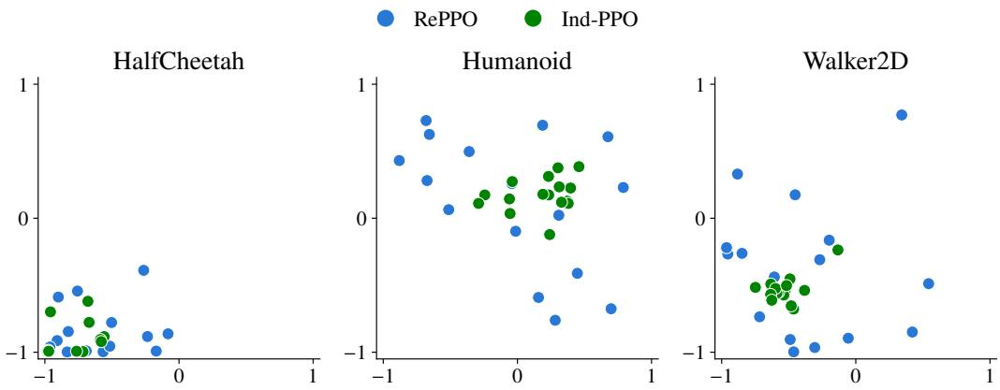  
Figure 16. Behavior descriptors of pixel-based policies for one seed per task.

## H. LunarLander

Our other domains share dense behavior signals that are observed at every step. LunarLander (Towers et al., 2026) instead tests RePPO with discrete actions and a sparse, event-based descriptor. The descriptor records the lander’s horizontal position and vertical speed at its first contact with the ground, so its signal is nonzero at a single step of each episode.

Positions span the screen width, and speeds are mapped from 0 to the speed of free fall, about 2 in the environment’s units, onto [−1, 1]; episodes without contact receive the descriptor (0, 0). Since the reward favors fuel-efficient, gentle landings near the landing pad, diversity in this domain necessarily costs quality.

RePPO and Ind-PPO train 32 policies with 64-unit MLPs for 65.5 M steps in total, with 8 environments per policy and rollouts of 256 steps. The remaining PPO settings follow those recommended for this task by Stable-Baselines3 (Raffin et al., 2021): 4 epochs over minibatches of 64 samples, a learning rate of $1 0 ^ { - 3 } , \gamma = 0 . 9 9 9 , \lambda = 0 . 9 8$ , and an entropy coefficient of 0.01; RePPO uses $C _ { \mathrm { m a x } } = 0 . 4$ . We compare against Sep-CMA-MAE, which is well suited to the small policies of this task, with a $3 2 \times 3 2$ grid archive, 10 episodes per evaluation, and the same budget of environment steps. All methods use five seeds.

All three methods find policies that solve the task, with best fitness between 270 and 288 (Table 13). Ind-PPO’s population collapses to a single landing strategy, whereas RePPO and Sep-CMA-MAE trade mean fitness for diversity. RePPO doubles Ind-PPO’s Vendi Score and matches that of Sep-CMA-MAE with a higher mean fitness, which gives it the highest qVS. Figure 17 shows that $\mathrm { R e P P O ^ { \circ } s }$ policies land across the width of the screen, varying mostly in position rather than speed, whereas Ind-PPO’s policies land at nearly the same spot. RePPO’s diversity mechanism thus remains effective when the behavior signal is observed at a single event.

Table 13. LunarLander, as mean ± standard error over five seeds.
<table><tr><td>Method</td><td>Best fitness</td><td>Mean fitness</td><td>Vendi Score</td><td> ${ \mathfrak { q V } } { \mathfrak { S } }$ </td></tr><tr><td>RePPO</td><td> $2 7 8 \pm 2$ </td><td> $1 8 5 \pm 2$ </td><td> ${ \bf 2 . 0 6 \pm 0 . 0 3 }$ </td><td> ${ \bf 3 8 1 \pm 3 }$ </td></tr><tr><td>Ind-PPO</td><td> $\mathbf { 2 8 8 \pm 1 }$ </td><td> ${ \bf 2 7 2 \pm 1 }$ </td><td> $1 . 0 5 \pm 0 . 0 1$ </td><td> $2 8 6 \pm 1$ </td></tr><tr><td> $\mathbf { S e p { \mathrm { - } C M A { \mathrm { - } M A E } } }$ </td><td> $2 7 0 \pm 2$ </td><td> $1 3 5 \pm 2$ </td><td> $2 . 0 5 \pm 0 . 0 2$ </td><td> $2 7 6 \pm 3$ </td></tr></table>

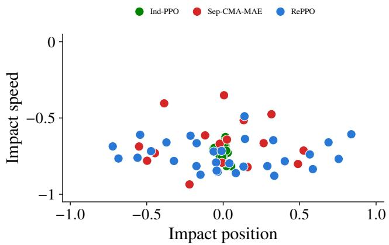  
Figure 17. Behavior descriptors of LunarLander policies for one seed per method. For readability, Sep-CMA-MAE’s archive is thinned to one policy in each of 32 CVT cells, keeping the fittest.

## H.1. Computational Resources

The continuous-control, Atari, pixel-based, and LunarLander experiments were distributed over the following workstations:

• AMD Ryzen Threadripper 3990X, 64 GB RAM, 2 NVIDIA RTX 3090 GPUs;

• AMD Ryzen Threadripper 3990X, 64 GB RAM, NVIDIA RTX 4090;

• Intel Core i7-12700F, 16 GB RAM, NVIDIA RTX 3060;

• a shared server with NVIDIA RTX A6000 GPUs.

A RePPO run on Atari requires about 4 GB of GPU memory. Each LLM population was trained on five NVIDIA RTX A6000 GPUs, one member per GPU, each running both generation with vLLM (Kwon et al., 2023) and training. Training a population took 21 h for Qwen3 and 64 h for Granite, or about 100 and 320 GPU hours, and Ind-PPO required similar resources. Table 14 reports the approximated training times of locomotion experiments, in hours.

Table 14. Continuous control tasks’ training wall-clock time in hours. <sup>†</sup> indicates experiments run on an RTX 3090
<table><tr><td>Method</td><td>GPU</td><td>Ant</td><td>HalfCheetah</td><td>Humanoid</td><td>Walker2D</td></tr><tr><td>RePPO</td><td>4090</td><td>5.1</td><td>8</td><td>5.3</td><td>5.7</td></tr><tr><td>Ind-PPO</td><td>4090</td><td>4.1</td><td>8</td><td>5.3</td><td>5.7</td></tr><tr><td>PPGA</td><td>A6000</td><td>2.7</td><td>9.1</td><td>3.5</td><td>7.6</td></tr><tr><td>PGA-ME</td><td>4090</td><td>9.8</td><td>26.7</td><td>11.6</td><td>22.3</td></tr><tr><td>Sep-CMA-MAE</td><td>4090</td><td>0.9-3.5</td><td>34</td><td>4.1†</td><td>41†</td></tr></table>