# Robust LLM Data Selection via Content-Invariant Gradient Attribution

Jia Gu1,2, Liang Pang1,2\* , Huawei Shen1,2

1Institute of Computing Technology, Chinese Academy of Sciences, Beijing, China 2University of Chinese Academy of Sciences, Beijing, China Correspondence: gujia24s,pangliang,shenhuawei}@ict.ac.cn

## Abstract

Gradient-based data attribution has become an important tool for high-quality data selection in the instruction fine-tuning of large language models (LLMs), as it estimates the contribution of training examples through their influence on model optimization. However, we find that existing global gradient attribution methods suffer from surface-form bias: minor changes to semantically irrelevant details, such as wording or formatting, can produce highly inconsistent attribution scores even when the underlying content remains unchanged. To address this issue, we propose Content-Invariant Gradient Attribution (CIGA), a robust framework for instruction data selection. CIGA first identifies layers whose gradients are both influential for attribution and stable under semanticspreserving surface-form perturbations, thereby reducing formatting noise in gradient features. It then dynamically fuses these attribution signals with semantic representations of the input, combining optimization-level influence with content-level information. Extensive experiments across multiple benchmarks show that CIGA produces more stable rankings under surface-form perturbations while preserving downstream capabilities and improving average performance. CIGA also reduces attribution cost, offering a robust and efficient approach to data selection for LLM instruction tuning.

## 1 Introduction

Instruction tuning increasingly relies on large, automatically assembled corpora, which often contain redundant, noisy, or weakly informative examples. Recent work shows that models trained on carefully selected subsets can match or even outperform those trained on substantially larger datasets (Albalak et al., 2024; Xia et al., 2024), highlighting target-aware data selection as a key component of efficient LLM post-training.

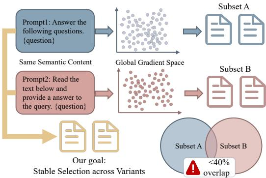  
Figure 1: Global-gradient attribution can be sensitive to semantically irrelevant surface details: minor wording or formatting changes produce different gradient representations and low-overlap selected subsets.

Targeted gradient-attribution methods rank training examples by the alignment between their parameter updates and those induced by target validation data (Xia et al., 2024). This optimizationaware signal is useful, but global gradients also encode semantically irrelevant surface details such as wording and layout. As illustrated in Figure 1, making minor surface-form changes to a validation example while preserving its content can change the selected training subset. We refer to this failure mode as surface-form bias: attribution should respond primarily to the underlying task content rather than incidental forms of expression.

Semantic retrieval offers a complementary content-level signal (Yang et al., 2025), but similarity alone does not indicate whether a candidate induces a useful model update (Jiang et al., 2025). Robust targeted selection therefore requires both optimization-level relevance and reduced sensitivity to semantics-preserving surface variations.

We propose Content-Invariant Gradient Attribution (CIGA). Motivated by evidence that Transformer layers encode different types of information (Meng et al., 2022; Valeriani et al., 2023),

CIGA searches for a layer whose update features are strong yet stable across variants that differ only in semantically irrelevant surface form. It then computes train-validation gradient similarity only at this consistent influential layer. Finally, taskadaptive Reciprocal Rank Fusion (RRF) uses semantic similarity as a calibration signal rather than a replacement for gradient attribution. As summarized in Figure 2, the resulting pipeline uses one warm-up checkpoint and one selected layer, improving cross-variant consistency while preserving downstream utility. Importantly, CIGA imposes this invariance only during data attribution; it neither rewrites nor removes the original format diversity of the selected training data.

The main contributions are as follows:

(i) Characterizing surface-form bias in data attribution: We show that minor, semanticspreserving changes to validation examples can produce substantially different global-gradient rankings and selected subsets.

(ii) Consistent influential layer selection: We introduce a layer score that balances update strength against cross-variant dispersion, yielding gradient features that are less sensitive to semantically irrelevant surface form.

(iii) Robust and effective data selection: CIGA calibrates the selected-layer gradient ranking with semantic information. Across five benchmarks, it improves selection consistency while maintaining downstream capabilities and improving average performance, with lower attribution cost than multicheckpoint gradient selection.

## 2 Related Work

## 2.1 Data Attribution

Training data attribution quantifies each training example’s contribution to model predictions or performance. Classical Influence Functions (IF) (Koh and Liang, 2017; Barshan et al., 2020) approximate the effect of removing a data point via the inverse Hessian, while recent work develops scalable approximations for LLMs (Schioppa et al., 2022; Park et al., 2023). First-order methods such as TracIn (Pruthi et al., 2020) and LESS (Xia et al., 2024) instead score training examples by their gradient similarity to validation examples, without the Hessian.

In addition to gradient-based approaches, another crucial direction is introducing Data Shapley based on cooperative game theory (Ghorbani and

Zou, 2019; Fotouhi et al., 2024) to guarantee theoretical fairness in data value allocation. In-Run Data Shapley (Wang et al., 2025a) utilizes Taylor expansion within a single backward pass to achieve efficient approximate computation.

Regarding evaluation paradigms, the theoretical validity of data attribution algorithms typically requires rigorous verification through Leave-One-Out (LOO) retraining. However, due to the high computational cost of repeatedly retraining LLMs, current research also relies on utility evaluations based on downstream tasks. Prior work evaluates attribution scores in applications such as hallucination detection, fact tracing, and high-quality data selection (Chen et al., 2024; Wu et al., 2024).

## 2.2 Data Selection

For instruction tuning, data selection aims to identify a compact subset that maximizes performance on the target task. Gradient-based methods rank candidates using optimization signals. Recent work improves scalability through influence distillation (Nikdan et al., 2025) and early-stage gradient clustering (Wang et al., 2025b). Beyond computational efficiency, inherent noise similarly constrains the performance of gradient methods. G-SNR (Yuan et al., 2026) uses gradient decay and variance during fine-tuning to estimate learning value and uncertainty, respectively. However, they generally rely only on global gradient features and struggle to capture the semantic relationships within the data, causing the selection results to lack robustness against variations in expression forms.

Complementary methods use semantic similarity, model-internal signals, or information-theoretic criteria for data selection (Yang et al., 2025; Chen et al., 2026; Duan et al., 2025; Dong et al., 2026). T-SHIRT (Fu et al., 2025) exclusively focuses on highly informative key tokens within the response sequence and introduces neighborhood perturbations to filter out redundant samples that rely on spurious lexical features. Meanwhile, methods based on the ICL single-shot loss difference (Jiang et al., 2025) have also been proven effective in quantifying the value of specific data in bridging model capability gaps.

Overall, global-gradient methods capture update utility but are sensitive to surface-form variations, whereas semantic and internal-signal methods capture content but are less tied to gradient dynamics.

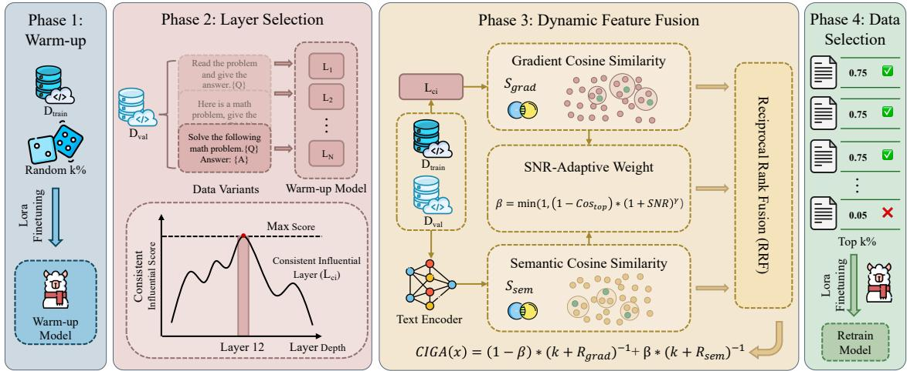  
Figure 2: Overview of CIGA: (1) warm-up fine-tuning; (2) consistent influential layer selection across prompt variants; (3) task-adaptive fusion of gradient and semantic rankings; and (4) Top-k% selection and retraining.

## 3 Methods

The CIGA pipeline comprises warm-up fine-tuning, consistent influential layer selection, dynamic feature fusion, and subset selection followed by retraining. Its core components are the layerselection score and task-adaptive fusion.

## 3.1 Warm-up Fine-tuning

Following LESS (Xia et al., 2024), we randomly sample a subset Dwarmup ⊂ Dtrain and finetune the base model $M _ { \theta } .$ , obtaining a warm-up checkpoint $M _ { \theta }$ ∗ together with its optimizer state. We use this state to compute Adam-preconditioned update features, and perform both layer selection and attribution from this single checkpoint.

## 3.2 Consistent Influential Layer Selection

Prior work has shown that different Transformer layers capture distinct types of information (Meng et al., 2022; Valeriani et al., 2023). Building on this observation, we identify the layer whose update features exhibit high average magnitude while remaining stable across semantics-preserving surface-form variants.

For each example $x _ { i } \in \mathcal { D } _ { v a l }$ , we construct m variants $\{ p _ { j } ( x _ { i } ) \} _ { j = 1 } ^ { m }$ through minor changes to semantically irrelevant wording or formatting while preserving the underlying content. $\Gamma _ { i , l } ^ { \left( j \right) }$ denotes the Adam-preconditioned update feature at layer l. We characterize each layer by its average update magnitude $\mu _ { l }$ (update strength) and the dispersion of its update vectors across variants $\sigma _ { l } ^ { 2 }$ (instability):

$$
\begin{array} { r l } & { \mu _ { l } = \mathbb { E } _ { i } \mathbb { E } _ { j } \left. \Gamma _ { i , l } ^ { ( j ) } \right. _ { 2 } , } \\ & { \sigma _ { l } ^ { 2 } = \mathbb { E } _ { i } \mathbb { E } _ { j } \left. \Gamma _ { i , l } ^ { ( j ) } - \bar { \Gamma } _ { i , l } \right. _ { 2 } ^ { 2 } , } \end{array}\tag{1}
$$

where $\bar { \Gamma } _ { i , l } = \mathbb { E } _ { j } [ \Gamma _ { i , l } ^ { ( j ) } ]$ . Thus, $\sigma _ { l }$ captures crossvariant variation in both the magnitude and direction of the update vectors.

We Z-score $\mu _ { l }$ and $\sigma _ { l }$ across layers to obtain $\hat { \mu } _ { l }$ and $\hat { \sigma } _ { l }$ . The consistent influential score is

$$
S _ { l } ^ { c i } = { \hat { \mu } } _ { l } - \alpha \cdot { \hat { \sigma } } _ { l }\tag{2}
$$

where α controls the penalty on cross-variant instability. We select layer $l _ { c i } = \arg \operatorname* { m a x } _ { l } S _ { l } ^ { c i }$

## 3.3 Dynamic Feature Fusion

After selecting $l _ { c i }$ , we score each candidate $x \in$ $\mathscr { D } _ { t r a i n }$ using gradient-based relevance and semantic similarity to the target validation set.

Grad-Score: We extract the gradients from $l _ { c i }$ flattening and concatenating them into a unified gradient vector. For efficient storage, dimensionality reduction is applied in practical implementations to obtain a gradient vector G. We then calculate the cosine similarity, denoted as $S _ { g r a d } .$ , to measure the consistency between the training data and the validation data in the direction of parameter updates.

Sem-Score: Using a external text embedding model, we extract the text representation $E$ of the data. We then calculate the cosine similarity in the semantic representation space to reflect the surface expression similarity of the data, yielding $S _ { s e m } .$

Because gradient and semantic similarities have misaligned distributions, direct addition is unstable. Thus, we compute the final CIGA score via RRF. Let $R _ { g r a d } ( x )$ and $R _ { s e m } ( x )$ be the rankings of the candidate data based on the Grad-Score and Sem-Score, respectively. The CIGA score is:

$$
\operatorname { C I G A } ( x ) = ( 1 - \beta ) \cdot \frac { 1 } { r + R _ { g r a d } ( x ) } + \beta \cdot \frac { 1 } { r + R _ { s e m } ( x ) }\tag{3}
$$

where $r$ is a smoothing constant. The dynamic weight $\beta \in [ 0 , 1 ]$ controls the degree of reliance on semantic features during fusion.

Dynamic Fusion Ratio: We derive a taskspecific $\beta$ from two diagnostics rather than assigning a uniform weight to all tasks.

How reliable is the gradient view? Let $\Gamma _ { i } ^ { \left( j \right) }$ ≡ $\Gamma _ { i , l _ { c i } } ^ { ( j ) }$ . Since the m variants preserve the content of each sample, within-sample spread reflects semantically irrelevant surface-form noise, while betweensample spread reflects distinctions that attribution should preserve. This motivates an ANOVA-style signal-to-noise decomposition (Fisher, 1925):

$$
\mathrm { S N R } = \frac { \mathrm { { V a r } } _ { i } \left( { \mathbb { E } } _ { j } [ \Gamma _ { i } ^ { ( j ) } ] \right) } { { \mathbb { E } } _ { i } \left[ \mathrm { { V a r } } _ { j } ( \Gamma _ { i } ^ { ( j ) } ) \right] + \epsilon }\tag{4}
$$

where variance of a vector denotes coordinate-wise variance averaged over its dimensions. With high SNR, examples remain distinguishable despite surface-form perturbations, so $\beta$ should shrink.

How concentrated is the semantic view? A low SNR favors greater semantic support. However, when the highest Sem-Scores are already very large, relying too heavily on the semantic ranking concentrates selection on candidates that are merely more similar to the validation data. The resulting subset covers a narrower semantic neighborhood and therefore has lower diversity. We quantify this tendency using SemT op, the mean of the top $K$ aggregated per-candidate Sem-Scores; a larger value reduces $\beta$ to preserve a better balance between semantic relevance and data diversity.

Combining both diagnostics gives the fusion weight for the validation set:

$$
\beta = \operatorname* { m i n } \left( 1 , \ { \frac { 1 - \mathrm { S e m } ^ { T o p } } { ( 1 + \mathrm { S N R } ) ^ { \gamma } } } \right)\tag{5}
$$

where $\gamma$ controls the SNR sensitivity and 1 + SNR keeps the denominator stable at small SNR. Both diagnostics are properties of the validation set, so

each task gets one $\beta ,$ while Eq. (3) acts on each candidate through its own ranks: task-level diagnosis and sample-level selection stay decoupled.

## 3.4 Data Selection and Retraining

For a target validation set, we rank all candidates in $\mathscr { D } _ { t r a i n }$ by their CIGA scores and select the Top-k% subset. We then retrain the original base model $M _ { \theta }$ on this subset and evaluate its target-task performance.

## 4 Experiment

## 4.1 Experimental Setup

Datasets and Models. We construct a diverse instruction-tuning pool from FLAN-v2 (Longpre et al., 2023), CoT (Wei et al., 2022), Dolly (Conover et al., 2023), OASST1 (Köpf et al., 2023), Alpaca-GPT4 (Peng et al., 2023), and GSM8K (Cobbe et al., 2021). We evaluate on five benchmarks: TyDiQA (Clark et al., 2020), BBH (Suzgun et al., 2023), GSM8K (Cobbe et al., 2021), MMLU (Hendrycks et al., 2021), and HellaSwag (Zellers et al., 2019). Detailed dataset statistics are provided in Appendix A.1. We use LLaMA-2-7B (Touvron et al., 2023) and Qwen3-4B-Base (Team, 2025) for attribution and fine-tuning

Baselines. We compare CIGA with (1) Semantic Matching: cosine similarity via dense retrieval (Reimers and Gurevych, 2019); (2) Gradient Methods: LESS (Xia et al., 2024) and TracIn (Pruthi et al., 2020); and (3) Information-based Methods: IFD (Li et al., 2024) and SelectIT (Liu et al., 2024). Details are provided in Appendix A.2.

Evaluation. We measure selection consistency by mean pairwise Jaccard similarity (Jaccard, 1912) among Top-k% subsets from semantics-preserving surface-form variants, and downstream performance by task metrics after retraining. Protocol and metric details are provided in Appendix A.3.

Settings. The warm-up and selected subsets each contain 5% of the candidate pool. We choose $\alpha = 0 . 7 \mathrm { a n d } \gamma = 1 / 3$ on TyDiQA and freeze them across the remaining tasks and both backbones. We use LoRA (Hu et al., 2021); remaining hyperparameters, training settings, and hardware details are provided in Appendix A.4, with hyperparameters sensitivity results in Appendix B.

## 4.2 Experimental Result

## 4.2.1 Selection Consistency Across Variants

To evaluate the sensitivity of gradient-based data selection to semantically irrelevant surface-form variations, we perform data selection using five variants of the same validation data and compute the mean pairwise Jaccard similarity among the resulting Top-5% training subsets.

Overall Advantage over Global-Gradient Baselines. As shown in Table 1, CIGA achieves average overlap rates of 58.33% and 48.68% on LLaMA-2-7B and Qwen3-4B-Base, respectively. Compared with the best-performing globalgradient baseline on each backbone, these results represent improvements of 9.27 and 8.65 percentage points. The gains span diverse tasks, including MMLU, BBH, GSM8K, and HellaSwag, showing that CIGA produces more consistent selections across model architectures and tasks.

Task-Level Analysis of Surface-Form Sensitivity. HellaSwag further illustrates the effect of surface form on gradient attribution. When the underlying context and answer content are preserved while only instruction wording are changed, CIGA achieves overlap rates of 49.29% and 36.60%, approximately twice the corresponding LESS values (22.64% and 18.47%). Because these variants share the same underlying content, the increased overlap directly reflects lower sensitivity to surface expression, showing that CIGA effectively mitigates surface-form bias in global-gradient attribution.

## 4.2.2 Downstream Performance Results

To evaluate the downstream utility of the selected data, we fine-tune the base models on the Top-5% training subsets selected by different methods and evaluate them on five target tasks. In Table 2, “Full” denotes fine-tuning on the complete dataset.

Overall Performance. CIGA achieves the highest macro-average among all data selection methods on both backbones, exceeding Random by 2.11 and 1.04 percentage points on LLaMA-2-7B and Qwen3-4B-Base, respectively. Paired tests on the run-level macro-averages show significant gains against all evaluated selection baselines on LLaMA-2-7B and against Random, Cos, and SelectIT on Qwen3-4B-Base $( p < 0 . 0 5 )$ . Under the challenging Top-5% setting, these gains are comparable to those reported in recent data selection studies (Wang et al., 2025b; Chen et al., 2026; Jiang et al., 2025), while the consistency results above show that CIGA improves robustness without sacrificing downstream utility.

Table 1: Mean pairwise Jaccard similarity (%) across five semantics-preserving surface-form variants. Higher values indicate greater selection consistency.
<table><tr><td>Test</td><td>LESS</td><td>TracIn CIGA</td><td></td></tr><tr><td></td><td>LLaMA-2-7B</td><td></td><td></td></tr><tr><td>TyDiQA MMLU</td><td>41.40 62.16</td><td>36.75 58.50</td><td>42.40 76.04</td></tr><tr><td>BBH</td><td>68.94</td><td>69.86</td><td>71.92</td></tr><tr><td>GSM8K</td><td>46.07</td><td>51.96</td><td>52.00</td></tr><tr><td>HellaSwag</td><td>22.64</td><td>28.24</td><td>49.29</td></tr><tr><td>Avg</td><td>48.24</td><td>49.06</td><td>58.33</td></tr><tr><td></td><td>Qwen3-4B-Base</td><td></td><td></td></tr><tr><td>TyDiQA</td><td>62.75</td><td>37.29</td><td>50.03</td></tr><tr><td>MMLU</td><td>57.03</td><td>55.49</td><td>68.06</td></tr><tr><td>BBH</td><td>48.62</td><td>50.59</td><td>67.11</td></tr><tr><td>GSM8K</td><td>13.28</td><td>17.77</td><td>21.60</td></tr><tr><td>HellaSwag</td><td>18.47</td><td>17.25</td><td>36.60</td></tr><tr><td>Avg</td><td>40.03</td><td>35.68</td><td>48.68</td></tr></table>

Complementarity of Semantic and Gradient Signals. The strong performance of Cos on GSM8K demonstrates the value of semantic similarity for mathematical word problems with prominent structural and semantic patterns. By dynamically combining semantic similarity with gradient attribution, CIGA outperforms global-gradient methods on GSM8K for both backbones. Meanwhile, CIGA maintains more balanced performance on the other tasks, indicating that semantic and gradient signals can effectively complement each other according to the characteristics of the target task.

Approaching Full-Data Fine-Tuning. Using only 5% of the training data, data selection methods approach full-data fine-tuning on multiple tasks. For Qwen3-4B-Base, the macro-average of Full is 1.12 percentage points lower than that of Random, suggesting that more capable base models may be more sensitive to low-value or noisy fine-tuning data and that indiscriminately using the complete candidate pool may weaken their original capabilities. By filtering out lower-value samples, data selection methods achieve higher averages than Full, with CIGA attaining the best overall performance.

On LLaMA-2-7B, Full retains a slightly higher average than CIGA, but CIGA surpasses Full on Ty-DiQA and MMLU. These results show that CIGA maintains downstream performance using a smaller training subset while achieving an overall improvement over Random, demonstrating data efficiency.

## 4.2.3 Ablation Experiment

Consistent Influential Layer Selection. To evaluate the contribution of the layer selection module, we construct CIGA-G by removing the Sem-Score and selecting data using only the Grad-Score extracted from the consistent influential layer.

As shown in Table 3, CIGA-G achieves average Jaccard similarities of 56.44% and 46.96% on LLaMA-2-7B and Qwen3-4B-Base, respectively, with downstream averages of 47.15% and 73.26%; all four results exceed those of LESS and TracIn. These results show that extracting gradient features only from the consistent influential layer already provides most of the selection-stability gains while preserving performance. Compared with aggregating gradients across all layers, focusing on a more stable and task-relevant intermediate layer helps reduce the interference of surface-form signals unrelated to the underlying content.

Semantic and Gradient Feature Fusion. After adding dynamic semantic fusion to CIGA-G, full CIGA improves the average Jaccard similarity by 1.89 and 1.72 percentage points on LLaMA-2-7B and Qwen3-4B-Base, respectively, while maintaining and slightly improving the downstream performance. This shows that the Grad-Score from the consistent influential layer provides the main foundation for stable selection, while semantic information calibrates the gradient-only ranking to balance gradient-based utility with content relevance.

Layer Choice. As shown in Figure 3, the layers selected by CIGA across different tasks consistently lie in the middle regions of both models. The selected layers range from 12 to 16 in LLaMA-2-7B (32 layers) and from 18 to 23 in Qwen3-4B-Base (36 layers). Across different random seeds, Qwen3 selects the same layer for every task, while LLaMA-2 exhibits only a small variation on BBH. These results show that CIGA does not depend on a fixed absolute layer index, but can stably locate a middle-layer region that combines gradient strength with surface-form stability for each task.

To examine whether aggregating multiple layers improves attribution, we rank layers by $S _ { l } ^ { c i }$ , select the top $k \in \{ 1 , 3 , 5 \}$ layers, and average their layerwise gradient similarity scores to obtain the Grad-Score. As shown in Table 4, multi-layer aggregation produces mixed task-level effects. The best multi-layer setting improves over the single-layer setting by only 0.19 and 0.22 percentage points on LLaMA-2-7B and Qwen3-4B-Base, respectively.

Number of Surface-Form Variants. Surfaceform variants are used to estimate gradient stability for the same content under different expressions, so the number of variants may affect the selected layer. As shown in Table 5, when the number of variants increases from three to five, the downstream average fluctuates by less than 0.4 percentage points on both models, indicating stable downstream performance under this setting. Meanwhile, the average Jaccard similarity increases by 3.09 and 1.96 percentage points on Qwen3 and LLaMA-2, respectively, showing that additional semanticspreserving variants provide a more comprehensive estimate of stability across surface forms.

## 4.2.4 Data Selection Efficiency

Table 6 reports the computational cost of each stage in the data-selection pipeline, with runtime normalized to GPU hours on a single A100 (80GB). Here, N denotes the number of checkpoints used for attribution. Warm-up training and candidate-data gradient computation are one-time costs; when the model and candidate pool remain unchanged, their outputs can be reused across target tasks. CIGA uses single-layer gradients from one checkpoint, whereas LESS and TracIn aggregate global gradients from the same four checkpoints and thus have the same cost. Although CIGA additionally requires 5 minutes for layer selection and 6 minutes for Sem-Score computation, it reduces the total runtime from 74.1 to 21.4 hours, a reduction of approximately 71.1% and a 3.46× speedup.

## 5 Discussion

## 5.1 Overcoming Surface Form Bias

To investigate the surface form bias in gradient methods, we use t-SNE to visualize the gradient features of validation samples and their semanticspreserving surface-form variants. Figure 4 presents this distribution for LLaMA-2-7B on the GSM8K.

Observing global gradient methods reveals that different surface-form variants of the same validation data exhibit significant dispersion in the gradient space. This indicates that global gradient features are sensitive to semantically irrelevant variations in wording or formatting, leading to inconsistent parameter update directions for data sharing the same underlying content.

Table 2: Performance comparison across test datasets (%). $\Delta _ { R a n d }$ is the average improvement over Random, and parentheses report standard deviations over three runs. ∗ marks a significant improvement of CIGA over Random $( p < 0 . 0 5 )$ on the corresponding task or macro-average. Bold marks the best result among selection methods (excluding Full and Random), and underline marks performance surpassing Full.
<table><tr><td rowspan="2">Method</td><td colspan="6">LLaMA-2-7B</td><td colspan="6">Qwen3-4B-Base</td></tr><tr><td>TyDiQA</td><td>MMLU</td><td>BBH</td><td>GSM</td><td>Hella</td><td>∆Rand</td><td>TyDiQA</td><td>MMLU</td><td>BBH</td><td>GSM</td><td>Hella</td><td> $\Delta _ { R a n d }$ </td></tr><tr><td colspan="9">Reference Baselines</td><td></td><td></td><td></td></tr><tr><td>Full</td><td>50.77 (0.3)</td><td>47.14 (0.2)</td><td>43.80 (0.8)</td><td>25.17 (1.0)</td><td>74.15 (0.3)</td><td>+2.48</td><td>66.34 (0.4)</td><td>72.89 (0.3)</td><td>68.52 (0.9)</td><td>78.09 (1.1)</td><td>70.40 (0.3)</td><td>-1.12</td></tr><tr><td>Random</td><td>49.54 (0.5)</td><td>45.51 (0.4)</td><td>41.85 (0.6)</td><td>17.29 (1.6)</td><td>74.47 (0.4)</td><td></td><td>73.16 (0.5)</td><td>73.01 (0.4)</td><td>67.13 (1.3)</td><td>78.01 (0.9)</td><td>70.52 (0.4)</td><td></td></tr><tr><td colspan="9">Heuristic &amp; Semantic Methods</td><td></td><td></td><td></td></tr><tr><td>Cos</td><td>48.31 (0.4)</td><td>46.06 (0.3)</td><td>40.93 (1.0)</td><td>21.91 (0.7)</td><td>74.52 (0.3)</td><td>+0.62</td><td>72.23 (1.4)</td><td>73.23 (0.3)</td><td>67.41 (1.1)</td><td>78.85 (1.0)</td><td>70.69 (0.3)</td><td>+0.11</td></tr><tr><td>IFD</td><td>43.21 (0.6)</td><td>44.45 (0.5)</td><td>41.67 (0.7)</td><td>14.78 (0.5)</td><td>74.17 (0.4)</td><td>-2.08</td><td>71.58 (0.5)</td><td>72.86 (0.4)</td><td>67.87 (1.0)</td><td>79.15 (1.2)</td><td>70.44 (0.4)</td><td>+0.01</td></tr><tr><td>SelectIT</td><td>49.96 (0.7)</td><td>45.91 (0.4)</td><td>41.67 (0.5)</td><td>20.39 (0.6)</td><td>74.35 (0.3)</td><td>+0.72</td><td>71.37 (0.5)</td><td>73.21 (0.3)</td><td>67.87 (0.6)</td><td>77.03 (1.3)</td><td>70.73 (0.3)</td><td>-0.33</td></tr><tr><td colspan="9">Gradient-based Methods</td><td></td><td></td><td></td><td></td></tr><tr><td>LESS</td><td>54.65 (0.5)</td><td>45.19 (0.8)</td><td>40.00 (1.1)</td><td>17.59 (1.2)</td><td>74.50 (0.4)</td><td>+0.66</td><td>73.38 (1.6)</td><td>73.37 (0.4)</td><td>69.63 (0.5)</td><td>78.17 (1.6)</td><td>70.36 (0.4)</td><td>+0.61</td></tr><tr><td>TracIn</td><td>54.05 (1.2)</td><td>45.52 (0.5)</td><td>40.74 (1.2)</td><td>16.76 (1.1)</td><td>73.71 (0.6)</td><td>+0.43</td><td>72.05 (0.6)</td><td>72.67 (0.5)</td><td>68.33 (1.5)</td><td>78.32 (0.8)</td><td>69.44 (0.5)</td><td>-0.21</td></tr><tr><td colspan="9">Ours</td><td></td><td></td><td></td><td></td></tr><tr><td>CIGA</td><td>56.17*(0.2)</td><td>47.46*(0.2)</td><td>41.39 (0.6)</td><td>19.64* (1.0)</td><td>74.54(0.2)</td><td>+2.11*</td><td>74.10* (0.2)</td><td>73.05 (0.2)</td><td>70.28* (0.7)</td><td>79.30* (1.2)</td><td>70.29 (0.2)</td><td>+1.04*</td></tr></table>

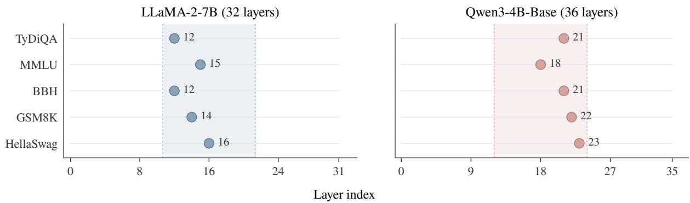  
Figure 3: Selected consistent influential layers across tasks. Shaded regions denote the middle layers of each model.

Table 3: Component ablation in selection consistency and downstream performance (%).
<table><tr><td>Model</td><td>Method</td><td>Jaccard</td><td>Downstream Avg</td></tr><tr><td>LLaMA-2-7B</td><td>CIGA-G CIGA</td><td>56.44</td><td>47.15</td></tr><tr><td rowspan="2"></td><td></td><td>58.33</td><td>47.84</td></tr><tr><td>CIGA-G</td><td>46.96</td><td>73.26</td></tr><tr><td>Qwen3-4B-Base</td><td>CIGA</td><td>48.68</td><td>73.40</td></tr></table>

In contrast, the gradients extracted from the consistent influential layer by the CIGA framework can partially mitigate the interference of such noise, even without incorporating semantic similarity. The variants of the same underlying sample are clustered more tightly within the same neighborhood. This shows that extracting gradients from the consistent influential layer reduces the interference of surface forms and enables gradient attribution to focus more on the underlying content.

## 5.2 Consistent Influential Score Analysis

To examine whether the consistent influential score $S _ { l } ^ { c i }$ can identify model layers suitable for gradientbased data attribution, we conduct a representative layer-wise analysis on MMLU with LLaMA-2-7B. Specifically, we sample one candidate every three layers, use the Grad-Score from each candidate layer to select a training subset under the same data budget, and then fine-tune and evaluate the model. Figure 5 compares the normalized consistent influential score with downstream performance, showing both the raw curves and their smoothed trends.

Alignment with Downstream Performance. The global peak of the consistent influential score occurs around Layer 15 and falls within the middlelayer region with strong downstream performance. The two curves exhibit similar overall trends, indicating that $S _ { l } ^ { c i }$ , which jointly considers gradient strength and stability across surface forms, can identify layers whose gradient features are more suitable for data selection. This provides direct empirical support for using the score to determine the consistent influential layer.

Preference for Middle Layers. High consistent influential scores and strong downstream performance are both concentrated in the middle layers.

Table 4: Effect of the number of attribution layers on downstream performance (%). Layers are ranked by $S _ { l } ^ { c i }$ Values are differences from the single-layer setting (k = 1) measured in the same runs.
<table><tr><td>Model</td><td>Layers (k)</td><td>TyDiQA</td><td>MMLU</td><td>BBH</td><td>GSM</td><td>Hella</td><td>Avg</td></tr><tr><td rowspan="2">LLaMA-2-7B</td><td>3</td><td>+0.10</td><td>-0.01</td><td>-0.19</td><td>+0.23</td><td>-0.17</td><td>-0.01</td></tr><tr><td>5</td><td>+0.67</td><td>+0.06</td><td>+0.18</td><td>+0.15</td><td>-0.11</td><td>+0.19</td></tr><tr><td rowspan="2">Qwen3-4B-Base</td><td>3</td><td>+0.67</td><td>+0.12</td><td>0.00</td><td>-0.22</td><td>-0.10</td><td>+0.09</td></tr><tr><td>5</td><td>+1.04</td><td>+0.08</td><td>-0.09</td><td>+0.08</td><td>-0.02</td><td>+0.22</td></tr></table>

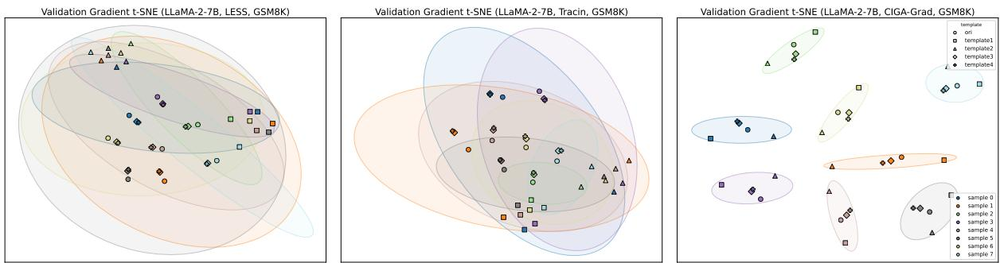  
Figure 4: Comparison of gradient distributions via t-SNE.

Table 5: Number of surface-form variants (%). Values are differences from the default setting (n = 5).
<table><tr><td rowspan="2">Model</td><td colspan="2">Downstream Avg</td><td colspan="2">Jaccard</td></tr><tr><td> $n = 3$ </td><td> $n = 4$ </td><td> $n = 3$ </td><td> $n = 4$ </td></tr><tr><td>Qwen3-4B-Base</td><td>-0.37</td><td>-0.19</td><td> $- 3 . 0 9$ </td><td>-0.95</td></tr><tr><td>LLaMA-2-7B</td><td>-0.09</td><td>-0.35</td><td>-1.96</td><td>-0.08</td></tr></table>

Table 6: Computational cost of the data-selection pipeline. L and m denote the numbers of layers and surface-form variants; $d _ { g }$ and $d _ { s }$ denote the gradient and semantic feature dimensions.
<table><tr><td>Stage</td><td>Complexity</td><td>CIGA</td><td>LESS</td></tr><tr><td>Warm-up</td><td> $\mathcal { O } ( | \mathcal { D } _ { \mathrm { w a r m u p } } | \cdot N )$ </td><td>1 Hour</td><td>4 Hours</td></tr><tr><td>Grad-Score</td><td> $\mathcal { O } ( | \mathcal { D } | \cdot N )$ </td><td>20 Hours</td><td>70 Hours</td></tr><tr><td>Layer Selection</td><td> $\mathcal { O } ( m L \vert \mathcal { D } _ { \mathrm { v a l } } \vert d _ { g } )$ </td><td>5Min</td><td></td></tr><tr><td>Sem-Score</td><td> $\mathcal { O } ( | \mathcal { D } | | \mathcal { D } _ { \mathrm { v a l } } | d _ { s } )$ </td><td>6Min</td><td></td></tr><tr><td>Data Selection</td><td> $\mathcal { O } ( | \mathcal { D } | | \mathcal { D } _ { \mathrm { v a l } } | d _ { g } )$ </td><td>&lt;1 Min</td><td>&lt;1 Min</td></tr><tr><td>Total</td><td></td><td>21.4 Hours</td><td>74.1 Hours</td></tr></table>

This observation is consistent with the cross-task layer-selection results above: CIGA identifies a stable middle-layer region rather than relying on a fixed absolute layer index. One plausible explanation is that shallow layers encode more local lexical and syntactic features, while deeper layers are more closely tied to output format and generation distributions; middle layers can therefore provide a better balance among task-relevant information, gradient strength, and surface-form stability. Their gradient features consequently provide more effective attribution signals for data selection.

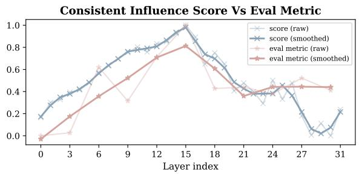  
Figure 5: Relationship between the consistent influential score and downstream performance across layers.

## 6 Conclusion

In this paper, we delve into the limitations of traditional global gradient attribution methods in data selection tasks for LLMs, and reveal the interference of surface form bias in data value evaluation. To overcome this challenge, we propose the CIGA framework. By combining a layer selection algorithm with dynamic feature fusion, CIGA integrates gradient-based attribution signals with the underlying semantic alignment features, achieving a complement between gradient utility and semantic features. Extensive experiments demonstrate that CIGA improves selection consistency under surface-form variations, while preserving downstream capabilities and achieving the highest average among data selection methods. CIGA attributes from one warm-up checkpoint and one selected layer, offering a more efficient alternative to multicheckpoint global-gradient selection.

## Limitations

Although the CIGA framework demonstrates significant effectiveness and robustness in data selection for instruction fine-tuning, this study and the proposed method still exhibit the following limitations, which warrant further exploration and optimization in future work:

Inherent Computational Overhead: Despite CIGA substantially enhancing the noise robustness of gradients by precisely extracting consistent influential layers, as a gradient-based attribution framework, it inherently requires performing forward and backward passes across the entire candidate training corpus to compute and store the corresponding parameter gradients. When scaling to massive candidate data pools containing tens of millions of samples, this process incurs substantial temporal and computational overhead. Exploring methods to further compress gradient features or introduce efficient approximate computation techniques is crucial to alleviating this bottleneck.

Reliance on High-Quality Validation Sets: A core prerequisite for CIGA to accurately identify high-quality data is the utilization of a validation set from the target task to match core gradient and semantic features. While this mechanism endows the framework with robust task-specific adaptation capabilities, it also implies that for entirely novel target tasks lacking off-the-shelf validation sets, researchers or developers must incur additional costs to construct prior reference datasets. Investigating how to leverage unsupervised methods or rely on the model’s intrinsic knowledge to evaluate the value of training data will be a primary focus of our future research.

## References

Alon Albalak, Yanai Elazar, Sang Michael Xie, Shayne Longpre, Nathan Lambert, Xinyi Wang, Niklas Muennighoff, Bairu Hou, Liangming Pan, Haewon Jeong, Colin Raffel, Shiyu Chang, Tatsunori Hashimoto, and William Yang Wang. 2024. A survey on data selection for language models. Transactions on Machine Learning Research. Survey Certification, Featured Certification.

Elnaz Barshan, Marc-Etienne Brunet, and Gintare Karolina Dziugaite. 2020. Relatif: Identifying explanatory training examples via relative influence. CoRR, abs/2003.11630.

Si Chen, Feiyang Kang, Ning Yu, and Ruoxi Jia. 2024. Fasttrack: Fast and accurate fact tracing for llms. ArXiv, abs/2404.15157.

Xin Chen, Junchao Wu, Shu Yang, Runzhe Zhan, Zeyu Wu, Min Yang, Shujian Huang, Lidia S. Chao, and Derek F. Wong. 2026. Neuron-aware data selection in instruction tuning for large language models.

Jonathan H. Clark, Eunsol Choi, Michael Collins, Dan Garrette, Tom Kwiatkowski, Vitaly Nikolaev, and Jennimaria Palomaki. 2020. TyDi QA: A benchmark for information-seeking question answering in typologically diverse languages. Transactions ofthe Associationfor Computational Linguistics, 8:454–470.

Karl Cobbe, Vineet Kosaraju, Mohammad Bavarian, Mark Chen, Heewoo Jun, Lukasz Kaiser, Matthias Plappert, Jerry Tworek, Jacob Hilton, Reiichiro Nakano, Christopher Hesse, and John Schulman. 2021. Training verifiers to solve math word problems. arXiv preprint arXiv:2110.14168.

M. Conover, M. Hayes, A. Mathur, J. Xie, J. Wan, S. Shah, A. Ghodsi, P. Wendell, M. Zaharia, and R. Xin. 2023. Free dolly: Introducing the world’s first truly open instruction-tuned llm.

Victor Ye Dong, Kuan-Yun Lee, Jiamei Shuai, Shen Liu, Yi Liu, and Jian Jiao. 2026. Greedy information projection for llm data selection.

Feiyu Duan, Xuemiao Zhang, Sirui Wang, Haoran Que, Yuqi Liu, Wenge Rong, and Xunliang Cai. 2025. Enhancing llms via high-knowledge data selection. In AAAI Conference on Artificial Intelligence.

Ronald A. Fisher. 1925. Statistical Methods for Research Workers. Oliver and Boyd, Edinburgh.

Milad Fotouhi, Mohammad Taha Bahadori, Oluwaseyi Feyisetan, Payman Arabshahi, and David Heckerman. 2024. Fast training dataset attribution via in-context learning. CoRR, abs/2408.11852.

Yanjun Fu, Faisal Hamman, and Sanghamitra Dutta. 2025. T-shirt: Token-selective hierarchical data selection for instruction tuning. ArXiv, abs/2506.01317.

Amirata Ghorbani and James Y. Zou. 2019. Data shapley: Equitable valuation of data for machine learning. In Proceedings of the 36th International Conference on Machine Learning, ICML 2019, 9-15 June 2019, Long Beach, California, USA, Proceedings of Machine Learning Research, pages 2242–2251. PMLR.

Dan Hendrycks, Collin Burns, Steven Basart, Andy Zou, Mantas Mazeika, Dawn Song, and Jacob Steinhardt. 2021. Measuring massive multitask language understanding. Proceedings ofthe International Conference on Learning Representations (ICLR).

Edward J. Hu, Yelong Shen, Phillip Wallis, Zeyuan Allen-Zhu, Yuanzhi Li, Shean Wang, Lu Wang, and Weizhu Chen. 2021. Lora: Low-rank adaptation of large language models. Preprint, arXiv:2106.09685.

Paul Jaccard. 1912. The distribution of the flora in the alpine zone. 1. New phytologist, 11(2):37–50.

Tingyu Jiang, Shen Li, Yiyao Song, Lan Zhang, Hualei Zhu, Yuan Zhao, Xiaohang Xu, Kenjiro Taura, and Hao Henry Wang. 2025. Importance-aware data selection for efficient llm instruction tuning. In AAAI Conference on Artificial Intelligence.

Pang Wei Koh and Percy Liang. 2017. Understanding black-box predictions via influence functions. In Proceedings of the 34th International Conference on Machine Learning, ICML 2017, Sydney, NSW, Australia, 6-11 August 2017, Proceedings of Machine Learning Research, pages 1885–1894. PMLR.

Andreas Köpf, Yannic Kilcher, Dimitri von Rütte, Sotiris Anagnostidis, Zhi-Rui Tam, Keith Stevens, Abdullah Barhoum, Nguyen Minh Duc, Oliver Stanley, Richárd Nagyfi, Shahul ES, Sameer Suri, David Glushkov, Arnav Dantuluri, Andrew Maguire, Christoph Schuhmann, Huu Nguyen, and Alexander Mattick. 2023. Openassistant conversations - democratizing large language model alignment. In Proceedings ofthe 37th International Conference on Neural Information Processing Systems, NIPS ’23, Red Hook, NY, USA. Curran Associates Inc.

Ming Li, Yong Zhang, Zhitao Li, Jiuhai Chen, Lichang Chen, Ning Cheng, Jianzong Wang, Tianyi Zhou, and Jing Xiao. 2024. From quantity to quality: Boosting LLM performance with self-guided data selection for instruction tuning. In Proceedings of the 2024 Conference of the North American Chapter of the Associationfor Computational Linguistics: Human Language Technologies (Volume 1: Long Papers), pages 7602–7635, Mexico City, Mexico. Association for Computational Linguistics.

Liangxin Liu, Xuebo Liu, Derek F. Wong, Dongfang Li, Ziyi Wang, Baotian Hu, and Min Zhang. 2024. SelectIT: Selective instruction tuning for LLMs via uncertainty-aware self-reflection. In The Thirtyeighth Annual Conference on Neural Information Processing Systems.

Shayne Longpre, Le Hou, Tu Vu, Albert Webson, Hyung Won Chung, Yi Tay, Denny Zhou, Quoc V. Le, Barret Zoph, Jason Wei, and Adam Roberts. 2023. The flan collection: designing data and methods for effective instruction tuning. In Proceedings of the 40th International Conference on Machine Learning, ICML’23. JMLR.org.

Kevin Meng, David Bau, Alex Andonian, and Yonatan Belinkov. 2022. Locating and editing factual associations in gpt. Advances in Neural Information Processing Systems 35.

Mahdi Nikdan, Vincent Cohen-Addad, Dan Alistarh, and Vahab S. Mirrokni. 2025. Efficient data selection at scale via influence distillation. ArXiv, abs/2505.19051.

Sung Min Park, Kristian Georgiev, Andrew Ilyas, Guillaume Leclerc, and Aleksander Madry. 2023. TRAK: attributing model behavior at scale. In International Conference on Machine Learning, ICML 2023, 23- 29 July 2023, Honolulu, Hawaii, USA, Proceedings

of Machine Learning Research, pages 27074–27113. PMLR.

Baolin Peng, Chunyuan Li, Pengcheng He, Michel Galley, and Jianfeng Gao. 2023. Instruction tuning with gpt-4. Preprint, arXiv:2304.03277.

Garima Pruthi, Frederick Liu, Satyen Kale, and Mukund Sundararajan. 2020. Estimating training data influence by tracing gradient descent. In Advances in Neural Information Processing Systems 33: Annual Conference on Neural Information Processing Systems 2020, NeurIPS 2020, December 6-12, 2020, virtual.

Nils Reimers and Iryna Gurevych. 2019. Sentence-bert: Sentence embeddings using siamese bert-networks. In Proceedings ofthe 2019 Conference on Empirical Methods in Natural Language Processing and the 9th International Joint Conference on Natural Language Processing (EMNLP-IJCNLP). Association for Computational Linguistics.

Andrea Schioppa, Polina Zablotskaia, David Vilar, and Artem Sokolov. 2022. Scaling up influence functions. In Thirty-Sixth AAAI Conference on Artificial Intelligence, AAAI 2022, Thirty-Fourth Conference on Innovative Applications of Artificial Intelligence, IAAI 2022, The Twelveth Symposium on Educational Advances in Artificial Intelligence, EAAI 2022 Virtual Event, February 22 - March 1, 2022, pages 8179– 8186. AAAI Press.

Mirac Suzgun, Nathan Scales, Nathanael Schärli, Sebastian Gehrmann, Yi Tay, Hyung Won Chung, Aakanksha Chowdhery, Quoc Le, Ed Chi, Denny Zhou, and Jason Wei. 2023. Challenging BIG-bench tasks and whether chain-of-thought can solve them. In Findings ofthe Associationfor Computational Linguistics: ACL 2023, pages 13003–13051, Toronto, Canada. Association for Computational Linguistics.

Qwen Team. 2025. Qwen3 technical report. Preprint, arXiv:2505.09388.

Hugo Touvron, Louis Martin, Kevin Stone, Peter Albert, Amjad Almahairi, Yasmine Babaei, Nikolay Bashlykov, Soumya Batra, Prajjwal Bhargava, Shruti Bhosale, Dan Bikel, Lukas Blecher, Cristian Canton Ferrer, Moya Chen, Guillem Cucurull, David Esiobu, Jude Fernandes, Jeremy Fu, Wenyin Fu, and 49 others. 2023. Llama 2: Open foundation and fine-tuned chat models. Preprint, arXiv:2307.09288.

Lucrezia Valeriani, Diego Doimo, Francesca Cuturello, Alessandro Laio, Alessio Ansuini, and Alberto Cazzaniga. 2023. The geometry of hidden representations of large transformer models. ArXiv, abs/2302.00294.

Jiachen T. Wang, Prateek Mittal, Dawn Song, and Ruoxi Jia. 2025a. Data shapley in one training run. In The Thirteenth International Conference on Learning Representations, ICLR 2025, Singapore, April 24-28, 2025. OpenReview.net.

Zige Wang, Qi Zhu, Fei Mi, Minghui Xu, Ruochun Jin, and Wenjing Yang. 2025b. ClusterUCB: Efficient gradient-based data selection for targeted finetuning of LLMs. In Findings of the Association for Computational Linguistics: EMNLP 2025, pages 18867–18880, Suzhou, China. Association for Computational Linguistics.

Jason Wei, Xuezhi Wang, Dale Schuurmans, Maarten Bosma, Brian Ichter, Fei Xia, Ed H. Chi, Quoc V. Le, and Denny Zhou. 2022. Chain-of-thought prompting elicits reasoning in large language models. In Proceedings of the 36th International Conference on Neural Information Processing Systems, NIPS ’22, Red Hook, NY, USA. Curran Associates Inc.

Kangxi Wu, Liang Pang, Huawei Shen, and Xueqi Cheng. 2024. Enhancing training data attribution for large language models with fitting error consideration. In Conference on Empirical Methods in Natural Language Processing.

Mengzhou Xia, Sadhika Malladi, Suchin Gururangan, Sanjeev Arora, and Danqi Chen. 2024. Less: Selecting influential data for targeted instruction tuning. ArXiv, abs/2402.04333.

Jiaxi Yang, Wenlong Deng, Benlin Liu, Yangsibo Huang, James Zou, and Xiaoxiao Li. 2025. Gmvaluator: Similarity-based data valuation for generative models. In The Thirteenth International Conference on Learning Representations, ICLR 2025, Singapore, April 24-28, 2025. OpenReview.net.

Zhihang Yuan, Chen Yue, Longtao Huang, Litu Ou, and Lei Shi. 2026. Uncertainty-aware gradient signalto-noise data selection for instruction tuning. ArXiv, abs/2601.13697.

Rowan Zellers, Ari Holtzman, Yonatan Bisk, Ali Farhadi, and Yejin Choi. 2019. HellaSwag: Can a machine really finish your sentence? In Proceedings of the 57th Annual Meeting ofthe Associationfor Computational Linguistics, pages 4791–4800, Florence, Italy. Association for Computational Linguistics.

## A Experimental Setup Details

## A.1 Dataset Composition and Scale

To ensure our data selection framework is evaluated on a sufficiently diverse and massive candidate pool, our training corpus aggregates several widely adopted collections. Table 7 summarizes the approximate volume and primary domain of each dataset subset used in our experiments.

These diverse data sources collectively contribute to the foundation models’ general instruction following capability, complex reasoning skills, and conversational alignment.

Regarding the licenses and intended use of these artifacts, we confirm that all public datasets and base models were utilized strictly for their intended academic research purposes (i.e., instruction tuning and model evaluation) in compliance with their original licenses. Upon acceptance, we will publicly release the CIGA codebase. This release is strictly intended to facilitate non-commercial academic research, ensuring full compatibility with the original access conditions and intended use of the source artifacts.

## A.2 Detailed Baseline Descriptions

To comprehensively evaluate the effectiveness of the CIGA framework, we compare it against a diverse set of strong data selection baselines.

Semantic Matching Methods. This category relies on dense representation retrieval to find training samples semantically aligned with the validation set. We utilize the widely adopted all MiniLM-L6- v2 (Reimers and Gurevych, 2019) sentence transformer to encode both the training candidate pool and the validation sets into a shared embedding space. Data selection is subsequently performed by ranking the cosine similarity scores.

Gradient Methods. These methods attribute model performance directly to individual training samples by leveraging parameter gradients.

• LESS (Xia et al., 2024): A state of the art gradient attribution method that projects global parameter gradients into a lower dimensional space using random projections. It computes the influence score by aggregating gradient similarities across multiple saved training checkpoints. We followed LESS’s methods for gradient computation and saving, but utilized only a single checkpoint; consequently, our efficiency is significantly higher than that of LESS.

• TracIn (Pruthi et al., 2020): A first-order gradient attribution method that traces the training trajectory. It scores a training example by the learning-rate-weighted sum, over multiple checkpoints, of the dot products between its gradient and the validation gradients, which estimates how much training on that example reduces the validation loss.

Information based Methods. Instead of relying on heavy gradient computations, these methods select data based on intrinsic model feedback, such as perplexity, confidence, or generation difficulty during forward pass inference.

Table 7: Overview of the candidate training datasets, including their approximate volume and primary content focus.
<table><tr><td>Dataset</td><td>Volume</td><td>Primary Content Domain</td></tr><tr><td>FLAN v2 (Longpre et al., 2023)</td><td>100000</td><td>Zero shot and few shot NLP tasks</td></tr><tr><td>CoT (Wei et al., 2022) Alpaca GPT4 (Peng et al., 2023)</td><td>100000 52002</td><td>Step by step logical deduction</td></tr><tr><td>Dolly (Conover et al., 2023)</td><td>15011</td><td>High quality general instructions</td></tr><tr><td>OASST1 (Köpf et al., 2023)</td><td>55668</td><td>Human generated conversational records</td></tr><tr><td>GSM8K (Cobbe et al., 2021)</td><td>7473</td><td>Multi turn dialogue sequences Grade school mathematical reasoning</td></tr></table>

• IFD (Li et al., 2024): Instruction Following Difficulty identifies training samples that exhibit a high ratio of condition answer loss to direct language modeling loss. It operates on the premise that samples inherently difficult for the model to generate directly, yet coherent given the instruction, yield the highest training utility.

• SelectIT (Liu et al., 2024): An advanced selection algorithm evaluating data based on instruction following difficulty and model confidence. It dynamically filters instruction tuning data by analyzing the foundation model’s generation probabilities. Given the massive volume of our combined training corpus, we specifically reproduce the SelectIT model level score for the LLaMA-2-7B and LLaMA-2-13B architectures, discarding the LLaMA-2-70B score from the original paper.

## A.3 Evaluation Protocol and Prompt Variants

Selection consistency is the Jaccard similarity (Jaccard, 1912) between Top-k% subsets obtained from different variants. With five variants, we average all ${ \binom { 5 } { 2 } } = 1 0$ pairwise values. Downstream performance is measured by TyDiQA F1, MMLU and HellaSwag accuracy, and BBH and GSM8K exact match after retraining on the selected subset.

For each target task, we manually construct five variants of the same validation examples. They preserve the task semantics and question/answer content while changing only semantically irrelevant wording or layout. CIGA, LESS, and TracIn use the same variants in the consistency evaluation. Table 8 lists the exact templates.

In Table 8, {C} represents the context or passage; {Q} the question or math problem; {A} the answer or ending continuation; {S} the MMLU subject; and {T} the BBH task instruction. For multilingual TyDiQA, the table lists only the English formats;

corresponding translations are applied according to the data language.

## A.4 Training Parameters

We fine-tune all models with LoRA. The LoRA rank is set to 128, the scaling factor alpha is set to 512, and the LoRA dropout rate is 0.1. Training is performed for one epoch with a maximum sequence length of 2048. We use AdamW with a learning rate of 2e-5, linear learning-rate scheduling, a warmup ratio of 0.03, and no weight decay. The warm-up and selected subsets each contain 5% of the candidate pool. We set the RRF smoothing constant $r = 6 0$ , the semantic-head size $K = 1 0 0 0 .$ , and $\epsilon = 1 0 ^ { - 8 }$ . After subset selection, each method retrains the base model once per run. All core experiments were conducted on an Ubuntu Linux server with 4 NVIDIA A100 GPUs (80GB).

## B Hyperparameter Sensitivity Analysis

We analyze the sensitivity of CIGA to the variance penalty α and the SNR sensitivity γ. Figures 6 and 7 report the TyDiQA results, while Table 9 provides the complete results across all five tasks.

## B.1 Layer Selection Hyperparameter

In the CIGA layer selection mechanism, hyperparameter α penalizes layer gradient variance across surface-form variants.

As shown in Figure 6, for small α (e.g., 0.1 and 0.4), performance stagnates around 54.3%. This indicates that an insufficient variance penalty causes layer scores to rely overly on the gradient mean, leading the algorithm to select layers that are influential but more sensitive to format variations. At $\alpha = 0 . 7$ , the F1 score peaks near 56.2%. This moderate penalty better balances update strength and format robustness, allowing CIGA to locate the consistent influential layer while filtering out format noise. Conversely, increasing α to 1.0 degrades performance, as this excessive penalty can also suppress useful task-related gradient signals.

Table 8: Details of prompt variant templates across different benchmark datasets.
<table><tr><td>Dataset</td><td>Template</td><td>Content</td></tr><tr><td rowspan="5">TyDiQA</td><td>Template 0</td><td>Answer the following question based on the information in the given passage. Passage: {C}\nQuestion: {Q}\nAnswer: {A}</td></tr><tr><td>Template 1</td><td>Read the text below and provide a answer to the query. Text: {C}\nQ: {Q}\nA: {A}</td></tr><tr><td>Template 2</td><td>Given the background context, please extract the answer. Context: {C}\nQuery:</td></tr><tr><td>Template 3</td><td>{Q}\nResponse: {A} Reference: {C}\nQuestion: {Q}\nResult: {A}</td></tr><tr><td>Template 4</td><td>Answer the following questions. {C}\n{Q}\n{A}</td></tr><tr><td rowspan="6">MMLU</td><td>Full Format</td><td>{prefix}\n\n{Q}\nA. ...\nB. ...\nC. ...\nD. ...\nThe answer is: {A}</td></tr><tr><td>Template 0</td><td>The following are multiple choice questions (with answers) about {S}.</td></tr><tr><td>Template 1</td><td>Choose the correct answer (A, B, C, or D) for the question about {S}.</td></tr><tr><td>Template 2</td><td>Multiple choice question on {S}:</td></tr><tr><td>Template 3</td><td>Select the best option for the following question.</td></tr><tr><td>Template 4</td><td>Answer the following question about {S}.</td></tr><tr><td rowspan="6">BBH</td><td>Full Format</td><td>{task_instruction}\n\n{Q}\nA: {A}</td></tr><tr><td>Template 0 {T}</td><td></td></tr><tr><td>Template 1</td><td>Read the instructions, then answer the question below.\n\n{T}</td></tr><tr><td>Template 2</td><td>Below is a reasoning task. Answer the final question.\n\n{T}</td></tr><tr><td>Template 3</td><td>Answer the following reasoning question.\n{T}</td></tr><tr><td>Template 4</td><td>Answer the question below.</td></tr><tr><td rowspan="5">GSM8K</td><td>Template 0</td><td>Solve the following math problem.\n\n{Q}\nAnswer: {A}</td></tr><tr><td>Template 1</td><td>Solve the math problem below.\n\n{Q}\nSolution: {A}</td></tr><tr><td>Template 2</td><td>Here is a math problem, give the answer:\n\n{Q}\n {A}</td></tr><tr><td>Template 3</td><td></td></tr><tr><td>Template 4</td><td>Work through the problem and give the answer.\n\n{Q}\nAnswer: {A} Read the problem and give the answer.\n\n{Q}\nAnswer: {A}</td></tr><tr><td rowspan="5">HellaSwag</td><td>Template 0</td><td>{C}{A}</td></tr><tr><td>Template 1</td><td>Read the context and complete it with the best ending.\n\n{C} {A}</td></tr><tr><td>Template 2</td><td>Write the ending that best continues the passage.\n\n{C} {A}</td></tr><tr><td>Template 3</td><td>Write the most natural next sentence.\n\n{C} {A}</td></tr><tr><td>Template 4</td><td>Write the most likely continuation for the description.\n\n{C} {A}</td></tr></table>

We therefore select $\alpha = 0 . 7$ on TyDiQA and keep it fixed for the other tasks and both backbones. Table 9 confirms this choice: on the other tasks, $\alpha = 0 . 7$ also achieves the best or second-best performance in most cases, together with the highest macro-average.

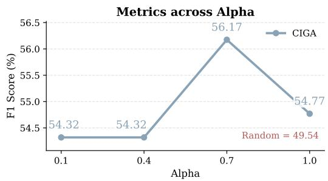  
Figure 6: Sensitivity analysis of the variance penalty coefficient α in the CIGA layer selection mechanism.

## B.2 Feature Fusion Hyperparameter

The hyperparameter γ controls how strongly the task-level fusion weight $\beta$ responds to the gradient SNR.

As shown in Figure 7, when the value of $\gamma$ is greater than 1/4, performance remains within a narrow high-performing range. This indicates that a moderate SNR sensitivity keeps the algorithm more reliant on high-confidence gradient rankings rather than placing excessive weight on semantic similarity. However, reducing γ to $1 / 4$ degrades performance, as this excessively small value weakens the impact of high-confidence gradients and allows the semantic ranking to receive a larger fusion weight.

On TyDiQA, $\gamma = 1 / 3$ gives the best F1, so we select it and keep it fixed for the other tasks and both backbones. Table 9 confirms that this choice also yields the highest macro-average across the five tasks.

## B.3 Selection Ratio

We vary the selection ratio from 1% to 10% on Qwen3-4B-Base to evaluate CIGA’s sensitivity to the data budget. As shown in Figure 8, the macroaverage remains within 72.53%–73.52% and generally improves as the data budget increases.

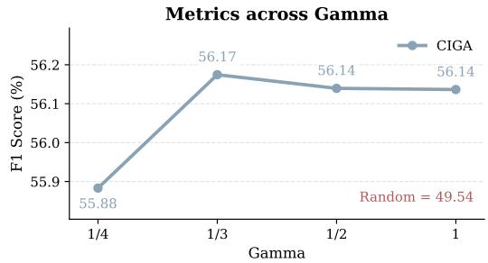  
Figure 7: Sensitivity analysis of the SNR sensitivity γ in dynamic feature fusion.

## C Declaration of Generative AI Tool Usage

During the preparation of this manuscript, the authors utilized LLMs to assist with several auxiliary tasks. The primary applications of the AI tools included: Refining the grammar, phrasing, and flow of the English text, as well as translating non-English data samples, to improve overall readability. Structuring and formatting the LaTeX table for the clear presentation of the case study.

The generative AI tools were not used to conceptualize or generate the core scientific contributions, methodology, or theoretical claims of this work. All experimental designs, data analyses, and final scientific conclusions represent the original work of the authors. The authors have rigorously reviewed, edited, and verified all AI-assisted content and take full responsibility for the accuracy and integrity of this publication.

## D Case Study

We present a detailed case study on the BBH dataset (Table 10). The evaluation instance tests logical reasoning via a step-by-step evaluation of a Boolean expression. As shown, CIGA retrieves a single-turn step-by-step reasoning sample, directly aligning with the logical deduction requirements of the target task. In contrast, baseline methods struggle with structural alignment: Cos selects an irrelevant instruction-following task about "steps", LESS retrieves a noisy multi-turn dialogue containing error corrections, and TracIn selects an answer that completely lacks the necessary reasoning steps.

Table 9: Performance metrics (%) under different configurations of hyperparameter α and γ.
<table><tr><td>Hyperparameter</td><td>Value</td><td>TydiQA</td><td>MMLU</td><td>BBH</td><td>GSM8K</td><td>HellaSwag</td><td>Avg</td></tr><tr><td rowspan="4">Variance Penalty (α)</td><td>0.1</td><td>54.32</td><td>45.77</td><td>41.20</td><td>17.66</td><td>74.62</td><td>46.71</td></tr><tr><td>0.4</td><td>54.32</td><td>47.46</td><td>41.20</td><td>17.66</td><td>74.54</td><td>47.04</td></tr><tr><td>0.7</td><td>56.17</td><td>47.46</td><td>41.39</td><td>19.64</td><td>74.54</td><td>47.84</td></tr><tr><td>1.0</td><td>54.77</td><td>47.46</td><td>37.78</td><td>19.64</td><td>74.54</td><td>46.84</td></tr><tr><td rowspan="4">Fusion Coefficient (γ)</td><td>1</td><td>56.14</td><td>47.45</td><td>41.20</td><td>19.18</td><td>74.47</td><td>47.69</td></tr><tr><td>1/2</td><td>56.14</td><td>47.29</td><td>40.93</td><td>19.11</td><td>74.41</td><td>47.58</td></tr><tr><td>1/3</td><td>56.17</td><td>47.46</td><td>41.39</td><td>19.64</td><td>74.54</td><td>47.84</td></tr><tr><td>1/4</td><td>55.88</td><td>47.37</td><td>40.56</td><td>19.41</td><td>74.46</td><td>47.54</td></tr></table>

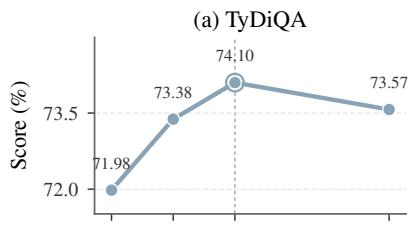

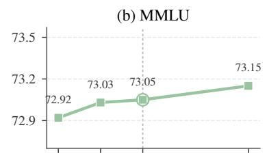

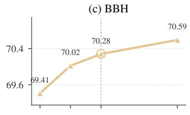

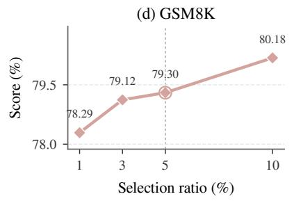

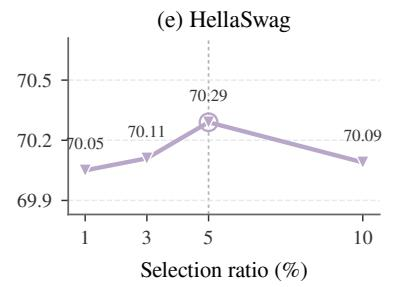

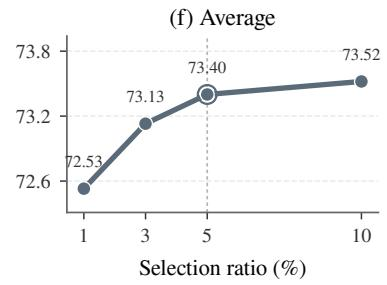  
Figure 8: Selection-ratio ablation on Qwen3-4B-Base. Scores are reported in percent. The dotted line marks the default 5% ratio; panels use task-specific y-axis ranges.

Table 10: Top-1 selected training samples by different methods for the BBH evaluation task.
<table><tr><td rowspan=1 colspan=1>Method</td><td rowspan=1 colspan=1>Text (Validation Example / Selected Training Sample)</td></tr><tr><td rowspan=1 colspan=1>Eval Data</td><td rowspan=1 colspan=1>BBH (Boolean Expressions):[User]: Evaluate the result of a random Boolean expression.Q: not ((not not True )) is[Assistant]: Let&#x27;s think step by step. Remember that (i) expressions inside bracketsare always evaluated first and that (ii) the order of operations from highest priority tolowest priority is &quot;not&quot;, &quot;and&quot;, &quot;or&quot;, respectively. We first simplify this expression &quot;Z&quot; asfollows... [... Deduction steps truncated ...] ...So the answer is False.</td></tr><tr><td rowspan=1 colspan=1>Cos</td><td rowspan=1 colspan=1>dolly_2928:[User]: Given these two sets of instructions, will you end up at the same end point if youstarted at the same beginning point? First instructions: 1) Take 2 steps forward...[Assistant]: Yes, you will end up at the same point for both sets of instructions..</td></tr><tr><td rowspan=1 colspan=1>LESS</td><td rowspan=1 colspan=1>oasst1_15234:[User]: If you have a 3 gallon cylindrical shaped jug and a 5 gallon...[Assistant]: The correct procedure to end up with exactly 4 gallons in the 5 gallon jug is:b...[User]: i dont understand, can you explain it to me like I was like 5?[Assistant]: My apologies if that was confusing. I have realized that my previous answerwas incorrect...</td></tr><tr><td rowspan=1 colspan=1>TracIn</td><td rowspan=1 colspan=1>oasst1_15229:[User]: If you have a 3 gallon cylindrical shaped jug and a 5 gallon...[Assistant]: The correct answer is: “e. None of the above&quot;.</td></tr><tr><td rowspan=1 colspan=1>CIGA</td><td rowspan=1 colspan=1>oasst1_15233:[User]: If you have a 3 gallon cylindrical shaped jug and a 5 gallon...[Assistant]: The correct procedure to end up with exactly 4 gallons in the 5 gallon jug is:b. Fill 3 gallon jug. Pour it all into the 5 gallon jug twiceHere&#x27;s the explanation:1. Fill the 3 gallon jug with water.2. Pour all 3 gallons from the 3 gallon jug into the 5 gallon jug...</td></tr></table>