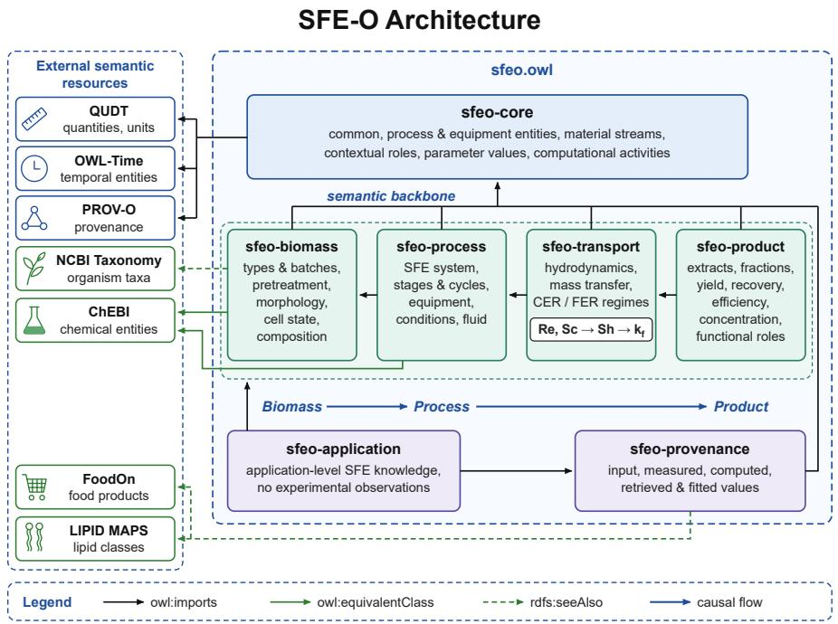

# SFE-O: An Ontology for Knowledge-Grounded AI in Supercritical $\mathrm { { C O } _ { 2 } }$ Biomass Extraction and Fractionation

Thomas Pallet   
Universite de Lorraine, CNRS, CRAN´   
Nancy, France   
LIFIA, Facultad de Informatica´   
Universidad Nacional de La Plata   
La Plata, Argentina   
MG-IB   
Epinal, France<sup>´</sup>   
ORCID: 0009-0000-3240-0269   
Daniele Pizzichini   
ENEA, Italian National Agency for New   
Technologies, Energy and Sustainable   
Casaccia Research Centre   
Rome, Italy   
ORCID: 0000-0003-0544-9993

Mario Lezoche Universite de Lorraine, CNRS, CRAN´ Nancy, France ORCID: 0000-0002-3271-1742

Diego Torres   
LIFIA, CICPBA-Facultad de Informatica ´   
Universidad Nacional de La Plata   
La Plata, Argentina   
SIGMA, Depto CyT, UNQ, Argentina   
ORCID: 0000-0001-7533-0133   
Gianpaolo Leone   
ENEA, Italian National Agency for New   
Technologies, Energy and Sustainable   
Casaccia Research Centre   
Rome, Italy   
ORCID: 0000-0001-5165-4520

Herve Panetto´ Universite de Lorraine, CNRS, CRAN ´ Nancy, France ORCID: 0000-0002-5537-2261

Melanie Glibusic´ MG-IB Epinal, France <sup>´</sup> ORCID: 0009-0003-9802-0164

Abstract—Supercritical $\mathbf { C O _ { 2 } }$ extraction $\mathbf { ( C O _ { 2 } { - } S F E ) }$ offers a sustainable route for recovering high-value compounds from biomass while limiting the use of conventional organic solvents, but its design and interpretation require heterogeneous knowledge spanning biomass properties, operating conditions, mass transfer, and product fractionation, typically fragmented across technical reports, engineering models, external databases, and expert practice. This paper introduces SFE-O, a modular Web Ontology Language (OWL 2) ontology for supercritical $\mathbf { C O _ { 2 } }$ biomass extraction, structured around interconnected Biomass, Process, and Product dimensions and extended with explicit representations of process topology, parameter provenance, external and internal mass-transfer phenomena, and the Constant Extraction Rate (CER) / Falling Extraction Rate (FER) mechanisms. Computational dependencies among process quantities are represented explicitly, without embedding numerical solving in the ontology, so that input, measured, computed, externally retrieved, and fitted parameters remain traceable. SFE-O reuses established semantic resources (ChEBI, QUDT, OWL-Time, PROV-O) and is evaluated through a worked example that instantiates a real pilot-scale extraction batch, a reasoner-based consistency check, and a competency-question SPARQL query. The resulting knowledge model provides a machine-actionable foundation for querying, consistency checking, and mechanistic explanation of SFE processes, and establishes a knowledge layer that could support future ontology-grounded AI reasoning, a direction this paper motivates but does not evaluate.

Index Terms—Supercritical $\mathbf { C O } _ { 2 }$ extraction, ontology engineering, knowledge representation, semantic interoperability, biomass valorisation, mass-transfer modelling, knowledge-grounded AI.

## I. INTRODUCTION

The valorisation of biological resources requires extraction technologies capable of recovering high-value compounds while limiting environmental impact, solvent consumption, and degradation of thermosensitive molecules. In this context, supercritical carbon dioxide extraction $\mathrm { ( C O _ { 2 }  – S F E ) }$ has emerged as a particularly relevant technology for processing plant and microbial biomass. Above its critical point, $\mathrm { C O _ { 2 } }$ combines a liquid-like density with gas-like transport properties, while its solvent power can be tuned through pressure and temperature. These characteristics enable selective extraction under comparatively mild operating conditions and make $\mathrm { { C O } _ { 2 ^ { - } } }$ SFE attractive for applications in the food, nutraceutical, pharmaceutical, and cosmetic sectors [1], [2].

The design and interpretation of an SFE process nevertheless require substantially more knowledge than the specification of extraction pressure and temperature alone. Process behaviour depends simultaneously on the chemical composition and morphology of the biomass, pretreatment conditions, particle-size distribution, extraction-vessel geometry, fixed-bed characteristics, $\mathrm { C O _ { 2 } }$ flow rate, possible co-solvent use, thermophysical fluid properties, molecular descriptors of the target compounds, hydrodynamic conditions, external and internal mass-transfer mechanisms, extraction time, and the configuration of the downstream separation stages. These quantities are mutually dependent and may originate from direct measurements, engineering calculations, external physicochemical databases, mathematical models, or parameter-fitting procedures. At pilot and industrial scales, the problem is further extended by closed-loop $\mathrm { C O _ { 2 } }$ circulation and by sequential separators operated under different pressure and temperature conditions, allowing the extracted material to be fractionated according to the solubility behaviour of its constituents.

The kinetics of SFE also involve mechanistic knowledge that cannot be reduced to a flat collection of process parameters. The Broken-and-Intact Cell (BIC) approach distinguishes an easily accessible solute fraction associated with structures disrupted during biomass pretreatment from a less accessible fraction retained within intact structures [3], [4]. This distinction underlies the interpretation of a fast extraction region dominated by external mass transfer and a subsequent region increasingly governed by internal diffusion. Consequently, quantities such as the broken-cell fraction, Reynolds, Schmidt, and Sherwood numbers, molecular and effective diffusivities, and external mass-transfer coefficients form a network of physical and computational dependencies that is necessary for explaining how process conditions influence extraction behaviour.

While established, process engineering knowledge remains fragmented across literature, technical documents, code, and expert practice, hindering its computational use. To address this, general-purpose ontologies like OntoCAPE provide formal, reusable conceptualizations that support knowledge management and engineering applications [5], [6]. However, a general process ontology does not by itself provide the domain-specific representation required to connect biomass morphology and composition with SFE operating conditions, transport mechanisms, fractional separation, derived quantities, and the provenance of the knowledge used to calculate them.

This paper addresses this problem through SFE-O, a modular ontology for the formal representation of supercritical $\mathrm { { C O } _ { 2 } }$ biomass extraction knowledge. SFE-O structures the domain around three interconnected dimensions, Biomass, Process, and Product, while introducing dedicated representations for process topology, temporal phases, transport phenomena, computational dependencies, and parameter provenance. Rather than representing domain quantities as isolated datatype attributes, the ontology explicitly models their semantic context and derivation relationships, distinguishing values that are provided as inputs, directly measured, computationally derived, retrieved from external resources, or estimated through fitting. The ontology also formalises the relationship between biomass disruption and the Constant Extraction Rate (CER) and Falling Extraction Rate (FER) mechanisms, thereby connecting structural characteristics of the feedstock to external and internal

mass-transfer phenomena.

The contribution is therefore not intended to replace mechanistic or numerical SFE models. Instead, SFE-O provides a machine-actionable semantic layer in which such models, their required inputs, their outputs, and their provenance can be explicitly interconnected. This layer is designed to support semantic querying, consistency checking, traceable mechanistic explanations, and interoperability with established knowledge resources. In accordance with this objective, the present work focuses on knowledge formalization and ontology validation and does not expose or evaluate experimental datasets.

## II. RELATED WORK

The development of SFE-O lies at the intersection of three research areas: mechanistic modelling of supercritical-fluid extraction, semantic modelling for chemical and bioprocess engineering, and reusable ontologies for representing chemical entities, quantities, temporal information, and provenance. Existing work provides important components for each of these areas, but does not directly address their integration into a machine-actionable representation of supercritical $\mathrm { C O _ { 2 } }$ biomass extraction.

## A. Process and Biomass Ontologies

Ontologies have been investigated in chemical and process engineering as a means to make engineering knowledge explicit, reusable, and interoperable across heterogeneous software environments. A major contribution in this direction is OntoCAPE, a large-scale formal ontology for Computer-Aided Process Engineering (CAPE) [5], [6]. OntoCAPE provides a modular and layered representation of process-engineering concepts, including plant equipment, process systems, material streams, physical quantities, and mathematical models. Its architecture demonstrates how formal semantics can support knowledge management, process modelling, simulationrelated applications, and reuse across different engineering tasks.

The biomass and biorefinery domain has also motivated more specialised semantic models. Trokanas et al. proposed BiOnto, an ontology representing biomass types, biomass composition, and biorefining processing technologies [7]. BiOnto was designed to support the identification and comparison of biomass-processing pathways and demonstrated the use of semantic reasoning for applications such as technology screening and industrial symbiosis. Subsequent work has further explored ontology-supported characterisation of biorefinery streams and the use of semantic knowledge to improve decision making in biorefinery value chains [8], [9].

These approaches establish the relevance of ontology engineering for both process systems and biomass valorisation. However, their modelling scope is broader than the specific mechanisms governing supercritical-fluid extraction. In particular, the representation required for $\mathrm { C O _ { 2 } } – \mathrm { S F E }$ must connect biomass morphology and chemical composition with extraction-system topology, supercritical-fluid properties, hydrodynamics, molecular transport, extraction kinetics, and fractional separation. It must also distinguish the origin of process quantities and explicitly represent dependencies among parameters used by engineering correlations and mechanistic models.

## B. Reusable Semantic Resources

Rather than reproducing knowledge already formalised in established resources, domain ontologies can improve interoperability by reusing or aligning existing semantic models. Chemical entities are particularly relevant in SFE because extraction behaviour is molecule dependent. The Chemical Entities of Biological Interest ontology (ChEBI) provides a curated ontology and reference vocabulary for chemical entities and their structural and functional classifications [10]. Its hierarchy and stable identifiers enable molecules such as fatty acids and carotenoids to be connected to broader chemical classes without reconstructing an independent chemical taxonomy. Functional roles represented in ChEBI are also useful for linking extracted compounds to downstream interpretations such as antioxidant, pigment, or nutritional functions.

For biomass-derived products intended for food-related applications, FoodOn provides an interoperable ontology for food materials, their biological origins, processing, and derived products [11]. Such external domain resources complement SFE-specific knowledge by allowing product fractions to be connected to broader application and valorisation contexts.

Engineering knowledge additionally requires a consistent representation of physical quantities and units. The Quantities, Units, Dimensions and Types ontology (QUDT) provides ontologies for quantities, quantity kinds, units, dimensions, and numerical quantity values [12]. This distinction is important for SFE knowledge, where quantities such as pressure, temperature, mass flow, density, viscosity, diffusivity, and extraction yield are expressed using heterogeneous units and may also depend on a reference basis such as dry or wet biomass.

Temporal semantics are required because an extraction process comprises ordered stages and time-dependent regions. OWL-Time provides concepts for temporal intervals, durations, instants, and their ordering relations [13]. These constructs can be specialised for representing extraction batches, extraction cycles, transient periods, operating-regime intervals, and kinetic extraction phases.

Finally, the origin of a parameter is essential to its interpretation. A value may be experimentally measured, supplied as an operating set point, computed from other quantities, retrieved from an external physicochemical resource, or estimated through parameter fitting. The W3C PROV Ontology (PROV-O) provides a general provenance model based on entities, activities, agents, and derivation relations [14]. Its specialisation therefore enables the derivation chain of an SFE quantity to be represented explicitly rather than treating all numerical values as semantically equivalent.

## C. Research Gap and Positioning of SFE-O

The reviewed approaches provide important building blocks but leave a modelling gap at their intersection. General process ontologies describe engineering systems at a broad level, whereas biomass and biorefinery ontologies primarily address feedstock classification, processing technologies, and transformation pathways. Conversely, chemical and metrological ontologies provide reusable semantics for individual information dimensions but do not describe how these dimensions interact within an SFE extraction mechanism, as summarised in Table I.

TABLE I  
POSITIONING OF SFE-O RELATIVE TO RELATED ONTOLOGIES
<table><tr><td>Ontology</td><td>Scope</td><td>Gap addressed by SFE-O</td></tr><tr><td>OntoCAPE [5], [6]</td><td>General CAPE systems, equipment,</td><td>process No SFE-specific mass-transfer, CER/FER, or fractionation se-</td></tr><tr><td>BiOnto [7]- [9]</td><td>streams Biomass/biorefinery feed- stock and conversion path- ways</td><td>mantics No extraction-process topology or kinetic mechanisms</td></tr><tr><td>ChEBI, QUDT, OWL-Time, PROV-O [10], [12]- [14]</td><td>Chemical identity, units, time, provenance (reused by SFE-O)</td><td>Provide reusable semantics but no SFE process model</td></tr><tr><td>SFE-O (this paper)</td><td>SFE-specific: biomass— process-product, BIC/CER-FER, parameter provenance</td><td></td></tr></table>

To our knowledge, no existing ontology specifically formalises the supercritical $\mathrm { C O _ { 2 } }$ extraction domain, combining Broken-and-Intact Cell (BIC) extraction kinetics with explicit parameter provenance; this motivates the SFE-specific contribution below.

SFE-O addresses this gap rather than competing with the aforementioned ontologies; instead, it specialises the extraction domain while reusing their semantics wherever appropriate, providing the formal structure required for traceable reasoning and subsequent knowledge-grounded AI applications.

## III. KNOWLEDGE ELICITATION AND ONTOLOGY REQUIREMENTS

The construction of SFE-O followed an iterative knowledgeengineering process in which domain knowledge was progressively extracted, structured, reconciled, and formalised. The methodology is a lightweight adaptation of the Ontology Development 101 iterative cycle [15], combined with the competency-question method of Gruninger and Fox [16], ap-¨ plied here through five steps. In the present work, the objective was not to reproduce experimental datasets semantically, but to identify the concepts, relations, constraints, and computational dependencies required to describe and reason about a supercritical $\mathrm { C O _ { 2 } }$ extraction process.

## A. Knowledge Sources and Elicitation Process

The domain conceptualization was derived from six heterogeneous knowledge artefacts produced during the analysis of $\mathrm { C O _ { 2 } } { \cdot } \mathrm { S F E }$ processes. They comprised two technical reports describing bench- and pilot-scale extraction, a structured parameter-reference document, a computational spreadsheet relating process quantities, a set of conceptual hierarchy diagrams, and an expert-authored descriptive model of the extraction mechanisms. Their complementary nature was important because no individual source contained all the knowledge required by the ontology.

The bench-scale material provided the terminology associated with biomass characterisation, pretreatment, extraction equipment, target chemical compounds, operating conditions, co-solvent use, extraction time, and analytical characterisation. The pilot-scale documentation extended this description towards process topology by introducing closed-loop $\mathrm { C O _ { 2 } }$ circulation, extraction cycles, equipment configuration, sequential separation stages, and the possibility of operating separators under distinct pressure and temperature conditions. The structured parameter material established correspondences among biomass properties, chemical compounds, process variables, units of measurement, and chemical identifiers. The computational representation exposed dependencies among quantities, whereas the conceptual diagrams organised these quantities into domain hierarchies and distinguished different origins of parameter values. Finally, the descriptive knowledge source provided explicit definitions of the relevant entities, extraction phases, physical mechanisms, equations, and domain constraints.

Knowledge elicitation was performed by iteratively moving from terminology to conceptual dependencies. First, recurrent domain terms were identified and grouped according to their function in the extraction process (terminology elicitation). Second, relationships among these terms were extracted, including structural, temporal, chemical, process, and computational relationships (relation extraction). Third, mathematical expressions and engineering correlations were analysed to identify which quantities act as inputs and outputs of calculations. Fourth, domain constraints and modelling assumptions were separated from taxonomic knowledge (constraint separation). Finally, the resulting conceptualization was reviewed with domain experts (expert review) and reorganised into reusable ontology patterns.

A major outcome of this process was the identification of three primary and causally connected domain perspectives:

$$
\mathrm { B i o m a s s } \longrightarrow \mathrm { P r o c e s s } \longrightarrow \mathrm { P r o d u c t } .\tag{1}
$$

The Biomass perspective describes the material entering the extraction process, including its type, chemical composition, morphology, physical characteristics, and pretreatment state. The Process perspective represents the extraction system, its geometry, equipment, operating parameters, fluid properties, temporal phases, hydrodynamics, and mass-transfer mechanisms. The Product perspective describes the extract and its fractions, their chemical composition, and quantities such as extracted amount, yield, recovery, efficiency, and concentration. Equation 1 does not represent a purely sequential taxonomy: information from the three perspectives is linked through causal and computational dependencies.

TABLE IIMAIN MODELLING REQUIREMENTS OF SFE-O
<table><tr><td>Req.</td><td>Description</td></tr><tr><td>R1</td><td>Represent Biomass, Process, and Product as interconnected but modular domain perspectives.</td></tr><tr><td>R2</td><td>Reuse external semantic resources for chemical entities, quan- tities, units, time, and provenance whenever appropriate.</td></tr><tr><td>R3</td><td>Represent physical and chemical quantities independently from their numerical values, units, and reference bases.</td></tr><tr><td>R4</td><td>Distinguish intrinsic entity types from contextual roles, e.g., a chemical entity playing the role of solute or co-solvent in a process.</td></tr><tr><td>R5</td><td>Distinguish input, measured, computed, externally retrieved, and fitted parameter values and preserve their provenance.</td></tr><tr><td>R6</td><td>Represent dependencies among quantities and mechanistic mod- els without using OWL as a numerical solver.</td></tr><tr><td>R7</td><td>Represent extraction batches, cycles, stages, and an arbitrary ordered sequence of separation stages rather than a plant-</td></tr><tr><td>R8</td><td>specific fixed topology. Represent domain constraints and preserve distinctions among missing, below-detection-limit, and actual zero-valued informa- tion.</td></tr></table>

## B. Ontology Requirements

The elicitation process resulted in eight principal modelling requirements, summarized in Table II.

The remaining requirements are briefly motivated before the two most structurally demanding ones, R3 and R5– R6, are discussed in detail. R1 and R2 shape the overall architecture: R1 reflects the three causally linked perspectives identified during elicitation (Eq. 1), realised through the separate but interconnected sfeo-biomass, sfeo-process, and sfeo-product modules (Section IV), while R2 avoids re-formalizing chemical identity, units, time, and provenance semantics already covered by ChEBI, QUDT, OWL-Time, and PROV-O (Section II). R4 and R7 keep the model generic rather than plant-specific: R4 treats roles such as solute or co-solvent as contextual and process-dependent rather than intrinsic to a chemical entity, since the same compound can play different roles across batches, while R7 generalizes separation topology to an ordered sequence of stages (Eq. 2) instead of fixed, plant-specific separator classes. Finally, R8 preserves the distinction between a missing value, a belowdetection-limit measurement, and an actual measured zero, a distinction that matters wherever all three occur in productcomposition data (Section VII).

Requirement R3 was particularly relevant because the source material combines quantities expressed using different units and reference bases. A chemical concentration, for example, is not represented merely as a molecule-specific datatype property; it is modelled as a contextualized quantity concerning a chemical entity and a material, associated with a numerical value, unit, and, where necessary, a reference basis such as dry or wet biomass. This design prevents the ontology schema from growing whenever a new chemical compound is introduced.

Requirement R5 emerged from the observation that process knowledge combines quantities having different epistemic origins. An extraction pressure may be introduced as an operating set point, biomass composition may result from measurement, Reynolds or Sherwood numbers may be calculated, $\mathrm { C O _ { 2 } }$ thermophysical properties may be obtained from an external computational resource, while parameters such as the brokencell fraction or effective diffusivity may be estimated by fitting. Making these distinctions explicit is necessary for traceability and for subsequent explanation of how a result has been obtained.

Requirement R6 concerns the mechanistic structure of the extraction process. The elicited knowledge identifies dependencies linking biomass morphology, process geometry, fluid properties, molecular descriptors, hydrodynamics, and mass transfer. For instance, Reynolds and Schmidt numbers contribute to the determination of the Sherwood number, which is subsequently involved in the determination of the external mass-transfer coefficient. These relations must therefore be represented as explicit computational dependencies while leaving their numerical evaluation to appropriate external software or mathematical services.

The same requirement applies to the distinction between the Constant Extraction Rate (CER) and Falling Extraction Rate (FER) regions. The broken-cell fraction g identifies the portion of the biomass whose solute is immediately accessible after pretreatment and is therefore associated with the faster, externally controlled extraction mechanism. Conversely, the remaining intact fraction (1 − g) introduces internal masstransfer resistance and contributes to the diffusion-controlled extraction mechanism. Preserving this mechanistic distinction was considered essential for supporting explanations that connect pretreatment and biomass morphology to extraction behaviour.

## C. Competency Questions

The requirements were complemented by competency questions (CQs) expressing representative information needs that SFE-O should support. A subset used to guide the present ontology is reported below:

• CQ1: Which biomass characteristics and chemical entities are relevant to a given supercritical $\mathrm { C O _ { 2 } }$ extraction process?

• CQ2: Which geometric and operating quantities characterize a given extraction batch and its process stages?

• CQ3: Which quantities are required to derive Re, Sc, Sh, and $k _ { f }$ , and what is the provenance of each required quantity?

• CQ4: How is the broken-cell fraction related to the portions of a target compound associated with the CER and FER mechanisms?

• CQ5: Which separation stage generates a given product fraction, and under which pressure and temperature conditions?

• CQ6: Which chemical entities or chemical classes characterize a product fraction and which functional roles can be associated with them?

• CQ7: Was a process quantity supplied, measured, calculated, retrieved from an external resource, or estimated through fitting?

• CQ8: Are the represented quantities and relationships compatible with the domain constraints encoded for the extraction process?

These competency questions define the boundary between domain information that merely occurs in the source material and knowledge that must be explicitly accessible through the ontology. They consequently guided the modular architecture, reuse decisions, properties, and constraint representations presented in the following section.

## IV. SFE-O ARCHITECTURE AND SEMANTIC REUSE

SFE-O is implemented as a modular OWL 2 ontology whose organisation reflects the separation of concerns identified during knowledge elicitation. The SFE-O v0.1.0 ontology described in this paper is openly available on Zenodo [17] and is organised into seven local modules (Core, Biomass, Process, Transport, Product, Provenance, and Application) together with an aggregate ontology importing the complete model. Fig. 1 summarizes this architecture and its connections with external semantic resources.

## A. Modular Architecture

The sfeo-core module provides the common semantic backbone, including material and process entities, equipment, material streams, contextual roles, parameter values, and activities responsible for producing or deriving knowledge. The sfeo-biomass module specialises this backbone with biomass types and batches, pretreatment operations, morphology, physical characteristics, chemical composition, and the distinction between broken and intact structural units required by the Broken-and-Intact Cell representation.

The sfeo-process module represents extraction systems, batches, cycles, equipment, operating conditions, geometry, fluid properties, and temporal process stages. An ExtractionBatch denotes the complete extraction operation performed on a defined biomass load, whereas an ExtractionCycle represents one circulation of $\mathrm { C O _ { 2 } }$ through the relevant functional stages. This distinction supports both single-pass laboratory systems and closed-loop pilot or industrial configurations.

Separation topology is intentionally generalized. Rather than defining plant-specific classes such as SE1, SE2, and SE3, an extraction cycle may contain an ordered sequence of SeparationStage individuals,

$$
S _ { 1 } \prec S _ { 2 } \prec \dotsb \prec S _ { n } ,\tag{2}
$$

each associated with its equipment, pressure, temperature, and generated ProductFraction, so a three-separator pilot plant is one instantiation, not a structural limit.

The sfeo-transport module represents hydrodynamic and mass-transfer knowledge, including molecular and effective diffusivity, Reynolds, Schmidt, and Sherwood numbers, the external mass-transfer coefficient $k _ { f }$ , and the CER/FER mechanisms. The sfeo-product module describes total extracts and separated fractions together with quantities such as extracted amount, yield, recovery, efficiency, concentration, and functional roles. Finally, sfeo-provenance distinguishes input, measured, computed, externally retrieved, and fitted parameter values, while sfeo-application contains application-level SFE knowledge without representing experimental observations.

  
Fig. 1. Modular architecture of SFE-O and its relationships with reused or aligned external semantic resources.

## B. Semantic Modelling Patterns

Three modelling patterns are central to SFE-O.

First, chemical composition is represented through a reified relation between a material, a chemical entity, and a quantity value rather than through molecule-specific datatype properties. Conceptually, a composition statement is represented as

$$
\langle M , C , Q , R \rangle ,\tag{3}
$$

where M is a biomass or product material, C the chemical entity, $Q$ the associated quantity, and R an optional reference basis such as dry or wet mass (Eq. 3). New compounds can therefore be introduced without modifying the ontology schema.

Second, SFE-O distinguishes intrinsic entity types from contextual process roles: a chemical entity is not intrinsically a solute, but may play a SoluteRole in a given extraction context, and the same pattern applies to solvent and cosolvent participation, since these roles depend on the process configuration and operating conditions.

Third, computational dependencies are explicitly represented without requiring OWL to execute numerical models.

A calculation is connected to its required quantities and generated output,

$$
\left\{ Q _ { 1 } , \dots , Q _ { n } \right\} \xrightarrow [ ] { \mathrm { C a l c u l a t i o n } } Q _ { \mathrm { o u t } } .\tag{4}
$$

For example, this pattern (Eq. 4) represents that the Sherwood number depends on Reynolds and Schmidt numbers and that the external mass-transfer coefficient subsequently depends on Sherwood number, solute diffusivity, and particle size. Numerical evaluation remains delegated to appropriate engineering software, while the ontology preserves the semantic dependency and provenance chain.

## C. Reuse of External Semantic Resources

SFE-O adopts the selective reuse strategy already motivated in Section II (QUDT [12], OWL-Time [13], PROV-O [14]), illustrated on the left side of Fig. 1: quantities and units, temporal concepts, and the provenance of measurement, calculation, external-lookup, and fitting activities are each delegated to the corresponding external ontology rather than re-modelled locally. Chemical entities are likewise selectively aligned with ChEBI [10] rather than reconstructed through a local taxonomy, so that compounds such as carotenoids and fatty acids retain stable, externally maintained identifiers while remaining associated with SFE-specific process roles. Other resources serve only as interoperability or extension points, not full imports: NCBI Taxonomy [18] for biological-source identifiers, and FoodOn/LIPID MAPS as possible alignments for food-product and lipid-specific semantics.

This architecture keeps SFE-O focused on knowledge specific to supercritical $\mathrm { C O _ { 2 } }$ extraction while delegating chemical identity, units, time, and provenance to established resources.

## V. MECHANISTIC KNOWLEDGE AND CONSTRAINT FORMALIZATION

A distinctive feature of SFE-O is the explicit representation of mechanistic relationships connecting biomass structure, operating conditions, mass transfer, and product formation.

## A. CER/FER Representation

Following the BIC interpretation [3], [4], let $m _ { s }$ be loaded biomass mass, $X _ { 0 } ( i )$ the initial concentration of compound $i ,$ and $g$ the broken-cell fraction. SFE-O represents the initial, broken-cell, and intact-cell amounts as

$$
\begin{array} { r l } & { C _ { 0 } ( i ) = m _ { s } X _ { 0 } ( i ) , } \\ & { C _ { 0 , B C } ( i ) = g m _ { s } X _ { 0 } ( i ) , \quad C _ { 0 , I C } ( i ) = ( 1 - g ) m _ { s } X _ { 0 } ( i ) . } \end{array}\tag{5}
$$

The broken fraction (Eq. (5)) is associated with the Constant Extraction Rate (CER) region, predominantly governed by external mass transfer, whereas the intact fraction contributes to the Falling Extraction Rate (FER) region, increasingly controlled by internal diffusion. The corresponding massbalance constraints are

$$
\begin{array} { r l } & { M _ { \mathrm { { C E R } } } \leq g m _ { s } X _ { 0 } ( i ) , \quad M _ { \mathrm { F E R } } \leq ( 1 - g ) m _ { s } X _ { 0 } ( i ) , } \\ & { M _ { \mathrm { { T O T } } } = M _ { \mathrm { { C E R } } } + M _ { \mathrm { F E R } } \leq m _ { s } X _ { 0 } ( i ) . } \end{array}\tag{6}
$$

Product indicators can then be linked to the same mechanistic model (Eq. (6)), e.g., $E F F = \ M _ { \mathrm { T O T } } / C _ { 0 } ( i )$ and $C O N C = M _ { \mathrm { T O T } } / E A$ , where EA is total extracted material.

## B. Hydrodynamic and Mass-Transfer Dependencies

Extraction pressure and temperature determine supercritical-$\mathrm { C O _ { 2 } }$ properties such as density $\rho$ and viscosity $\mu ;$ biomass morphology contributes particle size $d _ { p } ;$ and molecular identity contributes diffusivity $D ( i )$ . With flow and bed characteristics, these quantities determine Re and $S c ,$ followed by

$$
{ \cal S } h = 2 + 1 . 1 R e ^ { 0 . 6 } { \cal S } c ^ { 0 . 3 3 } , \qquad \{ { \cal S } h , D ( i ) , d _ { p } \}  k _ { f } ( i ) .\tag{7}
$$

Each derivation is a CalculationActivity, with calibration and external lookups typed as ParameterFittingActivity and ExternalLookupActivity. Effective diffusivity $D _ { \mathrm { E F F } } ( i )$ , governing internal transport, depends on porosity, tortuosity, and microstructure in a biomass-specific way for which the elicited sources give no single universal equation; SFE-O therefore records the dependency without imposing one.

## C. Constraints

OWL axioms express logical conditions such as disjointness of broken/intact structures and CER/FER phases, while arithmetic bounds, parameter ranges, and derived-quantity relations are kept as machine-readable constraint expressions, not evaluated by the OWL reasoner itself. Not analysed, below detection limit, and a measured zero remain three distinct states, preserving semantic correctness while leaving numerical constraint execution to future validation or engineering services.

## VI. KNOWLEDGE-GROUNDED AI PERSPECTIVE

SFE-O is also intended as a grounding layer for future AIassisted SFE interpretation using a Large Language Model (LLM); no LLM system is built or evaluated in this paper. Work on LLM–knowledge-graph integration highlights the value of combining generative language capabilities with explicit machine-interpretable knowledge [19]. An LLM could translate a natural-language question into a semantic query over SFE-O and use retrieved facts, mechanistic dependencies, and provenance as grounded context. For example, a question about $k _ { f }$ can expose the path from operating/biomass properties through Re, $S c ,$ and Sh (Eq. (7)) together with the provenance of the required quantities.

This separates semantic validity from language generation: SFE-O would define admissible concepts, relations, and dependency chains; numerical services would execute calculations; and the LLM would provide interaction and orchestration. The present contribution does not evaluate such an LLM implementation, but establishes the formal layer required for subsequent ontology-grounded question answering and explainable process interpretation.

## VII. EVALUATION AND DISCUSSION

Evaluation concerns SFE-O as a knowledge representation rather than a predictive system. First, the modular OWL 2 files were checked for RDF/XML parsing and import-structure correctness. Second, the ontology was assessed against the requirements and CQs of Section III. It represents biomass and chemical characteristics, process geometry and operating quantities, the $R e { - } S c { - } S h { - } k _ { f }$ dependency chain, CER/FER relations, ordered separation stages and product fractions, and the provenance of input, measured, computed, external, and fitted quantities.

Third, CQ1–CQ8 are demonstrated through a worked example. The ontology is a schema with no individuals; one real pilot-scale extraction batch was instantiated using operating data for Dunaliella salina (350 bar, 65°C, 0.31 kg/min CO , 120 min) and its three-separator cascade (SE1/SE2/SE3, with SE2 at 56 bar/25°C and SE3 at 54 bar/25°C), asserting individuals such as DS04\_SE2 (a SeparationStage) and DS04\_Fraction\_SE2 (the ProductFraction it generates), with a measured β-carotene concentration (7.08 mg/g, 20.8% recovery).

The instantiated ontology was classified with the HermiT Description Logic (DL) reasoner and confirmed consistent, satisfying all OWL axioms including the qualified-cardinality restriction on generatedBySeparationStage. The competency question CQ5 (“which separation stage generates a given product fraction, under which pressure and temperature”) was then answered with an executed SPARQL query against the resulting graph:

```sql
SELECT ?fraction ?stage ?p ?t WHERE {
?fraction sfeo-product:
generatedBySeparationStage ?stage .
?stage sfeo-process:hasOperatingQuantity
?pq, ?tq .
?pq a sfeo-process:SeparatorPressure ;
```

matching the source value exactly. This single worked example shows CQ1–CQ8 to be expressible and queryable on real data; it does not constitute a performance benchmark.

Fourth, the conceptual model was iteratively reviewed against the elicited engineering knowledge. General separator stages rather than fixed SE1--SE3, reified composition statements, and contextual solute roles avoid over-specialisation to one plant or compound set. The main limitations concern execution rather than representation: numerical dependencies are not solved within OWL; constraints are not yet executable Shapes Constraint Language (SHACL) shapes; external thermophysical, descriptor, diffusivity, and fitting services remain integration points; and effective diffusivity requires biomassspecific assumptions. A few data-level inconsistencies also remain open for expert validation: a conflicting interfacial-area formula $( a = 6 / d _ { p } { \mathrm { ~ v s . ~ } } a = d _ { p } / 6 )$ across source documents, a bed-volume expression possibly missing a geometric factor, and one ChEBI identifier shared by two distinct fatty acids; these are flagged explicitly within the ontology rather than silently resolved.

The paper also deliberately excludes broader experimental observations beyond the single worked example above. This establishes a transparent semantic layer before coupling SFE-O with data, numerical models, and generative AI. Future evaluation should therefore instantiate additional batches and competency questions beyond CQ5, test executable constraints, and determine whether ontology-grounded interaction improves traceability, consistency, explanation, and processspace exploration compared with unstructured AI interaction.

## VIII. CONCLUSION

SFE-O provides a modular semantic representation of supercritical $\mathrm { C O _ { 2 } }$ biomass extraction, connecting biomass characteristics, process topology, transport phenomena, separation, products, and provenance. Its central contribution is the explicit formalization of BIC/CER–FER mechanisms and computational dependencies while reusing ChEBI, QUDT, OWL-Time, and PROV-O, demonstrated on an instantiated extraction batch with a HermiT-checked full OWL 2 DL consistency result and an executed competency-question SPARQL query. Future work will add executable constraint validation, numerical/physicochemical services, experimental instantiation, and evaluation of ontology-grounded AI for process interpretation and optimisation.

## ACKNOWLEDGMENT

Generative AI (Anthropic Claude) was used solely for grammar checking and for rendering Fig. 1 to the authors specifications; the resulting diagram was verified against the ontology’s OWL files. All technical content and conclusions remain the authors’ own.

[1] B. Nozari and R. Kander, “Supercritical CO<sub>2</sub> technology for biomass extraction: Review,” Ind. Crops Prod., vol. 233, p. 121348, 2025.

[2] B. Yan, Y. Hu, J. Wang, J. Tao, S. Xia, W. Yang, Y. Zhang, G. Chen, W. Zhou, and G. Chen, “State-of-the-art conceptual design of supercritical carbon dioxide as a green technology involved in bioresource conversion processes,” Chem. Eng. J., vol. 486, p. 150166, 2024.

[3] H. Sovova, “Rate of the vegetable oil extraction with supercritical´ CO —i. modelling of extraction curves,” Chem. Eng. Sci., vol. 49, no. 3, pp. 409–414, 1994.

[4] ——, “Broken-and-intact cell model for supercritical fluid extraction: Its origin and limits,” J. Supercrit. Fluids, vol. 129, pp. 3–8, 2017.

[5] J. Morbach, A. Yang, and W. Marquardt, “OntoCAPE—a large-scale ontology for chemical process engineering,” Eng. Appl. Artif. Intell., vol. 20, no. 2, pp. 147–161, 2007.

[6] J. Morbach, A. Wiesner, and W. Marquardt, “OntoCAPE—a (re)usable ontology for computer-aided process engineering,” Comput. Chem. Eng., vol. 33, no. 10, pp. 1546–1556, 2009.

[7] N. Trokanas, M. Bussemaker, E. Velliou, H. Tokos, and F. Cecelja, “BiOnto: An ontology for biomass and biorefining technologies,” in 12th International Symposium on Process Systems Engineering and 25th European Symposium on Computer Aided Process Engineering, ser. Computer Aided Chemical Engineering, vol. 37. Elsevier, 2015, pp. 959–964.

[8] M. Bussemaker, N. Trokanas, L. Koo, and F. Cecelja, “Ontology modelling for lignocellulosic biomass: Composition and conversion,” in 28th European Symposium on Computer Aided Process Engineering, ser. Computer Aided Chemical Engineering, vol. 43. Elsevier, 2018, pp. 1565–1570.

[9] N. Trokanas, M. Bussemaker, and F. Cecelja, “Utilising semantics for improved decision making in bio-refinery value chains,” in 26th European Symposium on Computer Aided Process Engineering, ser. Computer Aided Chemical Engineering, vol. 38. Elsevier, 2016, pp. 2097–2102.

[10] J. Hastings, G. Owen, A. Dekker, M. Ennis, N. Kale, V. Muthukrishnan, S. Turner, N. Swainston, P. Mendes, and C. Steinbeck, “ChEBI in 2016: Improved services and an expanding collection of metabolites,” Nucleic Acids Res., vol. 44, no. D1, pp. D1214–D1219, 2016.

[11] D. M. Dooley, E. J. Griffiths, G. S. Gosal, P. L. Buttigieg, R. Hoehndorf, M. C. Lange, L. M. Schriml, F. S. L. Brinkman, and W. W. L. Hsiao, “FoodOn: A harmonized food ontology to increase global food traceability, quality control and data integration,” npj Sci. Food, vol. 2, p. 23, 2018.

[12] QUDT.org, “QUDT: Quantities, units, dimensions and types ontologies, version 3.5.0,” QUDT Catalog, 2026, release 3.5.0, July 2026. [Online]. Available: https://qudt.org/catalog/qudt-catalog.html

[13] S. Cox and C. Little, “Time ontology in OWL,” W3C Recommendation, 2017, 19 October 2017. [Online]. Available: https://www.w3.org/TR/ 2017/REC-owl-time-20171019/

[14] T. Lebo, S. Sahoo, and D. McGuinness, “PROV-O: The PROV ontology,” W3C Recommendation, 2013, 30 April 2013. [Online]. Available: https://www.w3.org/TR/2013/REC-prov-o-20130430/

[15] N. F. Noy and D. L. McGuinness, “Ontology development 101: A guide to creating your first ontology,” Stanford Knowledge Systems Laboratory, Stanford, CA, USA, Tech. Rep. KSL-01-05, 2001.

[16] M. Gruninger and M. S. Fox, “Methodology for the design and evalu-¨ ation of ontologies,” in Proc. IJCAI-95 Workshop on Basic Ontological Issues in Knowledge Sharing, 1995, pp. 6.1–6.10.

[17] M. Lezoche, G. P. Leone, and D. Pizzichini, “SFE-O: Supercritical fluid extraction ontology,” 2026. [Online]. Available: https://doi.org/10. 5281/zenodo.21983081

[18] C. L. Schoch et al., “NCBI taxonomy: A comprehensive update on curation, resources and tools,” Database, vol. 2020, p. baaa062, 2020.

[19] H. Khorashadizadeh et al., “Research trends for the interplay between large language models and knowledge graphs,” arXiv preprint arXiv:2406.08223, 2024.