# SetGRPO: Calibrating Grader-Induced Policy Optimization

Jiale Huang1 Zixu Li1,† Zhiwei Chen1 Zhiheng Fu1 Jinhe Bi2 Yupeng Hu1,

1Shandong University 2National University of Singapore

huangjiale.cs@outlook.com, {lizixu.cs, zivczw, fuzhiheng8}@gmail.com

bijinhe@outlook.com, huyupeng@sdu.edu.cn

Code: https://github.com/ArcadiaDream/SetGRPO

Rubric-based reinforcement learning usesfine-grained graderfeedback to train large language models on open-ended tasks, but grader randomness can alter GRPO updates in ways that score discrepancies alone cannot characterize. Because GRPOjointly normalizes rewards within each response group and combines the resulting training coeficients with response-level gradients, a scoring discrepancy can shift the coeficients of the entire group and induce policydependent update changes. Selective execution further afects the direction-reversal risk of retained updates. To address this, we propose Set-Valued Group Relative Policy Optimization (SetGRPO). It comprises three modules: (a) Joint Reward Set Calibration constructs a joint uncertainty set for the training coeficients; (b) Geometry-Guided Safe Recovery maps candidate coeficients into the current policy’s local update geometry and determines the largest safe recovery ratio for each response group; and (c) Selective Risk-Gated Optimization selects a global threshold through independent risk calibration to control the conditional direction-reversal risk of accepted updates while preserving the original GRPO objective. Under exchangeability, SetGRPO provides finite-sample marginal coverage for the joint coeficient set and simultaneous risk control across candidate thresholds. On ten open-ended benchmarks spanning three domains, SetGRPO achieves the highest macro average among all compared training methods on both Qwen3.5 and Llama3.2 modelfamilies.

## 1. Introduction

Nowadays, Rubric-based Reinforcement Learning (Rubric-based RL) has emerged as an important training paradigm for improving the performance of large language models on open-ended generation tasks (Li et al., 2026a; Zhou et al., 2026; Kim et al., 2024; Ye et al., 2024). It uses fine-grained rubrics and LLM judges to evaluate open-ended responses across dimensions such as relevance, completeness, factuality, and style (Li et al., 2026a; Zhou et al., 2026; Kim et al., 2024; Ye et al., 2024; Liu et al., 2023; Zheng et al., 2023). These dimension-level scores are aggregated into response-level rewards that serve as training signals for reinforcement learning (Ouyang et al., 2022; Stiennon et al., 2020), thereby accommodating grader’s score discrepancies during training and enabling optimization of open-ended generation tasks. Related work has also explored multimodal fusion, video-language adaptation, and parameter-eficient training for large models (Li et al., 2024; Hu et al., 2025; Li et al., 2026b).

Existing rubric-based RL studies build on GRPO (Shao et al., 2024; Guo et al., 2025) and examine reward over-optimization (Gao et al., 2023; Lambert et al., 2025), LLM-judge consistency and bias (Liu et al., 2023; Zheng et al., 2023; Wang et al., 2024), fine-grained evaluation (Kim et al., 2024; Ye et al., 2024; Liu et al., 2023), rubric constructions and rubric-based training for open-ended tasks (Li et al., 2026a; Zhou et al., 2026). Recent reinforcement-learning studies have also explored how to improve the utility of sampled trajectories through reflection, trajectory reuse, and rollout transformation (Bi et al., 2026a,b). Other work examines selection and self-evaluation mechanisms in multimodal or embodied settings (Aniri et al., 2026a; Bi et al., 2025a,b). Related studies further investigate reasoning, logical behavior, and the gap between model-based preference and real user engagement (Zhang et al., 2026a,b,c). However, these studies largely focus on the construction, reuse, or assessment of training signals and do not characterize how stochastic grader scores propagate through GRPO’s within-group normalization and gradient aggregation to alter local policy updates under the current gradient geometry. Specifically, for a given response group, GRPO derives the training coeficients from the shared mean and scale of the group rewards and combines them with the response-level gradients of each response under the current policy to form a local policy update. We therefore conjecture that a change in a single reward alters multiple training coeficients within the group through the shared statistics, and that diferent policy snapshots induce diferent update outcomes.

To verify this conjecture, we score fixed response groups twice with the same grader and compare the two scoring results pairwise (detailed in Section 3). As shown in Figure 1(a), we first compare score discrepancies with the coeficient residuals obtained after within-group normalization, testing whether shared statistics propagate score discrepancies to the entire group of coeficients. As shown in Figure 1(b), we further compare the local updates of the same response group under diferent policy snapshots, testing whether the efect of coeficient discrepancies depends on the gradient geometry of the current policy. The results show that shared normalization propagates score discrepancies to multiple coeficients within a group, whereas similar coeficient shifts can induce diferent update directions under diferent policy geometries, thereby changing which groups are retained by selective execution. These findings support our conjecture and motivate the following question: how can we characterize the efect of the training coeficients used by the optimizer on the current policy update while preserving efective training progress and avoiding directional deviation?

To address this problem, we propose Set-Valued Group Relative Policy Optimization (SetGRPO), which models GRPO’s within-group training coeficients as a joint uncertainty set and uses it to select response groups and construct policy updates. Concretely, SetGRPO comprises three components: (1) Joint Reward Set Calibration, which uses paired reward discrepancies and independent calibration data to characterize the joint coeficient shifts induced by within-group normalization; (2) Geometry-Guided Safe Recovery, which maps candidate coeficients through the current policy’s response-level gradients and determines the largest direction-safe recovery ratio; and (3) Selective Risk-Gated Optimization, which selects a global threshold on an independent risk-calibration set to control the conditional direction-reversal risk of accepted updates. During training, only groups satisfying this threshold contribute their recovered coeficients to the original GRPO objective, preserving efective updates while limiting overall update risk.

Our main contributions are summarized as follows:

• We first investigate the propagation mechanism of rubric score discrepancies in GRPO: a score discrepancy couples the training coeficients of an entire group through the shared mean and scale, and then jointly with the response-level gradients of the current policy determines the local update, yielding diferent update magnitudes and directions.

• We formalize this propagation process as a training-coeficient-driven policy-update problem and propose SetGRPO, which conformally calibrates GRPO’s joint coeficient space and combines policyupdate geometry with selective risk gating to limit direction deviation while preserving efective training progress.

• We systematically evaluate SetGRPO on ten open-ended task benchmarks across three domains with the Qwen3.5 and Llama-3.2 model families. The results show that SetGRPO achieves the best performance among all compared training methods on both model families, confirming its efectiveness in improving the reliability of GRPO training under rubric score discrepancies.

## 2. Related Work

Reinforcement Learning for Large Language Models and Rubric Feedback. Alignment training for large language models has evolved from preference learning and supervised fine-tuning to human- or AI-feedback-based instruction alignment (Ouyang et al., 2022; Stiennon et al., 2020; Christiano et al., 2017; Ziegler et al., 2019; Bai et al., 2022), giving rise to PPO and reward-model-free DPO (Schulman et al., 2017; Rafailov et al., 2023). For reasoning tasks, verifiers and process supervision provide fine-grained training signals (Cobbe et al., 2021; Uesato et al., 2022; Lightman et al., 2024),while DeepSeekMath and DeepSeek-R1 apply GRPO to large-language-model reasoning (Shao et al., 2024; Guo et al., 2025). Beyond standard single-agent training, recent work has also studied group-agent interaction and long-horizon social simulation in multi-agent settings (Zhang et al., 2026d,e; Song et al., 2026). Related work has also explored composed image retrieval and egocentric reasoning (Huang et al., 2025; Li et al., 2026c).For open-ended tasks without unique reference answers, G-Eval, FLASK,MT-Bench, and Prometheus use rubrics or LLM judges for structured evaluation (Kim et al., 2024; Ye et al., 2024; Liu et al., 2023; Zheng et al., 2023),while related retrieval studies consider semantic enhancement, focus revision,and multi-modification alignment (Huang et al., 2026a; Chen et al., 2025; Li et al., 2026d). RewardBench, RubricHub, and RuscaRL assess reward-model capability or use rubric feedback for reinforcement learning (Li et al., 2026a; Zhou et al., 2026; Lambert et al., 2025). Despite evidence of reward overoptimization and systematic judge bias (Zheng et al., 2023; Gao et al., 2023; Wang et al., 2024), prior work largely treats grader outputs as fixed training signals and does not trace how the score discrepancies propagate through GRPO’s group normalization and response-level gradient aggregation to alter the actual policy update (Bi et al., 2026c; Aniri et al., 2026b), while related robustness-oriented studies in multimodal retrieval address noisy supervision and distributional variation through noise mitigation and invariance modeling (Chen et al., 2026a; Huang et al., 2026b; Fu et al., 2026; Li et al., 2026e).

Conformal Prediction and Selective Risk Control. The geometry of reasoning trajectories has also been studied through layerwise trajectory evolution and self-evaluation (Bi et al., 2026c). Conformal prediction exploits exchangeability to construct, from calibration samples, prediction sets with finitesample coverage guarantees (Shafer and Vovk, 2008; Angelopoulos and Bates, 2023), and has extended from regression and classification coverage to input-dependent uncertainty and general risk functions (Lei et al., 2018; Romano et al., 2019, 2020; Bates et al., 2021; Angelopoulos et al., 2024). Selective prediction controls the risk on an accepted subset through abstention or sample screening (Bi et al., 2025a; Geifman and El-Yaniv, 2019).Beyond this setting, related video and egocentric systems have also studied temporal reranking, scene adaptation, and reliability-aware action composition (Hu et al., 2026; Chen et al., 2026b; Li et al., 2026f).The Clopper–Pearson interval provides a classical one-sided upper confidence bound for finite-sample binomial risk(Clopper and Pearson, 1934). SetGRPO draws on these ideas of calibration and risk control, but shifts the object of calibration to the joint training coeficients actually used by GRPO and the policy updates they induce, and further controls the conditional direction-reversal risk over the set of accepted updates, while related work has also considered calibration and reliability in retrieval and search settings (Li et al., 2026g; Zhang et al., 2026f; Yang et al., 2026).

## 3. Preliminary

In rubric-based reinforcement learning, grader rewards are normalized within each GRPO response group to produce training coeficients, which are combined with the current policy’s response-level gradients to form local updates. We therefore analyze score discrepancies along this reward-to-update chain, first formalizing the mapping and then evaluating its training consequences through paired pilot experiments.

## 3.1. Rubric-based GRPO

For a problem �, the rollout policy $\pi _ { \theta _ { \mathrm { o l d } } }$ generates a group of � responses, over which the grader produces response-level rewards according to the given rubric. Denote the response group, the reward vector, and the nominal training coeficients of GRPO as

$$
\mathbf { Y } _ { x } = ( y _ { x , 1 } , \hdots , y _ { x , K } ) , \qquad \mathbf { r } _ { x } = ( r _ { x , 1 } , \hdots , r _ { x , K } ) ^ { \top } , \qquad \hat { \mathbf { a } } _ { x } = T _ { \mathrm { t r a i n } } ( \mathbf { r } _ { x } ) ,\tag{1}
$$

where $T _ { \mathrm { t r a i n } }$ denotes the training mapping of the original GRPO that group-centers and scale-normalizes a group of rewards, and $\hat { \mathbf { a } } _ { x }$ denotes the training coeficients induced by the rewards produced by the grader. Because the responses within a group share the same center and scale, each $\hat { a } _ { x , i }$ is determined jointly by the rewards of the entire group.

These coeficients then enter the original GRPO objective as response-level advantages. We define the group-level objective as

$$
\mathcal { T } _ { \mathrm { G R P O } } ( \boldsymbol { \theta } ; \hat { \mathbf { a } } _ { x } ) = \mathbb { E } _ { \boldsymbol { x } } \left[ \frac { 1 } { K } \sum _ { i = 1 } ^ { K } \frac { 1 } { | y _ { x , i } | } \sum _ { t = 1 } ^ { | y _ { x , i } | } \mathcal { L } _ { \mathrm { G R P O } } \left( \omega _ { x , i , t } ( \boldsymbol { \theta } ) , \hat { a } _ { x , i } \right) \right] ,\tag{2}
$$

where $\begin{array} { r } { \omega _ { x , i , t } ( \pmb { \theta } ) = \frac { \pi _ { \pmb { \theta } } \left( y _ { x , i , t } \vert x , y _ { x , i , < t } \right) } { \pi _ { \pmb { \theta } _ { 0 \mathrm { l d } } } \left( y _ { x , i , t } \vert x , y _ { x , i , < t } \right) } } \end{array}$ is the token-level probability ratio, and $\mathcal { L } _ { \mathrm { G R P O } } ( \omega , a )$ denotes the token-level surrogate term retaining the probability ratio and the clipping mechanism.

These training coeficients determine each response’s relative weight in the group objective but not the update direction, which also depends on the response-specific gradient directions and their mutual relations under the current policy. Let ${ \bf g } _ { x , i }$ denote the mean response log-probability gradient for $y _ { x , i } .$ . Performing a first-order expansion around the current rollout policy and neglecting the learning rate and the common scaling across groups, the contribution of the coeficient vector a to the local update of the response group is

$$
\mathbf { g } _ { x , i } = \nabla _ { \theta } \left[ \frac { 1 } { | y _ { x , i } | } \sum _ { t = 1 } ^ { | y _ { x , i } | } \log \pi _ { \theta } \left( y _ { x , i , t } \mid x , y _ { x , i , < t } \right) \right] , \quad \Delta \pmb { \theta } _ { x } ( \mathbf { a } ) \propto \sum _ { i = 1 } ^ { K } a _ { i } \mathbf { g } _ { x , i } .\tag{3}
$$

## 3.2. Preliminary Study on Grader-Induced Update Risk

The above equation reveals the propagation chain: a score discrepancy changes the group’s training coeficients, which modifies the local update through the current policy’s gradients and ultimately afects which response groups are retained. To assess this risk and motivate SetGRPO, we conduct pilot experiments asking whether (i) within-group normalization couples scoring errors, (ii) the efect of coeficient shifts depends on the policy state, and (iii) selective execution changes the aggregate direction-reversal risk.

Setup. We run original GRPO on Qwen3.5-9B with the RubricHub training set and collect response groups with their corresponding policy snapshots; training details are given in Section 5. For each group, we freeze the responses and their order, score it twice with the same grader, and map both scores through $T _ { \mathrm { t r a i n } }$ . For the second scoring, we define $\mathbf { r } _ { x } ^ { \star }$ $\mathbf { a } _ { x } ^ { \star } = T _ { \mathrm { t r a i n } } ( \mathbf { r } _ { x } ^ { \star } ) , \quad \pmb { \delta } _ { x } = \mathbf { a } _ { x } ^ { \star } - \hat { \mathbf { a } } _ { x }$ Using the same policy snapshot, we compare the updates induced by the two coeficient sets and analyze coeficient-residual dependence, policy-state dependence, and aggregate risk after group-wise screening.

Does Grader Discrepancy Remain Response-wise Independent? By Eq. 1 and Eq. 2, group normalization uses a shared center and scale. Therefore, as shown in Figure 1(a), since $T _ { \mathrm { t r a i n } }$ normalizes with a center and scale shared over the whole group, a change in the score of a single response afects the entire coeficient vector. Moreover, the corresponding residuals appear as a within-group correlated holistic shift rather than mutually independent response-wise deviations. The uncertainty involved in training should thus be modeled for the entire coeficient vector, rather than for each response separately.

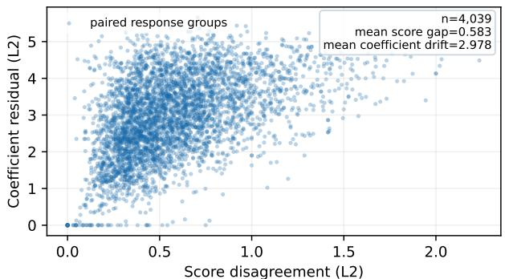  
(a) Score disagreement propagates jointly.

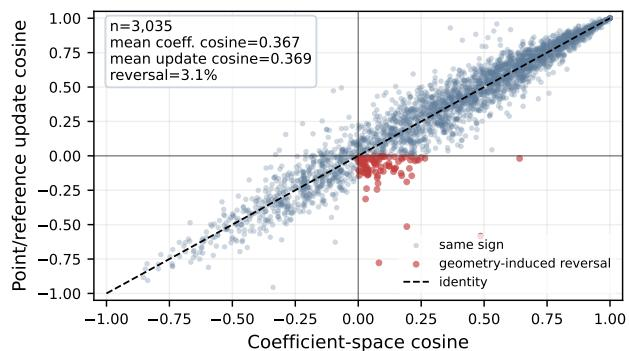  
(b) Policy geometry changes local update alignment.  
Figure 1. Illustration of score disagreement and its efect on local policy-update geometry.

Can Coeficient Drift Alone Characterize Update Safety? Fig. 1(b) applies the coeficients from the two scorings to the response-level gradients of the same response group and compares the local updates under diferent policy snapshots. The results show that similar coeficient shifts may produce diferent update magnitudes and directions, and that the updates induced by the two scorings may even have a negative inner product. Distance in coeficient space therefore cannot characterize update safety by itself, since the direction and magnitude of the update also depend on the gradient geometry of the current policy.

Can Group-wise Screening Control Aggregate Reversal Risk? The analyses in Fig. 1 jointly indicate that when the optimizer retains only the response groups satisfying a local criterion, the sample distribution entering optimization changes from all response groups to the acceptance set. Since diferent screening rules yield diferent acceptance sets, a per-group criterion only shows that a local condition holds and cannot directly provide control over the aggregate direction-reversal risk on the acceptance set. Risk assessment must therefore be based on conditional statistics over the response groups that are actually accepted.

In summary, group normalization turns score discrepancies into correlated shifts in training coeficients, whose update efects depend on the current policy’s response-level gradient geometry. Selective execution further changes the accepted groups and their aggregate direction-reversal risk. SetGRPO therefore jointly models coeficient uncertainty, policy-dependent update geometry, and acceptance-conditioned reversal risk.

## 4. Methodology

As the main innovation, SetGRPO constructs a joint coeficient set in the training-coeficient space actually used by GRPO and propagates it into the update space of the current policy, so as to recover efective and directionally consistent training updates as much as possible under grader score discrepancies. To address the propagation chain revealed by the pilot experiments in Section 3, SetGRPO consists of three interconnected modules: (a) Joint Reward Set Calibration, JRSC, (b) Geometry-Guided Safe Recovery, GGSR, and (c) Selective Risk-Gated Optimization, SRGO. In the following, we introduce these three modules in turn.

## 4.1. Joint Reward Set Calibration (JRSC)

As shown in Fig. 1(a), two grader scorings of the same response group produce correlated within-group shifts after the shared training mapping. We therefore propose Joint Reward Set Calibration, which models this coupled uncertainty as a joint coeficient set rather than independent response-wise errors. Specifically, for problem �, let $\mathbf { r } _ { x }$ and $\mathbf { r } _ { x } ^ { \star }$ denote the rewards from the first and second scorings. Using Eq. $1 , \hat { \mathbf { a } } _ { x } = T _ { \mathrm { t r a i n } } ( \mathbf { r } _ { x } )$ $\mathbf { a } _ { x } ^ { \star } = T _ { \mathrm { t r a i n } } ( \mathbf { r } _ { x } ^ { \star } )$ , where $T _ { \mathrm { t r a i n } }$ maps group rewards to within-group normalized coeficients. We define the paired residual $\pmb { \delta } _ { x } = \mathbf { a } _ { x } ^ { \star } - \hat { \mathbf { a } } _ { x }$ , which calibrates the coverage radius of the subsequent joint set.

Subsequently, to capture how reward changes jointly perturb the coeficient vector, we linearize $T _ { \mathrm { t r a i n } }$ around the first-scoring rewards $\mathbf { r } _ { x }$ and define $\mathbf { J } _ { x } = \nabla _ { \mathbf { r } } T _ { \mathrm { t r a i n } } ( \mathbf { r } ) | _ { \mathbf { r } = \mathbf { r } _ { x } }$ . Its �-th column describes how a perturbation in reward � afects all group coeficients, preserving the cross-response coupling induced by shared normalization. The resulting coeficient-uncertainty matrix under unit reward perturbations is

$$
\begin{array} { r } { \pmb { S } _ { x } ^ { \mathrm { c o e f } } = \mathbf { J } _ { x } \mathbf { J } _ { x } ^ { \top } + \lambda \mathbf { I } _ { K } , \qquad \lambda \geq 0 , } \end{array}\tag{4}
$$

where $\mathbf { J } _ { x } \mathbf { J } _ { x } ^ { \top }$ captures the cross-coeficient efects of local reward perturbations and determines set’s directional scales, while $\lambda \mathbf { I } _ { K }$ stabilizes inversion and distance computation in near-degenerate cases.

However, $\pmb { S } _ { z } ^ { \mathrm { c o e f } }$ specifies only the shape of the joint coeficient set, not its radius. We therefore calibrate a unified coverage radius from independent paired residuals. For each coverage-calibration group $z \in \mathcal { D } _ { \mathrm { c o v } } \ : ^ { 1 }$ , we compute the Mahalanobis score (Mahalanobis, 2018) $\rho _ { z } = \sqrt { \pmb { \delta } _ { z } ^ { \top } ( \pmb { S } _ { z } ^ { \mathrm { c o e f } } ) ^ { - 1 } \pmb { \delta } _ { z } }$ This score accounts for directional scale diferences and within-group correlations induced by reward normalization.

Next, let $n = | \mathcal { D } _ { \mathrm { c o v } } | , \rho _ { ( j ) }$ denote the �-th order statistic, and $\alpha \in ( 0 , 1 )$ be the target miss rate. Under exchangeability of the calibration and target groups (i.e., identical data construction, response sampling, and scoring protocols with permutation-invariant joint distributions), we define

$$
\begin{array} { r l } & { Q _ { \alpha } = \rho _ { ( \lceil ( n + 1 ) ( 1 - \alpha ) \rceil ) } , \quad C _ { x } = \left\{ \mathbf { a } \in \mathbb { R } ^ { K } : ( \mathbf { a } - \hat { \mathbf { a } } _ { x } ) ^ { \top } ( \mathbf { S } _ { x } ^ { \mathrm { c o e f } } ) ^ { - 1 } ( \mathbf { a } - \hat { \mathbf { a } } _ { x } ) \leq Q _ { \alpha } ^ { 2 } \right\} . } \end{array}\tag{5}
$$

Then $C _ { x }$ is an ellipsoidal joint coeficient set centered at $\hat { \mathbf { a } } _ { x }$ that contains the training coeficients of the second scoring with marginal probability at least $1 - \alpha$ . If $\lceil ( n + 1 ) ( 1 - \alpha ) \rceil = n + 1$ , no corresponding $( n + 1 )$ -th order statistic exists in the calibration set.

## 4.2. Geometry-Guided Safe Recovery (GGSR)

JRSC models the discrepancy between two grader scorings as the joint coeficient set $C _ { x }$ . We then propose Geometry-Guided Safe Recovery (GGSR), which maps $C _ { x }$ into the policy-update and reward spaces to identify the largest coeficient-recovery ratio whose update remains directionally consistent with the second scoring under the current policy.

Specifically, we first let $q \in \{ \mathrm { f i u l l } ,$ reward} denote the policy-update and reward spaces, respectively, with dimension $D _ { q }$ . Let $S ^ { q }$ be a fixed low-dimensional linear map, $\mathbf { P } _ { x } ^ { q }$ a linear transformation, and $\mathbf { h } _ { x } ^ { q }$ a coeficient-independent ofset. Notably, by full geometry we mean the complete local update geometry under a fixed projected representation, rather than the unprojected original parameter space. From the response-level gradients in Eq. 3, we define

$$
\mathbf { G } _ { x } ^ { q } = \left[ S ^ { q } ( \mathbf { g } _ { x , 1 } ) , \ldots , S ^ { q } ( \mathbf { g } _ { x , K } ) \right] \in \mathbb { R } ^ { D _ { q } \times K } , \quad \mathbf { u } _ { x } ^ { q } ( \mathbf { a } ) = \mathbf { P } _ { x } ^ { q } \left( \mathbf { G } _ { x } ^ { q } \mathbf { a } + \mathbf { h } _ { x } ^ { q } \right) \in \mathbb { R } ^ { D _ { q } } ,\tag{6}
$$

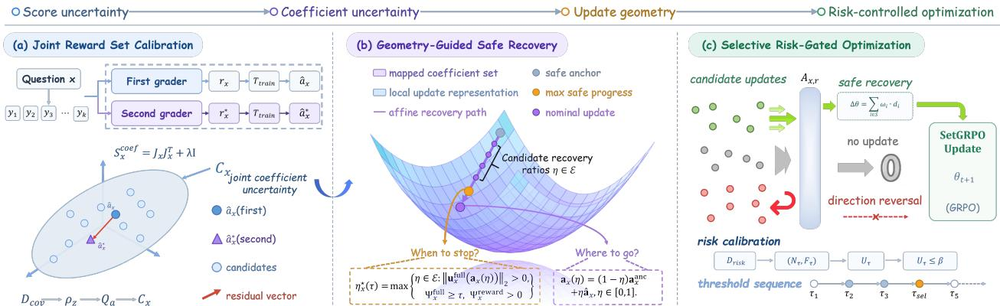  
Figure 2. Overview of SetGRPO. (a) Joint reward-set calibration uses two grader scores on the same response group to construct a joint coeficient uncertainty set. (b) Geometry-guided safe recovery maps candidate coeficients through the current policy geometry and identifies the largest direction-preserving recovery ratio. (c) Selective risk-gated optimization selects a global threshold and applies the recovered coeficients only to updates satisfying the calibrated conditional-risk constraint. where the �-th column of ${ \bf G } _ { x } ^ { q }$ is the projected gradient of response $y _ { x , i } ,$ and ${ \pmb u } _ { x } ^ { q } ( { \pmb a } )$ is the local update induced by the coeficients a in the space �.

For a candidate coeficient a, let $\mathbf { d } = \mathbf { u } _ { x } ^ { q } ( \mathbf { a } )$ and define the worst-case projection over the joint coeficient set as $\begin{array} { r } { \Psi _ { x } ^ { q } ( \mathbf { d } ) : = \operatorname* { m i n } _ { \tilde { \mathbf { a } } \in C _ { x } } \mathbf { d } ^ { \top } \mathbf { u } _ { x } ^ { q } ( \tilde { \mathbf { a } } ) } \end{array}$ . This quantity measures the candidate update’s worst-case alignment and magnitude under grader uncertainty. If $\mathbf { a } _ { x } ^ { \star } \in C _ { x } ,$ , then $\Psi _ { x } ^ { \mathrm { f u l l } } \Big ( \mathbf { u } _ { x } ^ { \mathrm { f u l l } } ( \mathbf { a } ) \Big ) \leq \big \langle \mathbf { u } _ { x } ^ { \mathrm { f u l l } } ( \mathbf { a } ) , \mathbf { u } _ { x } ^ { \mathrm { f u l l } } ( \mathbf { a } _ { x } ^ { \star } ) \big \rangle$ Thus, a positive full-space projection rules out direction reversal, while a positive reward-space projection preserves reward-direction consistency. Because $C _ { x }$ is ellipsoidal and ${ \bf u } _ { x } ^ { q }$ is afine in a, the projection has the closed form

$$
\Psi _ { x } ^ { q } ( \mathbf { d } ) = \mathbf { d } ^ { \top } \mathbf { u } _ { x } ^ { q } ( \hat { \mathbf { a } } _ { x } ) - Q _ { \alpha } \sqrt { \mathbf { d } ^ { \top } \mathbf { P } _ { x } ^ { q } \mathbf { G } _ { x } ^ { q } \mathbf { S } _ { x } ^ { \mathrm { c o e f } } ( \mathbf { G } _ { x } ^ { q } ) ^ { \top } ( \mathbf { P } _ { x } ^ { q } ) ^ { \top } \mathbf { d } } .\tag{7}
$$

However, the minimum-projection criterion evaluates a candidate coeficient but does not select one from $C _ { x }$ . We therefore choose the feasible coeficient with the smallest local-update norm as an anchor, denoted as $\mathbf { a } _ { x } ^ { \mathrm { a n c } } \in$ arg $\begin{array} { r } { \operatorname* { m i n } _ { \mathbf { a } \in C _ { x } } \frac { 1 } { 2 } \| \mathbf { u } _ { x } ^ { \mathrm { f u l l } } ( \mathbf { a } ) \| _ { 2 } ^ { 2 } . } \end{array}$ . Since $C _ { x }$ is convex and centered at $\hat { \mathbf { a } } _ { x } ,$ , the path $\mathbf { a } _ { x } ( \eta ) = ( 1 - \eta ) \mathbf { a } _ { x } ^ { \mathrm { a n c } } + \eta \hat { \mathbf { a } } _ { x } , \qquad \eta \in [ 0 , \bar { 1 } ]$ , remains in $C _ { x }$ . Here, � denotes the fraction of training recovered from the conservative anchor toward the first-scoring update. For a predetermined candidate set $\mathcal { E } \subseteq [ 0 , 1 ]$ , the maximum acceptable ratio under threshold $\tau \geq 0$ is

$$
\eta _ { x } ^ { \star } ( \tau ) = \operatorname* { m a x } \left\{ \eta \in \mathcal { E } : \left\| \mathbf { u } _ { x } ^ { \mathsf { f u l l } } ( \mathbf { a } _ { x } ( \eta ) ) \right\| _ { 2 } > 0 , \ \Psi _ { x } ^ { \mathsf { f u l l } } \Big ( \mathbf { u } _ { x } ^ { \mathsf { f u l l } } ( \mathbf { a } _ { x } ( \eta ) ) \Big ) \geq \tau , \ \Psi _ { x } ^ { \mathsf { r e w a r d } } \Big ( \mathbf { u } _ { x } ^ { \mathsf { r e w a r d } } ( \mathbf { a } _ { x } ( \eta ) ) \Big ) > 0 \right\} .\tag{8}
$$

If no � satisfies these conditions, group � produces no update.

## 4.3. Selective Risk-Gated Optimization (SRGO)

Equation 8 determines the maximum feasible recovery ratio for each response group at threshold �. Because � also controls whether a nonzero recovery exists, it induces the acceptance set $\mathcal { A } _ { \tau } =$ $\{ x \ : \ A _ { x , \tau } = 1 \}$ , where $A _ { x , \tau } = 1$ if the constraints admit a nonzero recovery ratio, and $A _ { x , \tau } = 0$ otherwise. The aggregate direction-reversal risk therefore depends on the composition of ${ \mathcal { A } } _ { \tau }$ , not only on the group-wise criterion. We thus introduce Selective Risk-Gated Optimization, which evaluates acceptance-conditioned risk for candidate thresholds on the independent risk-calibration set $\mathcal { D } _ { \mathrm { r i s k } }$ and selects a threshold that satisfies the risk constraint while retaining as much training signal as possible.

Specifically, for each candidate threshold $\tau \in \mathcal { T }$ , we define the direction-reversal event for accepted groups as $Z _ { x , \tau } = \mathbb { I } [  \mathbf { u } _ { x } ^ { \mathrm { f u l l } } \big ( \mathbf { a } _ { x } \big ( \eta _ { x } ^ { \star } ( \tau ) \big ) ) , \mathbf { u } _ { x } ^ { \mathrm { f u l l } } \big ( \mathbf { a } _ { x } ^ { \star } \big )  < 0 ]$ , and its acceptance-conditioned risk as

Table 1. Main results on ten downstream benchmarks. HB: HealthBench; LEM: LLMEval-Med; MQA: MedQA; MCQA: MedMCQA; WB: WritingBench; CW: Creative Writing v3; IFE: IFEval; IFB: IFBench; IB: InfoBench; and MIF: MulDimIF. Our results report the mean across repeated runs, with absolute improvements over the corresponding Base model shown in parentheses.
<table><tr><td rowspan="2">Model</td><td colspan="4">Medical</td><td colspan="2">Writing</td><td colspan="4">Instruction Following</td><td rowspan="2">Macro Avg.</td></tr><tr><td>HB</td><td>LEM</td><td>MQA</td><td>MCQA</td><td>WB</td><td>CW</td><td>IFE</td><td>IFB</td><td>IB</td><td>MIF</td></tr><tr><td colspan="10"></td></tr><tr><td>OpenAI-o3</td><td>59.80</td><td>78.90</td><td>96.00</td><td>84.70</td><td>77.70</td><td>81.40</td><td>91.60</td><td>67.80</td><td>89.40</td><td>64.00</td><td>79.13</td></tr><tr><td>GPT-4.1</td><td>47.90</td><td>71.20</td><td>92.40</td><td>80.00</td><td>69.00</td><td>79.00</td><td>87.00</td><td>37.20</td><td>89.40</td><td>64.00</td><td>71.71</td></tr><tr><td>Gemini-3 Pro Preview</td><td>49.30</td><td>72.70</td><td>67.00</td><td>62.20</td><td>78.50</td><td>81.50</td><td>94.20</td><td>61.20</td><td>85.60</td><td>66.83</td><td>71.90</td></tr><tr><td colspan="10">Open-sourced Models</td></tr><tr><td>Qwen3.5-4B</td><td>37.09</td><td></td><td>77.77</td><td>63.26</td><td>50.20</td><td>27.60</td><td>46.40</td><td>17.35</td><td>78.22</td><td>41.25</td><td>46.54</td></tr><tr><td>+ GRPO</td><td>56.94(+19.85)</td><td>26.24 43.29(+17.05)</td><td>79.11(+1.34)</td><td>63.55(+0.29)</td><td>64.92(+14.72)</td><td>29.98 (+2.38)</td><td>62.28(+15.88)</td><td>25.09(+7.74)</td><td>80.38 (+2.16)</td><td>48.55(+7.30)</td><td>55.41 (+8.87)</td></tr><tr><td>+ RuscaRL</td><td>65.10(+28.01)</td><td>45.30(+19.06)</td><td>79.60(+1.83)</td><td>63.30(+0.04)</td><td>67.50 (+17.30)</td><td>31.80(+4.20)</td><td>65.90(+19.50)</td><td>24.40(+7.05)</td><td>80.74(+2.52)</td><td>47.80(+6.55)</td><td>57.14(+10.60)</td></tr><tr><td>+ RubricHub</td><td>67.18(+30.09)</td><td>47.71(+21.47)</td><td>78.06(+0.29) 80.55(+2.78)</td><td>64.22(+0.96) 63.84(+0.58)</td><td>69.62(+19.42)</td><td>32.80(+5.20)</td><td>67.88(+21.48) 70.45(+24.05)</td><td>26.31 (+8.96) 28.97(+11.62)</td><td>82.91(+4.69) 82.32(+4.10)</td><td>49.84(+8.59) 52.35(+11.10)</td><td>58.65(+12.11) 60.26(+13.72)</td></tr><tr><td colspan="10">+ SetGRPO (Ours) 69.64(+32.55) 50.08(+23.84) 72.14(+21.94)</td></tr><tr><td></td><td>40.94</td><td>34.63</td><td>76.20</td><td>67.03</td><td></td><td>32.23(+4.63)</td><td>51.39</td><td>19.39</td><td>80.98</td><td>41.17</td><td>49.78</td></tr><tr><td>Qwen3.5-9B + GRPO</td><td>61.06(+20.12)</td><td>51.65(+17.02)</td><td>77.68(+1.48)</td><td>67.10(+0.07)</td><td>53.83 68.84(+15.01)</td><td>32.19 34.65(+2.46)</td><td>67.61(+16.22)</td><td>26.91(+7.52)</td><td>83.02(+2.04)</td><td>48.33(+7.16)</td><td>58.69(+8.91) 60.33(+10.55)</td></tr><tr><td colspan="10">+ RuscaRL 69.00(+28.06) 53.50(+18.87)</td></tr><tr><td>+ RubricHub</td><td>71.04(+30.10)</td><td>55.62(+20.99)</td><td>79.86(+3.66)</td><td>67.18(+0.15) 67.28(+0.25)</td><td>71.70(+17.87) 73.76(+19.93)</td><td>36.40(+4.21) 34.21(+2.02)</td><td>73.38(+21.99)</td><td>28.24(+8.85)</td><td>85.42(+4.44)</td><td>47.20(+6.03) 52.33(+11.16)</td><td>62.11(+12.33)</td></tr><tr><td>+ SetGRPO (Ours) 73.86(+32.92) 58.15(+23.52)</td><td></td><td></td><td>79.32(+3.12)</td><td></td><td>67.34(+0.31) 76.28(+22.45) 36.91(+4.72) 75.94(+24.55)</td><td></td><td></td><td>30.57(+11.18)</td><td>84.83(+3.85)</td><td>51.87(+10.70)</td><td>63.51(+13.73)</td></tr><tr><td colspan="10"></td></tr><tr><td>Llama 3.2-3B</td><td>14.37 21.08(+6.71)</td><td>15.96</td><td>57.18 58.66(+1.48)</td><td>48.74</td><td>30.63</td><td>32.57</td><td>71.08</td><td>23.67 25.58(+1.91)</td><td>44.93</td><td>35.69</td><td>37.48 44.72(+7.24)</td></tr><tr><td>+ GRPO + RuscaRL</td><td>22.84(+8.47)</td><td>17.42(+1.46) 17.96(+2.00)</td><td>60.47(+3.29)</td><td>49.32(+0.58) 51.05(+2.31)</td><td>40.49(+9.86) 42.52(+11.89)</td><td>35.41(+2.84)</td><td>77.69(+6.61) 79.58(+8.50)</td><td>27.76(+4.09)</td><td>45.14(+0.21) 46.67(+1.74)</td><td>76.42(+40.73) 79.35(+43.66)</td><td>46.85(+9.37)</td></tr><tr><td>+ RubricHub</td><td>24.61 (+10.24)</td><td>18.19(+2.23)</td><td>61.34(+4.16)</td><td>51.27(+2.53)</td><td>47.33(+16.70)</td><td>40.28 (+7.71)</td><td>80.93(+9.85)</td><td>28.67(+5.00)</td><td>47.44(+2.51)82.08(+46.39)</td><td></td><td>48.17(+10.69)</td></tr><tr><td>+ SetGRPO (Ours) 26.72(+12.35)</td><td></td><td>18.47(+2.51)</td><td></td><td>62.18(+5.00)52.14(+3.40)45.66(+15.03)42.51(+9.94)83.47(+12.39)</td><td></td><td>39.84(+7.27)</td><td></td><td>30.38(+6.71)</td><td></td><td></td><td>49.46(+4.53) 84.67(+48.98) 49.57(+12.09)</td></tr></table>

$R _ { \tau } = \mathrm { P r } ( Z _ { x , \tau } = 1 \ | \ A _ { x , \tau } = 1 )$ . On the independent risk-calibration set $\mathcal { D } _ { \mathrm { r i s k } } ,$ , let $N _ { \tau }$ and $F _ { \tau }$ denote the numbers of accepted and direction-reversed groups, respectively. We estimate $R _ { \tau }$ using the one-sided Clopper–Pearson upper bound $\begin{array} { r } { U _ { \tau } = \mathrm { C P U p p e r } \left( F _ { \tau } , N _ { \tau } ; 1 - \frac { \gamma } { | \mathcal { T } | } \right) } \end{array}$ , where $\beta$ is the target risk level and � is the family-wise failure probability across candidate thresholds. A threshold is feasible if $N _ { \tau } > 0$ and $U _ { \tau } \le \beta ;$ ; among feasible thresholds, we select the one maximizing cumulative recovery $Y _ { \tau }$ , formualted as,

$$
Y _ { \tau } = \sum _ { x \in \mathcal { D } _ { \mathrm { r i s k } } } A _ { x , \tau } \eta _ { x } ^ { \star } ( \tau ) , \quad \tau _ { \mathrm { s e l } } = \operatorname* { m i n } \left( \arg \operatorname* { m a x } _ { \tau \in \mathcal { T } : N _ { \tau } > 0 , U _ { \tau } \le \beta } Y _ { \tau } \right) .\tag{9}
$$

If several thresholds tie, the smaller one is taken; if no threshold satisfies the risk constraint, $\tau _ { s \mathrm { e l } }$ is undefined and the risk gating rule is disabled in subsequent training.

Once $\tau _ { s \mathrm { e l } }$ is determined, SetGRPO retains the probability ratio, clipping, and token-level surrogate term of the original GRPO and replaces only the training coeficients with,

$$
\mathcal { T } _ { \mathrm { S e t G R P O } } ( \pmb { \theta } ) = \mathcal { T } _ { \mathrm { G R P O } } \left( \pmb { \theta } ; \widetilde { \mathbf { a } } _ { x } \right) , \qquad \widetilde { \mathbf { a } } _ { x } = \left\{ \begin{array} { l l } { \mathbf { a } _ { x } \left( \eta _ { x } ^ { \star } ( \tau _ { \mathrm { s e l } } ) \right) , } & { A _ { x , \tau _ { \mathrm { s e l } } } = 1 , } \\ { \mathbf { 0 } _ { K } , } & { A _ { x , \tau _ { \mathrm { s e l } } } = 0 . } \end{array} \right.\tag{10}
$$

Accepted response groups use their recovered coeficients, while the remaining groups yield no policy update. We further evaluate the predetermined $\tau _ { s \mathrm { e l } }$ across diferent training checkpoints to test its empirical stability under policy drift.

## 5. Experiments

## 5.1. Experimental Setup

Data and evaluation. We perform reinforcement learning training on the RubricHub training set (Li et al., 2026a), whose data covers five task types: Chat, Instruction Following, Medical, Science, and Writing. After training, each model is evaluated on ten downstream benchmarks spanning three domains: healthcare, writing, and instruction following. The healthcare benchmarks include HealthBench, LLMEval-Med, MedQA, and MedMCQA; the writing benchmarks include WritingBench and Creative Writing v3; and the instruction following benchmarks include IFEval, IFBench, InfoBench, and MulDimIF. For benchmarks that require model scoring, we uniformly invoke the GPT-5.6-Luna

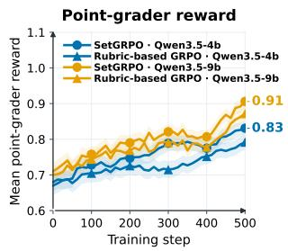

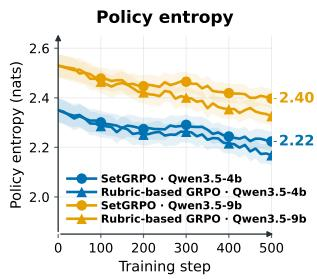

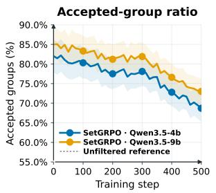

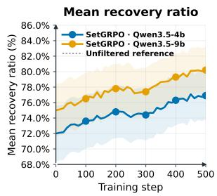  
Figure 3. Training dynamics of SetGRPO, including the reward obtained from the first score, policy entropy, accepted-group ratio, and mean recovery ratio over the first 500 training steps.

API. Each benchmark uses its oficial evaluation metrics, and Macro Avg. is used only to aggregate the results of the ten benchmarks.

Models and baselines. We use Qwen3.5-4B, Qwen3.5-9B and Llama 3.2-3B as backbones and compare Base (the backbone without the training in this study) against four training methods: Rubricbased GRPO, RubricHub (Li et al., 2026a), RuscaRL (Zhou et al., 2026), and SetGRPO. Rubric-based GRPO uses the same rewards obtained from the first scoring as SetGRPO and is the main control for diferences in the training objective; RubricHub and RuscaRL are run following their publicly available training procedures, with identical data scale, training budget, and final evaluation protocol.

Training details. For each prompt, we generate � = 8 rollout responses with a maximum response length of 4096 tokens. All methods use the same training data, number of training steps, and generation budget, and are evaluated under the same protocol after training. For benchmarks requiring model scoring, all methods use the same judge, prompt, and decoding configuration. The rubric rewards during training are provided by a Qwen3-32B grader. The online rewards of SetGRPO come from the first grader scoring; the second grader scoring is computed only for pre-frozen response groups, used for calibration and excluded from the training coeficients of online groups.

## 5.2. Main Results

Overall performance. Table 1 reports results on ten benchmarks across three backbones. SetGRPO achieves the highest Macro Avg. on Qwen3.5-4B and Qwen3.5-9B, reaching 60.26 and 63.51, respectively. On Qwen3.5-9B, it improves over RubricHub by 2.82 points on HealthBench and 2.52 on WritingBench, and over RuscaRL by 4.86 on HealthBench and 4.65 on LLMEval-Med. Relative to RubricHub, its average gains across healthcare, writing, and instruction-following tasks are 1.22, 2.61, and 0.96 points, respectively, with consistent improvements across backbones. These results indicate that SetGRPO improves performance across diferent backbones and task domains by jointly modeling the training-coeficient shifts caused by score discrepancies and screening for actionable updates in combination with the update geometry of the current policy.

Training dynamics. Figure 3 shows how the mean reward from the first scoring, policy entropy, proportion of accepted groups, and mean recovery ratio over accepted groups evolve during training. The mean reward from the first scoring rises steadily in the early phase and saturates later; policy entropy decreases gradually without an abrupt collapse. Compared with unfiltered training, the proportion of accepted groups is lower but remains nonzero in the later phase, and the mean recovery ratio over accepted groups stays within 76%–80%. This indicates that screening excludes response groups that fail the projection condition while nonzero training coeficients still enter the optimization. The steady rise of reward indicates that the retained updates bring training progress, and the stable decline of entropy indicates that the policy does not exhibit marked additional shrinkage.

## 5.3. Same-Backbone Comparison

In this section, we compare SetGRPO with RubricHub on Qwen3-4B and Qwen3-14B using the same backbone for each comparison. All other experimental settings follow those used for the Qwen3.5 and Llama3.2 experiments, including the data splits, rollout group size, decoding configuration, training steps, generation budget, grader configuration, and evaluation protocol. The backbone-specific implementation details are summarized separately in Tables 3 and 4. Consistent with the main text (detailed in Section 5.2), we report results on ten benchmarks and analyze them across the Medical, Writing, and Instruction Following domains.

On Qwen3-4B, SetGRPO achieves a Macro Avg. of 57.56, improving over RubricHub by 1.50 points. In the Medical domain, SetGRPO improves over RubricHub by 2.48 and 2.45 points on HealthBench and LLMEval-Med, respectively, while the diferences on MedQA and MedMCQA are 0.47 and 0.46 points. Thus, the gain in the medical domain mainly comes from openended medical evaluation, while performance on multiple-choice evaluation remains close to that of RubricHub. SetGRPO represents the correlated training-coeficient shifts caused by shared normalization of within-group score discrepancies as a joint coeficient set. It then combines this set with the response-level gradients of the current policy to determine whether candidate coef-

Table 3. Training and rollout configuration for Qwen3-4B and Qwen3-14B.
<table><tr><td>Configuration</td><td>Qwen3-4B</td><td>Qwen3-14B</td></tr><tr><td>Rollout group size K</td><td>8</td><td>8</td></tr><tr><td>Max prompt length</td><td>2048</td><td>2048</td></tr><tr><td>Max response length</td><td>4096</td><td>4096</td></tr><tr><td>Batch size</td><td>64</td><td>64</td></tr><tr><td>Mini-batch size</td><td>32</td><td>32</td></tr><tr><td>Optimizer</td><td>AdamW</td><td>AdamW</td></tr><tr><td>Learning rate</td><td>10-6</td><td>10⁻6</td></tr><tr><td>Weight decay</td><td>0.01</td><td>0.01</td></tr><tr><td>KL coefficient</td><td>0.001</td><td>0.001</td></tr><tr><td>Rollout decoding (T / top-p / top-k) 1.0 / 1.0 / 20 1.0 / 1.0 / 20</td><td></td><td></td></tr><tr><td>Training steps</td><td>500</td><td>500</td></tr><tr><td>Checkpoint frequency</td><td>10</td><td>10</td></tr></table>

ficients induce policy updates consistent with the reference update, thereby reducing erroneous or reversed updates caused by score discrepancies.

In the Writing domain, SetGRPO improves over RubricHub by 2.46 and 1.71 points on WritingBench and Creative Writing v3, respectively. For writing tasks that jointly impose requirements on content, style, format, and length, as well as open-ended tasks emphasizing creative quality, SetGRPO retains efective score signals related to writing quality by re-

Table 4. Frozen coverage and risk calibration records for Qwen3-4B and Qwen3-14B. ECR denotes empirical conditional risk.
<table><tr><td>Backbone</td><td>Cov.</td><td>Risk</td><td> $Q _ { \alpha }$ </td><td> $\tau _ { \mathrm { { s e l } } }$ </td><td>N</td><td>F</td><td>ECR</td><td>U</td></tr><tr><td>Qwen3-4B</td><td></td><td>27,229 27,229</td><td>91.32</td><td>0.25</td><td>19113</td><td>1047</td><td>0.05480.575</td><td></td></tr><tr><td>Qwen3-14B 27,22927,2291.450.251913710580.0554 0.580</td><td></td><td></td><td></td><td></td><td></td><td></td><td></td><td></td></tr></table>

Table 2. Same-backbone comparison between RubricHub and SetGRPO on Qwen3-4B and Qwen3-14B. RubricHub results were reproduced by our implementation using its publicly available training procedure. HB: HealthBench; LEM: LLMEval-Med; MQA: MedQA; MCQA: MedMCQA; WB: WritingBench; CW: Creative Writing v3; IFE: IFEval; IFB: IFBench; IB: InfoBench; and MIF: MulDimIF.
<table><tr><td rowspan="2">Backbone</td><td rowspan="2">Method</td><td colspan="4">Medical</td><td colspan="2">Writing</td><td colspan="4">Instruction Following</td><td rowspan="2">Macro Avg.</td></tr><tr><td>HB</td><td>LEM</td><td>MQA</td><td>MCQA</td><td>WB</td><td>CW</td><td>IFE</td><td>IFB</td><td>IB</td><td>MIF</td></tr><tr><td rowspan="2">Qwen3-4B</td><td>RubricHub</td><td>64.34</td><td>45.12</td><td>78.38</td><td>61.88</td><td>66.51</td><td>28.47</td><td>64.21</td><td>24.08</td><td>80.21</td><td>47.35</td><td>56.06</td></tr><tr><td>SetGRPO (Ours)</td><td>66.82</td><td>47.57</td><td>77.91</td><td>61.42</td><td>68.97</td><td>30.18</td><td>66.83</td><td>26.49</td><td>79.66</td><td>49.72</td><td>57.56</td></tr><tr><td rowspan="2">Qwen3-14B</td><td>Rubrichub</td><td>68.44</td><td>53.36</td><td>77.53</td><td>64.76</td><td>70.42</td><td>32.71</td><td>69.74</td><td>25.61</td><td>82.88</td><td>46.79</td><td>59.12</td></tr><tr><td>SetGRPO (Ours)</td><td>70.91</td><td>54.88</td><td>76.94</td><td>64.18</td><td>72.83</td><td>34.62</td><td>72.21</td><td>27.94</td><td>82.17</td><td>49.18</td><td>60.59</td></tr></table>

covering executable training progress that satisfies the projection conditions. It therefore improves performance on both evaluations. In the Instruction Following domain, SetGRPO improves over RubricHub by 2.62, 2.41, and 2.37 points on IFEval, IFBench, and MulDimIF, respectively, while the diference on InfoBench is 0.55 points. The gains on the first three evaluations indicate improved adherence to explicit, unseen, and multidimensional constraints. For instructions requiring multiple requirements to be satisfied simultaneously, the method first screens executable updates using the joint coeficient set and the projection conditions in the policy-update space, and then uses independent risk calibration to select a unified threshold. This reduces the damage that direction-reversed updates can cause to multi-constraint behavior.

On Qwen3-14B, SetGRPO improves the Macro Avg. over RubricHub by 1.47 points. After the joint coeficient set and execution threshold are calibrated separately for the two backbones, SetGRPO achieves consistent overall gains. This indicates that the improvement comes from its treatment of score discrepancies, policy updates, and risk screening rather than dependence on a particular backbone. Overall, SetGRPO jointly represents the training-coeficient shifts caused by within-group score discrepancies, uses the response-level gradients of the current policy to screen and recover executable training progress, and applies risk calibration to determine a unified execution threshold, thereby improving benchmark performance across backbones and task domains.

## 6. Analysis and Discussion

This section reports the conditional direction-reversal risk of accepted updates and analyzes the efect of diferent design variants and the additional computational overhead on the final results.

## 6.1. Risk Calibration and Retained Updates

Figure 4 shows the empirical direction-reversal risk and its one-sided Clopper–Pearson upper confidence bound across candidate thresholds, together with the target risk $\beta$ and the selected threshold $\tau _ { \mathrm { s e l } } = 0 . 2 5$ . As the screening condition tightens, both the empirical risk and its upper confidence bound decrease overall. At the selected threshold, the upper confidence bound remains below $\beta = 0 . 0 8$

## 6.2. Ablation Studies

To isolate the efects of joint coeficient modeling, policy-update geometry, coeficient recovery, and threshold selection, we evaluate three variant groups: (a) an isotropic coeficient set instead of the joint set; (b) variants removing the policy-space projection condition, coeficient recovery, or reward-space projection condition; and (c) a fixed threshold instead of risk-calibrated threshold selection. We also include a matched random-discard baseline that retains the same number of groups as SetGRPO to distinguish geometry-based screening from merely reducing updates.

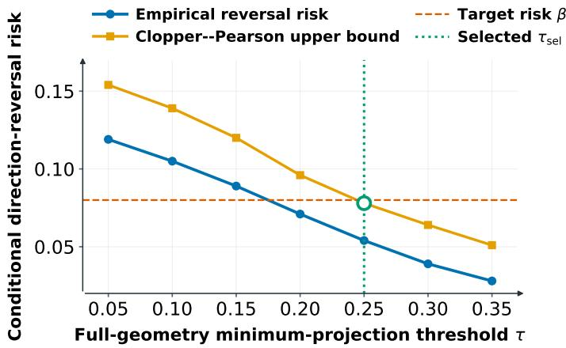  
Figure 4. Risk calibration and retained updates at the selected threshold $\tau _ { s \mathrm { e l } }$

Table 5 shows that all variants underperform the full setting (Macro Avg. 60.26). Replacing thejoint coeficient set with a spherical set reduces the Macro Avg. to 56.72 and raises reversal risk to 0.096, indicating that this variant fails to preserve the within-group correlated coeficient shifts. Removing the projection condition of the policyupdate space reduces the macro average to 55.18 and raises the risk to 0.118, indicating that screening in coeficient space alone is insuficient to determine the efect of coeficient changes

Table 5. Ablation study of SetGRPO on Qwen3.5-4B. Δ denotes the change from Full SetGRPO in each metric’s native units; upward arrows indicate the preferred direction. CR is normalized cumulative recovery and NUR is the nonzero update rate. Reversal risk, NUR, and CR lie in [0, 1].
<table><tr><td rowspan="2">D# Derivative</td><td colspan="2">Macro Avg.</td><td colspan="2">Reversal risk</td><td colspan="2">CR</td><td colspan="2">NUR</td></tr><tr><td>↑</td><td>Δ</td><td>↓</td><td>Δ</td><td>↑</td><td>Δ</td><td>↑</td><td>Δ</td></tr><tr><td colspan="9">(a) Coefficient-set construction</td></tr><tr><td>1 Spherical set</td><td>56.62</td><td>-3.64</td><td>0.096</td><td>+0.049</td><td>0.61</td><td>-0.19</td><td>0.512</td><td>-0.190</td></tr><tr><td colspan="9">(b) Local geometry and recovery</td></tr><tr><td>2 Identity geometry</td><td>55.08</td><td>-5.18</td><td>0.118</td><td>+0.071</td><td>0.51</td><td>-0.29</td><td>0.438</td><td>-0.264</td></tr><tr><td>3 Safe-anchor-only</td><td>56.94</td><td>-3.32</td><td>0.061</td><td>+0.014</td><td>0.36</td><td>-0.44</td><td>0.318</td><td>-0.384</td></tr><tr><td>4 Reward-only recovery</td><td>57.78</td><td>-2.48</td><td>0.103</td><td>+0.056</td><td>0.57</td><td>-0.23</td><td>0.566</td><td>-0.136</td></tr><tr><td colspan="9">(c) Threshold selection and update control</td></tr><tr><td>5 Fixed-threshold</td><td>58.11</td><td>-2.15</td><td>0.089</td><td>+0.042</td><td>0.60</td><td>-0.20</td><td>0.548</td><td>-0.154</td></tr><tr><td>6</td><td>Matched random discard 54.83</td><td>-5.43</td><td>0.154</td><td>+0.107</td><td>0.49</td><td>-0.31</td><td></td><td>0.7020.000</td></tr><tr><td colspan="9">SetGRPO (Ours) 60.26 0.00 0.047 0.000 0.80 0.000 0.702 0.000</td></tr></table>

on the current policy update. Keeping only the minimum-norm starting point gives a macro average of 57.04 with the recovery amount dropping to 0.36, indicating that not recovering the training coeficients costs training progress. Removing the minimum projection condition in the reward space gives a macro average of 57.88 with the risk rising to 0.103, indicating that the direction screening in the policy-update space cannot substitute for the positive projection condition in the reward space. The fixed threshold variant reaches 58.21 with a risk 0.042 higher than the full setting, indicating that risk calibration contributes to the selection of the execution threshold. Finally, matched random discard reaches only 54.93 despite a comparable acceptance rate, showing that the gains come from targeted screening rather than simply reducing updates.

## 6.3. Eficiency Comparison

In Table 6, we compare GRPO and SetGRPO in computational cost and benchmark performance. Set-GRPO increases per-step training time from 82 to 103 s, peak VRAM from 61 to 67 GB, and cumulative

Table 6. Eficiency comparison between GRPO and SetGRPO.
<table><tr><td rowspan="2">Method</td><td colspan="5">Training-time breakdown</td><td colspan="2">Resource usage</td><td rowspan="2">10-Benchmark Macro Avg.</td></tr><tr><td>time (s)</td><td>Single-step Rollout Grader Jacobian</td><td></td><td></td><td>Coefficient time (s) time (s) time (s) recovery time (s)</td><td>Peak VRAM Cumulative (GB)</td><td>GPU-hours</td></tr><tr><td>GRPO</td><td>82</td><td>48</td><td>18</td><td>0</td><td>0</td><td>61</td><td>22.8</td><td>55.41</td></tr><tr><td>SetGRPO</td><td>103</td><td>48</td><td>18</td><td>13</td><td>7</td><td>67</td><td>28.6</td><td>60.26</td></tr></table>

GPU hours from 22.8 to 28.6, corresponding to increases of 25.6%, 9.8%, and 25.4%, while rollout and grader times remain unchanged at 48 s and 18 s. The overhead mainly comes from Jacobian computation for coeficient-set calibration and per-group search for the largest projection-safe recovery ratio. In return, the ten-benchmark Macro Avg. increases from 55.41 to 60.26 (+4.75), indicating improved performance at the cost of additional computation.

## 6.4. Recovery and Selection Diagnostics

We report the main training curves in Figure 3. This section further reports the coeficient norm, full-space and reward-space minimum projections, and cumulative recovery to examine the scale of recovered coeficients, the projection conditions over the joint coeficient set, and the recovery retained during training.

1) Coeficient-Norm Dynamics. Figure 5 shows the norm of the recovered coeficients throughout training. The coeficient norm remains generally stable and changes moderately with the policy state, without a sustained upward trend. This result is consistent with the recovery range determined by the joint coeficient set and the recovery path from the minimum-update-norm anchor to the point-grader training coeficients. It indicates that the performance gain comes from screening and retaining executable recovery updates rather than continuously enlarging the training coeficients.

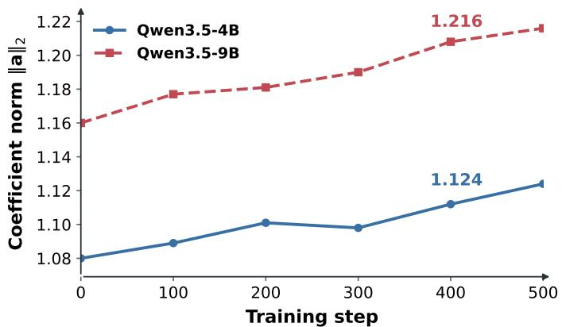  
(a) Coeficient-norm trajectory.

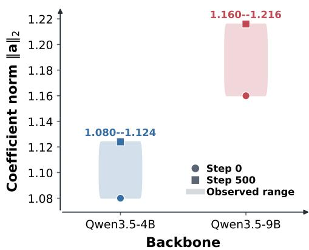  
(b) Observed norm range.  
Figure 5. Coeficient-norm dynamics during training. The left panel shows the coeficient-norm trajectories of the two backbones, while the right panel summarizes the observed norm range between training steps 0 and 500. The bounded ranges indicate that coeficient recovery does not lead to sustained numerical growth.

2) Minimum-Projection Diagnostics. Figure 6 shows the fullspace and reward-space minimum projections. For accepted updates, the full-space minimum projection remains above the selected threshold $\tau _ { \mathrm { { s e l } } }$ , while the reward-space minimum projection remains positive. Response groups that produce no recovery update fail at least one of these conditions. This result shows that screening jointly checks the policyupdate projection under the joint coeficient set $C _ { x }$ and the reward-space projection, thereby keeping retained updates consistent with the local updates induced by the reference training coeficients ing coefficients $\mathbf { a } _ { x } ^ { \star }$ while maintaining a positive projection in reward space.

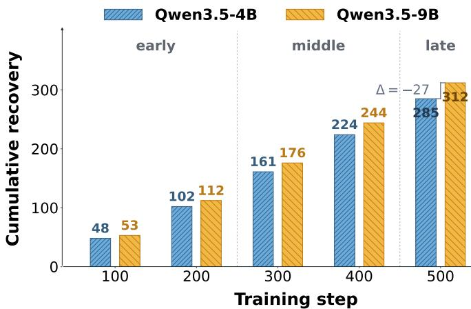  
Figure 7. Cumulative recovery over the first 500 training steps for Qwen3.5-4B and Qwen3.5-9B. Shaded regions distinguish the early, middle, and late stages; the bracket reports the final cumulative-recovery gap.

3) Cumulative Recovery. Figure 7 shows cumulative recovery as a function of training steps. Cumulative recovery continues to increase, but its growth rate varies across training stages, reflecting diferences in the number of response groups satisfying the recovery conditions and in their maximum recovery ratios. The curve shows that response groups continue to satisfy the recovery conditions and write back nonzero recovered coeficients throughout formal training. Thus, the retained training progress is not concentrated in only a few training steps.

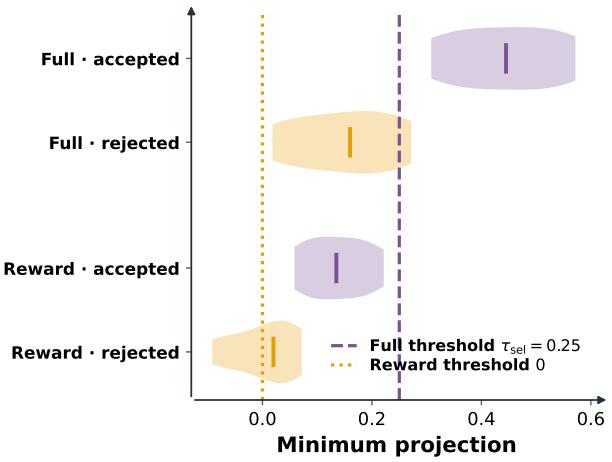  
(a) Projection distributions.

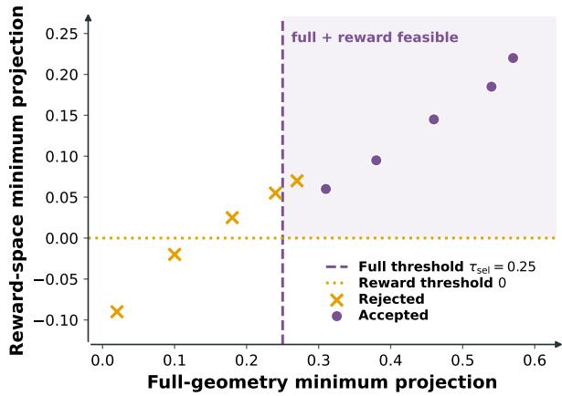  
(b) Joint projection constraints.  
Figure 6. Projection diagnostics for accepted and rejected updates. The left panel shows the distributions of full-geometry and reward-space minimum projections. The right panel shows their joint constraints; the shaded upper-right region satisfies both the full-geometry threshold $\tau _ { s \mathrm { e l } }$ and the positive reward-space projection condition.

## 6.5. Afine-Invariance Sanity Check

Training coeficients are determined by the centering and scale normalization of rewards within each group. To test this property, we apply a positive-afine transformation to frozen response groups and policy snapshots:

$$
{ \bf r } _ { x } ^ { \prime } = a { \bf r } _ { x } + b { \bf 1 } _ { K } , \qquad a > 0 .\tag{11}
$$

Because a positive-afine transformation does not change within-group standardized rewards, the training coeficients andjoint coeficient sets before and after transformation should remain unchanged. Under the same response-level gradients, ${ \bf G } _ { x . } ^ { q }$ , and ${ \mathfrak { u } } _ { x } ^ { q } ( \mathbf { a } )$ , with the calibrated risk rule fixed, we compare the local updates, maximum recovery ratios, and response groups entering training under the two reward representations.

Figure 8 shows the coeficient residuals $( \mathbf { a } _ { x } ^ { \prime } - \mathbf { a } _ { x } ) \times 1 0 ^ { 4 }$ under four positive-afine transformations. The point clouds are centered around zero, and the within-group means are close to zero, indicating that the standardized training coeficients difer only within numerical tolerance. Ta-

Table 7. Positive-afine invariance diagnostics.
<table><tr><td>Transform</td><td>Coeff. cosine Update cosine Flip (%)</td><td></td><td> $| \Delta \eta ^ { \star } | \ ( 1 0 ^ { - 3 } )$ </td></tr><tr><td> $a = 0 . 5 , \ b = - 1$ </td><td>0.9998</td><td>0.9996</td><td>0.00 0.6</td></tr><tr><td> $a = 1 , \ b = 0$ </td><td>1.0000</td><td>1.0000</td><td>0.00 0.0</td></tr><tr><td> $a = 2 , \ b = 1$ </td><td>0.9999</td><td>0.9998</td><td>0.00 0.4</td></tr><tr><td> $a = 3 , \ b = - 2$ </td><td>0.9997</td><td>0.9995</td><td>0.00 0.8</td></tr></table>

ble 7 reports the corresponding directional and recovery metrics. The coeficient cosine and update cosine range from 0.9997 to 1.0000 and from 0.9995 to 1.0000, respectively. None of the four transformations produces a decision flip, and the largest diference in recovery ratio is only $0 . 8 \times 1 0 ^ { - 3 }$ . Thus, the training coeficients, local updates, and recovery ratios remain free of systematic changes under positive-afine transformations, indicating that the screening results are stable to reward translation and positive rescaling.

This invariance follows from the elimination of positive-afine transformations by within-group normalization. For $\mathbf { r } _ { x } ^ { \prime } = a \mathbf { r } _ { x } + b \mathbf { 1 } _ { K }$ with $a > 0$ , the centered and scale-normalized rewards remain unchanged. Consequently, the training coeficients obtained from Eq. 1 remain unchanged, and the joint coeficient set constructed from the paired coeficient residuals does not change materially. With the response-level gradients, $\mathbf { G } _ { x } ^ { q } .$ , and ${ \mathfrak { u } } _ { x } ^ { q } ( \mathbf { a } )$ of the current policy fixed, the updates and their minimum projections in the policy-update space and reward space also remain stable. Along the same recovery path, $\eta _ { x } ^ { \star }$ changes only at the level of floating-point error.

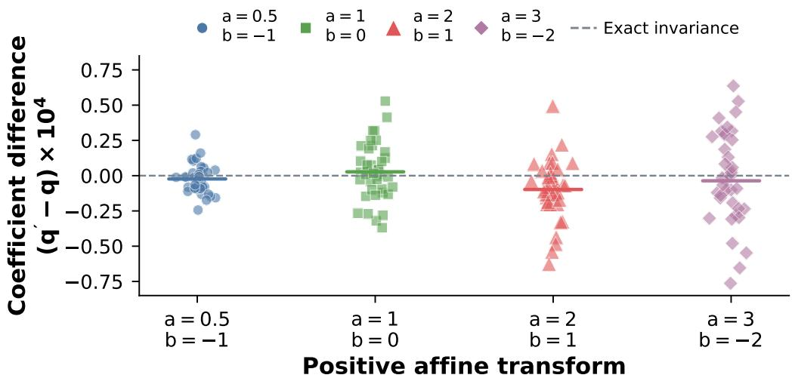  
Figure 8. Positive-afine invariance under frozen-policy control. The left plot reports coeficient diferences between the original and transformed standardized coeficients. The right table summarizes coeficient cosine, update cosine, decision flips, and the absolute recovery-ratio diference for each transform $\mathbf { r } _ { x } ^ { \prime } = a \mathbf { r } _ { x } + b \mathbf { 1 } _ { K }$ with $a > 0$

This experiment shows that the training coeficients, local updates, minimum projections, and recovery ratios in SetGRPO are determined by the relative structure of within-group rewards. Translating or positively rescaling all rewards in a group does not systematically change these quantities. In contrast, transformations that do not preserve the within-group reward ordering, such as negative rescaling or response-specific non-afine perturbations, may alter the normalized rewards and consequently change the training coeficients, minimum projections, and recovery ratios.

## 6.6. Empirical Coverage and Risk Selection

Figure 9 reports the coverage performance of the joint coeficient set and the post-screening directionreversal risk. For each predefined nominal coverage level, we compute $Q _ { \alpha }$ on the coverage calibration groups and compare nominal and empirical coverage on independent risk calibration groups. Empirical coverage varies with the target level and remains close to it overall. Under the final setting, both nominal and empirical coverage are 0.95, indicating that the joint coeficient set constructed from coeficient residuals standardized by $\pmb { S } _ { x } ^ { \mathrm { c o e f } }$ covers the reference training coeficients. This result is consistent with Eq. 5: when the calibration groups and the response groups to be covered satisfy exchangeability, $Q _ { \alpha }$ provides the corresponding finite-sample marginal coverage guarantee.

Figure 9(b) compares the directional relationship between local updates induced by the training coeficients from the two scores for response groups entering and not entering training under $\tau _ { s \mathrm { e l } }$ According to Eq. 9, the direction-reversal event $Z _ { x , \tau }$ and its conditional risk $R _ { \tau }$ are defined only for response groups with nonzero recovery updates. For groups not entering training, we report only the comparison indicator between the local updates induced by the training coeficients from the two scores:

$$
Z _ { x } ^ { \mathrm { n o m } } = \mathbb { I } ! \left[ \left. \mathbf { u } _ { x } ^ { \mathrm { f u l l } } ( \hat { \mathbf { a } } _ { x } ) , \mathbf { u } _ { x } ^ { \mathrm { f u l l } } ( \mathbf { a } _ { x } ^ { \star } ) \right. < 0 \right] .\tag{12}
$$

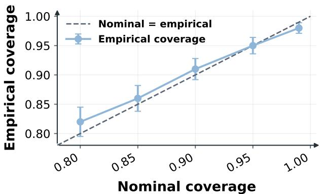  
(a) Coverage of the joint coeficient set.

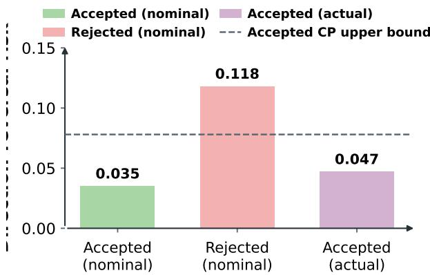  
(b) Risk separation at the selected threshold.  
Figure 9. Empirical coverage of the joint coeficient set and direction-reversal risk separation at the selected threshold.

In the figure, response groups entering training satisfy $\operatorname* { P r } ( Z _ { x } ^ { \mathrm { n o m } } = 1 \mid A _ { x , \tau _ { \mathrm { s e l } } } = 1 ) = 0 . 0 3 5$ , whereas the corresponding proportion is $\operatorname* { P r } ( Z _ { x } ^ { \mathrm { n o m } } = 1 \ | \ A _ { x , \tau _ { \mathrm { s e l } } } = 0 ) = 0 . 1 1 8$ for groups not entering training. For groups that actually enter training, the empirical direction-reversal risk is 0.047, with a one-sided Clopper–Pearson upper confidence bound of $U _ { \tau _ { \mathrm { s e l } } } = 0 . 0 7 8$ , satisfying $U _ { \tau _ { \mathrm { s e l } } } \leq \beta$ . Thus, the screened training groups exhibit a lower direction-reversal rate. This is because Eq. 8 retains only groups with a nonzero feasible recovery ratio that satisfy $\Psi _ { x } ^ { \mathrm { f u l l } } \geq \tau _ { \mathrm { s e l } }$ and $\Psi _ { x } ^ { \mathrm { r e w a r d } } > 0$ . The first condition requires the candidate update to maintain suficient policy-update projection under the joint coeficient set, while the second requires a positive projection in reward space. Therefore, risk-calibrated screening changes the composition of groups entering training and keeps the acceptance-conditioned direction-reversal risk within the target range.

## 6.7. Checkpoint-wise Validation under Policy Drift

Figure 10 presents checkpoint validation of the fixed calibration results along the training trajectory. During calibration, we determine $Q _ { \alpha }$ and $\tau _ { \mathrm { { s e l } } }$ , and then rerun SRGO on the same response groups at global steps $t \in \{ 0 , 1 0 0 , 2 5 0 , 5 0 0 \}$ . At each checkpoint, the projected local updates, $\mathbf { \Psi } { \Psi } _ { x } ^ { \mathrm { f u l l } }$ ll, Ψreward, and recovery ratios are computed solely from the response-level gradients of the current policy. The values of $Q _ { \alpha }$ and $\tau _ { s \mathrm { e l } }$ remain unchanged across checkpoints.

As training proceeds, the local update geometry of the current policy changes, but the screening behavior does not exhibit abrupt changes. In Figure 10(a), the accepted-group proportion decreases slightly from the initial to the intermediate checkpoint and then stabilizes. In Figure 10(b), the mean recovery ratio of accepted groups remains positive, indicating that policy changes do not eliminate feasible recovery paths. Meanwhile, the empirical conditional direction-reversal rate of accepted groups remains low, and its one-sided upper confidence bound shows no substantial increase at any checkpoint. Rejected groups consistently exhibit higher direction-reversal rates. These results indicate that policy drift mainly changes the positions of response groups relative to the joint coeficient set, without disrupting the screening relation defined by $\Psi _ { x } ^ { \mathrm { f u l l } } \geq \tau _ { \mathrm { s e l } }$ and $\Psi _ { x } ^ { \mathrm { r e w a r d } } > 0$

This result is consistent with the joint coeficient set and risk-selection threshold fixed during calibration. During formal training, $Q _ { \alpha }$ and $\tau _ { s \mathrm { e l } }$ remain fixed, while each checkpoint recomputes $\Psi _ { x } ^ { \mathrm { f u l l } }$ $\Psi _ { x } ^ { \mathrm { r e w a r d } }$ , and the recovery ratios using only the local gradients at that checkpoint. Thus, diferences across checkpoints reflect the efect of changing local update geometry on recovery ratios rather than re-estimation of the calibration quantities. Response groups satisfying $\Psi _ { x } ^ { \mathrm { f u l l } } \geq \tau _ { \mathrm { s e l } }$ and $\Psi _ { x } ^ { \mathrm { r e w a r d } } > 0$ retain nonzero recovered coeficients, whereas the remaining groups stop recovery and write back zero coeficients. The results show that policy drift changes projection values and recovery ratios, while acceptance and rejection continue to be determined by the same projection conditions. Accepted groups retain lower direction-reversal risk and positive recovery ratios, indicating that the screening rule continues to distinguish recoverable updates from updates that fail the conditions throughout the training trajectory.

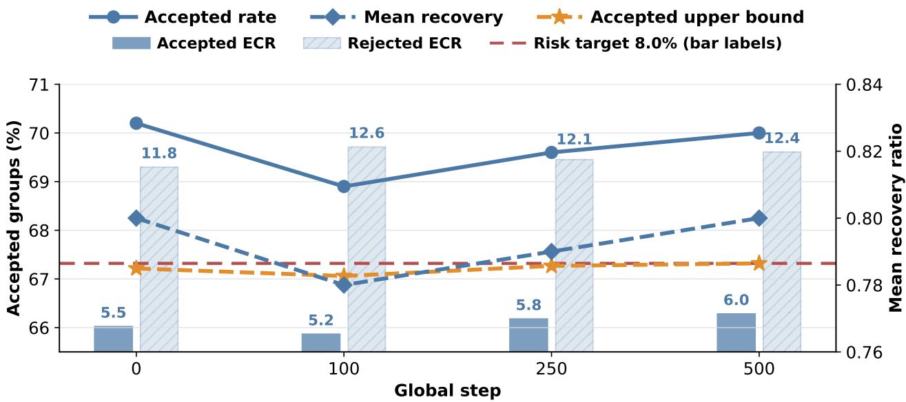  
Figure 10. Checkpoint-wise validation of the fixed SRGO rule under policy drift on Qwen3.5-4B. Curves show the accepted-group rate, mean recovery ratio, and accepted-group upper confidence bound; bars show empirical direction-reversal rates for accepted and rejected groups. The red dashed line denotes $\beta = 0 . 0 8$

## 7. Representative Cases

Figures 11–13 present three types of response groups: accepted, rejected, and recovery-infeasible, with three representative cases for each type. Each case reports the two scores, the corresponding training coeficients, the minimum projections in the policy-update space and reward space, the recovery ratio $\eta _ { x } ^ { \star } ,$ , and the final decision rationale. For the accepted cases, consider WritingBench #4 as an example. Its two minimum projections are 0.84 and 0.81, satisfying $\Psi _ { x } ^ { \mathrm { f u l l } } \geq \tau _ { \mathrm { s e l } }$ and $\Psi _ { x } ^ { \mathrm { r e w a r d } } > 0 .$ , with a maximum feasible recovery ratio of $\eta _ { x } ^ { \star } = 0 . 8 2$ . The rejected cases all have nonzero candidate updates but fail at least one projection condition. For example, HealthBench 920ca4e9 has $M ^ { \mathrm { f u l l } } = 0 . 2 9$ , satisfying the full-space condition, but $M ^ { \mathrm { r e w a r d } } = - 0 . 0 6$ , which fails the positive rewardspace projection condition. Its recovery ratio is therefore $\eta ^ { \star } = 0 . 0 0$ . The recovery-infeasible cases have no nonzero feasible recovery ratio satisfying Eq. 8. For example, IFEval #2035 has $M ^ { \mathrm { f u l l } } = 0 . 1 1$ and $M ^ { \mathrm { r e w a r d } } = - 0 . 0 3$ , neither of which satisfies the corresponding condition, and is therefore marked as infeasible. The two scores do not vary monotonically with the decision outcome across the three types of cases. In contrast, the minimum projections and maximum feasible recovery ratio directly correspond to the screening conditions in Eq. 8.

The decision diferences across cases arise because the same score discrepancy induces diferent local updates under diferent response-level gradients. SetGRPO represents the joint uncertainty of the resulting training coeficients by $C _ { x } ,$ then combines it with the response-level gradients of the current policy to evaluate the minimum projections of candidate updates in the policy-update space and reward space and determine the maximum recovery ratio that can be written back for each response group. Thus, response groups satisfying the projection conditions retain nonzero training updates, whereas groups that fail these conditions do not write back an update.

## Accepted

## WritingBench #4

Query:Outline a research paper on an AI-based medical-imaging diagnosis system

## Writing

Response:structured outline with evaluation plan.

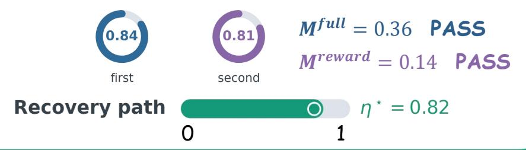

## HealthBench c5f6bb12

Query:Assess dull chest pain after a 10-hour drive.

Response:Gives cautious triage advice with appropriate conditions for urgent evaluation.

## Medical

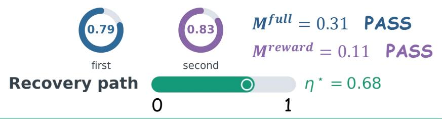

## IFEval #1508

Query:Write a lion haiku containing “forests” and “riddle,” without commas.

## Instruction Following

Response:Satisfies the required words and punctuation constraint.

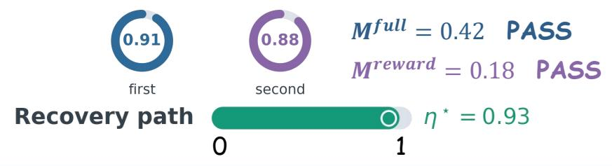  
Figure 11. Representative accepted cases. Each case shows the anonymized query–response record, point and reference scores, full-geometry and reward-space projection checks, the recovery path from � = 0 to � = 1, the recovered training coeficient aˆ�, and the final decision.

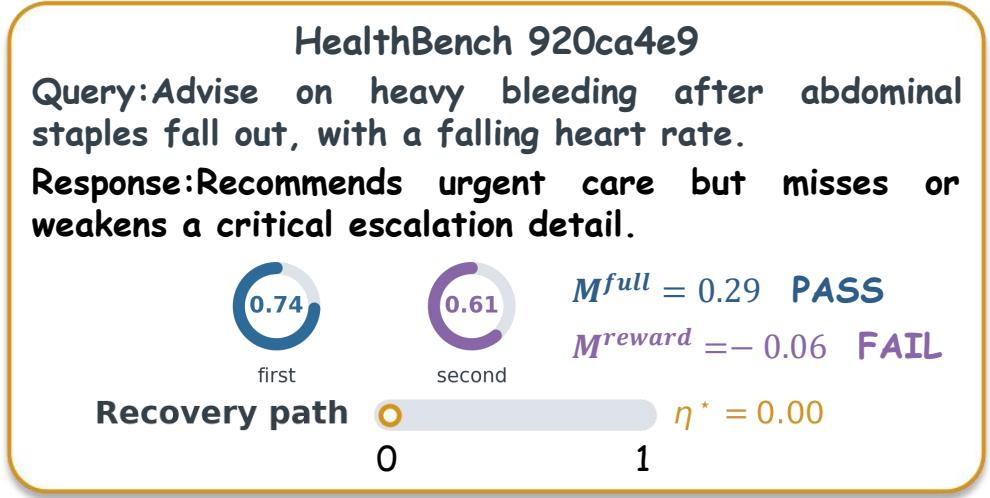

## Constraint-failed

## WritingBench #194

Query:Write a review of the TV drama The Long Night (Silent Truth).

## Writing

Response:Offers a critical review, but its evidence or analysis is insufficiently grounded.

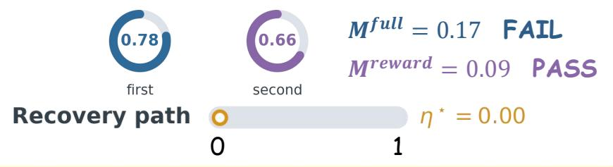

## Medical

## IFEval #2395

Query:Draft a flea-market Facebook post in JSON while avoiding specified terms.

## Instruction Following

Response:Produces the requested format but violates a lexical constraint.

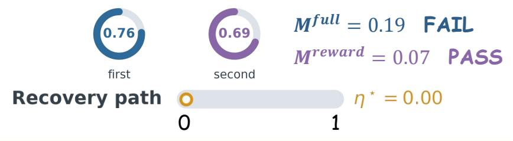  
Figure 12. Representative rejected cases. Each case shows the anonymized query–response record, point and reference scores, full-geometry and reward-space projection checks, the recovery path from $\eta = 0 \ \mathrm { t o } \ \eta = 1$ , the recovered training coeficient $\hat { \mathbf { a } } _ { x } ,$ and the final decision.

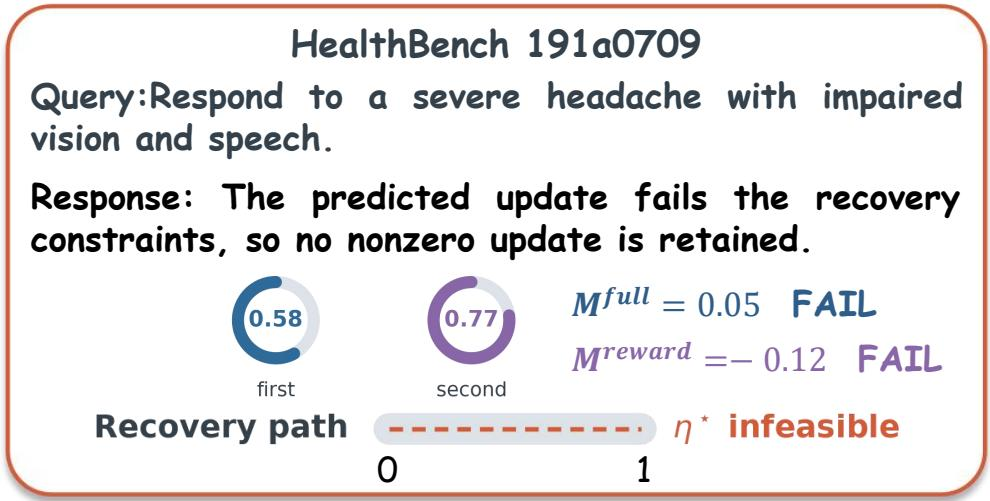

## Reject

## WritingBench #229

Query:Create a 45-minute “Little Scientist” activity for a kindergarten class.

## Writing

Response: Proposes an activity plan whose predicted update has no feasible nonzero recovery.

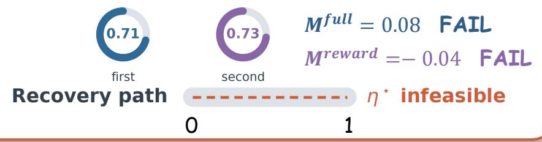

## Medical

## Instruction Following

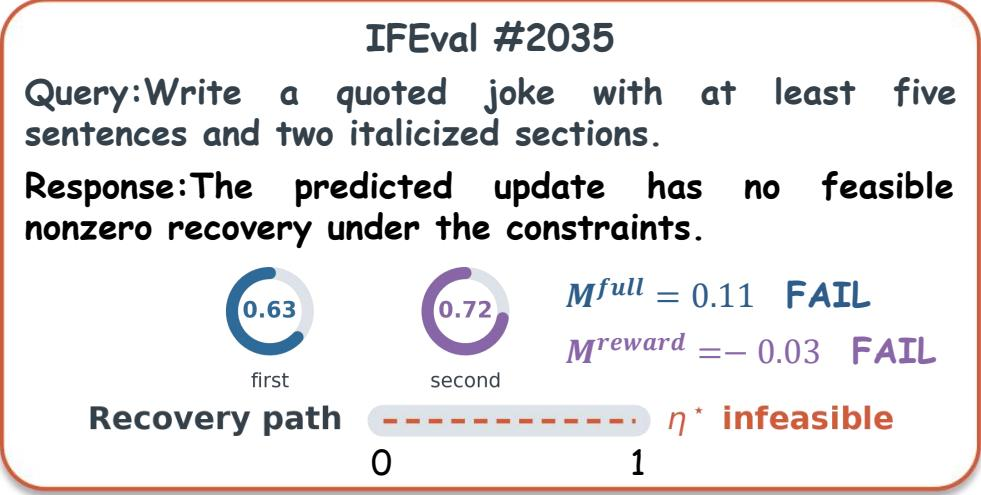  
Figure 13. Representative recovery-infeasible cases. Each case shows the anonymized query–response record, point and reference scores, full-geometry and reward-space projection checks, the recovery path from � = 0 to � = 1, the recovered training coeficient $\hat { \mathbf { a } } _ { x }$ , and the final decision.

## 8. Conclusion

This paper proposed SetGRPO to address the efect of grader stochasticity on policy updates in rubricbased GRPO. Our pilot experiments showed that within-group normalization in GRPO converted grader stochasticity into correlated shifts in the training coeficients, while the response-level gradients of the current policy determined how these shifts afected local updates. Selective execution further changed the composition of the accepted response groups and their aggregate direction-reversal risk. Based on this observation, SetGRPO constructed a joint uncertainty set in training-coeficient space, calibrated possible coeficient shifts through JRSC, used GGSR to recover acceptable training signals in conjunction with the update geometry of the current policy, and finally calibrated and controlled the conditional direction-reversal risk of accepted updates through SRGO, while preserving the optimization structure of the original GRPO. Across ten open-ended task benchmarks in three domains, SetGRPO achieved the best macro-average performance among all compared training methods on the Qwen-3.5 and Llama-3.2 model families.

Ethics Statement SetGRPO uses paired rubric-grader scores and response-level gradients from the current policy to select and recover reinforcement-learning updates. These components may introduce several risks: grader judgments may be stochastic, biased, or subject to distribution shift; calibration data may contain sensitive information; and the coeficient calibration and selective update mechanisms may amplify artifacts present in the data or grader. The finite-sample guarantee in this work concerns only the conditional direction-reversal risk of accepted updates under the stated exchangeability assumption. It does not guarantee privacy, fairness, factuality, or harmlessness for individual responses. The training, coverage-calibration, and risk-calibration splits are separated by problem root, and downstream evaluation benchmarks are not used for training, calibration, or checkpoint selection. Any deployment should apply data minimization, appropriate authorization and access controls, and anonymization where applicable. It should also include regular audits for grader drift and subgroup disparities, as well as human review for high-risk applications. Updates should be suspended or reviewed when the exchangeability assumption, calibration conditions, or grader reliability are not satisfied.

AI Assistance Statement During the preparation of this manuscript, the authors used generative AI tools only to polish English writing, check grammar, and improve exposition. Generative AI tools were not used to design the method, derive the theory, conduct the experiments, or analyze the results. All AI-assisted text was reviewed by the authors, who take responsibility for the final content of this work.

## References

Sunzhu Li, Jiale Zhao, Huimin Ren, Zhenlin Wei, Yang Zhou, Jingwen Yang, Shunyu Liu, Kaike Zhang, and Chen Wei. Rubrichub: A comprehensive and highly discriminative rubric dataset via automated coarse-to-fine generation. In Proceedings of the 64th Annual Meeting of the Association for Computational Linguistics (Volume 1: Long Papers), pages 31320–31344, 2026a.

Yang Zhou, Sunzhu Li, Shunyu Liu, Wenkai Fang, Kongcheng Zhang, Jiale Zhao, Jingwen Yang, Yihe Zhou, Jianwei Lv, Tongya Zheng, Hengtong Lu, Chen Wei, Xie Yan, and Mingli Song. Breaking the exploration bottleneck: Rubric-scafolded reinforcement learning for open-ended LLM reasoning. In Forty-third International Conference on Machine Learning, 2026.

Seungone Kim, Jay Shin, Joel Jang, Shayne Longpre, Hwaran Lee, Sangdoo Yun, Ryan Shin, Sungdong Kim, James Thorne, Minjoon Seo, et al. Prometheus: Inducing fine-grained evaluation capability in language models. In International Conference on Learning Representations, volume 2024, pages 29927–29962, 2024.

Seonghyeon Ye, Doyoung Kim, Sungdong Kim, Hyeonbin Hwang, Seungone Kim, Yongrae Jo, James Thorne, Juho Kim, and Minjoon Seo. Flask: Fine-grained language model evaluation based on alignment skill sets. In International Conference on Learning Representations, volume 2024, pages 55361–55414, 2024.

Yang Liu, Dan Iter, Yichong Xu, Shuohang Wang, Ruochen Xu, and Chenguang Zhu. G-eval: Nlg evaluation using gpt-4 with better human alignment. In Proceedings of the 2023 conference on empirical methods in natural language processing, pages 2511–2522, 2023.

Lianmin Zheng, Wei-Lin Chiang, Ying Sheng, Siyuan Zhuang, Zhanghao Wu, Yonghao Zhuang, Zi Lin, Zhuohan Li, Dacheng Li, Eric Xing, et al. Judging llm-as-a-judge with mt-bench and chatbot arena. Advances in neural information processing systems, 36:46595–46623, 2023.

Long Ouyang, Jefrey Wu, Xu Jiang, Diogo Almeida, Carroll Wainwright, Pamela Mishkin, Chong Zhang, Sandhini Agarwal, Katarina Slama, Alex Ray, et al. Training language models to follow instructions with human feedback. Advances in neural information processing systems, 35:27730– 27744, 2022.

Nisan Stiennon, Long Ouyang, Jefrey Wu, Daniel Ziegler, Ryan Lowe, Chelsea Voss, Alec Radford, Dario Amodei, and Paul F Christiano. Learning to summarize with human feedback. Advances in neural information processing systems, 33:3008–3021, 2020.

Wenbing Li, Hang Zhou, Junqing Yu, Zikai Song, and Wei Yang. Coupled mamba: Enhanced multimodal fusion with coupled state space model. Advances in Neural Information Processing Systems, 37:59808–59832, 2024.

Yangliu Hu, Zikai Song, Na Feng, Yawei Luo, Junqing Yu, Yi-Ping Phoebe Chen, and Wei Yang. Sf2t: Self-supervised fragment finetuning of video-llms for fine-grained understanding. arXiv preprint arXiv:2504.07745, 2025.

Wenbing Li, Zikai Song, Hang Zhou, Junqing Yu, Yunyao Zhang, and Wei Yang. Lora-mixer: Coordinate modular lora experts through serial attention routing. In International Conference on Learning Representations, volume 2026, pages 14694–14716, 2026b.

Zhihong Shao, Peiyi Wang, Qihao Zhu, Runxin Xu, Junxiao Song, Xiao Bi, Haowei Zhang, Mingchuan Zhang, YK Li, Yang Wu, et al. Deepseekmath: Pushing the limits of mathematical reasoning in open language models. arXiv preprint arXiv:2402.03300, 2024.

Daya Guo, Dejian Yang, Haowei Zhang, Junxiao Song, Peiyi Wang, Qihao Zhu, Runxin Xu, Ruoyu Zhang, Shirong Ma, Xiao Bi, et al. Deepseek-r1: Incentivizing reasoning capability in llms via reinforcement learning. arXiv preprint arXiv:2501.12948, 2025.

Leo Gao, John Schulman, and Jacob Hilton. Scaling laws for reward model overoptimization. In International conference on machine learning, pages 10835–10866. PMLR, 2023.

Nathan Lambert, Valentina Pyatkin, Jacob Morrison, LJ Miranda, Bill Yuchen Lin, Khyathi Chandu, Nouha Dziri, Sachin Kumar, Tom Zick, Yejin Choi, et al. Rewardbench: Evaluating reward models for language modeling. In Findings of the Associationfor Computational Linguistics: NAACL 2025, pages 1755–1797, 2025.

Peiyi Wang, Lei Li, Liang Chen, Zefan Cai, Dawei Zhu, Binghuai Lin, Yunbo Cao, Lingpeng Kong, Qi Liu, Tianyu Liu, et al. Large language models are not fair evaluators. In Proceedings of the 62nd annual meeting of the association for computational linguistics (volume 1: Long papers), pages 9440–9450, 2024.

Jinhe Bi, Chennan Zhou, Zengjie Jin, Aniri, Shuo Lu, Wenke Huang, Hu Cao, Xun Xiao, Zhihong Zhu, Volker Tresp, Fei Shen, Yunpu Ma, and Tat-Seng Chua. Reflectrl: Learning from golden negative trajectories via reflective-to-direct reasoning, 2026a. URL https://arxiv.org/abs/ 2608.03972.

Jinhe Bi, Aniri, Minglai Yang, Xingcheng Zhou, Wenke Huang, Sikuan Yan, Yujun Wang, Zixuan Cao, Michael Färber, Xun Xiao, Volker Tresp, and Yunpu Ma. EchoRL: Reinforcement learning via rollout echoing. In Forty-third International Conference on Machine Learning, 2026b. URL https://openreview.net/forum?id=A6az59SGtF.

Aniri, Chen Yilin, Jinhe Bi, Junfei Guo, Donglai Ran, Xu Bian, Zengjie Jin, Yujun Wang, Yijun Tian, Volker Tresp, Fei Shen, Tat-Seng Chua, and Yunpu Ma. Fabrimae i trust myself? self-evaluating vla action generation with markov attention entropy, 2026a. URL https://arxiv.org/abs/2608. 16697.

Jinhe Bi, Yifan Wang, Danqi Yan, Xun Xiao, Artur Hecker, Volker Tresp, and Yunpu Ma. Prism: Self-pruning intrinsic selection method for training-free multimodal data selection. ArXiv, abs/2502.12119, 2025a. URL https://api.semanticscholar.org/CorpusID:276421326.

Jinhe Bi, Yujun Wang, Haokun Chen, Xun Xiao, Artur Hecker, Volker Tresp, and Yunpu Ma. LLaVA steering: Visual instruction tuning with 500x fewer parameters through modality linear representationsteering. In Wanxiang Che, Joyce Nabende, Ekaterina Shutova, and Mohammad Taher Pilehvar, editors, Proceedings of the 63rd Annual Meeting of the Association for Computational Linguistics (Volume 1: Long Papers), pages 15230–15250, Vienna, Austria, July 2025b. Association for Computational Linguistics. ISBN 979-8-89176-251-0. URL https://aclanthology.org/2025.acl-long.739/.

Xinglang Zhang, Yuanmeng Xiang, Yunyao Zhang, Zeliang Chen, Junqing Yu, and Zikai Song. Too good to be real? diagnosing and reducing the gap between ai preference and real user engagement. arXiv preprint arXiv:2609.18282, 2026a.

Yunyao Zhang, Xinglang Zhang, Junxi Sheng, Wenbing Li, Junqing Yu, Yi-Ping Phoebe Chen, Wei Yang, and Zikai Song. Semantic-aware logical reasoning via a semiotic framework, 2026b. URL https://arxiv.org/abs/2509.24765.

Xinglang Zhang, Yunyao Zhang, ZeLiang Chen, Junqing Yu, Wei Yang, and Zikai Song. Logical phase transitions: Understanding collapse in llm logical reasoning, 2026c. URL https://arxiv.org/ abs/2601.02902.

Paul F Christiano, Jan Leike, Tom Brown, Miljan Martic, Shane Legg, and Dario Amodei. Deep reinforcement learning from human preferences. Advances in neural information processing systems, 30, 2017.

Daniel M Ziegler, Nisan Stiennon, Jefrey Wu, Tom B Brown, Alec Radford, Dario Amodei, Paul Christiano, and Geofrey Irving. Fine-tuning language models from human preferences. arXiv preprint arXiv:1909.08593, 2019.

Yuntao Bai, Saurav Kadavath, Sandipan Kundu, Amanda Askell, Jackson Kernion, Andy Jones, Anna Chen, Anna Goldie, Azalia Mirhoseini, Cameron McKinnon, et al. Constitutional ai: Harmlessness from ai feedback. arXiv preprint arXiv:2212.08073, 2022.

John Schulman, Filip Wolski, Prafulla Dhariwal, Alec Radford, and Oleg Klimov. Proximal policy optimization algorithms. arXiv preprint arXiv:1707.06347, 2017.

Rafael Rafailov, Archit Sharma, Eric Mitchell, Christopher D Manning, Stefano Ermon, and Chelsea Finn. Direct preference optimization: Your language model is secretly a reward model. Advances in neural information processing systems, 36:53728–53741, 2023.

Karl Cobbe, Vineet Kosaraju, Mohammad Bavarian, Mark Chen, Heewoo Jun, Lukasz Kaiser, Matthias Plappert, Jerry Tworek, Jacob Hilton, Reiichiro Nakano, et al. Training verifiers to solve math word problems. arXiv preprint arXiv:2110.14168, 2021.

Jonathan Uesato, Nate Kushman, Ramana Kumar, Francis Song, Noah Siegel, Lisa Wang, Antonia Creswell, Geofrey Irving, and Irina Higgins. Solving math word problems with process-and outcome-based feedback. arXiv preprint arXiv:2211.14275, 2022.

Hunter Lightman, Vineet Kosaraju, Yuri Burda, Harrison Edwards, Bowen Baker, Teddy Lee, Jan Leike, John Schulman, Ilya Sutskever, and Karl Cobbe. Let’s verify step by step. In International Conference on Learning Representations, volume 2024, pages 39578–39601, 2024.

Yunyao Zhang, Yihao Ai, Zuocheng Ying, Qirui Mi, Junqing Yu, Wei Yang, and Zikai Song. Coupling macro dynamics and micro states for long-horizon social simulation, 2026d. URL https://arxiv. org/abs/2604.05516.

Yunyao Zhang, Zuocheng Ying, Xinglang Zhang, Junqing Yu, Peng Fang, Xu Chen, Wei Yang, and Zikai Song. Intervensim: Intervention-aware social network simulation for opinion dynamics, 2026e. URL https://arxiv.org/abs/2604.06600.

Zikai Song, Xiajie Li, Yunyao Zhang, Xinglang Zhang, Wei Yang, and Junqing Yu. Social intelligence modeling: A comprehensive survey from social perception to social simulation. ResearchGate preprint, 2026. URL https://www.researchgate.net/publication/411123257\_Social\_ Intelligence\_Modeling\_A\_Comprehensive\_Survey\_from\_Social\_Perception\_to\_ Social\_Simulation. Preprint available on ResearchGate.

Qinlei Huang, Zhiwei Chen, Zixu Li, Chunxiao Wang, Xuemeng Song, Yupeng Hu, and Liqiang Nie. Median: Adaptive intermediate-grained aggregation network for composed image retrieval. In ICASSP 2025-2025 IEEE International Conference on Acoustics, Speech and Signal Processing (ICASSP), pages 1–5. IEEE, 2025.

Zixu Li, Zhiwei Chen, Zhiheng Fu, Wenbo Wang, Yupeng Hu, Weili Guan, and Liqiang Nie. Omniegor2: A routed reasoning framework for the 1st cross-domain egocross challenge at cvpr 2026. arXiv preprint arXiv:2605.24481, 2026c.

Jiale Huang, Zixu Li, Zhiwei Chen, Zhiheng Fu, Chunxiao Wang, and Yupeng Hu. Imagine: Adaptive schema-imagery enhanced composition for composed video retrieval. In Proceedings of the 2026 International Conference on Multimedia Retrieval, pages 288–297, 2026a.

Zhiwei Chen, Yupeng Hu, Zixu Li, Zhiheng Fu, Xuemeng Song, and Liqiang Nie. Ofset: Segmentationbased focus shift revision for composed image retrieval. In ACM MM, page 6113–6122, 2025.

Zixu Li, Yupeng Hu, Zhiheng Fu, Zhiwei Chen, Yongqi Li, and Liqiang Nie. Tema: Anchor the image, follow the text for multi-modification composed image retrieval. In Proceedings of the 64th Annual Meeting of the Association for Computational Linguistics (Volume 1: Long Papers), pages 24421–24442, 2026d.

Jinhe Bi, Danqi Yan, Yifan Wang, Wenke Huang, Haokun Chen, Guancheng Wan, Mang Ye, Xun Xiao, Hinrich Schuetze, Volker Tresp, and Yunpu Ma. The geometry of reasoning: Self-evaluation via layerwise trajectory evolution. In Forty-third International Conference on Machine Learning, 2026c. URL https://openreview.net/forum?id=WQyrwQwzmK.

Aniri, Jinhe Bi, Peng Liao, Zengjie Jin, Volker Tresp, Fei Shen, Yunpu Ma, and Tat-Seng Chua. Opd-v: Visual on-policy self-distillation with modality balance, 2026b. URL https://arxiv.org/abs/ 2608.05131.

Zhiwei Chen, Yupeng Hu, Zhiheng Fu, Zixu Li, Jiale Huang, Qinlei Huang, and Yinwei Wei. Intent: Invariance and discrimination-aware noise mitigation for robust composed image retrieval. In AAAI, volume 40, pages 20463–20471, 2026a.

Jiale Huang, Zixu Li, Zhiheng Fu, Zhiwei Chen, Qinlei Huang, and Yupeng Hu. Rankvr: Low-rank structure perception and value recalibration for robust composed image retrieval. In Proceedings of the 2026 International Conference on Multimedia Retrieval, pages 269–278, 2026b.

Zhiheng Fu, Yupeng Hu, Qianyun Yang, Shiqi Zhang, Zhiwei Chen, and Zixu Li. Air-know: Arbitercalibrated knowledge-internalizing robust network for composed image retrieval. In Proceedings of the IEEE/CVF Conference on Computer Vision and Pattern Recognition, pages 2658–2670, 2026.

Zixu Li, Yupeng Hu, Zhiwei Chen, Mingyu Zhang, Zhiheng Fu, and Liqiang Nie. Conesep: Cone-based robust noise-unlearning compositional network for composed image retrieval. In Proceedings of the IEEE/CVF Conference on Computer Vision and Pattern Recognition, pages 16897–16909, 2026e.

Glenn Shafer and Vladimir Vovk. A tutorial on conformal prediction. Journal of machine learning research, 9(3), 2008.

Anastasios N Angelopoulos and Stephen Bates. Conformal prediction: A gentle introduction. Foundations and Trends in Machine Learning, 16(4):494–591, 2023.

Jing Lei, Max G’Sell, Alessandro Rinaldo, Ryan J Tibshirani, and Larry Wasserman. Distributionfree predictive inference for regression. Journal of the American Statistical Association, 113(523): 1094–1111, 2018.

Yaniv Romano, Evan Patterson, and Emmanuel Candes. Conformalized quantile regression. Advances in neural information processing systems, 32, 2019.

Yaniv Romano, Matteo Sesia, and Emmanuel Candes. Classification with valid and adaptive coverage. Advances in neural information processing systems, 33:3581–3591, 2020.

Stephen Bates, Anastasios Angelopoulos, Lihua Lei, Jitendra Malik, and Michael Jordan. Distributionfree, risk-controlling prediction sets. Journal of the ACM (JACM), 68(6):1–34, 2021.

Anastasios Angelopoulos, Stephen Bates, Adam Fisch, Lihua Lei, and Tal Schuster. Conformal risk control. In International conference on learning representations, volume 2024, pages 55198–55218, 2024.

Yonatan Geifman and Ran El-Yaniv. Selectivenet: A deep neural network with an integrated reject option. In International conference on machine learning, pages 2151–2159. PMLR, 2019.

Yupeng Hu, Zixu Li, Zhiwei Chen, Qinlei Huang, Zhiheng Fu, Mingzhu Xu, and Liqiang Nie. Refine: Composed video retrieval via shared and diferential semantics enhancement. ACM Transactions on Multimedia Computing, Communications and Applications, 22(7):1–24, 2026.

Zhiwei Chen, Yupeng Hu, Zixu Li, Zhiheng Fu, Guozhi Qiu, Weili Guan, and Liqiang Nie. Egoadapt: A multi-scene egocentric adaptation method for cvpr 2026 hd-epic vqa challenge. arXiv preprint arXiv:2605.24500, 2026b.

Zixu Li, Yupeng Hu, Zhiwei Chen, Shiqi Zhang, Qinlei Huang, Zhiheng Fu, and Yinwei Wei. Habit: Chrono-synergia robust progressive learning framework for composed image retrieval. In Proceedings of the AAAI Conference on Artificial Intelligence, volume 40, pages 6762–6770, 2026f.

Charles J Clopper and Egon S Pearson. The use of confidence or fiducial limits illustrated in the case of the binomial. Biometrika, 26(4):404–413, 1934.

Zixu Li, Yupeng Hu, Zhiwei Chen, Qinlei Huang, Guozhi Qiu, Zhiheng Fu, and Meng Liu. Retrack: Evidence-driven dual-stream directional anchor calibration network for composed video retrieval. In AAAI, volume 40, pages 23373–23381, 2026g.

Yulun Zhang, Zixu Li, Zhiwei Chen, Zhiheng Fu, Wenbo Wang, Zihang Qiu, Zhilin Wang, Ruxin Wang, and Yupeng Hu. Lightair: Lightweight action inversion and riemannian rectification for text-based person anomaly search. arXiv preprint arXiv:2608.09152, 2026f.

Qianyun Yang, Zhiwei Chen, Yupeng Hu, Zixu Li, Zhiheng Fu, and Liqiang Nie. Stable: Eficient hybrid nearest neighbor search via magnitude-uniformity and cardinality-robustness. IEEE Transactions on Knowledge and Data Engineering, 2026.

Prasanta Chandra Mahalanobis. On the generalized distance in statistics. Sankhya: The Indian Journal¯ of Statistics, Series A (2008-), 80:S1–S7, 2018.