# TOPS: Reshaping Flow Source and Transport for Multi-Task Robot Manipulation

Tuo An<sup>1</sup>, Chuhao Zhou<sup>1</sup>, Jiahua Dong<sup>1</sup>, Jingliang Li<sup>1</sup>, Jiaqi Bai<sup>1</sup>, Jindou Jia<sup>1,†</sup>, Jianfei Yang<sup>1,†</sup>

<sup>1</sup>MARS Lab, Nanyang Technological University

<sup>†</sup>Joint corresponding authors

Flow-based policies for language-conditioned multi-task manipulation commonly share a single Gaussian source prior and a common linear transport path across tasks. However, reliably executing multiple tasks with distinct motion requirements remains challenging for a shared policy. We introduce TOPS (Task-Oriented Priors and Schedules), which adapts the flow source prior and interpolation schedule to each task without modifying the network architecture. TOPS first constructs multimodal task sources from reverse-mapped expert action sequences, allowing language instructions to select where generation begins. Guided by source-target covariance mismatch, it then slows the transition toward expert actions early in denoising and accelerates it later along directions requiring expansion. Under a Gaussian endpoint model, our analysis shows that this schedule adjustment can lower an upper bound on velocity-prediction risk. Experiments on LIBERO, LIBERO-Plus, and CALVIN demonstrate improved performance across in-distribution, perturbation and cross-environment settings, alongside better data eficiency. Using one integration step, TOPS raises LIBERO-10 success from 53.44% to 69.67% compared with ten-step Standard Flow Matching (FM), while reducing inference time to approximately one-sixth of the baseline. TOPS also yields consistent gains when transferred to the large-scale flow-based π<sub>0.5</sub> policy across all four evaluated settings. Real-world experiments further demonstrate improved task success, including an increase from 20% with standard FM to 80% with TOPS on the upper-drawer opening task.

Correspondence: jindou.jia@ntu.edu.sg, jianfei.yang@ntu.edu.sg Project site: https://ntumars.github.io/TOPS/


## 1 Introduction

Real-world manipulation exhibits substantial behavioral diversity. Diferent tasks require distinct motion patterns, and even a given goal can be achieved through diferent contact strategies, motion trajectories, and temporal execution patterns. Difusion and flow-matching models (Funk et al., 2024; Chi et al., 2025; Braun et al., 2024) capture such multimodal action distributions directly and have become widely used in imitation learning. This expressive power has also carried the generative paradigm from task-specific visuomotor control to language-conditioned multi-task and generalist robot policies (Yan et al., 2025; Black et al., 2025b,a). In this setting, a shared policy must accommodate the motion requirements of diferent tasks and execute each task reliably.

However, a shared policy can perform well on some tasks yet struggle to execute others reliably (Haldar et al., 2024; Liu et al., 2023a; Ren et al., 2026). A shared policy must capture multiple action modes within a task and substantially diferent action distributions across tasks (Wu et al., 2025; Liu et al., 2026). Existing approaches introduce or redesign policy components to improve multi-task performance, using feature modulation (Haldar et al., 2024), visual selection (Huang et al., 2025), instruction-generated parameters (Ren et al., 2026), and expert routing (Deng et al., 2026). In flow policies (Lipman et al., 2022), the network must recover distinct task-specific action distributions from a shared Gaussian source under a common linear transport path. Before changing the policy architecture as in prior work, we step back to the generative process itself and ask: could adapting the source prior and transport to each task improve multi-task performance without changing the policy architecture? To investigate, we reverse a trained multi-task flow policy and trace expert actions back to their source samples (Tang et al., 2026).

As shown in Figs. 1(a,b), reverse-mapped expert actions exhibit task-dependent organization under the warm-up policy, with further subclusters within individual tasks. These patterns motivate us to investigate whether fitting task-specific sources to the reverse images and directly denoising from the corresponding region can improve policy learning. To further understand what changes are needed to reach expert actions, we analyze the covariance mismatch between these sources and the corresponding expert-action distributions using a Gaussian optimal-transport map. Its eigenvectors define orthogonal axes, each representing a weighted combination of action components across timesteps. We find expert actions have substantially greater standard deviation than source samples only along a few axes. We refer to this source-to-target increase as expansion. Yet conventional flow matching (Lipman et al., 2022; Black et al., 2025a) starts every task from a single task-independent Gaussian and applies the same linear interpolation schedule along every axis. This leaves the network to recover task-specific action structure from shared noise, while interpolation timing remains unchanged despite the unequal source-to-target changes revealed by our analysis.

Motivated by these findings, we introduce TOPS (Task-Oriented Priors and Schedules) for multi-task flow policies. It fits a Gaussian mixture with low-rank covariance structure (Tipping and Bishop, 1999) to each task’s reverse-mapped samples, allowing language instructions to select the source. Along expansion axes, TOPS slows interpolation toward expert actions early and accelerates it later, retaining linear interpolation elsewhere. Under a Gaussian endpoint model (Albergo et al., 2025), we show that adapting interpolation can lower an upper bound on velocity-prediction risk. This risk captures the irreducible error that arises when the same interpolated action sequence corresponds to diferent velocity targets. On LIBERO-10, our schedule reduces estimated time-integrated directional risk on expansion axes by 18.5% relative to linear interpolation (Fig. 10). In controlled 2D experiments with few integration steps, it also places more samples in target regions than linear or fast-then-slow schedules (Fig. 7). Together, these choices support eficient few-step action generation.

We evaluate TOPS on LIBERO (Liu et al., 2023a), LIBERO-Plus (Fei et al., 2025), CALVIN (Mees et al., 2022), and three real-world multi-task suites. With the same backbone as the baselines, TOPS achieves the highest mean performance across two in-distribution and two out-of-distribution settings, covering perturbations and unseen environments, using one schedule-aware step. Compared with ten-step Standard FM (Lipman et al., 2022), it raises LIBERO-10 success from 53.44% to 69.67% while reducing inference latency to approximately one-sixth. Limited-data evaluations also show gains across all simulation benchmarks: on CALVIN ABC→D, TOPS trained on 30% of demonstrations outperforms all evaluated baselines trained on 50%. These gains also extend to the large-scale flow-based π policy in all four settings, raising LIBERO-Plus success from 64.4% to 69.0% and CALVIN ABC→D average chain length from 3.033 to 3.744. Real-world gains include 80% success on upper-drawer opening, compared with 20% for Standard FM.

To recap, our contributions are threefold:

• We construct task-specific sources by fitting Gaussian mixtures with low-rank covariance structure to reverse-mapped expert action chunks, enabling language-guided source selection.

• We introduce slow-then-fast scheduling along expansion directions identified by Gaussian optimal transport, motivated by an upper bound on velocity-prediction risk under independent Gaussian endpoints.

• Experiments show that TOPS achieves the highest mean performance across the main in- and out-ofdistribution simulation settings with one schedule-aware step, while reducing latency and improving data eficiency. Gains also extend to the large-scale π policy and real-world tasks.

## 2 Related Work

Language-conditioned multi-task policies. Language-conditioned multi-task policies aim to execute diverse behaviors with a shared model (Black et al., 2025b,a; Haldar et al., 2024). Prior work supports task-specific behavior through visual feature modulation or selection (Haldar et al., 2024; Huang et al., 2025), instructiongenerated parameters (Ren et al., 2026), and semantic expert routing (Deng et al., 2026). TOPS adapts source distributions and interpolation schedules to task-specific action structure while preserving the policy backbone and its original conditioning.

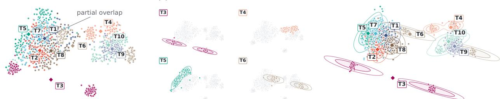  
Figure 1 Task-structured reverse images and the fitted source. (a) t-SNE of reverse images from the ten LIBERO-10 tasks: tasks occupy distinct, partially overlapping regions. (b) The same embedding with one task highlighted per view, showing sub-clusters within individual tasks. (c) Samples from fitted per-task source in the same coordinates, reproducing the structure in (a).

Source distributions for generative policies. Existing sources use action histories (Jia et al., $^ { 2 0 2 6 \mathrm { b } , \mathrm { a } ; }$ Bai et al., 2026) or conditioning representations (Dong et al., 2025), while LeaP (Dai et al., 2026) learns proprioceptionconditioned diagonal Gaussians. MM-FM (Luo et al., 2026) combines a mixture fitted to target image latents with mode-dependent coupling. Flow reversal steering (Tang et al., 2026) uses inverted actions for direct steering or learning observation-conditioned noise policies while keeping the base flow frozen. TOPS fits low-rank Gaussian mixtures to each task’s reverse images pooled across observations and trains the velocity field under adapted sources and paths.

Coupling and path design in flow matching. Prior work optimizes endpoint couplings (Tong et al., 2024; Sochopoulos et al., 2025) or straightens trajectories by retraining on flow-generated pairs (Liu et al., 2023b). MeanFlow (Geng et al., 2025) learns interval-averaged velocity for one-step generation. Other methods approximate geodesics under data-induced metrics (Kapuśniak et al., 2024) or adapt global schedules to velocity profiles or regression dificulty (Bondar, 2026; Tania and Khan, 2026). TOPS retains independent endpoint sampling and uses Gaussian OT to identify task-specific expansion directions for slow-then-fast scheduling.

## 3 Preliminaries and Motivating Analysis

## 3.1 Flow-Matching Policies

Let T denote the training tasks and $\mathbf { c } = \left( o , \ell _ { \tau } \right)$ the observation–instruction pair for $\tau \in \tau ;$ ℓ denotes an incoming instruction at inference. An expert action chunk $\mathbf { x } _ { 1 } \in \mathbb { R } ^ { D }$ contains H actions of dimension $d _ { a } ,$ with $D = H d _ { a }$ . FM (Lipman et al., 2022) trains a conditional velocity field to predict ${ \mathbf { u } } _ { t } = \partial _ { t } { \mathbf { x } } _ { t }$ along a diferentiable path from $\mathbf { x } _ { \mathrm { 0 } }$ $\mathbf { x } _ { 1 }$

$$
\mathcal { L } _ { \mathrm { F M } } ( \theta ) = \mathbb { E } \left[ \| \mathbf { v } _ { \theta } ( \mathbf { x } _ { t } , t , \mathbf { c } ) - \mathbf { u } _ { t } \| _ { 2 } ^ { 2 } \right] ,\tag{1}
$$

where the expectation is over demonstration pairs $( \mathbf { x } _ { 1 } , \mathbf { c } )$ , with $\mathbf { x } _ { 1 } \sim p _ { \mathrm { d a t a } } ( \cdot | \mathbf { c } )$ , and independent draws $\mathbf { x } _ { \mathrm { 0 } } \sim$ p<sub>0</sub> and $t \sim \mathcal { U } ( 0 , 1 )$ . Standard multi-task flow policies use a shared Gaussian source and linear interpolation:

$$
\mathbf { x } _ { 0 } \sim { \mathcal { N } } ( \mathbf { 0 } , \sigma _ { 0 } ^ { 2 } \mathbf { I } _ { D } ) , \qquad \mathbf { x } _ { t } = ( 1 - t ) \mathbf { x } _ { 0 } + t \mathbf { x } _ { 1 } , \qquad \mathbf { u } _ { t } = \mathbf { x } _ { 1 } - \mathbf { x } _ { 0 } ,\tag{2}
$$

where $\sigma _ { 0 } > 0$ is the source standard deviation and $\mathbf { I } _ { D }$ the D-dimensional identity matrix. Inference integrates $\dot { \mathbf { x } } ( t ) = \mathbf { v } _ { \theta } ( \mathbf { x } ( t ) , t , \mathbf { c } )$ from $\mathbf { x } ( 0 ) = \mathbf { x } _ { 0 }$ to t = 1, defining the forward flow map $\Phi _ { \theta , 0  1 } ^ { \mathbf { c } }$ . Under standard regularity conditions, its inverse is $\Phi _ { \theta , 1 \to 0 } ^ { \mathbf { c } } = ( \Phi _ { \theta , 0 \to 1 } ^ { \mathbf { c } } ) ^ { - 1 }$

## 3.2 Source Structure Revealed by Flow Reversal

With a shared Gaussian source, where do diferent tasks’ expert actions map under flow reversal? We examine a base policy $\mathbf { v } _ { \theta _ { 0 } }$ after a warm-up with Eq. (2), reversing each expert chunk under its original observation and language condition c:

$$
\widehat { \mathbf { x } } _ { 0 } = \Phi _ { \theta _ { 0 } , 1  0 } ^ { \mathbf { c } } ( \mathbf { x } _ { 1 } ) \in \mathbb { R } ^ { D } .\tag{3}
$$

(a) Reshaping task-oriented sources via flow reversal  
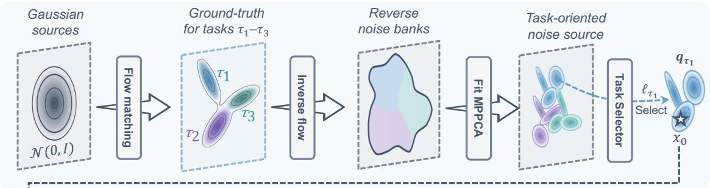

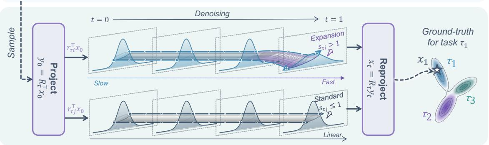  
(b) Reshaping flow transport paths via spectral scheduling  
Figure 2 Overview of TOPS. (a) We construct task-specific sources by fitting MPPCA models to reverse-mapped expert actions. An instruction selector maps the input language to an index τˆ, identifying the source $q _ { \hat { \tau } }$ and its associated schedule. (b) In the selected task’s Gaussian OT eigenbasis, we apply slow-then-fast interpolation along expansion directions and linear interpolation elsewhere, then map the interpolated states and velocity targets back to action space.

For each task $\tau ,$ we pool reverse images across observations into a bank $B _ { \tau }$ . The LIBERO-10 t-SNE (van der Maaten and Hinton, 2008) projection shows partially overlapping task groups and within-task subclusters (Figs. 1(a,b)). An intuitive explanation comes from the diversity of expert behavior: action chunks difer across tasks and across execution stages within a task, such as reaching, grasping, and placing. The warm-up policy’s reverse map may retain traces of these behavioral diferences, giving rise to the observed organization. These observations motivate fitting a multimodal task-specific source to each bank for training. The source-only ablations assess the practical value of this construction.

## 4 Method

## 4.1 Overview

Building on the preceding analysis, TOPS adapts source distributions and interpolation schedules to each task (Fig. 2). We fit multimodal sources to reverse-mapped expert actions and use source–target covariance mismatch to guide slow-then-fast scheduling along expansion axes, retaining linear interpolation elsewhere. Both components are constructed ofline and fixed during continuation training of the velocity field. At inference, a learned language selector chooses the source and associated schedule, and a schedule-aware solver generates the action chunk. The following subsections detail these components and their use in training and inference.

## 4.2 Task-Specific Source Construction

The within-task subclusters in Figs. 1(a,b) motivate a multimodal source for each task. To capture this structure and correlations within action chunks, we fit an $M _ { \tau } .$ -component mixture of probabilistic principal

component analyzers (MPPCA) (Tipping and Bishop, 1999) to each task’s reverse-image bank $B _ { \tau }$ :

$$
\begin{array} { r l r } {  { q _ { \tau } ( \mathbf { x } _ { 0 } ) = \sum _ { m = 1 } ^ { M _ { \tau } } \pi _ { \tau m } \mathcal { N } ( \mathbf { x } _ { 0 } ; \pmb { \mu } _ { \tau m } , \pmb { \Sigma } _ { \tau m } ) , } } \\ & { } & { \sum _ { \tau m } = \mathbf { U } _ { \tau m } \mathbf { A } _ { \tau m } \mathbf { U } _ { \tau m } ^ { \top } + \sigma _ { \tau m } ^ { 2 } \mathbf { I } _ { D } . } \end{array}\tag{4}
$$

Each component has weight $\pi _ { \tau m } \geq 0$ , mean $\pmb { \mu } _ { \tau m } \in \mathbb { R } ^ { D }$ , and covariance $\\pmb { \Sigma } _ { \tau m } \in \mathbb { R } ^ { D \times D }$ , with $\begin{array} { r } { \sum _ { m } \pi _ { \tau m } = 1 } \end{array}$ The orthonormal columns of $\mathbf { U } _ { \tau m } \in \mathbb { R } ^ { D \times { r } }$ define $r \ll D$ directions of coordinated variation across timesteps and action dimensions. The nonnegative diagonal matrix $\mathbf { A } _ { \tau m } \in \mathbb { R } ^ { r \times r }$ controls their strengths, while the isotropic residual with scale $\sigma _ { \tau m } > 0$ allows variation beyond this subspace. We estimate the parameters ofline using expectation–maximization (Dempster et al., 1977), with samples from the fitted sources shown in Fig. 1(c). During training, each demonstration uses the source $q _ { \tau }$ indexed by its task label $\tau ;$ at inference, the instruction selector chooses the source (Section 4.4). The source provides a task-structured starting point, while the conditional velocity field adapts generation to the current observation.

## 4.3 Task-Specific Interpolation Scheduling

The task-specific source provides a structured starting point, yet its variability and correlations may still difer from those of expert actions. We use this covariance mismatch to adapt interpolation timing along diferent directions (Fig. 2(b)).

Identifying expansion directions. For each task $\tau ,$ let ${ \bf C } _ { \mathrm { s } } ^ { \tau } , { \bf C } _ { \mathrm { d } } ^ { \tau } \in \mathbb { R } ^ { D \times D }$ denote the source and expert covariances, computed analytically from $q _ { \tau }$ and estimated from demonstrations, respectively. Both matrices are diagonally regularized to ensure positive definiteness. We relate them through the symmetric positivedefinite Gaussian OT map $\mathbf { T } _ { \tau } \in \mathbb { R } ^ { D \times D }$ :

$$
\mathbf { T } _ { \tau } = ( \mathbf { C } _ { \mathrm { s } } ^ { \tau } ) ^ { - 1 / 2 } \left[ ( \mathbf { C } _ { \mathrm { s } } ^ { \tau } ) ^ { 1 / 2 } \mathbf { C } _ { \mathrm { d } } ^ { \tau } ( \mathbf { C } _ { \mathrm { s } } ^ { \tau } ) ^ { 1 / 2 } \right] ^ { 1 / 2 } ( \mathbf { C } _ { \mathrm { s } } ^ { \tau } ) ^ { - 1 / 2 } .\tag{5}
$$

This map satisfies $\mathbf { T } _ { \tau } \mathbf { C } _ { \mathrm { s } } ^ { \tau } \mathbf { T } _ { \tau } = \mathbf { C } _ { \mathrm { d } } ^ { \tau }$ . Its eigendecomposition identifies directions along which it acts by rescaling:

$$
\mathbf { T } _ { \tau } = \mathbf { R } _ { \tau } \mathrm { d i a g } ( s _ { \tau 1 } , \dots , s _ { \tau D } ) \mathbf { R } _ { \tau } ^ { \top } .\tag{6}
$$

Each column $\mathbf { r } _ { \tau j }$ of the orthogonal ${ \bf R } _ { \tau } \in \mathbb { R } ^ { D \times D }$ represents a coordinated action pattern across timesteps and action dimensions. Covariance matching gives $\mathbf { r } _ { \tau j } ^ { \top } \mathbf { C } _ { \mathrm { d } } ^ { \tau } \mathbf { r } _ { \tau j } = s _ { \tau j } ^ { 2 } \mathbf { r } _ { \tau j } ^ { \top } \mathbf { C } _ { \mathrm { s } } ^ { \tau } \mathbf { r } _ { \tau j }$ , so $s _ { \tau j } > 0$ is the expert-to-source standard-deviation ratio along this direction. We therefore call directions with $s _ { \tau j } > 1$ expansion directions. Across our diagnostic settings, they occupy only 7.4–9.7% of dimensions but account for 60.9–69.6% of the Gaussian-OT covariance cost (App. A.3).

Designing the interpolation schedule. For an expert action chunk $\mathbf { x } _ { 1 }$ from task $\tau _ { \mathrm { { i } } }$ we independently sample $\mathbf { x } _ { 0 } \sim q _ { \tau }$ and express both endpoints in the OT eigenbasis: $\mathbf { y } _ { i } = \mathbf { R } _ { \tau } ^ { \top } \mathbf { x } _ { i } \in \mathbb { R } ^ { D } , i \in \{ 0 , 1 \}$ . Along direction $j ,$ , we interpolate as

$$
y _ { t , j } = a _ { \tau j } ( t ) y _ { 0 , j } + [ 1 - a _ { \tau j } ( t ) ] y _ { 1 , j } .\tag{7}
$$

Here, $a _ { \tau j } : [ 0 , 1 ] \to [ 0 , 1 ]$ is a continuously diferentiable, nonincreasing source weight, with $a _ { \tau j } ( 0 ) = 1$ and $a _ { \tau j } ( 1 ) = 0 . \ \mathrm { A s }$ s this weight decreases, the interpolant moves toward the expert endpoint; linear interpolation uses $a _ { \tau j } ( t ) = 1 - t$

Near the source, interpolated states reveal little about expert endpoints, leaving diferent velocity targets compatible with similar states and conditioning. Squared-loss regression averages these targets, and rapid interpolation can amplify their diferences along expansion directions. As the expert contribution grows, states become more informative, motivating slower interpolation early and faster interpolation later.

To analyze this timing choice, we adopt a Gaussian surrogate within the stochastic-interpolant framework (Albergo et al., 2025). The task-level source and expert marginals are modeled as independent Gaussians with covariances $\mathbf { C } _ { \mathrm { s } } ^ { \tau }$ and $\mathbf { C } _ { \mathrm { d } } ^ { \tau }$ . We study velocity prediction from the interpolated state alone, defining its minimum achievable mean-squared error as velocity-prediction risk. We upper-bound this risk by summing directional contributions. Minimizing the integral of this bound over $t \in [ 0 , 1 ]$ yields schedules $a _ { \tau j } ^ { \star }$ satisfying

$$
\frac { | \dot { a } _ { \tau j } ^ { \star } ( 1 ) | } { | \dot { a } _ { \tau j } ^ { \star } ( 0 ) | } = s _ { \tau j } , \qquad j = 1 , \ldots , D .\tag{8}
$$

Thus, along expansion directions, schedules minimizing this bound transfer weight more slowly at the source endpoint than at the expert endpoint. App. A.9 provides the full bound and proof.

Constructing the path and velocity target. Guided by this endpoint asymmetry, we parameterize the source weight with a bounded scheduling strength $\rho _ { \tau j } \colon$

$$
\begin{array} { r } { \rho _ { \tau j } = \kappa \operatorname { t a n h } ( \gamma \log s _ { \tau j } ) \mathbf { 1 } _ { \{ s _ { \tau j } > 1 \} } , \quad } \\ { a _ { \tau j } ( t ) = ( 1 - t ) e ^ { \rho _ { \tau j } t } , \qquad \gamma > 0 , \quad 0 < \kappa < 1 . } \end{array}\tag{9}
$$

Here, $\mathbf { 1 } _ { \{ \cdot \} }$ is the indicator function, γ controls sensitivity to $s _ { \tau j } .$ , and $\kappa < 1$ bounds the strength while keeping the source weight decreasing. The resulting schedule is slow-then-fast along expansion directions and linear elsewhere.

On LIBERO-10 expansion directions, this parameterization captures 77.5% of the improvement over linear interpolation attainable by minimizing the time-integrated Gaussian risk bound. With fitted-source samples paired with recorded expert chunks, it also reduces time-integrated velocity-prediction error on this subspace by 22.1% relative to linear interpolation, as measured by matched MLPs using only the full interpolated state and time (Fig. 10; App. A.9.2).

We compute the basis and strengths ofline and keep them fixed during training. Defining

$$
\mathbf { K } _ { \tau } = \mathbf { R } _ { \tau } \mathrm { d i a g } ( - \rho _ { \tau 1 } , \dots , - \rho _ { \tau D } ) \mathbf { R } _ { \tau } ^ { \top } \in \mathbb { R } ^ { D \times D } ,
$$

we obtain the interpolant and velocity target in action space:

$$
\begin{array} { r } { \begin{array} { c } { \mathbf { x } _ { t } = \mathbf { x } _ { 1 } + ( 1 - t ) e ^ { - t \mathbf { K } _ { \tau } } ( \mathbf { x } _ { 0 } - \mathbf { x } _ { 1 } ) , } \\ { \mathbf { u } _ { t } = \partial _ { t } \mathbf { x } _ { t } = e ^ { - t \mathbf { K } _ { \tau } } \left[ \mathbf { I } _ { D } + ( 1 - t ) \mathbf { K } _ { \tau } \right] ( \mathbf { x } _ { 1 } - \mathbf { x } _ { 0 } ) . } \end{array} } \end{array}\tag{10}
$$

We train $\mathbf { v } _ { \theta }$ to predict $\mathbf { u } _ { t }$ using the FM loss.

## 4.4 Training and Inference

We continue training from $\theta _ { 0 }$ with $q _ { \tau }$ and K<sub>τ</sub> fixed. We use the FM objective (Eq. (1)), drawing $\mathbf { x } _ { 0 } \sim q _ { \tau }$ and constructing the interpolated states and velocity targets according to Eq. (10).

The lightweight language selector $\psi _ { \phi }$ is trained ofline and remains fixed throughout policy training and evaluation. At inference, it maps instruction $\ell { \mathrm { ~ t o ~ } } \hat { \tau } = \psi _ { \phi } ( \ell )$ , selecting the corresponding $q _ { \hat { \tau } }$ and $\mathbf { K } _ { \hat { \tau } }$ . We then sample $\mathbf { x } _ { 0 } \sim q _ { \hat { \tau } }$ and integrate $\mathbf { v } _ { \theta }$ with the associated schedule-aware solver. By default, generation uses one two-stage step requiring two velocity-network evaluations. Appendices A.8 and A.10 detail source selection and the solver, respectively; Algorithm 1 summarizes the full pipeline.

## 5 Experiments

## 5.1 Simulation Experiments

Experimental setup and protocol. We evaluate in-distribution (ID) multi-task performance on LIBERO-10 (Liu et al., 2023a) and CALVIN D→D (Mees et al., 2022), and out-of-distribution (OOD) performance on LIBERO-Plus (Fei et al., 2025) and CALVIN ABC→D. For ABC→D, policies trained in environments A–C are tested directly in unseen D. All methods share the policy backbone, action representation, and prediction horizon. At inference, TOPS and its source-only variants use a learned MiniLM–MLP (Wang et al., 2020) selector to choose sources from input instructions. On LIBERO-Plus, TOPS uses the provided instruction for both source–schedule selection and policy conditioning, including perturbed wording in the language category. For Tab. 1, TOPS uses one two-stage schedule-aware step, while source-only variants and 2-ReFlow (Liu et al., 2023b) use one explicit-midpoint step (all NFE = 2). RF-distill (Liu et al., 2023b) uses one explicit-Euler step and MeanFlow (Geng et al., 2025) its native one-step average-velocity update (both NFE = 1). Standard FM (Lipman et al., 2022), OT-CFM (Tong et al., 2024), PriorGrad (Lee et al., 2021), MM-FM (Luo et al., 2026), and LeaP (Dai et al., 2026) use ten explicit-midpoint steps (NFE = 20). Regression (Zhao et al., 2023) directly predicts action chunks. We report LIBERO success rates, CALVIN average completed chain lengths over 1,000 five-task chains unless otherwise specified, and measured inference latency per policy call. Implementation details appear in App. A.5.1.

Table 1 Main results and inference cost. LIBERO: success rate (%); CALVIN: mean completed chain length (out of five); higher is better for both. t: per-call latency (ms). Results are mean ± sample s.d. across three independent training runs, after averaging evaluation repeats within each run. LIBERO-Plus means cover 2,100 variants across six categories, weighted by variant count; Camera is excluded because all evaluated methods score zero. Appendix A.1 provides category and chain-depth breakdowns.
<table><tr><td></td><td colspan="3">LIBERO</td><td colspan="3">CALVIN</td></tr><tr><td>Method</td><td>ID</td><td>OOD</td><td>t (ms)</td><td>D→D</td><td>ABC→D</td><td>t (ms)</td></tr><tr><td>Standard FM (Lipman et al., 2022)</td><td>53.44±2.93</td><td>27.11±0.34</td><td>49.4</td><td>1.90±0.05</td><td>0.70±0.03</td><td>56.2</td></tr><tr><td>OT-CFM (Tong et al., 2024)</td><td>30.17±2.72</td><td>19.02±0.12</td><td>49.4</td><td>1.28±0.05</td><td>0.46±0.02</td><td>58.9</td></tr><tr><td>2-ReFlow (Liu et al., 2023b)</td><td>37.17±3.12</td><td>20.22±0.35</td><td>7.1</td><td>1.74±0.05</td><td>0.66±0.03</td><td>8.6</td></tr><tr><td>RF-distill (Liu et al., 2023b)</td><td>29.17±0.94</td><td>17.56±0.06</td><td>4.8</td><td>1.75±0.05</td><td>0.70±0.03</td><td>5.8</td></tr><tr><td>MeanFlow (Geng et al., 2025)</td><td>59.00±2.83</td><td>34.73±0.32</td><td>5.7</td><td>1.89±0.02</td><td>0.86±0.02</td><td>5.4</td></tr><tr><td>PriorGrad (Lee et al., 2021)</td><td>62.33±0.24</td><td>30.56±0.30</td><td>48.3</td><td>1.97±0.06</td><td>1.02±0.04</td><td>55.4</td></tr><tr><td>MM-FM (Luo et al., 2026)</td><td>34.67±3.17</td><td>16.75±0.49</td><td>48.8</td><td>1.75±0.05</td><td>0.68±0.03</td><td>52.5</td></tr><tr><td>LeaP (Dai et al., 2026)</td><td>60.25±3.89</td><td>30.72±0.83</td><td>49.6</td><td>1.74±0.02</td><td>0.73±0.03</td><td>58.7</td></tr><tr><td>Regression (Zhao et al., 2023)</td><td>40.17±0.62</td><td>22.17±0.50</td><td>5.1</td><td>0.88±0.03</td><td>0.27±0.02</td><td>5.7</td></tr><tr><td>Source only (fixed Mτ)</td><td>59.17±0.36</td><td>35.21±0.66</td><td>7.6</td><td>2.12±0.06</td><td>0.88±0.04</td><td>8.8</td></tr><tr><td>Source only (task-wise Mτ)</td><td>63.17±0.64</td><td>30.52±0.66</td><td>7.6</td><td>2.15±0.06</td><td>0.98±0.04</td><td>8.6</td></tr><tr><td>TOPS</td><td>69.67±0.61</td><td>35.29±0.08</td><td>8.2</td><td>2.27±0.06</td><td>1.05±0.04</td><td>9.0</td></tr></table>

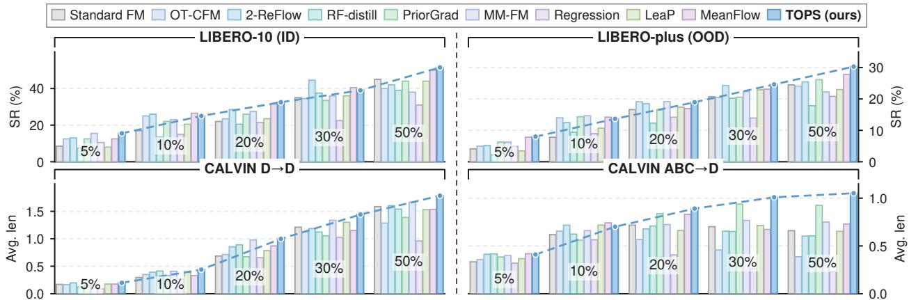  
Figure 3 Data efficiency. Performance with 5%–50% of the training demonstrations on LIBERO-10, LIBERO-Plus, CALVIN D→D, and CALVIN ABC→D. TOPS matches or exceeds the strongest baseline in 14 of the 20 benchmark– data-budget configurations.

## 5.1.1 TOPS improves multi-task performance with fewer sampling steps

Best performance with few-step inference. With one solver step, TOPS achieves the highest mean performance in both ID settings (Tab. 1). Compared with ten-step Standard FM, it raises LIBERO-10 success from 53.44% to 69.67% and CALVIN D→D average completed chain length from 1.90 to 2.27. Per-call latency falls from 49.4 to 8.2 ms on LIBERO and from 56.2 to 9.0 ms on CALVIN, approximately one-sixth of Standard FM’s latency in both settings.

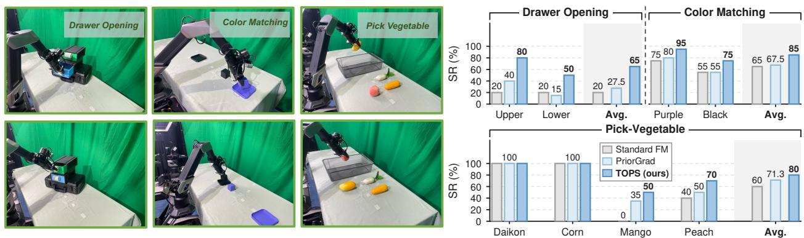

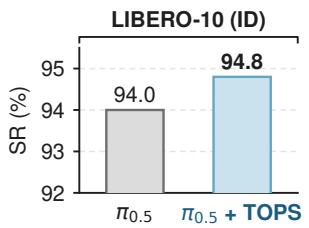

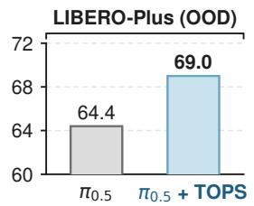

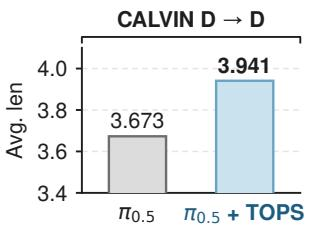

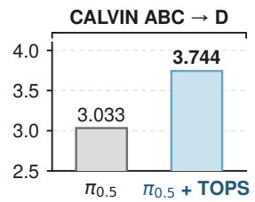

Figure 4 Transfer to the large-scale flow-based π policy. Both variants use the same 14K-step training budget. The baseline uses ten Euler inference steps, while TOPS uses one schedule-aware step (NFE=2). Detailed results are provided in App. A.1.1.  
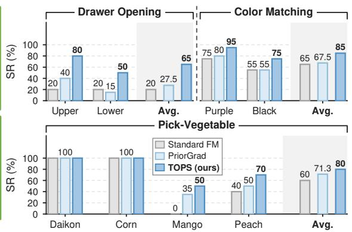  
Figure 5 Real-world evaluation. Left: example scenes from the three task suites. Right: per-task success rates (%) and suite averages (Avg.). Each task is evaluated over 20 rollouts.

Robustness and cross-environment generalization. The same one-step configuration yields the highest mean performance in both OOD settings. LIBERO-Plus success reaches 35.29%, compared with 27.11%, 30.72%, and 34.73% for Standard FM, LeaP, and MeanFlow, respectively. On CALVIN ABC→D, average completed chain length reaches 1.05, versus 0.70, 0.73, and 0.86 for the same baselines. Tabs. 4 and 5 provide category and chain-length breakdowns (App. A.1).

## 5.1.2 TOPS learns more effectively from fewer demonstrations

Since TOPS fits task-specific sources from reversed expert demonstrations, this raises a natural question: can this source construction retain benefits when demonstrations are limited? To investigate this question, we train each method on 5%, 10%, 20%, 30%, and 50% of the demonstrations and evaluate the four ID and OOD settings using the same protocol as above. Fig. 3 shows that TOPS outperforms Standard FM in all 20 configurations and matches or exceeds the strongest baseline in 14. With 5% demonstrations, TOPS achieves 15.50% success on LIBERO-10 and 8.00% on LIBERO-Plus, compared with 8.50% and 4.10% for Standard FM, respectively. On CALVIN ABC→D, TOPS achieves average completed chain length of 1.009 using 30% of the demonstrations, exceeding all baselines trained on 50% (PriorGrad performs best at 0.925).

## 5.1.3 TOPS Transfers to a Large-Scale Flow-Based VLA

To test whether these gains extend to a larger flow-based policy, we apply TOPS to $\pi _ { 0 . 5 }$ (Black et al., 2025a), using the oficial pretrained model and the same LoRA configuration as the baseline. Both variants use the same total budget of 14K training steps; TOPS resumes from an intermediate baseline checkpoint, changing only the source distribution, transport target, and sampler. At inference, the baseline uses ten Euler steps, while TOPS uses one two-stage schedule-aware step (NFE = 2).

As shown in Fig. 4, TOPS improves π in all four evaluated settings. On CALVIN, the average completed chain length increases from 3.673 to 3.941 on D→D and from 3.033 to 3.744 on ABC→D. LIBERO-Plus success rises from 64.4% to 69.0%, while LIBERO-10 improves from an already strong 94.0% to 94.8%. These results show that reshaping the flow source and transport remains beneficial when transferred to a substantially larger flow-based policy, with particularly clear gains under distribution shift. Detailed breakdowns are provided in App. A.1.1.

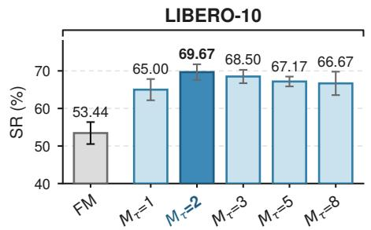

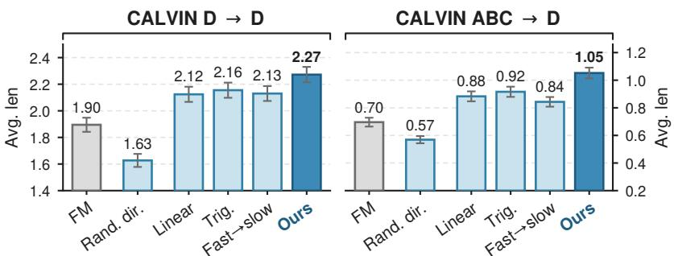  
Figure 6 Ablations of TOPS. Left: LIBERO-10 success (%) versus component count $M _ { \tau }$ . Middle and right: path ablations on CALVIN D→D and ABC→D (mean completed chain length). FM denotes Standard FM; Rand. dir. replaces expansion directions with random ones; Trig. uses trigonometric interpolation. The dark bar denotes full TOPS. Error bars: LIBERO-10 s.d. across seeds (training for FM; evaluation for M variants) and CALVIN s.e.m. over 1,000 chains.

## 5.2 Real-World Experiments

Experimental setup and protocol. We evaluate three multi-task suites on a Galaxea R1 Lite, actuating only its right arm and two-finger gripper. Policies receive RGB images from the head and wrist cameras, proprioception, and language instructions. Within each suite, all candidate targets are present in a shared scene, and the instruction specifies the task. Fig. 5 shows the task setups. Drawer Opening requires opening the instructed upper or lower drawer. Color Matching requires placing the instructed purple or black cube into its matching tray. Pick-Vegetable requires placing the instructed object (daikon, corn, mango, or peach) in a collection box. We collect 50 demonstrations per task for Drawer Opening and Color Matching, and 30 for Pick-Vegetable. We evaluate TOPS, Standard FM, and PriorGrad on eight tasks, with 20 rollouts per task (160 per method). We report per-task success rates and compare the pooled success rates of TOPS and Standard FM using a two-sided two-proportion z-test. Implementation and statistical details appear in App. A.5.2.

Multi-task manipulation performance. Fig. 5 shows that TOPS matches both baselines on daikon and corn (100% success) and achieves higher success on the other six tasks. Compared with Standard FM, success on the upper and lower drawers rises from 20% each to 80% and 50%, respectively. On Color Matching, TOPS reaches 95% and 75% on the purple and black tasks, respectively, improving both by 20 percentage points over Standard FM. On mango and peach, success increases from Standard FM’s 0% and 40% to 50% and 70%, respectively. Pooled across the eight tasks, TOPS succeeds in 124/160 rollouts (77.50%), compared with 82/160 (51.25%) for Standard FM, a statistically significant improvement of 26.25 percentage points $( z = 4 . 9 0 , p < 0 . 0 0 1 )$

## 5.3 Ablation Study

Do both components contribute? As shown in Tab. 1, source-only variants with fixed $M _ { \tau } = 2$ or task-wise mixture counts outperform Standard FM in all four simulation settings under the same training budget and the reported inference budgets. With the $M _ { \tau } = 2$ source unchanged, nonlinear scheduling and its integrator jointly raise LIBERO-10 success from 59.17% to 69.67%. Robomimic (Mandlekar et al., 2021) provides a complementary comparison with a fixed Gaussian source (App. A.6), while App. A.4 compares solvers at a fixed checkpoint.

How sensitive is TOPS to the number of mixture components? We vary $M _ { \tau } \in \{ 1 , 2 , 3 , 5 , 8 \}$ in full TOPS on LIBERO-10, using the same count across tasks and fixing covariance rank, source scale, and training budget. All tested values outperform Standard FM (Fig. 6). $M _ { \tau } \in \{ 2 , 3 \}$ yields the strongest results, with modest degradation for the other tested counts. This preference for small mixtures is consistent with the within-task structure in Fig. 1 and supports our default $M _ { \tau } = 2$ on LIBERO-10.

Do directions and scheduling matter? With the source fixed, we test random directions, shared trigonometric interpolation, and fast-then-slow timing along expansion directions. Random directions substantially reduce performance in both CALVIN settings (Fig. 6). In a controlled 2D experiment, slow-then-fast timing also improves few-step generation over linear and fast-then-slow schedules (Fig. 7). Matched LIBERO-10 MLPs without observation conditioning show 22.1% lower time-integrated velocity-prediction error on expansion directions with slow-then-fast timing and 28.0% higher error with fast-then-slow timing, both relative to linear interpolation (App. A.9.2).

## 6 Conclusion

TOPS incorporates task structure into source priors and interpolation schedules while preserving the policy backbone. Reverse-mapped expert actions guide multimodal source fitting, and an upper bound on velocityprediction risk under independent Gaussian endpoints motivates slow-then-fast scheduling along expansion directions. Experiments demonstrate improved multi-task performance, robustness, and data eficiency with one inference step, together with higher real-world task success.

Limitations. TOPS incurs an ofline cost to construct task-specific sources and schedules, which remain fixed during subsequent training and deployment. It selects among predefined tasks and uses a fixed action-chunk length; generalization to unseen task identities is outside our evaluation. Future work could study incremental source and schedule updates and variable-horizon action generation.

## References

Michael Albergo, Nicholas M Bofi, and Eric Vanden-Eijnden. Stochastic interpolants: A unifying framework for flows and difusions. Journal of Machine Learning Research, 26(209):1–80, 2025.

Jiaqi Bai, Jindou Jia, Yuxuan Hu, Gen Li, Xiangyu Chen, Tuo An, Kuangji Zuo, and Jianfei Yang. Flash: Eficient visuomotor policy via sparse sampling. arXiv preprint arXiv:2605.15492, 2026.

Kevin Black, Noah Brown, James Darpinian, Karan Dhabalia, Danny Driess, Adnan Esmail, Michael Robert Equi, Chelsea Finn, Niccolo Fusai, Manuel Y. Galliker, Dibya Ghosh, Lachy Groom, Karol Hausman, brian ichter, Szymon Jakubczak, Tim Jones, Liyiming Ke, Devin LeBlanc, Sergey Levine, Adrian Li-Bell, Mohith Mothukuri, Suraj Nair, Karl Pertsch, Allen Z. Ren, Lucy Xiaoyang Shi, Laura Smith, Jost Tobias Springenberg, Kyle Stachowicz, James Tanner, Quan Vuong, Homer Walke, Anna Walling, Haohuan Wang, Lili Yu, and Ury Zhilinsky. π : a vision-language-action model with open-world generalization. In Joseph Lim, Shuran Song, and Hae-Won Park, editors, Proceedings of The 9th Conference on Robot Learning, volume 305 of Proceedings of Machine Learning Research, pages 17–40. PMLR, 27–30 Sep 2025a. URL https://proceedings.mlr.press/v305/black25a.html.

Kevin Black, Noah Brown, Danny Driess, Adnan Esmail, Michael Robert Equi, Chelsea Finn, Niccolo Fusai, Lachy Groom, Karol Hausman, Brian Ichter, Szymon Jakubczak, Tim Jones, Liyiming Ke, Sergey Levine, Adrian Li-Bell, Mohith Mothukuri, Suraj Nair, Karl Pertsch, Lucy Xiaoyang Shi, Laura Smith, James Tanner, Quan Vuong, Anna Walling, Haohuan Wang, and Ury Zhilinsky. π<sub>0</sub>: A vision-language-action flow model for general robot control. In RSS 2025, 2025b.

Vitalii Bondar. Velocity scheduled flow matching. arXiv preprint arXiv:2607.11442, 2026.

Max Braun, Noémie Jaquier, Leonel Rozo, and Tamim Asfour. Riemannian flow matching policy for robot motion learning. In 2024 IEEE/RSJ International Conference on Intelligent Robots and Systems (IROS), pages 5144–5151. IEEE, 2024.

Cheng Chi, Zhenjia Xu, Siyuan Feng, Eric Cousineau, Yilun Du, Benjamin Burchfiel, Russ Tedrake, and Shuran Song. Difusion policy: Visuomotor policy learning via action difusion. The International Journal of Robotics Research, 44(10-11):1684–1704, 2025.

Meipo Dai, Qiyuan Zhuang, He-Yang Xu, Ying-Jie Shuai, Yijun Wang, Qi Dou, and Xiu-Shen Wei. Where should action generation begin? a learnable source prior for generative robot policies. arXiv preprint arXiv:2606.17408, 2026.

Arthur P Dempster, Nan M Laird, and Donald B Rubin. Maximum likelihood from incomplete data via the em algorithm. Journal of the royal statistical society: series B (methodological), 39(1):1–22, 1977.

Chengyu Deng, Guanqi Chen, Yizhou Chen, Zejia Liu, Zhiwen Ruan, Guanhua Chen, and Jia Pan. Semantically structured mixture-of-experts for compositional robotic manipulation. In Robotics: Science and Systems (RSS), 2026.

Zibin Dong, Yicheng Liu, Yinchuan Li, Hang Zhao, and Jianye Hao. Conditioning matters: Training difusion policies is faster than you think. In Advances in Neural Information Processing Systems, volume 38, pages 132661– 132686, 2025. doi: 10.52202/085713-3995. URL https://proceedings.neurips.cc/paper\_files/paper/2025/hash/ ad6363efb7af02f7db13d087c7e649bd-Abstract-Conference.html.

Pavel Dvurechensky, Alexander Gasnikov, and Alexey Kroshnin. Computational optimal transport: Complexity by accelerated gradient descent is better than by sinkhorn’s algorithm. In International conference on machine learning, pages 1367–1376. PMLR, 2018.

Senyu Fei, Siyin Wang, Junhao Shi, Zihao Dai, Jikun Cai, Pengfang Qian, Li Ji, Xinzhe He, Shiduo Zhang, Zhaoye Fei, et al. Libero-plus: In-depth robustness analysis of vision-language-action models. arXiv preprint arXiv:2510.13626, 2025.

Niklas Funk, Julen Urain, Joao Carvalho, Vignesh Prasad, Georgia Chalvatzaki, and Jan Peters. Actionflow: Equivariant, accurate, and eficient policies with spatially symmetric flow matching. arXiv preprint arXiv:2409.04576, 2024.

Matthias Gelbrich. On a formula for the l2 wasserstein metric between measures on euclidean and hilbert spaces. Mathematische Nachrichten, 147(1):185–203, 1990.

Zhengyang Geng, Mingyang Deng, Xingjian Bai, Zico Kolter, and Kaiming He. Mean flows for one-step generative modeling. In Advances in Neural Information Processing Systems, volume 38, pages 75460–

75482, 2025. doi: 10.52202/085713-2534. URL https://proceedings.neurips.cc/paper\_files/paper/2025/hash/ 6d13e085b79d454da5910e4ca82a3d9d-Abstract-Conference.html.

Siddhant Haldar, Zhuoran Peng, and Lerrel Pinto. Baku: An eficient transformer for multi-task policy learning. Advances in Neural Information Processing Systems, 37:141208–141239, 2024.

Huang Huang, Fangchen Liu, Letian Fu, Tingfan Wu, Mustafa Mukadam, Jitendra Malik, Ken Goldberg, and Pieter Abbeel. Otter: a vision-language-action model with text-aware visual feature extraction. In Proceedings of the 42nd International Conference on Machine Learning, volume 267 of Proceedings of Machine Learning Research, pages 25566–25580. PMLR, 2025.

Jindou Jia, Tuo An, Yuxuan Hu, Gen Li, Jingliang Li, Bohan Hou, Xiangyu Chen, Jiaqi Bai, Bofan Lyu, and Jianfei Yang. Mars policy: Multimodality only when it matters. arXiv preprint arXiv:2605.29766, 2026a.

Jindou Jia, Gen Li, Xiangyu Chen, Tuo An, Yuxuan Hu, Jingliang Li, Xinying Guo, and Jianfei Yang. Action-to-action flow matching. In Proceedings of Robotics: Science and Systems, 2026b.

Kacper Kapuśniak, Peter Potaptchik, Teodora Reu, Leo Zhang, Alexander Tong, Michael Bronstein, Avishek J Bose, and Francesco Di Giovanni. Metric flow matching for smooth interpolations on the data manifold. Advances in Neural Information Processing Systems, 37:135011–135042, 2024.

Sang-gil Lee, Heeseung Kim, Chaehun Shin, Xu Tan, Chang Liu, Qi Meng, Tao Qin, Wei Chen, Sungroh Yoon, and Tie-Yan Liu. Priorgrad: Improving conditional denoising difusion models with data-dependent adaptive prior. arXiv preprint arXiv:2106.06406, 2021.

Yaron Lipman, Ricky TQ Chen, Heli Ben-Hamu, Maximilian Nickel, and Matt Le. Flow matching for generative modeling. arXiv preprint arXiv:2210.02747, 2022.

Bo Liu, Yifeng Zhu, Chongkai Gao, Yihao Feng, Qiang Liu, Yuke Zhu, and Peter Stone. Libero: Benchmarking knowledge transfer for lifelong robot learning. Advances in Neural Information Processing Systems, 36:44776–44791, 2023a.

Chaoqi Liu, Haonan Chen, Sigmund H. Høeg, Shaoxiong Yao, Yunzhu Li, Kris Hauser, and Yilun Du. Flexible multitask learning with factorized difusion policy. IEEE Robotics and Automation Letters, 11(4):4697–4704, 2026. doi: 10.1109/LRA.2026.3664611.

Xingchao Liu, Chengyue Gong, and Qiang Liu. Flow straight and fast: Learning to generate and transfer data with rectified flow. In International Conference on Learning Representations, 2023b. URL https://openreview.net/ forum?id=XVjTT1nw5z.

Gaoxiang Luo, Frank Cole, Sihang Zhang, Yuxiang Wan, Yulong Lu, and Ju Sun. Flow matching for multimodal distributions. In Proceedings of the IEEE/CVF Conference on Computer Vision and Pattern Recognition, pages 23260–23271, 2026.

Ajay Mandlekar, Danfei Xu, Josiah Wong, Soroush Nasiriany, Chen Wang, Rohun Kulkarni, Li Fei-Fei, Silvio Savarese, Yuke Zhu, and Roberto Martín-Martín. What matters in learning from ofline human demonstrations for robot manipulation. In Conference on Robot Learning (CoRL), 2021.

Oier Mees, Lukas Hermann, Erick Rosete-Beas, and Wolfram Burgard. Calvin: A benchmark for language-conditioned policy learning for long-horizon robot manipulation tasks. IEEE Robotics and Automation Letters, 7(3):7327–7334, 2022.

Nils Reimers and Iryna Gurevych. Sentence-bert: Sentence embeddings using siamese bert-networks. In Proceedings of the 2019 conference on empirical methods in natural language processing and the 9th international joint conference on natural language processing (EMNLP-IJCNLP), pages 3982–3992, 2019.

Hanxiang Ren, Pei Zhou, Xunzhe Zhou, and Yanchao Yang. Disc: Decoupling instruction from state-conditioned control via policy generation. arXiv preprint arXiv:2605.20856, 2026.

Andreas Sochopoulos, Nikolay Malkin, Nikolaos Tsagkas, Joao Moura, Michael Gienger, and Sethu Vijayakumar. Fast flow-based visuomotor policies via conditional optimal transport couplings. arXiv preprint arXiv:2505.01179, 2025.

J Michael Steele. The Cauchy-Schwarz master class: an introduction to the art of mathematical inequalities. Cambridge University Press, 2004.

Andy Tang, William Chen, Andrew Wagenmaker, Chelsea Finn, and Sergey Levine. Improving robotic generalist policies via flow reversal steering. arXiv preprint arXiv:2606.13675, 2026.

Airin Akter Tania and Md Raihan Khan. Dificulty-calibrated interpolation paths for conditional flow matching. arXiv preprint arXiv:2608.21286, 2026.

Michael E. Tipping and Christopher M. Bishop. Mixtures of probabilistic principal component analyzers. Neural Computation, 11(2):443–482, 1999. doi: 10.1162/089976699300016728.

Alexander Tong, Kilian Fatras, Nikolay Malkin, Guillaume Huguet, Yanlei Zhang, Jarrid Rector-Brooks, Guy Wolf, and Yoshua Bengio. Improving and Generalizing Flow-Based Generative Models with Minibatch Optimal Transport. Transactions on Machine Learning Research, 2024. URL https://mlanthology.org/tmlr/2024/ tong2024tmlr-improving/.

Laurens van der Maaten and Geofrey Hinton. Visualizing data using t-sne. Journal of Machine Learning Research, 9 (86):2579–2605, 2008. URL http://jmlr.org/papers/v9/vandermaaten08a.html.

Wenhui Wang, Furu Wei, Li Dong, Hangbo Bao, Nan Yang, and Ming Zhou. Minilm: Deep self-attention distillation for task-agnostic compression of pre-trained transformers. Advances in neural information processing systems, 33: 5776–5788, 2020

Kun Wu, Yichen Zhu, Jinming Li, Junjie Wen, Ning Liu, Zhiyuan Xu, and Jian Tang. Discrete policy: Learning disentangled action space for multi-task robotic manipulation. In 2025 IEEE International Conference on Robotics and Automation (ICRA), pages 8811–8818. IEEE, 2025.

Ge Yan, Yueh-Hua Wu, and Xiaolong Wang. Dnact: Difusion guided multi-task 3d policy learning. In 2025 IEEE/RSJ International Conference on Intelligent Robots and Systems (IROS), pages 9464–9471. IEEE, 2025.

Tony Z. Zhao, Vikash Kumar, Sergey Levine, and Chelsea Finn. Learning fine-grained bimanual manipulation with low-cost hardware. In Robotics: Science and Systems (RSS), 2023.

## A Appendix

## A.1 Comprehensive evaluation results

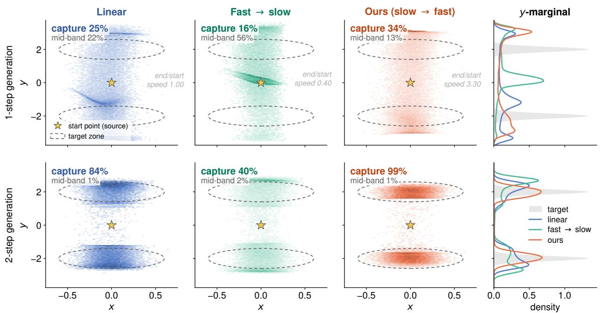  
Figure 7 Interpolation scheduling for few-step generation. The left three columns compare linear (standard), fast-then-slow, and slow-then-fast (ours) scheduling, respectively. The two rows show generated endpoints after one and two integration steps, corresponding to NFE = 2 and 4, respectively. Stars mark the source mean, dashed outlines indicate the target capture regions, and the rightmost column compares the generated y-marginals with the target distribution (gray). With two steps, capture reaches 84%, 40%, and 99%, respectively. With one step, fast-then-slow scheduling leaves 56% of samples in the central band, compared with 22% for linear and 13% for ours. Slow-then-fast scheduling achieves the highest capture at both integration budgets, supporting our scheduling design.

For completeness we report the full breakdown behind the two aggregate scores of the main paper: the six reported LIBERO-Plus perturbation categories and every chain length on both CALVIN splits. Both tables follow the method grouping and the marking convention of the main results table.

LIBERO-Plus: results by perturbation category. Tab. 4 reports results for six perturbation categories, with each variant evaluated once under each of three evaluation seeds. The weighted mean covers the 2,100 variants in these categories. We follow the six-category evaluation used in the main table, excluding Camera.

For TOPS, the ofline-trained language selector described in App. A.5.1 takes the provided instruction ℓ as input and predicts $\hat { \tau } = \psi _ { \phi } ( \ell )$ , which determines the source $q _ { \hat { \tau } }$ and its associated schedule K<sub>τˆ</sub>. In the Language instructions category, the perturbed instruction is used for both source–schedule selection and policy conditioning; benchmark task identities are not used for source–schedule selection. This evaluates the complete language-conditioned inference pipeline under instruction perturbations. App. A.8 provides a complementary evaluation of language-based task-identification accuracy on CALVIN.

TOPS achieves the highest weighted success rate (35.29%), followed by the fixed-M source-only variant (35.21%) and MeanFlow (34.73%). Category-level rankings difer: MeanFlow obtains the highest success rates on Robot initial states (76.1%) and Language instructions (72.7%), compared with 73.6% and 72.6% for TOPS. LeaP achieves 30.72% weighted success and leads on Sensor noise (12.2%) and Lighting (8.9%), while the fixed-M<sub>τ</sub> source-only variant leads on Object and Background perturbations. Relative to Standard FM, TOPS retains its largest gains on Robot initial states (+19.6 percentage points) and Language instructions (+18.6 percentage points). The language-category result evaluates task execution with the perturbed instruction driving both source–schedule selection and policy conditioning. Both source-only variants also improve weighted success over Standard FM.

Table 2 LIBERO-Plus perturbation breakdown for $\pi _ { 0 . 5 }$ and $\pi _ { 0 . 5 } + \mathrm { T O P S }$ . Success rates (%) are reported for each perturbation category and overall.
<table><tr><td>Perturbation</td><td> $\pi _ { 0 . 5 }$   $\pi _ { 0 . 5 } + \mathrm { T O P S }$ </td></tr><tr><td>Lighting</td><td>77.5</td></tr><tr><td>Object layout</td><td>74.1</td></tr><tr><td>Background texture</td><td>79.0</td></tr><tr><td>Sensor noise</td><td>46.8</td></tr><tr><td>Camera viewpoint</td><td>38.4</td></tr><tr><td>Robot initial state</td><td>74.4</td></tr><tr><td>Language instruction</td><td>74.8</td></tr><tr><td>Overall</td><td>64.4</td></tr></table>

CALVIN: long-horizon chains on both splits. Tab. 5 reports 1,000 five-task chains evaluated in environment D, with each chain terminated at its first failure. Column $\geq k$ gives the percentage of chains whose first k subtasks all succeed; summing these five percentages and dividing by 100 recovers the average chain length, up to rounding. TOPS achieves the highest mean chain length on both splits. On D→D, it also leads at every chain length, completing all five subtasks in 19.3% of chains, compared with 13.7% for MeanFlow and 10.0% for LeaP. On ABC→D, TOPS reaches a mean chain length of 1.05, compared with 0.86 for MeanFlow and 0.73 for LeaP. It leads at $\geq 1$ and $\geq 2$ , while PriorGrad achieves the highest completion rates at $\geq 3 , \geq 4 ,$ and $\geq 5 .$ . The five-task completion rate of TOPS is 1.7%, compared with 0.6% for MeanFlow and 0.5% for LeaP.

## A.1.1 Transfer to the Large-Scale $\pi _ { 0 . 5 }$ Policy

Implementation protocol. We initialize from the oficial pi05\_base checkpoint and fine-tune the OpenPI JAX implementation using its standard low-memory LoRA recipe. PaliGemma and the action expert use rank-16 and rank-32 LoRA adapters, respectively, while both the baseline and TOPS otherwise retain the same model architecture, optimization setup, data, and action normalization. Each method is trained for a total of 14K optimization steps.

TOPS resumes the complete training state from the 6K-step baseline checkpoint and continues training to 14K steps. From this checkpoint, we construct the task-specific sources and schedules ofline and continue training to the same 14K-step budget, modifying only the source distribution and transport targets. The baseline is evaluated from its corresponding 14K-step checkpoint. At inference, the baseline uses ten Euler steps, whereas TOPS uses one schedule-aware two-stage step (NFE=2). The $\pi _ { 0 . 5 }$ action chunk contains ten 7-dimensional actions $( D = 7 0 )$ . We apply TOPS to these active action dimensions: expert chunks are reverse-mapped through the intermediate baseline flow, followed by per-task MPPCA source fitting and the same covariance-based scheduling construction described in Section 4.

LIBERO-Plus perturbation breakdown. Tab. 2 shows that the overall gain is distributed across most perturbation categories. The largest improvements occur under lighting changes (77.5%→94.2%) and object-layout perturbations (74.1%→84.3%). TOPS also improves background, sensor-noise, camera-viewpoint, and robotinitial-state robustness, while performance under language perturbations remains comparable, with a small decrease from 74.8% to 73.7%. Overall success increases from 64.4% to 69.0%.

CALVIN long-horizon breakdown. Tab. 3 shows consistent gains across chain depths. On D→D, TOPS improves completion at every depth and raises the average chain length from 3.673 to 3.941. The diference becomes more pronounced under cross-environment transfer: on ABC→D, five-task completion increases from 41.2% to 61.1%, while the average chain length rises from 3.033 to 3.744. The gains across deeper chain positions suggest that the improvement is not confined to initial task execution but persists over long-horizon rollouts.

Table 3 CALVIN chain-depth results for $\pi _ { 0 . 5 }$ and $\pi _ { 0 . 5 } + \mathrm { T O P S } .$ . Columns $\geq k$ report the percentage of five-task chains whose first k subtasks are completed successfully; Len denotes average completed chain length.
<table><tr><td>Setting</td><td>Method</td><td> $\geq 1$ </td><td> $\geq 2$ </td><td> $\geq 3$ </td><td> $\geq 4$ </td><td> $\geq 5$ </td><td>Len</td></tr><tr><td>D→D</td><td>π0.5</td><td>87.4</td><td>79.2</td><td>72.3</td><td>66.7</td><td>61.7</td><td>3.673</td></tr><tr><td></td><td> $\pi _ { 0 . 5 ^ { \mathrm { ~ - ~ } } }$  + TOPS</td><td>90.7</td><td>83.7</td><td>78.4</td><td>73.0</td><td>68.3</td><td>3.941</td></tr><tr><td> $\mathrm { A B C }  \mathrm { D }$ </td><td> $\pi _ { 0 . 5 }$ </td><td>83.4</td><td>69.1</td><td>59.0</td><td>50.6</td><td>41.2</td><td>3.033</td></tr><tr><td></td><td> $\pi _ { 0 . 5 } + \mathrm { T O P S }$ </td><td>91.4</td><td>80.9</td><td>73.7</td><td>67.3</td><td>61.1</td><td>3.744</td></tr></table>

Table 4 LIBERO-Plus results by perturbation category. Success rates $( \% )$ , with variant counts in parentheses. Type denotes the method category. Weighted is the variant-count-weighted mean over the six reported categories (Camera excluded, since all methods are zero). Uncertainty follows the seed and aggregation convention of Tab. 1. Bold and underlined values indicate the highest and second-highest means in each column, respectively.
<table><tr><td>Method</td><td>Type</td><td>Robot (393)</td><td>Lang. (383)</td><td>Object (312)</td><td>Backgr. (289)</td><td>Sensor (449)</td><td>Light (274)</td><td>Weighted (2100)</td></tr><tr><td>Standard FM</td><td>Ref.</td><td>54.0</td><td>54.0</td><td>21.7</td><td>13.6</td><td>4.7</td><td>8.2</td><td>27.1±0.3</td></tr><tr><td>OT-CFM</td><td>Coupl.</td><td>41.1</td><td>40.8</td><td>10.0</td><td>4.5</td><td>6.2</td><td>3.3</td><td>19.0±0.1</td></tr><tr><td>2-ReFlow</td><td>Few-step</td><td>38.1</td><td>42.0</td><td>17.4</td><td>9.6</td><td>4.5</td><td>4.4</td><td>20.2±0.4</td></tr><tr><td>RF-distill</td><td>Few-step</td><td>33.1</td><td>35.0</td><td>15.3</td><td>8.4</td><td>3.6</td><td>6.1</td><td>17.6±0.1</td></tr><tr><td>MeanFlow</td><td>Few-step</td><td>76.1</td><td>72.7</td><td>22.1</td><td>10.9</td><td>8.4</td><td>4.9</td><td>34.7±0.3</td></tr><tr><td>PriorGrad</td><td>Source</td><td>62.3</td><td>61.7</td><td>23.2</td><td>14.5</td><td>7.5</td><td>4.6</td><td>30.6±0.3</td></tr><tr><td>MM-FM</td><td>Source</td><td>36.7</td><td>38.8</td><td>10.4</td><td>3.9</td><td>2.8</td><td>1.0</td><td>16.8±0.5</td></tr><tr><td>LeaP</td><td>Source</td><td>56.9</td><td>56.8</td><td>26.1</td><td>15.1</td><td>12.2</td><td>8.9</td><td>30.7±0.8</td></tr><tr><td>Regression</td><td>None</td><td>50.1</td><td>46.3</td><td>13.8</td><td>5.5</td><td>4.8</td><td>3.9</td><td>22.2±0.5</td></tr><tr><td>Source (fixed Mτ)</td><td>Ours</td><td>71.8</td><td>71.4</td><td>26.2</td><td>15.8</td><td>7.7</td><td>8.0</td><td>35.2±0.7</td></tr><tr><td>Source (task-wise Mτ)</td><td>Ours</td><td>64.0</td><td>60.9</td><td>23.0</td><td>12.8</td><td>7.4</td><td>5.1</td><td>30.5±0.7</td></tr><tr><td>TOPS</td><td>Ours</td><td>73.6</td><td>72.6</td><td>24.8</td><td>15.2</td><td>7.1</td><td>7.4</td><td>35.3±0.1</td></tr></table>

## A.2 Language-based Source Selection

TOPS separates source selection from the policy’s conditioning pathway. Task annotations organize the ofline construction of the source distributions $\{ q _ { \tau } \} _ { \tau \in \mathcal { T } }$ and their associated scheduling matrices $\{ K _ { \tau } \} _ { \tau \in \mathcal { T } }$ At inference, a learned selector $\psi _ { \phi }$ maps the input instruction ℓ to a source index $\hat { \tau } \in \mathcal { T }$

$$
\hat { \tau } = \psi _ { \phi } ( \ell ) , \qquad x ^ { ( 0 ) } \sim q _ { \hat { \tau } } .\tag{11}
$$

The selected source is used with its corresponding fixed scheduling matrix $K _ { \hat { \tau } }$

In the main-text evaluations, the learned selector operates separately from the velocity network. It uses MiniLM (Wang et al., 2020) sentence features to predict the task index, while the policy condition c is constructed from observations and the provided instruction through the original observation encoders and frozen CLIP text encoder, independently of that prediction. Action generation then integrates $v _ { \theta } ( \mathbf { x } , t , \mathbf { c } )$ from the selected source using its associated schedule. The selector implementation is provided in App. A.5.1. App. A.8 compares language-based task-identification methods on 358 instruction formulations covering 34 known CALVIN tasks.

## A.3 Empirical Characterization of Expansion Directions

## A.3.1 Spectral Geometry of Expansion Directions

Fig. 9 examines the covariance geometry motivating the direction-dependent interpolation schedules in Section 4.3: the concentration of expansion directions, the stability of their estimated subspaces, and their sensitivity to the source covariance.

Diagnostic setup. We analyze LIBERO-10 and the CALVIN D and ABC training settings, with 10, 34, and 34 task-setting pairs, respectively; the CALVIN settings share task categories. These ofline diagnostics use fixed three-component, rank-20 MPPCA sources with source scale 0.3 and policy-normalized 16-step action chunks $( D = 1 6 \times 1 0 = 1 6 0 )$ . Source covariances are computed analytically from $q _ { \tau }$ . Expert covariances are estimated from stride-one windows within stored episodes, with 5% shrinkage toward trace-matched isotropic covariances. We follow the OT construction in Section 4.3, using its eigenvalues $s _ { \tau j }$ and unit eigenvectors ${ \pmb r } _ { \tau j } \in { \mathbb { R } ^ { D } }$ . All reported averages weight tasks equally.

Table 5 CALVIN long-horizon chains. Average completed chain length and the percentage of the 1000 chains whose first k subtasks all succeeded (≥ k); higher is better throughout. Type denotes the method category.
<table><tr><td></td><td></td><td colspan="6">D→D (in-distribution)</td><td colspan="6">ABC→D (unseen env.)</td></tr><tr><td>Method</td><td>Type</td><td>Len</td><td>≥1</td><td>≥2</td><td>≥3</td><td>≥4</td><td>≥5</td><td>Len</td><td>≥1</td><td>≥2</td><td>≥3</td><td>≥4</td><td>≥5</td></tr><tr><td>Standard FM</td><td>Ref.</td><td>1.90±.05</td><td>72.9</td><td>52.2</td><td>32.2</td><td>20.3</td><td>11.9</td><td>0.70±.03</td><td>42.8</td><td>16.8</td><td>7.0</td><td>2.5</td><td>0.5</td></tr><tr><td>OT-CFM</td><td>Coupl.</td><td>1.28±.05</td><td>59.8</td><td>34.6</td><td>18.8</td><td>9.8</td><td>4.9</td><td>0.46±.02</td><td>32.9</td><td>10.0</td><td>2.8</td><td>0.6</td><td>0.1</td></tr><tr><td>2-ReFlow</td><td>Few-step</td><td>1.74±.05</td><td>72.0</td><td>47.5</td><td>28.6</td><td>17.1</td><td>8.9</td><td>0.66±.03</td><td>42.3</td><td>15.8</td><td>5.5</td><td>2.4</td><td>0.4</td></tr><tr><td>RF-distill</td><td>Few-step</td><td>1.75±.05</td><td>71.0</td><td>48.3</td><td>28.9</td><td>17.0</td><td>9.9</td><td>0.70±.03</td><td>44.1</td><td>17.7</td><td>6.5</td><td>1.7</td><td>0.2</td></tr><tr><td>MeanFlow</td><td>Few-step</td><td>1.89±.02</td><td>71.4</td><td>49.2</td><td>32.9</td><td>22.0</td><td>13.7</td><td>0.86±.02</td><td>50.5</td><td>23.9</td><td>8.6</td><td>2.7</td><td>0.6</td></tr><tr><td>PriorGrad</td><td>Source</td><td>1.97±.06</td><td>72.4</td><td>50.7</td><td>35.4</td><td>23.3</td><td>15.0</td><td>1.02±.04</td><td>52.5</td><td>27.4</td><td>12.9</td><td>6.4</td><td>2.8</td></tr><tr><td>MM-FM</td><td>Source</td><td>1.75±.05</td><td>70.3</td><td>47.9</td><td>29.7</td><td>17.9</td><td>9.0</td><td>0.68±.03</td><td>42.4</td><td>16.4</td><td>6.6</td><td>2.1</td><td>0.2</td></tr><tr><td>LeaP</td><td>Source</td><td>1.74±.02</td><td>70.1</td><td>46.9</td><td>29.0</td><td>17.7</td><td>10.0</td><td>0.73±.03</td><td>45.8</td><td>18.2</td><td>7.1</td><td>1.9</td><td>0.5</td></tr><tr><td>Regression</td><td>None</td><td>0.88±.03</td><td>53.0</td><td>21.3</td><td>8.9</td><td>4.0</td><td>1.0</td><td>0.27±.02</td><td>21.8</td><td>4.2</td><td>0.6</td><td>0.0</td><td>0.0</td></tr><tr><td>Source (fixed Mτ)</td><td>Ours</td><td>2.12±.06</td><td>74.4</td><td>54.7</td><td>39.2</td><td>26.8</td><td>17.3</td><td>0.88±.04</td><td>49.7</td><td>23.4</td><td>9.6</td><td>4.2</td><td>1.4</td></tr><tr><td>Source (task-wise Mτ)</td><td>Ours</td><td>2.15±.06</td><td>76.0</td><td>55.6</td><td>39.2</td><td>26.8</td><td>17.6</td><td>0.98±.04</td><td>52.1</td><td>26.2</td><td>12.1</td><td>6.0</td><td>1.7</td></tr><tr><td>TOPS</td><td>Ours</td><td>2.27±.06</td><td>77.0</td><td>57.9</td><td>42.5</td><td>30.5</td><td>19.3</td><td>1.05±.04</td><td>56.8</td><td>29.0</td><td>12.2</td><td>5.5</td><td>1.7</td></tr></table>

Expansion and concentration. Define the expansion set $\mathcal { E } _ { \tau } = \{ j : s _ { \tau j } > 1 \} \subseteq \{ 1 , \dots , D \}$ and its cardinality $k _ { \tau } = | \mathcal { E } _ { \tau } | \in \{ 0 , \dots , D \}$ . Define the scalar covariance-cost contribution $e _ { \tau j } \in \mathbb { R } _ { \geq 0 }$ and expansion cost share $R _ { \mathrm { e x p } } ^ { \tau } \in [ 0 , 1 ]$ :

$$
e _ { \tau j } = ( s _ { \tau j } - 1 ) ^ { 2 } r _ { \tau j } ^ { \top } \mathbf { C } _ { s } ^ { \tau } r _ { \tau j } , \qquad R _ { \exp } ^ { \tau } = \frac { \sum _ { j \in \mathcal { E } _ { \tau } } e _ { \tau j } } { \sum _ { j = 1 } ^ { D } e _ { \tau j } } .\tag{12}
$$

The denominator is the squared Bures distance between the two covariances, excluding mean displacement. Fig. 9(a,b) shows that expansion is concentrated in a small subspace: the mean expansion fractions are 7.4%, 9.2%, and 9.7% for LIBERO-10, CALVIN D, and CALVIN ABC, while their mean covariance-cost shares are 69.6%, 60.9%, and 62.0%. Thus, distinguishing expansion directions targets a substantial portion of the observed second-order mismatch, providing empirical motivation for the direction selection in Section 4.3.

Stability under expert-data resampling. For column-orthonormal bases $\mathbf { Q } _ { A } \in \mathbb { R } ^ { D \times k _ { A } }$ and $\mathbf { Q } _ { B } \in \mathbb { R } ^ { D \times k _ { B } }$ , with $k _ { A } , k _ { B } \in \{ 1 , . . . , D \}$ , define the symmetric subspace overlap

$$
\mathcal { O } ( \mathbf { Q } _ { A } , \mathbf { Q } _ { B } ) = \frac { 1 } { 2 } \left( \frac { 1 } { k _ { A } } + \frac { 1 } { k _ { B } } \right) \| \mathbf { Q } _ { A } ^ { \top } \mathbf { Q } _ { B } \| _ { F } ^ { 2 } \in [ 0 , 1 ] .\tag{13}
$$

Its expectation for independent uniformly random subspaces is $( k _ { A } + k _ { B } ) / ( 2 D )$ . We perform 20 random splits of stored episode IDs, re-estimate the expert covariance in each half, and compare the resulting top-k OT subspaces. The source covariance, action normalization, and full-data choice of $k _ { \tau }$ remain fixed. The task-mean overlaps in Fig. 9(c) are 0.993, 0.973, and 0.984, compared with random-reference means of 0.074, 0.092, and 0.097. This supports stable ofline subspace estimation under the specified protocol. Splits group complete demonstration episodes for LIBERO and annotated language segments for CALVIN; the latter need not be independent play trajectories.

Sensitivity to the source covariance. Holding $\mathbf { C } _ { d } ^ { \tau }$ fixed, we replace the fitted source covariance with $0 . 3 ^ { 2 } \mathbf { I } _ { D }$ and recompute the OT map. We compare each source’s own expansion subspace using Eq. 13, allowing their dimensions to difer. Fig. 9(d) gives mean overlaps of 0.877, 0.811, and 0.780, above the corresponding random-reference means of 0.069, 0.079, and 0.084. Thus, substantial expansion structure persists for both source choices, supporting the premise in Section 4.3 that source adaptation can leave covariance mismatch that motivates direction-dependent interpolation scheduling.

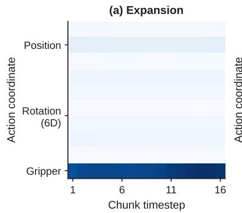

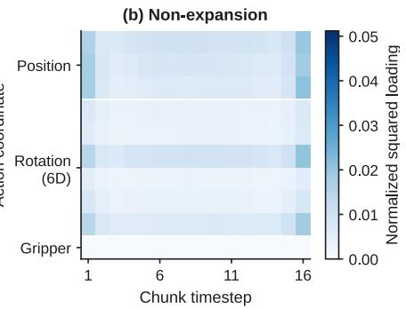

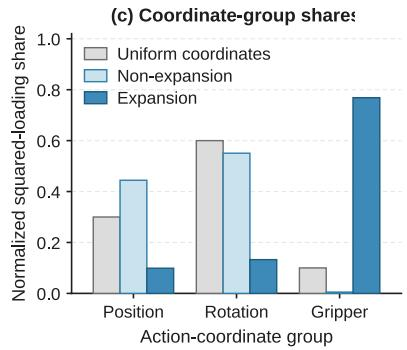  
Figure 8 Action-coordinate structure of OT directions on LIBERO-10. (a,b): covariance-cost-weighted squared loadings for expansion $( s _ { \tau j } > 1 )$ and non-expansion $( s _ { \tau j } \leq 1 )$ directions, respectively, defined in Eq. 14. Each task’s map is independently normalized to sum to one before averaging across the ten tasks; both heatmaps use the same color scale. Columns index chunk timesteps and rows index action coordinates. (c): loading shares summed over position, rotation, and gripper coordinates. Grey bars indicate the uniform-coordinate reference determined by group dimensionality. The figure analyzes raw Gaussian-OT eigenvectors in normalized action space.

## A.3.2 Action Structure of Expansion Directions

Section 4.3 interprets the OT eigenvectors $\pmb { r } _ { \tau j } \in \mathbb { R } ^ { D }$ as action patterns spanning timesteps and action dimensions. Complementing the spectral diagnostics in Fig. 9, we examine where these directions load in action coordinates. We use the same LIBERO-10 diagnostic setup as App. A.3, with $H = 1 6 , d _ { a } = 1 0$ , and $D = H d _ { a } = 1 6 0$ in policy-normalized action space.

Coordinate-loading diagnostic. Let $\mathcal { E } _ { \tau } ^ { c } = \{ 1 , \ldots , D \} \setminus \mathcal { E } _ { \tau }$ denote the non-expansion set. Using the covariancecost contributions $e _ { \tau j }$ from $\operatorname { E q } .$ 12, define the nonnegative loading matrix $\mathbf { L } _ { \tau } ( S ) \in \mathbb { R } _ { \geq 0 } ^ { H \times d _ { a } }$ for $S \in \{ \mathcal { E } _ { \tau } , \mathcal { E } _ { \tau } ^ { c } \}$ with $\begin{array} { r } { \sum _ { j \in \mathcal { S } } e _ { \tau j } > 0 \colon } \end{array}$

$$
[ \mathbf { L } _ { \tau } ( S ) ] _ { h , a } = \frac { \sum _ { j \in \mathcal { S } } e _ { \tau j } [ r _ { \tau j } ] _ { ( h - 1 ) d _ { a } + a } ^ { 2 } } { \sum _ { j \in \mathcal { S } } e _ { \tau j } } , \qquad h \in \{ 1 , \ldots , H \} , \quad a \in \{ 1 , \ldots , d _ { a } \} .\tag{14}
$$

Because the eigenvectors have unit norm, each matrix satisfies $\begin{array} { r } { \sum _ { h = 1 } ^ { H } \sum _ { a = 1 } ^ { d _ { a } } [ { \bf L } _ { \tau } ( S ) ] _ { h , a } = 1 } \end{array}$ . We average these matrices equally over the ten tasks. Group shares sum the resulting entries over all timesteps and coordinates {1, 2, 3} for position, $\{ 4 , \ldots , 9 \}$ for the 6D rotation representation, and {10} for the gripper. Uniform loading over coordinates gives reference shares of 30%, 60%, and 10%, respectively.

Results and connection to Section 4.3. Fig. 8 reveals distinct action-coordinate profiles for expansion and non-expansion directions. Gripper coordinates account for 76.9% of the normalized expansion loading, compared with the 10% uniform-coordinate reference; the averaged expansion map shows gripper participation throughout the 16-step horizon. Non-expansion loadings instead concentrate on position (44.4%) and rotation (55.1%), with only 0.5% on the gripper. This action-group selectivity provides empirical support for the action-structure interpretation of the OT directions in Section 4.3, complementing the preceding evidence about their spectral geometry. The diagnostic characterizes aggregate coordinate participation: averaging squared loadings does not retain the signed temporal coordination of individual modes, and these shares are not coordinate-wise transport-cost contributions.

## A.4 Ablation of the schedule-aware integrator

Experimental setup. We evaluate the efect of the inference solver on LIBERO-10 while keeping the TOPS checkpoint, task-specific source distributions $q _ { \tau }$ , and learned velocity field $v _ { \theta }$ fixed, without retraining. This diagnostic uses $M _ { \tau } = 3$ source components per task, component rank $r = 2 0$ , and source scale 0.3. We retain a prediction horizon of 16, two observation frames, and eight executed actions per policy call. For each solver and budget, we evaluate EMA weights from one continuation-training seed, using 20 rollouts per task, fixed initial states, a maximum of 400 environment steps, and three evaluation seeds. We report the equally weighted ten-task success rate as mean ± population standard deviation across three evaluation seeds for one fixed trained checkpoint, totaling 600 rollouts per table entry.

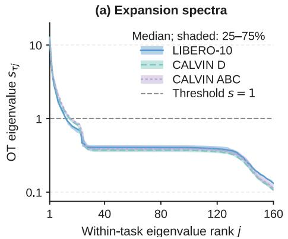

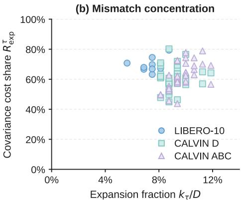

(c) Split-half stability  
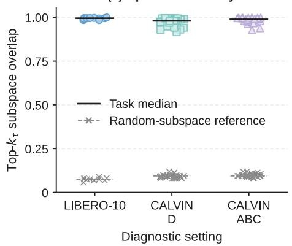

(d) Source covariance sensitivity  
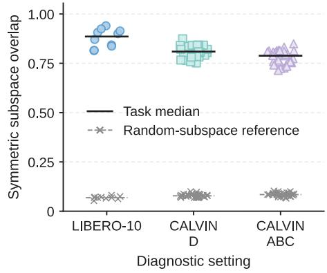  
Figure 9 Empirical characterization of expansion directions. (a) Within-task sorted OT eigenvalues: curves show task medians and bands show interquartile ranges; the dashed line marks $s _ { \tau j } = 1$ . (b) Expansion fraction $k _ { \tau } / D$ versus covariance-cost share $R _ { \mathrm { e x p } } ^ { \tau } .$ . (c) Top-k<sub>τ</sub> subspace overlap, averaged over 20 random data splits with the source and full-data dimension fixed. (d) Symmetric overlap between the fitted-source and isotropic-source expansion subspaces, each selected by $s _ { \tau j } > 1$ . Each point in (b–d) represents a task within a diagnostic setting. Black bars in $^ { \mathrm { ( c , d ) } }$ show task medians; grey markers show analytical random-subspace expectations. All spectra use the regularized covariance estimates specified above.

Solvers and evaluation budgets. We compare the two-stage schedule-aware update in App. A.10 with explicit midpoint and ordinary explicit Euler integration of the same learned field. On a uniform grid $t _ { n } = n / N$ with $h = 1 / N$ , Euler uses

$$
x ^ { ( n + 1 ) } = x ^ { ( n ) } + h v _ { \theta } ( x ^ { ( n ) } , t _ { n } , c ) .
$$

Euler requires one velocity-network evaluation per step, whereas explicit midpoint and the schedule-aware update require two. We therefore compare NFE budgets of 2, 10, and 20: Euler uses 2, 10, and 20 steps, while the other solvers use 1, 5, and 10. The schedule-aware integrator applies two successive half-interval updates defined in App. A.10. It difers from standard explicit midpoint and reduces to two explicit Euler half-steps when ${ \bf K } _ { \tau } = 0$

Results. Tab. 6 shows that the schedule-aware integrator achieves the highest mean success rate at every tested NFE budget. At NFE = 2, it reaches 68.33%, while neither generic solver achieves a successful rollout. Even at this budget, it outperforms both generic solvers evaluated at NFE = 20. Increasing its budget to NFE = 10 and 20 further raises mean success to 72.17% and 72.67%, respectively. At these two budgets, the margins over explicit Euler are 36.50 and 17.67 percentage points, while those over explicit midpoint are 14.50 and 15.17 points. These results support the efectiveness of the schedule-aware update for few-step inference, with additional evaluations providing further improvements in mean task success.

Table 6 Solver ablation on LIBERO-10 with a fixed TOPS checkpoint. Success rate (%, higher is better), reported as mean ± population standard deviation over three evaluation seeds. All rows use the same $M _ { \tau } = 3$ checkpoint and difer only in the inference solver. Columns align the number of velocity-network evaluations (NFE), rather than the number of integration steps.
<table><tr><td>Integrator</td><td> $\mathrm { N F E } = 2$ </td><td> $\mathrm { N F E } = 1 0 $ </td><td> $\mathrm { N F E } = 2 0 $ </td></tr><tr><td>Explicit Euler</td><td> $0 . 0 0 \pm 0 . 0 0$ </td><td> $3 5 . 6 7 \pm 1 . 4 3$ </td><td> $5 5 . 0 0 \pm 2 . 1 6$ </td></tr><tr><td>Explicit midpoint</td><td> $0 . 0 0 \pm 0 . 0 0$ </td><td> $5 7 . 6 7 \pm 1 . 8 4$ </td><td> $5 7 . 5 0 \pm 2 . 4 8$ </td></tr><tr><td>Schedule-aware (ours)</td><td> ${ \bf 6 8 . 3 3 \pm 2 . 0 9 }$ </td><td> ${ \bf 7 2 . 1 7 \pm 4 . 4 8 }$ </td><td> ${ \bf 7 2 . 6 7 \pm 2 . 0 1 }$ </td></tr></table>

## A.5 Implementation details

## A.5.1 Implementation Details for Simulation Experiments

Policy architecture. All methods share a difusion Transformer (DiT) backbone with four blocks, a hidden dimension of 512, and eight attention heads. A ResNet-18 encoder extracts visual features, while a frozen CLIP ViT-B/32 encoder provides 512-dimensional language embeddings. These features are combined with proprioceptive observations to condition the DiT through adaptive layer normalization. The network predicts velocities for action chunks, and TOPS preserves this shared architecture. We infer the task index from the instruction using a frozen MiniLM sentence encoder (Wang et al., 2020; Reimers and Gurevych, 2019) followed by a five-model ensemble of lightweight MLP classifiers. The classifiers are trained ofline on the benchmark-provided training instructions and their task labels using a standard cross-entropy objective and AdamW with a learning rate of $1 0 ^ { - 3 }$ , independently of the policy. The sentence encoder remains frozen, and the trained selector is held fixed during policy training and evaluation. For TOPS, its predicted task index selects both $q _ { \hat { \tau } }$ and $K _ { \hat { \tau } } ;$ the source-only variants use the same prediction to select $q _ { \hat { \tau } }$ . The policy retains its original CLIP-based language conditioning.

Training and hyperparameters. We first train the standard FM policy for 300 warm-up epochs. We then construct the task-specific sources $q _ { \tau }$ and scheduling matrices K ofline and continue training for another 300 epochs, keeping both fixed. All compared methods are trained for the same total of 600 epochs, including any warm-up stages, to ensure a fair comparison. Each epoch comprises 250 optimizer updates. We evaluate the final exponential moving average (EMA) policy. The main hyperparameters are summarized in Tab. 7.

Random seeds and statistical reporting. We distinguish training seeds from evaluation seeds. An independent training run repeats the stochastic training pipeline; for TOPS, this includes warm-up, source and schedule construction, and continuation training. An evaluation seed controls rollout stochasticity for a fixed trained checkpoint.

We first compute the benchmark metric separately for each evaluation seed. When multiple independently trained checkpoints are evaluated, we average evaluation repeats within each checkpoint before computing statistics across training runs. For fixed-checkpoint experiments, statistics are computed across evaluation seeds. Each experiment specifies the corresponding level of repetition. Unless otherwise specified, reported standard deviations are sample standard deviations, computed with denominator $N - 1$ for N repeated measurements.

Method hyperparameters. For each task source, $M _ { \tau }$ specifies the number of mixture components and $r$ the dimension of their low-rank covariance term. We calibrate the pooled source standard deviation to the warm-up Gaussian scale, $\sqrt { \mathrm { t r } ( { \bf C } _ { \mathrm { s } } ^ { \tau } ) / D } = \sigma _ { 0 }$ . For interpolation scheduling, κ bounds the strengths $\rho _ { \tau j }$ , while the sensitivity γ is computed as

$$
\gamma = \left[ \mathrm { m a x } \{ \mathrm { m e d i a n } _ { \tau , j : s _ { \tau j } > 1 } \log s _ { \tau j } , \ 1 0 ^ { - 6 } \} \right] ^ { - 1 } .\tag{15}
$$

The median pools the positive log expansion ratios of the Gaussian OT maps across training tasks. We compute γ ofline for each training setting and keep it fixed during continuation training and inference.

Inference-time measurement. All inference latencies in Tab. 1 are measured on an NVIDIA RTX PRO 6000 GPU. We time one policy call that generates an action chunk, using each method’s reported inference configuration.

Table 7 Main hyperparameters for simulation experiments.
<table><tr><td>Hyperparameter</td><td>Value</td></tr><tr><td>TOPS warm-up / continuation epochs</td><td>300 /300</td></tr><tr><td>Total training epochs, all methods</td><td>600</td></tr><tr><td>Batch size</td><td>32</td></tr><tr><td>Optimizer</td><td>AdamW, β1 = 0.95, β2 = 0.999</td></tr><tr><td>Learning rate</td><td> $1 0 ^ { - 4 }$ </td></tr><tr><td>Weight decay</td><td> $1 0 ^ { - 6 }$ </td></tr><tr><td>Learning-rate schedule</td><td>Cosine, with 500 warm-up updates per stage</td></tr><tr><td>Maximum EMA decay</td><td>0.9999</td></tr><tr><td>Prediction / observation / execution horizons</td><td> $1 6 / 2 / 8$ </td></tr><tr><td>Mixture components Mτ</td><td>2</td></tr><tr><td>Low-rank dimension r</td><td>20</td></tr><tr><td>Warm-up source standard deviation  $\sigma _ { 0 }$ </td><td>0.3</td></tr><tr><td>Calibrated pooled source standard deviation</td><td>0.3 0.5</td></tr><tr><td>Maximum scheduling strength κ</td><td></td></tr><tr><td>Scheduling sensitivity γ</td><td>Computed using Eq. 15</td></tr><tr><td>Reverse-flow integration</td><td>10 explicit-midpoint steps</td></tr><tr><td>TOPS inference steps N</td><td>1 (two network evaluations)</td></tr></table>

Baseline implementation protocol. We compare baseline adaptations within a shared policy framework, using the same observation encoder, language conditioning, DiT backbone, action representation, and observation and execution horizons. Each normalized action chunk contains 16 ten-dimensional actions $( D = 1 6 0 )$ . All methods use the same optimizer settings and receive 600 epochs of policy training, including any warm-up stage. Continuation-based methods initialize from the EMA parameters of a shared 300-epoch Standard FM checkpoint and train for another 300 epochs. Ofline prior fitting and teacher-pair generation are performed separately before continuation. Unless otherwise specified, inference uses ten explicit-midpoint steps, corresponding to 20 velocity-network evaluations (NFE = 20).

Standard FM. We independently sample Gaussian sources $x _ { 0 } \sim \mathcal { N } ( 0 , 0 . 3 ^ { 2 } I _ { D } )$ and expert action chunks x . Training uses linear interpolation $x _ { t } = ( 1 - t ) x _ { 0 } + t x _ { 1 }$ , with $t \sim \mathcal { U } [ 0 , 1 ]$ , and mean-squared regression of the displacement $x _ { 1 } - x _ { 0 }$ . The same source distribution and objective are used throughout training.

OT-CFM. We replace independent endpoint pairing with minibatch optimal transport based on squared Euclidean distances in the flattened action-chunk space. The uniform-marginal transport problem is solved using exact earth mover’s distance, with Hungarian assignment as a fallback. Matching operates across the full minibatch using action-space costs. Only source samples are reassigned; expert chunks retain their associated observations and language instructions. The remaining training procedure follows Standard FM.

2-ReFlow. We use the frozen warm-up EMA policy to generate four noise–endpoint pairs per demonstration window, conditioned on its observations and language instruction. Teacher generation uses 50 explicit-midpoint steps (NFE = 100). During continuation, one cached pair is randomly selected per window, and the student learns the linear FM objective between the paired endpoints. Inference uses one explicit-midpoint step (NFE = 2).

RF-distill. We use the same cached teacher pairs as 2-ReFlow and train the network to predict their complete displacement at t = 0. A fresh Gaussian sample is mapped to an action chunk through $\hat { x } _ { 1 } = z + v _ { \theta } ( z , 0 , c )$ requiring one network evaluation. RF-distill directly distills the warm-up teacher and is trained as a separate continuation branch from 2-ReFlow, within the same 600-epoch policy-training budget.

MeanFlow. We augment the shared DiT with an endpoint-time embedding branch to predict interval-average velocities. The additional branch is initialized to preserve the warm-up network’s predictions. Training uses the source-to-data form of the MeanFlow identity, with stop-gradient targets computed through Jacobian–vector products. We use time-reversed logit-normal sampling with parameters µ = −0.4 and σ = 1.0, and set the two interval endpoints equal for 75% of examples. Detached inverse-error weights are normalized within each minibatch. Both the main and limited-data experiments use one full-interval update (NFE = 1), without classifier-free guidance.

PriorGrad. We adapt the data-dependent prior to flow matching by fitting a diagonal Gaussian to each task’s normalized training actions. The ten-dimensional mean and standard deviations are shared across the action horizon, with independent samples at each position. Standard deviations are floored at 0.01. Training uses linear interpolation and inverse-variance-weighted velocity regression. The weights are clipped at their global 99th percentile and normalized to mean one. The fitted prior remains fixed during policy training and inference.

MM-FM source adaptation. For the MM-FM entry, we fit a task-specific diagonal Bayesian Gaussian mixture to normalized expert action chunks. We use up to eight components with a Dirichlet-process weight prior and at most 40,000 unpadded training windows per task. Components with weights below 0.01 are removed, the remaining weights are renormalized, and standard deviations are floored at 0.01. The fitted source remains fixed during policy training. This adaptation evaluates the mixture-source component using independent source–target pairing within each task, in place of the original mode-dependent coupling. Training otherwise uses the standard linear FM objective.

LeaP. We learn a proprioception-conditioned diagonal Gaussian source with a 16 → 512 → 20 MLP. Its input comprises two normalized proprioceptive observations, and its outputs specify ten-dimensional means and log variances shared across the action horizon. Visual and language features condition the velocity network. The source is initialized to the warm-up Gaussian and optimized jointly with the policy through reparameterized sampling. The training objective combines flow matching, Gaussian negative log-likelihood, and symmetric source–action contrastive alignment, with respective weights 1.0, 1.0, and 0.3. Alignment uses 128-dimensional projections and temperature 0.07. Our adaptation uses the shared image-based backbone and normalized raw proprioception, with explicit-midpoint integration. The main experiments use ten steps (NFE = 20), and limited-data experiments use five (NFE = 10). NFE counts velocity-network evaluations and excludes the prior MLP forward pass.

Deterministic action-chunk regression. We use the shared backbone with a zero action input and fixed time t = 0 to predict the normalized expert chunk directly with an L1 loss. The predictor uses neither a variational latent model nor temporal ensembling. Inference requires one network evaluation, followed by the same action unnormalization and eight-action execution used by the other policies.

Comparison scope. The reported results compare these specified adaptations under a shared policy framework, a common policy-training epoch budget, and the stated inference budgets. For teacher-based methods, continuation fits cached teacher outputs, so performance depends jointly on the warm-up teacher and the student’s approximation at its inference budget.

## A.5.2 Implementation Details for Real-World Experiments

Robot platform. All real-world experiments are conducted on a Galaxea R1 Lite, a wheeled dual-arm mobile manipulator whose upper body consists of two 6-DoF arms with parallel two-finger grippers, an articulated torso, and a head unit carrying RGB cameras. We restrict control to the right arm and its gripper; the left arm, the torso, and the mobile base are held in a fixed configuration throughout both demonstration collection and evaluation, so that the head-camera viewpoint is identical in the two phases.

Observation and action spaces. Policies receive two RGB streams, one from the head-mounted camera and one from the right wrist-mounted camera. Each frame is padded to a square aspect ratio and resized to $2 5 6 \times 2 5 6$ . Proprioception is a 7-dimensional vector containing the six right-arm joint positions and the gripper opening. The language instruction of each task is encoded ofline by the frozen CLIP ViT-B/32 text encoder into a 512-dimensional embedding, which is projected and concatenated with the visual and proprioceptive features to form the conditioning vector of the DiT backbone. Actions are 7-dimensional targets comprising absolute positions for the same six joints and a gripper command. We use the same prediction, observation, and execution horizons as in simulation $\left( 1 6 / 2 / 8 \right)$

Demonstration collection. Demonstrations are collected by human teleoperation and recorded at 15 Hz, with camera frames and proprioceptive states synchronized to a common clock. Within each suite, all candidate targets are present in a shared scene layout, and object placements are varied across demonstrations within a fixed workspace region; consequently the language instruction is the only signal that identifies the intended task at the start of an episode. Every demonstration is annotated with the instruction it executes.

Training. Real-world policies follow the same two-stage recipe and the same optimization settings as in simulation (Tab. 7). We first train the standard FM policy for 500 warm-up epochs. We then construct the task-specific sources $q _ { \tau }$ and the scheduling matrices $\mathbf { K } _ { \tau }$ ofline from this frozen warm-up policy, and continue training for another 500 epochs with both held fixed. All compared methods are trained for the same total of 1000 epochs, including any warm-up stage, and we deploy the final exponential moving average (EMA) policy. Source and schedule construction reuses the simulation procedure: expert action chunks are mapped backward through the warm-up flow with 10 explicit-midpoint steps to form the per-task reverse-image banks, each bank is fit with $M _ { \tau }$ mixture components carrying a rank-r covariance term, the pooled source standard deviation is calibrated to $\sigma _ { 0 } .$ , and the scheduling strengths are bounded by κ with the sensitivity γ computed ofline per suite according to Eq. 15. The resulting values are listed in Tab. 8.

Evaluation protocol. Each task is evaluated over 20 rollouts. A rollout is scored as a binary success: for Drawer Opening, the instructed drawer is pulled open; for Color Matching, the instructed cube is released inside the tray of the matching color; for Pick-Vegetable, the instructed object is released inside the collection box. A rollout that does not satisfy its criterion within a fixed time budget is counted as a failure. All methods are evaluated under the same object layouts and the same reset procedure.

Aggregate statistical analysis. We compare TOPS and Standard FM by pooling binary outcomes across the eight tasks, with 20 rollouts per task and method. Each task therefore receives equal weight in the pooled success rate. The success/failure counts are 124/36 for TOPS and $8 2 / 7 8$ for Standard FM.

Treating rollout outcomes as independent observations, we apply a two-sided two-proportion z-test with a pooled variance estimate and no continuity correction. Under the null hypothesis of equal aggregate success rates, the pooled proportion is $\hat { p } = ( 1 2 4 + 8 2 ) / ( 1 6 0 + 1 6 0 ) = 0 . 6 4 3 7 5$ . The test yields z = 4.903 and $p = 9 . 4 5 \times 1 0 ^ { - 7 }$ , supporting the aggregate improvement of TOPS over Standard FM. This analysis is conditional on the deployed policy checkpoints and the eight evaluated tasks.

## A.6 Single-Task Evaluation on Robomimic

Experimental setup. We further evaluate the scheduling component of TOPS on four Robomimic (Mandlekar et al., 2021) tasks: Lift, Can, Square, and Tool Hang. We train a separate policy for each task using 200 proficient-human demonstrations. Standard FM and our scheduling variant share the same policy backbone, a fixed Gaussian source $\mathcal { N } ( 0 , 0 . 3 ^ { 2 } I )$ , and a training budget of 300 epochs from scratch. Standard FM uses linear interpolation and explicit midpoint integration, while our variant uses slow-then-fast scheduling with its corresponding schedule-aware integrator. With the Gaussian source fixed, this comparison evaluates slow-then-fast scheduling together with its corresponding integrator.

Table 8 Main hyperparameters for real-world experiments. Hyperparameter settings not listed here are identical to those in Tab. 7.
<table><tr><td>Hyperparameter</td><td>Value</td></tr><tr><td>Robot platform</td><td>Galaxea R1 Lite</td></tr><tr><td>Actuated degrees of freedom</td><td>Right arm (6) + gripper (1)</td></tr><tr><td>Control and recording rate</td><td>15 Hz</td></tr><tr><td>Cameras</td><td>Head-mounted and right wrist-mounted RGB</td></tr><tr><td>Image resolution</td><td>256 × 256 (pad to square, then resize)</td></tr><tr><td>Proprioception / action dimension</td><td> $7 ~ / ~ 7$ </td></tr><tr><td>Language encoder</td><td>Frozen CLIP ViT-B/32 (512-d)</td></tr><tr><td>TOPS warm-up / continuation epochs</td><td>500/ 500</td></tr><tr><td>Total training epochs, all methods</td><td>1000</td></tr><tr><td>Optimizer updates per epoch</td><td>250</td></tr><tr><td>Mixture components Mτ</td><td>3</td></tr><tr><td>Rollouts per task</td><td>20</td></tr></table>

Table 9 Single-task success rates (%) on Robomimic. TOPS scheduling retains the same Gaussian source as Standard FM. Results are mean ± sample standard deviation across three evaluation seeds, each evaluated on the same 50 initial states, for one training seed. Both methods use two network evaluations per integration step.
<table><tr><td>Task</td><td>Method</td><td>1 step</td><td>5 steps</td><td>10 steps</td></tr><tr><td>Lift</td><td>Standard FM</td><td> $1 0 0 . 0 \pm 0 . 0$ </td><td> $1 0 0 . 0 \pm 0 . 0$ </td><td> $1 0 0 . 0 \pm 0 . 0$ </td></tr><tr><td></td><td>TOPS scheduling</td><td> $1 0 0 . 0 \pm 0 . 0$ </td><td> $1 0 0 . 0 \pm 0 . 0$ </td><td> $1 0 0 . 0 \pm 0 . 0$ </td></tr><tr><td>Can</td><td>Standard FM</td><td> $9 0 . 7 \pm 5 . 0$ </td><td> $9 2 . 7 \pm 3 . 1$ </td><td> $9 4 . 0 \pm 0 . 0$ </td></tr><tr><td></td><td>TOPS scheduling</td><td> ${ \bf 9 5 . 3 \pm 2 . 3 }$ </td><td> ${ \bf 9 5 . 3 \pm 4 . 2 }$ </td><td> ${ \bf 9 6 . 0 \pm 2 . 0 }$ </td></tr><tr><td>Square</td><td>Standard FM</td><td> $7 8 . 7 \pm 3 . 1$ </td><td> $8 0 . 7 \pm 6 . 1$ </td><td> $8 2 . 0 \pm 6 . 9$ </td></tr><tr><td></td><td>TOPS scheduling</td><td> ${ \bf 8 1 . 3 \pm 3 . 1 }$ </td><td> ${ \bf 8 6 . 7 \pm 5 . 8 }$ </td><td> ${ \bf 8 8 . 0 \pm 4 . 0 }$ </td></tr><tr><td>Tool Hang</td><td>Standard FM</td><td> $3 1 . 3 \pm 4 . 2$ </td><td> $3 4 . 0 \pm 2 . 0$ </td><td> $3 8 . 7 \pm 4 . 2$ </td></tr><tr><td></td><td>TOPS scheduling</td><td> ${ \bf 4 3 . 3 \pm 4 . 2 }$ </td><td> ${ \bf 4 6 . 7 \pm 5 . 0 }$ </td><td> ${ \bf 4 7 . 3 \pm 2 . 3 }$ </td></tr></table>

Results and interpretation. As shown in Tab. 9, the largest gains occur on Tool Hang, where one-step success increases from 31.3% to 43.3%. The improvement persists with five and ten steps, with margins of 12.7 and 8.6 percentage points, respectively. On Square, our variant raises one-step success from 78.7% to 81.3% and improves success by 6.0 percentage points at both five and ten steps. Can also achieves higher mean success than Standard FM at every evaluated budget. Lift reaches 100% success with both methods at all budgets, leaving no room for further improvement in this evaluation.

These results show higher mean success on all three non-saturated tasks across all tested integration budgets. Notably, with only one step, our variant already achieves higher mean success than ten-step Standard FM on Can (95.3% versus 94.0%) and Tool Hang (43.3% versus 38.7%), supporting its efectiveness under a limited inference budget. Together, these findings complement the multi-task experiments by showing that slow-then-fast scheduling, combined with its corresponding integrator, can improve single-task manipulation while retaining the same Gaussian source.

## A.7 Toy Experiments: Interpolation Timing for Few-Step Generation

Purpose. We use a controlled two-dimensional generation task to examine the slow-then-fast scheduling choice in TOPS. The task is to transform a compact source distribution into two separated target modes. This simple setting makes it easy to inspect whether generated samples reach the target regions when only one or two integration steps are available. We compare three schedules while keeping the source and target distributions, network architecture, and training budget fixed.

Task and distributions. We follow the main-text notation with dimension $D = 2$ and flow state $\mathbf { x } _ { t } \in \mathbb { R } ^ { 2 }$ where $t \in [ 0 , 1 ]$ denotes generative time. The horizontal and vertical axes in Fig. 7 are the first and second coordinates of this state, respectively. Since this is a single unconditional task, we omit the task index and observation–language conditioning. Source samples $\mathbf { x } _ { 0 } \in \mathbb { R } ^ { 2 }$ and target samples $\mathbf { x } _ { 1 } \in \mathbb { R } ^ { 2 }$ are drawn independently from the following distributions on $\mathbb { R } ^ { 2 }$ :

$$
\begin{array} { r } { p _ { 0 } = \mathcal { N } \big ( \mathbf { 0 } , 0 . 3 ^ { 2 } \mathbf { I } _ { 2 } \big ) , \qquad } \\ { p _ { \mathrm { d a t a } } = \frac { 1 } { 2 } \mathcal { N } \big ( \pmb { \mu } _ { + } , 0 . 1 5 ^ { 2 } \mathbf { I } _ { 2 } \big ) + \frac { 1 } { 2 } \mathcal { N } \big ( \pmb { \mu } _ { - } , 0 . 1 5 ^ { 2 } \mathbf { I } _ { 2 } \big ) , } \end{array}\tag{16}
$$

where $\mathcal { N }$ denotes a Gaussian distribution with the specified mean and covariance, $\mathbf { 0 } \in \mathbb { R } ^ { 2 }$ is the zero vector, $\mathbf { I } _ { 2 } \in \mathbb { R } ^ { 2 \times 2 }$ is the identity matrix, and $\pmb { \mu } _ { + } = ( 0 , 2 ) ^ { \top } \in \mathbb { R } ^ { 2 }$ and $\pmb { \mu } _ { - } = ( 0 , - 2 ) ^ { \top } \in \mathbb { R } ^ { 2 }$ are the target mode centers. Thus, generation must produce two clusters above and below the source. The vertical coordinate is the expansion direction in this axis-aligned setting. The star in Fig. 7 marks the source mean; individual trajectories start from samples drawn around this mean.

Scheduling comparison. We retain the main-text convention that $a _ { j } ( t )$ is a source weight. Here, $j \in \{ 1 , 2 \}$ indexes the coordinates, $x _ { t , j } \in \mathbb { R }$ denotes coordinate j of $\mathbf { x } _ { t } ,$ and $a _ { j } : [ 0 , 1 ]  [ 0 , 1 ]$ is a diferentiable scalar function with $a _ { j } ( 0 ) = 1$ and $a _ { j } ( 1 ) = 0$ . We construct the path as

$$
\begin{array} { r l } & { \quad _ { x _ { t , j } } = a _ { j } ( t ) x _ { 0 , j } + [ 1 - a _ { j } ( t ) ] x _ { 1 , j } , \qquad j \in \{ 1 , 2 \} , } \\ & { a _ { 1 } ( t ) = 1 - t , \qquad a _ { 2 } ( t ) = ( 1 - t ) e ^ { \rho _ { 2 } t } , } \end{array}\tag{17}
$$

where $\rho _ { 2 } \in \{ - 0 . 5 , 0 , 0 . 5 \} \subset \mathbb { R }$ is the dimensionless scheduling strength for the vertical coordinate. We set $\rho _ { 2 } = 0$ for linear, $\rho _ { 2 } = - 0 . 5$ for fast-then-slow, and $\rho _ { 2 } = 0 . 5$ for slow-then-fast (ours). The negative value is introduced only as a control that reverses the scheduling direction. The horizontal coordinate remains linear in all three cases.

These labels describe the rate of weight transfer from source to target over generative time. Writing $\dot { a } _ { 2 } ( t ) = \mathrm { d } a _ { 2 } ( t ) / \mathrm { d } t$ for the scalar time derivative, the endpoint rate ratio is

$$
\frac { | \dot { a } _ { 2 } ( 1 ) | } { | \dot { a } _ { 2 } ( 0 ) | } = \frac { e ^ { \rho _ { 2 } } } { | 1 - \rho _ { 2 } | } .\tag{18}
$$

This gives 1.00, 0.40, and 3.30 for linear, fast-then-slow, and slow-then-fast scheduling, respectively.

Training and generation. For each schedule, we train a separate velocity network $\mathbf { v } _ { \theta } : \mathbb { R } ^ { 2 } \times [ 0 , 1 ] \to \mathbb { R } ^ { 2 }$ with trainable parameters θ, following the main-text notation. Each network is trained from scratch using the flow-matching objective and the corresponding path velocity ${ \mathbf { u } } _ { t } = \partial _ { t } { \mathbf { x } } _ { t } \in \mathbb { R } ^ { 2 }$ . The network receives the current state and time, with no target-mode label. All three networks are multilayer perceptrons with three hidden layers of 256 units and SiLU activations. We use Adam for 20,000 updates with batch size 1,024 and learning rate $1 0 ^ { - 3 }$ . The networks share the same initialization and the same sequence of sampled source endpoints, target endpoints, and uniformly sampled training times.

At evaluation, we reuse the same 30,000 source samples across schedules and integration budgets. Each learned field is integrated over [0, 1] on a uniform time grid using the two-stage schedule-aware integrator with its corresponding schedule coeficients. Each step requires two velocity-network evaluations. For the linear schedule, the update reduces to two explicit Euler half-steps.

Evaluation measures. Capture is the percentage of generated endpoints whose Euclidean distance to either µ<sub>+</sub> or $\pmb { \mu } _ { - }$ is less than 0.6. The dashed regions in Fig. 7 indicate these capture regions. Mid-band is the percentage of endpoints whose vertical coordinate has magnitude less than 1, measuring residual mass between the two target modes. Higher capture and lower mid-band mass indicate better placement of samples in this task. The rightmost column in Fig. 7 shows the marginal density of the vertical coordinate, providing a complementary view of mode location and spread.

Table 10 Results on the two-dimensional bimodal generation task. All entries are percentages computed from the same 30,000 source samples reused across schedules. Fig. 7 displays the same results rounded to whole percentages.
<table><tr><td rowspan="2">Schedule</td><td colspan="2">1 integration step (NFE = 2)</td><td colspan="2">2 integration steps (NFE=4)</td></tr><tr><td>Capture ↑</td><td>Mid-band ↓</td><td>Capture ↑</td><td>Mid-band ↓</td></tr><tr><td>Linear</td><td>24.87</td><td>22.39</td><td>84.16</td><td>0.89</td></tr><tr><td>Fast-then-slow</td><td>16.05</td><td>55.91</td><td>40.23</td><td>2.31</td></tr><tr><td>Slow-then-fast (ours)</td><td>34.10</td><td>12.93</td><td>98.57</td><td>0.73</td></tr></table>

Results and interpretation. With one integration step, slow-then-fast scheduling achieves the highest capture, approximately 34%, compared with 25% for linear and 16% for fast-then-slow scheduling. Fast-then-slow scheduling leaves approximately 56% of samples in the mid-band, compared with 22% and 13% for linear and slow-then-fast scheduling. All three schedules still show substantial deviations from the target at this budget.

With two integration steps, slow-then-fast scheduling reaches approximately 99% capture, compared with 84% for linear and 40% for fast-then-slow scheduling. The plotted vertical marginals visually show better alignment with the target mode locations. At this budget, mid-band mass is small for all three schedules. The remaining errors therefore include samples that have left the central band but fall outside the target regions; leaving the middle alone does not ensure accurate mode placement.

These results support the slow-then-fast design for few-step generation in this expansion setting. They are consistent with the main-text motivation that competing target modes make early velocity prediction ambiguous, and that a slower initial transition followed by later acceleration can improve generation under a small integration budget. The experiment provides complementary evidence with a bimodal target to the Gaussian endpoint analysis.

## A.8 Language-Based Task Identification

We evaluate language-based task identification on 358 distinct instruction formulations from the environment-D validation annotations, covering 34 known CALVIN tasks. Table 11 compares canonical task-name retrieval, leave-one-out prototype retrieval, and a learned task classifier evaluated out of fold.

For prototype-based retrieval, we group instruction formulations by task label and represent each task by the normalized mean of its normalized instruction embeddings. Each query is excluded from the support set used to construct the prototypes for its evaluation. This leave-one-out protocol evaluates held-out wording within the known task set.

Given a normalized query embedding e(ℓ), we select the task whose prototype ${ \bf p } _ { \tau } ^ { ( - \ell ) }$ has the highest cosine similarity:

$$
\hat { \tau } = \psi _ { \mathrm { p r o t o } } ( \ell ) = \arg \operatorname* { m a x } _ { \tau \in \mathcal { T } } \left. \mathbf { e } ( \ell ) , \mathbf { p } _ { \tau } ^ { ( - \ell ) } \right. .\tag{19}
$$

In addition to prototype retrieval, we evaluate a learned task classifier operating on MiniLM instruction embeddings, with the 34 known tasks as its output classes. We use out-of-fold evaluation: each instruction is assigned to a held-out fold and classified by a model trained on the remaining folds. Top-1 and top-3 accuracy are computed from these held-out predictions, evaluating task identification from unseen instruction formulations within the known task set.

Tab. 11 compares the language encoders and task representations. We construct a prototype selector using the 384-dimensional MiniLM-based sentence embeddings (Wang et al., 2020; Reimers and Gurevych, 2019) provided with CALVIN. With CLIP, replacing canonical task names with leave-one-out prototypes improves top-1 accuracy from 32.7% to 51.4%. MiniLM prototypes further increase top-1 accuracy to 81.3% and achieve 98.3% top-3 accuracy. Under out-of-fold evaluation, the MiniLM-based learned classifier achieves 98.6% top-1 and 100.0% top-3 accuracy. Its reported top-1 accuracy exceeds that of MiniLM prototype retrieval by 17.3 percentage points, supporting accurate identification of known tasks from held-out instruction wording.

Table 11 Language-based task-selection accuracy over 358 distinct instruction formulations for 34 known tasks. Prototype evaluations exclude each query from its support set. The learned classifier is evaluated out of fold, with each instruction classified by a model trained on the remaining folds.
<table><tr><td>Encoder</td><td>Task representation</td><td>Top-1 (%)</td><td>Top-3 (%)</td></tr><tr><td>CLIP</td><td>Canonical task names</td><td>32.7</td><td>66.8</td></tr><tr><td>CLIP</td><td>Leave-one-out prototypes</td><td>51.4</td><td>96.1</td></tr><tr><td>MiniLM</td><td>Leave-one-out prototypes</td><td>81.3</td><td>98.3</td></tr><tr><td>MiniLM</td><td>Learned classifier (out-of-fold)</td><td>98.6</td><td>100.0</td></tr></table>

## A.9 Velocity-Prediction Risk and Schedule Design

## A.9.1 Proof of the Endpoint-Speed Relation

We prove $\mathrm { E q . ~ 8 }$ under the Gaussian endpoint model. The argument proceeds by deriving a direction-wise upper bound on velocity-prediction risk, minimizing its time integral, and evaluating the resulting schedule at the two endpoints.

Setup and directional variances. Fix a task and suppress its index τ. Let $D \in  { \mathbb { N } } _ { > 0 }$ denote the action-chunk dimension. Consider independent Gaussian random vectors ${ \pmb x } _ { 0 } , { \pmb x } _ { 1 } \in \mathbb { R } ^ { D }$

$$
\pmb { x } _ { 0 } \sim \mathcal { N } ( \mathbf { 0 } , \mathbf { C } _ { s } ) , \qquad \pmb { x } _ { 1 } \sim \mathcal { N } ( \mathbf { 0 } , \mathbf { C } _ { d } ) , \qquad \pmb { x } _ { 0 } \perp \pmb { x } _ { 1 } ,\tag{20}
$$

where $\mathbf { 0 } \in \mathbb { R } ^ { D }$ is the zero vector and $\mathbf { C } _ { s } , \mathbf { C } _ { d } \in \mathbb { R } ^ { D \times D }$ are symmetric positive-definite covariance matrices. It sufices to consider centered endpoints: nonzero endpoint means only add deterministic, time-dependent shifts to the interpolated state and velocity, leaving their conditional variances unchanged.

Let $\mathbf { T } \in \mathbb { R } ^ { D \times D }$ be the symmetric positive-definite Gaussian OT map for the squared Euclidean cost (Gelbrich, 1990; Dvurechensky et al., 2018). Its covariance-matching identity and eigendecomposition are

$$
\mathbf { T C } _ { s } \mathbf { T } = \mathbf { C } _ { d } , \qquad \mathbf { T } = \mathbf { R } \mathrm { d i a g } ( s _ { 1 } , \dots , s _ { D } ) \mathbf { R } ^ { \top } .\tag{21}
$$

Here, $\mathbf { R } = [ \pmb { r } _ { 1 } , \dots , \pmb { r } _ { D } ] \in \mathbb { R } ^ { D \times D }$ is orthogonal, $\pmb { r } _ { j } \in \mathbb { R } ^ { D }$ is its jth column, and $s _ { j } \in \mathbb { R } _ { > 0 }$ is the corresponding eigenvalue, for $j \in \{ 1 , \ldots , D \}$

To compare source and target variability along the same directions, define

$$
\begin{array} { r } { y _ { i } : = \mathbf { R } ^ { \top } \mathbf { x } _ { i } \in \mathbb { R } ^ { D } , \quad i \in \{ 0 , 1 \} , \qquad \nu _ { j } : = r _ { j } ^ { \top } \mathbf { C } _ { s } { r } _ { j } \in \mathbb { R } _ { > 0 } . } \end{array}\tag{22}
$$

Writing $y _ { i , j } \in \mathbb { R }$ for the jth coordinate of $\mathbf { \nabla } _ { \mathbf { \boldsymbol { y } } _ { i } }$ , we have $\mathrm { V a r } ( y _ { 0 , j } ) = \nu _ { j }$ . For the target coordinate, Eq. 21 gives

$$
\begin{array} { r l } & { \mathrm { V a r } ( y _ { 1 , j } ) = \pmb { r } _ { j } ^ { \top } \mathbf { C } _ { d } \pmb { r } _ { j } } \\ & { \quad \quad \quad = \pmb { r } _ { j } ^ { \top } \mathbf { T } \mathbf { C } _ { s } \mathbf { T } \pmb { r } _ { j } } \\ & { \quad \quad \quad = ( s _ { j } \pmb { r } _ { j } ) ^ { \top } \mathbf { C } _ { s } ( s _ { j } \pmb { r } _ { j } ) = s _ { j } ^ { 2 } \nu _ { j } . } \end{array}\tag{23}
$$

Thus, $s _ { j }$ is the target-to-source standard-deviation ratio along direction $\boldsymbol { r } _ { j }$

Let A denote the set of continuously diferentiable, nonincreasing scalar functions $a : [ 0 , 1 ]  [ 0 , 1 ]$ satisfying $a ( 0 ) = 1$ and $a ( 1 ) = 0$ . For generation time $t \in [ 0 , 1 ]$ and schedules $a _ { 1 } , \dotsc , a _ { D } \in { \mathcal { A } }$ , define the interpolated state $\boldsymbol { y } _ { t } \in \mathbb { R } ^ { D }$ and its velocity ${ \pmb w } _ { t } : = \partial _ { t } { \pmb y } _ { t } \in \mathbb { R } ^ { D }$ through their scalar coordinates:

$$
\begin{array} { r l } & { y _ { t , j } = a _ { j } ( t ) y _ { 0 , j } + [ 1 - a _ { j } ( t ) ] y _ { 1 , j } , } \\ & { w _ { t , j } = \dot { a } _ { j } ( t ) ( y _ { 0 , j } - y _ { 1 , j } ) . } \end{array}\tag{24}
$$

Here, $y _ { t , j } , w _ { t , j } \in \mathbb { R }$ , and dots denote diferentiation with respect to t. Because R is orthogonal, predicting ${ \pmb w } _ { t }$ from ${ \mathbf { } } _ { \pmb { y } _ { t } }$ has the same minimum squared error as the corresponding prediction in action space.

From prediction error to a direction-wise bound. We first identify the smallest prediction error attainable under this endpoint model. For a fixed t, let $\pmb { f } : \mathbb { R } ^ { D }  \mathbb { R } ^ { D }$ be any measurable predictor with $\mathbb { E } \| f ( \pmb { y } _ { t } ) \| _ { 2 } ^ { 2 } < \infty$ and define the conditional mean

$$
\begin{array} { r } { \pmb { m } _ { t } : = \mathbb { E } [ \pmb { w } _ { t } \mid \pmb { y } _ { t } ] \in \mathbb { R } ^ { D } . } \end{array}\tag{25}
$$

The residual ${ \pmb w } _ { t } - { \pmb m } _ { t }$ has zero conditional mean given ${ \mathbf { } } _ { \mathbf { } } \mathbf { \mathbf { } } _ { \mathbf { } } \mathbf { \mathbf { } } _ { \mathbf { } } \mathbf { \mathbf { } } _ { \mathbf { } } \mathbf { \mathbf { } } _ { \mathbf { } } \mathbf { \mathbf { } } _ { \mathbf { } } \mathbf { \mathbf { } } _ { \mathbf { } } \mathbf { \mathbf { } } _ { \mathbf { } } \mathbf { \Xi } _ { \mathbf { } } \mathbf { \Lambda } _ { \mathbf { } } \mathbf { \Lambda } _ { \mathbf { } } \textbf { } _ { \mathbf { } } \textbf { } \textbf { } _ { \mathrm { } }$ . Consequently, expanding the squared error and conditioning the cross term on $\mathbf { \mathscr { y } } _ { t }$ yields

$$
\begin{array} { r } { \mathbb { E } \| \pmb { w } _ { t } - \pmb { f } ( \pmb { y } _ { t } ) \| _ { 2 } ^ { 2 } = \mathbb { E } \| \pmb { w } _ { t } - \pmb { m } _ { t } \| _ { 2 } ^ { 2 } \qquad } \\ { + \mathbb { E } \| \pmb { m } _ { t } - \pmb { f } ( \pmb { y } _ { t } ) \| _ { 2 } ^ { 2 } . } \end{array}\tag{26}
$$

The second term is nonnegative and vanishes when the predictor equals the conditional mean. The Bayes velocity-prediction risk $\mathcal { R } : [ 0 , 1 ] \to \mathbb { R } _ { \geq 0 }$ is therefore

$$
\begin{array} { r } { \mathcal { R } ( t ) : = \underset { \ b { f } } { \operatorname* { i n f } } \mathbb { E } \| \boldsymbol { w } _ { t } - \boldsymbol { f } ( \boldsymbol { y } _ { t } ) \| _ { 2 } ^ { 2 } } \\ { = \mathbb { E } \| \boldsymbol { w } _ { t } - \mathbb { E } [ \boldsymbol { w } _ { t } \mid \boldsymbol { y } _ { t } ] \| _ { 2 } ^ { 2 } } \\ { = \underset { j = 1 } { \overset { D } { \sum } } \mathbb { E } [ \operatorname { V a r } ( \boldsymbol { w } _ { t , j } \mid \boldsymbol { y } _ { t } ) ] . } \end{array}\tag{27}
$$

The last equality follows by expanding the squared Euclidean norm into its coordinate-wise squared residuals. All expectations are over the independent endpoint samples

A direction-wise bound will allow the subsequent schedule optimization to separate across directions. To obtain such a bound, we compare conditioning on the full state $\mathbf { \mathscr { y } } _ { t }$ with conditioning on its single coordinate $y _ { t , j }$ . Since $y _ { t , j }$ is a function of ${ \mathbf { } } _ { \mathbf { } } \mathbf { \nabla } _  \mathbf { } \mathbf { } \mathbf { } \mathbf { } \mathbf { } \mathbf { } \mathbf { } \mathbf { } \mathbf { } \mathbf { } \mathbf { } \mathbf { } \mathbf { } \mathbf { } \mathbf { } \mathbf { } \mathbf { } \mathbf { } \mathbf { } \mathbf { } \mathbf { } \mathbf { } \mathbf { } \mathbf { } \mathbf { } \mathbf { } \mathbf { } \mathbf { } \mathbf { } \mathbf { } \mathbf { } \mathbf { } \mathbf { } \mathbf { } \mathbf { } \mathbf { } \mathbf { } \mathbf { } \mathbf { } \mathbf { } \mathbf { } \mathbf { } \mathbf { } \mathbf { } \nabla _ { \mathbf { } \mathbf { } \mathbf { } \mathbf { } \nabla _ { \mathbf { } \mathbf { } \mathbf { } \nabla \mathbf { } \psi } }  \mathbf { } \mathbf { } \nabla _ { \mathbf { } \mathbf { } \nabla \mathbf { } \psi }  \mathbf { } \nabla _ { \mathbf { } \mathbf { } \nabla \mathbf { } \psi }  \mathbf { } \nabla _ { \mathbf { } \mathbf { } \nabla \mathbf { } \psi }  \mathbf { } $ , the conditional law of total variance gives

$$
\begin{array} { r l } & { \operatorname { V a r } ( w _ { t , j } \mid y _ { t , j } ) = \mathbb { E } [ \operatorname { V a r } ( w _ { t , j } \mid y _ { t } ) \mid y _ { t , j } ] } \\ & { \phantom { \operatorname { 1 } } + \operatorname { V a r } ( \mathbb { E } [ w _ { t , j } \mid y _ { t } ] \mid y _ { t , j } ) . } \end{array}\tag{28}
$$

Taking expectations, the first term on the right becomes $\mathbb { E } [ \operatorname { V a r } ( w _ { t , j } \mid y _ { t } ) ]$ , while the second term remains nonnegative. Summing over $j$ and using Eq. 27, we obtain

$$
\mathcal { R } ( t ) \leq \sum _ { j = 1 } ^ { D } \mathbb { E } [ \mathrm { V a r } ( w _ { t , j } \mid y _ { t , j } ) ] .\tag{29}
$$

This step allows correlations between diferent directions; it only uses the fact that the full state contains its individual coordinates.

Evaluating the scalar conditional variance. We now compute each term in Eq. 29. For this calculation, fix t and $j$ and abbreviate $a : = a _ { j } ( t ) \in [ 0 , 1 ] , b : = \dot { a } _ { j } ( t ) \in \mathbb { R } , s : = s _ { j } \in \mathbb { R } _ { > 0 }$ , and $\nu : = \nu _ { j } \in \mathbb { R } _ { > 0 }$ . The pair $( y _ { t , j } , w _ { t , j } )$ is jointly Gaussian because both variables are linear combinations of the independent Gaussian endpoints $y _ { 0 , j }$ and $y _ { 1 , j }$ . Using Eq. 24 and their variances gives

$$
\begin{array} { r l } & { \mathrm { V a r } ( y _ { t , j } ) = a ^ { 2 } \nu + ( 1 - a ) ^ { 2 } s ^ { 2 } \nu = \nu \big [ a ^ { 2 } + s ^ { 2 } ( 1 - a ) ^ { 2 } \big ] , } \\ & { \mathrm { V a r } ( w _ { t , j } ) = b ^ { 2 } ( \nu + s ^ { 2 } \nu ) = \nu b ^ { 2 } ( 1 + s ^ { 2 } ) , } \\ & { \mathrm { C o v } ( w _ { t , j } , y _ { t , j } ) = b \big [ a \nu - ( 1 - a ) s ^ { 2 } \nu \big ] } \\ & { \qquad = \nu b \big [ a - s ^ { 2 } ( 1 - a ) \big ] . } \end{array}\tag{30}
$$

The cross-endpoint covariance terms vanish by independence. Moreover, $\mathrm { V a r } ( y _ { t , j } ) > 0$ throughout $t \in [ 0 , 1 ]$ ， since $\nu , s > 0$ and a and $1 - a$ cannot both vanish.

To see how these moments determine the conditional variance, define the scalar regression coeficient and residual

$$
\beta _ { t , j } : = \frac { \mathrm { C o v } ( w _ { t , j } , y _ { t , j } ) } { \mathrm { V a r } ( y _ { t , j } ) } \in \mathbb { R } , \qquad \varepsilon _ { t , j } : = w _ { t , j } - \beta _ { t , j } y _ { t , j } \in \mathbb { R } .\tag{31}
$$

By construction,

$$
\begin{array} { r l } & { \mathrm { C o v } ( \varepsilon _ { t , j } , y _ { t , j } ) = \mathrm { C o v } ( w _ { t , j } , y _ { t , j } ) - \beta _ { t , j } \mathrm { V a r } ( y _ { t , j } ) } \\ & { \qquad = 0 . } \end{array}\tag{32}
$$

The residual and $y _ { t , j }$ are jointly Gaussian, so this zero covariance implies independence. Conditioning on $y _ { t , j }$ fixes the term $\beta _ { t , j } y _ { t , j }$ and leaves only the residual uncertainty. Hence

$$
{ \begin{array} { r l } & { \operatorname { V a r } ( w _ { t , j } \mid y _ { t , j } ) = \operatorname { V a r } ( \varepsilon _ { t , j } ) } \\ & { \qquad = \operatorname { V a r } ( w _ { t , j } ) - 2 \beta _ { t , j } \operatorname { C o v } ( w _ { t , j } , y _ { t , j } ) + \beta _ { t , j } ^ { 2 } \operatorname { V a r } ( y _ { t , j } ) } \\ & { \qquad = \operatorname { V a r } ( w _ { t , j } ) - { \frac { \operatorname { C o v } ( w _ { t , j } , y _ { t , j } ) ^ { 2 } } { \operatorname { V a r } ( y _ { t , j } ) } } . } \end{array} }\tag{33}
$$

Substituting Eq. 30 into Eq. 33 gives

$$
\begin{array} { l } { { \mathrm { V a r } ( w _ { t , j } \mid y _ { t , j } ) = \nu b ^ { 2 } \left[ ( 1 + s ^ { 2 } ) - \frac { \left[ a - s ^ { 2 } ( 1 - a ) \right] ^ { 2 } } { a ^ { 2 } + s ^ { 2 } ( 1 - a ) ^ { 2 } } \right] } } \\ { { = \nu b ^ { 2 } \frac { ( 1 + s ^ { 2 } ) [ a ^ { 2 } + s ^ { 2 } ( 1 - a ) ^ { 2 } ] - [ a - s ^ { 2 } ( 1 - a ) ] ^ { 2 } } { a ^ { 2 } + s ^ { 2 } ( 1 - a ) ^ { 2 } } . } } \end{array}\tag{34}
$$

The numerator simplifies as

$$
\begin{array} { r } { ( 1 + s ^ { 2 } ) [ a ^ { 2 } + s ^ { 2 } ( 1 - a ) ^ { 2 } ] - [ a - s ^ { 2 } ( 1 - a ) ] ^ { 2 } } \\ { = s ^ { 2 } \big [ a ^ { 2 } + 2 a ( 1 - a ) + ( 1 - a ) ^ { 2 } \big ] = s ^ { 2 } . } \end{array}\tag{35}
$$

Restoring the original notation therefore yields

$$
\operatorname { V a r } ( w _ { t , j } \mid y _ { t , j } ) = { \frac { \nu _ { j } s _ { j } ^ { 2 } { \dot { a } } _ { j } ( t ) ^ { 2 } } { a _ { j } ( t ) ^ { 2 } + s _ { j } ^ { 2 } [ 1 - a _ { j } ( t ) ] ^ { 2 } } } .\tag{36}
$$

This expression does not depend on the realized value of $y _ { t , j }$ , so taking its expectation leaves it unchanged. Combining Eqs. 29 and 36 gives the spectral upper bound $\bar { \mathcal { R } } : [ 0 , 1 ] \to \mathbb { R } _ { \geq 0 }$

$$
\mathcal { R } ( t ) \leq \overline { { \mathcal { R } } } ( t ) : = \sum _ { j = 1 } ^ { D } \frac { \nu _ { j } s _ { j } ^ { 2 } \dot { a } _ { j } ( t ) ^ { 2 } } { a _ { j } ( t ) ^ { 2 } + s _ { j } ^ { 2 } [ 1 - a _ { j } ( t ) ] ^ { 2 } } .\tag{37}
$$

Minimizing the integrated upper bound. The bound in Eq. 37 expresses the contribution of each direction using only its own schedule. To make this separation explicit, define the positive scalar function $g _ { j } : [ 0 , 1 ] \to \mathbb { R } _ { > 0 }$ and the functional $J _ { j } : { \mathcal { A } }  \mathbb { R } _ { \geq 0 }$ by

$$
g _ { j } ( r ) : = \frac { \nu _ { j } s _ { j } ^ { 2 } } { r ^ { 2 } + s _ { j } ^ { 2 } ( 1 - r ) ^ { 2 } } , \quad r \in [ 0 , 1 ] , \qquad J _ { j } [ a ] : = \int _ { 0 } ^ { 1 } g _ { j } ( a ( t ) ) \dot { a } ( t ) ^ { 2 } d t .\tag{38}
$$

The integrated bound then becomes

$$
\int _ { 0 } ^ { 1 } \overline { { \mathcal { R } } } ( t ) d t = \sum _ { j = 1 } ^ { D } J _ { j } [ a _ { j } ] .\tag{39}
$$

Each term depends only on $a _ { j }$ , and each schedule is subject to the same independent admissibility constraints.   
We can therefore minimize the integrated bound by minimizing $J _ { j }$ separately for every direction.

Define the positive constant

$$
L _ { j } : = \int _ { 0 } ^ { 1 } \sqrt { g _ { j } ( r ) } d r \in \mathbb { R } _ { > 0 } .\tag{40}
$$

For any $a \in { \mathcal { A } } .$ , monotonicity gives $| \dot { \boldsymbol { a } } ( t ) | = - \dot { \boldsymbol { a } } ( t )$ . Together with $a ( 0 ) = 1$ and $a ( 1 ) = 0$ , this implies

$$
\begin{array} { r } { \int _ { 0 } ^ { 1 } { \sqrt { g _ { j } ( a ( t ) ) } } \left| \dot { a } ( t ) \right| d t = - \int _ { 0 } ^ { 1 } { \sqrt { g _ { j } ( a ( t ) ) } } \dot { a } ( t ) d t } \\ { = - \int _ { 1 } ^ { 0 } { \sqrt { g _ { j } ( r ) } } d r = L _ { j } . } \end{array}\tag{41}
$$

Thus, this integral is fixed by the endpoints, independently of the timing of the schedule. Applying the Cauchy–Schwarz inequality (Steele, 2004) on the unit time interval gives

$$
\begin{array} { l } { { \displaystyle { J _ { j } [ a ] = \int _ { 0 } ^ { 1 } \left[ \sqrt { g _ { j } ( a ( t ) ) } | \dot { a } ( t ) | \right] ^ { 2 } d t } } } \\ { { \displaystyle ~ \geq \left( \int _ { 0 } ^ { 1 } \sqrt { g _ { j } ( a ( t ) ) } | \dot { a } ( t ) | d t \right) ^ { 2 } = L _ { j } ^ { 2 } . } } \end{array}\tag{42}
$$

Equality is attained when $\sqrt { g _ { j } ( a ( t ) ) } \left| \dot { a } ( t ) \right|$ is constant in time.

To verify that an admissible schedule can attain this equality, define $F _ { j } : [ 0 , 1 ]  [ 0 , 1 ]$ by

$$
F _ { j } ( u ) : = \frac { 1 } { L _ { j } } \int _ { u } ^ { 1 } \sqrt { g _ { j } ( r ) } d r , \qquad u \in [ 0 , 1 ] .\tag{43}
$$

Because $g _ { j }$ is smooth and strictly positive,

$$
F _ { j } ( 0 ) = 1 , \qquad F _ { j } ( 1 ) = 0 , \qquad F _ { j } ^ { \prime } ( u ) = - \frac { \sqrt { g _ { j } ( u ) } } { L _ { j } } < 0 .\tag{44}
$$

Hence $F _ { j }$ is a continuously diferentiable, strictly decreasing bijection with a continuously diferentiable inverse. Define

$$
a _ { j } ^ { \star } ( t ) : = F _ { j } ^ { - 1 } ( t ) , \qquad F _ { j } ( a _ { j } ^ { \star } ( t ) ) = t .\tag{45}
$$

This schedule belongs to $\mathcal { A } \mathrm { : }$ it decreases from $a _ { j } ^ { \star } ( 0 ) = 1 \mathrm { t o } a _ { j } ^ { \star } ( 1 ) = 0$ . Diferentiating the second identity in Eq. 45 gives

$$
- \frac { \sqrt { g _ { j } ( a _ { j } ^ { \star } ( t ) ) } } { L _ { j } } \dot { a } _ { j } ^ { \star } ( t ) = 1 , \qquad \sqrt { g _ { j } ( a _ { j } ^ { \star } ( t ) ) } | \dot { a } _ { j } ^ { \star } ( t ) | = L _ { j } .\tag{46}
$$

It follows that $J _ { j } [ a _ { j } ^ { \star } ] = L _ { j } ^ { 2 }$ . Thus, the constructed schedule attains the lower bound in Eq. 42 and minimizes the directional contribution to the integrated spectral bound.

The endpoint-speed relation. It remains to evaluate $\operatorname { E q . }$ 46 at the two endpoints. From the definition of $g _ { j }$

$$
g _ { j } ( 1 ) = \nu _ { j } s _ { j } ^ { 2 } , \qquad g _ { j } ( 0 ) = \nu _ { j } .\tag{47}
$$

Since the source endpoint corresponds to $a _ { j } ^ { \star } ( 0 ) = 1$ and the data endpoint to $a _ { j } ^ { \star } ( 1 ) = 0$ , we obtain

$$
\begin{array} { r l } & { \vert \dot { a } _ { j } ^ { \star } ( 0 ) \vert = \frac { L _ { j } } { \sqrt { g _ { j } ( 1 ) } } = \frac { L _ { j } } { s _ { j } \sqrt { \nu _ { j } } } , } \\ & { \vert \dot { a } _ { j } ^ { \star } ( 1 ) \vert = \frac { L _ { j } } { \sqrt { g _ { j } ( 0 ) } } = \frac { L _ { j } } { \sqrt { \nu _ { j } } } . } \end{array}\tag{48}
$$

Taking their ratio and restoring the task index yields

$$
\frac { | \dot { a } _ { \tau j } ^ { \star } ( 1 ) | } { | \dot { a } _ { \tau j } ^ { \star } ( 0 ) | } = s _ { \tau j } , \qquad j = 1 , \ldots , D ,\tag{49}
$$

which proves Eq. 8. For an expansion direction, $s _ { \tau j } > 1$ , the optimal schedule therefore transfers interpolation weight more slowly at the source endpoint than at the data endpoint. This endpoint asymmetry motivates the slow-then-fast parameterization used in the main text.

## A.9.2 Empirical Evaluation of Velocity-Prediction Risk

We evaluate the scheduling principle in Section 4.3 on LIBERO-10 using independent samples from the fitted task source $q _ { \tau }$ and recorded expert action chunks. We hold the source and the original OT basis fixed, reschedule only expansion directions, and perform the analysis without observation conditioning.

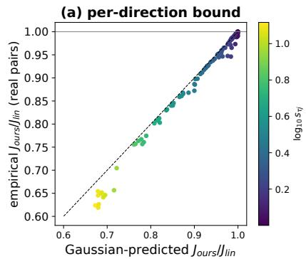

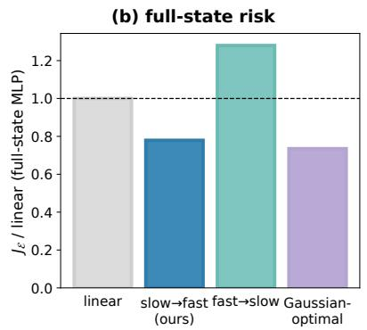

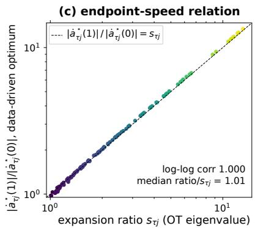  
Figure 10 Empirical support for the slow-then-fast scheduling principle. (a) Gaussian-predicted versus empirically estimated slow-then-fast/linear ratios of time-integrated directional risk terms; each point is an expansion direction, colored by $\log _ { 1 0 } s _ { \tau j } .$ (b) Expansion-subspace prediction error of full-state MLP regressors, normalized by the linear baseline after summing over tasks. Gaussian-optimal optimizes the Gaussian bound on expansion directions. (c) Endpoint-speed ratios of numerical optima reconstructed from empirical conditional variances, with the theoretical relation shown as a dashed line. Panel (c) evaluates these reconstructed optima; the bounded TOPS schedule is evaluated in (a,b).

Agreement with the theoretical prediction. For each expansion direction, we estimate the conditional variance of the velocity target given the corresponding interpolated coordinate, and integrate it over time. Fig. 10(a) compares the resulting slow-then-fast/linear ratios with the Gaussian predictions. Across 119 expansion directions, the two sets of ratios closely agree (correlation 0.997). On these expansion directions, the summed integrated Gaussian bound decreases from 58.98 under linear interpolation to 48.55 under our schedule, compared with the optimum of 45.52, capturing 77.5% of the attainable reduction. Summing the estimated directional risk terms over tasks and expansion directions, our schedule reduces the total by 18.5%, close to the 17.7% reduction predicted by the Gaussian analysis. This supports the predicted scheduling benefit on real endpoint distributions.

Reduced velocity-prediction error. We next train matched MLPs to predict velocity from the complete interpolated state and time, using one training run per task and schedule. Evaluation uses fresh source samples and new pairings from the same expert-window bank. As shown in Fig. 10(b), our schedule reduces time-integrated prediction error on the expansion subspace by 22.1% relative to linear interpolation, whereas the fast-then-slow control increases it by 28.0%. Our schedule improves on linear interpolation in all ten tasks; the reduction across all action coordinates is 14.2%. These results support the choice of slow-then-fast timing in Section 4.3. The measured errors include finite-model fitting error and therefore serve as empirical proxies for the Bayes risk.

Consistency of the endpoint-speed relation. Finally, we reconstruct the optimal scalar schedules from the estimated conditional variances using the construction in App. A.9. Their endpoint-speed ratios closely follow $s _ { \tau j }$ (log–log correlation 0.9997; Fig. 10(c)), consistent with Eq. 8. This provides a numerical consistency check of the endpoint asymmetry that motivates our bounded schedule, complementing the measured reductions in panels (a,b).

## A.10 Derivation of the Schedule-Aware Integrator

Given a selected source–schedule pair $( q _ { \tau } , \mathbf { K } _ { \tau } )$ and a fixed policy condition $c ,$ we initialize $\mathbf { x } ^ { ( 0 ) } = \mathbf { x } _ { 0 } \sim q _ { \tau }$ and generate an action chunk using the following two-stage schedule-aware update. For language-based inference, $\tau = \hat { \tau }$ as defined in Section 4.4.

$$
\begin{array} { r } { \left| { { { \widetilde { \mathbf { x } } } ^ { ( n + 1 / 2 ) } } } = { { \mathbf { x } } ^ { ( n ) } } + \left( { { \mathbf { S } } _ { t _ { n } } ^ { \tau } } - { \mathbf { S } _ { t _ { n + 1 / 2 } } ^ { \tau } } \right) { { \left( { { \mathbf { G } } _ { t _ { n } } ^ { \tau } } \right) } ^ { - 1 } } { { \mathbf { v } } _ { \theta } } ( { { \mathbf { x } } ^ { ( n ) } } , t _ { n } , c ) , \right. } \\ { \left. { { \mathbf { x } } ^ { ( n + 1 ) } } = { { \widetilde { \mathbf { x } } } ^ { ( n + 1 / 2 ) } } + \left( { { \mathbf { S } } _ { t _ { n + 1 / 2 } } ^ { \tau } } - { \mathbf { S } _ { t _ { n + 1 } } ^ { \tau } } \right) { { \left( { { \mathbf { G } } _ { t _ { n + 1 / 2 } } ^ { \tau } } \right) } ^ { - 1 } } { { \mathbf { v } } _ { \theta } } ( { { \widetilde { \mathbf { x } } } ^ { ( n + 1 / 2 ) } } , t _ { n + 1 / 2 } , c ) . \right| } \end{array}\tag{50}
$$

Here $N \in  { \mathbb { N } } _ { > 0 }$ is the number of solver steps, $t _ { n } = n / N , h = 1 / N$ , and $t _ { n + 1 / 2 } = t _ { n } + h / 2$ , for $n = 0 , \ldots , N - 1$ The numerical state $\mathbf { x } ^ { ( n ) }$ and predicted midpoint $\widetilde { \mathbf { x } } ^ { ( n + 1 / 2 ) }$ belong to $\mathbb { R } ^ { D }$ , where $D = H d _ { a }$ is the flattened action-chunk dimension defined in the main text. The condition c remains fixed throughout integration.

Schedule operators. The matrices in Eq. 50 are

$$
\begin{array} { r l } & { \mathbf { S } _ { t } ^ { \tau } : = ( 1 - t ) e ^ { - t \mathbf { K } _ { \tau } } \in \mathbb { R } ^ { D \times D } , } \\ & { \mathbf { G } _ { t } ^ { \tau } : = - \partial _ { t } \mathbf { S } _ { t } ^ { \tau } = e ^ { - t \mathbf { K } _ { \tau } } \big [ \mathbf { I } _ { D } + ( 1 - t ) \mathbf { K } _ { \tau } \big ] \in \mathbb { R } ^ { D \times D } . } \end{array}\tag{51}
$$

Here ${ \mathbf { I } } _ { D }$ is the $D \times D$ identity matrix, and $\mathbf { K } _ { \tau } = \mathbf { R } _ { \tau } \mathrm { d i a g } ( - \rho _ { \tau 1 } , \dots , - \rho _ { \tau D } ) \mathbf { R } _ { \tau } ^ { \top }$ is the fixed scheduling matrix from Section 4.3. The matrix ${ \bf R } _ { \tau } \in \mathbb { R } ^ { D \times D }$ is orthogonal, and each scalar strength satisfies $0 \leq \rho _ { \tau j } < \kappa < 1$ Consequently,

$$
\left( \mathbf { G } _ { t } ^ { \tau } \right) ^ { - 1 } = \mathbf { R } _ { \tau } \operatorname { d i a g } \left( \left\{ { \frac { e ^ { - t \rho _ { \tau j } } } { 1 - ( 1 - t ) \rho _ { \tau j } } } \right\} _ { j = 1 } ^ { D } \right) \mathbf { R } _ { \tau } ^ { \top } .\tag{52}
$$

Every denominator is at least $1 - \kappa > 0$ , so the inverse is well-defined for all $t \in [ 0 , 1 ]$ . This spectral expression requires no dense matrix inversion or matrix-exponential evaluation.

One-step inference. Our reported one-step configuration sets $N = 1$ , with $t _ { 0 } = 0 , t _ { 1 / 2 } = 1 / 2$ , and $t _ { 1 } = 1$ Starting from $\mathbf { x } _ { 0 } \sim q _ { \tau }$ , substituting these times into Eq. 50 gives

$$
\begin{array} { r l } & { | \widetilde { \mathbf { x } } ^ { ( 1 / 2 ) } = \mathbf { x } _ { 0 } + [ \mathbf { I } _ { D } - \displaystyle \frac { 1 } { 2 } e ^ { - \mathbf { K } _ { \tau } / 2 } ] ( \mathbf { I } _ { D } + \mathbf { K } _ { \tau } ) ^ { - 1 } \mathbf { v } _ { \pmb { \theta } } ( \mathbf { x } _ { 0 } , 0 , c ) , } \\ & { \quad \mathbf { x } ^ { ( 1 ) } = \widetilde { \mathbf { x } } ^ { ( 1 / 2 ) } + ( 2 \mathbf { I } _ { D } + \mathbf { K } _ { \tau } ) ^ { - 1 } \mathbf { v } _ { \pmb { \theta } } ( \widetilde { \mathbf { x } } ^ { ( 1 / 2 ) } , \displaystyle \frac { 1 } { 2 } , c ) . } \end{array}\tag{53}
$$

Here $\widetilde { \mathbf { x } } ^ { ( 1 / 2 ) } \in \mathbb { R } ^ { D }$ is the predicted midpoint, and $\mathbf { x } ^ { ( 1 ) } \in \mathbb { R } ^ { D }$ is the generated action chunk at generative time $t = 1$ . The first network evaluation, at $( \mathbf { x } _ { 0 } , 0 )$ , predicts the midpoint through the known schedule. The second evaluation, at $( \widetilde { \mathbf { x } } ^ { ( 1 / 2 ) } , 1 / 2 )$ , updates the displacement estimate and completes the remaining half interval. Thus, one integration step consists of two sequential velocity-network evaluations, with the task-specific matrix $\mathbf { K } _ { \tau }$ determining both update weights.

Derivation. For an endpoint pair ${ \bf x } _ { 0 } , { \bf x } _ { 1 } \in \mathbb { R } ^ { D }$ , define its displacement $\Delta : = \mathbf { x } _ { 1 } - \mathbf { x } _ { 0 } \in \mathbb { R } ^ { D }$ . The path and target velocity in Eq. (10) become

$$
\begin{array} { r } { \mathbf { x } _ { t } = \mathbf { x } _ { 1 } - \mathbf { S } _ { t } ^ { \tau } \Delta , \qquad \mathbf { u } _ { t } = \mathbf { G } _ { t } ^ { \tau } \Delta . } \end{array}\tag{54}
$$

Thus, a velocity prediction induces the normalized displacement estimate

$$
\widehat { \Delta } _ { \theta } ^ { \tau } ( \mathbf { x } , t , c ) : = \big ( \mathbf { G } _ { t } ^ { \tau } \big ) ^ { - 1 } \mathbf { v } _ { \theta } ( \mathbf { x } , t , c ) \in \mathbb { R } ^ { D } .\tag{55}
$$

For scalar times $0 \leq a < b \leq 1$ , integrating $\mathbf { G } _ { t } ^ { \tau } = - \partial _ { t } \mathbf { S } _ { t } ^ { \tau }$ gives

$$
\mathbf { x } _ { b } - \mathbf { x } _ { a } = \int _ { a } ^ { b } \mathbf { G } _ { t } ^ { \tau } \Delta \mathrm { d } t = \left( \mathbf { S } _ { a } ^ { \tau } - \mathbf { S } _ { b } ^ { \tau } \right) \Delta .\tag{56}
$$

Replacing $\pmb { \Delta }$ by the estimate at the left endpoint yields a schedule-aware update over $[ a , b ]$ . Applying this update first over $\left[ t _ { n } , t _ { n + 1 / 2 } \right]$ , then re-estimating the displacement at the predicted midpoint and advancing over $\left[ t _ { n + 1 / 2 } , t _ { n + 1 } \right]$ , gives Eq. 50.

This construction integrates the known schedule exactly while holding the displacement estimate fixed within each half-step. If each velocity query equals the target velocity of a fixed endpoint pair, Eq. 55 recovers $\pmb { \Delta }$ and both updates reproduce that pair’s path exactly. For a learned conditional field, however, squared-loss regression targets a conditional mean displacement, $\mathbb { E } [ \Delta \ | \ \mathbf { x } _ { t } , t , c ]$ , which generally varies along the trajectory. The fixed-pair identity therefore does not imply exact integration of the learned ODE. When $\mathbf { K } _ { \tau } = \mathbf { 0 }$ , the update reduces to two explicit Euler half-steps; for general smooth learned fields, the composition is first-order accurate.

## A.11 Complete Training and Inference Pipeline

Algorithm 1 summarizes the complete TOPS pipeline: warm-up and flow reversal, ofline source and schedule construction, continuation training, and action generation. Let $\tau$ denote the set of training tasks and $\boldsymbol { \mathcal { D } } = \{ ( \mathbf { x } _ { 1 } , \mathbf { c } , \tau ) \}$ the demonstration dataset. The integers $E _ { \mathrm { w } } , E _ { \mathrm { t r } } > 0$ specify the warm-up and continuation update budgets, respectively. Sampling and loss expressions are shown for one example and are averaged over minibatches in implementation. All action-space vectors belong to $\mathbb { R } ^ { D }$ , where $D = H d _ { a }$ , and all schedule matrices belong to $\mathbb { R } ^ { D \times D }$ . The policy parameters $\theta , \theta _ { 0 } , \theta ^ { \star } \in \mathbb { R } ^ { P }$ contain P trainable entries.

Source samples are drawn independently of the demonstration conditional on its task. The source distributions and scheduling matrices remain fixed after ofline construction. Inference uses the matrices $\mathbf { S } _ { t } ^ { \tau }$ and $\mathbf { G } _ { t } ^ { \tau }$ defined in Eq. 51 and follows Eq. 50. Our default $N = 1$ gives the explicit one-step update in Eq. 53, requiring two network evaluations.

For deployment, $\mathbf { x } ^ { ( N ) }$ is reshaped into an $H \times d _ { a }$ action array and unnormalized. The controller executes the configured action window, then repeats Phase 3 using the updated observation.

```latex
Algorithm 1 TOPS Training and Inference Pipeline
Require: Demonstrations $\mathcal { D } = \{ ( { \bf x } _ { 1 } , c , \tau ) \} ;$ ; policy $\mathbf { v } _ { \pmb { \theta } } ;$ update budgets $E _ { w } , E _ { \mathrm { t r } } ;$ warm-up source scale $\sigma _ { 0 } > 0 ;$ mixture
counts $\{ M _ { \tau } \} _ { \tau \in \mathcal { T } }$ and rank $r ;$ schedule parameters $\gamma > 0 , 0 < \kappa < 1 ;$ learned source selector $\psi _ { \phi } ;$ solver steps $N \geq 1$
Output: Trained policy $\mathbf { v } _ { \pmb { \theta } ^ { \star } }$ and frozen source–schedule pairs $\{ ( q _ { \tau } , \mathbf { K } _ { \tau } ) \} _ { \tau \in \mathcal { T } } .$
Phase 0: Warm-up and flow reversal
1: for $e = 1 , \ldots , E _ { w }$ do
2: Sample $( \mathbf { x } _ { 1 } , c , \tau ) \sim \mathcal { D } , \mathbf { x } _ { 0 } \sim \mathcal { N } ( \mathbf { 0 } , \sigma _ { 0 } ^ { 2 } \mathbf { I } _ { D } )$ , and $t \sim \mathcal { U } ( 0 , 1 )$
3: $\mathbf { x } _ { t } ^ { \mathrm { { l i n } } } \gets ( 1 - t ) \mathbf { x } _ { 0 } + t \mathbf { x } _ { 1 } ; \mathbf { u } _ { t } ^ { \mathrm { { l i n } } } \gets \mathbf { x } _ { 1 } - \mathbf { x } _ { 0 } .$
4: Update $\pmb { \theta }$ using $\| \mathbf { v } _ { \theta } ( \mathbf { x } _ { t } ^ { \mathrm { { l i n } } } , t , c ) - \mathbf { u } _ { t } ^ { \mathrm { { l i n } } } \| _ { 2 } ^ { 2 } .$
5: end for
6: $\mathbf { \delta } \theta _ { 0 } \gets \theta ;$ initialize $B _ { \tau }  \emptyset$ for every $\tau \in \tau .$
7: for each $( \mathbf { x } _ { 1 } , c , \tau ) \in \mathcal { D }$ do
8: $\widehat { \mathbf { x } } _ { 0 } \gets \Phi _ { \theta _ { 0 } , 1  0 } ^ { c } \big ( \mathbf { x } _ { 1 } \big ) .$
9: $B _ { \tau }  B _ { \tau } \cup \{ \widehat { \mathbf { x } } _ { 0 } \} .$
10: end for
Phase 1: Offline source and schedule construction
11: for each $\tau \in \mathcal { T }$ do
12: $q _ { \tau } \gets \mathrm { F i t M P P C A } ( B _ { \tau } ; M _ { \tau } , r )$
13: Compute the full mixture covariance $\mathbf { C } _ { s } ^ { \tau }$ from $q _ { \tau }$ and the expert covariance $\mathbf { C } _ { d } ^ { \tau }$ from task-τ action chunks.
14: Regularize $\mathbf { C } _ { s } ^ { \tau }$ and $\mathbf { C } _ { d } ^ { \tau }$ to ensure positive definiteness.
15: $\mathbf { T } _ { \tau } \gets ( \mathbf { C } _ { s } ^ { \tau } ) ^ { - 1 / 2 } \big [ ( \mathbf { C } _ { s } ^ { \tau } ) ^ { 1 / 2 } \mathbf { C } _ { d } ^ { \tau } ( \mathbf { C } _ { s } ^ { \tau } ) ^ { 1 / 2 } \big ] ^ { 1 / 2 } ( \mathbf { C } _ { s } ^ { \tau } ) ^ { - 1 / 2 } .$
16: Eigendecompose $\mathbf { T } _ { \tau } = \mathbf { R } _ { \tau } \mathrm { d i a g } ( s _ { \tau 1 } , \ldots , s _ { \tau D } ) \mathbf { R } _ { \tau } ^ { \top } .$
17: $\rho _ { \tau j }  \kappa \operatorname { t a n h } ( \gamma \log s _ { \tau j } ) \mathbf { 1 } \{ s _ { \tau j } > 1 \}$ , for $j = 1 , \ldots , D .$
18: $\mathbf { K } _ { \tau } \gets \mathbf { R } _ { \tau } \mathrm { d i a g } ( - \rho _ { \tau 1 } , . . . , - \rho _ { \tau D } ) \mathbf { R } _ { \tau } ^ { \top }$
19: Define $\mathbf { S } _ { t } ^ { \tau } \gets ( 1 - t ) e ^ { - t \mathbf { K } _ { \tau } }$
20: Define $\mathbf { G } _ { t } ^ { \tau } \gets e ^ { - t \mathbf { K } _ { \tau } } \left[ \mathbf { I } _ { D } + ( 1 - t ) \mathbf { K } _ { \tau } \right]$
21: end for
Phase 2: Continuation training
22: Initialize $\mathbf { \boldsymbol { \theta } } \gets \mathbf { \boldsymbol { \theta } } _ { 0 } ;$ freeze all $q _ { \tau }$ and $\mathbf { K } _ { \tau }$
23: for $e = 1 , \ldots , E _ { \mathrm { t r } }$ do
24: Sample $( \mathbf { x } _ { 1 } , c , \tau ) \sim \mathcal { D } ;$ independently draw $\mathbf { x } _ { 0 } \sim q _ { \tau }$ and $t \sim \mathcal { U } ( 0 , 1 )$
25: $\mathbf { x } _ { t }  \mathbf { x } _ { 1 } + \mathbf { S } _ { t } ^ { \tau } ( \mathbf { x } _ { 0 } - \mathbf { x } _ { 1 } ) ; \mathbf { u } _ { t }  \mathbf { G } _ { t } ^ { \tau } ( \mathbf { x } _ { 1 } - \mathbf { x } _ { 0 } )$
26: Update $\pmb { \theta }$ using $\| \mathbf { v } _ { \pmb { \theta } } ( \mathbf { x } _ { t } , t , c ) - \mathbf { u } _ { t } \| _ { 2 } ^ { 2 } .$
27: end for
28: $\pmb { \theta } ^ { \star }  \pmb { \theta } .$
Phase 3: Language-based source selection and inference
29: Given instruction ℓ and the original policy condition $c .$
30: ${ \hat { \tau } }  \psi _ { \phi } ( \ell ) .$
31: Select $q _ { \hat { \tau } }$ and its associated $\mathbf { K } _ { \hat { \tau } } ;$ sample $\mathbf { x } ^ { ( 0 ) } \sim q _ { \hat { \tau } }$
32: Set $t _ { n } = n / N$ for $n = 0 , \ldots , N .$
33: for $n = 0 , \ldots , N - 1$ do
34: $t _ { n + 1 / 2 } \gets ( t _ { n } + t _ { n + 1 } ) / 2 .$
35: $\mathbf { v } ^ { ( n ) }  \mathbf { v } _ { \pmb { \theta } ^ { \star } } ( \mathbf { x } ^ { ( n ) } , t _ { n } , c ) .$
36: $\widetilde { \mathbf { x } } ^ { ( n + 1 / 2 ) } \gets \mathbf { x } ^ { ( n ) } + \left( \mathbf { S } _ { t _ { n } } ^ { \hat { \tau } } - \mathbf { S } _ { t _ { n + 1 / 2 } } ^ { \hat { \tau } } \right) \left( \mathbf { G } _ { t _ { n } } ^ { \hat { \tau } } \right) ^ { - 1 } \mathbf { v } ^ { ( n ) }$
37: $\mathbf { v } ^ { ( n + 1 / 2 ) }  \mathbf { v } _ { \pmb { \theta } ^ { \star } } ( \widetilde { \mathbf { x } } ^ { ( n + 1 / 2 ) } , t _ { n + 1 / 2 } , c ) .$
38: $\mathbf { x } ^ { ( n + 1 ) } \gets \widetilde { \mathbf { x } } ^ { ( n + 1 / 2 ) } + \big ( \mathbf { S } _ { t _ { n + 1 / 2 } } ^ { \hat { \tau } } - \mathbf { S } _ { t _ { n + 1 } } ^ { \hat { \tau } } \big ) \big ( \mathbf { G } _ { t _ { n + 1 / 2 } } ^ { \hat { \tau } } \big ) ^ { - 1 } \mathbf { v } ^ { ( n + 1 / 2 ) } .$
39: end for
40: return $\mathbf { x } ^ { ( N ) }$ as the generated normalized action chunk.
```