# The Structure Gap: When More Data Cannot Replace Structured Reasoning

Kheer Sagar Patel, Mojtaba Soltanalian

University of Illinois Chicago

## Abstract

A persistent belief in modern AI is that suficiently large learners trained on suficiently much data can make explicit domain knowledge optional. This paper examines a limitation of that belief. We define structure-encoded problems: tasks whose input-output map is determined, or sharply constrained, by known structure such as a solver, symmetry group, graph, physical law, measurement operator, grammar, combinatorial search space, or optimization objective. For such tasks, the central question is not expressivity—a dense neural network may contain the desired map—but finite-data identification, extrapolation, and certification. We introduce the structure gap: the finite-resource gap between a method that receives the governing structure and a learner that receives only examples. The strongest useful form of the claim is asymptotic rather than absolute: structure-agnostic learning may approach a structured solver as coverage grows, but every finite dataset can leave residual uncertainty that the structure resolves by construction. We prove this exactly for a Gaussian inverse problem: the known-operator Wiener solver attains Bayes risk, while the dense empirical learner in the correct linear class has persistent expected excess risk. We also prove a cell-coverage lower bound and an unobserved-orbit non-identifiability result. Controlled experiments in knownoperator inversion, sparse recovery, and graph reachability with size extrapolation instantiate the mechanisms. When validated structure is available, it can constrain the hypothesis space before learning begins, leaving learning to address components the structure does not specify.

## Introduction

Deep learning has changed what is possible in perception, inference, language, and control. Its success has also encouraged a powerful informal claim: with enough data and capacity, explicit structure and domain knowledge become optional. The claim is sometimes right. When the relevant structure is unknown, approximate, or too complex to specify, learned representations may be the best available tool. But in many scientific, engineering, and symbolic domains the relevant structure is already known. A parity-check matrix is not a statistical hint; it is the code. A graph relabeling symmetry is not an empirical regularity; it is a mathematical equivalence. A Fourier basis, array manifold, grammar, shortest-path recurrence, measurement matrix, likelihood, conservation law, or convex objective is information about the task.

This paper studies what happens when that information is withheld from the learner. Broad feedforward networks can approximate large function classes on compact domains (Cybenko 1989; Hornik, Stinchcombe, and White 1989), and depth can improve approximation eficiency (Eldan and Shamir 2016; Telgarsky 2016; Yarotsky 2017). Universal approximation, however, does not imply eficient learnability. A fully connected network (FCN) may contain, somewhere in its parameter space, a representation of a structured solver. That does not mean finite examples identify the representation, certify behavior on unobserved regimes, or recover the law that generated the labels.

We call the resulting resource diference the structure gap. The gap can be a sample-complexity gap, as in convolutional or equivariant architectures versus fully connected networks; a certification gap, because finite examples cannot rule out alternative extensions that agree on the data but disagree on unobserved orbits; a combinatorial coverage gap, because a learner must see many supports, assignments, graph configurations, or symbolic cases; or an asymptotic-only gap, because the best structure-free learner may approach the structured solver as the data size N , but no finite dataset fully replaces the governing law.

Thesis. Known structure is information. If a learner ignores it, it must purchase that information back using data, parameters, computation, precision, coverage, and optimization luck. In some problem classes the price is exponential or infinite; in others it is finite but large enough that the solver is the correct baseline.

Contributions. We make four contributions. First, we define structure-encoded problems and structural separation as finite-resource notions rather than rhetorical claims against neural networks. Second, we give lower-bound mechanisms that formalize why finite data cannot certify global structured laws without the structure. Third, we prove an exact asymptotic-catch-up theorem in the most favorable possible case for the dense learner: the Bayes map is linear and lies in the learner class. Fourth, we provide reproducible numerical studies, including a graph-reachability experiment that exhibits a graded hierarchy: a dense FCN interpolates the training graph size, a message-passing graph neural network (GNN) retains much stronger size extrapolation, and exact breadth-first search (BFS) closes the remaining gap.

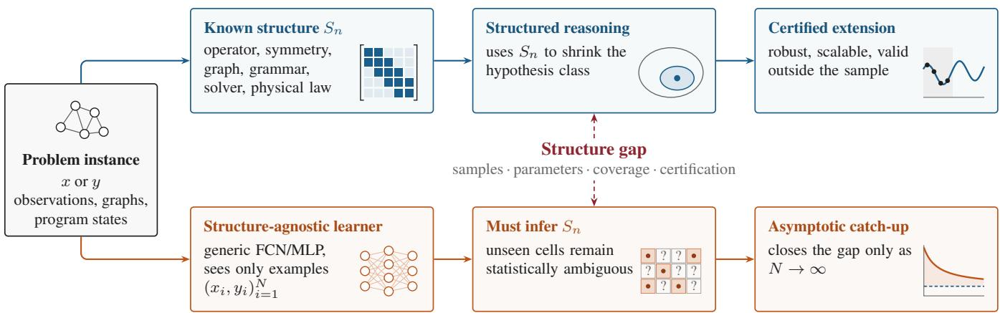  
Figure 1: Conceptual view of the structure gap. A structure-aware system uses a known law, solver, graph, symmetry, grammar, or objective to restrict the hypothesis class before learning. A structure-agnostic learner can fit examples, but must infer the law from data and therefore pays with samples, parameters, coverage, and weaker extrapolation. The gap is a finite-resource phenomenon: the data-only path may approach the structured path asymptotically, but the structure certifies the extension at finite sample size

Scope of the claim. The paper is class-relative. We compare methods that encode the correct structure with learners that are deliberately denied it. A convolution, GNN, unrolled optimizer, diferentiable parser, physics-informed model, or tool-using system is therefore structure-aware in our taxonomy, even if it is neural. We also do not claim that wrong or approximate structure is always beneficial. The central implication is that, when the correct structure is known in a compact form, relearning its consequences from examples imposes an avoidable finite-data burden.

## Related Work

Approximation, learnability, and inductive bias. Universal approximation theorems establish broad representational capacity (Cybenko 1989; Hornik, Stinchcombe, and White 1989); approximation and depth-separation results refine the eficiency picture (Barron 1993; Eldan and Shamir 2016; Telgarsky 2016; Yarotsky 2017). Statistical learning theory and no-free-lunch results emphasize that generalization requires assumptions on the problem class (Wolpert 1996). Recent work revisits inductive bias using Kolmogorov complexity and the no-free-lunch perspective (Goldblum et al. 2024). Our contribution is to treat correct structure not merely as a useful bias, but as side information that changes the identification problem before data arrive.

Equivariance and architectural structure. Convolution and equivariance are canonical examples of structure encoded in an architecture. Group equivariant networks exploit known symmetries (Cohen and Welling 2016); Deep Sets encode permutation invariance (Zaheer et al. 2017); graph networks and message passing encode relational locality (Battaglia et al. 2018; Kipf and Welling 2017; Gilmer et al. 2017; Xu et al. 2019); and geometric deep learning organizes architectures around groups, graphs, manifolds, and gauges (Bronstein et al. 2021). Theory has established sample-complexity and computational separations between convolutional/equivariant models and fully connected networks (Du et al. 2018; Li, Zhang, and Arora 2021; Malach and Shalev-Shwartz 2021; Lahoti et al. 2024; Elesedy and Zaidi 2021; Kiani and Nguyen 2020). Recent work studies hardness and expressivity under symmetries (Kiani et al. 2024; Pacini et al. 2025a,b). These results support a broader principle: structure changes not only constants but the learning problem itself.

Model-based, algorithmic, and neuro-symbolic AI. Compressed sensing and inverse problems show how known operators and priors make high-dimensional inference tractable (Candès, Romberg, and Tao 2006; Donoho 2006; Tropp and Gilbert 2007; Wainwright 2009). ISTA/FISTA and unrolled networks explicitly mix solvers with trainable components (Daubechies, Defrise, and De Mol 2004; Beck and Teboulle 2009; Gregor and LeCun 2010; Monga, Li, and Eldar 2021; Pinilla et al. 2023; Khobahi and Soltanalian 2020; Khobahi et al. 2021; Shlezinger et al. 2025). Neural algorithmic reasoning trains networks to imitate or align with classical algorithms (Veličković et al. 2020, 2022; Numeroso, Bacciu, and Veličković 2023), while neuro-symbolic AI argues for combining learned representations with symbolic knowledge and reasoning (d’Avila Garcez and Lamb 2023; Gibaut et al. 2023; Colelough and Regli 2025). The structure gap supplies a common resource-separation language for these lines of work.

## Structure-Encoded Problems

Let $f _ { n } : \mathcal { X } _ { n } \to \mathcal { Y } _ { n }$ be a family of target maps indexed by dimension or problem size. Let $S _ { n }$ denote side information describing the valid structure: a group action, graph, measurement operator, program, grammar, constraint set, likelihood, physical law, objective, or solver.

Definition 1 (Structure-aware and structure-agnostic methods). A method class $A _ { n }$ is structure-aware if its elements may access $S _ { n }$ at design or inference time. A learner class $\mathcal { F } _ { n , P }$ is structure-agnostic ifits architecture and training rule do not enforce the constraints encoded by $S _ { n } ;$ it receives only input-output examples and has P trainable or efective parameters.

Definition 2 (Structure gap and structural separation). A problemfamily exhibits a structure gap at error level ϵ, relative to a distributionalfamily and learner class, ifa structureaware method achieves risk at most ϵ using resources poly(n, log(1/ϵ)), while a structure-agnostic learner in the considered class requires asymptotically larger resources in at least one axis: samples, parameters, computation, precision, coverage of modes/orbits, or dimension-specific retraining. If the required resource is super-polynomial or exponential, we call the gap a structural separation.

Note that resource is central to our formulation. For instance, a structure gap does not imply that an FCN cannot represent the map. It says that representation is not enough: the learner must identify the right extension from finite data. Figure 2 summarizes common ways in which this identification problem demands many samples, parameters, or regimecovering examples. The three mechanisms below make this link explicit: operator identification (M1), orbit coverage (M2), and combinatorial atlases (M3).

M1: operator identification. If the correct map is determined by a known operator or likelihood, a classical solver can use it immediately. A learner that does not encode it must estimate the operator-induced map from samples. Even if the hypothesis class contains the exact map, finite data leaves parameter uncertainty.

M2: orbit coverage. If f is invariant or equivariant under a group G, data from one point implies behavior on its orbit only if the learner knows the group action. Without encoded equivariance, finite samples cover only fragments of the orbit space.

M3: combinatorial atlases. Many structured maps are piecewise algebraic with regions indexed by discrete objects: supports, assignments, shortest paths, codewords, parse states, active constraints, or matchings. Solvers navigate this atlas using symbolic or optimization rules. Structureagnostic learners must infer many regions and switching boundaries.

## Why More Data May Only Approach Structure

In many finite problems, suficiently expressive learners are consistent and approach the structured solver as $N \to \infty$ . In the context of neural networks, we do not claim that neural networks cannot learn structure. Our sharper claim is: for some problem classes, the best structure-free learner can only asymptotically approach the performance of a solver that has the correct structure, and the finite-data price of approach is controlled by the coverage complexity of the hidden structure.

## Known-Operator Solvers and Asymptotic Catch-Up

Consider a setting in which the learner class already contains the exact solution. The Bayes-optimal map is linear, so a onelayer dense network already contains the exact solution. The only missing ingredient is the known operator.

Consider

$$
x \sim \mathcal { N } ( 0 , I _ { d } ) , \qquad y = A x + \xi , \qquad \xi \sim \mathcal { N } ( 0 , \sigma ^ { 2 } I _ { m } ) ,\tag{1}
$$

with known $A \in \mathbb { R } ^ { m \times d }$ for the classical solver. The risk of a linear estimator W is $R ( W ) = \mathbb { E } \left\lceil \| W y - x \| _ { 2 } ^ { 2 } \right\rceil$ . By Gaussian conditioning, the Bayes-optimal known-operator solver is the Wiener inverse

$$
W _ { \star } = A ^ { \top } ( A A ^ { \top } + \sigma ^ { 2 } I _ { m } ) ^ { - 1 } .\tag{2}
$$

Let $\Sigma _ { e } = \mathrm { C o v } ( x - W _ { \star } y )$

Theorem 1 (Exact asymptotic catch-up). Let $( x _ { i } , y _ { i } ) _ { i = 1 } ^ { N }$ be i.i.d. samples from (1). Let

$$
\widehat { W } _ { N } \in \mathop { \mathrm { a r g } } \mathop { \operatorname* { m i n } } _ { W } \sum _ { i = 1 } ^ { N } \| W y _ { i } - x _ { i } \| _ { 2 } ^ { 2 }\tag{3}
$$

be the dense least-squares learner. $I f \ N > m + 1$ and $A A ^ { \top } + \sigma ^ { 2 } I _ { m }$ is nonsingular, then, with expectation over the training sample and an independent test pair,

$$
\mathbb { E } R ( \widehat { W } _ { N } ) = R ( W _ { \star } ) + \frac { m \ \mathrm { t r } ( \Sigma _ { e } ) } { N - m - 1 } .\tag{4}
$$

Consequently, for every finite $N > m + 1$ with $m > 0$ and t $\Gamma \big ( \Sigma _ { e } \big ) ^ { - } > 0 ,$ , the expected risk ofthe dense empirical learner is strictly larger than that ofthe known-operator solver, and it approaches the solver only as $N \to \infty$

Proof sketch. Write $x = W _ { \star } y + e .$ , where e is independent of y and has covariance $\Sigma _ { e }$ . Stacking samples gives $\widehat { W } _ { N } ^ { \top } -$ $\smash { W _ { \star } ^ { \top } = ( Y ^ { \top } Y ) ^ { - 1 } Y ^ { \top } E }$ . Conditional on $Y$ , the excess risk is $\mathrm { t r } ( \hat { \Sigma } _ { e } ) \mathrm { t r } \{ \Sigma _ { y } ( \tilde { Y } ^ { \top } Y ) ^ { - 1 } \}$ , with $\Sigma _ { u } = A A ^ { \dagger } + \sigma ^ { 2 } I _ { m } .$ . Since $Y ^ { \top } Y$ is Wishart and $\mathbb { E } [ ( Y ^ { \top } Y ) ^ { - 1 } ] = \Sigma _ { u } ^ { - 1 } / ( N - m - 1 )$ (Anderson 2003), substitution gives (4). A full derivation is in the supplementary material. □

The result holds in a linear model where the learner class already contains the exact solver: estimating an operatorinduced map from examples introduces positive finitesample excess risk. More data closes the gap; it does not make the structure irrelevant at finite N. A one-layer FCN is exactly a dense linear map, and a deeper FCN contains this map as a special case; hence the result applies directly to the most favorable dense-neural baseline for this problem. Modern overparameterization can change optimization and implicit regularization, but it cannot erase the statistical fact that a learner denied A must identify an operator-induced rule from finite samples. If a neural method encodes A, the likelihood, or the solver update, it has moved to the structureaware side of the comparison.

## A Cell-Coverage Lower Bound

Many symbolic and structured problems are governed by regimes or cells: supports in sparse recovery, active sets in optimization, parse states in grammars, codewords in decoding, graph configurations in algorithms, or group orbits in equivariance. The following lower bound formalizes the cost of unseen cells.

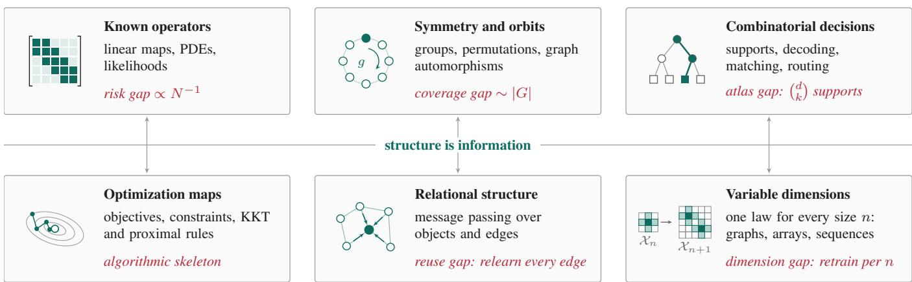  
Figure 2: Problem classes where structure changes the learning problem. Each box summarizes a compact structural description—known operators, symmetry, combinatorial rules, optimization constraints, relational structure, or variable dimension—that induces a large family of input-output constraints. When the structure is correct, it acts as information that shrinks the efective hypothesis space; a structure-agnostic learner must infer these implications from examples.

Proposition 1 (Finite cell coverage). Let  be a union of disjoint cells $C _ { 1 } , \ldots , C _ { M }$ with probabilities $\{ p _ { j } \}$ . Consider the full class of binary cellwise-constant labelings $h _ { b } ( x ) =$ $b _ { j } f o r x \in C _ { j }$ , indexed by $b \in \{ 0 , 1 \} ^ { M }$ . A structure-aware solver receives b; an example-only learner receives N i.i.d. labeled samples. Under 0-1 loss, the minimax expected risk ofany example-only learner is at least

$$
\frac { 1 } { 2 } \sum _ { j = 1 } ^ { M } p _ { j } ( 1 - p _ { j } ) ^ { N } .\tag{5}
$$

For uniform cells, this is $\frac { 1 } { 2 } ( 1 - 1 / M ) ^ { N }$ , whereas the structure-aware solver has zero risk.

Proof sketch. Draw the cell labels $b _ { j }$ independently and uniformly from 0, 1 . If cell $C _ { j }$ is absent from the training set, then $b _ { j }$ remains a fair coin conditional on all observed data, so every predictor incurs conditional error $1 / 2$ on that cell. The absence probability is $( 1 - p _ { j } ) ^ { N }$ ; summing over test-cell mass and applying Yao’s minimax principle (Yao 1977) yields (5). If M is exponential, the coverage burden is exponential. The supplementary material gives the full proof, a continuous-covering analogue, and a sparse-atlas interpretation. □

## Finite Samples Cannot Certify Unobserved Orbits

Let a finite group G act on , and let ρ be a representation on . A map $\overset { \vartriangle } { f } : \dot { \mathcal { X } }  \mathcal { Y }$ is equivariant if $f ( g x ) = \rho ( g ) f ( x )$ Proposition 2 (Unobserved-orbit non-identifiability). Let $T \subset { \mathcal { X } }$ be finite and suppose an orbit $O = \{ g x : g \in G \}$ has $O \cap T = \emptyset .$ . If the output space contains two admissible values at a representative ofO compatible with its stabilizer (as in scalar invariant labels orfree actions), then there exist two G-equivariant maps $f _ { 1 } , f _ { 2 } : \mathcal { X }  \mathcal { ) }$ that agree on T but disagree on O.

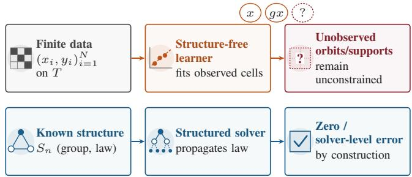  
Figure 3: Finite data fits observed examples, but does not certify unobserved orbits, supports, or symbolic regimes. A structure-free learner remains underconstrained outside the sample, whereas a structured solver propagates the governing law by construction.

Proof sketch. Define the two maps identically on orbits intersecting T. On the unobserved orbit choose two distinct admissible values at a representative and extend equivariantly over the orbit. A more detailed derivation is in the supplementary material. □

This is why augmentation is not the same as equivariance. Augmentation samples orbit elements; an equivariant architecture or symbolic rule constrains the entire orbit by construction.

## Problem Classes

Representative classes include known inverse problems, symmetry and invariance, sparse and low-dimensional signals, spectral or convolutional signal models, optimizationdefined maps, symbolic and algorithmic reasoning, and physical or causal systems. The common pattern is that the structured solver receives a short description of a large set of implications: all shifts, all relabelings, all supports, all active constraints, all parse states, or all graph sizes. A dataonly learner must infer those implications from observed examples. This is why the relevant distinction is not old AI versus new AI, or symbolic versus neural; it is whether the system makes judicious use of the known law as side information. Supplementary material gives a table of examples and solvers.

## Numerical Investigations

The experiments isolate the efect of withholding structure. The baselines are fully connected networks or dense empirical learners, not because these are the strongest possible neural methods, but because they represent the structureagnostic position. A GNN, equivariant network, unrolled optimizer, diferentiable parser, or physics-informed model belongs on the structure-aware side of the thesis. If such a model closes the gap, it supports rather than refutes the claim: it has encoded part of the missing structure. Thus the experiments are not ofered as universal benchmark dominance; they are controlled probes of the mechanisms in the theory. Experiment configurations, numerical results, and figure-generation scripts are included in the accompanying code-and-data archive. Additional implementation details appear in the supplementary material.

Known-operator inversion. We instantiate (1) with $d =$ $m = 3 2$ and $\sigma = 0 . 7 0$ . Figure 4(a) compares the dense leastsquares learner to the known-operator Wiener solver. The empirical curve matches Theorem 1: the learner approaches the solver, but the excess is positive for every finite N tested.

Sparse inverse recovery. We generate k-sparse signals $x ~ \in ~ \mathbb { R } ^ { 6 4 }$ with $k \ = \ 4 ,$ , measurements $y = A x + \varepsilon$ with $A \in \mathbb { R } ^ { 2 8 \times 6 4 }$ , and SNR 25 dB. OMP and ISTA receive A and the sparsity model; the FCN sees only examples $( y , x )$ The support atlas has $\binom { 6 4 } { 4 }$ possible supports. Figure 4(b) shows that the FCN improves with samples but remains far above the solvers’ reconstruction error at the considered finite sample sizes.

Graph reachability and size extrapolation. We train on balanced source-target reachability problems over 8-node Erdős–Rényi graphs and test on graphs with 8–24 nodes inside a shared 24-node padded representation. The comparison separates information patterns: the FCN receives a flattened adjacency matrix and active-node mask, the messagepassing GNN encodes relational locality and weight sharing (Gilmer et al. 2017), and BFS executes the exact graph algorithm (Cormen et al. 2022). With $N = 1 6 { , } 3 8 4$ training graphs, the FCN attains 97.79% accuracy at 8 nodes but 73.05% at 24 nodes; GNN-4 attains 99.97% and 95.48%, respectively; BFS is exact. Across five seeds, the paired 8- to-24-node loss is 24.74 3.76 percentage points for the FCN and $4 . 4 9 \pm 0 . 7 9$ for GNN-4, with 95% confidence intervals (Figure 4(c,d)). The result exhibits a graded structure gap: relational inductive bias closes most of the dense learner’s extrapolation penalty, and explicit algorithmic structure closes the remainder. This setting follows the neural algorithmicreasoning motivation of learning graph procedures and testing beyond the training size (Veličković et al. 2020, 2022).

Supplementary material provides matched-filter and permutation-equivariance controls, complete GNN-depth curves, AUROC results, and implementation details.

## Implications for AI

Structure is not merely a regularizer. Regularization chooses among hypotheses after seeing data. Correct structure changes the hypothesis space before data arrive. A graph, grammar, solver, or conservation law can imply infinitely many labels or constraints. Treating it as just another empirical bias underestimates its information content.

The right baseline is solver-aware. In structured domains, the relevant comparison is not neural versus non-neural. It is structure-aware versus structure-agnostic. A GNN, convolution, diferentiable parser, physics-informed model, or unrolled optimizer may be neural, but it is not structure-free. Conversely, a black-box network trained on many examples may be powerful, but it pays to rediscover what the solver already knows.

Large models do not repeal coverage. Scaling model size can improve representation and optimization. It does not eliminate the need to identify unobserved cells, supports, or regimes. A larger FCN may interpolate the observed data more flexibly, but without the structural law it cannot certify the correct extension. This is why retrieval, tools, symbolic solvers, program execution, and domain-grounded modules remain central to reliable AI systems.

Use learning where the structure ends. The strongest systems will often combine both sides: symbolic and algorithmic components for known laws, neural components for perception, model mismatch, nuisance parameters, and unknown residuals. This is the common thread behind model-based deep learning, neural algorithmic reasoning, and neuro-symbolic AI.

## Limitations

The structure gap is not a no-free-lunch concept. It is a conditional statement: if a compact, correct structural description is available, then denying it to the learner can create a finite-resource identification problem. If the structure is wrong, incomplete, or too costly to specify, structure-aware methods can be biased or brittle; then learning the residual, learning the structure, or using weaker priors may be preferable. The experiments isolate specific mechanisms using fully connected networks as structure-agnostic baselines. Graph extrapolation is evaluated within a shared 24-node padded representation under a controlled Erdős–Rényi generator.

Finally, asymptotic consistency does not contradict the paper. In several regimes the dense learner does converge; the point is that convergence may be toward a solver that already had the law at sample size zero. For practice, the message is diagnostic: before scaling data and parameters, ask whether structure exists. If so, the default should be to encode it and learn only what remains unknown.

## Conclusion

We introduced the structure gap: a finite-resource separation between systems that use known structure and learners that see only examples. The message is not that deep learning is weak. The message is that structure is crucial information. When a solver, symmetry, graph, grammar, measurement operator, or physical law is correct, a data-only learner must relearn consequences that the structured method obtains by construction.

(a) Known-operator inversion  
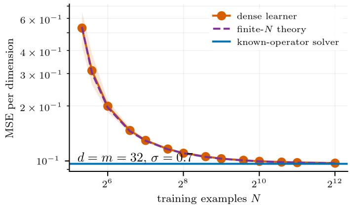

(b) Sparse inverse recovery  
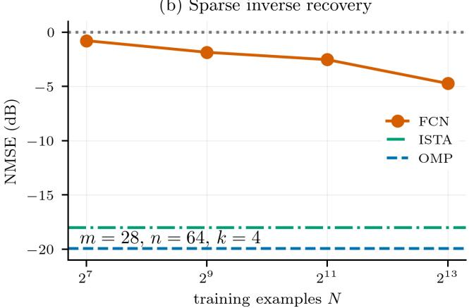

(c) Graph-size extrapolation  
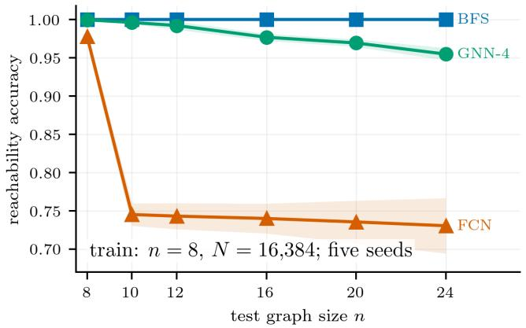

(d) Extrapolation penalty  
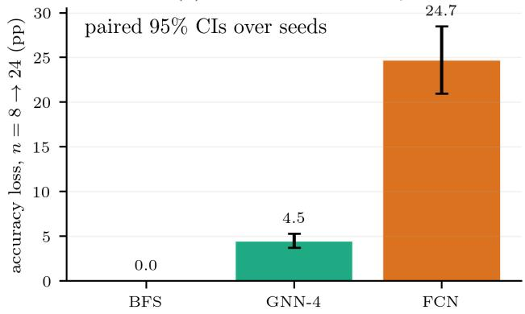  
Figure 4: Structured information improves finite-data performance and extrapolation. (a) In known-operator inversion, the dense learner contains the Bayes map but must estimate it from examples; its finite-sample risk follows Theorem 1. (b) In sparse recovery, OMP/ISTA use the sensing matrix and sparsity model directly, while the FCN must learn a support-indexed inverse. (c) All learned graph models are trained only on balanced 8-node reachability instances with $N = 1 6 { , } 3 8 4$ . The FCN nearly solves the training graph size but degrades on larger graphs; a four-layer message-passing GNN retains much stronger performance, while BFS is exact. Bands are 95% confidence intervals over five seeds. (d) Paired accuracy loss from 8 to 24 nodes. Tests are within a shared 24-node padded representation envelope.

We do not claim that neural networks cannot match structured solvers. Often, with infinite data and suitable optimization, they can approach the same risk. What matters in practice is that, for important problem classes, finite datasets may leave unobserved regimes that access to the known structure would otherwise resolve. In AI systems that must be reliable, extrapolative, and certifiable, more data is not a substitute for knowing the problem.

# Supplementary Material

## Proof of the Gaussian asymptotic-catch-up theorem

Let $\Sigma _ { y } = A A ^ { \top } + \sigma ^ { 2 } I _ { m }$ . For Gaussian variables,

$$
\begin{array} { r } { \mathbb { E } [ \boldsymbol { x } \mid \boldsymbol { y } ] = W _ { \star } \boldsymbol { y } , \qquad W _ { \star } = A ^ { \top } \Sigma _ { \boldsymbol { y } } ^ { - 1 } , } \end{array}
$$

and the residual $e = x - W _ { \star } y$ is independent of $y$ with covariance

$$
\Sigma _ { e } = I _ { d } - A ^ { \top } \Sigma _ { y } ^ { - 1 } A .
$$

Stack the training features, targets, and residuals as $Y \in \mathbb { R } ^ { N \times m }$ , $X \in \mathbb { R } ^ { N \times d }$ , and $E \in \mathbb { R } ^ { N \times d }$ . Ordinary least squares gives

$$
\widehat { W } _ { N } ^ { \top } = ( Y ^ { \top } Y ) ^ { - 1 } Y ^ { \top } X\tag{6}
$$

$$
= W _ { \star } ^ { \top } + ( Y ^ { \top } Y ) ^ { - 1 } Y ^ { \top } E .\tag{7}
$$

For a fresh feature $y ,$ the conditional excess risk is

$$
\mathbb { E } \left[ \| ( \widehat { W } _ { N } - W _ { \star } ) y \| _ { 2 } ^ { 2 } \mid Y \right]\tag{8}
$$

$$
= \mathbb { E } \left[ \operatorname { t r } \{ ( { \widehat { W } } _ { N } - W _ { \star } ) \Sigma _ { y } ( { \widehat { W } } _ { N } - W _ { \star } ) ^ { \top } \} \mid Y \right]\tag{9}
$$

$$
= \operatorname { t r } ( \Sigma _ { e } ) \operatorname { t r } \{ \Sigma _ { y } ( Y ^ { \top } Y ) ^ { - 1 } \} .\tag{10}
$$

Since $Y ^ { \top } Y \sim \mathcal { W } _ { m } ( \Sigma _ { y } , N )$ and $N > m + 1$

$$
\mathbb { E } [ ( \boldsymbol { Y } ^ { \top } \boldsymbol { Y } ) ^ { - 1 } ] = \frac { \Sigma _ { \boldsymbol { y } } ^ { - 1 } } { N - m - 1 } .
$$

Taking expectation over $Y$ yields

$$
\mathbb { E } [ R ( \widehat { W } _ { N } ) ] - R ( W _ { \star } ) = \frac { m \ \mathrm { t r } ( \Sigma _ { e } ) } { N - m - 1 } .
$$

This proves the theorem. The expectation is over both the training sample and an independent test pair. The condition $\mathrm { t r } ( \Sigma _ { e } ) > 0$ excludes the noiseless degenerate case in which there is no irreducible conditional uncertainty.

## Proof of the finite-cell lower bound

Let $\textstyle { \mathcal { X } } = \bigcup _ { j = 1 } ^ { M } C _ { j }$ , with $\operatorname* { P r } ( X \in C _ { j } ) = p _ { j }$ . Consider the full class of binary cellwise-constant labelings $h _ { b } ( x ) = b _ { j }$ for $x \in C _ { j }$ indexed by $b \in \{ 0 , 1 \} ^ { M }$ . Place the product prior $b _ { i } \stackrel { \mathrm { i . i . d . } } { \sim }$ $\mathrm { B e r n o u l l i } ( 1 / 2 )$ on this class. If the training set contains no sample from $C _ { j }$ , then $b _ { j }$ remains a fair coin conditional on all observed data. Hence every deterministic predictor has conditional error $1 / 2$ on that cell. The absence probability is $( 1 - p _ { j } ) ^ { N }$ , so the Bayes risk under the product prior is

$$
\frac { 1 } { 2 } \sum _ { j = 1 } ^ { M } p _ { j } ( 1 - p _ { j } ) ^ { N } .
$$

Yao’s minimax principle (Yao 1977) implies that this Bayes risk lower-bounds the minimax risk of any randomized example-only learner. For uniform cells, the expression reduces to $\bar { \frac { 1 } { 2 } ( 1 - 1 / M ) ^ { N } }$ . A structure-aware solver that receives b has zero risk by assumption.

## Proof of the unobserved-orbit non-identifiability proposition

Let $G$ act on $x ,$ and suppose the finite training set $T$ does not intersect an orbit $O = \{ g x : g \in G \}$ . Define two equivariant maps identically on every orbit that intersects $T .$ On the unobserved orbit, choose a representative $x _ { 0 } \in O .$ . If the output representation admits two distinct values $v _ { 1 } , v _ { 2 }$ compatible with the stabilizer of $x _ { 0 } .$ , define $f _ { i } ( g x _ { 0 } ) = \rho ( g ) v _ { i }$ for $i \in \{ 1 , { \bar { 2 } } \}$ This is well-defined by stabilizer compatibility and is equivariant by construction. The maps agree on $T$ but disagree on O. The common scalar-invariant case is immediate because all scalar labels are compatible with the stabilizer.

## Representative structure-encoded problem classes

The problem classes discussed in the main paper are summarized in Table S1. The table is not meant as an exhaustive taxonomy; rather, it shows how diverse AI and signal-processing tasks share the same pattern: a compact structural object induces many input-output constraints, and a learner that does not receive that object must infer its consequences from examples.

Table S1: Representative structure-encoded problem classes. The central separation is between using the structural description and relearning its consequences from examples.
<table><tr><td>Problem class</td><td>Structural object</td><td>Structure-aware method</td><td>Why a data-only learner pays</td></tr><tr><td>Known inverse problems</td><td>Forward operator, likelihood, noise model</td><td>Wiener/Kalman filtering (Wiener 1949; Kalman 1960), variational solvers and proximal methods (Boyd and Vandenberghe 2004; Rockafellar 1976)</td><td>Must estimate an operator-induced map; finite-sample excess persists.</td></tr><tr><td>Symmetry and invariance</td><td>Group action, permutation, translation, rotation</td><td>Equivariant networks, group convolution, invariant solvers (Cohen and Welling 2016; Zaheer et al. 2017; Bronstein et al. 2021) OMP (Tropp and Gilbert 2007),</td><td>Must cover or infer group orbits; finite data cannot certify unobserved transformations. Must learn a combinatorial</td></tr><tr><td>Sparse and low-dimensional signals</td><td>Sensing matrix, sparsity, low rank, dictionary</td><td>LASSO (Tibshirani 1996), ISTA/FISTA (Daubechies, Defrise, and De Mol 2004; Beck and Teboulle 2009), AMP (Donoho, Maleki, and Montanari 2009), unrolling (Gregor and LeCun</td><td>atlas of supports, ranks, or active sets.</td></tr><tr><td>Spectral and signal models</td><td>Fourier basis, array manifold, convolutional template</td><td>2010; Monga, Li, and Eldar 2021) FFT (Cooley and Tukey 1965), matched filter (Turin 1960), MUSIC/ESPRIT (Schmidt 1986; Roy and Kailath 1989), beamforming (Van Trees 2002)</td><td>Must rediscover harmonic geometry and phase relationships from examples.</td></tr><tr><td>Optimization-defined maps</td><td>Objective, constraints, KKT conditions</td><td>Convex solvers (Boyd and Vandenberghe 2004), dynamic programming (Bellman 1957), proximal algorithms (Rockafellar 1976)</td><td>Must learn active-set or recurrence structure rather than use optimality conditions.</td></tr><tr><td>Symbolic and algorithmic reasoning</td><td>Grammar, rule base, graph recurrence, program</td><td>Parsers (Hopcroft and Ullman 1979), SAT (Davis, Logemann, and Loveland 1962), MILP (Nemhauser and Wolsey 1988), shortest paths and breadth-first search (BFS) (Dijkstra 1959; Cormen et al. 2022), theorem</td><td>Must learn exact discrete transitions and extrapolate to unseen sizes or symbols.</td></tr><tr><td>Physical and causal systems</td><td>Forward model, conservation law, causal graph</td><td>proving (Robinson 1965) PDE solver, simulator, model-predictive control (Rawlings and Mayne 2009)</td><td>Must infer governing laws from finite trajectories and may rely on shortcuts that fail under distribution shift or counterfactual intervention (Geirhos et al. 2020;</td></tr></table>

## Continuous-covering variant

This section expands the continuous-regime discussion following the finite-cell proposition in the main paper. It applies when the relevant cells are indexed by a continuum such as an angle, delay, pose, frequency, or physical parameter. Let the hidden structural regime be parameterized by a compact metric set Θ with covering number $\mathcal { N } ( \Theta , \bar { d } , \eta )$ . Suppose that for any η-ball not represented in the training data, there are two admissible extensions that agree on all observed samples but difer by loss margin γ on a set of probability at least $p _ { \eta } .$ . A distribution-free certificate at resolution η requires represented samples in all covering cells. If Θ has intrinsic dimension q, then $\mathcal { N } ( \Theta , d , \eta )$ typically scales as $\eta ^ { - q }$ . Thus exact continuous-group certification cannot be obtained from finite samples without additional regularity or the structural law.

## Sparse atlas interpretation

This section gives the sparse-recovery specialization of the cell-coverage argument referenced in the main paper. For sparse recovery, the support set has size $M \doteq { \binom { n } { k } }$ . Conditional on a support ${ \bar { T } } ,$ , the noiseless inverse is an afine or linear rule on the measurement subspace generated by $A _ { T }$ . A solver given A and the sparsity model uses correlations, residual projections, or convex geometry to navigate these cells. A data-only predictor that does not exploit shared structure across supports must cover the support atlas. Under uniform support sampling, the coupon-collector lower bound implies that seeing at least one example from every support with probability $1 - \delta$ requires $N = \bar { \Omega ( M \log ( M / \delta ) ) }$ ), far larger than the description length of the matrix and solver.

## Graph-reachability experiment

The main paper reports the graph-reachability result at the largest training size. All learned models are trained on balanced source-target reachability problems over 8-node undirected Erdős–Rényi graphs, with edge probability sampled independently per graph from Uniform(0.05, 0.35). The source is node 0 and the target is node $n - 1$ . Inputs are padded to a common $2 4 \times 2 4$ adjacency representation. Evaluation uses 2,000 balanced test graphs for each size $n \in \{ \bar { 8 } , 1 0 , 1 \bar { 2 } , 1 6 , 2 0 , 2 4 \}$ and each of five seeds.

The dense fully connected network (FCN) receives the flattened adjacency and active-node mask and has hidden widths 256– 256–128 (252,673 trainable parameters). The reported four-layer graph neural network (GNN-4) uses four sum-aggregation message-passing layers with hidden dimension $^ { 6 4 , }$ , source-target concatenation readout, and no self loops (58,113 trainable parameters). Both use AdamW with learning rate $1 0 ^ { - 3 }$ , weight decay $1 0 ^ { - 4 }$ , batch size 256, at most 100 epochs, and validationbased early stopping. Breadth-first search (BFS) is evaluated directly at test time (Cormen et al. 2022). Table S2 and Figure S1 report mean performance and 95% Student-t confidence intervals over the five seeds.

<table><tr><td>Method</td><td>Accuracy, n = 8</td><td> $\mathrm { A c c u r a c y } , n = 2 4$ </td><td>Loss 8–24 (pp)</td></tr><tr><td>BFS</td><td> $1 0 0 . 0 0 \pm 0 . 0 0$ </td><td> $1 0 0 . 0 0 \pm 0 . 0 0$ </td><td> $0 . 0 0 \pm 0 . 0 0$ </td></tr><tr><td>FCN</td><td> $9 7 . 7 9 \pm 0 . 8 1$ </td><td> $7 3 . 0 5 \pm 3 . 6 1$ </td><td> $2 4 . 7 4 \pm 3 . 7 6$ </td></tr><tr><td>GNN-4</td><td> $9 9 . 9 7 \pm 0 . 0 6$ </td><td> $9 5 . 4 8 \pm 0 . 8 0$ </td><td> $4 . 4 9 \pm 0 . 7 9$ </td></tr><tr><td>GNN-8</td><td> $9 9 . 9 8 \pm 0 . 0 3$ </td><td> $9 6 . 0 3 \pm 1 . 8 0$ </td><td> $3 . 9 5 \pm 1 . 7 8$ </td></tr></table>

Table S2: Graph reachability at $N = 1 6 { , } 3 8 4 .$ . Entries are means 95% confidence intervals over five seeds.

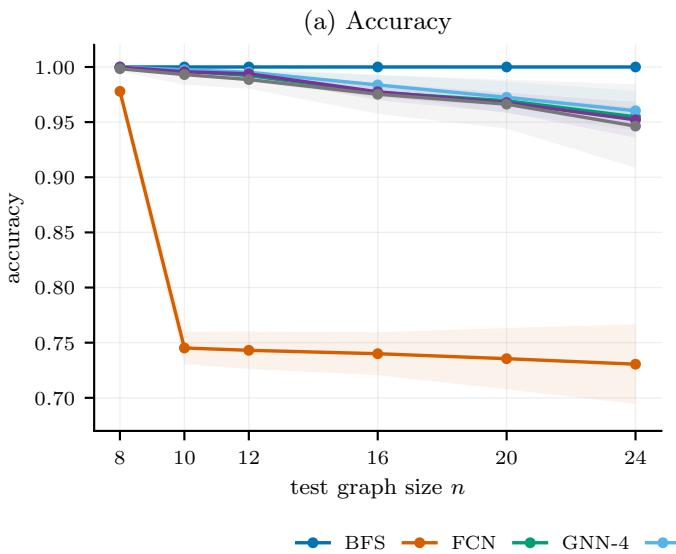

(b) AUROC  
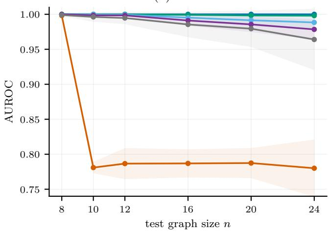  
Figure S1: Graph-size extrapolation for all tested message-passing depths. All learned models are trained on 8-node graphs with $N = 1 6 { , } 3 8 4$ . Curves show means and 95% confidence bands over five seeds.

The graph result should be understood as extrapolation within a common 24-node padded representation envelope, not as arbitrary-size algorithm execution. The generator also changes expected degree as n grows because the edge-probability range is fixed. These choices make the experiment a controlled demonstration of relational inductive bias rather than a universal benchmark of graph reasoning.

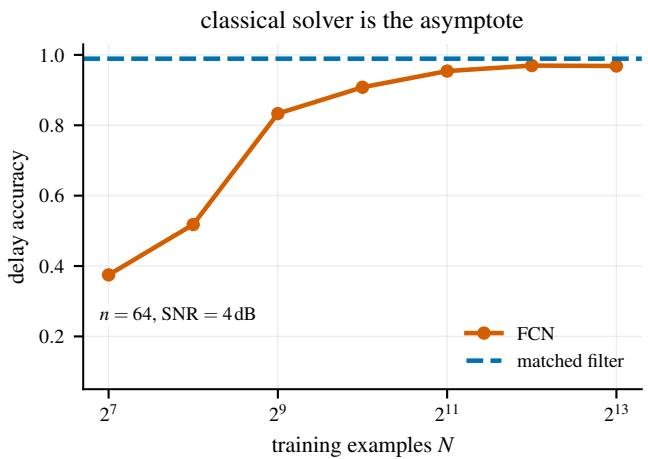  
(a) Matched-filter delay estimation.

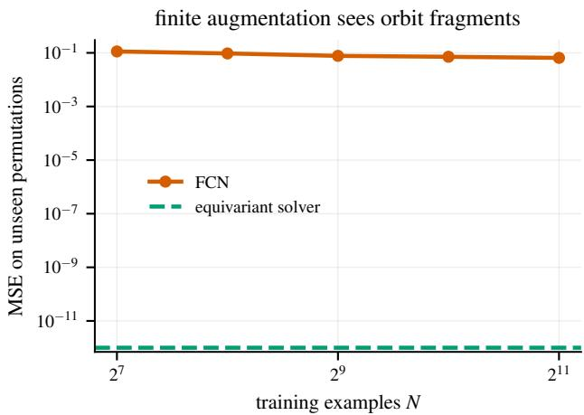  
(b) Permutation-equivariant regression.  
Figure S2: Additional controlled examples. The matched filter knows the template orbit; the equivariant computation knows the permutation law. In both cases the FCN must recover the corresponding implications from finite samples.

## Additional numerical controls

The matched-filter and permutation-equivariance experiments provide additional examples of the continuous-orbit and finite augmentation mechanisms.

## Reproducibility

A general-purpose large language model was used to assist with drafting, organization, code generation, and editing of this manuscript. The arXiv submission contains the manuscript sources and figures. The accompanying code-and-data archive includes experiment scripts, result files, requirements, and figure-generation code. Simulation plots can be regenerated from the included results using Matplotlib; conceptual diagrams are separate schematics. The dense-network baselines are structureagnostic. Any neural architecture that hard-codes the relevant operator, group action, graph topology, recurrence, or optimizer is counted as structure-aware under the definitions in the main paper.

Anderson, T. W. 2003. An Introduction to Multivariate Statistical Analysis. Wiley, 3rd edition.

Barron, A. R. 1993. Universal Approximation Bounds for Superpositions of a Sigmoidal Function. IEEE Transactions on Information Theory, 39(3): 930–945.

Battaglia, P. W.; Hamrick, J. B.; Bapst, V.; Sanchez-Gonzalez, A.; Zambaldi, V.; Malinowski, M.; Tacchetti, A.; Raposo, D.; Santoro, A.; Faulkner, R.; et al. 2018. Relational Inductive Biases, Deep Learning, and Graph Networks. arXiv preprint arXiv:1806.01261.

Beck, A.; and Teboulle, M. 2009. A Fast Iterative Shrinkage-Thresholding Algorithm for Linear Inverse Problems. SIAM Journal on Imaging Sciences, 2(1): 183–202.

Bellman, R. 1957. Dynamic Programming. Princeton University Press.

Boyd, S.; and Vandenberghe, L. 2004. Convex Optimization. Cambridge University Press.

Bronstein, M. M.; Bruna, J.; Cohen, T.; and Veličković, P. 2021. Geometric Deep Learning: Grids, Groups, Graphs, Geodesics, and Gauges. arXiv preprint arXiv:2104.13478.

Candès, E. J.; Romberg, J.; and Tao, T. 2006. Robust Uncertainty Principles: Exact Signal Reconstruction from Highly Incomplete Frequency Information. IEEE Transactions on Information Theory, 52(2): 489–509.

Cohen, T.; and Welling, M. 2016. Group Equivariant Convolutional Networks. In Proceedings of the 33rd International Conference on Machine Learning, volume 48 of Proceedings ofMachine Learning Research, 2990–2999. PMLR.

Colelough, B. C.; and Regli, W. 2025. Neuro-Symbolic AI in 2024: A Systematic Review. arXiv preprint arXiv:2501.05435.

Cooley, J. W.; and Tukey, J. W. 1965. An Algorithm for the Machine Calculation of Complex Fourier Series. Mathematics of Computation, 19(90): 297–301.

Cormen, T. H.; Leiserson, C. E.; Rivest, R. L.; and Stein, C. 2022. Introduction to Algorithms. MIT Press, 4th edition.

Cybenko, G. 1989. Approximation by Superpositions of a Sigmoidal Function. Mathematics ofControl, Signals and Systems, 2(4): 303–314.

Daubechies, I.; Defrise, M.; and De Mol, C. 2004. An Iterative Thresholding Algorithm for Linear Inverse Problems with a Sparsity Constraint. Communications on Pure and Applied Mathematics, 57(11): 1413–1457.

d’Avila Garcez, A.; and Lamb, L. C. 2023. Neurosymbolic AI: The 3rd Wave. Artificial Intelligence Review, 56: 12387–12406.

Davis, M.; Logemann, G.; and Loveland, D. 1962. A Machine Program for Theorem-Proving. Communications of the ACM, 5(7): 394–397.

Dijkstra, E. W. 1959. A Note on Two Problems in Connexion with Graphs. Numerische Mathematik, 1: 269–271.

Donoho, D. L. 2006. Compressed Sensing. IEEE Transactions on Information Theory, 52(4): 1289–1306.

Donoho, D. L.; Maleki, A.; and Montanari, A. 2009. Message-Passing Algorithms for Compressed Sensing. Proceedings of the National Academy ofSciences, 106(45): 18914–18919.

Du, S. S.; Wang, Y.; Zhai, X.; Balakrishnan, S.; Salakhutdinov, R.; and Singh, A. 2018. How Many Samples are Needed to Estimate a Convolutional or Recurrent Neural Network? arXiv preprint arXiv:1805.07883.

Eldan, R.; and Shamir, O. 2016. The Power of Depth for Feedforward Neural Networks. In Conference on Learning Theory, 907–940.

Elesedy, B.; and Zaidi, S. 2021. Provably Strict Generalisation Benefit for Equivariant Models. In Proceedings of the 38th International Conference on Machine Learning, 2959–2969.

Geirhos, R.; Jacobsen, J.-H.; Michaelis, C.; Zemel, R.; Brendel, W.; Bethge, M.; and Wichmann, F. A. 2020. Shortcut Learning in Deep Neural Networks. Nature Machine Intelligence, 2: 665–673.

Gibaut, W.; Pereira, L.; Grassiotto, F.; Osorio, A.; Gadioli, E.; Munoz, A.; Gomes, S.; and dos Santos, C. 2023. Neurosymbolic AI and its Taxonomy: A Survey. arXiv preprint arXiv:2305.08876.

Gilmer, J.; Schoenholz, S. S.; Riley, P. F.; Vinyals, O.; and Dahl, G. E. 2017. Neural Message Passing for Quantum Chemistry. In Proceedings ofthe 34th International Conference on Machine Learning, 1263–1272.

Goldblum, M.; Finzi, M. A.; Rowan, K.; and Wilson, A. G. 2024. Position: The No Free Lunch Theorem, Kolmogorov Complexity, and the Role of Inductive Biases in Machine Learning. In Proceedings of the 41st International Conference on Machine Learning, volume 235 of Proceedings ofMachine Learning Research, 15788–15808. PMLR.

Gregor, K.; and LeCun, Y. 2010. Learning Fast Approximations of Sparse Coding. In Proceedings of the 27th International Conference on Machine Learning, 399–406.

Hopcroft, J. E.; and Ullman, J. D. 1979. Introduction to Automata Theory, Languages, and Computation. Addison-Wesley.

Hornik, K.; Stinchcombe, M.; and White, H. 1989. Multilayer Feedforward Networks are Universal Approximators. Neural Networks, 2(5): 359–366.

Kalman, R. E. 1960. A New Approach to Linear Filtering and Prediction Problems. Journal of Basic Engineering, 82(1): 35–45.

Khobahi, S.; Shlezinger, N.; Soltanalian, M.; and Eldar, Y. C. 2021. LoRD-Net: Unfolded Deep Detection Network With Low-Resolution Receivers. IEEE Transactions on Signal Processing, 69: 5651–5664.

Khobahi, S.; and Soltanalian, M. 2020. Model-Based Deep Learning for One-Bit Compressive Sensing. IEEE Transactions on Signal Processing, 68: 5292–5307.

Kiani, B.; and Nguyen, Q. 2020. Learning Separation between Equivariant and Fully-Connected Neural Networks. In NeurIPS Workshop on Theory of Deep Learning.

Kiani, B. T.; Le, T.; Lawrence, H.; Jegelka, S.; and Weber, M. 2024. On the Hardness of Learning under Symmetries. In International Conference on Learning Representations.

Kipf, T. N.; and Welling, M. 2017. Semi-Supervised Classification with Graph Convolutional Networks. In International Conference on Learning Representations.

Lahoti, A.; Karp, S.; Winston, E.; Singh, A.; and Li, Y. 2024. Role of Locality and Weight Sharing in Image-Based Tasks: A Sample Complexity Separation between CNNs, LCNs, and FCNs. In International Conference on Learning Representations.

Li, Z.; Zhang, Y.; and Arora, S. 2021. Why Are Convolutional Nets More Sample-Eficient than Fully-Connected Nets? In International Conference on Learning Representations.

Malach, E.; and Shalev-Shwartz, S. 2021. Computational Separation Between Convolutional and Fully-Connected Networks. In International Conference on Learning Representations.

Monga, V.; Li, Y.; and Eldar, Y. C. 2021. Algorithm Unrolling: Interpretable, Eficient Deep Learning for Signal and Image Processing. IEEE Signal Processing Magazine, 38(2): 18–44.

Nemhauser, G. L.; and Wolsey, L. A. 1988. Integer and Combinatorial Optimization. Wiley.

Numeroso, D.; Bacciu, D.; and Veličković, P. 2023. Dual Algorithmic Reasoning. In International Conference on Learning Representations.

Pacini, M.; Dong, X.; Lepri, B.; and Santin, G. 2025a. Separation Power of Equivariant Neural Networks. In International Conference on Learning Representations.

Pacini, M.; Santin, G.; Lepri, B.; and Trivedi, S. 2025b. On Universality Classes of Equivariant Networks. In Advances in Neural Information Processing Systems, volume 38.

Pinilla, S.; Mishra, K. V.; Shevkunov, I.; Soltanalian, M.; Katkovnik, V.; and Egiazarian, K. 2023. Unfolding-Aided Bootstrapped Phase Retrieval in Optical Imaging: Explainable AI Reveals New Imaging Frontiers. IEEE Signal Processing Magazine, 40(2): 46–60.

Rawlings, J. B.; and Mayne, D. Q. 2009. Model Predictive Control: Theory and Design. Nob Hill Publishing.

Robinson, J. A. 1965. A Machine-Oriented Logic Based on the Resolution Principle. Journal of the ACM, 12(1): 23–41.

Rockafellar, R. T. 1976. Monotone Operators and the Proximal Point Algorithm. SIAM Journal on Control and Optimization, 14(5): 877–898.

Roy, R.; and Kailath, T. 1989. ESPRIT—Estimation of Signal Parameters via Rotational Invariance Techniques. IEEE Transactions on Acoustics, Speech, and Signal Processing, 37(7): 984–995.

Schmidt, R. O. 1986. Multiple Emitter Location and Signal Parameter Estimation. IEEE Transactions on Antennas and Propagation, 34(3): 276–280.

Schölkopf, B.; Locatello, F.; Bauer, S.; Ke, N. R.; Kalchbrenner, N.; Goyal, A.; and Bengio, Y. 2021. Toward Causal Representation Learning. Proceedings ofthe IEEE, 109(5): 612–634.

Shlezinger, N.; Segarra, S.; Zhang, Y.; Avrahami, D.; Davidov, Z.; Routtenberg, T.; and Eldar, Y. C. 2025. Deep Unfolding: Recent Developments, Theory, and Design Guidelines. arXiv preprint arXiv:2512.03768.

Telgarsky, M. 2016. Benefits of Depth in Neural Networks. In Conference on Learning Theory, 1517–1539.

Tibshirani, R. 1996. Regression Shrinkage and Selection via the Lasso. Journal of the Royal Statistical Society: Series B (Methodological), 58(1): 267–288.

Tropp, J. A.; and Gilbert, A. C. 2007. Signal Recovery from Random Measurements via Orthogonal Matching Pursuit. IEEE Transactions on Information Theory, 53(12): 4655–4666.

Turin, G. L. 1960. An Introduction to Matched Filters. IRE Transactions on Information Theory, 6(3): 311–329.

Van Trees, H. L. 2002. Optimum Array Processing: Part IV of Detection, Estimation, and Modulation Theory. Wiley.

Veličković, P.; Badia, A. P.; Budden, D.; Pascanu, R.; Banino, A.; Dashevskiy, M.; Hadsell, R.; and Blundell, C. 2022. The CLRS Algorithmic Reasoning Benchmark. In Proceedings ofthe 39th International Conference on Machine Learning, volume 162 of Proceedings ofMachine Learning Research, 22084–22102. PMLR.

Veličković, P.; Ying, R.; Padovano, M.; Hadsell, R.; and Blundell, C. 2020. Neural Execution of Graph Algorithms. In International Conference on Learning Representations.

Wainwright, M. J. 2009. Sharp Thresholds for High-Dimensional and Noisy Sparsity Recovery Using $\ell _ { 1 } \cdot$ -Constrained Quadratic Programming. IEEE Transactions on Information Theory, 55(5): 2183–2202.

Wiener, N. 1949. Extrapolation, Interpolation, and Smoothing ofStationary Time Series, with Engineering Applications. MIT Press.

Wolpert, D. H. 1996. The Lack of A Priori Distinctions Between Learning Algorithms. Neural Computation, 8(7): 1341–1390.

Xu, K.; Hu, W.; Leskovec, J.; and Jegelka, S. 2019. How Powerful are Graph Neural Networks? In International Conference on Learning Representations.

Yao, A. C.-C. 1977. Probabilistic Computations: Toward a Unified Measure of Complexity. In Proceedings of the 18th Annual Symposium on Foundations ofComputer Science, 222–227. IEEE Computer Society.

Yarotsky, D. 2017. Error Bounds for Approximations with Deep ReLU Networks. Neural Networks, 94: 103–114.

Zaheer, M.; Kottur, S.; Ravanbakhsh, S.; Póczos, B.; Salakhutdinov, R.; and Smola, A. 2017. Deep Sets. In Advances in Neural Information Processing Systems, volume 30.