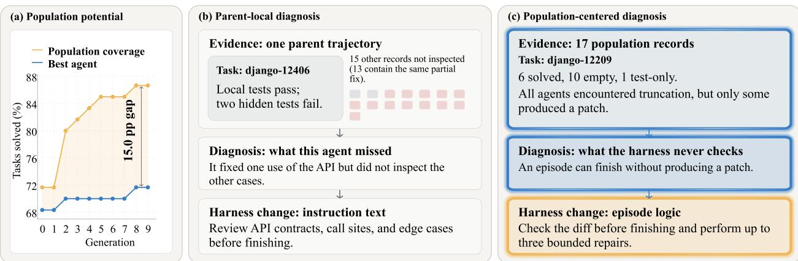
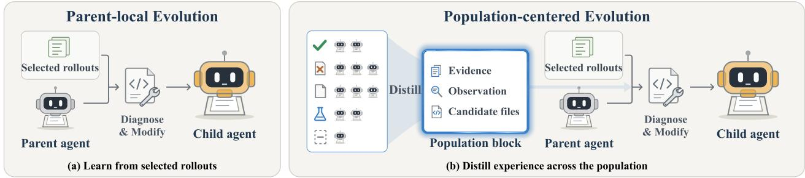
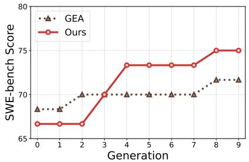
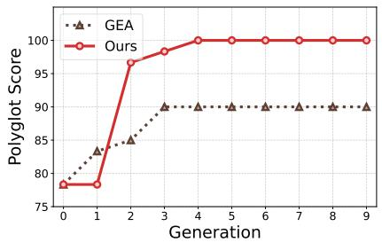
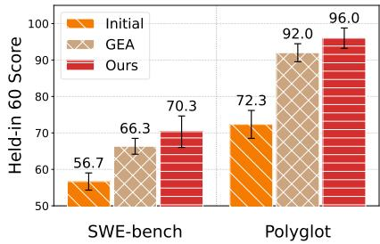

# The View from Nowhere: Population-Centered Agent Evolution

Shuo Yan1, Ningning Hou1, Haoyu He2, Haochen Pei1, Shang Gao1

1Macquarie University, 2Monash University

Self-improving AI systems can revise the designs that govern their own behavior. Yet existing approaches center improvement on selected parent agents and their evolutionary experience, leaving the broader population largely underused. We identify a substantial gap between population coverage (i.e., the tasks solved by at least one evolved variant) and the performance of the best individual agent. This gap shows that useful capabilities and diagnostic evidence emerge across the population without being consolidated into its leading agents. These observations motivate the view from nowhere, a principle for agent evolution: an agent should be improved by interpreting its behavior through population-wide patterns of success, failure, and prior self-modification. We instantiate this principle as Population-Centered Evolution (PCE). PCE distils task records and modification histories from the population into a population block, which captures recurring failures, complementary successes, and the efects of previously attempted modifications to guide improvements to a selected parent’s harness. Under matched models, initial harnesses, and evolution schedules, PCE achieves 72.1% success on SWE-bench Verified and 96.7% on Polyglot, improving over a strong group-evolution baseline by 3.2 and 5.9 percentage points. In our evaluation, PCE reduces the gap between population coverage and best-agent performance by one-third on SWE-bench and closes it on Polyglot. These results suggest that treating the population as evidence—not merely as candidates for selection—provides a complementary principle for agent evolution.

Code: https://github.com/YanShuo1992/PCE Website: https://yanshuo1992.github.io/PCE/

## 1 Introduction

Self-improving AI aims to develop systems that can revise the designs governing their own behavior (Good, 1966; Schmidhuber, 2007). Evolutionary coding agents pursue this goal by modifying their software harnesses while keeping the parameters of their foundation models fixed (Zhang et al., 2026b; Weng et al., 2026; Robeyns et al., 2025; Wang et al., 2026). These harnesses determine how an agent uses the model, tools, feedback, and its environment to solve a task. Through repeated cycles of self-modification and evaluation, these systems generate a growing population of agent variants. The goal is not merely to produce diverse variants, but to turn useful discoveries made during evolution into progressively stronger agents. How to consolidate these discoveries into improvements that persist in leading agents is a central challenge for agent evolution.

Existing approaches address this challenge through parent selection and experience reuse. The Darwin Gödel Machine (DGM) preserves an archive of agent variants from which future evolution can branch (Zhang et al., 2026b). The Huxley-Gödel Machine (HGM) uses the performance of an agent and its descendants to estimate the potential of continuing that lineage (Wang et al., 2026). Group-Evolving Agents (GEA) selects a small group of parents and allows them to share task records and past self-modifications when proposing improvements (Weng et al., 2026). Despite these diferences, the evidence used to propose a modification remains largely parent-local: it comes from the selected parent or parent group rather than from a systematic comparison across the full population. Other variants may remain available for future selection, but their task-level successes, failures, and modification histories do not directly inform the current diagnosis.

Yet prior work has not systematically measured the gap between what an evolutionary population collectively solves and what its best individual agent achieves, or examined how this gap can guide improvement. We define population coverage as the proportion of tasks solved by at least one evolved variant. As shown in

  
Figure 1 Population potential and task-level evidence. (a) The union of tasks solved by the GEA population exceeds the performance of its best individual agent by 15.0 percentage points (9 tasks in Held-in 60). (b) Parent-local diagnosis uses one parent trajectory to identify missed API cases and add verification instructions, while the other 15 population records are not inspected. (c) Population-centered diagnosis uses patterns across 17 records to identify a missing patch check and add bounded repair logic.

Figure 1a, in one of our GEA runs the evolved population covers 9 more of the 60 held-in tasks than its best individual agent, corresponding to a 15.0 percentage-point gap. This gap shows that successful outcomes remain distributed across the population rather than being fully consolidated into its leading agent. The associated task records allow us to compare variants that succeed and fail on the same task. The population should therefore be treated not only as a pool for parent selection, but also as comparative evidence for deciding how a selected parent should improve.

These observations motivate the view from nowhere (Nagel & Nagell, 1986) as a principle for agent evolution. It holds that decisions about how to improve an agent should be grounded in patterns of success, failure, and prior self-modification across the population. For a given task, population outcomes show whether a failure is isolated or recurring, execution records reveal how successful and unsuccessful variants difer, and modification histories indicate which remedies have already been attempted. Together, these comparisons provide a broader basis for diagnosing a selected parent and guiding its improvement.

We instantiate this principle through Population-Centered Evolution (PCE). For a selected task, a distillation agent compares task records and modification histories across all available variants and organizes its findings into a population block. The block contains three types of information. Outcome evidence measures how frequently diferent results occur across the population. An observation identifies a cross-agent pattern that may explain why variants behave diferently. Candidate files indicate which parts of the harness may be related to that pattern. Together, these fields establish what recurs across the population, suggest a diagnostic hypothesis, and indicate where to investigate it. Diagnosis then checks this hypothesis against the selected parent’s execution records and source code before proposing a harness modification, as shown in Figure 2b.

Across SWE-bench Verified and Polyglot, PCE improves agent performance under matched models, initial harnesses, and evolution schedules. Agents evolved by PCE achieve 72.1% success on 200 SWE-bench tasks and 96.7% on 225 Polyglot tasks, exceeding GEA by 3.2 and 5.9 percentage points, respectively. PCE reduces the gap between population coverage and best-agent performance by one-third on SWE-bench and closes it on Polyglot. Its advantage also persists on held-out tasks. Across the full evolutionary process, PCE uses 36% fewer tokens on SWE-bench and 59% fewer tokens on Polyglot than GEA. PCE therefore achieves stronger agents with lower inference expenditure, showing that population-wide evidence enables more efective use of the experience accumulated during evolution.

## In summary, we make three contributions:

1. We identify and quantify a previously overlooked gap between population coverage and best-agent performance, and we formulate the view from nowhere as a principle for capturing useful information across the population to guide agent evolution.

2. We introduce PCE, which distils population-wide experience into a population block that guides

improvements to a selected parent’s harness.

3. PCE improves performance and generalization, narrows the population-coverage gap, and achieves these gains with lower total token consumption than baselines.

## 2 Related Work

Learning from execution experience. Agents use execution experience at several levels. Reflection revises outputs or memories using execution or self-generated feedback (Shinn et al., 2023; Madaan et al., 2023), while memory systems, skill libraries, and workflow memories retain useful experience for future tasks (Park et al., 2023; Packer et al., 2023; Xu et al., 2026; Wang et al., 2023, 2024). ExpeL goes beyond storing individual records by extracting natural-language insights from accumulated task experience (Zhao et al., 2024). Experience can also support parameter updates through self-training on generated responses and filtered trajectories (Zelikman et al., 2022; Chen et al., 2024; Gulcehre et al., 2023; Yuan et al., 2024). Our setting concerns design-level improvement while keeping the foundation model fixed. Self-Harness identifies model-specific failure patterns and validates harness edits with regression tests (Zhang et al., 2026a), while HarnessEvolve aligns failed executions with reference trajectories and clusters error signals to identify systematic failures (Jiang et al., 2026). PCE difers in its unit of analysis. It compares how a population of evolving harness variants handles the same task and relates their outcomes to previous self-modifications. This population-wide comparison provides evidence for diagnosing and modifying the current parent.

Population-based agent design and evolution. Automated agent design methods search over agentic modules, workflows, prompts, and code (Hu et al., 2025; Zhang et al., 2025; Wang et al., 2025; Fernando et al., 2023; Zelikman et al., 2023; Yin et al., 2025; Robeyns et al., 2025). As this search produces more variants, a central problem is how to preserve and reuse discoveries made during evolution. Quality-diversity and open-endedness research retains diverse solutions as stepping stones for continued exploration (Lehman & Stanley, 2011; Mouret & Clune, 2015; Pugh et al., 2016; Chatzilygeroudis et al., 2021; de Vladar, 2016; Stanley et al., 2017; Clune, 2019; Hughes et al., 2024; Faldor et al., 2025; Wang et al., 2019). In coding-agent evolution, DGM maintains an archive from which future evolution can branch (Zhang et al., 2026b), while HGM estimates the potential of continuing a lineage from the performance of an agent and its descendants (Wang et al., 2026). GEA shares task records and self-modification patches among selected parents (Weng et al., 2026), and HarnessBank recombines harnesses drawn from a pool (Luo et al., 2026). These approaches use the population to preserve diversity, select parents, share parent experience, or recombine designs. PCE gives the population a diferent role. It treats all available variants as comparative evidence for understanding recurring failures, contrasting outcomes, and guiding improvement of a selected parent.

## 3 Population-Centered Evolution

PCE operates population-centered evolution through two stages, as shown in Figure 2. Population distillation compares task records and modification histories across evaluated agent variants and summarizes the findings in a population block. Diagnosis then checks this population-level account against a selected parent’s records and source code before proposing a harness modification.

We note that PCE distinguishes the variants used as evidence from those eligible for parent selection. It maintains a population V containing all evaluated agent variants whose task records are available, and an archive $\mathcal { A } \subseteq \mathcal { V }$ containing the variants eligible to become parents. Each variant is associated with its harness, task records, and history of self-modification. A variant can therefore inform future improvements even when it is not selected as a parent.

At each evolution step, PCE selects parent agents from A and chooses a task for diagnosing each parent. Population distillation examines the records available in V for that task, after which diagnosis proposes and implements a modification to the selected parent’s harness. The resulting child is evaluated and added to V. Children satisfying the archive criteria also enter A for future parent selection.

  
Figure 2 Parent-local and population-centered evolution. (a) Parent-local evolution diagnoses and modifies an agent using execution records associated with the selected parent. (b) Population-centered evolution distils task records and modification histories across the population into a population block. The block summarizes outcome evidence, identifies cross-agent observations, and suggests candidate files for inspection. Diagnosis combines this block with the selected parent’s records and source code to propose a harness modification.

## 3.1 Population Distillation

For the task selected to diagnose a parent, population distillation considers all available task records in V, including the initial agent’s record when available. Each record contains an execution log, a submitted task patch, and an evaluation outcome. The corresponding harness can be reconstructed from the initial source and the variant’s chain of self-modifications. These materials allow distillation to compare not only which variants succeed or fail, but also how their execution and harness designs difer.

Population distillation combines programmatic measurement with agent-based analysis. A program first counts the outcomes across all available records. The distillation agent then inspects relevant execution logs, task patches, harness source, and earlier self-modifications. It compares successful and unsuccessful variants, identifies recurring outcomes, and examines whether previous harness changes resolved or preserved the observed behavior. Since the full records can be large, the agent chooses which records and source files to inspect within its analysis budget.

The resulting population block contains three fields. Outcome evidence reports the program-computed distribution of task outcomes across the population. A cross-agent observation summarizes a pattern found by comparing variants and provides a hypothesis about why their outcomes difer. Candidate files identify parts of the harness that may implement the relevant behavior and should be examined during diagnosis. This field is left empty when distillation cannot identify a plausible location. Separating measured outcomes from their interpretation preserves a factual population summary while giving diagnosis a focused starting point without prescribing the modification. Appendix A gives the output contract and the distillation budget.

## 3.2 Diagnosis and Harness Modification

The population block provides a diagnostic hypothesis rather than prescribing a modification. Diagnosis combines this block with the selected parent’s source code and task records to determine whether the population-level pattern applies to the current harness. It examines the candidate files when provided, but may inspect other parts of the harness as needed. A mechanism associated with successful variants may be absent from the parent, while an earlier modification may already be present but remain insuficient. Diagnosis uses the parent’s execution behavior and implementation to distinguish between these possibilities.

Based on this assessment, diagnosis proposes one harness modification and describes how it should be implemented. The self-modification step applies the proposal to a copy of the parent’s harness, producing a child agent. The modification may change the agent’s prompts, tools, or execution workflow, while the foundation model and inference limits remain fixed. The child is then passed to the evaluation stage of the evolution loop.

The SWE-bench task django-12209 in Figure 1c illustrates the full process. Across 17 task records, the outcome evidence reported 6 solved patches, 10 empty patches, and 1 test-only patch. Population distillation found that truncation occurred under diferent outcomes and that increasing the retry budget had not consistently prevented empty patches. The observation and candidate files directed diagnosis toward the parent’s episode-completion logic. Inspection then showed that the episode could finish without checking whether a patch had been produced. The child harness then added this check and performed bounded repairs when the patch remained empty. This example shows how population-wide patterns are converted into a hypothesis, validated against the selected parent, and implemented as a concrete harness change.

Algorithm 1 PCE evolution loop   
Require: Initial agent $h _ { 0 }$ with evaluation records; number of generations T   
1: Initialize population and archive $\mathcal { V } = \mathcal { A } = \{ h _ { 0 } \}$   
2: for generation $t = 0 , \ldots , T - 1$ do   
3: Select parents $P _ { t } = \{ h _ { 1 } , \ldots , h _ { k } \}$ from $\mathcal { A } ;$ use $P _ { t } = \{ h _ { 0 } \}$ if $t = 0$   
4: Each parent $h _ { i } \in P _ { t }$ samples a task $\tau _ { i }$ from its eligible tasks   
5: Form inputs $L _ { i } { : }$ the task record of $h _ { i } ,$ followed by the records of the other parents in $P _ { t }$   
6: for each $h _ { i } \in P _ { t }$ in parallel do   
7: Collect records $R _ { i }$ on task $\tau _ { i }$ from members of V   
8: Set population block $B _ { i } = \varnothing$   
9: if $| R _ { i } | \geq 3$ then   
10: $B _ { i } \gets$ Distill $( R _ { i }$ , patch histories, $h _ { 0 } )$   
11: Set $B _ { i } = \varnothing$ if no usable observation is returned   
12: end if   
13: Diagnose the harness of $h _ { i }$ using $L _ { i }$ and any available $B _ { i }$   
14: Implement the proposal in $h _ { i }$ to produce child $h _ { c , i }$   
15: if a self-modification patch is produced then   
16: Evaluate $h _ { c , i }$ on the initial task subset, then remaining tasks if the threshold is met   
17: Retain its execution logs, task patches, and evaluation outcomes   
18: end if   
19: end for   
20: Add evaluated children to V and those meeting archive retention criteria to $\mathcal { A }$   
21: end for   
22: return Archive A and population V with accumulated records

## 3.3 Evolution Loop

Algorithm 1 specifies the complete PCE evolution loop. The first generation produces two children from the initial agent through separate single-parent diagnoses. Later generations select two parents in out setting from A and sample one eligible diagnostic task for each. For a selected task, population distillation runs only when at least three records are available in V. Otherwise, or when no usable observation is produced, diagnosis falls back to the parent-local procedure.

Children that produce a self-modification patch are evaluated first on an initial subset and then on the remaining evolution tasks if they meet the evaluation threshold. Every evaluated child joins V, while children satisfying the retention criteria also join A. Appendix A provides the task-sampling rules, record ordering, evaluation thresholds, and archive-update criteria.

## 4 Experiments Setup

## 4.1 Benchmarks and Data Splits

We evaluate PCE on SWE-bench Verified and Polyglot (Jimenez et al., 2024; OpenAI, 2024; Aider, 2024). SWE-bench Verified evaluates repository-level issue resolution, while Polyglot contains 225 coding tasks across six programming languages. Following DGM, we use 200 SWE-bench Verified tasks and all 225 Polyglot tasks (Zhang et al., 2026b). For each benchmark, 60 tasks are held in for evolution. The remaining 140 SWE-bench tasks and 165 Polyglot tasks are held out for final evaluation, forming Overall 200 and Overall 225. We also evaluate on an additional set of 60 SWE-bench tasks spanning 12 repositories.

## 4.2 Baselines and Settings

We compare PCE with GEA, the closest group-evolution baseline (Weng et al., 2026). To isolate the efect of population-centered evolution, both methods use the same foundation models, initial harness, parent-selection procedure, diagnosis prompt, modifiable files, and evaluation protocol. Each method runs for ten generations and produces two children per generation. DeepSeek Flash performs task execution and self-modification. DeepSeek Pro performs diagnosis for both methods and population distillation for PCE. We also evaluate the shared initial agent as a reference.

## 4.3 Evaluation Protocol

During evolution, each child is first evaluated on a screening set of 10 tasks. Children meeting the advancement threshold are then evaluated on the remaining 50 held-in tasks. Performance across all 60 held-in tasks defines the search score, and the highest-scoring evolved agent is selected for final evaluation.

After evolution, we evaluate the selected agent without further self-modification. For each method, the selected agent and the initial agent are independently evaluated 5 times on the 60 held-in tasks. We report the mean success rate and sample standard deviation. The additional SWE-bench set of 60 tasks is also evaluated 5 times. SWE-bench Held-out 140 and Polyglot Held-out 165 are each evaluated once. Overall scores are task-count-weighted averages of the mean held-in score and the corresponding held-out score. Appendices A and C provide the task splits, model versions, advancement thresholds, and the results of all runs.

## 5 Results and Analysis

## 5.1 Agent Performance and Generalization

## RQ1: Does PCE evolve stronger agents that generalize beyond the search evaluation?

PCE outperforms GEA on both benchmarks under matched experimental settings. Table 1 reports the performance of the best agents evolved within 10 generations. Both GEA and PCE improve substantially over the shared initial agent. PCE reaches an Overall success rate of 72.1% on SWE-bench and 96.7% on Polyglot, exceeding GEA by 3.2 and 5.9 percentage points, respectively. The Polyglot result is particularly notable because PCE continues to improve performance even when GEA already solves more than 90% of the tasks.

The gains are not limited to a single search or evaluation. Across two independent SWE-bench runs for each method, both PCE runs achieve higher best search scores than either GEA run, as reported in Table 2. When the selected agents are independently evaluated 5 times on Held-in 60, PCE retains a mean advantage of 4.0 percentage points on both benchmarks (Figure 3c). PCE also outperforms GEA on all three held-out task sets (Appendix C, Table 7). Since held-out tasks constitute the majority of Overall 200 and Overall 225, these results show that the gains extend beyond the tasks used during evolution.

For context, Table 1 also reports published results for DGM, GEA, OpenHands, and Aider under their original models and protocols. These values are reference points rather than controlled comparisons. Our main conclusion is based on the matched PCE and GEA runs.

## 5.2 Population-Wide Improvement and Consolidation

## RQ2: Does PCE consolidate population-wide successes into stronger individual agents?

PCE improves not only the best agent, but also the broader set of leading variants. Table 2 reports the highest search score and the minimum score among the top three and top five evolved variants. PCE improves all three measures on both benchmarks. On SWE-bench, even the fifth-ranked PCE variant performs comparably to GEA’s best variant. On Polyglot, the fifth-ranked PCE variant outperforms GEA’s best. The gains therefore extend beyond a single exceptional agent.

PCE also brings its leading agents closer to what the population collectively solves. Population coverage measures the fraction of tasks solved by at least one evaluated variant, while the coverage gap is the diference between this union and the best-agent score. On SWE-bench, PCE and GEA achieve similar population coverage, but PCE reduces the mean gap from 14.2 to 10.0 percentage points. On Polyglot, both populations cover all 60 held-in tasks. GEA retains a 10.0-point gap, whereas PCE closes the gap with a single agent that solves the full task set.

Table 1 Performance (%). Best: highest Held-in 60 search score. †: reported by GEA (Weng et al., 2026). ‡: model transfer. Comparison settings appear in Appendix A.
<table><tr><td>Benchmark</td><td>Method</td><td>Model</td><td>Gen.</td><td>Best↑</td><td>Overall↑</td></tr><tr><td rowspan="9">SWE-bench</td><td>OpenHands†</td><td>GPT-5</td><td>N/A</td><td>N/A</td><td>71.8</td></tr><tr><td>DGM</td><td>Claude 3.5 Sonnet</td><td>80</td><td></td><td>50.0</td></tr><tr><td>DGM</td><td>Claude 3.7 Sonnet</td><td>80</td><td></td><td>59.5</td></tr><tr><td>DGM</td><td>o3-mini</td><td>80</td><td></td><td>33.0</td></tr><tr><td>DGM (GEA)†</td><td>Haiku/Sonnet 4.5</td><td>60</td><td></td><td>56.7</td></tr><tr><td>GEA†</td><td>Haiku/Sonnet 4.5</td><td>30</td><td></td><td>71.0</td></tr><tr><td>Initial</td><td>DeepSeek-V4-Flash</td><td>0</td><td>N/A</td><td>52.0</td></tr><tr><td>GEA</td><td>DeepSeek-V4-Flash</td><td>10</td><td>71.7</td><td>68.9</td></tr><tr><td>PCE</td><td>DeepSeek-V4-Flash</td><td>10</td><td>75.0</td><td>72.1</td></tr><tr><td rowspan="8">Polyglot</td><td>Aider†</td><td>GPT-5 (high)</td><td>N/A</td><td>N/A</td><td>52.0</td></tr><tr><td>DGM</td><td>03-mini</td><td>80</td><td></td><td></td></tr><tr><td>DGM</td><td>Claude 3.5 Sonnet</td><td>80</td><td></td><td>30.7 33.3</td></tr><tr><td>DGM</td><td>Claude 3.7 Sonnet</td><td>80</td><td></td><td>36.8</td></tr><tr><td>DGM (GEA)†</td><td>Haiku/Sonnet 4.5</td><td>40</td><td></td><td>68.3</td></tr><tr><td>GEA†</td><td>Haiku/Sonnet 4.5</td><td>20</td><td></td><td>88.3</td></tr><tr><td>Initial</td><td>DeepSeek-V4.1-Flash</td><td>0</td><td>N/A</td><td></td></tr><tr><td>GEA</td><td>DeepSeek-V4.1-Flash</td><td>10</td><td>90.0</td><td>65.1</td></tr><tr><td>PCE</td><td></td><td>DeepSeek-V4.1-Flash</td><td>10</td><td>100.0</td><td>90.8 96.7</td></tr></table>

  
(a) SWE-bench search

  
(b) Polyglot search

  
(c) Repeated evaluations  
Figure 3 Search scores and repeated-evaluation results on Held-in 60. (a, b) Best-so-far search score across the main ten-generation run, with two children produced in each generation. (c) Mean success rate of the shared initial agent and the selected GEA and PCE agents over five independent evaluations after evolution.

The reduction does not result from PCE exploring a substantially larger set of solvable tasks. Instead, with similar population coverage, PCE produces leading variants that capture more of the successful outcomes distributed across the population. This result directly supports the central motivation for using population-wide evidence during agent evolution.

## 5.3 Value of Population-Wide Evidence

## RQ3: Does population-wide evidence provide gains beyond additional parent-only analysis?

We conduct an ablation on Polyglot that compares GEA, parent-only distillation, and PCE under the same evolution and evaluation settings. Parent-only distillation uses the same distillation model, tools, step budget, and output format as PCE, but restricts its inputs to the selected parents’ task records, modification histories, and source code. This control separates the value of population-wide evidence from the efect of adding

Table 2 Leading-variant performance and population coverage on Held-in 60 (%). Top-1 is the highest search score, and Top-k min. is the lowest score among the top-k evolved variants. Union is the fraction of tasks solved by at least one evaluated child, and Gap is Union minus Top-1 in percentage points. SWE-bench reports mean ± sample standard deviation over two runs; Polyglot reports one run.
<table><tr><td>Benchmark</td><td>Method</td><td>Top-1↑</td><td>Top-3 min.↑</td><td>Top-5 min.↑</td><td>Union</td><td>Gap↓</td></tr><tr><td rowspan="2">SWE-bench</td><td>GEA</td><td> $7 0 . 0 \pm 2 . 4$ </td><td> $6 6 . 7 \pm 2 . 4$ </td><td> $6 6 . 7 \pm 2 . 4$ </td><td> $8 4 . 2 \pm 3 . 5$ </td><td> $1 4 . 2 \pm 1 . 2$ </td></tr><tr><td>PCE</td><td> $7 5 . 0 \pm 0 . 0$ </td><td> $7 2 . 5 \pm 1 . 2$ </td><td> $7 0 . 8 \pm 1 . 2$ </td><td> $8 5 . 0 \pm 0 . 0$ </td><td> $1 0 . 0 \pm 0 . 0$ </td></tr><tr><td rowspan="2">Polyglot</td><td>GEA</td><td>90.0</td><td>85.0</td><td>83.3</td><td>100.0</td><td>10.0</td></tr><tr><td>PCE</td><td>100.0</td><td>98.3</td><td>96.7</td><td>100.0</td><td>0.0</td></tr></table>

Table 3 Parent-only distillation ablation on Polyglot Held-in 60 (%). Best is the highest search score during evolution. The selected agent is then evaluated five times. Mean ± sd summarizes these evaluations, Intersection is the fraction of tasks solved in every evaluation, and Union is the fraction solved at least once. Parent-only distillation matches PCE’s distillation model, tools, budget, and output format but uses only evidence from the selected parents.
<table><tr><td>Method</td><td>Best</td><td> $\pm \mathtt { s d }$ </td><td>Intersection</td><td>Union</td></tr><tr><td>GEA</td><td>90.0</td><td> $9 2 . 0 \pm 2 . 5$ </td><td>85.0</td><td>100.0</td></tr><tr><td>Parent distillation</td><td>91.7</td><td> $9 2 . 0 \pm 4 . 3$ </td><td>78.3</td><td>98.3</td></tr><tr><td>Population distillation (PCE)</td><td>100.0</td><td> ${ \pm } 6 . 0 \pm 2 . 8$ </td><td>88.3</td><td>100.0</td></tr></table>

another analysis step.

Population-wide evidence improves performance beyond parent-only distillation. As shown in Table 3, parent-only distillation achieves a best search score of 91.7%, close to GEA’s 90.0%. Both methods obtain the same mean success rate of 92.0% across 5 evaluations of their selected agents. PCE instead reaches a perfect search score and retains a mean success rate of 96.0%, 4 percentage points above both alternatives.

The repeated evaluations further show that PCE solves more tasks consistently. All three methods solve nearly the full task set at least once, as reflected by their similar Union scores. PCE nevertheless achieves the highest Intersection, solving 88.3% of the tasks in every evaluation, compared with 85.0% for GEA and 78.3% for parent-only distillation. Within this Polyglot ablation, the results show that the gains come from broadening the evidence beyond the selected parents, rather than from additional analysis alone.

Efect on diagnostic proposals. We also conduct a fixed-context probe to examine how the supplied evidence changes diagnosis. Across 3 SWE-bench contexts, we hold the focal parent, source code, patch history, and task record fixed, vary the auxiliary evidence, and generate five proposals per condition. Adding a population block changes the main target of diagnosis in two of three contexts. On Sphinx-7748 task, proposals addressing truncation recovery increase from two of five to all five. On Sphinx-9229 task, the population block produces two proposals for a post-episode patch check, while GEA and the raw-trajectory controls produce only instruction-level changes. No comparable shift appears on Sphinx-8638. These results suggest that a population block can redirect diagnosis from local instruction refinement toward changes in the agent’s execution logic. They also indicate that distilling cross-agent patterns can provide guidance that is not reproduced by simply supplying additional raw trajectories. Since the proposals are not implemented or evaluated, this analysis characterizes how population evidence afects diagnostic behavior rather than its downstream performance. Appendix B provides the full conditions, coding procedure, and results.

## 5.4 Performance Gains and Token Cost

## RQ4: Does PCE achieve better performance at the cost of higher token consumption?

No. PCE achieves higher performance while using substantially fewer tokens. Table 4 shows that PCE reduces total token consumption by 36% on SWE-bench and 59% on Polyglot relative to GEA. These totals cover the complete evolution run, including task execution, diagnosis, self-modification, and population distillation. PCE also makes fewer model requests on both benchmarks. Its performance gains therefore do not come from a larger inference budget.

Table 4 Performance and resource use in the main evolution runs. Token and request counts are provider totals for the complete run, covering task execution, diagnosis, self-modification, and population distillation. Distillation calls report the number made by the distillation agent. An evaluation episode is one task attempt, and trajectory length is measured in characters. We report tokens and requests rather than monetary cost because provider prices vary over time.
<table><tr><td rowspan="2">Metric</td><td colspan="2">SWE-bench</td><td colspan="2">Polyglot</td></tr><tr><td>GEA</td><td>PCE</td><td>GEA</td><td>PCE</td></tr><tr><td>Overall success (%)↑</td><td>68.9</td><td>72.1</td><td>90.8</td><td>96.7</td></tr><tr><td>Total tokens (billions)↓</td><td>2.98</td><td>1.92</td><td>0.99</td><td>0.41</td></tr><tr><td>Total requests↓</td><td>114,629</td><td>69,539</td><td>52,034</td><td>28,823</td></tr><tr><td>Distillation calls</td><td>0</td><td>758</td><td>0</td><td>775</td></tr><tr><td>Evaluation episodes</td><td>1,100</td><td>1,200</td><td>1,147</td><td>1,177</td></tr><tr><td>Mean trajectory length, solved (k chars)↓</td><td>215</td><td>146</td><td>101</td><td>65</td></tr><tr><td>Mean trajectory length, unsolved (k chars)↓</td><td>354</td><td>242</td><td>126</td><td>60</td></tr><tr><td>Episodes above 500k chars↓</td><td>158</td><td>45</td><td>4</td><td>1</td></tr></table>

The reduction is not a result of evaluating fewer task episodes. PCE evaluates more episodes than GEA on both benchmarks, but produces substantially shorter trajectories for both solved and unsolved attempts. Extremely long trajectories also become less frequent. On SWE-bench, the number of trajectories exceeding 500,000 characters falls from 158 to 45. PCE therefore performs more evaluations while consuming fewer tokens overall.

These results suggest that population-wide evidence makes the evolutionary process more directed. Population distillation identifies recurring outcomes and informs harness changes that can afect later task attempts. Figure 1c provides one example, where a recurring empty-patch pattern leads to an explicit patch check and bounded repair procedure. This case does not by itself explain the aggregate savings, but it illustrates how population-guided modifications can prevent ineficient behavior from recurring. PCE therefore improves both performance and token eficiency, rather than exchanging a larger inference budget for stronger agents.

## 6 Conclusion

Agent evolution can produce useful experience that no selected parent captures alone. The gap between population coverage and best-agent performance makes this overlooked potential visible. We formulate the view from nowhere as a principle for using the population not only to select parents, but also to understand how an individual agent should improve. PCE realizes this principle by distilling outcomes and modification histories across evolved variants into evidence for parent-specific diagnosis. Across SWE-bench Verified and Polyglot, PCE improves performance, retains its gains on held-out tasks, raises the quality of several leading variants, and brings the best agent closer to what the population collectively solves. The Polyglot ablation further shows that these gains do not arise from additional parent-only analysis. Notably, PCE also moves beyond the usual performance-cost tradeof. It produces stronger agents while using fewer total tokens, rather than purchasing improvement with a larger inference budget. The broader lesson is that an evolutionary population can serve as a source of knowledge, not merely a pool of candidates. We envision that this perspective motivates further study of how population evidence can be attributed, compressed, and transferred as evolutionary histories grow and self-improving systems move beyond coding agents.

## References

Aider. o1 tops aider’s new polyglot leaderboard. https://aider.chat/2024/12/21/polyglot.html, 2024. Accessed: 2026-09-05.

Konstantinos Chatzilygeroudis, Antoine Cully, Vassilis Vassiliades, and Jean-Baptiste Mouret. Quality-diversity optimization: a novel branch of stochastic optimization. In Black box optimization, machine learning, and no-free lunch theorems, pp. 109–135. Springer, 2021.

Zixiang Chen, Yihe Deng, Huizhuo Yuan, Kaixuan Ji, and Quanquan Gu. Self-play fine-tuning converts weak language models to strong language models. arXiv preprint arXiv:2401.01335, 2024.

Jef Clune. Ai-gas: Ai-generating algorithms, an alternate paradigm for producing general artificial intelligence. arXiv preprint arXiv:1905.10985, 2019.

Harold P de Vladar. Why greatness cannot be planned: The myth of the objective by kenneth o. stanley and joel lehman. Leonardo, 49(1):99–100, 2016.

Maxence Faldor, Jenny Zhang, Antoine Cully, and Jef Clune. Omni-epic: Open-endedness via models of human notions of interestingness with environments programmed in code. In International Conference on Learning Representations, volume 2025, pp. 85260–85385, 2025.

Chrisantha Fernando, Dylan Banarse, Henryk Michalewski, Simon Osindero, and Tim Rocktäschel. Promptbreeder: Self-referential self-improvement via prompt evolution. arXiv preprint arXiv:2309.16797, 2023.

Irving John Good. Speculations concerning the first ultraintelligent machine. In Advances in computers, volume 6, pp. 31–88. Elsevier, 1966.

Caglar Gulcehre, Tom Le Paine, Srivatsan Srinivasan, Ksenia Konyushkova, Lotte Weerts, Abhishek Sharma, Aditya Siddhant, Alex Ahern, Miaosen Wang, Chenjie Gu, et al. Reinforced self-training (rest) for language modeling. arXiv preprint arXiv:2308.08998, 2023.

Shengran Hu, Cong Lu, and Jef Clune. Automated design of agentic systems. In International Conference on Learning Representations, volume 2025, pp. 21344–21377, 2025.

Edward Hughes, Michael Dennis, Jack Parker-Holder, Feryal Behbahani, Aditi Mavalankar, Yuge Shi, Tom Schaul, and Tim Rocktaschel. Open-endedness is essential for artificial superhuman intelligence. arXiv preprint arXiv:2406.04268, 2024.

Wen Jiang, Mingmin Chu, Yimeng Tian, Qianxin Zhang, Haofei Yang, Rui Yang, Yang Liu, Tao Lv, and Fangming Li. Harnessevolve: Learning from reference trajectories for reliable agent self-evolution. arXiv preprint arXiv:2609.00829, 2026.

Carlos E Jimenez, John Yang, Alexander Wettig, Shunyu Yao, Kexin Pei, Ofir Press, and Karthik Narasimhan. Swe-bench: Can language models resolve real-world github issues? In International Conference on Learning Representations, volume 2024, pp. 54107–54157, 2024.

Joel Lehman and Kenneth O Stanley. Abandoning objectives: Evolution through the search for novelty alone. Evolutionary computation, 19(2):189–223, 2011.

Xiaotian Luo, Dizhan Xue, Fengxingyu Wang, Chuanrui Hu, and Yafeng Deng. Harnessbank: Semantic gene-bank search with gated verification for agent-harness self-evolution, 2026. URL https://arxiv.org/abs/2607.13683.

Aman Madaan, Niket Tandon, Prakhar Gupta, Skyler Hallinan, Luyu Gao, Sarah Wiegrefe, Uri Alon, Nouha Dziri, Shrimai Prabhumoye, Yiming Yang, et al. Self-refine: Iterative refinement with self-feedback. Advances in neural information processing systems, 36:46534–46594, 2023.

Jean-Baptiste Mouret and Jef Clune. Illuminating search spaces by mapping elites. arXiv preprint arXiv:1504.04909, 2015.

Thomas Nagel and Thomas Nagell. The view from nowhere, volume 13. oxford university press Oxford, 1986.

OpenAI. Introducing SWE-bench Verified. https://openai.com/index/introducing-swe-bench-verified/, 2024. Ac cessed: 2026-09-02.

Charles Packer, Sarah Wooders, Kevin Lin, Vivian Fang, Shishir G Patil, Ion Stoica, and Joseph E Gonzalez. Memgpt: Towards llms as operating systems. arXiv preprint arXiv:2310.08560, 2023.

Joon Sung Park, Joseph O’Brien, Carrie Jun Cai, Meredith Ringel Morris, Percy Liang, and Michael S Bernstein. Generative agents: Interactive simulacra of human behavior. In Proceedings of the 36th annual acm symposium on user interface software and technology, pp. 1–22, 2023.

Justin K Pugh, Lisa B Soros, and Kenneth O Stanley. Quality diversity: A new frontier for evolutionary computation. Frontiers in Robotics and AI, 3:40, 2016.

Maxime Robeyns, Martin Szummer, and Laurence Aitchison. A self-improving coding agent. arXiv preprint arXiv:2504.15228, 2025.

Jürgen Schmidhuber. Gödel machines: Fully self-referential optimal universal self-improvers. In Artificial general intelligence, pp. 199–226. Springer, 2007.

Noah Shinn, Federico Cassano, Ashwin Gopinath, Karthik Narasimhan, and Shunyu Yao. Reflexion: Language agents with verbal reinforcement learning. Advances in neural information processing systems, 36:8634–8652, 2023.

Kenneth O. Stanley, Joel Lehman, and Lisa Soros. Open-endedness: The last grand challenge you’ve never heard of. O’Reilly Radar, https://www.oreilly.com/radar/open-endedness-the-last-grand-challenge-youve-never-heard-of/, 2017.

Guanzhi Wang, Yuqi Xie, Yunfan Jiang, Ajay Mandlekar, Chaowei Xiao, Yuke Zhu, Linxi Fan, and Anima Anandkumar. Voyager: An open-ended embodied agent with large language models. arXiv preprint arXiv:2305.16291, 2023.

Rui Wang, Joel Lehman, Jef Clune, and Kenneth O Stanley. Paired open-ended trailblazer (poet): Endlessly generating increasingly complex and diverse learning environments and their solutions. arXiv preprint arXiv:1901.01753, 2019.

Wenyi Wang, Piotr Piękos, Li Nanbo, Firas Laakom, Yimeng Chen, Mateusz Ostaszewski, Mingchen Zhuge, and Jürgen Schmidhuber. Huxley-g\" odel machine: Human-level coding agent development by an approximation of the optimal self-improving machine. In International Conference on Learning Representations, volume 2026, pp. 80356–80386, 2026.

Yingxu Wang, Siwei Liu, Jinyuan Fang, and Zaiqiao Meng. Evoagentx: An automated framework for evolving agentic workflows. In Proceedings of the 2025 Conference on Empirical Methods in Natural Language Processing: System Demonstrations, pp. 643–655, 2025.

Zora Zhiruo Wang, Jiayuan Mao, Daniel Fried, and Graham Neubig. Agent workflow memory. arXiv preprint arXiv:2409.07429, 2024.

Zhaotian Weng, Antonis Antoniades, Deepak Nathani, Zhen Zhang, Xiao Pu, and Xin Eric Wang. Group-evolving agents: Open-ended self-improvement via experience sharing. arXiv preprint arXiv:2602.04837, 2026.

Wujiang Xu, Zujie Liang, Kai Mei, Hang Gao, Juntao Tan, and Yongfeng Zhang. A-mem: Agentic memory for llm agents. Advances in Neural Information Processing Systems, 38:17577–17604, 2026.

Xunjian Yin, Xinyi Wang, Liangming Pan, Li Lin, Xiaojun Wan, and William Yang Wang. Gödel agent: A self referential agent framework for recursively self-improvement. In Proceedings of the 63rd Annual Meeting of the Association for Computational Linguistics (Volume 1: Long Papers), pp. 27890–27913, 2025.

Weizhe Yuan, Richard Yuanzhe Pang, Kyunghyun Cho, Xian Li, Sainbayar Sukhbaatar, Jing Xu, and Jason Weston. Self-rewarding language models. arXiv preprint arXiv:2401.10020, 2024.

Eric Zelikman, Yuhuai Wu, Jesse Mu, and Noah Goodman. Star: Bootstrapping reasoning with reasoning. Advances in Neural Information Processing Systems, 35:15476–15488, 2022.

Eric Zelikman, Eliana Lorch, Lester Mackey, and Adam Tauman Kalai. Self-taught optimizer (stop): Recursively self-improving code generation. arXiv preprint arXiv:2310.02304, 2023.

Hangfan Zhang, Shao Zhang, Kangcong Li, Chen Zhang, Yang Chen, Yiqun Zhang, Lei Bai, and Shuyue Hu. Self-harness: Harnesses that improve themselves. arXiv preprint arXiv:2606.09498, 2026a.

Jenny Zhang, Shengran Hu, Cong Lu, Robert Lange, and Jef Clune. Darwin gödel machine: open-ended evolution of self-improving agents. In International Conference on Learning Representations, volume 2026, pp. 104223–104294, 2026b.

Jiayi Zhang, Jinyu Xiang, Zhaoyang Yu, Fengwei Teng, Xionghui Chen, Jiaqi Chen, Mingchen Zhuge, Xin Cheng, Sirui Hong, Jinlin Wang, et al. Aflow: Automating agentic workflow generation. In International Conference on Learning Representations, volume 2025, pp. 34040–34077, 2025.

Andrew Zhao, Daniel Huang, Quentin Xu, Matthieu Lin, Yong-Jin Liu, and Gao Huang. Expel: Llm agents are experiential learners. In Proceedings of the AAAI Conference on Artificial Intelligence, volume 38, pp. 19632–19642, 2024.

## A Experimental Setup

Models and provider. Task execution and self-modification use DeepSeek-V4-Flash on SWE-bench and DeepSeek-V4.1-Flash on Polyglot. Diagnosis and population distillation use DeepSeek-V4-Pro in all runs. Models are accessed through OpenRouter with the provider pinned to CoreWeave.

Table 5 Search scores of the children in all reported runs. Each cell lists the two children of a generation, scored out of 60 tasks. An entry of 0/10 denotes an evaluation stopped at the ten-task gate, and a dash denotes self-improvement that produced no patch. Min, Max, and Median are over fully evaluated children.
<table><tr><td></td><td colspan="4">SWE-bench</td><td colspan="3">Polyglot</td></tr><tr><td>Gen</td><td>PCE 1</td><td>PCE 2</td><td>GEA 1</td><td>GEA 2</td><td>PCE</td><td>GEA</td><td>Parent dist.</td></tr><tr><td>0</td><td>40,34</td><td>40,29</td><td>41, 31</td><td>25, 15</td><td>38,47</td><td>42,47</td><td>45,48</td></tr><tr><td>1</td><td>38,40</td><td>40, 36</td><td>0/10, 33</td><td>27, 19</td><td>38, 45</td><td>50,41</td><td>45,46</td></tr><tr><td>2</td><td>40,40</td><td>42, 45</td><td>42, 39</td><td>28, 25</td><td>42,58</td><td>51, 50</td><td>47,47</td></tr><tr><td>3</td><td>42,37</td><td>42, 40</td><td>40,37</td><td>39, 13</td><td>58,59</td><td>47,54</td><td>45,51</td></tr><tr><td>4</td><td>44,38</td><td>41,40</td><td>39, 19</td><td>37,27</td><td>60,57</td><td>49,44</td><td>0/10, 44</td></tr><tr><td>5</td><td>43,42</td><td>39,40</td><td>38,39</td><td>40,21</td><td>45,41</td><td>47,50</td><td>45,50</td></tr><tr><td>6</td><td>37,43</td><td>39, 43</td><td>41,38</td><td>39, 30</td><td>57,36</td><td>53,48</td><td>44, 52</td></tr><tr><td>7</td><td>39, 42</td><td>34, 43</td><td>39, 39</td><td>39, 39</td><td>58,48</td><td>44,51</td><td>-, 54</td></tr><tr><td>8</td><td>45,45</td><td>39, 39</td><td>0/10, 43</td><td>35,37</td><td>49, 34</td><td>47,47</td><td>48,54</td></tr><tr><td>9</td><td>42,42</td><td>38, 45</td><td>39, 41</td><td>37, 41</td><td>59,49</td><td>49, 41</td><td>53,55</td></tr><tr><td>Fully evaluated</td><td>20</td><td>20</td><td>18</td><td>20</td><td>20</td><td>20</td><td>18</td></tr><tr><td>Min /Max Median</td><td>34 /  45 41.0</td><td>29 / 45 40.0</td><td>19  / 43 39.0</td><td>13 / 41 32.5</td><td>34  / 60 48.5</td><td>41/ 54 47.5</td><td>44 /55</td></tr></table>

Task sets. Both benchmarks use DGM’s 60-task subsets as Held-in 60 (Zhang et al., 2026b). Each subset is partitioned into ten gate tasks and fifty further tasks, and a child passes the gate with at least one solved gate task on SWE-bench and at least four on Polyglot. The SWE-bench Held-in 60 comprises 35 Django and 25 Sphinx tasks. SWE-bench Held-out 140 comprises DGM’s additional 118 Django and 22 Astropy tasks, and the separate SWE-bench Held-out 60 spans 12 repositories. Polyglot Held-out 165 is the remainder of the 225 tasks. The best agent of each run is selected by its Held-in 60 search score and evaluated without further self-modification. It is evaluated five times on Held-in 60 and on SWE-bench Held-out 60, and once on Held-out 140 and Held-out 165. Overall weights the mean held-in success rate and the single held-out success rate by their task counts.

Additional SWE-bench Held-out 60. We construct this set by first validating SWE-bench Verified instances in our evaluation environment. We sample 60 tasks using fixed seed, requiring representation from every repository in the candidate pool and matching the held-in dificulty distribution as closely as possible. The resulting set spans 12 repositories. We evaluate the initial agent and the best agents evolved by GEA and PCE five times on this set.

Evolution loop. Each run spans ten generations with two children per generation. Generation 0 uses single-parent diagnosis from the initial harness, with a separately sampled task record for each child. Later generations select two parents (k = 2) using GEA’s performance-novelty rule and uniformly sample one eligible task per parent. Each diagnosis receives both records, with the inheriting parent’s record first. PCE additionally supplies a population block for that parent’s task when available. Modifications are restricted to coding\_agent.py (episode logic), harness\_def.py (instructions and truncation handling), tools/, and utils/, excluding evaluation and orchestration helpers. The model, output cap, and tool loop remain fixed. Children producing harness patches are evaluated on ten gate tasks and, if they pass, the remaining fifty. Archive admission requires passing the gate, producing at least one non-empty task patch, and restricting harness changes to the permitted paths. The archive is never pruned. All evaluated children enter $\mathscr { V } _ { t + 1 }$ , regardless of archive admission, making their records available for subsequent distillation.

Table 6 Proposal counts from five diagnoses per condition. I: instructions. E: episode logic. T: new tool. Dashes indicate untested trajectory controls due to insuficient eligible trajectories at generation 1.
<table><tr><td>Prompt condition</td><td>Sphinx-7748 I / E / T</td><td>Sphinx-8638 I / E / T</td></tr><tr><td>GEA</td><td>3 / 2 / 0</td><td>4 / 0 / 1</td></tr><tr><td>+Success</td><td></td><td>4 / 0 / 1</td></tr><tr><td>+Own failures</td><td></td><td>4 /0 / 1</td></tr><tr><td>+Population failures</td><td></td><td>3 / 0 / 2</td></tr><tr><td>+Block</td><td>0 /5 /0</td><td>5 /0 /0</td></tr></table>

Population distillation. The distillation agent runs with a budget of 250 steps and returns an observation of at most 60 words and zero to three candidate files. Program-computed outcome counts are rendered with the observation. Distillation is skipped when fewer than three records exist on the task, so the first opportunity is generation 1, and the diagnosis proceeds without a block when no usable observation is returned.

Published comparison settings. Table 1 lists task-execution models and generation counts. GEA and PCE produce two children per generation, compared with one for DGM. Haiku/Sonnet denotes GEA’s Haiku 4.5 to Sonnet 4.5 schedule. DGM’s model-transfer entries reuse the evolved harness without additional search.

Table 7 Repeated and held-out evaluations of the selected agents. Rep 1–5 are solved-task counts, and the last column is mean success percentage ± sample standard deviation. Held-out 140 and Held-out 165 are evaluated once, and their rows list the solved counts and success percentages of the initial agent, GEA, and PCE. All tasks of a set remain in the denominator, including never-graded attempts.
<table><tr><td>Benchmark</td><td>Set</td><td>Agent</td><td>Rep 1–5</td><td>Mean ± sd (%)</td></tr><tr><td rowspan="6">SWE-bench</td><td rowspan="3">Held-in 60</td><td>Initial</td><td>33, 33, 36, 33, 35</td><td>56.7 ± 2.4</td></tr><tr><td>GEA</td><td>39, 39, 39, 42, 40</td><td>66.3 ± 2.2</td></tr><tr><td>PCE</td><td>39, 43, 45, 44, 40</td><td>70.3 ± 4.3</td></tr><tr><td rowspan="3">Held-out 60</td><td>Initial</td><td>38, 30, 31, 29, 32</td><td>53.3 ± 5.9</td></tr><tr><td>GEA</td><td>41, 39, 39, 40, 37</td><td>65.3 ± 2.5</td></tr><tr><td>PCE</td><td>40, 42, 43, 42, 44</td><td>70.3 ± 2.5</td></tr><tr><td></td><td>Held-out 140</td><td>Initial / GEA/ /PCE</td><td>70 / 98 / 102 50.0 / 70.0 / 72.9</td></tr><tr><td rowspan="5">Polyglot</td><td rowspan="3">Held-in 60</td><td>Initial</td><td>46, 43, 45, 40, 43</td><td>72.3 ± 3.8</td></tr><tr><td>GEA</td><td>55, 57, 56, 53, 55</td><td>92.0 ± 2.5</td></tr><tr><td>Parent distillation</td><td>51, 55, 56, 56, 58</td><td>92.0 ± 4.3</td></tr><tr><td></td><td>PCE</td><td>56, 56, 60, 58, 58</td><td>96.0 ± 2.8</td></tr><tr><td>Held-out 165</td><td>Initial / GEA / PCE</td><td>103 / 149 / 160</td><td>62.4 / 90.3 / 97.0</td></tr></table>

## B Diagnostic Proposals under Fixed Contexts

We use three diagnostic contexts from a completed SWE-bench GEA run, keeping the focal parent, source code, modification history, and task record fixed. GEA retains the paired parent’s original entry; +Block adds a fixed population block. The remaining conditions replace that entry with the paired parent’s successful trajectory on another task (+Success), three of its failures on other tasks (+Own failures), or three other agents’ failures on the focal task (+Population failures). Sphinx-7748 occurs at generation 1 and lacks suficient eligible trajectories for these replacements. Table 6 reports five proposals per condition, each classified by its main target as instructions (I), episode logic (E), or a new tool (T).

## C Additional Results

For SWE-bench, Table 5 reports per-child search scores from two independent runs of each method, including gate outcomes and summary statistics for fully evaluated children. Run 1 supplies the main performance and cost results, while Table 2 summarizes both runs. Table 7 provides five repeated evaluations on Held-in 60 and Held-out 60, together with the single evaluation on Held-out 140.

For Polyglot, Table 5 reports per-child search scores for GEA, parent distillation, and PCE. Table 7 lists five Held-in 60 evaluations of the initial and best evolved agents, including the parent-distillation control. It also reports Held-out 165 results for the initial agent, GEA, and PCE. These results support the main performance comparison and the population-distillation ablation.